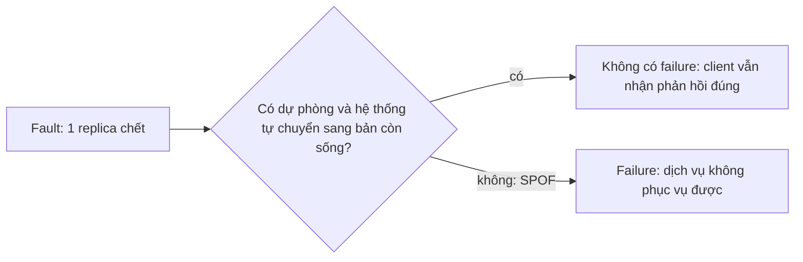
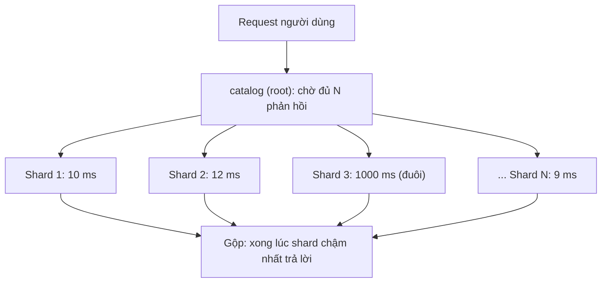

# P12 · Chương 01 — Reliability, scalability, maintainability

> Chương này ứng với chương 1 của *Designing Data-Intensive Applications* (DDIA, ấn bản 1), "Reliable, Scalable, and Maintainable Applications", theo mục lục do ETH Library lưu[^toc-ddia1-title]. Mục lục chia chương thành Reliability, Scalability và Maintainability (gồm Operability, Simplicity, Evolvability), và chương này dùng khung đó làm xương sống[^toc-ddia1-parts]. Chương **không trích và không viết lại nội dung sách**, vì sách không có bản đọc tự do. Mọi khẳng định dựa vào nguồn mở ghi ở chú thích: bài giảng *Distributed Systems* của Kleppmann (Cambridge), SRE book của Google, các paper gốc (Gray 1985, Schroeder–Gibson 2007, Oppenheimer và cộng sự 2002, Dean–Barroso 2013, Moseley–Marks 2006, Gunther 2008), docs Rust/Tokio/Tower/hdrhistogram có số phiên bản, và docs Azure Well-Architected. Hai nguồn là **trang sống**, không ghim được phiên bản: SRE book và docs Azure (nội dung là bản truy cập ngày 2026-10-12 và có thể đổi). Số liệu trong các paper là **quan sát của họ ở thời điểm và hệ thống của họ**, không phải hằng số vật lý.

## Bạn sẽ hiểu được gì

- **Q1.** Fault khác failure thế nào, và vì sao ta thiết kế để *chịu* fault thay vì cố loại bỏ mọi fault? → mục 1
- **Q2.** Fault đến từ phần cứng, phần mềm và con người khác nhau ra sao, và mỗi loại có bằng chứng thực nghiệm nào? → mục 2
- **Q3.** "Tải" và "hiệu năng" được mô tả bằng những con số nào; throughput, response time và latency khác nhau thế nào? → mục 3
- **Q4.** Vì sao dùng percentile (p50/p99/p999) thay vì trung bình, và đo sao cho khỏi tự lừa mình? → mục 4
- **Q5.** Vì sao một request gọi nhiều backend song song lại chậm hơn nhiều so với từng backend (tail latency amplification), và giảm bằng cách nào? → mục 5
- **Q6.** SLI, SLO, SLA là gì; "bao nhiêu số 9" nghĩa là gì; error budget dùng để làm gì? → mục 6
- **Q7.** Scale up khác scale out thế nào, và vì sao thêm máy không tự động thêm hiệu năng tuyến tính? → mục 7
- **Q8.** Operability, simplicity, evolvability là gì và vì sao chúng quyết định chi phí dài hạn của hệ thống? → mục 8

## Kiến thức cần trước

- [P11 · Chương 03 — Đo và cải thiện hiệu năng service Rust](../11-do-dac-va-go-loi/03-hieu-nang-service-rust.md): mục 2 giải thích histogram, `hdrhistogram`, percentile; mục 8 nói nguồn latency đuôi *bên trong một process Tokio*. Chương này không lặp lại, chỉ dùng và mở rộng sang mức hệ thống nhiều máy.
- [P7 · Chương 09 — Async trong production](../07-io-async/09-async-trong-production.md): mục 2 (`timeout` thực sự làm gì), mục 3 (backpressure). Chương này dẫn lại khi bàn deadline và retry.

Chương này mở đầu phase P12, nên không giả định bạn đã biết replication, partitioning hay transaction. Các chủ đề đó chỉ được nhắc bằng link và giải thích ở chương của chúng.

## 1. Fault, failure và fault tolerance (Q1)

> **Trả lời ngắn.** *Fault* là một *phần* của hệ thống ngừng làm việc đúng; *failure* là lúc *cả hệ thống* không còn phục vụ được[^ks-fault-def]. *Fault tolerance* là thiết kế để hệ thống vẫn chạy khi có fault, tới một số lượng fault tối đa nào đó[^ks-ft-def]. Ta chọn chịu fault thay vì loại bỏ nó, vì mua phần cứng tốt hơn hay thêm dự phòng cũng không bao giờ đưa xác suất fault về 0[^ks-never-zero].

**Giải thích.**

*Với service của bạn.* Hãy hình dung `catalog`, một service Rust chạy trên Tokio, trả về trang danh sách sản phẩm. Mỗi request nó gọi song song tới nhiều shard tìm kiếm, ghi vài dòng vào Postgres, và nó chạy thành ba replica sau một load balancer. Ta sẽ bám theo `catalog` suốt chương (nhận xét của người soạn: đây là ví dụ giả định, không phải code trong repo). Câu hỏi của mục này: một replica chết thì người dùng có thấy không?

### 1.1 Fault và failure là hai tầng của cùng một sự cố

Giả sử một pod của `catalog` bị OOM-kill. Đó là một *fault*, vì một thành phần đã chết. Nếu hai replica còn lại gánh nổi tải thì người dùng không thấy gì, tức là chưa có failure. Còn nếu `catalog` chỉ chạy một replica thì đúng fault đó biến thành failure: người dùng nhận 5xx.

Vì vậy chương này dùng *fault* khi nói về từng thành phần (một đĩa, một process, một đường mạng) và *failure* khi nói về thứ người dùng nhìn thấy[^ks-fault-def]. Cái nối hai tầng là dự phòng: fault chỉ thành failure khi không có gì chặn nó lại.



*(Sơ đồ trên là minh họa của người soạn.)*

### 1.2 Single point of failure

Một thành phần mà hỏng là cả hệ thống ngừng phục vụ được thì gọi là *single point of failure* (SPOF)[^ks-spof]. Với `catalog`, ba replica chưa đủ để hết SPOF. SPOF hay nằm ở thứ không có trong sơ đồ kiến trúc: một DNS resolver, một chứng chỉ TLS sắp hết hạn, một cron job duy nhất (nhận xét của người soạn).

### 1.3 Chịu fault luôn có giới hạn

Khả năng chịu fault luôn tính tương đối với số fault tối đa mà hệ thống chịu được[^ks-ft-relative]. Có thuật toán chạy tốt miễn là *ít hơn một nửa* số node bị crash, và dừng nếu quá nửa; không có thiết kế nào chịu số fault vô hạn. Con số "một nửa" này là gốc của quorum đa số, sẽ gặp lại ở [chương 05](05-replication.md) và [chương 09](09-consistency-va-consensus.md) (nhận xét của người soạn).

### 1.4 Vì sao hệ phân tán muốn chịu fault

Trên một máy, nếu một module RAM hỏng thì thường cả máy crash, và phần mềm không được viết để sống tiếp qua chuyện đó. Hệ phân tán thì khác: ta thường muốn phần còn lại tiếp tục phục vụ[^ks-ram]. Chịu được crash còn làm vận hành dễ hơn. Nếu `catalog` chịu được một trong ba node vắng mặt thì ta nâng cấp bằng cách cài và khởi động lại từng node một, client không thấy gián đoạn[^ks-rolling].

<details><summary>Đi sâu: fault tương quan, giới hạn của độ tin cậy, và "không phải lúc nào nhiều số 9 hơn cũng tốt hơn"</summary>

- *Fault không phải lúc nào cũng độc lập.* Nếu mọi node chạy cùng một phần mềm thì chúng có cùng một bug, và thuật toán chỉ chịu "ít hơn một phần ba node lỗi kiểu Byzantine" thì không chịu nổi bug đó[^ks-bug-same]. Nói cách khác, nhân bản chống fault *ngẫu nhiên và độc lập* tốt hơn fault *tương quan* như cùng bug, cùng cấu hình sai, cùng đợt triển khai (suy luận của người soạn từ nguồn này).
- *Phát hiện fault không hiển nhiên.* Muốn một node tiếp quản khi node khác crash thì trước hết phải *phát hiện* được crash, và việc này vốn không đơn giản[^ks-detect]. Đây là chủ đề của [chương 08](08-su-co-he-phan-tan.md).
- *Độ tin cậy có giá.* SRE book viết rằng cải thiện độ tin cậy thêm một bậc có thể đắt gấp 100 lần bậc trước[^sre-100x]. Bài giảng của Kleppmann đưa ví dụ mạng điện thoại cố định thiết kế cho "năm số 9" nhưng vì thế tiến hóa rất chậm. Đa số dịch vụ Internet không đạt bốn số 9 vì hiệu suất giảm dần: quá một điểm nào đó, chi phí thêm độ sẵn sàng vượt chi phí của việc thỉnh thoảng ngừng hoạt động[^ks-diminishing].
- *Phân tán có tiềm năng tin cậy hơn một máy.* Một node có thể phục vụ trong khi node khác khởi động lại, miễn là hệ thống được thiết kế tốt[^ks-reliable].

</details>

**Quay lại Q1:** với `catalog`, fault là một replica chết, failure là người dùng nhận 5xx; vì không ngăn được mọi fault, ta thiết kế để fault không thành failure, và chấp nhận rằng việc đó có giới hạn và có giá.

## 2. Ba nguồn fault: phần cứng, phần mềm, con người (Q2)

> **Trả lời ngắn.** Ở quy mô lớn, phần cứng hỏng thường xuyên: số liệu thực địa về đĩa cao hơn nhiều so với con số trên datasheet[^sch-ar]. Lỗi phần mềm thường *tương quan*, nghĩa là cùng một bug có mặt ở mọi node[^ks-bug-same]. Theo Gray, phần lớn bug phần mềm trong sản xuất là lỗi "mềm", biến mất khi chạy lại[^gray-soft]. Lỗi do con người (vận hành, cấu hình) nổi bật trong các nghiên cứu cũ. Quản trị hệ thống là nguồn lỗi lớn nhất trong mẫu của Gray (1985)[^gray-admin]. Còn trong nghiên cứu của Oppenheimer và cộng sự (2002), lỗi của operator là nguyên nhân chính[^opp-op].

**Giải thích.**

*Với `catalog`.* Hãy tưởng tượng một đêm on-call của `catalog`. Cảnh báo đầu tiên: ổ đĩa của node Postgres chết (phần cứng). Cảnh báo thứ hai: bản deploy chiều nay làm cả ba replica cùng panic (phần mềm). Cảnh báo thứ ba: có người vừa sửa nhầm file cấu hình của cả cụm (con người). Ba loại này cần ba kiểu phòng thủ khác nhau, và mục này xem mỗi loại có bằng chứng gì (kịch bản là của người soạn).

### 2.1 Phần cứng: hỏng đều đặn, nên che bằng dự phòng

Hãng đĩa công bố MTTF (thời gian trung bình tới lúc hỏng) trong datasheet. Schroeder và Gibson (FAST 2007) phân tích dữ liệu thay đĩa của khoảng 100.000 ổ ở các hệ thống lớn. Datasheet cho MTTF từ 1.000.000 đến 1.500.000 giờ, tương ứng tỉ lệ hỏng danh nghĩa tối đa 0,88% một năm[^sch-datasheet]. Ngoài thực địa, tỉ lệ thay đĩa hằng năm thường vượt 1%, mức 2–4% là phổ biến và có hệ thống tới 13%[^sch-ar].

Con số nghe nhỏ, nhưng nhân với quy mô thì không. Với 10.000 đĩa và mức 3% mỗi năm, ta có khoảng 300 lần thay đĩa mỗi năm, tức khoảng 0,8 lần mỗi ngày (phép tính của người soạn). Ở quy mô đó, fault phần cứng là việc thường ngày chứ không phải biến cố.

Đáng chú ý là hỏng phần cứng không nhất thiết gây gián đoạn. Trong mẫu của Gray (1985) về hệ thống Tandem chịu fault, có khoảng 50.000 fault phần cứng, và chưa đến một phần nghìn trong số đó gây lỗi kép hoặc gián đoạn dịch vụ[^gray-hw]. Phòng thủ thường dùng là dự phòng: RAID ở mức đĩa (xem [P5 · Chương 07](../05-storage/07-raid-va-copy-on-write-fs.md)) và replication ở mức node (xem [chương 05](05-replication.md)) (nhận xét của người soạn).

### 2.2 Phần mềm: bug tương quan, và Heisenbug

Bản deploy chiều nay cho thấy vấn đề: nếu mọi node chạy cùng một phần mềm thì chúng có cùng một bug[^ks-bug-same]. Dự phòng bằng bản sao của cùng một đoạn code vì vậy không chống được loại fault này.

Gray chia bug phần mềm làm hai loại. *Heisenbug* là lỗi biến mất khi bạn nhìn vào nó; ông viết rằng phần lớn bug phần mềm trong sản xuất là Heisenbug[^gray-soft]. *Bohrbug* là loại ngược lại, lỗi ổn định, lần nào chạy cũng gặp (cách hiểu của người soạn). Trong khoảng thời gian Gray đo, 1 trong 132 fault phần mềm là Bohrbug, số còn lại là Heisenbug[^gray-bohr].

Từ đó có một hệ quả thực hành. Với lỗi mềm, đặt chương trình về trạng thái yên rồi *chạy lại* nhiều khả năng qua được, vì môi trường lúc đó đã hơi khác[^gray-retry]. Đó là lý do retry và restart hiệu quả đến thế, và cũng là lý do retry thiếu kiểm soát nguy hiểm (xem mục 5). Số liệu của Gray là 1985 trên Tandem, nên đừng suy ra tỉ lệ cho dịch vụ của bạn (nhận xét của người soạn). Phần mềm cũng là nguồn outage thực sự: lỗi phần mềm chiếm 25% số lần gián đoạn trong mẫu của ông[^gray-sw].

### 2.3 Con người: nguồn failure lớn trong các nghiên cứu

Trong mẫu của Gray, quản trị hệ thống (thao tác của operator, cấu hình, bảo trì) là nguồn gây lỗi lớn nhất, 42%[^gray-admin]. Cũng trong nghiên cứu đó, các quản trị viên báo cáo 41 sai lầm nghiêm trọng trong hơn 1300 năm hệ thống vận hành[^gray-ops].

Mười bảy năm sau, Oppenheimer và cộng sự phân tích dữ liệu sự cố của ba dịch vụ Internet lớn[^opp-scope]. Họ kết luận rằng lỗi của operator là nguyên nhân chính của failure và là loại khó che nhất[^opp-op].

Vì nguồn lỗi nằm ở thao tác của người, SRE book đề xuất văn hóa postmortem *không đổ lỗi*: giả định mọi người đều có ý tốt và làm điều đúng với thông tin họ có[^sre-blameless]. Sửa *hệ thống* quanh con người, như review cấu hình, rollout từng phần, nút rollback nhanh, hiệu quả hơn là sửa con người (nhận xét của người soạn).

### 2.4 Rust xóa được một lớp fault

Nếu chỉ viết Safe Rust thì bạn không phải lo lỗi kiểu (type) và lỗi bộ nhớ như con trỏ treo hay use-after-free[^nomicon-safe]. Lời hứa này dựa trên việc code `unsafe` bên dưới thư viện chuẩn và compiler đều đúng (suy luận của người soạn). Nhưng đó chỉ là một lớp: logic sai, deadlock, quá tải, cấu hình sai, retry bão vẫn y nguyên (nhận xét của người soạn). Cách Rust tách lỗi thành recoverable và unrecoverable gần với tinh thần fail-fast của Gray; xem phần "Liên hệ với Rust".

<details><summary>Đi sâu: số liệu Schroeder–Gibson, tính MTTF ↔ AFR, và độ tin cậy của các nghiên cứu cũ</summary>

- Bài báo ước lượng MTTF bằng số giờ bật máy mỗi năm chia cho AFR (annual failure rate)[^sch-mttf-def]. Với 8.760 giờ một năm và MTTF 1.000.000 giờ thì AFR ≈ 0,876%, khớp mức 0,88% mà bài báo nêu (phép tính của người soạn).
- Tỉ lệ hỏng *không* hằng theo tuổi. Thay vì hiện tượng chết sớm rõ rệt (infant mortality), nhóm tác giả thấy đĩa *bắt đầu mòn sớm*, tỉ lệ thay đĩa tăng dần theo tuổi[^sch-wear].
- Số lỗi do operator có thể bị báo cáo thiếu, vì người gây lỗi ít khi muốn kể; Gray tự ghi chú điều này[^gray-underreport]. Cùng lý do đó khiến văn hóa không đổ lỗi quan trọng: khi có bầu không khí đổ lỗi, sự cố dễ bị giấu đi[^sre-blame-hide].
- Cả ba nguồn là *mẫu cụ thể* (Tandem 1985; ba dịch vụ Internet 2002; khoảng 100.000 đĩa 2007). Dùng chúng để hiểu *loại* nguyên nhân và *cỡ* hiện tượng, không để lấy tỉ lệ cho hạ tầng của bạn bây giờ (nhận xét của người soạn).

</details>

**Quay lại Q2:** phần cứng hỏng đều đặn nên che bằng dự phòng; bug phần mềm tương quan nên cần cách ly và rollout từng phần; sai lầm con người là nguồn failure lớn trong các nghiên cứu nên cần quy trình, công cụ và văn hóa không đổ lỗi.

## 3. Mô tả tải và hiệu năng: throughput, response time, latency (Q3)

> **Trả lời ngắn.** "Tải" là vài con số riêng của từng hệ thống (request mỗi giây, tỉ lệ đọc/ghi, số kết nối…), và bạn chọn chúng theo thứ thực sự gây nghẽn. Hiệu năng có hai mặt: throughput, tức làm được bao nhiêu việc mỗi giây (thường đo bằng request/giây[^sre-sli-common]), và thời gian người dùng phải chờ. Chữ *latency* hay bị dùng cho cả hai nghĩa, nên chương này nói rõ mình đang đo cái gì.

**Giải thích.**

*Với `catalog`.* Khi nói "`catalog` chạy tốt", ta đang nói hai chuyện khác nhau: nó xử lý được bao nhiêu request mỗi giây, và một người mở trang phải chờ bao lâu. `catalog` có thể xử lý rất nhiều request mỗi giây mà mỗi request vẫn chậm vì chúng xếp hàng chờ. Mục này đặt tên cho hai thứ đó và cho các con số đi kèm.

### 3.1 Mô tả tải bằng load parameter

Không có con số tải "chuẩn" chung; bạn chọn vài số quyết định kiến trúc của chính hệ thống mình. Với `catalog`, các ứng viên là: request/giây ở cổng vào, tỉ lệ đọc/ghi, tỉ lệ cache hit, số kết nối đồng thời, số shard mà một request gọi tới (mục 5), kích thước một batch ghi vào Postgres (đề xuất của người soạn).

Điều dễ sai là *cách lấy mẫu* quyết định bạn thấy gì. Một hệ thống chạy 200 request/giây ở các giây chẵn và 0 ở các giây lẻ có tải trung bình bằng hệ thống chạy đều 100 request/giây, nhưng tải *tức thời* gấp đôi mức trung bình[^sre-avg-load]. Vì vậy tải trung bình theo phút có thể che mất burst vài giây.

### 3.2 Throughput

Throughput là số việc xử lý được mỗi đơn vị thời gian. Với service, nó thường đo bằng request/giây, và cùng với latency, tỉ lệ lỗi là các SLI phổ biến[^sre-sli-common]. Với job batch thì người ta đo bằng bytes/giây hay bản ghi/giây (xem [chương 10](10-batch-processing.md)).

### 3.3 Latency và response time: hai nghĩa của một chữ

Trong SRE book, latency của dịch vụ là thời gian cần để phục vụ một request[^sre-lat-def]. Trong bài giảng hệ phân tán của Kleppmann, latency của một đường truyền là khoảng trễ từ lúc gửi thông điệp đến lúc nhận được nó, khác với bandwidth, tức lượng dữ liệu truyền được mỗi đơn vị thời gian[^ks-latency-def].

Hai nghĩa lệch nhau, nên chương này dùng quy ước sau (của người soạn). **Response time** là thời gian client chờ từ lúc gửi request đến lúc nhận phản hồi; nó gồm thời gian trên mạng, thời gian xếp hàng và thời gian xử lý. **Latency** chỉ dùng cho từng thành phần, như "latency của đường mạng" hay "latency của một lần gọi đĩa".


*(Sơ đồ trên là minh họa của người soạn.)*

### 3.4 Xếp hàng là phần hay bị bỏ qua

Một nguồn biến thiên phổ biến là độ trễ xếp hàng trên server trước khi request bắt đầu thực thi[^tail-queue]. Phương sai của response time càng cao thì trải nghiệm điển hình của người dùng càng bị hành vi đuôi chi phối, và hiệu ứng này nặng hơn ở tải cao vì xếp hàng[^sre-queue]. Đó là lý do thử tải `catalog` phải đẩy gần mức bão hòa: ở tải thấp bạn đo thời gian xử lý, không đo thời gian xếp hàng (nhận xét của người soạn).

<details><summary>Đi sâu: đo ở đâu, và đừng loại request lỗi khỏi số đo</summary>

- *Đo ở phía nào.* Latency phía client thường mới là thứ người dùng thấy, nhưng đôi khi chỉ đo được ở server; SRE book coi đó là một proxy[^sre-client]. Ví dụ trong sách: chỉ đo backend tìm kiếm có thể bỏ sót việc trang chậm do JavaScript của trang[^sre-js].
- *Thành công và lỗi tính riêng.* SRE book khuyên phân biệt latency của request thành công và request thất bại[^sre-succ-fail]. Một lỗi 500 do mất kết nối DB có thể trả về rất nhanh và kéo trung bình xuống giả tạo (ví dụ của sách). Nhưng một lỗi chậm còn tệ hơn lỗi nhanh, nên phải theo dõi riêng thay vì lọc bỏ[^sre-err-lat].
- *Bốn tín hiệu vàng.* Nếu chỉ đo được bốn thứ cho hệ thống hướng người dùng, sách đề xuất đo latency, traffic, errors, saturation[^sre-golden].
- *Thời gian xử lý ≠ response time.* Khi hệ thống gần bão hòa, thời gian xếp hàng chi phối response time dù thời gian xử lý mỗi request không đổi (suy luận của người soạn từ hai nguồn ở §3.4). Ở mạng cũng vậy: tắc nghẽn làm gói tin xếp hàng ở buffer của switch, và đó là một nguyên nhân làm latency tăng[^ks-queue-net].

</details>

**Quay lại Q3:** mô tả tải bằng vài con số riêng của hệ thống (lấy mẫu đủ mịn để thấy burst), đo throughput và response time riêng, và nhớ rằng response time gồm cả thời gian xếp hàng.

## 4. Percentile thay vì trung bình, và đo cho đúng (Q4)

> **Trả lời ngắn.** Response time không phải một con số mà là một *phân phối*; hầu hết metric nên xem như phân phối chứ không phải trung bình[^sre-dist]. p50 (trung vị) cho biết trải nghiệm điển hình, còn percentile cao như p99 hay p99,9 cho biết một giá trị xấu hợp lý[^sre-pct]. Khi đo, đo ở phía client, đếm cả request lỗi, gộp histogram chứ không trung bình các percentile, và tránh *coordinated omission*.

**Giải thích.**

*Với `catalog`.* Giả sử dashboard của `catalog` báo response time trung bình 30 ms, nghe rất ổn. Nhưng mỗi phút vài request mất ba giây, và người dùng gặp chúng mới là người than phiền; trung bình không cho biết họ là ai. Định nghĩa percentile, histogram và `hdrhistogram` đã ở [P11 · Chương 03, mục 2](../11-do-dac-va-go-loi/03-hieu-nang-service-rust.md); ở đây ta chỉ xem cách *đọc* và cách *đo đúng* ở mức hệ thống.

### 4.1 Vì sao trung bình đánh lừa

Hình 4-1 trong SRE book mô tả một hệ thống mà request điển hình phục vụ trong khoảng 50 ms nhưng 5% request chậm gấp 20 lần[^sre-fig41]. Chỉ nhìn trung bình thì suốt ngày không thấy gì thay đổi dù cái đuôi đổi rất lớn. Phân phối response time còn lệch một cách "nhân tạo": không request nào nhanh hơn 0 ms, và nếu timeout đặt ở 1.000 ms thì không phản hồi thành công nào vượt giá trị đó, nên trung bình và trung vị có thể khác xa nhau[^sre-skew].

### 4.2 Cách đọc percentile

Percentile cao như p99 hoặc p99,9 cho thấy một giá trị xấu hợp lý, còn p50 nhấn mạnh trường hợp điển hình[^sre-pct]. Người dùng cũng nhạy với phương sai: các nghiên cứu cho thấy người ta thường thích hệ thống chậm hơn một chút nhưng ổn định hơn một hệ thống có phương sai lớn, nên một số đội SRE chỉ nhìn percentile cao[^sre-variance].

Có một điểm nữa. Người dùng gửi nhiều request trong một phiên thì xác suất gặp ít nhất một request ở đuôi cao hơn nhiều so với xác suất của một request đơn lẻ, nên đuôi ảnh hưởng tới nhiều người hơn con số 1% gợi ý (nhận xét của người soạn).

### 4.3 Ba lỗi đo thường gặp

Phần này là suy luận của người soạn, trừ chỗ có chú thích.

1. **Trung bình các percentile.** Percentile không cộng được: p99 của 10 máy đem trung bình không bằng p99 của toàn bộ request. Cách đúng là lưu histogram từng máy rồi *gộp* chúng; `hdrhistogram` có `Histogram::add` để cộng nội dung một histogram vào histogram khác[^hdr-add].
2. **Loại request lỗi.** Lỗi nhanh làm số đo đẹp giả (xem mục 3)[^sre-succ-fail].
3. **Coordinated omission.** Nếu bộ sinh tải chờ phản hồi của request trước rồi mới gửi request kế, một lần server đứng khựng chỉ tạo *một* mẫu chậm, trong khi lẽ ra nhiều request đã phải được gửi trong khoảng đó. README của HdrHistogram minh họa bằng một hệ thống lấy mẫu mỗi 10 ms[^hdrj-setup]. Hệ thống chạy hoàn hảo 100 giây (10.000 mẫu 1 ms) rồi đứng 100 giây, chỉ ghi một mẫu 100 giây; histogram thô sẽ cho thấy khoảng 99,99% kết quả ≤ 1 ms. Histogram hiệu chỉnh theo khoảng thời gian mong đợi giữa các mẫu chỉ cho khoảng 50% kết quả ≤ 1 ms, phần còn lại đến từ các giá trị được sinh bù trải trong khoảng 10 ms tới 100 giây[^hdrj-co]. Ở Rust, `Histogram::record_correct(value, interval)` ghi một giá trị rồi tự sinh thêm một chuỗi giá trị nhỏ dần (xuống tới `interval`) để bù các mẫu bị mất khi `value` lớn hơn khoảng giữa các mẫu[^hdr-rc].

<details><summary>Đi sâu: cửa sổ, số mẫu, và hiệu chỉnh ở đâu</summary>

- *Hiệu chỉnh một lần.* `record_correct` (hiệu chỉnh lúc ghi) và `clone_correct` (hiệu chỉnh sau khi ghi) loại trừ nhau: chỉ dùng một trong hai trên cùng một tập dữ liệu để bù cùng một vấn đề[^hdr-exclusive].
- *Đủ mẫu để nói về đuôi.* Để ước lượng p99,9 cần tối thiểu hàng nghìn mẫu; với 1.000 mẫu thì p99,9 gần như chỉ là mẫu chậm nhất (suy luận của người soạn). Vì vậy SLO về percentile cao luôn kèm cửa sổ đo đủ dài.
- *Ưa percentile hơn trung bình.* SRE book nói chung ưa percentile hơn trung bình vì percentile cho phép xét cái đuôi dài của dữ liệu[^sre-prefer-pct]. Cách viết một SLO có percentile, cửa sổ đo và phạm vi đo: xem mục 6.
- *Chi phí của cấu trúc dữ liệu.* Histogram giữ chi phí cố định về không gian và thời gian; chi tiết ở [P11 · Chương 03, mục 2](../11-do-dac-va-go-loi/03-hieu-nang-service-rust.md).

</details>

**Quay lại Q4:** xem response time của `catalog` như một phân phối, báo cáo p50/p99/p99,9, đo ở client, tính cả lỗi, gộp histogram thay vì trung bình percentile, và bù coordinated omission khi bộ sinh tải chờ phản hồi.

## 5. Tail latency amplification khi fan-out (Q5)

> **Trả lời ngắn.** Nếu một request người dùng phải thu phản hồi từ N server song song và chờ tất cả, thì request chậm khi *bất kỳ* server nào chậm. Dean và Barroso (Google) tính một ví dụ: server thường trả lời trong 10 ms nhưng p99 là 1 giây. Với một server thì 1/100 request chậm, còn với 100 server song song thì 63% request chậm hơn 1 giây[^tail-100]. Cách giảm là giảm biến thiên ở từng thành phần và dùng kỹ thuật "chịu đuôi" như hedged request, đổi lại thêm một ít tải.

**Giải thích.**

*Với `catalog`.* Đây chính là việc `catalog` làm mỗi request: gọi song song N shard tìm kiếm, chờ đủ N phản hồi rồi ghép trang. Mỗi shard thường trả lời trong 10 ms, nhưng 1% số lần nó mất một giây. Với một shard, 1% request chậm. Với 100 shard, hầu hết request chậm, vì chỉ cần một shard gặp sự cố là cả trang phải chờ. Mục này tính con số đó và xem cách giảm.

### 5.1 Vì sao fan-out khuếch đại đuôi

Kỹ thuật phổ biến để giảm latency ở dịch vụ lớn là chia việc cho nhiều máy, mỗi máy giữ một phần dữ liệu. Request đi từ root tới nhiều leaf rồi phản hồi được gộp lại qua một cây phân phối, và mọi sub-operation phải xong trong một hạn chót chặt để dịch vụ còn "responsive"[^tail-fanout]. Hệ quả mà bài báo rút ra: biến thiên latency của từng thành phần bị *khuếch đại* ở mức dịch vụ[^tail-amp].



*(Sơ đồ trên là minh họa của người soạn.)*

### 5.2 Phép tính

Gọi p là xác suất một sub-request chậm (0,01 cho p99) và N là số sub-request song song. Nếu các sub-request độc lập, xác suất cả request chậm là 1 − (1 − p)^N. Với p = 0,01: N = 1 cho 1%; N = 10 cho khoảng 9,6%; N = 100 cho khoảng 63,4%; N = 500 cho khoảng 99,3% (tính của người soạn).

Con số 63% của N = 100 khớp với bài báo[^tail-100]. Bài báo còn tính một trường hợp nhẹ hơn: nếu chỉ 1 trên 10.000 request ở mỗi server chậm hơn một giây thì dịch vụ có 2.000 server như vậy sẽ thấy gần một trong năm request chậm hơn một giây[^tail-2000].

Nhìn ngược lại cũng hữu ích. Muốn p99 *của request tổng* nằm dưới một ngưỡng khi N = 100, mỗi shard phải dưới ngưỡng đó ở quantile khoảng 0,99^(1/100) ≈ 0,9999, tức p99,99 của shard phải đủ tốt. Với N = 10 thì 0,99^(1/10) ≈ 0,999, tức p99,9 (tính của người soạn, giả định độc lập). Vì vậy với fan-out từ vài chục đến vài trăm, thứ đáng quan tâm là đuôi sâu của thành phần (p99,9 đến p99,99), không phải p99 (suy luận của người soạn).

### 5.3 Số liệu thật và nguồn gốc biến thiên

Bài báo đưa số đo từ một dịch vụ của Google. P99 để một request ngẫu nhiên hoàn tất, đo ở root, là 10 ms, nhưng p99 để *toàn bộ* request hoàn tất là 140 ms[^tail-table]. Chờ 5% request chậm nhất chiếm một nửa p99 tổng[^tail-half].

Biến thiên đến từ nhiều nguồn. Một là hàng đợi trên server[^tail-queue]. Hai là tác vụ nền, như log compaction ở storage kiểu log và garbage collector ở ngôn ngữ có GC[^tail-bg]. Điều này nối với [chương 03](03-storage-engine.md) (compaction của LSM-tree) và [P11 · Chương 03, mục 8](../11-do-dac-va-go-loi/03-hieu-nang-service-rust.md) (nguồn đuôi trong Tokio).

### 5.4 Retry nhân đuôi lên

Retry ở nhiều tầng nhân lên theo từng tầng. SRE book tính: nếu backend, frontend và JavaScript đều thử lại 3 lần (tức 4 lần gọi mỗi tầng) thì một hành động của người dùng có thể tạo 64 lần gọi (4³) xuống database[^sre-retry-mult]. Chi tiết ở phần "Liên hệ với Rust".

### 5.5 Kỹ thuật chịu đuôi

Bài báo đặt mục tiêu "tail-tolerant": giống như tính toán chịu fault tạo ra một tổng thể đáng tin từ các phần kém tin cậy, dịch vụ lớn cần tạo ra một tổng thể phản hồi đoán trước được từ các phần khó đoán[^tail-tolerant].

Một kỹ thuật là *hedged request*: nếu request đầu chưa xong sau một ngưỡng thì gửi bản sao sang server khác. Nếu chờ tới p95 kỳ vọng rồi mới gửi, tải thêm chỉ khoảng 5% mà đuôi ngắn đi đáng kể[^tail-hedge]. Ví dụ trong bài: đọc giá trị của 1.000 khóa trên Bigtable phân tán qua 100 server, gửi hedge sau 10 ms giảm p99,9 từ 1.800 ms xuống 74 ms với chỉ 2% request thêm[^tail-bigtable].

<details><summary>Đi sâu: giả định độc lập, hủy request, và đồng bộ tác vụ nền</summary>

- *Giả định độc lập.* Công thức 1 − (1 − p)^N là mô hình tối giản (suy luận của người soạn). Nếu các shard chậm *cùng lúc* (cùng rack, cùng bản deploy, cùng lịch GC) thì xác suất thực khác; nếu chậm vì hàng đợi thì nó tương quan với tải. Dùng công thức để thấy *hướng* và *cỡ* khuếch đại, không để dự báo con số.
- *Hedge cần hủy nhanh.* Bài báo viết rằng muốn dùng hedged request mạnh tay hơn với mức tiêu thụ tài nguyên vừa phải thì cần hủy request nhanh hơn[^tail-cancel]. SRE book nói khi dùng hedged request nên truyền hủy tới các server dư thừa, kể cả hủy xuyên suốt cả cây gọi[^sre-cancel].
- *Đồng bộ tác vụ nền có thể có lợi.* Với dịch vụ fan-out lớn, đôi khi nên đồng bộ hoạt động nền trên nhiều máy để chúng cùng chậm trong một khoảng ngắn, thay vì lúc nào cũng có vài máy làm việc nền và đẩy dài đuôi cho mọi request[^tail-sync].
- *Giảm fan-out* cũng là một cách (nhận xét của người soạn): cache, dữ liệu phi chuẩn hóa, hoặc chia dữ liệu sao cho truy vấn phổ biến chỉ chạm ít partition ([chương 06](06-partitioning.md)).

</details>

**Quay lại Q5:** fan-out N biến "1% chậm" thành 1 − 0,99^N request chậm; vì vậy đuôi của từng shard mới quyết định response time của `catalog`, và ta phải giảm biến thiên hoặc dùng kỹ thuật chịu đuôi.

## 6. SLI, SLO, SLA, "số 9" và error budget (Q6)

> **Trả lời ngắn.** SLI là một số đo định lượng về mức dịch vụ (ví dụ latency, tỉ lệ lỗi)[^sre-sli]. SLO là giá trị mục tiêu cho SLI đó[^sre-slo]. SLA là hợp đồng với người dùng, kèm hậu quả khi vi phạm SLO[^sre-sla]. "Số 9" là cách nói độ sẵn sàng (99,9% là ba số 9)[^sre-nines-def]. Error budget là phần được phép trượt SLO, dùng làm động lực chung để cân bằng giữa đổi mới và độ tin cậy[^sre-eb-balance].

**Giải thích.**

*Với `catalog`.* Đội của `catalog` cần một câu trả lời cho "đủ tốt là bao nhiêu?". Số đo là SLI, ví dụ tỉ lệ request `GET /products` hoàn tất dưới 100 ms. Mục tiêu trên số đo đó là SLO, ví dụ 99%. Nếu `catalog` bán cho khách ngoài và hợp đồng ghi "hụt thì hoàn tiền" thì đó là SLA (ví dụ của người soạn). Mục này định nghĩa từng thứ, quy "số 9" ra thời gian ngừng, rồi xem error budget biến mục tiêu thành quyết định ra bản mới.

### 6.1 SLI

SLI là một phép đo định lượng được xác định cẩn thận về một khía cạnh của mức dịch vụ[^sre-sli]. Phổ biến nhất là latency, tỉ lệ lỗi và throughput; các số đo thường được tổng hợp trong một cửa sổ thành tỉ lệ, trung bình hay percentile[^sre-sli-common]. Availability cũng là một SLI, thường định nghĩa bằng tỉ lệ request hợp lệ thành công, gọi là *yield*[^sre-avail-yield].

### 6.2 SLO

SLO là giá trị hoặc khoảng giá trị mục tiêu cho SLI[^sre-slo]. Cấu trúc tự nhiên của nó là SLI ≤ mục tiêu, hoặc cận dưới ≤ SLI ≤ cận trên[^sre-slo-shape].

Một SLO tốt nói rõ cách đo và điều kiện hợp lệ. Bài giảng của Kleppmann diễn đạt SLO về availability là tỉ lệ request phải nhận được phản hồi đúng trong một timeout xác định, đo bởi một client nhất định trong một khoảng thời gian nhất định[^ks-slo]. Ví dụ trong SRE book: "99% (trung bình 1 phút) số lời gọi Get RPC hoàn tất dưới 100 ms, đo trên mọi backend"[^sre-slo-example].

### 6.3 SLA

SLA là hợp đồng, rõ ràng hay ngầm định, với người dùng, trong đó gồm cả hậu quả khi đạt hoặc không đạt SLO[^sre-sla]. Cách phân biệt nhanh: nếu không có hậu quả rõ ràng khi hụt thì bạn gần như chắc chắn đang nhìn một SLO[^sre-sla-diff]. Bài giảng của Kleppmann định nghĩa tương tự: SLA là hợp đồng nêu một SLO và hậu quả nếu SLO không đạt, ví dụ hoàn tiền[^ks-sla].

### 6.4 "Số 9"

Mỗi số 9 quy ra một lượng thời gian ngừng mỗi năm. Hai số 9 (99%) là khoảng 3,7 ngày/năm[^ks-nines2]. Ba số 9 (99,9%) là khoảng 8,8 giờ/năm[^ks-nines3]. Bốn số 9 (99,99%) là khoảng 53 phút/năm[^ks-nines4]. SRE book tính 99,99% cho phép ngừng tối đa 52,56 phút/năm[^sre-nines]. Hai nguồn khớp với phép tính 0,1% × 8.760 giờ ≈ 8,76 giờ và 0,01% × 525.600 phút = 52,56 phút (tính của người soạn).

Mỗi số 9 thêm vào là cải thiện một bậc cỡ mười lần về hướng 100%[^sre-nine-order]. Ranh giới "available/unavailable" lại tùy ý: 5 giây để tải trang còn tính là available không, còn 30 giây?[^ks-avail-arbitrary] Vì thế SLO phải gắn với một timeout cụ thể.

Độ sẵn sàng còn giảm khi phụ thuộc nối tiếp (suy luận của người soạn). Nếu một request của `catalog` cần năm dịch vụ nối tiếp, mỗi dịch vụ 99,9% và các lỗi độc lập, độ sẵn sàng gộp xấp xỉ 0,999⁵ ≈ 99,5%, tức khoảng 5 lần 8,8, vào cỡ 44 giờ/năm ngừng. Vì vậy `catalog` cần *thiết kế để chịu fault* của phụ thuộc (timeout, fallback) thay vì giả định chúng hoàn hảo.

### 6.5 Error budget

Đòi SLO đạt 100% thời gian vừa phi thực tế vừa không đáng muốn: nó làm chậm đổi mới và triển khai, hoặc đòi giải pháp đắt và quá thận trọng[^sre-100pct]. Tốt hơn là cho phép một error budget, tức tỉ lệ được phép hụt SLO, và theo dõi theo ngày hoặc tuần[^sre-errbudget]. Khi còn budget thì được phát hành bản mới[^sre-eb-release].

Quy ra số: SLO 99,9% trong 30 ngày cho phép khoảng 43,2 phút ngừng (30 × 24 × 60 × 0,001). Nếu quy theo request như SRE book ưa dùng, thì với tải một triệu request được phép 1.000 request lỗi (tính của người soạn).

<details><summary>Đi sâu: availability theo thời gian hay theo request, SLO nội bộ chặt hơn, quá tốt cũng là vấn đề</summary>

- *Theo thời gian hay theo request.* Ở Google, số đo availability theo thời gian ít có ý nghĩa vì dịch vụ phân tán toàn cầu hầu như lúc nào cũng "ít nhất một phần đang lên"; nên họ định nghĩa availability theo tỉ lệ request thành công thay vì uptime[^sre-request-avail].
- *SLO nội bộ chặt hơn SLO công bố.* Cách này cho phép xử lý vấn đề mãn tính trước khi chúng lộ ra bên ngoài[^sre-slo-buffer].
- *Quá tốt cũng thành gánh nặng.* Nếu hiệu năng thực tế tốt hơn nhiều so với SLO công bố thì người dùng sẽ bắt đầu dựa vào hiệu năng hiện tại[^sre-reliance]. Sách mô tả Chubby cố ý ngừng định kỳ để tránh hiện tượng này (chi tiết ở chương SLO của sách).
- *Chọn ít SLO.* Chọn quá nhiều chỉ báo thì khó chú ý đúng chỗ, chọn quá ít thì bỏ sót hành vi quan trọng[^sre-few].
- *Chọn từ nhu cầu người dùng.* Bắt đầu từ thứ người dùng quan tâm, không từ thứ dễ đo[^sre-start-users].
- *SLA cần cả pháp lý và kinh doanh.* Đội SRE nên thận trọng về những gì quảng bá cho người dùng[^sre-sla-conservative].

</details>

**Quay lại Q6:** SLI là số đo, SLO là mục tiêu trên số đo, SLA là hợp đồng có hậu quả; "số 9" quy độ sẵn sàng ra thời gian ngừng, và error budget biến phần được phép hỏng thành thứ dùng để quyết định khi nào ra bản mới.

## 7. Scale up, scale out và vì sao thêm máy không tuyến tính (Q7)

> **Trả lời ngắn.** Thiết kế để scale là tạo kiến trúc đáp ứng được nhu cầu và tải tăng bằng cách thêm hoặc chỉnh tài nguyên[^az-design]. *Scale up* (vertical) là tăng năng lực của một tài nguyên, như chuyển lên máy lớn hơn[^az-vert]. *Scale out* (horizontal) là thêm instance và chia tải ra nhiều máy[^az-horiz]. Scale out chỉ hợp khi việc chia được thành phần chạy độc lập[^az-horiz-when]. Và thêm máy không cho hiệu năng tuyến tính, vì có phần tuần tự và chi phí phối hợp. Mô hình USL của Gunther gọi hai thứ đó là contention và coherency (xem §7.3).

**Giải thích.**

*Với `catalog`.* Giả sử lượng request của `catalog` tăng gấp mười. Có hai hướng: chuyển lên máy lớn hơn (scale up), hoặc chạy thêm replica và chia request ra (scale out). Máy lớn hơn thì đơn giản nhưng có trần. Thêm replica thì lên được cao hơn, nhưng giờ bạn phải chia request, giữ dữ liệu nhất quán giữa các replica, và một replica chậm là đủ gây chuyện. Mục này xem khi nào chọn hướng nào, và vì sao gấp mười số replica không cho gấp mười throughput.

### 7.1 Hai hướng

Vertical scaling hợp với workload khó chia nhỏ, hoặc khi kiến trúc ứng dụng không hỗ trợ scale ngang[^az-vert-when]. Horizontal scaling hợp với workload chia được thành phần chạy độc lập[^az-horiz-when]. Ứng dụng có thành phần có trạng thái (stateful) hoặc phụ thuộc khiến scale dọc phù hợp hơn thì nên cân nhắc scale up[^az-stateful].

Từ đó thấy vì sao tầng web stateless như `catalog` scale ngang dễ, còn database là chỗ khó; replication ([chương 05](05-replication.md)) và partitioning ([chương 06](06-partitioning.md)) tồn tại để giải việc này (nhận xét của người soạn).

### 7.2 Phân tán còn vì lý do khác ngoài tải

Bài giảng của Kleppmann nêu ba lý do khác. Một, độ tin cậy cao hơn một máy đơn khi thiết kế tốt[^ks-reliable]. Hai, latency địa lý: định tuyến người dùng tới node gần[^ks-geo]. Ba, có những bài toán quá lớn cho một máy hoặc sẽ quá chậm[^ks-why-dist]. Đổi lại, hệ phân tán thêm các lỗi mới: node có thể crash, chạy chậm hơn bình thường, hoặc hoạt động sai theo cách khác[^ks-new-faults].

Nếu một máy mạnh đủ tải và đủ độ sẵn sàng thì đơn giản thường thắng. Các câu hỏi "đơn nút hay phân tán", "tự vận hành hay dùng cloud" được bàn ở [chương 13](13-kien-truc-he-du-lieu.md) (nhận xét của người soạn).

### 7.3 Vì sao không tuyến tính

Gunther mô tả Universal Scalability Law (USL) như hàm hữu tỉ của số bộ xử lý p. Chương này nói "node" cho gọn; áp p sang số node là sự mở rộng của người soạn. Hai tham số σ và κ biểu diễn hai loại chi phí: *contention* do tuần tự hóa hoặc xếp hàng (σ > 0)[^usl-contention], và *coherency* do các bản sao dữ liệu không nhất quán (κ > 0)[^usl-coherency]. Công thức là C(p) = p / (1 + σ(p − 1) + κ·p(p − 1))[^usl-formula].

Khi κ > 0, throughput đạt cực đại tại một p* rồi *giảm* (retrograde)[^usl-retro]. Hiện tượng này hay gặp ở ứng dụng có dữ liệu ghi dùng chung[^usl-shared]. Với `catalog`, nó nghĩa là nếu mọi replica cùng ghi vào một dòng trong Postgres, thêm replica có thể làm chậm đi (suy luận của người soạn). USL là *mô hình* để khớp với số đo, không phải định luật; giá trị của nó là chỉ ra rằng thêm node có thể làm chậm đi khi chi phí phối hợp tăng bậc hai (nhận xét của người soạn).

<details><summary>Đi sâu: đọc công thức USL</summary>

- Khi σ = 0 và κ = 0, C(p) = p: tuyến tính lý tưởng[^usl-ideal]. Khi chỉ σ > 0 thì C(p) tiệm cận 1/σ (suy luận của người soạn từ công thức). Đây là dạng Amdahl; bài báo gọi các hàm hữu tỉ đơn giản như Amdahl là hệ quả của cùng giới hạn hàng đợi[^usl-amdahl].
- Bài báo nêu rằng với κ > 0, hàm có một cực đại tại p*[^usl-max]. Lấy đạo hàm C(p) theo p cho p* = √((1 − σ)/κ) (suy ra của người soạn); kết quả này khớp giới hạn p* → κ^(−1/2) khi σ → 0 mà bài báo nêu[^usl-pstar]. κ càng lớn thì p* càng nhỏ.
- Hàm ý thực hành (nhận xét của người soạn): muốn scale tốt, hạ σ (bớt đoạn tuần tự, ví dụ khóa toàn cục, một leader duy nhất ghi) và hạ κ (bớt đồng bộ giữa các bản sao). Các chương sau về replication, partitioning và consensus bàn chính các chi phí này.

</details>

**Quay lại Q7:** scale up là máy to hơn, scale out là nhiều máy hơn; scale out cần việc chia được và phải trả chi phí phối hợp, nên thêm replica cho `catalog` chỉ có lợi tuyến tính khi phần tuần tự và phần đồng bộ nhỏ.

## 8. Maintainability: operability, simplicity, evolvability (Q8)

> **Trả lời ngắn.** Hệ thống thường sống lâu hơn nhóm viết ra nó, nên khả năng bảo trì quyết định chi phí dài hạn (nhận định của người soạn). Nó có ba mặt, theo khung của DDIA[^toc-ddia1-parts]. *Operability* là dễ vận hành, coi người vận hành là một loại người dùng[^opp-user]. *Simplicity* là loại bỏ complexity ngẫu nhiên (accidental) để chỉ còn complexity vốn có (essential)[^tar-acc]. *Evolvability* là dễ thay đổi khi yêu cầu đổi, ví dụ nâng cấp từng phần mà client không thấy gián đoạn[^ks-rolling].

**Giải thích.**

*Với `catalog`.* Giả sử bạn nhận lại `catalog` từ một đồng nghiệp đã nghỉ. Nếu có dashboard rõ, runbook và deploy bằng một lệnh thì bạn vận hành được ngay (operability). Nếu code chỉ làm những gì nó nói thì bạn sửa được (simplicity). Nếu thêm một cột hay đổi một API không phải ngồi với sáu team thì bạn tiến hóa được (evolvability). Mục này xem mỗi mặt có định nghĩa và bằng chứng gì (kịch bản là của người soạn).

### 8.1 Operability: người vận hành cũng là người dùng

Oppenheimer và cộng sự viết rằng đang có nhận thức ngày càng rõ rằng operator là người dùng của phần mềm dịch vụ Internet, ngang hàng với người dùng cuối[^opp-user]. Vì vậy tính dễ dùng đối với operator phải được tích hợp xuyên suốt quá trình phát triển[^opp-usability].

Mặt đo được của operability là *toil*. SRE book định nghĩa toil là công việc vận hành thủ công, lặp lại, tự động hóa được, mang tính chiến thuật, không có giá trị lâu dài và tăng tuyến tính theo quy mô dịch vụ[^sre-toil]. Câu đề từ của chương đó, dẫn lời một kỹ sư Google SRE, nói rằng nếu operator phải chạm tay vào hệ thống trong vận hành bình thường thì bạn có một bug[^sre-bug-op].

Nâng cấp cuốn chiếu (restart từng node một khi hệ thống chịu được mất một node) là một mẫu operability cụ thể[^ks-rolling]. Quan sát ở mục 3 và 6 (bốn tín hiệu vàng, SLO) cũng là một phần của operability (nhận xét của người soạn).

### 8.2 Simplicity: complexity vốn có và ngẫu nhiên

Moseley và Marks, trong "Out of the Tar Pit", định nghĩa essential complexity là phần vốn có trong chính bài toán, như người dùng nhìn thấy[^tar-ess]. Accidental complexity là mọi thứ còn lại, thứ mà đội phát triển không phải xử lý trong thế giới lý tưởng[^tar-acc]. Họ coi complexity là nguyên nhân gốc của đa số vấn đề phần mềm hiện nay[^tar-root].

SRE book lặp lại ý đó, trích Brooks: essential complexity là thứ không thể bỏ khỏi định nghĩa bài toán, còn accidental complexity có thể giải bằng nỗ lực kỹ thuật[^sre-simp-ess]. Sách coi "nhàm chán" là đức tính tốt vì bất ngờ trong production là kẻ thù của SRE[^sre-simp-boring]. Và sách coi sự đơn giản của phần mềm là điều kiện tiên quyết của độ tin cậy[^sre-simp-prereq].

Một lớp abstraction đáng giá khi nó giấu complexity ngẫu nhiên, và có hại khi chỉ thêm tầng gián tiếp (nhận xét của người soạn).

### 8.3 Evolvability: thay đổi mà không dừng hệ thống

Hệ thống không bao giờ xong: yêu cầu, quy mô và hiểu biết về miền bài toán đều đổi (nhận xét của người soạn). Đòi hỏi thực tế là triển khai bản mới khi vẫn còn bản cũ đang chạy, tức rolling upgrade[^ks-rolling], và đọc được dữ liệu cũ bằng code mới (nhận xét của người soạn). Đó là chủ đề của [chương 04](04-encoding-va-tien-hoa-schema.md).

Bên cạnh đó là chuyện văn hóa: postmortem không đổ lỗi tạo ra môi trường mà sự cố được báo ra thay vì bị giấu[^sre-blame-hide].

Trách nhiệm dài hạn với dữ liệu, gồm quyền riêng tư, xóa dữ liệu theo yêu cầu và hệ quả đạo đức của hệ thống, cũng là một phần "bảo trì" ở nghĩa rộng, nhưng thuộc [chương 14](14-trach-nhiem-voi-du-lieu.md) và không bàn ở đây.

<details><summary>Đi sâu: vì sao phối hợp ba mặt này</summary>

- *Ba mặt kéo nhau.* Hệ thống phức tạp thì khó vận hành và khó đổi; hệ thống khó vận hành làm tăng lỗi do con người, vốn là nguồn failure lớn trong các nghiên cứu ở mục 2[^opp-op] (nhận xét của người soạn cho hai vế đầu). Moseley–Marks viết rằng độ tin cậy kém, giao hàng trễ, thiếu an toàn và cả hiệu năng kém trong hệ thống lớn đều có thể truy về complexity không quản được[^tar-root].
- *Toil tăng cùng quy mô.* Điểm cốt lõi của định nghĩa toil là "tăng tuyến tính theo quy mô"[^sre-toil]; nếu không tự động hóa thì đội vận hành phải lớn theo hệ thống (suy luận của người soạn).
- *Ba mục tiêu có thể đối lập.* Thêm dự phòng (reliability) thêm phần chuyển động, nên simplicity giảm; thêm cache (hiệu năng) thêm bài toán vô hiệu hóa cache. Phần lớn nội dung các chương sau (replication, partitioning, transaction, consensus) là về cách cân các đánh đổi này (nhận xét của người soạn).

</details>

**Quay lại Q8:** maintainability là chi phí dài hạn: làm cho người vận hành `catalog` dễ làm đúng, giảm complexity ngẫu nhiên, và giữ cho thay đổi không đòi dừng hệ thống.

## Liên hệ với Rust

Phần này nối các khái niệm ở trên với API Rust cụ thể (tokio 1.53.2, tower 0.5.2, hdrhistogram 7.5.4, std 1.95.0), vẫn theo `catalog`. Các ví dụ code chỉ minh họa, chưa chạy trong chương này.

| Khái niệm trong chương | API/crate Rust | Bài học chính | Mục |
|---|---|---|---|
| Đo percentile, gộp, bù coordinated omission | `hdrhistogram::Histogram`: `record`, `record_correct`, `add` | histogram gộp được; hiệu chỉnh chỉ một lần | 4 |
| Deadline | `tokio::time::timeout`, `timeout_at`; `tower::timeout` | timeout dừng *chờ*, không dừng việc phía xa | 5, 6 |
| Retry có giới hạn | `tower::retry::{Policy, budget::TpsBudget}` | dùng budget thay vì "tối đa 3 lần" | 5 |
| Fan-out song song | `tokio::task::JoinSet` + `timeout_at` | một deadline chung, thu kết quả theo thứ tự hoàn tất | 5 |
| Hedged request | `tokio::select!` | thua thì bị hủy (drop), cần cancel-safe | 5 |
| Fail-fast | `Result` và `panic!`; process bị giám sát | lỗi không phục hồi được thì dừng | 1, 2 |

(Cột *Bài học chính* tóm tắt nội dung có chú thích ở các đoạn bên dưới và ở mục 4–5; cột *Mục* là tham chiếu trong chương này.)

**Đo percentile với `hdrhistogram`.** Cách ghi và đọc histogram đã ở [P11 · Chương 03, mục 2](../11-do-dac-va-go-loi/03-hieu-nang-service-rust.md). Chương này bổ sung hai điểm. Thứ nhất, `Histogram::add` cộng nội dung một histogram vào histogram khác[^hdr-add], nên mỗi worker của `catalog` giữ một histogram riêng rồi gộp ở bước báo cáo, thay vì trung bình percentile. Thứ hai, `record_correct(value, interval)` bù coordinated omission khi bộ sinh tải chờ phản hồi[^hdr-rc]. Với cùng một tập dữ liệu, chỉ dùng *hoặc* `record_correct` *hoặc* `clone_correct`[^hdr-exclusive].

**Deadline: `timeout` và `timeout_at`.** `timeout(d, fut)` chờ `fut` tối đa `d`; hết hạn thì trả lỗi và future bị hủy[^tokio-timeout]. `timeout_at(deadline, fut)` đòi future hoàn thành trước một thời điểm tuyệt đối[^tokio-timeout-at]. Với request đi qua nhiều tầng, hãy tính deadline *một lần* ở cửa vào rồi truyền xuống; nếu mỗi tầng tự đặt timeout thì tổng cộng dồn có thể vượt cam kết với client (nhận xét của người soạn).

Cần nhớ thêm điều đã giải thích ở [P7 · Chương 09, mục 2](../07-io-async/09-async-trong-production.md): `timeout` chỉ ngừng chờ chứ không bảo dịch vụ phía xa dừng. Với Tower, `tower::timeout` là middleware áp timeout cho request: hết hạn thì response bị abort[^tower-timeout]. Để phía dưới thôi làm việc vô ích, SRE book khuyên truyền hủy xuyên cả cây gọi (stack), vì cách đó giảm việc không cần thiết hoặc đã chắc chắn vô ích ở các server phía dưới[^sre-cancel-why]. Lý do là một request có thể tiếp tục fan-out tới nhiều server khác, nên hủy phải được truyền khắp cả stack[^sre-cancel].

**Retry không giới hạn là cách tự DoS.** Khi server quá tải, phản hồi của nó tới trễ và có thể vượt deadline mà client đặt[^sre-overload]. Việc server đã làm bị lãng phí, client có thể retry, và quá tải nặng hơn. SRE book kết luận retry có thể làm mất ổn định hệ thống[^sre-retry-destab] và khuyên:

- luôn dùng exponential backoff có ngẫu nhiên[^sre-backoff];
- giới hạn số retry mỗi request và cân nhắc *retry budget* toàn server, ví dụ chỉ cho 60 retry mỗi phút trong một process, hết thì thất bại luôn[^sre-retry-budget];
- không retry ở nhiều tầng, vì số lần gọi nhân lên theo từng tầng (mục 5)[^sre-retry-mult];
- không retry lỗi vĩnh viễn hay request sai định dạng[^sre-retry-perm].

Về phía Tower, `tower::retry` là middleware thử lại các request "thất bại"[^tower-retry]. Docs `tower::retry::budget` giải thích vì sao ngân sách tốt hơn "tối đa N lần": chọn N là đoán mò, và hệ thống cấu hình theo N dễ chịu retry storm, tức cảnh client retry làm server chậm hơn và lỗi nhiều hơn, kéo thêm retry[^tower-budget-storm]. Triển khai retry mà không có yếu tố giới hạn nói chung là nguy hiểm, và budget chính là giới hạn đó[^tower-budget-limit]. Ví dụ trong docs có một `Policy` giữ `Arc<TpsBudget>`: request thành công thì `deposit()`, lỗi thì `withdraw()` và chỉ thử lại nếu rút được[^tower-budget-example]. Bản rút gọn dưới đây theo ví dụ đó.

```rust
// Rút gọn theo ví dụ trong docs tower 0.5.2 (retry::budget); chưa chạy trong chương này.
use std::sync::Arc;
use futures_util::future;
use tower::retry::{budget::{Budget, TpsBudget}, Policy};

#[derive(Clone, Debug)]
struct RetryPolicy { budget: Arc<TpsBudget> }

impl<E> Policy<String, String, E> for RetryPolicy {
    type Future = future::Ready<()>;

    fn retry(&mut self, _req: &mut String, result: &mut Result<String, E>) -> Option<Self::Future> {
        match result {
            Ok(_) => { self.budget.deposit(); None }       // thành công nạp thêm budget
            Err(_) => {
                if !self.budget.withdraw() { return None; } // hết budget thì không retry
                Some(future::ready(()))
            }
        }
    }

    fn clone_request(&mut self, req: &String) -> Option<String> { Some(req.clone()) }
}
```

Retry chỉ an toàn nếu thao tác *idempotent* hoặc được đánh dấu để server khử trùng lặp; vấn đề này được bàn ở [chương 12](12-dung-dan-va-tich-hop-du-lieu.md) (nhận xét của người soạn). Backpressure và giới hạn đồng thời bằng `Semaphore` ở [P7 · Chương 09, mục 3](../07-io-async/09-async-trong-production.md).

**Fan-out: `JoinSet` và `timeout_at`.** Đây là cách viết bước "gọi N shard" của `catalog`. `JoinSet` là tập các task chạy trên runtime Tokio; có thể chờ một phần hoặc tất cả, và kết quả trả về theo thứ tự hoàn tất[^tokio-joinset]. Khi `JoinSet` bị drop thì mọi task trong nó bị abort ngay[^tokio-joinset-drop]. Cách dùng `JoinSet` để không rò task nằm ở [P7 · Chương 09, mục 4](../07-io-async/09-async-trong-production.md).

Ví dụ scatter–gather dưới đây dùng một deadline chung. Kiểu trả về là `Vec<Option<u64>>`: `None` nghĩa là shard đó không kịp hạn, hoặc task của nó bị lỗi/panic. Chấp nhận kết quả một phần hay không là quyết định sản phẩm, không phải của thư viện.

```rust
use std::time::Duration;
use tokio::{task::JoinSet, time::{timeout_at, Instant}};

async fn call_shard(id: usize) -> u64 { id as u64 /* thay bằng RPC thật */ }

// Minh họa; chưa biên dịch/chạy trong chương này.
async fn scatter_gather(n: usize) -> Vec<Option<u64>> {
    let deadline = Instant::now() + Duration::from_millis(200); // tính MỘT lần
    let mut set = JoinSet::new();
    for id in 0..n {
        set.spawn(async move { (id, timeout_at(deadline, call_shard(id)).await.ok()) });
    }
    let mut out = vec![None; n];
    while let Some(joined) = set.join_next().await {
        if let Ok((id, res)) = joined { out[id] = res; }
    }
    out
}
```

**Hedged request với `select!`.** `tokio::select!` chờ nhiều nhánh đồng thời, trả về khi nhánh đầu tiên hoàn tất và *hủy* các nhánh còn lại[^tokio-select]. Nhờ vậy viết được hedge: gửi request đầu, nếu quá ngưỡng thì gửi bản thứ hai và lấy cái nào xong trước. Cái bị thua bị drop, nên future bên trong phải cancel-safe (xem [P7 · Chương 09, mục 1](../07-io-async/09-async-trong-production.md)). Hedge cũng chỉ nên dùng cho thao tác đọc hoặc idempotent, vì cả hai bản có thể thực thi phía server (nhận xét của người soạn, theo nội dung mục 5):

```rust
use std::{future::Future, time::Duration};

// Minh họa; chưa biên dịch/chạy trong chương này.
async fn hedged<F, Fut>(call: F, hedge_after: Duration) -> u64
where F: Fn(usize) -> Fut, Fut: Future<Output = u64> {
    let first = call(0);
    tokio::pin!(first);
    tokio::select! {
        v = &mut first => v,
        _ = tokio::time::sleep(hedge_after) => {
            let second = call(1);
            tokio::pin!(second);
            tokio::select! { v = &mut first => v, v = &mut second => v }
        }
    }
}
```

Ngưỡng hedge nên là p95 kỳ vọng để giới hạn tải thêm ở mức khoảng 5%[^tail-hedge]. Chọn ngưỡng này cần histogram latency thật (mục 4).

**Fail-fast bằng `Result` và `panic!`.** Rust chia lỗi làm hai loại. *Recoverable* là lỗi như không tìm thấy file, nên báo người dùng hoặc thử lại. *Unrecoverable* luôn là triệu chứng của bug, như truy cập ngoài mảng, nên dừng chương trình ngay[^rust-book-errors]. Cách chia này gần với *fail-fast* mà Gray mô tả (nhận xét của người soạn): module fail-fast hoặc chạy đúng, hoặc phát hiện lỗi, báo failure và dừng[^gray-failfast]. Gray cho rằng đơn vị cách ly hợp lý là *process*, vì nếu process hay processor hoạt động sai thì cứ dừng nó[^gray-process].

Dịch ra thực hành, đó là lý do hợp lý để một service Rust như `catalog` dừng khi gặp trạng thái bất khả. Điều kiện là có một thứ giám sát (systemd, Kubernetes) khởi động lại nó, và có nhiều replica để việc dừng một cái không thành failure, đúng ý mục 1 (suy luận của người soạn).

## Tóm tắt

- Fault là một phần hỏng, failure là cả hệ thống hỏng[^ks-fault-def]. Fault tolerance là ngăn fault thành failure, luôn có giới hạn số fault chịu được. Nó không bao giờ đưa xác suất fault về 0[^ks-never-zero].
- Ở quy mô lớn, phần cứng hỏng thường xuyên, số liệu thực địa cao hơn datasheet[^sch-ar]. Lỗi phần mềm tương quan[^ks-bug-same] và phần lớn là Heisenbug[^gray-soft]. Sai lầm vận hành nổi bật trong các nghiên cứu cũ[^opp-op].
- Mô tả tải bằng vài số riêng của hệ thống, lấy mẫu đủ mịn để thấy burst[^sre-avg-load]. Throughput và response time là hai số khác nhau, và response time gồm cả xếp hàng[^tail-queue].
- Dùng phân phối/percentile, không dùng trung bình[^sre-dist]. Đo ở client, tính cả lỗi, gộp histogram, bù coordinated omission[^hdr-rc].
- Fan-out N biến xác suất chậm p của từng thành phần thành 1 − (1 − p)^N ở mức dịch vụ khi độc lập[^tail-100]. Cách giảm là giảm biến thiên và dùng hedged request[^tail-hedge]. Retry nhiều tầng nhân lên[^sre-retry-mult].
- SLI là số đo, SLO là mục tiêu, SLA là hợp đồng có hậu quả[^sre-sla]. Không nhắm 100%[^sre-100pct]; dùng error budget[^sre-errbudget].
- Scale up là máy lớn hơn, scale out là thêm máy. Scale out cần việc chia được[^az-horiz-when] và chịu chi phí contention/coherency (USL), tới mức throughput có thể giảm[^usl-retro].
- Maintainability gồm operability, vì operator cũng là người dùng[^opp-user]; simplicity, tức bớt complexity ngẫu nhiên[^tar-acc]; và evolvability, tức rolling upgrade và tương thích[^ks-rolling].
- Trong Rust: `hdrhistogram` để đo, `timeout_at` với deadline tính một lần, `tower::retry` với budget, `JoinSet`/`select!` cho fan-out và hedge, `Result`/`panic!` cho fail-fast.

## Câu hỏi tự kiểm tra

1. Phân biệt fault và failure; nêu một ví dụ fault *không* thành failure và một ví dụ thành failure.
2. Vì sao nhân bản cùng một phần mềm lên nhiều node không chống được bug phần mềm?
3. Theo Schroeder–Gibson, datasheet và thực địa khác nhau thế nào về tỉ lệ hỏng đĩa? Với 10.000 đĩa và mức 3%/năm có bao nhiêu lần thay đĩa mỗi năm?
4. Bohrbug và Heisenbug khác nhau chỗ nào, và điều đó nói gì về hiệu quả của retry?
5. Vì sao trung bình các p99 của nhiều máy không phải p99 của hệ thống? Cách đúng là gì?
6. Coordinated omission là gì, và `record_correct` của `hdrhistogram` làm gì?
7. Một request fan-out tới 100 leaf, mỗi leaf chậm với xác suất 1% (độc lập). Xác suất request tổng chậm? Hedged request giúp thế nào, giá phải trả?
8. Phân biệt SLI, SLO, SLA; 99,9% trong 30 ngày tương ứng bao nhiêu phút ngừng?
9. Backend, frontend và JavaScript đều retry 3 lần: tối đa bao nhiêu lần gọi xuống database cho một hành động? Tower có công cụ nào để chặn retry storm?
10. Scale out khác scale up thế nào, và USL giải thích vì sao thêm node có thể làm throughput giảm?
11. Essential complexity khác accidental complexity thế nào? Cho ví dụ.

<details><summary>Đáp án</summary>

1. Fault là một phần ngừng làm việc, failure là cả hệ thống không chạy[^ks-fault-def]. Một pod chết khi còn replica sống thì không thành failure. Cùng pod chết khi service chỉ có một replica (SPOF) thì thành failure[^ks-spof]. Xem mục 1.
2. Mọi node có cùng bug[^ks-bug-same]. Dự phòng chống fault độc lập, không chống fault tương quan (suy luận của người soạn). Xem mục 1, 2.
3. Datasheet ngụ ý tối đa 0,88%/năm[^sch-datasheet]. Thực địa thường trên 1%, 2–4% phổ biến, tới 13%[^sch-ar]. 10.000 × 3% = 300 lần mỗi năm, gần 1 lần mỗi ngày (tính của người soạn). Xem mục 2.
4. Heisenbug biến mất khi nhìn vào[^gray-soft], còn Bohrbug ổn định và dễ tái hiện (cách hiểu của người soạn). Trong khảo sát của Gray, 1/132 fault phần mềm là Bohrbug[^gray-bohr]. Vì vậy retry thường qua được lỗi mềm nhưng không qua được Bohrbug (suy luận của người soạn). Xem mục 2.
5. Percentile không cộng hay trung bình được (suy luận của người soạn). Cách đúng là lưu histogram từng máy rồi gộp bằng `Histogram::add`[^hdr-add]. Xem mục 4.
6. Bộ sinh tải chờ phản hồi rồi mới gửi tiếp, nên một lần đứng khựng chỉ tạo một mẫu chậm thay vì nhiều. README HdrHistogram minh họa histogram thô báo khoảng 99,99% ≤ 1 ms trong khi bản hiệu chỉnh chỉ khoảng 50%[^hdrj-co]. `record_correct` tự sinh chuỗi giá trị nhỏ dần xuống `interval` để bù[^hdr-rc]. Xem mục 4.
7. 1 − 0,99^100 ≈ 63,4% (tính của người soạn), khớp bài báo[^tail-100]. Hedged request gửi bản sao sau ngưỡng p95 kỳ vọng, thêm khoảng 5% tải[^tail-hedge]. Ví dụ Bigtable giảm p99,9 từ 1.800 ms xuống 74 ms với 2% request thêm[^tail-bigtable]. Giá phải trả là tải thêm và cần hủy nhanh[^tail-cancel]; hedge cũng chỉ an toàn cho thao tác idempotent (suy luận của người soạn). Xem mục 5.
8. SLI là số đo[^sre-sli], SLO là mục tiêu trên số đo đó[^sre-slo], SLA là hợp đồng có hậu quả khi vi phạm SLO[^sre-sla]. Quy ra thời gian: 30 × 24 × 60 × 0,001 = 43,2 phút (tính của người soạn). Xem mục 6.
9. 4³ = 64 lần[^sre-retry-mult]. `tower::retry::budget` (`TpsBudget`) cho phép retry một tỉ lệ nhất định trên tổng request thay vì một số lần cố định[^tower-tps]. Budget chính là giới hạn mà việc retry cần có[^tower-budget-limit]. Không có nó thì dễ gặp retry storm: client retry làm server chậm và lỗi thêm, kéo thêm retry[^tower-budget-storm]. Xem mục 5 và phần Rust.
10. Scale up tăng năng lực một máy[^az-vert]; scale out thêm máy và chia việc[^az-horiz]. USL có hai chi phí là contention (σ) và coherency (κ). Khi κ > 0, throughput đạt cực đại rồi giảm[^usl-retro]. Xem mục 7.
11. Essential là phần vốn có của bài toán như người dùng thấy[^tar-ess]. Accidental là phần còn lại, mà đội phát triển không phải xử lý trong thế giới lý tưởng[^tar-acc]. Ví dụ (của người soạn): quy tắc nghiệp vụ tính phí là essential; lớp chuyển đổi định dạng sinh ra chỉ vì hai service chọn hai format khác nhau là accidental. Xem mục 8.

</details>

## Đọc thêm

- DDIA chương 1, "Reliable, Scalable, and Maintainable Applications" (ấn bản 1; sách không có bản đọc tự do, chương này chỉ dùng tên chương và tên mục từ [mục lục do ETH Library lưu](https://toc.library.ethz.ch/objects/pdf03/z01_978-1-4493-7332-0_01.pdf)[^toc-ddia1-parts]): khung Reliability, Scalability, Maintainability để so với cách chương này sắp xếp.
- [Kleppmann, *Distributed Systems* (Cambridge), mục 1.1 và 2.4](https://www.cl.cam.ac.uk/teaching/2122/ConcDisSys/dist-sys-notes.pdf): fault, failure, SPOF, availability, SLO/SLA.
- [SRE book, Service Level Objectives](https://sre.google/sre-book/service-level-objectives/): SLI/SLO/SLA, percentile, error budget.
- [SRE book, Embracing Risk](https://sre.google/sre-book/embracing-risk/): vì sao không nhắm 100%, availability theo request.
- [SRE book, Addressing Cascading Failures](https://sre.google/sre-book/addressing-cascading-failures/): retry, quá tải, deadline.
- [Dean & Barroso, *The Tail at Scale*](https://www.barroso.org/publications/TheTailAtScale.pdf): khuếch đại đuôi khi fan-out và kỹ thuật chịu đuôi.
- [Gray, *Why Do Computers Stop and What Can Be Done About It?*](https://jimgray.azurewebsites.net/papers/TandemTR85.7_WhyDoComputersStop.pdf): thống kê nguyên nhân failure; fail-fast; Bohrbug/Heisenbug.
- [Schroeder & Gibson, FAST 2007](https://www.usenix.org/legacy/events/fast07/tech/schroeder/schroeder.pdf): tỉ lệ hỏng đĩa ngoài thực địa so với datasheet.
- [Oppenheimer et al., *Why do Internet services fail*](https://www2.eecs.berkeley.edu/Pubs/TechRpts/2002/CSD-02-1185.pdf): lỗi do operator trong dịch vụ Internet lớn.
- [Moseley & Marks, *Out of the Tar Pit*](https://curtclifton.net/papers/MoseleyMarks06a.pdf): essential và accidental complexity.
- [Gunther, *A General Theory of Computational Scalability*](https://arxiv.org/pdf/0808.1431): USL.
- [P11 · Chương 03](../11-do-dac-va-go-loi/03-hieu-nang-service-rust.md) và [P7 · Chương 09](../07-io-async/09-async-trong-production.md): histogram/tail trong Tokio; timeout, backpressure, hủy.
- Chương sau của phase: [02 — Mô hình dữ liệu](02-mo-hinh-du-lieu.md).

[^ks-fault-def]: Kleppmann, Distributed Systems (Cambridge 2021–22), mục 2.4, Slide 39 — <https://www.cl.cam.ac.uk/teaching/2122/ConcDisSys/dist-sys-notes.pdf> — "Failure: system as a whole isn’t working Fault: some part of the system isn’t working"
[^ks-ft-def]: Kleppmann, Distributed Systems, mục 1.1 — <https://www.cl.cam.ac.uk/teaching/2122/ConcDisSys/dist-sys-notes.pdf> — "If one component of a system stops working, we call that a fault, and many distributed systems strive to provide fault tolerance: that is, the system as a whole continues functioning despite the fault."
[^ks-never-zero]: Kleppmann, Distributed Systems, mục 2.4 — <https://www.cl.cam.ac.uk/teaching/2122/ConcDisSys/dist-sys-notes.pdf> — "Reducing the frequency of faults is possible through buying higher-quality hardware and introducing redundancy, but this approach can never reduce the probability of faults to zero."
[^ks-spof]: Kleppmann, Distributed Systems, mục 2.4 — <https://www.cl.cam.ac.uk/teaching/2122/ConcDisSys/dist-sys-notes.pdf> — "In some systems, a single component becoming faulty would cause an outage of the entire system. Such a component is called a single point of failure (SPOF)"
[^ks-ft-relative]: Kleppmann, Distributed Systems, mục 2.4 — <https://www.cl.cam.ac.uk/teaching/2122/ConcDisSys/dist-sys-notes.pdf> — "Fault tolerance is always relative to the maximum number of faults that can be tolerated"
[^ks-ram]: Kleppmann, Distributed Systems, mục 1.1 — <https://www.cl.cam.ac.uk/teaching/2122/ConcDisSys/dist-sys-notes.pdf> — "In a single computer, if one component fails (e.g. one of the RAM modules develops a fault), we normally don’t expect the computer to continue working nevertheless: it will probably just crash."
[^ks-rolling]: Kleppmann, Distributed Systems, mục 2.4 — <https://www.cl.cam.ac.uk/teaching/2122/ConcDisSys/dist-sys-notes.pdf> — "if a service can tolerate one out of three nodes being unavailable, then a software upgrade can be rolled out by installing it and restarting one node at a time"
[^ks-bug-same]: Kleppmann, Distributed Systems, mục 2.3 (mô hình node) — <https://www.cl.cam.ac.uk/teaching/2122/ConcDisSys/dist-sys-notes.pdf> — "if all of the nodes are running the same software, they will all have the same bug"
[^ks-detect]: Kleppmann, Distributed Systems, mục 1.1 — <https://www.cl.cam.ac.uk/teaching/2122/ConcDisSys/dist-sys-notes.pdf> — "we need to detect that a crash has happened; as we shall see, even that is not straightforward."
[^sre-100x]: Beyer et al., Site Reliability Engineering, Embracing Risk — <https://sre.google/sre-book/embracing-risk/> — "an incremental improvement in reliability may cost 100x more than the previous increment"
[^ks-diminishing]: Kleppmann, Distributed Systems, mục 2.4 — <https://www.cl.cam.ac.uk/teaching/2122/ConcDisSys/dist-sys-notes.pdf> — "Most Internet services do not even reach four nines because of diminishing returns"
[^ks-reliable]: Kleppmann, Distributed Systems, mục 1.1 — <https://www.cl.cam.ac.uk/teaching/2122/ConcDisSys/dist-sys-notes.pdf> — "a distributed system has the potential to be more reliable than a single computer, at least if it is well-designed"
[^sch-ar]: Schroeder và Gibson, Disk failures in the real world, FAST 2007, tóm tắt — <https://www.usenix.org/legacy/events/fast07/tech/schroeder/schroeder.pdf> — "We find that in the field, annual disk replacement rates typically exceed 1%, with 2-4% common and up to 13% observed on some systems."
[^sch-datasheet]: Schroeder và Gibson, FAST 2007, tóm tắt — <https://www.usenix.org/legacy/events/fast07/tech/schroeder/schroeder.pdf> — "The mean time to failure (MTTF) of those drives, as specified in their datasheets, ranges from 1,000,000 to 1,500,000 hours, suggesting a nominal annual failure rate of at most 0.88%."
[^sch-mttf-def]: Schroeder và Gibson, FAST 2007, mục 2.2 — <https://www.usenix.org/legacy/events/fast07/tech/schroeder/schroeder.pdf> — "The MTTF is estimated as the number of power on hours per year divided by the AFR."
[^sch-wear]: Schroeder và Gibson, FAST 2007, tóm tắt — <https://www.usenix.org/legacy/events/fast07/tech/schroeder/schroeder.pdf> — "rather than a significant infant mortality effect, we see a significant early onset of wear-out degradation."
[^gray-soft]: Gray, Why Do Computers Stop and What Can Be Done About It?, Tandem TR 85.7 — <https://jimgray.azurewebsites.net/papers/TandemTR85.7_WhyDoComputersStop.pdf> — "The assertion that most production software bugs are soft -- Heisenbugs that go away when you look at them -- is well known to systems programmers."
[^gray-bohr]: Gray, Tandem TR 85.7 — <https://jimgray.azurewebsites.net/papers/TandemTR85.7_WhyDoComputersStop.pdf> — "In the measured period, one out of 132 software faults was a Bohrbug, the remainders were Heisenbugs."
[^gray-sw]: Gray, Tandem TR 85.7, phân tích lỗi của hệ thống chịu fault — <https://jimgray.azurewebsites.net/papers/TandemTR85.7_WhyDoComputersStop.pdf> — "Software faults were a major source of system outages -- 25% in all."
[^gray-hw]: Gray, Tandem TR 85.7 — <https://jimgray.azurewebsites.net/papers/TandemTR85.7_WhyDoComputersStop.pdf> — "there were about 50,000 hardware faults in the sample set. Less than one in a thousand resulted in a double failure or an interruption of service."
[^gray-admin]: Gray, Tandem TR 85.7 — <https://jimgray.azurewebsites.net/papers/TandemTR85.7_WhyDoComputersStop.pdf> — "System administration, which includes operator actions, system configuration, and system maintenance, was the main source of failures -- 42%."
[^gray-ops]: Gray, Tandem TR 85.7 — <https://jimgray.azurewebsites.net/papers/TandemTR85.7_WhyDoComputersStop.pdf> — "administrators reported 41 critical mistakes in over 1300 years of operation."
[^gray-underreport]: Gray, Tandem TR 85.7 — <https://jimgray.azurewebsites.net/papers/TandemTR85.7_WhyDoComputersStop.pdf> — "I suspect under-reporting of these failures. If a system fails because of the operator, he is less likely to tell us about it."
[^gray-failfast]: Gray, Tandem TR 85.7 — <https://jimgray.azurewebsites.net/papers/TandemTR85.7_WhyDoComputersStop.pdf> — "The process approach to fault isolation advocates that the process software module be fail-fast, it should either function correctly or it should detect the fault, signal failure and stop operating."
[^gray-process]: Gray, Tandem TR 85.7 — <https://jimgray.azurewebsites.net/papers/TandemTR85.7_WhyDoComputersStop.pdf> — "It has the virtue of simplicity -- if a process or its processor misbehaves, stop it."
[^opp-scope]: Oppenheimer, Ganapathi và Patterson, Why do Internet services fail, and what can be done about it?, UC Berkeley CSD-02-1185, mục 1 — <https://www2.eecs.berkeley.edu/Pubs/TechRpts/2002/CSD-02-1185.pdf> — "Section 4 summarizes our analysis of failure data from three of these services."
[^opp-op]: Oppenheimer và cộng sự, CSD-02-1185, tóm tắt — <https://www2.eecs.berkeley.edu/Pubs/TechRpts/2002/CSD-02-1185.pdf> — "operator errors are their primary cause, operator error is the most difficult type of failure to mask"
[^opp-user]: Oppenheimer và cộng sự, CSD-02-1185, kết luận — <https://www2.eecs.berkeley.edu/Pubs/TechRpts/2002/CSD-02-1185.pdf> — "there is a growing realization that operators are as much a user of Internet service"
[^opp-usability]: Oppenheimer và cộng sự, CSD-02-1185, kết luận — <https://www2.eecs.berkeley.edu/Pubs/TechRpts/2002/CSD-02-1185.pdf> — "usability by operators is a concern that should be integrated throughout the software development process."
[^sre-blameless]: Beyer et al., SRE book, Postmortem Culture — <https://sre.google/sre-book/postmortem-culture/> — "A blamelessly written postmortem assumes that everyone involved in an incident had good intentions and did the right thing with the information they had."
[^sre-blame-hide]: Beyer et al., SRE book, Postmortem Culture — <https://sre.google/sre-book/postmortem-culture/> — "An atmosphere of blame risks creating a culture in which incidents and issues are swept under the rug, leading to greater risk for the organization"
[^nomicon-safe]: The Rustonomicon (Rust 1.95.0), Meet Safe and Unsafe — <https://doc.rust-lang.org/1.95.0/nomicon/meet-safe-and-unsafe.html> — "If all you do is write Safe Rust, you will never have to worry about type-safety or memory-safety."
[^sre-sli-common]: Beyer et al., SRE book, Service Level Objectives — <https://sre.google/sre-book/service-level-objectives/> — "Other common SLIs include the error rate, often expressed as a fraction of all requests received, and system throughput, typically measured in requests per second."
[^sre-avg-load]: Beyer et al., SRE book, Service Level Objectives — <https://sre.google/sre-book/service-level-objectives/> — "Consider a system that serves 200 requests/s in even-numbered seconds, and 0 in the others. It has the same average load as one that serves a constant 100 requests/s, but has an instantaneous load that is twice as large as the average one."
[^sre-lat-def]: Beyer et al., SRE book, Monitoring Distributed Systems, Four Golden Signals — <https://sre.google/sre-book/monitoring-distributed-systems/> — "The time it takes to service a request."
[^ks-latency-def]: Kleppmann, Distributed Systems, mục 1.2 — <https://www.cl.cam.ac.uk/teaching/2122/ConcDisSys/dist-sys-notes.pdf> — "a certain latency (delay from the time a message is sent until it is received) and bandwidth (the volume of data that can be transferred per unit time)."
[^tail-queue]: Dean và Barroso, The Tail at Scale, CACM 2013 — <https://www.barroso.org/publications/TheTailAtScale.pdf> — "A common source of variability is queueing delays on the server before a request begins execution."
[^sre-queue]: Beyer et al., SRE book, Service Level Objectives — <https://sre.google/sre-book/service-level-objectives/> — "The higher the variance in response times, the more the typical user experience is affected by long-tail behavior, an effect exacerbated at high load by queuing effects."
[^sre-client]: Beyer et al., SRE book, Service Level Objectives — <https://sre.google/sre-book/service-level-objectives/> — "client-side latency is often the more user-relevant metric, but it might only be possible to measure latency at the server."
[^sre-succ-fail]: Beyer et al., SRE book, Monitoring Distributed Systems — <https://sre.google/sre-book/monitoring-distributed-systems/> — "It’s important to distinguish between the latency of successful requests and the latency of failed requests."
[^sre-err-lat]: Beyer et al., SRE book, Monitoring Distributed Systems — <https://sre.google/sre-book/monitoring-distributed-systems/> — "a slow error is even worse than a fast error!"
[^sre-golden]: Beyer et al., SRE book, Monitoring Distributed Systems — <https://sre.google/sre-book/monitoring-distributed-systems/> — "The four golden signals of monitoring are latency, traffic, errors, and saturation."
[^ks-queue-net]: Kleppmann, Distributed Systems, mục 2.3, Slide 36 — <https://www.cl.cam.ac.uk/teaching/2122/ConcDisSys/dist-sys-notes.pdf> — "Another reason for latency increases in a network is congestion resulting in queueing of packets in switch buffers."
[^sre-dist]: Beyer et al., SRE book, Service Level Objectives — <https://sre.google/sre-book/service-level-objectives/> — "Most metrics are better thought of as distributions rather than averages."
[^sre-pct]: Beyer et al., SRE book, Service Level Objectives — <https://sre.google/sre-book/service-level-objectives/> — "a high-order percentile, such as the 99th or 99.9th, shows you a plausible worst-case value, while using the 50th percentile (also known as the median) emphasizes the typical case."
[^sre-fig41]: Beyer et al., SRE book, Service Level Objectives — <https://sre.google/sre-book/service-level-objectives/> — "although a typical request is served in about 50 ms, 5% of requests are 20 times slower!"
[^sre-skew]: Beyer et al., SRE book, Service Level Objectives — <https://sre.google/sre-book/service-level-objectives/> — "no request can have a response in less than 0 ms, and a timeout at 1,000 ms means that there can be no successful responses with values greater than the timeout."
[^sre-variance]: Beyer et al., SRE book, Service Level Objectives — <https://sre.google/sre-book/service-level-objectives/> — "User studies have shown that people typically prefer a slightly slower system to one with high variance in response time"
[^hdr-add]: hdrhistogram 7.5.4, Histogram::add — <https://docs.rs/hdrhistogram/7.5.4/hdrhistogram/struct.Histogram.html> — "Add the contents of another histogram to this one."
[^hdrj-setup]: HdrHistogram (Java), README tag HdrHistogram-2.1.12, Corrected vs. Raw value recording calls — <https://raw.githubusercontent.com/HdrHistogram/HdrHistogram/HdrHistogram-2.1.12/README.md> — "imagine a system for which response times samples are taken once every 10 msec to characterize response time distribution."
[^hdrj-co]: HdrHistogram (Java), README tag HdrHistogram-2.1.12 — <https://raw.githubusercontent.com/HdrHistogram/HdrHistogram/HdrHistogram-2.1.12/README.md> — "Only ~50% of results will be at 1 msec or below, with the remaining 50% coming from the auto-generated value records covering the missing increments spread between 10msec and 100 sec."
[^hdr-rc]: hdrhistogram 7.5.4, Histogram::record_n_correct (record_correct dẫn tới) — <https://docs.rs/hdrhistogram/7.5.4/hdrhistogram/struct.Histogram.html> — "To compensate for the loss of sampled values when a recorded value is larger than the expected interval between value samples, this method will auto-generate and record an additional series of decreasingly-smaller (down to interval) value records."
[^hdr-exclusive]: hdrhistogram 7.5.4, Histogram::record_n_correct — <https://docs.rs/hdrhistogram/7.5.4/hdrhistogram/struct.Histogram.html> — "The two methods are mutually exclusive, and only one of the two should be be used on a given data set to correct for the same coordinated omission issue."
[^sre-slo-example]: Beyer et al., SRE book, Service Level Objectives — <https://sre.google/sre-book/service-level-objectives/> — "99% (averaged over 1 minute) of Get RPC calls will complete in less than 100 ms (measured across all the backend servers)."
[^sre-prefer-pct]: Beyer et al., SRE book, Service Level Objectives — <https://sre.google/sre-book/service-level-objectives/> — "We generally prefer to work with percentiles rather than the mean (arithmetic average) of a set of values."
[^tail-100]: Dean và Barroso, The Tail at Scale — <https://www.barroso.org/publications/TheTailAtScale.pdf> — "If a user request must collect responses from 100 such servers in parallel, then 63% of user requests will take more than one second"
[^tail-fanout]: Dean và Barroso, The Tail at Scale — <https://www.barroso.org/publications/TheTailAtScale.pdf> — "Parallelization happens by fanning out a request from a root to a large number of leaf servers and merging responses via a request-distribution tree."
[^tail-amp]: Dean và Barroso, The Tail at Scale — <https://www.barroso.org/publications/TheTailAtScale.pdf> — "Variability in the latency distribution of individual components is magnified at the service level"
[^tail-2000]: Dean và Barroso, The Tail at Scale — <https://www.barroso.org/publications/TheTailAtScale.pdf> — "a service with 2,000 such servers will see almost one in five user requests taking more than one second"
[^tail-table]: Dean và Barroso, The Tail at Scale — <https://www.barroso.org/publications/TheTailAtScale.pdf> — "The 99th-percentile latency for a single random request to finish, measured at the root, is 10ms. However, the 99th-percentile latency for all requests to finish is 140ms"
[^tail-half]: Dean và Barroso, The Tail at Scale — <https://www.barroso.org/publications/TheTailAtScale.pdf> — "waiting for the slowest 5% of the requests to complete is responsible for half of the total 99%-percentile latency."
[^tail-bg]: Dean và Barroso, The Tail at Scale — <https://www.barroso.org/publications/TheTailAtScale.pdf> — "Background tasks can create significant CPU, disk, or network load; examples are log compaction in log-oriented storage systems and garbage-collector activity in garbage-collected languages."
[^sre-retry-mult]: Beyer et al., SRE book, Addressing Cascading Failures — <https://sre.google/sre-book/addressing-cascading-failures/> — "then a single user action may create 64 attempts (4^3) on the database."
[^tail-tolerant]: Dean và Barroso, The Tail at Scale — <https://www.barroso.org/publications/TheTailAtScale.pdf> — "Just as fault-tolerant computing aims to create a reliable whole out of less-reliable parts, large online services need to create a predictably responsive whole out of less-predictable parts"
[^tail-hedge]: Dean và Barroso, The Tail at Scale — <https://www.barroso.org/publications/TheTailAtScale.pdf> — "This approach limits the additional load to approximately 5% while substantially shortening the latency tail."
[^tail-bigtable]: Dean và Barroso, The Tail at Scale — <https://www.barroso.org/publications/TheTailAtScale.pdf> — "sending a hedging request after a 10ms delay reduces the 99.9th-percentile latency for retrieving all 1,000 values from 1,800ms to 74ms while sending just 2% more requests."
[^tail-cancel]: Dean và Barroso, The Tail at Scale — <https://www.barroso.org/publications/TheTailAtScale.pdf> — "Permitting more aggressive use of hedged requests with moderate resource consumption requires faster cancellation of requests."
[^sre-cancel]: Beyer et al., SRE book, Addressing Cascading Failures — <https://sre.google/sre-book/addressing-cascading-failures/> — "Those requests may themselves transitively fan out to many other servers, so cancellations should be propagated throughout the entire stack."
[^tail-sync]: Dean và Barroso, The Tail at Scale — <https://www.barroso.org/publications/TheTailAtScale.pdf> — "For large fan-out services, it is sometimes useful for the system to synchronize the background activity across many different machines."
[^sre-sli]: Beyer et al., SRE book, Service Level Objectives — <https://sre.google/sre-book/service-level-objectives/> — "An SLI is a service level indicator—a carefully defined quantitative measure of some aspect of the level of service that is provided."
[^sre-slo]: Beyer et al., SRE book, Service Level Objectives — <https://sre.google/sre-book/service-level-objectives/> — "An SLO is a service level objective: a target value or range of values for a service level that is measured by an SLI."
[^sre-sla]: Beyer et al., SRE book, Service Level Objectives — <https://sre.google/sre-book/service-level-objectives/> — "SLAs are service level agreements: an explicit or implicit contract with your users that includes consequences of meeting (or missing) the SLOs they contain."
[^sre-sla-diff]: Beyer et al., SRE book, Service Level Objectives — <https://sre.google/sre-book/service-level-objectives/> — "if there is no explicit consequence, then you are almost certainly looking at an SLO."
[^sre-avail-yield]: Beyer et al., SRE book, Service Level Objectives — <https://sre.google/sre-book/service-level-objectives/> — "It is often defined in terms of the fraction of well-formed requests that succeed, sometimes called yield."
[^sre-slo-shape]: Beyer et al., SRE book, Service Level Objectives — <https://sre.google/sre-book/service-level-objectives/> — "A natural structure for SLOs is thus SLI ≤ target, or lower bound ≤ SLI ≤ upper bound."
[^ks-slo]: Kleppmann, Distributed Systems, mục 2.4 — <https://www.cl.cam.ac.uk/teaching/2122/ConcDisSys/dist-sys-notes.pdf> — "the percentage of requests that need to return a correct response within a specified timeout, as measured by a certain client over a certain period of time."
[^ks-sla]: Kleppmann, Distributed Systems, mục 2.4 — <https://www.cl.cam.ac.uk/teaching/2122/ConcDisSys/dist-sys-notes.pdf> — "A service-level agreement (SLA) is a contract that specifies some SLO, as well as the consequences if the SLO is not met"
[^ks-nines3]: Kleppmann, Distributed Systems, mục 2.4, Slide 38 — <https://www.cl.cam.ac.uk/teaching/2122/ConcDisSys/dist-sys-notes.pdf> — "“Three nines” = 99.9% up = down 8.8 hours/year"
[^ks-nines4]: Kleppmann, Distributed Systems, mục 2.4, Slide 38 — <https://www.cl.cam.ac.uk/teaching/2122/ConcDisSys/dist-sys-notes.pdf> — "“Four nines” = 99.99% up = down 53 minutes/year"
[^sre-nines]: Beyer et al., SRE book, Embracing Risk — <https://sre.google/sre-book/embracing-risk/> — "a system with an availability target of 99.99% can be down for up to 52.56 minutes in a year and stay within its availability target"
[^sre-nine-order]: Beyer et al., SRE book, Embracing Risk — <https://sre.google/sre-book/embracing-risk/> — "Each additional nine corresponds to an order of magnitude improvement toward 100% availability."
[^ks-avail-arbitrary]: Kleppmann, Distributed Systems, mục 2.4 — <https://www.cl.cam.ac.uk/teaching/2122/ConcDisSys/dist-sys-notes.pdf> — "The definition of whether a service is “available” or “unavailable” can be somewhat arbitrary"
[^sre-100pct]: Beyer et al., SRE book, Service Level Objectives — <https://sre.google/sre-book/service-level-objectives/> — "It’s both unrealistic and undesirable to insist that SLOs will be met 100% of the time"
[^sre-errbudget]: Beyer et al., SRE book, Service Level Objectives — <https://sre.google/sre-book/service-level-objectives/> — "it is better to allow an error budget—a rate at which the SLOs can be missed—and track that on a daily or weekly basis."
[^sre-eb-release]: Beyer et al., SRE book, Embracing Risk — <https://sre.google/sre-book/embracing-risk/> — "As long as the uptime measured is above the SLO—in other words, as long as there is error budget remaining—new releases can be pushed."
[^sre-request-avail]: Beyer et al., SRE book, Embracing Risk — <https://sre.google/sre-book/embracing-risk/> — "instead of using metrics around uptime, we define availability in terms of the request success rate."
[^sre-slo-buffer]: Beyer et al., SRE book, Service Level Objectives — <https://sre.google/sre-book/service-level-objectives/> — "Using a tighter internal SLO than the SLO advertised to users gives you room to respond to chronic problems before they become visible externally."
[^sre-reliance]: Beyer et al., SRE book, Service Level Objectives — <https://sre.google/sre-book/service-level-objectives/> — "If your service’s actual performance is much better than its stated SLO, users will come to rely on its current performance."
[^sre-few]: Beyer et al., SRE book, Service Level Objectives — <https://sre.google/sre-book/service-level-objectives/> — "Choosing too many indicators makes it hard to pay the right level of attention to the indicators that matter, while choosing too few may leave significant behaviors of your system unexamined."
[^sre-start-users]: Beyer et al., SRE book, Service Level Objectives — <https://sre.google/sre-book/service-level-objectives/> — "Start by thinking about (or finding out!) what your users care about, not what you can measure."
[^sre-sla-conservative]: Beyer et al., SRE book, Service Level Objectives — <https://sre.google/sre-book/service-level-objectives/> — "It is wise to be conservative in what you advertise to users"
[^az-design]: Microsoft Learn, Azure Well-Architected Framework, Architecture strategies for optimizing scaling and partitioning, mục Design infrastructure to scale (trang sống, ghi 'Last updated 2023-11-15', truy cập 2026-10-12) — <https://learn.microsoft.com/en-us/azure/architecture/framework/scalability/design-scale> — "Designing infrastructure to scale is the process of creating an architecture that can handle increasing demands and workload by adding or adjusting resources as needed."
[^az-vert]: Microsoft Learn, Azure Well-Architected Framework, Architecture strategies for optimizing scaling and partitioning, mục Understand vertical scaling (trang sống, truy cập 2026-10-12) — <https://learn.microsoft.com/en-us/azure/architecture/framework/scalability/design-scale> — "Using vertical scaling, you can increase the capacity of a single resource, such as upgrading to a larger server or instance size."
[^az-horiz]: Microsoft Learn, Azure Well-Architected Framework, Architecture strategies for optimizing scaling and partitioning, mục Understand horizontal scaling (trang sống, truy cập 2026-10-12) — <https://learn.microsoft.com/en-us/azure/architecture/framework/scalability/design-scale> — "Using horizontal scaling, you can add more instances or resources to distribute the workload across multiple servers."
[^az-vert-when]: Microsoft Learn, Azure Well-Architected Framework, Architecture strategies for optimizing scaling and partitioning, mục Understand vertical scaling (trang sống, truy cập 2026-10-12) — <https://learn.microsoft.com/en-us/azure/architecture/framework/scalability/design-scale> — "Vertical scaling is appropriate for workloads that aren't easily divided into smaller parts or when the application architecture doesn't support horizontal scaling."
[^az-horiz-when]: Microsoft Learn, Azure Well-Architected Framework, Architecture strategies for optimizing scaling and partitioning, mục Understand horizontal scaling (trang sống, truy cập 2026-10-12) — <https://learn.microsoft.com/en-us/azure/architecture/framework/scalability/design-scale> — "Horizontal scaling is appropriate for workloads that can be divided into smaller parts that run independently."
[^az-stateful]: Microsoft Learn, Azure Well-Architected Framework, Architecture strategies for optimizing scaling and partitioning, mục Understand the workload (Architecture) (trang sống, truy cập 2026-10-12) — <https://learn.microsoft.com/en-us/azure/architecture/framework/scalability/design-scale> — "Other applications might have stateful components or dependencies that make vertical scaling more appropriate."
[^ks-why-dist]: Kleppmann, Distributed Systems, mục 1.1 — <https://www.cl.cam.ac.uk/teaching/2122/ConcDisSys/dist-sys-notes.pdf> — "some large-scale data processing or computing tasks are simply too big to perform on a single computer, or would be intolerably slow."
[^ks-new-faults]: Kleppmann, Distributed Systems, mục 1.1 — <https://www.cl.cam.ac.uk/teaching/2122/ConcDisSys/dist-sys-notes.pdf> — "Another thing that can go wrong is that a node may crash, or run much slower than usual, or misbehave in some other way"
[^usl-contention]: Gunther, A General Theory of Computational Scalability Based on Rational Functions, arXiv:0808.1431, mục 2.3 — <https://arxiv.org/pdf/0808.1431> — "Contention-limited scalability due to serialization or queueing"
[^usl-coherency]: Gunther, arXiv:0808.1431, mục 2.3 — <https://arxiv.org/pdf/0808.1431> — "Coherency-limited scalability due to inconsistent copies of data"
[^usl-ideal]: Gunther, arXiv:0808.1431, mục 2.3 — <https://arxiv.org/pdf/0808.1431> — "Ideal concurrency associated with linear scalability"
[^usl-formula]: Gunther, arXiv:0808.1431, mục 2.3 — <https://arxiv.org/pdf/0808.1431> — "The USL model [4, 10, 11] is a rational function with P (p) = p and Q(p) a second-degree polynomial: p Cp (σ, κ) = (5) 1 + σ(p − 1) + κ p(p − 1)"
[^usl-retro]: Gunther, arXiv:0808.1431, mục 2.3 — <https://arxiv.org/pdf/0808.1431> — "The important implication is that beyond p∗ the throughput becomes retrograde."
[^usl-shared]: Gunther, arXiv:0808.1431, mục 2.3 — <https://arxiv.org/pdf/0808.1431> — "This effect is commonly observed in applications that involve shared-writable data"
[^usl-amdahl]: Gunther, arXiv:0808.1431, tóm tắt — <https://arxiv.org/pdf/0808.1431> — "Simpler rational functions, such as Amdahl’s law and Gustafson speedup, are corollaries of this queue-theoretic bound."
[^usl-pstar]: Gunther, arXiv:0808.1431, mục 2.3 — <https://arxiv.org/pdf/0808.1431> — "(c) p∗ → κ−1/2 as σ → 0"
[^tar-ess]: Moseley và Marks, Out of the Tar Pit, mục 6 (Accidents and Essence) — <https://curtclifton.net/papers/MoseleyMarks06a.pdf> — "Essential Complexity is inherent in, and the essence of, the problem (as seen by the users)."
[^tar-acc]: Moseley và Marks, Out of the Tar Pit, mục 6 (Accidents and Essence) — <https://curtclifton.net/papers/MoseleyMarks06a.pdf> — "Accidental Complexity is all the rest — complexity with which the development team would not have to deal in the ideal world"
[^tar-root]: Moseley và Marks, Out of the Tar Pit, mục 2 (Complexity) — <https://curtclifton.net/papers/MoseleyMarks06a.pdf> — "Complexity is the root cause of the vast majority of problems with software today."
[^sre-toil]: Beyer et al., SRE book, Eliminating Toil — <https://sre.google/sre-book/eliminating-toil/> — "Toil is the kind of work tied to running a production service that tends to be manual, repetitive, automatable, tactical, devoid of enduring value, and that scales linearly as a service grows."
[^sre-bug-op]: Beyer et al., SRE book, Eliminating Toil — <https://sre.google/sre-book/eliminating-toil/> — "If a human operator needs to touch your system during normal operations, you have a bug."
[^sre-simp-ess]: Beyer et al., SRE book, Simplicity — <https://sre.google/sre-book/simplicity/> — "Essential complexity is the complexity inherent in a given situation that cannot be removed from a problem definition, whereas accidental complexity is more fluid and can be resolved with engineering effort."
[^sre-simp-boring]: Beyer et al., SRE book, Simplicity — <https://sre.google/sre-book/simplicity/> — "Surprises in production are the nemeses of SRE."
[^sre-simp-prereq]: Beyer et al., SRE book, Simplicity — <https://sre.google/sre-book/simplicity/> — "software simplicity is a prerequisite to reliability"
[^tokio-timeout]: Tokio 1.53.2, fn time::timeout — <https://docs.rs/tokio/1.53.2/tokio/time/fn.timeout.html> — "If the future completes before the duration has elapsed, then the completed value is returned. Otherwise, an error is returned and the future is canceled."
[^tokio-timeout-at]: Tokio 1.53.2, fn time::timeout_at — <https://docs.rs/tokio/1.53.2/tokio/time/fn.timeout_at.html> — "Requires a Future to complete before the specified instant in time."
[^tower-timeout]: tower 0.5.2, module timeout — <https://docs.rs/tower/0.5.2/tower/timeout/index.html> — "If the response does not complete within the specified timeout, the response will be aborted."
[^sre-overload]: Beyer et al., SRE book, Addressing Cascading Failures — <https://sre.google/sre-book/addressing-cascading-failures/> — "As a server becomes overloaded, its responses to RPCs from its clients arrive later, which may exceed any deadlines those clients set."
[^sre-retry-destab]: Beyer et al., SRE book, Addressing Cascading Failures — <https://sre.google/sre-book/addressing-cascading-failures/> — "the point remains that retries can destabilize a system."
[^sre-backoff]: Beyer et al., SRE book, Addressing Cascading Failures — <https://sre.google/sre-book/addressing-cascading-failures/> — "Always use randomized exponential backoff when scheduling retries."
[^sre-retry-budget]: Beyer et al., SRE book, Addressing Cascading Failures — <https://sre.google/sre-book/addressing-cascading-failures/> — "For example, only allow 60 retries per minute in a process, and if the retry budget is exceeded, don’t retry; just fail the request."
[^sre-retry-perm]: Beyer et al., SRE book, Addressing Cascading Failures — <https://sre.google/sre-book/addressing-cascading-failures/> — "Don’t retry permanent errors or malformed requests in a client, because neither will ever succeed."
[^tower-retry]: tower 0.5.2, module retry — <https://docs.rs/tower/0.5.2/tower/retry/index.html> — "Middleware for retrying “failed” requests."
[^tower-budget-storm]: tower 0.5.2, module retry::budget — <https://docs.rs/tower/0.5.2/tower/retry/budget/index.html> — "A retry storm begins when one service starts to experience a larger than normal failure rate. This causes its clients to retry those failed requests."
[^tower-budget-limit]: tower 0.5.2, module retry::budget — <https://docs.rs/tower/0.5.2/tower/retry/budget/index.html> — "It’s generally dangerous to implement retries without some limiting factor. Budgets are that limit."
[^tower-budget-example]: tower 0.5.2, module retry::budget, Examples — <https://docs.rs/tower/0.5.2/tower/retry/budget/index.html> — "Withdraw the budget, don't retry if we overdrew."
[^tokio-joinset]: Tokio 1.53.2, struct task::JoinSet — <https://docs.rs/tokio/1.53.2/tokio/task/struct.JoinSet.html> — "A JoinSet can be used to await the completion of some or all of the tasks in the set. The set is not ordered, and the tasks will be returned in the order they complete."
[^tokio-joinset-drop]: Tokio 1.53.2, struct task::JoinSet — <https://docs.rs/tokio/1.53.2/tokio/task/struct.JoinSet.html> — "When the JoinSet is dropped, all tasks in the JoinSet are immediately aborted."
[^tokio-select]: Tokio 1.53.2, macro select! — <https://docs.rs/tokio/1.53.2/tokio/macro.select.html> — "Waits on multiple concurrent branches, returning when the first branch completes, cancelling the remaining branches."
[^rust-book-errors]: The Rust Programming Language (1.95.0), ch. 9 Error Handling — <https://doc.rust-lang.org/1.95.0/book/ch09-00-error-handling.html> — "Unrecoverable errors are always symptoms of bugs, such as trying to access a location beyond the end of an array, and so we want to immediately stop the program."
[^toc-ddia1-title]: Designing Data-Intensive Applications (O'Reilly, ấn bản 1), mục lục do ETH Library lưu, chương 1 — <https://toc.library.ethz.ch/objects/pdf03/z01_978-1-4493-7332-0_01.pdf> — "Reliable, Scalable, and Maintainable Applications"
[^toc-ddia1-parts]: Designing Data-Intensive Applications (O'Reilly, ấn bản 1), mục lục do ETH Library lưu, các mục của chương 1 — <https://toc.library.ethz.ch/objects/pdf03/z01_978-1-4493-7332-0_01.pdf> — "Scalability Describing Load Describing Performance Approaches for Coping with Load Maintainability Operability: Making Life Easy for Operations Simplicity: Managing Complexity Evolvability: Making Change Easy"
[^ks-nines2]: Kleppmann, Distributed Systems, mục 2.4, Slide 38 — <https://www.cl.cam.ac.uk/teaching/2122/ConcDisSys/dist-sys-notes.pdf> — "“Two nines” = 99% up = down 3.7 days/year"
[^ks-geo]: Kleppmann, Distributed Systems, mục 1.1 — <https://www.cl.cam.ac.uk/teaching/2122/ConcDisSys/dist-sys-notes.pdf> — "By placing nodes in multiple locations around the world, we can get around the slowness of the speed of light by routing each user to a nearby node."
[^gray-retry]: Gray, Tandem TR 85.7 — <https://jimgray.azurewebsites.net/papers/TandemTR85.7_WhyDoComputersStop.pdf> — "resetting the program to a quiescent state and re-executing it will quite likely work, because now the environment is slightly different."
[^sre-js]: Beyer et al., SRE book, Service Level Objectives, Collecting Indicators — <https://sre.google/sre-book/service-level-objectives/> — "concentrating on the response latency of the Shakespeare search backend might miss poor user latency due to problems with the page’s JavaScript"
[^sre-nines-def]: Beyer et al., SRE book, Service Level Objectives — <https://sre.google/sre-book/service-level-objectives/> — "the industry commonly expresses high-availability values in terms of the number of “nines” in the availability percentage."
[^sre-eb-balance]: Beyer et al., SRE book, Embracing Risk, Motivation for Error Budgets — <https://sre.google/sre-book/embracing-risk/> — "The main benefit of an error budget is that it provides a common incentive that allows both product development and SRE to focus on finding the right balance between innovation and reliability."
[^sre-cancel-why]: Beyer et al., SRE book, Addressing Cascading Failures — <https://sre.google/sre-book/addressing-cascading-failures/> — "Propagating cancellations reduces unneeded or doomed work by advising servers in an RPC call stack that their efforts are no longer necessary."
[^usl-max]: Gunther, arXiv:0808.1431, mục 2.3 — <https://arxiv.org/pdf/0808.1431> — "unlike (2), (5) possesses a maximum at"
[^tower-tps]: tower 0.5.2, struct retry::budget::tps_budget::TpsBudget — <https://docs.rs/tower/0.5.2/tower/retry/budget/tps_budget/struct.TpsBudget.html> — "Create a TpsBudget that allows for a certain percent of the total requests to be retried."
