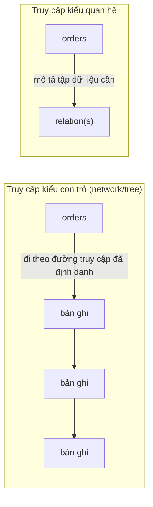
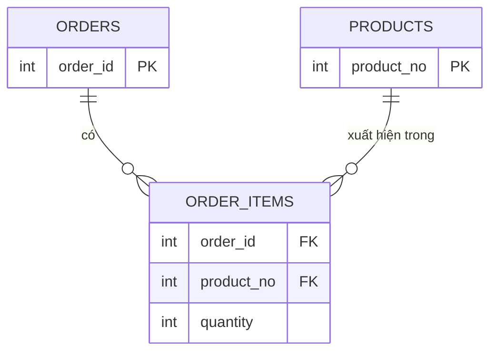
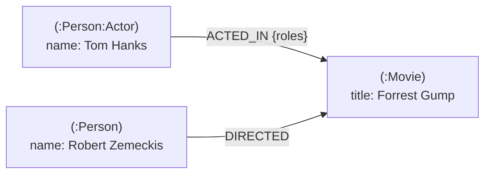
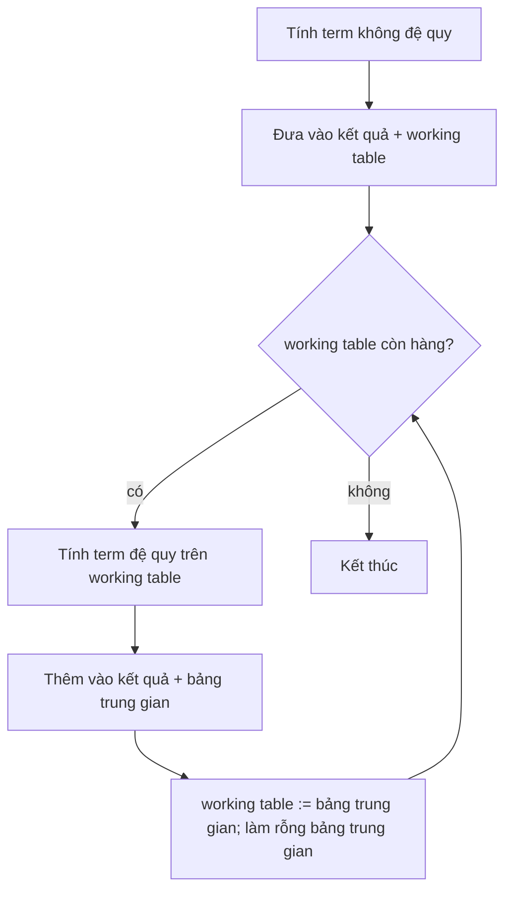

# P12 · Chương 02 — Mô hình dữ liệu và ngôn ngữ truy vấn

> Chương này lấy khung chủ đề từ *Designing Data-Intensive Applications* (DDIA): tên chương và tên mục theo mục lục do ETH Library lưu[^ddia-toc]. Sách không có bản đọc tự do nên chương không trích và không viết lại nội dung sách. Các khẳng định dựa trên bài báo gốc của Codd (1970), tài liệu **PostgreSQL 16**, tài liệu Cypher/Neo4j (của nhà cung cấp, nên phần so sánh hiệu năng chỉ là lời của họ), RFC 8259, hướng dẫn Hibernate ORM 5.1, tài liệu Serde, giáo trình mở BCcampus về dạng chuẩn, tutorial Apache Jena cho RDF/SPARQL, và docs.rs của `sqlx 0.8.6`, `tokio-postgres 0.7.13`, `serde_json 1.0.140`, `diesel 2.2.10` (số phiên bản là bản người soạn chọn để đọc docs, không khẳng định là bản mới nhất). Trang W3C về SPARQL/RDF trả HTTP 403 cho công cụ kiểm trích dẫn nên không dùng làm nguồn.
>
> Ví dụ chạy xuyên chương là `orders`, một service Rust nhận đơn hàng qua HTTP và lưu vào PostgreSQL (nhận xét của người soạn: đây là ví dụ giả định, không phải code trong repo).

## Bạn sẽ hiểu được gì

- **Q1.** Mô hình quan hệ của Codd (1970) giải quyết vấn đề gì, và "phụ thuộc dữ liệu" mà nó muốn loại bỏ là gì? → mục 1
- **Q2.** Document model và JSON/`jsonb` của PostgreSQL khác bảng quan hệ thế nào, được và mất gì? → mục 2
- **Q3.** Impedance mismatch là gì, và document model hay ORM giải quyết được đến đâu? → mục 3
- **Q4.** Quan hệ nhiều-nhiều, join và chuẩn hóa (normalization) liên quan với nhau ra sao; khi nào chấp nhận lặp dữ liệu? → mục 4
- **Q5.** Schema-on-write và schema-on-read khác nhau chỗ nào, và "không schema" có thật không? → mục 5
- **Q6.** Truy vấn khai báo (declarative, SQL) khác mệnh lệnh (imperative) ở đâu, và vì sao người ta gọi đó là lợi thế? → mục 6
- **Q7.** Graph model (property graph, Cypher) là gì, và recursive CTE của PostgreSQL làm được những gì của nó? → mục 7

## Kiến thức cần trước

- [Chương 01 — Reliability, scalability, maintainability](01-reliability-scalability-maintainability.md): khung "hệ thống dữ liệu" và các tiêu chí chọn công cụ. Chương này là câu hỏi đầu tiên của khung đó: *dữ liệu được biểu diễn thế nào*.
- Biết SQL cơ bản (`SELECT`, `JOIN`, `GROUP BY`) và JSON.

Chủ đề liền kề (chỉ nhắc, không giải thích lại): cách các engine lưu và tìm dữ liệu trên đĩa ở [Chương 03 — Storage engine](03-storage-engine.md); định dạng mã hóa và tiến hóa schema ở [Chương 04](04-encoding-va-tien-hoa-schema.md); giao dịch ở [Chương 07](07-transaction.md); OLTP so với phân tích ở [Chương 13](13-kien-truc-he-du-lieu.md).

## 1. Mô hình quan hệ của Codd: loại bỏ phụ thuộc dữ liệu (Q1)

> **Trả lời ngắn.** Năm 1970, Codd đề xuất cho người dùng nhìn dữ liệu chỉ qua các *relation* (tập hợp các bộ giá trị, tức bảng), không kèm thêm cấu trúc nào phục vụ máy[^codd-natural]. Mục tiêu là *data independence*: chương trình ứng dụng không phụ thuộc vào cách dữ liệu được tổ chức bên dưới[^codd-indep]. Để đạt được điều đó, ông nhắm vào ba loại phụ thuộc còn sót ở các hệ thống thời ấy: phụ thuộc thứ tự, phụ thuộc index và phụ thuộc đường truy cập[^codd-3dep].

**Giải thích.**

*Với service `orders`.* Mỗi đơn của `orders` có nhiều dòng hàng, và code phải đọc chúng ra để hiển thị. Giả sử cơ sở dữ liệu là kiểu cũ, nơi code lấy bản ghi của đơn rồi đi theo con trỏ `first_item`, sang `next_item`, cho tới hết. Cách này chạy tốt cho đến ngày DBA đổi cách móc nối các bản ghi để quét nhanh hơn. Dữ liệu vẫn còn nguyên nhưng `orders` hỏng (nhận xét của người soạn: kịch bản giả định). Codd muốn một thế giới khác, nơi `orders` chỉ nói *cần dữ liệu nào*, còn dữ liệu nằm ở đâu và móc nối ra sao là việc của hệ thống.

### 1.1 Ba loại phụ thuộc

Bài toán Codd xử lý là data independence: chương trình và thao tác ở terminal không bị ảnh hưởng khi dữ liệu thêm loại mới hay đổi cách biểu diễn, cùng một số kiểu bất nhất dữ liệu (*data inconsistency*)[^codd-scope]. Ông gọi tên ba loại phụ thuộc cần loại bỏ[^codd-3dep], và cả ba đều có bóng dáng trong kịch bản của `orders`:

- **Phụ thuộc thứ tự.** Nếu `orders` ngầm giả định các dòng hàng nằm đúng thứ tự file lưu, nó chạy sai khi thứ tự đó phải đổi. Codd nói đúng điều này về các chương trình dựa vào thứ tự lưu của file[^codd-order-fail].
- **Phụ thuộc index.** Index vốn chỉ là thành phần phục vụ hiệu năng[^codd-index]. Nhưng nếu chương trình phải gọi một chuỗi index theo tên thì khi chuỗi đó bị gỡ, chương trình chạy sai[^codd-chain].
- **Phụ thuộc đường truy cập.** Với dữ liệu dạng cây hay network, chương trình phải dùng các đường truy cập do người dùng định nghĩa. Hễ đường nào bị bỏ thì chương trình và thao tác terminal bị ảnh hưởng, bất kể dữ liệu lưu ra sao[^codd-accesspath]. Chuỗi `first_item → next_item` ở trên chính là một đường như vậy.

### 1.2 Mô hình quan hệ trả lời thế nào

Giải pháp của Codd là chỉ cho người dùng thấy relation. Một relation là tập các n-tuple (bộ n phần tử)[^codd-reldef]. Thứ tự hàng không có ý nghĩa và các hàng đều khác nhau[^codd-rel-props]. Nghĩa là dòng hàng của `orders` không còn "đứng sau" dòng nào, nên chương trình không còn thứ tự nào để dựa vào. Khi cần nối đơn với khách, ta dùng *khóa ngoại* (foreign key), một cột mà giá trị là giá trị khóa chính của relation khác[^codd-fk]. Tức là liên kết bằng giá trị chứ không bằng con trỏ lưu trữ (nhận xét của người soạn).

Còn thiếu cách để hỏi. Codd cho rằng mô hình này cho phép phát triển một "data sublanguage" phổ quát, dựa trên phép tính vị từ[^codd-sublang]. "Phổ quát" ở đây là khả năng *mô tả* tập dữ liệu cần lấy, không phải khả năng tính toán[^codd-descr]. Đây là mầm của truy vấn khai báo ở mục 6 (nhận xét của người soạn).



(Sơ đồ minh họa ý của Codd, do người soạn vẽ.)

<details><summary>Đi sâu: relation, khóa, domain; PostgreSQL ánh xạ ra sao</summary>

- Codd định nghĩa relation theo nghĩa toán học: với các tập S1…Sn, R là một relation nếu nó là tập các n-tuple, mỗi tuple lấy phần tử thứ j từ Sj[^codd-reldef]. Bài báo nói rõ dạng mảng chỉ là cách minh họa, không phải bản chất của mô hình[^codd-array]. (Nhận xét của người soạn: "hàng không có thứ tự, không trùng" khác với bảng SQL thực tế, vì bảng SQL cho phép hàng trùng nếu không có ràng buộc duy nhất. Chương này chỉ nêu điều bài báo nói, không bàn chi tiết lệch giữa lý thuyết và SQL.)
- PostgreSQL biểu diễn "ràng buộc để dữ liệu không thể sai" bằng constraint, vì kiểu dữ liệu một mình quá thô cho nhiều ứng dụng[^pg-constraints]. `CHECK` là loại tổng quát nhất[^pg-check]. Khóa ngoại bảo đảm giá trị cột phải khớp một hàng của bảng khác, tức giữ *referential integrity*[^pg-fk].

</details>

**Quay lại Q1:** Codd muốn `orders` nói *cần gì* và để hệ thống lo *lấy thế nào*; muốn vậy ông bỏ ba phụ thuộc khỏi giao diện người dùng: thứ tự, index và đường truy cập.

## 2. Document model và JSON: đổi gì, được gì, mất gì (Q2)

> **Trả lời ngắn.** Document model lưu một thực thể thành một giá trị JSON lồng nhau, thay vì rải ra nhiều bảng. PostgreSQL có hai kiểu JSON: `json` giữ nguyên văn bản, còn `jsonb` lưu dạng nhị phân đã phân rã, xử lý nhanh hơn và index được[^pg-jsonb-vs-json]. Docs khuyên đa số ứng dụng nên dùng `jsonb`[^pg-prefer-jsonb]. Docs cũng khuyên vẫn nên giữ cấu trúc tài liệu khá cố định[^pg-fixed].

**Giải thích.**

*Với service `orders`.* Một đơn gồm thông tin khách, địa chỉ giao và vài dòng hàng. Theo mô hình quan hệ, đơn rải ra nhiều bảng (`orders`, `order_items`, có thể cả bảng khách) và mỗi lần hiển thị phải ghép lại. Theo document model, cả đơn nằm trong một cột `payload` kiểu `jsonb`, đọc một hàng là có đủ đơn. Mục này xem cách làm đó đổi cho `orders` những gì: được gì, mất gì.

### 2.1 Hai kiểu JSON của PostgreSQL

JSON là định dạng trao đổi dữ liệu dạng văn bản, nhẹ, không gắn với ngôn ngữ nào[^rfc-json]. PostgreSQL có hai kiểu để lưu nó, khác nhau như sau:

| | `json` | `jsonb` |
|---|---|---|
| Lưu | bản sao nguyên văn của đầu vào[^pg-json-exact] | dạng nhị phân đã phân rã[^pg-jsonb-vs-json] |
| Khoảng trắng, thứ tự key, key trùng | giữ cả ba[^pg-json-exact] | không giữ khoảng trắng, không giữ thứ tự key, bỏ key trùng[^pg-jsonb-nopreserve] |
| Nhập / xử lý | nhập nhanh hơn nhưng phải parse lại mỗi lần xử lý[^pg-jsonb-vs-json] | nhập chậm hơn chút, xử lý nhanh hơn rõ[^pg-jsonb-vs-json] |
| Index | docs chỉ nêu việc hỗ trợ index như một lợi thế của `jsonb`[^pg-jsonb-vs-json] | có index GIN[^pg-gin] |

Với `orders`, cần tìm bên trong đơn thì `jsonb` là lựa chọn hợp lý, đúng như docs khuyên.

### 2.2 Hỏi bên trong tài liệu

`jsonb` cho `orders` ba công cụ. Thứ nhất là toán tử *containment* `@>`, kiểm tra một tài liệu có chứa tài liệu khác không[^pg-contain]. Thứ hai là subscripting kiểu mảng, để đọc và cập nhật phần tử[^pg-subscript]. Thứ ba là index GIN, để tìm key hoặc cặp key/value trong một lượng lớn tài liệu[^pg-gin].

Có một cạm bẫy đáng nhớ. Trong ví dụ của docs, index GIN trên cột `jdoc` *không* được dùng cho biểu thức `jdoc -> 'tags' ? 'qui'`, vì toán tử `?` tuy index được nhưng không áp trực tiếp lên cột đã index[^pg-expr-notused]. Docs nêu hai hướng xử lý. Một là dùng expression index[^pg-expr-index]. Hai là viết lại truy vấn bằng containment `@>`[^pg-contain-alt].

```sql
-- Minh họa (dựa theo ví dụ của docs PostgreSQL 16; chưa chạy trong chương này)
CREATE TABLE api (jdoc jsonb);
CREATE INDEX idxgin ON api USING GIN (jdoc);

-- Dùng được index: containment áp lên chính cột đã index
SELECT jdoc->'guid', jdoc->'name'
FROM api
WHERE jdoc @> '{"company": "Magnafone"}';
```

### 2.3 Được gì, mất gì

Docs nói biểu diễn bằng JSON có thể linh hoạt hơn nhiều so với mô hình quan hệ truyền thống, hấp dẫn khi yêu cầu còn thay đổi, và hai cách có thể cùng tồn tại trong một ứng dụng[^pg-flex]. Với `orders`, đơn là thực thể tự chứa nên một lần đọc một hàng là đủ (suy luận của người soạn).

Cái giá gồm ba điều, đều từ docs:

1. **Khóa cả hàng.** Mọi lần update khóa mức hàng (row-level lock) trên *toàn* hàng[^pg-lock]. Nếu đơn là một cục JSON lớn mà nhiều giao dịch cùng sửa, chúng phải chờ nhau (suy luận của người soạn). Vì vậy docs khuyên mỗi tài liệu nên là một "datum nguyên tử", không chia nhỏ hợp lý được thành các phần sửa độc lập[^pg-atomic].
2. **Cấu trúc không được ép.** Cấu trúc JSON thường không bị enforced, dù vẫn có thể ép một số quy tắc nghiệp vụ theo cách khai báo[^pg-fixed]. Đây là chủ đề schema-on-read ở mục 5.
3. **Số.** `jsonb` từ chối số ngoài khoảng của kiểu `numeric` trong PostgreSQL, còn `json` thì không[^pg-numeric]. Docs còn lưu ý rằng nhiều hệ khác biểu diễn số JSON bằng double IEEE 754, nên khi dùng JSON để trao đổi dữ liệu với chúng, nguy cơ mất độ chính xác so với dữ liệu gốc trong PostgreSQL là điều cần cân nhắc[^pg-numeric-loss]. (Nhận xét của người soạn: ID 64-bit và số tiền của `orders` là hai chỗ cần để ý khi gửi JSON tới client như trình duyệt. Mặt mã hóa của JSON xem [Chương 04](04-encoding-va-tien-hoa-schema.md).)

<details><summary>Đi sâu: key trùng, toán tử GIN mặc định, tài liệu lớn nằm ở đâu trong PostgreSQL</summary>

- Cả `json` lẫn `jsonb` đều bắt giá trị lưu vào phải là JSON hợp lệ, một ưu điểm so với lưu thành `text`[^pg-json-valid].
- Về key trùng: tên trong một object *nên* (SHOULD) duy nhất[^rfc-unique], tức đặc tả không cấm trùng. Khi tên trùng, hành vi của phần mềm nhận là không đoán trước được[^rfc-unpredictable]. `json` và `jsonb` của PostgreSQL xử lý key trùng khác nhau (xem bảng ở trên). Cạm bẫy mã hóa JSON nói chung ở [Chương 04](04-encoding-va-tien-hoa-schema.md).
- Lớp toán tử GIN mặc định cho `jsonb` hỗ trợ các toán tử tồn tại key `?`, `?|`, `?&`, containment `@>` và các toán tử khớp jsonpath `@?`, `@@`[^pg-gin-default].
- PostgreSQL dùng kích thước trang cố định (thường 8 kB) và không cho tuple nằm trên nhiều trang[^pg-toast]. Vì vậy giá trị trường lớn được nén và/hoặc cắt thành nhiều hàng vật lý bằng kỹ thuật TOAST.
- Kích thước logic của một giá trị thuộc kiểu TOAST-able bị giới hạn ở 1 GB[^pg-toast-1gb]. (Suy luận của người soạn: `jsonb` cũng thuộc diện này; docs trang JSON không nhắc, nên đừng thiết kế gần ngưỡng đó. Về vận hành, tài liệu cỡ MB đã đủ để mỗi lần update một field nhỏ thành việc ghi lại cả tài liệu, nên lời khuyên "datum nguyên tử" ở trên càng đáng giữ.)
- TOAST và page là chi tiết của engine; cách engine tổ chức trang và index ở [Chương 03](03-storage-engine.md).

</details>

**Quay lại Q2:** document model gói cả đơn vào một giá trị lồng nhau; `jsonb` cho phép index và truy vấn bên trong, đổi lại cấu trúc không được ép, update khóa cả hàng và số JSON có nguy cơ mất chính xác.

## 3. Impedance mismatch: lệch pha giữa object và bảng (Q3)

> **Trả lời ngắn.** Code ứng dụng thường nghĩ bằng đối tượng lồng nhau, còn cơ sở dữ liệu quan hệ lưu bằng bảng phẳng, và việc dịch qua lại tốn công (nhận xét của người soạn). Hướng dẫn của Hibernate (một ORM cho Java) cũng nhận như vậy: làm phần mềm hướng đối tượng trên dữ liệu quan hệ có thể rườm rà và tốn tài nguyên, chi phí phát triển cao hơn đáng kể vì hai bên biểu diễn dữ liệu theo hai mô hình lệch nhau (*paradigm mismatch*)[^hib-mismatch]. "Impedance mismatch" là cách gọi quen thuộc của hiện tượng này, còn nguồn trích dùng chữ "paradigm mismatch" (nhận xét của người soạn). Document model giảm phần lệch cho dữ liệu dạng cây nhưng không xóa nó, và ORM có thể kéo theo loại lỗi riêng như N+1, mà Diesel nêu ở dưới[^diesel-n1].

**Giải thích.**

*Với service `orders`.* Trong code Rust, một đơn là struct `Order { id, customer, items: Vec<Item>, coupon: Option<String> }`. Để lưu vào quan hệ, bạn tách nó thành `orders` và `order_items` (và bảng khách). Để đọc lại, bạn gom các hàng về đúng struct. Mỗi chiều đều là code phải viết và test; đó là chi phí mà mục này nói tới (nhận xét của người soạn).

### 3.1 Ba chỗ lệch

Ba chỗ lệch cụ thể dưới đây là nhận xét của người soạn, minh họa bằng nguồn đi kèm.

1. **Lồng nhau so với phẳng.** `items: Vec<Item>` là dữ liệu lồng, và Codd đã gặp chuyện này từ 1970. Relation của ông có thể có domain *không đơn* (nonsimple), tức phần tử là một relation khác, ví dụ lịch sử lương của nhân viên[^codd-nonsimple]. Thuật ngữ "repeating group" của thời đó tương đương gần đúng với nonsimple domain[^codd-repgroup]. Ông đề xuất loại chúng bằng *normalization* (mục 4). Nói cách khác, mô hình quan hệ chủ động ép dữ liệu lồng thành bảng phẳng, còn document model đi ngược lại và cho phép lồng.
2. **NULL so với `Option`.** `coupon` có thể không có, nên cột tương ứng cho phép NULL và field Rust thường là `Option<T>`. Ở phía tham số truy vấn, docs của `sqlx` ghi rằng với kiểu mong đợi `T`, cả `T` lẫn `Option<T>` đều được phép khi bind, và `Option::None` được bind thành NULL[^sqlx-nullable].
3. **Quan hệ so với `Vec`.** Trong code, `order.items` là một `Vec`; trong CSDL, đó là một truy vấn qua khóa ngoại. Diesel nhận xét rằng thiết kế "has many" của nhiều ORM khác dẫn tới nhiều vấn đề, gồm lỗi N+1 query và lỗi lúc chạy khi truy cập một association không tồn tại[^diesel-n1]. Vì vậy Diesel tách dữ liệu và association thành hai thứ riêng[^diesel-separate].

### 3.2 Document model giúp được đến đâu

Nếu dữ liệu có hình cây tự chứa (đơn hàng, giỏ hàng, cấu hình), `orders` có thể lưu nguyên cây vào một cột `jsonb` và bỏ bước tách/gom. Việc chuyển giữa struct và JSON đã có `serde` lo (xem mục Liên hệ với Rust). Nhưng cách này chưa phải lời giải cho mọi thứ:

- Khi dữ liệu có tham chiếu chéo (nhiều đơn cùng nhắc tới một sản phẩm), một cây không còn đủ. Ta phải tham chiếu hoặc lặp dữ liệu, và đó là chuyện của mục 4.
- Lược đồ chuyển từ cơ sở dữ liệu sang *mã đọc*: mọi nơi đọc phải hiểu cả hình dạng cũ lẫn mới (mục 5).

<details><summary>Đi sâu: ORM không phải lỗi, mismatch cũng không phải của riêng quan hệ</summary>

- Hibernate mô tả ORM là kỹ thuật ánh xạ dữ liệu giữa biểu diễn mô hình đối tượng và biểu diễn mô hình quan hệ, cho môi trường Java[^hib-mismatch]. Không phải hệ sinh thái nào cũng làm giống vậy. Rust có `sqlx` (ánh xạ hàng sang struct qua `FromRow`, xem mục Liên hệ với Rust) và Diesel. Diesel tự mô tả là "ORM and query builder"[^diesel-desc] nhưng khác nhiều ORM ở chỗ không có khái niệm `has many`: association luôn đi từ con tới cha[^diesel-childparent].
- Mismatch còn xuất hiện ở các tầng khác: mỗi lần đổi biểu diễn (struct ↔ hàng ↔ JSON ↔ protobuf) là một điểm có thể sai. Chương 04 nói thêm về tầng mã hóa.

</details>

**Quay lại Q3:** mismatch là chi phí dịch giữa `Order` lồng nhau trong code và các bảng phẳng trong CSDL; JSON/document giảm chi phí đó cho dữ liệu dạng cây tự chứa nhưng không xóa nó khi có tham chiếu chéo.

## 4. Nhiều-nhiều, join và normalization (Q4)

> **Trả lời ngắn.** Khi hai loại thực thể liên hệ nhiều-nhiều (đơn hàng ↔ sản phẩm), mô hình quan hệ dùng một bảng nối có hai khóa ngoại[^pg-m2m]. Khi một câu hỏi cần dữ liệu nằm ở nhiều bảng, ta ghép chúng bằng *join*[^pg-join-def]. *Normalization* theo nghĩa gốc của Codd là cách loại bỏ dữ liệu lồng bằng cách tách thành các relation phẳng, mỗi relation mang khóa của cha[^codd-norm]. Ngược lại, lặp dữ liệu có chủ ý (denormalize) là đổi tốn chỗ và công cập nhật lấy tốc độ đọc[^codd-redundancy]. (Codd bàn về dư thừa trong biểu diễn lưu trữ và chỉ nói *có thể* giảm thời gian truy vấn; gọi đó là denormalize là diễn giải của người soạn.)

**Giải thích.**

*Với service `orders`.* Một đơn có nhiều sản phẩm, và một sản phẩm nằm trong nhiều đơn. `orders` phải biểu diễn quan hệ nhiều-nhiều đó, đọc nó ra thành trang chi tiết đơn, và quyết định chỗ nào được phép lặp dữ liệu. Đúng bài toán này là ví dụ chính thức trong docs PostgreSQL.

### 4.1 Bảng nối

Ví dụ của docs có ba bảng `products`, `orders` và `order_items`. `order_items` có hai khóa ngoại và khóa chính ghép; docs nói một bảng có thể có nhiều khóa ngoại để biểu diễn quan hệ nhiều-nhiều[^pg-m2m]. Khóa ngoại còn phải trả lời câu hỏi "khi xóa thì sao". Ví dụ cho `order_items` chọn hai cách. Không cho xóa sản phẩm còn được tham chiếu (`ON DELETE RESTRICT`)[^pg-restrict]. Còn khi xóa đơn thì xóa luôn các dòng của nó (`ON DELETE CASCADE`)[^pg-cascade]. Docs cũng nhắc rằng khai báo khóa ngoại *không* tự tạo index trên cột tham chiếu, trong khi xóa hay sửa hàng bị tham chiếu phải quét bảng tham chiếu, nên thường nên tự index các cột đó[^pg-fk-index].

```sql
-- Dựa theo ví dụ trong docs PostgreSQL 16, mục 5.4.5 (minh họa, chưa chạy)
CREATE TABLE products (product_no integer PRIMARY KEY, name text, price numeric);
CREATE TABLE orders   (order_id integer PRIMARY KEY, shipping_address text);
CREATE TABLE order_items (
    product_no integer REFERENCES products ON DELETE RESTRICT,
    order_id   integer REFERENCES orders   ON DELETE CASCADE,
    quantity   integer,
    PRIMARY KEY (product_no, order_id)
);
```



(Sơ đồ ER do người soạn vẽ từ ví dụ SQL ở trên.)

### 4.2 Join: ghép lại lúc đọc

Muốn dựng trang chi tiết một đơn, `orders` phải ghép ba bảng trên. Truy vấn đụng nhiều bảng (hoặc nhiều "bản" của cùng một bảng) gọi là join query[^pg-join-def]. Join là phép *khai báo*: người viết chỉ nói "ghép theo điều kiện này", còn chọn thuật toán là việc của planner[^pg-planner-ways]. PostgreSQL có ba chiến lược join:

- *Nested loop*: quét bảng phải một lần cho mỗi hàng của bảng trái[^pg-nl].
- *Merge join*: sắp xếp hai bên theo khóa join rồi quét song song[^pg-merge].
- *Hash join*: nạp bảng phải vào hash table rồi dò từng hàng của bảng trái[^pg-hash].

Với join nhiều bảng, bài toán còn rộng hơn một phép tính cố định: planner xét các thứ tự join khác nhau để tìm phương án rẻ nhất[^pg-order].

### 4.3 Chuẩn hóa và dư thừa

Dữ liệu khách là chỗ dễ thấy nhất. Nếu mỗi đơn chép lại đủ tên và địa chỉ khách, thì khi khách đổi địa chỉ, `orders` phải sửa mọi đơn của người đó. Chuẩn hóa nghĩa là mỗi sự thật nằm ở đúng một chỗ, nơi khác chỉ trỏ tới (nhận xét của người soạn).

Codd mô tả việc này cho dữ liệu lồng. Ông gọi cách loại bỏ dữ liệu lồng bằng một thủ tục rất đơn giản là normalization[^codd-norm]. Ví dụ của ông là `employee(man#, name, birthdate, jobhistory, children)`, trong đó `jobhistory` và `children` lồng bên trong. Sau normalization, nó thành `employee'`, `jobhistory'(man#, jobdate, title)`, `salaryhistory'(man#, jobdate, salarydate, salary)` và `children'(man#, childname, birthyear)`[^codd-fig3]. Cùng kiểu đó, `Order` có `items` lồng sẽ thành `orders` và `order_items` mang `order_id` của cha (nhận xét của người soạn). Kết quả là mọi relation đều có domain đơn, lưu được bằng mảng hai chiều đồng nhất[^codd-simple].

Chiều ngược lại cũng có lý do của nó. Codd gọi một tập relation là *strongly redundant* nếu có relation mà một phép chiếu của nó tính được từ các phép chiếu của relation khác[^codd-strong]. Khi dư thừa kiểu đó được phản ánh xuống lưu trữ, nói chung nó tốn thêm chỗ và thời gian cập nhật, đổi lại có thể giảm thời gian truy vấn và tải CPU ở một số truy vấn[^codd-redundancy]. Chẳng hạn `orders` chép sẵn tên sản phẩm vào `order_items` để trang chi tiết khỏi phải join: đọc nhanh hơn, nhưng mỗi chỗ lặp là một chỗ có thể bị sửa lệch nếu hệ thống không biết hai chỗ phải khớp nhau (suy luận của người soạn).

### 4.4 Chọn thế nào

Đây là nhận xét của người soạn, không phải quy tắc chung:

- **Document hợp** khi dữ liệu tự chứa, đọc theo từng cụm và ít tham chiếu chéo. Ảnh chụp một đơn lúc đặt là một ví dụ.
- **Normalize hợp** khi cùng một thực thể được nhiều nơi tham chiếu và cần sửa ở một chỗ. Danh mục sản phẩm là một ví dụ.
- **Join ở phía ứng dụng** là lựa chọn thứ ba, khi CSDL không join. Diesel ví dụ cách nạp dữ liệu liên quan bằng nhiều truy vấn, mỗi bảng một truy vấn[^diesel-multi]. Diesel còn nhận xét rằng với đa số tập dữ liệu, một join duy nhất truyền quá nhiều dữ liệu lặp nên có thể đắt hơn một vòng round-trip thêm[^diesel-join-cost]. Đó là nhận xét của dự án Diesel chứ không phải quy luật chung; kết quả phụ thuộc kích thước và hình dạng dữ liệu.

<details><summary>Đi sâu: thủ tục normalization, tên dạng chuẩn, chi phí join và lời quảng cáo của graph database</summary>

- Thủ tục của Codd cụ thể như sau: bắt đầu từ relation gốc của cây, lấy khóa chính của nó chèn vào các relation con trực tiếp, và khóa chính của mỗi relation con là khóa cũ cộng với khóa copy từ cha. Sau đó gạch bỏ các domain không đơn khỏi relation cha, bỏ nút gốc, rồi lặp lại cho từng cây con còn lại[^codd-normproc].
- Về tên gọi sau này: một giáo trình mở liệt kê các dạng chuẩn 1NF, 2NF, 3NF và BCNF[^bc-nf]. Trong đó 1NF chỉ cho phép giá trị đơn ở mỗi giao điểm hàng–cột, tức không có repeating group[^bc-1nf]. (Suy luận của người soạn: bước normalization của Codd 1970 tương ứng với 1NF của giáo trình đó; chương này không đi vào 2NF/3NF/BCNF.)
- Codd cũng định nghĩa *natural join* của hai quan hệ nhị phân R(a,b) và S(b,c) là tập các bộ (a,b,c) mà R(a,b) và S(b,c) cùng đúng[^codd-join].
- Docs Neo4j (tài liệu của nhà cung cấp graph database) nói join được tính lúc truy vấn bằng cách khớp khóa chính/khóa ngoại của mọi hàng trong các bảng liên quan; các phép này "compute-heavy and memory-intensive" và "have an exponential cost". Trang đó cũng nói quan hệ nhiều-nhiều cần một bảng nối chứa khóa của cả hai bảng, làm tăng thêm chi phí join[^neo-join-table]. Phần "chi phí hàm mũ" là khẳng định của nhà cung cấp: đoạn trích không nêu chi phí tăng theo biến nào (số bảng hay kích thước dữ liệu) và chương này không có nguồn trung lập để xác nhận. Docs PostgreSQL cho thấy planner có hash join và merge join ngoài nested loop (mục 4.2). Nhận xét của người soạn: chi phí thực phụ thuộc kế hoạch và dữ liệu, nên đo bằng `EXPLAIN` trên dữ liệu của bạn.
- `EXPLAIN` hiển thị kế hoạch mà planner chọn. Docs PostgreSQL nhấn mạnh chọn đúng kế hoạch là tối quan trọng cho hiệu năng, vì vậy hệ thống có một planner phức tạp[^pg-explain].
- Khi số bảng join vượt ngưỡng `geqo_threshold`, PostgreSQL tìm thứ tự join bằng phương pháp heuristic thay vì gần-vét-cạn[^pg-geqo].
- Khi dữ liệu chia qua nhiều máy, join và giao dịch xuyên partition thành bài toán phân tán: xem [Chương 06 — Partitioning](06-partitioning.md). Giao dịch cập nhật nhiều hàng/bảng là chuyện của [Chương 07](07-transaction.md).

</details>

**Quay lại Q4:** nhiều-nhiều biểu diễn bằng bảng nối với hai khóa ngoại, join ghép lại lúc đọc, normalization giữ mỗi sự thật ở một chỗ; denormalize là đổi chỗ và công cập nhật lấy tốc độ đọc, nên chọn có chủ ý.

## 5. Schema-on-write và schema-on-read (Q5)

> **Trả lời ngắn.** (Định nghĩa làm việc của người soạn; hai thuật ngữ này không đến từ nguồn trích dẫn trong chương.) *Schema-on-write* là cơ sở dữ liệu kiểm tra và từ chối dữ liệu sai hình dạng ngay lúc ghi (kiểu, `NOT NULL`, `CHECK`, khóa ngoại). *Schema-on-read* là hệ thống chấp nhận mọi hình dạng lúc ghi, còn mã đọc tự diễn giải lúc đọc. Không có cách nào "không schema": schema chỉ chuyển từ cơ sở dữ liệu sang mã của bạn (nhận xét của người soạn).

**Giải thích.**

*Với service `orders`.* Giả sử bộ phận marketing thêm mã giảm giá `coupon_code`, và từ nay mỗi đơn mới có thể mang mã này. Có hai cách thêm. Cách một: thêm cột `coupon_code` vào bảng, và cơ sở dữ liệu biết hình dạng mới; đơn cũ có NULL ở cột đó. Cách hai: thêm key `coupon_code` vào JSON của đơn, cơ sở dữ liệu không biết gì về nó; đơn cũ đơn giản là không có key, và mọi đoạn code đọc đơn phải tự xử lý trường hợp đó (nhận xét của người soạn). Hai cách này là hai đầu của chuyện schema nằm ở đâu.

### 5.1 Schema-on-write trong PostgreSQL

Kiểu dữ liệu giới hạn loại dữ liệu lưu được, nhưng với nhiều ứng dụng thế là quá thô, nên cần thêm constraint[^pg-constraints]. `CHECK` là loại tổng quát nhất[^pg-check]. Khóa ngoại bảo đảm tính toàn vẹn tham chiếu[^pg-fk].

Giá phải trả là đổi schema có chi phí. Với bảng `orders` đã có nhiều hàng, thêm cột bằng `ADD COLUMN` với giá trị mặc định không-volatile chỉ lưu giá trị đó vào metadata của bảng[^pg-addcol]. Còn thêm cột với default volatile hay đổi kiểu cột thì nói chung phải ghi lại toàn bộ bảng cùng index (đổi kiểu có ngoại lệ, xem mục Đi sâu)[^pg-rewrite]. `SET NOT NULL` thường phải quét toàn bảng để kiểm tra[^pg-setnotnull].

### 5.2 Schema-on-read với JSON

Cột `jsonb` chấp nhận mọi JSON hợp lệ. Docs nói cấu trúc thường không bị ép buộc, nhưng vẫn khuyên giữ cấu trúc khá cố định để các truy vấn tổng hợp dễ viết[^pg-fixed]. Neo4j cũng tự mô tả là "schema-flexible". Docs của họ nói có thể và nên ép schema từng phần bằng index và constraint[^neo-partial]. Dù vậy, người dùng không bắt buộc dùng một schema cố định và có thể thêm thuộc tính, quan hệ mới khi đồ thị tiến hóa[^neo-flex].

### 5.3 Khi schema nằm ở mã Rust

Trong Rust, đọc JSON "lỏng" nghĩa là chọn một trong hai: giữ nguyên `serde_json::Value` (không kiểu), hay giải mã vào struct có kiểu. `serde_json` nêu ba cách làm việc với JSON. Cách đầu là văn bản thô[^sj-text]. Hai cách còn lại là biểu diễn không kiểu hoặc kiểu lỏng, và cấu trúc dữ liệu Rust có kiểu cho trường hợp bạn kỳ vọng dữ liệu đa phần khớp một cấu trúc[^sj-three].

Với struct có kiểu, `serde` có ba thuộc tính giúp bộ đọc chịu được nhiều "đời" dữ liệu (nhận xét của người soạn). Mặc định `serde` bỏ qua field lạ khi giải mã định dạng tự mô tả như JSON, trừ khi bạn dùng `#[serde(deny_unknown_fields)]`[^serde-deny]. Field thiếu có thể được điền bằng `Default` nhờ `#[serde(default)]`[^serde-default]. Và `#[serde(alias = "…")]` cho phép đọc một field từ nhiều tên[^serde-alias]. Đây chính là schema-on-read thực hiện bằng code.

```rust
// Minh họa (chưa biên dịch trong chương này): bộ đọc đơn hàng chịu được hai đời dữ liệu.
use serde::Deserialize;

#[derive(Deserialize)]
struct OrderPayload {
    customer: String,
    // Đời cũ lưu "tel", đời mới lưu "phone": đọc được cả hai.
    #[serde(alias = "tel")]
    phone: Option<String>,
    // Đời cũ không có field này: dùng Default (None).
    #[serde(default)]
    coupon_code: Option<String>,
}
```

### 5.4 Chọn cái nào

Đây là nhận xét của người soạn. Schema-on-write hợp khi nhiều dịch vụ cùng ghi vào một chỗ và cần một nguồn sự thật về hình dạng dữ liệu. Schema-on-read hợp khi dữ liệu đến từ nguồn ngoài hoặc hình dạng thay đổi nhanh, và bạn chấp nhận gánh việc xử lý nhiều phiên bản trong mã. Cách mã hóa và tương thích tiến/lùi giữa các phiên bản (Avro, Protobuf…) được bàn ở [Chương 04](04-encoding-va-tien-hoa-schema.md).

<details><summary>Đi sâu: chi phí ALTER TABLE và ràng buộc trên jsonb</summary>

- Docs `ALTER TABLE` bổ sung rằng nếu đổi kiểu cột mà `USING` không đổi nội dung và kiểu cũ tương thích nhị phân với kiểu mới, thì không cần ghi lại bảng. Index vẫn phải dựng lại, trừ khi hệ thống kiểm chứng được index mới tương đương logic với index cũ[^pg-rewrite]. Đây là chi tiết cần đọc trước khi migrate bảng lớn (nhận xét của người soạn).
- Nếu có `CHECK` đã được xác thực chứng minh không có NULL, `SET NOT NULL` bỏ qua bước quét bảng[^pg-setnotnull].
- Có thể ép một số quy tắc lên `jsonb` bằng `CHECK`: docs nói ép quy tắc nghiệp vụ theo cách khai báo là có thể[^pg-fixed]. Chương này không trình bày cú pháp cụ thể vì docs trang JSON không đưa ví dụ.

</details>

**Quay lại Q5:** schema-on-write đẩy kiểm tra về phía ghi (đổi lại, đổi schema tốn chi phí), schema-on-read đẩy về phía đọc (đổi lại, tốn code xử lý nhiều đời dữ liệu); schema luôn tồn tại, chỉ là nằm ở CSDL hay ở mã.

## 6. Truy vấn khai báo và mệnh lệnh (Q6)

> **Trả lời ngắn.** Truy vấn *khai báo* mô tả *kết quả cần có* và để hệ thống tự chọn cách tính. Truy vấn *mệnh lệnh* ghi từng bước *làm thế nào* (hai định nghĩa này là cách diễn đạt của người soạn). Docs Neo4j nói Cypher, giống SQL, cho người dùng tập trung vào việc lấy *gì* thay vì lấy *thế nào*[^cy-what]. Ở PostgreSQL, một truy vấn SQL có thể thực thi theo rất nhiều cách cho cùng một kết quả, và planner chọn kế hoạch được ước lượng là nhanh nhất[^pg-planner-ways]. Cypher cũng tự mô tả là khai báo[^cy-declarative]. Lợi ích chính, tức cùng một truy vấn vẫn chạy khi cách lưu và index đổi, là nhận xét của người soạn, nối từ mục tiêu data independence của Codd (mục 1).

**Giải thích.**

*Với service `orders`.* Giả sử `orders` cần trang "50 đơn mới nhất kèm tên khách". Có hai cách viết. Cách khai báo là một câu `SELECT` có `JOIN` giữa `orders` và bảng khách: bạn chỉ nói cần kết quả gì. Cách mệnh lệnh là lấy 50 đơn trước, rồi viết vòng lặp gọi thêm một truy vấn cho từng đơn để lấy khách. Cách thứ hai chính là lỗi N+1 quen thuộc. Mục này xem vì sao cách thứ nhất thường tốt hơn, và cái giá của nó.

### 6.1 Từ Codd tới SQL

Cái Codd gọi là tính phổ quát của ngôn ngữ nằm ở khả năng mô tả (mục 1) chính là mầm của ý này (nhận xét của người soạn)[^codd-descr]. Codd cũng mô tả cái giá của kiểu mệnh lệnh theo đường truy cập. Chương trình đi theo access path hỏng khi cấu trúc đổi[^codd-accesspath]. Chương trình gọi chuỗi index theo tên hỏng khi chuỗi bị gỡ[^codd-chain]. Việc nối hai điểm đó với "kiểu mệnh lệnh" là nhận xét của người soạn.

### 6.2 Một truy vấn, nhiều kế hoạch

Docs PostgreSQL nói rõ một truy vấn có thể được thực thi theo nhiều cách khác nhau mà cho cùng tập kết quả. Nếu khả thi về mặt tính toán, planner xét các kế hoạch đó và chọn kế hoạch được ước lượng là chạy nhanh nhất[^pg-planner-ways]. Kế hoạch gồm quét tuần tự hoặc quét index trên bảng gốc, cộng với các nút join (nested loop, merge, hash) khi cần[^pg-plan-tree]. Người dùng xem kế hoạch bằng `EXPLAIN`[^pg-explain].

Hệ quả thực tế (nhận xét của người soạn): thêm index hay đổi thống kê có thể làm cùng câu `SELECT` của `orders` chạy theo kế hoạch khác mà không phải sửa code. Nếu kế hoạch được chọn tệ, công cụ để can thiệp là index, thống kê và viết lại truy vấn, chứ không phải sửa vòng lặp.

### 6.3 Mệnh lệnh nằm ở đâu trong backend

Ở mọi nơi bạn tự viết vòng lặp để ghép dữ liệu (nhận xét của người soạn). Trong N+1, bạn tự làm nested loop ở tầng ứng dụng và mất cơ hội để planner chọn hash join (suy luận của người soạn). Diesel đề cập đúng nguy cơ này ở các ORM có `has many`[^diesel-n1].

### 6.4 Khai báo không miễn phí

Planner có thể chọn sai khi thống kê lệch (nhận xét của người soạn). Docs PostgreSQL nhấn mạnh chọn đúng kế hoạch rất quan trọng cho hiệu năng, nên hệ thống mới có một planner phức tạp[^pg-explain]. Cái bạn đổi lấy là bớt phải quản lý đường truy cập, nhưng thêm việc đọc kế hoạch. Cypher cũng đi theo hướng khai báo: nó mô tả kết quả bằng pattern, và docs nói nó cho người dùng tập trung vào lấy *gì* thay vì *thế nào*[^cy-what]. Chi tiết ở mục 7.

<details><summary>Đi sâu: thứ tự đánh giá và "khai báo" ở tầng khác</summary>

- Truy vấn đệ quy trong PostgreSQL *viết* đệ quy nhưng *chạy* bằng vòng lặp: docs ghi chú các truy vấn như vậy được đánh giá lặp bên trong[^pg-rec-iter]. Docs cũng cảnh báo thứ tự duyệt hàng là phụ thuộc cài đặt; muốn có thứ tự phải tính cột sắp xếp rồi `ORDER BY`[^pg-search-order]. Theo nhận xét của người soạn, đó là một minh họa rằng với ngôn ngữ khai báo, thứ tự thực thi không phải điều bạn được hứa.
- Không phải mọi cách xử lý dữ liệu đều khai báo (nhận xét của người soạn). Chương 10 trích Blanas et al. ghi nhận nhóm phê bình MapReduce chỉ ra việc nó thiếu ngôn ngữ truy vấn khai báo, xem [Chương 10](10-batch-processing.md). Xử lý luồng ở [Chương 11](11-stream-processing.md).
- Ở Rust, builder như Diesel mô hình hóa SQL thành các method trùng tên mệnh đề (`filter` ứng với `WHERE`)[^diesel-builder]. Tức là ngôn ngữ truy vấn được nhúng vào hệ kiểu của Rust (nhận xét của người soạn).

</details>

**Quay lại Q6:** truy vấn khai báo nói cần gì và để planner chọn cách; bạn đổi quyền kiểm soát từng bước lấy khả năng thay index, thống kê, thuật toán mà không sửa truy vấn.

## 7. Graph model, Cypher và recursive CTE (Q7)

> **Trả lời ngắn.** Graph model biểu diễn dữ liệu là *đỉnh* và *cạnh*. Trong property graph của Neo4j, đỉnh có nhãn và thuộc tính; cạnh có hướng, có đúng một kiểu và có thuộc tính[^neo-pg]. Cypher truy vấn bằng pattern. Với PostgreSQL, truy vấn đệ quy `WITH RECURSIVE` cho phép duyệt cấu trúc cây hoặc đồ thị ngay trong SQL thuần[^pg-rec-use].

**Giải thích.**

*Với service `orders`.* Hai bài toán của `orders` có chung một đặc điểm. Thứ nhất, sản phẩm nằm trong cây danh mục (Điện tử → Điện thoại → Phụ kiện…), và trang danh mục phải liệt kê mọi sản phẩm thuộc nhánh đó, kể cả danh mục con. Thứ hai, "khách này mua cùng sản phẩm với những khách nào" là quan hệ đi qua nhiều bước. Số bước nhảy giữa hai thực thể *không biết trước*, trong khi join cố định buộc bạn viết sẵn số join. Đồ thị cho phép hỏi "đi bao xa cũng được" (nhận xét của người soạn).

### 7.1 Property graph

Neo4j dùng property graph database model. *Node* biểu diễn thực thể và có thể có không hoặc nhiều nhãn (label) phân loại. *Relationship* nối một node nguồn tới một node đích, luôn có một hướng và đúng một kiểu. Cả node lẫn relationship đều có thể có property dạng key-value[^neo-pg]. Ví dụ của docs tạo một diễn viên, một phim và hai quan hệ `ACTED_IN`, `DIRECTED` chỉ bằng một lệnh `CREATE`[^neo-create].



(Sơ đồ dựa theo ví dụ `CREATE` của docs Neo4j[^neo-create]; người soạn vẽ lại và lược bớt thuộc tính.)

### 7.2 Cypher

Cypher là ngôn ngữ truy vấn khai báo của Neo4j[^cy-declarative]. Nó được tạo năm 2011 như một ngôn ngữ "tương đương SQL" cho graph database[^cy-2011]. Cú pháp "vẽ" pattern: node trong ngoặc tròn, quan hệ là mũi tên kèm ngoặc vuông[^cy-syntax]. Vì vậy viết truy vấn giống như vẽ một đường đi xuyên qua dữ liệu[^cy-ascii]. Khác SQL, Cypher kết thúc bằng `RETURN` thay vì bắt đầu bằng `SELECT`[^cy-order].

```cypher
// Minh họa của người soạn (chưa chạy): các sản phẩm khách "An" đã đặt
MATCH (c:Customer {name: 'An'})-[:PLACED]->(:Order)-[:CONTAINS]->(p:Product)
RETURN p.name
```

Đường đi có độ dài biến thiên là chỗ đồ thị mạnh. Trước Neo4j 5.9, cách duy nhất trong Cypher để khớp đường đi dài không biết trước là *variable-length relationship*; từ 5.9 có thêm *quantified path pattern* và quantified relationship, ví dụ `-[:NEXT]->{1,10}`[^cy-qpp]. Docs cũng ghi một quy tắc dễ bỏ sót: trong một pattern, mỗi relationship chỉ được khớp một lần[^cy-unique]. Suy ra vòng lặp không làm duyệt lặp vô hạn trong một pattern (suy luận của người soạn từ quy tắc đó).

### 7.3 Recursive CTE: duyệt đồ thị trong SQL

Với PostgreSQL, bài toán cây danh mục của `orders` giải được bằng `WITH RECURSIVE` (nhận xét của người soạn). Nhờ từ khóa `RECURSIVE`, một truy vấn `WITH` có thể tham chiếu chính kết quả của nó[^pg-rec-def]. Dạng tổng quát luôn là một *non-recursive term*, rồi `UNION` (hoặc `UNION ALL`), rồi một *recursive term*, trong đó chỉ term đệ quy được tham chiếu kết quả của chính truy vấn[^pg-rec-form]. Docs nói loại truy vấn này thường dùng cho dữ liệu phân cấp hoặc dạng cây[^pg-rec-use].

Cơ chế chạy theo thủ tục của docs như sau. Đầu tiên tính term không đệ quy, đưa kết quả vào kết quả chung và vào bảng làm việc (working table). Rồi trong khi bảng làm việc còn hàng, tính term đệ quy trên nội dung hiện tại của bảng làm việc, thêm kết quả vào kết quả chung và vào bảng trung gian, thay nội dung bảng làm việc bằng bảng trung gian, và làm rỗng bảng trung gian[^pg-rec-algo]. Với `UNION` (khác `UNION ALL`), hàng trùng bị loại[^pg-rec-algo].



(Sơ đồ tóm tắt thủ tục của docs ở trên, do người soạn vẽ.)

Ví dụ chính thức của docs có cùng hình dạng với cây danh mục: một bảng `parts` chỉ ghi quan hệ "chứa trực tiếp", và truy vấn tìm mọi bộ phận con trực tiếp lẫn gián tiếp của một sản phẩm, kèm tổng số lượng[^pg-rec-parts]. Đây cũng là bài toán "parts explosion" mà Codd đã dùng làm ví dụ cho relation `component` năm 1970[^codd-parts].

```sql
-- Dựa theo ví dụ của docs PostgreSQL 16, mục 7.8.2 (minh họa, chưa chạy)
WITH RECURSIVE included_parts(sub_part, part, quantity) AS (
    SELECT sub_part, part, quantity FROM parts WHERE part = 'our_product'
  UNION ALL
    SELECT p.sub_part, p.part, p.quantity * pr.quantity
    FROM included_parts pr, parts p
    WHERE p.part = pr.sub_part
)
SELECT sub_part, SUM(quantity) AS total_quantity
FROM included_parts
GROUP BY sub_part;
```

Cần cẩn thận với chu trình. Nếu dữ liệu có vòng, truy vấn đệ quy lặp mãi: docs nói truy vấn mẫu của họ sẽ lặp nếu quan hệ `link` chứa vòng[^pg-cycle-loop]. Cách chuẩn là tính một mảng các giá trị đã thăm[^pg-cycle-array]. PostgreSQL 16 còn có cú pháp dựng sẵn để đơn giản hóa việc này, `CYCLE … SET … USING …`[^pg-cycle-builtin]. Nó được viết lại nội bộ thành dạng thủ công đó[^pg-cycle-rewrite].

### 7.4 Graph database hay chỉ cần SQL

Đây là nhận xét của người soạn. Nếu `orders` chỉ cần duyệt một hai cấp hoặc một cây phân cấp, join hoặc recursive CTE là đủ, và bạn giữ nguyên hệ sinh thái giao dịch, backup, phân quyền của PostgreSQL. Nếu truy vấn trung tâm là "đường đi" hay "mẫu con" trong đồ thị lớn, với độ dài biến thiên và nhiều kiểu quan hệ, graph model gần với bài toán hơn.

Docs Neo4j mô tả lợi thế của họ: khả năng "pre-materialize" quan hệ vào cấu trúc cơ sở dữ liệu cho hiệu năng tốt hơn so với các hệ khác, đặc biệt ở truy vấn nhiều join[^neo-premat]. Đó là khẳng định của nhà cung cấp; muốn quyết định hãy đo trên dữ liệu của bạn. RDF/SPARQL là một họ mô hình graph khác; chương chỉ giới thiệu ở mức khái niệm trong mục Đi sâu bên dưới.

<details><summary>Đi sâu: thứ tự duyệt, tìm đường ngắn nhất, và so sánh cú pháp</summary>

- Thứ tự kết quả: thuật toán đánh giá đệ quy của PostgreSQL sinh kết quả theo thứ tự duyệt chiều rộng, nhưng docs nói đó là chi tiết cài đặt và có lẽ không nên dựa vào[^pg-bfs-tip]. Để có thứ tự duyệt sâu hay rộng, tính thêm cột `path` hoặc `depth` rồi `ORDER BY`[^pg-search-order]. Hoặc dùng cú pháp dựng sẵn `SEARCH DEPTH FIRST` / `SEARCH BREADTH FIRST`[^pg-search-builtin].
- Cypher có cú pháp cho đường đi ngắn nhất (`SHORTEST`, `ALL SHORTEST`), và docs dùng ví dụ mạng đường sắt để trình bày. Docs so sánh đường ngắn nhất theo *số chặng* (từ từ khóa `SHORTEST`) với đường ngắn nhất theo *khoảng cách vật lý*[^cy-distance]. Ví dụ cho thấy có hai đường hòa nhau về số chặng, nên cần chọn tiêu chí cho rõ[^cy-shortest].
- So sánh của Neo4j: một truy vấn kiểu SQL phải `JOIN` hai lần qua bảng nối, còn Cypher viết một pattern `(actor)-[:ACTED_IN]->(movie)`. Docs nói các truy vấn Cypher thường gọn hơn truy vấn SQL tương đương[^cy-concise]. Đây là ví dụ do nhà cung cấp chọn, cho thấy độ gọn của cú pháp chứ không chứng minh hiệu năng.
- Dữ liệu đồ thị rất lớn phải phân vùng (partition) qua nhiều máy; cách phân vùng nói chung ở [Chương 06](06-partitioning.md). (Suy luận của người soạn: đồ thị khó cắt hơn bảng vì cạnh nối các đỉnh nằm ở nhiều phân vùng; chương này không có nguồn riêng cho điểm đó.)
- RDF/SPARQL (họ graph khác, chỉ ở mức khái niệm): một RDF model là tập các *statement*, mỗi statement có subject, predicate, object và đôi khi được gọi là *triple*[^jena-triple]. SPARQL là ngôn ngữ truy vấn và giao thức truy cập RDF do W3C RDF Data Access Working Group thiết kế[^jena-sparql]. Nguồn ở đây là tutorial của Apache Jena (một bản cài đặt), không phải đặc tả W3C (trang W3C trả HTTP 403); chương không trình bày cú pháp SPARQL. Mục lục DDIA xếp "Triple-Stores and SPARQL" ngay sau "Graph Queries in SQL" trong chương 2[^ddia-toc-graph].

</details>

**Quay lại Q7:** graph model biểu diễn đỉnh/cạnh có thuộc tính và truy vấn bằng pattern; PostgreSQL làm được phần duyệt cây/đồ thị bằng `WITH RECURSIVE` (nhớ xử lý chu trình), còn graph database gọn hơn khi bài toán xoay quanh đường đi độ dài biến thiên.

## Liên hệ với Rust

Chương này không bàn async runtime (xem [P7·09](../07-io-async/09-async-trong-production.md)); phần dưới chỉ trả lời "kiểu/API nào của Rust đứng trên các mô hình dữ liệu ở trên", với `orders` làm ví dụ.

| Khái niệm trong chương | Công cụ Rust | Bảo đảm theo docs |
|---|---|---|
| Hàng ↔ struct (impedance mismatch) | `sqlx::FromRow` | derive sinh mã đọc từng cột theo tên field[^sqlx-fromrow-derive] |
| Cột `jsonb` ↔ dữ liệu có kiểu | `sqlx::types::Json<T>` | đại diện cho cột `json` và `jsonb`[^sqlx-json] |
| `jsonb` không có kiểu | `serde_json::Value` | enum đệ quy biểu diễn mọi JSON hợp lệ[^sj-value] |
| Schema-on-read | `#[serde(default)]`, `alias`, `deny_unknown_fields` | xem mục 5 |
| Truy vấn kiểm tra lúc biên dịch (sqlx) | `sqlx::query!` | kiểm tra với CSDL thật lúc build[^sqlx-query-macro] |
| Truy vấn kiểm tra lúc biên dịch (Diesel) | `diesel::table!` | schema khai báo trong code[^diesel-schema] |
| Quan hệ 1-n / n-n | `belonging_to` + `grouped_by` của Diesel | nạp bằng nhiều truy vấn[^diesel-multi] |

**`sqlx`.** `FromRow` là trait cho "bản ghi dựng từ một hàng CSDL"; muốn dùng `query_as` thì kiểu đầu ra phải implement `FromRow`[^sqlx-fromrow]. Có thể derive: mã sinh ra là chuỗi lời gọi `Row::try_get` theo tên từng field của struct[^sqlx-fromrow-derive]. Với cột JSON, thuộc tính `#[sqlx(json)]` tự tích hợp giải mã JSON bằng `serde` vào `FromRow`[^sqlx-json-attr]. Kiểu `Json<T>` đại diện cho cột `json` và `jsonb`[^sqlx-json]. Theo bảng kiểu của Postgres, `serde_json::Value` dùng cho JSON không cấu trúc, còn `Json<T>` cho JSON có cấu trúc[^sqlx-pgjson]. Macro `query!` kiểm tra câu SQL tĩnh: lúc build nó cần `DATABASE_URL` trỏ tới một server có schema tương ứng, hoặc dữ liệu offline `.sqlx`[^sqlx-query-macro]. (Nhận xét của người soạn: nghĩa là *schema của CSDL trở thành đầu vào của bước biên dịch*, một biến thể schema-on-write chạy ở build time.)

```rust
// Minh họa của người soạn (chưa biên dịch trong chương này), theo hướng dẫn trong docs sqlx 0.8.6.
use sqlx::types::Json;

#[derive(serde::Deserialize)]
struct Shipping { address: String }

#[derive(sqlx::FromRow)]
struct OrderRow {
    id: i64,
    status: String,
    shipping: Json<Shipping>, // Json<T> giải mã cột jsonb qua serde; có thể dùng #[sqlx(json)] với kiểu thường, xem docs
}
```

**`tokio-postgres`.** Đây là client PostgreSQL bất đồng bộ có pipelining[^tp-desc]. Một điểm quan trọng với người đã đọc P7: gọi `Client::query` mà chưa poll future thì chưa gửi gì tới server. Yêu cầu chạy theo thứ tự được poll lần đầu, không phải thứ tự tạo future[^tp-lazy]. Kiểu JSON được hỗ trợ qua feature `with-serde_json-1`[^tp-json-feature]. Vì future bị hủy khi bị drop, tính an toàn khi hủy giữa chừng là chủ đề của [P7·09](../07-io-async/09-async-trong-production.md) (không bàn lại ở đây).

**`serde_json`.** `Value` là enum đệ quy với các biến thể `Null`, `Bool`, `Number`, `String`, `Array`, `Object`[^sj-value]. Truy cập bằng chỉ mục `v["name"]` trả `&Value`; nếu kiểu không khớp, key không có hay chỉ mục vượt biên thì kết quả là `Value::Null`[^sj-index]. (Nhận xét của người soạn: đây là kiểu "lỏng" có chủ ý, thiếu key không là lỗi. Với dữ liệu cần xác thực, nên chuyển sang struct có kiểu.)

**`diesel`.** Diesel là ORM và query builder nhằm giảm boilerplate khi làm việc với CSDL[^diesel-desc]. Để kiểm tra truy vấn lúc biên dịch, Diesel yêu cầu khai báo schema trong code bằng macro `table!`, và `diesel print-schema` có thể sinh sẵn các lời gọi này[^diesel-schema]. Association luôn đi từ con tới cha (`#[diesel(belongs_to)]`)[^diesel-childparent]. Dữ liệu và association được tách riêng: muốn truyền user cùng các post thì kiểu là `(User, Vec<Post>)`[^diesel-separate].

**Chọn gì.** (Nhận xét của người soạn.) Nếu `orders` cần kiểm tra SQL lúc build và thích viết SQL thuần: `sqlx::query!`. Nếu cần query builder có kiểu mạnh: Diesel. Với dữ liệu dạng document: `jsonb` + `Json<T>` cho phần cấu trúc ổn định và `serde_json::Value` cho phần thật sự tự do. Mỗi lựa chọn đổi một chỗ kiểm tra lúc build lấy một chỗ phụ thuộc lúc chạy.

## Tóm tắt

- Codd (1970) đề xuất mô hình quan hệ để loại ba phụ thuộc dữ liệu: thứ tự, index, đường truy cập[^codd-3dep]. Giá trị cốt lõi là *data independence*[^codd-indep].
- Document model lưu thực thể thành giá trị lồng nhau. `jsonb` của PostgreSQL có index GIN[^pg-gin]. Nó còn hỗ trợ containment[^pg-contain]. Nó cũng hỗ trợ subscripting[^pg-subscript].
- Giá của document gồm ba điều. Update khóa cả hàng[^pg-lock]. Cấu trúc không được ép[^pg-fixed]. Số JSON có nguy cơ mất chính xác[^pg-numeric].
- Impedance mismatch là chi phí dịch giữa đối tượng lồng nhau và bảng phẳng[^hib-mismatch]; ORM và JSON giảm nhưng không xóa.
- Quan hệ nhiều-nhiều dùng bảng nối với hai khóa ngoại[^pg-m2m]. Normalization giữ mỗi sự thật một chỗ; denormalize đổi chỗ và công cập nhật lấy tốc độ đọc[^codd-redundancy].
- Schema-on-write kiểm ở lúc ghi, và đổi schema có giá[^pg-rewrite]. Schema-on-read kiểm ở lúc đọc bằng mã (`serde` default/alias/deny_unknown_fields).
- SQL và Cypher cùng được mô tả là khai báo[^cy-what]. Một truy vấn SQL có nhiều kế hoạch, và planner chọn kế hoạch được ước lượng nhanh nhất[^pg-planner-ways].
- Property graph gồm node có nhãn, relationship có hướng và kiểu, cả hai có property[^neo-pg]. `WITH RECURSIVE` duyệt cây/đồ thị bằng vòng lặp bảng làm việc[^pg-rec-algo]. Truy vấn đệ quy cần xử lý chu trình[^pg-cycle-loop].
- Rust: `FromRow`/`Json<T>`/`query!` (sqlx), `table!`/`belonging_to` (Diesel), `serde_json::Value` cho JSON không kiểu.

## Câu hỏi tự kiểm tra

1. Ba loại phụ thuộc dữ liệu mà Codd muốn loại bỏ là gì? Cho một ví dụ cho phụ thuộc index.
2. Nêu ba khác biệt giữa `json` và `jsonb` trong PostgreSQL.
3. Vì sao docs PostgreSQL khuyên giữ tài liệu JSON nhỏ và "nguyên tử"?
4. Vì sao `jdoc -> 'tags' ? 'qui'` không dùng được index GIN trên `jdoc` trong ví dụ docs, và có hai cách xử lý nào?
5. Impedance mismatch là gì; lấy hai ví dụ cụ thể khi ánh xạ struct Rust ↔ bảng.
6. Mô tả bảng nối cho quan hệ đơn hàng–sản phẩm; `ON DELETE RESTRICT` và `ON DELETE CASCADE` ở ví dụ docs làm gì?
7. Normalization theo Codd 1970 là gì (một câu) và `employee` trong ví dụ của ông bị tách thành những relation nào?
8. Phân biệt schema-on-write và schema-on-read; thuộc tính `serde` nào giúp viết bộ đọc chịu được dữ liệu cũ?
9. "Truy vấn khai báo" nghĩa là gì; PostgreSQL có những chiến lược join nào và vì sao người viết SQL không phải chọn?
10. Viết (bằng lời) thủ tục tính của `WITH RECURSIVE`; điều gì xảy ra nếu dữ liệu có chu trình và sửa thế nào?
11. Property graph gồm những thành phần nào; một quy tắc của Cypher về việc khớp relationship trong một pattern?
12. `sqlx::query!` yêu cầu gì lúc build, và điều đó nói gì về "schema" trong hệ Rust?

<details><summary>Đáp án</summary>

1. Phụ thuộc thứ tự, phụ thuộc index, phụ thuộc đường truy cập[^codd-3dep]. Ví dụ về index: chương trình phải gọi chuỗi index theo tên nên khi chuỗi bị gỡ thì chạy sai[^codd-chain].
2. `json` giữ nguyên văn bản, gồm khoảng trắng, thứ tự key và key trùng[^pg-json-exact]. `jsonb` không giữ cả ba[^pg-jsonb-nopreserve]. `jsonb` nhập chậm hơn chút nhưng xử lý nhanh hơn rõ[^pg-jsonb-vs-json]. `jsonb` có index GIN[^pg-gin].
3. Update khóa mức hàng trên toàn hàng nên tài liệu lớn gây tranh chấp khóa[^pg-lock]. Lý tưởng là mỗi tài liệu là một datum không chia nhỏ hợp lý được[^pg-atomic].
4. Toán tử `?` index được nhưng không áp trực tiếp lên cột đã index[^pg-expr-notused]. Docs nêu hai cách xử lý. Một là expression index[^pg-expr-index]. Hai là viết lại truy vấn bằng containment `@>`[^pg-contain-alt].
5. Là chi phí dịch giữa mô hình đối tượng và mô hình quan hệ[^hib-mismatch]. Ví dụ thứ nhất: NULL ↔ `Option<T>`[^sqlx-nullable]. Ví dụ thứ hai: `Vec<Post>` trong code ↔ truy vấn qua khóa ngoại, và ORM có `has many` có thể gây N+1[^diesel-n1].
6. Bảng `order_items` có khóa ngoại tới `products` và `orders`, khóa chính ghép[^pg-m2m]. `RESTRICT` ngăn xóa sản phẩm còn được tham chiếu[^pg-restrict]. `CASCADE` xóa các dòng của đơn khi đơn bị xóa[^pg-cascade].
7. Là thủ tục loại bỏ domain không đơn bằng cách tách thành các relation phẳng[^codd-norm]. Mỗi relation con mang khóa của cha[^codd-normproc]. `employee` thành `employee'`, `jobhistory'`, `salaryhistory'` và `children'`[^codd-fig3].
8. Schema-on-write: CSDL kiểm tra lúc ghi[^pg-constraints]. Schema-on-read: cấu trúc không bị ép, mã đọc tự diễn giải[^pg-fixed]. Thuộc tính giúp chịu dữ liệu cũ là `#[serde(default)]`[^serde-default]. Một thuộc tính nữa là `alias`[^serde-alias]. Còn `deny_unknown_fields` làm bộ đọc *nghiêm* hơn mặc định[^serde-deny].
9. Khai báo là mô tả kết quả và để hệ thống chọn cách. PostgreSQL có nested loop[^pg-nl]. Nó có cả merge join[^pg-merge]. Và hash join[^pg-hash]. Người viết SQL không phải chọn vì planner xét các thứ tự và phương án để chọn cái ước lượng rẻ nhất[^pg-order].
10. Tính term không đệ quy, đưa vào kết quả và working table. Rồi lặp: tính term đệ quy trên working table, thêm vào kết quả, thay working table bằng kết quả mới, cho tới khi working table rỗng[^pg-rec-algo]. Nếu có chu trình thì lặp mãi[^pg-cycle-loop]. Sửa bằng mảng các giá trị đã thăm[^pg-cycle-array]. Hoặc dùng cú pháp `CYCLE`[^pg-cycle-builtin].
11. Property graph có node (nhãn, property) và relationship (hướng, đúng một kiểu, property)[^neo-pg]. Quy tắc Cypher: trong một pattern, mỗi relationship chỉ được khớp một lần[^cy-unique].
12. Cần `DATABASE_URL` trỏ tới server có schema tương ứng lúc build, hoặc dữ liệu `.sqlx` offline[^sqlx-query-macro]. Nghĩa là schema của CSDL thành đầu vào của bước biên dịch.

</details>

## Đọc thêm

- DDIA (Kleppmann, O'Reilly, ấn bản 1), Phần I *Foundations of Data Systems*[^ddia-toc-part]. Chương 2 *Data Models and Query Languages* là khung chủ đề của chương này[^ddia-toc]. Theo mục lục ETH, chương 2 gồm các mục về mô hình quan hệ so với document, ngôn ngữ truy vấn và graph-like data models (property graph, Cypher, graph queries in SQL, triple-stores và SPARQL): <https://www.oreilly.com/library/view/designing-data-intensive-applications/9781491903063/ch02.html> (sách trả phí; chương này chỉ dùng tên chương/mục, không trích nội dung sách).
- Codd 1970, "A Relational Model of Data for Large Shared Data Banks" — đọc mục 1.2–1.5 để thấy động cơ và định nghĩa gốc: <https://www.seas.upenn.edu/~zives/03f/cis550/codd.pdf>.
- PostgreSQL 16, mục 8.14 JSON Types — chi tiết `json`/`jsonb`, containment, index, subscripting, jsonpath: <https://www.postgresql.org/docs/16/datatype-json.html>.
- PostgreSQL 16, mục 7.8 WITH Queries — recursive query, search order, cycle detection: <https://www.postgresql.org/docs/16/queries-with.html>.
- PostgreSQL 16, mục 5.4 Constraints — ràng buộc phía schema-on-write: <https://www.postgresql.org/docs/16/ddl-constraints.html>.
- PostgreSQL 16, mục 52.5 Planner/Optimizer — vì sao một truy vấn có nhiều kế hoạch: <https://www.postgresql.org/docs/16/planner-optimizer.html>.
- RFC 8259 — đặc tả JSON: <https://www.rfc-editor.org/rfc/rfc8259.html>.
- Neo4j Cypher Manual 5, mục Patterns — pattern, đường đi độ dài biến thiên, shortest path: <https://neo4j.com/docs/cypher-manual/5/patterns/>.
- W3C SPARQL 1.1 Query Language (đặc tả RDF query, graph model họ khác): <https://www.w3.org/TR/2013/REC-sparql11-query-20130321/> — trang W3C trả HTTP 403 cho công cụ kiểm trích dẫn nên chương không dùng làm nguồn; phần RDF/SPARQL ở mục 7 dựa trên [tutorial SPARQL của Apache Jena](https://jena.apache.org/tutorials/sparql.html).
- Watt & Eng, *Database Design – 2nd Edition* (BCcampus), chương 12 Normalization — các dạng chuẩn 1NF/2NF/3NF/BCNF: <https://opentextbc.ca/dbdesign01/chapter/chapter-12-normalization/>.
- Docs.rs: [`sqlx` 0.8.6](https://docs.rs/sqlx/0.8.6/sqlx/), [`tokio-postgres` 0.7.13](https://docs.rs/tokio-postgres/0.7.13/tokio_postgres/), [`serde_json` 1.0.140](https://docs.rs/serde_json/1.0.140/serde_json/), [`diesel` 2.2.10](https://docs.rs/diesel/2.2.10/diesel/).
- Tiếp theo: [Chương 03 — Storage engine](03-storage-engine.md) (dữ liệu và index nằm thế nào trên đĩa) và [Chương 04 — Encoding và tiến hóa schema](04-encoding-va-tien-hoa-schema.md).

[^codd-natural]: Codd 1970, A Relational Model of Data for Large Shared Data Banks, mục 1.1 — <https://www.seas.upenn.edu/~zives/03f/cis550/codd.pdf> — "It provides a means of describing data with its natural structure only-that is, without superimposing any additional structure for machine representation purposes."
[^codd-indep]: Codd 1970, mục 1.1 — <https://www.seas.upenn.edu/~zives/03f/cis550/codd.pdf> — "Accordingly, it provides a basis for a high level data language which will yield maximal independence between programs on the one hand and machine representation and organization of data on the other."
[^codd-scope]: Codd 1970, mục 1.1 — <https://www.seas.upenn.edu/~zives/03f/cis550/codd.pdf> — "In contrast, the problems treated here are those of data independence-the independence of application programs and terminal activities from growth in data types and changesin data representation and certain kinds of data inconsistency which are expected to become troublesome even in nondeductive systems"
[^codd-3dep]: Codd 1970, mục 1.2 — <https://www.seas.upenn.edu/~zives/03f/cis550/codd.pdf> — "Three of the principal kinds of data dependencies which still need to be removed are: ordering dependence, indexing dependence, and accesspath dependence."
[^codd-index]: Codd 1970, mục 1.2.2 — <https://www.seas.upenn.edu/~zives/03f/cis550/codd.pdf> — "In the context of formatted data, an index is usually thought of as a purely performance-oriented component of the data representation."
[^codd-chain]: Codd 1970, mục 1.2.2 — <https://www.seas.upenn.edu/~zives/03f/cis550/codd.pdf> — "Such programs do not operate correctly if these chains are later removed."
[^codd-accesspath]: Codd 1970, mục 1.2.3 — <https://www.seas.upenn.edu/~zives/03f/cis550/codd.pdf> — "The consequence, regardless of the stored representation, is that terminal activities and programs become dependent on the continued existence of the user access paths."
[^codd-rel-props]: Codd 1970, mục 1.3 — <https://www.seas.upenn.edu/~zives/03f/cis550/codd.pdf> — "(2) The ordering of rows is immaterial. (3) All rows are distinct."
[^codd-descr]: Codd 1970, mục 1.5 — <https://www.seas.upenn.edu/~zives/03f/cis550/codd.pdf> — "The universality of the data sublanguage lies in its descriptive ability (not its computing ability)."
[^codd-nonsimple]: Codd 1970, mục 1.3 — <https://www.seas.upenn.edu/~zives/03f/cis550/codd.pdf> — "Thus, some domains may have relations as elements."
[^codd-norm]: Codd 1970, mục 1.4 — <https://www.seas.upenn.edu/~zives/03f/cis550/codd.pdf> — "There is, in fact, a very simple elimination procedure, which we shall call normalization."
[^codd-normproc]: Codd 1970, mục 1.4 — <https://www.seas.upenn.edu/~zives/03f/cis550/codd.pdf> — "Now, strike out from the parent relation all nonsimple domains, remove the top node of the tree, and repeat the same sequence of operations on each remaining subtree."
[^codd-fig3]: Codd 1970, mục 1.4, hình 3(b) — <https://www.seas.upenn.edu/~zives/03f/cis550/codd.pdf> — "employee' (man#, name, birthdate) jobhistory' (man#, jobdate, title)"
[^codd-simple]: Codd 1970, mục 1.4 — <https://www.seas.upenn.edu/~zives/03f/cis550/codd.pdf> — "A relation whose domains are all simple can be represented in storage by a two-dimensional column-homogeneous array"
[^codd-join]: Codd 1970, mục 2.1.3 — <https://www.seas.upenn.edu/~zives/03f/cis550/codd.pdf> — "One join that always exists in such a case is the natural join of R with S defined by"
[^codd-strong]: Codd 1970, mục 2.2.1 — <https://www.seas.upenn.edu/~zives/03f/cis550/codd.pdf> — "A set of relations is strongly redundant if it contains at least one relation that possesses a projection which is derivable from other projections of relations in the set."
[^codd-redundancy]: Codd 1970, mục 2.2.1 — <https://www.seas.upenn.edu/~zives/03f/cis550/codd.pdf> — "extra storage space and update time are consumed with a potential drop in query time for some queries and in load on the central processing units."
[^codd-parts]: Codd 1970, mục 1.3 — <https://www.seas.upenn.edu/~zives/03f/cis550/codd.pdf> — "It is a relation which plays a critical role in the parts explosion problem."
[^pg-constraints]: PostgreSQL 16, mục 5.4 Constraints — <https://www.postgresql.org/docs/16/ddl-constraints.html> — "Data types are a way to limit the kind of data that can be stored in a table. For many applications, however, the constraint they provide is too coarse."
[^pg-check]: PostgreSQL 16, mục 5.4.1 Check Constraints — <https://www.postgresql.org/docs/16/ddl-constraints.html> — "A check constraint is the most generic constraint type."
[^pg-fk]: PostgreSQL 16, mục 5.4.5 Foreign Keys — <https://www.postgresql.org/docs/16/ddl-constraints.html> — "A foreign key constraint specifies that the values in a column (or a group of columns) must match the values appearing in some row of another table."
[^pg-m2m]: PostgreSQL 16, mục 5.4.5 Foreign Keys — <https://www.postgresql.org/docs/16/ddl-constraints.html> — "This is used to implement many-to-many relationships between tables."
[^pg-restrict]: PostgreSQL 16, mục 5.4.5 Foreign Keys — <https://www.postgresql.org/docs/16/ddl-constraints.html> — "Restricting and cascading deletes are the two most common options. RESTRICT prevents deletion of a referenced row."
[^pg-fk-index]: PostgreSQL 16, mục 5.4.5 Foreign Keys — <https://www.postgresql.org/docs/16/ddl-constraints.html> — "it is often a good idea to index the referencing columns too. Because this is not always needed, and there are many choices available on how to index, the declaration of a foreign key constraint does not automatically create an index on the referencing columns."
[^pg-json-valid]: PostgreSQL 16, mục 8.14 JSON Types — <https://www.postgresql.org/docs/16/datatype-json.html> — "the JSON data types have the advantage of enforcing that each stored value is valid according to the JSON rules."
[^pg-json-exact]: PostgreSQL 16, mục 8.14 JSON Types — <https://www.postgresql.org/docs/16/datatype-json.html> — "Because the json type stores an exact copy of the input text, it will preserve semantically-insignificant white space between tokens, as well as the order of keys within JSON objects."
[^pg-jsonb-vs-json]: PostgreSQL 16, mục 8.14 JSON Types — <https://www.postgresql.org/docs/16/datatype-json.html> — "jsonb data is stored in a decomposed binary format that makes it slightly slower to input due to added conversion overhead, but significantly faster to process, since no reparsing is needed. jsonb also supports indexing, which can be a significant advantage."
[^pg-jsonb-nopreserve]: PostgreSQL 16, mục 8.14 JSON Types — <https://www.postgresql.org/docs/16/datatype-json.html> — "jsonb does not preserve white space, does not preserve the order of object keys, and does not keep duplicate object keys."
[^pg-prefer-jsonb]: PostgreSQL 16, mục 8.14 JSON Types — <https://www.postgresql.org/docs/16/datatype-json.html> — "In general, most applications should prefer to store JSON data as jsonb, unless there are quite specialized needs"
[^pg-flex]: PostgreSQL 16, mục 8.14.2 Designing JSON Documents — <https://www.postgresql.org/docs/16/datatype-json.html> — "Representing data as JSON can be considerably more flexible than the traditional relational data model, which is compelling in environments where requirements are fluid. It is quite possible for both approaches to co-exist and complement each other within the same application."
[^pg-fixed]: PostgreSQL 16, mục 8.14.2 Designing JSON Documents — <https://www.postgresql.org/docs/16/datatype-json.html> — "it is still recommended that JSON documents have a somewhat fixed structure. The structure is typically unenforced (though enforcing some business rules declaratively is possible)"
[^pg-lock]: PostgreSQL 16, mục 8.14.2 Designing JSON Documents — <https://www.postgresql.org/docs/16/datatype-json.html> — "keep in mind that any update acquires a row-level lock on the whole row."
[^pg-atomic]: PostgreSQL 16, mục 8.14.2 Designing JSON Documents — <https://www.postgresql.org/docs/16/datatype-json.html> — "Ideally, JSON documents should each represent an atomic datum that business rules dictate cannot reasonably be further subdivided into smaller datums that could be modified independently."
[^pg-contain]: PostgreSQL 16, mục 8.14.3 jsonb Containment and Existence — <https://www.postgresql.org/docs/16/datatype-json.html> — "Containment tests whether one jsonb document has contained within it another one."
[^pg-gin]: PostgreSQL 16, mục 8.14.4 jsonb Indexing — <https://www.postgresql.org/docs/16/datatype-json.html> — "GIN indexes can be used to efficiently search for keys or key/value pairs occurring within a large number of jsonb documents (datums)."
[^pg-gin-default]: PostgreSQL 16, mục 8.14.4 jsonb Indexing — <https://www.postgresql.org/docs/16/datatype-json.html> — "The default GIN operator class for jsonb supports queries with the key-exists operators ?, ?| and ?&, the containment operator @>, and the jsonpath match operators @? and @@."
[^pg-expr-notused]: PostgreSQL 16, mục 8.14.4 jsonb Indexing — <https://www.postgresql.org/docs/16/datatype-json.html> — "the index could not be used for queries like the following, because though the operator ? is indexable, it is not applied directly to the indexed column jdoc"
[^pg-subscript]: PostgreSQL 16, mục 8.14.5 jsonb Subscripting — <https://www.postgresql.org/docs/16/datatype-json.html> — "The jsonb data type supports array-style subscripting expressions to extract and modify elements."
[^pg-numeric]: PostgreSQL 16, mục 8.14.1 JSON Input and Output Syntax — <https://www.postgresql.org/docs/16/datatype-json.html> — "Notably, jsonb will reject numbers that are outside the range of the PostgreSQL numeric data type, while json will not."
[^pg-toast]: PostgreSQL 16, mục 73.2 TOAST — <https://www.postgresql.org/docs/16/storage-toast.html> — "PostgreSQL uses a fixed page size (commonly 8 kB), and does not allow tuples to span multiple pages."
[^pg-toast-1gb]: PostgreSQL 16, mục 73.2 TOAST — <https://www.postgresql.org/docs/16/storage-toast.html> — "thereby limiting the logical size of any value of a TOAST-able data type to 1 GB"
[^pg-join-def]: PostgreSQL 16, mục 2.6 Joins Between Tables — <https://www.postgresql.org/docs/16/tutorial-join.html> — "Queries that access multiple tables (or multiple instances of the same table) at one time are called join queries."
[^pg-nl]: PostgreSQL 16, mục 52.5.1 Generating Possible Plans — <https://www.postgresql.org/docs/16/planner-optimizer.html> — "nested loop join: The right relation is scanned once for every row found in the left relation."
[^pg-merge]: PostgreSQL 16, mục 52.5.1 Generating Possible Plans — <https://www.postgresql.org/docs/16/planner-optimizer.html> — "merge join: Each relation is sorted on the join attributes before the join starts."
[^pg-hash]: PostgreSQL 16, mục 52.5.1 Generating Possible Plans — <https://www.postgresql.org/docs/16/planner-optimizer.html> — "hash join: the right relation is first scanned and loaded into a hash table, using its join attributes as hash keys."
[^pg-order]: PostgreSQL 16, mục 52.5.1 Generating Possible Plans — <https://www.postgresql.org/docs/16/planner-optimizer.html> — "The planner examines different possible join sequences to find the cheapest one."
[^pg-geqo]: PostgreSQL 16, mục 52.5.1 Generating Possible Plans — <https://www.postgresql.org/docs/16/planner-optimizer.html> — "When geqo_threshold is exceeded, the join sequences considered are determined by heuristics, as described in Chapter 62."
[^pg-planner-ways]: PostgreSQL 16, mục 52.5 Planner/Optimizer — <https://www.postgresql.org/docs/16/planner-optimizer.html> — "A given SQL query (and hence, a query tree) can be actually executed in a wide variety of different ways, each of which will produce the same set of results."
[^pg-plan-tree]: PostgreSQL 16, mục 52.5.1 Generating Possible Plans — <https://www.postgresql.org/docs/16/planner-optimizer.html> — "The finished plan tree consists of sequential or index scans of the base relations, plus nested-loop, merge, or hash join nodes as needed"
[^pg-explain]: PostgreSQL 16, mục 14.1 Using EXPLAIN — <https://www.postgresql.org/docs/16/using-explain.html> — "Choosing the right plan to match the query structure and the properties of the data is absolutely critical for good performance, so the system includes a complex planner that tries to choose good plans."
[^pg-addcol]: PostgreSQL 16, ALTER TABLE, mục Notes — <https://www.postgresql.org/docs/16/sql-altertable.html> — "When a column is added with ADD COLUMN and a non-volatile DEFAULT is specified, the default is evaluated at the time of the statement and the result stored in the table's metadata."
[^pg-rewrite]: PostgreSQL 16, ALTER TABLE, mục Notes — <https://www.postgresql.org/docs/16/sql-altertable.html> — "Adding a column with a volatile DEFAULT or changing the type of an existing column will require the entire table and its indexes to be rewritten."
[^pg-setnotnull]: PostgreSQL 16, ALTER TABLE, mục SET/DROP NOT NULL — <https://www.postgresql.org/docs/16/sql-altertable.html> — "Ordinarily this is checked during the ALTER TABLE by scanning the entire table"
[^pg-rec-def]: PostgreSQL 16, mục 7.8.2 Recursive Queries — <https://www.postgresql.org/docs/16/queries-with.html> — "Using RECURSIVE, a WITH query can refer to its own output."
[^pg-rec-form]: PostgreSQL 16, mục 7.8.2 Recursive Queries — <https://www.postgresql.org/docs/16/queries-with.html> — "The general form of a recursive WITH query is always a non-recursive term, then UNION (or UNION ALL), then a recursive term, where only the recursive term can contain a reference to the query's own output."
[^pg-rec-use]: PostgreSQL 16, mục 7.8.2 Recursive Queries — <https://www.postgresql.org/docs/16/queries-with.html> — "Recursive queries are typically used to deal with hierarchical or tree-structured data."
[^pg-rec-algo]: PostgreSQL 16, mục 7.8.2 Recursive Queries — <https://www.postgresql.org/docs/16/queries-with.html> — "Replace the contents of the working table with the contents of the intermediate table, then empty the intermediate table."
[^pg-rec-iter]: PostgreSQL 16, mục 7.8.2 Recursive Queries — <https://www.postgresql.org/docs/16/queries-with.html> — "While RECURSIVE allows queries to be specified recursively, internally such queries are evaluated iteratively."
[^pg-rec-parts]: PostgreSQL 16, mục 7.8.2 Recursive Queries — <https://www.postgresql.org/docs/16/queries-with.html> — "A useful example is this query to find all the direct and indirect sub-parts of a product, given only a table that shows immediate inclusions:"
[^pg-search-order]: PostgreSQL 16, mục 7.8.2.1 Search Order — <https://www.postgresql.org/docs/16/queries-with.html> — "Note that this does not actually control in which order the query evaluation visits the rows; that is as always in SQL implementation-dependent."
[^pg-bfs-tip]: PostgreSQL 16, mục 7.8.2.1 Search Order — <https://www.postgresql.org/docs/16/queries-with.html> — "The recursive query evaluation algorithm produces its output in breadth-first search order. However, this is an implementation detail and it is perhaps unsound to rely on it."
[^pg-cycle-loop]: PostgreSQL 16, mục 7.8.2.2 Cycle Detection — <https://www.postgresql.org/docs/16/queries-with.html> — "This query will loop if the link relationships contain cycles."
[^pg-cycle-array]: PostgreSQL 16, mục 7.8.2.2 Cycle Detection — <https://www.postgresql.org/docs/16/queries-with.html> — "The standard method for handling such situations is to compute an array of the already-visited values."
[^pg-cycle-builtin]: PostgreSQL 16, mục 7.8.2.2 Cycle Detection — <https://www.postgresql.org/docs/16/queries-with.html> — "There is built-in syntax to simplify cycle detection."
[^rfc-json]: RFC 8259, Abstract — <https://www.rfc-editor.org/rfc/rfc8259.html> — "JavaScript Object Notation (JSON) is a lightweight, text-based, language-independent data interchange format."
[^rfc-unique]: RFC 8259, mục 4 Objects — <https://www.rfc-editor.org/rfc/rfc8259.html> — "The names within an object SHOULD be unique."
[^hib-mismatch]: Hibernate ORM 5.1 User Guide, Preface — <https://docs.jboss.org/hibernate/orm/5.1/userguide/html_single/Hibernate_User_Guide.html> — "Developing Object-Oriented software that deals with data from Relational Databases can be cumbersome and resource consuming. Development costs are significantly higher due to a paradigm mismatch between how data is represented in objects versus relational databases. Hibernate is an Object/Relational Mapping (ORM) solution for Java environments. ORM refers to the technique of mapping data between an object model representation to a relational data model representation."
[^neo-pg]: Neo4j Getting Started, Graph database concepts — <https://neo4j.com/docs/getting-started/appendix/graphdb-concepts/> — "Nodes can have zero or more labels to define (classify) what kind of nodes they are. Relationships describe a connection between a source node and a target node. Relationships always have a direction (one direction). Relationships must have a type (one type) to define (classify) what type of relationship they are. Nodes and relationships can have properties (key-value pairs), which further describe them."
[^neo-create]: Neo4j Getting Started, Graph database concepts — <https://neo4j.com/docs/getting-started/appendix/graphdb-concepts/> — "To create the example graph, use the Cypher® clause CREATE."
[^neo-join-table]: Neo4j Getting Started, Comparing relational to graph database — <https://neo4j.com/docs/getting-started/appendix/graphdb-concepts/graphdb-vs-rdbms/> — "JOIN s are computed at query time by matching primary and foreign keys of all rows in the connected tables. These operations are compute-heavy and memory-intensive, and have an exponential cost. When many-to-many relationships occur in the model, you must introduce a JOIN table (or associative entity table) that holds foreign keys of both the participating tables, further increasing join operation costs"
[^neo-premat]: Neo4j Getting Started, Comparing relational to graph database — <https://neo4j.com/docs/getting-started/appendix/graphdb-concepts/graphdb-vs-rdbms/> — "This ability to pre-materialize relationships into the database structure allows Neo4j to provide improved performance compared to others, especially for join-heavy queries."
[^neo-flex]: Neo4j Cypher Manual 5, Overview — <https://neo4j.com/docs/cypher-manual/5/introduction/cypher-overview/> — "users are not required to use a fixed schema to represent data and that they can add new attributes and relationships as their graphs evolve."
[^cy-declarative]: Neo4j Cypher Manual 5, Overview — <https://neo4j.com/docs/cypher-manual/5/introduction/cypher-overview/> — "Cypher is Neo4j’s declarative graph query language."
[^cy-2011]: Neo4j Cypher Manual 5, Overview — <https://neo4j.com/docs/cypher-manual/5/introduction/cypher-overview/> — "It was created in 2011 by Neo4j engineers as an SQL-equivalent language for graph databases."
[^cy-what]: Neo4j Cypher Manual 5, Overview — <https://neo4j.com/docs/cypher-manual/5/introduction/cypher-overview/> — "Similar to SQL, Cypher lets users focus on what to retrieve from graph, rather than how to retrieve it."
[^cy-ascii]: Neo4j Cypher Manual 5, Overview — <https://neo4j.com/docs/cypher-manual/5/introduction/cypher-overview/> — "Writing a query is effectively like drawing a pattern through the data in the graph."
[^cy-order]: Neo4j Cypher Manual 5, Overview — <https://neo4j.com/docs/cypher-manual/5/introduction/cypher-overview/> — "SQL queries begin with what a user wants to return, whereas Cypher queries end with the return clause."
[^cy-concise]: Neo4j Cypher Manual 5, Overview — <https://neo4j.com/docs/cypher-manual/5/introduction/cypher-overview/> — "Due to its intuitive, whiteboard-like method of constructing clauses, Cypher queries are often more concise than their equivalent SQL queries."
[^cy-qpp]: Neo4j Cypher Manual 5, Variable-length paths — <https://neo4j.com/docs/cypher-manual/5/patterns/variable-length-patterns/> — "Prior to the introduction of quantified path patterns and quantified relationships in Neo4j 5.9, the only method in Cypher to match paths of a variable length was through variable-length relationships."
[^cy-unique]: Neo4j Cypher Manual 5, MATCH — <https://neo4j.com/docs/cypher-manual/5/clauses/match/> — "Relationships will only be matched once inside a single pattern."
[^cy-shortest]: Neo4j Cypher Manual 5, Variable-length paths — <https://neo4j.com/docs/cypher-manual/5/patterns/variable-length-patterns/> — "ALL SHORTEST finds all shortest paths by number of hops, and as the result shows, there are two paths in the graph tied for the shortest path."
[^sqlx-fromrow]: sqlx 0.8.6, trait FromRow — <https://docs.rs/sqlx/0.8.6/sqlx/trait.FromRow.html> — "In order to use query_as the output type must implement FromRow."
[^sqlx-fromrow-derive]: sqlx 0.8.6, trait FromRow, mục Derivable — <https://docs.rs/sqlx/0.8.6/sqlx/trait.FromRow.html> — "The generated implementation will consist of a sequence of calls to Row::try_get using the name from each struct field."
[^sqlx-json-attr]: sqlx 0.8.6, trait FromRow, mục json — <https://docs.rs/sqlx/0.8.6/sqlx/trait.FromRow.html> — "If your database supports a JSON type, you can leverage #[sqlx(json)] to automatically integrate JSON deserialization in your FromRow implementation using serde."
[^sqlx-json]: sqlx 0.8.6, struct types::Json — <https://docs.rs/sqlx/0.8.6/sqlx/types/struct.Json.html> — "Json for json and jsonb fields"
[^sqlx-pgjson]: sqlx 0.8.6, module postgres::types — <https://docs.rs/sqlx/0.8.6/sqlx/postgres/types/index.html> — "Value and RawValue from serde_json can be used for unstructured JSON data with Postgres."
[^sqlx-query-macro]: sqlx 0.8.6, macro query — <https://docs.rs/sqlx/0.8.6/sqlx/macro.query.html> — "The DATABASE_URL environment variable must be set at build-time to point to a database server with the schema that the query string will be checked against."
[^sqlx-nullable]: sqlx 0.8.6, macro query, mục Nullability: Bind Parameters — <https://docs.rs/sqlx/0.8.6/sqlx/macro.query.html> — "For a given expected type T, both T and Option\<T> are allowed (as well as either behind references). Option::None will be bound as NULL"
[^tp-desc]: tokio-postgres 0.7.13, crate docs — <https://docs.rs/tokio-postgres/0.7.13/tokio_postgres/> — "An asynchronous, pipelined, PostgreSQL client."
[^tp-lazy]: tokio-postgres 0.7.13, crate docs, mục Behavior — <https://docs.rs/tokio-postgres/0.7.13/tokio_postgres/> — "Calling a method like Client::query on its own does nothing. The associated request is not sent to the database until the future returned by the method is first polled. Requests are executed in the order that they are first polled, not in the order that their futures are created."
[^tp-json-feature]: tokio-postgres 0.7.13, crate docs, mục Features — <https://docs.rs/tokio-postgres/0.7.13/tokio_postgres/> — "Enable support for the serde_json crate."
[^sj-three]: serde_json 1.0.140, crate docs — <https://docs.rs/serde_json/1.0.140/serde_json/> — "As an untyped or loosely typed representation. Maybe you want to check that some JSON data is valid before passing it on, but without knowing the structure of what it contains. Or you want to do very basic manipulations like insert a key in a particular spot. As a strongly typed Rust data structure. When you expect all or most of your data to conform to a particular structure"
[^sj-value]: serde_json 1.0.140, crate docs — <https://docs.rs/serde_json/1.0.140/serde_json/> — "Any valid JSON data can be manipulated in the following recursive enum representation."
[^sj-index]: serde_json 1.0.140, crate docs — <https://docs.rs/serde_json/1.0.140/serde_json/> — "If the type of the data is not right for the type with which it is being indexed, or if a map does not contain the key being indexed, or if the index into a vector is out of bounds, the returned element is Value::Null."
[^serde-deny]: Serde, Container attributes — <https://serde.rs/container-attrs.html> — "When this attribute is not present, by default unknown fields are ignored for self-describing formats like JSON."
[^serde-default]: Serde, Field attributes — <https://serde.rs/field-attrs.html> — "If the value is not present when deserializing, use the Default::default()."
[^serde-alias]: Serde, Field attributes — <https://serde.rs/field-attrs.html> — "Deserialize this field from the given name or from its Rust name."
[^diesel-desc]: diesel 2.2.10, crate docs — <https://docs.rs/diesel/2.2.10/diesel/> — "Diesel is an ORM and query builder designed to reduce the boilerplate for database interactions."
[^diesel-schema]: diesel 2.2.10, crate docs, mục Declaring your schema — <https://docs.rs/diesel/2.2.10/diesel/> — "For Diesel to validate your queries at compile time it requires you to specify your schema in your code, which you can do with the table! macro."
[^diesel-builder]: diesel 2.2.10, crate docs, mục Constructing a query — <https://docs.rs/diesel/2.2.10/diesel/> — "These methods usually have the same name as the SQL they map to, except for WHERE which is called filter in Diesel"
[^diesel-multi]: diesel 2.2.10, module associations — <https://docs.rs/diesel/2.2.10/diesel/associations/index.html> — "Associated data is typically loaded in multiple queries (one query per table)."
[^diesel-join-cost]: diesel 2.2.10, module associations — <https://docs.rs/diesel/2.2.10/diesel/associations/index.html> — "For most datasets, using a join to load in a single query transmits so much duplicate data that it costs more time than the extra round trip would have."
[^diesel-n1]: diesel 2.2.10, module associations — <https://docs.rs/diesel/2.2.10/diesel/associations/index.html> — "This design leads to many problems, including N+1 query bugs, and runtime errors when accessing an association that isn’t there."
[^diesel-separate]: diesel 2.2.10, module associations — <https://docs.rs/diesel/2.2.10/diesel/associations/index.html> — "In Diesel, data and its associations are considered to be separate."
[^ddia-toc]: DDIA (ấn bản 1), mục lục do ETH Library lưu, chương 2 — <https://toc.library.ethz.ch/objects/pdf03/z01_978-1-4493-7332-0_01.pdf> — "2. Data Models and Query Languages Relational Model Versus Document Model"
[^ddia-toc-part]: DDIA (ấn bản 1), mục lục do ETH Library lưu, Phần I — <https://toc.library.ethz.ch/objects/pdf03/z01_978-1-4493-7332-0_01.pdf> — "Part I. 1. Foundations of Data Systems Reliable, Scalable, and Maintainable Applications"
[^ddia-toc-graph]: DDIA (ấn bản 1), mục lục do ETH Library lưu, chương 2 — <https://toc.library.ethz.ch/objects/pdf03/z01_978-1-4493-7332-0_01.pdf> — "Graph-Like Data Models Property Graphs The Cypher Query Language Graph Queries in SQL Triple-Stores and SPARQL"
[^codd-order-fail]: Codd 1970, mục 1.2.1 — <https://www.seas.upenn.edu/~zives/03f/cis550/codd.pdf> — "Application programs which take advantage of the stored ordering of a file are likely to fail to operate correctly if for some reason it becomes necessary to replace that ordering by a different one."
[^codd-reldef]: Codd 1970, mục 1.3 — <https://www.seas.upenn.edu/~zives/03f/cis550/codd.pdf> — "R is a relation on these n sets if it is a set of ntuples each of which has its first element from S1, its"
[^codd-array]: Codd 1970, mục 1.3 — <https://www.seas.upenn.edu/~zives/03f/cis550/codd.pdf> — "this particular representation is not an essential part of the relational view being expounded"
[^codd-fk]: Codd 1970, mục 1.3 — <https://www.seas.upenn.edu/~zives/03f/cis550/codd.pdf> — "a foreign key if it is not the primary key of R but its elements are values of the primary key of some relation S"
[^codd-sublang]: Codd 1970, mục 1.5 — <https://www.seas.upenn.edu/~zives/03f/cis550/codd.pdf> — "permits the development of a universal data sublanguage based on an applied predicate calculus"
[^codd-repgroup]: Codd 1970, mục 1.3 — <https://www.seas.upenn.edu/~zives/03f/cis550/codd.pdf> — "The terms attribute and repeating group in present data base terminology are roughly analogous to simple domain"
[^bc-nf]: Watt & Eng, Database Design – 2nd Edition (BCcampus), chương 12 Normalization — <https://opentextbc.ca/dbdesign01/chapter/chapter-12-normalization/> — "There are six normal forms, but we will only look at the first four, which are: First normal form (1NF) Second normal form (2NF) Third normal form (3NF) Boyce-Codd normal form (BCNF)"
[^bc-1nf]: Watt & Eng, Database Design – 2nd Edition (BCcampus), chương 12 Normalization — <https://opentextbc.ca/dbdesign01/chapter/chapter-12-normalization/> — "In the first normal form, only single values are permitted at the intersection of each row and column; hence, there are no repeating groups."
[^pg-cascade]: PostgreSQL 16, mục 5.4.5 Foreign Keys — <https://www.postgresql.org/docs/16/ddl-constraints.html> — "CASCADE specifies that when a referenced row is deleted, row(s) referencing it should be automatically deleted as well."
[^pg-expr-index]: PostgreSQL 16, mục 8.14.4 jsonb Indexing — <https://www.postgresql.org/docs/16/datatype-json.html> — "Still, with appropriate use of expression indexes, the above query can use an index"
[^pg-contain-alt]: PostgreSQL 16, mục 8.14.4 jsonb Indexing — <https://www.postgresql.org/docs/16/datatype-json.html> — "Another approach to querying is to exploit containment, for example:"
[^pg-numeric-loss]: PostgreSQL 16, mục 8.14.1 JSON Input and Output Syntax — <https://www.postgresql.org/docs/16/datatype-json.html> — "When using JSON as an interchange format with such systems, the danger of losing numeric precision compared to data originally stored by PostgreSQL should be considered."
[^pg-search-builtin]: PostgreSQL 16, mục 7.8.2.1 Search Order — <https://www.postgresql.org/docs/16/queries-with.html> — "There is built-in syntax to compute a depth- or breadth-first sort column."
[^pg-cycle-rewrite]: PostgreSQL 16, mục 7.8.2.2 Cycle Detection — <https://www.postgresql.org/docs/16/queries-with.html> — "and it will be internally rewritten to the above form"
[^rfc-unpredictable]: RFC 8259, mục 4 Objects — <https://www.rfc-editor.org/rfc/rfc8259.html> — "When the names within an object are not unique, the behavior of software that receives such an object is unpredictable."
[^neo-partial]: Neo4j Cypher Manual 5, Overview — <https://neo4j.com/docs/cypher-manual/5/introduction/cypher-overview/> — "While it is both possible and advised to enforce partial schemas using indexes and constraints, Cypher and Neo4j offers a greater degree of schema-flexibility than SQL and a relational database."
[^cy-syntax]: Neo4j Cypher Manual 5, Overview — <https://neo4j.com/docs/cypher-manual/5/introduction/cypher-overview/> — "Rounded brackets are used for circular nodes, and -[:ARROWS]-> for relationships."
[^cy-distance]: Neo4j Cypher Manual 5, Variable-length paths — <https://neo4j.com/docs/cypher-manual/5/patterns/variable-length-patterns/> — "finding the shortest path by physical distance and compares that to the results yielded by using the SHORTEST keyword"
[^sj-text]: serde_json 1.0.140, crate docs — <https://docs.rs/serde_json/1.0.140/serde_json/> — "As text data. An unprocessed string of JSON data that you receive on an HTTP endpoint, read from a file, or prepare to send to a remote server."
[^diesel-childparent]: diesel 2.2.10, module associations — <https://docs.rs/diesel/2.2.10/diesel/associations/index.html> — "Associations in Diesel are always child-to-parent. You can declare an association between two records with #[diesel(belongs_to)]. Unlike other ORMs, Diesel has no concept of has many"
[^jena-triple]: Apache Jena, RDF API tutorial, mục Statements — <https://jena.apache.org/tutorials/rdf_api.html> — "A statement has three parts: the subject is the resource from which the arc leaves the predicate is the property that labels the arc the object is the resource or literal pointed to by the arc A statement is sometimes called a triple, because of its three parts."
[^jena-sparql]: Apache Jena, SPARQL tutorial — <https://jena.apache.org/tutorials/sparql.html> — "SPARQL is a query language and a protocol for accessing RDF designed by the W3C RDF Data Access Working Group."
