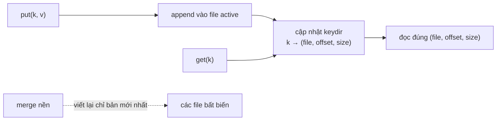
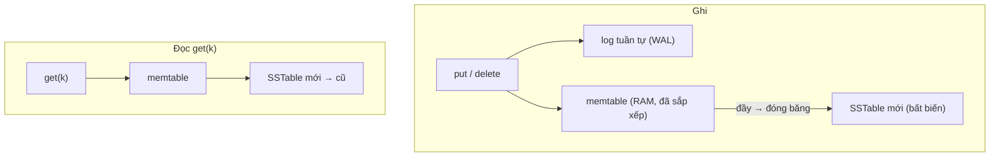
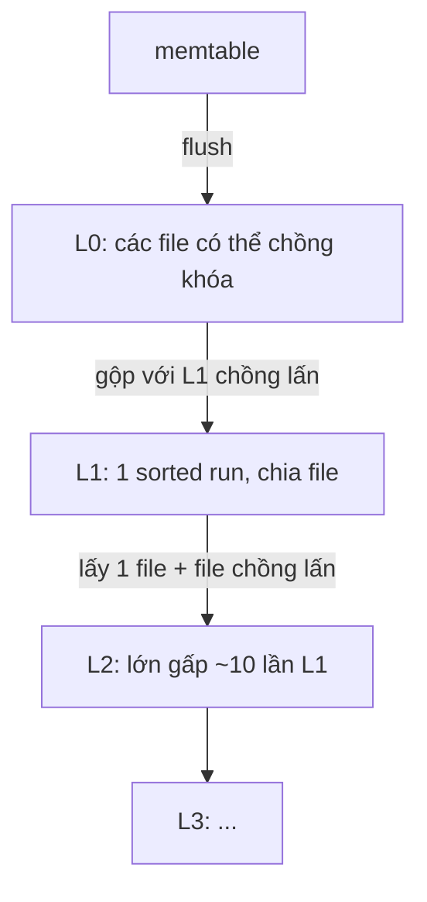
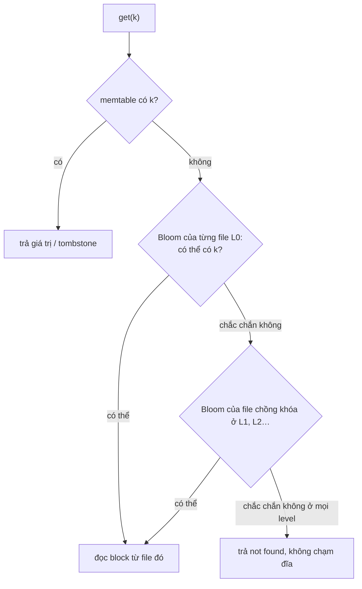
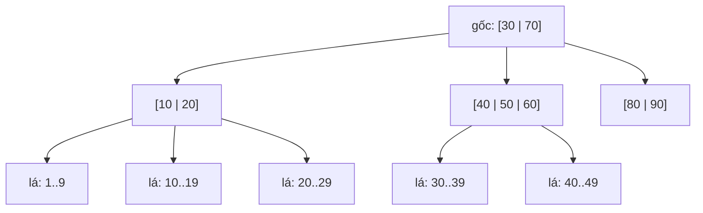
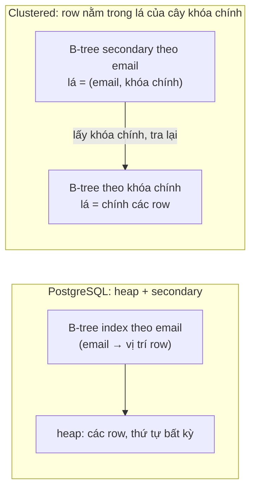
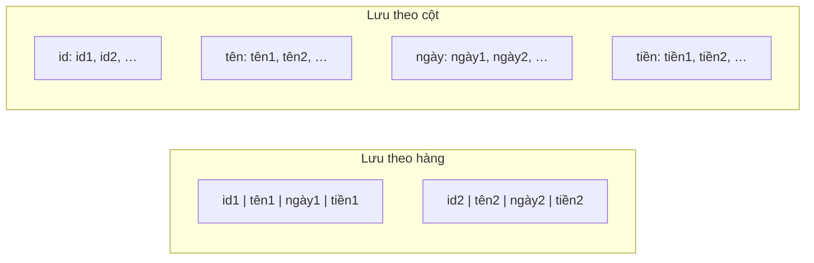

# P12 · Chương 03 — Storage engine: log-structured vs B-tree, OLTP vs OLAP

> Chương này mượn khung chủ đề từ *Designing Data-Intensive Applications* (DDIA, Kleppmann, ấn bản 1): chương 3 của sách là "Storage and Retrieval"[^ddia-toc]. Chương đó nằm trong Part I "Foundations of Data Systems" theo mục lục do ETH Library lưu[^ddia-toc0]. Sách chỉ làm khung, chương này không trích nội dung sách. Mọi khẳng định dựa vào paper gốc (O'Neil 1996 qua bản trên trang tác giả, Bigtable OSDI'06, C-Store VLDB'05, Abadi SIGMOD'08), tài liệu dự án (LevelDB 1.23, RocksDB wiki, PostgreSQL 16, SQLite, Parquet 2.12.0) và docs.rs của các crate Rust có ghim phiên bản. Chỗ nào là suy luận hay nhận xét của người soạn đều có nhãn. Trang wiki RocksDB không ghi số phiên bản, nên ta chỉ đọc được bản mới nhất lúc soạn. Ví dụ code chỉ để minh họa, **không** được biên dịch hay chạy khi soạn.

## Bạn sẽ hiểu được gì

- **Q1.** Một "log" chỉ ghi nối thêm kèm hash index hoạt động thế nào, nhanh ở đâu và gãy ở đâu? → mục 1
- **Q2.** SSTable và LSM-tree: đường ghi, đường đọc, xóa và phục hồi sau crash đi qua những thành phần nào? → mục 2
- **Q3.** Compaction là gì, leveled khác size-tiered ra sao, và write / read / space amplification là gì? → mục 3
- **Q4.** Bloom filter giúp LSM-tree đọc nhanh hơn bằng cách nào, và nó *không* giúp được gì? → mục 4
- **Q5.** B-tree lưu và cập nhật dữ liệu theo page ra sao, vì sao cần WAL, và biến thể copy-on-write khác gì? → mục 5
- **Q6.** LSM-tree và B-tree đánh đổi những gì với nhau? → mục 6
- **Q7.** Secondary index, clustered index và covering index khác nhau thế nào, mỗi loại tốn gì? → mục 7
- **Q8.** OLTP khác OLAP ở đâu, vì sao lưu theo cột (column-oriented) và nén lại hợp với OLAP? → mục 8

## Kiến thức cần trước

- [P5 · Chương 04 — Page cache, writeback và direct I/O](../05-storage/04-page-cache-va-direct-io.md): `write()` mới chỉ chép dữ liệu vào page cache.
- [P5 · Chương 05 — Crash consistency và journaling](../05-storage/05-crash-consistency-va-journaling.md): write-ahead logging (WAL) là gì, và vì sao phải ghi log trước rồi mới sửa dữ liệu. Chương này **dùng lại** khái niệm đó cho database, không giải thích lại.
- [P5 · Chương 06 — Durability trong thực tế](../05-storage/06-durability-trong-thuc-te.md): `fsync`/`fdatasync`, fsync thư mục. Mọi chỗ dưới đây nói "đã bền" đều quy về các chương này.
- [P12 · Chương 02 — Mô hình dữ liệu](02-mo-hinh-du-lieu.md): bảng, document, graph là *hình dạng logic* của dữ liệu; chương này nói chúng được lưu xuống đĩa thế nào.

Các chủ đề xung quanh nằm ở chương khác: encoding byte của record ở [Chương 04](04-encoding-va-tien-hoa-schema.md); replication dùng log ở [Chương 05](05-replication.md); chia dữ liệu ra nhiều node ở [Chương 06](06-partitioning.md); transaction ở [Chương 07](07-transaction.md); kiến trúc operational vs analytical, ETL, warehouse/lake ở [Chương 13](13-kien-truc-he-du-lieu.md).

## 1. Log chỉ ghi nối thêm và hash index (Q1)

> **Trả lời ngắn.** Cách đơn giản nhất để lưu key-value là chỉ *ghi thêm vào cuối* một file và không bao giờ sửa chỗ cũ. Ghi nối thêm là ghi tuần tự nên không cần dịch đầu đĩa[^bc-append]. Để đọc nhanh, ta giữ trong RAM một hash table trỏ từ mỗi key tới vị trí bản ghi mới nhất của key đó[^bc-keydir]. Cái giá là toàn bộ key phải vừa RAM[^bc-ram]. File cũng cứ phình dần nên phải có bước dọn[^bc-merge].

**Giải thích.**

*Với service `orders`.* Hãy hình dung `orders`, một service viết bằng Rust, chuyên lưu đơn hàng. Mỗi đơn có id, email khách, ngày tạo và tổng tiền. Đơn mới đến liên tục, và trạng thái của một đơn đổi theo thời gian (đã thanh toán, đã giao). Ta sẽ bám theo `orders` suốt chương, mỗi mục đặt cho nó một câu hỏi lưu trữ khác: tra đơn theo id (mục 1–5), nhận lượng ghi lớn (mục 2, 3, 6), tra đơn theo email (mục 7), báo cáo doanh thu theo ngày (mục 8). Đây là ví dụ giả định của người soạn, không phải code trong repo. Câu hỏi của mục này: nếu tự viết lớp lưu đơn xuống đĩa, cách đơn giản nhất là gì và nó gãy ở đâu?

### 1.1 Ghi vào cuối file, đọc qua một bảng trong RAM

Cách đơn giản nhất là coi file như một cuốn sổ chỉ viết thêm. Mỗi lần `orders` nhận hay đổi một đơn, nó ghi (id, nội dung mới) vào cuối file và không đụng tới dòng cũ. Ghi kiểu này tuần tự nên không cần dịch đầu đĩa[^bc-append].

Vấn đề nằm ở phía đọc. Đơn #42 có thể đã được ghi ba lần ở ba chỗ khác nhau, và bản đúng là bản nằm cuối cùng. Quét cả file để tìm nó thì quá chậm, nên `orders` giữ trong RAM một hash table: key là id đơn, value là vị trí bản ghi mới nhất của id đó. Bảng này trong Bitcask tên là *keydir*.

Bitcask (Basho/Riak) là bản cài đặt gọn nhất của ý tưởng này nên ta mổ xẻ nó (nhận xét của người soạn: cơ chế đơn giản, tài liệu ngắn). Cơ chế đi theo sáu bước:

1. **File active và file bất biến.** Một Bitcask là một thư mục, và tại một thời điểm chỉ một process hệ điều hành được mở nó để ghi[^bc-onewriter]. Luôn có đúng một file "active" nhận ghi. Khi file đạt ngưỡng kích thước thì nó được đóng lại và một file mới được mở. File đã đóng coi là bất biến và không bao giờ mở để ghi nữa[^bc-immutable].
2. **Ghi = nối thêm.** File active chỉ nhận append, nên không cần dịch đầu đĩa[^bc-append]. Xóa cũng không xóa gì cả: nó là một lần ghi một giá trị đặc biệt gọi là *tombstone* (bia mộ), và tombstone chỉ biến mất ở lần merge sau[^bc-tomb].
3. **Keydir.** Sau mỗi append, keydir trong RAM được cập nhật. Đó là một hash table ánh xạ mọi key tới một cấu trúc kích thước cố định gồm file, offset và size của bản ghi mới nhất của key đó[^bc-keydir].
4. **Đọc.** Tra keydir lấy (file, offset, size) rồi đọc đúng chỗ đó. Tài liệu nói thao tác này không bao giờ cần quá một lần seek đĩa[^bc-read].
5. **Merge (compaction).** Mô hình này tốn chỗ dần theo thời gian, vì nó chỉ ghi giá trị mới mà không đụng bản cũ[^bc-merge]. Vì vậy có tiến trình merge: nó duyệt các file bất biến và ghi ra những file chỉ chứa phiên bản mới nhất của mỗi key[^bc-merge2]. Cùng lúc nó tạo một *hint file* (chứa vị trí và size thay vì giá trị) để lần khởi động sau nhanh hơn[^bc-hint].
6. **Phục hồi.** File dữ liệu *chính là* commit log, nên tài liệu nói recovery tầm thường, không cần replay[^bc-recover]. Khi mở, process quét các data file để dựng lại keydir, và với file nào có hint file thì quét hint file cho nhanh[^bc-scan].



*Sơ đồ: minh họa của người soạn, tổng hợp từ các chú thích ở trên (không phải hình trích từ nguồn).*

Áp vào `orders`: đổi trạng thái đơn #42 là một lần append cộng một lần ghi vào keydir, còn `get(42)` là một lần tra hash table cộng một lần đọc đĩa (suy luận của người soạn từ thiết kế trên).

### 1.2 Chỗ gãy

Thiết kế này gãy ở hai điểm (suy luận của người soạn). Điểm thứ nhất: hash table không giữ thứ tự key, nên `orders` không thể hỏi "các đơn có id từ a đến b" (`WHERE k BETWEEN a AND b`). Điểm thứ hai: keydir phải nằm trọn trong RAM, nên số key tối đa bị chặn bởi bộ nhớ chứ không phải bởi đĩa. Tài liệu Bitcask tự nêu giới hạn RAM[^bc-ram]. Nó nói giới hạn này nhỏ trong thực tế: với bản cài đặt lúc đó, vài triệu key vẫn dùng dưới 1 GB bộ nhớ[^bc-ram2].

<details><summary>Đi sâu: "log" ở đây khác "WAL" ở P5·05 thế nào; durability; chi phí đọc</summary>

- **Hai vai trò của một cuốn nhật ký** (nhận xét của người soạn, đối chiếu P5·05 với tài liệu Bitcask). WAL của database ([P5·05](../05-storage/05-crash-consistency-va-journaling.md)) là *bản sao dự phòng*, dùng để sửa lại file dữ liệu sau crash. Ở Bitcask thì log *là* nơi dữ liệu sống: tài liệu nói file dữ liệu và commit log là một[^bc-recover]. Cả hai đều append-only, nhưng ở Bitcask không còn "file dữ liệu thật" nào khác để cập nhật. LSM-tree (mục 2) đứng giữa: có cả WAL lẫn file dữ liệu bất biến.
- **Bền tới đâu.** Bitcask có tùy chọn `sync on put` để đồng bộ file ghi sau mỗi lần ghi, và hàm `sync` để ép ghi xuống[^bc-sync]. Suy luận của người soạn: vì phải bật tùy chọn mới đồng bộ, nên mặc định một `put` thành công chưa chắc sống sót qua mất điện. Đó đúng là bài học ở [P5·06 mục 1](../05-storage/06-durability-trong-thuc-te.md).
- **Đọc dựa vào page cache.** Tài liệu nói họ dựa vào cache của file system cho hiệu năng đọc và chưa chắc một cache riêng trong Bitcask có đáng không[^bc-cache]. Xem thêm [P5·04](../05-storage/04-page-cache-va-direct-io.md).
- **Không nén.** Bitcask không nén dữ liệu vì chi phí/lợi ích phụ thuộc ứng dụng[^bc-nocomp]. Mục 8 quay lại chuyện nén.
- **Con số trong tài liệu.** 5000–6000 ghi/giây trên laptop đĩa chậm (2010) là phép đo của chính tác giả trên phần cứng cũ[^bc-bench]. Đừng dùng nó để suy ra tốc độ ngày nay.

</details>

**Quay lại Q1:** với `orders`, log chỉ ghi thêm cho ghi rất rẻ và hash index trong RAM cho đọc một bước; đổi lại mọi id đơn phải vừa RAM, không duyệt được theo khoảng, và phải có merge để dọn bản cũ.

## 2. SSTable và LSM-tree: memtable, log, file bất biến đã sắp xếp (Q2)

> **Trả lời ngắn.** LSM-tree (log-structured merge-tree) giữ các ghi mới trong một cấu trúc đã sắp xếp nằm trong RAM, gọi là *memtable*, và đồng thời ghi chúng vào một log tuần tự để phòng crash[^bt-memlog]. Khi memtable đầy, nó được "đóng băng" rồi ghi xuống đĩa thành một file bất biến, đã sắp theo key, gọi là *SSTable*[^bt-minor]. Đọc là đọc trên bản hợp nhất của memtable và các SSTable[^bt-merged]. Xóa là ghi thêm một *deletion marker*[^ldb-sorted].

**Giải thích.**

*Với service `orders`.* Ở mục 1, `orders` phải giữ mọi id đơn trong RAM và không duyệt được theo khoảng id. Muốn bỏ cả hai ràng buộc đó mà vẫn ghi tuần tự thì file dữ liệu phải được *sắp xếp theo key*. Nhưng chèn một đơn mới vào giữa file đã sắp xếp lại là ghi ngẫu nhiên (nhận xét của người soạn). LSM-tree tránh chuyện đó bằng cách sắp xếp ngay trong RAM, rồi mới ghi xuống đĩa từng cục lớn đã xếp sẵn.

### 2.1 Từ bài báo gốc đến LevelDB và RocksDB

Ý tưởng này đến từ bài của O'Neil, Cheng, Gawlick và O'Neil (Acta Informatica 33(4), 1996)[^bt-ref1996]. Bài đặt bài toán là lập chỉ mục chi phí thấp cho một file chịu tốc độ insert (và delete) rất cao trong thời gian dài[^lsm-goal]. Lời giải là một thuật toán *hoãn và gộp lô* các thay đổi của chỉ mục: nó đẩy chúng từ thành phần nằm trong bộ nhớ qua một hay nhiều thành phần trên đĩa, theo cách bài gọi là gợi nhớ tới merge sort[^lsm-batch].

Bigtable (Google, OSDI 2006) tự nhận cách nó dùng memtable và SSTable để lưu cập nhật là tương tự cách LSM-tree lưu cập nhật chỉ mục[^bt-analog]. LevelDB và RocksDB là hai bản cài đặt mã nguồn mở theo mô hình này; wiki RocksDB xếp chiến lược compaction của nó vào họ LSM-tree[^rdb-lsm].

### 2.2 Đường ghi

Một lần `put` đơn hàng đi qua ba bước:

1. **Ghi log trước.** Với mỗi row mới, một log record đủ để khôi phục lần insert đó được ghi vào log tuần tự trước, rồi mới thêm vào cấu trúc trong bộ nhớ[^lsm-log]. Bigtable cũng ghi mutation hợp lệ vào commit log (chứa redo record) rồi mới đưa vào memtable, và dùng *group commit* để tăng thông lượng khi có nhiều mutation nhỏ[^bt-write]. RocksDB nói mỗi update được ghi vào hai nơi: memtable và WAL trên đĩa[^rdb-wal2].
2. **Chèn vào memtable.** Chèn một entry vào thành phần trong bộ nhớ không tốn I/O[^lsm-c0]. Memtable mặc định của RocksDB là skip list[^rdb-skiplist].
3. **Flush.** Khi memtable chạm ngưỡng, nó bị đóng băng, một memtable mới được tạo, và bản bị đóng băng được chuyển thành một SSTable[^bt-minor]. Ngưỡng là tham số: LevelDB mặc định khoảng 4 MB cho log file[^ldb-log]. `write_buffer_size` của RocksDB mặc định là 64 MB[^rdb-wbs].

Thứ tự này có lý do: memtable nằm trong RAM nên mất khi crash, còn log là thứ dựng lại nó (xem phần phục hồi bên dưới).

### 2.3 Đường đọc, xóa và phục hồi

**Đọc.** Bigtable thực thi một lần đọc trên bản hợp nhất của dãy SSTable và memtable. Vì cả hai đều đã sắp theo thứ tự từ điển nên việc hợp nhất hiệu quả[^bt-merged]. Bài LSM gốc nói cụ thể hơn về thứ tự tra: tìm một entry thì nhìn C0 (trong RAM) trước rồi mới tới C1 (trên đĩa)[^lsm-search]. LevelDB giữ một bản của log file hiện hành trong memtable và tra nó ở mọi lần đọc, để mọi update đã ghi đều hiện ra[^ldb-memtable].

**Xóa và ghi đè.** Khi `orders` hủy một đơn, engine không xóa chỗ cũ (file bất biến mà). Một entry của sorted table là giá trị của key *hoặc* một deletion marker, và marker được giữ lại để che các giá trị cũ còn nằm ở SSTable cũ hơn[^ldb-sorted]. Bigtable làm tương tự: SSTable do compaction không-toàn-bộ tạo ra có thể chứa deletion entry để đè lên dữ liệu đã xóa trong SSTable cũ[^bt-tomb].

**Phục hồi sau crash.** Bigtable khôi phục một tablet bằng cách đọc metadata (danh sách SSTable và các redo point), nạp chỉ mục SSTable vào RAM, rồi dựng lại memtable bằng cách áp mọi update đã commit kể từ redo point[^bt-recover]. LevelDB thì đọc `CURRENT` để biết MANIFEST mới nhất, đọc MANIFEST, dọn file thừa, rồi chuyển đoạn log thành một sstable level-0 mới[^ldb-recovery]. Chính MANIFEST cũng là một log ghi mọi thay đổi của tập file[^ldb-manifest].



*Sơ đồ: minh họa của người soạn. Thứ tự "SSTable mới → cũ" là suy luận của người soạn: Bigtable chỉ nói đọc trên "merged view"[^bt-merged]. Bài LSM gốc nói tra C0 trước rồi mới tới C1[^lsm-search].*

Còn một điều làm file bất biến đáng giá. Bigtable ghi nhận rằng SSTable bất biến nên khi đọc không cần đồng bộ hóa truy cập file system[^bt-nosync]. Nhờ vậy chỉ memtable là cấu trúc vừa đọc vừa ghi[^bt-immut1]. Việc xóa vĩnh viễn dữ liệu cũng biến thành bài toán dọn rác các SSTable lỗi thời[^bt-immut2].

<details><summary>Đi sâu: C0/C1 và rolling merge của bài gốc; bố cục file LevelDB; mức bền mặc định</summary>

- **Bài gốc.** Thành phần C0 trong RAM không nhất thiết là B-tree: nút có thể có kích thước tùy ý vì nó không bao giờ nằm trên đĩa, nên (2-3)-tree hay AVL-tree đều dùng được[^lsm-c0shape]. Phần dữ liệu trên đĩa, C1, có cấu trúc thư mục tương tự B-tree nhưng tối ưu cho truy cập đĩa tuần tự[^lsm-c1shape]. Một *rolling merge* chạy liên tục: nó lấy một đoạn liền kề các entry khỏi C0 và trộn vào C1[^lsm-rolling]. Khối mới trộn được ghi ra vị trí đĩa mới, nên khối cũ không bị ghi đè và còn dùng được cho recovery[^lsm-newpos]. Với nhiều thành phần (không chỉ hai), bài chứng minh tổng I/O nhỏ nhất đạt được khi kích thước các thành phần trung gian tăng theo cấp số nhân[^lsm-geom]. Điều này cùng tinh thần với các level lớn dần theo một hệ số nhân ở mục 3 (nhận xét của người soạn: bài gốc không nêu hệ số 10 và không nhắc LevelDB).
- **Khi nào LSM hợp.** Bài nói thẳng: find cần trả lời ngay sẽ mất hiệu quả I/O trong vài trường hợp, nên LSM-tree có ích nhất khi insert chỉ mục nhiều hơn truy vấn lấy entry[^lsm-finds]. Động lực của bài: với B-tree chuẩn, việc duy trì chỉ mục thời gian thực cho một bảng lịch sử tăng nhanh làm gần gấp đôi chi phí I/O của giao dịch[^lsm-double].
- **Bố cục một SSTable.** LevelDB đặt các data block đã sắp xếp liền nhau ở đầu file, rồi tới meta block, metaindex block, index block, và cuối cùng là footer cố định ở cuối file[^ldb-layout]. Index block có một entry cho mỗi data block, với khóa là chuỗi lớn hơn hoặc bằng key cuối của block đó và đứng trước key đầu của block kế[^ldb-index]. Mỗi data block có thể được nén[^ldb-compress]. Bigtable cũng chia SSTable thành các block (thường 64 KB, cấu hình được)[^bt-sstblocks]. Suy luận của người soạn: nhờ index nhỏ nạp sẵn RAM, đọc một key là tìm trong index rồi đọc *một* block.
- **Mức bền mặc định.** Mỗi write của LevelDB mặc định là *không đồng bộ*: nó trả về sau khi đẩy dữ liệu từ process vào hệ điều hành. Crash của cả máy có thể làm mất vài update cuối, còn crash riêng process thì không mất gì[^ldb-async]. Bật `sync` thì LevelDB gọi `fsync`/`fdatasync`/`msync` trước khi trả về[^ldb-sync]. Tài liệu nói write bất đồng bộ thường nhanh hơn hơn một nghìn lần[^ldb-1000]. RocksDB mặc định bảo đảm nhất quán khi crash *process* bằng cách flush WAL sau mỗi user write[^rdb-walflush]. Hai câu đó nghĩa gì với "bền khi mất điện" thì xem [P5·06](../05-storage/06-durability-trong-thuc-te.md).
- **Xóa thật sự và dữ liệu nhạy cảm.** Compaction toàn phần của Bigtable là cách bảo đảm dữ liệu đã xóa biến mất khỏi hệ thống đúng lúc. Tài liệu gọi điều này là quan trọng với dịch vụ giữ dữ liệu nhạy cảm[^bt-deleted]. Chuyện xóa dữ liệu theo yêu cầu pháp lý nằm ở [Chương 14](14-trach-nhiem-voi-du-lieu.md).

</details>

**Quay lại Q2:** `orders` ghi vào log và memtable rồi flush thành SSTable bất biến; đọc hợp nhất memtable với các SSTable (thứ tự mới → cũ là suy luận của người soạn); xóa là ghi marker; recovery theo cách Bigtable mô tả là áp lại các update đã commit từ redo point[^bt-recover].

## 3. Compaction: leveled vs size-tiered, và ba loại amplification (Q3)

> **Trả lời ngắn.** Mỗi lần flush sinh thêm một SSTable, và nếu không dọn thì một lần đọc có thể phải trộn cập nhật từ số SSTable không bị chặn[^bt-bound]. *Compaction* là bước nền gộp các SSTable, bỏ bản ghi bị ghi đè và deletion marker không còn cần[^ldb-drop]. *Leveled* gộp run nhỏ vào run lớn một cách tích cực, nên tốn ghi nhiều hơn tiered[^rdb-univ-diff]; wiki RocksDB xếp Classic Leveled vào hướng tối thiểu hóa space amplification[^rdb-comp-lvl]. *Tiered* chờ nhiều run cùng cỡ rồi mới gộp, nên ghi ít hơn, đổi lại read và space amplification cao hơn[^rdb-comp-tier].

**Giải thích.**

*Với service `orders`.* Trạng thái đơn đổi liên tục, nên cùng một id đơn xuất hiện ở nhiều SSTable: bản "đã tạo" nằm ở file cũ, bản "đã thanh toán" ở file mới hơn, và có thể cả một marker nếu đơn bị hủy (nhận xét của người soạn). Để tìm bản mới nhất, `orders` phải xét các file đó theo thứ tự, và flush càng nhiều thì số file càng tăng. Compaction là việc nền gộp các file để số file không tăng mãi và bản cũ được dọn. Câu hỏi của mục này là gộp *khi nào* và *với cái gì*, vì cách chọn quyết định `orders` tốn bao nhiêu băng thông ghi.

### 3.1 Vì sao phải compaction

Mỗi minor compaction tạo một SSTable mới. Nếu để mặc, một lần đọc có thể phải trộn cập nhật từ số SSTable tùy ý, không bị chặn. Vì thế Bigtable chặn số file bằng cách định kỳ chạy một merging compaction ở nền[^bt-bound]. Compaction gộp tất cả SSTable thành đúng một file gọi là *major compaction*[^bt-major]. Sản phẩm của major compaction không chứa deletion entry hay dữ liệu đã xóa, còn SSTable do compaction không-toàn-bộ tạo ra thì có thể vẫn còn deletion entry[^bt-major2].

### 3.2 Leveled (LevelDB / RocksDB)

Ta cần một thuật ngữ trước: **sorted run** là một dãy dữ liệu đã sắp theo key. Mỗi level trừ level 0 là một sorted run, chia theo khoảng key thành nhiều file SST, và key trong mỗi file đã được sắp xếp[^rdb-leveled]. Level 0 đặc biệt: file ở "young level" có thể chồng khóa nhau, còn mọi level khác có các khoảng khóa tách biệt[^ldb-l0].

Quy tắc dọn như sau. Khi tổng kích thước level L vượt ngưỡng, một file của level L cùng mọi file chồng lấn ở level L+1 được trộn thành file mới cho level L+1[^ldb-levelsize]. LevelDB đặt ngưỡng 10 MB cho level 1, 100 MB cho level 2, và cứ thế mỗi level gấp 10 lần[^ldb-levelsize]. Kết quả là dữ liệu mới di cư dần xuống level lớn nhất chỉ bằng đọc/ghi hàng loạt, tránh được seek đắt[^ldb-bulk].

RocksDB chọn level cần dọn bằng một *điểm số*. Với level khác 0, điểm số là kích thước level chia kích thước mục tiêu[^rdb-score]. Với level 0, điểm số là số file chia `level0_file_num_compaction_trigger`, hoặc kích thước chia `max_bytes_for_level_base`, lấy giá trị lớn hơn[^rdb-score0]. Compaction L0→L1 bắt đầu khi số file L0 chạm `level0_file_num_compaction_trigger`[^rdb-l0trigger].



*Sơ đồ: minh họa của người soạn. Quy tắc "một file + các file chồng lấn" theo LevelDB[^ldb-levelsize]; hệ số ~10 là ví dụ của mục này, không phải hằng số của mọi cấu hình.*

### 3.3 Tiered (size-tiered)

RocksDB gọi kiểu này là Universal. Nó nhắm tới trường hợp cần *write amplification thấp hơn*, đổi lấy read amplification và space amplification[^rdb-univ-intro]. Khác biệt cốt lõi với leveled nằm ở chỗ leveled có xu hướng gộp một run nhỏ vào run lớn hơn một cách tích cực[^rdb-univ-diff]. Tiered thì đợi tới khi có vài run kích thước tương tự rồi gộp chúng với nhau[^rdb-univ-wait].

Ví dụ minh họa (của người soạn, không phải mặc định của hệ nào): bốn run 64 MB gộp thành một run 256 MB. Mỗi byte chỉ bị viết lại một lần mỗi khi nó lên một "bậc" cỡ, thay vì bị trộn lại với dữ liệu cũ của level kế.

### 3.4 Ba loại amplification

Để so hai cách trên, ta cần đo chi phí. Tài liệu tuning của RocksDB định nghĩa ba thứ. **Write amplification** là tỉ lệ byte ghi xuống thiết bị trên byte ghi vào database[^rdb-wa-def]. **Read amplification** là số lần đọc đĩa trên mỗi truy vấn[^rdb-ra-def]. **Space amplification** là tỉ lệ dung lượng file database trên đĩa trên kích thước dữ liệu[^rdb-sa-def].

Ví dụ của chính tài liệu: ghi 10 MB/s vào database mà đĩa thấy 30 MB/s thì write amplification bằng 3[^rdb-wa-ex]. Write amplification cao còn làm giảm tuổi thọ flash[^rdb-wa-flash]. Cơ chế flash nằm ở [P5·01 mục 4](../05-storage/01-thiet-bi-luu-tru.md); suy luận của người soạn: amplification của ứng dụng *nhân* với write amplification của FTL bên dưới.

### 3.5 Con số cho leveled

Tài liệu RocksDB tính một ví dụ: database 500 GB, level 1 là 512 MB, hệ số giữa các level là 10. Mỗi byte đầu tiên được ghi ra level 0, rồi nén sang level 1 (hệ số 2 vì level 1 cùng cỡ level 0), và mỗi lần xuống level kế lại bị trộn với khoảng 10 byte của level lớn hơn[^rdb-wa33a]. Tổng write amplification xấp xỉ 1 + 2 + 10 + 10 + 10 = 33[^rdb-wa33]. Cùng ví dụ đó, space amplification là 1,14[^rdb-sa114].

LevelDB tính trường hợp xấu nhất cho một compaction thường: một file 2 MB ở level L chồng khoảng 12 file ở level L+1 (10 vì level sau lớn gấp 10, cộng 2 ở biên), nên compaction phải đọc 26 MB và ghi 26 MB[^ldb-26mb]. Wiki RocksDB cũng nói write amplification thông thường của leveled thường lớn hơn 10[^rdb-wa10].

Đặt hai cách cạnh nhau:

| | Leveled | Tiered (size-tiered / Universal) |
|---|---|---|
| Write amp | cao hơn: mỗi level ghi lại phần dữ liệu cũ, per-level ≈ fanout trong trường hợp xấu[^rdb-comp-lvl-wa] | thấp: per-level bằng 1[^rdb-comp-tier-wa] |
| Read amp | thấp hơn tiered ở trường hợp xấu (suy luận từ ô bên cạnh); nhưng wiki lưu ý Classic Leveled vẫn đánh đổi read amplification để giảm space amplification[^rdb-comp-lvl] | cao hơn: số sorted run trường hợp xấu cao hơn nhiều[^rdb-univ-cost] |
| Space amp | Classic Leveled nhắm tới tối thiểu hóa space amplification[^rdb-comp-lvl] | cao hơn; full compaction tạm thời gấp đôi dung lượng[^rdb-univ-double] |
| Hình dạng tải nền | đều hơn (suy luận của người soạn từ câu bên cạnh) | rất "giật" (spiky)[^rdb-univ-spiky] |

Ghi chú: các số per-level (≈ fanout / bằng 1) là của họ thuật toán Classic Leveled và Tiered trong wiki RocksDB, không phải số đo trên RocksDB; RocksDB cài biến thể lai Tiered+Leveled và Universal[^rdb-taxonomy].

<details><summary>Đi sâu: tắc nghẽn L0, dynamic level bytes, intra-L0, TTL, họ thuật toán</summary>

- **Compaction tụt lại phía sau thì đọc chậm đi.** Ví dụ của LevelDB: nếu giới hạn tốc độ ghi nền ở 10% của 100 MB/s mà người dùng ghi 10 MB/s thì tích lũy khoảng 50 file level-0. Mỗi lần đọc khi đó đắt hơn đáng kể vì phải trộn nhiều file hơn[^ldb-slowdown1]. Một trong các hướng giải được nêu là cố ý giảm tốc độ ghi khi số file level-0 tăng[^ldb-slowdown2]. Tuning Guide của RocksDB mô tả triệu chứng tương ứng: compaction cố ghi nhiều hơn mức SSD chịu được có thể gây write stall, hoặc làm đọc chậm do compaction backlog[^rdb-stall]. Nhận xét của người soạn: khi vận hành RocksDB, theo dõi số file L0 là việc đầu tiên.
- **`level_compaction_dynamic_level_bytes`.** Khi bật, kích thước đích của level cuối bằng kích thước thực của level lớn nhất, và các level phía trên chia dần theo hệ số. Mục tiêu là một cấu trúc ổn định trong đó khoảng 90% dữ liệu nằm ở level cuối[^rdb-dyn90]. Wiki ghi đây là khuyến nghị và là mặc định từ phiên bản 8.4[^rdb-dyn-rec]. Header `advanced_options.h` của RocksDB v11.8.1 khai báo mặc định `true`[^rdb-dyn-hdr]. Docs.rs của crate `rocksdb` 0.25.0 lại ghi "Default: false" cho `set_level_compaction_dynamic_level_bytes`[^rs-dyn]. Crate này phụ thuộc `librocksdb-sys ^0.19.0`[^rs-sys-dep]. Docs.rs ghi bản 0.19.0 của `librocksdb-sys` là `0.19.0+11.8.1`, tức bundle RocksDB 11.8.1[^rs-sys-ver]. Kết luận (suy luận của người soạn từ các nguồn đó, chưa chạy thử): dòng "Default: false" là chú thích cũ của wrapper, còn mặc định của bản RocksDB bundle là `true`. Muốn chắc chắn thì đặt tường minh.
- **Intra-L0.** Khi có quá nhiều file L0, RocksDB có thể gộp một số file L0 với nhau: đổi thêm 1 đơn vị write amplification lấy việc giảm read amplification ở L0[^rdb-intra].
- **TTL và periodic compaction.** Một file có thể nằm im rất lâu nếu khoảng khóa của nó không còn được ghi (ví dụ "soft delete" bằng giá trị rỗng). Tùy chọn `ttl` đưa dữ liệu quá cũ đi qua compaction để thu hồi chỗ[^rdb-ttl].
- **Họ thuật toán.** Wiki RocksDB phân loại: Classic Leveled, Tiered, Tiered+Leveled, Leveled-N, FIFO. RocksDB cài Tiered+Leveled (gọi là "Level Compaction"), Tiered ("Universal") và FIFO[^rdb-taxonomy]. Nghĩa là "leveled" trong RocksDB đã là biến thể lai, không phải thuật toán gốc của bài LSM (suy luận của người soạn); Classic Leveled mới là cái được gán cho bài LSM của O'Neil[^rdb-comp-lvl].
- **Giới hạn Universal.** Nếu `num_levels = 1`, toàn bộ database có lúc bị gộp thành một file SST, và index block có thể vượt giới hạn 4 GB mỗi block[^rdb-univ-limit].

</details>

**Quay lại Q3:** compaction trả giá bằng việc ghi lại dữ liệu để đổi lấy số file bị chặn và bớt rác. So với tiered, leveled ghi nhiều hơn nhưng giảm space amplification và số sorted run xấu nhất; tiered ghi ít hơn nhưng đọc và chiếm chỗ nhiều hơn. Với `orders`, đó là lựa chọn giữa tốn băng thông ghi (leveled) và tốn chỗ cùng chậm khi đọc (tiered).

## 4. Bloom filter: biết chắc "không có" mà không cần đọc đĩa (Q4)

> **Trả lời ngắn.** Đọc một key ở LSM-tree có thể phải xét nhiều SSTable. Bloom filter là một mảng bit gắn với mỗi SSTable và được nạp vào RAM khi mở file[^rdb-bloom-ram]. Nó trả lời "key này *có thể* có trong file" hoặc "*chắc chắn không* có"[^rdb-bloom-def]. Bigtable ghi nhận nhờ vậy phần lớn lần tra key không tồn tại không phải chạm đĩa[^bt-bloom2]. Nó không giúp được truy vấn theo khoảng[^rdb-tune-range].

**Giải thích.**

*Với service `orders`.* Mỗi request tạo đơn mang một idempotency key, để client gửi lại khi timeout mà không tạo đơn hai lần. Trước khi ghi, `orders` phải hỏi "key này đã dùng chưa?", và trong thực tế phần lớn câu trả lời là chưa (nhận xét của người soạn: giả định về tải, không có nguồn). Ở LSM-tree, một lần tra key *không tồn tại* là lần tra tệ nhất: engine phải xét memtable rồi lần lượt các file mới tới cũ, chỉ để kết luận là không có gì. Bloom filter được sinh ra để cắt đúng chi phí đó.

### 4.1 Cơ chế

Với tập key của một SST, nhiều hàm băm được áp lên mỗi key. Mỗi hàm chỉ ra một bit trong mảng, và bit đó được đặt thành 1. Lúc đọc, ta áp cùng các hàm băm lên key cần tìm. Nếu ít nhất một bit kiểm tra ra 0 thì key chắc chắn không tồn tại[^rdb-bloom-how]. Ngược lại, nếu mọi bit đều là 1 thì key chỉ "có thể" có, vì các bit ấy có thể do key khác đặt ra. Báo "có thể" oan như vậy là dương tính giả (false positive); filter *không bao giờ* báo "không có" khi key thực sự nằm trong file (suy luận của người soạn từ cơ chế trên).

Các hệ thống dùng nó như sau:

- RocksDB tạo một Bloom filter nhúng ngay trong mỗi file SST mới, để biết file đó có thể chứa key cần tìm không[^rdb-bloom-perfile].
- Bigtable cho client yêu cầu Bloom filter cho các SSTable trong một locality group[^bt-bloom1]. Với filter đó, hệ thống hỏi được liệu một SSTable có thể chứa dữ liệu của một cặp row/column hay không.
- LevelDB có `NewBloomFilterPolicy(10)`: giữ 10 bit mỗi key trong bộ nhớ và giảm lượng đọc đĩa thừa của `Get()` khoảng một trăm lần. Tài liệu khuyến nghị dùng khi working set không vừa RAM và có nhiều random read[^ldb-bloom100].

### 4.2 Vì sao hợp với LSM, và giá phải trả

Read amplification của LSM đến từ việc nhiều file phải xét. Với leveled, một point lookup phải xem mọi file ở level 0 và tối đa một file ở mỗi level còn lại. Bloom filter giảm mạnh read amplification đó[^rdb-tune-ra].

Giá là RAM. Wiki RocksDB nêu đánh đổi giữa bit/key và tỉ lệ dương tính giả: 4,9 bit/key cho FP 10% (hiệu quả 90% so với 100 bit/key), 9,9 bit/key cho 1% (99%), 15,5 bit/key cho 0,1% (99,9%)[^rdb-bloom-bits]. Tính của người soạn: 1 triệu key ở 10 bit/key là 10 triệu bit, khoảng 1,25 MB RAM. Nhân với số key thật là thấy vì sao filter có thể chiếm phần đáng kể RAM của một node.



*Sơ đồ: minh họa của người soạn từ các chú thích ở trên. "Không chạm đĩa" chỉ đúng khi mọi Bloom filter đều trả "chắc chắn không"; filter có thể báo "có thể có" oan, khi đó vẫn tốn một lần đọc.*

<details><summary>Đi sâu: giới hạn, Ribbon filter, filter theo block của LevelDB</summary>

- **Không giúp range scan.** Wiki tuning nói Bloom filter không có ích cho range scan, và read amplification của một range scan ngắn khoảng `số_file_L0 + số_level_không_rỗng`[^rdb-tune-range]. (Có *prefix Bloom* cho truy vấn theo tiền tố, nhưng cần cấu hình riêng[^rdb-bloom-prefix].)
- **Không trộn được.** Bloom filter của các SST khác nhau nhìn chung không kết hợp tối ưu được bằng AND/OR. Khi gộp hai SST, filter mới được tạo lại từ đầu từ các key của file mới[^rdb-bloom-rebuild].
- **Ribbon filter.** Đây là thay thế drop-in từ RocksDB 6.15.0: tiết kiệm khoảng 30% dung lượng filter (chủ yếu là RAM) nhưng dùng gấp khoảng 3–4 lần CPU cho filter[^rdb-ribbon].
- **LevelDB.** Nếu có `FilterPolicy`, mỗi table có một filter block trong meta block[^ldb-filterblock].
- **Tùy chọn, không mặc định.** Ở LevelDB, `FilterPolicy` là cơ chế tùy chọn để giảm số lần đọc đĩa[^ldb-filteropt]. Ở crate Rust `rocksdb` nó là `BlockBasedOptions::set_bloom_filter` (xem mục Liên hệ với Rust).

</details>

**Quay lại Q4:** với `orders`, Bloom filter đổi vài bit RAM mỗi key lấy việc bỏ qua hầu hết file không chứa key, nên lần kiểm tra idempotency key mới thường không chạm đĩa; nó không thay được thứ tự key khi quét khoảng.

## 5. B-tree: page, split, WAL và biến thể copy-on-write (Q5)

> **Trả lời ngắn.** B-tree là cây nhiều nhánh cân bằng ("multi-way balanced tree")[^pg-btree-def]. Mỗi nút là một *page* kích thước cố định, và PostgreSQL thường dùng 8 kB[^pg-page8k]. Tìm key bằng cách đi từ gốc xuống lá (suy luận của người soạn từ cấu trúc nhiều tầng ở dưới). Chèn vào page đầy thì page bị tách đôi (*split*), việc này có thể lan lên cha và thậm chí tạo gốc mới làm cây cao thêm một tầng[^pg-rootsplit]. Page bị sửa *tại chỗ* nên crash giữa chừng có thể để lại trạng thái dở. PostgreSQL xử lý bằng quy tắc WAL: thay đổi vào file dữ liệu chỉ được ghi sau khi các WAL record mô tả chúng đã flush xuống bộ nhớ bền[^pg-wal-concept]. Riêng page ghi dở được xử lý bằng full-page write ở dưới.

**Giải thích.**

*Với service `orders`.* Giả sử `orders` không tự dựng engine mà đặt đơn vào bảng `orders` của PostgreSQL hay SQLite, với `id` là khóa chính. Khi đó mỗi lần đổi trạng thái đơn #42 là sửa đúng một row, ở đúng một chỗ, thay vì ghi thêm một bản mới như ở LSM. Mục này giải thích cấu trúc cho phép làm vậy và cái giá của nó: sửa tại chỗ có nghĩa là crash giữa chừng để lại page dở, nên engine phải chuẩn bị sẵn cách khôi phục.

### 5.1 Cấu trúc cây

Trong PostgreSQL, B-tree là cấu trúc đa tầng, và mỗi tầng dùng được như một danh sách liên kết đôi các page[^pg-struct]. Ở vị trí cố định có một metapage[^pg-meta]. Leaf page chứa các tuple trỏ tới row của bảng, còn internal page chứa các tuple trỏ xuống tầng kế[^pg-leaf]. Thường hơn 99% số page là leaf[^pg-99].

Vì các leaf nối với nhau và sắp theo key, quét theo khoảng chỉ là đọc liên tiếp các leaf (suy luận của người soạn). Tài liệu PostgreSQL cũng nói B-tree xử lý được truy vấn bằng và truy vấn theo khoảng trên dữ liệu có thể sắp thứ tự[^pg-types-bt]. Sơ đồ dưới là một cây ba tầng với số liệu tự đặt:



*Sơ đồ: minh họa của người soạn với số liệu tự đặt, không phải hình trích từ nguồn.*

### 5.2 Chèn và tách page

Chèn một entry diễn ra thế này, theo mô tả của PostgreSQL. Engine tìm leaf page; nếu page không vừa tuple mới thì *page split* chuyển một phần item sang một page mới. Split cũng phải chèn một downlink vào page cha, và nếu cha đầy thì cha cũng split, cứ "lan lên" đệ quy. Khi gốc không còn chỗ cho downlink, một *root split* tạo gốc mới cao hơn một tầng[^pg-rootsplit].

Suy luận của người soạn: chiều cao cây chỉ tăng khi gốc bị tách, nên mọi đường đi từ gốc tới lá luôn dài bằng nhau. Với fanout f ≈ 500 (giả định minh họa, phụ thuộc kích thước key), ba tầng nội đã chỉ tới khoảng 1,25 × 10⁸ lá và bốn tầng tới 6,25 × 10¹⁰. Vì thế tìm một đơn theo id thường chỉ cần vài lần đọc page, và các tầng trên cùng nhiều khả năng nằm sẵn trong cache (suy luận của người soạn; xem [P5·04](../05-storage/04-page-cache-va-direct-io.md)).

### 5.3 Vì sao cần WAL

Cập nhật B-tree là sửa page *tại chỗ*, và giữa chừng máy có thể sập. Có hai cách cổ điển để chuẩn bị cho chuyện đó, và SQLite mô tả cả hai. Cách thứ nhất là rollback journal: chép nội dung gốc chưa đổi vào một file journal riêng, rồi ghi thay đổi thẳng vào file database; sau crash thì phát lại nội dung gốc từ journal để hoàn nguyên[^sqlite-rj]. Cách thứ hai đảo ngược lại: giữ nguyên nội dung gốc trong file database và nối thay đổi vào một file WAL riêng[^sqlite-wal].

PostgreSQL theo cách thứ hai: ghi log trước, sửa file dữ liệu sau. Nhờ vậy nó không phải flush data page ở mỗi lần commit mà vẫn redo được sau crash[^pg-redo]. Chỉ cần flush file WAL, vốn được ghi tuần tự, nên chi phí đồng bộ thấp hơn nhiều[^pg-wal-fewer]. Với `orders`, nghĩa là `COMMIT` một lần đổi trạng thái đơn tốn một lần flush WAL tuần tự, không phải một lần flush page nằm đâu đó giữa bảng.

Giao thức WAL/journal và so sánh journal của file system với WAL của database đã trình bày ở [P5·05 mục 2 và mục 8](../05-storage/05-crash-consistency-va-journaling.md), còn `fsync` đúng chỗ ở [P5·06](../05-storage/06-durability-trong-thuc-te.md). Chương này không lặp lại.

### 5.4 Torn page (ghi dở)

WAL ghi mức row chưa đủ. Nếu hệ điều hành crash giữa lúc ghi một page, lần ghi đó có thể chỉ hoàn thành một phần, để lại một page trộn lẫn dữ liệu cũ và mới[^pg-fpw]. Thay đổi mức row trong WAL không dựng lại được page như vậy. Vì thế PostgreSQL, với `full_page_writes = on` mặc định, ghi toàn bộ page vào WAL ở lần sửa đầu tiên của page sau mỗi checkpoint, và đổi lại WAL phình thêm. Hai chi tiết đi kèm: header của page có trường đầu ghi WAL entry gần nhất liên quan tới page, còn trường thứ hai là checksum nếu bật data checksums[^pg-hdr]. Xem thêm [P5·05 mục 7](../05-storage/05-crash-consistency-va-journaling.md) về checksum.

### 5.5 Biến thể copy-on-write (COW)

Nếu không muốn sửa tại chỗ thì còn một lối khác. Dữ liệu B-tree không bị ghi đè: mỗi lần sửa tạo bản mới của page cùng các page tổ tiên tới gốc, rồi mới chuyển con trỏ gốc (primary) sang bản mới (mô tả chung của người soạn). redb, một crate Rust, là ví dụ: dữ liệu được lưu trong một tập các B+tree copy-on-write[^redb-cow].

Mỗi lần commit mặc định chỉ tốn một `fsync`. Redb ghi toàn bộ dữ liệu cùng checksum và một số transaction tăng đơn điệu, lật "primary", rồi gọi `fsync`[^redb-1pc]. Sau crash, nó kiểm tra primary có transaction id lớn hơn và mọi checksum hợp lệ; nếu không thì thay bản cập nhật dở bằng bản thứ cấp[^redb-crash]. Cách này không cần WAL riêng vì "bản mới" chính là lần ghi mới (nhận xét của người soạn). Nguyên lý COW ở tầng file system nằm ở [P5·07](../05-storage/07-raid-va-copy-on-write-fs.md).

<details><summary>Đi sâu: layout page PostgreSQL, giới hạn entry, dọn rác, HOT</summary>

- **Layout page.** Mỗi page có header 24 byte[^pg-layout1]. Sau header là mảng *item identifier* (mỗi cái 4 byte), còn item được cấp phát *ngược* từ cuối vùng trống. Item identifier không bị dời cho đến khi được giải phóng, nên chỉ số của nó dùng làm tham chiếu lâu dài tới item dù item có bị dời trong page để gom chỗ trống[^pg-layout2].
- **Giới hạn entry.** Một entry index không được vượt khoảng một phần ba page (sau khi TOAST nén nếu có)[^pg-btintro].
- **Rác do MVCC.** B-tree của PostgreSQL xóa dần các index tuple "version churn" bằng các lượt *bottom-up index deletion*; mỗi lượt được kích hoạt khi dự đoán sắp có một page split do version churn[^pg-bottomup]. Dù vậy một lượt VACUUM vẫn cần để dọn tổng thể[^pg-vacuum]. Nghĩa là B-tree cũng có "compaction" của nó, chỉ nhỏ và cục bộ hơn LSM (nhận xét của người soạn).
- **HOT.** MVCC làm mỗi update phải thêm một phiên bản row mới, và việc đó có thể cần thêm index entry cho mỗi row được update[^pg-hot1]. Tối ưu *heap-only tuple* tránh được điều đó khi update không đổi cột nào mà index tham chiếu (không tính summarizing index như BRIN)[^pg-hot2]. Điều kiện còn lại là page chứa row cũ phải còn đủ chỗ[^pg-hot-space]. Chi tiết MVCC ở [Chương 07](07-transaction.md).
- **SQLite.** SQLite dùng hai biến thể. *Table b-tree* khóa nguyên 64-bit và lưu mọi dữ liệu ở lá[^sqlite-bt0]. *Index b-tree* khóa tùy ý và không lưu dữ liệu[^sqlite-bt].
- **B-tree trong bộ nhớ của Rust std.** `BTreeMap` cũng là B-tree nhưng tối ưu cho cache CPU chứ không cho page đĩa: mỗi nút chứa B-1 tới 2B-1 phần tử trong một mảng liền kề[^std-btree]. Xem mục Liên hệ với Rust.

</details>

**Quay lại Q5:** B-tree chia dữ liệu thành page cố định, chèn đầy thì tách và có thể lan lên gốc. Vì sửa tại chỗ nên cần WAL (hoặc COW) để sống sót qua crash giữa chừng; với `orders` trên PostgreSQL, một lần đổi trạng thái đơn là một lần sửa row tại chỗ kèm một WAL record.

## 6. LSM-tree vs B-tree: đánh đổi (Q6)

> **Trả lời ngắn.** LSM-tree *hoãn và gộp lô* thay đổi của chỉ mục[^lsm-batch]. Ở LevelDB, việc đó chỉ dùng đọc/ghi hàng loạt và tránh seek đắt[^ldb-bulk]. Cái giá là *viết lại dữ liệu nhiều lần* qua compaction[^rdb-wa33]. Đọc cũng phải xét nhiều file[^rdb-tune-ra]. B-tree sửa page tại chỗ, nên (suy luận của người soạn) một lần đọc đi theo một đường gốc → lá, nhưng mỗi cập nhật là một lần ghi ngẫu nhiên kèm WAL[^pg-wal-concept]. Đôi khi còn phải ghi cả page đầy đủ[^pg-fpw]. Không bên nào thắng chung; chọn theo tỉ lệ ghi/đọc và loại tải (nhận xét của người soạn).

**Giải thích.**

*Với service `orders`.* Giả sử `orders` có hai kiểu ngày: ngày thường chủ yếu là khách tra đơn của mình (đọc nhiều), còn ngày sale thì đơn đổ về liên tục (ghi nhiều). Hai kiểu tải này kéo việc chọn engine về hai phía ngược nhau. Mục này gom mọi thứ từ mục 1–5 vào một bảng để ta thấy mỗi engine tốn gì ở đâu (nhận xét của người soạn: kiểu tải là giả định).

Bảng dưới chỉ dùng các điểm có nguồn:

| Tiêu chí | LSM-tree | B-tree |
|---|---|---|
| Đường ghi | log tuần tự[^lsm-log] + memtable (chèn vào memtable không tốn I/O[^lsm-c0]) | tìm đúng leaf và sửa page tại chỗ; WAL ghi trước[^pg-wal-concept] |
| Ghi lại dữ liệu | compaction viết lại dữ liệu qua nhiều level (ví dụ ~33 ở cấu hình mẫu)[^rdb-wa33] | WAL + page; thêm full page image sau checkpoint[^pg-fpw] |
| Đọc điểm | xét memtable + nhiều file; Bloom filter cắt phần lớn[^rdb-tune-ra] | cây nhiều tầng, đi từ gốc xuống lá (suy luận của người soạn từ cấu trúc nhiều tầng[^pg-struct]) |
| Đọc theo khoảng | phải xét mọi file L0 và từng level không rỗng, Bloom không giúp[^rdb-tune-range] | duyệt lá nối tiếp (suy luận của người soạn) |
| Chỗ trống / rác | bản cũ và tombstone nằm lại tới khi compaction[^ldb-drop] | page chưa đầy sau split (suy luận của người soạn); rác MVCC dọn bằng bottom-up deletion + VACUUM[^pg-bottomup] |
| Độ giật tải nền | compaction nền, tiered đặc biệt giật[^rdb-univ-spiky]; L0 tích tụ có thể phải làm chậm ghi[^ldb-slowdown2] | checkpoint/split (không có nguồn trong chương này) |
| Cập nhật tại chỗ | không (SSTable bất biến)[^bt-sstable] | có (trừ biến thể COW như redb)[^redb-cow] |

### 6.1 Điểm cốt lõi

LSM nâng hiệu năng ghi ở chỗ *hoãn và gộp lô*, như bài gốc nói[^lsm-batch]. Chính bài gốc cũng nói LSM-tree hữu ích nhất khi insert chỉ mục nhiều hơn find[^lsm-finds]. Động lực của bài là chỉ mục theo account-id trên bảng History tăng nhanh trong ví dụ TPC-A: B-tree chuẩn về thực chất làm gấp đôi chi phí I/O của giao dịch để duy trì chỉ mục đó theo thời gian thực[^lsm-double]. Cảnh báo (suy luận của người soạn): đây là bài năm 1996 với mô hình chi phí cánh tay đĩa, nên đừng áp thẳng con số đó cho NVMe ngày nay. Với SSD, cả hai họ đều chồng lên write amplification của FTL ([P5·01 mục 4](../05-storage/01-thiet-bi-luu-tru.md)).

### 6.2 Hai lưu ý

Thứ nhất, ranh giới giữa hai họ mờ dần. C-Store tách một "Writeable Store" nhận ghi nhanh và một "Read-optimized Store" nhận dữ liệu chuyển lô qua một *tuple mover*[^cs-ws-rs]. Bài Bigtable cũng tự nêu rằng cách làm của C-Store và Bigtable giống nhau ở chỗ có hai cấu trúc dữ liệu, một cho ghi gần đây và một cho dữ liệu sống lâu, cùng một cơ chế chuyển dữ liệu từ dạng này sang dạng kia[^bt-cstore].

Thứ hai, redb (B+tree COW) và các engine LSM đều nhận ACID/MVCC ở tầng trên. Vì vậy so sánh *độ cô lập* thuộc [Chương 07](07-transaction.md) chứ không thuộc cấu trúc lưu trữ.

<details><summary>Đi sâu: cách đo và cách hỏi trước khi chọn</summary>

- **Đo cái gì.** Dùng ba amplification ở mục 3 làm ngôn ngữ chung: wiki RocksDB nói rõ compaction là chìa khóa để đổi qua lại giữa ba thứ đó[^rdb-tune-amp]. Với B-tree, khái niệm tương ứng là byte ghi vào WAL cộng byte page ghi lúc checkpoint, chia cho byte logic (suy luận của người soạn; chương này không có nguồn đo).
- **Câu hỏi nên đặt** (nhận xét của người soạn): ghi hay đọc chiếm đa số? Có range scan dài không? Dữ liệu nóng vừa RAM không? Chịu được độ trễ đuôi (tail latency) do compaction không? Cần xóa dữ liệu thật sự (tuân thủ) hay chấp nhận tombstone nằm lại? Mỗi câu ánh xạ về một dòng của bảng.
- **Công cụ thực tế.** RocksDB còn có `ttl` cho compaction và kiểu FIFO; xem họ thuật toán ở mục 3[^rdb-taxonomy]. Nhận xét của người soạn: cả hai liên quan tới dữ liệu hết hạn, nhưng chương này không đọc chi tiết cơ chế FIFO.

</details>

**Quay lại Q6:** LSM đổi chi phí ghi ngẫu nhiên lấy chi phí viết lại và đọc nhiều file; B-tree đổi ngược lại. `orders` chọn theo tỉ lệ ghi/đọc của chính nó, vì không có đáp án chung.

## 7. Secondary index, clustered index, covering index (Q7)

> **Trả lời ngắn.** Chỉ mục chính (*clustered*) là nơi chính các row nằm theo thứ tự khóa[^ms-clustered]. Chỉ mục phụ (*secondary / non-clustered*) là cấu trúc riêng chứa khóa chỉ mục kèm con trỏ tới row[^ms-nonclustered]. PostgreSQL lưu row ở một "heap" và *mọi* index của nó đều là secondary[^pg-secondary]. *Covering index* chứa luôn các cột cần thiết để truy vấn trả lời chỉ từ index, khỏi đụng vào bảng[^pg-covering].

**Giải thích.**

*Với service `orders`.* Cho tới giờ ta tra đơn theo id. Nhưng màn hình "đơn của tôi" tra theo email: `SELECT total FROM orders WHERE email = $1`. Bảng chỉ sắp theo một thứ tự, nên để tra theo email `orders` cần thêm một cấu trúc nữa. Mục này trả lời cấu trúc đó trỏ về row bằng cách nào, nó tốn gì khi ghi, và khi nào truy vấn trên khỏi phải đụng tới bảng.

### 7.1 Heap + secondary (PostgreSQL)

Mọi index của PostgreSQL là secondary: chúng được lưu tách khỏi vùng dữ liệu chính, tức heap[^pg-secondary]. Vì thế một index scan thường phải lấy dữ liệu cả từ index lẫn heap cho mỗi row[^pg-ios]. Các row do index trỏ tới có thể nằm bất kỳ đâu trong heap, nên truy cập heap là truy cập ngẫu nhiên, chậm trên đĩa quay[^pg-heaprand]. Leaf của B-tree PostgreSQL chứa tuple trỏ tới row của bảng[^pg-leaf].

### 7.2 Clustered (SQL Server, SQLite)

Với SQL Server, clustered index sắp xếp và lưu các row dữ liệu ngay theo giá trị khóa. Vì dữ liệu chỉ nằm theo một thứ tự nên mỗi bảng chỉ có một clustered index[^ms-clustered]. Với bảng có clustered index, "row locator" của non-clustered index chính là *khóa clustered*[^ms-locator].

Suy luận của người soạn từ đó: tra theo secondary index phải đi hai lần cây, một lần trong secondary để lấy khóa chính và một lần trong clustered để lấy row. Cho nên khóa chính dài làm mọi secondary index phình theo. Với `orders`, nếu khóa chính là một chuỗi dài thì index theo email cũng mang chuỗi đó trong từng entry.

SQLite có cùng ý. Bảng `WITHOUT ROWID` là bảng dùng clustered index làm khóa chính[^sqlite-norowid]. Tài liệu coi đó chỉ là một tối ưu, không thêm khả năng mới[^sqlite-norowid3]. Lợi ích duy nhất là đôi khi dùng ít chỗ và/hoặc nhanh hơn một chút[^sqlite-norowid2].

PostgreSQL không có clustered index theo nghĩa đó, nhưng có lệnh `CLUSTER` sắp lại vật lý bảng theo một index. Đây chỉ là thao tác một lần: các update sau đó không được giữ theo thứ tự đó[^pg-cluster]. Lệnh còn khóa `ACCESS EXCLUSIVE` bảng suốt lúc chạy[^pg-cluster-lock].

### 7.3 Covering và index-only scan

Quay lại truy vấn theo email. Nếu index chứa luôn cột `total` thì engine trả lời chỉ từ index, khỏi vào heap. PostgreSQL gọi đó là *index-only scan*, và nó cần hai điều kiện. Loại index phải hỗ trợ (B-tree luôn có), và truy vấn chỉ được tham chiếu cột có trong index[^pg-ios-cond].

Còn một điều kiện nữa. Engine phải xác minh row *nhìn thấy được* với snapshot MVCC của truy vấn, mà thông tin hiển thị chỉ nằm ở heap. Vì vậy index-only scan chỉ có lợi nếu một phần đáng kể page heap có bit all-visible[^pg-ios-win].

*Covering index* là index thiết kế riêng để chứa các cột truy vấn cần[^pg-covering]. PostgreSQL cho khai báo cột "payload" không thuộc khóa tìm kiếm bằng `INCLUDE`[^pg-include]. Đối với `orders`, đó sẽ là index khóa theo `email` với `total` đặt trong `INCLUDE`.

### 7.4 Index nhiều cột và giá phải trả khi ghi

B-tree nhiều cột dùng được với điều kiện trên bất kỳ tập con cột nào, nhưng hiệu quả nhất khi có ràng buộc ở các cột đầu (trái nhất)[^pg-multicol]. Nên thứ tự cột trong index quan trọng.

Mỗi index thêm là thêm chỗ phải cập nhật. PostgreSQL ghi nhận một update có thể cần thêm index entry cho mỗi row được cập nhật[^pg-hot1]. Ở LSM thì `fjall` ghi chú trong ví dụ của docs rằng mỗi keyspace là một LSM-tree vật lý riêng[^fjall-keyspace]. Nhận xét của người soạn: nếu mỗi index nằm trong một keyspace riêng thì cập nhật nhiều index là ghi vào nhiều cây, và tính nguyên tử giữa chúng cần cơ chế bảo đảm; fjall có "cross-keyspace atomic semantics"[^fjall-features].



*Sơ đồ: minh họa của người soạn từ các chú thích ở trên, không phải hình trích từ nguồn.*

<details><summary>Đi sâu: HOT, fillfactor, visibility map, LSM</summary>

- **HOT và fillfactor.** Heap-only tuple chỉ khả thi nếu update không đổi cột nào được index tham chiếu (không tính summarizing index như BRIN)[^pg-hot2]. Page chứa row cũ cũng phải còn đủ chỗ[^pg-hot-space]. Hạ `fillfactor` của bảng làm tăng khả năng đủ chỗ[^pg-hot3]. Khi đó các phiên bản cũ có thể được dọn ngay trong hoạt động bình thường (kể cả `SELECT`) thay vì chờ vacuum định kỳ[^pg-hot4].
- **Visibility map.** PostgreSQL theo dõi, cho mỗi page heap, xem mọi row trong page có đủ cũ để được coi là nhìn thấy với mọi transaction hiện tại và tương lai hay không[^pg-vismap]. Chỉ khi đó index-only scan mới bỏ qua được việc truy cập heap, và vì vậy kiểu scan này chỉ có lợi khi một phần đáng kể page heap có bit all-visible[^pg-ios-win]. Bảng có phần lớn row không đổi thì rất phổ biến, và scan loại này rất hữu ích trong thực tế[^pg-ios-unch]. Lý do cần cả heap: thông tin hiển thị không nằm trong index entry mà chỉ nằm ở heap[^pg-vis].
- **Chỉ mục trên LSM** (suy luận của người soạn). Vì SSTable bất biến, một cách cài secondary index trên engine LSM là thêm một keyspace/cây khác (như keyspace riêng ở `fjall` ở trên) thay vì cấu trúc gắn trong bảng. Chương này không có nguồn mô tả cách một hệ cụ thể (RocksDB, Cassandra…) tổ chức secondary index nên không đi xa hơn.

</details>

**Quay lại Q7:** clustered là row nằm ngay trong cây khóa; secondary là cây riêng trỏ về row; covering chép thêm cột vào index để khỏi quay lại bảng. Mỗi cái đổi chỗ trống và chi phí ghi lấy tốc độ đọc; với `orders`, index theo email có `INCLUDE (total)` là cách truy vấn "đơn của tôi" khỏi vào heap.

## 8. OLTP vs OLAP, lưu theo cột và nén (Q8)

> **Trả lời ngắn.** DBMS lưu theo hàng (mọi thuộc tính của một bản ghi nằm liền nhau) chỉ cần một lần ghi đĩa để đẩy cả bản ghi ra, nên hợp ứng dụng kiểu OLTP[^cs-row]. Hệ hướng tới truy vấn thăm dò trên lượng dữ liệu lớn thì cần *read-optimized*[^cs-oltp]. Lưu theo cột (mỗi cột nằm liền nhau) chỉ cần đọc các cột truy vấn dùng[^cs-col]. Với truy vấn tổng hợp trên rất nhiều bản ghi, nó có lợi thế hiệu năng đáng kể[^cs-agg]. Dữ liệu cùng cột dễ nén hơn[^ab-compress]. Nén lại giảm thời gian I/O[^ab-perf]. Cách nói gọn "OLTP = nhiều giao dịch nhỏ trên từng bản ghi; OLAP = thường tổng hợp trên vài cột" là của người soạn.

**Giải thích.**

*Với service `orders`.* Cùng một bảng `orders` phải phục vụ hai việc rất khác nhau. Việc thứ nhất là xử lý đơn: mở đơn #123, sửa vài trường, ghi lại. Việc thứ hai là báo cáo: "tổng doanh thu theo ngày trong quý này", tức quét hàng chục triệu đơn nhưng chỉ cần hai cột là `created_at` và `total`. Nếu mỗi đơn nằm trọn trong một khối liền nhau trên đĩa thì việc thứ nhất rất nhanh, còn việc thứ hai buộc phải đọc cả những cột không dùng tới (nhận xét của người soạn). Mục này giải thích vì sao có hai họ thiết kế tách nhau.

### 8.1 Hai loại tải

C-Store (Stonebraker và cộng sự, VLDB 2005) mô tả các DBMS lưu theo hàng, nghĩa là mọi thuộc tính của một bản ghi đặt liền nhau. Với kiến trúc đó một lần ghi đĩa đủ đẩy cả bản ghi ra, nên hiệu năng ghi cao; họ gọi hệ này là *write-optimized*[^cs-row]. Nó đặc biệt hiệu quả với ứng dụng kiểu OLTP, còn các hệ nhắm tới truy vấn ad-hoc trên lượng dữ liệu lớn thì nên là *read-optimized*[^cs-oltp].

Kho dữ liệu (data warehouse) là một lớp read-optimized[^cs-wh]. Mô hình điển hình ở đó là nạp lô dữ liệu mới định kỳ, rồi một thời gian dài truy vấn ad-hoc[^cs-bulk]. TPC-H, bộ benchmark cho loại tải này, tự mô tả là benchmark *decision support* gồm một bộ truy vấn ad-hoc hướng nghiệp vụ và các thay đổi dữ liệu đồng thời[^tpch]. Mô hình tổ chức dữ liệu giữa hệ vận hành và hệ phân tích (ETL, warehouse, lake) thuộc [Chương 13](13-kien-truc-he-du-lieu.md).

### 8.2 Vì sao lưu theo cột

Với kiến trúc column store, DBMS chỉ cần đọc giá trị của các cột mà truy vấn đòi hỏi, và tránh đưa các thuộc tính không liên quan vào bộ nhớ[^cs-col]. Báo cáo doanh thu của `orders` vì thế chỉ đọc hai cột thay vì cả chục. Trong môi trường kho dữ liệu, nơi truy vấn điển hình là tính tổng hợp trên rất nhiều bản ghi, column store có lợi thế hiệu năng đáng kể[^cs-agg].

Abadi, Madden và Hachem (SIGMOD 2008) nêu cùng ý: column store hiệu quả I/O hơn với truy vấn chỉ đọc, vì chỉ đọc các thuộc tính truy vấn dùng[^ab-io]. Nhưng họ cũng cảnh báo rằng *giả vờ* có column store trên một row store (chia dọc schema hoặc index mọi cột) là không đủ. Muốn hưởng đủ lợi ích phải thay đổi cả tầng lưu trữ lẫn bộ thực thi truy vấn[^ab-concl].



*Sơ đồ: minh họa của người soạn, không phải hình trích từ nguồn.*

### 8.3 Nén

Lưu theo cột cho phép nén tốt hơn vì dữ liệu cùng cột giống nhau hơn. Abadi nêu ví dụ bảng khách hàng, trong đó các số điện thoại giống nhau hơn so với các trường văn bản xung quanh. Nếu dữ liệu được sắp theo một cột thì cột đó "siêu dễ nén", vì chuỗi giá trị lặp có thể mã hóa run-length[^ab-compress]. Cột `created_at` của `orders`, nếu sắp theo ngày, là loại cột như vậy (suy luận của người soạn).

Nén còn tăng *hiệu năng*, không chỉ giảm dung lượng, vì giảm thời gian I/O khi đọc đĩa vào bộ nhớ[^ab-perf]. Nếu bộ thực thi hoạt động trực tiếp trên dữ liệu đã nén thì tránh được cả giải nén[^ab-direct]. Run-length encoding thay một dãy giá trị lặp bằng đếm và giá trị, nhờ thế một phép toán áp được lên nhiều giá trị cột cùng lúc[^ab-rle].

Parquet là định dạng file cột mã nguồn mở[^pq-def] và cho thấy bố cục thực tế. Một file gồm các *row group*, mỗi row group là một lát ngang của dữ liệu và không có cấu trúc vật lý nào được bảo đảm cho nó[^pq-hier1]. Mỗi row group có đúng một *column chunk* cho mỗi cột, và column chunk được bảo đảm nằm liền khối trong file[^pq-hier2]. Column chunk lại chia thành các *page*[^pq-page].

Về nén, Parquet cho chọn thuật toán theo từng cột[^pq-percol]. Nó cũng có mã hóa dictionary: xây từ điển các giá trị gặp trong một cột, rồi lưu mỗi giá trị thành số nguyên trỏ vào từ điển[^pq-dict]. Nếu từ điển quá lớn, encoder lùi về mã hóa thường[^pq-dict2]. Ngoài ra còn mã hóa lai RLE/bit-packing để lưu gọn giá trị lặp[^pq-rle].

### 8.4 Ghi vào kho cột

Có một cái giá: lưu cột theo thứ tự khác thứ tự nhập làm việc chèn rất khó và đắt[^cs-insert]. Với `orders`, mỗi đơn mới phải chen vào từng cột riêng. C-Store giải bằng cách kết hợp một Writeable Store (WS) nhỏ nhận ghi hiệu quả và một Read-optimized Store (RS) lớn. Hai bên nối với nhau bằng một *tuple mover* chuyển lô; RS chỉ hỗ trợ một dạng insert rất hạn chế là lô chuyển từ WS sang[^cs-ws-rs].

Chính C-Store nói tuple mover dùng "một biến thể của khái niệm LSM-tree"[^cs-lsm]. Bigtable cũng đối chiếu cách làm của mình với C-Store[^bt-cstore]. Nhận xét của người soạn: nên khi thấy một engine OLAP hiện đại có phần "delta" mới ghi và phần "main" đã nén, hãy nhìn nó như LSM nhiều hơn là một thiết kế mới.

<details><summary>Đi sâu: late materialization, projection, kết quả đo của Abadi, nén trong OLTP</summary>

- **Late materialization.** Cuối cùng cột vẫn phải ghép lại thành hàng[^ab-odbc] (tài liệu nêu ODBC/JDBC trả kết quả theo từng entity). Column store "ngây thơ" dựng tuple sớm (*early materialization*) rồi chạy toán tử kiểu hàng, và bỏ phí nhiều tiềm năng[^ab-late1]. Các hệ như C-Store giữ dữ liệu ở dạng cột lâu hơn và dùng *danh sách vị trí* để khớp kết quả vị từ giữa các cột[^ab-late2]. Trong thí nghiệm của bài (trên bộ benchmark SSBM), nén cải thiện hiệu năng khoảng gần gấp đôi trung bình[^ab-2x]. Đó là một thí nghiệm cụ thể; đừng suy ra "cột nhanh gấp N lần" chung.
- **Projection của C-Store.** C-Store lưu các cột theo nhóm được sắp cùng một thuộc tính, gọi là *projection*[^cs-proj]. Nó cho lưu nhiều bản redundant theo thứ tự khác nhau để tăng cả hiệu năng truy xuất lẫn tính sẵn sàng[^cs-redund]. Đây là đánh đổi chỗ trống lấy tốc độ đọc, giống covering index ở mục 7 (nhận xét của người soạn).
- **Loại mã hóa theo đặc điểm cột.** C-Store chọn mã hóa theo hai yếu tố: cột tự sắp thứ tự hay không, và ít hay nhiều giá trị khác nhau. Ví dụ cột "tự sắp, ít giá trị khác nhau" được biểu diễn bằng chuỗi bộ ba (giá trị, vị trí xuất hiện đầu, số lần xuất hiện)[^cs-type1].
- **Nén ở LSM, ở WAL của PostgreSQL và ở kho cột.** Data block của LevelDB có thể được nén sau khi tạo[^ldb-compress]. PostgreSQL có `wal_compression` nén full page image ghi vào WAL (mặc định tắt; tham số này nén bản sao page trong WAL, không nén page của B-tree)[^pg-walcomp]. Docs `fjall` liệt kê nén dựng sẵn (mặc định LZ4)[^fjall-comp]. Bitcask thì không nén[^bc-nocomp]. Chọn thuật toán nén là đánh đổi CPU lấy I/O: Abadi nhận xét các sơ đồ nén mạnh (Lempel-Ziv, Huffman, arithmetic) có thể kém phù hợp hơn sơ đồ "nhẹ" hy sinh tỉ lệ nén để giải nén nhanh[^ab-light].

</details>

**Quay lại Q8:** OLTP cần ghi/đọc từng bản ghi nên hợp lưu theo hàng; OLAP đọc ít cột trên rất nhiều bản ghi nên hợp lưu theo cột, nơi dữ liệu cùng cột dễ nén hơn. Với `orders`, việc xử lý đơn hợp bảng theo hàng còn báo cáo doanh thu hợp kho cột.

## Liên hệ với Rust

Đây là các lựa chọn của `orders` khi nó là service Rust cần lưu đơn hàng: tự dựng log từ `std`, nhúng một engine thuần Rust (`redb`, `sled`, `fjall`), nhúng RocksDB, hoặc xuất file cột `parquet` cho báo cáo. Mọi crate dưới đây ghim theo docs.rs; "bảo đảm" nghĩa là câu trong docs của crate, không phải điều người soạn đo được.

**`std`: các viên gạch để tự dựng log.** `OpenOptions::append(true)` bảo đảm mỗi `write` được định vị tại cuối file, kể cả khi nhiều process/thread cùng append, khác với `seek(End)` rồi `write`[^std-append]. Docs cũng lưu ý điều đó không nhất thiết bảo đảm dữ liệu do các process/thread khác nhau append không xen kẽ nhau[^std-append-il]. `File::sync_all` cố đưa mọi nội dung và metadata xuống bộ nhớ bền[^std-syncall]. `sync_data` giống nó nhưng có thể không đồng bộ metadata, để giảm thao tác đĩa; một số nền tảng cài nó bằng `sync_all`[^std-syncdata]. `read_at` (trait `std::os::unix::fs::FileExt`) đọc từ một offset cho trước và không dịch con trỏ file[^std-readat]. Suy luận của người soạn: đó là những thứ một bản Bitcask tự dựng ở mục 1 cần. Chi tiết syscall nằm ở [P5·08 mục 3 và 5](../05-storage/08-rust-va-luu-tru.md) và [P5·06](../05-storage/06-durability-trong-thuc-te.md).

```rust
// Minh họa (KHÔNG biên dịch/chạy khi soạn): Bitcask rút gọn.
// Thiếu có chủ ý: CRC từng record, quét log dựng keydir khi mở, tombstone, merge, rotate file.
use std::{collections::HashMap, fs::{File, OpenOptions}, io, os::unix::fs::FileExt, io::Write};

struct Loc { off: u64, len: u32 }

struct LogKv { f: File, end: u64, keydir: HashMap<Vec<u8>, Loc> }

impl LogKv {
    fn open(path: &str) -> io::Result<Self> {
        let f = OpenOptions::new().read(true).append(true).create(true).open(path)?;
        let end = f.metadata()?.len();
        Ok(Self { f, end, keydir: HashMap::new() })
    }
    fn put(&mut self, key: &[u8], val: &[u8]) -> io::Result<()> {
        let mut rec = Vec::with_capacity(8 + key.len() + val.len());
        rec.extend_from_slice(&(key.len() as u32).to_le_bytes());
        rec.extend_from_slice(&(val.len() as u32).to_le_bytes());
        rec.extend_from_slice(key);
        rec.extend_from_slice(val);
        self.f.write_all(&rec)?;          // append: ghi tuần tự
        self.f.sync_data()?;              // bền khi mất điện? xem P5·06; bỏ dòng này = "async" kiểu LevelDB mặc định
        let off = self.end + 8 + key.len() as u64;
        self.keydir.insert(key.to_vec(), Loc { off, len: val.len() as u32 });
        self.end += rec.len() as u64;
        Ok(())
    }
    fn get(&self, key: &[u8]) -> io::Result<Option<Vec<u8>>> {
        let Some(loc) = self.keydir.get(key) else { return Ok(None) };
        let mut buf = vec![0u8; loc.len as usize];
        self.f.read_exact_at(&mut buf, loc.off)?;   // pread, không đụng con trỏ file
        Ok(Some(buf))
    }
}
```

**`std::collections::BTreeMap`: B-tree trong RAM, không phải B-tree trên đĩa.** Docs viết rằng B-tree là sự thỏa hiệp giữa hiệu quả cache và việc giảm thiểu lượng công việc khi tìm kiếm[^std-btree0]. Mỗi nút chứa B-1 tới 2B-1 phần tử trong một mảng liền kề, để giảm số lần cấp phát và tăng hiệu quả cache[^std-btree]. Ý "nút = đơn vị đọc một lần" giống page đĩa, nhưng đơn vị ở đây là cache line chứ không phải page 8 kB (suy luận của người soạn). `BTreeMap<Vec<u8>, Option<Vec<u8>>>` là một memtable đủ dùng để minh họa, trong đó `None` đóng vai tombstone (nhận xét của người soạn).

**`redb` 4.3.0: B+tree copy-on-write, thuần Rust.** Docs mô tả nó là một embedded key-value store đơn giản, di động, hiệu năng cao, ACID[^redb-def]. Dữ liệu lưu trong một tập các B+tree copy-on-write[^redb-cow]. API kiểu `BTreeMap`, zero-copy, thread-safe[^redb-feat]. Nó hỗ trợ một writer cùng nhiều reader đồng thời, dùng MVCC cho isolation, và chỉ có một mức isolation là serializable[^redb-single]. `WriteTransaction::set_durability` mặc định là `Durability::Immediate`[^redb-defdur]. Commit ở mức này được bảo đảm bền ngay khi `commit` trả về, còn `Durability::None` thì không bền trừ khi sau đó có một commit `Immediate`[^redb-dur]. Thiết kế commit một pha kèm checksum chỉ dùng một `fsync`[^redb-1pc]. `set_two_phase_commit(true)` đổi sang hai `fsync`[^redb-2pc]. Việc đó nhằm đối phó một kịch bản tấn công lý thuyết với dữ liệu độc hại[^redb-2pc-why]. Giá trị lấy ra qua `AccessGuard` (zero-copy theo mô tả crate).

**`sled` 0.34.7.** API giống `BTreeMap<[u8], [u8]>`, thread-safe và mọi thao tác nguyên tử[^sled-doc]. Nó hỗ trợ transaction ACID trên nhiều item[^sled-tx]. `Db::flush` đồng bộ mọi buffer I/O bẩn và gọi `fsync`; nếu thành công thì mọi write trước đó được bảo đảm khôi phục được sau crash[^sled-flush]. Suy luận của người soạn từ câu trên: `insert` thành công chưa phải đã bền, hợp với bài học ở [P5·06](../05-storage/06-durability-trong-thuc-te.md). Cấu hình có `use_compression` (zstd)[^sled-comp]. Người soạn không đánh giá độ chín muồi của `sled`: docs trích ở đây không nói về nó, nên chương không đưa khuyến nghị.

**`rocksdb` 0.25.0 (wrapper Rust của RocksDB).** Crate là "Rust wrapper for RocksDB"[^rs-wrapper]. Các núm tương ứng với mục 2–4 nằm trong đoạn code dưới đây:

```rust
// Minh họa (KHÔNG biên dịch/chạy khi soạn); tên API lấy từ docs.rs rocksdb 0.25.0.
use rocksdb::{BlockBasedOptions, DBCompactionStyle, Options, WriteOptions, DB};

let mut bb = BlockBasedOptions::default();
bb.set_bloom_filter(10.0, false);              // Bloom, ~10 bit/key (mục 4)
let mut opts = Options::default();
opts.create_if_missing(true);
opts.set_block_based_table_factory(&bb);
opts.set_compaction_style(DBCompactionStyle::Level);   // hoặc Universal (tiered), mục 3
let db = DB::open(&opts, "/var/lib/app/kv")?;

let mut wo = WriteOptions::default();
wo.set_sync(true);                             // flush từ buffer cache của OS trước khi coi là xong, ghi chậm hơn (mục 2)
db.put_opt(b"k", b"v", &wo)?;
```

`set_bloom_filter` nằm trong `BlockBasedOptions`, mô tả là "Sets a Bloom filter policy to reduce disk reads"[^rs-bloom]. `Options::set_compaction_style` mặc định là `DBCompactionStyle::Level`[^rs-style]. Ví dụ trong docs đặt `DBCompactionStyle::Universal`[^rs-style2]. `WriteOptions::set_sync(true)` làm bản ghi được flush từ buffer cache của hệ điều hành trước khi coi là hoàn tất, và ghi chậm hơn[^rs-sync]. `disable_wal(true)` cho ghi không đi qua WAL và có thể mất khi crash[^rs-nowal].

Tham số thứ hai `block_based` của `set_bloom_filter` đáng một đoạn riêng. Ví dụ trong docs crate dùng `true`, còn ví dụ trong wiki RocksDB dùng `false` cho `NewBloomFilterPolicy`[^rdb-bloom-cfg]. Trong mã nguồn wrapper, `true` gọi `rocksdb_filterpolicy_create_bloom` còn `false` gọi `rocksdb_filterpolicy_create_bloom_full`[^rs-bloom-src]. Cả hai hàm C API chuyển cho `NewBloomFilterPolicy`[^rdb-c-bloom]. Từ RocksDB 7.0, tham số `use_block_based_builder` của hàm đó bị bỏ qua[^rdb-bloom-ign]. Suy luận của người soạn từ ba nguồn đó (chưa chạy thử): với bản RocksDB 11.8.1 bundle, `true` và `false` cho cùng một chính sách filter.

Một lưu ý nữa cho service async: các hàm trích trong docs (ví dụ `DB::open`, `get`, `put`) đều không khai báo `async fn`, nên gọi chúng từ Tokio là chuyện blocking (suy luận của người soạn). Xem [P7·09 mục 5](../07-io-async/09-async-trong-production.md) về `spawn_blocking`.

**`fjall` 3.1.12: LSM thuần Rust.** Docs mô tả nó là một storage engine key-value nhúng, log-structured, viết bằng Rust[^fjall-def]. Lưu trữ dựa trên LSM-tree tương tự RocksDB, API kiểu `BTreeMap`, có range/prefix, nén dựng sẵn (mặc định LZ4) và serializable transaction tùy chọn[^fjall-features]. `PersistMode` có ba mức. `Buffer` đẩy dữ liệu vào buffer OS và không bảo đảm bền khi mất điện hay crash OS[^fjall-pm1]. `SyncData` dùng `fdatasync`[^fjall-pm2]. `SyncAll` dùng `fsync` cho cả metadata[^fjall-pm3]. Docs ví dụ gọi `db.persist(PersistMode::SyncAll)` để chắc chắn bền[^fjall-persist].

**`parquet` 60.0.0 (OLAP).** Crate là bản cài Rust "chính thức" của Apache Parquet, thuộc dự án Apache Arrow[^rs-parquet]. Parquet là định dạng cột: giá trị được duyệt theo cột thay vì theo hàng[^rs-parquet-col]. Với `orders`, nó là cách xuất dữ liệu đơn hàng cho báo cáo mục 8 (ví dụ của người soạn: đầu ra của job batch, xem [Chương 10](10-batch-processing.md)). Encoding byte và schema ở [Chương 04](04-encoding-va-tien-hoa-schema.md).

## Tóm tắt

- Log chỉ ghi thêm + hash index trong RAM (Bitcask) cho ghi tuần tự và đọc một seek, nhưng key phải vừa RAM và cần merge để dọn bản cũ.
- LSM-tree = WAL + memtable + SSTable bất biến đã sắp xếp; đọc hợp nhất memtable với các SSTable; xóa là tombstone; recovery (theo Bigtable) là áp lại update từ redo point.
- Compaction chặn số file và dọn rác nhưng ghi lại dữ liệu; leveled ghi nhiều hơn tiered nhưng giảm space amplification và số sorted run xấu nhất; tiered ghi ít hơn, đổi lại đọc và chiếm chỗ nhiều hơn, tải nền giật hơn.
- Ba amplification (write/read/space) là ngôn ngữ chung để so sánh engine; ví dụ mẫu của RocksDB cho write amp ≈ 33 ở cấu hình 10 lần mỗi level.
- Bloom filter: "chắc chắn không có" hoặc "có thể có"; cắt phần lớn đọc đĩa thừa với point lookup; không giúp range scan; tốn RAM theo số key.
- B-tree: page cố định, tách trang khi đầy, sửa tại chỗ nên cần WAL (và full page image sau checkpoint); redb là biến thể COW không cần WAL riêng.
- Clustered = row nằm trong cây khóa; secondary = cây riêng trỏ về row (PostgreSQL: mọi index đều secondary); covering/`INCLUDE` + visibility map cho index-only scan.
- OLTP hợp lưu theo hàng; OLAP đọc ít cột, nhiều dòng nên hợp lưu theo cột; cột dễ nén hơn (RLE, dictionary) và nén giảm I/O (thực thi trực tiếp trên dữ liệu nén còn giảm cả CPU).
- Ranh giới LSM / kho cột mờ: C-Store có Writeable Store + tuple mover, Bigtable tự thấy tương đồng.
- Mức bền của mọi engine quy về `fsync`: `sync_data` / `set_sync(true)` / `PersistMode::SyncAll` / `Db::flush` là cùng một cuộc trao đổi bền–độ trễ ở P5·06.

## Câu hỏi tự kiểm tra

1. Vì sao Bitcask có thể đọc một key bằng không quá một lần seek, và điều gì giới hạn số key nó chứa được?
2. Phân biệt vai trò của "log" trong Bitcask và của WAL trong LSM-tree.
3. Nêu thứ tự các bước một `put` đi qua trong LSM-tree trước khi trả về, và vì sao log phải được ghi *trước* memtable.
4. Sau crash, LSM-tree (Bigtable / LevelDB) dựng lại memtable bằng cách nào?
5. Tombstone là gì; vì sao compaction thường không được xóa nó ngay ở mọi level?
6. Giải thích write amplification ≈ 33 trong ví dụ của wiki RocksDB và nói nó đến từ phần nào.
7. So sánh leveled và tiered theo write / read / space amplification, kèm một lý do cơ chế cho mỗi cặp.
8. Bloom filter có thể sai theo chiều nào, chiều nào *không bao giờ* sai? Vì sao nó không giúp range scan?
9. Vì sao B-tree cần WAL, và `full_page_writes` của PostgreSQL bảo vệ khỏi điều gì?
10. Khác nhau giữa clustered index, secondary index và covering index; khi nào index-only scan của PostgreSQL *không* có lợi?
11. Vì sao column store hợp OLAP và nén cột hiệu quả hơn nén hàng? Nêu hai kỹ thuật mã hóa.
12. Với `rocksdb` crate, bạn cấu hình thế nào để một write chắc chắn bền khi mất điện, và với `redb`?

<details><summary>Đáp án</summary>

1. Keydir trong RAM cho (file, offset, size) của bản mới nhất, và đọc đúng vị trí đó[^bc-keydir]. Chỉ cần một seek[^bc-read]. Số key bị giới hạn bởi RAM vì keydir phải nằm trọn trong bộ nhớ[^bc-ram].
2. Bitcask: file dữ liệu *là* commit log, recovery không cần replay[^bc-recover]. LSM: WAL dùng để dựng lại memtable[^bt-recover]. Dữ liệu đã flush nằm trong SSTable bất biến[^bt-sstable].
3. Ghi log tuần tự rồi chèn memtable (không I/O)[^lsm-log]; Bigtable còn dùng group commit[^bt-write]. Log phải đứng trước vì memtable ở RAM mất khi crash, và log là thứ khôi phục nó[^bt-recover].
4. Đọc metadata và redo point, nạp index SSTable, rồi áp mọi update đã commit kể từ redo point[^bt-recover]. LevelDB thì chuyển đoạn log thành sstable level-0[^ldb-recovery].
5. Deletion marker che các giá trị cũ ở SSTable cũ hơn[^ldb-sorted2]. Compaction chỉ bỏ marker khi không có level cao hơn chứa file chồng khóa với key đó[^ldb-drop]. Ở Bigtable, sản phẩm của major compaction mới không còn dữ liệu đã xóa[^bt-major2].
6. 1 (ghi ra L0) + 2 (L0→L1) + 10 + 10 + 10 (mỗi lần xuống level kế bị trộn với ~10 byte)[^rdb-wa33]. Nó đến từ việc compaction viết lại dữ liệu cũ khi trộn.
7. So với tiered, leveled ghi nhiều hơn nhưng có số sorted run xấu nhất thấp hơn và nhắm tới space amplification thấp[^rdb-comp-lvl]; tiered có write thấp, read và space cao hơn[^rdb-comp-tier]. Lý do về ghi: leveled gộp run nhỏ vào run lớn liên tục nên viết lại nhiều[^rdb-univ-diff]. Lý do về đọc: tiered có số sorted run xấu nhất rất cao[^rdb-univ-cost]. Lý do về chỗ: full compaction của tiered cần chỗ gấp đôi[^rdb-univ-double].
8. Nó có thể báo "có thể có" oan (dương tính giả), nhưng không bao giờ báo "không có" khi key có[^rdb-bloom-def]. Nó không giúp range scan[^rdb-tune-range], vì filter chỉ trả lời cho một key; tiền tố cần cấu hình riêng[^rdb-bloom-prefix].
9. Sửa page tại chỗ có thể bị crash giữa chừng, nên WAL ghi trước để redo[^pg-redo]. `full_page_writes` chống page ghi dở (trộn cũ/mới) mà WAL mức row không dựng lại được[^pg-fpw].
10. Clustered: row nằm theo khóa[^ms-clustered]. Secondary: cấu trúc riêng trỏ về row[^ms-nonclustered]. Covering: chứa cột truy vấn cần[^pg-covering]. Index-only scan không lợi khi phần lớn page heap không có bit all-visible, vì vẫn phải vào heap kiểm tra visibility[^pg-ios-win].
11. Column store chỉ đọc cột cần dùng[^cs-col]. Dữ liệu cột giống nhau nên dễ nén hơn, và nếu sắp xếp thì RLE được[^ab-compress]. Nén giảm I/O[^ab-perf]. Hai kỹ thuật là RLE[^pq-rle]. Kỹ thuật còn lại là dictionary (cùng bit-packing)[^pq-dict].
12. `rocksdb`: `WriteOptions::set_sync(true)` rồi `put_opt`[^rs-sync]. Đừng `disable_wal`[^rs-nowal]. `redb`: để `Durability::Immediate` (mặc định)[^redb-defdur].

</details>

## Đọc thêm

- DDIA (ấn bản 1) chương 3 "Storage and Retrieval", thuộc Part I "Foundations of Data Systems" (khung chủ đề của chương này; tên chương theo mục lục do ETH Library lưu[^ddia-toc]): đọc để so cách tác giả sắp xếp log-structured vs B-tree, OLTP vs OLAP, column storage.
- DDIA (ấn bản 1) chương 4 "Encoding and Evolution" (tên chương theo mục lục do ETH Library lưu[^ddia-toc2]) — nối tiếp sang [Chương 04](04-encoding-va-tien-hoa-schema.md): cách record được mã hóa xuống byte.
- O'Neil, Cheng, Gawlick, O'Neil, "The Log-Structured Merge-Tree (LSM-Tree)": <https://www.cs.umb.edu/~poneil/lsmtree.pdf> — phân tích cost-performance, multi-component, rolling merge.
- Chang et al., "Bigtable: A Distributed Storage System for Structured Data" (OSDI 2006), mục 5.3–5.4 và 6: <https://static.googleusercontent.com/media/research.google.com/en//archive/bigtable-osdi06.pdf> — memtable/SSTable/compaction/Bloom trong hệ thống thật.
- LevelDB 1.23, `doc/impl.md` và `doc/table_format.md`: <https://raw.githubusercontent.com/google/leveldb/1.23/doc/impl.md> — bố cục file và compaction chi tiết.
- Wiki RocksDB, "Compaction", "Leveled Compaction", "Universal Compaction", "RocksDB Tuning Guide": <https://raw.githubusercontent.com/wiki/facebook/rocksdb/Compaction.md> — phân loại thuật toán và công thức amplification.
- PostgreSQL 16, chương 67 "B-Tree Indexes" và mục 11.9 "Index-Only Scans and Covering Indexes": <https://www.postgresql.org/docs/16/btree-implementation.html> — cấu trúc B-tree thực tế.
- PostgreSQL 16, 30.3 "Write-Ahead Logging (WAL)": <https://www.postgresql.org/docs/16/wal-intro.html> — vì sao ghi log trước.
- Stonebraker et al., "C-Store: A Column-oriented DBMS" (VLDB 2005): <https://www.vldb.org/archives/website/2005/program/paper/thu/p553-stonebraker.pdf>; Abadi, Madden, Hachem, "Column-Stores vs. Row-Stores" (SIGMOD 2008): <https://www.cs.umd.edu/~abadi/papers/abadi-sigmod08.pdf> — đọc để hiểu OLAP và nén cột.
- Sheehy & Smith, "Bitcask: A Log-Structured Hash Table for Fast Key/Value Data": <https://riak.com/assets/bitcask-intro.pdf> — thiết kế log + hash index ngắn gọn.
- Apache Parquet format 2.12.0, `README.md` và `Encodings.md`: <https://raw.githubusercontent.com/apache/parquet-format/apache-parquet-format-2.12.0/README.md> — row group / column chunk / page và encoding.
- [P5·05 Journaling](../05-storage/05-crash-consistency-va-journaling.md) và [P5·06 Durability](../05-storage/06-durability-trong-thuc-te.md): nền tảng WAL và `fsync` mà mọi engine ở trên dựa vào.
- [Chương 07 — Transaction](07-transaction.md) và [Chương 05 — Replication](05-replication.md): lớp phía trên storage engine (isolation, replicate log).

[^bc-append]: Bitcask (Sheehy & Smith, Basho, 2010), mục mô hình — <https://riak.com/assets/bitcask-intro.pdf> — "The active file is only written by appending, which means that sequential writes do not require disk seeking."
[^bc-keydir]: Bitcask, mục keydir — <https://riak.com/assets/bitcask-intro.pdf> — "A keydir is simply a hash table that maps every key in a Bitcask to a fixed-size structure giving the file, offset, and size of the most recently written entry for that key."
[^bc-ram]: Bitcask, mục mục tiêu thiết kế — <https://riak.com/assets/bitcask-intro.pdf> — "the keydir structure grows by a small amount with the number of keys and must fit entirely in RAM"
[^bc-ram2]: Bitcask, mục mục tiêu thiết kế — <https://riak.com/assets/bitcask-intro.pdf> — "This limitation is minor in practice, as even with many millions of keys the current implementation uses well under a GB of memory."
[^bc-merge]: Bitcask, mục merge — <https://riak.com/assets/bitcask-intro.pdf> — "This simple model may use up a lot of space over time, since we just write out new values without touching the old ones."
[^bc-onewriter]: Bitcask, mục mô hình — <https://riak.com/assets/bitcask-intro.pdf> — "we enforce that only one operating system process will open that Bitcask for writing at a given time"
[^bc-immutable]: Bitcask, mục mô hình — <https://riak.com/assets/bitcask-intro.pdf> — "Once a file is closed, either purposefully or due to server exit, it is considered immutable and will never be opened for writing again."
[^bc-tomb]: Bitcask, mục mô hình — <https://riak.com/assets/bitcask-intro.pdf> — "Note that deletion is simply a write of a special tombstone value, which will be removed on the next merge."
[^bc-read]: Bitcask, mục đọc — <https://riak.com/assets/bitcask-intro.pdf> — "Reading a value is simple, and doesn't ever require more than a single disk seek."
[^bc-hint]: Bitcask, mục merge và hint file — <https://riak.com/assets/bitcask-intro.pdf> — "When this is done we also create a hint file next to each data file."
[^bc-merge2]: Bitcask, mục merge và hint file — <https://riak.com/assets/bitcask-intro.pdf> — "The merge process iterates over all non-active (i.e. immutable) files in a Bitcask and produces as output a set of data files containing only the “live” or latest versions of each present key."
[^bc-recover]: Bitcask, mục crash friendliness — <https://riak.com/assets/bitcask-intro.pdf> — "As the data files and the commit log are the same thing in Bitcask, recovery is trivial"
[^bc-scan]: Bitcask, mục khởi động — <https://riak.com/assets/bitcask-intro.pdf> — "For any data file that has a hint file, that will be scanned instead for a much quicker startup time."
[^bc-sync]: Bitcask, mục API — <https://riak.com/assets/bitcask-intro.pdf> — "sync on put (if this writer would prefer to sync the write file after every write operation)"
[^bc-cache]: Bitcask, mục ghi chú — <https://riak.com/assets/bitcask-intro.pdf> — "We mentioned that we rely on the operating system's filesystem cache for read performance."
[^bc-nocomp]: Bitcask, mục ghi chú — <https://riak.com/assets/bitcask-intro.pdf> — "Bitcask does not perform any compression of data, as the cost/benefit of doing so is very application-dependent."
[^bc-bench]: Bitcask, mục mục tiêu thiết kế — <https://riak.com/assets/bitcask-intro.pdf> — "In early tests on a laptop with slow disks, we have seen throughput of 5000-6000 writes per second."
[^bt-memlog]: Bigtable (Chang et al., OSDI 2006), mục 5.3 — <https://static.googleusercontent.com/media/research.google.com/en//archive/bigtable-osdi06.pdf> — "Updates are committed to a commit log that stores redo records."
[^bt-minor]: Bigtable, mục 5.4 — <https://static.googleusercontent.com/media/research.google.com/en//archive/bigtable-osdi06.pdf> — "When the memtable size reaches a threshold, the memtable is frozen, a new memtable is created, and the frozen memtable is converted to an SSTable and written to GFS."
[^bt-merged]: Bigtable, mục 5.3 — <https://static.googleusercontent.com/media/research.google.com/en//archive/bigtable-osdi06.pdf> — "A valid read operation is executed on a merged view of the sequence of SSTables and the memtable."
[^ldb-sorted]: LevelDB 1.23, doc/impl.md — <https://raw.githubusercontent.com/google/leveldb/1.23/doc/impl.md> — "Each entry is either a value for the key, or a deletion marker for the key."
[^bt-ref1996]: Bigtable, mục tham khảo [26] — <https://static.googleusercontent.com/media/research.google.com/en//archive/bigtable-osdi06.pdf> — "The log-structured merge-tree (LSM-tree). Acta Inf. 33, 4 (1996), 351–385."
[^lsm-batch]: O'Neil, Cheng, Gawlick, O'Neil, "The Log-Structured Merge-Tree", abstract — <https://www.cs.umb.edu/~poneil/lsmtree.pdf> — "The LSM-tree uses an algorithm that defers and batches index changes, cascading the changes from a memory-based component through one or more disk components in an efficient manner reminiscent of merge sort."
[^lsm-goal]: O'Neil, Cheng, Gawlick, O'Neil, "The Log-Structured Merge-Tree", abstract — <https://www.cs.umb.edu/~poneil/lsmtree.pdf> — "is a disk-based data structure designed to provide low-cost indexing for a file experiencing a high rate of record inserts (and deletes) over an extended period."
[^bt-analog]: Bigtable, mục 9 Related Work — <https://static.googleusercontent.com/media/research.google.com/en//archive/bigtable-osdi06.pdf> — "The manner in which Bigtable uses memtables and SSTables to store updates to tablets is analogous to the way that the Log-Structured Merge Tree [26] stores updates to index data."
[^lsm-log]: LSM-tree paper, mục 2 — <https://www.cs.umb.edu/~poneil/lsmtree.pdf> — "As each new History row is generated, a log record to recover this insert is first written to the sequential log file in the usual way."
[^bt-write]: Bigtable, mục 5.3 — <https://static.googleusercontent.com/media/research.google.com/en//archive/bigtable-osdi06.pdf> — "Group commit is used to improve the throughput of lots of small mutations"
[^rdb-wal2]: RocksDB wiki, Write Ahead Log (WAL) — <https://raw.githubusercontent.com/wiki/facebook/rocksdb/Write-Ahead-Log-%28WAL%29.md> — "1) an in-memory data structure called memtable (to be flushed to SST files later) and 2) write ahead log(WAL) on disk."
[^lsm-c0]: LSM-tree paper, mục 2 — <https://www.cs.umb.edu/~poneil/lsmtree.pdf> — "The operation of inserting an index entry into the memory resident C0 tree has no I/O cost."
[^rdb-skiplist]: RocksDB wiki, MemTable — <https://raw.githubusercontent.com/wiki/facebook/rocksdb/MemTable.md> — "The default implementation of memtable is based on skiplist."
[^ldb-log]: LevelDB 1.23, doc/impl.md — <https://raw.githubusercontent.com/google/leveldb/1.23/doc/impl.md> — "When the log file reaches a pre-determined size (approximately 4MB by default), it is converted to a sorted table (see below) and a new log file is created for future updates."
[^rdb-wbs]: RocksDB wiki, MemTable — <https://raw.githubusercontent.com/wiki/facebook/rocksdb/MemTable.md> — "Size of a single memtable (Default: 64MB)."
[^lsm-search]: LSM-tree paper, mục 2 — <https://www.cs.umb.edu/~poneil/lsmtree.pdf> — "any search for an index entry will look first in C0 and then in C1"
[^ldb-memtable]: LevelDB 1.23, doc/impl.md — <https://raw.githubusercontent.com/google/leveldb/1.23/doc/impl.md> — "This copy is consulted on every read so that read operations reflect all logged updates."
[^bt-tomb]: Bigtable, mục 5.4 — <https://static.googleusercontent.com/media/research.google.com/en//archive/bigtable-osdi06.pdf> — "SSTables produced by non-major compactions can contain special deletion entries that suppress deleted data in older SSTables that are still live."
[^bt-recover]: Bigtable, mục 5.3 — <https://static.googleusercontent.com/media/research.google.com/en//archive/bigtable-osdi06.pdf> — "reconstructs the memtable by applying all of the updates that have committed since the redo points"
[^ldb-recovery]: LevelDB 1.23, doc/impl.md, mục Recovery — <https://raw.githubusercontent.com/google/leveldb/1.23/doc/impl.md> — "Convert log chunk to a new level-0 sstable"
[^ldb-manifest]: LevelDB 1.23, doc/impl.md, mục Manifest — <https://raw.githubusercontent.com/google/leveldb/1.23/doc/impl.md> — "The MANIFEST file is formatted as a log, and changes made to the serving state (as files are added or removed) are appended to this log."
[^bt-immut1]: Bigtable, mục 6 — <https://static.googleusercontent.com/media/research.google.com/en//archive/bigtable-osdi06.pdf> — "The only mutable data structure that is accessed by both reads and writes is the memtable."
[^bt-sstable]: Bigtable, mục 6 — <https://static.googleusercontent.com/media/research.google.com/en//archive/bigtable-osdi06.pdf> — "An SSTable provides a persistent, ordered immutable map from keys to values"
[^bt-nosync]: Bigtable, mục 6 — <https://static.googleusercontent.com/media/research.google.com/en//archive/bigtable-osdi06.pdf> — "we do not need any synchronization of accesses to the file system when reading from SSTables."
[^bt-immut2]: Bigtable, mục 6 — <https://static.googleusercontent.com/media/research.google.com/en//archive/bigtable-osdi06.pdf> — "Since SSTables are immutable, the problem of permanently removing deleted data is transformed to garbage collecting obsolete SSTables."
[^lsm-c0shape]: LSM-tree paper, mục 2.1 — <https://www.cs.umb.edu/~poneil/lsmtree.pdf> — "Thus a (2-3) tree or AVL-tree (as explained, for example, in [1]) are possible alternative structures for a C0 tree."
[^lsm-rolling]: LSM-tree paper, mục 2 — <https://www.cs.umb.edu/~poneil/lsmtree.pdf> — "an ongoing rolling merge process serves to delete some contiguous segment of entries from the C0 tree and merge it into the C1 tree on disk"
[^lsm-newpos]: LSM-tree paper, mục 2 — <https://www.cs.umb.edu/~poneil/lsmtree.pdf> — "Newly merged blocks are written to new disk positions, so that the old blocks will not be overwritten and will be available for recovery in case of a crash."
[^lsm-geom]: LSM-tree paper, mục 3 — <https://www.cs.umb.edu/~poneil/lsmtree.pdf> — "we size intermediate components in a geometric progression between the smallest and largest"
[^lsm-finds]: LSM-tree paper, abstract — <https://www.cs.umb.edu/~poneil/lsmtree.pdf> — "However, indexed finds requiring immediate response will lose I/O efficiency in some cases, so the LSM-tree is most useful in applications where index inserts are more common than finds that retrieve the entries."
[^lsm-double]: LSM-tree paper, abstract — <https://www.cs.umb.edu/~poneil/lsmtree.pdf> — "standard disk-based index structures such as the B-tree will effectively double the I/O cost of the transaction to maintain an index such as this in real time"
[^ldb-layout]: LevelDB 1.23, doc/table_format.md — <https://raw.githubusercontent.com/google/leveldb/1.23/doc/table_format.md> — "[data block 1] [data block 2] ... [data block N] [meta block 1] ... [meta block K] [metaindex block] [index block] [Footer] (fixed size; starts at file_size - sizeof(Footer))"
[^ldb-index]: LevelDB 1.23, doc/table_format.md — <https://raw.githubusercontent.com/google/leveldb/1.23/doc/table_format.md> — "This block contains one entry per data block, where the key is a string >= last key in that data block and before the first key in the successive data block."
[^ldb-compress]: LevelDB 1.23, doc/table_format.md — <https://raw.githubusercontent.com/google/leveldb/1.23/doc/table_format.md> — "Each data block is formatted according to the code in `block_builder.cc`, and then optionally compressed."
[^bt-sstblocks]: Bigtable, mục 4 SSTable — <https://static.googleusercontent.com/media/research.google.com/en//archive/bigtable-osdi06.pdf> — "Internally, each SSTable contains a sequence of blocks (typically each block is 64KB in size, but this is configurable)."
[^ldb-async]: LevelDB 1.23, doc/index.md — <https://raw.githubusercontent.com/google/leveldb/1.23/doc/index.md> — "By default, each write to leveldb is asynchronous: it returns after pushing the write from the process into the operating system."
[^ldb-sync]: LevelDB 1.23, doc/index.md — <https://raw.githubusercontent.com/google/leveldb/1.23/doc/index.md> — "On Posix systems, this is implemented by calling either `fsync(...)` or `fdatasync(...)` or `msync(..., MS_SYNC)` before the write operation returns."
[^ldb-1000]: LevelDB 1.23, doc/index.md — <https://raw.githubusercontent.com/google/leveldb/1.23/doc/index.md> — "Asynchronous writes are often more than a thousand times as fast as synchronous writes."
[^rdb-walflush]: RocksDB wiki, Write Ahead Log (WAL) — <https://raw.githubusercontent.com/wiki/facebook/rocksdb/Write-Ahead-Log-%28WAL%29.md> — "In the default configuration, RocksDB guarantees process crash consistency by flushing the WAL after every user write."
[^bt-deleted]: Bigtable, mục 5.4 — <https://static.googleusercontent.com/media/research.google.com/en//archive/bigtable-osdi06.pdf> — "also allow it to ensure that deleted data disappears from the system in a timely fashion, which is important for services that store sensitive data."
[^bt-bound]: Bigtable, mục 5.4 — <https://static.googleusercontent.com/media/research.google.com/en//archive/bigtable-osdi06.pdf> — "Instead, we bound the number of such files by periodically executing a merging compaction in the background."
[^ldb-drop]: LevelDB 1.23, doc/impl.md — <https://raw.githubusercontent.com/google/leveldb/1.23/doc/impl.md> — "Compactions drop overwritten values. They also drop deletion markers if there are no higher numbered levels that contain a file whose range overlaps the current key."
[^rdb-univ-diff]: RocksDB wiki, Universal Compaction — <https://raw.githubusercontent.com/wiki/facebook/rocksdb/Universal-Compaction.md> — "The key difference between the two strategies is that leveled compaction tends to aggressively merge a smaller sorted run into a larger one"
[^rdb-univ-wait]: RocksDB wiki, Universal Compaction — <https://raw.githubusercontent.com/wiki/facebook/rocksdb/Universal-Compaction.md> — "waits for several sorted runs with similar size and merge them together."
[^rdb-comp-tier]: RocksDB wiki, Compaction — <https://raw.githubusercontent.com/wiki/facebook/rocksdb/Compaction.md> — "Tiered compaction minimizes write amplification at the cost of read and space amplification."
[^bt-major]: Bigtable, mục 5.4 — <https://static.googleusercontent.com/media/research.google.com/en//archive/bigtable-osdi06.pdf> — "A merging compaction that rewrites all SSTables into exactly one SSTable is called a major compaction."
[^rdb-leveled]: RocksDB wiki, Leveled Compaction — <https://raw.githubusercontent.com/wiki/facebook/rocksdb/Leveled-Compaction.md> — "Each level (except level 0) is one data sorted run"
[^ldb-l0]: LevelDB 1.23, doc/impl.md — <https://raw.githubusercontent.com/google/leveldb/1.23/doc/impl.md> — "Files in the young level may contain overlapping keys. However files in other levels have distinct non-overlapping key ranges."
[^ldb-levelsize]: LevelDB 1.23, doc/impl.md — <https://raw.githubusercontent.com/google/leveldb/1.23/doc/impl.md> — "When the combined size of files in level-L exceeds (10^L) MB (i.e., 10MB for level-1, 100MB for level-2, ...), one file in level-L, and all of the overlapping files in level-(L+1) are merged to form a set of new files for level-(L+1)."
[^ldb-bulk]: LevelDB 1.23, doc/impl.md — <https://raw.githubusercontent.com/google/leveldb/1.23/doc/impl.md> — "These merges have the effect of gradually migrating new updates from the young level to the largest level using only bulk reads and writes (i.e., minimizing expensive seeks)."
[^rdb-score]: RocksDB wiki, Leveled Compaction — <https://raw.githubusercontent.com/wiki/facebook/rocksdb/Leveled-Compaction.md> — "For non-zero levels, the score is total size of the level divided by the target size."
[^rdb-l0trigger]: RocksDB wiki, Leveled Compaction — <https://raw.githubusercontent.com/wiki/facebook/rocksdb/Leveled-Compaction.md> — "Compaction triggers when number of L0 files reaches `level0_file_num_compaction_trigger`, files of L0 will be merged into L1."
[^rdb-univ-intro]: RocksDB wiki, Universal Compaction — <https://raw.githubusercontent.com/wiki/facebook/rocksdb/Universal-Compaction.md> — "Universal Compaction Style is a compaction style, targeting the use cases requiring lower write amplification, trading off read amplification and space amplification."
[^rdb-wa-def]: RocksDB wiki, Tuning Guide — <https://raw.githubusercontent.com/wiki/facebook/rocksdb/RocksDB-Tuning-Guide.md> — "Write amplification is the ratio of bytes written to storage versus bytes written to the database."
[^rdb-ra-def]: RocksDB wiki, Tuning Guide — <https://raw.githubusercontent.com/wiki/facebook/rocksdb/RocksDB-Tuning-Guide.md> — "Read amplification is the number of disk reads per query."
[^rdb-sa-def]: RocksDB wiki, Tuning Guide — <https://raw.githubusercontent.com/wiki/facebook/rocksdb/RocksDB-Tuning-Guide.md> — "Space amplification is the ratio of the size of database files on disk to data size."
[^rdb-wa-ex]: RocksDB wiki, Tuning Guide — <https://raw.githubusercontent.com/wiki/facebook/rocksdb/RocksDB-Tuning-Guide.md> — "if you are writing 10 MB/s to the database and you observe 30 MB/s disk write rate, your write amplification is 3."
[^rdb-wa-flash]: RocksDB wiki, Tuning Guide — <https://raw.githubusercontent.com/wiki/facebook/rocksdb/RocksDB-Tuning-Guide.md> — "High write amplification also decreases flash lifetime."
[^rdb-wa33]: RocksDB wiki, Tuning Guide — <https://raw.githubusercontent.com/wiki/facebook/rocksdb/RocksDB-Tuning-Guide.md> — "Total write amplification is therefore approximately `1 + 2 + 10 + 10 + 10 = 33`."
[^rdb-wa33a]: RocksDB wiki, Tuning Guide — <https://raw.githubusercontent.com/wiki/facebook/rocksdb/RocksDB-Tuning-Guide.md> — "every byte is first written out to level 0. It is then compacted into level 1. Since level 1 size is the same as level 0, write amplification of L0->L1 compaction is 2. However, when a byte from level 1 is compacted into level 2, it is compacted with 10 bytes from level 2 (because level 2 is 10x bigger)."
[^rdb-sa114]: RocksDB wiki, Tuning Guide — <https://raw.githubusercontent.com/wiki/facebook/rocksdb/RocksDB-Tuning-Guide.md> — "Size amplification is easy to calculate. It is `(512 MB + 512 MB + 5GB + 51GB + 512GB) / (500GB) = 1.14`."
[^ldb-26mb]: LevelDB 1.23, doc/impl.md — <https://raw.githubusercontent.com/google/leveldb/1.23/doc/impl.md> — "The compaction will therefore read 26MB and write 26MB."
[^rdb-wa10]: RocksDB wiki, Leveled Compaction — <https://raw.githubusercontent.com/wiki/facebook/rocksdb/Leveled-Compaction.md> — "Additional write amplification of 1 is far smaller than the usual write amplification of leveled compaction, which is often larger than 10."
[^rdb-comp-lvl-wa]: RocksDB wiki, Compaction — <https://raw.githubusercontent.com/wiki/facebook/rocksdb/Compaction.md> — "The per-level write amplification is equal to the fanout in the worst case"
[^rdb-comp-tier-wa]: RocksDB wiki, Compaction — <https://raw.githubusercontent.com/wiki/facebook/rocksdb/Compaction.md> — "The per-level write amplification is 1 which is much less than for leveled where it was fanout."
[^rdb-univ-cost]: RocksDB wiki, Universal Compaction — <https://raw.githubusercontent.com/wiki/facebook/rocksdb/Universal-Compaction.md> — "The worse case number of sorted runs is far higher than leveled compaction."
[^rdb-comp-lvl]: RocksDB wiki, Compaction — <https://raw.githubusercontent.com/wiki/facebook/rocksdb/Compaction.md> — "Classic Leveled compaction, introduced by LSM-tree paper by O'Neil et al, minimizes space amplification at the cost of read and write amplification."
[^rdb-univ-double]: RocksDB wiki, Universal Compaction — <https://raw.githubusercontent.com/wiki/facebook/rocksdb/Universal-Compaction.md> — "During compaction, both of input files and the output file need to be kept, so the DB will be temporarily double the disk space usage."
[^rdb-univ-spiky]: RocksDB wiki, Universal Compaction — <https://raw.githubusercontent.com/wiki/facebook/rocksdb/Universal-Compaction.md> — "The lazy nature of the compaction scheduling also makes the compaction traffic much more spiky"
[^ldb-slowdown1]: LevelDB 1.23, doc/impl.md — <https://raw.githubusercontent.com/google/leveldb/1.23/doc/impl.md> — "This may significantly increase the cost of reads due to the overhead of merging more files together on every read."
[^ldb-slowdown2]: LevelDB 1.23, doc/impl.md — <https://raw.githubusercontent.com/google/leveldb/1.23/doc/impl.md> — "Solution 2: We might want to decrease write rate artificially when the number of level-0 files goes up."
[^rdb-dyn90]: RocksDB wiki, Leveled Compaction — <https://raw.githubusercontent.com/wiki/facebook/rocksdb/Leveled-Compaction.md> — "This is to guarantee a stable LSM-tree structure, where 90% of data is stored in the last level"
[^rdb-dyn-rec]: RocksDB wiki, Leveled Compaction — <https://raw.githubusercontent.com/wiki/facebook/rocksdb/Leveled-Compaction.md> — "`level_compaction_dynamic_level_bytes` is `true` (Recommended, default since version 8.4)"
[^rs-dyn]: docs.rs rocksdb 0.25.0, struct Options — <https://docs.rs/rocksdb/0.25.0/rocksdb/struct.Options.html> — "The goal of this feature is to have lower bound on size amplification. Default: false."
[^rdb-intra]: RocksDB wiki, Leveled Compaction — <https://raw.githubusercontent.com/wiki/facebook/rocksdb/Leveled-Compaction.md> — "This sacrifices write amplification by one but may significantly improve read amplification in L0"
[^rdb-ttl]: RocksDB wiki, Leveled Compaction — <https://raw.githubusercontent.com/wiki/facebook/rocksdb/Leveled-Compaction.md> — "Files (and, in turn, data) older than TTL will be scheduled for compaction when there is no other background work."
[^rdb-taxonomy]: RocksDB wiki, Compaction — <https://raw.githubusercontent.com/wiki/facebook/rocksdb/Compaction.md> — "Out of them, Rocksdb implements Tiered+Leveled (termed Level Compaction in the code), Tiered (termed Universal in the code), and FIFO."
[^rdb-univ-limit]: RocksDB wiki, Universal Compaction — <https://raw.githubusercontent.com/wiki/facebook/rocksdb/Universal-Compaction.md> — "In RocksDB, a block cannot exceed 4GB (to allow size to be uint32)."
[^rdb-bloom-def]: RocksDB wiki, Bloom Filter — <https://raw.githubusercontent.com/wiki/facebook/rocksdb/RocksDB-Bloom-Filter.md> — "this bit array may be used to determine if the key may exist or definitely does not exist in the key set."
[^bt-bloom2]: Bigtable, mục 6 — <https://static.googleusercontent.com/media/research.google.com/en//archive/bigtable-osdi06.pdf> — "Our use of Bloom filters also implies that most lookups for non-existent rows or columns do not need to touch disk."
[^rdb-tune-range]: RocksDB wiki, Tuning Guide — <https://raw.githubusercontent.com/wiki/facebook/rocksdb/RocksDB-Tuning-Guide.md> — "Bloom filters are not useful for range scans, so the read amplification is `number_of_level0_files + number_of_non_empty_levels`."
[^rdb-bloom-how]: RocksDB wiki, Bloom Filter — <https://raw.githubusercontent.com/wiki/facebook/rocksdb/RocksDB-Bloom-Filter.md> — "the key definitely does not exist if at least one of the probes return 0."
[^rdb-bloom-perfile]: RocksDB wiki, Bloom Filter — <https://raw.githubusercontent.com/wiki/facebook/rocksdb/RocksDB-Bloom-Filter.md> — "every newly created SST file will contain a Bloom filter, which is used to determine if the file may contain the key we're looking for."
[^bt-bloom1]: Bigtable, mục 6 — <https://static.googleusercontent.com/media/research.google.com/en//archive/bigtable-osdi06.pdf> — "A Bloom filter allows us to ask whether an SSTable might contain any data for a specified row/column pair."
[^ldb-bloom100]: LevelDB 1.23, doc/index.md — <https://raw.githubusercontent.com/google/leveldb/1.23/doc/index.md> — "This filter will reduce the number of unnecessary disk reads needed for Get() calls by a factor of approximately a 100."
[^rdb-tune-ra]: RocksDB wiki, Tuning Guide — <https://raw.githubusercontent.com/wiki/facebook/rocksdb/RocksDB-Tuning-Guide.md> — "Point lookups must consult all files in level 0 and at most one file from each other levels. However, bloom filters help by greatly reducing read amplification."
[^rdb-bloom-bits]: RocksDB wiki, Bloom Filter — <https://raw.githubusercontent.com/wiki/facebook/rocksdb/RocksDB-Bloom-Filter.md> — "4.9 bits per key (10% false positive rate) is 90% as effective as 100 bits per key 9.9 bits per key (1% false positive rate) is 99% as effective as 100 bits per key 15.5 bits per key (0.1% false positive rate) is 99.9% as effective as 100 bits per key"
[^rdb-lsm]: RocksDB wiki, Universal Compaction — <https://raw.githubusercontent.com/wiki/facebook/rocksdb/Universal-Compaction.md> — "As introduced by multiple authors and systems, there are two main types of LSM-tree compaction strategies:"
[^rdb-bloom-prefix]: RocksDB wiki, Tuning Guide — <https://raw.githubusercontent.com/wiki/facebook/rocksdb/RocksDB-Tuning-Guide.md> — "prefix bloom filters, which can reduce read amplification of prefix range queries"
[^rdb-bloom-rebuild]: RocksDB wiki, Bloom Filter — <https://raw.githubusercontent.com/wiki/facebook/rocksdb/RocksDB-Bloom-Filter.md> — "Even when we combine two SST files, a new Bloom filter is created from scratch with the keys of the new file"
[^rdb-ribbon]: RocksDB wiki, Bloom Filter — <https://raw.githubusercontent.com/wiki/facebook/rocksdb/RocksDB-Bloom-Filter.md> — "saving about 30% of Bloom filter space (most importantly, memory) but using about 3-4x as much CPU on filters."
[^ldb-filterblock]: LevelDB 1.23, doc/table_format.md — <https://raw.githubusercontent.com/google/leveldb/1.23/doc/table_format.md> — "If a `FilterPolicy` was specified when the database was opened, a filter block is stored in each table."
[^ldb-filteropt]: LevelDB 1.23, doc/index.md — <https://raw.githubusercontent.com/google/leveldb/1.23/doc/index.md> — "The optional FilterPolicy mechanism can be used to reduce the number of disk reads substantially."
[^rdb-bloom-cfg]: RocksDB wiki, Bloom Filter — <https://raw.githubusercontent.com/wiki/facebook/rocksdb/RocksDB-Bloom-Filter.md> — "table_options.filter_policy.reset(rocksdb::NewBloomFilterPolicy(10, false));"
[^pg-page8k]: PostgreSQL 16, mục 73.6 Database Page Layout — <https://www.postgresql.org/docs/16/storage-page-layout.html> — "Every table and index is stored as an array of pages of a fixed size (usually 8 kB, although a different page size can be selected when compiling the server)."
[^pg-rootsplit]: PostgreSQL 16, mục 67.4 B-Tree Implementation — <https://www.postgresql.org/docs/16/btree-implementation.html> — "When the root page finally cannot fit a new downlink, a root page split operation takes place. This adds a new level to the tree structure by creating a new root page that is one level above the original root page."
[^pg-wal-concept]: PostgreSQL 16, mục 30.3 — <https://www.postgresql.org/docs/16/wal-intro.html> — "changes to data files (where tables and indexes reside) must be written only after those changes have been logged, that is, after WAL records describing the changes have been flushed to permanent storage."
[^pg-struct]: PostgreSQL 16, mục 67.4 — <https://www.postgresql.org/docs/16/btree-implementation.html> — "PostgreSQL B-Tree indexes are multi-level tree structures, where each level of the tree can be used as a doubly-linked list of pages."
[^pg-meta]: PostgreSQL 16, mục 67.4 — <https://www.postgresql.org/docs/16/btree-implementation.html> — "A single metapage is stored in a fixed position at the start of the first segment file of the index."
[^pg-leaf]: PostgreSQL 16, mục 67.4 — <https://www.postgresql.org/docs/16/btree-implementation.html> — "Each leaf page contains tuples that point to table rows. Each internal page contains tuples that point to the next level down in the tree."
[^pg-99]: PostgreSQL 16, mục 67.4 — <https://www.postgresql.org/docs/16/btree-implementation.html> — "Typically, over 99% of all pages are leaf pages."
[^pg-types-bt]: PostgreSQL 16, mục 11.2 Index Types — <https://www.postgresql.org/docs/16/indexes-types.html> — "B-trees can handle equality and range queries on data that can be sorted into some ordering."
[^sqlite-rj]: SQLite, Write-Ahead Logging — <https://www.sqlite.org/wal.html> — "The traditional rollback journal works by writing a copy of the original unchanged database content into a separate rollback journal file and then writing changes directly into the database file. In the event of a crash or ROLLBACK, the original content contained in the rollback journal is played back into the database file to revert the database file to its original state."
[^sqlite-wal]: SQLite, Write-Ahead Logging — <https://www.sqlite.org/wal.html> — "The original content is preserved in the database file and the changes are appended into a separate WAL file."
[^pg-redo]: PostgreSQL 16, mục 30.3 — <https://www.postgresql.org/docs/16/wal-intro.html> — "any changes that have not been applied to the data pages can be redone from the WAL records."
[^pg-wal-fewer]: PostgreSQL 16, mục 30.3 — <https://www.postgresql.org/docs/16/wal-intro.html> — "only the WAL file needs to be flushed to disk to guarantee that a transaction is committed, rather than every data file changed by the transaction. The WAL file is written sequentially, and so the cost of syncing the WAL is much less than the cost of flushing the data pages."
[^pg-fpw]: PostgreSQL 16, mục 19.5 `full_page_writes` — <https://www.postgresql.org/docs/16/runtime-config-wal.html> — "This is needed because a page write that is in process during an operating system crash might be only partially completed, leading to an on-disk page that contains a mix of old and new data."
[^pg-hdr]: PostgreSQL 16, mục 73.6 — <https://www.postgresql.org/docs/16/storage-page-layout.html> — "The first field tracks the most recent WAL entry related to this page."
[^redb-cow]: docs.rs redb 4.3.0 — <https://docs.rs/redb/4.3.0/redb/> — "Data is stored in a collection of copy-on-write B+trees."
[^redb-def]: docs.rs redb 4.3.0 — <https://docs.rs/redb/4.3.0/redb/> — "A simple, portable, high-performance, ACID, embedded key-value store."
[^redb-feat]: docs.rs redb 4.3.0 — <https://docs.rs/redb/4.3.0/redb/> — "Zero-copy, thread-safe, BTreeMap based API"
[^redb-1pc]: redb 4.3.0, docs/design.md, mục 1PC+C — <https://raw.githubusercontent.com/cberner/redb/v4.3.0/docs/design.md> — "A reduced latency commit strategy is used by default. A commit is performed with a single `fsync`. First, all data and checksums are written, along with a monotonically incrementing transaction id, then the primary is flipped and `fsync` called."
[^redb-crash]: redb 4.3.0, docs/design.md, mục 1PC+C — <https://raw.githubusercontent.com/cberner/redb/v4.3.0/docs/design.md> — "we must verify that the primary has a larger transaction id and that all of its checksums are valid. If this check fails, then the database will replace the partially updated primary with the secondary."
[^pg-layout1]: PostgreSQL 16, mục 73.6 — <https://www.postgresql.org/docs/16/storage-page-layout.html> — "The first 24 bytes of each page consists of a page header (PageHeaderData)."
[^pg-layout2]: PostgreSQL 16, mục 73.6 — <https://www.postgresql.org/docs/16/storage-page-layout.html> — "Because an item identifier is never moved until it is freed, its index can be used on a long-term basis to reference an item, even when the item itself is moved around on the page to compact free space."
[^pg-btintro]: PostgreSQL 16, mục 67.1 — <https://www.postgresql.org/docs/16/btree-intro.html> — "The only limitation is that an index entry cannot exceed approximately one-third of a page (after TOAST compression, if applicable)."
[^pg-bottomup]: PostgreSQL 16, mục 67.4 — <https://www.postgresql.org/docs/16/btree-implementation.html> — "Each deletion pass is triggered in reaction to an anticipated “version churn page split”."
[^pg-vacuum]: PostgreSQL 16, mục 67.4 — <https://www.postgresql.org/docs/16/btree-implementation.html> — "Even then, an exhaustive “clean sweep” by a VACUUM operation (typically run in an autovacuum worker process) will eventually be required"
[^pg-hot1]: PostgreSQL 16, mục 73.7 HOT — <https://www.postgresql.org/docs/16/storage-hot.html> — "updates require new versions of rows to be added to tables. This can also require new index entries for each updated row"
[^pg-hot2]: PostgreSQL 16, mục 73.7 — <https://www.postgresql.org/docs/16/storage-hot.html> — "The update does not modify any columns referenced by the table's indexes, not including summarizing indexes."
[^pg-hot3]: PostgreSQL 16, mục 73.7 — <https://www.postgresql.org/docs/16/storage-hot.html> — "You can increase the likelihood of sufficient page space for HOT updates by decreasing a table's fillfactor."
[^pg-hot4]: PostgreSQL 16, mục 73.7 — <https://www.postgresql.org/docs/16/storage-hot.html> — "Old versions of updated rows can be completely removed during normal operation, including SELECTs, instead of requiring periodic vacuum operations."
[^sqlite-bt]: SQLite, Database File Format, mục 1.6 B-tree Pages — <https://www.sqlite.org/fileformat2.html> — "use arbitrary keys and store no data at all."
[^sqlite-bt0]: SQLite, Database File Format, mục 1.6 B-tree Pages — <https://www.sqlite.org/fileformat2.html> — "use a 64-bit signed integer key and store all data in the leaves."
[^std-btree]: Rust 1.95.0, std::collections::BTreeMap — <https://doc.rust-lang.org/1.95.0/std/collections/struct.BTreeMap.html> — "A B-Tree instead makes each node contain B-1 to 2B-1 elements in a contiguous array."
[^std-btree0]: Rust 1.95.0, std::collections::BTreeMap — <https://doc.rust-lang.org/1.95.0/std/collections/struct.BTreeMap.html> — "B-Trees represent a fundamental compromise between cache-efficiency and actually minimizing the amount of work performed in a search."
[^rdb-tune-amp]: RocksDB wiki, Tuning Guide — <https://raw.githubusercontent.com/wiki/facebook/rocksdb/RocksDB-Tuning-Guide.md> — "Either way, compaction is key to change the trade-off among the three."
[^cs-ws-rs]: C-Store (Stonebraker et al., VLDB 2005), mục 1 — <https://www.vldb.org/archives/website/2005/program/paper/thu/p553-stonebraker.pdf> — "At the top level, there is a small Writeable Store (WS) component, which is architected to support high performance inserts and updates."
[^cs-insert]: C-Store (Stonebraker et al., VLDB 2005), mục 1 — <https://www.vldb.org/archives/website/2005/program/paper/thu/p553-stonebraker.pdf> — "storing columns in non-entry sequence will make insertions very difficult and expensive."
[^bt-cstore]: Bigtable, mục 9 Related Work — <https://static.googleusercontent.com/media/research.google.com/en//archive/bigtable-osdi06.pdf> — "different data structures, one for recent writes, and one for storing long-lived data, with a mechanism for moving data from one form to the other."
[^ms-clustered]: Microsoft Learn, Clustered and nonclustered indexes — <https://learn.microsoft.com/en-us/sql/relational-databases/indexes/clustered-and-nonclustered-indexes-described?view=sql-server-ver16> — "Clustered indexes sort and store the data rows in the table or view based on their key values."
[^ms-nonclustered]: Microsoft Learn, Clustered and nonclustered indexes — <https://learn.microsoft.com/en-us/sql/relational-databases/indexes/clustered-and-nonclustered-indexes-described?view=sql-server-ver16> — "Nonclustered indexes have a structure separate from the data rows."
[^ms-locator]: Microsoft Learn, Clustered and nonclustered indexes — <https://learn.microsoft.com/en-us/sql/relational-databases/indexes/clustered-and-nonclustered-indexes-described?view=sql-server-ver16> — "For a clustered table, the row locator is the clustered index key."
[^pg-secondary]: PostgreSQL 16, mục 11.9 — <https://www.postgresql.org/docs/16/indexes-index-only-scans.html> — "All indexes in PostgreSQL are secondary indexes, meaning that each index is stored separately from the table's main data area"
[^pg-ios]: PostgreSQL 16, mục 11.9 — <https://www.postgresql.org/docs/16/indexes-index-only-scans.html> — "This means that in an ordinary index scan, each row retrieval requires fetching data from both the index and the heap."
[^pg-covering]: PostgreSQL 16, mục 11.9 — <https://www.postgresql.org/docs/16/indexes-index-only-scans.html> — "you might choose to create a covering index, which is an index specifically designed to include the columns needed by a particular type of query that you run frequently."
[^pg-heaprand]: PostgreSQL 16, mục 11.9 — <https://www.postgresql.org/docs/16/indexes-index-only-scans.html> — "The heap-access portion of an index scan thus involves a lot of random access into the heap, which can be slow, particularly on traditional rotating media."
[^sqlite-norowid]: SQLite, WITHOUT ROWID — <https://www.sqlite.org/withoutrowid.html> — "A WITHOUT ROWID table is a table that uses a Clustered Index as the primary key."
[^sqlite-norowid2]: SQLite, WITHOUT ROWID — <https://www.sqlite.org/withoutrowid.html> — "The only advantage of a WITHOUT ROWID table is that it can sometimes use less disk space and/or perform a little faster than an ordinary rowid table."
[^pg-cluster]: PostgreSQL 16, lệnh CLUSTER — <https://www.postgresql.org/docs/16/sql-cluster.html> — "Clustering is a one-time operation: when the table is subsequently updated, the changes are not clustered."
[^pg-cluster-lock]: PostgreSQL 16, lệnh CLUSTER — <https://www.postgresql.org/docs/16/sql-cluster.html> — "When a table is being clustered, an ACCESS EXCLUSIVE lock is acquired on it."
[^pg-ios-cond]: PostgreSQL 16, mục 11.9 — <https://www.postgresql.org/docs/16/indexes-index-only-scans.html> — "The query must reference only columns stored in the index."
[^pg-vis]: PostgreSQL 16, mục 11.9 — <https://www.postgresql.org/docs/16/indexes-index-only-scans.html> — "Visibility information is not stored in index entries, only in heap entries"
[^pg-vismap]: PostgreSQL 16, mục 11.9 — <https://www.postgresql.org/docs/16/indexes-index-only-scans.html> — "PostgreSQL tracks, for each page in a table's heap, whether all rows stored in that page are old enough to be visible to all current and future transactions."
[^pg-ios-win]: PostgreSQL 16, mục 11.9 — <https://www.postgresql.org/docs/16/indexes-index-only-scans.html> — "it will be a win only if a significant fraction of the table's heap pages have their all-visible map bits set."
[^pg-include]: PostgreSQL 16, mục 11.9 — <https://www.postgresql.org/docs/16/indexes-index-only-scans.html> — "This is done by adding an INCLUDE clause listing the extra columns."
[^pg-multicol]: PostgreSQL 16, mục 11.3 Multicolumn Indexes — <https://www.postgresql.org/docs/16/indexes-multicolumn.html> — "A multicolumn B-tree index can be used with query conditions that involve any subset of the index's columns, but the index is most efficient when there are constraints on the leading (leftmost) columns."
[^fjall-keyspace]: docs.rs fjall 3.1.12 — <https://docs.rs/fjall/3.1.12/fjall/> — "Each keyspace is its own physical LSM-tree"
[^fjall-features]: docs.rs fjall 3.1.12 — <https://docs.rs/fjall/3.1.12/fjall/> — "A thread-safe BTreeMap-like API 100% safe & stable Rust LSM-tree-based storage similar to RocksDB Range & prefix searching with forward and reverse iteration Keyspaces (a.k.a. column families) with cross-keyspace atomic semantics Built-in compression (default = LZ4) Serializable transactions (optional)"
[^fjall-def]: docs.rs fjall 3.1.12 — <https://docs.rs/fjall/3.1.12/fjall/> — "Fjall is a log-structured embeddable key-value storage engine written in Rust."
[^cs-row]: C-Store, mục 1 — <https://www.vldb.org/archives/website/2005/program/paper/thu/p553-stonebraker.pdf> — "With this row store architecture, a single disk write suffices to push all of the fields of a single record out to disk. Hence, high performance writes are achieved, and we call a DBMS with a row store architecture a write-optimized system."
[^cs-col]: C-Store, mục 1 — <https://www.vldb.org/archives/website/2005/program/paper/thu/p553-stonebraker.pdf> — "With a column store architecture, a DBMS need only read the values of columns required for processing a given query, and can avoid bringing into memory irrelevant attributes."
[^cs-agg]: C-Store, mục 1 — <https://www.vldb.org/archives/website/2005/program/paper/thu/p553-stonebraker.pdf> — "In warehouse environments where typical queries involve aggregates performed over large numbers of data items, a column store has a sizeable performance advantage."
[^ab-compress]: Abadi, Madden, Hachem, "Column-Stores vs. Row-Stores", SIGMOD 2008, mục 5.1 — <https://www.cs.umd.edu/~abadi/papers/abadi-sigmod08.pdf> — "Certainly phone numbers are more similar to each other than surrounding text fields like e-mail addresses or names. Further, if the data is sorted by one of the columns, that column will be super-compressible (for example, runs of the same value can be run-length encoded)."
[^ab-perf]: Abadi et al. 2008, mục 5.1 — <https://www.cs.umd.edu/~abadi/papers/abadi-sigmod08.pdf> — "compression improves performance (in addition to reducing disk space) since if data is compressed, then less time must be spent in I/O as data is read from disk into memory"
[^cs-oltp]: C-Store, mục 1 — <https://www.vldb.org/archives/website/2005/program/paper/thu/p553-stonebraker.pdf> — "These are especially effective on OLTP-style applications. In contrast, systems oriented toward ad-hoc querying of large amounts of data should be read-optimized."
[^cs-wh]: C-Store, mục 1 — <https://www.vldb.org/archives/website/2005/program/paper/thu/p553-stonebraker.pdf> — "Data warehouses represent one class of read-optimized system"
[^cs-bulk]: C-Store, mục 1 — <https://www.vldb.org/archives/website/2005/program/paper/thu/p553-stonebraker.pdf> — "in which periodically a bulk load of new data is performed, followed by a relatively long period of ad-hoc queries."
[^tpch]: TPC-H v3.0.1 — <https://www.tpc.org/tpc_documents_current_versions/pdf/tpc-h_v3.0.1.pdf> — "(TPC-H) is a decision support benchmark. It consists of a suite of business oriented ad-hoc queries and concurrent data modifications."
[^ab-io]: Abadi et al. 2008, abstract — <https://www.cs.umd.edu/~abadi/papers/abadi-sigmod08.pdf> — "column-stores are more I/O efficient for read-only queries since they only have to read from disk (or from memory) those attributes accessed by a query."
[^ab-concl]: Abadi et al. 2008, abstract — <https://www.cs.umd.edu/~abadi/papers/abadi-sigmod08.pdf> — "changes must be made to both the storage layer and the query executor to fully obtain the benefits of a column-oriented approach."
[^ab-direct]: Abadi et al. 2008, mục 5.1 — <https://www.cs.umd.edu/~abadi/papers/abadi-sigmod08.pdf> — "If a column-oriented query executor can operate directly on compressed data, decompression can be avoided completely and performance can be further improved."
[^ab-rle]: Abadi et al. 2008, mục 5.1 — <https://www.cs.umd.edu/~abadi/papers/abadi-sigmod08.pdf> — "for schemes like run-length encoding – where a sequence of repeated values is replaced by a count and the value (e.g., 1, 1, 1, 2, 2 → 1 × 3, 2 × 2) – operating directly on compressed data results in the ability of a query executor to perform the same operation on multiple column values at once, further reducing CPU costs."
[^pq-hier1]: Apache Parquet format 2.12.0, README — <https://raw.githubusercontent.com/apache/parquet-format/apache-parquet-format-2.12.0/README.md> — "Row group: A logical horizontal partitioning of the data into rows. There is no physical structure that is guaranteed for a row group. A row group consists of a column chunk for each column in the dataset."
[^pq-hier2]: Apache Parquet format 2.12.0, README — <https://raw.githubusercontent.com/apache/parquet-format/apache-parquet-format-2.12.0/README.md> — "They live in a particular row group and are guaranteed to be contiguous in the file."
[^pq-def]: Apache Parquet format 2.12.0, README — <https://raw.githubusercontent.com/apache/parquet-format/apache-parquet-format-2.12.0/README.md> — "Apache Parquet is an open source, column-oriented data file format designed for efficient data storage and retrieval."
[^pq-page]: Apache Parquet format 2.12.0, README — <https://raw.githubusercontent.com/apache/parquet-format/apache-parquet-format-2.12.0/README.md> — "Page: Column chunks are divided up into pages."
[^pq-percol]: Apache Parquet format 2.12.0, README — <https://raw.githubusercontent.com/apache/parquet-format/apache-parquet-format-2.12.0/README.md> — "Parquet allows compression schemes to be specified on a per-column level"
[^pq-dict]: Apache Parquet format 2.12.0, Encodings — <https://raw.githubusercontent.com/apache/parquet-format/apache-parquet-format-2.12.0/Encodings.md> — "The dictionary encoding builds a dictionary of values encountered in a given column. The dictionary will be stored in a dictionary page per column chunk. The values are stored as integers using the"
[^pq-dict2]: Apache Parquet format 2.12.0, Encodings — <https://raw.githubusercontent.com/apache/parquet-format/apache-parquet-format-2.12.0/Encodings.md> — "If the dictionary grows too big, whether in size or number of distinct values, the encoding will fall back to the plain encoding."
[^pq-rle]: Apache Parquet format 2.12.0, Encodings — <https://raw.githubusercontent.com/apache/parquet-format/apache-parquet-format-2.12.0/Encodings.md> — "This encoding uses a combination of bit-packing and run length encoding to more efficiently store repeated values."
[^ab-late1]: Abadi et al. 2008, mục 5.2 — <https://www.cs.umd.edu/~abadi/papers/abadi-sigmod08.pdf> — "leaves much of the performance potential of column-oriented databases unrealized."
[^ab-late2]: Abadi et al. 2008, mục 5.2 — <https://www.cs.umd.edu/~abadi/papers/abadi-sigmod08.pdf> — "intermediate “position” lists often need to be constructed in order to match up operations that have been performed on different columns."
[^ab-odbc]: Abadi et al. 2008, mục 5.2 — <https://www.cs.umd.edu/~abadi/papers/abadi-sigmod08.pdf> — "at some point in most query plans, data from multiple columns must be combined together into"
[^ab-2x]: Abadi et al. 2008, mục 6 — <https://www.cs.umd.edu/~abadi/papers/abadi-sigmod08.pdf> — "Compression improves performance by almost a factor of two on average."
[^ab-light]: Abadi et al. 2008, mục 5.1 — <https://www.cs.umd.edu/~abadi/papers/abadi-sigmod08.pdf> — "might be less suitable than “lighter-weight” schemes that sacrifice compression ratio for decompression performance"
[^cs-proj]: C-Store, mục 1 — <https://www.vldb.org/archives/website/2005/program/paper/thu/p553-stonebraker.pdf> — "Groups of columns sorted on the same attribute are referred to as"
[^cs-redund]: C-Store, mục 1 — <https://www.vldb.org/archives/website/2005/program/paper/thu/p553-stonebraker.pdf> — "C-Store allows redundant objects to be stored in different sort orders providing higher retrieval performance in addition to high availability."
[^cs-type1]: C-Store, mục 3.1 — <https://www.vldb.org/archives/website/2005/program/paper/thu/p553-stonebraker.pdf> — "Type 1: Self-order, few distinct values: A column encoded using Type 1 encoding is represented by a sequence of triples, (v, f, n) such that v is a value stored in the column, f is the position in the column where v first appears, and n is the number of times v appears in the column."
[^pg-walcomp]: PostgreSQL 16, mục 19.5 `wal_compression` — <https://www.postgresql.org/docs/16/runtime-config-wal.html> — "When enabled, the PostgreSQL server compresses full page images written to WAL"
[^fjall-comp]: docs.rs fjall 3.1.12 — <https://docs.rs/fjall/3.1.12/fjall/> — "Built-in compression (default = LZ4)"
[^std-append]: Rust 1.95.0, std::fs::OpenOptions::append — <https://doc.rust-lang.org/1.95.0/std/fs/struct.OpenOptions.html> — "Append mode guarantees that writes will be positioned at the current end of file, even when there are other processes or threads appending to the same file."
[^std-syncall]: Rust 1.95.0, std::fs::File::sync_all — <https://doc.rust-lang.org/1.95.0/std/fs/struct.File.html> — "Attempts to sync all OS-internal file content and metadata to disk."
[^std-syncdata]: Rust 1.95.0, std::fs::File::sync_data — <https://doc.rust-lang.org/1.95.0/std/fs/struct.File.html> — "This function is similar to sync_all, except that it might not synchronize file metadata to the filesystem. This is intended for use cases that must synchronize content, but don’t need the metadata on disk. The goal of this method is to reduce disk operations. Note that some platforms may simply implement this in terms of sync_all."
[^std-readat]: Rust 1.95.0, std::os::unix::fs::FileExt — <https://doc.rust-lang.org/1.95.0/std/os/unix/fs/trait.FileExt.html> — "The current file cursor is not affected by this function."
[^redb-single]: redb 4.3.0, docs/design.md — <https://raw.githubusercontent.com/cberner/redb/v4.3.0/docs/design.md> — "supports a single writer and multiple concurrent readers. redb uses MVCC to provide isolation, and provides a single isolation level: serializable, in which all writes are applied sequentially."
[^redb-defdur]: docs.rs redb 4.3.0, WriteTransaction::set_durability — <https://docs.rs/redb/4.3.0/redb/struct.WriteTransaction.html> — "Set the desired durability level for writes made in this transaction Defaults to Durability::Immediate"
[^redb-dur]: docs.rs redb 4.3.0, enum Durability — <https://docs.rs/redb/4.3.0/redb/enum.Durability.html> — "Commits with this durability level are guaranteed to be persistent as soon as WriteTransaction::commit returns."
[^redb-2pc]: redb 4.3.0, docs/design.md — <https://raw.githubusercontent.com/cberner/redb/v4.3.0/docs/design.md> — "First, data is written to a new copy of the B+tree, second an `fsync` is performed, finally the byte controlling which copy of the B+tree is the primary is flipped and a second `fsync` is performed."
[^redb-2pc-why]: redb 4.3.0, docs/design.md — <https://raw.githubusercontent.com/cberner/redb/v4.3.0/docs/design.md> — "A 2-phase commit strategy can also be used which mitigates a theoretical attack when handling malicious data"
[^sled-doc]: docs.rs sled 0.34.7 — <https://docs.rs/sled/0.34.7/sled/> — "sled is a high-performance embedded database with an API that is similar to a BTreeMap<[u8], [u8]>, but with several additional capabilities for assisting creators of stateful systems. It is fully thread-safe, and all operations are atomic."
[^sled-tx]: docs.rs sled 0.34.7 — <https://docs.rs/sled/0.34.7/sled/> — "ACID transactions involving reads and writes to multiple items are supported with the"
[^sled-flush]: docs.rs sled 0.34.7, Db::flush — <https://docs.rs/sled/0.34.7/sled/struct.Db.html> — "Synchronously flushes all dirty IO buffers and calls fsync. If this succeeds, it is guaranteed that all previous writes will be recovered if the system crashes."
[^sled-comp]: docs.rs sled 0.34.7, Config — <https://docs.rs/sled/0.34.7/sled/struct.Config.html> — "whether to use zstd compression"
[^rs-wrapper]: docs.rs rocksdb 0.25.0 — <https://docs.rs/rocksdb/0.25.0/rocksdb/> — "Rust wrapper for RocksDB. Examples"
[^rs-bloom]: docs.rs rocksdb 0.25.0, BlockBasedOptions::set_bloom_filter — <https://docs.rs/rocksdb/0.25.0/rocksdb/struct.BlockBasedOptions.html> — "Sets a Bloom filter policy to reduce disk reads."
[^rs-style]: docs.rs rocksdb 0.25.0, Options::set_compaction_style — <https://docs.rs/rocksdb/0.25.0/rocksdb/struct.Options.html> — "Sets the compaction style. Default: DBCompactionStyle::Level"
[^rs-style2]: docs.rs rocksdb 0.25.0, Options::set_compaction_style — <https://docs.rs/rocksdb/0.25.0/rocksdb/struct.Options.html> — "opts.set_compaction_style(DBCompactionStyle::Universal);"
[^rs-sync]: docs.rs rocksdb 0.25.0, WriteOptions::set_sync — <https://docs.rs/rocksdb/0.25.0/rocksdb/struct.WriteOptions.html> — "Sets the sync mode. If true, the write will be flushed from the operating system buffer cache before the write is considered complete."
[^rs-nowal]: docs.rs rocksdb 0.25.0, WriteOptions::disable_wal — <https://docs.rs/rocksdb/0.25.0/rocksdb/struct.WriteOptions.html> — "If true, writes will not first go to the write ahead log, and the write may got lost after a crash."
[^fjall-pm1]: docs.rs fjall 3.1.12, enum PersistMode — <https://docs.rs/fjall/3.1.12/fjall/enum.PersistMode.html> — "Flushes data to OS buffers. This allows the OS to write out data in case of an application crash. When this function returns, data is not guaranteed to be persisted in case of a power loss event or OS crash."
[^fjall-pm2]: docs.rs fjall 3.1.12, enum PersistMode — <https://docs.rs/fjall/3.1.12/fjall/enum.PersistMode.html> — "Flushes data using fdatasync. Use if you know that fdatasync is sufficient for your file system and/or operating system."
[^fjall-pm3]: docs.rs fjall 3.1.12, enum PersistMode — <https://docs.rs/fjall/3.1.12/fjall/enum.PersistMode.html> — "Flushes data + metadata using fsync."
[^fjall-persist]: docs.rs fjall 3.1.12 — <https://docs.rs/fjall/3.1.12/fjall/> — "Sync the journal to disk to make sure data is definitely durable"
[^rs-parquet]: docs.rs parquet 60.0.0 — <https://docs.rs/parquet/60.0.0/parquet/> — "This crate contains the official Native Rust implementation of Apache Parquet, part of the Apache Arrow project."
[^rs-parquet-col]: docs.rs parquet 60.0.0 — <https://docs.rs/parquet/60.0.0/parquet/> — "Parquet is a columnar format, which means that unlike row formats like CSV, values are iterated along columns instead of rows."
[^ddia-toc0]: Mục lục DDIA ấn bản 1 do ETH Library lưu (tên Part I) — <https://toc.library.ethz.ch/objects/pdf03/z01_978-1-4493-7332-0_01.pdf> — "Foundations of Data Systems Reliable, Scalable, and Maintainable Applications"
[^ddia-toc]: Mục lục DDIA ấn bản 1 do ETH Library lưu (tên chương 3) — <https://toc.library.ethz.ch/objects/pdf03/z01_978-1-4493-7332-0_01.pdf> — "Storage and Retrieval 69 Data Structures That Power Your Database"
[^ddia-toc2]: Mục lục DDIA ấn bản 1 do ETH Library lưu (tên chương 4) — <https://toc.library.ethz.ch/objects/pdf03/z01_978-1-4493-7332-0_01.pdf> — "Encoding and Evolution 111 Formats for Encoding Data"
[^lsm-c1shape]: LSM-tree paper, mục 2 — <https://www.cs.umb.edu/~poneil/lsmtree.pdf> — "The C1 tree has a comparable directory structure to a B-tree, but is optimized for sequential disk access"
[^bt-major2]: Bigtable, mục 5.4 — <https://static.googleusercontent.com/media/research.google.com/en//archive/bigtable-osdi06.pdf> — "A major compaction, on the other hand, produces an SSTable that contains no deletion information or deleted data."
[^ldb-sorted2]: LevelDB 1.23, doc/impl.md — <https://raw.githubusercontent.com/google/leveldb/1.23/doc/impl.md> — "(Deletion markers are kept around to hide obsolete values present in older sorted tables)."
[^rdb-score0]: RocksDB wiki, Leveled Compaction — <https://raw.githubusercontent.com/wiki/facebook/rocksdb/Leveled-Compaction.md> — "for level-0, the score is the total number of files, divided by `level0_file_num_compaction_trigger`, or total size over `max_bytes_for_level_base`, which ever is larger."
[^rdb-stall]: RocksDB wiki, Tuning Guide — <https://raw.githubusercontent.com/wiki/facebook/rocksdb/RocksDB-Tuning-Guide.md> — "The symptom could be write stalling by RocksDB (see compaction stats `Stalls` or statistics `STALL_MICROS`. Or it can cause reads to be slow, due to compaction backlog and LSM-tree structure skewed."
[^rdb-dyn-hdr]: RocksDB v11.8.1, include/rocksdb/advanced_options.h — <https://raw.githubusercontent.com/facebook/rocksdb/v11.8.1/include/rocksdb/advanced_options.h> — "bool level_compaction_dynamic_level_bytes = true;"
[^rs-sys-dep]: docs.rs rocksdb 0.25.0, mục dependencies — <https://docs.rs/crate/rocksdb/0.25.0> — "librocksdb-sys ^0.19.0"
[^rs-sys-ver]: docs.rs librocksdb-sys 0.19.0 — <https://docs.rs/crate/librocksdb-sys/0.19.0> — "librocksdb-sys 0.19.0+11.8.1 - Docs.rs"
[^rdb-bloom-ram]: RocksDB wiki, Bloom Filter — <https://raw.githubusercontent.com/wiki/facebook/rocksdb/RocksDB-Bloom-Filter.md> — "When we open an SST file, the corresponding Bloom or Ribbon filter is also opened and loaded in memory using its original configuration parameters."
[^pg-btree-def]: PostgreSQL 16, mục 67.1 — <https://www.postgresql.org/docs/16/btree-intro.html> — "PostgreSQL includes an implementation of the standard btree (multi-way balanced tree) index data structure."
[^pg-hot-space]: PostgreSQL 16, mục 73.7 — <https://www.postgresql.org/docs/16/storage-hot.html> — "There is sufficient free space on the page containing the old row for the updated row."
[^pg-ios-unch]: PostgreSQL 16, mục 11.9 — <https://www.postgresql.org/docs/16/indexes-index-only-scans.html> — "But tables in which a large fraction of the rows are unchanging are common enough to make this type of scan very useful in practice."
[^sqlite-norowid3]: SQLite, WITHOUT ROWID — <https://www.sqlite.org/withoutrowid.html> — "The WITHOUT ROWID syntax is an optimization. It provides no new capabilities."
[^cs-lsm]: C-Store (Stonebraker et al., VLDB 2005) — <https://www.vldb.org/archives/website/2005/program/paper/thu/p553-stonebraker.pdf> — "we use a variant of the LSM-tree concept [ONEI96], which supports a merge out process that moves tuples from WS to RS in bulk"
[^std-append-il]: Rust 1.95.0, std::fs::OpenOptions::append — <https://doc.rust-lang.org/1.95.0/std/fs/struct.OpenOptions.html> — "Keep in mind that this does not necessarily guarantee that data appended by different processes or threads does not interleave."
[^rs-bloom-src]: rocksdb 0.25.0 mã nguồn, db_options.rs, `BlockBasedOptions::set_bloom_filter` — <https://docs.rs/crate/rocksdb/0.25.0/source/src/db_options.rs> — "let bloom = if block_based { ffi::rocksdb_filterpolicy_create_bloom(bits_per_key as _) } else { ffi::rocksdb_filterpolicy_create_bloom_full(bits_per_key as _) };"
[^rdb-c-bloom]: RocksDB v11.8.1, db/c.cc — <https://raw.githubusercontent.com/facebook/rocksdb/v11.8.1/db/c.cc> — "wrapper->rep_ = NewBloomFilterPolicy(bits_per_key, original_format);"
[^rdb-bloom-ign]: RocksDB v11.8.1, include/rocksdb/filter_policy.h — <https://raw.githubusercontent.com/facebook/rocksdb/v11.8.1/include/rocksdb/filter_policy.h> — "As of RocksDB 7.0, the use_block_based_builder parameter is ignored."
