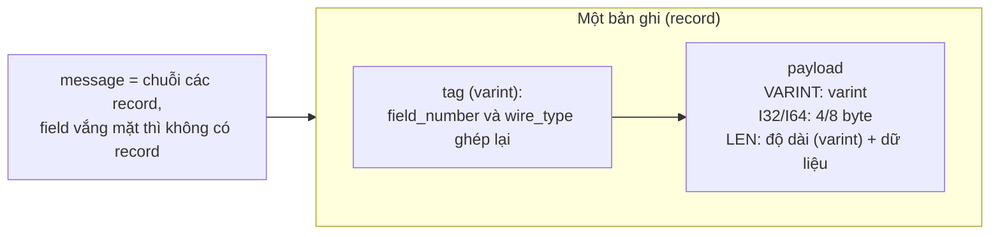
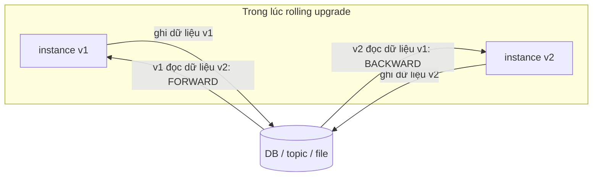

# P12 · Chương 04 — Encoding và tiến hóa schema

> Phạm vi: chương này mượn khung chủ đề từ chương 4 của *Designing Data-Intensive Applications* (DDIA), "Encoding and Evolution"[^ddia-toc]. Sách không có bản đọc tự do, nên mọi khẳng định bên dưới lấy từ nguồn mở: bài giảng *Distributed Systems* của Kleppmann ở Cambridge, đặc tả và tài liệu chính thức của JSON, Protocol Buffers, Avro, gRPC, Confluent Schema Registry, PostgreSQL 16, cùng docs.rs của các crate Rust (phiên bản ghi trong từng chú thích). Không có thí nghiệm nào được chạy; code chỉ để minh họa và không khẳng định output.

## Bạn sẽ hiểu được gì

- **Q1.** Vì sao dữ liệu trong bộ nhớ phải được *encode* trước khi lưu hay gửi đi, và JSON/CSV hạn chế ở đâu (số, binary, schema)? → mục 1
- **Q2.** Protocol Buffers biến một message thành byte ra sao (field number, wire type, varint), và vì sao thiết kế đó chịu được schema đổi? → mục 2
- **Q3.** Những thay đổi nào trên một `.proto` là an toàn, có điều kiện, hay phá hỏng dữ liệu, và vì sao không bao giờ tái dùng field number? → mục 3
- **Q4.** Avro làm khác Protobuf thế nào: writer schema, reader schema và *schema resolution* hoạt động ra sao? → mục 4
- **Q5.** Backward compatibility và forward compatibility khác nhau thế nào, và vì sao *rolling upgrade* buộc ta cần cả hai? → mục 5
- **Q6.** Khi dữ liệu đi qua database, "code mới đọc dữ liệu cũ" và "code cũ ghi đè dữ liệu mới" gây vấn đề gì? → mục 6
- **Q7.** Qua RPC/REST và qua message broker, ai nâng cấp trước, và schema registry giải quyết việc gì? → mục 7

## Kiến thức cần trước

Bạn đã viết service có API JSON, đã đọc ghi Postgres và biết Kafka ở mức người dùng. Chương này lo phần bên dưới: byte trên dây và trong đĩa trông thế nào, và làm sao đổi schema mà không làm hỏng dữ liệu đang chạy. Ví dụ code dùng Rust, chỉ cần đọc được `struct` và derive.

- [P2 · Chương 02 — Biểu diễn dữ liệu](../02-cpu/02-bieu-dien-du-lieu.md): số nguyên có dấu/không dấu, endianness (mục 4), `f64` (mục 5), UTF-8 (mục 6). Chương này chỉ dùng lại ở mức "đặc tả định dạng chọn gì".
- [P6 · Chương 08 — DNS, HTTP, TLS](../06-networking/08-dns-http-tls.md), mục 5: HTTP/1.1 và HTTP/2, nền của REST và gRPC.
- [P7 · Chương 09 — Async trong production](../07-io-async/09-async-trong-production.md), mục 2: `timeout` chỉ ngừng chờ chứ không hủy việc phía xa. Mục 7 dưới đây dùng lại ý này cho RPC.
- Chương P12 liên quan: [02 — Mô hình dữ liệu](02-mo-hinh-du-lieu.md) (schema-on-write / schema-on-read), [05 — Replication](05-replication.md), [10 — Batch processing](10-batch-processing.md), [11 — Stream processing](11-stream-processing.md). Tổng quan kiến trúc hệ dữ liệu và vận hành nằm ở [13 — Kiến trúc hệ dữ liệu](13-kien-truc-he-du-lieu.md).

## 1. Vì sao cần encoding; JSON, CSV hạn chế ở đâu (Q1)

> **Trả lời ngắn.** Trong bộ nhớ, dữ liệu là struct và con trỏ, còn đĩa và mạng chỉ chở được dãy byte, nên phải encode trước khi lưu hay gửi và decode khi đọc lại; với RPC việc này gọi là *marshalling*[^cam-marshal]. JSON và CSV dễ đọc, thư viện nào cũng có (nhận xét của người soạn), nhưng lỏng: số nguyên chỉ chắc chắn khớp giữa các implementation trong khoảng $[-(2^{53})+1,\ 2^{53}-1]$[^rfc8259-num]. CSV thì thậm chí không có đặc tả chính thức[^rfc4180-nospec]. Khi cần hợp đồng chặt mà vẫn đổi schema được, người ta chuyển sang định dạng nhị phân có schema như Protobuf và Avro.

**Giải thích.**

*Với service của bạn.* Hãy hình dung `orders`, một service Rust nhận đơn hàng qua gRPC từ web, lưu vào bảng `orders` trong Postgres, rồi đẩy sự kiện `OrderPlaced` lên Kafka cho service `billing` tính tiền. Ta sẽ bám theo `orders` suốt chương (nhận xét của người soạn: đây là ví dụ giả định, không phải code trong repo). Hôm nay nó chạy v1. Tuần sau ta phát hành v2: bỏ field `legacy_note`, thêm field `currency`. Trong mấy giờ rollout, v1 và v2 chạy song song, cùng gọi `billing`, cùng đọc ghi một bảng và một topic. Câu hỏi của cả chương là: bên này ghi byte ra thì bên kia đọc lại ra sao khi hai bên không cùng phiên bản? Mục này đi bước đầu tiên: byte của `orders` rời process dưới dạng nào, và JSON hay CSV chịu được đến đâu.

### 1.1 Vì sao không gửi thẳng struct

`Order` của `orders` là một struct nằm trong heap, có con trỏ tới `String` và `Vec`. Gửi nguyên vùng nhớ đó sang `billing` thì vô nghĩa: địa chỉ con trỏ chỉ có nghĩa trong process của `orders`, còn layout của struct do compiler quyết định. Rust cũng không hứa gì thêm, vì layout mặc định `repr(Rust)` chỉ cam kết vài tính chất cơ bản, ngoài ra không có bảo đảm nào khác[^rust-layout]. Vì vậy `orders` phải dịch struct thành một dãy byte theo quy ước hai bên cùng biết, rồi `billing` dịch ngược lại. Quy ước đó là *encoding format*. Với RPC, stub phía gọi mã hóa các đối số vào một message gửi sang node kia, và quá trình ấy gọi là marshalling[^cam-marshal].

Chi tiết layout của struct nằm ở [P10 · Chương 02](../10-rust-internals/02-type-layout.md). Thứ tự byte của số nhiều byte là một lựa chọn nữa mà hai bên phải thống nhất, xem [P2 · Chương 02, mục 4](../02-cpu/02-bieu-dien-du-lieu.md).

### 1.2 JSON: tiện nhưng lỏng

Lựa chọn dễ nhất cho `orders` là JSON. Một JSON object là tập không có thứ tự các cặp tên/giá trị, và giá trị chỉ có thể là string, number, boolean, null, object hoặc array[^rfc8259-obj]. Danh sách đó không có "dãy byte". Muốn đính kèm dữ liệu nhị phân, chẳng hạn chữ ký số của đơn hàng, `orders` phải tự mã hóa nó thành chuỗi. ProtoJSON chọn base64 chuẩn cho field `bytes`[^pbjson-bytes]. Base64 biến mỗi nhóm 24 bit đầu vào thành 4 ký tự[^rfc4648-b64], nên văn bản dài hơn dữ liệu gốc (suy luận của người soạn từ tỷ lệ 3 byte thành 4 ký tự).

Chỗ dễ vỡ hơn là số. RFC 8259 cho phép mỗi implementation tự đặt giới hạn về miền giá trị và độ chính xác của số[^rfc8259-limits]. Với phần mềm dùng double (IEEE 754 binary64), chỉ những số nguyên trong khoảng $[-(2^{53})+1,\ 2^{53}-1]$ là interoperable, nghĩa là mọi implementation đồng ý chính xác về giá trị[^rfc8259-num]. Ngoài khoảng đó RFC không hứa gì (nhận xét của người soạn). Thực tế còn rõ hơn: nhiều implementation coi mọi số JSON là binary64 và âm thầm mất chính xác khi gặp số nguyên lớn hơn $2^{53}$[^pbjson-lossy]. Vì thế serializer của ProtoJSON xuất `int64` thành chuỗi[^pbjson-int64]. Với `orders`, nếu `id` là số 64-bit kiểu snowflake và đi qua JSON number tới client JavaScript, ID có thể bị làm tròn mà không có lỗi nào báo ra (nhận xét của người soạn).

Cũng có bẫy ở key trùng. Khi các tên trong một object không duy nhất, hành vi của phần mềm nhận là không đoán trước được[^rfc8259-dup]. Hệ quả hiện ra ngay ở tầng database: cột `json` của PostgreSQL lưu bản sao đúng nguyên văn, giữ khoảng trắng, thứ tự key và mọi cặp key/value trùng[^pg-json-exact]. Cột `jsonb` thì bỏ khoảng trắng, không giữ thứ tự key, và với key trùng chỉ giữ giá trị cuối[^pg-json].

### 1.3 CSV: không có chuẩn

Nếu `billing` xuất báo cáo cuối ngày bằng CSV thì còn lỏng hơn nữa. RFC 4180 tự nhận không có đặc tả chính thức nào cho CSV nên người ta hiểu file CSV theo nhiều cách khác nhau; tài liệu chỉ ghi lại dạng mà đa số implementation có vẻ theo[^rfc4180-nospec]. Dòng header là tùy chọn[^rfc4180-header]. Đặc tả cũng không có khái niệm kiểu (suy luận của người soạn), nên "123" là số hay chuỗi, ngày tháng theo format nào, ô rỗng là NULL hay chuỗi rỗng đều do hai bên tự thỏa thuận ngoài file.

### 1.4 Nhị phân có schema

Protobuf và Avro đi hướng ngược lại: schema là hợp đồng viết bằng một ngôn ngữ riêng (IDL), và code ở cả hai phía được sinh hoặc cấu hình từ đó. Từ IDL, lập trình viên sinh mã marshalling/unmarshalling và stub cho từng ngôn ngữ của mỗi service[^cam-idl]. Hai mục kế tiếp xem chúng mã hóa ra byte thế nào. Bảng dưới so sánh nhanh bốn định dạng:

| Tiêu chí | JSON | CSV | Protobuf | Avro |
|---|---|---|---|---|
| Có kiểu nhị phân (bytes) | không, phải tự mã hóa (vd. base64)[^pbjson-bytes] | không có khái niệm kiểu (suy luận của người soạn; RFC 4180 không có đặc tả chính thức[^rfc4180-nospec]) | có (`bytes`, cùng wire type LEN với `string`)[^pb-enc-bytes] | có (`bytes`)[^avro-bytes] |
| Tên field có trong dữ liệu | có[^rfc8259-obj] | tùy chọn (dòng header)[^rfc4180-header] | không, chỉ có số hiệu field[^pb-enc-kv] | không[^avro-noname] |
| Cần schema để đọc | không[^serde-selfdesc] | không (suy luận của người soạn) | cần để biết tên và kiểu field (file `.proto`)[^pb-enc-kv] | có, schema của writer[^avro-noname] |

<details><summary>Đi sâu: key lạ, JSON trong database, dữ liệu "self-describing" và cái giá của nó</summary>

- JSON còn hai quy định nhỏ. Giá trị không biểu diễn được trong ngữ pháp, như `NaN` và `Infinity`, không được phép[^rfc8259-nan]. Còn JSON trao đổi giữa các hệ thống không thuộc cùng một hệ sinh thái đóng thì phải mã hóa bằng UTF-8[^rfc8259-utf8].
- JSON và CBOR là định dạng *self-describing*: người đọc nhìn dữ liệu là biết nó là gì. RFC 8949 (CBOR) đặt mục tiêu thiết kế là không cần schema kèm theo hay được giả định, vì decoder giải mã được một item mà không cần biết gì thêm[^cbor-schemaless]. Tuy vậy RFC cũng thừa nhận rằng trong thực tế encoder và decoder vẫn có chung cách hiểu về nội dung mong đợi của một item[^cbor-shared].
- Trong hệ sinh thái Rust, serde mô tả cùng sự phân biệt ấy. Format self-describing như JSON cho phép nhìn dữ liệu mà biết nó đại diện cho cái gì[^serde-selfdesc]. Format như Postcard thì phải được *báo trước* là trong input có gì[^serde-nonself].
- Cái giá của self-describing là tên field lặp lại ở mọi bản ghi, trong khi Protobuf và Avro không chứa tên (suy luận của người soạn từ hai nguồn trên). Cái lợi là đọc được mà không cần schema, và key lạ có thể bị bỏ qua tùy ngữ cảnh (mục 8).
- Cột `jsonb` có thêm một ràng buộc: nó từ chối số nằm ngoài miền của kiểu `numeric` trong PostgreSQL, còn `json` thì không[^pg-jsonb-num]. Nghĩa là "JSON hợp lệ" chưa chắc là "jsonb hợp lệ".

</details>

**Quay lại Q1:** encoding là hợp đồng giữa hai chương trình về cách biến cấu trúc thành byte; JSON/CSV tiện nhưng lỏng (số chỉ chắc chắn đến $2^{53}$, không có bytes, key trùng không xác định, CSV không có chuẩn), nên một hệ thống cần chặt chẽ hơn, như `orders` và `billing`, sẽ chuyển sang định dạng nhị phân có schema.

## 2. Protocol Buffers: field number và wire format (Q2)

> **Trả lời ngắn.** Một message Protobuf là chuỗi các bản ghi, và khóa của mỗi bản ghi chỉ là *số hiệu field*; tên và kiểu khai báo nằm trong file `.proto`, không nằm trong byte[^pb-enc-kv]. Mỗi bản ghi gồm một tag (field number ghép với *wire type*) rồi đến payload, và wire type cho parser biết payload lớn bao nhiêu nên parser cũ nhảy qua được field mới mà nó không hiểu[^pb-enc-skip]. Field vắng mặt thì chỉ cần bỏ bản ghi của nó đi[^pb-enc-missing].

**Giải thích.**

*Với `orders`.* Khi `orders` gửi một `Order` cho `billing` qua gRPC, byte trên dây không có chữ "customer" hay "currency", chỉ có số. Hai bên hiểu nhau vì cùng build từ một file `.proto`. Vậy nếu `orders` v2 gửi thêm field `currency = 4` mà `billing` v1 chưa biết thì sao? Mục này cho thấy byte được xếp ra sao, và vì sao `billing` v1 vẫn đọc tiếp được.

### 2.1 Một ví dụ nhỏ: varint và tag

Lấy `message Test1 { int32 a = 1; }` với `a = 150`. Bản mã hóa là ba byte `08 96 01`[^pb-enc-simple]. Để đọc được ba byte đó cần hiểu hai thứ: varint và tag.

*Varint* (số nguyên độ dài thay đổi) mã hóa số nguyên không dấu 64-bit trong 1 đến 10 byte, số nhỏ dùng ít byte hơn[^pb-enc-varint]. Mỗi byte lấy bit cao nhất làm *continuation bit* báo "byte tiếp theo vẫn thuộc số này"; 7 bit thấp còn lại là dữ liệu[^pb-enc-varint2]. Với 150, hai byte `96 01` giải mã như sau: bỏ bit cao của từng byte, còn `0010110` và `0000001`; đảo thứ tự hai nhóm rồi nối lại thành `0000001 0010110`, tức 150[^pb-enc-150].

*Tag* là phần đứng trước payload của mỗi bản ghi. Nó là một varint ghép từ field number và wire type theo công thức `(field_number << 3) | wire_type`[^pb-enc-tag]. Byte `08` = `0000 1000`: ba bit thấp là `000` (wire type 0, VARINT), phần còn lại dịch phải 3 bit ra field number 1. Sau đó đọc varint `96 01` = 150[^pb-enc-simple] (phép tính từ công thức tag, suy luận của người soạn).

### 2.2 Wire type

Có sáu wire type: VARINT, I64, LEN, SGROUP, EGROUP và I32[^pb-enc-wt]. Bảng ánh xạ kiểu field sang wire type như sau: VARINT cho `int32`, `int64`, `uint32`, `uint64`, `sint32`, `sint64`, `bool`, `enum`; I64 cho `fixed64`, `sfixed64`, `double`; LEN cho `string`, `bytes`, message lồng nhau và repeated field dạng packed; I32 cho `fixed32`, `sfixed32`, `float`; còn SGROUP/EGROUP là group đã deprecated[^pb-enc-wtmap].

Wire type LEN có độ dài thay đổi: ngay sau tag là một varint chỉ độ dài, rồi mới đến payload[^pb-enc-lendef]. Ví dụ `string b = 2` bằng `"testing"` ra `12 07 74 65 73 74 69 6e 67`: tag `12` là field 2 kiểu LEN, độ dài 7, rồi 7 byte UTF-8[^pb-enc-len].



(Sơ đồ là minh họa của người soạn từ công thức tag và quy tắc LEN ở trên, không phải hình trích từ nguồn.)

### 2.3 Vì sao `billing` v1 bỏ qua được field 4

Quay lại câu hỏi mở đầu mục. Khi đọc một bản ghi, parser đọc tag trước, biết wire type, và từ wire type biết payload dài bao nhiêu mà không cần biết field đó nghĩa là gì. Sơ đồ này là TLV (tag–length–value), và đó chính là lý do parser cũ nhảy qua được field mới[^pb-enc-skip]. Nói cách khác, khả năng bỏ qua field `currency` của `billing` v1 đã nằm sẵn trong định dạng chứ không phải phép màu của thư viện (nhận xét của người soạn). Mục 3 dựa hoàn toàn vào điều này.

### 2.4 Số âm

Các kiểu `intN` mã hóa số âm bằng two's complement, nên khi coi là số không dấu 64-bit thì bit cao nhất được bật và cần đủ 10 byte[^pb-enc-neg]. Các kiểu `sintN` dùng ZigZag: số dương $p$ thành $2p$, số âm $n$ thành $2|n|-1$[^pb-enc-zigzag]. Nhờ vậy số có trị tuyệt đối nhỏ thì mã hóa ngắn (nhận xét của người soạn). Nếu field hay mang số âm, như số dư điều chỉnh của đơn hàng, nên chọn `sint32`/`sint64`, nhưng đổi kiểu giữa `int32` và `sint32` trên field đang dùng là phá dữ liệu (mục 3).

### 2.5 Thứ tự, trùng lặp, không canonical

Field number có thể khai báo theo thứ tự tùy ý trong `.proto` và thứ tự đó không ảnh hưởng việc serialize[^pb-enc-order]. Ngược lại, parser phải đọc được các field theo mọi thứ tự[^pb-enc-noorder]. Nếu một field không phải repeated xuất hiện nhiều lần, với số và chuỗi thì parser lấy giá trị cuối cùng[^pb-enc-last].

Hệ quả thực tế cho `orders`: **đừng dùng byte đã serialize làm khóa cache hay để so sánh bằng nhau**. Tài liệu Protobuf cảnh báo không nên giả định byte output của một message là ổn định[^pb-enc-stable]. Best practices thì nói rõ hơn: tính ổn định đó không được bảo đảm giữa các binary, kể cả giữa các lần build của cùng một binary[^pbdos-stable].

<details><summary>Đi sâu: kích thước tag, packed, field 19000–19999, giới hạn 29 bit</summary>

- Field number nằm trong khoảng 1 đến 536,870,911[^pb3-num]. Dải 19,000–19,999 dành riêng cho implementation của Protobuf[^pb3-19000]. Giới hạn là 29 bit thay vì 32 vì 3 bit dành cho wire type[^pb3-29bits].
- Field 1–15 chỉ tốn 1 byte cho tag, field 16–2047 tốn 2 byte[^pb3-1to15]. Suy luận của người soạn từ công thức tag: field 16 cho tag $16\cdot 8+0=128$, cần 2 byte varint vì 128 > 127. Do đó nên dành số 1–15 cho field hay xuất hiện[^pb3-1to15].
- Repeated field kiểu số (scalar không phải string/bytes) mặc định *packed* trong proto3[^pb3-packed]. Edition 2023 cũng vậy[^pb-enc-packed0]. Packed nghĩa là cả danh sách là một record LEN chứa các phần tử nối nhau. Parser vẫn phải đọc được cả dạng không packed lẫn nhiều record packed rời nhau, nên thêm `[packed=true]` vào field có sẵn là thay đổi tương thích cả hai chiều[^pb-enc-packed].
- Trường message lồng dùng wire type LEN, bên trong là các record như một message thường[^pb-enc-sub]. Nếu cùng một field message xuất hiện nhiều lần thì parser *merge* các lần đó: parse chuỗi nối hai message cho cùng kết quả với parse riêng rồi merge[^pb-enc-merge].
- `map<K,V>` được mã hóa gần như repeated message với hai field mỗi phần tử; thứ tự phần tử map không được bảo đảm khi serialize[^pb-enc-map].
- Message serialize phải nhỏ hơn 2 GiB[^pb-enc-limit].

</details>

**Quay lại Q2:** Protobuf ghi `(field_number, wire_type, payload)` cho từng field có mặt; số hiệu thay cho tên, wire type cho biết độ dài, nên định dạng gọn mà `billing` v1 vẫn nhảy qua được field `currency` nó không biết.

## 3. Protobuf: đổi schema thế nào cho đúng (Q3)

> **Trả lời ngắn.** Thêm field mới và xóa field đều an toàn, miễn là không bao giờ dùng lại số hiệu của field đã xóa[^pb3-safe-remove]. Đổi số hiệu của một field thực chất là xóa field cũ rồi thêm field mới[^pb3-change]. Một số đổi kiểu chỉ tương thích có điều kiện vì có thể cắt mất bit, nên phải quản lý rollout cẩn thận[^pb3-compat-rollout]. Còn tái dùng số hiệu làm giải mã mơ hồ, vì định dạng không có cách nhận ra field mã hóa bằng định nghĩa này nhưng giải mã bằng định nghĩa khác[^pb3-lean].

**Giải thích.**

*Với `orders`.* Từ v1 sang v2 ta muốn bỏ `legacy_note = 3` và thêm `currency`. Số 3 và 4 không chỉ nằm trong file `.proto`: số hiệu đã đi vào log, vào message còn nằm trên topic Kafka, vào mọi file đã lưu (nhận xét của người soạn). Nếu từ nay số 3 mang nghĩa khác, mọi bản ghi cũ bị đọc sai mà không có lỗi nào báo. Mục này nói rõ đổi gì thì an toàn, đổi gì thì không.

### 3.1 Ba nhóm thay đổi

Tài liệu Protobuf chia mọi thay đổi trên message thành ba nhóm.

**Nhóm wire-safe.** Gồm thêm field mới: message do code cũ serialize vẫn parse được bằng code mới[^pb3-safe-add]. Binary cũ cũng chỉ bỏ qua field mới khi parse[^pb3-safe-add2]. Xóa field cũng an toàn, miễn là không dùng lại số hiệu đó (nên đổi tên thành `OBSOLETE_` hoặc `reserved`)[^pb3-safe-remove]. Thêm giá trị vào enum cũng vậy[^pb3-safe-enum]. Tài liệu cảnh báo thêm rằng thay đổi wire-safe vẫn có thể làm gãy *code ứng dụng*, ví dụ một `switch` vét cạn trên enum không còn vét cạn[^pb3-safe-app].

**Nhóm wire-unsafe.** Đổi field number của field đang tồn tại là không an toàn[^pb3-unsafe-num]. Chuyển field vào một `oneof` đã có cũng thế[^pb3-unsafe-oneof]. Lý do: số hiệu định danh field trên wire, nên không thể đổi khi message đã được dùng[^pb3-immut]. "Đổi" số hiệu thực chất là xóa field rồi thêm một field cùng kiểu với số mới[^pb3-change].

**Nhóm wire-compatible có điều kiện.** Đây là các thay đổi mà dữ liệu parse được cả trước lẫn sau, nhưng có thể mất thông tin. Ví dụ `int32` → `int64` tương thích, nhưng nếu ghi giá trị lớn hơn `INT32_MAX` thì client đọc bằng `int32` bỏ mất các bit cao[^pb3-compat-int]. `int32`, `uint32`, `int64`, `uint64` và `bool` tương thích với nhau, còn `sint32`/`sint64` chỉ tương thích với nhau chứ không với các kiểu số nguyên còn lại[^pb3-compat-sint]. Những đổi này chỉ nên làm nếu bạn quản lý được rollout, chẳng hạn vẫn chỉ ghi giá trị hợp lệ cho `int32` cho đến khi schema mới đã ở mọi endpoint[^pb3-compat-rollout]. Với schema công bố ra ngoài tổ chức thì nhìn chung không nên làm[^pb3-compat-pub]. Best practices còn khuyên "gần như đừng bao giờ" đổi kiểu field, vì ngay khi schema mới parse được dữ liệu cũ, việc rollout vẫn khó làm an toàn[^pbdos-type].

### 3.2 Xóa field và vì sao không tái dùng số

Khi xóa `legacy_note`, bạn có thể bỏ định nghĩa field khỏi message nhưng phải `reserved` số hiệu của nó[^pb3-reserve]. Nên reserve cả tên. Dùng lại tên cũ nói chung an toàn, trừ khi dùng TextProto hoặc JSON, nơi tên field được serialize[^pb3-reserve-name]. Lưu ý reserved name chỉ ảnh hưởng hành vi của compiler `protoc`, không ảnh hưởng runtime[^pb3-reserve-compiler]. Cú pháp ví dụ: `reserved 2, 15, 9 to 11;`, trong đó dải số tính cả hai đầu[^pb3-reserved-syntax].

Lý do thực tế để không dùng lại số: nếu thay đổi từng chạy trên production thì có thể vẫn còn bản serialize của proto trong một file log nào đó, hoặc code cũ trong một server khác sẽ hỏng[^pbdos-reuse]. Tài liệu liệt kê hậu quả của việc mã hóa một field bằng định nghĩa này rồi giải mã bằng định nghĩa khác: tốn thời gian debug, lỗi parse/merge (trường hợp tốt nhất), rò rỉ PII, hỏng dữ liệu[^pb3-reuse]. Nguyên nhân hay gặp là "đánh số lại cho đẹp", vì renumbering thực chất xóa và thêm lại mọi field liên quan, và xóa field mà quên reserve[^pb3-reuse-causes].

### 3.3 Field vắng mặt, default, enum và required

Wire format chỉ chứa giá trị có mặt. Với field implicit presence, giá trị bằng default không được serialize[^pbpres-implicit-ser]. Vì vậy sau khi parse không thể phân biệt "đặt rõ là `false`" với "không đặt"[^pb3-implicit]. Cho nên phải thận trọng khi gán ý nghĩa cho giá trị mặc định. Best practices nói gần như đừng bao giờ đổi default của một field, vì nó gây lệch phiên bản giữa client và server[^pbdos-default]. Cùng đoạn đó ghi rõ proto3 đã bỏ khả năng tự đặt default[^pbdos-default-proto3].

Với enum, giá trị khai báo đầu tiên nên là `..._UNSPECIFIED` với tag 0[^pbdos-enum-unspec]. Nên tránh gán cho nó ý nghĩa nghiệp vụ để dễ thêm giá trị về sau[^pbdos-enum-nomean]. Khi giải mã, giá trị enum lạ vẫn được giữ trong message, còn cách biểu diễn thì tùy ngôn ngữ[^pb3-enum-open].

Về `required`: đừng bao giờ thêm field required, vì có thể bốn năm sau nó không còn đúng về nghiệp vụ mà proto vẫn bắt phải điền[^pbdos-required]. Proto3 đã bỏ hẳn required[^pbdos-required2], nên lời khuyên này nhắm tới proto2 và Editions; với proto3 nguồn ghi là không áp dụng[^pbdos-required3].

### 3.4 Unknown field và bẫy đọc–sửa–ghi

Khi một binary cũ parse dữ liệu của binary mới, các field mới trở thành unknown fields trong binary cũ[^pb3-unknown]. Proto3 giữ chúng và ghi lại khi serialize[^pb3-unknown-keep]. Nhưng có hai hành động làm mất chúng: serialize sang JSON, hoặc duyệt từng field để điền vào một message mới[^pb3-unknown-lose]. Muốn sao chép thì dùng API theo message như `CopyFrom()`/`MergeFrom()`[^pb3-unknown-copy].

Đây là bẫy kinh điển của proxy/gateway (nhận xét của người soạn). Hãy nghĩ đến một service trung gian giữa `orders` và `billing` còn dùng schema cũ: nếu nó copy từng field sang message mới thì sẽ cắt mất `currency` mà không ai hay.

### 3.5 Đừng dùng text/JSON để trao đổi nếu cần tiến hóa

Format văn bản biểu diễn field và giá trị enum bằng chuỗi. Vì vậy code cũ parse sẽ lỗi khi một field hay giá trị enum bị đổi tên hoặc khi có cái mới được thêm[^pbdos-text]. ProtoJSON không hỗ trợ unknown field và đưa tên field/enum vào message nên rất khó đổi tên về sau, còn xóa field là breaking change gây lỗi parse[^pbjson-evol].

Best practices cũng khuyên dùng message khác nhau cho API RPC và cho lưu trữ dài hạn, vì nhu cầu của hai thứ tự phân kỳ về sau[^pbdos-rpc-storage]. Trong thực tế (nhận xét của người soạn) nghĩa là đặt một lớp mapping giữa DTO của API và DTO lưu trữ: mất công viết mapping, đổi lại mỗi bên tự tiến hóa được.

<details><summary>Đi sâu: bảng quy tắc ngắn và ví dụ tiến hóa một message</summary>

| Thay đổi | Mức | Ghi chú |
|---|---|---|
| Thêm field mới | wire-safe | binary cũ bỏ qua[^pb3-safe-add2] |
| Xóa field (reserve số hiệu) | wire-safe | không tái dùng số[^pb3-safe-remove] |
| Thêm giá trị enum | wire-safe | có thể làm gãy code `switch` vét cạn[^pb3-safe-app] |
| `int32` ↔ `int64` ↔ `uint*` ↔ `bool` | compatible | có thể cắt bit[^pb3-compat-int] |
| `int32` ↔ `sint32` | không tương thích | `sintN` chỉ tương thích với nhau[^pb3-compat-sint] |
| Đổi field number | unsafe | = xóa + thêm[^pb3-change] |
| Chuyển field vào `oneof` đã có | unsafe | [^pb3-unsafe-oneof] |

Ví dụ tiến hóa của `Order` (minh họa, không phải output thật):

```proto
// v1
message Order {
  int64 id = 1;
  string customer = 2;
  string legacy_note = 3;
}

// v2: bỏ legacy_note, thêm currency; không bao giờ dùng lại số 3.
message Order {
  reserved 3;
  reserved "legacy_note";
  int64 id = 1;
  string customer = 2;
  string currency = 4;
}
```

Nếu v1 đọc bản ghi do v2 viết: field 4 là unknown, được bỏ qua hoặc giữ lại[^pb3-unknown]. Field 3 không còn trong dữ liệu mới nên v1 thấy giá trị mặc định (suy luận của người soạn từ nguyên lý "field vắng mặt thì không có record"[^pb-enc-missing]). Nếu v2 đọc bản ghi cũ do v1 viết: field 3 là unknown với v2, còn `currency` vắng mặt nên mang giá trị mặc định[^pb3-safe-add].

</details>

**Quay lại Q3:** thêm và xóa field an toàn nhờ parser bỏ qua field lạ; điều kiện sống còn là số hiệu đã dùng thì không bao giờ dùng lại với nghĩa khác, và mọi đổi kiểu đều phải coi là cần quản lý rollout.

## 4. Avro: writer schema, reader schema và schema resolution (Q4)

> **Trả lời ngắn.** Dữ liệu Avro nhị phân không chứa tên field hay thông tin kiểu, nên không có schema thì không đọc được[^avro-noname]. Vì vậy nơi lưu dữ liệu Avro nên kèm *writer's schema* của dữ liệu đó[^avro-store]. Người đọc có thể dùng thêm một *reader's schema* khác, và khi đó *schema resolution* so khớp field theo *tên*[^avro-resolve-names]. Field reader có mà writer thiếu thì lấy default của reader[^avro-resolve-default].

**Giải thích.**

*Với `orders`.* Giả sử `orders` đẩy `OrderPlaced` lên Kafka bằng Avro thay vì Protobuf. Khi `billing` lấy một message ra, trong byte chỉ có các giá trị liền nhau, không có số hiệu, không có tên. Muốn biết chỗ nào là `id`, chỗ nào là `customer`, `billing` phải có đúng schema mà `orders` đã dùng để ghi. Mục này xem Avro giải quyết chuyện đó thế nào, và đổi schema ra sao khi hai bên không còn dùng cùng một schema.

### 4.1 Encoding gọn nhất có thể

Một record Avro được mã hóa bằng cách nối các giá trị field theo đúng thứ tự khai báo[^avro-record]. Với record `{a: long, b: string}`, `a = 27` (hex `36`) và `b = "foo"` (hex `06 66 6f 6f`), kết quả đơn giản là `36 06 66 6f 6f`[^avro-example]. Giá trị `int`/`long` dùng zig-zag độ dài thay đổi[^avro-zigzag]. Chuỗi là một `long` chỉ độ dài rồi đến các byte UTF-8[^avro-string]. Không có tag, không có tên, nên người đọc hoàn toàn phụ thuộc vào schema đã dùng lúc ghi[^avro-reliant].

### 4.2 Vì sao writer's schema phải đi cùng dữ liệu

Đặc tả Avro nói thẳng: file hay hệ thống lưu dữ liệu Avro nên luôn kèm writer's schema, và hệ RPC dựa trên Avro phải bảo đảm bên nhận có bản sao schema mà bên gửi đã dùng[^avro-store]. Có ba cách làm trong thực tế:

- *File:* object container file có header chứa schema, và mọi object trong file ghi theo schema đó[^avro-container].
- *RPC:* bước handshake bảo đảm client và server có định nghĩa protocol của nhau để giải mã đúng[^avro-handshake].
- *Bản ghi lẻ lưu lâu*, như message nằm vài tuần trong một topic Kafka[^avro-single-kafka]. Cho trường hợp này có định dạng single-object, gồm marker hai byte `C3 01`, rồi fingerprint CRC-64-AVRO 8 byte của schema, rồi dữ liệu Avro[^avro-single]. Lý do được nêu rõ: sau khi schema đổi, hệ lưu trữ sẽ chứa bản ghi viết bằng nhiều schema khác nhau, và schema thường quá lớn để nhúng vào từng message[^avro-single-why].

### 4.3 Schema resolution

Schema dùng để ghi dữ liệu gọi là *writer's schema*, schema mà ứng dụng mong đợi gọi là *reader's schema*[^avro-resolve-defs]. Với hai record cùng tên, thứ tự field có thể khác nhau vì field được so khớp theo tên[^avro-resolve-names]. Với record có ba quy tắc, ở đây xét `billing` v2 đọc dữ liệu do `orders` ghi:

1. Field có trong writer nhưng không có trong reader: giá trị của writer bị bỏ qua[^avro-resolve-ignore].
2. Field có trong reader, không có trong writer, và reader có default: dùng default của reader[^avro-resolve-default]. Đây là trường hợp `billing` v2 đọc message cũ chưa có `currency`.
3. Field có trong reader, không có trong writer, và reader *không* có default: báo lỗi[^avro-resolve-err].

Một số kiểu còn được "thăng hạng" khi đọc, ví dụ `int` thành `long`, `float` hoặc `double`[^avro-promote]. Enum cũng tiến hóa được: nếu reader gặp symbol của writer mà mình không có, và reader khai báo `default` cho enum thì dùng default đó, nếu không thì báo lỗi[^avro-enum-default].

Default chỉ phục vụ lúc đọc. Đặc tả nhấn mạnh default của field chỉ dùng khi đọc bản ghi thiếu field, cho mục đích schema evolution, và sự hiện diện của default không làm field thành tùy chọn lúc mã hóa[^avro-default-def]. Field tùy chọn thường khai báo bằng union có `null` (nhận xét của người soạn; xem ví dụ union `["null","string"]` ở phần Đi sâu). Default của field union ứng với schema đầu tiên khớp trong union[^avro-union-default]. Hệ quả: thêm field vào reader schema kèm default thì đọc được dữ liệu cũ (backward), đúng mô hình mục 5 dùng.

Đổi tên cũng có cách. Field hay kiểu có thể có `aliases`, và implementation có thể (tùy chọn) dùng alias để ánh xạ writer's schema vào reader's schema, phục vụ cả schema evolution lẫn xử lý bộ dữ liệu khác nguồn[^avro-alias].

### 4.4 So với Protobuf

(Tổng hợp của người soạn từ mục 3 và 4.) Protobuf chống chịu thay đổi bằng *số hiệu*. Nhờ đó writer không cần gửi schema, nhưng mọi bên phải giữ kỷ luật về số hiệu (mục 3). Avro chống chịu bằng *so khớp tên cộng default*. Nhờ đó không cần số hiệu, đổi lại người đọc phải biết schema của writer lúc đọc. Vì vậy, theo nhận xét của người soạn, Avro hợp với dữ liệu sinh tự động từ schema động, như dump bảng DB, và với batch/stream nơi có file hoặc registry giữ schema; Protobuf hợp với RPC nơi hai bên đã build chung IDL, như `orders` gọi `billing`.

<details><summary>Đi sâu: block array/map, union, canonical form, zig-zag của <code>64</code></summary>

- Array và map được mã hóa thành các *block*: mỗi block có một `long` đếm rồi đến từng phần tử, và block đếm 0 là kết thúc. Nếu đếm âm thì ngay sau có kích thước block tính bằng byte để nhảy qua nhanh, chẳng hạn khi chiếu (project) record về một tập con field[^avro-blocks].
- Union mã hóa bằng một `int` chỉ vị trí nhánh trong union, rồi đến giá trị theo nhánh đó. Với `["null","string"]`, `null` thành `00` và chuỗi `"a"` thành `02 02 61`[^avro-union].
- Hai schema "giống nhau" theo nghĩa đọc dữ liệu được định nghĩa bằng *Parsing Canonical Form*[^avro-canon]. Dạng này chỉ giữ các thuộc tính liên quan đến parse và bỏ phần còn lại như `doc`, `aliases`[^avro-canon-strip]. Fingerprint trong single-object encoding là fingerprint của schema[^avro-single].
- Với `long` zig-zag, bảng của đặc tả cho `64` là `80 01` và `-64` là `7f`[^avro-zigzag-tbl].
- JSON encoding của Avro khác binary ở union: giá trị union (không null) viết thành object một cặp {tên kiểu: giá trị}[^avro-json-union]. JSON encoding vẫn cần schema gốc để xử lý, vì nó không phân biệt `int`/`long`, `float`/`double`, record/map...[^avro-json]

</details>

**Quay lại Q4:** Avro mã hóa không tên, không tag; đọc đúng nhờ có writer's schema, và tiến hóa nhờ resolution theo tên cùng default của reader.

## 5. Backward/forward compatibility và rolling upgrade (Q5)

> **Trả lời ngắn.** *Backward compatible* nghĩa là code hay schema mới đọc được dữ liệu do bản cũ ghi[^conf-backward]. *Forward compatible* nghĩa là code hay schema cũ đọc được dữ liệu do bản mới ghi, dù không dùng hết khả năng của bản mới[^conf-forward]. Khi nâng cấp từng node một[^cam-rolling], nhiều phiên bản của ứng dụng chạy cùng lúc. Cả client lẫn server đều có thể bị rollback[^pbdos-skew]. Vì thế ta cần cả hai chiều.

**Giải thích.**

*Với `orders`.* Bạn deploy `orders` v2 bằng Kubernetes Deployment. Trong vài phút, một số pod chạy v1, số khác chạy v2, và tất cả cùng ghi vào một bảng `orders`, một topic `OrderPlaced`, cùng gọi `billing`. Pod v2 đọc một dòng do pod v1 ghi, rồi pod v1 lại đọc dòng do pod v2 ghi. Hai chiều đó chính là backward và forward. Mục này định nghĩa chúng cho chặt và cho thấy vì sao rollout buộc cả hai cùng đúng.

### 5.1 Định nghĩa

Chương này dùng định nghĩa của Confluent Schema Registry (nhận xét của người soạn: cách gọi tên có thể không thống nhất giữa các nguồn, nên đọc tài liệu khác cần kiểm lại). BACKWARD nghĩa là consumer dùng schema mới đọc được dữ liệu do schema trước đó tạo ra[^conf-backward]. FORWARD nghĩa là dữ liệu tạo bởi schema mới đọc được bởi consumer dùng schema trước, dù consumer có thể không dùng được toàn bộ khả năng của schema mới[^conf-forward]. FULL là cả hai[^conf-full]. Bản "transitive" của mỗi chế độ kiểm tra với mọi phiên bản trước, không chỉ bản liền trước[^conf-trans].

### 5.2 Rolling upgrade tạo ra cả hai chiều

Nâng cấp kiểu rolling là cài và restart từng node một trong khi các node còn lại tiếp tục phục vụ. Ví dụ một service chịu được 1 trong 3 node không khả dụng thì có thể nâng cấp theo cách này, và client không thấy gián đoạn[^cam-rolling]. Kubernetes Deployment với chiến lược `RollingUpdate` cập nhật Pod đúng kiểu đó: giảm dần ReplicaSet cũ và tăng dần ReplicaSet mới[^k8s-rolling]. Trong lúc ấy nhiều phiên bản của ứng dụng chạy cùng lúc[^k8s-multi]. Suy luận của người soạn: tức là instance cũ và mới cùng đọc ghi một database, một topic và gọi nhau qua RPC.



(Sơ đồ là minh họa của người soạn, dựa trên định nghĩa BACKWARD/FORWARD của Confluent ở trên.)

### 5.3 Vì sao cần cả hai chiều

Lý do thứ nhất đã thấy ở sơ đồ: trong lúc rollout v1 và v2 cùng sống, nên v1 đọc dữ liệu của v2 và ngược lại. Lý do thứ hai: client và server không bao giờ được cập nhật chính xác cùng lúc, kể cả khi bạn cố làm vậy, và một trong hai có thể bị rollback[^pbdos-skew]. Vì thế không nên giả định có thể phá tương thích chỉ vì hai phía "đồng bộ". Rollback biến một chiều tương thích thành bắt buộc cả hai (suy luận của người soạn): nếu v2 lỗi và bạn quay về v1, v1 phải đọc được những gì v2 đã kịp ghi.

### 5.4 Thứ tự nâng cấp

Chế độ tương thích quyết định bạn phải nâng cấp bên nào trước. Confluent nêu rõ cho từng chế độ:

- BACKWARD hoặc BACKWARD_TRANSITIVE: không có bảo đảm consumer cũ đọc được dữ liệu mới, nên nâng cấp hết consumer trước khi bắt đầu produce sự kiện mới[^conf-order].
- FORWARD hoặc FORWARD_TRANSITIVE: nâng cấp producer trước và bảo đảm dữ liệu cũ không còn cho consumer, rồi mới nâng cấp consumer[^conf-order-fwd].
- FULL hoặc FULL_TRANSITIVE: producer và consumer nâng cấp độc lập[^conf-order-full].
- Khi cần đổi không tương thích (ví dụ Number thành String), phải nâng cấp cùng lúc mọi producer và consumer, hoặc "nhiều khả năng hơn" là tạo topic mới rồi chuyển dần ứng dụng sang[^conf-newtopic].

### 5.5 Mẫu "mở rộng rồi thu hẹp"

(Nhận xét của người soạn, rút từ các quy tắc trên.) Với `orders`, đổi schema không phá vỡ thành ba bước. Bước 1: deploy code *đọc* được `currency` nhưng chưa ghi, để dữ liệu hiện hữu vẫn đọc được cả hai chiều. Bước 2: khi mọi instance đã đọc được, deploy code *ghi* `currency`. Bước 3: rất lâu sau, khi chắc chắn không còn dữ liệu hay instance cũ, mới xóa field và reserve số hiệu.

Tài liệu Protobuf nói cùng tinh thần cho đổi kiểu: chỉ ghi giá trị hợp lệ cho schema cũ cho đến khi schema mới ở mọi endpoint, rồi mới ghi giá trị lớn hơn[^pb3-compat-rollout]. Confluent nói tương tự cho thứ tự producer/consumer[^conf-order].

<details><summary>Đi sâu: vì sao Kafka chọn BACKWARD làm mặc định; ai "đúng" cho từng định dạng</summary>

- Schema Registry mặc định BACKWARD, và Confluent nêu lý do là để có thể *tua lại* consumer về đầu topic[^conf-rewind]. Với FORWARD không bảo đảm đọc được thông điệp cũ, và FORWARD khó dùng vì phải đoán trước mọi thay đổi tương lai (suy luận của người soạn).
- Với Protobuf, Confluent khuyên dùng BACKWARD_TRANSITIVE vì thêm kiểu message mới không forward compatible[^conf-pb-trans].
- Confluent mô tả quy tắc của mỗi định dạng khác nhau: trang tài liệu viết cho Avro, vốn có đặc tả quy tắc backward rõ ràng. Riêng JSON Schema và Protobuf thì quy tắc "tinh tế hơn"[^conf-nuance].
- Ở Protobuf JSON, thêm field là tương thích nhưng parser JSON thường không giữ unknown field, nên client cũ gặp field mới có thể lỗi parse[^pbjson-unknown]. Trừ khi client đã bật cờ ignore-unknown[^pbjson-ignore]. Điều này liên hệ với `deny_unknown_fields` ở mục 8.

</details>

**Quay lại Q5:** backward là mới đọc cũ, forward là cũ đọc mới; rolling upgrade và rollback khiến hai phiên bản cùng tồn tại trên cùng dữ liệu, nên phải bảo đảm cả hai chiều hoặc nâng cấp theo thứ tự chặt.

## 6. Dataflow qua database (Q6)

> **Trả lời ngắn.** Ghi vào database là gửi thông điệp cho chính phiên bản code của tương lai: bản ghi sống lâu hơn nhiều bản code, nên code mới phải đọc được dữ liệu cũ (backward) và code cũ đang chạy trong lúc rollout không được làm mất dữ liệu mới (forward) (nhận xét của người soạn). PostgreSQL làm phần backward rất rẻ, vì thêm cột với default không volatile không cần viết lại bảng[^pg-addcol]. Phần forward thì tùy code của bạn có giữ nguyên field lạ khi đọc–sửa–ghi hay không (suy luận của người soạn từ nguyên lý unknown field của Protobuf[^pb3-unknown-lose]).

**Giải thích.**

*Với `orders`.* Một dòng trong bảng `orders` được tạo từ ba năm trước bởi một phiên bản code mà không ai còn nhớ; hôm nay `orders` v2 đọc nó lên. RPC chỉ sống vài mili-giây và message trong broker sống vài ngày hay đến hết retention, còn dòng trong DB thì có thể sống mãi (nhận xét của người soạn). Mục này hỏi hai điều: v2 đọc dòng cũ ra sao, và nếu v1 còn chạy thì nó có làm mất `currency` của dòng mới không.

### 6.1 Schema DB là một dạng schema evolution có sẵn

Khi `ADD COLUMN` với `DEFAULT` không volatile, PostgreSQL tính giá trị default một lần lúc chạy lệnh và lưu trong metadata của bảng. Giá trị đó dùng cho mọi hàng hiện có; nếu không có `DEFAULT` thì dùng NULL. Cả hai trường hợp đều không cần viết lại bảng[^pg-addcol]. Cơ chế này gần với ý "reader's default" của Avro: hàng cũ không bị sửa, người đọc điền default khi thiếu (nhận xét của người soạn).

Việc đắt hơn thì phải trả giá. Thêm cột với default *volatile* hay đổi kiểu cột đòi viết lại toàn bộ bảng và index[^pg-rewrite]. Có một ngoại lệ: khi `USING` không đổi nội dung cột và kiểu cũ binary coercible sang kiểu mới thì không cần viết lại bảng[^pg-rewrite-exc]. `DROP COLUMN` không xóa vật lý cột mà chỉ làm nó vô hình với SQL[^pg-dropcol]. Nó nhanh, nhưng không giảm ngay dung lượng trên đĩa[^pg-dropcol-fast].

### 6.2 Rủi ro forward: ghi đè field lạ

Dữ liệu mới, có cột hay field mới, có thể bị code cũ đọc lên, sửa, rồi ghi lại. Nếu code cũ chuyển bản ghi sang một cấu trúc chỉ có các field nó biết rồi ghi ngược, field mới biến mất. Tài liệu Protobuf nêu đúng nguy cơ này ở mức message: serialize sang JSON hoặc copy từng field vào message mới làm mất unknown fields[^pb3-unknown-lose]. Họ khuyên dùng API kiểu `CopyFrom`/`MergeFrom`[^pb3-unknown-copy].

Cùng nguyên lý áp dụng cho ORM và cột JSON (suy luận của người soạn). Nếu `orders` v1 deserialize một cột JSON vào struct Rust không giữ field lạ rồi ghi ngược cả cột, `currency` do v2 ghi sẽ biến mất. Một `UPDATE` chỉ đặt những cột bạn biết thì an toàn hơn.

### 6.3 Cột JSON và lưu trữ lâu theo file

Chọn `json` hay `jsonb` cho cột chính là chọn bạn có muốn "giữ nguyên bản gốc" hay không. `json` giữ nguyên văn bản[^pg-json-exact]. `jsonb` bỏ khoảng trắng, không giữ thứ tự key, và chỉ giữ giá trị cuối của key trùng[^pg-json]. Về mô hình dữ liệu, xem [Chương 02 — Mô hình dữ liệu](02-mo-hinh-du-lieu.md).

Với dump hay batch, nên dùng định dạng file có kèm schema. Avro object container file có header chứa schema, và mọi object ghi theo schema đó[^avro-container]. Dữ liệu chia block có sync marker để chia nhỏ file cho MapReduce[^avro-sync]. Xử lý batch xem [Chương 10](10-batch-processing.md); chuyện dữ liệu rơi vào data lake/warehouse xem [Chương 13](13-kien-truc-he-du-lieu.md).

<details><summary>Đi sâu: bẫy "data outlives code" và migration schema</summary>

- Hậu quả thực tế (nhận xét của người soạn): migration kiểu "đổi kiểu cột" hay "backfill hàng triệu hàng" nên được thiết kế như rollout hai pha giống mục 5, vì trong lúc migration code cũ và mới cùng chạy. Quy tắc PostgreSQL ở trên cho biết lệnh nào rẻ (chỉ đổi metadata) và lệnh nào đắt (rewrite)[^pg-rewrite].
- Thêm ràng buộc `CHECK`/`NOT NULL` đòi hỏi quét bảng để xác minh các hàng hiện có, nhưng không cần viết lại bảng[^pg-check].
- Replication giữa các node chạy phiên bản khác nhau cũng là một dạng dataflow qua DB (nhận xét của người soạn). Nội dung replication nằm ở [Chương 05 — Replication](05-replication.md), không lặp lại ở đây.

</details>

**Quay lại Q6:** trong database, dữ liệu sống lâu hơn code, nên cần backward cho dữ liệu cũ và cẩn thận để code cũ đọc–sửa–ghi không làm mất field mới.

## 7. Dataflow qua RPC/REST và message broker (Q7)

> **Trả lời ngắn.** Với RPC/REST, client và server là hai chương trình deploy độc lập nên schema giữa chúng phải tiến hóa được; gRPC mặc định dùng Protocol Buffers làm IDL[^grpc-idl]. Với message broker như Kafka, message nằm lại trong topic và consumer có thể đọc lại từ đầu (nhận xét của người soạn), nên Confluent đặt chế độ BACKWARD làm mặc định để tua consumer về đầu topic[^conf-rewind]. Mỗi message gắn một schema ID để consumer tìm đúng schema[^conf-wire].

**Giải thích.**

*Với `orders`.* `orders` nói chuyện với bên ngoài bằng hai đường. Đường thứ nhất là request/response: web gọi `orders`, `orders` gọi `billing`. Hai đầu dây cùng đang chạy, nhưng có thể là hai phiên bản code. Đường thứ hai là sự kiện `OrderPlaced` qua Kafka: người nhận có thể đọc nó sau nhiều ngày, bằng phần mềm đã khác (nhận xét của người soạn). Hai đường đặt ra hai bài toán khác nhau cho schema, nên ta xét riêng từng đường.

### 7.1 RPC và REST

Hình thức RPC phổ biến nhất ngày nay là JSON gửi qua HTTP[^cam-json-http]. Để nhiều ngôn ngữ gọi được nhau, người ta dùng IDL để sinh code marshalling và stub, và gRPC dùng Protocol Buffers làm IDL[^cam-idl]. Chính xác hơn, gRPC mặc định dùng Protobuf để mô tả cả giao diện service lẫn cấu trúc payload, và cho phép chọn thứ khác nếu muốn[^grpc-idl]. Vì `orders` và `billing` là hai chương trình phát hành riêng, mọi quy tắc ở mục 3 áp dụng trực tiếp cho message RPC. Do thời điểm deploy không đồng bộ, cả hai chiều tương thích ở mục 5 cũng cần có[^pbdos-skew].

RPC cũng không giống gọi hàm. Nếu client gửi request mà không nhận được phản hồi, nó không biết server đã nhận và xử lý hay chưa[^cam-rpc-fail]. gRPC cho client đặt deadline: quá hạn thì RPC kết thúc với lỗi `DEADLINE_EXCEEDED`[^grpc-deadline]. Client và server tự xác định "thành công" một cách cục bộ, nên hai kết luận có thể không khớp[^grpc-indep]. Hủy RPC cũng không rollback những thay đổi đã làm[^grpc-cancel]. Đây là cùng một ý với `timeout` ở [P7 · Chương 09, mục 2](../07-io-async/09-async-trong-production.md): ngừng chờ không phải là hủy việc phía xa. Tức là tiến hóa schema và idempotency là hai chuyện riêng, nhưng cùng xuất hiện khi `orders` retry sau lần nâng cấp (nhận xét của người soạn).

Với REST/JSON thì tính tương thích trở thành quy ước ngầm: bên nhận bỏ qua field lạ (forward) và cho giá trị mặc định cho field thiếu (backward), hay báo lỗi? Quy ước này nằm ở thư viện parse, ví dụ serde ở mục 8, chứ không nằm trong định dạng (nhận xét của người soạn). Số ID 64-bit và dữ liệu nhị phân thì cần quy ước riêng, như đã nói ở mục 1.

### 7.2 Message broker

Với Kafka, ứng dụng dùng `Serializer<T>`, giao diện "chuyển đối tượng thành byte"[^kafka-ser]. Vì Avro nhị phân không tự mô tả[^avro-noname], hệ thống cần cách để `billing` biết schema của từng message. Confluent giải quyết bằng cách đặt vào đầu mỗi message một byte magic (hiện luôn là 0), tiếp theo là schema ID 4 byte lấy từ Schema Registry, rồi đến dữ liệu đã serialize[^conf-wire]. Với Protobuf, giữa schema ID và payload còn có danh sách message index[^conf-wire-pb]. Avro có cách chuẩn cho cùng nhu cầu là single-object encoding, dùng fingerprint thay cho ID registry[^avro-single]. Phía registry, mỗi khi nhận một phiên bản schema mới, nó kiểm tra tương thích theo chế độ đã cấu hình[^conf-check].

Message trong broker sống lâu nên tiến hóa khó hơn. Kafka giữ log theo thời gian hoặc kích thước[^kafka-retention], hoặc theo compaction. Compaction bảo đảm log chứa ít nhất trạng thái cuối cùng của mỗi key[^kafka-compact]. Nghĩa là record viết bằng schema rất cũ có thể vẫn nằm trong topic (suy luận của người soạn). Confluent chọn BACKWARD làm mặc định để có thể tua consumer về đầu topic[^conf-rewind], và khi tua như vậy consumer sẽ gặp lại cả những record cũ (suy luận của người soạn). Khi không thể tương thích thì tạo topic mới[^conf-newtopic]. Chi tiết stream processing xem [Chương 11](11-stream-processing.md).

<details><summary>Đi sâu: HTTP/2 và gRPC, <code>Any</code>, giới hạn kích thước</summary>

- gRPC có bốn kiểu method: unary, server streaming, client streaming, bidirectional streaming[^grpc-kinds]. Nền HTTP/2 xem [P6 · Chương 08, mục 5](../06-networking/08-dns-http-tls.md).
- Protobuf có kiểu `Any` chứa message tùy ý kèm URL định danh kiểu[^pb3-any]. Best practices khuyên ưu tiên *extensions* thay vì `Any` khi có thể, và dành `Any` cho trường hợp hạ tầng ngang phải chuyển message hoàn toàn tùy ý[^pbdos-any].
- Kafka Streams cần chế độ BACKWARD[^conf-streams]. FULL, FULL_TRANSITIVE và BACKWARD_TRANSITIVE cũng luôn được hỗ trợ vì đã bao gồm backward compatibility[^conf-streams2].

</details>

**Quay lại Q7:** RPC cần tương thích cả hai chiều vì deploy không đồng bộ; broker thêm bài toán "thông điệp sống lâu và có thể đọc lại", nên cần schema ID/registry và thường chọn BACKWARD.

## 8. Liên hệ với Rust

Phần này gắn các quy tắc ở trên với crate Rust, dùng đúng `orders` v2 làm ví dụ (phiên bản docs.rs ghi trong chú thích). Code chỉ minh họa API, không có kết quả chạy.

**serde: tiến hóa schema ở lớp ứng dụng.** serde tách *kiểu dữ liệu* khỏi *format*, và các thuộc tính `#[serde(...)]` điều khiển hành vi khi field thiếu hoặc thừa. Với `orders`, đó là chỗ bạn quyết định v2 xử lý dữ liệu JSON của v1 thế nào.

- `#[serde(default)]` đặt ở field sẽ dùng `Default::default()` khi giá trị không có lúc deserialize; `default = "path"` thì gọi một hàm `fn() -> T`[^serde-default]. Đây chính là "reader's default" của Avro (mục 4): đọc dữ liệu cũ thiếu field mới là thao tác *backward*.
- Field kiểu `Option<T>` vắng mặt được xử lý thành `None`, còn field không phải `Option` mà thiếu và không có default thì là lỗi. Đó là hành vi của hàm `missing_field` trong `serde::private::de`[^serde-missing]. Derive macro gọi hàm đó cho field thiếu không có default[^serde-derive-missing]. Nhận xét của người soạn, từ đọc source serde_derive: nếu field có `deserialize_with` thì field thiếu luôn là lỗi, kể cả khi là `Option`.
- Mặc định, field lạ bị bỏ qua với format self-describing như JSON; `#[serde(deny_unknown_fields)]` làm deserialize *lỗi* khi gặp field lạ[^serde-deny]. Dùng nó thì forward compatibility thành lỗi parse, giống hành vi mặc định của parser ProtoJSON vốn từ chối field lạ trừ khi có tùy chọn bỏ qua[^pbjson-ignore-default]. Nhận xét của người soạn: chỉ nên dùng `deny_unknown_fields` cho cấu hình do người dùng gõ tay, nơi typo cần bị bắt; tránh dùng cho message trao đổi giữa service. Lưu ý `#[serde(flatten)]` không dùng chung được với `deny_unknown_fields`[^serde-flatten].
- `#[serde(skip_serializing_if = "path")]` bỏ field khỏi output khi hàm trả `true`; ví dụ `Option::is_none` bỏ `None`[^serde-skipif]. Nhận xét của người soạn: nhờ vậy bên đọc cũ chưa biết field không thấy `null` mà nó có thể không chấp nhận. Nếu schema bên kia coi vắng mặt khác `null` thì nên kiểm tra lại hợp đồng.
- `#[serde(alias = "name")]` cho phép đọc một field từ nhiều tên[^serde-alias]. Dùng nó để đổi tên mà vẫn đọc được dữ liệu cũ, tương tự `aliases` của Avro[^avro-alias] (nhận xét của người soạn).
- `#[serde(other)]` đặt trên một variant unit sẽ nhận mọi tag enum lạ, dùng cho enum tagged nội bộ hoặc liền kề để chịu được giá trị mới[^serde-other]. Vai trò của nó gần với `default` của enum trong Avro[^avro-enum-default] (nhận xét của người soạn).
- Với số 64-bit trong JSON: `serde_json::Number` chỉ biểu diễn được số nhỏ hơn `i64::MIN` hoặc lớn hơn `u64::MAX` khi bật feature `arbitrary_precision`[^sjson-num]. Nếu client JavaScript đọc ID, hãy theo cách ProtoJSON và gửi dạng chuỗi[^pbjson-int64]. serde cho phép tự viết việc này bằng `serialize_with`/`deserialize_with`[^serde-with].

```rust
use serde::{Deserialize, Serialize};

#[derive(Serialize, Deserialize)]
struct Order {
    id: u64,
    customer: String,
    // v2: field mới. Dữ liệu v1 không có -> dùng Default (backward).
    #[serde(default)]
    currency: String,
    // Không ghi key ra khi None: bên đọc nghiêm ngặt không gặp key `note: null`.
    #[serde(skip_serializing_if = "Option::is_none")]
    note: Option<String>,
}
```

**Format không self-describing: thứ tự field là schema.** Postcard và các format tương tự phải được *báo* input có gì, vì chúng không tự suy ra kiểu[^serde-nonself]. Trong wire format của Postcard, struct được mã hóa thành các phần tử theo thứ tự định nghĩa (trên xuống dưới), và tên field không nằm trong dữ liệu[^pc-struct]. Từ v1.0.0 Postcard có wire format được tài liệu hóa và ổn định[^pc-stable]. Do đó với Postcard, đổi thứ tự field hoặc thêm field giữa struct sẽ đổi byte, và không có chỗ cho tiến hóa kiểu Protobuf hay Avro (suy luận của người soạn). Chỉ nên dùng nó cho dữ liệu "tạm", hoặc khi hai bên luôn build cùng một phiên bản.

**prost/tonic: Protobuf cho Rust.**

- prost sinh struct Rust từ `.proto` bằng `derive`, ví dụ `#[prost(string, tag="1")] pub name: ::prost::alloc::string::String`[^prost-gen]. Field number nằm ở thuộc tính `tag`, nên quy tắc đổi số hiệu ở mục 3 vẫn áp dụng: đổi `tag` là đổi nghĩa trên wire (nhận xét của người soạn).
- Enum `.proto` được biểu diễn bằng `i32` trong struct[^prost-i32]. Lý do là enum của Protobuf là "open", và giải mã giá trị lạ phải làm được[^prost-enum]. Getter trả về giá trị mặc định của enum Rust nếu số không hợp lệ[^prost-getter]. Đây là cách prost hiện thực việc "enum lạ vẫn được giữ lại" ở mục 3[^pb3-enum-open]. Để chuyển `i32` về enum, dùng `TryFrom<i32>`[^prost-tryfrom]; nên kiểm tra giá trị lạ bằng cách này thay vì tin getter (nhận xét của người soạn).
- Với scalar proto3 không có `optional`, kiểu Rust là `T`, thiếu thì `T::default()`. Muốn biết field có mặt hay không, dùng `optional` để ra `Option<T>`[^prost-opt]. Khớp với vấn đề implicit presence ở mục 3[^pb3-implicit].
- **Unknown field.** Trong prost-derive 0.14.1, hàm `merge_field` được sinh ra có nhánh `_ => skip_field(...)` cho tag lạ[^prost-skip-derive]. `skip_field` chỉ đọc qua payload (tiến con trỏ buffer `len` byte) mà không lưu lại[^prost-skip-fn]. Còn `encode_raw` được sinh ra chỉ chạy qua các phần tử `#encode` ứng với field đã khai báo trong struct[^prost-encode-derive]. Suy luận của người soạn từ hai đoạn code này (chưa chạy thử): một service Rust dùng prost mặc định mà *decode, sửa, rồi encode lại* một message sẽ không giữ field lạ của phiên bản mới, trái với proto3 chuẩn vốn giữ unknown fields[^pb3-unknown-keep]. README prost 0.14.1 nêu việc giữ *giá trị enum* lạ nhưng không có mục nào về field lạ[^prost-readme]; nhận xét của người soạn: vắng mặt trong danh sách tính năng chưa phải bằng chứng tuyệt đối. Nếu service của bạn đóng vai gateway cần giữ field lạ, hãy kiểm tra lại với phiên bản prost bạn dùng.
- prost không hỗ trợ reflection hay message descriptor lúc runtime[^prost-noreflect].
- tonic là gRPC over HTTP/2 viết cho `async/await`, tập trung vào hiệu năng, interoperability và linh hoạt[^tonic-intro]. Mục Getting Started của tonic chỉ sang tài liệu crate `tonic-build` để sinh code[^tonic-build]. Macro `include_proto` nhúng code đã sinh[^tonic-include]. Mặc định giới hạn decode một message là 4MB còn encode là `usize::MAX`[^tonic-limit]. Cả server lẫn client có thể cấu hình giới hạn này[^tonic-config]. Đó là giới hạn vận hành riêng, độc lập với giới hạn 2 GiB của định dạng[^pb-enc-limit] (nhận xét của người soạn).

**apache-avro.** Crate `apache-avro` (docs 0.21.0) đọc dữ liệu Avro với schema được mã hóa kèm dữ liệu[^avro-rs-reader]. Muốn đọc bằng một reader schema khác (nhưng tương thích) thì dùng `Reader::with_schema`, và thư viện tự thực hiện schema resolution[^avro-rs-resolve]. Crate có `SchemaCompatibility::can_read` để kiểm tra tương thích[^avro-rs-compat], hữu ích để đưa vào CI (nhận xét của người soạn). Crate tự nhận còn ở giai đoạn beta nên API có thể đổi giữa các bản minor[^avro-rs-beta].

**Đừng dùng layout struct làm định dạng.** `repr(Rust)` không có bảo đảm layout ngoài vài tính chất cơ bản[^rust-layout]. Hãy dùng thư viện encoding thay vì `transmute` hay ép con trỏ struct sang byte.

## Tóm tắt

- Dữ liệu trong bộ nhớ phải encode thành byte để lưu hay gửi; với RPC việc đó gọi là marshalling[^cam-marshal].
- Layout struct Rust mặc định không phải là định dạng trao đổi[^rust-layout].
- JSON không có kiểu bytes, số nguyên đến $2^{53}-1$ mới là mức interoperable theo RFC 8259, và key trùng thì hành vi không xác định[^rfc8259-dup]. CSV không có đặc tả chính thức[^rfc4180-nospec].
- Protobuf ghi `(field number << 3 | wire type)` cùng payload, field vắng mặt thì không có bản ghi[^pb-enc-missing]. Parser cũ nhảy qua field lạ nhờ wire type[^pb-enc-skip].
- Số hiệu field không đổi và không tái dùng; xóa thì `reserved`[^pb3-reserve]. Đổi kiểu chỉ trong nhóm tương thích và phải quản lý rollout[^pb3-compat-rollout].
- Avro không mã hóa tên hay tag, nên cần writer's schema[^avro-noname]. Resolution so khớp theo tên và dùng default của reader[^avro-resolve-default].
- Backward là mới đọc cũ, forward là cũ đọc mới[^conf-forward]; rolling upgrade và rollback đòi cả hai[^pbdos-skew].
- Trong DB, dữ liệu sống lâu hơn code; đọc–sửa–ghi bằng code cũ có thể làm mất field lạ (suy luận từ nguyên lý unknown field của Protobuf[^pb3-unknown-lose]). `ADD COLUMN` với default không volatile không cần viết lại bảng[^pg-addcol].
- Qua broker, message sống lâu và đọc lại được; Schema Registry gắn schema ID và mặc định BACKWARD[^conf-rewind]. Thứ tự nâng cấp phụ thuộc chế độ[^conf-order].
- Rust: `serde(default)`, `deny_unknown_fields`, `skip_serializing_if`, `alias`, `other` điều khiển tiến hóa ở lớp ứng dụng[^serde-default]. prost dùng `i32` cho enum[^prost-enum]. Theo code đọc được thì prost bỏ unknown field[^prost-skip-fn]. `apache-avro` làm schema resolution[^avro-rs-resolve].

## Câu hỏi tự kiểm tra

1. Vì sao không thể gửi thẳng vùng nhớ của một `struct` Rust qua mạng? Nguồn nào cho biết `repr(Rust)` bảo đảm gì?
2. Một ID `u64` lớn hơn $2^{53}$ đi qua JSON tới client JavaScript. Điều gì có thể sai, và ProtoJSON xử lý thế nào?
3. Giải mã tay các byte `12 07 74 65 73 74 69 6e 67` của một message Protobuf. Field số mấy, kiểu gì, giá trị gì?
4. Byte `08` là tag; field number và wire type là gì? Tại sao 150 cần hai byte `96 01`?
5. Vì sao "đánh số lại field cho đẹp" là nguy hiểm? Làm gì khi xóa một field?
6. Đổi `int32` thành `int64` tương thích đến đâu? Đổi `int32` thành `sint32` thì sao?
7. Avro đọc `36 06 66 6f 6f` bằng cách nào khi không có tag/tên? Điều gì xảy ra nếu reader schema có thêm field có default / không có default?
8. Phân biệt backward và forward compatibility; vì sao rolling upgrade đòi cả hai?
9. Với Schema Registry, nếu chế độ là BACKWARD, nâng cấp producer hay consumer trước? Vì sao BACKWARD là mặc định cho Kafka?
10. Vì sao `#[serde(deny_unknown_fields)]` có thể làm hỏng rolling upgrade? Khi nào dùng nó là hợp lý?
11. prost xử lý enum `.proto` thế nào, và vì sao struct dùng `i32` thay vì enum Rust?
12. Service Rust dùng prost đóng vai gateway decode–encode lại message. Rủi ro nào theo code prost-derive 0.14.1, và vì sao đó chỉ là suy luận?

<details><summary>Đáp án</summary>

1. Con trỏ chỉ có nghĩa trong process, và layout `repr(Rust)` chỉ có vài bảo đảm cơ bản, "không có bảo đảm nào khác"[^rust-layout]. Việc đổi sang byte theo quy ước chung là marshalling[^cam-marshal].
2. RFC 8259 chỉ nêu mức interoperable cho số nguyên đến $2^{53}-1$[^rfc8259-num]. Nhiều bên coi số là binary64 và mất chính xác với số lớn hơn $2^{53}$[^pbjson-lossy]. ProtoJSON xuất `int64` thành chuỗi[^pbjson-int64].
3. `12` = `00010 010`: field 2, wire type 2 (LEN); `07` là độ dài 7; 7 byte sau là UTF-8 `testing`[^pb-enc-len]. Kiểu là `string`.
4. `08` = `00001 000`: 3 bit thấp bằng 0 (VARINT), phần còn lại `00001` là field 1[^pb-enc-tag]. 150 > 127 nên cần thêm byte tiếp theo: `96 01` = 150[^pb-enc-150].
5. Số hiệu định danh field trên wire, nên đổi số là xóa rồi thêm field mới[^pb3-change]. Tái dùng số gây giải mã mơ hồ, có thể dẫn đến hỏng dữ liệu hay rò PII[^pb3-reuse]. Khi xóa, phải `reserved` số hiệu (và nên cả tên)[^pb3-reserve].
6. Tương thích, nhưng giá trị lớn hơn `INT32_MAX` bị cắt bit khi đọc bằng `int32`[^pb3-compat-int]. `sint32` không tương thích với `int32`[^pb3-compat-sint].
7. Đọc theo schema: `long` zig-zag (36 thành 27), rồi chuỗi gồm `long` độ dài 3 và `foo`[^avro-example]. Reader có field thêm kèm default thì dùng default[^avro-resolve-default]. Không có default thì báo lỗi[^avro-resolve-err].
8. Backward: schema/code mới đọc dữ liệu cũ. Forward: cũ đọc mới[^conf-forward]. Rolling upgrade nâng cấp từng node một[^cam-rolling]. Nhiều phiên bản cùng chạy[^k8s-multi]. Rollback cũng có thể xảy ra[^pbdos-skew].
9. Nâng cấp consumer trước[^conf-order]. BACKWARD là mặc định để tua consumer về đầu topic[^conf-rewind].
10. Khi gặp field mới do bản mới ghi, bản cũ lỗi parse thay vì bỏ qua[^serde-deny]. Dùng cho config gõ tay là hợp lý (nhận xét của người soạn).
11. Enum thành `i32` vì enum Protobuf là "open" và giá trị lạ phải giải mã được; getter trả default nếu giá trị không hợp lệ[^prost-enum].
12. `merge_field` bỏ tag lạ qua `skip_field` mà không lưu lại[^prost-skip-fn]. `encode_raw` chỉ chạy qua các field đã khai báo[^prost-encode-derive]. Nên field mới bị mất khi encode lại. Đây là suy luận từ đọc code derive v0.14.1, không chạy thử, và cần kiểm lại với phiên bản prost đang dùng.

</details>

## Đọc thêm

- DDIA (ấn bản 1), chương 4 — "Encoding and Evolution": tên chương và mục đầu "Formats for Encoding Data" lấy từ mục lục do ETH Library lưu[^ddia-toc]. Mục lục cũng liệt kê ba mục về luồng dữ liệu: "Dataflow Through Databases", "Dataflow Through Services: REST and RPC", "Message-Passing Dataflow"[^ddia-toc-flow]. Chúng tương ứng với mục 6–7 của chương này, còn mục 1–4 nói về định dạng (đối chiếu của người soạn). Sách không có bản miễn phí nên chương này dùng nguồn mở thay thế.
- [Protocol Buffers — Encoding](https://protobuf.dev/programming-guides/encoding/): đặc tả wire format, ví dụ `08 96 01`, varint, ZigZag.
- [Protocol Buffers — Language Guide (proto 3), "Updating A Message Type"](https://protobuf.dev/programming-guides/proto3/): ba nhóm thay đổi (safe/compatible/unsafe), reserved, unknown fields.
- [Proto Best Practices](https://protobuf.dev/best-practices/dos-donts/): danh sách "nên/không nên" khi tiến hóa schema.
- [Apache Avro 1.12.0 — Specification](https://avro.apache.org/docs/1.12.0/specification/): binary encoding, Schema Resolution, single-object encoding.
- [Confluent Schema Registry — Schema Evolution and Compatibility (7.9)](https://docs.confluent.io/platform/7.9/schema-registry/fundamentals/schema-evolution.html): chế độ tương thích và thứ tự nâng cấp client.
- [Cambridge, Distributed Systems lecture notes — mục 1.3 RPC](https://www.cl.cam.ac.uk/teaching/2122/ConcDisSys/dist-sys-notes.pdf): marshalling, IDL, lỗi RPC.
- [RFC 8259 — JSON](https://www.rfc-editor.org/rfc/rfc8259.html), mục 4 và 6: object và số, vì sao nên cẩn thận với độ chính xác.
- [serde.rs — Container/Field/Variant attributes](https://serde.rs/container-attrs.html): đầy đủ các thuộc tính trong mục 8.
- [prost 0.14.1](https://docs.rs/prost/0.14.1/prost/) và [tonic 0.14.2](https://docs.rs/tonic/0.14.2/tonic/): ánh xạ `.proto` sang Rust và gRPC trên tokio.
- [Chương 05 — Replication](05-replication.md), [Chương 10 — Batch processing](10-batch-processing.md), [Chương 11 — Stream processing](11-stream-processing.md): nơi dữ liệu mã hóa theo các định dạng này đi qua các hệ thống khác.

[^ddia-toc]: ETH Library, mục lục *Designing Data-Intensive Applications* (ISBN 978-1-4493-7332-0) — <https://toc.library.ethz.ch/objects/pdf03/z01_978-1-4493-7332-0_01.pdf> — "Encoding and Evolution 111 Formats for Encoding Data 112"
[^ddia-toc-flow]: ETH Library, mục lục *Designing Data-Intensive Applications* (ISBN 978-1-4493-7332-0) — <https://toc.library.ethz.ch/objects/pdf03/z01_978-1-4493-7332-0_01.pdf> — "Dataflow Through Databases 129 Dataflow Through Services: REST and RPC 131 Message-Passing Dataflow 136"
[^cam-marshal]: Cambridge, Distributed Systems lecture notes (2021/22), §1.3 RPC — <https://www.cl.cam.ac.uk/teaching/2122/ConcDisSys/dist-sys-notes.pdf> — "The process of encoding the function arguments is known as marshalling."
[^cam-rpc-fail]: Cambridge, Distributed Systems lecture notes (2021/22), §1.3 RPC — <https://www.cl.cam.ac.uk/teaching/2122/ConcDisSys/dist-sys-notes.pdf> — "If the client sends an RPC request but receives no response, it doesn’t know whether or not the server received and processed the request."
[^cam-idl]: Cambridge, Distributed Systems lecture notes (2021/22), §1.3 RPC — <https://www.cl.cam.ac.uk/teaching/2122/ConcDisSys/dist-sys-notes.pdf> — "software developers can then automatically generate marshalling/unmarshalling code and RPC stubs for the respective programming languages of each service and its clients."
[^cam-json-http]: Cambridge, Distributed Systems lecture notes (2021/22), §1.3 RPC — <https://www.cl.cam.ac.uk/teaching/2122/ConcDisSys/dist-sys-notes.pdf> — "Today, the most common form of RPC is implemented using JSON data sent over HTTP."
[^cam-rolling]: Cambridge, Distributed Systems lecture notes (2021/22), §2.4 Fault tolerance and high availability — <https://www.cl.cam.ac.uk/teaching/2122/ConcDisSys/dist-sys-notes.pdf> — "if a service can tolerate one out of three nodes being unavailable, then a software upgrade can be rolled out by installing it and restarting one node at a time, while the remaining two nodes continue running the service."
[^rfc8259-obj]: RFC 8259 (JSON) — <https://www.rfc-editor.org/rfc/rfc8259.html> — "An object is an unordered collection of zero or more name/value pairs, where a name is a string and a value is a string, number, boolean, null, object, or array."
[^rfc8259-num]: RFC 8259 (JSON) — <https://www.rfc-editor.org/rfc/rfc8259.html> — "numbers that are integers and are in the range [-(2**53)+1, (2**53)-1] are interoperable in the sense that implementations will agree exactly on their numeric values."
[^rfc8259-dup]: RFC 8259 (JSON) — <https://www.rfc-editor.org/rfc/rfc8259.html> — "When the names within an object are not unique, the behavior of software that receives such an object is unpredictable."
[^rfc8259-nan]: RFC 8259 (JSON) — <https://www.rfc-editor.org/rfc/rfc8259.html> — "Numeric values that cannot be represented in the grammar below (such as Infinity and NaN) are not permitted."
[^rfc8259-utf8]: RFC 8259 (JSON) — <https://www.rfc-editor.org/rfc/rfc8259.html> — "JSON text exchanged between systems that are not part of a closed ecosystem MUST be encoded using UTF-8"
[^rfc4180-nospec]: RFC 4180 (CSV) — <https://www.rfc-editor.org/rfc/rfc4180.html> — "there is no formal specification in existence, which allows for a wide variety of interpretations of CSV files."
[^rfc4180-header]: RFC 4180 (CSV) — <https://www.rfc-editor.org/rfc/rfc4180.html> — "There maybe an optional header line appearing as the first line of the file with the same format as normal record lines."
[^rfc4648-b64]: RFC 4648, mục 4 — <https://www.rfc-editor.org/rfc/rfc4648.html> — "The encoding process represents 24-bit groups of input bits as output strings of 4 encoded characters."
[^pbjson-bytes]: Protobuf, ProtoJSON Format — <https://protobuf.dev/programming-guides/json/> — "JSON value will be the data encoded as a string using standard base64 encoding with paddings."
[^pbjson-lossy]: Protobuf, ProtoJSON Format — <https://protobuf.dev/programming-guides/json/> — "Many implementations follow the original JS behavior that JSON was derived from and interpret all numbers as binary64 (double precision) and are silently lossy if a number is an integer larger than 2**53."
[^pbjson-int64]: Protobuf, ProtoJSON Format — <https://protobuf.dev/programming-guides/json/> — "To avoid these problems, ProtoJSON serializers emit int64s as strings to ensure no precision loss will occur on large int64s by any implementation."
[^pbjson-evol]: Protobuf, ProtoJSON Format — <https://protobuf.dev/programming-guides/json/> — "ProtoJSON format does not support unknown fields, and it puts field and enum value names into encoded messages which makes it much harder to change those names later. Removing fields is a breaking change that will trigger a parsing error."
[^pbjson-unknown]: Protobuf, ProtoJSON Format — <https://protobuf.dev/programming-guides/json/> — "Unlike the binary wire format, ProtoJSON implementations generally do not propagate unknown fields. This means that adding to schemas is generally compatible but will result in parse failures if a client using the old schema observes the new content."
[^pg-json]: PostgreSQL 16, JSON Types — <https://www.postgresql.org/docs/16/datatype-json.html> — "By contrast, jsonb does not preserve white space, does not preserve the order of object keys, and does not keep duplicate object keys. If duplicate keys are specified in the input, only the last value is kept."
[^cbor-schemaless]: RFC 8949 (CBOR), mục 1.1 và 5 — <https://www.rfc-editor.org/rfc/rfc8949.html> — "A specific design goal of CBOR is to not need any included or assumed schema: a decoder can take a CBOR item and decode it with no other knowledge."
[^serde-selfdesc]: docs.rs serde 1.0.228, trait Deserializer — <https://docs.rs/serde/1.0.228/serde/de/trait.Deserializer.html> — "Self-describing data formats like JSON are able to look at the serialized data and tell what it represents."
[^serde-nonself]: docs.rs serde 1.0.228, trait Deserializer — <https://docs.rs/serde/1.0.228/serde/de/trait.Deserializer.html> — "Non-self-describing formats like Postcard need to be told what is in the input in order to deserialize it."
[^pb-enc-kv]: Protobuf, Encoding — <https://protobuf.dev/programming-guides/encoding/> — "The binary version of a message just uses the field’s number as the key – the name and declared type for each field can only be determined on the decoding end by referencing the message type’s definition"
[^pb-enc-simple]: Protobuf, Encoding — <https://protobuf.dev/programming-guides/encoding/> — "If you were able to examine the encoded message, you’d see three bytes: 08 96 01"
[^pb-enc-varint]: Protobuf, Encoding — <https://protobuf.dev/programming-guides/encoding/> — "Variable-width integers, or varints, are at the core of the wire format. They allow encoding unsigned 64-bit integers using anywhere between one and ten bytes, with small values using fewer bytes."
[^pb-enc-varint2]: Protobuf, Encoding — <https://protobuf.dev/programming-guides/encoding/> — "Each byte in the varint has a continuation bit that indicates if the byte that follows it is part of the varint."
[^pb-enc-150]: Protobuf, Encoding — <https://protobuf.dev/programming-guides/encoding/> — "First you drop the MSB from each byte, as this is just there to tell us whether we’ve reached the end of the number"
[^pb-enc-tag]: Protobuf, Encoding — <https://protobuf.dev/programming-guides/encoding/> — "The “tag” of a record is encoded as a varint formed from the field number and the wire type via the formula (field_number << 3) | wire_type."
[^pb-enc-wt]: Protobuf, Encoding — <https://protobuf.dev/programming-guides/encoding/> — "There are six wire types: VARINT, I64, LEN, SGROUP, EGROUP, and I32"
[^pb-enc-wtmap]: Protobuf, Encoding — <https://protobuf.dev/programming-guides/encoding/> — "VARINT int32, int64, uint32, uint64, sint32, sint64, bool, enum 1 I64 fixed64, sfixed64, double 2 LEN string, bytes, embedded messages, packed repeated fields 3 SGROUP group start (deprecated) 4 EGROUP group end (deprecated) 5 I32 fixed32, sfixed32, float"
[^pb-enc-lendef]: Protobuf, Encoding — <https://protobuf.dev/programming-guides/encoding/> — "The LEN wire type has a dynamic length, specified by a varint immediately after the tag, which is followed by the payload as usual."
[^pb-enc-len]: Protobuf, Encoding — <https://protobuf.dev/programming-guides/encoding/> — "we see that the tag, 12, is 00010 010, or 2:LEN. The byte that follows is the int32 varint 7, and the next seven bytes are the UTF-8 encoding of "testing"."
[^pb-enc-bytes]: Protobuf, Encoding — <https://protobuf.dev/programming-guides/encoding/> — "bytes fields are encoded in the same way."
[^pb-enc-sub]: Protobuf, Encoding — <https://protobuf.dev/programming-guides/encoding/> — "Submessage fields also use the LEN wire type."
[^pb-enc-skip]: Protobuf, Encoding — <https://protobuf.dev/programming-guides/encoding/> — "The wire type tells the parser how big the payload after it is. This allows old parsers to skip over new fields they don’t understand."
[^pb-enc-missing]: Protobuf, Encoding — <https://protobuf.dev/programming-guides/encoding/> — "Missing fields are easy to encode: we just leave out the record if it’s not present."
[^pb-enc-neg]: Protobuf, Encoding — <https://protobuf.dev/programming-guides/encoding/> — "The intN types encode negative numbers as two’s complement, which means that, as unsigned, 64-bit integers, they have their highest bit set. As a result, this means that all ten bytes must be used."
[^pb-enc-zigzag]: Protobuf, Encoding — <https://protobuf.dev/programming-guides/encoding/> — "Positive integers p are encoded as 2 * p (the even numbers), while negative integers n are encoded as 2 * |n| - 1 (the odd numbers)."
[^pb-enc-order]: Protobuf, Encoding — <https://protobuf.dev/programming-guides/encoding/> — "Field numbers may be declared in any order in a .proto file. The order chosen has no effect on how the messages are serialized."
[^pb-enc-noorder]: Protobuf, Encoding — <https://protobuf.dev/programming-guides/encoding/> — "Therefore, Protobuf parsers must be able to parse fields in any order."
[^pb-enc-last]: Protobuf, Encoding — <https://protobuf.dev/programming-guides/encoding/> — "For numeric types and strings, if the same field appears multiple times, the parser accepts the last value it sees."
[^pb-enc-merge]: Protobuf, Encoding — <https://protobuf.dev/programming-guides/encoding/> — "The effect of these rules is that parsing the concatenation of two encoded messages produces exactly the same result as if you had parsed the two messages separately and merged the resulting objects."
[^pb-enc-stable]: Protobuf, Encoding — <https://protobuf.dev/programming-guides/encoding/> — "Do not assume the byte output of a serialized message is stable."
[^pb-enc-packed0]: Protobuf, Encoding — <https://protobuf.dev/programming-guides/encoding/> — "Starting in Edition 2023, repeated fields of a primitive type (any scalar type that is not string or bytes) are “packed” by default."
[^pb-enc-packed]: Protobuf, Encoding — <https://protobuf.dev/programming-guides/encoding/> — "Protobuf parsers must be able to parse repeated fields that were compiled as packed as if they were not packed, and vice versa. This permits adding [packed=true] to existing fields in a forward- and backward-compatible way."
[^pb-enc-map]: Protobuf, Encoding — <https://protobuf.dev/programming-guides/encoding/> — "Thus, maps are encoded almost exactly like a repeated message field: as a sequence of LEN-typed records, with two fields each. The exception is that order is not guaranteed to be preserved with maps during serialization."
[^pb-enc-limit]: Protobuf, Encoding — <https://protobuf.dev/programming-guides/encoding/> — "Protos must be smaller than 2 GiB when serialized."
[^pb3-num]: Protobuf, Language Guide (proto 3) — <https://protobuf.dev/programming-guides/proto3/> — "You must give each field in your message definition a number between 1 and 536,870,911 with the following restrictions:"
[^pb3-19000]: Protobuf, Language Guide (proto 3) — <https://protobuf.dev/programming-guides/proto3/> — "Field numbers 19,000 to 19,999 are reserved for the Protobuf implementation."
[^pb3-29bits]: Protobuf, Language Guide (proto 3) — <https://protobuf.dev/programming-guides/proto3/> — "The field number is limited to 29 bits rather than 32 bits because three bits are used to specify the field’s wire format."
[^pb3-1to15]: Protobuf, Language Guide (proto 3) — <https://protobuf.dev/programming-guides/proto3/> — "For example, field numbers in the range 1 through 15 take one byte to encode. Field numbers in the range 16 through 2047 take two bytes."
[^pb3-immut]: Protobuf, Language Guide (proto 3) — <https://protobuf.dev/programming-guides/proto3/> — "This number cannot be changed once your message type is in use because it identifies the field in the message wire format."
[^pb3-change]: Protobuf, Language Guide (proto 3) — <https://protobuf.dev/programming-guides/proto3/> — "“Changing” a field number is equivalent to deleting that field and creating a new field with the same type but a new number."
[^pb3-lean]: Protobuf, Language Guide (proto 3) — <https://protobuf.dev/programming-guides/proto3/> — "The Protobuf wire format is lean and doesn’t provide a way to detect fields encoded using one definition and decoded using another."
[^pb3-reuse]: Protobuf, Language Guide (proto 3) — <https://protobuf.dev/programming-guides/proto3/> — "Encoding a field using one definition and then decoding that same field with a different definition can lead to: Developer time lost to debugging A parse/merge error (best case scenario) Leaked PII/SPII Data corruption"
[^pb3-reuse-causes]: Protobuf, Language Guide (proto 3) — <https://protobuf.dev/programming-guides/proto3/> — "Renumbering effectively deletes and re-adds all the fields involved in the renumbering, resulting in incompatible wire-format changes."
[^pb3-reserve]: Protobuf, Language Guide (proto 3) — <https://protobuf.dev/programming-guides/proto3/> — "you may delete the field definition from the message. However, you must reserve the deleted field number."
[^pb3-reserve-name]: Protobuf, Language Guide (proto 3) — <https://protobuf.dev/programming-guides/proto3/> — "Reusing an old field name later is generally safe, except when using TextProto or JSON encodings where the field name is serialized."
[^pb3-reserved-syntax]: Protobuf, Language Guide (proto 3) — <https://protobuf.dev/programming-guides/proto3/> — "Reserved field number ranges are inclusive (9 to 11 is the same as 9, 10, 11)."
[^pb3-safe-add]: Protobuf, Language Guide (proto 3) — <https://protobuf.dev/programming-guides/proto3/> — "If you add new fields, any messages serialized by code using your “old” message format can still be parsed by your new generated code."
[^pb3-safe-add2]: Protobuf, Language Guide (proto 3) — <https://protobuf.dev/programming-guides/proto3/> — "Similarly, messages created by your new code can be parsed by your old code: old binaries simply ignore the new field when parsing."
[^pb3-safe-remove]: Protobuf, Language Guide (proto 3) — <https://protobuf.dev/programming-guides/proto3/> — "Removing fields is safe. The same field number must not used again in your updated message type."
[^pb3-safe-enum]: Protobuf, Language Guide (proto 3) — <https://protobuf.dev/programming-guides/proto3/> — "Adding additional values to an enum is safe."
[^pb3-safe-app]: Protobuf, Language Guide (proto 3) — <https://protobuf.dev/programming-guides/proto3/> — "Note that any wire-safe changes may be a breaking change to application code in a given language."
[^pb3-unsafe-num]: Protobuf, Language Guide (proto 3) — <https://protobuf.dev/programming-guides/proto3/> — "Changing field numbers for any existing field is not safe."
[^pb3-unsafe-oneof]: Protobuf, Language Guide (proto 3) — <https://protobuf.dev/programming-guides/proto3/> — "Moving fields into an existing oneof is not safe."
[^pb3-compat-int]: Protobuf, Language Guide (proto 3) — <https://protobuf.dev/programming-guides/proto3/> — "changing an int32 to an int64 is a compatible change, but if a value larger than INT32_MAX is written, a client that reads it as an int32 will discard the high order bits of the number."
[^pb3-compat-sint]: Protobuf, Language Guide (proto 3) — <https://protobuf.dev/programming-guides/proto3/> — "sint32 and sint64 are compatible with each other but are not compatible with the other integer types."
[^pb3-compat-rollout]: Protobuf, Language Guide (proto 3) — <https://protobuf.dev/programming-guides/proto3/> — "You can make compatible changes to your schema only if you manage the roll out to your system carefully. For example, you may change an int32 to an int64 but ensure you continue to only write legal int32 values until the new schema is deployed to all endpoints"
[^pb3-compat-pub]: Protobuf, Language Guide (proto 3) — <https://protobuf.dev/programming-guides/proto3/> — "If your schema is published outside of your organization, you should generally not make wire-compatible changes, as you cannot manage the deployment of the new schema to know when the different range of values may be safe to use."
[^pb3-implicit]: Protobuf, Language Guide (proto 3) — <https://protobuf.dev/programming-guides/proto3/> — "Note that for implicit-presence scalar fields, once a message is parsed there’s no way of telling whether that field was explicitly set to the default value (for example whether a boolean was set to false) or just not set at all"
[^pb3-enum-open]: Protobuf, Language Guide (proto 3) — <https://protobuf.dev/programming-guides/proto3/> — "During deserialization, unrecognized enum values will be preserved in the message, though how this is represented when the message is deserialized is language-dependent."
[^pb3-unknown]: Protobuf, Language Guide (proto 3) — <https://protobuf.dev/programming-guides/proto3/> — "Unknown fields are well-formed Protobuf serialized data representing fields that the parser does not recognize. For example, when an old binary parses data sent by a new binary with new fields, those new fields become unknown fields in the old binary."
[^pb3-unknown-keep]: Protobuf, Language Guide (proto 3) — <https://protobuf.dev/programming-guides/proto3/> — "Proto3 messages preserve unknown fields and include them during parsing and in the serialized output, which matches proto2 behavior."
[^pb3-unknown-lose]: Protobuf, Language Guide (proto 3) — <https://protobuf.dev/programming-guides/proto3/> — "Some actions can cause unknown fields to be lost. For example, if you do one of the following, unknown fields are lost: Serialize a proto to JSON. Iterate over all of the fields in a message to populate a new message."
[^pb3-unknown-copy]: Protobuf, Language Guide (proto 3) — <https://protobuf.dev/programming-guides/proto3/> — "Use message-oriented APIs, such as CopyFrom() and MergeFrom(), to copy data rather than copying field-by-field"
[^pb3-any]: Protobuf, Language Guide (proto 3) — <https://protobuf.dev/programming-guides/proto3/> — "The Any message type lets you use messages as embedded types without having their .proto definition."
[^pbpres-implicit-ser]: Protobuf, Field Presence — <https://protobuf.dev/programming-guides/field_presence/> — "When serializing, fields with implicit presence are not serialized if they contain their default value."
[^pbdos-skew]: Protobuf, Proto Best Practices — <https://protobuf.dev/best-practices/dos-donts/> — "Clients and servers are never updated at exactly the same time - even when you try to update them at the same time. One or the other may get rolled back."
[^pbdos-reuse]: Protobuf, Proto Best Practices — <https://protobuf.dev/best-practices/dos-donts/> — "If the change was live ever, there could be serialized versions of your proto in a log somewhere. Or there could be old code in another server that will break."
[^pbdos-type]: Protobuf, Proto Best Practices — <https://protobuf.dev/best-practices/dos-donts/> — "However, changing a field’s type can be difficult to roll out safely even when the new schema can successfully parse old data."
[^pbdos-default]: Protobuf, Proto Best Practices — <https://protobuf.dev/best-practices/dos-donts/> — "Almost never change the default value of a proto field. This causes version skew between clients and servers."
[^pbdos-enum-unspec]: Protobuf, Proto Best Practices — <https://protobuf.dev/best-practices/dos-donts/> — "the first declared enum value should be a default FOO_UNSPECIFIED value and should use tag 0."
[^pbdos-enum-nomean]: Protobuf, Proto Best Practices — <https://protobuf.dev/best-practices/dos-donts/> — "It may be tempting to declare this default as a semantically meaningful value but as a general rule, do not, to aid in the evolution of your protocol as new enum values are added over time."
[^pbdos-required]: Protobuf, Proto Best Practices — <https://protobuf.dev/best-practices/dos-donts/> — "You never know how long a message type is going to last and whether someone will be forced to fill in your required field with an empty string or zero in four years when it’s no longer logically required but the proto still says it is."
[^pbdos-required2]: Protobuf, Proto Best Practices — <https://protobuf.dev/best-practices/dos-donts/> — "Required fields are considered harmful by so many they were removed from proto3 completely."
[^pbdos-text]: Protobuf, Proto Best Practices — <https://protobuf.dev/best-practices/dos-donts/> — "Text-based serialization formats like text format and JSON represent fields and enum values as strings. As a result, deserialization of Protobuf messages in these formats using old code will fail when a field or enum value is renamed, or when a new field or enum value or extension is added."
[^pbdos-stable]: Protobuf, Proto Best Practices — <https://protobuf.dev/best-practices/dos-donts/> — "The stability of proto serialization is not guaranteed across binaries or across builds of the same binary."
[^pbdos-rpc-storage]: Protobuf, Proto Best Practices — <https://protobuf.dev/best-practices/dos-donts/> — "However, the needs of long-term storage and live RPC services tend to later diverge."
[^pbdos-any]: Protobuf, Proto Best Practices — <https://protobuf.dev/best-practices/dos-donts/> — "The main use case that Any fulfills is the uncommon scenario in which horizontal infrastructure needs to propagate completely arbitrary messages"
[^avro-bytes]: Apache Avro 1.12.0, Specification — <https://avro.apache.org/docs/1.12.0/specification/> — "bytes: sequence of 8-bit unsigned bytes"
[^avro-noname]: Apache Avro 1.12.0, Specification — <https://avro.apache.org/docs/1.12.0/specification/> — "Binary encoded Avro data does not include type information or field names. The benefit is that the serialized data is small, but as a result a schema must always be used in order to read Avro data correctly."
[^avro-store]: Apache Avro 1.12.0, Specification — <https://avro.apache.org/docs/1.12.0/specification/> — "Therefore, files or systems that store Avro data should always include the writer’s schema for that data. Avro-based remote procedure call (RPC) systems must also guarantee that remote recipients of data have a copy of the schema used to write that data."
[^avro-record]: Apache Avro 1.12.0, Specification — <https://avro.apache.org/docs/1.12.0/specification/> — "A record is encoded by encoding the values of its fields in the order that they are declared."
[^avro-example]: Apache Avro 1.12.0, Specification — <https://avro.apache.org/docs/1.12.0/specification/> — "An instance of this record whose a field has value 27 (encoded as hex 36) and whose b field has value “foo” (encoded as hex bytes 06 66 6f 6f), would be encoded simply as the concatenation of these, namely the hex byte sequence:"
[^avro-zigzag]: Apache Avro 1.12.0, Specification — <https://avro.apache.org/docs/1.12.0/specification/> — "int and long values are written using variable-length zig-zag coding."
[^avro-zigzag-tbl]: Apache Avro 1.12.0, Specification — <https://avro.apache.org/docs/1.12.0/specification/> — "-64 7f 64 80 01"
[^avro-string]: Apache Avro 1.12.0, Specification — <https://avro.apache.org/docs/1.12.0/specification/> — "a string is encoded as a long followed by that many bytes of UTF-8 encoded character data."
[^avro-reliant]: Apache Avro 1.12.0, Specification — <https://avro.apache.org/docs/1.12.0/specification/> — "Therefore readers are wholly reliant on the schema used when the data was encoded."
[^avro-container]: Apache Avro 1.12.0, Specification — <https://avro.apache.org/docs/1.12.0/specification/> — "A file has a schema, and all objects stored in the file must be written according to that schema, using binary encoding."
[^avro-sync]: Apache Avro 1.12.0, Specification — <https://avro.apache.org/docs/1.12.0/specification/> — "Syncronization markers are used between blocks to permit efficient splitting of files for MapReduce processing."
[^avro-handshake]: Apache Avro 1.12.0, Specification — <https://avro.apache.org/docs/1.12.0/specification/> — "The purpose of the handshake is to ensure that the client and the server have each other’s protocol definition, so that the client can correctly deserialize responses, and the server can correctly deserialize requests."
[^avro-single]: Apache Avro 1.12.0, Specification — <https://avro.apache.org/docs/1.12.0/specification/> — "A two-byte marker, C3 01, to show that the message is Avro and uses this single-record format (version 1). The 8-byte little-endian CRC-64-AVRO fingerprint of the object’s schema. The Avro object encoded using Avro’s binary encoding."
[^avro-single-kafka]: Apache Avro 1.12.0, Specification — <https://avro.apache.org/docs/1.12.0/specification/> — "One very common example is storing Avro records for several weeks in an Apache Kafka topic."
[^avro-single-why]: Apache Avro 1.12.0, Specification — <https://avro.apache.org/docs/1.12.0/specification/> — "So the need arises to know which schema was used to write a record to support schema evolution correctly. In most cases the schema itself is too large to include in the message, so this binary wrapper format supports the use case more effectively."
[^avro-resolve-defs]: Apache Avro 1.12.0, Specification — <https://avro.apache.org/docs/1.12.0/specification/> — "We refer to the schema used to write the data as the writer’s schema, and the schema that the application expects the reader’s schema."
[^avro-resolve-names]: Apache Avro 1.12.0, Specification — <https://avro.apache.org/docs/1.12.0/specification/> — "the ordering of fields may be different: fields are matched by name."
[^avro-resolve-ignore]: Apache Avro 1.12.0, Specification — <https://avro.apache.org/docs/1.12.0/specification/> — "if the writer’s record contains a field with a name not present in the reader’s record, the writer’s value for that field is ignored."
[^avro-resolve-default]: Apache Avro 1.12.0, Specification — <https://avro.apache.org/docs/1.12.0/specification/> — "if the reader’s record schema has a field that contains a default value, and writer’s schema does not have a field with the same name, then the reader should use the default value from its field."
[^avro-resolve-err]: Apache Avro 1.12.0, Specification — <https://avro.apache.org/docs/1.12.0/specification/> — "if the reader’s record schema has a field with no default value, and writer’s schema does not have a field with the same name, an error is signalled."
[^avro-promote]: Apache Avro 1.12.0, Specification — <https://avro.apache.org/docs/1.12.0/specification/> — "int is promotable to long, float, or double"
[^avro-enum-default]: Apache Avro 1.12.0, Specification — <https://avro.apache.org/docs/1.12.0/specification/> — "if the writer’s symbol is not present in the reader’s enum and the reader has a default value, then that value is used, otherwise an error is signalled."
[^avro-default-def]: Apache Avro 1.12.0, Specification — <https://avro.apache.org/docs/1.12.0/specification/> — "default: A default value for this field, only used when reading instances that lack the field for schema evolution purposes. The presence of a default value does not make the field optional at encoding time."
[^avro-union-default]: Apache Avro 1.12.0, Specification — <https://avro.apache.org/docs/1.12.0/specification/> — "Default values for union fields correspond to the first schema that matches in the union."
[^avro-alias]: Apache Avro 1.12.0, Specification — <https://avro.apache.org/docs/1.12.0/specification/> — "Named types and fields may have aliases. An implementation may optionally use aliases to map a writer’s schema to the reader’s. This facilitates both schema evolution as well as processing disparate datasets."
[^avro-blocks]: Apache Avro 1.12.0, Specification — <https://avro.apache.org/docs/1.12.0/specification/> — "If a block’s count is negative, its absolute value is used, and the count is followed immediately by a long block size indicating the number of bytes in the block. This block size permits fast skipping through data, e.g., when projecting a record to a subset of its fields."
[^avro-union]: Apache Avro 1.12.0, Specification — <https://avro.apache.org/docs/1.12.0/specification/> — "For example, the union schema ["null","string"] would encode: null as zero (the index of “null” in the union): 00 the string “a” as one (the index of “string” in the union, 1, encoded as hex 02), followed by the serialized string: 02 02 61"
[^avro-canon]: Apache Avro 1.12.0, Specification — <https://avro.apache.org/docs/1.12.0/specification/> — "Parsing Canonical Form is a transformation of a writer’s schema that let’s us define what it means for two schemas to be “the same” for the purpose of reading data written against the schema."
[^avro-canon-strip]: Apache Avro 1.12.0, Specification — <https://avro.apache.org/docs/1.12.0/specification/> — "Keep only attributes that are relevant to parsing data, which are: type, name, fields, symbols, items, values, size. Strip all others (e.g., doc and aliases)."
[^avro-json-union]: Apache Avro 1.12.0, Specification — <https://avro.apache.org/docs/1.12.0/specification/> — "otherwise it is encoded as a JSON object with one name/value pair whose name is the type’s name and whose value is the recursively encoded value."
[^avro-json]: Apache Avro 1.12.0, Specification — <https://avro.apache.org/docs/1.12.0/specification/> — "Note that the original schema is still required to correctly process JSON-encoded data. For example, the JSON encoding does not distinguish between int and long, float and double, records and maps, enums and strings, etc."
[^conf-backward]: Confluent Platform 7.9, Schema Evolution and Compatibility — <https://docs.confluent.io/platform/7.9/schema-registry/fundamentals/schema-evolution.html> — "BACKWARD compatibility means that consumers using the new schema can read data produced with the last schema."
[^conf-forward]: Confluent Platform 7.9, Schema Evolution and Compatibility — <https://docs.confluent.io/platform/7.9/schema-registry/fundamentals/schema-evolution.html> — "FORWARD compatibility means that data produced with a new schema can be read by consumers using the last schema, even though they may not be able to use the full capabilities of the new schema."
[^conf-full]: Confluent Platform 7.9, Schema Evolution and Compatibility — <https://docs.confluent.io/platform/7.9/schema-registry/fundamentals/schema-evolution.html> — "FULL compatibility means schemas are both backward and forward compatible."
[^conf-trans]: Confluent Platform 7.9, Schema Evolution and Compatibility — <https://docs.confluent.io/platform/7.9/schema-registry/fundamentals/schema-evolution.html> — "Transitive - compatibility checked against all previous versions, not just the last one"
[^conf-rewind]: Confluent Platform 7.9, Schema Evolution and Compatibility — <https://docs.confluent.io/platform/7.9/schema-registry/fundamentals/schema-evolution.html> — "BACKWARD compatibility mode is the default, and preferred for Kafka, is so that you can rewind consumers to the beginning of the topic."
[^conf-order]: Confluent Platform 7.9, Schema Evolution and Compatibility — <https://docs.confluent.io/platform/7.9/schema-registry/fundamentals/schema-evolution.html> — "BACKWARD or BACKWARD_TRANSITIVE: there is no assurance that consumers using older schemas can read data produced using the new schema. Therefore, upgrade all consumers before you start producing new events."
[^conf-order-fwd]: Confluent Platform 7.9, Schema Evolution and Compatibility — <https://docs.confluent.io/platform/7.9/schema-registry/fundamentals/schema-evolution.html> — "FORWARD or FORWARD_TRANSITIVE: there is no assurance that consumers using the new schema can read data produced using older schemas. Therefore, first upgrade all producers to using the new schema and make sure the data already produced using the older schemas are not available to consumers, then upgrade the consumers."
[^conf-order-full]: Confluent Platform 7.9, Schema Evolution and Compatibility — <https://docs.confluent.io/platform/7.9/schema-registry/fundamentals/schema-evolution.html> — "FULL or FULL_TRANSITIVE: there are assurances that consumers using older schemas can read data produced using the new schema and that consumers using the new schema can read data produced using older schemas. Therefore, you can upgrade the producers and consumers independently."
[^conf-newtopic]: Confluent Platform 7.9, Schema Evolution and Compatibility — <https://docs.confluent.io/platform/7.9/schema-registry/fundamentals/schema-evolution.html> — "you need to either upgrade all producers and consumers to the new schema version at the same time or, more likely, create a brand-new topic and start migrating applications to use the new topic and new schema"
[^conf-pb-trans]: Confluent Platform 7.9, Schema Evolution and Compatibility — <https://docs.confluent.io/platform/7.9/schema-registry/fundamentals/schema-evolution.html> — "Note that best practice for Protobuf is to use BACKWARD_TRANSITIVE, as adding new message types is not forward compatible."
[^conf-nuance]: Confluent Platform 7.9, Schema Evolution and Compatibility — <https://docs.confluent.io/platform/7.9/schema-registry/fundamentals/schema-evolution.html> — "The rules and grammar for JSON Schema and Protobuf can be more nuanced."
[^conf-check]: Confluent Platform 7.9, Schema Evolution and Compatibility — <https://docs.confluent.io/platform/7.9/schema-registry/fundamentals/schema-evolution.html> — "When a schema is updated, Schema Registry checks compatibility before accepting the new version."
[^conf-streams]: Confluent Platform 7.9, Schema Evolution and Compatibility — <https://docs.confluent.io/platform/7.9/schema-registry/fundamentals/schema-evolution.html> — "For Kafka Streams, only BACKWARD compatibility is supported."
[^conf-wire]: Confluent Platform 7.9, Wire format — <https://docs.confluent.io/platform/7.9/schema-registry/fundamentals/serdes-develop/index.html> — "Confluent serialization format version number; currently always 0. 1-4 Schema ID 4-byte schema ID as returned by Schema Registry. 5-… Data Serialized data for the specified schema format"
[^kafka-ser]: Kafka 4.0.2 API, Serializer — <https://kafka.apache.org/40/javadoc/org/apache/kafka/common/serialization/Serializer.html> — "An interface for converting objects to bytes."
[^kafka-retention]: Apache Kafka 4.0, Design — <https://kafka.apache.org/40/design/design/> — "old log data is discarded after a fixed period of time or when the log reaches some predetermined size."
[^kafka-compact]: Apache Kafka 4.0, Design — <https://kafka.apache.org/40/design/design/> — "The idea is to selectively remove records where we have a more recent update with the same primary key. This way the log is guaranteed to have at least the last state for each key."
[^grpc-idl]: gRPC, Core concepts — <https://grpc.io/docs/what-is-grpc/core-concepts/> — "By default, gRPC uses protocol buffers as the Interface Definition Language (IDL) for describing both the service interface and the structure of the payload messages. It is possible to use other alternatives if desired."
[^grpc-kinds]: gRPC, Core concepts — <https://grpc.io/docs/what-is-grpc/core-concepts/> — "gRPC lets you define four kinds of service method"
[^grpc-deadline]: gRPC, Core concepts — <https://grpc.io/docs/what-is-grpc/core-concepts/> — "gRPC allows clients to specify how long they are willing to wait for an RPC to complete before the RPC is terminated with a DEADLINE_EXCEEDED error."
[^grpc-indep]: gRPC, Core concepts — <https://grpc.io/docs/what-is-grpc/core-concepts/> — "In gRPC, both the client and server make independent and local determinations of the success of the call, and their conclusions may not match."
[^grpc-cancel]: gRPC, Core concepts — <https://grpc.io/docs/what-is-grpc/core-concepts/> — "Changes made before a cancellation are not rolled back."
[^k8s-rolling]: Kubernetes v1.33, Deployments — <https://v1-33.docs.kubernetes.io/docs/concepts/workloads/controllers/deployment/> — "The Deployment updates Pods in a rolling update fashion (gradually scale down the old ReplicaSets and scale up the new one) when .spec.strategy.type==RollingUpdate."
[^pg-addcol]: PostgreSQL 16, ALTER TABLE — <https://www.postgresql.org/docs/16/sql-altertable.html> — "When a column is added with ADD COLUMN and a non-volatile DEFAULT is specified, the default is evaluated at the time of the statement and the result stored in the table's metadata. That value will be used for the column for all existing rows. If no DEFAULT is specified, NULL is used. In neither case is a rewrite of the table required."
[^pg-rewrite]: PostgreSQL 16, ALTER TABLE — <https://www.postgresql.org/docs/16/sql-altertable.html> — "Adding a column with a volatile DEFAULT or changing the type of an existing column will require the entire table and its indexes to be rewritten."
[^pg-dropcol]: PostgreSQL 16, ALTER TABLE — <https://www.postgresql.org/docs/16/sql-altertable.html> — "The DROP COLUMN form does not physically remove the column, but simply makes it invisible to SQL operations."
[^pg-check]: PostgreSQL 16, ALTER TABLE — <https://www.postgresql.org/docs/16/sql-altertable.html> — "Adding a CHECK or NOT NULL constraint requires scanning the table to verify that existing rows meet the constraint, but does not require a table rewrite."
[^rust-layout]: The Rust Reference 1.95.0, Type layout — <https://doc.rust-lang.org/1.95.0/reference/type-layout.html> — "There are no other guarantees of data layout made by this representation."
[^serde-default]: serde.rs, Field attributes — <https://serde.rs/field-attrs.html> — "If the value is not present when deserializing, use the Default::default(). #[serde(default = "path")] If the value is not present when deserializing, call a function to get a default value. The given function must be callable as fn() -> T."
[^serde-missing]: serde v1.0.228, serde/src/private/de.rs — <https://raw.githubusercontent.com/serde-rs/serde/v1.0.228/serde/src/private/de.rs> — "If the missing field is of type `Option<T>` then treat is as `None`, otherwise it is an error."
[^serde-derive-missing]: serde_derive v1.0.228, src/de.rs — <https://raw.githubusercontent.com/serde-rs/serde/v1.0.228/serde_derive/src/de.rs> — "let func = quote_spanned!(span=> _serde::#private::de::missing_field);"
[^serde-deny]: serde.rs, Container attributes — <https://serde.rs/container-attrs.html> — "Always error during deserialization when encountering unknown fields. When this attribute is not present, by default unknown fields are ignored for self-describing formats like JSON."
[^serde-flatten]: serde.rs, Field attributes — <https://serde.rs/field-attrs.html> — "this attribute is not supported in combination with structs that use deny_unknown_fields."
[^serde-skipif]: serde.rs, Field attributes — <https://serde.rs/field-attrs.html> — "Call a function to determine whether to skip serializing this field. The given function must be callable as fn(&T) -> bool, although it may be generic over T. For example skip_serializing_if = "Option::is_none" would skip an Option that is None."
[^serde-alias]: serde.rs, Field attributes — <https://serde.rs/field-attrs.html> — "Deserialize this field from the given name or from its Rust name. May be repeated to specify multiple possible names for the same field."
[^serde-other]: serde.rs, Variant attributes — <https://serde.rs/variant-attrs.html> — "Deserialize this variant if the enum tag is anything other than the tag of one of the other variants in this enum. Only allowed on a unit variant inside of an internally tagged or adjacently tagged enum."
[^serde-with]: serde.rs, Field attributes — <https://serde.rs/field-attrs.html> — "Serialize this field using a function that is different from its implementation of Serialize."
[^sjson-num]: docs.rs serde_json 1.0.145, struct Number — <https://docs.rs/serde_json/1.0.145/serde_json/struct.Number.html> — "Numbers smaller than i64::MIN or larger than u64::MAX can only be represented in Number if serde_json’s “arbitrary_precision” feature is enabled."
[^pc-struct]: Postcard wire format specification — <https://postcard.jamesmunns.com/wire-format> — "A struct is encoded as the elements that comprise it, in their order of definition (top to bottom). As structs have a known number of elements with known names, their length and field names are not encoded on the wire."
[^pc-stable]: docs.rs postcard 1.1.3 — <https://docs.rs/postcard/1.1.3/postcard/> — "As of v1.0.0, postcard has a documented and stable wire format."
[^prost-gen]: docs.rs prost 0.14.1 — <https://docs.rs/prost/0.14.1/prost/> — "#[derive(Clone, PartialEq, ::prost::Message)] pub struct Person { #[prost(string, tag="1")] pub name: ::prost::alloc::string::String,"
[^prost-i32]: docs.rs prost 0.14.1 — <https://docs.rs/prost/0.14.1/prost/> — "All .proto enumeration types convert to the Rust i32 type."
[^prost-enum]: docs.rs prost 0.14.1 — <https://docs.rs/prost/0.14.1/prost/> — "The enum type isn’t used directly as a field, because the Protobuf spec mandates that enumerations values are ‘open’, and decoding unrecognized enumeration values must be possible."
[^prost-getter]: docs.rs prost 0.14.1 — <https://docs.rs/prost/0.14.1/prost/> — "Note that the getter methods will return the Rust enum’s default value if the field has an invalid i32 value."
[^prost-tryfrom]: docs.rs prost 0.14.1 — <https://docs.rs/prost/0.14.1/prost/> — "It also adds an impl TryFrom\<i32> for PhoneType, so you can convert an i32 to its corresponding PhoneType value"
[^prost-opt]: docs.rs prost 0.14.1 — <https://docs.rs/prost/0.14.1/prost/> — "Note that in proto3 the default representation for all user-defined message types is Option\<T>, and for scalar types just T (during decoding, a missing value is populated by T::default()). If you need a witness of the presence of a scalar type T, use the optional modifier to enforce an Option\<T> representation in the generated Rust struct."
[^prost-skip-derive]: prost-derive v0.14.1, src/lib.rs — <https://raw.githubusercontent.com/tokio-rs/prost/v0.14.1/prost-derive/src/lib.rs> — "_ => ::prost::encoding::skip_field(wire_type, tag, buf, ctx),"
[^prost-skip-fn]: prost v0.14.1, src/encoding.rs — <https://raw.githubusercontent.com/tokio-rs/prost/v0.14.1/prost/src/encoding.rs> — "if len > buf.remaining() as u64 { return Err(DecodeError::new("buffer underflow")); } buf.advance(len as usize); Ok(())"
[^prost-noreflect]: docs.rs prost 0.14.1 — <https://docs.rs/prost/0.14.1/prost/> — "Does not include support for runtime reflection or message descriptors."
[^tonic-intro]: docs.rs tonic 0.14.2 — <https://docs.rs/tonic/0.14.2/tonic/> — "tonic is a gRPC over HTTP/2 implementation focused on high performance, interoperability, and flexibility."
[^tonic-build]: docs.rs tonic 0.14.2 — <https://docs.rs/tonic/0.14.2/tonic/> — "Getting Started Follow the instructions in the tonic-build crate documentation."
[^tonic-include]: docs.rs tonic 0.14.2 — <https://docs.rs/tonic/0.14.2/tonic/> — "include_proto Include generated proto server and client items."
[^tonic-limit]: docs.rs tonic 0.14.2 — <https://docs.rs/tonic/0.14.2/tonic/> — "By default, the decoding message limit is 4MB and the encoding limit is usize::MAX."
[^avro-rs-reader]: docs.rs apache-avro 0.21.0 — <https://docs.rs/apache-avro/0.21.0/apache_avro/> — "As far as reading Avro encoded data goes, we can just use the schema encoded with the data to read them."
[^avro-rs-resolve]: docs.rs apache-avro 0.21.0 — <https://docs.rs/apache-avro/0.21.0/apache_avro/> — "The library will also automatically perform schema resolution while reading the data."
[^avro-rs-compat]: docs.rs apache-avro 0.21.0 — <https://docs.rs/apache-avro/0.21.0/apache_avro/> — "assert!(SchemaCompatibility::can_read(&writers_schema, &readers_schema).is_ok());"
[^avro-rs-beta]: docs.rs apache-avro 0.21.0 — <https://docs.rs/apache-avro/0.21.0/apache_avro/> — "The library is still in beta, so there might be backward-incompatible changes between minor versions."
[^pg-jsonb-num]: PostgreSQL 16, JSON Types — <https://www.postgresql.org/docs/16/datatype-json.html> — "Notably, jsonb will reject numbers that are outside the range of the PostgreSQL numeric data type, while json will not."
[^pg-json-exact]: PostgreSQL 16, JSON Types — <https://www.postgresql.org/docs/16/datatype-json.html> — "Because the json type stores an exact copy of the input text, it will preserve semantically-insignificant white space between tokens, as well as the order of keys within JSON objects. Also, if a JSON object within the value contains the same key more than once, all the key/value pairs are kept."
[^pg-rewrite-exc]: PostgreSQL 16, ALTER TABLE — <https://www.postgresql.org/docs/16/sql-altertable.html> — "As an exception, when changing the type of an existing column, if the USING clause does not change the column contents and the old type is either binary coercible to the new type or an unconstrained domain over the new type, a table rewrite is not needed."
[^pg-dropcol-fast]: PostgreSQL 16, ALTER TABLE — <https://www.postgresql.org/docs/16/sql-altertable.html> — "Thus, dropping a column is quick but it will not immediately reduce the on-disk size of your table"
[^rfc8259-limits]: RFC 8259 (JSON) — <https://www.rfc-editor.org/rfc/rfc8259.html> — "This specification allows implementations to set limits on the range and precision of numbers accepted."
[^prost-encode-derive]: prost-derive v0.14.1, src/lib.rs — <https://raw.githubusercontent.com/tokio-rs/prost/v0.14.1/prost-derive/src/lib.rs> — "fn encode_raw(&self, buf: &mut impl ::prost::bytes::BufMut) { #(#encode)* }"
[^prost-readme]: prost v0.14.1, README — <https://raw.githubusercontent.com/tokio-rs/prost/v0.14.1/README.md> — "Preserves unknown enum values during deserialization. Does not include support for runtime reflection or message descriptors."
[^pbjson-ignore]: Protobuf, ProtoJSON Format — <https://protobuf.dev/programming-guides/json/> — "or that the relevant clients set an Ignore Unknown Fields flag, discussed below"
[^pbjson-ignore-default]: Protobuf, ProtoJSON Format — <https://protobuf.dev/programming-guides/json/> — "The Protobuf JSON parser should reject unknown fields by default but may provide an option to ignore unknown fields in parsing."
[^conf-streams2]: Confluent Platform 7.9, Schema Evolution and Compatibility — <https://docs.confluent.io/platform/7.9/schema-registry/fundamentals/schema-evolution.html> — "FULL, FULL_TRANSITIVE, and BACKWARD_TRANSITIVE compatibilities are always supported for Kafka Streams, as they include backward compatibility"
[^conf-wire-pb]: Confluent Platform 7.9, Wire format — <https://docs.confluent.io/platform/7.9/schema-registry/fundamentals/serdes-develop/index.html> — "The Protobuf serialization format appends a list of message indexes after the magic-byte and schema-id."
[^k8s-multi]: Kubernetes v1.33, Deployments — <https://v1-33.docs.kubernetes.io/docs/concepts/workloads/controllers/deployment/> — "RollingUpdate Deployments support running multiple versions of an application at the same time."
[^pb3-packed]: Protobuf, Language Guide (proto 3) — <https://protobuf.dev/programming-guides/proto3/> — "In proto3, repeated fields of scalar numeric types use packed encoding by default."
[^cbor-shared]: RFC 8949 (CBOR), mục 5 — <https://www.rfc-editor.org/rfc/rfc8949.html> — "in real-world implementations, the encoder and the decoder will have a shared view of what should be in a CBOR data item."
[^pbdos-default-proto3]: Protobuf, Proto Best Practices — <https://protobuf.dev/best-practices/dos-donts/> — "Proto3 removed the ability to set default values."
[^pbdos-required3]: Protobuf, Proto Best Practices — <https://protobuf.dev/best-practices/dos-donts/> — "For proto3 there are no required fields, so this advice does not apply."
[^pb3-reserve-compiler]: Protobuf, Language Guide (proto 3) — <https://protobuf.dev/programming-guides/proto3/> — "Reserved names affect only the protoc compiler behavior and not runtime behavior"
[^tonic-config]: docs.rs tonic 0.14.2 — <https://docs.rs/tonic/0.14.2/tonic/> — "both servers and clients can be configured to set the max message encoding and decoding size"
