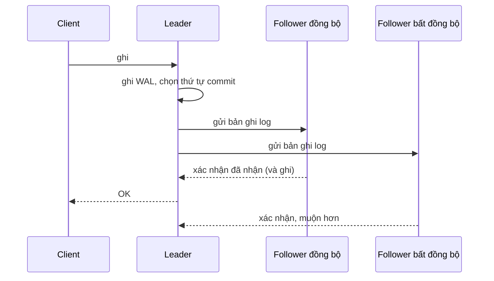
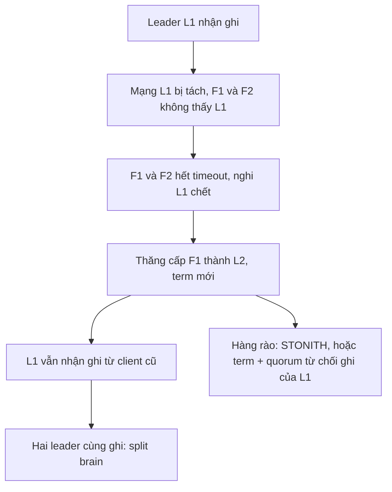
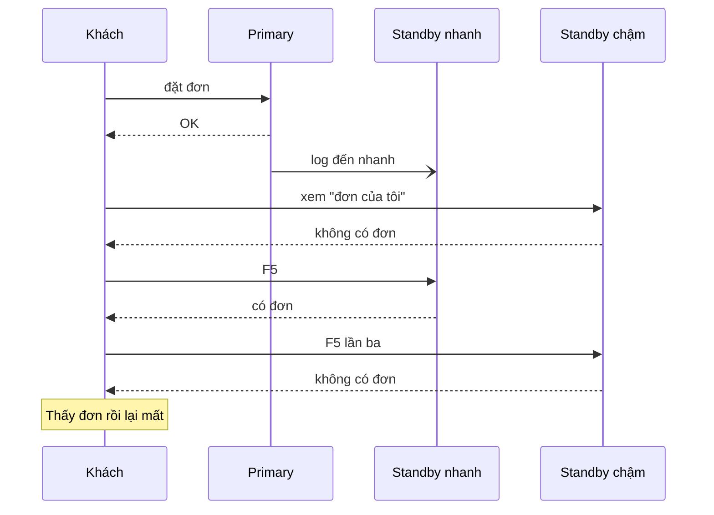
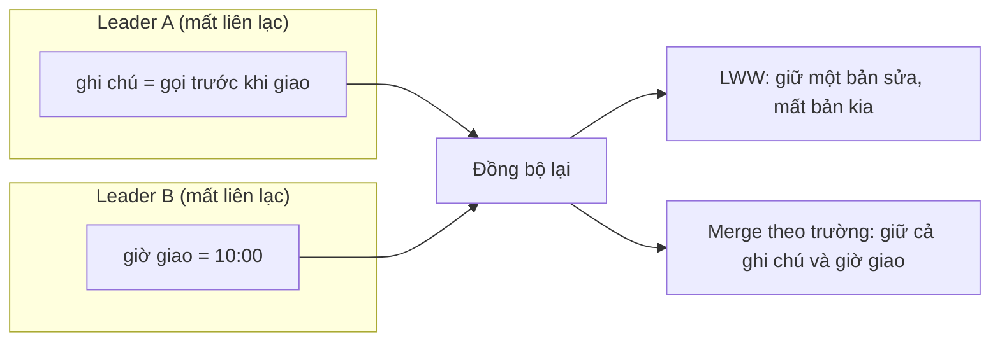
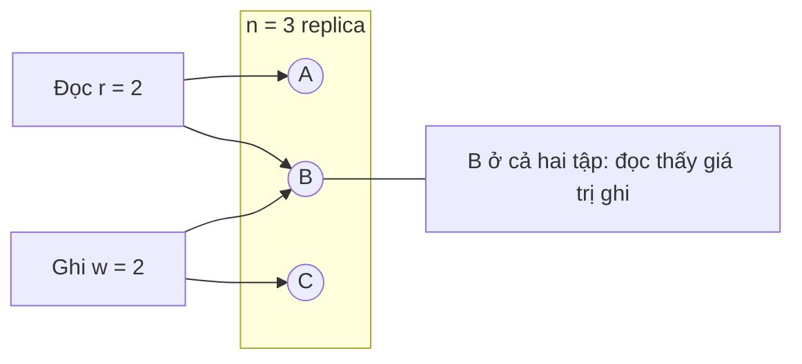
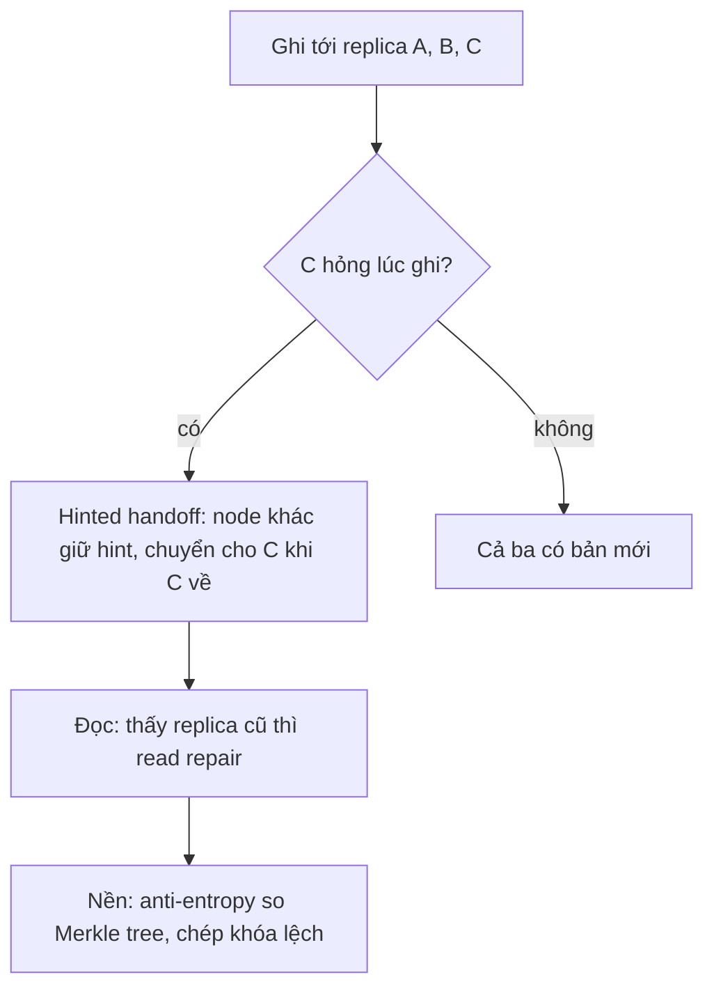
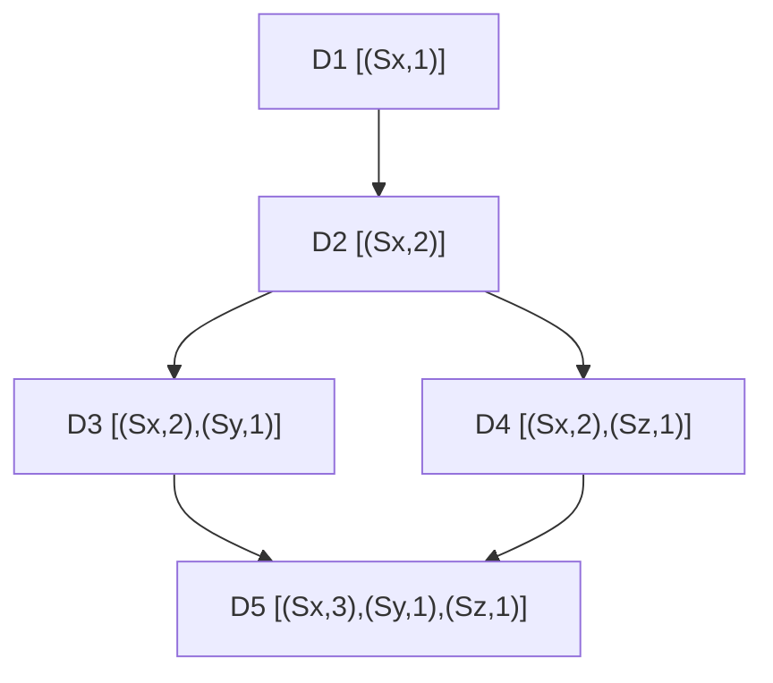

# P12 · Chương 05 — Replication

> Khung chủ đề của chương lấy từ *Designing Data-Intensive Applications* (DDIA). Sách không có bản đọc tự do nên chương **không trích sách**, mà dựa vào nguồn mở: bài giảng *Distributed Systems* của Kleppmann (Cambridge), paper Dynamo, paper về session guarantee của Terry, docs PostgreSQL 16, docs MariaDB, docs Cassandra 4.1 và docs.rs. Docs MariaDB là trang không ghim phiên bản, đọc lúc soạn; chương dùng MariaDB làm ví dụ cho họ MySQL, còn hành vi của MySQL có thể khác và không được kiểm ở đây. Không có thí nghiệm nào được chạy: mọi khẳng định về hành vi là điều docs và paper nói, không phải điều tôi quan sát.

## Bạn sẽ hiểu được gì

- **Q1.** Single-leader replication hoạt động thế nào, và sync / async / semi-sync khác nhau ở điểm nào (leader chờ gì trước khi báo "commit xong")? → mục 1
- **Q2.** Thêm một follower mới vào hệ đang chạy thế nào; failover gồm những bước nào; vì sao failover sinh ra split brain? → mục 2
- **Q3.** Replication log có mấy kiểu cài đặt (statement, WAL shipping, logical/row) và mỗi kiểu đánh đổi gì? → mục 3
- **Q4.** Replication lag gây ra những hiện tượng gì, và read-your-writes, monotonic reads, consistent prefix là ba bảo đảm nào? → mục 4
- **Q5.** Multi-leader dùng khi nào, conflict sinh ra thế nào, và LWW với CRDT giải quyết ra sao? → mục 5
- **Q6.** Leaderless kiểu Dynamo: quorum `w + r > n` bảo đảm gì, không bảo đảm gì; sloppy quorum và hinted handoff đổi gì lấy gì? → mục 6
- **Q7.** Read repair và anti-entropy (Merkle tree) khác nhau thế nào, vì sao cần cả hai? → mục 7
- **Q8.** Vector clock phát hiện "đồng thời" ra sao, và khi có hai phiên bản song song (siblings) thì ai quyết định? → mục 8

## Kiến thức cần trước

- [Chương 01 — Reliability, scalability, maintainability](01-reliability-scalability-maintainability.md): vì sao nhân bản là công cụ chịu lỗi và mở rộng đọc.
- [Chương 03 — Storage engine](03-storage-engine.md): log/WAL ở mức engine; chương này nối log đó sang máy khác.
- [Phase 5, Chương 05 — Crash consistency và journaling](../05-storage/05-crash-consistency-va-journaling.md), mục 8, và [Chương 06 — Durability trong thực tế](../05-storage/06-durability-trong-thuc-te.md): WAL, `fsync`, "bền" nghĩa là gì trên một máy. Replication nới chữ "bền" đó sang nhiều máy.

(Các chủ đề chương này chỉ chạm vào rồi chuyển đi: failure detector, đồng hồ và timeout ở [Chương 08](08-su-co-he-phan-tan.md); linearizability, Raft, consensus ở [Chương 09](09-consistency-va-consensus.md); isolation level ở [Chương 07](07-transaction.md); chia dữ liệu theo key ở [Chương 06](06-partitioning.md); đọc log thay đổi thành stream ở [Chương 11](11-stream-processing.md); chọn kiến trúc tổng thể ở [Chương 13](13-kien-truc-he-du-lieu.md).)

## 1. Single-leader: ba cách "chờ" trước khi báo commit (Q1)

> **Trả lời ngắn.** Replication là giữ cùng một dữ liệu trên nhiều máy, mỗi máy giữ một bản gọi là replica[^n-repdef]. Ở mô hình single-leader, một replica làm leader (còn gọi primary) và gửi mọi thay đổi cho các follower, follower áp dụng đúng theo thứ tự commit[^n-leader]. Ba kiểu sync, async và semi-sync khác nhau ở một câu hỏi: leader có đợi follower xác nhận đã nhận thay đổi trước khi trả "OK" cho client hay không.

**Giải thích.**

*Với service của bạn.* Hãy hình dung `orders`, một service viết bằng Rust (Tokio), nhận đơn hàng và lưu vào PostgreSQL. Ta sẽ bám theo nó suốt chương (nhận xét của người soạn: đây là ví dụ giả định, không phải code trong repo). Nếu chỉ có một máy database thì máy đó sập là `orders` ngừng, và mọi lượt đọc cũng dồn vào cùng một chỗ. Vì vậy ta đặt thêm hai máy giữ bản sao: một primary nhận ghi, hai standby chép theo. Câu hỏi của mục này: khi `orders` chạy xong `INSERT`, primary phải đợi bao nhiêu standby xác nhận rồi mới báo "đặt hàng thành công" cho client?

### 1.1 Một leader quyết định thứ tự

Các bản sao chỉ giống nhau khi chúng áp dụng cùng thay đổi theo cùng một thứ tự. Single-leader giải chuyện này bằng cách giao việc chọn thứ tự cho đúng một máy: leader commit transaction, còn follower chép lại đúng thứ tự đó. Cách làm này gọi là passive replication hay primary-backup, và nó tương đương với total order broadcast các bản ghi commit[^n-passive].

Có một biến thể là *active replication*: thay vì chép kết quả, mỗi replica tự chạy lại cùng đoạn code transaction[^n-active]. Biến thể này chỉ đúng nếu code đó xác định (deterministic) tuyệt đối, kể cả khi lỗi, vì nếu một replica thành công còn replica khác lỗi thì chúng lệch nhau[^n-smr-det]. Mục 3 sẽ gặp lại đúng vấn đề này ở replication log kiểu statement.

### 1.2 Async: không chờ ai

PostgreSQL streaming replication mặc định là bất đồng bộ (async): giữa lúc commit ở primary và lúc thay đổi hiện ra ở standby có một độ trễ nhỏ[^pg-stream-async]. Với `orders`, nghĩa là client nhận "OK" khi standby có thể chưa có đơn hàng đó. Nếu primary sập đúng lúc, những transaction đã commit mà chưa tới standby sẽ mất, và lượng mất tỉ lệ với độ trễ replication tại thời điểm failover[^pg-sync-loss]. Bù lại, primary không chờ ai nên không bị chậm theo standby.

### 1.3 Sync: chờ cả hai

Nếu `orders` không chấp nhận mất đơn đã báo thành công thì phải bật synchronous replication. Khi đó mỗi commit của transaction ghi chờ tới khi nhận xác nhận rằng commit đã nằm trong WAL trên đĩa của cả primary lẫn standby, nên dữ liệu chỉ mất khi cả hai sập cùng lúc[^pg-sync-wait]. Cái giá có ba. Thứ nhất, mỗi request ghi của `orders` chậm đi ít nhất một vòng round-trip primary–standby[^pg-sync-rtt]. Thứ hai, lock của transaction vẫn bị giữ trong lúc chờ[^pg-sync-locks]. Thứ ba, nếu một standby đồng bộ sập thì commit có thể không bao giờ hoàn tất[^pg-sync-hang]; với `orders`, cả đường ghi đứng lại chỉ vì một máy phụ.

### 1.4 Semi-sync: chờ một phần

Vì vậy cách thực tế nhất là chỉ chờ *một phần* follower. MariaDB gọi kiểu này là semisynchronous: primary chờ đúng một replica xác nhận đã nhận và ghi event[^m-semi]. PostgreSQL không dùng tên "semi-sync" trong docs nhưng có cấu hình tương đương, qua `synchronous_standby_names`. Với phương thức `FIRST`, standby đứng trước trong danh sách được ưu tiên và standby sau thay vào khi standby trước rớt[^pg-first]. Với `ANY`, primary chờ ít nhất số standby yêu cầu trong danh sách, theo kiểu quorum[^pg-any]. Standby không nằm trong danh sách vẫn nhận log nhưng không bị chờ (suy luận của người soạn từ ví dụ trong docs). Với `orders`, một lựa chọn hợp lý là đặt một standby cùng datacenter làm đồng bộ và để standby còn lại chạy async (nhận xét của người soạn).



(Sơ đồ minh họa do người soạn dựng từ mô tả ở trên, không phải sơ đồ của nguồn nào. Chế độ semi-sync: leader chỉ chờ mũi tên xác nhận của follower đồng bộ. Với async thuần, bỏ luôn S và `L-->>C` đi ngay sau khi ghi WAL cục bộ.)

<details><summary>Đi sâu: mức xác nhận tinh chỉnh được (PostgreSQL) và điểm chờ (MariaDB)</summary>

- PostgreSQL cho chọn mức chờ theo từng transaction chứ không chỉ toàn cục: `synchronous_commit` đổi được lúc bất kỳ, nên có transaction commit đồng bộ, có transaction bất đồng bộ[^pg-per-txn]. Docs minh họa bằng một workload mà 10% thay đổi là thông tin khách hàng quan trọng còn 90% là dữ liệu nhẹ như tin nhắn chat, và chỉ nhóm đầu cần đồng bộ[^pg-app-level].
- Khi có standby đồng bộ, `synchronous_commit` có ba mức chờ đáng nhớ. `on` chờ standby nhận và flush commit record xuống nơi bền[^pg-on]. `remote_write` chỉ chờ standby ghi ra tầng hệ điều hành của nó mà chưa flush, yếu hơn `on`, vì standby có thể mất dữ liệu nếu OS crash[^pg-rw]. `remote_apply` chờ standby *replay* xong để thay đổi nhìn thấy được bởi query trên standby[^pg-remote-apply]. Mức thứ ba quan trọng cho mục 4 (đọc từ replica).
- Một chi tiết hay bị hiểu sai: lời hứa của synchronous replication không phải "standby chắc chắn có mọi thứ primary có". Docs nói không có cách nào chắc rằng mọi standby đã nhận hết WAL lúc primary sập, và có transaction hiện là đã commit ở primary mà chưa ở standby. Điều được bảo đảm chỉ là ứng dụng *không nhận xác nhận* commit thành công trước khi WAL được biết là đã đến các standby đồng bộ[^pg-ack].
- Ở MariaDB, xác nhận của semisync nói về *relay log* của replica, không phải dữ liệu của replica: transaction được xác nhận đã nằm trong relay log nhưng chưa chắc đã được áp dụng[^m-relay]. Nếu replica không xác nhận kịp, primary hết thời gian chờ và chuyển sang bất đồng bộ[^m-semi-timeout]. Nghĩa là "semi-sync" có thể lặng lẽ tụt về async khi mạng chậm (suy luận của người soạn từ hành vi timeout trong docs).
- MariaDB còn cho chọn *điểm chờ* trong chuỗi commit. Với `AFTER_SYNC`, primary sync binlog, chờ replica, rồi mới commit vào storage engine[^m-after-sync-steps]. Kết quả là failover về nguyên tắc không mất transaction đã commit, vì mọi transaction đã commit trên primary đều đã được replica nhận[^m-after-sync]. Với `AFTER_COMMIT`, primary commit vào engine trước rồi mới chờ replica[^m-after-commit-steps]. Kết quả là client khác có thể thấy transaction trước cả client đã commit nó, và failover có thể mất dữ liệu vì primary đã commit những transaction chưa được replica xác nhận[^m-after-commit].
- Cascading: một standby có thể vừa nhận vừa chuyển tiếp WAL cho standby khác[^pg-cascade]. Docs ghi cascading replication hiện là bất đồng bộ và cấu hình synchronous replication không ảnh hưởng tới nó[^pg-cascade-async].

</details>

**Quay lại Q1:** single-leader là một nơi quyết định thứ tự và follower chép theo; sync, async, semi-sync chỉ là chọn việc primary của `orders` đợi bao nhiêu xác nhận trước khi trả OK: đợi càng nhiều thì càng bền, càng chậm và càng dễ nghẽn khi follower rớt.

## 2. Thêm follower, failover và split brain (Q2)

> **Trả lời ngắn.** Follower mới được dựng từ một bản chụp (snapshot) nhất quán của leader cộng với phần log phát sinh từ lúc chụp, rồi bắt kịp và chuyển sang nhận log trực tiếp[^pg-basebackup]. Failover là thăng cấp một follower thành leader khi leader chết; làm tay thì chậm[^n-failover]. Làm tự động thì phải đối mặt với việc không biết chắc leader cũ đã chết thật chưa[^n-fd]. Nếu leader cũ vẫn sống và vẫn nhận ghi thì ta có hai leader, gọi là split brain, và các quyết định của chúng có thể mâu thuẫn nhau[^n-splitbrain].

**Giải thích.**

*Với service `orders`.* Cụm PostgreSQL của `orders` sẽ không đứng yên mãi. Sớm muộn bạn phải thay một standby hỏng hoặc thêm máy mới, mà không được dừng việc nhận đơn. Và có một đêm primary sẽ chết, khi đó ai đó phải quyết định standby nào lên thay, trong lúc `orders` vẫn đang gửi đơn tới địa chỉ cũ. Mục này đi qua hai việc: dựng follower mới khi hệ đang chạy, và đổi leader mà không để hai máy cùng tin mình là primary.

### 2.1 Dựng follower mới (PostgreSQL)

Không thể chỉ copy thư mục dữ liệu của primary đang ghi, vì file thay đổi trong lúc copy nên bản sao sẽ không nhất quán. PostgreSQL vượt qua chuyện này nhờ WAL: bản sao vật lý không cần là ảnh chụp tức thời, vì chỉ cần replay WAL của khoảng thời gian đã chép là mọi bất nhất bên trong được sửa[^pg-wal-replay-fix]. Công cụ lấy bản sao đó là `pg_basebackup`, và docs nêu rõ nó là điểm xuất phát để dựng standby kiểu log-shipping hoặc streaming[^pg-basebackup].

Các bước tiếp theo khá cơ học. Bạn phục hồi base backup vào máy mới, tạo file `standby.signal` trong data directory của standby[^pg-standby-signal-setup]. Sau đó đặt `primary_conninfo` trỏ tới primary[^pg-conninfo]. Ở chế độ standby, server liên tục áp dụng WAL nhận được từ primary[^pg-standby-mode]. Khi kết nối thành công, standby có tiến trình walreceiver còn primary có walsender tương ứng[^pg-walsender].

### 2.2 Bắt kịp và replication slot

Lúc mới gắn vào, standby còn tụt lại phía sau. Trạng thái đó gọi là catchup; khi độ trễ về 0 lần đầu, standby chuyển sang streaming, và chỉ khi đó nó mới thành synchronous standby được[^pg-catchup]. Trong lúc bắt kịp, primary không được dọn mất WAL mà standby chưa nhận, và replication slot lo việc này: primary không xóa WAL segment cho tới khi mọi standby đã nhận[^pg-slot]. Cái giá là slot có thể giữ WAL nhiều tới mức đầy `pg_wal`, nên có `max_slot_wal_keep_size` đặt trần cho nó[^pg-slot-full]. Một standby chết lâu mà slot vẫn sống là cách kinh điển để làm đầy đĩa của primary (nhận xét của người soạn).

### 2.3 Failover từng bước

Giờ giả sử primary của `orders` chết. Failover thủ công nghĩa là người vận hành được báo leader không còn, rồi cấu hình lại các node để dùng một node khác làm leader[^n-failover]. Cách này dùng được khi việc leader ngừng hoạt động được lên kế hoạch trước[^n-failover-planned]. Với sự cố đột ngột thì con người phản hồi chậm, và suốt thời gian đó hệ không xử lý được ghi[^n-failover-slow]. Làm tự động cũng không đơn giản hơn: PostgreSQL không có sẵn phần mềm nhận ra primary hỏng, việc đó dành cho công cụ bên ngoài[^pg-no-detect].

Quy trình chung gồm năm bước (mô tả của người soạn, khớp với docs):

1. **Phát hiện** leader hỏng, thường bằng timeout. Nhưng failure detector dựa trên timeout có thể sai: nó có thể nghi một node đã sập trong khi node vẫn chạy tốt, ví dụ vì độ trễ mạng tăng vọt[^n-fd].
2. **Chọn leader mới.** PostgreSQL khuyên: nếu primary bị cô lập khỏi các standby còn lại thì failover sang ứng viên tốt nhất trong số đó[^pg-best]. "Tốt nhất" thường là follower có log mới nhất (suy luận của người soạn). Với async, transaction chưa tới follower đó có thể mất[^pg-sync-loss].
3. **Thăng cấp** bằng `pg_ctl promote` hoặc `pg_promote()`[^pg-promote]. Các standby khác theo dõi sang timeline mới nếu `recovery_target_timeline` là `latest`[^pg-timeline].
4. **Đổi đường:** client và proxy phải tìm ra leader mới (xem mục Rust).
5. **Xử lý leader cũ** khi nó sống lại. Đây là bước hay bị quên.

### 2.4 Split brain

Bước 5 hay bị quên vì nó chỉ gây chuyện khi leader cũ chưa thật sự chết, mà chỉ bị tách mạng. Bài giảng của Kleppmann dựng đúng kịch bản này: node 2 và 3 phát hiện node 1 hỏng và bầu leader mới ở term t+1, trong khi node 1 vẫn chạy đúng và chưa biết gì về leader mới. Kết quả là hai node cùng tin mình là leader[^n-oldleader]. Với `orders`, điều đó nghĩa là hai primary cùng nhận đơn và hai lịch sử đơn hàng bắt đầu rẽ nhánh.

Với failover thủ công kiểu PostgreSQL, docs yêu cầu có cơ chế báo cho primary cũ biết nó không còn là primary, gọi là STONITH (Shoot The Other Node In The Head). Cơ chế này cần để tránh cả hai hệ thống cùng nghĩ mình là primary, dẫn tới nhầm lẫn và mất dữ liệu[^pg-stonith].

Consensus giải bài toán này theo hướng khác, bằng cách đánh số nhiệm kỳ. Raft dùng term, một số nguyên tăng mỗi lần bắt đầu một cuộc bầu cử[^n-term]. Ứng viên phải được một quorum bỏ phiếu mới thành leader[^n-vote]. Thuật toán còn bảo đảm mỗi term chỉ có tối đa một leader[^n-one-per-term]. Nhưng số term tự nó chưa chặn được leader cũ: leader của các term khác nhau vẫn có thể cùng tồn tại. Điều làm thuật toán an toàn là leader cũ không quyết định thêm được gì, vì mỗi quyết định phải được một quorum xác nhận[^n-old-leaders-safe]. Chi tiết, và vì sao leader cũ vẫn phải bị chặn ghi, thuộc [Chương 09](09-consistency-va-consensus.md). Điều cần nhớ ở chương này là replication tự nó *không* quyết định ai là leader; nó cần một cơ chế bên ngoài hoặc consensus.

### 2.5 Sau failover

Sau failover hệ chỉ còn một server, trạng thái mà docs gọi là degenerate state, và bạn phải dựng lại standby, trên máy primary cũ hoặc máy mới[^pg-degenerate]. Primary cũ khi sống lại có WAL đã rẽ nhánh so với primary mới. `pg_rewind` đồng bộ lại một cluster với bản sao của nó sau khi timeline đã phân kỳ, và kịch bản điển hình là đưa primary cũ về làm standby của primary mới[^pg-rewind].



(Sơ đồ minh họa kịch bản trong bài giảng; hộp G là hướng xử lý, không phải bước tự động của mọi hệ.)

<details><summary>Đi sâu: witness, ghi mơ hồ và sequence</summary>

- Hai node với heartbeat là kiến trúc tối thiểu (nhận xét của người soạn). Docs nói có thể thêm node thứ ba (witness server) để ngăn một số ca failover không đáng có, nhưng độ phức tạp thêm vào có thể không đáng trừ khi thiết lập cẩn thận và kiểm thử nghiêm ngặt[^pg-witness]. (Nhận xét của người soạn: đây là lý do consensus 3 hoặc 5 node là mặc định của các hệ có failover tự động.)
- **Ghi mơ hồ.** `orders` gửi commit rồi primary chết trước khi trả lời: `orders` không biết đơn hàng đã được ghi hay chưa. Bài giảng nhắc rằng retry thiếu cẩn thận có thể khiến yêu cầu bị xử lý nhiều lần[^n-retry]. Cách chữa thứ nhất là khử trùng lặp yêu cầu[^n-dedup]. Cách thứ hai là làm yêu cầu idempotent[^n-idem]. Vì vậy hãy thiết kế yêu cầu ghi có idempotency key *trước khi* nghĩ tới failover (nhận xét của người soạn). Xem thêm [Phase 7, Chương 09, mục 2](../07-io-async/09-async-trong-production.md) về việc timeout phía client không hủy việc phía xa.
- **Dữ liệu sequence** không đi theo logical replication: docs nói dữ liệu sequence không được nhân bản[^pg-seq2]. Nếu định failover sang subscriber thì phải cập nhật sequence lên giá trị mới nhất[^pg-seq]. Bẫy điển hình là đổi sang logical replica rồi để ID đơn hàng trùng (suy luận của người soạn).
- **Thứ tự nâng cấp minor:** docs khuyên khi nâng minor version nên nâng standby trước, vì bản minor mới đọc WAL của bản cũ dễ hơn là ngược lại[^pg-minor-first].
- Standby chết thì không cần failover: có thể khởi động lại, và recovery chạy lại ngay nhờ restartable recovery[^pg-standby-fail].

</details>

**Quay lại Q2:** follower mới là snapshot cộng log từ điểm chụp rồi bắt kịp; failover là phát hiện (có thể sai), chọn ứng viên, thăng cấp, và phải chặn leader cũ; bỏ bước cuối là có split brain.

## 3. Replication log được cài đặt ra sao: statement, WAL, logical (Q3)

> **Trả lời ngắn.** Thứ truyền từ leader sang follower có ba dạng chính. Gửi *câu lệnh SQL* (statement-based) thì gọn nhưng hỏng với lệnh không xác định như `random()`. Gửi *bản ghi WAL vật lý* (WAL shipping) thì chính xác từng byte nhưng buộc hai bên cùng phiên bản và cùng layout. Gửi *thay đổi theo từng dòng* (logical hay row-based) thì độc lập với layout lưu trữ, nên đi được giữa các phiên bản và nền tảng khác nhau.

**Giải thích.**

*Với service `orders`.* Khi `orders` chạy `UPDATE orders SET status = 'paid' WHERE id = 42`, primary phải gửi *một thứ gì đó* cho standby để standby làm theo. Chọn thứ gì quyết định bạn dùng replica được vào việc gì: có nâng được major version PostgreSQL bằng cách dựng replica bản mới không, có chỉ nhân bản bảng `orders` mà không kéo cả server theo không, và `INSERT` có `random()` hay `now()` có làm hai máy lệch nhau không.

### 3.1 Statement-based: gửi câu lệnh

Cách đơn giản nhất là ghi chính câu lệnh đã chạy ở primary. MariaDB mô tả: câu lệnh được ghi vào binary log đúng như lúc thực thi[^m-sbr]. Docs chỉ khuyên dùng khi cần giữ binlog nhỏ nhất, hai bên có dữ liệu giống hệt (kể cả storage engine) và mọi hàm đều deterministic[^m-sbr-rec].

Vấn đề cốt lõi là tính xác định. Một `INSERT` sinh số ngẫu nhiên khả năng cao cho kết quả khác nhau ở primary và replica, nên không replicate an toàn được[^m-unsafe]. `UPDATE ... LIMIT` cũng bị coi là không an toàn vì thứ tự dòng không xác định[^m-unsafe-limit]. PostgreSQL docs nói tương tự về middleware nhân bản SQL: nếu chỉ broadcast câu lệnh thô thì `random()`, `CURRENT_TIMESTAMP` và sequence có thể cho giá trị khác nhau ở các server[^pg-sqlmw]. Đây chính là điều kiện của state machine replication nói ở mục 1: logic cập nhật phải xác định, kể cả khi lỗi[^n-smr-det]. MariaDB có thêm chế độ "mixed" làm lối thỏa hiệp: dùng statement khi có thể, chuyển sang row khi server thấy câu lệnh có thể không an toàn[^m-mixed].

### 3.2 WAL shipping (physical): gửi chính WAL

Primary vốn đã ghi mọi thay đổi vào WAL để phục hồi sau crash, nên ý tưởng là *dùng luôn log đó* làm replication log. Nhắc lại nguyên tắc WAL: thay đổi vào file dữ liệu chỉ được ghi sau khi bản ghi WAL mô tả nó đã flush xuống nơi bền[^pg-wal-def] (chi tiết ở [Phase 5, Chương 05](../05-storage/05-crash-consistency-va-journaling.md), mục 8). PostgreSQL gọi việc chuyển trực tiếp WAL record từ server này sang server khác là log shipping[^pg-logship-def]. Có thể chuyển từng segment file[^pg-logship-file]. Cũng có thể stream từng record[^pg-stream-def].

Cái giá của "chính xác từng byte" nằm ở ba chỗ. Log shipping giữa hai major version khác nhau nói chung không thực hiện được[^pg-major]. Đường dẫn tablespace được truyền nguyên, nên hai bên phải cùng mount path[^pg-tablespace]. Và chỉ nhân bản được cả server, không chọn từng bảng[^pg-wal-whole]. Ngoài ra standby đọc được (hot standby) nhưng read-only tuyệt đối[^pg-hot-ro].

### 3.3 Logical (row-based): gửi thay đổi theo dòng

Log logical mô tả thay đổi ở mức dòng dữ liệu, tách khỏi layout vật lý. MariaDB row-based ghi riêng từng insert, update, delete trên từng dòng vào binlog thay vì ghi câu DML[^m-rbr]. Kiểu này tốn chỗ hơn nhưng an toàn nhất[^m-rbr-size].

PostgreSQL logical replication nhân bản đối tượng dữ liệu và thay đổi của chúng theo *replication identity* (thường là khóa chính), khác với physical dùng địa chỉ block chính xác[^pg-logical-def]. Mô hình của nó là publish/subscribe[^pg-logical-pubsub]. Subscriber áp dụng theo cùng thứ tự publisher nên nhất quán transaction được bảo đảm trong một subscription[^pg-logical-order]. Docs liệt kê các công dụng như nhân bản giữa các major version khác nhau[^pg-logical-versions]. Với `orders`, đó là cách dựng replica chạy bản PostgreSQL mới hơn rồi chuyển sang dùng, hoặc chỉ nhân bản bảng `orders` sang một cụm phục vụ báo cáo (nhận xét của người soạn).

Bên dưới là *logical decoding*[^pg-logical-arch], phần giải mã nội dung WAL (vốn mô tả thay đổi ở mức lưu trữ) thành dạng có nghĩa cho ứng dụng, như luồng tuple hoặc câu SQL[^pg-decoding]. Để có thông tin này, `wal_level` phải đặt là `logical`[^pg-wal-level]. Nhờ logical decoding, phần mở rộng bên thứ ba cũng dựng được chức năng tương tự[^pg-decoding-3p]; đó là cổng vào của CDC ở [Chương 11](11-stream-processing.md).

| | Statement | WAL shipping (physical) | Logical / row |
|---|---|---|---|
| Truyền gì | Câu lệnh gốc | Byte/bản ghi WAL của storage | Thay đổi theo dòng |
| Rủi ro chính | Không xác định (`random()`, thứ tự) | Ràng buộc cùng phiên bản/layout | Không mang DDL, sequence (PostgreSQL) |
| Chọn từng bảng | Tùy hệ | Không (cả server) | Có (PostgreSQL) |
| Khác major version | Tùy hệ | Không | Có (PostgreSQL) |

(Bảng tổng hợp từ các nguồn ở trên; hai ô "tùy hệ" là chỗ docs đã đọc không nói rõ nên tôi không khẳng định.)

<details><summary>Đi sâu: hạn chế của logical replication, conflict, slot logic, trigger-based, LSN</summary>

- Hạn chế (PostgreSQL 16): schema và lệnh DDL không được nhân bản[^pg-ddl]. Dữ liệu sequence không được nhân bản[^pg-seq2]. Chỉ bảng (kể cả bảng phân vùng) mới nhân bản được[^pg-tables-only]. Nghĩa là migration schema là việc của bạn, theo thứ tự: thường áp thay đổi cộng thêm (additive) lên subscriber trước.
- Conflict: nếu dữ liệu đến vi phạm ràng buộc thì replication dừng, và tình huống đó gọi là conflict[^pg-conflict-def]. Nó sinh lỗi, dừng replication và phải được người dùng xử lý thủ công[^pg-conflict-stop]. Nếu subscriber chỉ dùng để đọc thì một subscription sẽ không gây conflict; nếu có ghi khác vào cùng bảng thì conflict có thể xảy ra[^pg-logical-readonly]. Đây là nền cho mục 5.
- Logical slot phát mỗi thay đổi đúng một lần trong hoạt động bình thường, nhưng vị trí slot chỉ được lưu ở checkpoint, nên sau crash thay đổi gần nhất có thể gửi lại. Client logical decoding phải tự tránh tác dụng phụ khi xử lý trùng một message[^pg-decoding-dup]. Đây là *at-least-once*, nên consumer cần idempotent, cùng nguyên lý bài giảng nêu ở phần retry và idempotence[^n-idem].
- Trigger-based replication cũng tồn tại: điều phối câu ghi qua một primary chỉ định, primary gửi thay đổi (thường bất đồng bộ) từ từng bảng sang standby[^pg-trigger]. Docs nói các hệ trigger-based như Slony, Londiste, Bucardo không chạy trên standby mà chỉ chạy được trên primary[^pg-trigger-hot]. Lý do là replay WAL không dựa trên trigger[^pg-trigger-wal].
- LSN (Log Sequence Number) là con trỏ vào WAL: số 64-bit biểu diễn vị trí byte trong luồng WAL, so sánh được bằng toán tử chuẩn[^pg-lsn]. Hai LSN trừ nhau ra số byte cách biệt[^pg-lsn-sub]. Chỗ này quan trọng cho mục 4 và mục Rust.

</details>

**Quay lại Q3:** statement gọn nhưng đòi tính xác định; WAL physical chính xác nhưng buộc cùng phiên bản và cả server; logical hay row độc lập layout nên dùng được cho khác phiên bản và từng bảng, đổi lại không mang DDL và sequence, và có thể conflict.

## 4. Replication lag và ba bảo đảm đọc (Q4)

> **Trả lời ngắn.** Khi follower áp dụng log chậm hơn leader ghi, đọc từ follower có thể thấy dữ liệu cũ; độ chậm đó là replication lag. Ba bảo đảm hay cần là *read-your-writes* (tôi luôn thấy thứ tôi vừa ghi), *monotonic reads* (đọc sau không cũ hơn đọc trước) và *consistent prefix* (chỉ thấy những trạng thái từng thật sự tồn tại, theo đúng thứ tự ghi). Replication bất đồng bộ không tự cho ba điều đó, nên bạn phải thiết kế việc định tuyến đọc.

**Giải thích.**

*Với service `orders`.* Giả sử `orders` đã chuyển các trang đọc nhiều (danh sách đơn của tôi, tra cứu đơn) sang standby để giảm tải primary. Khách đặt đơn xong, trình duyệt chuyển ngay sang trang "đơn của tôi", và request đọc đó rơi vào một standby chưa nhận đơn. Khách thấy danh sách thiếu đơn vừa đặt. Bấm F5 thì request rơi vào standby nhanh hơn và đơn hiện ra; bấm F5 lần nữa lại rơi vào standby chậm và đơn biến mất. Hai nỗi đau khác nhau: lần đầu mất *read-your-writes*, còn thấy đơn rồi lại không thấy là mất *monotonic reads*. Mục này gọi tên từng lỗi và nói cách chặn nó.

### 4.1 Lag là gì và đo ở đâu

Dữ liệu ở standby cần thời gian để tới từ primary, nên giữa hai bên có độ trễ đo được. Chạy cùng một query gần như đồng thời trên cả hai có thể cho kết quả khác nhau, và docs PostgreSQL nói dữ liệu ở standby là *eventually consistent* với primary[^pg-hot-ec]. Chỉ báo sức khỏe quan trọng là lượng WAL sinh ra ở primary nhưng chưa được áp dụng ở standby[^pg-monitor]. Một khi commit record của transaction được replay ở standby thì thay đổi hiện ra cho mọi snapshot mới trên standby[^pg-hot-visible].

### 4.2 Read-your-writes

Nhiều hệ cần read-after-write, còn gọi là read-your-writes: sau khi client ghi một giá trị, chính client đó đọc lại được giá trị vừa ghi[^n-ryw]. Nói chặt hơn, hệ phải trả về giá trị vừa ghi hoặc một giá trị mới hơn[^n-ryw-strict]. Terry giải thích động cơ: người dùng thấy rất khó hiểu khi vừa cập nhật mà đọc ngay lại thì thấy bản cập nhật như đã mất[^t94-ryw].

Cách cài của Terry là mỗi lần server chấp nhận một lần ghi, ID của lần ghi đó được thêm vào write-set của session; trước mỗi lần đọc, session manager kiểm tra write-set là tập con dữ liệu server định đọc[^t94-ryw-impl]. Với log tuyến tính như WAL, "tập con" rút gọn thành "vị trí log" (suy luận của người soạn). Với `orders`: sau khi ghi đơn, nhớ LSN của lần ghi đó cho session của khách, và chỉ đọc từ standby đã replay quá LSN này; nếu không có standby nào, đọc từ primary. Mục Rust ở cuối chương viết cụ thể phần này.

### 4.3 Monotonic reads

Monotonic reads cho phép người dùng thấy cơ sở dữ liệu ngày càng cập nhật hơn theo thời gian[^t94-mr]. Với ví dụ F5 ở trên, nó loại trường hợp đơn đã hiện rồi lại biến mất. Terry 2011 nhấn mạnh thêm: client có thể đọc dữ liệu cũ tùy ý như với eventual consistency, nhưng được bảo đảm thấy kho dữ liệu ngày càng mới hơn[^t11-mr].

Cách rẻ nhất để có bảo đảm này là *dính* khách vào một replica. Vogels nói đạt được read-your-writes hay monotonic reads phụ thuộc vào độ dính của client với server xử lý: nếu luôn cùng một server thì tương đối dễ bảo đảm, còn cân bằng tải và chịu lỗi khó hơn một chút nhưng giải pháp đơn giản[^v-sticky]. Một cách khác là client tự gắn version vào ghi và loại bỏ kết quả đọc có version cũ hơn version đã thấy gần nhất[^v-client-version].

### 4.4 Consistent prefix

Với consistent prefix, người đọc thấy một dãy ghi có thứ tự, bắt đầu từ lần ghi đầu tiên của đối tượng[^t11-cp]. Có thể hiểu là người đọc thấy phiên bản của kho dữ liệu từng tồn tại ở master tại một thời điểm trong quá khứ[^t11-cp-snapshot].

Ví dụ của người soạn (không phải của nguồn): nếu bản ghi `đơn hàng` và bản ghi `thanh toán` nằm ở hai shard, mỗi shard replicate độc lập, thì một replica có thể đã nhận `thanh toán` mà chưa nhận `đơn hàng`. Đó là trạng thái chưa từng tồn tại ở leader. Với một log tuần tự duy nhất (single-leader, một shard), consistent prefix dễ đạt, còn replication nhiều luồng thì không (suy luận của người soạn).

Consistent prefix cũng không đủ một mình. Terry lấy ví dụ một phóng viên có thể đọc tỉ số 2-5, rồi nửa giờ sau đọc 1-3 nếu lần sau rơi vào server chưa nhận ghi mới[^t11-25]. Cách chống là yêu cầu thêm monotonic reads, vì không bảo đảm nào đủ một mình[^t11-neither].



(Hình minh họa tình huống ví dụ của người soạn, không phải của nguồn: lần đọc đầu mất read-your-writes; lần đọc thứ ba thấy cũ sau khi đã thấy mới là mất monotonic reads.)

<details><summary>Đi sâu: các bảo đảm độc lập nhau, remote_apply, xung đột với VACUUM trên hot standby</summary>

- Terry 2011 nói bốn bảo đảm yếu hơn strong (consistent prefix, bounded staleness, monotonic reads, read my writes) đều là dạng eventual consistency mạnh hơn eventual consistency thông thường, và *không cái nào mạnh hơn cái nào*[^t11-indep]. Có thể xin nhiều bảo đảm cùng lúc[^t11-combo]. Terry 2011 cũng đổi tên "Read Your Writes" thành "Read My Writes" cho đúng góc nhìn client[^t11-rename]; ta dùng tên quen thuộc.
- Vogels viết rằng monotonic reads và read-your-writes là hai thuộc tính đáng mong muốn nhất trong hệ eventual consistency, tuy không phải lúc nào cũng cần[^v-two].
- Cách đơn giản để có read-your-writes trên replica PostgreSQL mà không đo LSN là đặt `synchronous_commit = remote_apply`: mỗi commit chờ standby đồng bộ replay xong, và docs nói trong các trường hợp đơn giản việc này cho phép cân bằng tải với causal consistency[^pg-remote-apply]. Giá là commit chậm hơn, vì docs ghi độ trễ commit lớn hơn các mức trước do chờ replay WAL[^pg-ra-cost]. Mức này chỉ áp dụng cho các standby *đồng bộ* trong danh sách. Với `ANY` hoặc `FIRST` chỉ chờ một phần standby, replica bạn đọc có thể không nằm trong nhóm đã replay xong; chỉ chắc chắn khi mọi commit đều chờ chính replica đó, ví dụ khi chỉ có một standby đồng bộ (suy luận của người soạn).
- Replica còn có lag do chính *query đọc* gây ra. WAL áp dụng có thể xung đột với query trên standby (ví dụ dọn dòng cũ hay lock `ACCESS EXCLUSIVE`), và docs mô tả cơ chế buộc hủy query xung đột[^pg-conflict-cancel]. Chỉnh `max_standby_streaming_delay` lớn thì query dài sống được, nhưng một query chạy lâu có thể làm session khác không thấy thay đổi gần đây của primary vì làm chậm việc áp dụng WAL[^pg-long-query]. `hot_standby_feedback` ngăn VACUUM xóa dòng chết gần đây nên hết xung đột, nhưng làm chậm dọn dẹp ở primary và có thể gây bloat[^pg-feedback]. (Nhận xét của người soạn: đừng chạy báo cáo nặng chung replica dùng cho đọc-sau-ghi của người dùng.)
- Hot standby không hỗ trợ isolation level Serializable[^pg-serializable].
- Khái niệm gần là bounded staleness (đọc không cũ quá T), một trong sáu bảo đảm của Terry[^t11-bs]. Nó chính là tên gọi cho "độ trễ tối đa chấp nhận" mà SLO read replica thường dùng (nhận xét của người soạn).

</details>

**Quay lại Q4:** lag là khoảng cách giữa log đã ghi và log đã áp dụng; ba lỗi đọc điển hình (mất bản ghi của mình, đọc lùi, thấy trạng thái chưa từng có) mỗi cái có một bảo đảm riêng, và không bảo đảm nào tự có khi `orders` đọc từ standby bất đồng bộ.

## 5. Multi-leader và conflict: LWW, CRDT (Q5)

> **Trả lời ngắn.** Multi-leader cho nhiều node cùng nhận ghi rồi trao đổi thay đổi cho nhau. Đổi lại ta được khả năng ghi khi bị tách mạng hoặc ở gần người dùng, nhưng phải trả bằng conflict: hai nơi có thể sửa cùng một thứ cùng lúc. Có hai hướng giải conflict: *chọn một* (last-write-wins, mất dữ liệu), hoặc *giữ cả hai rồi gộp* (đánh dấu siblings, hoặc dùng kiểu dữ liệu tự gộp như CRDT).

**Giải thích.**

*Với service `orders`.* Giả sử `orders` mở thêm một region thứ hai, và mỗi region có một primary riêng để nhân viên ghi gần mình, không phải băng qua mạng liên vùng. Hai primary trao đổi thay đổi cho nhau ở nền. Trong lúc đường truyền giữa hai region đứt, nhân viên ở region A đổi giờ giao của đơn #42, còn nhân viên ở region B sửa ghi chú giao hàng của chính đơn đó. Khi đường truyền thông lại, hai primary phải quyết định đơn #42 cuối cùng trông thế nào. Cả mục này xoay quanh câu hỏi ấy.

### 5.1 Vì sao có multi-leader

Bài giảng gọi cách cho mỗi replica tự xử lý cả đọc lẫn ghi chỉ dựa trên trạng thái cục bộ, không chờ giao tiếp với replica khác, là "optimistic replication"[^n-optimistic]. Ví dụ trong bài giảng là ứng dụng lịch: người dùng đọc và ghi sự kiện cả khi thiết bị offline rồi đồng bộ sau, điều mà một protocol linearizable không làm được vì thiết bị offline không liên lạc được với quorum[^n-calendar-offline]. Phần mềm cộng tác cũng thế: mỗi thiết bị đang mở tài liệu là một replica[^n-collab].

PostgreSQL docs chia thành hai loại. *Asynchronous multimaster*: mỗi server chạy độc lập và định kỳ trao đổi để phát hiện transaction xung đột, còn conflict được giải bằng người hoặc luật[^pg-amm]. *Synchronous multimaster*: mọi server đều nhận ghi nhưng dữ liệu phải tới mọi server trước khi commit, nên ghi nhiều gây khóa quá mức và chậm commit[^pg-smm]. PostgreSQL không có loại sau sẵn[^pg-smm-none].

Logical replication cho phép một server vừa publish vừa subscribe nên dữ liệu chảy được nhiều chiều[^pg-multi-dir]. Nhưng conflict trong logical replication làm dừng replication và phải xử lý tay[^pg-conflict-stop], nên tự nó chưa đủ để làm multi-leader ghi-mọi-nơi (suy luận của người soạn). Lưu ý "conflict" trong docs logical replication mang nghĩa hẹp là dữ liệu đến vi phạm ràng buộc[^pg-conflict-def]; đó không phải cơ chế phát hiện hay giải các cập nhật đồng thời kiểu LWW hoặc siblings của mục này (suy luận của người soạn).

### 5.2 Conflict sinh ra thế nào

Conflict xuất hiện khi hai leader nhận hai ghi vào cùng một khóa trước khi biết về nhau. Bài giảng minh họa bằng bản ghi lịch: trên một thiết bị, đổi giờ; đồng thời trên thiết bị khác, đổi tiêu đề. Sau khi đồng bộ, bản đổi giờ được áp dụng cho cả hai còn bản đổi tiêu đề bị bỏ, nên hai bên hội tụ về cùng một trạng thái nhưng mất dữ liệu[^n-calendar-lww]. Đơn #42 của `orders` có cùng dạng: nếu hệ chỉ giữ một trong hai lần sửa, một nhân viên mất công của mình (nhận xét của người soạn).

### 5.3 Cách 1: last write wins (LWW)

LWW gắn timestamp vào mỗi cập nhật: cập nhật có timestamp lớn nhất có hiệu lực, các cập nhật đồng thời có timestamp nhỏ hơn bị bỏ[^n-lww]. Cách này đơn giản nhưng ngụ ý mất dữ liệu khi có nhiều cập nhật đồng thời[^n-lww-loss]. Mất như vậy có chấp nhận được hay không tùy ứng dụng.

Chọn timestamp từ đâu cũng có vấn đề riêng. Nếu dùng Lamport clock, hai cập nhật đồng thời bị xếp thứ tự tùy ý, theo cách timestamp tình cờ được cấp[^n-lamport-arb]. Nếu dùng đồng hồ vật lý thì còn thêm chuyện đồng bộ NTP luôn để lại độ bất định về độ lệch giữa hai đồng hồ[^n-ntp]. Dynamo paper nói thẳng rằng khi để data store tự giải conflict thì chỉ dùng được chính sách đơn giản như "last write wins", còn ứng dụng biết schema nên chọn được cách giải hợp với trải nghiệm khách hàng hơn[^d-app].

Cassandra chọn LWW có chủ ý: mỗi mutation (kể cả delete) được gắn timestamp và bản mới nhất thắng[^c-lww]. Docs nói tính đúng đắn của Cassandra phụ thuộc đồng hồ, nên phải chạy giao thức đồng bộ như NTP[^c-clock]. Timestamp áp dụng tách theo từng cột của từng dòng[^c-percol], nên cập nhật hai cột khác nhau của cùng dòng không đè nhau (suy luận của người soạn từ câu đó).

### 5.4 Cách 2: giữ cả hai (siblings) rồi gộp

Nếu dùng timestamp bán thứ tự như vector clock, ta phân biệt được "mới hơn" với "đồng thời". Với trường hợp đồng thời, hệ giữ mọi giá trị; các giá trị đó gọi là conflicts hay siblings, và ứng dụng gộp chúng sau[^n-vc-siblings]. Cơ chế này nằm ở mục 8.

### 5.5 Cách 3: kiểu dữ liệu tự gộp, CRDT

Conflict-free replicated data types (CRDT) là họ thuật toán giải conflict theo kiểu tự gộp[^n-crdt]. Một CRDT là đối tượng nhân bản mà ứng dụng truy cập qua giao diện của một kiểu dữ liệu trừu tượng như set, list, map, tree, graph, counter[^n-crdt-def].

CRDT có hai dạng. Dạng *operation-based*: mỗi message mô tả một phép cập nhật, cần broadcast tin cậy, và phép áp dụng phải giao hoán, nên thứ tự đến khác nhau không ảnh hưởng kết quả[^n-crdt-commute]. Dạng *state-based*: broadcast cả trạng thái rồi trộn bằng phép merge. Ưu điểm là chịu được message mất hoặc trùng: miễn là hai replica cuối cùng trao đổi được trạng thái mới nhất, chúng hội tụ[^n-crdt-state]. Message trùng vô hại vì phép merge idempotent[^n-crdt-idem].

Mục tiêu của CRDT là *strong eventual consistency*, một mô hình hơi mạnh hơn eventual consistency, dựa trên ý rằng khi hai replica trao đổi thì chúng hội tụ về cùng trạng thái[^n-sec]. Giới hạn: bài giảng lưu ý dù tên có chữ "strong", đây vẫn là tính chất khá yếu, vì đọc không bảo đảm trả giá trị mới nhất[^n-sec-weak].



(Minh họa ví dụ lịch của bài giảng, đổi tên trường theo `orders` (tiêu đề thành ghi chú, giờ thành giờ giao). Nhánh R2 là hướng "tinh hơn" mà bài giảng nêu: gộp cả cập nhật giờ lẫn tiêu đề[^n-calendar-merge]; nó cần cấu trúc dữ liệu hỗ trợ merge, ví dụ map CRDT (suy luận của người soạn).)

<details><summary>Đi sâu: tombstone, counter và idempotence, thư viện CRDT</summary>

- **Tombstone.** Xóa không thật sự xóa mà ghi một cập nhật đặc biệt đánh dấu đã xóa (tombstone)[^n-tombstone]. Nhờ đó tiến trình đồng bộ phân biệt được bản ghi đã xóa với bản ghi chưa được tạo[^n-tomb-anti]. Dynamo cũng gặp bài toán này ở giỏ hàng: gộp cho kết quả "add to cart" không bao giờ mất, nhưng mục đã xóa có thể hiện lại[^d-cart].
- **Counter không idempotent, set thì có.** Bài giảng: tăng counter không idempotent, thêm phần tử vào set thì idempotent; nên nếu cần counter, có thể lưu cả tập phần tử và tính counter bằng cardinality[^n-idem-counter]. Một thiết kế counter chịu retry thường đi theo hướng này (nhận xét của người soạn).
- **Giao hoán là điều kiện cho thứ tự tùy ý.** Muốn các replica kết thúc ở cùng trạng thái dù các cập nhật đồng thời được giao theo thứ tự nào, ta phải làm các cập nhật đó giao hoán[^n-commute].
- **Thư viện Rust.** `automerge` 0.6.1: khi hai actor cùng đặt một key thành giá trị khác nhau thì automerge chọn giá trị thắng một cách ngẫu nhiên nhưng xác định, và giá trị thua vẫn lấy được qua `ReadDoc::get_all()`[^rs-automerge-conflict]. Nó có kiểu counter, số nguyên 64-bit gộp bằng phép cộng[^rs-automerge-counter]. `yrs` 0.21.3 là bản cài đặt CRDT hiệu năng cao dựa trên Shared Types, bản port tương thích của Yjs[^rs-yrs]. Hai thư viện này dành cho tài liệu cộng tác; với cơ sở dữ liệu đa leader, hãy xem docs của chính DB về giải conflict (nhận xét của người soạn).
- **Tránh conflict** là cách rẻ nhất khi làm được: định tuyến mọi ghi của một khóa hoặc tenant vào một leader duy nhất để conflict không xảy ra (nhận xét của người soạn; không có nguồn chung cho thủ thuật này trong các tài liệu đã đọc). Docs PostgreSQL nêu data partitioning, tức mỗi tập dữ liệu chỉ một server sửa được[^pg-partition-avoid].

</details>

**Quay lại Q5:** multi-leader mua khả năng ghi mọi nơi bằng conflict; LWW chọn một và mất dữ liệu, siblings giữ cả hai để ứng dụng gộp, CRDT làm cho phép gộp tự động và giao hoán.

## 6. Leaderless kiểu Dynamo: quorum, sloppy quorum, hinted handoff (Q6)

> **Trả lời ngắn.** Hệ leaderless không có leader: client (hoặc node điều phối) gửi ghi tới nhiều replica và chỉ cần *w* trong *n* node xác nhận; khi đọc thì hỏi *r* node. Nếu `w + r > n` thì tập ghi và tập đọc chồng nhau ít nhất một node, nên quorum đọc luôn chứa ít nhất một node đã xác nhận ghi[^n-quorum-intersect]. Nhờ đó đọc thấy giá trị ghi gần nhất (hoặc mới hơn), miễn là không dùng sloppy quorum (điều kiện "không sloppy" là suy luận của người soạn, xem phần sloppy quorum bên dưới). Dynamo thêm *sloppy quorum* và *hinted handoff* để vẫn ghi được khi vài node rớt, đổi lại bảo đảm chồng nhau yếu đi.

**Giải thích.**

*Với service `orders`.* Giả sử giỏ hàng của `orders` nằm trong một kho kiểu Dynamo với `n = 3` replica cho mỗi giỏ. Khách bấm "thêm vào giỏ" thì `orders` ghi tới cả ba replica, và chỉ cần `w = 2` replica trả lời là báo thành công. Lúc khách mở giỏ, `orders` hỏi `r = 2` replica. Kho này không có primary để failover, nên một node sập chỉ làm hai node còn lại phải gánh thêm. Mục này trả lời hai câu hỏi: hai con số `w` và `r` đảm bảo điều gì, và khi một node trong nhóm sập thì chuyện gì xảy ra.

### 6.1 Quorum

Bài giảng định nghĩa quorum là tập node tối thiểu phải phản hồi một yêu cầu để yêu cầu thành công[^n-quorum-def]. Muốn có read-after-write, quorum ghi và quorum đọc phải giao nhau khác rỗng: quorum đọc phải chứa ít nhất một node đã xác nhận ghi[^n-quorum-intersect]. Cụ thể, với `n` replica, ghi cần `w` xác nhận và đọc hỏi `r` node, thì `w + r > n` làm hai tập luôn giao nhau. Lựa chọn phổ biến là majority quorum, tức bất kỳ tập nào gồm hơn nửa số node[^n-majority].

Dynamo gọi cấu hình này là (N,R,W), và cấu hình thường dùng ở nhiều instance là (3,2,2)[^d-config]. Đó cũng chính là giỏ hàng `orders` ở trên. Khi R + W > N, Dynamo gọi hệ là "quorum-like"[^d-rw]. Vogels diễn đạt cùng ý: nếu `W + R > N` thì tập ghi và tập đọc luôn chồng nhau[^v-wr]. Ngược lại `W + R <= N` cho eventual consistency[^v-weak]. Trường hợp "primary-backup đồng bộ" của single-leader có N=2, W=2, R=1[^v-sync-case]. Trường hợp async đọc từ backup là N=2, W=1, R=1 nên không bảo đảm nhất quán[^v-async-case]. Nghĩa là single-leader và leaderless dùng chung một ngôn ngữ toán học (nhận xét của người soạn).

### 6.2 Chịu lỗi bao nhiêu node và chỉnh `w`, `r`

Hệ cần `w` xác nhận khi ghi thì vẫn chạy được khi không quá `n − w` replica sập; với đọc cũng tương tự theo `r`[^n-tolerate]. Dynamo nói độ trễ get/put do replica *chậm nhất* trong R (hoặc W) quyết định, nên R và W thường đặt nhỏ hơn N để giảm độ trễ[^d-latency].

Chỉnh để tối ưu cho từng nhu cầu: hệ đọc nhiều dùng R=1 và W=N[^d-readheavy]. Ứng dụng cần availability cao nhất đặt W=1[^d-w1]. Nhưng W và R thấp tăng nguy cơ không nhất quán và mở ra một cửa sổ rủi ro về durability, vì ghi được báo thành công dù chưa tới đa số replica[^d-w-risk].

### 6.3 Sloppy quorum và hinted handoff

Quorum chặt sẽ không khả dụng khi có sự cố máy hoặc mạng, và durability giảm ngay cả ở lỗi đơn giản nhất[^d-strict]. Với giỏ hàng `orders`, điều đó nghĩa là hai node trong ba node nhà của một giỏ sập thì khách không thêm hàng được nữa.

Dynamo không bắt buộc đúng thành viên. Nó dùng "sloppy quorum": mọi đọc/ghi thực hiện trên N node *khỏe* đầu tiên trong preference list, không nhất thiết là N node đầu tiên gặp khi đi dọc vòng consistent hashing[^d-sloppy]. Preference list là danh sách node chịu trách nhiệm một khóa, và nó chứa nhiều hơn N node để dự phòng lỗi[^d-pref].

Cơ chế bù lại gọi là hinted handoff. Khi node A tạm hỏng lúc ghi, bản sao đáng lẽ nằm ở A được gửi cho D. Bản đó mang một "hint" trong metadata chỉ ra người nhận dự kiến. D lưu hinted replica trong một database cục bộ riêng, quét định kỳ, và khi phát hiện A hồi phục thì chuyển lại cho A[^d-hint]. Dynamo xác nhận đây là cách để thao tác đọc/ghi không thất bại vì lỗi tạm thời[^d-hint-purpose]. Tuy nhiên hinted handoff hoạt động tốt nhất khi membership ít biến động và lỗi node là tạm thời[^d-hint-limit].

Cassandra làm tương tự: coordinator lưu hint trên đĩa cho replica không nhận được ghi, và giữ hint tối đa `max_hint_window_in_ms` thời gian replica ngừng hoạt động (mặc định 3 giờ). Nếu replica quay lại trước khi cửa sổ hết thì coordinator áp lại hint[^c-hint-window]. Docs nhấn mạnh hints chỉ là best effort, không bảo đảm eventual consistency như anti-entropy repair[^c-hint-best].

### 6.4 Sloppy quorum yếu đi ở đâu

Với sloppy quorum, tập node thực tế nhận ghi có thể nằm ngoài N node "nhà" của khóa. Vì vậy tập đọc `r` node từ N node nhà có thể không giao với tập ghi, và `w + r > n` không còn là bảo đảm đọc thấy ghi mới nhất cho tới khi hint được chuyển (suy luận của người soạn từ định nghĩa sloppy quorum của Dynamo).

Dynamo tự nói nó cung cấp eventual consistency, trong đó cập nhật được lan truyền bất đồng bộ tới mọi replica[^d-eventual]. Sự đánh đổi này nhất quán với mục tiêu thiết kế: Dynamo hướng tới availability cao, nơi cập nhật không bị từ chối ngay cả khi mạng chia cắt hoặc máy hỏng[^d-goal].

### 6.5 Quorum không phải linearizable

Một hiểu lầm hay gặp là có quorum đọc/ghi thì dữ liệu "nhất quán mạnh". Bài giảng dựng phản ví dụ. Client 1 ghi `x = v1` nhưng bản ghi đến replica A nhanh còn B, C chậm. Client 2 đọc quorum {A,B} và thấy v1 là mới nhất. Sau khi client 2 đọc xong, client 3 đọc quorum {B,C} và chỉ thấy v0. Vậy client 3 thấy giá trị cũ hơn client 2 dù lẽ ra không được[^n-quorum-nonlin].

Linearizability có thể đạt được bằng cách thêm bước ghi ngược (write-back) trước khi đọc xong, giống read repair; đó là thuật toán ABD[^n-abd]. Bản trình bày ABD trong bài giảng ban đầu giả định mọi thao tác set do một node duy nhất thực hiện, rồi bỏ giả định đó sau[^n-abd-single]. Chi tiết linearizability ở [Chương 09](09-consistency-va-consensus.md).



(Minh họa ví dụ của bài giảng: ghi thành công trên B, C; đọc thành công trên A, B; tập chung là B. Tính chồng nhau chỉ nói về *thấy được bản ghi mới nhất*, không phải thứ tự giữa các lần đọc.)

<details><summary>Đi sâu: coordinator, preference list, ghi thất bại giữa chừng, LOCAL_QUORUM</summary>

- Coordinator: node xử lý một thao tác đọc/ghi gọi là coordinator, thường là node đầu trong N node đầu của preference list[^d-coord]. Mọi node đều có thể nhận get/put cho bất kỳ khóa nào[^d-any-node]. Dynamo nhấn mạnh tính đối xứng: không có node đặc biệt nào mang vai trò riêng[^d-symmetry].
- Luồng put: coordinator tạo vector clock cho phiên bản mới và ghi cục bộ[^d-put]. Rồi nó gửi phiên bản mới tới N node khả dụng xếp hạng cao nhất, và nếu ít nhất W−1 node đáp thì ghi thành công[^d-put-w]. Với get, coordinator hỏi mọi phiên bản của khóa từ N node khả dụng cao nhất rồi chờ R phản hồi trước khi trả[^d-get].
- Chọn coordinator thông minh để tăng cơ hội read-your-writes: coordinator của ghi là node trả lời nhanh nhất ở lần đọc trước đó, nên có dữ liệu vừa đọc[^d-ryw].
- Ghi *thất bại* không có nghĩa là không có dấu vết. Cassandra mô tả: khi không có bảo đảm monotonic quorum reads mà một lần ghi không tới được quorum, nó có thể hiện ra ở một lần đọc rồi biến mất ở lần đọc sau[^c-vanish]. Nghĩa là không có transaction rollback trên các replica đã nhận (suy luận của người soạn từ câu đó).
- Cassandra diễn đạt cùng điều bằng `W + R > RF` (RF là replication factor): chọn mức đọc/ghi sao cho tập replica chồng nhau thì mọi ghi đã xác nhận nhìn thấy được ở các lần đọc sau, ví dụ `QUORUM` với RF=3 cần ít nhất 2/3 replica[^c-quorum]. `LOCAL_QUORUM` cho bảo đảm yếu hơn nhưng vẫn hữu ích: đọc thấy ghi mới nhất *trong cùng datacenter*[^c-local].
- Dynamo trải replica qua nhiều datacenter: preference list được dựng sao cho các node trải qua nhiều data center, để chịu được cả sự cố một data center[^d-dc]. Dynamo không có leader để failover; một node ngừng hoạt động hiếm khi là rời đi vĩnh viễn nên không kích hoạt cân bằng lại phân vùng hay sửa các replica không với tới được[^d-no-rebalance].

</details>

**Quay lại Q6:** `w + r > n` bảo đảm hai tập giao nhau nên đọc thấy ghi gần nhất; sloppy quorum cùng hinted handoff mua availability bằng việc nới bảo đảm đó; và dù ở dạng nguyên bản, quorum vẫn chưa bằng linearizable.

## 7. Read repair và anti-entropy (Q7)

> **Trả lời ngắn.** Trong hệ leaderless, replica nào đó luôn có thể bỏ lỡ một bản ghi (nó sập, gói tin mất). Hai cơ chế đuổi cho kịp là *read repair*, khi đọc thấy replica cũ thì sửa luôn, và *anti-entropy*, tiến trình nền so sánh các replica rồi chép phần khác biệt, thường dùng Merkle tree để so nhanh. Read repair chỉ sửa chỗ được đọc tới; anti-entropy mới bảo đảm hội tụ cả những dữ liệu không ai đọc.

**Giải thích.**

*Với service `orders`.* Quay lại giỏ hàng `n = 3`. Khách thêm một món lúc replica C đang sập, và ghi `w = 2` vẫn thành công trên A và B. Sau đó C quay lại, nhưng giỏ này trên C thiếu món vừa thêm. Câu hỏi: ai đưa C về đúng, và nếu giỏ đó không ai mở thì sao? Mục này gồm ba lớp xử lý, theo thứ tự từ lúc ghi, lúc đọc, tới tiến trình nền.

### 7.1 Vì sao replica lệch

Trong cách tiếp cận quorum, vào một thời điểm nào đó một số cập nhật có thể thiếu ở vài replica[^n-quorum-missing]. Bù lại cần cơ chế đưa các replica về đồng bộ.

### 7.2 Read repair

Giả sử `orders` đọc ra bản mới ở B và bản cũ ở A. Nó biết cần chuyển bản mới sang A, nên gửi lại với timestamp gốc, vì đây chỉ là gửi lại cập nhật cũ chứ không phải cập nhật mới. Nó cũng có thể gửi cho cả C dù chưa biết C có cần không (nếu C đã có thì chỉ tốn chút băng thông). Việc này gọi là read repair, và client có thể làm trên bất kỳ lần đọc nào, không cần là người đã ghi[^n-readrepair].

Dynamo làm ở phía coordinator. Sau khi trả kết quả cho caller, state machine chờ thêm một lúc để nhận các phản hồi còn lại. Nếu có phiên bản cũ trong phản hồi thì coordinator cập nhật các node đó bằng phiên bản mới nhất. Dynamo gọi là read repair vì nó sửa replica bỏ lỡ cập nhật vào lúc thuận tiện và giúp anti-entropy khỏi phải làm[^d-readrepair].

Cassandra thực hiện *blocking* read repair: nó chạy ở foreground và không trả lời client cho tới khi read repair xong và có dữ liệu mới nhất[^c-rr]. Mục đích là kỳ vọng "monotonic quorum reads": hai lần đọc quorum liên tiếp thì lần sau không thể thấy thứ cũ hơn lần trước, kể cả khi một lần ghi quorum thất bại để lại giá trị mới nhất chỉ ở thiểu số replica[^c-monotonic]. Đây lại là một bảo đảm *phiên đọc* của mục 4, được cài bằng cơ chế sửa lúc đọc (nhận xét của người soạn).

### 7.3 Anti-entropy

Read repair không chạm được giỏ hàng mà không ai mở. Với giỏ đó cần anti-entropy. Bài giảng định nghĩa: nhiều hệ nhân bản chạy giao thức phát hiện và hòa giải khác biệt giữa các replica, gọi là anti-entropy, để các replica cuối cùng giữ bản sao nhất quán[^n-antientropy]. Muốn hoạt động đúng cần timestamp để biết bản nào mới hơn và tombstone để phân biệt "đã xóa" với "chưa tạo"[^n-tomb-anti]. Tiến trình giữ bản mới hơn và bỏ bản cũ hơn[^n-ae-keep].

Dynamo cũng chạy giao thức đồng bộ replica kiểu anti-entropy để giữ các replica đồng bộ và đối phó các mối đe dọa khác với durability[^d-ae]. Còn hinted handoff, như mục 6 đã nói, hoạt động tốt nhất khi membership ít biến động và lỗi node là tạm thời[^d-hint-limit].

### 7.4 Merkle tree

So hết dữ liệu của hai replica thì quá đắt, nên Dynamo dùng cây băm: lá là hash giá trị từng khóa, node cha là hash các con[^d-merkle]. Nếu hash gốc của hai cây bằng nhau thì các lá bằng nhau và hai node không cần đồng bộ[^d-merkle-walk]. Nếu khác, hai node trao đổi hash của các con và tiếp tục đi xuống tới lá để tìm đúng khóa lệch[^d-merkle-descend]. Cách này giảm lượng dữ liệu phải truyền và số lần đọc đĩa trong anti-entropy[^d-merkle-benefit]. Hạn chế là nhiều key range thay đổi khi một node vào hoặc ra hệ, buộc tính lại cây[^d-merkle-cost].

### 7.5 Ba lớp gộp lại

Tóm lại, ba lớp đuổi kịp, mỗi lớp rẻ hơn nhưng yếu hơn lớp dưới nó (nhận xét của người soạn): hinted handoff (lúc ghi, best-effort), read repair (lúc đọc, chỉ dữ liệu được đọc), anti-entropy (nền, bảo đảm hội tụ). Cassandra phát biểu phần cuối của ý này: read repair và hinted handoff là kỹ thuật best-effort thúc hội tụ, còn để *bảo đảm* eventual consistency thì có anti-entropy repair dùng Merkle tree để so các replica[^c-sync].



(Sơ đồ tổng hợp của người soạn từ các nguồn ở trên: ba lớp chồng nhau, không phải ba lựa chọn thay thế nhau.)

<details><summary>Đi sâu: sub-range và incremental repair, chi phí, ABD</summary>

- Cassandra cài đặt anti-entropy như Dynamo: repair đầy đủ là các replica băm toàn bộ dataset, dựng cây Merkle, gửi cho nhau và đồng bộ các range không khớp[^c-repair-full]. Cassandra còn bổ sung sub-range repair (tăng độ phân giải của cây) và incremental repair (chỉ sửa các partition thay đổi từ lần repair trước)[^c-repair-kinds]. Đây là chi tiết cài đặt của một sản phẩm cụ thể.
- Read repair của Cassandra có hai cấu hình: `BLOCKING` (mặc định) cho monotonic quorum reads và `NONE` cho write atomicity. Docs giải thích vì read repair chỉ sửa phần dữ liệu SELECT bao phủ nên có thể làm hỏng tính nguyên tử khi đọc theo đơn vị nhỏ hơn đơn vị ghi[^c-rr-options]. Mỗi lớp đều có đánh đổi.
- Read repair đồng bộ là hạt nhân của ABD: client hỏi một quorum, nếu có phản hồi mới hơn thì ghi ngược bản mới nhất vào các replica chưa có và chỉ kết thúc khi bản mới nhất nằm trên một quorum[^n-abd]. Tức là linearizable chỉ khác read repair thông thường ở chỗ *phải chờ* và ghi ngược trước khi trả (suy luận của người soạn từ bài giảng).
- Dynamo ghi nhận phiên bản phân kỳ được tạo rất hiếm: trong profile 24 giờ của dịch vụ giỏ hàng, 99,94% yêu cầu thấy đúng một phiên bản[^d-div-stats]. Paper nêu hai nguyên nhân gây phân kỳ (lỗi và nhiều writer đồng thời) và nói kinh nghiệm là mức tăng số phiên bản phân kỳ đến từ tăng số writer đồng thời chứ không phải từ lỗi[^d-div-cause]. (Số liệu của một hệ và một giai đoạn cụ thể của Amazon, đừng suy ra cho hệ của bạn.)

</details>

**Quay lại Q7:** read repair sửa lúc đọc (chỉ chỗ được đọc), anti-entropy là tiến trình nền so sánh bằng Merkle tree để bảo đảm hội tụ; hinted handoff, read repair và anti-entropy là ba lớp bổ sung, không thay thế nhau.

## 8. Vector clock và siblings: phát hiện "đồng thời" (Q8)

> **Trả lời ngắn.** Vector clock là danh sách cặp (node, bộ đếm) gắn với từng phiên bản của một đối tượng[^d-vc]. So hai vector clock cho biết một phiên bản là tổ tiên của phiên bản kia (có thể bỏ) hay hai phiên bản nằm trên hai nhánh song song cần hòa giải[^d-vc-rule]. Nhánh song song được giữ lại thành siblings và ứng dụng gộp chúng[^n-vc-siblings], khác với LWW là lặng lẽ bỏ một bản.

**Giải thích.**

*Với service `orders`.* Khách mở giỏ hàng trên điện thoại và trên laptop cùng lúc. Hai thiết bị cùng thấy giỏ ở phiên bản hiện tại, mỗi thiết bị thêm một món khác nhau, và hai lần ghi rơi vào hai node khác nhau của kho kiểu Dynamo ở mục 6. Nếu bản thứ hai chỉ là bản sửa *từ* bản thứ nhất thì nó thay thế bản đầu, vứt bản cũ được. Nhưng ở đây cả hai bản cùng sửa từ một bản gốc, không bản nào dựa trên bản kia: hệ không thể tự vứt bản nào, phải giữ cả hai rồi nhờ ai đó gộp. Vector clock là công cụ để hệ phân biệt hai trường hợp này.

### 8.1 Cơ chế

Dynamo coi mỗi lần sửa là một phiên bản bất biến mới, nên hệ có thể có nhiều phiên bản của cùng một đối tượng tại một thời điểm[^d-versions]. Phần lớn thời gian phiên bản mới *bao trùm* phiên bản cũ, nên hệ tự xác định được bản chính (syntactic reconciliation). Nhưng khi lỗi kết hợp với cập nhật đồng thời thì xuất hiện phiên bản rẽ nhánh xung đột[^d-syntactic]. Khi đó hệ không tự gộp được và client phải hòa giải để gộp các nhánh về một (semantic reconciliation)[^d-semantic].

Vector clock là danh sách cặp (node, counter), mỗi phiên bản của mỗi đối tượng có một[^d-vc]. Quy tắc so sánh: nếu mọi bộ đếm trong clock thứ nhất nhỏ hơn hoặc bằng bộ đếm tương ứng ở clock thứ hai thì bản thứ nhất là tổ tiên của bản thứ hai và có thể quên. Ngược lại, hai thay đổi xung đột và cần hòa giải[^d-vc-rule].

### 8.2 Ví dụ của Dynamo

Ví dụ trong paper có thể đọc như một giỏ hàng. Client ghi đối tượng mới, node Sx xử lý ghi tăng số thứ tự và tạo clock `[(Sx,1)]`; đó là phiên bản D1. Client sửa tiếp, vẫn Sx xử lý, ra D2 với `[(Sx,2)]`. D2 là hậu duệ của D1 nên thay thế D1, dù vẫn có thể còn bản sao D1 trên node chưa thấy D2[^d-example-1].

Rồi cùng client sửa tiếp nhưng lần này node Sy xử lý: D3 với `[(Sx,2),(Sy,1)]`. Một client khác đọc D2 rồi sửa, node Sz xử lý: D4 với `[(Sx,2),(Sz,1)]`. Node biết D3 mà nhận D4 sẽ thấy hai bản không có quan hệ nhân quả, nghĩa là có thay đổi ở D3 và D4 không phản ánh trong nhau. Nó phải giữ cả hai và đưa cho client lúc đọc để hòa giải theo nghĩa nghiệp vụ[^d-example-2]. Đây là hai thiết bị của khách ở trên.

Nếu client đọc cả D3 và D4 (context phản ánh cả hai), tự gộp, và Sx ghi, kết quả là D5 với clock `[(Sx,3),(Sy,1),(Sz,1)]`[^d-d5].



(Dựng lại hình ví dụ của paper: D3 và D4 cùng hậu duệ của D2 nhưng không liên quan nhau, tức siblings; D5 là kết quả hòa giải.)

### 8.3 Client báo "tôi đã hòa giải bản nào"

Khi client muốn cập nhật, nó phải nói mình đang cập nhật phiên bản nào, bằng cách gửi lại *context* lấy từ lần đọc trước, chứa thông tin vector clock[^d-context]. Một cập nhật dùng context đó được coi là đã hòa giải các phiên bản phân kỳ, và các nhánh được gộp thành một phiên bản mới[^d-context-merge].

### 8.4 Ứng dụng quyết định cách gộp

Dynamo cho ba kiểu. Kiểu thứ nhất là logic nghiệp vụ tự hòa giải, ví dụ gộp giỏ hàng: "add to cart" không bao giờ mất, nhưng mục đã xóa có thể hiện lại[^d-cart]. Kiểu thứ hai là "last write wins" theo timestamp vật lý lớn nhất, như dịch vụ lưu session[^d-lww]. Kiểu thứ ba là dùng làm công cụ đọc nhanh với R=1, W=N[^d-readheavy].

<details><summary>Đi sâu: chi phí vector clock, cắt tỉa, Cassandra từ chối, và minh họa Rust</summary>

- Vector clock có thể đắt: mỗi client cần một ô trong vector, và với hệ có rất nhiều client (hoặc client lấy định danh mới mỗi lần khởi động), vector có thể to hơn chính dữ liệu[^n-vc-cost]. Bài giảng nhắc dotted version vectors là loại logical clock được phát triển để tối ưu hóa kiểu hệ này[^n-dvv]; tôi chưa đọc nguồn gốc của kỹ thuật đó.
- Dynamo cắt tỉa: nó lưu thêm timestamp bên cạnh mỗi cặp (node, counter), và khi số cặp trong clock vượt ngưỡng (ví dụ 10) thì cặp cũ nhất bị loại. Paper thừa nhận cách này làm quan hệ hậu duệ không suy ra chính xác nên có thể kém hiệu quả khi hòa giải[^d-truncate]. Paper cũng nói vấn đề này chưa xuất hiện ở production nên chưa được nghiên cứu kỹ[^d-truncate-prod] (đó là quan sát của Amazon, không phải bảo đảm).
- Cassandra khác Dynamo: thay vì version xác định và vector clock, nó dùng LWW với timestamp từng mutation[^c-lww]. Tức Cassandra *chấp nhận mất dữ liệu đồng thời* để khỏi phải có siblings (suy luận của người soạn). Bài giảng của Kleppmann dùng chính lựa chọn này (Cassandra dùng timestamp vật lý thay vì logical) làm bài tập phê bình[^n-ex17]; tôi không tự rút ra kết luận ở đây.
- Dynamo nhận xét thêm rằng nếu hòa giải do data store làm thì lựa chọn rất hạn chế, chỉ có chính sách đơn giản như LWW, còn ứng dụng hiểu schema nên chọn được cách giải hợp lý hơn[^d-app].
- Minh họa Rust (nhận xét của người soạn, chỉ để làm rõ quy tắc so sánh; **chưa biên dịch**, không có thư viện nào được dẫn):

```rust
use std::collections::BTreeMap;

type NodeId = String;

#[derive(Clone, Default)]
struct VClock(BTreeMap<NodeId, u64>);

enum Order { Before, After, Equal, Concurrent }

impl VClock {
    fn compare(&self, other: &VClock) -> Order {
        let mut le = true; // self <= other ở mọi node
        let mut ge = true; // other <= self ở mọi node
        for k in self.0.keys().chain(other.0.keys()) {
            let a = self.0.get(k).copied().unwrap_or(0);
            let b = other.0.get(k).copied().unwrap_or(0);
            if a > b { le = false; }
            if b > a { ge = false; }
        }
        match (le, ge) {
            (true, true) => Order::Equal,
            (true, false) => Order::Before,
            (false, true) => Order::After,
            (false, false) => Order::Concurrent, // siblings
        }
    }
}
```

</details>

**Quay lại Q8:** vector clock cho biết "A có trước B" hay "A và B song song"; song song thì giữ cả hai làm siblings để ứng dụng gộp, và client báo đã gộp bằng cách gửi lại context ở lần ghi kế tiếp.

## Liên hệ với Rust: chọn primary hay replica trong service Tokio

(Toàn bộ mục này là nhận xét của người soạn trên nền các docs đã dẫn; không có đoạn code nào được biên dịch hay chạy.)

Đến đây `orders` có một primary và vài standby, và code Rust phải trả lời mấy câu hỏi thực tế: kết nối tới đâu, ghi và đọc đi đường nào, làm sao để khách đọc thấy đơn mình vừa đặt, làm sao biết pool "replica" có đúng là replica, và xử lý ra sao khi primary chết giữa lúc commit. Các mục dưới đi lần lượt qua từng câu.

**1. Chọn đúng server ở lúc *kết nối*.** libpq cho liệt kê nhiều host trong một connection string và thử lần lượt tới khi một host kết nối được[^libpq-multi]. Tùy chọn `target_session_attrs` quyết định phiên có thuộc tính gì thì mới chấp nhận, thường dùng cùng nhiều host để chọn host đầu tiên chấp nhận được. Chế độ `read-write` đòi server không ở hot standby và `default_transaction_read_only` tắt[^libpq-tsa].

Điều này quan trọng với connection pool: libpq nói sau khi kết nối thành công, mọi truy vấn tiếp theo trên connection đó đều đi tới cùng một server[^libpq-lb]. Hệ quả (suy luận): mỗi connection trong pool *dính* một server, nên sau failover, các connection cũ vẫn trỏ vào server cũ cho tới khi chúng đóng.

`tokio-postgres` 0.7.13 phản chiếu các tùy chọn này: host có thể liệt kê nhiều cái và thử lần lượt[^tp-hosts]. Tùy chọn `target_session_attrs` cũng dùng được để kết nối primary thay vì các bản sao chỉ đọc[^tp-tsa]. Enum `TargetSessionAttrs` có `Any`, `ReadWrite`, `ReadOnly` và được đánh dấu `#[non_exhaustive]`[^tp-enum]. `deadpool-postgres` 0.14.1 có `Config` với các trường `target_session_attrs`, `load_balance_hosts` cùng cấu hình pool[^dp-config].

Với `sqlx` thì khác. Docs `sqlx::postgres::PgConnectOptions` 0.8.6 nói API này nhận "nhiều" tham số giống libpq, không phải tất cả[^sqlx-pgopts]. Bảng tham số của trang đó liệt kê `user`, `password`, `passfile`, `host`, `hostaddr`, `port`, `dbname`, `sslmode`, `sslrootcert`, `sslcert`, `sslkey`, `options`, `application_name` cùng `statement-cache-capacity` riêng của sqlx, và không có `target_session_attrs` (đã kiểm lại trên văn bản trang docs.rs 0.8.6; đây là đọc từ việc vắng mặt trong bảng, không phải thử trên code). Hệ quả (suy luận của người soạn): với sqlx 0.8.6 đừng giả định chọn primary được bằng `target_session_attrs` trong connection string; hãy dùng hai pool có chủ đích, hoặc `tokio-postgres` / `deadpool-postgres` khi cần tính năng này.

**2. Hai pool: primary và replica.** `sqlx::Pool` là `Send + Sync + Clone`, được thiết kế để tạo một lần lúc khởi động rồi chia sẻ cho mọi task[^sqlx-pool]. Clone rẻ vì chỉ là handle đếm tham chiếu[^sqlx-clone]. Một cấu trúc hợp lý:

```rust
// Minh họa; chưa biên dịch.
#[derive(Clone)]
struct Db {
    primary: sqlx::PgPool, // ghi, và đọc cần read-your-writes
    replica: sqlx::PgPool, // đọc chấp nhận trễ
}
```

`max_connections` của mỗi pool phải tính theo giới hạn kết nối của *database* cùng các ứng dụng khác, kể cả nhiều instance của cùng ứng dụng trong triển khai HA[^sqlx-maxconn]. Nhân đôi pool nghĩa là mỗi instance có hai trần cần cộng vào tổng. Mọi `acquire()` đều có thể phải chờ, và `acquire_timeout` giới hạn thời gian chờ một kết nối[^sqlx-acquire]. Xem [Phase 7, Chương 09](../07-io-async/09-async-trong-production.md) cho cách đặt hạn chót và backpressure cho phần chờ này.

**3. Read-your-writes bằng LSN.** Mục 4 gợi ý: nhớ vị trí log của lần ghi cuối, chỉ đọc từ replica đã đi qua vị trí đó. PostgreSQL có đủ nguyên liệu. `pg_current_wal_lsn()` trả vị trí ghi WAL hiện tại, còn `pg_current_wal_insert_lsn()` trả vị trí chèn (logical end của WAL)[^pg-fn-cur]. Trên standby, `pg_last_wal_replay_lsn()` trả vị trí WAL đã replay trong lúc recovery[^pg-fn-replay]. Kiểu `pg_lsn` so sánh được bằng toán tử chuẩn[^pg-lsn2]. Phác thảo:

```rust
// Minh họa; chưa biên dịch; LSN truyền dạng text.
async fn commit_and_token(db: &Db) -> Result<String, sqlx::Error> {
    // ... chạy transaction trên db.primary rồi commit ...
    // Sau commit, lấy một vị trí không nhỏ hơn commit record.
    sqlx::query_scalar("SELECT pg_current_wal_insert_lsn()::text")
        .fetch_one(&db.primary)
        .await
}

async fn read_with_token(db: &Db, token: &str) -> Result<i64, sqlx::Error> {
    // NULL (None) nếu "replica" thực ra không ở recovery: coi như chưa bắt kịp.
    let caught_up: Option<bool> = sqlx::query_scalar(
        "SELECT pg_last_wal_replay_lsn() >= $1::text::pg_lsn",
    )
    .bind(token)
    .fetch_one(&db.replica)
    .await?;
    let pool = if caught_up == Some(true) { &db.replica } else { &db.primary };
    sqlx::query_scalar("SELECT count(*) FROM orders")
        .fetch_one(pool)
        .await
}
```

Có năm điểm cần cẩn thận. Bốn điểm đầu là suy luận của người soạn, không có nguồn xác nhận:

- (a) `pg_current_wal_insert_lsn()` là cận trên của vị trí commit nên an toàn, nhưng có thể khiến replica trông như chưa bắt kịp lâu hơn mức cần thiết.
- (b) Hai lần query ở `read_with_token` chạy trên hai connection, không cùng snapshot, nên chỉ chứng minh replica đã replay quá `token` *tại lúc kiểm tra*.
- (c) Token phải đi theo session người dùng (cookie, header) chứ không phải theo process.
- (d) Nếu replica ở vị trí quá xa thì phải chấp nhận đọc từ primary; "cổng thoát" này có thể làm primary quá tải khi replica lag.

Điểm thứ năm thì có nguồn: (e) `pg_last_wal_replay_lsn()` trả NULL khi server khởi động bình thường, không qua recovery[^pg-fn-replay-null]. Vì vậy mã trên đọc kết quả thành `Option<bool>` và coi NULL là "chưa bắt kịp" (cách xử lý là của người soạn).

Phương án rẻ hơn về code là `synchronous_commit = remote_apply` ở primary (mục 4), đổi lại commit chậm hơn[^pg-ra-cost].

**4. Xác nhận pool replica thực sự trỏ vào standby.** `SHOW in_hot_standby` cho biết phiên có đang ở hot standby không[^pg-in-hot-standby]. Còn `pg_is_in_recovery()` trả true nếu recovery đang diễn ra[^pg-fn-recovery]. Đặt một health check đọc giá trị này giúp phát hiện pool "replica" đang vô tình nói chuyện với primary sau failover, hoặc ngược lại (nhận xét của người soạn).

`sqlx` có `PoolOptions::after_connect` chạy một hành động bất đồng bộ ngay sau khi kết nối[^sqlx-after-connect], và `test_before_acquire` (mặc định true) kiểm tra sức khỏe kết nối bằng `Connection::ping` trước khi trao[^sqlx-test]. Ping chỉ chứng minh kết nối còn sống chứ không chứng minh server *vẫn giữ vai trò cũ* (suy luận của người soạn). Còn `max_lifetime` đóng kết nối quá tuổi[^sqlx-lifetime], là một cách để các connection dính server cũ không sống mãi sau failover.

**5. Ghi mơ hồ khi failover.** `orders` gửi commit đi rồi primary chết: `orders` không biết kết quả. Đây là lúc idempotency key (mục 2, Đi sâu) và retry có kiểm soát đáng giá. Kết quả `sqlx::Error` chỉ nói I/O lỗi chứ không nói commit có xảy ra hay không (nhận xét của người soạn).

**6. CRDT trong Rust.** `automerge` 0.6.1 là thư viện cấu trúc dữ liệu cho ứng dụng cộng tác local-first[^rs-automerge-intro]. `yrs` 0.21.3 là bản cài đặt CRDT[^rs-yrs]. Cả hai dành cho tài liệu cộng tác (xếp automerge vào họ CRDT là nhận xét của người soạn), phù hợp khi bạn tự làm replica ở thiết bị biên (mục 5) và không thay thế cho replication của database.

## Tóm tắt

- Replication là giữ nhiều bản sao dữ liệu trên nhiều node để chịu lỗi[^n-repdef]. Phần khó nằm ở việc xử lý *thay đổi* (failover, conflict, độ trễ) chứ không phải ở việc chép (nhận xét của người soạn).
- Single-leader: leader quyết định thứ tự, follower áp dụng theo. Sync, async, semi-sync là số xác nhận leader đợi trước khi trả OK, đổi giữa độ bền với độ trễ và availability[^pg-sync-wait]. Async thì có thể mất transaction đã commit khi primary sập[^pg-sync-loss]. Semisync của MariaDB chỉ chờ đúng một replica[^m-semi].
- Thêm follower là snapshot nhất quán cộng log từ điểm chụp rồi catch-up[^pg-wal-replay-fix]. Failover thiếu bước chặn leader cũ thì thành split brain[^n-splitbrain]. Với failover thủ công kiểu PostgreSQL, bước chặn đó là STONITH[^pg-stonith].
- Replication log có ba kiểu. Statement đòi tính xác định[^m-unsafe]. WAL vật lý đòi cùng major version và nhân bản cả server[^pg-major]. Logical hay row độc lập layout, đổi lại DDL và sequence tự lo[^pg-ddl].
- Replica trễ thì sinh ba lỗi đọc: mất bản ghi của mình, đọc lùi, thấy trạng thái chưa từng có. Ba bảo đảm tương ứng là read-your-writes, monotonic reads và consistent prefix. Chúng độc lập nhau, không cái nào mạnh hơn cái nào[^t11-indep].
- Multi-leader mua ghi-mọi-nơi bằng conflict. LWW chọn một và mất dữ liệu[^n-lww-loss]. Siblings giữ cả hai[^n-vc-siblings]. CRDT dạng state-based chịu được message trùng hoặc mất nhờ merge idempotent[^n-crdt-state]. Dạng operation-based cần cập nhật giao hoán[^n-crdt-commute].
- Leaderless: `w + r > n` làm tập ghi và đọc giao nhau[^n-quorum-intersect]. Sloppy quorum cùng hinted handoff giữ khả năng ghi khi node rớt[^d-sloppy], đổi lại nới bảo đảm. Quorum vẫn không bằng linearizable[^n-quorum-nonlin].
- Hội tụ cần ba lớp: hinted handoff lúc ghi, read repair lúc đọc, anti-entropy bằng Merkle tree ở nền[^c-sync]. Merkle tree giúp so hai replica mà không phải so hết dữ liệu[^d-merkle]. (Cách gom thành ba lớp là tổng hợp của người soạn.)
- Vector clock phân biệt "có trước" với "song song"[^d-vc-rule]. Song song thì thành siblings, ứng dụng gộp và báo bằng context[^d-context-merge].
- Trong Rust, `target_session_attrs` chọn server lúc kết nối: có ở tokio-postgres[^tp-tsa], không thấy trong bảng tham số của sqlx 0.8.6. Hai pool (primary và replica) là cấu trúc hợp lý[^sqlx-pool]. LSN làm token read-your-writes là thiết kế của người soạn. Mỗi connection dính một server[^libpq-lb], nên sau failover phải để connection cũ chết (suy luận của người soạn).

## Câu hỏi tự kiểm tra

1. Vì sao với replication async, "commit đã trả OK" không đồng nghĩa dữ liệu còn sau khi primary chết? Lượng mất phụ thuộc vào đâu?
2. Giải thích vì sao semi-sync của MariaDB có thể lặng lẽ tụt về async, và bảo đảm của nó thực sự nói về cái gì (relay log hay dữ liệu replica)?
3. Mô tả các bước dựng follower mới cho PostgreSQL streaming replication và vai trò của replication slot, kèm rủi ro của slot.
4. Kể các bước của failover và bước nào hay bị bỏ quên; split brain xảy ra thế nào ngay cả khi có timeout phát hiện hỏng?
5. So statement-based, WAL shipping, logical replication về: truyền gì, phụ thuộc phiên bản, chọn bảng, điều kiện xác định.
6. Phân biệt read-your-writes, monotonic reads và consistent prefix bằng một ví dụ cho mỗi cái. Cái nào cần dính (sticky) vào một replica?
7. Với LWW, lịch hai thiết bị đổi giờ và tiêu đề cùng lúc cho kết quả gì, vì sao hội tụ nhưng vẫn mất dữ liệu, và CRDT sửa điểm đó thế nào?
8. Với n=5, w=3, r=3: có chồng nhau không? Tối đa mấy node sập thì vẫn ghi và đọc được? Nếu w=2, r=2 thì sao?
9. Sloppy quorum làm bảo đảm `w + r > n` yếu đi ở chỗ nào, và hinted handoff bù lại thế nào?
10. Đưa ví dụ quorum đọc/ghi nhưng không linearizable (ai đọc gì, theo thứ tự nào).
11. Dựa vào D3 `[(Sx,2),(Sy,1)]` và D4 `[(Sx,2),(Sz,1)]` hãy kết luận hai phiên bản có quan hệ gì, và clock sau khi hòa giải là gì.
12. Trong service Rust có hai pool (primary, replica), làm thế nào để một người dùng vừa ghi xong luôn đọc được bản ghi của mình? Nêu hai chỗ dễ sai.

<details><summary>Đáp án</summary>

1. Async: leader trả OK sau khi commit cục bộ mà không chờ follower. PostgreSQL docs nói nếu primary sập, transaction đã commit mà chưa tới standby sẽ mất[^pg-logship-async]. Lượng mất tỉ lệ với độ trễ replication lúc failover[^pg-sync-loss].
2. Primary hết thời gian chờ xác nhận thì chuyển sang async[^m-semi-timeout]. Xác nhận nói về *relay log* của replica, không bảo đảm đã áp dụng, và độ bền của entry trong relay log tùy cấu hình replica[^m-relay].
3. Base backup bằng `pg_basebackup`[^pg-basebackup]. Rồi phục hồi và tạo `standby.signal`[^pg-standby-signal-setup]. Đặt `primary_conninfo` trỏ tới primary[^pg-conninfo]. Standby chạy ở chế độ standby, walreceiver kết nối walsender[^pg-walsender]. Sau đó nó catch-up và chuyển sang streaming[^pg-catchup]. Slot giữ WAL cho tới khi mọi standby nhận[^pg-slot]. Rủi ro là làm đầy `pg_wal`, giới hạn bằng `max_slot_wal_keep_size`[^pg-slot-full].
4. Các bước là phát hiện, chọn ứng viên, thăng cấp (và đổi đường), rồi xử lý leader cũ; bước cuối hay bị bỏ quên[^pg-stonith]. Timeout có thể sai: node vẫn sống nhưng bị tách mạng[^n-fd]. Nó không biết leader mới, nên hai node cùng tin mình là leader[^n-oldleader].
5. Statement: câu lệnh, cần deterministic[^m-sbr-rec]. WAL: byte vật lý, cùng major version[^pg-major]. WAL chỉ nhân bản cả server[^pg-wal-whole]. Logical: thay đổi theo dòng theo replication identity[^pg-logical-def], chọn được bảng. Nó dùng được giữa các major version khác nhau[^pg-logical-versions].
6. Read-your-writes: vừa ghi mà đọc không thấy[^n-ryw]. Monotonic reads: đọc lần hai cũ hơn lần một[^t11-mr]. Consistent prefix: lỗi là thấy trạng thái chưa từng tồn tại ở leader[^t11-never-existed]. Bảo đảm là chỉ thấy phiên bản từng tồn tại ở master tại một thời điểm trong quá khứ[^t11-cp-snapshot]. Cả read-your-writes và monotonic reads dễ đạt hơn nếu client dính cùng một server[^v-sticky].
7. Giữ một bản sửa (bản có timestamp lớn hơn), bỏ bản kia[^n-calendar-lww]. Hai replica đều cùng kết quả nên hội tụ, nhưng mất bản sửa bị bỏ[^n-lww-loss]. Cách tinh hơn là gộp cả hai bản sửa (giờ và tiêu đề) thay vì bỏ một bản[^n-calendar-merge]. Map CRDT lưu giá trị theo từng key nên hai cập nhật vào hai key khác nhau không đè nhau (suy luận của người soạn từ giao diện map của CRDT[^n-crdt-def]).
8. `3 + 3 = 6 > 5` nên chồng nhau. Hệ chịu được `n − w = 2` node sập khi ghi và `n − r = 2` khi đọc[^n-tolerate]. Với w=2, r=2 thì `4 ≤ 5`, không bảo đảm chồng nhau[^v-weak].
9. Sloppy quorum cho ghi vào N node khỏe đầu tiên trong preference list, không nhất thiết là node nhà[^d-sloppy]. Vì vậy tập nhận ghi có thể không giao với tập đọc (suy luận). Hinted handoff chuyển lại bản sao về node nhà khi nó phục hồi[^d-hint].
10. Client 1 ghi v1, bản ghi tới A nhanh còn B, C chậm. Client 2 đọc {A,B} thấy v1. Sau đó client 3 đọc {B,C} chỉ thấy v0, cũ hơn client 2 dù đọc sau[^n-quorum-nonlin].
11. Không bản nào là tổ tiên của bản kia (Sy chỉ có ở D3, Sz chỉ có ở D4), nên hai bản song song, giữ cả hai làm siblings[^d-example-2]. Sau khi client hòa giải và Sx ghi, D5 = `[(Sx,3),(Sy,1),(Sz,1)]`[^d-d5].
12. Lấy LSN (ví dụ `pg_current_wal_insert_lsn()`) sau commit[^pg-fn-cur], lưu theo session. Khi đọc, kiểm `pg_last_wal_replay_lsn() >= token` trên replica[^pg-fn-replay]. Phép so dùng kiểu `pg_lsn`[^pg-lsn2]. Không đủ thì đọc primary. Dễ sai: kiểm tra và đọc không cùng connection hay snapshot; token không theo session; fallback về primary làm primary quá tải khi replica lag (suy luận).

</details>

## Đọc thêm

- Kleppmann, *Distributed Systems* (Cambridge), mục 5 (Replication: retry/idempotence, timestamp và tombstone, quorum, read repair, state machine replication) — <https://www.cl.cam.ac.uk/teaching/2122/ConcDisSys/dist-sys-notes.pdf>; đọc để thấy chứng minh và hình vẽ cho quorum và anti-entropy.
- Cùng bài giảng, mục 6.1 (consensus) và mục 7.3, 8.1 (eventual consistency, CRDT): vì sao failover tự động cần consensus và CRDT hoạt động ra sao.
- DeCandia và cộng sự, *Dynamo* (SOSP 2007) — <https://www.allthingsdistributed.com/files/amazon-dynamo-sosp2007.pdf>; mục 4.4 đến 4.7: vector clock, quorum, hinted handoff, Merkle tree; mục 6: kinh nghiệm cấu hình.
- Terry và cộng sự, *Session Guarantees for Weakly Consistent Replicated Data* (PDIS 1994) — <https://www.cs.cornell.edu/courses/cs734/2000FA/cached%20papers/SessionGuaranteesPDIS_1.html>; định nghĩa và cách cài read-your-writes, monotonic reads.
- Terry, *Replicated Data Consistency Explained Through Baseball* (MSR 2011) — <https://www.microsoft.com/en-us/research/wp-content/uploads/2011/10/ConsistencyAndBaseballReport.pdf>; sáu bảo đảm, kể cả consistent prefix, bằng một ví dụ.
- PostgreSQL 16, Chương 27 (HA, load balancing, replication) — <https://www.postgresql.org/docs/16/high-availability.html>; và Chương 31 (Logical Replication) — <https://www.postgresql.org/docs/16/logical-replication.html>.
- Vogels, *Eventually Consistent — Revisited* — <https://www.allthingsdistributed.com/2008/12/eventually_consistent.html>; N/R/W và các mô hình nhất quán phía client.
- DDIA ấn bản 1 (O'Reilly), Part II "Distributed Data", chương 5 "Replication" (tên Part và chương theo mục lục do ETH Library lưu[^ddia-toc]) — khung chủ đề của chương này; sách không có bản đọc tự do nên không trích. Mục lục chương liệt kê Leaders and Followers, Problems with Replication Lag, Multi-Leader Replication, Leaderless Replication — bốn cụm mà chương này chia thành mục 1–8 (đối chiếu của người soạn). Trang giới thiệu sách: <https://dataintensive.net/>.
- Chương kế tiếp: [Chương 06 — Partitioning](06-partitioning.md) (khi một node không chứa nổi dữ liệu); liên quan: [Chương 09 — Consistency và consensus](09-consistency-va-consensus.md).

[^n-repdef]: Kleppmann, Distributed Systems (Cambridge 2021/22), mục 5 Replication — <https://www.cl.cam.ac.uk/teaching/2122/ConcDisSys/dist-sys-notes.pdf> — "We will now turn to the problem of replication, which means to maintain a copy of the same data on multiple nodes, each of which is called a replica."
[^n-leader]: Kleppmann, Distributed Systems (Cambridge 2021/22), mục 5.3 Replication using broadcast — <https://www.cl.cam.ac.uk/teaching/2122/ConcDisSys/dist-sys-notes.pdf> — "When a transaction commits, the leader replica broadcasts the data changes from that transaction to all the follower replicas, and the followers apply those changes in commit order."
[^n-passive]: Kleppmann, Distributed Systems (Cambridge 2021/22), mục 5.3 Replication using broadcast — <https://www.cl.cam.ac.uk/teaching/2122/ConcDisSys/dist-sys-notes.pdf> — "This approach is known as passive replication or primary-backup replication, and we can see that it is equivalent to total order broadcast of transaction commit records."
[^n-active]: Kleppmann, Distributed Systems (Cambridge 2021/22), mục 5.3 Replication using broadcast — <https://www.cl.cam.ac.uk/teaching/2122/ConcDisSys/dist-sys-notes.pdf> — "Some distributed database perform replication in this way, with each replica independently executing the same deterministic transaction code (this is known as active replication)."
[^n-smr-det]: Kleppmann, Distributed Systems (Cambridge 2021/22), mục 5.3 Replication using broadcast — <https://www.cl.cam.ac.uk/teaching/2122/ConcDisSys/dist-sys-notes.pdf> — "Even errors must be deterministic: if an update succeeds on one replica but fails on another, they would become inconsistent."
[^n-failover]: Kleppmann, Distributed Systems (Cambridge 2021/22), mục 6 Consensus — <https://www.cl.cam.ac.uk/teaching/2122/ConcDisSys/dist-sys-notes.pdf> — "a human operator can be notified if the leader becomes unavailable, and this person then reconfigures all of the nodes to use a different node as their leader. This process is called failover, and it is in fact used in many database systems."
[^n-failover-slow]: Kleppmann, Distributed Systems (Cambridge 2021/22), mục 6 Consensus — <https://www.cl.cam.ac.uk/teaching/2122/ConcDisSys/dist-sys-notes.pdf> — "Even in the best case, it will take several minutes for an operator to respond, during which the system is not able to process any updates."
[^n-fd]: Kleppmann, Distributed Systems (Cambridge 2021/22), mục 6.1 Introduction to consensus (leader election) — <https://www.cl.cam.ac.uk/teaching/2122/ConcDisSys/dist-sys-notes.pdf> — "a timeout-based failure detector may be inaccurate: it may suspect a node has having crashed when in fact the node is functioning fine, for example due to a spike in network latency."
[^n-splitbrain]: Kleppmann, Distributed Systems (Cambridge 2021/22), mục 6.1 Introduction to consensus (leader election) — <https://www.cl.cam.ac.uk/teaching/2122/ConcDisSys/dist-sys-notes.pdf> — "If there were multiple leaders, they could make inconsistent decisions that lead to violations of the safety properties of total order broadcast (a situation known as split brain)."
[^n-oldleader]: Kleppmann, Distributed Systems (Cambridge 2021/22), mục 6.1 Introduction to consensus (leader election) — <https://www.cl.cam.ac.uk/teaching/2122/ConcDisSys/dist-sys-notes.pdf> — "Moreover, node 1 might not even have noticed the network problem, and it doesn’t yet know about the new leader either. Thus, we end up with two nodes both believing to be the leader."
[^n-term]: Kleppmann, Distributed Systems (Cambridge 2021/22), mục 6.1 Introduction to consensus (leader election) — <https://www.cl.cam.ac.uk/teaching/2122/ConcDisSys/dist-sys-notes.pdf> — "In Raft, the concept of “at any one time” is captured by having a term number, which is just an integer that is incremented every time a leader election is started."
[^n-vote]: Kleppmann, Distributed Systems (Cambridge 2021/22), mục 6.1 Introduction to consensus (leader election) — <https://www.cl.cam.ac.uk/teaching/2122/ConcDisSys/dist-sys-notes.pdf> — "If a quorum (Section 5.2) of nodes vote in favour of the candidate, it becomes the new leader."
[^n-one-per-term]: Kleppmann, Distributed Systems (Cambridge 2021/22), mục 6.1 Introduction to consensus (leader election) — <https://www.cl.cam.ac.uk/teaching/2122/ConcDisSys/dist-sys-notes.pdf> — "If a leader is elected, the voting algorithm guarantees that that it is the only leader within that particular term."
[^n-retry]: Kleppmann, Distributed Systems (Cambridge 2021/22), mục 5.1 Manipulating remote state — <https://www.cl.cam.ac.uk/teaching/2122/ConcDisSys/dist-sys-notes.pdf> — "However, if we are not careful, the retry could lead to the request being processed multiple times, leading to an incorrect state in the database."
[^n-idem]: Kleppmann, Distributed Systems (Cambridge 2021/22), mục 5.1 Manipulating remote state — <https://www.cl.cam.ac.uk/teaching/2122/ConcDisSys/dist-sys-notes.pdf> — "An idempotent update can safely be retried, because performing it several times has the same effect as performing it once."
[^n-idem-counter]: Kleppmann, Distributed Systems (Cambridge 2021/22), mục 5.1 Manipulating remote state — <https://www.cl.cam.ac.uk/teaching/2122/ConcDisSys/dist-sys-notes.pdf> — "Incrementing a counter is not idempotent, but adding an element to a set is. Therefore, if a counter is required (as in the number of likes), it might be better to actually maintain the set of elements in the database, and to derive the counter value from the set by computing its cardinality."
[^n-ryw]: Kleppmann, Distributed Systems (Cambridge 2021/22), mục 5.2 Quorums — <https://www.cl.cam.ac.uk/teaching/2122/ConcDisSys/dist-sys-notes.pdf> — "after a client writes a value, the same client will be able to read back the value it has just written."
[^n-ryw-strict]: Kleppmann, Distributed Systems (Cambridge 2021/22), mục 5.2 Quorums — <https://www.cl.cam.ac.uk/teaching/2122/ConcDisSys/dist-sys-notes.pdf> — "read-after-write consistency requires reading either the last value written, or a later value."
[^n-optimistic]: Kleppmann, Distributed Systems (Cambridge 2021/22), mục 7.3 Eventual consistency — <https://www.cl.cam.ac.uk/teaching/2122/ConcDisSys/dist-sys-notes.pdf> — "The approach of allowing each replica to process both reads and writes based only on its local state, and without waiting for communication with other replicas, is called optimistic replication."
[^n-calendar-offline]: Kleppmann, Distributed Systems (Cambridge 2021/22), mục 7.3 Eventual consistency — <https://www.cl.cam.ac.uk/teaching/2122/ConcDisSys/dist-sys-notes.pdf> — "If the calendar app’s replication protocol was linearizable, this would not be possible, since an offline device cannot communicate with a quorum of replicas."
[^n-collab]: Kleppmann, Distributed Systems (Cambridge 2021/22), mục 8.1 Collaboration and conflict resolution — <https://www.cl.cam.ac.uk/teaching/2122/ConcDisSys/dist-sys-notes.pdf> — "each device on which a user has opened a document is a replica, and any updates made to one replica need to be sent over the network to the replicas on other devices."
[^n-calendar-lww]: Kleppmann, Distributed Systems (Cambridge 2021/22), mục 7.3 Eventual consistency — <https://www.cl.cam.ac.uk/teaching/2122/ConcDisSys/dist-sys-notes.pdf> — "After the two devices synchronise, the update of the time is applied to both devices, while the update of the title is discarded."
[^n-lww]: Kleppmann, Distributed Systems (Cambridge 2021/22), mục 5.1 Manipulating remote state — <https://www.cl.cam.ac.uk/teaching/2122/ConcDisSys/dist-sys-notes.pdf> — "the update with the greatest timestamp takes effect, and any concurrent updates with lower timestamps to the same key are discarded."
[^n-lww-loss]: Kleppmann, Distributed Systems (Cambridge 2021/22), mục 5.1 Manipulating remote state — <https://www.cl.cam.ac.uk/teaching/2122/ConcDisSys/dist-sys-notes.pdf> — "This approach is simple to work with, but it does imply data loss when multiple updates are performed concurrently."
[^n-lamport-arb]: Kleppmann, Distributed Systems (Cambridge 2021/22), mục 5.1 Manipulating remote state — <https://www.cl.cam.ac.uk/teaching/2122/ConcDisSys/dist-sys-notes.pdf> — "If we use Lamport clocks (with the total order defined on Slide 68), two concurrent updates will be ordered arbitrarily, depending on how the timestamps happen to get assigned."
[^n-ntp]: Kleppmann, Distributed Systems (Cambridge 2021/22), mục 3.3 Causality and happens-before — <https://www.cl.cam.ac.uk/teaching/2122/ConcDisSys/dist-sys-notes.pdf> — "The clock synchronisation performed by NTP and similar protocols always leaves some residual uncertainty about the exact skew between two clocks, especially if the network latency in the two directions is asymmetric."
[^n-vc-siblings]: Kleppmann, Distributed Systems (Cambridge 2021/22), mục 5.1 Manipulating remote state — <https://www.cl.cam.ac.uk/teaching/2122/ConcDisSys/dist-sys-notes.pdf> — "These concurrently written values are called conflicts, or sometimes siblings. The application can later merge conflicts back into a single value, as discussed in Lecture 8."
[^n-vc-cost]: Kleppmann, Distributed Systems (Cambridge 2021/22), mục 5.1 Manipulating remote state — <https://www.cl.cam.ac.uk/teaching/2122/ConcDisSys/dist-sys-notes.pdf> — "A downside of vector clocks is that they can become expensive: every client needs an entry in the vector, and in systems with large number of clients (or where clients assume a new identity every time they are restarted), these vectors can become large, potentially taking up more space than the data itself."
[^n-crdt]: Kleppmann, Distributed Systems (Cambridge 2021/22), mục 8.1 Collaboration and conflict resolution — <https://www.cl.cam.ac.uk/teaching/2122/ConcDisSys/dist-sys-notes.pdf> — "Conflict-free replicated data types, or CRDTs for short, are a family of algorithms that perform such conflict resolution"
[^n-crdt-def]: Kleppmann, Distributed Systems (Cambridge 2021/22), mục 8.1 Collaboration and conflict resolution — <https://www.cl.cam.ac.uk/teaching/2122/ConcDisSys/dist-sys-notes.pdf> — "A CRDT is a replicated object that an application accesses though the object-oriented interface of an abstract datatype, such as a set, list, map, tree, graph, counter, etc."
[^n-crdt-commute]: Kleppmann, Distributed Systems (Cambridge 2021/22), mục 8.1 Collaboration and conflict resolution — <https://www.cl.cam.ac.uk/teaching/2122/ConcDisSys/dist-sys-notes.pdf> — "Moreover, even though messages may be delivered in different orders on different replicas, the algorithm ensures strong eventual consistency because the function that updates a replica’s state is commutative."
[^n-crdt-state]: Kleppmann, Distributed Systems (Cambridge 2021/22), mục 8.1 Collaboration and conflict resolution — <https://www.cl.cam.ac.uk/teaching/2122/ConcDisSys/dist-sys-notes.pdf> — "The advantage of the state-based approach is that it can tolerate lost or duplicated messages: as long as two replicas eventually succeed in exchanging their latest states, they will converge to the same state, even if some earlier messages were lost."
[^n-crdt-idem]: Kleppmann, Distributed Systems (Cambridge 2021/22), mục 8.1 Collaboration and conflict resolution — <https://www.cl.cam.ac.uk/teaching/2122/ConcDisSys/dist-sys-notes.pdf> — "Duplicated messages are also fine because the merge operator is idempotent"
[^n-sec]: Kleppmann, Distributed Systems (Cambridge 2021/22), mục 7.3 Eventual consistency — <https://www.cl.cam.ac.uk/teaching/2122/ConcDisSys/dist-sys-notes.pdf> — "A slightly stronger consistency model called strong eventual consistency, defined on Slide 140, is often more appropriate [Shapiro et al., 2011]. It is based on the idea that as two replicas communicate, they converge towards the same state."
[^n-sec-weak]: Kleppmann, Distributed Systems (Cambridge 2021/22), mục 8.2 Google’s Spanner (đoạn dẫn nhập) — <https://www.cl.cam.ac.uk/teaching/2122/ConcDisSys/dist-sys-notes.pdf> — "strong eventual consistency is a fairly weak consistency property: for example, when reading a value, there is no guarantee that the operation will return the most upto-date value"
[^n-commute]: Kleppmann, Distributed Systems (Cambridge 2021/22), mục 5.3 Replication using broadcast — <https://www.cl.cam.ac.uk/teaching/2122/ConcDisSys/dist-sys-notes.pdf> — "If we want to ensure that replicas end up in the same state, no matter in which order concurrent updates are delivered, we need to make those updates commutative"
[^n-tombstone]: Kleppmann, Distributed Systems (Cambridge 2021/22), mục 5.1 Manipulating remote state — <https://www.cl.cam.ac.uk/teaching/2122/ConcDisSys/dist-sys-notes.pdf> — "when asked to remove a record from the database, we don’t actually remove it, but rather write a special type of update (called a tombstone) marking it as deleted."
[^n-tomb-anti]: Kleppmann, Distributed Systems (Cambridge 2021/22), mục 5.1 Manipulating remote state — <https://www.cl.cam.ac.uk/teaching/2122/ConcDisSys/dist-sys-notes.pdf> — "Thanks to tombstones, the anti-entropy process can tell the difference between a record that has been deleted and a record that has not yet been created."
[^n-ae-keep]: Kleppmann, Distributed Systems (Cambridge 2021/22), mục 5.1 Manipulating remote state — <https://www.cl.cam.ac.uk/teaching/2122/ConcDisSys/dist-sys-notes.pdf> — "The anti-entropy process then keeps the newer and discards the older record."
[^n-antientropy]: Kleppmann, Distributed Systems (Cambridge 2021/22), mục 5.1 Manipulating remote state — <https://www.cl.cam.ac.uk/teaching/2122/ConcDisSys/dist-sys-notes.pdf> — "In many replicated systems, replicas run a protocol to detect and reconcile any differences (this is called anti-entropy), so that the replicas eventually hold consistent copies of the same data."
[^n-readrepair]: Kleppmann, Distributed Systems (Cambridge 2021/22), mục 5.2 Quorums — <https://www.cl.cam.ac.uk/teaching/2122/ConcDisSys/dist-sys-notes.pdf> — "This process is called read repair. The client can perform read repair on any read request it makes, regardless of whether it was the client that originally performed the update in question."
[^n-quorum-missing]: Kleppmann, Distributed Systems (Cambridge 2021/22), mục 5.2 Quorums — <https://www.cl.cam.ac.uk/teaching/2122/ConcDisSys/dist-sys-notes.pdf> — "In this quorum approach to replication, some updates may be missing from some replicas at any given moment"
[^n-quorum-def]: Kleppmann, Distributed Systems (Cambridge 2021/22), mục 5.2 Quorums — <https://www.cl.cam.ac.uk/teaching/2122/ConcDisSys/dist-sys-notes.pdf> — "In general, a quorum is a minimum set of nodes that must respond to some request for it to be successful."
[^n-quorum-intersect]: Kleppmann, Distributed Systems (Cambridge 2021/22), mục 5.2 Quorums — <https://www.cl.cam.ac.uk/teaching/2122/ConcDisSys/dist-sys-notes.pdf> — "the quorum for the write and the quorum for the read must have a non-empty intersection: in other words, the read quorum must contain at least one node that has acknowledged the write."
[^n-majority]: Kleppmann, Distributed Systems (Cambridge 2021/22), mục 5.2 Quorums — <https://www.cl.cam.ac.uk/teaching/2122/ConcDisSys/dist-sys-notes.pdf> — "A common choice of quorum in distributed systems is a majority quorum, which is any subset of nodes that comprises strictly more than half of the nodes."
[^n-tolerate]: Kleppmann, Distributed Systems (Cambridge 2021/22), mục 5.2 Quorums — <https://www.cl.cam.ac.uk/teaching/2122/ConcDisSys/dist-sys-notes.pdf> — "A system that requires w acknowledgements for writes (i.e. a write quorum of size w) can continue processing updates as long as no more than n − w replicas are unavailable"
[^n-quorum-nonlin]: Kleppmann, Distributed Systems (Cambridge 2021/22), mục 7.2 Linearizability — <https://www.cl.cam.ac.uk/teaching/2122/ConcDisSys/dist-sys-notes.pdf> — "Thus, client 3 observes an older value than client 2, even though the real-time order of operations would require client 3’s read to return a value that is no older than client 2’s result. This behaviour is not allowed in a linearizable system."
[^n-abd]: Kleppmann, Distributed Systems (Cambridge 2021/22), mục 7.2 Linearizability — <https://www.cl.cam.ac.uk/teaching/2122/ConcDisSys/dist-sys-notes.pdf> — "A client must first send the get request to replicas, and wait for responses from a quorum. If some responses include a more recent value than other responses, as indicated by their timestamps, then the client must write back the most recent value to all replicas that did not already respond with the most recent value, like in read repair"
[^d-ae]: DeCandia và cộng sự, Dynamo (SOSP 2007), mục 4.7 Replica synchronization — <https://www.allthingsdistributed.com/files/amazon-dynamo-sosp2007.pdf> — "To handle this and other threats to durability, Dynamo implements an anti-entropy (replica synchronization) protocol to keep the replicas synchronized."
[^d-any-node]: DeCandia và cộng sự, Dynamo (SOSP 2007), mục 4.5 Execution of get() and put() — <https://www.allthingsdistributed.com/files/amazon-dynamo-sosp2007.pdf> — "Any storage node in Dynamo is eligible to receive client get and put operations for any key."
[^d-app]: DeCandia và cộng sự, Dynamo (SOSP 2007), mục 3 Related Work (conflict resolution) — <https://www.allthingsdistributed.com/files/amazon-dynamo-sosp2007.pdf> — "since the application is aware of the data schema it can decide on the conflict resolution method that is best suited for its client’s experience."
[^d-cart]: DeCandia và cộng sự, Dynamo (SOSP 2007), mục 4.4 Data Versioning — <https://www.allthingsdistributed.com/files/amazon-dynamo-sosp2007.pdf> — "Using this reconciliation mechanism, an “add to cart” operation is never lost. However, deleted items can resurface."
[^d-config]: DeCandia và cộng sự, Dynamo (SOSP 2007), mục 6.1 Balancing Performance and Durability — <https://www.allthingsdistributed.com/files/amazon-dynamo-sosp2007.pdf> — "The common (N,R,W) configuration used by several instances of Dynamo is (3,2,2)."
[^d-context]: DeCandia và cộng sự, Dynamo (SOSP 2007), mục 4.4 Data Versioning — <https://www.allthingsdistributed.com/files/amazon-dynamo-sosp2007.pdf> — "when a client wishes to update an object, it must specify which version it is updating. This is done by passing the context it obtained from an earlier read operation, which contains the vector clock information."
[^d-context-merge]: DeCandia và cộng sự, Dynamo (SOSP 2007), mục 4.4 Data Versioning — <https://www.allthingsdistributed.com/files/amazon-dynamo-sosp2007.pdf> — "An update using this context is considered to have reconciled the divergent versions and the branches are collapsed into a single new version."
[^d-coord]: DeCandia và cộng sự, Dynamo (SOSP 2007), mục 4.5 Execution of get() and put() — <https://www.allthingsdistributed.com/files/amazon-dynamo-sosp2007.pdf> — "A node handling a read or write operation is known as the coordinator. Typically, this is the first among the top N nodes in the preference list."
[^d-d5]: DeCandia và cộng sự, Dynamo (SOSP 2007), mục 4.4 Data Versioning — <https://www.allthingsdistributed.com/files/amazon-dynamo-sosp2007.pdf> — "The new data D5 will have the following clock: [(Sx, 3), (Sy, 1), (Sz, 1)]."
[^d-dc]: DeCandia và cộng sự, Dynamo (SOSP 2007), mục 4.6 Handling Failures — <https://www.allthingsdistributed.com/files/amazon-dynamo-sosp2007.pdf> — "In essence, the preference list of a key is constructed such that the storage nodes are spread across multiple data centers."
[^d-div-cause]: DeCandia và cộng sự, Dynamo (SOSP 2007), mục 6.3 Divergent Versions — <https://www.allthingsdistributed.com/files/amazon-dynamo-sosp2007.pdf> — "Experience shows that the increase in the number of divergent versions is contributed not by failures but due to the increase in number of concurrent writers."
[^d-div-stats]: DeCandia và cộng sự, Dynamo (SOSP 2007), mục 6.3 Divergent Versions — <https://www.allthingsdistributed.com/files/amazon-dynamo-sosp2007.pdf> — "During this period, 99.94% of requests saw exactly one version; 0.00057% of requests saw 2 versions; 0.00047% of requests saw 3 versions and 0.00009% of requests saw 4 versions."
[^d-eventual]: DeCandia và cộng sự, Dynamo (SOSP 2007), mục 4.4 Data Versioning — <https://www.allthingsdistributed.com/files/amazon-dynamo-sosp2007.pdf> — "Dynamo provides eventual consistency, which allows for updates to be propagated to all replicas asynchronously."
[^d-example-1]: DeCandia và cộng sự, Dynamo (SOSP 2007), mục 4.4 Data Versioning — <https://www.allthingsdistributed.com/files/amazon-dynamo-sosp2007.pdf> — "D2 descends from D1 and therefore over-writes D1, however there may be replicas of D1 lingering at nodes that have not yet seen D2."
[^d-example-2]: DeCandia và cộng sự, Dynamo (SOSP 2007), mục 4.4 Data Versioning — <https://www.allthingsdistributed.com/files/amazon-dynamo-sosp2007.pdf> — "A node that is aware of D3 and receives D4 will find that there is no causal relation between them. In other words, there are changes in D3 and D4 that are not reflected in each other. Both versions of the data must be kept and presented to a client (upon a read) for semantic reconciliation."
[^d-get]: DeCandia và cộng sự, Dynamo (SOSP 2007), mục 4.5 Execution of get() and put() — <https://www.allthingsdistributed.com/files/amazon-dynamo-sosp2007.pdf> — "Similarly, for a get() request, the coordinator requests all existing versions of data for that key from the N highest-ranked reachable nodes in the preference list for that key, and then waits for R responses before returning the result to the client."
[^d-goal]: DeCandia và cộng sự, Dynamo (SOSP 2007), mục 3 Related Work — <https://www.allthingsdistributed.com/files/amazon-dynamo-sosp2007.pdf> — "Dynamo targets applications that require only key/value access with primary focus on high availability where updates are not rejected even in the wake of network partitions or server failures."
[^d-hint]: DeCandia và cộng sự, Dynamo (SOSP 2007), mục 4.6 Handling Failures: Hinted Handoff — <https://www.allthingsdistributed.com/files/amazon-dynamo-sosp2007.pdf> — "The replica sent to D will have a hint in its metadata that suggests which node was the intended recipient of the replica (in this case A). Nodes that receive hinted replicas will keep them in a separate local database that is scanned periodically. Upon detecting that A has recovered, D will attempt to deliver the replica to A."
[^d-hint-limit]: DeCandia và cộng sự, Dynamo (SOSP 2007), mục 4.6 Handling Failures: Hinted Handoff — <https://www.allthingsdistributed.com/files/amazon-dynamo-sosp2007.pdf> — "Hinted handoff works best if the system membership churn is low and node failures are transient."
[^d-hint-purpose]: DeCandia và cộng sự, Dynamo (SOSP 2007), mục 4.6 Handling Failures: Hinted Handoff — <https://www.allthingsdistributed.com/files/amazon-dynamo-sosp2007.pdf> — "Using hinted handoff, Dynamo ensures that the read and write operations are not failed due to temporary node or network failures."
[^d-latency]: DeCandia và cộng sự, Dynamo (SOSP 2007), mục 4.5 Execution of get() and put() — <https://www.allthingsdistributed.com/files/amazon-dynamo-sosp2007.pdf> — "In this model, the latency of a get (or put) operation is dictated by the slowest of the R (or W) replicas. For this reason, R and W are usually configured to be less than N, to provide better latency."
[^d-lww]: DeCandia và cộng sự, Dynamo (SOSP 2007), mục 6 Experiences and lessons learned — <https://www.allthingsdistributed.com/files/amazon-dynamo-sosp2007.pdf> — "In case of divergent versions, Dynamo performs simple timestamp based reconciliation logic of “last write wins”; i.e., the object with the largest physical timestamp value is chosen as the correct version."
[^d-merkle]: DeCandia và cộng sự, Dynamo (SOSP 2007), mục 4.7 Replica synchronization — <https://www.allthingsdistributed.com/files/amazon-dynamo-sosp2007.pdf> — "A Merkle tree is a hash tree where leaves are hashes of the values of individual keys. Parent nodes higher in the tree are hashes of their respective children."
[^d-merkle-benefit]: DeCandia và cộng sự, Dynamo (SOSP 2007), mục 4.7 Replica synchronization — <https://www.allthingsdistributed.com/files/amazon-dynamo-sosp2007.pdf> — "Merkle trees minimize the amount of data that needs to be transferred for synchronization and reduce the number of disk reads performed during the anti-entropy process."
[^d-merkle-cost]: DeCandia và cộng sự, Dynamo (SOSP 2007), mục 4.7 Replica synchronization — <https://www.allthingsdistributed.com/files/amazon-dynamo-sosp2007.pdf> — "The disadvantage with this scheme is that many key ranges change when a node joins or leaves the system thereby requiring the tree(s) to be recalculated."
[^d-merkle-walk]: DeCandia và cộng sự, Dynamo (SOSP 2007), mục 4.7 Replica synchronization — <https://www.allthingsdistributed.com/files/amazon-dynamo-sosp2007.pdf> — "For instance, if the hash values of the root of two trees are equal, then the values of the leaf nodes in the tree are equal and the nodes require no synchronization."
[^d-merkle-descend]: DeCandia và cộng sự, Dynamo (SOSP 2007), mục 4.7 Replica synchronization — <https://www.allthingsdistributed.com/files/amazon-dynamo-sosp2007.pdf> — "In such cases, the nodes may exchange the hash values of children and the process continues until it reaches the leaves of the trees, at which point the hosts can identify the keys that are “out of sync”."
[^d-no-rebalance]: DeCandia và cộng sự, Dynamo (SOSP 2007), mục 4.8.1 Ring Membership — <https://www.allthingsdistributed.com/files/amazon-dynamo-sosp2007.pdf> — "A node outage rarely signifies a permanent departure and therefore should not result in rebalancing of the partition assignment or repair of the unreachable replicas."
[^d-pref]: DeCandia và cộng sự, Dynamo (SOSP 2007), mục 4.3 Replication — <https://www.allthingsdistributed.com/files/amazon-dynamo-sosp2007.pdf> — "The list of nodes that is responsible for storing a particular key is called the preference list. The system is designed, as will be explained in Section 4.8, so that every node in the system can determine which nodes should be in this list for any particular key. To account for node failures, preference list contains more than N nodes."
[^d-put]: DeCandia và cộng sự, Dynamo (SOSP 2007), mục 4.5 Execution of get() and put() — <https://www.allthingsdistributed.com/files/amazon-dynamo-sosp2007.pdf> — "Upon receiving a put() request for a key, the coordinator generates the vector clock for the new version and writes the new version locally."
[^d-put-w]: DeCandia và cộng sự, Dynamo (SOSP 2007), mục 4.5 Execution of get() and put() — <https://www.allthingsdistributed.com/files/amazon-dynamo-sosp2007.pdf> — "the new vector clock) to the N highest-ranked reachable nodes. If at least W-1 nodes respond then the write is considered successful."
[^d-readheavy]: DeCandia và cộng sự, Dynamo (SOSP 2007), mục 6 Experiences and lessons learned — <https://www.allthingsdistributed.com/files/amazon-dynamo-sosp2007.pdf> — "In this configuration, typically R is set to be 1 and W to be N."
[^d-readrepair]: DeCandia và cộng sự, Dynamo (SOSP 2007), mục 5 Implementation (đoạn cuối, trước mục 6; read repair; câu mở đầu "After the read response has been returned to the caller the state" bị ngắt sang cột sau trong PDF) — <https://www.allthingsdistributed.com/files/amazon-dynamo-sosp2007.pdf> — "machine waits for a small period of time to receive any outstanding responses. If stale versions were returned in any of the responses, the coordinator updates those nodes with the latest version. This process is called read repair because it repairs replicas that have missed a recent update at an opportunistic time and relieves the anti-entropy protocol from having to do it."
[^d-rw]: DeCandia và cộng sự, Dynamo (SOSP 2007), mục 4.5 Execution of get() and put() — <https://www.allthingsdistributed.com/files/amazon-dynamo-sosp2007.pdf> — "R is the minimum number of nodes that must participate in a successful read operation. W is the minimum number of nodes that must participate in a successful write operation. Setting R and W such that R + W > N yields a quorum-like system."
[^d-ryw]: DeCandia và cộng sự, Dynamo (SOSP 2007), mục 6.4 Client-driven or server-driven coordination — <https://www.allthingsdistributed.com/files/amazon-dynamo-sosp2007.pdf> — "This optimization enables us to pick the node that has the data that was read by the preceding read operation thereby increasing the chances of getting “read-your-writes” consistency."
[^d-semantic]: DeCandia và cộng sự, Dynamo (SOSP 2007), mục 4.1 System interface / 4.4 Data Versioning — <https://www.allthingsdistributed.com/files/amazon-dynamo-sosp2007.pdf> — "In these cases, the system cannot reconcile the multiple versions of the same object and the client must perform the reconciliation in order to collapse multiple branches of data evolution back into one (semantic reconciliation)."
[^d-sloppy]: DeCandia và cộng sự, Dynamo (SOSP 2007), mục 4.6 Handling Failures: Hinted Handoff — <https://www.allthingsdistributed.com/files/amazon-dynamo-sosp2007.pdf> — "it does not enforce strict quorum membership and instead it uses a “sloppy quorum”; all read and write operations are performed on the first N healthy nodes from the preference list, which may not always be the first N nodes encountered while walking the consistent hashing ring."
[^d-strict]: DeCandia và cộng sự, Dynamo (SOSP 2007), mục 4.6 Handling Failures: Hinted Handoff — <https://www.allthingsdistributed.com/files/amazon-dynamo-sosp2007.pdf> — "If Dynamo used a traditional quorum approach it would be unavailable during server failures and network partitions, and would have reduced durability even under the simplest of failure conditions."
[^d-symmetry]: DeCandia và cộng sự, Dynamo (SOSP 2007), mục 2.3 Design Considerations — <https://www.allthingsdistributed.com/files/amazon-dynamo-sosp2007.pdf> — "Symmetry: Every node in Dynamo should have the same set of responsibilities as its peers; there should be no distinguished node or nodes that take special roles or extra set of responsibilities."
[^d-syntactic]: DeCandia và cộng sự, Dynamo (SOSP 2007), mục 4.4 Data Versioning — <https://www.allthingsdistributed.com/files/amazon-dynamo-sosp2007.pdf> — "Most of the time, new versions subsume the previous version(s), and the system itself can determine the authoritative version (syntactic reconciliation). However, version branching may happen, in the presence of failures combined with concurrent updates, resulting in conflicting versions of an object."
[^d-truncate]: DeCandia và cộng sự, Dynamo (SOSP 2007), mục 4.4 Data Versioning — <https://www.allthingsdistributed.com/files/amazon-dynamo-sosp2007.pdf> — "When the number of (node, counter) pairs in the vector clock reaches a threshold (say 10), the oldest pair is removed from the clock. Clearly, this truncation scheme can lead to inefficiencies in reconciliation as the descendant relationships cannot be derived accurately."
[^d-vc]: DeCandia và cộng sự, Dynamo (SOSP 2007), mục 4.4 Data Versioning — <https://www.allthingsdistributed.com/files/amazon-dynamo-sosp2007.pdf> — "A vector clock is effectively a list of (node, counter) pairs. One vector clock is associated with every version of every object."
[^d-vc-rule]: DeCandia và cộng sự, Dynamo (SOSP 2007), mục 4.4 Data Versioning — <https://www.allthingsdistributed.com/files/amazon-dynamo-sosp2007.pdf> — "If the counters on the first object’s clock are less-than-or-equal to all of the nodes in the second clock, then the first is an ancestor of the second and can be forgotten. Otherwise, the two changes are considered to be in conflict and require reconciliation."
[^d-versions]: DeCandia và cộng sự, Dynamo (SOSP 2007), mục 4.4 Data Versioning — <https://www.allthingsdistributed.com/files/amazon-dynamo-sosp2007.pdf> — "Dynamo treats the result of each modification as a new and immutable version of the data. It allows for multiple versions of an object to be present in the system at the same time."
[^d-w-risk]: DeCandia và cộng sự, Dynamo (SOSP 2007), mục 6 Experiences and lessons learned — <https://www.allthingsdistributed.com/files/amazon-dynamo-sosp2007.pdf> — "low values of W and R can increase the risk of inconsistency as write requests are deemed successful and returned to the clients even if they are not processed by a majority of the replicas. This also introduces a vulnerability window for durability when a write request is successfully returned to the client even though it has been persisted at only a small number of nodes."
[^d-w1]: DeCandia và cộng sự, Dynamo (SOSP 2007), mục 4.6 Handling Failures: Hinted Handoff — <https://www.allthingsdistributed.com/files/amazon-dynamo-sosp2007.pdf> — "Applications that need the highest level of availability can set W to 1, which ensures that a write is accepted as long as a single node in the system has durably written the key it to its local store."
[^c-clock]: Apache Cassandra 4.1, Architecture: Dynamo (Data Versioning) — <https://cassandra.apache.org/doc/4.1/cassandra/architecture/dynamo.html> — "Cassandra’s correctness does depend on these clocks, so make sure a proper time synchronization process is running such as NTP."
[^c-lww]: Apache Cassandra 4.1, Architecture: Dynamo (Dataset Partitioning) — <https://cassandra.apache.org/doc/4.1/cassandra/architecture/dynamo.html> — "Unlike in the original Dynamo paper where deterministic versions and vector clocks were used to reconcile concurrent updates to a key, Cassandra uses a simpler last write wins model where every mutation is timestamped (including deletes) and then the latest version of data is the "winning" value."
[^c-percol]: Apache Cassandra 4.1, Architecture: Dynamo (Data Versioning) — <https://cassandra.apache.org/doc/4.1/cassandra/architecture/dynamo.html> — "Cassandra applies separate mutation timestamps to every column of every row within a CQL partition."
[^c-quorum]: Apache Cassandra 4.1, Architecture: Dynamo (Picking Consistency Levels) — <https://cassandra.apache.org/doc/4.1/cassandra/architecture/dynamo.html> — "This is typically expressed in the same terms Dynamo does, in that W + R > RF, where W is the write consistency level, R is the read consistency level, and RF is the replication factor. For example, if RF = 3, a QUORUM request will require responses from at least 2/3 replicas."
[^c-local]: Apache Cassandra 4.1, Architecture: Dynamo (Picking Consistency Levels) — <https://cassandra.apache.org/doc/4.1/cassandra/architecture/dynamo.html> — "LOCAL_QUORUM can be used to provide a weaker but still useful guarantee: reads are guaranteed to see the latest write from within the same datacenter."
[^c-repair-full]: Apache Cassandra 4.1, Architecture: Dynamo (Replica Synchronization) — <https://cassandra.apache.org/doc/4.1/cassandra/architecture/dynamo.html> — "Like the original Dynamo paper Cassandra supports full repairs where replicas hash their entire dataset, create Merkle trees, send them to each other and sync any ranges that don’t match."
[^c-repair-kinds]: Apache Cassandra 4.1, Architecture: Dynamo (Replica Synchronization) — <https://cassandra.apache.org/doc/4.1/cassandra/architecture/dynamo.html> — "Unlike the original Dynamo paper, Cassandra also implements sub-range repair and incremental repair. Sub-range repair allows Cassandra to increase the resolution of the hash trees (potentially down to the single partition level) by creating a larger number of trees that span only a portion of the data range. Incremental repair allows Cassandra to only repair the partitions that have changed since the last repair."
[^c-sync]: Apache Cassandra 4.1, Architecture: Dynamo (Replica Synchronization) — <https://cassandra.apache.org/doc/4.1/cassandra/architecture/dynamo.html> — "These techniques are only best-effort, however, and to guarantee eventual consistency Cassandra implements anti-entropy repair \<repair> where replicas calculate hierarchical hash-trees over their datasets called Merkle trees that can then be compared across replicas to identify mismatched data."
[^c-hint-window]: Apache Cassandra 4.1, Operating: Hints — <https://cassandra.apache.org/doc/4.1/cassandra/operating/hints.html> — "the coordinator stores a hint locally to the filesystem for later application. New hints will be retained for up to max_hint_windowin_ms of downtime (defaults to 3 h). If the unavailable replica does return to the cluster before the window expires, the coordinator applies any pending hinted mutations against the replica to ensure that eventual consistency is maintained."
[^c-hint-best]: Apache Cassandra 4.1, Operating: Hints — <https://cassandra.apache.org/doc/4.1/cassandra/operating/hints.html> — "Hints are best effort, however, and do not guarantee eventual consistency like anti-entropy repair does."
[^c-rr]: Apache Cassandra 4.1, Operating: Read repair — <https://cassandra.apache.org/doc/4.1/cassandra/operating/read_repair.html> — "The read repair runs in the foreground and is blocking in that a response is not returned to the client until the read repair has completed and up-to-date data is constructed."
[^c-rr-options]: Apache Cassandra 4.1, Operating: Read repair — <https://cassandra.apache.org/doc/4.1/cassandra/operating/read_repair.html> — "Write Atomicity: Provided by NONE. Write atomicity prevents reads from returning partially applied writes. Cassandra attempts to provide partition level write atomicity, but since only the data covered by a SELECT statement is repaired by a read repair, read repair can break write atomicity when data is read at a more granular level than it is written."
[^c-monotonic]: Apache Cassandra 4.1, Operating: Read repair — <https://cassandra.apache.org/doc/4.1/cassandra/operating/read_repair.html> — "Cassandra uses a blocking read repair to ensure the expectation of "monotonic quorum reads" i.e. that in 2 successive quorum reads, it’s guaranteed the 2nd one won’t get something older than the 1st one, and this even if a failed quorum write made a write of the most up to date value only to a minority of replicas."
[^c-vanish]: Apache Cassandra 4.1, Operating: Read repair — <https://cassandra.apache.org/doc/4.1/cassandra/operating/read_repair.html> — "When monotonic quorum reads are not provided and a write fails to reach a quorum of replicas, it may be visible in one read, and then disappear in a subsequent read."
[^v-sticky]: Vogels, Eventually Consistent — Revisited (2008) — <https://www.allthingsdistributed.com/2008/12/eventually_consistent.html> — "If this is the same server every time, then it is relatively easy to guarantee read-your-writes and monotonic reads. This makes it slightly harder to manage load balancing and fault tolerance, but it is a simple solution."
[^v-client-version]: Vogels, Eventually Consistent — Revisited (2008) — <https://www.allthingsdistributed.com/2008/12/eventually_consistent.html> — "Sometimes the client implements read-your-writes and monotonic reads. By adding versions on writes, the client discards reads of values with versions that precede the last-seen version."
[^v-two]: Vogels, Eventually Consistent — Revisited (2008) — <https://www.allthingsdistributed.com/2008/12/eventually_consistent.html> — "From a practical point of view these two properties (monotonic reads and read-your-writes) are most desirable in an eventual consistency system, but not always required."
[^v-wr]: Vogels, Eventually Consistent — Revisited (2008) — <https://www.allthingsdistributed.com/2008/12/eventually_consistent.html> — "If W+R > N, then the write set and the read set always overlap and one can guarantee strong consistency."
[^v-weak]: Vogels, Eventually Consistent — Revisited (2008) — <https://www.allthingsdistributed.com/2008/12/eventually_consistent.html> — "Weak/eventual consistency arises when W+R <= N, meaning that there is a possibility that the read and write set will not overlap."
[^v-sync-case]: Vogels, Eventually Consistent — Revisited (2008) — <https://www.allthingsdistributed.com/2008/12/eventually_consistent.html> — "In the primary-backup RDBMS scenario, which implements synchronous replication, N=2, W=2, and R=1."
[^v-async-case]: Vogels, Eventually Consistent — Revisited (2008) — <https://www.allthingsdistributed.com/2008/12/eventually_consistent.html> — "In asynchronous replication with reading from the backup enabled, N=2, W=1, and R=1. In this case R+W=N, and consistency cannot be guaranteed."
[^t94-ryw]: Terry và cộng sự, Session Guarantees for Weakly Consistent Replicated Data (PDIS 1994), mục 3.1 — <https://www.cs.cornell.edu/courses/cs734/2000FA/cached%20papers/SessionGuaranteesPDIS_1.html> — "The Read Your Writes guarantee is motivated by the fact that users and applications find it particularly confusing if they update a database and then immediately read from the database only to discover that the update appears to be missing."
[^t94-ryw-impl]: Terry và cộng sự, Session Guarantees for Weakly Consistent Replicated Data (PDIS 1994), mục 4 (Providing the guarantees) — <https://www.cs.cornell.edu/courses/cs734/2000FA/cached%20papers/SessionGuaranteesPDIS_1.html> — "Whenever a Write is accepted by a server, its assigned WID is added to the session's write-set. Before each Read to server S at time t, the session manager must check that the write-set is a subset of DB(S,t)."
[^t94-mr]: Terry và cộng sự, Session Guarantees for Weakly Consistent Replicated Data (PDIS 1994), mục 3.2 — <https://www.cs.cornell.edu/courses/cs734/2000FA/cached%20papers/SessionGuaranteesPDIS_1.html> — "The Monotonic Reads guarantee permits users to observe a database that is increasingly up-to-date over time."
[^t11-mr]: Terry, Replicated Data Consistency Explained Through Baseball (MSR 2011), mục 2 — <https://www.microsoft.com/en-us/research/wp-content/uploads/2011/10/ConsistencyAndBaseballReport.pdf> — "With monotonic reads, a client can read arbitrarily stale data, as with eventual consistency, but is guaranteed to observe a data store that is increasingly up-to-date over time."
[^t11-cp]: Terry, Replicated Data Consistency Explained Through Baseball (MSR 2011), mục 2 — <https://www.microsoft.com/en-us/research/wp-content/uploads/2011/10/ConsistencyAndBaseballReport.pdf> — "By requesting a consistent prefix, a reader is guaranteed to observe an ordered sequence of writes starting with the first write to a data object."
[^t11-cp-snapshot]: Terry, Replicated Data Consistency Explained Through Baseball (MSR 2011), mục 2 — <https://www.microsoft.com/en-us/research/wp-content/uploads/2011/10/ConsistencyAndBaseballReport.pdf> — "In other words, the reader sees a version of the data store that existed at the master at some time in the past."
[^t11-25]: Terry, Replicated Data Consistency Explained Through Baseball (MSR 2011), mục 3 — <https://www.microsoft.com/en-us/research/wp-content/uploads/2011/10/ConsistencyAndBaseballReport.pdf> — "But reading a consistent prefix is not sufficient. For the line score in Figure 3, the reporter could read a score of 2-5, the current score, and then, 30 minutes later, read a score of 1-3."
[^t11-neither]: Terry, Replicated Data Consistency Explained Through Baseball (MSR 2011), mục 3 — <https://www.microsoft.com/en-us/research/wp-content/uploads/2011/10/ConsistencyAndBaseballReport.pdf> — "This can be avoided if the reporter requests the monotonic reads guarantee in addition to requesting a consistent prefix. Observe that neither guarantee is sufficient by itself."
[^t11-indep]: Terry, Replicated Data Consistency Explained Through Baseball (MSR 2011), mục 2 — <https://www.microsoft.com/en-us/research/wp-content/uploads/2011/10/ConsistencyAndBaseballReport.pdf> — "These last four read guarantees are all a form of eventual consistency but stronger than the eventual consistency model that is typically provided in systems like Amazon. None of these four guarantees is stronger than any of the others"
[^t11-combo]: Terry, Replicated Data Consistency Explained Through Baseball (MSR 2011), mục 2 — <https://www.microsoft.com/en-us/research/wp-content/uploads/2011/10/ConsistencyAndBaseballReport.pdf> — "For example, a client could request monotonic reads and read my writes so that it observes a data store that is consistent with its own actions."
[^t11-bs]: Terry, Replicated Data Consistency Explained Through Baseball (MSR 2011), mục 2 — <https://www.microsoft.com/en-us/research/wp-content/uploads/2011/10/ConsistencyAndBaseballReport.pdf> — "Bounded staleness ensures that read results are not too out-of-date."
[^pg-ack]: PostgreSQL 16, 27.2.8.4 Planning for High Availability — <https://www.postgresql.org/docs/16/warm-standby.html> — "There is no way to be certain that all standbys have received all outstanding WAL data at time of the crash of the primary. Some transactions may not show as committed on the standby, even though they show as committed on the primary. The guarantee we offer is that the application will not receive explicit acknowledgment of the successful commit of a transaction until the WAL data is known to be safely received by all the synchronous standbys."
[^pg-amm]: PostgreSQL 16, 27.1 Comparison of Different Solutions — <https://www.postgresql.org/docs/16/different-replication-solutions.html> — "Using asynchronous multimaster replication, each server works independently, and periodically communicates with the other servers to identify conflicting transactions. The conflicts can be resolved by users or conflict resolution rules."
[^pg-any]: PostgreSQL 16, 27.2.8.2 Multiple Synchronous Standbys — <https://www.postgresql.org/docs/16/warm-standby.html> — "The method ANY specifies a quorum-based synchronous replication and makes transaction commits wait until their WAL records are replicated to at least the requested number of synchronous standbys in the list."
[^pg-app-level]: PostgreSQL 16, 27.2.8.3 Planning for Performance — <https://www.postgresql.org/docs/16/warm-standby.html> — "For example, an application workload might consist of: 10% of changes are important customer details, while 90% of changes are less important data that the business can more easily survive if it is lost, such as chat messages between users."
[^pg-basebackup]: PostgreSQL 16, pg_basebackup — <https://www.postgresql.org/docs/16/app-pgbasebackup.html> — "pg_basebackup is used to take a base backup of a running PostgreSQL database cluster. The backup is taken without affecting other clients of the database, and can be used both for point-in-time recovery (see Section 26.3) and as the starting point for a log-shipping or streaming-replication standby server (see Section 27.2)."
[^pg-best]: PostgreSQL 16, 27.2.8.4 Planning for High Availability — <https://www.postgresql.org/docs/16/warm-standby.html> — "If the primary is isolated from remaining standby servers you should fail over to the best candidate of those other remaining standby servers."
[^pg-cascade]: PostgreSQL 16, 27.2.7 Cascading Replication — <https://www.postgresql.org/docs/16/warm-standby.html> — "A standby acting as both a receiver and a sender is known as a cascading standby."
[^pg-cascade-async]: PostgreSQL 16, 27.2.7 Cascading Replication — <https://www.postgresql.org/docs/16/warm-standby.html> — "Cascading replication is currently asynchronous. Synchronous replication (see Section 27.2.8) settings have no effect on cascading replication at present."
[^pg-catchup]: PostgreSQL 16, 27.2.8.4 Planning for High Availability — <https://www.postgresql.org/docs/16/warm-standby.html> — "Once the lag between standby and primary reaches zero for the first time we move to real-time streaming state. The catch-up duration may be long immediately after the standby has been created. If the standby is shut down, then the catch-up period will increase according to the length of time the standby has been down. The standby is only able to become a synchronous standby once it has reached streaming state."
[^pg-conflict-cancel]: PostgreSQL 16, 27.4.2 Handling Query Conflicts — <https://www.postgresql.org/docs/16/hot-standby.html> — "Therefore, a mechanism is provided to forcibly cancel standby queries that conflict with to-be-applied WAL records."
[^pg-conflict-def]: PostgreSQL 16, 31.5 Conflicts — <https://www.postgresql.org/docs/16/logical-replication-conflicts.html> — "If incoming data violates any constraints the replication will stop. This is referred to as a conflict."
[^pg-conflict-stop]: PostgreSQL 16, 31.5 Conflicts — <https://www.postgresql.org/docs/16/logical-replication-conflicts.html> — "A conflict will produce an error and will stop the replication; it must be resolved manually by the user."
[^pg-conninfo]: PostgreSQL 16, 27.2.4 Setting Up a Standby Server — <https://www.postgresql.org/docs/16/warm-standby.html> — "If you want to use streaming replication, fill in primary_conninfo with a libpq connection string, including the host name (or IP address) and any additional details needed to connect to the primary server."
[^pg-ddl]: PostgreSQL 16, 31.6 Restrictions — <https://www.postgresql.org/docs/16/logical-replication-restrictions.html> — "The database schema and DDL commands are not replicated."
[^pg-decoding]: PostgreSQL 16, 49.2 Logical Decoding Concepts — <https://www.postgresql.org/docs/16/logicaldecoding-explanation.html> — "In PostgreSQL, logical decoding is implemented by decoding the contents of the write-ahead log, which describe changes on a storage level, into an application-specific form such as a stream of tuples or SQL statements."
[^pg-decoding-3p]: PostgreSQL 16, 27.1 Comparison of Different Solutions — <https://www.postgresql.org/docs/16/different-replication-solutions.html> — "Through the logical decoding interface (Chapter 49), third-party extensions can also provide similar functionality."
[^pg-decoding-dup]: PostgreSQL 16, 49.2 Logical Decoding Concepts — <https://www.postgresql.org/docs/16/logicaldecoding-explanation.html> — "A logical slot will emit each change just once in normal operation. The current position of each slot is persisted only at checkpoint, so in the case of a crash the slot may return to an earlier LSN, which will then cause recent changes to be sent again when the server restarts. Logical decoding clients are responsible for avoiding ill effects from handling the same message more than once."
[^pg-degenerate]: PostgreSQL 16, 27.3 Failover — <https://www.postgresql.org/docs/16/warm-standby-failover.html> — "Once failover to the standby occurs, there is only a single server in operation. This is known as a degenerate state. The former standby is now the primary, but the former primary is down and might stay down. To return to normal operation, a standby server must be recreated, either on the former primary system when it comes up, or on a third, possibly new, system."
[^pg-feedback]: PostgreSQL 16, 27.4.2 Handling Query Conflicts — <https://www.postgresql.org/docs/16/hot-standby.html> — "The first option is to set the parameter hot_standby_feedback, which prevents VACUUM from removing recently-dead rows and so cleanup conflicts do not occur. If you do this, you should note that this will delay cleanup of dead rows on the primary, which may result in undesirable table bloat."
[^pg-first]: PostgreSQL 16, 27.2.8.2 Multiple Synchronous Standbys — <https://www.postgresql.org/docs/16/warm-standby.html> — "The method FIRST specifies a priority-based synchronous replication and makes transaction commits wait until their WAL records are replicated to the requested number of synchronous standbys chosen based on their priorities."
[^pg-fn-cur]: PostgreSQL 16, 9.27.3 Backup Control Functions — <https://www.postgresql.org/docs/16/functions-admin.html> — "pg_current_wal_lsn displays the current write-ahead log write location in the same format used by the above functions. Similarly, pg_current_wal_insert_lsn displays the current write-ahead log insertion location and pg_current_wal_flush_lsn displays the current write-ahead log flush location. The insertion location is the “logical” end of the write-ahead log at any instant"
[^pg-fn-recovery]: PostgreSQL 16, 9.27.4 Recovery Control Functions — <https://www.postgresql.org/docs/16/functions-admin.html> — "Returns true if recovery is still in progress."
[^pg-fn-replay]: PostgreSQL 16, 9.27.4 Recovery Control Functions — <https://www.postgresql.org/docs/16/functions-admin.html> — "Returns the last write-ahead log location that has been replayed during recovery. If recovery is still in progress this will increase monotonically."
[^pg-hot-ec]: PostgreSQL 16, 27.4.1 User's Overview — <https://www.postgresql.org/docs/16/hot-standby.html> — "The data on the standby takes some time to arrive from the primary server so there will be a measurable delay between primary and standby. Running the same query nearly simultaneously on both primary and standby might therefore return differing results. We say that data on the standby is eventually consistent with the primary."
[^pg-hot-ro]: PostgreSQL 16, 27.4.1 User's Overview — <https://www.postgresql.org/docs/16/hot-standby.html> — "All such connections are strictly read-only; not even temporary tables may be written."
[^pg-hot-visible]: PostgreSQL 16, 27.4.1 User's Overview — <https://www.postgresql.org/docs/16/hot-standby.html> — "Once the commit record for a transaction is replayed on the standby, the changes made by that transaction will be visible to any new snapshots taken on the standby."
[^pg-in-hot-standby]: PostgreSQL 16, 27.4.1 User's Overview — <https://www.postgresql.org/docs/16/hot-standby.html> — "Users can determine whether hot standby is currently active for their session by issuing SHOW in_hot_standby."
[^pg-logical-def]: PostgreSQL 16, Chương 31 Logical Replication — <https://www.postgresql.org/docs/16/logical-replication.html> — "Logical replication is a method of replicating data objects and their changes, based upon their replication identity (usually a primary key). We use the term logical in contrast to physical replication, which uses exact block addresses and byte-by-byte replication."
[^pg-logical-order]: PostgreSQL 16, Chương 31 Logical Replication — <https://www.postgresql.org/docs/16/logical-replication.html> — "The subscriber applies the data in the same order as the publisher so that transactional consistency is guaranteed for publications within a single subscription."
[^pg-logical-pubsub]: PostgreSQL 16, Chương 31 Logical Replication — <https://www.postgresql.org/docs/16/logical-replication.html> — "Logical replication uses a publish and subscribe model with one or more subscribers subscribing to one or more publications on a publisher node."
[^pg-logical-readonly]: PostgreSQL 16, Chương 31 Logical Replication — <https://www.postgresql.org/docs/16/logical-replication.html> — "When the subscriber is treated as read-only by an application, there will be no conflicts from a single subscription. On the other hand, if there are other writes done either by an application or by other subscribers to the same set of tables, conflicts can arise."
[^pg-logical-versions]: PostgreSQL 16, Chương 31 Logical Replication — <https://www.postgresql.org/docs/16/logical-replication.html> — "Replicating between different major versions of PostgreSQL."
[^pg-logship-async]: PostgreSQL 16, 27.2 Log-Shipping Standby Servers — <https://www.postgresql.org/docs/16/warm-standby.html> — "It should be noted that log shipping is asynchronous, i.e., the WAL records are shipped after transaction commit. As a result, there is a window for data loss should the primary server suffer a catastrophic failure; transactions not yet shipped will be lost."
[^pg-logship-def]: PostgreSQL 16, 27.2 Log-Shipping Standby Servers — <https://www.postgresql.org/docs/16/warm-standby.html> — "Directly moving WAL records from one database server to another is typically described as log shipping."
[^pg-long-query]: PostgreSQL 16, 27.4.2 Handling Query Conflicts — <https://www.postgresql.org/docs/16/hot-standby.html> — "Keep in mind however that a long-running query could cause other sessions on the standby server to not see recent changes on the primary, if it delays application of WAL records."
[^pg-lsn]: PostgreSQL 16, 8.20 pg_lsn Type — <https://www.postgresql.org/docs/16/datatype-pg-lsn.html> — "Internally, an LSN is a 64-bit integer, representing a byte position in the write-ahead log stream. It is printed as two hexadecimal numbers of up to 8 digits each, separated by a slash; for example, 16/B374D848. The pg_lsn type supports the standard comparison operators, like = and >."
[^pg-lsn2]: PostgreSQL 16, 8.20 pg_lsn Type — <https://www.postgresql.org/docs/16/datatype-pg-lsn.html> — "The pg_lsn type supports the standard comparison operators, like = and >."
[^pg-major]: PostgreSQL 16, 27.2.1 Planning — <https://www.postgresql.org/docs/16/warm-standby.html> — "In general, log shipping between servers running different major PostgreSQL release levels is not possible."
[^pg-minor-first]: PostgreSQL 16, 27.2.1 Planning — <https://www.postgresql.org/docs/16/warm-standby.html> — "When updating to a new minor release, the safest policy is to update the standby servers first — a new minor release is more likely to be able to read WAL files from a previous minor release than vice versa."
[^pg-monitor]: PostgreSQL 16, 27.2.5.2 Monitoring — <https://www.postgresql.org/docs/16/warm-standby.html> — "An important health indicator of streaming replication is the amount of WAL records generated in the primary, but not yet applied in the standby."
[^pg-multi-dir]: PostgreSQL 16, 27.1 Comparison of Different Solutions — <https://www.postgresql.org/docs/16/different-replication-solutions.html> — "In addition, a server that is publishing its own changes can also subscribe to changes from another server, allowing data to flow in multiple directions."
[^pg-no-detect]: PostgreSQL 16, 27.3 Failover — <https://www.postgresql.org/docs/16/warm-standby-failover.html> — "PostgreSQL does not provide the system software required to identify a failure on the primary and notify the standby database server."
[^pg-on]: PostgreSQL 16, 20.5.1 Settings (synchronous_commit) — <https://www.postgresql.org/docs/16/runtime-config-wal.html> — "When set to on, commits wait until replies from the current synchronous standby(s) indicate they have received the commit record of the transaction and flushed it to durable storage."
[^pg-partition-avoid]: PostgreSQL 16, 27.1 Comparison of Different Solutions — <https://www.postgresql.org/docs/16/different-replication-solutions.html> — "Data partitioning splits tables into data sets. Each set can be modified by only one server."
[^pg-per-txn]: PostgreSQL 16, 20.5.1 Settings (synchronous_commit) — <https://www.postgresql.org/docs/16/runtime-config-wal.html> — "It is therefore possible, and useful, to have some transactions commit synchronously and others asynchronously."
[^pg-promote]: PostgreSQL 16, 27.3 Failover — <https://www.postgresql.org/docs/16/warm-standby-failover.html> — "To trigger failover of a log-shipping standby server, run pg_ctl promote or call pg_promote()."
[^pg-ra-cost]: PostgreSQL 16, 20.5.1 Settings (synchronous_commit) — <https://www.postgresql.org/docs/16/runtime-config-wal.html> — "This will cause much larger commit delays than previous settings since it waits for WAL replay."
[^pg-remote-apply]: PostgreSQL 16, 27.2.8.1 Basic Configuration — <https://www.postgresql.org/docs/16/warm-standby.html> — "Setting synchronous_commit to remote_apply will cause each commit to wait until the current synchronous standbys report that they have replayed the transaction, making it visible to user queries. In simple cases, this allows for load balancing with causal consistency."
[^pg-rewind]: PostgreSQL 16, pg_rewind — <https://www.postgresql.org/docs/16/app-pgrewind.html> — "pg_rewind is a tool for synchronizing a PostgreSQL cluster with another copy of the same cluster, after the clusters' timelines have diverged. A typical scenario is to bring an old primary server back online after failover as a standby that follows the new primary."
[^pg-rw]: PostgreSQL 16, 27.2.8.1 Basic Configuration — <https://www.postgresql.org/docs/16/warm-standby.html> — "Setting synchronous_commit to remote_write will cause each commit to wait for confirmation that the standby has received the commit record and written it out to its own operating system, but not for the data to be flushed to disk on the standby. This setting provides a weaker guarantee of durability than on does: the standby could lose the data in the event of an operating system crash, though not a PostgreSQL crash."
[^pg-seq]: PostgreSQL 16, 31.6 Restrictions — <https://www.postgresql.org/docs/16/logical-replication-restrictions.html> — "If, however, some kind of switchover or failover to the subscriber database is intended, then the sequences would need to be updated to the latest values"
[^pg-seq2]: PostgreSQL 16, 31.6 Restrictions — <https://www.postgresql.org/docs/16/logical-replication-restrictions.html> — "Sequence data is not replicated. The data in serial or identity columns backed by sequences will of course be replicated as part of the table, but the sequence itself would still show the start value on the subscriber."
[^pg-serializable]: PostgreSQL 16, 27.4.5 Caveats — <https://www.postgresql.org/docs/16/hot-standby.html> — "The Serializable transaction isolation level is not yet available in hot standby."
[^pg-slot]: PostgreSQL 16, 27.2.6 Replication Slots — <https://www.postgresql.org/docs/16/warm-standby.html> — "Replication slots provide an automated way to ensure that the primary does not remove WAL segments until they have been received by all standbys"
[^pg-slot-full]: PostgreSQL 16, 27.2.6 Replication Slots — <https://www.postgresql.org/docs/16/warm-standby.html> — "replication slots can retain so many WAL segments that they fill up the space allocated for pg_wal; max_slot_wal_keep_size limits the size of WAL files retained by replication slots."
[^pg-smm]: PostgreSQL 16, 27.1 Comparison of Different Solutions — <https://www.postgresql.org/docs/16/different-replication-solutions.html> — "In synchronous multimaster replication, each server can accept write requests, and modified data is transmitted from the original server to every other server before each transaction commits. Heavy write activity can cause excessive locking and commit delays, leading to poor performance."
[^pg-smm-none]: PostgreSQL 16, 27.1 Comparison of Different Solutions — <https://www.postgresql.org/docs/16/different-replication-solutions.html> — "PostgreSQL does not offer this type of replication, though PostgreSQL two-phase commit (PREPARE TRANSACTION and COMMIT PREPARED) can be used to implement this in application code or middleware."
[^pg-sqlmw]: PostgreSQL 16, 27.1 Comparison of Different Solutions — <https://www.postgresql.org/docs/16/different-replication-solutions.html> — "If queries are simply broadcast unmodified, functions like random(), CURRENT_TIMESTAMP, and sequences can have different values on different servers."
[^pg-standby-fail]: PostgreSQL 16, 27.3 Failover — <https://www.postgresql.org/docs/16/warm-standby-failover.html> — "If the standby server can be restarted, even some time later, then the recovery process can also be restarted immediately, taking advantage of restartable recovery."
[^pg-standby-mode]: PostgreSQL 16, 27.2.2 Standby Server Operation — <https://www.postgresql.org/docs/16/warm-standby.html> — "In standby mode, the server continuously applies WAL received from the primary server."
[^pg-standby-signal-setup]: PostgreSQL 16, 27.2.4 Setting Up a Standby Server — <https://www.postgresql.org/docs/16/warm-standby.html> — "To set up the standby server, restore the base backup taken from primary server (see Section 26.3.4). Create a file standby.signal in the standby's cluster data directory."
[^pg-stonith]: PostgreSQL 16, 27.3 Failover — <https://www.postgresql.org/docs/16/warm-standby-failover.html> — "If the primary server fails and the standby server becomes the new primary, and then the old primary restarts, you must have a mechanism for informing the old primary that it is no longer the primary. This is sometimes known as STONITH (Shoot The Other Node In The Head), which is necessary to avoid situations where both systems think they are the primary, which will lead to confusion and ultimately data loss."
[^pg-stream-async]: PostgreSQL 16, 27.2.5 Streaming Replication — <https://www.postgresql.org/docs/16/warm-standby.html> — "Streaming replication is asynchronous by default (see Section 27.2.8), in which case there is a small delay between committing a transaction in the primary and the changes becoming visible in the standby."
[^pg-stream-def]: PostgreSQL 16, 27.2.5 Streaming Replication — <https://www.postgresql.org/docs/16/warm-standby.html> — "Streaming replication allows a standby server to stay more up-to-date than is possible with file-based log shipping. The standby connects to the primary, which streams WAL records to the standby as they're generated, without waiting for the WAL file to be filled."
[^pg-sync-hang]: PostgreSQL 16, 27.2.8.4 Planning for High Availability — <https://www.postgresql.org/docs/16/warm-standby.html> — "Such transaction commits may never be completed if any one of the synchronous standbys should crash."
[^pg-sync-locks]: PostgreSQL 16, 27.2.8.3 Planning for Performance — <https://www.postgresql.org/docs/16/warm-standby.html> — "Waiting doesn't utilize system resources, but transaction locks continue to be held until the transfer is confirmed."
[^pg-sync-loss]: PostgreSQL 16, 27.2.8 Synchronous Replication — <https://www.postgresql.org/docs/16/warm-standby.html> — "If the primary server crashes then some transactions that were committed may not have been replicated to the standby server, causing data loss. The amount of data loss is proportional to the replication delay at the time of failover."
[^pg-sync-rtt]: PostgreSQL 16, 27.2.8 Synchronous Replication — <https://www.postgresql.org/docs/16/warm-standby.html> — "Waiting for confirmation increases the user's confidence that the changes will not be lost in the event of server crashes but it also necessarily increases the response time for the requesting transaction. The minimum wait time is the round-trip time between primary and standby."
[^pg-sync-wait]: PostgreSQL 16, 27.2.8 Synchronous Replication — <https://www.postgresql.org/docs/16/warm-standby.html> — "each commit of a write transaction will wait until confirmation is received that the commit has been written to the write-ahead log on disk of both the primary and standby server. The only possibility that data can be lost is if both the primary and the standby suffer crashes at the same time."
[^pg-tables-only]: PostgreSQL 16, 31.6 Restrictions — <https://www.postgresql.org/docs/16/logical-replication-restrictions.html> — "Replication is only supported by tables, including partitioned tables."
[^pg-tablespace]: PostgreSQL 16, 27.2.1 Planning — <https://www.postgresql.org/docs/16/warm-standby.html> — "In particular, the path names associated with tablespaces will be passed across unmodified, so both primary and standby servers must have the same mount paths for tablespaces if that feature is used."
[^pg-timeline]: PostgreSQL 16, 27.2.4 Setting Up a Standby Server — <https://www.postgresql.org/docs/16/warm-standby.html> — "make sure that recovery_target_timeline is set to latest (the default), to make the standby server follow the timeline change that occurs at failover to another standby."
[^pg-trigger]: PostgreSQL 16, 27.1 Comparison of Different Solutions — <https://www.postgresql.org/docs/16/different-replication-solutions.html> — "A trigger-based replication setup typically funnels data modification queries to a designated primary server. Operating on a per-table basis, the primary server sends data changes (typically) asynchronously to the standby servers."
[^pg-trigger-hot]: PostgreSQL 16, 27.4.3 Administrator's Overview — <https://www.postgresql.org/docs/16/hot-standby.html> — "Trigger-based replication systems such as Slony, Londiste and Bucardo won't run on the standby at all, though they will run happily on the primary server as long as the changes are not sent to standby servers to be applied."
[^pg-wal-def]: PostgreSQL 16, 30.3 Write-Ahead Logging (WAL) — <https://www.postgresql.org/docs/16/wal-intro.html> — "Briefly, WAL's central concept is that changes to data files (where tables and indexes reside) must be written only after those changes have been logged, that is, after WAL records describing the changes have been flushed to permanent storage."
[^pg-wal-level]: PostgreSQL 16, 20.5.1 Settings (wal_level) — <https://www.postgresql.org/docs/16/runtime-config-wal.html> — "In logical level, the same information is logged as with replica, plus information needed to extract logical change sets from the WAL."
[^pg-wal-replay-fix]: PostgreSQL 16, 30.3 Write-Ahead Logging (WAL) — <https://www.postgresql.org/docs/16/wal-intro.html> — "What's more, the physical backup doesn't have to be an instantaneous snapshot of the database state — if it is made over some period of time, then replaying the WAL for that period will fix any internal inconsistencies."
[^pg-wal-whole]: PostgreSQL 16, 27.1 Comparison of Different Solutions — <https://www.postgresql.org/docs/16/different-replication-solutions.html> — "This can be synchronous or asynchronous and can only be done for the entire database server."
[^pg-walsender]: PostgreSQL 16, 27.2.5 Streaming Replication — <https://www.postgresql.org/docs/16/warm-standby.html> — "If the connection is established successfully, you will see a walreceiver in the standby, and a corresponding walsender process in the primary."
[^pg-witness]: PostgreSQL 16, 27.3 Failover — <https://www.postgresql.org/docs/16/warm-standby-failover.html> — "It is also possible to use a third system (called a witness server) to prevent some cases of inappropriate failover, but the additional complexity might not be worthwhile unless it is set up with sufficient care and rigorous testing."
[^m-after-commit]: MariaDB Documentation, Semisynchronous Replication (wait point AFTER_COMMIT) — <https://mariadb.com/kb/en/semisynchronous-replication/> — "Other clients may see the committed transaction before the committing client. If the primary crashes, then failover may involve some data loss, because the primary may have committed transactions that had not yet been acknowledged by the replicas."
[^m-after-commit-steps]: MariaDB Documentation, Semisynchronous Replication (wait point AFTER_COMMIT) — <https://mariadb.com/kb/en/semisynchronous-replication/> — "Syncs the transaction to the binary log. Commits the transaction to the storage engine. Waits for acknowledgement from the replica. Returns an acknowledgement to the client."
[^m-after-sync]: MariaDB Documentation, Semisynchronous Replication (wait point AFTER_SYNC) — <https://mariadb.com/kb/en/semisynchronous-replication/> — "If the primary crashes, then failover should be lossless, because all transactions committed on the primary would have been replicated to the replica."
[^m-after-sync-steps]: MariaDB Documentation, Semisynchronous Replication (wait point AFTER_SYNC) — <https://mariadb.com/kb/en/semisynchronous-replication/> — "Syncs the transaction to the binary log. Waits for acknowledgement from the replica. Commits the transaction to the storage engine. Returns an acknowledgement to the client."
[^m-mixed]: MariaDB Documentation, Binary Log Formats (Mixed Logging) — <https://mariadb.com/kb/en/binary-log-formats/> — "Statement-based logging is used where possible, but when the server determines a statement may not be safe for statement-based logging, it will use row-based logging instead."
[^m-rbr]: MariaDB Documentation, Binary Log Formats (Row-Based Logging) — <https://mariadb.com/kb/en/binary-log-formats/> — "When row-based logging is enabled, DML statements are not logged to the binary log. Instead, each insert, update, or delete performed by the statement for each row is logged to the binary log separately."
[^m-rbr-size]: MariaDB Documentation, Binary Log Formats (Row-Based Logging) — <https://mariadb.com/kb/en/binary-log-formats/> — "Row-based logging uses more storage than the other log formats but is the safest to use."
[^m-relay]: MariaDB Documentation, Semisynchronous Replication — <https://mariadb.com/kb/en/semisynchronous-replication/> — "The guarantee is about the replica's relay log, not about the replica's data: an acknowledged transaction has been written to a replica's relay log, but it has not necessarily been applied there yet."
[^m-sbr]: MariaDB Documentation, Binary Log Formats (Statement-Based Logging) — <https://mariadb.com/kb/en/binary-log-formats/> — "When statement-based logging is enabled, statements are logged to the binary log exactly as they were executed."
[^m-sbr-rec]: MariaDB Documentation, Binary Log Formats (Statement-Based Logging) — <https://mariadb.com/kb/en/binary-log-formats/> — "This mode is only recommended where one needs to keep the binary log as small as possible, the primary and replica have identical data (including using the same storage engines for all tables), and all functions being used are deterministic (repeatable with the same arguments)."
[^m-semi]: MariaDB Documentation, Semisynchronous Replication — <https://mariadb.com/kb/en/semisynchronous-replication/> — "Semisynchronous replication waits for just one replica to acknowledge that it has received and logged the events."
[^m-semi-timeout]: MariaDB Documentation, Semisynchronous Replication (Configuring the Primary Timeout) — <https://mariadb.com/kb/en/semisynchronous-replication/> — "If the replica does not acknowledge the transaction before a certain amount of time has passed, then a timeout occurs and the primary switches to asynchronous replication."
[^m-unsafe]: MariaDB Documentation, Unsafe Statements for Statement-Based Replication — <https://mariadb.com/kb/en/unsafe-statements-for-statement-based-replication/> — "A safe statement is generally deterministic; in other words the statement will always produce the same result. For example, an INSERT statement producing a random number will most likely produce a different result on the primary than on the replica, and so cannot be replicated safely."
[^m-unsafe-limit]: MariaDB Documentation, Unsafe Statements for Statement-Based Replication — <https://mariadb.com/kb/en/unsafe-statements-for-statement-based-replication/> — "UPDATE statements that use LIMIT, since the order of the returned rows is unspecified."
[^libpq-multi]: PostgreSQL 16, 34.1.1.3 Specifying Multiple Hosts (libpq) — <https://www.postgresql.org/docs/16/libpq-connect.html> — "When multiple hosts are specified, or when a single host name is translated to multiple addresses, all the hosts and addresses will be tried in order, until one succeeds."
[^libpq-tsa]: PostgreSQL 16, 34.1.2 Parameter Key Words (target_session_attrs) — <https://www.postgresql.org/docs/16/libpq-connect.html> — "It's typically used in combination with multiple host names to select the first acceptable alternative among several hosts. There are six modes: any (default) any successful connection is acceptable read-write session must accept read-write transactions by default (that is, the server must not be in hot standby mode and the default_transaction_read_only parameter must be off)"
[^libpq-lb]: PostgreSQL 16, 34.1.2 Parameter Key Words (load_balance_hosts) — <https://www.postgresql.org/docs/16/libpq-connect.html> — "Once successfully connected, subsequent queries on the returned connection will all be sent to the same server."
[^tp-hosts]: tokio-postgres 0.7.13, config::Config — <https://docs.rs/tokio-postgres/0.7.13/tokio_postgres/config/struct.Config.html> — "Multiple hosts can be specified, separated by commas. Each host will be tried in turn when connecting."
[^tp-tsa]: tokio-postgres 0.7.13, config::Config (target_session_attrs) — <https://docs.rs/tokio-postgres/0.7.13/tokio_postgres/config/struct.Config.html> — "If set to read-write, the client will check that the transaction_read_write session parameter is set to on. This can be used to connect to the primary server in a database cluster as opposed to the secondary read-only mirrors."
[^tp-enum]: tokio-postgres 0.7.13, config::TargetSessionAttrs — <https://docs.rs/tokio-postgres/0.7.13/tokio_postgres/config/enum.TargetSessionAttrs.html> — "#[non_exhaustive] pub enum TargetSessionAttrs { Any, ReadWrite, ReadOnly, }"
[^dp-config]: deadpool-postgres 0.14.1, Config — <https://docs.rs/deadpool-postgres/0.14.1/deadpool_postgres/struct.Config.html> — "pub target_session_attrs: Option\<TargetSessionAttrs>, pub channel_binding: Option\<ChannelBinding>, pub load_balance_hosts: Option\<LoadBalanceHosts>, pub manager: Option\<ManagerConfig>, pub pool: Option\<PoolConfig>,"
[^sqlx-pool]: sqlx 0.8.6, Pool — <https://docs.rs/sqlx/0.8.6/sqlx/struct.Pool.html> — "Pool is Send, Sync and Clone. It is intended to be created once at the start of your application/daemon/web server/etc. and then shared with all tasks throughout the process’ lifetime."
[^sqlx-clone]: sqlx 0.8.6, Pool — <https://docs.rs/sqlx/0.8.6/sqlx/struct.Pool.html> — "Cloning Pool is cheap as it is simply a reference-counted handle to the inner pool state."
[^sqlx-maxconn]: sqlx 0.8.6, PoolOptions::max_connections — <https://docs.rs/sqlx/0.8.6/sqlx/pool/struct.PoolOptions.html> — "Be mindful of the connection limits for your database as well as other applications which may want to connect to the same database (or even multiple instances of the same application in high-availability deployments)."
[^sqlx-acquire]: sqlx 0.8.6, PoolOptions::acquire_timeout — <https://docs.rs/sqlx/0.8.6/sqlx/pool/struct.PoolOptions.html> — "Set the maximum amount of time to spend waiting for a connection in Pool::acquire()."
[^sqlx-after-connect]: sqlx 0.8.6, PoolOptions::after_connect — <https://docs.rs/sqlx/0.8.6/sqlx/pool/struct.PoolOptions.html> — "Perform an asynchronous action after connecting to the database."
[^sqlx-test]: sqlx 0.8.6, PoolOptions::test_before_acquire — <https://docs.rs/sqlx/0.8.6/sqlx/pool/struct.PoolOptions.html> — "If true, the health of a connection will be verified by a call to Connection::ping before returning the connection. Defaults to true."
[^sqlx-lifetime]: sqlx 0.8.6, PoolOptions::max_lifetime — <https://docs.rs/sqlx/0.8.6/sqlx/pool/struct.PoolOptions.html> — "Set the maximum lifetime of individual connections. Any connection with a lifetime greater than this will be closed."
[^rs-automerge-conflict]: automerge 0.6.1 (docs.rs), Conflicts — <https://docs.rs/automerge/0.6.1/automerge/> — "automerge will pick a winning value in a random but deterministic way, but the conflicting value is still available via the ReadDoc::get_all() method."
[^rs-automerge-counter]: automerge 0.6.1 (docs.rs), kiểu giá trị — <https://docs.rs/automerge/0.6.1/automerge/> — "A counter object (a 64 bit integer which merges by addition)"
[^rs-yrs]: yrs 0.21.3 (docs.rs) — <https://docs.rs/yrs/0.21.3/yrs/> — "Yrs (read: “wires”) is a high performance CRDT implementation based on the idea of Shared Types. It is a compatible port of the Yjs CRDT."
[^n-dvv]: Kleppmann, Distributed Systems (Cambridge 2021/22), mục 5.1 Manipulating remote state — <https://www.cl.cam.ac.uk/teaching/2122/ConcDisSys/dist-sys-notes.pdf> — "Further types of logical clocks, such as dotted version vectors [Preguiça et al., 2010], have been developed to optimise this type of system."
[^n-ex17]: Kleppmann, Distributed Systems (Cambridge 2021/22), mục 5.1, Exercise 17 — <https://www.cl.cam.ac.uk/teaching/2122/ConcDisSys/dist-sys-notes.pdf> — "Apache Cassandra, a widely-used distributed database, uses a replication approach similar to the one described here. However, it uses physical timestamps instead of logical timestamps"
[^d-truncate-prod]: DeCandia và cộng sự, Dynamo (SOSP 2007), mục 4.4 Data Versioning — <https://www.allthingsdistributed.com/files/amazon-dynamo-sosp2007.pdf> — "However, this problem has not surfaced in production and therefore this issue has not been thoroughly investigated."
[^n-failover-planned]: Kleppmann, Distributed Systems (Cambridge 2021/22), mục 6 Consensus — <https://www.cl.cam.ac.uk/teaching/2122/ConcDisSys/dist-sys-notes.pdf> — "Failover works fine in situations where the leader unavailability is planned in advance"
[^n-old-leaders-safe]: Kleppmann, Distributed Systems (Cambridge 2021/22), mục 6.1 Introduction to consensus — <https://www.cl.cam.ac.uk/teaching/2122/ConcDisSys/dist-sys-notes.pdf> — "Therefore, even though multiple leaders may exist at the same time, the old leaders will no longer be able to decide on any further messages to deliver, making the algorithm safe."
[^n-dedup]: Kleppmann, Distributed Systems (Cambridge 2021/22), mục 5.1 Manipulating remote state — <https://www.cl.cam.ac.uk/teaching/2122/ConcDisSys/dist-sys-notes.pdf> — "One way of preventing an update from taking effect multiple times is to deduplicate requests."
[^n-calendar-merge]: Kleppmann, Distributed Systems (Cambridge 2021/22), mục 7.3 Eventual consistency — <https://www.cl.cam.ac.uk/teaching/2122/ConcDisSys/dist-sys-notes.pdf> — "A more refined approach might merge the updates to the time and the title, as shown on Slide 143."
[^n-abd-single]: Kleppmann, Distributed Systems (Cambridge 2021/22), mục 7.2 Linearizability — <https://www.cl.cam.ac.uk/teaching/2122/ConcDisSys/dist-sys-notes.pdf> — "for simplicity, assume that set operations are only performed by one designated node (we will remove this assumption later)"
[^pg-logship-file]: PostgreSQL 16, 27.2 Log-Shipping Standby Servers — <https://www.postgresql.org/docs/16/warm-standby.html> — "PostgreSQL implements file-based log shipping by transferring WAL records one file (WAL segment) at a time."
[^pg-logical-arch]: PostgreSQL 16, 31.7 Architecture — <https://www.postgresql.org/docs/16/logical-replication-architecture.html> — "The walsender process starts logical decoding (described in Chapter 49) of the WAL and loads the standard logical decoding output plugin (pgoutput)."
[^pg-trigger-wal]: PostgreSQL 16, 27.4.3 Administrator's Overview — <https://www.postgresql.org/docs/16/hot-standby.html> — "WAL replay is not trigger-based so you cannot relay from the standby to any system that requires additional database writes or relies on the use of triggers."
[^pg-lsn-sub]: PostgreSQL 16, 8.20 pg_lsn Type — <https://www.postgresql.org/docs/16/datatype-pg-lsn.html> — "Two LSNs can be subtracted using the - operator; the result is the number of bytes separating those write-ahead log locations."
[^pg-fn-replay-null]: PostgreSQL 16, 9.27.4 Recovery Control Functions — <https://www.postgresql.org/docs/16/functions-admin.html> — "When the server has been started normally without recovery, the function returns NULL."
[^t11-rename]: Terry, Replicated Data Consistency Explained Through Baseball (MSR 2011), mục 2 — <https://www.microsoft.com/en-us/research/wp-content/uploads/2011/10/ConsistencyAndBaseballReport.pdf> — "In other papers, this has been called “Read Your Writes,” but I have chosen to rename it to more accurately describe the guarantee from the client’s viewpoint."
[^t11-never-existed]: Terry, Replicated Data Consistency Explained Through Baseball (MSR 2011), mục 3 — <https://www.microsoft.com/en-us/research/wp-content/uploads/2011/10/ConsistencyAndBaseballReport.pdf> — "the read with the weakest guarantee, an eventual consistency read, may return scores that never existed."
[^rs-automerge-intro]: automerge 0.6.1 (docs.rs) — <https://docs.rs/automerge/0.6.1/automerge/> — "Automerge is a library of data structures for building collaborative, local-first applications."
[^sqlx-pgopts]: sqlx 0.8.6, postgres::PgConnectOptions (Parameters) — <https://docs.rs/sqlx/0.8.6/sqlx/postgres/struct.PgConnectOptions.html> — "This API accepts many of the same parameters as libpq;"
[^ddia-toc]: Mục lục *Designing Data-Intensive Applications* (ấn bản 1, ISBN 978-1-4493-7332-0) do ETH Library lưu — <https://toc.library.ethz.ch/objects/pdf03/z01_978-1-4493-7332-0_01.pdf> — "Part II. 5. Distributed Data Replication"
