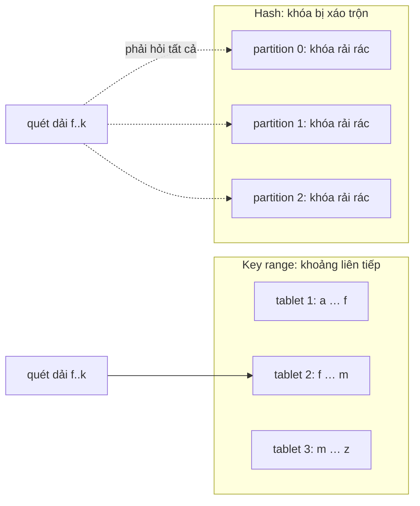
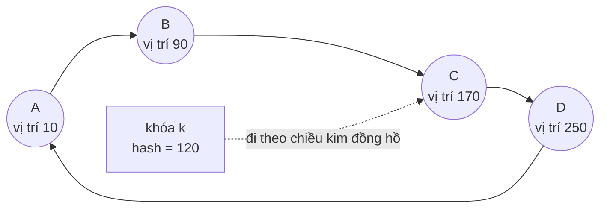
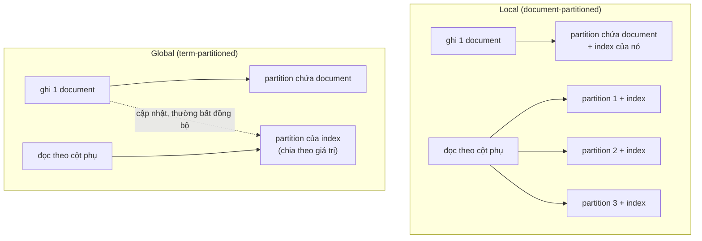
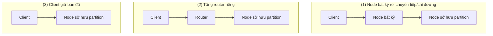

# P12 · Chương 06 — Partitioning (sharding)

> Chương này lấy *khung chủ đề* từ sách *Designing Data-Intensive Applications* (DDIA, ấn bản 1, chương 6 "Partitioning"[^ddia-toc-ch]), nhưng **không trích sách**: mọi khẳng định dựa trên paper gốc (Dynamo, Bigtable, Karger và cộng sự 1997, Jump Consistent Hash) và tài liệu có phiên bản của hệ thống thật (Cassandra 4.1/5.0, Elasticsearch 8.15, MongoDB 7.0, Kafka 3.7.0, PostgreSQL 16, Redis Cluster spec, DynamoDB, Bigtable). Khi viết "(nhận xét của người soạn)" hoặc "(suy luận của người soạn)" thì đó không phải fact từ nguồn. Phần Rust theo **Rust 1.95.0** và các crate có số phiên bản ghi rõ. Chương không chạy thí nghiệm nào; code chỉ để minh họa và không kèm khẳng định về output.

## Bạn sẽ hiểu được gì

- **Q1.** Partition theo *khoảng khóa* (key range) khác partition theo *băm* (hash) thế nào, và mỗi cách được/mất gì? → mục 1
- **Q2.** Skew và hot spot là gì; vì sao băm đều khóa vẫn có thể có node nóng, và có những cách giảm nhẹ nào? → mục 2
- **Q3.** Vì sao `hash(key) mod N` hỏng khi đổi N, consistent hashing sửa việc đó ra sao, và virtual node (vnode) để làm gì? → mục 3
- **Q4.** Secondary index khi dữ liệu bị chia: index *local* (theo document) khác index *global* (theo term) thế nào? → mục 4
- **Q5.** Rebalancing có mấy chiến lược (số partition cố định, partition động, tỷ lệ theo số node) và hệ thống thật chọn gì? → mục 5
- **Q6.** Client làm sao biết gửi request tới node nào (request routing): coordination service hay gossip, và khi bản đồ cũ thì chuyện gì xảy ra? → mục 6
- **Q7.** Chia dữ liệu bắt bạn trả những giá nào ở truy vấn xuyên partition, ràng buộc unique, thứ tự và giao dịch? → mục 7
- **Q8.** (Rust) Vì sao `std::hash::Hash`/`DefaultHasher` không dùng được để chọn shard, và nên dùng gì? → mục 8

## Kiến thức cần trước

- [Chương 01 — Reliability, scalability, maintainability](01-reliability-scalability-maintainability.md): *scalability* và tham số tải; chương này là cách *scale-out* dữ liệu.
- [Chương 02 — Mô hình dữ liệu](02-mo-hinh-du-lieu.md) và [Chương 03 — Storage engine](03-storage-engine.md): SSTable/LSM và B-tree, vì mỗi partition bên trong vẫn là một storage engine như thế.
- [Chương 05 — Replication](05-replication.md): partition và replication thường đi cùng nhau; chương này chỉ nói *chia*, mỗi partition được sao chép thế nào là chương 05.
- [P10 · Chương 09 — Collection của std](../10-rust-internals/09-collections-internals.md): `HashMap`, SipHash, `RandomState` (mục 5) và `BTreeMap::range` (mục 6); mục 8 dùng lại.

Các chương sau dùng chương này: [Chương 07 — Transaction](07-transaction.md) (giao dịch xuyên partition), [Chương 08 — Sự cố hệ phân tán](08-su-co-he-phan-tan.md) (phát hiện node chết), [Chương 09 — Consistency và consensus](09-consistency-va-consensus.md) (bản đồ partition cần đồng thuận), [Chương 11 — Stream processing](11-stream-processing.md) (partition của Kafka). Khi nào *không* nên chia dữ liệu: [Chương 13 — Kiến trúc hệ dữ liệu](13-kien-truc-he-du-lieu.md).

## 0. Từ vựng: partition, shard, tablet, vnode… cùng là một ý

Mỗi hệ thống đặt một tên cho "một mảnh dữ liệu": Bigtable gọi *tablet*[^bt-tablet], MongoDB gọi *chunk* (một khoảng giá trị shard key thuộc về một shard)[^mongo-chunk], Cassandra gọi *partition* (tập các hàng cùng giá trị partition key)[^cass-partition-def], Elasticsearch gọi *shard*[^es-shard-hit], Kafka gọi *partition* của topic[^kafka-partitioned], Redis Cluster gọi *hash slot*[^redis-slots]. Chương này dùng "partition" cho khái niệm chung và "shard" khi nói về hệ cụ thể dùng chữ đó. Mỗi mảnh nằm trên một (hoặc một nhóm replica) node; mục tiêu là *scale-out*: mỗi node chỉ giữ và phục vụ một phần dữ liệu (định nghĩa làm việc của người soạn).

Hai lưu ý để khỏi nhầm:

- **Partition của PostgreSQL ≠ sharding.** *Declarative partitioning* của PostgreSQL 16 chia một bảng thành các bảng con *trong cùng một server*: bảng cha là bảng "ảo" không có storage riêng, dữ liệu nằm ở các partition là bảng thường[^pg-virtual]. Lợi ích chính là *partition pruning* (planner chứng minh được partition nào không thể chứa dòng thỏa `WHERE` rồi bỏ qua nó)[^pg-prune] và xóa dữ liệu cũ theo partition — không phải scale-out qua nhiều máy. Cách chia (range/list/hash) tương tự khung dưới đây (nhận xét của người soạn).
- **Partition mạng ≠ partition dữ liệu.** "Network partition" (đứt mạng giữa các node) là chuyện của [Chương 08](08-su-co-he-phan-tan.md). Chương này chỉ nói chia *dữ liệu*.

## 1. Chia theo khoảng khóa hay theo băm (Q1)

> **Trả lời ngắn.** *Key range*: sắp khóa theo thứ tự rồi cắt thành các khoảng liên tiếp, mỗi khoảng một partition — truy vấn theo dải rẻ nhưng khóa tăng dần dễ dồn hết ghi vào một partition. *Hash*: băm khóa rồi chia theo giá trị băm — phân tán đều nhưng mất tính kề nhau, nên truy vấn dải phải hỏi mọi partition. Hệ thống thật dùng cả hai và có cách lai (khóa ghép) để lấy lợi ích của cả hai.

**Giải thích.**

Hình dung (nhận xét của người soạn): bạn chia một bộ từ điển giấy cho 26 người giữ. Cách 1: người A giữ các từ bắt đầu bằng "a–c", người B giữ "d–f"… — muốn tra "tất cả từ bắt đầu bằng 'con'" chỉ hỏi một người, nhưng nếu hôm nay mọi người đều tra từ chữ "t" thì một người quá tải. Cách 2: tung xúc xắc theo từng từ để quyết định ai giữ — tải đều, nhưng "các từ bắt đầu bằng 'con'" nằm rải rác ở mọi người.

*Key range.* Bigtable giữ dữ liệu theo thứ tự từ điển (lexicographic) của row key, và "tablet" là một khoảng hàng liên tiếp, là đơn vị phân phối và cân tải[^bt-tablet]. Hệ quả: đọc một dải hàng ngắn thường chỉ cần liên lạc vài máy; client khai thác bằng cách chọn row key sao cho dữ liệu hay truy cập cùng nhau nằm kề nhau[^bt-short]. Ví dụ trong paper: đảo thành phần hostname của URL để các trang cùng domain nằm liên tiếp[^bt-reverse]. MongoDB ranged sharding nói cùng ý: các tài liệu có shard key "gần nhau" nhiều khả năng ở cùng chunk/shard, nên truy vấn đọc dải liên tục hiệu quả[^mongo-range].

*Hash.* Cassandra tính hash từ các cột partition key, và giá trị hash quyết định vị trí partition[^cass-hash]. MongoDB hashed sharding cho phân bố đều hơn trên cụm, đổi lại giảm số truy vấn "targeted" (chỉ tới một shard) và tăng số truy vấn "broadcast" (hỏi mọi shard)[^mongo-hash]. Với bản ghi có khóa, partitioner tích hợp của producer Java chọn partition từ hash của khóa: mã nguồn `partitionForKey` là `murmur2(key)` rồi lấy dương và `% numPartitions`[^kafka-bip].

*Vì sao khóa tăng dần nguy hiểm với range.* Mọi cụm range-sharded có một chunk chứa cận trên `MaxKey`; với shard key tăng đơn điệu (ObjectId, timestamp), chunk đó nhận hầu hết lượng insert, nên ghi bị bó vào một shard và mất lợi thế ghi phân tán[^mongo-mono-hot]. MongoDB khuyên dùng hashed sharding cho khóa đơn điệu[^mongo-hash-mono]. Bigtable cũng cảnh báo row key bắt đầu bằng timestamp đẩy ghi tuần tự lên một node, tạo hotspot[^bt-ts-hot].

*Lai: khóa ghép.* Cassandra chia khóa chính thành *partition key* (băm để chọn nơi lưu) và *clustering columns* (sắp thứ tự các hàng *bên trong* partition)[^cass-clustering]; mọi hàng cùng partition key nằm trên cùng tập replica[^cass-colocate]. Bigtable khuyên nếu đặt timestamp vào row key thì đặt trước nó một giá trị có độ phân biệt cao như user ID[^bt-ts-prefix]. Mẫu chung (nhận xét của người soạn): băm ở thành phần đầu để rải tải, giữ thứ tự ở thành phần sau để quét dải trong một partition ("tất cả sự kiện của user U theo thời gian").



(Sơ đồ minh họa của người soạn; không phải số liệu từ nguồn.)

<details><summary>Đi sâu: tên khóa, điều kiện unique, và những chi tiết PostgreSQL/MongoDB hay quên</summary>

- PostgreSQL 16 định nghĩa range partitioning là các khoảng của cột khóa, không chồng lấn, cận dưới bao gồm và cận trên loại trừ[^pg-range]; hash partitioning chỉ định một modulus và một remainder cho từng partition[^pg-hash]. Chỉ ba kiểu (range, list, hash) được hỗ trợ declarative; kiểu khác dùng inheritance/UNION ALL view và mất một số lợi ích hiệu năng[^pg-other].
- Với chia theo thứ tự, *thứ tự phải ổn định giữa các máy*. `pg_dump --load-via-partition-root` có thể hữu ích khi khôi phục sang server mà dòng không luôn rơi vào cùng partition như ở server gốc; ví dụ trong docs: cột partition kiểu text và hai hệ có định nghĩa collation khác nhau[^pg-collation]. (Nhận xét của người soạn: bài học chung là hàm xác định partition — thứ tự hay hash — là một phần của *định dạng dữ liệu*; đổi nó là migration. Mục 8 nói điều này cho hash.)
- MongoDB: nếu shard collection đã có dữ liệu thì ban đầu chỉ có một chunk, balancer tách và di chuyển sau đó[^mongo-initial-chunk]; collection rỗng với hashed key thì mặc định tạo 2 chunk mỗi shard, đổi được bằng `numInitialChunks`[^mongo-init-hashed].
- Hashed index của MongoDB cắt số thực về số nguyên 64-bit trước khi băm, nên 2.3, 2.2, 2.9 cho cùng giá trị băm; docs khuyên không dùng hashed index cho số thực không chuyển về nguyên được[^mongo-hash-float].

</details>

**Quay lại Q1:** key range giữ thứ tự (truy vấn dải rẻ, dễ hot spot với khóa tăng dần); hash rải đều (mất truy vấn dải); khóa ghép "băm trước, sắp sau" là thỏa hiệp phổ biến.

## 2. Skew và hot spot (Q2)

> **Trả lời ngắn.** *Skew* là dữ liệu hoặc tải phân bố lệch giữa các partition; partition nhận nhiều hơn phần của mình là *hot spot*. Băm đều khóa chỉ rải đều *các khóa khác nhau*; nếu một khóa duy nhất nhận quá nhiều request (người nổi tiếng, một tenant khổng lồ) thì partition chứa nó vẫn nóng. Cách giảm nhẹ chủ yếu nằm ở *thiết kế khóa* và đều có giá riêng.

**Giải thích.**

Hình dung (nhận xét của người soạn): quầy thu ngân siêu thị chia theo chữ cái đầu họ khách. Dù chia đều chữ cái, hôm nào cả đoàn họ "Nguyễn" kéo vào thì một quầy tắc. Đổi sang chia theo số thứ tự ngẫu nhiên thì hết tắc theo họ — nhưng một người mua cả xe hàng vẫn chiếm quầy của mình.

*Hai loại lệch.* (a) Lệch do *thiết kế khóa*: khóa tăng đơn điệu (mục 1), khóa có ít giá trị phân biệt. MongoDB gọi hai yếu tố này là *cardinality* và *frequency*: cardinality thấp giới hạn số chunk tối đa và làm giảm hiệu quả scale-out[^mongo-card]; nếu phần lớn tài liệu chỉ mang một vài giá trị khóa thì các chunk chứa chúng thành nút cổ chai, và có thể thành chunk không chia được nữa[^mongo-freq]. DynamoDB đánh giá: User ID khi có nhiều user là tốt, còn status code chỉ có vài giá trị hay ngày tạo làm tròn theo giờ là xấu[^ddb-uniform]. (b) Lệch do *tải trên một khóa*: dù phân phối khóa đều, tải truy cập có thể không đều; Dynamo thừa nhận giả định của họ là dù truy cập lệch nhiều, vẫn có đủ khóa ở đầu "nổi tiếng" để tải được rải đều qua partitioning[^dyn-skew-assume] — một giả định mà một khóa quá nóng phá vỡ.

*Nhận biết.* Paper Dynamo coi một node là "in balance" nếu tải request của nó lệch khỏi trung bình dưới một ngưỡng (15%), ngược lại là "out-of-balance"[^dyn-imbalance]; tỷ lệ node mất cân bằng giảm khi tải hệ thống tăng[^dyn-imbalance2] (lý giải của paper: tải cao thì nhiều khóa phổ biến được truy cập nên tải rải đều hơn). (Nhận xét của người soạn: trong vận hành, theo dõi tải *theo từng partition*, không chỉ trung bình toàn cụm — chỉ số trung bình che mất một partition nóng, vốn là loại sự cố "cả cụm rảnh mà một node 100% CPU".)

*Giảm nhẹ khi một khóa quá nóng.*

- **Khóa phụ có hậu tố (write sharding).** DynamoDB: thêm một số ngẫu nhiên vào cuối partition key để rải ghi qua không gian khóa lớn hơn[^ddb-suffix]. Cái giá: muốn đọc tất cả mục của một ngày phải truy vấn mọi hậu tố rồi gộp kết quả ở ứng dụng[^ddb-suffix-read]. Biến thể "hậu tố tính được" (hash của một thuộc tính hay tìm) giúp đọc một mục cụ thể mà vẫn rải ghi[^ddb-calc-suffix].
- **Chia khóa nóng sang một tập shard nhỏ.** Elasticsearch `index.routing_partition_size`: giá trị routing chỉ chọn một *tập* shard, rồi `_id` chọn shard trong tập đó; tăng kích thước tập làm dữ liệu đều hơn nhưng mỗi request phải tìm trên nhiều shard hơn[^es-routing-partition].
- **Đổi khóa chính để thêm độ phân biệt.** MongoDB gợi ý dùng compound key kết hợp giá trị duy nhất hoặc tần suất thấp khi khóa có giá trị tần suất cao[^mongo-freq-fix]; Bigtable gợi ý đặt định danh có độ phân biệt cao (user ID) trước timestamp[^bt-ts-prefix].

Không công cụ nào trong số này *tự động* biết khóa nào nóng; ứng dụng phải chọn khóa nào cần chia nhỏ (nhận xét của người soạn — các tài liệu trên mô tả cơ chế chứ không hứa tự phát hiện).

<details><summary>Đi sâu: partition quá lớn cũng là skew, và Cassandra "hotspot đọc/ghi"</summary>

- Cassandra nêu rõ mặt trái của khả năng "mọi hàng cùng partition key nằm trên cùng node": nó tạo hotspot cho cả đọc lẫn ghi; partition phải "vừa phải, không quá lớn không quá nhỏ"[^cass-hotspot]. Tức là thiết kế khóa luôn là cân bằng giữa *đồng-nơi* (ít node phải hỏi, batch nguyên tử trong partition[^cass-atomic]) và *phân tán* (tải đều).
- Bigtable lưu ý hotspot ở một bảng ảnh hưởng độ trễ của các bảng khác trong cùng instance, vì mọi bảng trong một instance được lưu trên cùng các tablet[^bt-hotspot-shared]. (Nguồn là tài liệu vendor không đánh số phiên bản.)
- Dynamo đánh giá hiệu quả cân tải bằng "mean load / max load" (tải trung bình chia tải của node nóng nhất)[^dyn-efficiency] — thước đo đáng dùng cho dashboard của chính bạn (nhận xét của người soạn).

</details>

**Quay lại Q2:** hot spot đến từ khóa tăng đơn điệu, khóa ít giá trị phân biệt, hoặc một khóa quá nóng; hash không cứu được trường hợp cuối, nên phải đổi khóa hoặc chia khóa nóng bằng hậu tố/tập shard và chấp nhận chi phí đọc nhiều nơi.

## 3. Consistent hashing và virtual node (Q3)

> **Trả lời ngắn.** Với `hash(key) mod N`, đổi N có thể làm gần như mọi ánh xạ khóa → node mất hiệu lực[^cass-naive]. Consistent hashing đặt cả node và khóa lên một vòng băm; khóa thuộc về node đầu tiên gặp khi đi theo chiều kim đồng hồ, nên thêm/bớt một node chỉ ảnh hưởng hàng xóm kề nó[^dyn-ring-neighbors]. Mỗi node giữ nhiều điểm trên vòng (virtual node) để cân tải tốt hơn và tận dụng máy mạnh yếu khác nhau[^dyn-vnodes].

**Giải thích.**

Hình dung (nhận xét của người soạn): `mod N` giống xếp ghế theo số thứ tự rồi chia cho số bàn; thêm một bàn là cả phòng đứng dậy đổi chỗ. Vòng băm giống chiếc đồng hồ: mỗi bàn đứng ở một giờ nào đó, khách ngồi ở bàn đầu tiên gặp khi đi theo chiều kim đồng hồ từ "giờ" của mình; thêm bàn mới chỉ lấy khách của đoạn ngay trước nó.

*Vì sao `mod N` hỏng.* Cassandra docs: với hash modulo số bucket, thêm một node có thể làm hỏng gần như mọi ánh xạ[^cass-naive]. Paper Jump Consistent Hash lấy ví dụ 10 shard lên 12: `h(key) mod 12` thường khác `h(key) mod 10` nên dữ liệu phải sắp xếp lại gần hết, trong khi chỉ cần di chuyển 1/6 dữ liệu để cân bằng lại[^jump-1-6]. (Suy luận số học của người soạn: với `mod 10` rồi `mod 12`, một khóa không đổi chỗ chỉ khi cả hai số dư bằng nhau; trong mỗi chu kỳ 60 giá trị băm chỉ 10 giá trị thỏa — tức khoảng 5/6 khóa đổi chỗ so với mức tối thiểu 1/6.)

*Ý tưởng của Karger và cộng sự (1997).* Paper mô tả hàm băm "consistent" là hàm thay đổi tối thiểu khi miền giá trị của nó thay đổi[^kar-def]. Tính chất *smoothness*: khi thêm/bớt một máy, tỷ lệ kỳ vọng các đối tượng phải chuyển sang cache mới là mức tối thiểu cần để giữ tải cân bằng[^kar-smooth]; tính chất *monotonicity*: nếu thêm bucket, một đối tượng chỉ có thể chuyển từ bucket cũ sang bucket *mới*, không chuyển giữa hai bucket cũ[^kar-mono]. Bài toán gốc là cache web, nơi các client có thể có những "góc nhìn" (view) không nhất quán về những máy nào đang sẵn sàng[^kar-views]; dùng cho sharding dữ liệu là ứng dụng sau đó.

*Vòng băm trong Dynamo.* Miền giá trị của hàm băm được coi là không gian tròn cố định (vòng); mỗi node nhận một giá trị ngẫu nhiên làm "vị trí" trên vòng; khóa được băm ra vị trí rồi đi theo chiều kim đồng hồ đến node đầu tiên có vị trí lớn hơn[^dyn-ring]. Mỗi node chịu trách nhiệm vùng giữa nó và node đứng trước, nên node đến/đi chỉ ảnh hưởng hàng xóm gần nhất[^dyn-ring-neighbors]. Cassandra mô tả cùng cơ chế: băm khóa ra token, đi theo chiều kim đồng hồ cho tới khi gặp đủ số node khác nhau bằng replication factor (RF) thì đó là các replica của khóa[^cass-rf-walk].



(Con số vị trí chỉ để minh họa; khóa có hash 120 rơi vào khoảng (90, 170] nên thuộc node C, theo quy tắc "node đầu tiên có vị trí lớn hơn".)

*Hai khuyết điểm của vòng đơn giản → vnode.* Dynamo nêu: gán vị trí ngẫu nhiên khiến phân bố dữ liệu và tải không đều, và thuật toán cơ bản không biết gì về việc các node có hiệu năng khác nhau[^dyn-challenges]. Cách khắc phục là mỗi node nhận *nhiều* điểm trên vòng, gọi là virtual node[^dyn-vnodes]. Ba lợi ích theo paper: node ngừng hoạt động thì tải của nó rải đều lên các node còn lại; node mới/trở lại nhận lượng tải xấp xỉ bằng nhau từ mọi node khác; số vnode của một node có thể chọn theo năng lực để tính đến sự không đồng nhất phần cứng[^dyn-vnode-adv]. Paper Karger gốc cũng đã cần mỗi bucket có nhiều hơn một điểm trên đoạn đơn vị[^kar-multipoint]. Cassandra thể hiện bằng `num_tokens`: nhiều token hơn (so với node khác) thì node chứa tỷ lệ dữ liệu lớn hơn, và nên cho các node cùng phần cứng cùng số token[^cass-num-tokens].

*Cái giá của vnode.* Cassandra liệt kê: mỗi token thêm tối đa `2 × (RF − 1)` hàng xóm trên vòng, nên có nhiều tổ hợp lỗi node hơn làm mất khả dụng một phần vòng, và càng nhiều token xác suất sự cố càng cao[^cass-vnode-cost]; các thao tác bảo trì toàn cụm (như repair) chậm hơn khi số token mỗi node tăng[^cass-vnode-repair]. Ở Cassandra 2.x chỉ có thuật toán chọn token ngẫu nhiên nên mặc định phải 256 token để cân bằng; từ 3.x có bộ cấp phát xác định cho phép dùng ít token hơn nhiều[^cass-256].

<details><summary>Đi sâu: Jump Consistent Hash, và vì sao Dynamo bỏ "mỗi node T token ngẫu nhiên"</summary>

- **Jump Consistent Hash** (Lamping & Veach, Google): không cần lưu trữ, nhanh hơn thuật toán Karger và chia đều hơn, nhưng hạn chế chính là bucket phải đánh số tuần tự — hợp với lưu trữ dữ liệu hơn là web cache phân tán[^jump-abstract]. Hệ quả (suy luận của người soạn): bỏ bucket ở *giữa* dải số không biểu diễn được, nên chỉ hợp khi thêm/bớt ở cuối (số shard tăng dần), không hợp khi node chết bất kỳ. Crate Rust `jump-consistent-hash` 0.1.0 cài thuật toán này: hàm `hash` nhận khóa 64 bit và số bucket, trả số bucket trong `0..buckets`[^jump-crate].
- **Dynamo đổi chiến lược ba lần.** Chiến lược 1: mỗi node T token ngẫu nhiên, phân vùng theo giá trị token; kích thước bộ nhớ lưu membership tăng tuyến tính theo số node[^dyn-s1]. Chiến lược 2: T token ngẫu nhiên + Q phân vùng bằng nhau — tách phân vùng khỏi vị trí đặt; nhưng khi node mới "đánh cắp" khoảng khóa, node cũ phải quét kho dữ liệu cục bộ (tốn tài nguyên, chạy ưu tiên thấp) và có lúc mùa mua sắm bootstrap mất gần một ngày; Merkle tree phải tính lại; và không có cách dễ để snapshot toàn bộ không gian khóa[^dyn-s2]. Chiến lược 3: Q/S token mỗi node (S là số node), phân vùng bằng nhau; so với chiến lược 1, hiệu quả cân tải tốt hơn và kích thước membership giảm ba bậc độ lớn[^dyn-s3-better]; vì ranh giới cố định nên mỗi partition có thể là một file riêng và chuyển như một đơn vị bằng cách chép file[^dyn-s3-files]; nhược điểm là đổi membership đòi hỏi phối hợp để giữ các tính chất của phép gán[^dyn-s3-cost]. Đây chính là chiến lược "số partition cố định" của mục 5.
- Elasticsearch ghi rõ cách chọn shard: `shard_num = (hash(_routing) % num_routing_shards) / routing_factor`, với `routing_factor = num_routing_shards / num_primary_shards`; routing mặc định là `_id`[^es-formula]. Docs mô tả không gian `num_routing_shards` này là không gian băm dùng consistent hashing để chia tài liệu[^es-split]; nhìn công thức thì cơ chế là `mod` trên không gian cố định rồi chia gộp theo `routing_factor` (suy luận của người soạn) — xem mục 5 về cách nó cho phép *split*.

</details>

**Quay lại Q3:** `mod N` làm gần hết khóa phải đổi chỗ khi N đổi (ví dụ 10 → 12 ở trên); consistent hashing chỉ di chuyển phần tối thiểu quanh node vào/ra; vnode rải phần di chuyển đó ra nhiều node và cho phép trọng số theo năng lực, với giá là nhiều hàng xóm hơn.

## 4. Secondary index: local và global (Q4)

> **Trả lời ngắn.** Khi dữ liệu đã chia theo khóa chính, tìm theo cột khác (secondary index) có hai cách. *Local index* (còn gọi *document-partitioned*): mỗi partition giữ index chỉ cho dữ liệu *của chính nó* — ghi rẻ (một partition) nhưng đọc theo cột phụ *không kèm khóa partition* phải hỏi *mọi* partition rồi gộp. *Global index* (*term-partitioned*): index riêng được chia theo *giá trị được index*, nên đọc theo cột phụ trúng ít partition, nhưng một lần ghi có thể phải cập nhật index nằm ở partition khác — thường làm bất đồng bộ nên index có thể cũ. (Phần tổng quát hóa này là của người soạn; bằng chứng từng hệ nằm ở dưới.)

(Thuật ngữ *document-partitioned* và *term-partitioned* là cách gọi quen trong khung DDIA — mục lục sách có hai mục "Partitioning Secondary Indexes by Document" và "by Term"[^ddia-toc-index]; các tài liệu vendor dưới đây dùng tên riêng — nhận xét của người soạn.)

**Giải thích.**

Hình dung (nhận xét của người soạn): thư viện chia sách vào 10 phòng theo mã số sách (khóa chính). *Local index*: mỗi phòng có một sổ mục lục theo tác giả cho riêng sách trong phòng đó. Tìm "sách của tác giả X" phải đi 10 phòng. *Global index*: một cuốn mục lục theo tác giả cho cả thư viện, chia ra theo chữ cái của tên tác giả (A–C ở tủ 1…). Tìm tác giả X chỉ mở một tủ — nhưng khi nhập sách mới vào phòng 7, thủ thư phải chạy sang tủ mục lục khác để cập nhật.



(Sơ đồ minh họa của người soạn, tóm tắt lập luận ở trên.)

*Local index trong hệ thống thật.*

- **Cassandra SAI** (Storage-Attached Index): index được gắn với memtable và SSTable, được tạo khi chúng được ghi, và sự khác biệt giữa các index được xử lý lúc đọc[^sai-attach]. Khi bootstrap/decommission node, index được stream cùng SSTable thay vì dựng lại ở node nhận[^sai-stream]. Khi đọc, một "SAI Coordinator" gửi *token range read* tới các replica, và mỗi replica chạy truy vấn index cục bộ[^sai-local]; coordinator chọn số range cần liên lạc theo lượng hàng ước tính và `LIMIT`[^sai-concurrency]. Đây là mô hình local: index nằm cùng dữ liệu, nên truy vấn theo cột phụ không kèm khóa partition phải được gửi tới nhiều range của vòng (suy luận của người soạn từ các mô tả trên).
- **Elasticsearch**: một request tìm kiếm thường chạm nhiều shard và mỗi shard chạy tìm kiếm trên một thread[^es-multi-shard]. Thống kê tần suất term để tính điểm mặc định được tính cục bộ trên từng shard — nhanh hơn nhưng điểm có thể kém chính xác; `dfs_query_then_fetch` tính toàn cục bằng thông tin từ mọi shard, chính xác hơn nhưng thêm một vòng đi về tới mỗi shard[^es-dfs]. Phân trang sâu đắt vì mỗi shard phải nạp hit của cả các trang trước vào bộ nhớ[^es-deep-page]. Nếu biết trước khóa routing, tìm kiếm có thể chỉ gửi tới shard tương ứng thay vì fan-out toàn bộ[^es-custom-routing].
- **DynamoDB local secondary index (LSI)**: tổ chức theo *cùng partition key* với bảng nhưng khác sort key[^lsi-def] — nên index đi cùng partition của dữ liệu (suy luận của người soạn). Khác SAI và Elasticsearch, truy vấn LSI chỉ định một giá trị partition key nên không fan-out qua mọi partition (suy luận của người soạn; docs dẫn chỉ nói LSI dùng cùng partition key với bảng).
- **PostgreSQL** (partition trong một server): index của bảng partition là các index riêng trên từng partition; vì mỗi index chỉ đảm bảo unique *trong partition của nó*, ràng buộc unique/primary key trên bảng partition phải gồm mọi cột partition key (và không dùng biểu thức/hàm) để cấu trúc partition tự bảo đảm không trùng giữa các partition[^pg-unique].

*Global index trong hệ thống thật.*

- **DynamoDB global secondary index (GSI)**: tổ chức theo khóa chính *khác* khóa của bảng; khóa index không cần có thuộc tính nào của khóa bảng, thậm chí không cần cùng lược đồ khóa[^gsi-def]. GSI được cập nhật *bất đồng bộ* theo mô hình eventually consistent khi ghi hoặc xóa trên bảng[^gsi-async]; thay đổi thường lan tới GSI trong một phần giây, nhưng có kịch bản lỗi hiếm làm trễ lâu hơn, nên ứng dụng phải chấp nhận truy vấn GSI trả kết quả cũ[^gsi-stale]. GSI còn có công suất ghi riêng: nếu GSI thiếu write capacity, ghi vào bảng chính cũng bị throttle[^gsi-throttle].

*Vì sao đổi lại như vậy.* Local: ghi chạm một partition nên đơn giản hơn (nhận xét của người soạn); đổi lại đọc theo cột phụ không kèm khóa partition là fan-out tới mọi partition — MongoDB mô tả điều tương tự cho truy vấn không có shard key: mongos phải hỏi mọi shard, đợi phản hồi rồi mới trả về[^mongo-broadcast]. Global: đọc nhanh, nhưng một lần ghi trở thành thao tác xuyên partition; nếu muốn index luôn khớp dữ liệu thì cần giao dịch phân tán ([Chương 07](07-transaction.md)), còn nếu không thì chấp nhận index trễ như GSI (suy luận của người soạn từ hai mô tả trên).

<details><summary>Đi sâu: unique constraint là secondary index đặc biệt</summary>

- MongoDB: nếu `_id` không phải shard key thì ràng buộc unique của `_id` chỉ áp trong phạm vi shard lưu tài liệu — hai tài liệu cùng `_id` có thể tồn tại ở hai shard khác nhau, ứng dụng phải tự đảm bảo `_id` duy nhất toàn cụm[^mongo-unique-id]. Với collection đã shard, không thể tạo unique index trên trường khác trừ khi shard key là tiền tố của index[^mongo-unique-prefix].
- Đây chính là bài toán "index cục bộ không thấy được dữ liệu partition khác": chỉ khi giá trị cần unique *quyết định* partition (là khóa partition hoặc tiền tố) thì mọi bản trùng mới gặp nhau ở cùng một nơi (suy luận của người soạn, khớp với điều kiện của PostgreSQL ở trên).
- Cassandra chia khóa chính thành partition key và clustering; index SAI là thứ dùng khi cần truy vấn ngoài partition key, và chi phí của nó là fan-out như trên (nhận xét của người soạn — nguồn không đưa ra con số).

</details>

**Quay lại Q4:** local index = ghi một nơi, đọc cột phụ hỏi mọi partition; global index = đọc cột phụ trúng ít nơi, ghi phải cập nhật partition khác và thường để index hơi cũ.

## 5. Rebalancing: thêm node thì dữ liệu chuyển thế nào (Q5)

> **Trả lời ngắn.** Rebalancing là chuyển partition giữa các node khi thêm/bớt node hoặc khi tải lệch. Có ba chiến lược quen thuộc (cách phân loại của người soạn theo khung DDIA; mục lục sách chỉ ghi tên mục "Strategies for Rebalancing"[^ddia-toc-rebal]): (1) *số partition cố định* tạo sẵn rất nhiều partition, node mới nhận một số partition nguyên vẹn; (2) *partition động* tách partition khi quá lớn, gộp khi quá nhỏ; (3) *tỷ lệ theo số node* mỗi node giữ một số partition cố định nên số partition tăng theo số node. Điểm chung: *không* dùng `hash mod N` để chọn node — partition là lớp trung gian giữa khóa và node.

**Giải thích.**

Hình dung (nhận xét của người soạn): thay vì chia khách thẳng cho từng bàn, bạn chia khách vào 1.000 "nhóm" cố định; mỗi bàn phụ trách vài chục nhóm. Thêm bàn thì chuyển vài nhóm sang bàn mới — không ai bị chia lại từ đầu.

*Điều kiện của rebalancing tốt* (nhận xét của người soạn): trong lúc di chuyển cụm vẫn phải phục vụ đọc/ghi, chỉ nên di chuyển phần cần thiết, và phải kiểm soát băng thông. Kafka cho phép đặt throttle cho lưu lượng replication khi rebalance, bootstrap hay thêm/bớt broker, để chặn trên băng thông dùng cho di chuyển[^kafka-throttle]. MongoDB balancer chỉ cho mỗi shard tham gia tối đa một di chuyển tại một thời điểm, và với n shard thì tối đa n/2 (làm tròn xuống) di chuyển song song[^mongo-one-migration].

### 5.1. Số partition cố định

Tạo trước nhiều partition hơn số node và giữ nguyên số đó; thêm node thì chuyển một số partition nguyên vẹn sang. Trong chiến lược này ranh giới khóa → partition không đổi khi thêm node, chỉ ánh xạ partition → node đổi (nhận xét của người soạn; Elasticsearch có ngoại lệ qua API split, xem dưới).

- **Dynamo chiến lược 3**: Q phân vùng bằng nhau, mỗi node Q/S token; khi node vào nó "đánh cắp" token từ các node khác để giữ tính chất đó, khi node ra token của nó được chia ngẫu nhiên cho node còn lại[^dyn-s3-def]. Lợi ích đã nêu: partition là file riêng, chuyển bằng cách chép file[^dyn-s3-files].
- **Redis Cluster**: không gian khóa chia thành 16384 hash slot, `HASH_SLOT = CRC16(key) mod 16384`[^redis-formula]; mỗi master giữ một tập slot[^redis-slots]. Thêm node = chuyển một số slot từ các node hiện có sang node trống; bớt node = chuyển slot của nó đi; cân lại = chuyển slot giữa các node — mọi thao tác quy về "di chuyển một hash slot"[^redis-reconf]. Slot vẫn chỉ là tập khóa, nên di chuyển slot là di chuyển các khóa băm vào slot đó[^redis-slot-keys].
- **Kafka**: topic chia thành P partition xác định trước, đánh số 0…P−1[^kafka-pdef]. Có thể *thêm* partition nhưng không giảm[^kafka-no-reduce]; và thêm partition không đổi phân vùng của dữ liệu cũ, nên nếu khóa được chia theo `hash(key) % number_of_partitions` thì ánh xạ có thể bị xáo, mà Kafka không tự phân phối lại dữ liệu cũ[^kafka-add-part].
- **Elasticsearch**: `index.number_of_shards` chỉ đặt được lúc tạo index[^es-shards-create]. Để vẫn tách được, API *split* biến mỗi shard thành hai hoặc nhiều shard của index mới, theo các thừa số cho phép bởi `number_of_routing_shards` — kích thước "không gian băm" nội bộ[^es-split] — ví dụ trong docs: 5 shard với routing shards 30 (= 5×2×3) tách được theo hệ số 2 hoặc 3[^es-split-example]. Yêu cầu: index phải read-only[^es-split-req] và cluster health phải green[^es-split-green].

*Chọn số partition ban đầu là quyết định khó đảo ngược.* Quá ít: partition sau này quá lớn, khó di chuyển/khôi phục (nhận xét của người soạn; ES nêu riêng việc shard rất lớn làm phục hồi lâu hơn, bên dưới). Quá nhiều: Elasticsearch cảnh báo mỗi shard đều có overhead (quản lý cluster và tìm kiếm), cụm có quá nhiều shard ("oversharding") sẽ chậm hơn khi tìm kiếm và nặng hơn có thể mất ổn định[^es-oversharding]; tìm trên một nghìn shard 50MB đắt hơn đáng kể một shard 50GB cùng dữ liệu, nhưng shard rất lớn cũng làm tìm kiếm chậm và phục hồi lâu hơn[^es-shard-size]. Docs gợi ý khoảng 10–50 GB mỗi shard trong nhiều trường hợp, kèm dưới 200 triệu document[^es-10-50].

### 5.2. Partition động

Bắt đầu với ít partition; tách khi lớn, gộp khi nhỏ — hợp với key range, nơi khó chia sẵn ranh giới có nghĩa trước khi biết phân bố khóa (nhận xét của người soạn).

- **Bigtable**: ban đầu mỗi bảng chỉ có một tablet; khi bảng lớn lên được tự động tách thành nhiều tablet, mỗi cái xấp xỉ 100–200 MB mặc định[^bt-split-size]. Mỗi tablet server quản lý khoảng 10 đến 1000 tablet và tự tách tablet quá lớn[^bt-per-server]; master gán tablet cho server và cân tải[^bt-master].
- **MongoDB**: chunk mặc định 128 MB; range nhỏ cho phân bố đều hơn nhưng di chuyển thường xuyên hơn, thêm overhead ở tầng định tuyến mongos[^mongo-small-range]; docs nhận xét với phần lớn triển khai, phân bố hơi lệch tốt hơn di chuyển liên tục[^mongo-range-size]. Balancer là tiến trình nền theo dõi lượng dữ liệu mỗi shard và di chuyển khi chênh lệch chạm ngưỡng[^mongo-balancer]. Khi thêm shard mới, nó trống nên có mất cân bằng; MongoDB bắt đầu di chuyển ngay nhưng cần thời gian mới cân[^mongo-add-shard].
- Rủi ro (nhận xét của người soạn): với *một khóa duy nhất* quá nóng, chia range không giúp vì nhỏ nhất của chunk là một giá trị khóa duy nhất[^mongo-smallest-chunk].

### 5.3. Tỷ lệ theo số node

Ý tưởng: kích thước *mỗi* partition giữ ổn định còn số partition tăng theo số node, thay vì số partition cố định (5.1) hay chỉ phụ thuộc kích thước dữ liệu (5.2). Hệ thống gần nhất trong nguồn đã tải là **Cassandra vnode**: mỗi node nhận `num_tokens` token, nên số vnode của cả cụm tăng theo số node (suy luận của người soạn); khi dùng bộ cấp phát token tự động thì tải gán cho node gần tỷ lệ với số vnode của nó[^cass-alloc], và node mới nhận xấp xỉ bằng nhau từ các node khác[^cass-vnode-benefit].

### 5.4. Tự động hay thủ công?

Dynamo cố ý *không* rebalance khi node chỉ tạm ngừng: một lần ngừng hiếm khi nghĩa là node rời hẳn, nên không nên kích hoạt rebalance hay sửa replica; việc thêm/bớt node trong vòng do quản trị viên ra lệnh tường minh, và thay đổi membership được lan bằng gossip[^dyn-explicit]. (Nhận xét của người soạn: rebalance tự động kết hợp phát hiện lỗi sai — vd. một node chậm bị tưởng là chết — có thể chuyển cả đống dữ liệu đúng lúc cụm đang chịu tải, làm sự cố trầm trọng hơn. Một người trong vòng quyết định hay ít nhất xác nhận là phương án an toàn hơn.)

<details><summary>Đi sâu: di chuyển một partition mà không dừng ghi</summary>

- MongoDB range migration: nguồn nhận lệnh `moveRange`; trong khi di chuyển, thao tác trên range vẫn gửi tới shard nguồn và shard nguồn chịu trách nhiệm ghi[^mongo-migration-source]; đích yêu cầu tài liệu rồi nhận bản sao; sau tài liệu cuối, đích đồng bộ các thay đổi xảy ra trong lúc di chuyển[^mongo-migration-sync]. Đọc từ secondary trong lúc di chuyển có thể bỏ sót tài liệu nếu truy vấn chạy lâu[^mongo-secondary-miss].
- Redis Cluster: khi cấu hình ổn định, một slot do một node phục vụ[^redis-stable]; node có thể trả `-MOVED` (slot thuộc node khác) và `-ASK` (slot đang di chuyển) và client phải xử lý cả hai[^redis-asks].
- Bigtable tách tablet: tablet server commit việc tách bằng cách ghi thông tin tablet mới vào bảng METADATA rồi báo master; nếu thông báo mất, master phát hiện tablet đã tách khi yêu cầu tải tablet[^bt-split-commit].
- Dynamo: node X vào vòng giữa A và B thì các node B, C, D đề nghị và chuyển khóa cho X khi X xác nhận; vòng xác nhận đó nhằm tránh chuyển trùng[^dyn-bootstrap].

</details>

**Quay lại Q5:** đặt lớp partition giữa khóa và node rồi di chuyển *partition nguyên vẹn*; chọn số cố định (Dynamo, Redis, Kafka, ES), động theo kích thước (Bigtable, MongoDB), hoặc tỷ lệ số node (Cassandra vnode); tốc độ di chuyển nên bị chặn để không làm sập cụm (nhận xét của người soạn; Kafka có throttle, MongoDB giới hạn số migration song song — mục đầu 5).

## 6. Request routing: gửi tới đúng node (Q6)

> **Trả lời ngắn.** Cần *bản đồ* "khóa → partition → node" và ai đó giữ nó. Ba kiểu: client gửi tới node bất kỳ rồi node đó chuyển tiếp hoặc chỉ đường; một tầng router riêng; hoặc client tự giữ bản đồ và gửi thẳng. Bản đồ được giữ ở một dịch vụ phối hợp (ZooKeeper, etcd, Chubby, config server) hoặc tự lan giữa các node bằng gossip. Bản đồ của client có thể cũ; hệ thống tốt nhận biết lỗi "sai node" và làm tươi bản đồ.

**Giải thích.**

Hình dung (nhận xét của người soạn): tổng đài chuyển cuộc gọi tới đúng chi nhánh. Bạn có thể gọi chi nhánh bất kỳ và nhờ họ chuyển máy, gọi một số tổng đài trung tâm, hoặc tự lưu danh bạ. Danh bạ thay đổi khi chi nhánh chuyển địa chỉ; phải có cách nhận ra danh bạ đã cũ.



(Sơ đồ minh họa của người soạn cho ba kiểu định tuyến mô tả bên dưới.)

*Kiểu 1 — node bất kỳ.* Cassandra: khi có mutation, coordinator băm partition key để xác định token range rồi sao chép mutation tới các replica theo replication strategy[^cass-coordinator]. Redis Cluster: client được tự do gửi truy vấn tới bất kỳ node nào; nếu node không phục vụ slot đó nó trả lỗi `-MOVED` kèm slot và địa chỉ node đúng[^redis-moved]; node *không* proxy yêu cầu mà chỉ chuyển hướng bằng `-MOVED`/`-ASK`[^redis-no-proxy]. Dynamo hỗ trợ client đi qua load balancer chung, rồi node nhận chuyển tiếp tới node đúng[^dyn-lb-or-client].

*Kiểu 2 — router riêng.* MongoDB `mongos` là query router giữa ứng dụng và cụm; nó không có trạng thái bền vững, mà cache metadata lấy từ config server để biết dữ liệu nào ở shard nào[^mongo-mongos]; config server là một replica set lưu metadata và cấu hình cụm[^mongo-config]. Nếu có proxy/load balancer đặt trước mongos, phải bật client affinity để mọi kết nối của một client tới cùng một mongos[^mongo-affinity]. Elasticsearch có node điều phối: với search, nó chọn node chứa bản sao của dữ liệu và chuyển yêu cầu tới shard của node đó, mặc định bằng adaptive replica selection[^es-search-routing].

*Kiểu 3 — client giữ bản đồ.* Kafka: producer gửi thẳng tới broker là leader của partition, không qua tầng định tuyến trung gian; mọi broker có thể trả lời metadata request cho biết broker nào sống và leader của từng partition ở đâu[^kafka-direct]. Client bootstrap bằng một danh sách hai ba URL broker[^kafka-bootstrap-list], lấy metadata rồi cache cho đến khi nhận lỗi báo metadata cũ (lỗi socket, hoặc mã lỗi cho biết broker không còn giữ partition)[^kafka-bootstrap]. Dynamo hỗ trợ cả "thư viện client nhận biết partition" — định tuyến thẳng tới coordinator, độ trễ thấp hơn vì bỏ một bước chuyển tiếp[^dyn-client-lib]; client định kỳ (10 giây trong paper) hỏi một node ngẫu nhiên để tải về trạng thái membership, và paper chọn kéo thay vì đẩy vì kéo scale tốt hơn với số client lớn[^dyn-client-poll]. Bigtable: client dùng cache vị trí tablet; cache rỗng cần ba round-trip (gồm một lần đọc Chubby), cache cũ có thể tới sáu round-trip vì chỉ phát hiện cũ khi trượt[^bt-location-cache].

*Ai giữ bản đồ (sự thật gốc)?*

- **Dịch vụ phối hợp (ưu tiên nhất quán).** Bigtable: file Chubby chứa vị trí root tablet, root tablet trỏ tới các tablet METADATA, các tablet này trỏ tới tablet của người dùng — ba tầng giống B+ tree[^bt-3level][^bt-root]; Bigtable cũng dùng Chubby để theo dõi tablet server[^bt-chubby]; Chubby dùng thuật toán Paxos để giữ các bản sao nhất quán khi có lỗi[^bt-paxos]. ZooKeeper tự mô tả là dịch vụ phối hợp cho ứng dụng phân tán, cung cấp primitive để cài đặt đồng bộ, duy trì cấu hình, nhóm và đặt tên[^zk-overview]; client có thể đặt *watch* lên znode để được báo khi nó đổi[^zk-watch], và cập nhật từ một client được áp theo đúng thứ tự gửi[^zk-seq]. Kafka 3.7.0 với cụm dùng ZooKeeper nhận biết broker chết qua node ephemeral của phiên ZooKeeper, controller phát hiện node bị xóa qua ZooKeeper watch[^kafka-zk-watch]; với cụm KRaft thì phiên được duy trì bằng heartbeat gửi tới controller[^kafka-kraft-hb]. etcd được mô tả là kho key-value nhất quán cho quản lý cấu hình, service discovery và điều phối công việc phân tán[^etcd-use]; nó dành cho hệ không chấp nhận split-brain và chịu hy sinh availability để đạt điều đó[^etcd-cap]. Cơ chế đồng thuận bên dưới ở [Chương 09](09-consistency-va-consensus.md).
- **Gossip.** Dynamo: thay đổi membership được lan bằng giao thức gossip để duy trì một view membership *eventually consistent*; mỗi giây mỗi node liên lạc một peer ngẫu nhiên và hai bên đối chiếu lịch sử thay đổi[^dyn-gossip]. Thông tin token cũng lan theo đường gossip nên mỗi node biết peer giữ khoảng token nào và chuyển tiếp trực tiếp được[^dyn-gossip-token]; đó là lý do paper gọi Dynamo là "DHT zero-hop" — mỗi node giữ đủ thông tin định tuyến cục bộ để gửi thẳng tới node đúng[^dyn-zero-hop]. Cassandra: gossip lan thông tin token và schema, "dạy" các node biết endpoint nào sở hữu dữ liệu nào[^cass-gossip-token]. Redis Cluster: các node nối với nhau bằng cluster bus và dùng gossip để phát hiện node mới và kiểm tra sức sống[^redis-gossip].
- Cái giá của gossip toàn phần: Dynamo thừa nhận mô hình "mỗi node biết dữ liệu của mọi peer" chạy tốt với vài trăm node nhưng khó scale lên hàng chục nghìn, vì chi phí duy trì bảng định tuyến tăng theo kích thước hệ thống[^dyn-full-membership]. (Nhận xét của người soạn: chọn coordination service hay gossip chính là chọn *nhất quán* hay *luôn sẵn sàng* cho metadata — liên quan [Chương 09](09-consistency-va-consensus.md).)

*Bản đồ cũ thì sao?* Không hệ thống nào đòi client luôn đúng; chúng *phát hiện sai và sửa*: Redis trả `-MOVED` mỗi khi slot thuộc node khác, kể cả khi client đợi lâu rồi gửi lại sau khi cấu hình đổi[^redis-moved-again]; khi gặp redirect, nhiều khả năng nhiều slot đã đổi nên cách tốt thường là làm tươi cả bản đồ[^redis-refresh]; cluster ổn định thì cuối cùng mọi client có bản đồ và gửi thẳng không cần redirect hay proxy[^redis-stable-map]. Kafka cũng dùng mã lỗi và metadata mới[^kafka-bootstrap].

<details><summary>Đi sâu: partition quyết định ai ghi — và vì sao bản đồ sai nguy hiểm hơn "chậm"</summary>

- Kafka: các request ghi/đọc phải gửi tới broker đang là leader; broker kiểm tra điều này và trả lỗi `NotLeaderForPartition` nếu gửi sai[^kafka-leader-enforced]. Tức là *sự thật* về ai là leader được broker bảo vệ, bản đồ ở client chỉ là gợi ý (nhận xét của người soạn).
- Kafka cũng nói rõ rằng *client* quyết định ánh xạ khóa → partition; broker không áp đặt ngữ nghĩa nào; hai client muốn dùng cùng cách chia phải dùng cùng phương pháp tính ánh xạ[^kafka-client-controls]. Đây là chỗ mục 8 (Rust) quan trọng: producer Rust và producer Java phải dùng cùng hàm băm.
- Bigtable master không phải đường dữ liệu: client nói chuyện trực tiếp với tablet server, nên hầu hết client không bao giờ liên lạc master và master ít tải[^bt-master-light].
- Ở Cassandra, vì mỗi node đều biết token map qua gossip, bất kỳ node nào cũng làm được coordinator (nhận xét của người soạn từ [^cass-coordinator] và [^cass-gossip-token]).

</details>

**Quay lại Q6:** bản đồ khóa → node do coordination service (nhất quán) hoặc gossip (luôn sẵn sàng, cuối cùng nhất quán) giữ; client dùng node bất kỳ, router, hoặc cache bản đồ, và phải xử lý lỗi "sai node" bằng cách làm tươi bản đồ.

## 7. Giá phải trả của việc chia dữ liệu (Q7)

> **Trả lời ngắn.** Chia dữ liệu cho phép scale-out, nhưng mọi thứ từng "miễn phí" trong một node đều thành bài toán phân tán: truy vấn không kèm khóa phải hỏi mọi partition; ràng buộc unique chỉ rẻ khi khóa unique chứa khóa chia; thứ tự (như ở Kafka) chỉ được bảo đảm trong một partition; giao dịch qua nhiều partition cần cơ chế riêng. Vì vậy chọn khóa chia là quyết định thiết kế chính.

**Giải thích.**

Hình dung (nhận xét của người soạn): một cuốn sổ cái chia thành 10 quyển cho 10 kế toán. Mỗi kế toán làm nhanh phần của mình, nhưng "tổng toàn công ty" và "chuyển tiền từ quyển 3 sang quyển 8 mà không ai thấy trạng thái dở dang" đòi hỏi họp và quy trình.

- **Truy vấn không kèm khóa chia.** MongoDB: truy vấn nhanh nhất thường là truy vấn mongos định tuyến tới một shard nhờ shard key và metadata từ config server (targeted)[^mongo-targeted]; truy vấn không có shard key phải hỏi mọi shard và chờ phản hồi — loại truy vấn có thể chạy lâu, tùy tải cụm, độ trễ mạng, tải từng shard và số tài liệu mỗi shard trả về[^mongo-broadcast]. `updateMany` và `deleteMany` là broadcast trừ khi truy vấn chỉ định đủ shard key[^mongo-multi]. Elasticsearch: phân trang sâu buộc mỗi shard nạp hit của các trang trước[^es-deep-page].
- **Thao tác nhiều khóa.** Redis Cluster hiện thực các lệnh nhiều khóa phức tạp (hợp/giao tập) chỉ khi mọi khóa băm vào cùng một slot[^redis-multikey]; *hash tag* `{...}` ép nhiều khóa vào cùng slot — chỉ phần giữa cặp ngoặc đầu tiên được băm[^redis-hashtag]; nhưng khi resharding thủ công, thao tác nhiều khóa có thể tạm thời không dùng được trong khi thao tác một khóa vẫn luôn sẵn sàng[^redis-reshard-multikey]. (Nhận xét của người soạn: hash tag là cách chủ động *đồng-nơi* dữ liệu, đổi lấy nguy cơ hot spot — mọi khóa cùng tag nằm một slot.)
- **Thứ tự.** Kafka chia topic thành các partition có thứ tự toàn phần, mỗi partition được đúng một consumer trong mỗi consumer group đọc tại một thời điểm[^kafka-order2]; sự kiện cùng khóa được ghi vào cùng partition[^kafka-order]. Vậy thứ tự *giữa các partition* không có bảo đảm trong nguồn này; muốn thứ tự theo thực thể phải chọn khóa là thực thể đó (suy luận của người soạn).
- **Atomic trong một partition.** Cassandra: chọn khóa chính nhóm các hàng giúp batch update và có thể bảo đảm các cập nhật atomic và cô lập[^cass-atomic] — phạm vi là *một partition*. Giao dịch xuyên partition là chủ đề của [Chương 07](07-transaction.md).
- **Unique và index.** Xem mục 4: unique chỉ rẻ khi khóa unique chứa khóa chia[^pg-unique][^mongo-unique-prefix].
- **Chọn khóa chia cũng chọn truy vấn nào rẻ.** PostgreSQL: cột partition nên là cột hay xuất hiện nhất trong `WHERE` vì mệnh đề tương thích với cận partition mới cắt được partition thừa; nhưng yêu cầu PRIMARY KEY/UNIQUE và nhu cầu xóa dữ liệu cũ cũng ảnh hưởng quyết định[^pg-choose].
- **Đổi hàm băm hoặc khóa chia thường kéo theo di chuyển dữ liệu.** Cassandra: *partitioner* (hàm băm gán partition key vào vòng) không thể đổi nếu không nạp lại toàn bộ dữ liệu[^cass-partitioner-fixed]; mặc định là Murmur3Partitioner[^cass-murmur3]. MongoDB cho phép *sửa giá trị* shard key của tài liệu (trừ `_id` bất biến)[^mongo-update-key]; từ MongoDB 5.0 còn đổi được chính shard key và phân phối lại dữ liệu bằng `reshardCollection`[^mongo-reshard] — tức việc phân phối lại vẫn xảy ra, chỉ khác là hệ thống làm giúp (suy luận của người soạn).

*Khi nào chưa nên chia.* Vì cả chuỗi chi phí trên, quyết định "có cần chia không" nên đến sau khi tìm hiểu một node lớn, replication để đọc, partition *trong* một server (PostgreSQL, mục 0) — xem [Chương 13](13-kien-truc-he-du-lieu.md) (nhận xét của người soạn).

<details><summary>Đi sâu: vì sao "shard theo tenant" thường là điểm bắt đầu hợp lý</summary>

- (Suy luận của người soạn từ các điểm trên.) Nếu truy vấn nghiệp vụ gần như luôn nằm trong một tenant/khách hàng/tổ chức, chọn tenant làm khóa chia làm hầu hết truy vấn thành *targeted*, unique theo tenant dễ giữ trong một partition, giao dịch thường nằm gọn một partition. Cái giá là tenant lớn thành hot spot (mục 2) và tenant quá lớn thành partition không chia được nếu khóa chỉ là tenant — nên thường cần khóa ghép hoặc tách riêng tenant lớn.
- DynamoDB nói về cách phân tán khóa: khóa phân vùng quyết định các partition logic nơi dữ liệu bảng được lưu, từ đó ảnh hưởng partition vật lý bên dưới[^ddb-pk].

</details>

**Quay lại Q7:** chia dữ liệu biến truy vấn không kèm khóa thành fan-out, biến unique/giao dịch xuyên partition thành bài toán phân tán, và (như Kafka) chỉ bảo đảm thứ tự trong một partition; vì vậy khóa chia phải khớp với cách truy cập phổ biến nhất.

## Liên hệ với Rust (mục 8, Q8)

> **Trả lời ngắn.** Đừng dùng `std::hash::Hash` + `DefaultHasher`/`RandomState` để chọn shard hoặc partition: docs std nói dữ liệu `Hash` đưa cho `Hasher` không portable giữa nền tảng và không ổn định giữa phiên bản compiler, còn `RandomState` cho kết quả khác nhau giữa các instance (seed ngẫu nhiên, xem [P10 · Chương 09, mục 5](../10-rust-internals/09-collections-internals.md)). Hãy mã hóa khóa thành *chuỗi byte do bạn định nghĩa* rồi băm bằng thuật toán có đặc tả và kết quả ổn định (xxHash, MurmurHash3, SipHash với khóa cố định, CRC16…), và khi nói chuyện với hệ thống khác (Kafka, Redis) phải dùng đúng hàm của hệ đó.

### 8.1. Vì sao `Hash` của std không dùng được để chia shard

Dữ liệu một giá trị đưa vào `Hasher` qua `Hash` không được coi là portable giữa các nền tảng (do endianness và kích thước kiểu) và với hầu hết kiểu của thư viện chuẩn thì cũng không được coi là ổn định giữa các phiên bản compiler[^std-hash-portable]. Docs khuyên test không nên so với giá trị băm cứng[^std-hash-hardcoded], và định dạng tuần tự hóa muốn portable thì tránh mã hóa hash, hoặc chỉ dựa vào các cài đặt `Hash`/`Hasher` có thêm bảo đảm[^std-hash-tests]. Trait `Hasher` không bảo đảm các hàm `write_*` được định nghĩa thế nào: không thể giả định `write_u32` tương đương bốn lần `write_u8`[^std-hasher-write].

`HashMap` mặc định dùng `RandomState`: một instance tạo các hasher giống nhau, nhưng hasher của hai instance khác nhau khó có khả năng cho cùng kết quả với cùng giá trị[^std-randomstate]. `DefaultHasher::new`/`default` giống nhau với nhau nhưng không bảo đảm giống mọi `DefaultHasher` khác[^std-defaulthasher]. Lý do SipHash có seed ngẫu nhiên (chống HashDoS) đã nói ở [P10 · Chương 09, mục 5](../10-rust-internals/09-collections-internals.md); *chính* thuộc tính đó khiến nó vô dụng cho sharding, vì hai tiến trình (hoặc một tiến trình sau khi khởi động lại) sẽ đặt cùng khóa vào hai shard khác nhau (suy luận của người soạn từ docs trên).

### 8.2. Quy trình đúng: mã hóa khóa → băm có đặc tả → ánh xạ vào partition

1. **Mã hóa khóa bằng byte do bạn kiểm soát.** Ví dụ `u64` thì `to_be_bytes()` (độ rộng và thứ tự byte cố định), chuỗi thì UTF-8; *đừng* `#[derive(Hash)]` rồi tin kết quả (nhận xét của người soạn từ 8.1). Crate `twox-hash` nói thẳng: các thuật toán xxHash cho kết quả nhất quán với đầu vào nhất quán và không phụ thuộc nền tảng (32/64-bit, little/big-endian giống nhau)[^twox-portable]; nhưng trait `Hash` không bảo đảm đưa dữ liệu vào `Hasher` theo kiểu độc lập nền tảng — chẳng hạn `Vec<T>`/`&[T]` hay `BTreeMap` băm độ dài theo cách phụ thuộc nền tảng, cho kết quả khác nhau giữa hệ 32 và 64-bit[^twox-hash-trait].
2. **Chọn hàm băm có đặc tả.** `siphasher` 1.0.4 cài SipHash-2-4 và SipHash-1-3 và cho phép đặt khóa 16 byte tường minh qua `new_with_key`[^siphasher-key]; crate cảnh báo các phương thức của trait `Hasher` chuẩn cho kết quả không portable, và chỉ `write()` và `finish()` là an toàn[^siphasher-note]. `murmur3` 0.5.2 là bản Rust thuần của MurmurHash3, cung cấp biến thể 32 bit và 128 bit đọc từ một `Read`[^murmur3-crate]. `twox-hash` 2.1.5 có `XxHash64::oneshot(seed, bytes)`[^twox-oneshot].
3. **Ánh xạ hash → partition.** `hash % n_partitions` cho *số partition cố định* (mục 5.1); nếu `n_partitions` có thể đổi thì dùng lớp partition trung gian hoặc consistent hashing (mục 3), đừng `% số_node`.

```rust
// Minh họa, không biên dịch ở đây; cần bật feature `xxhash64` của twox-hash 2.1.5.
use twox_hash::XxHash64;

/// Số partition cố định, ghi vào "hợp đồng dữ liệu" cùng SEED và cách mã hóa khóa.
const N_PARTITIONS: u64 = 1024;
const SEED: u64 = 0;

fn partition_of(tenant_id: u64) -> u32 {
    // Mã hóa tường minh: 8 byte big-endian, không phụ thuộc nền tảng.
    let h = XxHash64::oneshot(SEED, &tenant_id.to_be_bytes());
    (h % N_PARTITIONS) as u32
}
```

Hợp đồng dữ liệu (nhận xét của người soạn): `SEED`, hàm băm, cách mã hóa khóa, và `N_PARTITIONS` đều là một phần *định dạng lưu trữ*. Đổi bất kỳ thứ nào là di chuyển dữ liệu; nên viết test với vài cặp (khóa → partition) cố định để bắt thay đổi vô ý khi nâng cấp crate (docs std khuyên *không* làm vậy với `Hash` của std vì nó không ổn định[^std-hash-hardcoded], nhưng với thuật toán có đặc tả như trên thì test vector là hợp lý).

### 8.3. Khi phải khớp với hệ khác

- **Kafka.** Kafka protocol: client điều khiển phép gán khóa → partition và broker không áp ngữ nghĩa nào; hai client muốn dùng chung cách chia phải dùng cùng phương pháp tính ánh xạ[^kafka-client-controls]. Java producer dùng `murmur2` trên byte của khóa đã tuần tự hóa[^kafka-bip]. Crate `rdkafka` 0.39.0 là client Rust dựa trên librdkafka[^rdkafka-crate]; nó phụ thuộc `rdkafka-sys` 4.10.0[^rdkafka-sys-dep], và changelog của `rdkafka-sys` ghi bản 4.10.0+2.12.1 nâng librdkafka lên v2.12.1[^rdkafka-sys-ver]. Mặc định `rdkafka-sys` build và liên kết tĩnh bản librdkafka đi kèm[^rdkafka-sys-readme]; với feature `dynamic-linking` thì bản cài trong hệ thống phải khớp đúng bản đi kèm[^rdkafka-sys-dyn]. (Nhận xét của người soạn: ràng buộc `4.10.0` là semver, nên bản `rdkafka-sys` cụ thể — và librdkafka kèm theo — phụ thuộc `Cargo.lock` của bạn; hãy đọc lại changelog khi nâng.) Trong tài liệu cấu hình librdkafka v2.12.1, `partitioner` mặc định là `consistent_random` (CRC32 của khóa)[^librdkafka-default], còn `murmur2_random` được mô tả là "tương thích với Java Producer" và tương đương partitioner mặc định của Java producer[^librdkafka-partitioner]. (Suy luận của người soạn: nếu cùng topic có producer Java và producer Rust dùng mặc định, cùng một khóa có thể vào hai partition khác nhau và phá thứ tự theo khóa; hãy đặt `partitioner=murmur2_random` ở phía Rust.) Cũng có thể chỉ định partition tường minh: `FutureRecord` có trường `partition: Option<i32>`[^rdkafka-record].
- **Redis Cluster.** Slot là `CRC16(key) mod 16384`, và nếu khóa chứa `{...}` có nội dung thì chỉ phần đó được băm[^redis-formula][^redis-hashtag]. Client Rust tự tính slot (hoặc dùng crate client hỗ trợ cluster) phải dùng đúng biến thể CRC16 mà spec mô tả; spec có cài đặt tham chiếu ở Phụ lục A[^redis-crc-appendix].
- **Elasticsearch** chọn shard theo công thức của docs dựa trên `hash(_routing)`[^es-formula] (mục 3, Đi sâu). (Nhận xét của người soạn: cách dùng thông thường là gửi tài liệu qua API và để cụm tính shard, nên client không cần tự băm; docs dẫn chỉ nêu công thức.)

### 8.4. Partition theo khoảng khóa: `BTreeMap` làm bảng định tuyến

Với key range, bản đồ "cận dưới của khoảng → partition" là một `BTreeMap<Key, PartitionId>` và tìm partition của khóa k là tìm khóa lớn nhất ≤ k. `BTreeMap::range` dựng một iterator hai chiều trên một dải con của map, nhận cú pháp `min..max` hoặc cặp `Bound`[^std-btree-range]; theo bảng trong docs `std::collections`, `range` là O(log n) và `HashMap` thì không có `range`[^coll-btree-range] (xem [P10 · Chương 09, mục 6](../10-rust-internals/09-collections-internals.md)). Do đó cần `BTreeMap` chứ không phải `HashMap` cho bảng này.

```rust
// Minh họa, không biên dịch ở đây.
use std::collections::BTreeMap;
use std::ops::Bound::{Included, Unbounded};

struct RangeRouter { starts: BTreeMap<Vec<u8>, u32> } // cận dưới (bao gồm) -> partition id

impl RangeRouter {
    fn partition_of(&self, key: &[u8]) -> Option<u32> {
        self.starts
            .range::<[u8], _>((Unbounded, Included(key)))
            .next_back()
            .map(|(_, &p)| p)
    }
}
```

(Nhận xét của người soạn: `next_back` lấy phần tử cuối của dải "mọi cận dưới ≤ key", tức cận dưới lớn nhất ≤ key. Vì `Vec<u8>: Borrow<[u8]>` nên tra bằng `&[u8]` không phải cấp phát khóa mới.)

### 8.5. Consistent hashing và client: crate có sẵn

`hashring` 0.3.6 cài consistent hashing theo paper Karger với API `add`, `remove`, `get`; tác giả chủ ý để API tối giản và để client tự dựng virtual node phía trên (ví dụ trong docs bọc một `VNode { id, addr }` có `Hash`)[^hashring-doc]. `HashRing<T, S>` nhận hash builder tường minh qua `with_hasher`[^hashring-hasher], còn hasher mặc định của nó là `DefaultHashBuilder` với `Hasher = SipHasher`[^hashring-default]. Mã nguồn 0.3.6 cho `build_hasher` trả `SipHasher::new()`[^hashring-src]; crate phụ thuộc `siphasher` `0.3.1`[^hashring-dep], và docs `siphasher` 0.3.11 ghi `SipHasher::new` đặt hai khóa ban đầu bằng 0[^siphasher-new]. Tức hasher mặc định không có seed ngẫu nhiên như `RandomState` và cho kết quả lặp lại giữa các tiến trình (suy luận của người soạn từ mã nguồn trên); khóa 0 cố định thì không chống được kẻ đoán hash (xem Đi sâu bên dưới), và kết quả vẫn phụ thuộc cách kiểu node/khóa bạn đưa vào cài `Hash` (mục 8.1). Với sharding đánh số tuần tự, `jump-consistent-hash` nhỏ gọn hơn (mục 3, Đi sâu).

(Kết nối chương khác, nhận xét của người soạn: mỗi shard thường là một connection pool riêng tới một DB/node; timeout và backpressure theo từng shard xem [P7 · Chương 09](../07-io-async/09-async-trong-production.md) — một shard chậm không nên kéo cả pool.)

<details><summary>Đi sâu: vì sao std vẫn dùng SipHash seed ngẫu nhiên và điều đó mâu thuẫn gì ở đây</summary>

- Không mâu thuẫn với P10: seed ngẫu nhiên phục vụ `HashMap` *trong bộ nhớ một tiến trình*, chống va chạm do kẻ tấn công điều khiển (nguồn ở [P10 · Chương 09, mục 5](../10-rust-internals/09-collections-internals.md)); chia shard cần thuộc tính ngược lại — mọi tiến trình và mọi lần khởi động đồng ý hàm băm — nên hai mục tiêu cần hai công cụ khác nhau (nhận xét của người soạn).
- Nếu khóa shard do bên ngoài kiểm soát và hash đoán được, kẻ tấn công có thể cố ý đẩy khóa vào một shard — một dạng "hash flooding" ở tầng shard (suy luận của người soạn); khi đó cân nhắc hash có khóa bí mật (SipHash với khóa riêng) thay vì hash không khóa, đổi lại khóa phải đồng bộ giữa mọi tiến trình và đổi khóa là di chuyển dữ liệu.

</details>

**Quay lại Q8:** hàm băm chọn shard là một phần định dạng dữ liệu; `Hash`/`DefaultHasher` của std không được bảo đảm ổn định, nên mã hóa khóa bằng byte tường minh và băm bằng thuật toán có đặc tả — và khớp đúng hàm của Kafka/Redis khi tương tác.

## Tóm tắt

- Partition = chia dữ liệu để scale-out; mỗi hệ thống đặt tên khác nhau (tablet, chunk, shard, slot) nhưng cùng ý. Partition trong một server của PostgreSQL là tối ưu truy vấn/vòng đời dữ liệu, không phải scale-out.
- Key range giữ thứ tự (quét dải rẻ) nhưng dễ hot spot với khóa tăng đơn điệu; hash rải đều nhưng mất quét dải; khóa ghép (băm trước, sắp sau) là thỏa hiệp.
- Hot spot đến từ khóa lệch, cardinality thấp, hoặc một khóa quá nóng; giảm nhẹ bằng hậu tố khóa, chia khóa nóng sang tập shard, đổi khóa — mỗi cách tăng chi phí đọc.
- `hash mod N` di chuyển gần hết dữ liệu khi N đổi; consistent hashing + vnode chỉ di chuyển phần tối thiểu và cho phép trọng số theo năng lực, với giá là nhiều hàng xóm hơn.
- Secondary index: local = ghi một nơi/đọc cột phụ fan-out; global = đọc trúng ít nơi/ghi xuyên partition và thường bất đồng bộ.
- Rebalancing: số partition cố định (Dynamo, Redis, Kafka, ES), động (Bigtable, MongoDB), tỷ lệ số node (Cassandra vnode); băng thông di chuyển thường cần được chặn (Kafka throttle, MongoDB giới hạn migration song song), và Dynamo cố ý không rebalance tự động khi node chỉ tạm ngừng.
- Request routing: node bất kỳ + chuyển hướng, router riêng, hoặc client giữ bản đồ; bản đồ ở coordination service hoặc gossip; client phải xử lý "sai node".
- Chia dữ liệu làm truy vấn không kèm khóa thành fan-out, unique/atomic/thứ tự chỉ trong một partition; chọn khóa chia là quyết định thiết kế chính.
- Rust: `Hash`/`DefaultHasher`/`RandomState` không được bảo đảm ổn định — dùng byte tường minh + hàm băm có đặc tả (xxHash, MurmurHash3, SipHash khóa cố định) và khớp hàm của Kafka/Redis khi tương tác.

## Câu hỏi tự kiểm tra

1. Một bảng sự kiện shard theo `created_at` (tăng dần) bằng range sharding; mọi ghi mới rơi vào đâu và vì sao? Đổi sang khóa nào để khắc phục, và bạn mất gì?

   <details><summary>Đáp án</summary>

   Ghi mới rơi vào partition chứa cận trên cao nhất (MongoDB: chunk có cận `MaxKey`), nên ghi bị bó vào một shard[^mongo-mono-hot]. Khắc phục: hashed sharding hoặc khóa ghép đặt giá trị phân biệt cao (user ID) trước timestamp[^mongo-hash-mono][^bt-ts-prefix]; mất truy vấn dải theo thời gian rẻ ở mức toàn cục (hash: truy vấn dải nhiều khả năng phải broadcast tới nhiều shard[^mongo-hash]).

   </details>

2. Vì sao băm đều khóa vẫn có thể có hot spot? Nêu một cách giảm nhẹ và giá của nó.

   <details><summary>Đáp án</summary>

   Hash chỉ rải đều các khóa khác nhau; một khóa nhận tải quá lớn thì partition chứa nó vẫn nóng (Dynamo giả định có đủ khóa nóng để rải đều nên giả định này bị phá[^dyn-skew-assume]). Ví dụ: hậu tố ngẫu nhiên vào partition key rải ghi, nhưng đọc phải truy vấn mọi hậu tố và gộp[^ddb-suffix][^ddb-suffix-read].

   </details>

3. Đổi từ 10 lên 12 shard với `h(key) mod N`: khoảng bao nhiêu khóa phải đổi chỗ so với tối thiểu?

   <details><summary>Đáp án</summary>

   Paper Jump Consistent Hash: chỉ cần di chuyển 1/6 dữ liệu, trong khi `mod` làm dữ liệu phải sắp xếp lại gần như hoàn toàn[^jump-1-6]; theo tính toán của người soạn, khoảng 5/6 khóa đổi chỗ (mục 3).

   </details>

4. Trong consistent hashing kiểu Dynamo, khi node mới vào vòng thì node nào bị ảnh hưởng và vì sao thêm virtual node giúp?

   <details><summary>Đáp án</summary>

   Chỉ hàng xóm gần nhất bị ảnh hưởng[^dyn-ring-neighbors]; vnode cho node mới nhận lượng tải xấp xỉ bằng nhau từ mọi node khác và cho phép chọn số vnode theo năng lực[^dyn-vnode-adv].

   </details>

5. Cassandra vnode làm tăng rủi ro nào?

   <details><summary>Đáp án</summary>

   Mỗi token thêm tối đa `2×(RF−1)` hàng xóm, nhiều tổ hợp lỗi hơn làm mất khả dụng một phần vòng; các thao tác bảo trì như repair chậm hơn[^cass-vnode-cost][^cass-vnode-repair].

   </details>

6. Phân biệt local và global secondary index về đường đọc và đường ghi; kể một hệ thống cho mỗi loại.

   <details><summary>Đáp án</summary>

   Local: index nằm cùng dữ liệu. Cassandra SAI: coordinator gửi token range read tới các replica, mỗi replica chạy truy vấn index cục bộ[^sai-local]; DynamoDB LSI: cùng partition key với bảng, khác sort key[^lsi-def]. (Suy luận của người soạn: ghi chỉ chạm partition chứa dữ liệu; đọc theo cột phụ không kèm khóa partition như ở SAI phải đi qua nhiều range, còn LSI truy vấn trong một partition key.) Global (DynamoDB GSI): khóa index khác khóa bảng[^gsi-def], cập nhật bất đồng bộ nên truy vấn có thể trả kết quả cũ[^gsi-async][^gsi-stale].

   </details>

7. Vì sao `number_of_shards` cố định của Elasticsearch vẫn tách (split) được index?

   <details><summary>Đáp án</summary>

   Vì định tuyến dùng không gian băm `num_routing_shards` cố định rồi chia gộp theo `routing_factor`[^es-formula]; split tăng số shard theo thừa số của `number_of_routing_shards`, cần index read-only[^es-split][^es-split-req].

   </details>

8. Kafka thêm partition cho topic: dữ liệu cũ và ánh xạ khóa thay đổi thế nào?

   <details><summary>Đáp án</summary>

   Dữ liệu cũ không được phân phối lại và nếu dùng `hash(key) % số_partition` thì phép chia khóa thay đổi với khóa mới; không thể giảm số partition[^kafka-add-part][^kafka-no-reduce].

   </details>

9. Kể ba kiểu request routing và một ví dụ thật cho mỗi kiểu.

   <details><summary>Đáp án</summary>

   Node bất kỳ + chuyển hướng: Redis `-MOVED`[^redis-moved]. Router: MongoDB mongos[^mongo-mongos]. Client giữ bản đồ: Kafka metadata[^kafka-direct] hoặc client thư viện của Dynamo[^dyn-client-lib].

   </details>

10. Redis Cluster trả `-MOVED` nghĩa là gì và client nên làm gì?

    <details><summary>Đáp án</summary>

    Slot thuộc node khác; lỗi kèm slot và địa chỉ node đúng[^redis-moved]; client gửi lại tới node đó, nên nhớ ánh xạ[^redis-moved-again] và thường làm tươi toàn bản đồ[^redis-refresh].

    </details>

11. Vì sao không dùng `std::collections::hash_map::DefaultHasher` để chọn shard? Dùng gì thay thế?

    <details><summary>Đáp án</summary>

    Docs std: dữ liệu `Hash` không portable giữa nền tảng và không ổn định giữa phiên bản compiler[^std-hash-portable]; `RandomState` cho kết quả khác nhau giữa các instance[^std-randomstate]. Dùng byte tường minh + hàm băm có đặc tả như xxHash/MurmurHash3/SipHash khóa cố định[^twox-portable][^siphasher-key][^murmur3-crate].

    </details>

12. Hai producer Kafka, một Java một Rust (`rdkafka` mặc định), gửi cùng khóa. Rủi ro gì?

    <details><summary>Đáp án</summary>

    Java dùng murmur2[^kafka-bip]; librdkafka (docs v2.12.1, bản đi kèm `rdkafka` 0.39.0 theo changelog `rdkafka-sys`[^rdkafka-sys-ver]) mặc định `consistent_random` CRC32[^librdkafka-default], `murmur2_random` mới tương thích Java[^librdkafka-partitioner]; hai bên có thể chọn partition khác nhau cho cùng khóa nếu không cấu hình lại, và broker không áp đặt phép chia[^kafka-client-controls] (suy luận của người soạn về hậu quả).

    </details>

## Đọc thêm

- DDIA chương 6 "Partitioning" (ấn bản 1, Phần II *Distributed Data*) — khung chủ đề của chương này; tên chương và các mục con (key range, hash, skewed workloads, secondary index theo document/term, rebalancing, request routing) theo mục lục do ETH Library lưu: <https://toc.library.ethz.ch/objects/pdf03/z01_978-1-4493-7332-0_01.pdf>. Trang chủ sách: <https://dataintensive.net/>.
- Karger và cộng sự, *Consistent Hashing and Random Trees* (STOC 1997): <https://people.csail.mit.edu/karger/Papers/web.pdf> — mục 4 định nghĩa smoothness/spread/load/balance/monotonicity.
- DeCandia và cộng sự, *Dynamo* (SOSP 2007), mục 4.2 (vòng băm, vnode), 4.8 (membership, gossip), 6.2 (ba chiến lược phân vùng), 6.4 (client-driven coordination): <https://www.allthingsdistributed.com/files/amazon-dynamo-sosp2007.pdf>.
- Chang và cộng sự, *Bigtable* (OSDI 2006), mục 2 (row, tablet) và 5 (tablet location/assignment): <https://research.google.com/archive/bigtable-osdi06.pdf>.
- Lamping & Veach, *A Fast, Minimal Memory, Consistent Hash Algorithm*: <https://arxiv.org/pdf/1406.2294>.
- Cassandra 4.1, Architecture → Dynamo (token ring, vnode, gossip): <https://cassandra.apache.org/doc/4.1/cassandra/architecture/dynamo.html>.
- Redis Cluster specification (hash slot, MOVED/ASK, resharding): <https://github.com/redis/redis-doc/blob/1044224477fceacc5af56a636b0a7495d19e533c/docs/reference/cluster-spec.md>.
- MongoDB 7.0, Sharding: shard key, chunk, balancer: <https://www.mongodb.com/docs/v7.0/core/sharding-data-partitioning/>.
- Kafka 3.7 docs (design, protocol "Partitioning and bootstrapping"): <https://github.com/apache/kafka/tree/3.7.0/docs>.
- Tiếp theo trong phase: [Chương 07 — Transaction](07-transaction.md) (giao dịch xuyên partition), [Chương 08 — Sự cố hệ phân tán](08-su-co-he-phan-tan.md), [Chương 09 — Consistency và consensus](09-consistency-va-consensus.md).

[^bt-tablet]: Bigtable paper (OSDI 2006), mục 2 Rows — <https://research.google.com/archive/bigtable-osdi06.pdf> — "Each row range is called a tablet, which is the unit of distribution and load balancing."
[^mongo-chunk]: MongoDB 7.0, Data Partitioning with Chunks — <https://www.mongodb.com/docs/v7.0/core/sharding-data-partitioning/> — "A chunk consists of a range of sharded data."
[^cass-partition-def]: Cassandra 4.1, Data definition (DDL), Partition key — <https://cassandra.apache.org/doc/4.1/cassandra/cql/ddl.html> — "A partition is the set of rows that share the same value for their partition key."
[^es-shard-hit]: Elasticsearch 8.15, Size your shards — <https://www.elastic.co/guide/en/elasticsearch/reference/8.15/size-your-shards.html> — "Each index in Elasticsearch is divided into one or more shards, each of which may be replicated across multiple nodes to protect against hardware failures."
[^kafka-partitioned]: Kafka 3.7.0 docs, introduction — <https://raw.githubusercontent.com/apache/kafka/3.7.0/docs/introduction.html> — "When a new event is published to a topic, it is actually appended to one of the topic's partitions."
[^redis-slots]: Redis Cluster specification (redis-doc commit 1044224), Key distribution model — <https://raw.githubusercontent.com/redis/redis-doc/1044224477fceacc5af56a636b0a7495d19e533c/docs/reference/cluster-spec.md> — "Each master node in a cluster handles a subset of the 16384 hash slots."
[^pg-virtual]: PostgreSQL 16, Table Partitioning — <https://www.postgresql.org/docs/16/ddl-partitioning.html> — "The partitioned table itself is a “virtual” table having no storage of its own."
[^pg-prune]: PostgreSQL 16, Partition Pruning — <https://www.postgresql.org/docs/16/ddl-partitioning.html> — "the planner will examine the definition of each partition and prove that the partition need not be scanned because it could not contain any rows meeting the query's WHERE clause."
[^bt-short]: Bigtable paper, mục 2 Rows — <https://research.google.com/archive/bigtable-osdi06.pdf> — "reads of short row ranges are efficient and typically require communication with only a small number of machines."
[^bt-reverse]: Bigtable paper, mục 2 Rows — <https://research.google.com/archive/bigtable-osdi06.pdf> — "pages in the same domain are grouped together into contiguous rows by reversing the hostname components of the URLs."
[^mongo-range]: MongoDB 7.0, Ranged Sharding — <https://www.mongodb.com/docs/v7.0/core/ranged-sharding/> — "This allows for efficient queries where reads target documents within a contiguous range."
[^cass-hash]: Cassandra 4.1, Data definition (DDL), Partition key — <https://cassandra.apache.org/doc/4.1/cassandra/cql/ddl.html> — "A hash is computed from the partition key columns and that hash value defines the partition location."
[^mongo-hash]: MongoDB 7.0, Hashed Sharding — <https://www.mongodb.com/docs/v7.0/core/hashed-sharding/> — "Hashed sharding provides a more even data distribution across the sharded cluster at the cost of reducing Targeted Operations vs. Broadcast Operations."
[^kafka-bip]: Apache Kafka 3.7.0, BuiltInPartitioner.java — <https://raw.githubusercontent.com/apache/kafka/3.7.0/clients/src/main/java/org/apache/kafka/clients/producer/internals/BuiltInPartitioner.java> — "return Utils.toPositive(Utils.murmur2(serializedKey)) % numPartitions;"
[^mongo-mono-hot]: MongoDB 7.0, Hashed Sharding, Hashed vs Ranged Sharding — <https://www.mongodb.com/docs/v7.0/core/hashed-sharding/> — "Since the value of X is always increasing, the chunk with an upper bound of MaxKey receives the majority incoming writes."
[^mongo-hash-mono]: MongoDB 7.0, Choose a Shard Key — <https://www.mongodb.com/docs/v7.0/core/sharding-choose-a-shard-key/> — "If your data model requires sharding on a key that changes monotonically, consider using Hashed Sharding."
[^bt-ts-hot]: Google Cloud Bigtable, Schema design — <https://cloud.google.com/bigtable/docs/schema-design> — "Row keys that start with a timestamp. This pattern causes sequential writes to be pushed onto a single node, creating a hotspot."
[^cass-clustering]: Cassandra 4.1, Data definition (DDL), Clustering columns — <https://cassandra.apache.org/doc/4.1/cassandra/cql/ddl.html> — "The clustering columns of a table define the clustering order for the partition of that table."
[^cass-colocate]: Cassandra 4.1, Data definition (DDL), Partition key — <https://cassandra.apache.org/doc/4.1/cassandra/cql/ddl.html> — "all the rows belonging to the same partition are guaranteed to be stored on the same set of replica nodes."
[^bt-ts-prefix]: Google Cloud Bigtable, Schema design — <https://cloud.google.com/bigtable/docs/schema-design> — "If you put a timestamp in a row key, precede it with a high-cardinality value like a user ID to avoid hotspots."
[^pg-range]: PostgreSQL 16, Range Partitioning — <https://www.postgresql.org/docs/16/ddl-partitioning.html> — "with no overlap between the ranges of values assigned to different partitions."
[^pg-hash]: PostgreSQL 16, Hash Partitioning — <https://www.postgresql.org/docs/16/ddl-partitioning.html> — "The table is partitioned by specifying a modulus and a remainder for each partition."
[^pg-other]: PostgreSQL 16, Table Partitioning — <https://www.postgresql.org/docs/16/ddl-partitioning.html> — "Such methods offer flexibility but do not have some of the performance benefits of built-in declarative partitioning."
[^pg-collation]: PostgreSQL 16, pg_dump — <https://www.postgresql.org/docs/16/app-pgdump.html> — "This may be useful when restoring data on a server where rows do not always fall into the same partitions as they did on the original server. That could happen, for example, if the partitioning column is of type text and the two systems have different definitions of the collation used to sort the partitioning column."
[^mongo-initial-chunk]: MongoDB 7.0, Data Partitioning with Chunks — <https://www.mongodb.com/docs/v7.0/core/sharding-data-partitioning/> — "The sharding operation creates one large initial chunk to cover all of the shard key values."
[^mongo-init-hashed]: MongoDB 7.0, Data Partitioning with Chunks — <https://www.mongodb.com/docs/v7.0/core/sharding-data-partitioning/> — "By default, the operation creates 2 chunks per shard and migrates across the cluster."
[^mongo-hash-float]: MongoDB 7.0, Hashed Sharding — <https://www.mongodb.com/docs/v7.0/core/hashed-sharding/> — "MongoDB hashed indexes truncate floating point numbers to 64-bit integers before hashing."
[^mongo-card]: MongoDB 7.0, Choose a Shard Key — <https://www.mongodb.com/docs/v7.0/core/sharding-choose-a-shard-key/> — "A shard key with low cardinality reduces the effectiveness of horizontal scaling in the cluster."
[^mongo-freq]: MongoDB 7.0, Choose a Shard Key — <https://www.mongodb.com/docs/v7.0/core/sharding-choose-a-shard-key/> — "If the majority of documents contain only a subset of the possible shard key values, then the chunks storing the documents with those values can become a bottleneck within the cluster."
[^ddb-uniform]: Amazon DynamoDB Developer Guide, Designing partition keys to distribute your workload — <https://docs.aws.amazon.com/amazondynamodb/latest/developerguide/bp-partition-key-uniform-load.html> — "Status code, where there are only a few possible status codes."
[^dyn-skew-assume]: Dynamo paper (SOSP 2007), mục 6.1 — <https://www.allthingsdistributed.com/files/amazon-dynamo-sosp2007.pdf> — "Dynamo’s design assumes that even where there is a significant skew in the access distribution there are enough keys in the popular end of the distribution so that the load of handling popular keys can be spread across the nodes uniformly through partitioning."
[^dyn-imbalance2]: Dynamo paper, mục 6.1 — <https://www.allthingsdistributed.com/files/amazon-dynamo-sosp2007.pdf> — "As seen in the figure, the imbalance ratio decreases with increasing load."
[^dyn-imbalance]: Dynamo paper, mục 6.1 — <https://www.allthingsdistributed.com/files/amazon-dynamo-sosp2007.pdf> — "In a given time window, a node is considered to be “inbalance”, if the node’s request load deviates from the average load by a value a less than a certain threshold (here 15%)."
[^ddb-suffix]: Amazon DynamoDB Developer Guide, Using write sharding — <https://docs.aws.amazon.com/amazondynamodb/latest/developerguide/bp-partition-key-sharding.html> — "You can add a random number to the partition key values to distribute the items among partitions."
[^ddb-suffix-read]: Amazon DynamoDB Developer Guide, Using write sharding — <https://docs.aws.amazon.com/amazondynamodb/latest/developerguide/bp-partition-key-sharding.html> — "to read all the items for a given day, you would have to query the items for all the suffixes and then merge the results."
[^ddb-calc-suffix]: Amazon DynamoDB Developer Guide, Using write sharding — <https://docs.aws.amazon.com/amazondynamodb/latest/developerguide/bp-partition-key-sharding.html> — "use a number that you can calculate based upon something that you want to query on."
[^es-routing-partition]: Elasticsearch 8.15, _routing field — <https://www.elastic.co/guide/en/elasticsearch/reference/8.15/mapping-routing-field.html> — "As the partition size increases, the more evenly distributed the data will become at the expense of having to search more shards per request."
[^mongo-freq-fix]: MongoDB 7.0, Choose a Shard Key — <https://www.mongodb.com/docs/v7.0/core/sharding-choose-a-shard-key/> — "If your data model requires sharding on a key that has high frequency values, consider using a compound index using a unique or low frequency value."
[^cass-hotspot]: Cassandra 4.1, Data definition (DDL), Partition key — <https://cassandra.apache.org/doc/4.1/cassandra/cql/ddl.html> — "all rows sharing a partition key will be stored on the same node, creating a hotspot for both reading and writing."
[^cass-atomic]: Cassandra 4.1, Data definition (DDL), Partition key — <https://cassandra.apache.org/doc/4.1/cassandra/cql/ddl.html> — "While selecting a primary key that groups table rows assists batch updates and can ensure that the updates are atomic and done in isolation"
[^bt-hotspot-shared]: Google Cloud Bigtable, Schema design — <https://cloud.google.com/bigtable/docs/schema-design> — "Because all tables in an instance are stored on the same tablets, a schema design that results in hotspots in one table can affect the latency of other tables in the same instance."
[^dyn-efficiency]: Dynamo paper, mục 6.2 — <https://www.allthingsdistributed.com/files/amazon-dynamo-sosp2007.pdf> — "Load balancing efficiency is defined as the ratio of average number of requests served by each node to the maximum number of requests served by the hottest node."
[^cass-naive]: Cassandra 4.1, Architecture → Dynamo — <https://cassandra.apache.org/doc/4.1/cassandra/architecture/dynamo.html> — "In this naive scheme, however, adding a single node might invalidate almost all of the mappings."
[^dyn-ring-neighbors]: Dynamo paper, mục 4.2 — <https://www.allthingsdistributed.com/files/amazon-dynamo-sosp2007.pdf> — "The principle advantage of consistent hashing is that departure or arrival of a node only affects its immediate neighbors and other nodes remain unaffected."
[^dyn-vnodes]: Dynamo paper, mục 4.2 — <https://www.allthingsdistributed.com/files/amazon-dynamo-sosp2007.pdf> — "instead of mapping a node to a single point in the circle, each node gets assigned to multiple points in the ring."
[^jump-1-6]: Lamping & Veach, Jump Consistent Hash, Introduction — <https://arxiv.org/pdf/1406.2294> — "But it is only necessary to move 1/6 of the data stored in the 10 shards in order to end up with the data balanced among 12 shards."
[^kar-def]: Karger et al., Consistent Hashing and Random Trees (STOC 1997), Abstract — <https://people.csail.mit.edu/karger/Papers/web.pdf> — "Roughly speaking, a consistent hash function is one which changes minimally as the range of the function changes."
[^kar-views]: Karger et al., mục 1 — <https://people.csail.mit.edu/karger/Papers/web.pdf> — "so that clients may have incompatible “views” of which machines are available to replicate data."
[^kar-smooth]: Karger et al., mục 4 — <https://people.csail.mit.edu/karger/Papers/web.pdf> — "When a machine is added to or removed from the set of caches, the expected fraction of objects that must be moved to a new cache is the minimum needed to maintain a balanced load across the caches."
[^kar-mono]: Karger et al., mục 4.1 (Monotonicity) — <https://people.csail.mit.edu/karger/Papers/web.pdf> — "an item may move from an old bucket to a new bucket, but not from one old bucket to another."
[^dyn-ring]: Dynamo paper, mục 4.2 — <https://www.allthingsdistributed.com/files/amazon-dynamo-sosp2007.pdf> — "walking the ring clockwise to find the first node with a position larger than the item’s position."
[^cass-rf-walk]: Cassandra 4.1, Architecture → Dynamo — <https://cassandra.apache.org/doc/4.1/cassandra/architecture/dynamo.html> — "until we encounter three distinct nodes, at which point we have found all the replicas of that key."
[^dyn-challenges]: Dynamo paper, mục 4.2 — <https://www.allthingsdistributed.com/files/amazon-dynamo-sosp2007.pdf> — "First, the random position assignment of each node on the ring leads to non-uniform data and load distribution."
[^dyn-vnode-adv]: Dynamo paper, mục 4.2 — <https://www.allthingsdistributed.com/files/amazon-dynamo-sosp2007.pdf> — "The number of virtual nodes that a node is responsible can decided based on its capacity, accounting for heterogeneity in the physical infrastructure."
[^kar-multipoint]: Karger et al., mục 4.2 — <https://people.csail.mit.edu/karger/Papers/web.pdf> — "we actually need to have more than one point in the unit interval associated with each bucket."
[^cass-num-tokens]: Cassandra 4.1, cassandra.yaml, num_tokens — <https://cassandra.apache.org/doc/4.1/cassandra/configuration/cass_yaml_file.html> — "The more tokens, relative to other nodes, the larger the proportion of data that this node will store."
[^cass-vnode-cost]: Cassandra 4.1, Architecture → Dynamo — <https://cassandra.apache.org/doc/4.1/cassandra/architecture/dynamo.html> — "Every token introduces up to 2 * (RF - 1) additional neighbors on the token ring, which means that there are more combinations of node failures where we lose availability for a portion of the token ring."
[^cass-vnode-repair]: Cassandra 4.1, Architecture → Dynamo — <https://cassandra.apache.org/doc/4.1/cassandra/architecture/dynamo.html> — "as the number of tokens per node is increased, the number of discrete repair operations the cluster must do also increases."
[^cass-256]: Cassandra 4.1, Architecture → Dynamo — <https://cassandra.apache.org/doc/4.1/cassandra/architecture/dynamo.html> — "the only token allocation algorithm available was picking random tokens, which meant that to keep balance the default number of tokens per node had to be quite high, at 256."
[^jump-abstract]: Lamping & Veach, Jump Consistent Hash, Abstract — <https://arxiv.org/pdf/1406.2294> — "Its main limitation is that the buckets must be numbered sequentially, which makes it more suitable for data storage applications than for distributed web caching."
[^jump-crate]: docs.rs, jump-consistent-hash 0.1.0 — <https://docs.rs/jump-consistent-hash/0.1.0/jump_consistent_hash/> — "Takes a 64 bit key and the number of buckets, outputs a bucket number 0..buckets."
[^dyn-s1]: Dynamo paper, mục 6.2 Strategy 1 — <https://www.allthingsdistributed.com/files/amazon-dynamo-sosp2007.pdf> — "Note that the space needed to maintain the membership at each node increases linearly with the number of nodes in the system."
[^dyn-s2]: Dynamo paper, mục 6.2 Strategy 2 — <https://www.allthingsdistributed.com/files/amazon-dynamo-sosp2007.pdf> — "the bootstrapping has taken almost a day to complete."
[^dyn-s3-better]: Dynamo paper, mục 6.2 — <https://www.allthingsdistributed.com/files/amazon-dynamo-sosp2007.pdf> — "Compared to Strategy 1, Strategy 3 achieves better efficiency and reduces the size of membership information maintained at each node by three orders of magnitude."
[^dyn-s3-files]: Dynamo paper, mục 6.2 — <https://www.allthingsdistributed.com/files/amazon-dynamo-sosp2007.pdf> — "Since partition ranges are fixed, they can be stored in separate files, meaning a partition can be relocated as a unit by simply transferring the file"
[^dyn-s3-cost]: Dynamo paper, mục 6.2 — <https://www.allthingsdistributed.com/files/amazon-dynamo-sosp2007.pdf> — "The disadvantage of strategy 3 is that changing the node membership requires coordination in order to preserve the properties required of the assignment."
[^es-formula]: Elasticsearch 8.15, _routing field — <https://www.elastic.co/guide/en/elasticsearch/reference/8.15/mapping-routing-field.html> — "shard_num = (hash(_routing) % num_routing_shards) / routing_factor"
[^sai-attach]: Cassandra 5.0, Storage-Attached Indexing concepts — <https://cassandra.apache.org/doc/5.0/cassandra/developing/cql/indexing/sai/sai-concepts.html> — "SAI indexes Memtables and Sorted String Tables (SSTables) as they are written, resolving the differences between those indexes at read time."
[^sai-stream]: Cassandra 5.0, SAI concepts — <https://cassandra.apache.org/doc/5.0/cassandra/developing/cql/indexing/sai/sai-concepts.html> — "when you bootstrap or decommission nodes in a cluster, the indexes are fully streamed with the SSTables and not serialized or rebuilt on the receiving node’s end."
[^sai-local]: Cassandra 5.0, SAI concepts — <https://cassandra.apache.org/doc/5.0/cassandra/developing/cql/indexing/sai/sai-concepts.html> — "Once a replica receives a token range read request from the SAI Coordinator, the local index query begins."
[^sai-concurrency]: Cassandra 5.0, SAI concepts — <https://cassandra.apache.org/doc/5.0/cassandra/developing/cql/indexing/sai/sai-concepts.html> — "The SAI Coordinator estimates the concurrency factor, the number of rows per range based on local data and the query limit to determine the number of ranges to contact."
[^es-multi-shard]: Elasticsearch 8.15, Size your shards — <https://www.elastic.co/guide/en/elasticsearch/reference/8.15/size-your-shards.html> — "Most searches hit multiple shards. Each shard runs the search on a single CPU thread."
[^es-dfs]: Elasticsearch 8.15, Search API — <https://www.elastic.co/guide/en/elasticsearch/reference/8.15/search-search.html> — "While this option increases the accuracy of scoring, it adds a round-trip to each shard, which can result in slower searches."
[^es-deep-page]: Elasticsearch 8.15, Paginate search results — <https://www.elastic.co/guide/en/elasticsearch/reference/8.15/paginate-search-results.html> — "Each shard must load its requested hits and the hits for any previous pages into memory."
[^es-custom-routing]: Elasticsearch 8.15, _routing field — <https://www.elastic.co/guide/en/elasticsearch/reference/8.15/mapping-routing-field.html> — "Instead of having to fan out a search request to all the shards in an index, the request can be sent to just the shard that matches the specific routing value (or values)"
[^lsi-def]: Amazon DynamoDB Developer Guide, Local secondary indexes — <https://docs.aws.amazon.com/amazondynamodb/latest/developerguide/LSI.html> — "The data in a local secondary index is organized by the same partition key as the base table, but with a different sort key."
[^pg-unique]: PostgreSQL 16, Table Partitioning, Limitations — <https://www.postgresql.org/docs/16/ddl-partitioning.html> — "the constraint's columns must include all of the partition key columns."
[^gsi-def]: Amazon DynamoDB Developer Guide, Global secondary indexes — <https://docs.aws.amazon.com/amazondynamodb/latest/developerguide/GSI.html> — "A global secondary index contains a selection of attributes from the base table, but they are organized by a primary key that is different from that of the table."
[^gsi-async]: Amazon DynamoDB Developer Guide, Global secondary indexes — <https://docs.aws.amazon.com/amazondynamodb/latest/developerguide/GSI.html> — "any global secondary indexes on that table are updated asynchronously, using an eventually consistent model."
[^gsi-stale]: Amazon DynamoDB Developer Guide, Global secondary indexes — <https://docs.aws.amazon.com/amazondynamodb/latest/developerguide/GSI.html> — "your applications need to anticipate and handle situations where a query on a global secondary index returns results that are not up to date."
[^gsi-throttle]: Amazon DynamoDB Developer Guide, Global secondary indexes — <https://docs.aws.amazon.com/amazondynamodb/latest/developerguide/GSI.html> — "a global secondary index on that table has insufficient write capacity, the write activity on the table will be throttled."
[^mongo-broadcast]: MongoDB 7.0, Sharded cluster query router — <https://www.mongodb.com/docs/v7.0/core/sharded-cluster-query-router/> — "For queries that don't include the shard key, mongos must query all shards, wait for their responses and then return the result to the application."
[^mongo-unique-id]: MongoDB 7.0, Unique indexes — <https://www.mongodb.com/docs/v7.0/core/index-unique/> — "If the _id field is not the shard key, the uniqueness constraint only applies to the shard that stores the document."
[^mongo-unique-prefix]: MongoDB 7.0, Unique indexes — <https://www.mongodb.com/docs/v7.0/core/index-unique/> — "For an already-sharded collection, you cannot create unique indexes on other fields unless the shard key is included as the prefix."
[^kafka-throttle]: Kafka 3.7.0 docs, Operations — <https://raw.githubusercontent.com/apache/kafka/3.7.0/docs/ops.html> — "Kafka lets you apply a throttle to replication traffic, setting an upper bound on the bandwidth used to move replicas from machine to machine."
[^mongo-one-migration]: MongoDB 7.0, Sharded cluster balancer — <https://www.mongodb.com/docs/v7.0/core/sharding-balancer-administration/> — "Restricting a shard to at most one migration at any given time."
[^dyn-s3-def]: Dynamo paper, mục 6.2 Strategy 3 — <https://www.allthingsdistributed.com/files/amazon-dynamo-sosp2007.pdf> — "each node is assigned Q/S tokens where S is the number of nodes in the system."
[^redis-formula]: Redis Cluster specification, Key distribution model — <https://raw.githubusercontent.com/redis/redis-doc/1044224477fceacc5af56a636b0a7495d19e533c/docs/reference/cluster-spec.md> — "HASH_SLOT = CRC16(key) mod 16384"
[^redis-reconf]: Redis Cluster specification, Live reconfiguration — <https://raw.githubusercontent.com/redis/redis-doc/1044224477fceacc5af56a636b0a7495d19e533c/docs/reference/cluster-spec.md> — "Adding or removing a node is abstracted into the same operation: moving a hash slot from one node to another."
[^redis-slot-keys]: Redis Cluster specification, Live reconfiguration — <https://raw.githubusercontent.com/redis/redis-doc/1044224477fceacc5af56a636b0a7495d19e533c/docs/reference/cluster-spec.md> — "Moving a hash slot means moving all the keys that happen to hash into this hash slot."
[^kafka-pdef]: Kafka 3.7.0 docs, protocol — <https://raw.githubusercontent.com/apache/kafka/3.7.0/docs/protocol.html> — "topics are split into a pre-defined number of partitions, P, and each partition is replicated with some replication factor, N."
[^kafka-no-reduce]: Kafka 3.7.0 docs, Operations — <https://raw.githubusercontent.com/apache/kafka/3.7.0/docs/ops.html> — "Kafka does not currently support reducing the number of partitions for a topic."
[^kafka-add-part]: Kafka 3.7.0 docs, Operations — <https://raw.githubusercontent.com/apache/kafka/3.7.0/docs/ops.html> — "adding partitions doesn't change the partitioning of existing data so this may disturb consumers if they rely on that partition."
[^es-shards-create]: Elasticsearch 8.15, Index modules — <https://www.elastic.co/guide/en/elasticsearch/reference/8.15/index-modules.html> — "The number of primary shards that an index should have. Defaults to 1. This setting can only be set at index creation time."
[^es-split]: Elasticsearch 8.15, Split index API — <https://www.elastic.co/guide/en/elasticsearch/reference/8.15/indices-split-index.html> — "The number of routing shards specifies the hashing space that is used internally to distribute documents across shards with consistent hashing."
[^es-split-req]: Elasticsearch 8.15, Split index API — <https://www.elastic.co/guide/en/elasticsearch/reference/8.15/indices-split-index.html> — "The index must be read-only."
[^es-oversharding]: Elasticsearch 8.15, Size your shards — <https://www.elastic.co/guide/en/elasticsearch/reference/8.15/size-your-shards.html> — "A cluster with too many indices or shards is said to suffer from oversharding."
[^es-shard-size]: Elasticsearch 8.15, Size your shards — <https://www.elastic.co/guide/en/elasticsearch/reference/8.15/size-your-shards.html> — "Searching a thousand 50MB shards will be substantially more expensive than searching a single 50GB shard containing the same data."
[^es-10-50]: Elasticsearch 8.15, Size your shards — <https://www.elastic.co/guide/en/elasticsearch/reference/8.15/size-your-shards.html> — "experience shows that shards between 10GB and 50GB typically work well for many use cases, as long as the per-shard document count is kept below 200 million."
[^bt-split-size]: Bigtable paper, mục 5 — <https://research.google.com/archive/bigtable-osdi06.pdf> — "As a table grows, it is automatically split into multiple tablets, each approximately 100-200 MB in size by default."
[^bt-per-server]: Bigtable paper, mục 5 — <https://research.google.com/archive/bigtable-osdi06.pdf> — "Each tablet server manages a set of tablets (typically we have somewhere between ten to a thousand tablets per tablet server)."
[^bt-master]: Bigtable paper, mục 5 — <https://research.google.com/archive/bigtable-osdi06.pdf> — "The master is responsible for assigning tablets to tablet servers, detecting the addition and expiration of tablet servers, balancing tablet-server load"
[^mongo-small-range]: MongoDB 7.0, Data Partitioning with Chunks — <https://www.mongodb.com/docs/v7.0/core/sharding-data-partitioning/> — "Small ranges lead to a more even distribution of data at the expense of more frequent migrations, which adds overhead at the query routing (mongos) layer."
[^mongo-range-size]: MongoDB 7.0, Data Partitioning with Chunks — <https://www.mongodb.com/docs/v7.0/core/sharding-data-partitioning/> — "For most deployments, a slightly uneven data distribution is preferable to frequent migrations."
[^mongo-balancer]: MongoDB 7.0, Sharded cluster balancer — <https://www.mongodb.com/docs/v7.0/core/sharding-balancer-administration/> — "The MongoDB balancer is a background process that monitors the amount of data on each shard for each sharded collection."
[^mongo-add-shard]: MongoDB 7.0, Sharded cluster balancer — <https://www.mongodb.com/docs/v7.0/core/sharding-balancer-administration/> — "Adding a shard to a cluster creates an imbalance, since the new shard has no data."
[^mongo-smallest-chunk]: MongoDB 7.0, Data Partitioning with Chunks — <https://www.mongodb.com/docs/v7.0/core/sharding-data-partitioning/> — "The smallest unit of data a chunk can represent is a single unique shard key value."
[^cass-alloc]: Cassandra 4.1, cassandra.yaml, allocate_tokens — <https://cassandra.apache.org/doc/4.1/cassandra/configuration/cass_yaml_file.html> — "The load assigned to each node will be close to proportional to its number of vnodes."
[^cass-vnode-benefit]: Cassandra 4.1, Architecture → Dynamo — <https://cassandra.apache.org/doc/4.1/cassandra/architecture/dynamo.html> — "When a new node is added it accepts approximately equal amounts of data from other nodes in the ring, resulting in equal distribution of data across the cluster."
[^dyn-explicit]: Dynamo paper, mục 4.8.1 — <https://www.allthingsdistributed.com/files/amazon-dynamo-sosp2007.pdf> — "A node outage rarely signifies a permanent departure and therefore should not result in rebalancing of the partition assignment or repair of the unreachable replicas."
[^mongo-migration-source]: MongoDB 7.0, Sharded cluster balancer, Range Migration Procedure — <https://www.mongodb.com/docs/v7.0/core/sharding-balancer-administration/> — "During the migration process, operations to the range are sent to the source shard."
[^mongo-migration-sync]: MongoDB 7.0, Sharded cluster balancer, Range Migration Procedure — <https://www.mongodb.com/docs/v7.0/core/sharding-balancer-administration/> — "After receiving the final document in the range, the destination shard starts a synchronization process to ensure that it has the changes to the migrated documents that occurred during the migration."
[^mongo-secondary-miss]: MongoDB 7.0, Sharded cluster balancer — <https://www.mongodb.com/docs/v7.0/core/sharding-balancer-administration/> — "Long-running secondary reads in a sharded cluster can miss documents if migrations are occurring."
[^redis-stable]: Redis Cluster specification, Key distribution model — <https://raw.githubusercontent.com/redis/redis-doc/1044224477fceacc5af56a636b0a7495d19e533c/docs/reference/cluster-spec.md> — "When the cluster is stable, a single hash slot will be served by a single node"
[^redis-asks]: Redis Cluster specification, MOVED Redirection — <https://raw.githubusercontent.com/redis/redis-doc/1044224477fceacc5af56a636b0a7495d19e533c/docs/reference/cluster-spec.md> — "A client must be also able to handle -ASK redirections that are described later in this document, otherwise it is not a complete Redis Cluster client."
[^bt-split-commit]: Bigtable paper, mục 5.2 — <https://research.google.com/archive/bigtable-osdi06.pdf> — "The tablet server commits the split by recording information for the new tablet in the METADATA table. When the split has committed, it notifies the master."
[^dyn-bootstrap]: Dynamo paper, mục 4.9 — <https://www.allthingsdistributed.com/files/amazon-dynamo-sosp2007.pdf> — "by adding a confirmation round between the source and the destination, it is made sure that the destination node does not receive any duplicate transfers for a given key range."
[^cass-coordinator]: Cassandra 4.1, Architecture → Dynamo — <https://cassandra.apache.org/doc/4.1/cassandra/architecture/dynamo.html> — "the coordinator hashes the partition key to determine the token range the data belongs to and then replicates the mutation to the replicas of that data according to the Replication Strategy."
[^redis-moved]: Redis Cluster specification, MOVED Redirection — <https://raw.githubusercontent.com/redis/redis-doc/1044224477fceacc5af56a636b0a7495d19e533c/docs/reference/cluster-spec.md> — "the node will check its internal hash slot to node map, and will reply to the client with a MOVED error"
[^redis-no-proxy]: Redis Cluster specification, Client and Server roles — <https://raw.githubusercontent.com/redis/redis-doc/1044224477fceacc5af56a636b0a7495d19e533c/docs/reference/cluster-spec.md> — "Since cluster nodes are not able to proxy requests, clients may be redirected to other nodes using redirection errors -MOVED and -ASK."
[^dyn-lb-or-client]: Dynamo paper, mục 4.1 — <https://www.allthingsdistributed.com/files/amazon-dynamo-sosp2007.pdf> — "route its request through a generic load balancer that will select a node based on load information"
[^mongo-mongos]: MongoDB 7.0, Sharded cluster query router — <https://www.mongodb.com/docs/v7.0/core/sharded-cluster-query-router/> — "The mongos tracks what data is on which shard by caching the metadata from the config servers."
[^mongo-config]: MongoDB 7.0, Sharded Cluster Components — <https://www.mongodb.com/docs/v7.0/core/sharded-cluster-components/> — "Config servers store metadata and configuration settings for the cluster."
[^mongo-affinity]: MongoDB 7.0, Sharded Cluster Components — <https://www.mongodb.com/docs/v7.0/core/sharded-cluster-components/> — "Client affinity allows every connection from a single client to reach the same mongos."
[^es-search-routing]: Elasticsearch 8.15, Search shard routing — <https://www.elastic.co/guide/en/elasticsearch/reference/8.15/search-shard-routing.html> — "Elasticsearch selects a node containing a copy of the index’s data and forwards the search request to that node’s shards."
[^kafka-direct]: Kafka 3.7.0 docs, design — <https://raw.githubusercontent.com/apache/kafka/3.7.0/docs/design.html> — "The producer sends data directly to the broker that is the leader for the partition without any intervening routing tier."
[^kafka-bootstrap-list]: Kafka 3.7.0 docs, protocol — <https://raw.githubusercontent.com/apache/kafka/3.7.0/docs/protocol.html> — "the best practice for a client implementation is to take a list of two or three URLs to bootstrap from."
[^kafka-bootstrap]: Kafka 3.7.0 docs, protocol — <https://raw.githubusercontent.com/apache/kafka/3.7.0/docs/protocol.html> — "it can fetch metadata once when it is instantiated cache that metadata until it receives an error indicating that the metadata is out of date."
[^dyn-client-lib]: Dynamo paper, mục 4.1 — <https://www.allthingsdistributed.com/files/amazon-dynamo-sosp2007.pdf> — "the second strategy can achieve lower latency because it skips a potential forwarding step."
[^dyn-client-poll]: Dynamo paper, mục 6.4 — <https://www.allthingsdistributed.com/files/amazon-dynamo-sosp2007.pdf> — "Currently clients poll a random Dynamo node every 10 seconds for membership updates. A pull based approach was chosen over a push based one as the former scales better with large number of clients"
[^bt-location-cache]: Bigtable paper, mục 5.1 — <https://research.google.com/archive/bigtable-osdi06.pdf> — "If the client’s cache is stale, the location algorithm could take up to six round-trips, because stale cache entries are only discovered upon misses"
[^bt-root]: Bigtable paper, mục 5.1 — <https://research.google.com/archive/bigtable-osdi06.pdf> — "The first level is a file stored in Chubby that contains the location of the root tablet."
[^bt-3level]: Bigtable paper, mục 5.1 — <https://research.google.com/archive/bigtable-osdi06.pdf> — "We use a three-level hierarchy analogous to that of a B+ tree"
[^bt-chubby]: Bigtable paper, mục 5.2 — <https://research.google.com/archive/bigtable-osdi06.pdf> — "Bigtable uses Chubby to keep track of tablet servers."
[^zk-overview]: ZooKeeper 3.9.2, Overview — <https://zookeeper.apache.org/doc/r3.9.2/zookeeperOver.html> — "It exposes a simple set of primitives that distributed applications can build upon to implement higher level services for synchronization, configuration maintenance, and groups and naming."
[^zk-watch]: ZooKeeper 3.9.2, Overview — <https://zookeeper.apache.org/doc/r3.9.2/zookeeperOver.html> — "Clients can set a watch on a znode. A watch will be triggered and removed when the znode changes."
[^kafka-zk-watch]: Kafka 3.7.0 docs, design — <https://raw.githubusercontent.com/apache/kafka/3.7.0/docs/design.html> — "The controller would then notice the node deletion through a Zookeeper watch and mark the broker offline."
[^kafka-kraft-hb]: Kafka 3.7.0 docs, design — <https://raw.githubusercontent.com/apache/kafka/3.7.0/docs/design.html> — "For KRaft clusters, an active session is maintained by sending periodic heartbeats to the controller."
[^etcd-use]: etcd v3.5, Why etcd — <https://etcd.io/docs/v3.5/learning/why/> — "Distributed systems use etcd as a consistent key-value store for configuration management, service discovery, and coordinating distributed work."
[^etcd-cap]: etcd v3.5, Why etcd — <https://etcd.io/docs/v3.5/learning/why/> — "These are systems that will never tolerate split-brain operation and are willing to sacrifice availability to achieve this end."
[^dyn-gossip]: Dynamo paper, mục 4.8.1 — <https://www.allthingsdistributed.com/files/amazon-dynamo-sosp2007.pdf> — "A gossip-based protocol propagates membership changes and maintains an eventually consistent view of membership."
[^dyn-gossip-token]: Dynamo paper, mục 4.8.1 — <https://www.allthingsdistributed.com/files/amazon-dynamo-sosp2007.pdf> — "This allows each node to forward a key’s read/write operations to the right set of nodes directly."
[^dyn-zero-hop]: Dynamo paper, mục 4 — <https://www.allthingsdistributed.com/files/amazon-dynamo-sosp2007.pdf> — "Dynamo can be characterized as a zero-hop DHT, where each node maintains enough routing information locally to route a request to the appropriate node directly."
[^cass-gossip-token]: Cassandra 4.1, Architecture → Dynamo, Gossip — <https://cassandra.apache.org/doc/4.1/cassandra/architecture/dynamo.html> — "As token information propagates via gossip it is also the control plane for teaching nodes which endpoints own what data."
[^redis-gossip]: Redis Cluster specification, Client and Server roles — <https://raw.githubusercontent.com/redis/redis-doc/1044224477fceacc5af56a636b0a7495d19e533c/docs/reference/cluster-spec.md> — "Nodes use a gossip protocol to propagate information about the cluster in order to discover new nodes, to send ping packets to make sure all the other nodes are working properly"
[^dyn-full-membership]: Dynamo paper, mục 6.6 — <https://www.allthingsdistributed.com/files/amazon-dynamo-sosp2007.pdf> — "This model works well for a system that contains couple of hundreds of nodes."
[^redis-moved-again]: Redis Cluster specification, MOVED Redirection — <https://raw.githubusercontent.com/redis/redis-doc/1044224477fceacc5af56a636b0a7495d19e533c/docs/reference/cluster-spec.md> — "The client is not required to, but should try to memorize that hash slot 3999 is served by 127.0.0.1:6381."
[^redis-refresh]: Redis Cluster specification, MOVED Redirection — <https://raw.githubusercontent.com/redis/redis-doc/1044224477fceacc5af56a636b0a7495d19e533c/docs/reference/cluster-spec.md> — "When a redirection is encountered, it is likely multiple slots were reconfigured rather than just one, so updating the client configuration as soon as possible is often the best strategy."
[^redis-stable-map]: Redis Cluster specification, MOVED Redirection — <https://raw.githubusercontent.com/redis/redis-doc/1044224477fceacc5af56a636b0a7495d19e533c/docs/reference/cluster-spec.md> — "with clients directly addressing the right nodes without redirections, proxies or other single point of failure entities."
[^kafka-leader-enforced]: Kafka 3.7.0 docs, protocol — <https://raw.githubusercontent.com/apache/kafka/3.7.0/docs/protocol.html> — "These requests to publish or fetch data must be sent to the broker that is currently acting as the leader for a given partition."
[^kafka-client-controls]: Kafka 3.7.0 docs, protocol — <https://raw.githubusercontent.com/apache/kafka/3.7.0/docs/protocol.html> — "If two clients want to use the same partitioning scheme they must use the same method to compute the mapping of key to partition."
[^bt-master-light]: Bigtable paper, mục 5 — <https://research.google.com/archive/bigtable-osdi06.pdf> — "Because Bigtable clients do not rely on the master for tablet location information, most clients never communicate with the master."
[^mongo-targeted]: MongoDB 7.0, Sharded cluster query router — <https://www.mongodb.com/docs/v7.0/core/sharded-cluster-query-router/> — "Generally, the fastest queries in a sharded environment are those that mongos route to a single shard, using the shard key and the cluster meta data from the config server."
[^mongo-multi]: MongoDB 7.0, Sharded cluster query router — <https://www.mongodb.com/docs/v7.0/core/sharded-cluster-query-router/> — "The updateMany() and deleteMany() methods are broadcast operations, unless the query document specifies the shard key in full."
[^redis-multikey]: Redis Cluster specification, Implemented subset — <https://raw.githubusercontent.com/redis/redis-doc/1044224477fceacc5af56a636b0a7495d19e533c/docs/reference/cluster-spec.md> — "Commands performing complex multi-key operations like set unions and intersections are implemented for cases where all of the keys involved in the operation hash to the same slot."
[^redis-hashtag]: Redis Cluster specification, Hash tags — <https://raw.githubusercontent.com/redis/redis-doc/1044224477fceacc5af56a636b0a7495d19e533c/docs/reference/cluster-spec.md> — "Hash tags are a way to ensure that multiple keys are allocated in the same hash slot."
[^redis-reshard-multikey]: Redis Cluster specification, Implemented subset — <https://raw.githubusercontent.com/redis/redis-doc/1044224477fceacc5af56a636b0a7495d19e533c/docs/reference/cluster-spec.md> — "during manual resharding, multi-key operations may become unavailable for some time while single-key operations are always available."
[^kafka-order2]: Kafka 3.7.0 docs, design — <https://raw.githubusercontent.com/apache/kafka/3.7.0/docs/design.html> — "Our topic is divided into a set of totally ordered partitions, each of which is consumed by exactly one consumer within each subscribing consumer group at any given time."
[^kafka-order]: Kafka 3.7.0 docs, introduction — <https://raw.githubusercontent.com/apache/kafka/3.7.0/docs/introduction.html> — "Events with the same event key (e.g., a customer or vehicle ID) are written to the same partition"
[^pg-choose]: PostgreSQL 16, Partitioning Best Practices — <https://www.postgresql.org/docs/16/ddl-partitioning.html> — "Often the best choice will be to partition by the column or set of columns which most commonly appear in WHERE clauses of queries being executed on the partitioned table."
[^cass-partitioner-fixed]: Cassandra 4.1, cassandra.yaml, partitioner — <https://cassandra.apache.org/doc/4.1/cassandra/configuration/cass_yaml_file.html> — "The partitioner can NOT be changed without reloading all data."
[^cass-murmur3]: Cassandra 4.1, cassandra.yaml, partitioner — <https://cassandra.apache.org/doc/4.1/cassandra/configuration/cass_yaml_file.html> — "The default partitioner is the Murmur3Partitioner."
[^mongo-update-key]: MongoDB 7.0, Choose a Shard Key — <https://www.mongodb.com/docs/v7.0/core/sharding-choose-a-shard-key/> — "You can update a document's shard key value unless the shard key field is the immutable _id field."
[^ddb-pk]: Amazon DynamoDB Developer Guide, Designing partition keys — <https://docs.aws.amazon.com/amazondynamodb/latest/developerguide/bp-partition-key-uniform-load.html> — "The partition key portion of a table's primary key determines the logical partitions in which a table's data is stored."
[^std-hash-portable]: Rust 1.95.0 std, trait Hash, Portability — <https://doc.rust-lang.org/1.95.0/std/hash/trait.Hash.html> — "Due to differences in endianness and type sizes, data fed by Hash to a Hasher should not be considered portable across platforms."
[^std-hash-hardcoded]: Rust 1.95.0 std, trait Hash, Portability — <https://doc.rust-lang.org/1.95.0/std/hash/trait.Hash.html> — "This means tests shouldn’t probe hard-coded hash values or data fed to a Hasher and instead should check consistency with Eq."
[^std-hash-tests]: Rust 1.95.0 std, trait Hash, Portability — <https://doc.rust-lang.org/1.95.0/std/hash/trait.Hash.html> — "Serialization formats intended to be portable between platforms or compiler versions should either avoid encoding hashes or only rely on Hash and Hasher implementations that provide additional guarantees."
[^std-hasher-write]: Rust 1.95.0 std, trait Hasher — <https://doc.rust-lang.org/1.95.0/std/hash/trait.Hasher.html> — "This trait provides no guarantees about how the various write_* methods are defined and implementations of Hash should not assume that they work one way or another."
[^std-randomstate]: Rust 1.95.0 std, struct RandomState — <https://doc.rust-lang.org/1.95.0/std/hash/struct.RandomState.html> — "the hashers created by two different RandomState instances are unlikely to produce the same result for the same values."
[^std-defaulthasher]: Rust 1.95.0 std, struct DefaultHasher — <https://doc.rust-lang.org/1.95.0/std/hash/struct.DefaultHasher.html> — "This hasher is not guaranteed to be the same as all other DefaultHasher instances, but is the same as all other DefaultHasher instances created through new or default."
[^twox-portable]: docs.rs, twox-hash 2.1.5, Portability — <https://docs.rs/twox-hash/2.1.5/twox_hash/> — "The output does not depend on the platform; 32- and 64-bit systems produce the same output, as do little- and big-endian systems."
[^twox-hash-trait]: docs.rs, twox-hash 2.1.5, Portability — <https://docs.rs/twox-hash/2.1.5/twox_hash/> — "The Hash trait does not guarantee that implementors feed data into the Hasher in a platform-independent way."
[^siphasher-key]: docs.rs, siphasher 1.0.4 — <https://docs.rs/siphasher/1.0.4/siphasher/> — "let hasher = SipHasher13::new_with_key(key);"
[^siphasher-note]: docs.rs, siphasher 1.0.4, Note — <https://docs.rs/siphasher/1.0.4/siphasher/> — "The only safe methods in that trait are write() and finish()."
[^murmur3-crate]: docs.rs, murmur3 0.5.2 — <https://docs.rs/murmur3/0.5.2/murmur3/> — "A pure rust implementation of the fast, non-cryptographic hash murmur3"
[^twox-oneshot]: docs.rs, twox-hash 2.1.5 — <https://docs.rs/twox-hash/2.1.5/twox_hash/> — "let hash = XxHash64::oneshot(seed, b"some bytes");"
[^rdkafka-crate]: docs.rs, rdkafka 0.39.0 — <https://docs.rs/rdkafka/0.39.0/rdkafka/> — "A fully asynchronous, futures-enabled Apache Kafka client library for Rust based on librdkafka."
[^librdkafka-partitioner]: librdkafka v2.12.1, CONFIGURATION.md — <https://raw.githubusercontent.com/confluentinc/librdkafka/v2.12.1/CONFIGURATION.md> — "murmur2_random - Java Producer compatible Murmur2 hash of key (NULL keys are randomly partitioned. This is functionally equivalent to the default partitioner in the Java Producer.)"
[^rdkafka-record]: docs.rs, rdkafka 0.39.0, FutureRecord — <https://docs.rs/rdkafka/0.39.0/rdkafka/producer/struct.FutureRecord.html> — "partition: Option\<i32> Optional destination partition."
[^redis-crc-appendix]: Redis Cluster specification, Key distribution model — <https://raw.githubusercontent.com/redis/redis-doc/1044224477fceacc5af56a636b0a7495d19e533c/docs/reference/cluster-spec.md> — "A reference implementation of the CRC16 algorithm used is available in the Appendix A of this document."
[^std-btree-range]: Rust 1.95.0 std, BTreeMap::range — <https://doc.rust-lang.org/1.95.0/std/collections/struct.BTreeMap.html> — "Constructs a double-ended iterator over a sub-range of elements in the map."
[^coll-btree-range]: Rust 1.95.0 std, module collections — <https://doc.rust-lang.org/1.95.0/std/collections/index.html> — "BTreeMap O(log(n)) O(log(n)) O(log(n)) N/A N/A O(log(n)) O(n+m)"
[^hashring-doc]: docs.rs, hashring 0.3.6 — <https://docs.rs/hashring/0.3.6/hashring/> — "HashRing’s API consists of three methods: add, remove, and get for adding a node to the ring, removing a node from the ring, and getting the node responsible for the provided key."
[^hashring-hasher]: docs.rs, hashring 0.3.6, HashRing — <https://docs.rs/hashring/0.3.6/hashring/struct.HashRing.html> — "Creates an empty HashRing which will use the given hash builder."
[^hashring-default]: docs.rs, hashring 0.3.6, DefaultHashBuilder — <https://docs.rs/hashring/0.3.6/hashring/struct.DefaultHashBuilder.html> — "impl BuildHasher for DefaultHashBuilder Source§ type Hasher = SipHasher"
[^ddia-toc-ch]: DDIA ấn bản 1, mục lục do ETH Library lưu, Part II Distributed Data — <https://toc.library.ethz.ch/objects/pdf03/z01_978-1-4493-7332-0_01.pdf> — "Partitioning and Replication Partitioning of Key-Value Data Partitioning by Key Range Partitioning by Hash of Key Skewed Workloads and Relieving Hot Spots"
[^ddia-toc-index]: DDIA ấn bản 1, mục lục do ETH Library lưu — <https://toc.library.ethz.ch/objects/pdf03/z01_978-1-4493-7332-0_01.pdf> — "Partitioning Secondary Indexes by Document Partitioning Secondary Indexes by Term"
[^ddia-toc-rebal]: DDIA ấn bản 1, mục lục do ETH Library lưu — <https://toc.library.ethz.ch/objects/pdf03/z01_978-1-4493-7332-0_01.pdf> — "Rebalancing Partitions Strategies for Rebalancing"
[^es-split-example]: Elasticsearch 8.15, Split index API — <https://www.elastic.co/guide/en/elasticsearch/reference/8.15/indices-split-index.html> — "number_of_routing_shards set to 30 (5 x 2 x 3) could be split by a factor of 2 or 3."
[^es-split-green]: Elasticsearch 8.15, Split index API — <https://www.elastic.co/guide/en/elasticsearch/reference/8.15/indices-split-index.html> — "The cluster health status must be green."
[^bt-paxos]: Bigtable paper (OSDI 2006), mục 4 Building Blocks — <https://research.google.com/archive/bigtable-osdi06.pdf> — "Chubby uses the Paxos algorithm [9, 23] to keep its replicas consistent in the face of failure."
[^zk-seq]: ZooKeeper 3.9.2, Overview — <https://zookeeper.apache.org/doc/r3.9.2/zookeeperOver.html> — "Sequential Consistency - Updates from a client will be applied in the order that they were sent."
[^mongo-reshard]: MongoDB 7.0, Choose a Shard Key — <https://www.mongodb.com/docs/v7.0/core/sharding-choose-a-shard-key/> — "Starting in MongoDB 5.0, you can change your shard key and redistribute your data using the reshardCollection command."
[^rdkafka-sys-dep]: rust-rdkafka v0.39.0, Cargo.toml — <https://raw.githubusercontent.com/fede1024/rust-rdkafka/v0.39.0/Cargo.toml> — "rdkafka-sys = { path = "rdkafka-sys", version = "4.10.0", default-features = false }"
[^rdkafka-sys-ver]: rust-rdkafka v0.39.0, rdkafka-sys/changelog.md — <https://raw.githubusercontent.com/fede1024/rust-rdkafka/v0.39.0/rdkafka-sys/changelog.md> — "v4.10.0+2.12.1 (2026-01-25) * Bump librdkafka to v2.12.1."
[^rdkafka-sys-readme]: rust-rdkafka v0.39.0, rdkafka-sys/README.md — <https://raw.githubusercontent.com/fede1024/rust-rdkafka/v0.39.0/rdkafka-sys/README.md> — "By default a submodule with the librdkafka sources will be used to compile and statically link the library."
[^rdkafka-sys-dyn]: rust-rdkafka v0.39.0, rdkafka-sys/README.md — <https://raw.githubusercontent.com/fede1024/rust-rdkafka/v0.39.0/rdkafka-sys/README.md> — "The system version of librdkafka must exactly match the version of librdkafka bundled with this crate."
[^librdkafka-default]: librdkafka v2.12.1, CONFIGURATION.md — <https://raw.githubusercontent.com/confluentinc/librdkafka/v2.12.1/CONFIGURATION.md> — "consistent_random - CRC32 hash of key (Empty and NULL keys are randomly partitioned)"
[^hashring-src]: docs.rs, hashring 0.3.6, src/lib.rs — <https://docs.rs/crate/hashring/0.3.6/source/src/lib.rs> — "impl BuildHasher for DefaultHashBuilder { type Hasher = SipHasher; fn build_hasher(&self) -> Self::Hasher { SipHasher::new() } }"
[^hashring-dep]: docs.rs, hashring 0.3.6, Cargo.toml — <https://docs.rs/crate/hashring/0.3.6/source/Cargo.toml> — "[dependencies.siphasher] version = "0.3.1""
[^siphasher-new]: docs.rs, siphasher 0.3.11, SipHasher::new — <https://docs.rs/siphasher/0.3.11/siphasher/sip/struct.SipHasher.html> — "Creates a new SipHasher with the two initial keys set to 0."
