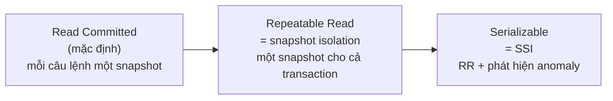
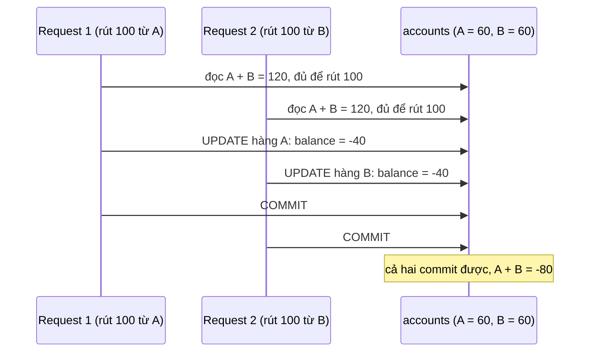
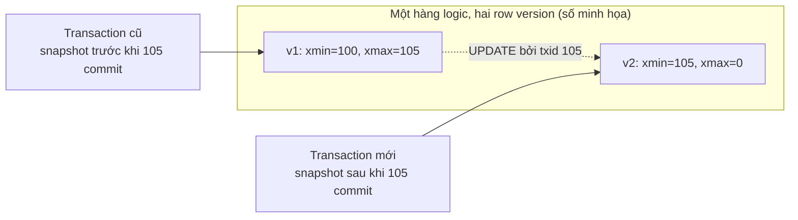
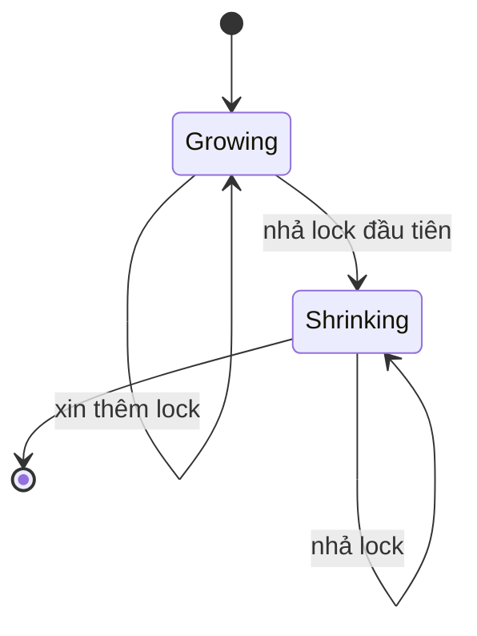
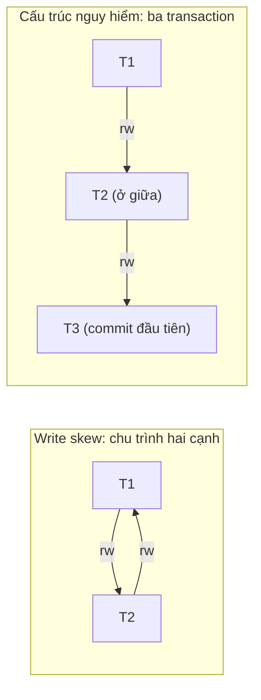
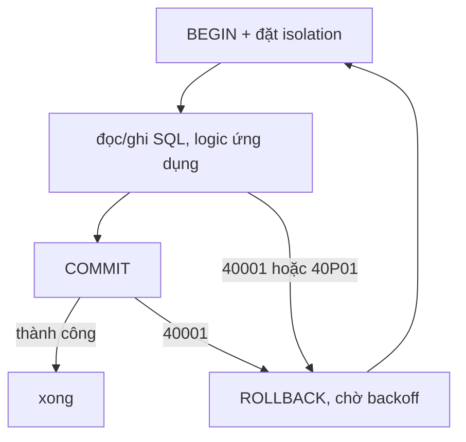

# P12 · Chương 07 — Transaction và isolation

> Phạm vi: chương này chỉ xét transaction trên **một** database node, và mọi khẳng định về hành vi cụ thể là về **PostgreSQL 16** trừ khi ghi khác. Khung chủ đề theo chương 7 của sách DDIA (ấn bản 1, "Transactions"; tên chương lấy từ mục lục do ETH Library lưu[^toc-ch7]), nhưng chương **không** trích nội dung sách. Nội dung dựa trên các nguồn đọc được và kiểm chứng: docs PostgreSQL 16 (chương 13 *Concurrency Control*, mục 3.4, `SET TRANSACTION`, `SELECT`, mã lỗi), paper Berenson et al. 1995 *A Critique of ANSI SQL Isolation Levels*, paper Cahill, Röhm, Fekete (SIGMOD 2008) giới thiệu SSI, paper Ports & Grittner (VLDB 2012) về cài đặt SSI của PostgreSQL, mã nguồn PostgreSQL 16.4 (`xact.c`), bộ test Hermitage của Kleppmann, trang mô hình nhất quán của Jepsen, bài giảng *Concurrent and Distributed Systems* của Kleppmann (Cambridge, 2021/22), docs.rs `sqlx` 0.9.0 và `tokio-postgres` 0.7.18, docs `std` Rust 1.95.0. Mọi ví dụ SQL và Rust chỉ để minh họa: chưa biên dịch hay chạy, và không kèm khẳng định nào về kết quả chạy.

## Bạn sẽ hiểu được gì

- **Q1.** ACID từng chữ nghĩa là gì, và vì sao atomicity ở đây không phải chuyện "hai thread chạy cùng lúc"? → mục 1
- **Q2.** Bốn mức isolation của chuẩn SQL được định nghĩa bằng gì, bảng hiện tượng (phenomena) ra sao, và PostgreSQL ánh xạ chúng thế nào? → mục 2
- **Q3.** Dirty write, dirty read, read skew, lost update, write skew, phantom là gì (theo Berenson et al.), mức nào chặn được cái nào? → mục 3
- **Q4.** Snapshot isolation và MVCC của PostgreSQL hoạt động ra sao (row version, `xmin`/`xmax`, snapshot), và trả giá gì? → mục 4
- **Q5.** `UPDATE` nguyên tử, `SELECT ... FOR UPDATE`, compare-and-set bằng cột version: khi nào dùng cái nào, mỗi cái *không* chặn được gì? → mục 5
- **Q6.** Two-phase locking (2PL) là gì, vì sao cần predicate lock, và nó khác MVCC thế nào? → mục 6
- **Q7.** Serializable Snapshot Isolation (SSI) phát hiện anomaly bằng cách nào, và trả giá gì? → mục 7
- **Q8.** Lỗi `40001`/`40P01` nghĩa là gì, và vòng retry đúng (kể cả trong Rust với `sqlx`/`tokio-postgres`) trông thế nào? → mục 8 và mục "Liên hệ với Rust"

## Kiến thức cần trước

- [P4 · Chương 03 — Race condition và lock](../04-concurrency/03-lock.md): `counter += 1` không nguyên tử, compare-and-swap, mutex. Chương này dùng chúng làm *phép so sánh* (lock trong RAM với lock trong database), không giải thích lại.
- [P4 · Chương 05 — Bug concurrency và deadlock](../04-concurrency/05-concurrency-bug-va-deadlock.md), mục 7: deadlock ở tầng database và connection pool.
- [P4 · Chương 06 — Memory model](../04-concurrency/06-memory-model.md): vì sao "nhất quán" trên CPU đa nhân cũng cần một mô hình; mục 6 dưới đây nối sang khái niệm linearizability.
- [P5 · Chương 05 — Crash consistency và journaling](../05-storage/05-crash-consistency-va-journaling.md) và [P5 · Chương 06 — Durability trong thực tế](../05-storage/06-durability-trong-thuc-te.md): chữ **D** của ACID đứng trên write-ahead log và `fsync`; chương này chỉ nhắc, không lặp lại.
- [P12 · Chương 03 — Storage engine](03-storage-engine.md) (WAL, B-tree): MVCC và undo/redo nằm ở lớp này.

(Transaction *phân tán* — atomic commit, 2PC, consensus — nằm ở [Chương 09](09-consistency-va-consensus.md); nhân bản dữ liệu ở [Chương 05](05-replication.md); sự cố mạng/đồng hồ ở [Chương 08](08-su-co-he-phan-tan.md).)

## 1. ACID từng chữ (Q1)

> **Trả lời ngắn.** Atomicity nói về lỗi giữa chừng: transaction hoặc có hiệu lực toàn bộ, hoặc không có hiệu lực nào[^tut-atomic]. Consistency là các ràng buộc (invariant) của *ứng dụng* vẫn còn đúng sau transaction[^cam-c]. Isolation nói về chuyện các transaction chạy đồng thời thấy nhau ra sao; trong bốn chữ, đây là chữ bàn trực tiếp về concurrency (nhận xét của người soạn). Durability nói rằng đã báo "xong" thì dữ liệu nằm trong nơi lưu bền[^tut-durable].

**Giải thích.**

*Với service của bạn.* Hãy hình dung `wallet`, một service Rust giữ số dư tài khoản trong PostgreSQL, với bảng `accounts(id, balance, version)`. Mỗi request chuyển tiền chạy hai câu `UPDATE`: trừ tiền tài khoản A, rồi cộng tiền tài khoản B. Ta sẽ bám theo `wallet` suốt chương (nhận xét của người soạn: đây là ví dụ giả định, không phải code trong repo). Ở mục này `wallet` có hai câu hỏi tưởng giống nhau mà thật ra khác hẳn. Một: database sập đúng giữa hai `UPDATE` thì A đã mất tiền mà B chưa nhận? Hai: trong lúc đó job báo cáo tổng tiền đang chạy thì thấy gì? Câu một là chuyện của **A** và **D**, câu hai là chuyện của **I**.

### 1.1 A: transaction không bao giờ làm dở

Muốn hai `UPDATE` của `wallet` hoặc cùng xảy ra hoặc cùng không, ta gom chúng vào một transaction. Điểm cốt lõi của transaction là gộp nhiều bước thành một thao tác "tất cả hoặc không gì cả"[^tut-allornothing]. Nói chặt hơn: nhìn từ các transaction khác, một transaction hoặc xảy ra hoàn toàn, hoặc không xảy ra[^tut-atomic]. Nếu lỗi đến sau khi đã trừ A, transaction bị hủy (abort) và cả phép trừ lẫn phép cộng cùng không có hiệu lực. Bài giảng Cambridge nói gọn: transaction hoặc commit hoặc abort, và abort thì không để lại tác dụng nào nhìn thấy được[^cam-abort].

Đừng nhầm chữ "atomic" này với "atomic" của lệnh phần cứng ở [P4 · Chương 03, mục 3](../04-concurrency/03-lock.md). Lệnh atomic bảo vệ *một ô nhớ* khỏi thread khác chen vào; atomicity của transaction bảo vệ *một nhóm thay đổi* khỏi bị làm dở do lỗi (suy luận của người soạn từ hai định nghĩa).

Atomicity và isolation cũng không tách bạch hoàn toàn. Tutorial PostgreSQL nêu một tính chất "liên quan chặt" với atomic updates: khi nhiều transaction chạy đồng thời, mỗi transaction không được thấy thay đổi dở dang của transaction khác[^tut-iso-related]. Vì định nghĩa atomic ở trên cũng nói theo góc nhìn của transaction khác, hai chữ này chồng lên nhau một phần (suy luận của người soạn).

### 1.2 C: invariant là của ứng dụng

Consistency là chữ mơ hồ nhất. Trong ngữ cảnh transaction, "consistent" là thuộc tính của một *trạng thái*: trạng thái đó thỏa hay vi phạm các invariant do ứng dụng định nghĩa[^cam-c]. Với `wallet`, một invariant có thể là "tổng tiền của hệ thống không đổi sau mỗi lần chuyển". Trong ngữ cảnh replication, cùng từ này lại chỉ quan hệ *giữa các bản sao*[^cam-c-replica] (xem [Chương 09](09-consistency-va-consensus.md)).

Consistency kiểu ACID dựa vào atomicity[^cam-c-atomic]. Lý do dễ thấy: nếu transaction có thể chết giữa chừng và để lại trạng thái nửa vời thì invariant không giữ nổi (suy luận của người soạn). Database chỉ tự kiểm được những invariant bạn *khai báo*: khóa chính, khóa ngoại, `CHECK`, `UNIQUE`. Quy tắc nghiệp vụ kiểu "tổng số dư của tài khoản chung không được âm" nằm ngoài tầm, trừ khi bạn dùng isolation đủ mạnh (nhận xét của người soạn; xem mục 3 và 7).

### 1.3 I: đồng thời thì thấy nhau thế nào

Câu hỏi thứ hai của `wallet`, "job báo cáo thấy gì khi chuyển tiền đang chạy dở", là chuyện của isolation. Dự án Hermitage định nghĩa isolation là cách database bảo vệ ứng dụng khỏi các vấn đề concurrency (race condition)[^herm-isolation]. Mức lý tưởng là *serializability*: các transaction đồng thời cho kết quả như thể chạy lần lượt từng cái một theo một thứ tự nào đó[^iso-serial-def]. Thực tế nhiều database dùng mức yếu hơn, và đó là nội dung của mục 2.

### 1.4 D: báo xong là không mất

Database phải ghi thay đổi vào nơi lưu bền *trước khi* báo transaction hoàn tất[^tut-durable]. Cơ chế quen thuộc là write-ahead log (WAL): thay đổi vào file dữ liệu chỉ được ghi sau khi bản ghi WAL mô tả chúng đã được flush xuống nơi lưu bền[^wal-intro]. Tầng dưới (`fsync`, journal của file system) đã nói ở [P5 · Chương 05](../05-storage/05-crash-consistency-va-journaling.md) và [P5 · Chương 06](../05-storage/06-durability-trong-thuc-te.md).

Bảng dưới gom lại: chữ nào trả lời câu hỏi nào, và chữ nào dính tới concurrency.

| Chữ | Câu hỏi nó trả lời | Liên quan đến concurrency? |
|---|---|---|
| A | Lỗi/abort giữa chừng thì sao? | Chủ yếu không (là chuyện lỗi); nhưng định nghĩa PostgreSQL nói theo góc nhìn của transaction khác nên chồng một phần với I |
| C | Invariant của ứng dụng có còn đúng? | Gián tiếp: cần A và I |
| I | Transaction đồng thời thấy gì của nhau? | **Có** |
| D | Crash sau khi báo xong thì mất gì? | Không (là chuyện lưu bền) |

(Bảng là tóm tắt của người soạn từ các định nghĩa đã nêu.)

<details><summary>Đi sâu: transaction ngầm, savepoint, và những thứ không rollback</summary>

- Mỗi câu SQL trong PostgreSQL luôn chạy trong một transaction[^tut-implicit]. Nếu bạn không gõ `BEGIN`, mỗi câu tự có `BEGIN` và (nếu thành công) `COMMIT` bao quanh. Một số thư viện client còn tự phát `BEGIN`/`COMMIT` giùm bạn, nên cần đọc docs của thư viện[^tut-clientlib].
- *Savepoint* cho phép hủy một phần transaction mà vẫn commit phần còn lại[^tut-savepoint]. Đây là cơ chế đứng sau transaction "lồng" trong `tokio-postgres` (mục "Liên hệ với Rust")[^tp-drop].
- *Không phải mọi thứ đều rollback.* Thay đổi trên sequence (và do đó bộ đếm của cột `serial`) hiển thị ngay cho mọi transaction khác và không bị hoàn tác khi transaction abort[^seq-nonrollback]. Vì vậy khoảng trống trong dãy id tự tăng là bình thường, và không nên dùng sequence để sinh số liên tục không có lỗ hổng (nhận xét của người soạn).
- *Atomic commit* giữa nhiều node là bài toán khác. 2PC bảo đảm atomic commitment, còn 2PL (mục 6) bảo đảm serializable isolation; hai chữ viết tắt này dễ lẫn nhau[^cam-2pl-2pc]. Xem [Chương 09](09-consistency-va-consensus.md).

</details>

**Quay lại Q1:** A là "không làm dở", C là "invariant của ứng dụng còn đúng", I là "đồng thời thì thấy nhau thế nào", D là "báo xong rồi thì không mất"; với `wallet`, hai câu hỏi ở đầu mục là chuyện của A/D và của I.

## 2. Các mức isolation của SQL và bảng hiện tượng (Q2)

> **Trả lời ngắn.** Chuẩn SQL định nghĩa mức mạnh nhất, Serializable, là mức cho kết quả như chạy lần lượt từng transaction theo một thứ tự nào đó; ba mức còn lại được định nghĩa bằng các *hiện tượng* (phenomena) mà chúng cấm[^iso-def-levels]. PostgreSQL cho yêu cầu cả bốn mức nhưng bên trong chỉ cài ba, vì Read Uncommitted hành xử như Read Committed[^iso-three]. Mặc định là Read Committed[^rc-default].

**Giải thích.**

*Với service `wallet`.* Cùng lúc `wallet` có hai loại việc chạy trên bảng `accounts`: request chuyển tiền (ghi) và job báo cáo (đọc cả bảng). Câu hỏi của mục này là job báo cáo được phép thấy gì khi chuyển tiền đang chạy dở, và `wallet` nên chọn mức isolation nào. Chọn mức càng chặt thì càng ít chuyện lạ khi người khác sửa dữ liệu cùng lúc, nhưng càng tốn: phải chờ khóa, hoặc bị abort rồi chạy lại (nhận xét của người soạn). Để nói "chuyện lạ" cụ thể là gì, ta cần tên gọi cho nó.

### 2.1 Bốn hiện tượng

Docs PostgreSQL liệt kê bốn hiện tượng mà các mức isolation cấm hoặc cho phép:

- **dirty read**: một transaction đọc dữ liệu do một transaction đồng thời *chưa commit* ghi[^ph-dirty];
- **nonrepeatable read**: đọc lại dữ liệu đã đọc và thấy nó đã bị transaction khác (commit sau lần đọc đầu) sửa[^ph-nonrep];
- **phantom read**: chạy lại một truy vấn trả về tập hàng thỏa điều kiện và thấy tập đó đã đổi vì một transaction vừa commit[^ph-phantom];
- **serialization anomaly**: kết quả của một nhóm transaction đã commit không khớp với *bất kỳ* thứ tự chạy lần lượt nào[^ph-seranom].

### 2.2 Bảng 13.1 và cách đọc

Bảng 13.1 của PostgreSQL ghi hành vi của chuẩn SQL và của chính PostgreSQL như sau[^iso-table].

| Mức | Dirty read | Nonrepeatable read | Phantom read | Serialization anomaly |
|---|---|---|---|---|
| Read uncommitted | Chuẩn cho phép, PG không | Có thể | Có thể | Có thể |
| Read committed | Không | Có thể | Có thể | Có thể |
| Repeatable read | Không | Không | Chuẩn cho phép, PG không | Có thể |
| Serializable | Không | Không | Không | Không |

Ba điều đáng đọc kỹ:

1. Cột phải nhất, *serialization anomaly*, là cột mà hai mức giữa **không** chặn; write skew (mục 3) nằm ở đây. Read skew ở Read Committed thuộc họ nonrepeatable read ở cột thứ hai, còn lost update không có cột riêng trong bảng 13.1; bảng tổng hợp ở mục 3 sẽ xếp lại (nhận xét của người soạn).
2. Repeatable Read của PostgreSQL *mạnh hơn* chuẩn đòi hỏi: bảng cho thấy nó không có phantom read[^rr-phantom-ok]. Mạnh hơn vẫn hợp lệ vì chuẩn chỉ mô tả mức bảo vệ *tối thiểu*[^rr-stronger]. PostgreSQL cài Repeatable Read bằng snapshot isolation (mục 4)[^rr-si], và Berenson nêu rằng snapshot isolation không có phantom theo nghĩa hẹp của định nghĩa A3[^ber-si-nophantom]. Docs PG không nói đây là "lý do"; nối hai điều này là suy luận của người soạn.
3. Chuẩn định nghĩa mức bằng *hiện tượng cấm*, và Berenson et al. chỉ ra cách đó chưa đủ: các hiện tượng của ANSI SQL không đầy đủ, vẫn còn nhiều anomaly có thể xảy ra[^ber-incomplete]. Docs PostgreSQL cũng nói các hiện tượng cho phép phân biệt snapshot isolation với kỹ thuật locking truyền thống chưa được giới nghiên cứu hình thức hóa cho đến sau khi chuẩn SQL ra đời, và dẫn [berenson95] để xem đầy đủ[^rr-berenson].



(Sơ đồ là tóm tắt của người soạn; mũi tên nghĩa là "mạnh dần", không phải quan hệ kế thừa cài đặt.) Read Committed chụp snapshot theo từng câu lệnh[^rc-snapshot]. Repeatable Read được cài bằng snapshot isolation[^rr-si]. Serializable được cài bằng SSI[^ser-ssi], nhưng "Serializable = SSI" chỉ đúng từ PostgreSQL 9.1: trước đó yêu cầu Serializable cho đúng hành vi của Repeatable Read[^ser-91].

### 2.3 Chọn mức cho `wallet`

Chọn mức bằng `SET TRANSACTION`[^settx-levels], hoặc ghi mức ngay trong `BEGIN`/`START TRANSACTION`[^begin-iso]. Có một hạn chế: mức isolation không đổi được sau câu truy vấn hoặc câu sửa dữ liệu đầu tiên của transaction[^settx-cant-change]. Mặc định cho cả session đặt qua `default_transaction_isolation`[^settx-default]. Nghĩa là `wallet` phải quyết định mức ngay khi mở transaction, trước khi chạm vào `accounts`.

### 2.4 Cùng tên chưa chắc cùng hành vi

Hermitage, bộ test do Kleppmann khởi xướng, tồn tại chính để xác định mỗi database *thực sự* hiểu gì bằng tên mức isolation của nó[^herm-intent]. README của họ còn ghi nhận serializability hiếm khi được dùng trong thực tế, thậm chí có database phổ biến (ví dụ Oracle) không cài nó[^herm-rare] (đây là nhận định của README, chương này không đối chiếu với docs Oracle). Hệ quả cho người làm backend: khi chuyển `wallet` từ MySQL/Oracle sang PostgreSQL hay ngược lại, đừng giả định "repeatable read" hay "serializable" nghĩa như nhau; phải đọc docs của đúng database và đúng phiên bản (nhận xét của người soạn).

<details><summary>Đi sâu: Read Committed của PostgreSQL chi tiết, và vì sao Read Uncommitted bị gộp</summary>

- Ở Read Committed, `SELECT` thấy snapshot tại *thời điểm câu lệnh bắt đầu*[^rc-snapshot]. Hai `SELECT` liên tiếp trong cùng transaction có thể thấy dữ liệu khác nhau nếu transaction khác commit giữa chúng[^rc-two-selects].
- `UPDATE`, `DELETE`, `SELECT FOR UPDATE` tìm hàng mục tiêu theo snapshot của câu lệnh. Nếu hàng đã bị transaction khác sửa, bên đến sau *chờ* bên trước commit hoặc rollback[^rc-wait]. Nếu bên trước commit, điều kiện `WHERE` được đánh giá lại trên phiên bản mới của hàng, và chỉ khi còn khớp thì câu lệnh mới tiếp tục[^rc-reeval].
- Hệ quả: một câu lệnh có thể thấy snapshot "không nhất quán", tức thấy tác động của các câu lệnh đồng thời lên đúng những hàng nó định sửa nhưng không thấy tác động lên các hàng khác[^rc-inconsistent]. Ví dụ trong docs: bảng `website` hai hàng có `hits` 9 và 10; một transaction `UPDATE ... SET hits = hits + 1` chưa commit, trong lúc đó `DELETE FROM website WHERE hits = 10` chạy ở session khác. `DELETE` không xóa gì dù trước và sau `UPDATE` đều có một hàng `hits = 10`[^rc-website].
- Read Committed "vừa đủ" cho trường hợp đơn giản như cộng/trừ số dư trên hàng xác định, nhưng không phù hợp cho lệnh có điều kiện tìm kiếm phức tạp[^rc-inconsistent]. Ví dụ ngân hàng trong docs (hai `UPDATE accounts SET balance = balance ± 100`) an toàn vì mỗi lệnh chỉ đụng hàng đã xác định[^rc-bank].
- Lý do gộp Read Uncommitted vào Read Committed: docs gọi đó là cách duy nhất hợp lý để ánh xạ bốn mức chuẩn lên kiến trúc MVCC của PostgreSQL[^iso-sensible].
- `INSERT ... ON CONFLICT` và `MERGE` ở Read Committed có quy tắc riêng (docs mô tả chi tiết); không đi sâu ở đây.

</details>

**Quay lại Q2:** chuẩn SQL định nghĩa mức bằng các hiện tượng cấm; PostgreSQL có ba mức thật (RC mặc định, RR = snapshot isolation, Serializable = SSI) và hai mức giữa vẫn để lọt *serialization anomaly*, nên `wallet` phải biết mình cần chặn gì rồi mới chọn mức.

## 3. Các anomaly: dirty write, dirty read, read skew, lost update, write skew, phantom (Q3)

> **Trả lời ngắn.** Berenson et al. (1995) chỉ ra các hiện tượng của ANSI là chưa đầy đủ, rồi bổ sung những anomaly có tên: dirty write (P0), lost update (P4), read skew (A5A), write skew (A5B), và cách phát biểu lại phantom (P3)[^ber-incomplete]. Ở PostgreSQL, Read Committed chặn dirty write và dirty read nhưng để lọt read skew, lost update kiểu đọc-rồi-ghi, write skew và phantom. Repeatable Read chặn thêm read skew, lost update (bằng cách abort[^rr-concurrent-update]) và phantom kiểu chuẩn, nhưng **không** chặn write skew. Chỉ Serializable chặn mọi serialization anomaly[^iso-table]. Bảng cuối mục ghi rõ ô nào đọc thẳng từ docs, ô nào là suy luận hoặc quan sát cũ.

**Giải thích.**

*Với service `wallet`.* Ba nơi `wallet` có thể trúng anomaly: job báo cáo tổng tiền đọc giữa lúc một khoản chuyển đang chạy; hai request cùng sửa số dư của một tài khoản; hai request rút tiền từ hai tài khoản khác nhau nhưng chịu chung một quy tắc. Mỗi anomaly dưới đây là một kiểu "đọc, rồi ghi, rồi bất ngờ", tùy transaction kia chen vào lúc nào.

Ký hiệu của Berenson: `r1[x]` là transaction T1 đọc x, `w1[x]` là T1 ghi x, `c1`/`a1` là T1 commit/abort.

### 3.1 Những anomaly "đơn giản"

**Dirty write (P0).** T1 sửa một mục dữ liệu; T2 sửa tiếp mục đó *trước khi* T1 commit hoặc rollback[^ber-p0]. Vì sao tệ: giả sử có ràng buộc x = y, và T1, T2 mỗi bên giữ đúng khi chạy một mình. Nếu chúng ghi x, y theo thứ tự đan xen thì cả hai thay đổi "sống sót" lẫn lộn: T1 ghi 1 vào cả hai, T2 ghi 2 vào cả hai, kết quả có thể là x=2, y=1[^ber-p0-xy]. Berenson còn lập luận P0 cần bị cấm ở *mọi* mức, vì ngay cả hệ locking yếu nhất cũng giữ write lock dài hạn, nếu không cơ chế recovery sẽ hỏng[^ber-p0-recovery].

PostgreSQL không cho ghi đè hàng mà transaction khác đang sửa dở: bên đến sau phải chờ bên trước commit hoặc rollback[^rc-wait]. Theo suy luận của người soạn, đó là cách PostgreSQL ngăn P0 (docs PG không dùng tên "dirty write"). Ở Repeatable Read và Serializable, nếu bên trước commit thì bên sau bị abort với `40001`[^rr-concurrent-update] (chi tiết ở mục 4).

**Dirty read (P1).** T1 sửa x; T2 đọc x trước khi T1 commit hay rollback. Nếu T1 rollback thì T2 đã đọc một giá trị chưa bao giờ tồn tại[^ber-p1]. PostgreSQL không có dirty read ở mức nào, vì Read Uncommitted hành xử như Read Committed[^iso-three].

**Nonrepeatable (fuzzy) read (P2).** T1 đọc x; T2 sửa hoặc xóa x rồi commit; T1 đọc lại thì thấy giá trị khác, hoặc x biến mất[^ber-p2]. Read Committed của PostgreSQL cho phép; Repeatable Read thì không[^iso-table].

**Read skew (A5A).** T1 đọc x; T2 sửa *cả x và y* rồi commit; T1 đọc y và có thể thấy trạng thái không nhất quán, từ đó tạo ra kết quả không nhất quán[^ber-a5a]. Với `wallet`: job báo cáo đọc số dư A, đúng lúc một khoản chuyển A→B commit, rồi báo cáo đọc B. Tổng cộng ra sai, vì A chưa trừ mà B đã cộng (hoặc ngược lại).

Ở Read Committed chuyện này xảy ra được, vì mỗi câu lệnh một snapshot nên hai `SELECT` liên tiếp có thể thấy dữ liệu khác nhau[^rc-two-selects]. Ở Repeatable Read thì không, vì transaction chỉ thấy dữ liệu đã commit *trước khi nó bắt đầu*[^rr-snapshot]. Chính xác hơn, snapshot được chụp ở câu lệnh đầu tiên không phải lệnh điều khiển transaction[^rr-first].

**Lost update (P4).** T1 đọc x; T2 sửa x (có thể dựa trên giá trị nó đã đọc); rồi T1, dựa trên giá trị đọc cũ, sửa x và commit. Bản sửa của T2 mất[^ber-p4]. Dạng hay gặp nhất là *read-modify-write ở tầng ứng dụng*: `SELECT balance`, tính số mới trong Rust, rồi `UPDATE balance = $mới`. Hai request cùng nạp tiền vào một ví sẽ giẫm lên nhau đúng kiểu này, cùng hình dạng với `counter += 1` ở [P4 · Chương 03, mục 1](../04-concurrency/03-lock.md) (nhận xét của người soạn).

Ở Repeatable Read, nếu transaction cố sửa một hàng mà một transaction đồng thời đã commit thay đổi sau khi snapshot của nó được chụp, nó bị abort với lỗi `could not serialize access due to concurrent update`[^rr-concurrent-update]. Ứng dụng phải chạy lại cả transaction[^rr-retry]. Còn Read Committed thì không chặn lost update: Hermitage ghi nhận như vậy[^herm-lost-rc]. Đó là quan sát trên Postgres 9.3.5, bản cũ, không phải bảo đảm của PG 16[^herm-pg-ver].

### 3.2 Write skew và phantom

**Write skew (A5B).** T1 đọc x và y (nhất quán với ràng buộc C()); T2 đọc x và y, ghi x, commit; rồi T1 ghi y. Ràng buộc giữa x và y có thể bị vi phạm[^ber-a5b]. Ví dụ kinh điển trong paper về SSI của PostgreSQL: hai transaction mỗi bên kiểm tra "còn ít nhất hai bác sĩ đang trực không", nếu có thì cho *một* bác sĩ nghỉ. Chạy lần lượt thì luôn còn ít nhất một người trực, nhưng chạy xen kẽ dưới snapshot isolation thì cả hai cùng thấy cả hai đang trực và cùng cho nghỉ[^ports-doctors].

Với `wallet`, hình dạng tương đương là tài khoản chung của hai ví A và B, quy tắc "A + B không được âm" (nhận xét của người soạn). Cả hai ví đang có 60. Request 1 rút 100 từ A, request 2 rút 100 từ B. Mỗi bên đọc tổng thấy 120, đủ cho 100, nên cả hai cùng rút, và tổng thành −80.

Khóa ghi lúc `UPDATE` không cứu được ở đây, vì hai transaction sửa *hai hàng khác nhau* nên không xung đột[^ports-wl]. Docs PostgreSQL cảnh báo tương tự: ép buộc quy tắc nghiệp vụ bằng transaction Repeatable Read khó chạy đúng nếu không dùng thêm explicit lock để chặn các transaction xung đột[^rr-bizrules].



(Sơ đồ là minh họa của người soạn theo hình dạng ví dụ bác sĩ trong paper; hai `UPDATE` đụng hai hàng khác nhau nên không chờ nhau.) Chuỗi này chỉ đúng ở Read Committed hoặc Repeatable Read. Ở Serializable, một trong hai `COMMIT` sẽ bị abort với lỗi serialization (suy luận của người soạn từ [^ser-same]).

**Phantom (P3).** T1 đọc một *tập* hàng thỏa điều kiện; T2 chèn, sửa hoặc xóa một hàng làm đổi tập đó[^ber-p3-def]. Định nghĩa của PostgreSQL ở mục 2 là: tập hàng thỏa điều kiện đã đổi vì một giao dịch vừa commit[^ph-phantom].

Berenson chỉ ra snapshot isolation *không* loại hết hiện tượng này theo nghĩa rộng. Ví dụ của ông: ràng buộc "tổng giờ của các task thỏa một predicate không vượt 8"; hai transaction cùng thấy tổng là 7 và cùng chèn một task 1 giờ. Hai bên chèn *hai hàng khác nhau* nên first-committer-wins không bắt được[^ber-jobs]. Cũng bài viết đó nói snapshot isolation không có phantom theo nghĩa hẹp của định nghĩa A3 trong ANSI[^ber-si-nophantom].

Với `wallet`, hạn mức "tổng tiền chuyển trong ngày của một ví không quá 10 triệu" có đúng hình dạng này (nhận xét của người soạn). Hai request cùng thấy đã chuyển 9 triệu, mỗi bên chèn thêm một dòng 1 triệu vào bảng lịch sử chuyển tiền, và tổng thành 11 triệu. Đây là *write skew qua predicate*: không có hàng cụ thể nào để khóa hay so sánh phiên bản, vì hàng gây vi phạm chưa tồn tại (suy luận của người soạn).

**Read-only transaction anomaly.** Docs PostgreSQL cảnh báo: ở Repeatable Read, ngay cả transaction chỉ-đọc cũng có thể thấy "bản ghi điều khiển" báo một batch đã xong mà lại không thấy một trong các bản ghi chi tiết của batch đó, vì nó đọc phiên bản cũ hơn của bản ghi điều khiển[^rr-control]. Jepsen đặt hiện tượng này cạnh write skew như hai điều đáng chú ý của snapshot isolation[^jep-si-notable].

### 3.3 Bảng tóm tắt

Bảng cho PostgreSQL 16; cột "Nguồn" cho biết đâu là docs, đâu là quan sát cũ.

| Anomaly | Read Committed | Repeatable Read | Serializable | Nguồn |
|---|---|---|---|---|
| Dirty write | Không (bên sau chờ) | Không | Không | docs PG, mục 13.2.1[^rc-wait] |
| Dirty read | Không | Không | Không | docs PG, bảng 13.1[^iso-table] |
| Nonrepeatable read / read skew | Có thể | Không | Không | docs PG, bảng 13.1 và mục 13.2.2[^rr-snapshot] |
| Lost update (read-modify-write) | Có thể | Không (abort `40001`) | Không (abort `40001`) | docs PG, mục 13.2.2[^rr-concurrent-update]; Hermitage 9.3.5 cho Read Committed[^herm-lost-rc] |
| Write skew | Có thể | **Có thể** | Không | docs PG: *serialization anomaly* ở bảng 13.1[^iso-table] |
| Phantom (kiểu chuẩn) | Có thể | Không | Không | docs PG, bảng 13.1[^iso-table] |
| Phantom kiểu predicate-write-skew | Có thể | **Có thể** | Không | Berenson[^ber-jobs] cộng docs PG[^iso-table] |

Các ô "Có thể/Không" ở hàng write skew và predicate-write-skew là suy luận của người soạn. Docs PG khẳng định Repeatable Read cho phép *serialization anomaly*[^iso-table] và Serializable chặn tất cả, còn write skew là một serialization anomaly theo định nghĩa ở mục 2.

<details><summary>Đi sâu: lịch sử dạng Berenson, tên G0/G1/G2 của Hermitage, và chỗ Repeatable Read ≠ Snapshot Isolation</summary>

- Dạng lịch sử (history) của Berenson: `P4: r1[x]...w2[x]...w1[x]...c1`[^ber-p4-hist]; `A5B: r1[x]...r2[y]...w1[y]...w2[x]...(c1 and c2 occur)`[^ber-a5b-hist]. Chúng cho thấy mỗi anomaly chỉ là một *thứ tự xen kẽ* cụ thể của đọc/ghi.
- Hermitage dùng tên khác (theo Adya): G0 write cycle (dirty write), G1a/G1b/G1c (các dạng dirty read), OTV, PMP, P4 (lost update), G-single (read skew), G2-item (write skew trên dữ liệu đã đọc rời nhau), G2 (anti-dependency cycle, write skew qua predicate)[^herm-legend]. Dùng bảng này để tra khi đọc bảng so sánh các database.
- Berenson chứng minh *Repeatable Read theo locking* và *Snapshot Isolation* **không so sánh được** với nhau: snapshot isolation cấm A3 nhưng cho phép A5B (write skew), còn Repeatable Read theo locking làm ngược lại[^ber-rr-vs-si]. Docs PostgreSQL nói "Repeatable Read" của họ cài bằng Snapshot Isolation[^rr-si]. Vì vậy tên mức giống tên ANSI nhưng hành vi là của SI, không so sánh được với Repeatable Read theo locking; nó chỉ "mạnh hơn" so với bảng phenomena của chuẩn SQL ở mục 2 (suy luận của người soạn).
- Jepsen: snapshot isolation chỉ buộc một *thứ tự bộ phận*, khác serializability buộc thứ tự toàn phần[^jep-si-partial]. Nó cho phép write skew: các transaction đọc trạng thái chồng nhau, sửa tập đối tượng rời nhau rồi commit[^jep-si-notable].
- Serializability cũng *không* nói gì về thời gian thực hay thứ tự theo từng client[^jep-ser-nonrt]. Phần "mạnh" kia gọi là strict serializability ([Chương 09](09-consistency-va-consensus.md)).

</details>

**Quay lại Q3:** sáu tên anomaly là sáu thứ tự xen kẽ đọc/ghi khác nhau; Repeatable Read (snapshot isolation) chặn read skew và lost update nhưng để lọt write skew, nên quy tắc "A + B không âm" của `wallet` chỉ an toàn ở Serializable.

## 4. Snapshot isolation và MVCC trong PostgreSQL (Q4)

> **Trả lời ngắn.** Snapshot isolation nghĩa là mỗi transaction đọc từ một "bản chụp" dữ liệu đã commit tại thời điểm nó bắt đầu[^ber-si-def]. PostgreSQL làm vậy bằng MVCC: giữ *nhiều phiên bản* của một hàng, để mỗi câu SQL thấy một snapshot bất kể trạng thái hiện tại của dữ liệu bên dưới[^mvcc-intro]. Nhờ vậy đọc không chặn ghi và ghi không chặn đọc[^mvcc-nonblock]; cái giá là các phiên bản cũ phải được dọn bằng VACUUM.

**Giải thích.**

*Với service `wallet`.* Job báo cáo của `wallet` chạy vài phút trên bảng `accounts`, trong khi request chuyển tiền vẫn ghi liên tục. Có hai cách để báo cáo đọc nhất quán. Cách một: khóa dữ liệu, bắt chuyển tiền chờ báo cáo xong. Cách hai: cho báo cáo đọc một bản cũ cố định trong lúc người ghi vẫn tạo bản mới. PostgreSQL chọn cách hai; mục này kể nó làm thế nào và tốn gì.

Một điểm cần nói trước: snapshot dùng *cho cả transaction* chỉ có ở Repeatable Read, mức cài bằng snapshot isolation[^rr-si]. Ở Read Committed mỗi câu lệnh có snapshot riêng[^rc-snapshot], nên Read Committed không phải snapshot isolation theo nghĩa của Berenson (suy luận của người soạn).

### 4.1 Row version

Mỗi lần `UPDATE` một hàng tạo ra một *row version* mới cho cùng hàng logic[^sys-rowversion]. `UPDATE` và `DELETE` không xóa phiên bản cũ ngay, vì nó vẫn có thể còn được transaction khác nhìn thấy[^vac-mustnot]. Mỗi phiên bản mang hai cột hệ thống: `xmin` là ID của transaction đã chèn nó[^sys-xmin], và `xmax` là ID của transaction đã xóa nó, hoặc 0 nếu chưa bị xóa[^sys-xmax]. `xmax` có thể khác 0 ngay cả ở một phiên bản đang hiển thị, thường vì transaction xóa chưa commit hoặc việc xóa đã bị rollback[^sys-xmax-nonzero].



Trong `wallet`, hai phiên bản trên có thể là số dư của một ví trước và sau một lần chuyển tiền (số minh họa). Job báo cáo bắt đầu trước khi giao dịch 105 commit vẫn đọc v1; request mới đọc v2.

### 4.2 Snapshot

PostgreSQL biểu diễn snapshot bằng ba thành phần `xmin:xmax:xip_list`:

- `xmin` là ID nhỏ nhất còn đang chạy; mọi ID nhỏ hơn đều đã commit-và-hiển-thị hoặc đã rollback[^snap-xmin].
- `xmax` là ID lớn nhất đã hoàn tất cộng một; mọi ID ≥ `xmax` coi như chưa hoàn tất và vô hình[^snap-xmax].
- `xip_list` là các transaction đang chạy lúc chụp. ID nằm trong [`xmin`, `xmax`) mà không có trong danh sách thì đã hoàn tất tại thời điểm chụp, và hiển thị hay chết tùy trạng thái commit[^snap-xip].

Từ đó, quy tắc nhìn thấy một row version là: người chèn nó phải "đã hoàn tất và đã commit" theo snapshot, và người xóa nó (nếu có) thì không (suy luận của người soạn từ các định nghĩa trên; các chi tiết như hint bit, subtransaction, command id nằm ngoài phạm vi chương).

Còn snapshot được chụp lúc nào? Ở Read Committed, mỗi câu `SELECT` thấy snapshot tại lúc nó bắt đầu chạy[^rc-snapshot], và `UPDATE`/`DELETE`/`SELECT FOR UPDATE`/`SELECT FOR SHARE` tìm hàng đích theo cùng cách[^rc-dml-snapshot]. Ở Repeatable Read, một snapshot tính từ lúc câu lệnh đầu tiên không phải lệnh điều khiển transaction (`SELECT`, `INSERT`, `UPDATE`, `DELETE`, `MERGE`) bắt đầu, và dùng cho cả transaction[^rr-first]. Suy ra chỉ `BEGIN` thôi chưa chụp snapshot (suy luận của người soạn từ cách docs định nghĩa mốc chụp).

### 4.3 Xung đột ghi

Snapshot isolation cho nhiều transaction ghi đồng thời lên *tập hàng rời nhau* mà không chặn nhau. Còn nếu hai bên ghi *cùng một hàng* thì sao? Berenson mô tả quy tắc **first-committer-wins**: T1 chỉ commit được nếu không có transaction T2 nào có commit-timestamp nằm trong khoảng thực thi của T1 đã ghi dữ liệu mà T1 cũng ghi; nếu không, T1 abort. Quy tắc này ngăn lost update[^ber-fcw].

PostgreSQL phát hiện *sớm hơn*, ngay lúc `UPDATE`. Bên đến sau chờ bên trước kết thúc. Nếu bên trước rollback thì bên sau chạy tiếp. Nếu bên trước commit (thực sự đã sửa hoặc xóa, không chỉ khóa) thì bên sau ở Repeatable Read bị rollback với lỗi `could not serialize access due to concurrent update`[^rr-concurrent-update], và ứng dụng phải chạy lại transaction từ đầu[^rr-retry]. Thời điểm phát hiện khác nhau (lúc ghi so với lúc commit) nhưng kết quả cùng là "một bên thua", nên người dùng thấy cùng hành vi first-committer-wins (nhận xét của người soạn).

Chỉ transaction có ghi mới phải retry: docs nói transaction chỉ-đọc không bao giờ gặp xung đột serialization ở Repeatable Read[^rr-readonly].

### 4.4 Cái giá

MVCC không miễn phí, và `wallet` sẽ gặp ba khoản:

1. Phiên bản chết phải được dọn. VACUUM xóa row version chết khỏi bảng và index và đánh dấu chỗ trống để tái sử dụng[^vac-purpose].
2. `xid` chỉ 32 bit, nên cụm chạy lâu (hơn 4 tỷ transaction) sẽ gặp transaction ID wraparound: transaction cũ bỗng trông như "ở tương lai" và dữ liệu của chúng biến mất khỏi tầm nhìn[^vac-wrap].
3. Một transaction mở lâu giữ snapshot cũ, nên các phiên bản mà snapshot đó còn có thể thấy không dọn được (suy luận của người soạn từ nguyên tắc "không xóa phiên bản còn có thể được nhìn thấy"[^vac-mustnot]). Job báo cáo vài phút của `wallet` chính là loại transaction này.

Trong phần khuyến nghị cho Serializable, docs PostgreSQL nhắc không để connection treo ở trạng thái "idle in transaction" lâu hơn cần thiết, và có tham số `idle_in_transaction_session_timeout` để tự ngắt[^ser-idle]. Nối khuyến nghị đó với snapshot cũ và VACUUM là suy luận của người soạn. Liên hệ [P4 · Chương 05, mục 7](../04-concurrency/05-concurrency-bug-va-deadlock.md): giữ transaction qua I/O chậm vừa giữ connection vừa giữ snapshot.

So với `RwLock` trong RAM (nhận xét của người soạn): `RwLock` cho nhiều reader song song nhưng writer phải chờ hết reader; MVCC cho writer chạy trong khi reader vẫn đọc phiên bản cũ, đổi lại là phải lưu nhiều bản và dọn dẹp. Docs PostgreSQL nêu đúng ưu điểm này: lock dùng để đọc không xung đột với lock dùng để ghi[^mvcc-nonblock].

<details><summary>Đi sâu: header của row, export snapshot, TRUNCATE phá MVCC, và hạn chế của sequence/DDL</summary>

- Mỗi row trên đĩa có header cố định (23 byte trên hầu hết máy) rồi mới tới bitmap null, OID tùy chọn và dữ liệu người dùng[^page-header]; `t_xmin`/`t_xmax` là hai trường ID transaction trong header đó (bảng 73.4 của docs). Chi tiết bố cục page thuộc [Chương 03](03-storage-engine.md) và [P5](../05-storage/03-cai-dat-file-system.md) (phần cấu trúc trên đĩa).
- `SET TRANSACTION SNAPSHOT` cho phép transaction mới dùng *chính snapshot* của transaction đã `pg_export_snapshot()`, chỉ ở đầu transaction và khi transaction đã là Repeatable Read/Serializable[^settx-snapshot].
- `TRUNCATE` xóa toàn bộ bảng ngay mà không cần VACUUM, nhưng "vi phạm ngữ nghĩa MVCC chặt chẽ" như docs nói[^vac-truncate].
- Hàm hệ thống `pg_current_snapshot()` trả snapshot ở dạng `xmin:xmax:xip_list`, ví dụ `10:20:10,14,15`[^snap-text]; dùng để *nhìn* snapshot hiện tại khi gỡ lỗi.
- Thay đổi sequence không theo MVCC/rollback (đã nói ở mục 1)[^seq-nonrollback].

</details>

**Quay lại Q4:** snapshot isolation là mỗi transaction đọc từ bản chụp lúc bắt đầu; PostgreSQL cài bằng nhiều row version (`xmin`/`xmax`), nên job báo cáo của `wallet` không chặn chuyển tiền, và cái giá là việc dọn phiên bản cũ.

## 5. Công cụ thủ công: `UPDATE` nguyên tử, `SELECT ... FOR UPDATE`, compare-and-set (Q5)

> **Trả lời ngắn.** Bạn có bốn công cụ: (1) gộp đọc-sửa-ghi thành *một* câu `UPDATE` (`balance = balance + 100`); (2) `SELECT ... FOR UPDATE` để khóa các hàng đã đọc cho đến hết transaction[^forupdate-block]; (3) compare-and-set bằng cột version hoặc điều kiện trong `WHERE`; (4) nâng isolation lên Repeatable Read hoặc Serializable rồi retry. Mỗi công cụ chặn một lớp anomaly. Không cái nào chặn được write skew dựa trên hàng *chưa tồn tại* (kiểu phantom ở mục 3), trừ Serializable; một cách thủ công khác là khóa một hàng "cha" dùng chung (suy luận của người soạn).

**Giải thích.**

*Với service `wallet`.* Giả sử hai request cùng nạp tiền vào ví 42. Nếu handler đọc `balance` vào Rust, cộng 100, rồi ghi lại số mới, ta có lost update (mục 3). Muốn chặn nó, `wallet` có bốn lựa chọn, từ gọn nhất đến nặng nhất. Mục này đi qua từng cái và chỉ ra mỗi cái không chặn được gì.

### 5.1 (1) `UPDATE` nguyên tử

Cách gọn nhất là đừng đọc số dư vào Rust nữa: viết `UPDATE accounts SET balance = balance + 100 WHERE id = 42`. Docs PG dùng đúng ví dụ này cho Read Committed. Hai transaction cùng đổi số dư tài khoản 12345 thì ta muốn transaction sau *bắt đầu từ phiên bản đã cập nhật* của hàng; vì mỗi lệnh chỉ đụng hàng đã xác định, cho nó thấy phiên bản mới không gây bất nhất[^rc-bank]. Cơ chế: bên sau chờ, rồi đánh giá lại `WHERE` trên phiên bản mới[^rc-reeval]. Đây là cách đơn giản nhất để chặn lost update khi phép tính viết được thành biểu thức SQL (nhận xét của người soạn).

### 5.2 (2) `SELECT ... FOR UPDATE`

Khi logic phức tạp hơn một biểu thức (đọc số dư, kiểm tra nhiều điều kiện rồi mới ghi), ta khóa hàng ngay lúc đọc. Các hàng được trả về bị khóa như thể sắp sửa; transaction khác thử `UPDATE`, `DELETE`, `SELECT FOR UPDATE`... trên các hàng đó sẽ bị chặn đến khi transaction hiện tại kết thúc[^forupdate-block]. Row lock *không* ảnh hưởng truy vấn thường: chúng chỉ chặn bên ghi và bên khóa cùng hàng[^rowlock-readers]. Lock được nhả lúc kết thúc transaction hoặc khi rollback tới savepoint[^rowlock-release].

Docs ghi ba cảnh báo:

- Ở Repeatable Read hoặc Serializable, nếu hàng cần khóa đã bị đổi kể từ lúc transaction bắt đầu thì sinh lỗi[^forupdate-rr-error], dẫn tới retry (mục 8).
- `SELECT FOR UPDATE` chỉ chặn *tạm*: khi transaction giữ khóa commit hoặc rollback, transaction đang bị chặn sẽ tiếp tục thao tác xung đột của nó, trừ khi hàng đã thật sự được `UPDATE` trong lúc giữ khóa[^app-forupdate-temp]. Vì vậy muốn bảo đảm người khác không sửa hay xóa hàng, bạn phải thật sự `UPDATE` hàng, dù không đổi giá trị nào[^app-forupdate-update].
- Ở Repeatable Read, phải lấy lock *trước* khi snapshot bị đóng băng (tức trước câu truy vấn đầu tiên), nếu không snapshot có thể cũ hơn các thay đổi đã commit lên bảng[^app-frozen]. Lời khuyên của docs: nếu dựa vào explicit locking, hãy dùng Read Committed, hoặc ở Repeatable Read thì lấy lock trước khi truy vấn[^app-lock-order].

Về vận hành, `FOR UPDATE` có thể ghi xuống đĩa: PostgreSQL đánh dấu khóa ngay trên hàng được chọn nên có thể gây disk write, và vì không giữ thông tin về hàng đã sửa trong bộ nhớ nên không có giới hạn số hàng khóa cùng lúc[^forupdate-disk].

### 5.3 (3) Compare-and-set bằng cột version

Cách thứ ba không giữ lock, mà ghi có điều kiện. Thêm cột `version`, đọc `(balance, version)`, rồi ghi bằng:

```sql
UPDATE accounts SET balance = $1, version = version + 1 WHERE id = $2 AND version = $3
```

Nếu số hàng bị ảnh hưởng bằng 0 thì có người đã chen vào: đọc lại rồi thử lại. Đây là `compare_exchange` ở [P4 · Chương 03, mục 3](../04-concurrency/03-lock.md) áp lên một hàng (nhận xét của người soạn). `compare_exchange` ghi giá trị mới nếu giá trị hiện tại bằng giá trị mong đợi, và trả `Result` cho biết có ghi hay không, cùng giá trị trước đó[^cas-std].

Khi có xung đột, hành vi của `UPDATE ... WHERE version = $3` phụ thuộc isolation:

- Ở Read Committed, bên sau chờ rồi đánh giá lại `WHERE` trên phiên bản mới[^rc-reeval]. `version` đã đổi nên không khớp, 0 hàng bị sửa (suy luận của người soạn từ quy tắc đánh giá lại).
- Ở Repeatable Read, nếu transaction kia commit thay đổi sau khi snapshot của ta được chụp thì ta nhận lỗi serialization thay vì 0 hàng[^rr-concurrent-update]. Còn nếu thay đổi đã commit *trước* snapshot thì `WHERE version = $3` đơn giản không khớp và ra 0 hàng (suy luận của người soạn).

Vì vậy ứng dụng cần xử lý *cả hai* kết quả nếu có thể chạy ở cả hai mức (nhận xét của người soạn).

### 5.4 (4) Dùng mức mạnh hơn

Nếu mọi ghi và mọi đọc cần nhất quán đều chạy ở Serializable, docs nói không cần nỗ lực nào khác để bảo đảm nhất quán[^app-ser-justwork]. Khi đó nên bỏ explicit lock và `SELECT FOR UPDATE` đã thừa, vì Serializable bảo vệ tự động[^ser-eliminate]. Mục 7 giải thích cơ chế và giá.

### 5.5 Chọn cái nào cho tình huống nào

Với `wallet`, bảng dưới là cách chọn (tóm tắt của người soạn):

| Tình huống | Công cụ hợp lý | Không chặn được |
|---|---|---|
| Cộng/trừ một cột theo biểu thức | (1) `UPDATE` nguyên tử | Ràng buộc liên quan *nhiều* hàng |
| Đọc rồi quyết định rồi ghi *cùng hàng* | (2) `FOR UPDATE` hoặc (3) CAS | Hàng khác chưa tồn tại (phantom) |
| Write skew giữa vài hàng đã *tồn tại* | (2) `FOR UPDATE` trên *tất cả* hàng đã đọc (suy luận của người soạn từ định nghĩa row lock); ở Repeatable Read/Serializable, hàng đã bị đổi sẽ sinh lỗi serialization thay vì chờ[^forupdate-rr-error] | Điều kiện dựa trên hàng *chưa* có |
| Ràng buộc tập hợp, có predicate | (4) Serializable + retry | Chi phí abort/retry |

Trường hợp tài khoản chung A + B ở mục 3 nằm ở hàng thứ ba: `FOR UPDATE` trên cả hai hàng ví chặn được. Còn hạn mức tiền chuyển trong ngày, nơi hàng vi phạm chưa tồn tại, rơi vào hàng thứ tư.

*Hàng đợi công việc.* Nếu `wallet` có bảng hàng đợi job (ví dụ gửi thông báo), nhiều consumer tranh nhau hàng đầu bảng. `SELECT ... FOR UPDATE SKIP LOCKED` bỏ qua hàng đang bị khóa. Docs nói nó cho cái nhìn không nhất quán nên không hợp dùng chung, nhưng dùng được để tránh tranh chấp lock giữa nhiều consumer của một bảng kiểu hàng đợi[^select-skip]. `NOWAIT` thì báo lỗi ngay thay vì chờ nếu không khóa được ngay[^select-nowait].

<details><summary>Đi sâu: các chế độ row lock, advisory lock, và LOCK TABLE</summary>

- Docs liệt kê bốn chế độ row lock: `FOR UPDATE`, `FOR NO KEY UPDATE`, `FOR SHARE`, `FOR KEY SHARE` (xếp từ chặn nhiều đến chặn ít, nhận xét của người soạn). `FOR NO KEY UPDATE` yếu hơn `FOR UPDATE` (không chặn `FOR KEY SHARE`) và là chế độ `UPDATE` thường lấy khi không đổi cột khóa[^lock-nokey]. `FOR SHARE` là khóa chia sẻ: chặn `UPDATE`/`DELETE`/`FOR UPDATE`/`FOR NO KEY UPDATE` nhưng không chặn `FOR SHARE`/`FOR KEY SHARE`[^lock-share]. `DELETE`, và `UPDATE` đổi một số cột nhất định, lấy chế độ `FOR UPDATE`[^lock-update-cols].
- `SELECT FOR UPDATE`/`FOR SHARE` chỉ khóa các hàng được trả về, còn `LOCK TABLE` khóa cả bảng[^app-forupdate-lock-table].
- *Advisory lock* là lock do ứng dụng định nghĩa, không gắn với một transaction đơn lẻ[^mvcc-advisory]. Docs nói có hai cách lấy: ở mức session hoặc ở mức transaction[^lock-advisory-levels]. Dùng khi cần "khóa một khái niệm" như một user-id hay một tên job, không phải một hàng cụ thể (nhận xét của người soạn).
- Lock chờ vô hạn: khi chưa phát hiện deadlock, transaction xin lock sẽ chờ mãi đến khi lock được nhả, nên giữ transaction mở lâu (ví dụ chờ người dùng nhập) là ý tồi[^lock-wait-forever].

</details>

**Quay lại Q5:** biến đọc-sửa-ghi thành một câu nguyên tử khi có thể; khi không thể thì khóa hàng đã đọc, hoặc so sánh version rồi ghi, hoặc dùng Serializable, và biết mỗi cách chặn gì, không chặn gì.

## 6. Two-phase locking và predicate lock (Q6)

> **Trả lời ngắn.** Two-phase locking (2PL) là giao thức giữ lock trên dữ liệu: transaction phải xin lock trước khi đọc hay ghi mỗi mục (well-formed)[^ber-wellformed], và sau khi nhả lock đầu tiên thì không được xin thêm lock nào[^ber-2pl-def]. Berenson nêu "định lý nền tảng": 2PL đúng cách bảo đảm serializability[^ber-2pl-thm]. Cái giá là hai lock xung đột khi ít nhất một bên là write lock[^ber-lock-conflict], nên reader và writer chặn nhau và có thể deadlock (suy luận của người soạn; xem phần Deadlock bên dưới). Để chặn phantom, lock phải phủ cả những hàng *chưa tồn tại*, gọi là predicate lock[^ber-pred-lock].

**Giải thích.**

*Với service `wallet`.* Hãy thử bảo vệ quy tắc "A + B không âm" của `wallet` bằng lock thay vì snapshot. Mỗi request rút tiền sẽ phải khóa mọi hàng nó đọc và giữ khóa đến hết transaction; request thứ hai chạm vào hàng đó thì phải chờ. Đó chính là 2PL. Ở [P4 · Chương 03](../04-concurrency/03-lock.md) bạn dùng `Mutex` bảo vệ một đoạn code ngắn; ở đây critical section kéo dài cả transaction, và đơn vị khóa là dữ liệu (hàng, khoảng) chứ không phải đoạn code (nhận xét của người soạn).

Đừng nhầm tên. "Two-phase lock" ở [P4 · Chương 03, mục 4](../04-concurrency/03-lock.md) là chiến lược *chờ* của một mutex (quay một lúc rồi mới ngủ). Còn 2PL ở đây là *giao thức giữ lock trên dữ liệu* để đạt serializability. Hai thứ cùng tên "two-phase" nhưng khác hẳn nhau (nhận xét của người soạn).



### 6.1 Định nghĩa của Berenson

Hai lock của hai transaction khác nhau trên cùng một mục xung đột nếu ít nhất một cái là write lock[^ber-lock-conflict]. Một transaction *well-formed* nếu xin read lock hoặc write lock trước khi đọc hoặc ghi mục tương ứng[^ber-wellformed]. Nó *two-phase* nếu không xin lock mới sau khi đã nhả một lock[^ber-2pl-def]. Lock *dài hạn* là lock giữ đến sau khi transaction commit hoặc abort; ngược lại là ngắn hạn[^ber-long-short].

Berenson ánh xạ mức isolation sang loại lock: READ COMMITTED là read lock ngắn hạn cộng write lock dài hạn[^ber-locktable-rc]; SERIALIZABLE là read lock dài hạn cộng write lock dài hạn[^ber-locktable-ser]. Cấm P2 nghĩa là phải giữ read lock dài trên mục dữ liệu[^ber-p2-locks]. Cấm P3 nghĩa là phải giữ read *predicate* lock dài hạn[^ber-p3-locks]. Từ đó Berenson kết luận P0–P3 chỉ là "các cách phát biểu khác của hành vi locking"[^ber-disguised].

### 6.2 Predicate lock

Một predicate lock trên một điều kiện tìm kiếm khóa mọi mục dữ liệu thỏa điều kiện, kể cả "phantom" chưa có trong database nhưng sẽ thỏa điều kiện nếu được chèn; tập đó có thể vô hạn[^ber-pred-lock]. Ports nhận xét các lock này phải là predicate lock để chống phantom, và thường được cài bằng index-range lock[^ports-s2pl]. PostgreSQL cũng dùng thuật ngữ predicate lock cho các lock theo dõi của SSI (mục 7)[^ser-predlock], nhưng chúng không chặn ai[^ser-nodeadlock].

### 6.3 Write skew dưới 2PL

Với ví dụ bác sĩ trực, Ports nêu rằng trong DBMS dùng 2PL, mỗi transaction sẽ lấy read lock xung đột với lệnh ghi của transaction kia[^ports-2pl]. Hệ quả (suy luận của người soạn) là một bên phải chờ hoặc bị hủy do deadlock, nên hai bên không thể cùng commit như dưới snapshot isolation. Với `wallet`: hai request rút tiền đều giữ read lock trên cả hai hàng ví, nên không request nào ghi được.

### 6.4 Deadlock

Khi hai transaction giữ lock mà bên kia cần, không bên nào tiến được. Hai request `wallet` chuyển tiền ngược chiều A→B và B→A, mỗi bên đã khóa hàng nguồn của mình, là ví dụ điển hình (nhận xét của người soạn).

PostgreSQL tự phát hiện deadlock và abort một bên để bên kia chạy tiếp (không nên dựa vào việc bên nào bị chọn)[^lock-deadlock]. Deadlock còn xảy ra cả với row lock bình thường, không cần explicit locking[^lock-deadlock-row]. Cách phòng thủ tốt nhất là mọi nơi trong ứng dụng khóa nhiều đối tượng theo cùng một thứ tự[^lock-order]. Nếu không xác minh được trước thì xử lý tại chỗ bằng cách retry transaction bị abort do deadlock[^lock-deadlock-retry]. Nền tảng lý thuyết (bốn điều kiện Coffman, lock ordering) nằm ở [P4 · Chương 05](../04-concurrency/05-concurrency-bug-va-deadlock.md); mã lỗi của PostgreSQL cho deadlock là `40P01` (mục 8).

### 6.5 So với MVCC của PostgreSQL

Docs PostgreSQL mô tả mức Serializable được cài bằng SSI[^ser-ssi]. Đồng thời PostgreSQL dùng MVCC để reader không chặn writer[^mvcc-nonblock]. Từ đó suy ra Serializable của PostgreSQL không dựa trên 2PL (suy luận của người soạn). Writer vẫn giữ row lock đến hết transaction[^rowlock-release]; chỉ phần *đọc* là không dùng lock chặn.

Paper cài đặt SSI đo trên các benchmark của họ rằng Serializable của PostgreSQL chỉ thấp hơn snapshot isolation một chút và vượt đáng kể hướng 2PL truyền thống trên workload nặng đọc[^ports-perf]. Đây là kết quả của một paper trên workload của paper, không phải bảo đảm chung.

### 6.6 Ai vẫn dùng 2PL, và Serializable không phải linearizable

Bài giảng Cambridge mô tả Spanner dùng Paxos cho state machine replication, 2PL cho serializable isolation giữa các transaction, và 2PC cho atomic commitment[^cam-spanner]. Nghĩa là 2PL không "lỗi thời": nó là một lựa chọn kiến trúc, chỉ là PostgreSQL chọn con đường khác (nhận xét của người soạn).

Hai từ serializable và linearizable nghe giống nhau nhưng khác nhau. Serializability nói transaction có kết quả như chạy theo *một* thứ tự tuần tự nào đó, không nói thứ tự đó là gì; linearizability quy định giá trị các thao tác phải trả về, tùy theo mức đồng thời và thứ tự tương đối của chúng[^cam-ser-lin]. Nói cách khác (diễn giải của người soạn), linearizability có ràng buộc theo thời gian thực, điều serializability không đòi[^jep-ser-nonrt]. Tổ hợp cả hai gọi là strict serializability hoặc one-copy serializability[^cam-ser-lin]. Bài giảng cũng lưu ý bộ nhớ trên CPU đa nhân mặc định *không* linearizable[^cam-lin-cpu]; liên hệ [P4 · Chương 06](../04-concurrency/06-memory-model.md). Phần này tiếp tục ở [Chương 09](09-consistency-va-consensus.md).

<details><summary>Đi sâu: 2PL so với OCC so với SSI, và "nghiêm ngặt" 2PL</summary>

- Ports nhận xét: cả S2PL (strict 2PL) lẫn OCC cổ điển (optimistic concurrency control) đều ngăn các transaction đồng thời có rw-conflict; SSI cho phép *một số* rw-conflict miễn là chúng không tạo thành "cấu trúc nguy hiểm", một yêu cầu ít khắt khe hơn[^ports-s2pl-occ]. Đây là nguồn gốc của khả năng đồng thời cao hơn của SSI (mục 7).
- Ports cũng chỉ ra Example 2 của paper (ví dụ batch processing): nếu bỏ transaction chỉ-đọc khỏi ví dụ batch, lịch chạy vẫn serializable dù có một rw-antidependency. S2PL và OCC đều không cho phép lịch đó còn SSI cho phép[^ports-ex2].
- Berenson ghi nhận bản chất thực dụng: ngay các hệ locking yếu nhất vẫn giữ write lock dài hạn vì nếu không recovery không hoạt động (đã nói ở mục 3)[^ber-p0-recovery].
- Ports mô tả (tại thời điểm paper, 2012) rằng hầu hết các database khác cung cấp serializability bằng strict two-phase locking (S2PL); trong S2PL, transaction khóa mọi đối tượng nó đọc hoặc ghi và giữ lock đến khi commit[^ports-s2pl]. Dạng "giữ đến khi commit/abort" tương ứng với lock *dài hạn* trong định nghĩa của Berenson[^ber-long-short] (so khớp của người soạn).

</details>

**Quay lại Q6:** 2PL đạt serializability bằng cách giữ lock đến cuối transaction (cần predicate lock cho phantom, trả giá bằng chặn lẫn nhau và deadlock); PostgreSQL chọn MVCC + SSI thay vì 2PL cho Serializable, nên ở PostgreSQL việc đọc của `wallet` không dùng lock chặn ghi.

## 7. Serializable Snapshot Isolation — SSI (Q7)

> **Trả lời ngắn.** SSI (Cahill, Röhm, Fekete, SIGMOD 2008) cho serializability trên nền snapshot isolation bằng cách phát hiện anomaly lúc chạy và abort transaction khi cần[^ports-cahill]. PostgreSQL cài nó thành mức Serializable từ bản 9.1[^ser-91]. Mức này chạy y như Repeatable Read cộng thêm việc theo dõi các điều kiện có thể làm kết quả không khớp mọi thứ tự tuần tự[^ser-same]. Việc theo dõi không đưa thêm chặn nào so với Repeatable Read, nhưng có overhead, và khi phát hiện điều kiện anomaly thì gây lỗi serialization[^ser-overhead] (ngoại lệ `READ ONLY DEFERRABLE` chờ lúc bắt đầu, xem dưới); lỗi này luôn có SQLSTATE `40001`[^ser-40001].

**Giải thích.**

*Với service `wallet`.* Ở mục 3, hai request rút tiền từ hai ví của tài khoản chung cùng commit được dù tổng thành âm. Snapshot isolation chỉ kiểm tra "hai transaction có sửa cùng một hàng không", mà ở đây chúng sửa hai hàng khác nhau. SSI bổ sung một việc: ghi nhận mỗi khi một transaction *đọc* thứ mà transaction khác ghi phiên bản mới của nó, và dừng một bên nếu các quan hệ đó tạo thành một hình dạng nguy hiểm. Mục này giải thích hình dạng đó là gì và `wallet` phải làm gì để dùng được Serializable.

### 7.1 Ngôn ngữ của phụ thuộc

Ports định nghĩa ba loại phụ thuộc giữa các transaction:

- *wr*: T1 ghi một phiên bản, T2 đọc đúng phiên bản đó, nên T1 nằm trước T2[^ports-wr].
- *ww*: T2 ghi đè phiên bản của T1 bằng phiên bản kế tiếp, nên T1 nằm trước T2[^ports-deps].
- **rw-antidependency**: T1 ghi một phiên bản mới của một đối tượng mà T2 đã đọc phiên bản *trước đó*. T1 nằm *sau* T2, vì T2 không thấy bản ghi của T1[^ports-rw].

Các phụ thuộc cũng có thể sinh từ *predicate read*, không chỉ từ từng hàng[^ports-predicate].

Trong ví dụ `wallet`: request 1 đọc hàng B (để tính tổng) trước khi request 2 ghi hàng B, nên request 1 nằm trước request 2. Request 2 cũng đọc hàng A trước khi request 1 ghi A, nên request 2 nằm trước request 1. Hai quan hệ rw ngược chiều tạo thành một vòng, và đó là chỗ không có thứ tự tuần tự nào khớp (suy luận của người soạn theo định nghĩa trên).

### 7.2 Lý thuyết nền

Adya quan sát rằng mọi chu trình trong đồ thị tuần tự hóa (tức mọi anomaly) chứa ít nhất hai cạnh rw-antidependency, và Fekete et al. chứng minh hai cạnh đó phải *liền nhau*[^ports-fekete]. Nghĩa là mọi chu trình chứa một chuỗi T1 →rw T2 →rw T3, trong đó T3 phải là transaction đầu tiên trong chu trình được commit[^ports-t3first].



(Sơ đồ là minh họa của người soạn theo mục 3.1 của Ports.) Chu trình độ dài 2 như ví dụ write skew là trường hợp T1 và T3 là cùng một transaction[^ports-same].

### 7.3 Thuật toán

Thay vì kiểm tra chu trình trong đồ thị, SSI chỉ kiểm tra "cấu trúc nguy hiểm" gồm hai cạnh rw-antidependency liền nhau: nếu một transaction vừa có cạnh rw vào vừa có cạnh rw ra thì SSI abort một transaction trong số đó[^ports-dangerous]. Đây là mô tả cơ bản; cài đặt PostgreSQL thêm các điều kiện tinh chỉnh để giảm false positive, như điều kiện T3 phải commit đầu tiên ở trên.

Bản gốc của Cahill gọi tình huống hai cạnh liền nhau trong một chu trình là *dangerous structure*[^cahill-dangerous], và gọi transaction ở giao điểm hai cạnh là *pivot*[^cahill-pivot]. Có hai hệ quả. Thứ nhất, SSI có *false positive*, vì không phải cấu trúc nguy hiểm nào cũng nằm trong chu trình thật; đổi lại là rẻ hơn[^ports-fp]. Thứ hai, vì cấu trúc nguy hiểm chỉ gồm các cạnh rw nên SSI không cần theo dõi cạnh wr hay ww[^ports-onlyrw].

### 7.4 Phát hiện rw-conflict bằng SIREAD lock

Mỗi transaction lấy một lock chế độ đặc biệt "SIREAD" trên dữ liệu nó đọc. Lock này không chặn ghi; Ports nói tên "lock" hơi sai[^ports-siread-noblock]. Việc một lock SIREAD đụng một write lock chỉ *đánh dấu* một rw-antidependency[^ports-siread]. Paper gốc của Cahill mô tả cùng ý: lấy SIREAD lock không gây chặn, và sự có mặt của cả SIREAD lẫn WRITE lock trên một mục là dấu hiệu của rw-dependency[^cahill-siread].

Docs PostgreSQL nói các lock này không gây chặn nên không thể góp phần vào deadlock[^ser-nodeadlock], và chúng hiện ra trong `pg_locks` với chế độ `SIReadLock`[^ser-pglocks]. SIREAD lock phải *tồn tại cả sau khi transaction commit*[^ports-siread-persist], cụ thể đến khi các transaction đọc-ghi chồng thời gian hoàn tất[^ser-siread-kept].

### 7.5 Ví dụ trong docs

Bảng `mytab` có `(class, value)` = (1,10), (1,20), (2,100), (2,200). Transaction A tính `SUM(value) WHERE class = 1` (30) rồi chèn kết quả vào một hàng mới có `class = 2`. Transaction B đồng thời tính tổng `class = 2` (300) rồi chèn vào một hàng mới có `class = 1`. Nếu cả hai chạy ở Repeatable Read, cả hai commit được. Nhưng không có thứ tự tuần tự nào khớp kết quả đó (A trước B thì B phải tính 330; ngược lại thì A khác), nên ở Serializable một bên commit còn bên kia bị rollback với lỗi `could not serialize access due to read/write dependencies among transactions`[^ser-example].

### 7.6 Việc bạn phải làm khi dùng Serializable

- Dữ liệu đọc từ bảng người dùng chưa được coi là hợp lệ cho đến khi transaction đọc nó commit thành công, kể cả transaction chỉ-đọc[^ser-novalid]. Ứng dụng không được dựa vào kết quả của transaction sau đó bị abort mà phải retry đến khi thành công[^ser-retry]. Ngoại lệ là transaction `READ ONLY DEFERRABLE`, xem bên dưới.
- Phải có cách tổng quát để xử lý lỗi serialization (luôn có SQLSTATE `40001`), vì rất khó đoán transaction nào sẽ bị abort[^ser-40001]. Xem mục 8.
- Lỗi vi phạm unique constraint vẫn có thể xuất hiện giữa các transaction Serializable chồng thời gian, ngay cả khi bạn đã kiểm tra khóa chưa tồn tại bằng `SELECT` trước khi `INSERT`. Docs nói có thể tránh bằng cách để mọi transaction Serializable chèn khóa có thể xung đột đều kiểm tra trước xem có chèn được không[^ser-unique]. Docs 13.5 còn nói đôi khi retry lỗi unique-key (`23505`) là phù hợp[^retry-unique].
- Bảo đảm này *chưa* mở rộng tới hot standby hoặc replica logic; docs khuyên dùng Repeatable Read cộng explicit locking trên primary nếu cần[^app-hotstandby] (xem [Chương 05](05-replication.md)).

### 7.7 Hiệu năng và cấu hình (theo docs)

- Khai báo `READ ONLY` khi có thể[^ser-readonly]. Một transaction `READ ONLY` thường tự xác định lúc bắt đầu rằng nó không cần lấy predicate lock; nếu bạn yêu cầu `SERIALIZABLE READ ONLY DEFERRABLE` thì nó chặn lúc bắt đầu cho đến khi chắc chắn điều đó[^ser-deferrable-block]. Khi cả ba thuộc tính được chọn, transaction có thể chờ lúc lấy snapshot lần đầu, rồi chạy không có overhead thông thường của Serializable và không có rủi ro góp vào hoặc bị hủy bởi lỗi serialization. Rất hợp báo cáo dài và backup[^settx-deferrable]; job báo cáo của `wallet` là ứng viên (nhận xét của người soạn).
- Kiểm soát số connection active, dùng connection pool nếu cần[^ser-pool]. Đừng nhét vào một transaction nhiều hơn mức cần cho tính toàn vẹn[^ser-small]. Đừng để connection "idle in transaction" lâu hơn cần thiết[^ser-idle].
- Lock theo hàng/page có thể bị gộp thành lock thô hơn để tránh cạn bộ nhớ theo dõi lock[^ser-coarsen]. Khi bảng predicate lock thiếu bộ nhớ và buộc gộp page-level thành relation-level, tỷ lệ lỗi serialization có thể tăng; tăng `max_pred_locks_per_transaction`, `max_pred_locks_per_relation`, `max_pred_locks_per_page` có thể giảm[^ser-maxpred]. Quét tuần tự luôn cần lock mức relation, có thể làm tăng lỗi serialization[^ser-seqscan].
- Docs khẳng định bù lại: nếu bạn chứng minh được một transaction một mình chạy đúng, thì nó đúng trong mọi hỗn hợp transaction Serializable (hoặc là nó không commit được)[^ser-simplify]. Ở mức framework, nên có cơ chế tự retry các transaction bị rollback vì lỗi serialization[^app-framework].

<details><summary>Đi sâu: safe snapshot, tối ưu commit-ordering, và giới hạn bộ nhớ</summary>

- **Safe snapshot** (Ports): một transaction chỉ-đọc có safe snapshot nếu không có transaction đọc-ghi đồng thời nào đã commit với một rw-antidependency ra tới một transaction đã commit *trước* khi nó chụp snapshot, hoặc có khả năng làm vậy (điều kiện đầy đủ ở mục 4 của paper). Transaction chỉ-đọc chạy trên safe snapshot đọc được mọi thứ mà không rủi ro lỗi serialization, không bị abort và không cần lấy SIREAD lock[^ports-safe]. `DEFERRABLE` là cách PostgreSQL *chờ* để có một safe snapshot trước khi bắt đầu[^settx-deferrable].
- Paper lưu ý: transaction deferrable không được bảo đảm lấy được safe snapshot trong một khoảng thời gian cố định[^ports-defer-nofix].
- **Giới hạn bộ nhớ**: Ports mô tả kỹ thuật *transaction summarization* để SSI dùng lượng RAM bị chặn trên mà không giới hạn số transaction đồng thời[^ports-summarize].
- **Giảm false positive**: Cahill's thesis đề xuất tối ưu "commit ordering" để giảm false positive[^ports-commitorder]. Paper gốc Cahill, Röhm, Fekete 2008 (bản PDF do Berkeley lưu) đánh dấu rw-dependency bằng các cờ `inConflict`/`outConflict` trên những transaction giữ lock[^cahill-siread]; mô tả cài đặt trong PostgreSQL ở trên lấy từ paper Ports.
- **Lịch sử PostgreSQL**: trước 9.1, yêu cầu Serializable cho đúng hành vi của Repeatable Read; muốn giữ hành vi cũ thì giờ phải yêu cầu Repeatable Read[^ser-91]. PostgreSQL là bản phát hành production đầu tiên cài SSI, và là DB đầu tiên cài nó mà trước đó chưa có serializable dựa trên lock[^ports-first].
- Hermitage ghi nhận rằng "serializable" của PostgreSQL ngăn write skew (G2-item) ở test tương ứng[^herm-pg-ser]. Họ chạy trên Postgres 9.3.5[^herm-pg-ver], nên hãy xem file `postgres.md` của họ để thấy từng chuỗi lệnh, và nhớ rằng đây là phiên bản cũ.

</details>

**Quay lại Q7:** SSI là snapshot isolation cộng theo dõi rw-antidependency (SIREAD lock không chặn) và abort khi thấy hai cạnh liền nhau (mô tả cơ bản); trên workload nhiều đọc, Ports báo cáo nó nhanh hơn 2PL đáng kể[^ports-perf]. Nó có false positive[^ports-fp], nên `wallet` phải chuẩn bị retry[^ser-prepared].

## 8. Lỗi serialization và vòng retry đúng (Q8)

> **Trả lời ngắn.** `40001` (`serialization_failure`) và `40P01` (`deadlock_detected`) thuộc lớp lỗi "Transaction Rollback" của PostgreSQL[^err-codes]. Ở Repeatable Read và Serializable, docs nói ứng dụng phải chuẩn bị sẵn để retry[^ser-prepared], và nên retry *cả transaction* từ đầu[^rr-retry]. Đây là tín hiệu "chạy lại", không phải bug của database (nhận xét của người soạn). Với deadlock, docs cũng nói có thể xử lý bằng retry[^lock-deadlock-retry].

**Giải thích.**

*Với service `wallet`.* Khi `wallet` chạy chuyển tiền ở Serializable, sớm muộn handler sẽ nhận `40001` ở một trong hai `UPDATE`, hoặc ngay ở `COMMIT`. Câu hỏi của mục này: handler phải làm gì với lỗi đó để khách hàng không thấy gì bất thường. Trả lời ngắn: hủy transaction, rồi chạy lại từ đầu, vì trạng thái dữ liệu đã đổi và những gì handler đọc trong lần thất bại không còn đáng tin.



### 8.1 Vì sao phải chạy lại từ đầu

Khi gặp lỗi, ứng dụng nên hủy transaction hiện tại và retry *cả transaction* từ đầu. Lần chạy thứ hai sẽ thấy thay đổi đã commit như một phần của cái nhìn ban đầu, nên không còn xung đột logic[^rr-retry]. Ở Serializable, ứng dụng không được dựa vào kết quả đọc được trong transaction sau đó abort[^ser-retry]. Nghĩa là cái bạn *đọc* trong lần thất bại cũng bị loại bỏ: phải đọc lại. Với `wallet`, handler phải đọc lại số dư và kiểm tra quy tắc lần nữa, chứ không dùng lại số dư đã đọc.

### 8.2 Mã lỗi và nơi lỗi xuất hiện

`40001` là `serialization_failure` và `40P01` là `deadlock_detected`, đều trong lớp 40 "Transaction Rollback"[^err-codes]. Docs nói serialization failure *luôn* trả SQLSTATE `40001`[^ser-40001].

Ở Repeatable Read, lỗi xuất hiện khi `UPDATE`/`DELETE`/`SELECT FOR UPDATE` đụng hàng đã bị sửa bởi transaction vừa commit[^rr-concurrent-update]. Ở Serializable, lỗi còn xuất hiện từ việc phát hiện read/write dependency[^ser-example]. Chỉ transaction có ghi mới cần retry ở Repeatable Read; transaction chỉ-đọc không có conflict serialization ở mức đó[^rr-readonly].

Lỗi cũng có thể đến ở bước `COMMIT`. Ports mô tả rằng SSI không abort ngay khi phát hiện cấu trúc nguy hiểm mà chờ đến khi T3 commit, nên còn có kiểm tra lúc commit: nếu T3 sắp commit khi đang thuộc một cấu trúc nguy hiểm của các transaction chưa commit thì phải abort[^ports-commit-check]. Mã nguồn PostgreSQL 16.4 gọi `PreCommit_CheckForSerializationFailure()` trong `CommitTransaction`, và comment ở đó nói việc này làm muộn nhất có thể mà vẫn cho phép ném lỗi với các mẫu lỗi phát hiện lúc commit[^pg-xact-precommit]. Trang `COMMIT` của docs PG 16 không nhắc điều này. Suy luận của người soạn: lỗi `40001` từ bước đó được trả về cho lệnh `COMMIT`, nên hãy bọc *toàn bộ* transaction, kể cả `COMMIT`, trong vòng retry.

### 8.3 Retry đúng cách

Sáu quy tắc sau là nhận xét của người soạn, dựa trên các tính chất đã nêu:

1. **Chạy lại toàn bộ transaction** (cả đọc lẫn ghi), không chạy lại "câu lệnh vừa lỗi".
2. **Chỉ retry đúng lớp lỗi** (`40001`, `40P01`). Lỗi khác (vi phạm constraint, mất kết nối…) có ý nghĩa khác.
3. **Giới hạn số lần và có backoff** có jitter, để các transaction không va nhau lại cùng nhịp (dùng ý của [P7 · Chương 09](../07-io-async/09-async-trong-production.md) về backpressure).
4. **Không có tác dụng phụ ngoài database trong vòng retry** (gọi HTTP, gửi email, phát message), trừ khi nó idempotent hoặc được trì hoãn đến *sau* commit; nếu không, mỗi lần retry lặp lại tác dụng phụ. Chẳng hạn `wallet` không nên gửi thông báo "đã chuyển tiền" trước khi `COMMIT` thành công. Idempotence và "exactly-once" ở [Chương 12](12-dung-dan-va-tich-hop-du-lieu.md).
5. **Giữ transaction ngắn.** Docs khuyên đừng nhét vào một transaction nhiều hơn mức cần[^ser-small]; transaction dài tăng xác suất xung đột và tăng chi phí mỗi lần retry.
6. **Kiểm soát số connection** active qua pool[^ser-pool], vì retry còn giữ connection lâu hơn.

### 8.4 Khi retry không đủ

Với unique violation giữa các transaction Serializable chồng thời gian, docs nói có thể tránh bằng cách để mọi transaction Serializable chèn khóa có thể xung đột đều kiểm tra trước xem có chèn được không[^ser-unique]. Docs 13.5 cũng nói đôi khi retry lỗi unique-key (`23505`) là phù hợp[^retry-unique]. Hàm `is_retryable` ở mục Rust chỉ bắt `40001`/`40P01`, nên muốn retry `23505` phải thêm có chủ đích (nhận xét của người soạn).

<details><summary>Đi sâu: cùng một lỗi, nhiều lớp thư viện; và hot standby</summary>

- Docs PG khuyên đặt `default_transaction_isolation` thành `serializable` nếu cả ứng dụng dựa vào Serializable, đồng thời kiểm tra mức isolation trong trigger để không có transaction nào vô tình hoặc cố ý chạy ở mức khác[^app-framework-set].
- Dùng SSI không thay thế được retry: docs nói rõ ngay cả khi chỉ cho commit khi chứng minh được có thứ tự tuần tự tương đương, PostgreSQL vẫn không phải lúc nào cũng ngăn được các lỗi mà thực thi tuần tự thật sẽ không có (ví dụ vi phạm unique constraint)[^ser-unique-err].
- Replica đọc (hot standby) không có bảo đảm Serializable ở trên primary[^app-hotstandby].

</details>

**Quay lại Q8:** `40001`/`40P01` nghĩa là "chạy lại cả transaction"; vòng retry đúng của `wallet` bọc toàn bộ transaction (cả `COMMIT`), chỉ bắt đúng hai mã đó, có giới hạn và backoff, và không để tác dụng phụ ngoài database trong vòng lặp.

## Liên hệ với Rust

Mọi code dưới đây là *minh họa* (chưa biên dịch/chạy), và chính là phần database của `wallet`. Phiên bản được ghim: `sqlx` 0.9.0 và `tokio-postgres` 0.7.18 (docs.rs), `std` Rust 1.95.0.

### `sqlx` 0.9.0

Câu hỏi đầu tiên là transaction gắn với cái gì. `Pool::begin()` lấy một connection từ pool và bắt đầu transaction ngay[^sqlx-begin], rồi trả `Transaction<'static, DB>`. Transaction kết thúc bằng `commit` hoặc `rollback`. Nếu cả hai đều không được gọi trước khi transaction ra khỏi scope thì `rollback` được gọi, tức là rollback khi drop nếu còn dở dang[^sqlx-drop]. Hệ quả (nhận xét của người soạn): handler `wallet` dùng `?` và return sớm giữa chừng thì transaction tự rollback; bạn không cần `rollback` thủ công trên đường lỗi.

`Transaction` dùng được như `Executor`; ví dụ trong docs truyền `&mut *tx`[^sqlx-executor]. `commit(self)` và `rollback(self)` *tiêu thụ* transaction[^sqlx-commit], nên sau `commit` không dùng lại được (trình biên dịch kiểm tra).

Để cài mức isolation, `Pool::begin_with(statement)` lấy connection và bắt đầu transaction bằng câu lệnh bạn đưa[^sqlx-begin-with]. Trang docs.rs 0.9.0 của `Pool` gắn nhãn "Available on crate feature `any` only" lên gần như mọi method (kể cả `begin()`[^sqlx-begin]), nên nhãn đó không phân biệt được `begin_with` với `begin`. Chương này không kiểm hành vi thực tế của `begin_with` với backend Postgres. Vì vậy ví dụ dưới dùng cách đã ghi trong docs PG: chạy `SET TRANSACTION ISOLATION LEVEL ...` ngay sau `begin()`, *trước* câu truy vấn đầu tiên[^settx-cant-change]. Hoặc ghi mức ngay trong `BEGIN`[^begin-iso].

Về lỗi: `sqlx::Error::Database(Box<dyn DatabaseError>)` là lỗi do database trả về[^sqlx-error-db]. `DatabaseError::code()` trả SQLSTATE dưới dạng `Option<Cow<str>>`[^sqlx-code], còn `PgDatabaseError::code()` trả `&str`[^sqlx-pgcode]. Docs lưu ý không phải mọi backend báo mã lỗi giống nhau[^sqlx-code-note].

Cuối cùng, `rows_affected()` của kết quả truy vấn là số hàng bị tác động[^sqlx-rows]. Dùng nó để kiểm tra kết quả compare-and-set: 0 hàng nghĩa là có người chen vào. Điều này đúng ở Read Committed (mục 5). Ở Repeatable Read hoặc Serializable, nếu hàng vừa bị transaction khác commit sửa thì ta nhận lỗi `40001` thay vì 0 hàng[^rr-concurrent-update].

Hàm `transfer` dưới đây là handler chuyển tiền của `wallet`, và `with_retry` là vòng retry của mục 8:

```rust
use std::future::Future;
use std::time::Duration;
use sqlx::PgPool;

fn is_retryable(e: &sqlx::Error) -> bool {
    match e {
        // 40001 = serialization_failure, 40P01 = deadlock_detected
        sqlx::Error::Database(db) => {
            matches!(db.code().as_deref(), Some("40001") | Some("40P01"))
        }
        _ => false,
    }
}

async fn transfer(pool: &PgPool, from: i64, to: i64, amount: i64) -> Result<(), sqlx::Error> {
    let mut tx = pool.begin().await?;
    // Phải đứng trước câu truy vấn đầu tiên của transaction.
    sqlx::query("SET TRANSACTION ISOLATION LEVEL SERIALIZABLE")
        .execute(&mut *tx)
        .await?;
    sqlx::query("UPDATE accounts SET balance = balance - $1 WHERE id = $2")
        .bind(amount)
        .bind(from)
        .execute(&mut *tx)
        .await?;
    sqlx::query("UPDATE accounts SET balance = balance + $1 WHERE id = $2")
        .bind(amount)
        .bind(to)
        .execute(&mut *tx)
        .await?;
    tx.commit().await // commit cũng có thể trả lỗi serialization
}

/// Chạy lại *cả* closure (cả transaction) nếu gặp lỗi retry được.
async fn with_retry<T, F, Fut>(max_attempts: u32, mut op: F) -> Result<T, sqlx::Error>
where
    F: FnMut() -> Fut,
    Fut: Future<Output = Result<T, sqlx::Error>>,
{
    let mut attempt = 0;
    loop {
        match op().await {
            Err(e) if attempt + 1 < max_attempts && is_retryable(&e) => {
                attempt += 1;
                // backoff đơn giản; thực tế thêm jitter
                tokio::time::sleep(Duration::from_millis(10 * (1 << attempt))).await;
            }
            other => return other,
        }
    }
}
// Dùng: with_retry(5, || transfer(&pool, 1, 2, 100)).await?;
```

Compare-and-set bằng cột version cũng là một hàm của `wallet` (minh họa):

```rust
async fn set_balance_cas(
    pool: &PgPool, id: i64, new_balance: i64, expected_version: i64,
) -> Result<bool, sqlx::Error> {
    let res = sqlx::query(
        "UPDATE accounts SET balance = $1, version = version + 1 \
         WHERE id = $2 AND version = $3",
    )
    .bind(new_balance).bind(id).bind(expected_version)
    .execute(pool)
    .await?;
    Ok(res.rows_affected() == 1) // false = có người đã sửa; đọc lại và thử lại
}
```

So với `AtomicU64::compare_exchange` ([P4 · Chương 03, mục 3](../04-concurrency/03-lock.md)): `compare_exchange` ghi giá trị mới nếu giá trị hiện tại bằng `current`, và trả `Result` chứa giá trị trước đó[^cas-std]. Ở SQL, `rows_affected() == 1` đóng vai `Ok` và `== 0` đóng vai `Err` (ánh xạ của người soạn). Khác biệt là `Err` của CAS trong RAM trả luôn giá trị hiện tại để thử lại, còn ở SQL phải `SELECT` lại. Ví dụ CAS trên giả định mức mặc định Read Committed (`execute(pool)` không đặt isolation). Ở Repeatable Read hoặc Serializable, xung đột như vậy cho lỗi `40001` thay vì 0 hàng (mục 5), nên cần vòng retry.

### `tokio-postgres` 0.7.18

Ở `tokio-postgres`, `Transaction` cũng tự *rollback khi drop*; dùng `commit` để lưu thay đổi. Transaction có thể lồng nhau, cài bằng savepoint[^tp-drop]. `rollback()` tương đương với `Drop` nhưng trả lỗi (nếu có) về cho caller[^tp-rollback].

`Client::transaction(&mut self)` mượn `&mut` client[^tp-client-tx], nên trong một client tại một thời điểm chỉ có một transaction mở, do borrow checker (suy luận của người soạn từ chữ ký `&mut self`).

Để chỉnh isolation level, read-only hay deferrable, dùng `Client::build_transaction()`: nó trả `TransactionBuilder`[^tp-builder]. `.isolation_level(...)` đặt mức[^tp-iso-method]; `.read_only(...)`[^tp-ro-def] và `.deferrable(...)`[^tp-deferrable-fn] đặt các thuộc tính còn lại. `.start()` bắt đầu transaction, với ghi chú "mặc định rollback, dùng `commit` để lưu"[^tp-start]. Enum `IsolationLevel` có `ReadUncommitted`, `ReadCommitted`, `RepeatableRead`, `Serializable`[^tp-iso-enum].

Về lỗi, `Error::code()` trả `Option<&SqlState>`, là SQLSTATE của lỗi[^tp-err-code]. `SqlState::T_R_SERIALIZATION_FAILURE` và `SqlState::T_R_DEADLOCK_DETECTED` là hằng cho `40001` và `40P01`[^tp-sqlstate].

```rust
use tokio_postgres::{error::SqlState, Client, IsolationLevel};

fn is_retryable(e: &tokio_postgres::Error) -> bool {
    matches!(
        e.code(),
        Some(c) if *c == SqlState::T_R_SERIALIZATION_FAILURE
                || *c == SqlState::T_R_DEADLOCK_DETECTED
    )
}

async fn attempt(client: &mut Client) -> Result<(), tokio_postgres::Error> {
    let tx = client
        .build_transaction()
        .isolation_level(IsolationLevel::Serializable)
        .start()
        .await?;
    tx.execute("UPDATE accounts SET balance = balance - 100 WHERE id = $1", &[&1_i64]).await?;
    tx.execute("UPDATE accounts SET balance = balance + 100 WHERE id = $1", &[&2_i64]).await?;
    tx.commit().await
}
```

### Điểm cần cảnh giác khi dùng transaction trong async Rust

Ba điểm sau là nhận xét của người soạn, áp vào `wallet`:

- *Transaction giữ một connection suốt đời của nó.* Giữ `Transaction` qua một `.await` chậm (gọi HTTP, chờ message) là giữ connection, giữ snapshot (mục 4), giữ lock (mục 5–6). Xem [P4 · Chương 05, mục 7](../04-concurrency/05-concurrency-bug-va-deadlock.md) về pool-locking và [P7 · Chương 09](../07-io-async/09-async-trong-production.md) về backpressure.
- *Hủy future giữa transaction.* Nếu future đang chạy transaction bị drop (ví dụ nhánh thua của `select!` hoặc `timeout`), `Transaction` bị drop, và theo docs hai crate trên transaction đó sẽ bị rollback khi drop[^sqlx-drop][^tp-drop]. Docs chỉ nói rollback được thực hiện khi drop, không nói nó hoàn tất lúc nào (`Drop` không `.await` được, nên việc gửi `ROLLBACK` thực tế có thể trễ — [INFERENCE], chưa kiểm). Điều này khớp với bài học cancellation ở [P7 · Chương 09, mục 1](../07-io-async/09-async-trong-production.md): hủy là drop, và invariant nhiều bước phải sống sót. Transaction là một công cụ để *được* như vậy, miễn là tác dụng phụ ngoài DB không nằm giữa `BEGIN` và `COMMIT`.
- *Retry trong closure.* Closure `op` phải tạo transaction *mới* mỗi lần; không giữ `Transaction` ngoài vòng lặp.

## Tóm tắt

- A (atomicity) là all-or-nothing: với transaction khác, thay đổi hoặc xảy ra trọn vẹn hoặc không xảy ra[^tut-atomic]. I (isolation) liên quan chặt với nó: khi chạy đồng thời, mỗi transaction không được thấy thay đổi dở dang của transaction khác[^tut-iso-related].
- C (consistency) là invariant của *ứng dụng*; database chỉ kiểm được cái bạn khai báo[^cam-c].
- Chuẩn SQL có bốn mức; PostgreSQL có ba mức thật (Read Uncommitted = Read Committed); mặc định là Read Committed[^rc-default].
- Anomaly chính: dirty write/read, nonrepeatable/read skew, lost update, write skew, phantom[^ber-p0]. Repeatable Read của PG là snapshot isolation[^rr-si], chặn lost update bằng abort[^rr-concurrent-update] nhưng không chặn write skew, vì write skew là serialization anomaly mà Repeatable Read vẫn cho phép[^rr-stronger] (suy luận của người soạn từ định nghĩa).
- MVCC giữ nhiều row version (`xmin`/`xmax`) nên đọc không chặn ghi[^mvcc-nonblock]; giá là VACUUM[^vac-purpose] và nguy cơ wraparound[^vac-wrap].
- `FOR UPDATE` chỉ khóa các hàng được trả về[^app-forupdate-lock-table], nên không giữ chỗ cho hàng chưa có (suy luận của người soạn). CAS bằng cột version là `compare_exchange` ở tầng hàng (ánh xạ của người soạn)[^cas-std].
- 2PL (well-formed) bảo đảm serializability[^ber-2pl-thm]. Reader và writer chặn nhau vì lock xung đột khi có write lock[^ber-lock-conflict]; chống phantom cần predicate lock[^ports-s2pl].
- Serializable của PG là SSI: theo dõi rw-antidependency và abort khi thấy cấu trúc nguy hiểm[^ports-dangerous] (mô tả cơ bản). Nó có false positive[^ports-fp], nên ứng dụng phải chuẩn bị retry[^ser-prepared].
- Retry đúng: toàn bộ transaction, chỉ `40001`/`40P01`[^err-codes], có giới hạn và backoff, tác dụng phụ ngoài DB phải idempotent hoặc đặt sau commit; retry cả transaction từ đầu[^rr-retry].
- Trong Rust: transaction của `sqlx` và `tokio-postgres` đều rollback khi drop, nên an toàn trước `?` và hủy future[^sqlx-drop][^tp-drop].

## Câu hỏi tự kiểm tra

1. Vì sao nói "atomicity" trong ACID khác "atomic" của lệnh `compare_exchange`? Cho ví dụ ngân hàng của mỗi bên.
<details><summary>Đáp án</summary>

Atomicity của transaction nói về việc nhóm thay đổi hoặc có hiệu lực toàn bộ hoặc không có[^tut-atomic]. PG nói thêm rằng isolation "liên quan chặt" với atomic updates[^tut-iso-related]. Ví dụ ngân hàng của atomicity (nhận xét của người soạn): chuyển 100 từ A sang B, nếu lỗi sau khi đã trừ A thì rollback để cả trừ A lẫn cộng B cùng không có hiệu lực. Lệnh atomic bảo vệ một ô nhớ khỏi thread khác chen vào ([P4 · Chương 03](../04-concurrency/03-lock.md)), và `compare_exchange` ghi nếu giá trị hiện tại khớp[^cas-std]. Ví dụ của `compare_exchange` (nhận xét của người soạn): hai thread cùng đọc số dư rồi mỗi bên cố ghi; `compare_exchange` chỉ ghi nếu số dư vẫn bằng giá trị đã đọc. (Mục 1.)

</details>

2. "Consistency" trong ACID và "consistency" trong replication khác nhau thế nào?
<details><summary>Đáp án</summary>

Trong transaction: thuộc tính của một trạng thái, thỏa hay vi phạm invariant của ứng dụng[^cam-c]. Trong replication: quan hệ giữa các bản sao[^cam-c-replica]. Bản đầu dựa vào atomicity[^cam-c-atomic]. (Mục 1.)

</details>

3. Liệt kê bốn hiện tượng trong docs PostgreSQL, và nói mức nào của PostgreSQL chặn *serialization anomaly*.
<details><summary>Đáp án</summary>

Dirty read[^ph-dirty], nonrepeatable read[^ph-nonrep], phantom read[^ph-phantom], serialization anomaly[^ph-seranom]. Chỉ Serializable chặn serialization anomaly; Repeatable Read vẫn để lọt[^iso-table]. (Mục 2.)

</details>

4. Vì sao Repeatable Read của PostgreSQL không có phantom read mà vẫn bị write skew?
<details><summary>Đáp án</summary>

Chuẩn chỉ đặt mức tối thiểu nên mạnh hơn là hợp lệ[^rr-stronger]. PG cài RR bằng snapshot isolation[^rr-si], nơi theo Berenson không có phantom theo nghĩa hẹp của A3[^ber-si-nophantom]. Transaction chỉ thấy dữ liệu đã commit trước khi nó bắt đầu[^rr-snapshot]; chính xác hơn, là trước câu lệnh đầu tiên không phải lệnh điều khiển transaction[^rr-first]. Write skew là *serialization anomaly* mà bảng 13.1 cho phép ở RR[^iso-table] (suy luận của người soạn: write skew thuộc loại này). Hai transaction ghi hàng khác nhau nên không xung đột ghi[^ports-wl]. (Mục 3.)

</details>

5. Mô tả bằng lịch sử `r`/`w`/`c` một lost update và một write skew.
<details><summary>Đáp án</summary>

Lost update: `r1[x]...w2[x]...w1[x]...c1`[^ber-p4-hist]. Write skew: `r1[x]...r2[y]...w1[y]...w2[x]...(c1 and c2 occur)`[^ber-a5b-hist]. (Mục 3, phần "Đi sâu".)

</details>

6. Một row version có `xmin = 100`, `xmax = 105`. Transaction A có snapshot chụp trước khi 105 commit, transaction B chụp sau. Ai thấy phiên bản này? Vì sao `xmax` khác 0 chưa chắc là đã xóa?
<details><summary>Đáp án</summary>

Giả sử `xmin = 100` đã commit và hiển thị với cả hai snapshot, và 105 là transaction đã sửa/xóa. Khi đó A thấy (người xóa 105 chưa hoàn tất theo snapshot của A; suy luận từ định nghĩa snapshot[^snap-xmax]), còn B không thấy[^snap-xip]. `xmax` khác 0 trên phiên bản đang hiển thị thường nghĩa là transaction xóa chưa commit hoặc việc xóa đã rollback[^sys-xmax-nonzero]. (Mục 4.)

</details>

7. Hai transaction Repeatable Read cùng `UPDATE` một hàng; T1 commit trước. Chuyện gì xảy ra với T2, và ứng dụng làm gì?
<details><summary>Đáp án</summary>

T2 chờ T1; T1 commit thì T2 bị rollback với `could not serialize access due to concurrent update`[^rr-concurrent-update]. Ứng dụng hủy và retry cả transaction từ đầu[^rr-retry]. (Mục 4, 8.)

</details>

8. `SELECT ... FOR UPDATE` có ngăn người khác xóa hàng sau khi bạn commit không? Muốn ngăn thì làm gì? Và nó có chặn phantom không?
<details><summary>Đáp án</summary>

Không tự nó; muốn đảm bảo phải thật sự `UPDATE` hàng dù không đổi giá trị[^app-forupdate-update]. Nó chỉ khóa các hàng được trả về[^forupdate-block], nên không giữ chỗ cho hàng chưa tồn tại (suy luận của người soạn). (Mục 5.)

</details>

9. 2PL và 2PC khác nhau thế nào? PostgreSQL dùng cái nào cho Serializable?
<details><summary>Đáp án</summary>

2PL bảo đảm serializable isolation, 2PC bảo đảm atomic commitment[^cam-2pl-2pc]. PostgreSQL dùng SSI chứ không dùng 2PL cho Serializable[^ser-ssi]. (Mục 6, 7.)

</details>

10. SSI abort khi nào? Vì sao có false positive?
<details><summary>Đáp án</summary>

Khi một transaction vừa có cạnh rw-antidependency vào vừa có cạnh ra, SSI abort một transaction trong số đó[^ports-dangerous] (mô tả cơ bản; PG thêm điều kiện T3 phải commit đầu tiên[^ports-t3first]). Không phải cấu trúc nguy hiểm nào cũng nằm trong chu trình thật[^ports-fp]. (Mục 7.)

</details>

11. Vì sao transaction `SERIALIZABLE READ ONLY DEFERRABLE` hợp với báo cáo dài? Giá của nó?
<details><summary>Đáp án</summary>

Nó có thể chờ lúc lấy snapshot, sau đó chạy không có overhead Serializable và không bị hủy bởi lỗi serialization[^settx-deferrable]. Giá là có thể phải chờ; paper nói không có bảo đảm thời gian chờ cố định[^ports-defer-nofix]. (Mục 7.)

</details>

12. Viết các bước của vòng retry đúng và nêu hai thứ không được làm bên trong.
<details><summary>Đáp án</summary>

Chạy lại cả transaction; chỉ retry `40001`/`40P01`[^err-codes]; có giới hạn lần và backoff; không dùng kết quả đọc từ lần thất bại[^ser-retry]. Không để tác dụng phụ ngoài DB không idempotent (gọi HTTP, gửi email) trong vòng lặp (nhận xét của người soạn). (Mục 8.)

</details>


## Đọc thêm

- DDIA, chương 7 *Transactions* (Part II — Distributed Data, ấn bản 1; tên chương theo mục lục do ETH Library lưu[^toc-ch7]): khung chủ đề gốc của chương này. Chương không trích nội dung sách.
- [PostgreSQL 16, mục 13.2 Transaction Isolation](https://www.postgresql.org/docs/16/transaction-iso.html): đọc nguyên mục — ba mức, bảng 13.1, ví dụ `mytab` và các khuyến nghị hiệu năng cho Serializable.
- [PostgreSQL 16, mục 13.4 Data Consistency Checks at the Application Level](https://www.postgresql.org/docs/16/applevel-consistency.html): đọc để biết khi nào dùng Serializable, khi nào dùng explicit lock, và các lưu ý về hot standby.
- [PostgreSQL 16, mục 13.3 Explicit Locking](https://www.postgresql.org/docs/16/explicit-locking.html): bảng xung đột row lock, deadlock, advisory lock.
- [Berenson et al., *A Critique of ANSI SQL Isolation Levels* (SIGMOD 1995)](https://arxiv.org/pdf/cs/0701157): định nghĩa P0–P4, A5A, A5B, Snapshot Isolation, và vì sao các định nghĩa ANSI chưa đủ. Mục 4 (Snapshot Isolation) và Table 4 để xem ma trận anomaly.
- [Ports & Grittner, *Serializable Snapshot Isolation in PostgreSQL* (VLDB 2012)](https://vldb.org/pvldb/vol5/p1850_danrkports_vldb2012.pdf): mục 3 (lý thuyết SSI) và mục 4 (tối ưu read-only, safe snapshot); đọc để hiểu cấu trúc nguy hiểm và chi phí thực.
- [Cahill, Röhm, Fekete, *Serializable Isolation for Snapshot Databases* (SIGMOD 2008)](https://people.eecs.berkeley.edu/~kubitron/courses/cs262a-F13/handouts/papers/p729-cahill.pdf): paper gốc của SSI; mục 2.1 (dangerous structure, pivot) và mục 3 (SIREAD lock).
- [Hermitage (Kleppmann) — README](https://raw.githubusercontent.com/ept/hermitage/f029bec8e32af6a9506508638fdf74ef61286225/README.md) và [postgres.md](https://raw.githubusercontent.com/ept/hermitage/f029bec8e32af6a9506508638fdf74ef61286225/postgres.md): các chuỗi lệnh cụ thể gây từng anomaly trên nhiều database (bản PostgreSQL 9.3.5, đã cũ).
- [Jepsen — Snapshot Isolation](https://jepsen.io/consistency/models/snapshot-isolation) và [Serializability](https://jepsen.io/consistency/models/serializable): định nghĩa chuẩn mô hình, quan hệ với các mô hình khác.
- [Kleppmann, *Concurrent and Distributed Systems* (Cambridge)](https://www.cl.cam.ac.uk/teaching/2122/ConcDisSys/dist-sys-notes.pdf), mục 7 (consistency, linearizability, atomic commit): phần tiếp nối ở [Chương 09](09-consistency-va-consensus.md).
- [docs.rs `sqlx` 0.9.0 — `Transaction`](https://docs.rs/sqlx/0.9.0/sqlx/struct.Transaction.html) và [`tokio-postgres` 0.7.18 — `Transaction`](https://docs.rs/tokio-postgres/0.7.18/tokio_postgres/struct.Transaction.html): rollback khi drop, savepoint, builder.

[^tut-atomic]: PostgreSQL 16, 3.4 Transactions — <https://www.postgresql.org/docs/16/tutorial-transactions.html> — "A transaction is said to be atomic: from the point of view of other transactions, it either happens completely or not at all."
[^tut-allornothing]: PostgreSQL 16, 3.4 Transactions — <https://www.postgresql.org/docs/16/tutorial-transactions.html> — "The essential point of a transaction is that it bundles multiple steps into a single, all-or-nothing operation."
[^tut-iso-related]: PostgreSQL 16, 3.4 Transactions — <https://www.postgresql.org/docs/16/tutorial-transactions.html> — "Another important property of transactional databases is closely related to the notion of atomic updates: when multiple transactions are running concurrently, each one should not be able to see the incomplete changes made by others."
[^tut-durable]: PostgreSQL 16, 3.4 Transactions — <https://www.postgresql.org/docs/16/tutorial-transactions.html> — "A transactional database guarantees that all the updates made by a transaction are logged in permanent storage (i.e., on disk) before the transaction is reported complete."
[^tut-implicit]: PostgreSQL 16, 3.4 Transactions — <https://www.postgresql.org/docs/16/tutorial-transactions.html> — "PostgreSQL actually treats every SQL statement as being executed within a transaction."
[^tut-clientlib]: PostgreSQL 16, 3.4 Transactions — <https://www.postgresql.org/docs/16/tutorial-transactions.html> — "Some client libraries issue BEGIN and COMMIT commands automatically, so that you might get the effect of transaction blocks without asking."
[^tut-savepoint]: PostgreSQL 16, 3.4 Transactions — <https://www.postgresql.org/docs/16/tutorial-transactions.html> — "Savepoints allow you to selectively discard parts of the transaction, while committing the rest."
[^cam-c]: Kleppmann, Concurrent and Distributed Systems (Cambridge 2021/22), mục 7 Replica consistency — <https://www.cl.cam.ac.uk/teaching/2122/ConcDisSys/dist-sys-notes.pdf> — "the C in ACID stands for consistency that is a property of a state: that is, we can say that a database is in a consistent or inconsistent state, meaning that the state satisfies or violates certain invariants defined by the application."
[^cam-c-atomic]: Kleppmann, Concurrent and Distributed Systems (Cambridge 2021/22), mục 7.1 Distributed transactions — <https://www.cl.cam.ac.uk/teaching/2122/ConcDisSys/dist-sys-notes.pdf> — "ACID consistency (preserving invariants) relies on atomicity"
[^cam-abort]: Kleppmann, Concurrent and Distributed Systems (Cambridge 2021/22), mục 7.1 Distributed transactions — <https://www.cl.cam.ac.uk/teaching/2122/ConcDisSys/dist-sys-notes.pdf> — "If it aborts, it has no visible side-effects"
[^cam-2pl-2pc]: Kleppmann, Concurrent and Distributed Systems (Cambridge 2021/22), mục 7.1 Two-phase commit — <https://www.cl.cam.ac.uk/teaching/2122/ConcDisSys/dist-sys-notes.pdf> — "2PL ensures serializable isolation, while 2PC ensures atomic commitment."
[^cam-ser-lin]: Kleppmann, Concurrent and Distributed Systems (Cambridge 2021/22), mục 7 Linearizability — <https://www.cl.cam.ac.uk/teaching/2122/ConcDisSys/dist-sys-notes.pdf> — "Serializability means that transactions have the same effect as if they had been executed in some serial order, but it does not define what that order should be. Linearizability defines the values that operations must return, depending on the concurrency and relative ordering of those operations. It is possible for a system to provide both serializability and linearizability: the combination of the two is called strict serializability or one-copy serializability."
[^cam-lin-cpu]: Kleppmann, Concurrent and Distributed Systems (Cambridge 2021/22), mục 7.2 Linearizability — <https://www.cl.cam.ac.uk/teaching/2122/ConcDisSys/dist-sys-notes.pdf> — "Not just in distributed systems, also in shared-memory concurrency (memory on multi-core CPUs is not linearizable by default!)"
[^cam-spanner]: Kleppmann, Concurrent and Distributed Systems (Cambridge 2021/22), mục về Spanner — <https://www.cl.cam.ac.uk/teaching/2122/ConcDisSys/dist-sys-notes.pdf> — "it uses the Paxos consensus algorithm for state machine replication, two-phase locking to ensure serializable isolation between transactions, and two-phase commit to ensure atomic commitment."
[^herm-isolation]: Hermitage (Kleppmann), README, commit f029bec — <https://raw.githubusercontent.com/ept/hermitage/f029bec8e32af6a9506508638fdf74ef61286225/README.md> — "is the I in ACID, and it describes how a database protects an application from concurrency problems (race conditions)."
[^herm-intent]: Hermitage (Kleppmann), README, commit f029bec — <https://raw.githubusercontent.com/ept/hermitage/f029bec8e32af6a9506508638fdf74ef61286225/README.md> — "is an attempt to nail down precisely what different database systems actually mean with their isolation levels."
[^herm-rare]: Hermitage (Kleppmann), README, Background, commit f029bec — <https://raw.githubusercontent.com/ept/hermitage/f029bec8e32af6a9506508638fdf74ef61286225/README.md> — "you see that serializability is rarely used, and some popular databases (such as Oracle) don't even implement it."
[^herm-pg-ver]: Hermitage (Kleppmann), postgres.md, commit f029bec — <https://raw.githubusercontent.com/ept/hermitage/f029bec8e32af6a9506508638fdf74ef61286225/postgres.md> — "These tests were run with Postgres 9.3.5."
[^herm-lost-rc]: Hermitage (Kleppmann), postgres.md, mục Lost Update (P4), commit f029bec — <https://raw.githubusercontent.com/ept/hermitage/f029bec8e32af6a9506508638fdf74ef61286225/postgres.md> — "Postgres "read committed" does not prevent Lost Update (P4):"
[^herm-legend]: Hermitage (Kleppmann), README, legend, commit f029bec — <https://raw.githubusercontent.com/ept/hermitage/f029bec8e32af6a9506508638fdf74ef61286225/README.md> — "G2: Anti-Dependency Cycles (write skew on predicate read)"
[^wal-intro]: PostgreSQL 16, 30.3 Write-Ahead Logging (WAL) — <https://www.postgresql.org/docs/16/wal-intro.html> — "changes to data files (where tables and indexes reside) must be written only after those changes have been logged, that is, after WAL records describing the changes have been flushed to permanent storage."
[^seq-nonrollback]: PostgreSQL 16, 13.2 Transaction Isolation — <https://www.postgresql.org/docs/16/transaction-iso.html> — "changes made to a sequence (and therefore the counter of a column declared using serial) are immediately visible to all other transactions and are not rolled back if the transaction that made the changes aborts."
[^iso-def-levels]: PostgreSQL 16, 13.2 Transaction Isolation — <https://www.postgresql.org/docs/16/transaction-iso.html> — "The other three levels are defined in terms of phenomena, resulting from interaction between concurrent transactions, which must not occur at each level."
[^iso-serial-def]: PostgreSQL 16, 13.2 Transaction Isolation — <https://www.postgresql.org/docs/16/transaction-iso.html> — "any concurrent execution of a set of Serializable transactions is guaranteed to produce the same effect as running them one at a time in some order."
[^iso-three]: PostgreSQL 16, 13.2 Transaction Isolation — <https://www.postgresql.org/docs/16/transaction-iso.html> — "In PostgreSQL, you can request any of the four standard transaction isolation levels, but internally only three distinct isolation levels are implemented, i.e., PostgreSQL's Read Uncommitted mode behaves like Read Committed."
[^iso-table]: PostgreSQL 16, 13.2 Transaction Isolation, Table 13.1 — <https://www.postgresql.org/docs/16/transaction-iso.html> — "The SQL standard and PostgreSQL-implemented transaction isolation levels are described in Table 13.1."
[^ph-dirty]: PostgreSQL 16, 13.2 Transaction Isolation — <https://www.postgresql.org/docs/16/transaction-iso.html> — "A transaction reads data written by a concurrent uncommitted transaction."
[^ph-nonrep]: PostgreSQL 16, 13.2 Transaction Isolation — <https://www.postgresql.org/docs/16/transaction-iso.html> — "A transaction re-reads data it has previously read and finds that data has been modified by another transaction (that committed since the initial read)."
[^ph-phantom]: PostgreSQL 16, 13.2 Transaction Isolation — <https://www.postgresql.org/docs/16/transaction-iso.html> — "A transaction re-executes a query returning a set of rows that satisfy a search condition and finds that the set of rows satisfying the condition has changed due to another recently-committed transaction."
[^ph-seranom]: PostgreSQL 16, 13.2 Transaction Isolation — <https://www.postgresql.org/docs/16/transaction-iso.html> — "The result of successfully committing a group of transactions is inconsistent with all possible orderings of running those transactions one at a time."
[^rr-phantom-ok]: PostgreSQL 16, 13.2 Transaction Isolation — <https://www.postgresql.org/docs/16/transaction-iso.html> — "The table also shows that PostgreSQL's Repeatable Read implementation does not allow phantom reads."
[^rr-si]: PostgreSQL 16, 13.2.2 Repeatable Read — <https://www.postgresql.org/docs/16/transaction-iso.html> — "The Repeatable Read isolation level is implemented using a technique known in academic database literature and in some other database products as Snapshot Isolation."
[^rr-berenson]: PostgreSQL 16, 13.2.2 Repeatable Read — <https://www.postgresql.org/docs/16/transaction-iso.html> — "The permitted phenomena that distinguish the two techniques were not formalized by database researchers until after the SQL standard was developed, and are outside the scope of this manual. For a full treatment, please see [berenson95]."
[^ber-incomplete]: Berenson et al., A Critique of ANSI SQL Isolation Levels (SIGMOD 1995), mục 3 — <https://arxiv.org/pdf/cs/0701157> — "Remark 5. ANSI SQL isolation phenomena are incomplete. There are a number of anomalies that still can arise."
[^rc-default]: PostgreSQL 16, 13.2.1 Read Committed — <https://www.postgresql.org/docs/16/transaction-iso.html> — "Read Committed is the default isolation level in PostgreSQL."
[^settx-levels]: PostgreSQL 16, SET TRANSACTION — <https://www.postgresql.org/docs/16/sql-set-transaction.html> — "The isolation level of a transaction determines what data the transaction can see when other transactions are running concurrently:"
[^settx-default]: PostgreSQL 16, SET TRANSACTION — <https://www.postgresql.org/docs/16/sql-set-transaction.html> — "The session default transaction modes can also be set or examined via the configuration parameters default_transaction_isolation, default_transaction_read_only, and default_transaction_deferrable."
[^settx-cant-change]: PostgreSQL 16, SET TRANSACTION — <https://www.postgresql.org/docs/16/sql-set-transaction.html> — "The transaction isolation level cannot be changed after the first query or data-modification statement (SELECT, INSERT, DELETE, UPDATE, MERGE, FETCH, or COPY) of a transaction has been executed."
[^settx-deferrable]: PostgreSQL 16, SET TRANSACTION — <https://www.postgresql.org/docs/16/sql-set-transaction.html> — "When all three of these properties are selected for a transaction, the transaction may block when first acquiring its snapshot, after which it is able to run without the normal overhead of a SERIALIZABLE transaction and without any risk of contributing to or being canceled by a serialization failure."
[^settx-snapshot]: PostgreSQL 16, SET TRANSACTION — <https://www.postgresql.org/docs/16/sql-set-transaction.html> — "The SET TRANSACTION SNAPSHOT command allows a new transaction to run with the same snapshot as an existing transaction."
[^begin-iso]: PostgreSQL 16, BEGIN — <https://www.postgresql.org/docs/16/sql-begin.html> — "If the isolation level, read/write mode, or deferrable mode is specified, the new transaction has those characteristics, as if SET TRANSACTION was executed."
[^rc-snapshot]: PostgreSQL 16, 13.2.1 Read Committed — <https://www.postgresql.org/docs/16/transaction-iso.html> — "In effect, a SELECT query sees a snapshot of the database as of the instant the query begins to run."
[^rc-two-selects]: PostgreSQL 16, 13.2.1 Read Committed — <https://www.postgresql.org/docs/16/transaction-iso.html> — "Also note that two successive SELECT commands can see different data, even though they are within a single transaction, if other transactions commit changes after the first SELECT starts and before the second SELECT starts."
[^rc-wait]: PostgreSQL 16, 13.2.1 Read Committed — <https://www.postgresql.org/docs/16/transaction-iso.html> — "In this case, the would-be updater will wait for the first updating transaction to commit or roll back (if it is still in progress)."
[^rc-reeval]: PostgreSQL 16, 13.2.1 Read Committed — <https://www.postgresql.org/docs/16/transaction-iso.html> — "The search condition of the command (the WHERE clause) is re-evaluated to see if the updated version of the row still matches the search condition."
[^rc-inconsistent]: PostgreSQL 16, 13.2.1 Read Committed — <https://www.postgresql.org/docs/16/transaction-iso.html> — "it is possible for an updating command to see an inconsistent snapshot: it can see the effects of concurrent updating commands on the same rows it is trying to update, but it does not see effects of those commands on other rows in the database."
[^rc-website]: PostgreSQL 16, 13.2.1 Read Committed — <https://www.postgresql.org/docs/16/transaction-iso.html> — "The DELETE will have no effect even though there is a website.hits = 10 row before and after the UPDATE."
[^rc-bank]: PostgreSQL 16, 13.2.1 Read Committed — <https://www.postgresql.org/docs/16/transaction-iso.html> — "If two such transactions concurrently try to change the balance of account 12345, we clearly want the second transaction to start with the updated version of the account's row."
[^rr-snapshot]: PostgreSQL 16, 13.2.2 Repeatable Read — <https://www.postgresql.org/docs/16/transaction-iso.html> — "The Repeatable Read isolation level only sees data committed before the transaction began; it never sees either uncommitted data or changes committed by concurrent transactions during the transaction's execution."
[^rr-first]: PostgreSQL 16, 13.2.2 Repeatable Read — <https://www.postgresql.org/docs/16/transaction-iso.html> — "a query in a repeatable read transaction sees a snapshot as of the start of the first non-transaction-control statement in the transaction, not as of the start of the current statement within the transaction."
[^rr-concurrent-update]: PostgreSQL 16, 13.2.2 Repeatable Read — <https://www.postgresql.org/docs/16/transaction-iso.html> — "because a repeatable read transaction cannot modify or lock rows changed by other transactions after the repeatable read transaction began."
[^rr-retry]: PostgreSQL 16, 13.2.2 Repeatable Read — <https://www.postgresql.org/docs/16/transaction-iso.html> — "When an application receives this error message, it should abort the current transaction and retry the whole transaction from the beginning."
[^rr-readonly]: PostgreSQL 16, 13.2.2 Repeatable Read — <https://www.postgresql.org/docs/16/transaction-iso.html> — "Note that only updating transactions might need to be retried; read-only transactions will never have serialization conflicts."
[^rr-control]: PostgreSQL 16, 13.2.2 Repeatable Read — <https://www.postgresql.org/docs/16/transaction-iso.html> — "even a read-only transaction at this level may see a control record updated to show that a batch has been completed but not see one of the detail records which is logically part of the batch because it read an earlier revision of the control record."
[^rr-bizrules]: PostgreSQL 16, 13.2.2 Repeatable Read — <https://www.postgresql.org/docs/16/transaction-iso.html> — "Attempts to enforce business rules by transactions running at this isolation level are not likely to work correctly without careful use of explicit locks to block conflicting transactions."
[^ser-same]: PostgreSQL 16, 13.2.3 Serializable — <https://www.postgresql.org/docs/16/transaction-iso.html> — "In fact, this isolation level works exactly the same as Repeatable Read except that it also monitors for conditions which could make execution of a concurrent set of serializable transactions behave in a manner inconsistent with all possible serial (one at a time) executions of those transactions."
[^ser-example]: PostgreSQL 16, 13.2.3 Serializable — <https://www.postgresql.org/docs/16/transaction-iso.html> — "If either transaction were running at the Repeatable Read isolation level, both would be allowed to commit; but since there is no serial order of execution consistent with the result, using Serializable transactions will allow one transaction to commit and will roll the other back with this message:"
[^ser-novalid]: PostgreSQL 16, 13.2.3 Serializable — <https://www.postgresql.org/docs/16/transaction-iso.html> — "it is important that any data read from a permanent user table not be considered valid until the transaction which read it has successfully committed."
[^ser-retry]: PostgreSQL 16, 13.2.3 Serializable — <https://www.postgresql.org/docs/16/transaction-iso.html> — "In all other cases applications must not depend on results read during a transaction that later aborted; instead, they should retry the transaction until it succeeds."
[^ser-nodeadlock]: PostgreSQL 16, 13.2.3 Serializable — <https://www.postgresql.org/docs/16/transaction-iso.html> — "In PostgreSQL these locks do not cause any blocking and therefore can not play any part in causing a deadlock."
[^ser-pglocks]: PostgreSQL 16, 13.2.3 Serializable — <https://www.postgresql.org/docs/16/transaction-iso.html> — "These will show up in the pg_locks system view with a mode of SIReadLock."
[^ser-coarsen]: PostgreSQL 16, 13.2.3 Serializable — <https://www.postgresql.org/docs/16/transaction-iso.html> — "multiple finer-grained locks (e.g., tuple locks) may be combined into fewer coarser-grained locks (e.g., page locks) during the course of the transaction to prevent exhaustion of the memory used to track the locks."
[^ser-siread-kept]: PostgreSQL 16, 13.2.3 Serializable — <https://www.postgresql.org/docs/16/transaction-iso.html> — "SIRead locks often need to be kept past transaction commit, until overlapping read write transactions complete."
[^ser-deferrable-block]: PostgreSQL 16, 13.2.3 Serializable — <https://www.postgresql.org/docs/16/transaction-iso.html> — "If you explicitly request a SERIALIZABLE READ ONLY DEFERRABLE transaction, it will block until it can establish this fact."
[^ser-40001]: PostgreSQL 16, 13.2.3 Serializable — <https://www.postgresql.org/docs/16/transaction-iso.html> — "generalized way of handling serialization failures (which always return with an SQLSTATE value of '40001'), because it will be very hard to predict exactly which transactions might contribute to the read/write dependencies and need to be rolled back to prevent serialization anomalies."
[^ser-simplify]: PostgreSQL 16, 13.2.3 Serializable — <https://www.postgresql.org/docs/16/transaction-iso.html> — "if you can demonstrate that a single transaction, as written, will do the right thing when run by itself, you can have confidence that it will do the right thing in any mix of Serializable transactions"
[^ser-unique]: PostgreSQL 16, 13.2.3 Serializable — <https://www.postgresql.org/docs/16/transaction-iso.html> — "it is possible to see unique constraint violations caused by conflicts with overlapping Serializable transactions even after explicitly checking that the key isn't present before attempting to insert it. This can be avoided by making sure that all Serializable transactions that insert potentially conflicting keys explicitly check if they can do so first."
[^ser-unique-err]: PostgreSQL 16, 13.2.3 Serializable — <https://www.postgresql.org/docs/16/transaction-iso.html> — "it doesn't always prevent errors from being raised that would not occur in true serial execution."
[^ser-readonly]: PostgreSQL 16, 13.2.3 Serializable — <https://www.postgresql.org/docs/16/transaction-iso.html> — "Declare transactions as READ ONLY when possible."
[^ser-pool]: PostgreSQL 16, 13.2.3 Serializable — <https://www.postgresql.org/docs/16/transaction-iso.html> — "Control the number of active connections, using a connection pool if needed."
[^ser-small]: PostgreSQL 16, 13.2.3 Serializable — <https://www.postgresql.org/docs/16/transaction-iso.html> — "Don't put more into a single transaction than needed for integrity purposes."
[^ser-idle]: PostgreSQL 16, 13.2.3 Serializable — <https://www.postgresql.org/docs/16/transaction-iso.html> — "Don't leave connections dangling "idle in transaction" longer than necessary. The configuration parameter idle_in_transaction_session_timeout may be used to automatically disconnect lingering sessions."
[^ser-eliminate]: PostgreSQL 16, 13.2.3 Serializable — <https://www.postgresql.org/docs/16/transaction-iso.html> — "Eliminate explicit locks, SELECT FOR UPDATE, and SELECT FOR SHARE where no longer needed due to the protections automatically provided by Serializable transactions."
[^ser-maxpred]: PostgreSQL 16, 13.2.3 Serializable — <https://www.postgresql.org/docs/16/transaction-iso.html> — "When the system is forced to combine multiple page-level predicate locks into a single relation-level predicate lock because the predicate lock table is short of memory, an increase in the rate of serialization failures may occur."
[^ser-seqscan]: PostgreSQL 16, 13.2.3 Serializable — <https://www.postgresql.org/docs/16/transaction-iso.html> — "A sequential scan will always necessitate a relation-level predicate lock."
[^ser-ssi]: PostgreSQL 16, 13.2.3 Serializable — <https://www.postgresql.org/docs/16/transaction-iso.html> — "The Serializable isolation level is implemented using a technique known in academic database literature as Serializable Snapshot Isolation, which builds on Snapshot Isolation by adding checks for serialization anomalies."
[^ser-prepared]: PostgreSQL 16, 13.2.3 Serializable — <https://www.postgresql.org/docs/16/transaction-iso.html> — "However, like the Repeatable Read level, applications using this level must be prepared to retry transactions due to serialization failures."
[^ser-91]: PostgreSQL 16, 13.2.2 Repeatable Read, Note — <https://www.postgresql.org/docs/16/transaction-iso.html> — "To retain the legacy Serializable behavior, Repeatable Read should now be requested."
[^mvcc-intro]: PostgreSQL 16, 13.1 Introduction — <https://www.postgresql.org/docs/16/mvcc-intro.html> — "each SQL statement sees a snapshot of data (a database version) as it was some time ago, regardless of the current state of the underlying data."
[^mvcc-nonblock]: PostgreSQL 16, 13.1 Introduction — <https://www.postgresql.org/docs/16/mvcc-intro.html> — "in MVCC locks acquired for querying (reading) data do not conflict with locks acquired for writing data, and so reading never blocks writing and writing never blocks reading."
[^mvcc-advisory]: PostgreSQL 16, 13.1 Introduction — <https://www.postgresql.org/docs/16/mvcc-intro.html> — "application-defined advisory locks provide a mechanism for acquiring locks that are not tied to a single transaction."
[^sys-rowversion]: PostgreSQL 16, 5.5 System Columns — <https://www.postgresql.org/docs/16/ddl-system-columns.html> — "A row version is an individual state of a row; each update of a row creates a new row version for the same logical row."
[^sys-xmin]: PostgreSQL 16, 5.5 System Columns — <https://www.postgresql.org/docs/16/ddl-system-columns.html> — "The identity (transaction ID) of the inserting transaction for this row version."
[^sys-xmax]: PostgreSQL 16, 5.5 System Columns — <https://www.postgresql.org/docs/16/ddl-system-columns.html> — "The identity (transaction ID) of the deleting transaction, or zero for an undeleted row version."
[^sys-xmax-nonzero]: PostgreSQL 16, 5.5 System Columns — <https://www.postgresql.org/docs/16/ddl-system-columns.html> — "It is possible for this column to be nonzero in a visible row version. That usually indicates that the deleting transaction hasn't committed yet, or that an attempted deletion was rolled back."
[^snap-xmin]: PostgreSQL 16, 9.27 System Information Functions, Table 9.81 — <https://www.postgresql.org/docs/16/functions-info.html> — "Lowest transaction ID that was still active. All transaction IDs less than xmin are either committed and visible, or rolled back and dead."
[^snap-xmax]: PostgreSQL 16, 9.27 System Information Functions, Table 9.81 — <https://www.postgresql.org/docs/16/functions-info.html> — "One past the highest completed transaction ID. All transaction IDs greater than or equal to xmax had not yet completed as of the time of the snapshot, and thus are invisible."
[^snap-xip]: PostgreSQL 16, 9.27 System Information Functions, Table 9.81 — <https://www.postgresql.org/docs/16/functions-info.html> — "A transaction ID that is xmin <= X < xmax and not in this list was already completed at the time of the snapshot, and thus is either visible or dead according to its commit status."
[^snap-text]: PostgreSQL 16, 9.27 System Information Functions — <https://www.postgresql.org/docs/16/functions-info.html> — "pg_snapshot's textual representation is xmin:xmax:xip_list. For example 10:20:10,14,15 means xmin=10, xmax=20, xip_list=10, 14, 15."
[^vac-mustnot]: PostgreSQL 16, 25.1 Routine Vacuuming — <https://www.postgresql.org/docs/16/routine-vacuuming.html> — "the row version must not be deleted while it is still potentially visible to other transactions."
[^vac-purpose]: PostgreSQL 16, 25.1 Routine Vacuuming — <https://www.postgresql.org/docs/16/routine-vacuuming.html> — "The standard form of VACUUM removes dead row versions in tables and indexes and marks the space available for future reuse."
[^vac-wrap]: PostgreSQL 16, 25.1 Routine Vacuuming — <https://www.postgresql.org/docs/16/routine-vacuuming.html> — "But since transaction IDs have limited size (32 bits) a cluster that runs for a long time (more than 4 billion transactions) would suffer transaction ID wraparound: the XID counter wraps around to zero, and all of a sudden transactions that were in the past appear to be in the future — which means their output become invisible."
[^vac-truncate]: PostgreSQL 16, 25.1 Routine Vacuuming — <https://www.postgresql.org/docs/16/routine-vacuuming.html> — "The disadvantage is that strict MVCC semantics are violated."
[^page-header]: PostgreSQL 16, 73.6 Database Page Layout — <https://www.postgresql.org/docs/16/storage-page-layout.html> — "There is a fixed-size header (occupying 23 bytes on most machines), followed by an optional null bitmap, an optional object ID field, and the user data."
[^ber-p0]: Berenson et al., A Critique of ANSI SQL Isolation Levels (SIGMOD 1995), mục 3 — <https://arxiv.org/pdf/cs/0701157> — "P0 (Dirty Write): Transaction T1 modifies a data item. Another transaction T2 then further modifies that data item before T1 performs a COMMIT or ROLLBACK."
[^ber-p0-xy]: Berenson et al., A Critique of ANSI SQL Isolation Levels (SIGMOD 1995), mục 3 — <https://arxiv.org/pdf/cs/0701157> — "If T1 writes 1 in both x and y while T2 writes 2, the result will be x=2, y =1 violating x = y."
[^ber-p0-recovery]: Berenson et al., A Critique of ANSI SQL Isolation Levels (SIGMOD 1995), mục 3 — <https://arxiv.org/pdf/cs/0701157> — "Even the weakest locking systems hold long duration write locks. Otherwise, their recovery systems would fail."
[^ber-p1]: Berenson et al., A Critique of ANSI SQL Isolation Levels (SIGMOD 1995), mục 2.2 — <https://arxiv.org/pdf/cs/0701157> — "If T1 then performs a ROLLBACK, T2 has read a data item that was never committed and so never really existed."
[^ber-p2]: Berenson et al., A Critique of ANSI SQL Isolation Levels (SIGMOD 1995), mục 2.2 — <https://arxiv.org/pdf/cs/0701157> — "If T1 then attempts to reread the data item, it receives a modified value or discovers that the data item has been deleted."
[^ber-p3-def]: Berenson et al., A Critique of ANSI SQL Isolation Levels (SIGMOD 1995), mục 3 — <https://arxiv.org/pdf/cs/0701157> — "P3: r1[P]...w2[y in P]...((c1 or a1) and (c2 or a2) any order)"
[^ber-p4]: Berenson et al., A Critique of ANSI SQL Isolation Levels (SIGMOD 1995), mục 4.1 — <https://arxiv.org/pdf/cs/0701157> — "P4 (Lost Update): The lost update anomaly occurs when transaction T1 reads a data item and then T2 updates the data item (possibly based on a previous read), then T1 (based on its earlier read value) updates the data item and commits."
[^ber-p4-hist]: Berenson et al., A Critique of ANSI SQL Isolation Levels (SIGMOD 1995), mục 4.1 — <https://arxiv.org/pdf/cs/0701157> — "P4: r1[x]...w2[x]...w1[x]...c1"
[^ber-a5a]: Berenson et al., A Critique of ANSI SQL Isolation Levels (SIGMOD 1995), mục 4.3 — <https://arxiv.org/pdf/cs/0701157> — "A5A Read Skew Suppose transaction T1 reads x, and then a second transaction T2 updates x and y to new values and commits. If now T1 reads y, it may see an inconsistent state, and therefore produce an inconsistent state as output."
[^ber-a5b]: Berenson et al., A Critique of ANSI SQL Isolation Levels (SIGMOD 1995), mục 4.3 — <https://arxiv.org/pdf/cs/0701157> — "A5B Write Skew Suppose T1 reads x and y, which are consistent with C(), and then a T2 reads x and y, writes x, and commits. Then T1 writes y."
[^ber-a5b-hist]: Berenson et al., A Critique of ANSI SQL Isolation Levels (SIGMOD 1995), mục 4.3 — <https://arxiv.org/pdf/cs/0701157> — "A5B: r1[x]...r2[y]...w1[y]...w2[x]...(c1 and c2 occur)"
[^ber-jobs]: Berenson et al., A Critique of ANSI SQL Isolation Levels (SIGMOD 1995), mục 4.2 — <https://arxiv.org/pdf/cs/0701157> — "Since the two transactions are inserting different data items (and different index entries as well, if any), this scenario is not precluded by First-Committer-Wins and can occur in Snapshot Isolation."
[^ber-si-nophantom]: Berenson et al., A Critique of ANSI SQL Isolation Levels (SIGMOD 1995), mục 4.2 — <https://arxiv.org/pdf/cs/0701157> — "Perhaps most remarkable of all, Snapshot Isolation has no phantoms (in the strict sense of the ANSI definitions A3)."
[^ber-rr-vs-si]: Berenson et al., A Critique of ANSI SQL Isolation Levels (SIGMOD 1995), mục 4.2 — <https://arxiv.org/pdf/cs/0701157> — "Snapshot Isolation histories prohibit histories with anomaly A3, but allow A5B, while REPEATABLE READ does the opposite."
[^ber-si-def]: Berenson et al., A Critique of ANSI SQL Isolation Levels (SIGMOD 1995), mục 4.2 — <https://arxiv.org/pdf/cs/0701157> — "data from a snapshot of the (committed) data as of the time the transaction started, called its Start-Timestamp."
[^ber-fcw]: Berenson et al., A Critique of ANSI SQL Isolation Levels (SIGMOD 1995), mục 4.2 — <https://arxiv.org/pdf/cs/0701157> — "This feature, called Firstcommitter-wins prevents lost updates (phenomenon P4)."
[^ber-2pl-def]: Berenson et al., A Critique of ANSI SQL Isolation Levels (SIGMOD 1995), mục 2.3 — <https://arxiv.org/pdf/cs/0701157> — "A transaction exhibits two-phase locking if it does not request any new locks after releasing some lock."
[^ber-2pl-thm]: Berenson et al., A Critique of ANSI SQL Isolation Levels (SIGMOD 1995), mục 2.3 — <https://arxiv.org/pdf/cs/0701157> — "The fundamental serialization theorem is that well-formed two-phase locking guarantees serializability"
[^ber-lock-conflict]: Berenson et al., A Critique of ANSI SQL Isolation Levels (SIGMOD 1995), mục 2.3 — <https://arxiv.org/pdf/cs/0701157> — "Two locks by different transactions on the same item conflict if at least one of them is a Write lock."
[^ber-wellformed]: Berenson et al., A Critique of ANSI SQL Isolation Levels (SIGMOD 1995), mục 2.3 — <https://arxiv.org/pdf/cs/0701157> — "A transaction has well-formed writes (reads) if it requests a Write (Read) lock on each data item or predicate before writing (reading) that data item"
[^ber-long-short]: Berenson et al., A Critique of ANSI SQL Isolation Levels (SIGMOD 1995), mục 2.3 — <https://arxiv.org/pdf/cs/0701157> — "The locks requested by a transaction are of long duration if they are held until after the transaction commits or aborts."
[^ber-pred-lock]: Berenson et al., A Critique of ANSI SQL Isolation Levels (SIGMOD 1995), mục 2.3 — <https://arxiv.org/pdf/cs/0701157> — "A Read (resp. Write) predicate lock on a given \<search condition> is effectively a lock on all data items satisfying the \<search condition>. This may be an infinite set."
[^ber-locktable-rc]: Berenson et al., A Critique of ANSI SQL Isolation Levels (SIGMOD 1995), Table 2 — <https://arxiv.org/pdf/cs/0701157> — "Short duration Read locks (both) Long duration Write locks"
[^ber-locktable-ser]: Berenson et al., A Critique of ANSI SQL Isolation Levels (SIGMOD 1995), Table 2 — <https://arxiv.org/pdf/cs/0701157> — "SERIALIZABLE Long duration Read locks (both) Long duration Write locks"
[^ber-p2-locks]: Berenson et al., A Critique of ANSI SQL Isolation Levels (SIGMOD 1995), mục 3 — <https://arxiv.org/pdf/cs/0701157> — "Prohibiting P2 means long-term Read locks on data items."
[^ber-p3-locks]: Berenson et al., A Critique of ANSI SQL Isolation Levels (SIGMOD 1995), mục 3 — <https://arxiv.org/pdf/cs/0701157> — "Prohibiting P3 means long-term Read predicate locks."
[^ber-disguised]: Berenson et al., A Critique of ANSI SQL Isolation Levels (SIGMOD 1995), mục 3 — <https://arxiv.org/pdf/cs/0701157> — "Put another way, P0, P1, P2, and P3 are disguised redefinition's of locking behavior."
[^ports-doctors]: Ports & Grittner, Serializable Snapshot Isolation in PostgreSQL (VLDB 2012), mục 2.1.1 — <https://vldb.org/pvldb/vol5/p1850_danrkports_vldb2012.pdf> — "Each checks whether there are at least two doctors on call, and if so takes one doctor off call."
[^ports-wl]: Ports & Grittner, Serializable Snapshot Isolation in PostgreSQL (VLDB 2012), mục 2.1.1 — <https://vldb.org/pvldb/vol5/p1850_danrkports_vldb2012.pdf> — "The write locks taken on update don't solve this problem, because the two transactions modify different rows and thus do not conflict."
[^ports-2pl]: Ports & Grittner, Serializable Snapshot Isolation in PostgreSQL (VLDB 2012), mục 2.1.1 — <https://vldb.org/pvldb/vol5/p1850_danrkports_vldb2012.pdf> — "By contrast, in two-phase locking DBMS, each transaction would take read locks that would conflict with the other's write."
[^ports-perf]: Ports & Grittner, Serializable Snapshot Isolation in PostgreSQL (VLDB 2012), Abstract — <https://vldb.org/pvldb/vol5/p1850_danrkports_vldb2012.pdf> — "performance only slightly below that of snapshot isolation, and significantly outperforms the traditional two-phase locking approach on read-intensive workloads."
[^ports-cahill]: Ports & Grittner, Serializable Snapshot Isolation in PostgreSQL (VLDB 2012), mục 3.3 — <https://vldb.org/pvldb/vol5/p1850_danrkports_vldb2012.pdf> — "Cahill et al. introduced SSI, a technique for providing serializability using snapshot isolation, by detecting potential anomalies at runtime, and aborting transactions as necessary"
[^ports-first]: Ports & Grittner, Serializable Snapshot Isolation in PostgreSQL (VLDB 2012), Abstract — <https://vldb.org/pvldb/vol5/p1850_danrkports_vldb2012.pdf> — "This is the first implementation of SSI in a production database release as well as the first in a database that did not previously have a lock-based serializable isolation level."
[^ports-deps]: Ports & Grittner, Serializable Snapshot Isolation in PostgreSQL (VLDB 2012), mục 3.1 — <https://vldb.org/pvldb/vol5/p1850_danrkports_vldb2012.pdf> — "ww-dependencies: if T1 writes a version of some object, and T2 replaces that version with the next version, then T1 appears to have executed before T2"
[^ports-rw]: Ports & Grittner, Serializable Snapshot Isolation in PostgreSQL (VLDB 2012), mục 3.1 — <https://vldb.org/pvldb/vol5/p1850_danrkports_vldb2012.pdf> — "rw-antidependencies: if T1 writes a version of some object, and T2 reads the previous version of that object, then T1 appears to have executed after T2, because T2 did not see its update."
[^ports-predicate]: Ports & Grittner, Serializable Snapshot Isolation in PostgreSQL (VLDB 2012), mục 3.1 — <https://vldb.org/pvldb/vol5/p1850_danrkports_vldb2012.pdf> — "because dependencies can also be caused by predicate reads."
[^ports-fekete]: Ports & Grittner, Serializable Snapshot Isolation in PostgreSQL (VLDB 2012), mục 3.1 — <https://vldb.org/pvldb/vol5/p1850_danrkports_vldb2012.pdf> — "Adya [1] observed that every cycle in the serialization graph (i.e. every anomaly) contains at least two rw-antidependency edges."
[^ports-t3first]: Ports & Grittner, Serializable Snapshot Isolation in PostgreSQL (VLDB 2012), mục 3.1, Theorem 1 — <https://vldb.org/pvldb/vol5/p1850_danrkports_vldb2012.pdf> — "Furthermore, T3 must be the first transaction in the cycle to commit."
[^ports-dangerous]: Ports & Grittner, Serializable Snapshot Isolation in PostgreSQL (VLDB 2012), mục 3.3 — <https://vldb.org/pvldb/vol5/p1850_danrkports_vldb2012.pdf> — "If any transaction has both an incoming rw-antidependency and an outgoing one, SSI aborts one of the transactions involved."
[^ports-fp]: Ports & Grittner, Serializable Snapshot Isolation in PostgreSQL (VLDB 2012), mục 3.3 — <https://vldb.org/pvldb/vol5/p1850_danrkports_vldb2012.pdf> — "but it may have false positives because not every dangerous structure is part of a cycle."
[^ports-onlyrw]: Ports & Grittner, Serializable Snapshot Isolation in PostgreSQL (VLDB 2012), mục 3.3 — <https://vldb.org/pvldb/vol5/p1850_danrkports_vldb2012.pdf> — "so SSI does not need to track wr- and ww-dependency edges."
[^ports-s2pl-occ]: Ports & Grittner, Serializable Snapshot Isolation in PostgreSQL (VLDB 2012), mục 3.3 — <https://vldb.org/pvldb/vol5/p1850_danrkports_vldb2012.pdf> — "Essentially, both S2PL and classic OCC prevent concurrent transactions from having rw-conflicts. SSI allows some rw-conflicts as long as they do not form a dangerous structure, a less restrictive requirement."
[^ports-ex2]: Ports & Grittner, Serializable Snapshot Isolation in PostgreSQL (VLDB 2012), mục 3.3 — <https://vldb.org/pvldb/vol5/p1850_danrkports_vldb2012.pdf> — "However, neither S2PL nor OCC would permit this execution, whereas SSI would allow it, because it contains only a single rw-antidependency."
[^ports-siread]: Ports & Grittner, Serializable Snapshot Isolation in PostgreSQL (VLDB 2012), mục 3.3 — <https://vldb.org/pvldb/vol5/p1850_danrkports_vldb2012.pdf> — "Rather, a conflict between a SIREAD lock and a write lock flags an rw-antidependency, which might cause a transaction to be aborted."
[^ports-siread-persist]: Ports & Grittner, Serializable Snapshot Isolation in PostgreSQL (VLDB 2012), mục 3.3 — <https://vldb.org/pvldb/vol5/p1850_danrkports_vldb2012.pdf> — "Furthermore, SIREAD locks must persist after a transaction commits"
[^ports-safe]: Ports & Grittner, Serializable Snapshot Isolation in PostgreSQL (VLDB 2012), mục 1 — <https://vldb.org/pvldb/vol5/p1850_danrkports_vldb2012.pdf> — "A read-only transaction T has a safe snapshot if no concurrent read/write transaction has committed with a rw-antidependency out to a transaction that committed before T ’s snapshot, or has the possibility to do so. A read-only transaction running on a safe snapshot can read any data (perform any query) without risk of serialization failure. It cannot be aborted, and does not need to take SIREAD locks."
[^ports-defer-nofix]: Ports & Grittner, Serializable Snapshot Isolation in PostgreSQL (VLDB 2012), mục 7.2 — <https://vldb.org/pvldb/vol5/p1850_danrkports_vldb2012.pdf> — "Note that deferrable transactions are not guaranteed to successfully obtain a safe snapshot within a fixed time."
[^ports-summarize]: Ports & Grittner, Serializable Snapshot Isolation in PostgreSQL (VLDB 2012), Abstract — <https://vldb.org/pvldb/vol5/p1850_danrkports_vldb2012.pdf> — "we describe a transaction summarization technique that ensures that the SSI implementation uses a bounded amount of RAM without limiting the number of concurrent transactions."
[^ports-commitorder]: Ports & Grittner, Serializable Snapshot Isolation in PostgreSQL (VLDB 2012), mục 3.3 — <https://vldb.org/pvldb/vol5/p1850_danrkports_vldb2012.pdf> — "Cahill's thesis [6] suggests a commit ordering optimization that can reduce false positives."
[^jep-si-notable]: Jepsen, Snapshot Isolation — <https://jepsen.io/consistency/models/snapshot-isolation> — "which allow transactions to read overlapping state, modify disjoint sets of objects, then commit"
[^jep-si-partial]: Jepsen, Snapshot Isolation — <https://jepsen.io/consistency/models/snapshot-isolation> — "snapshot isolation only forces a partial order"
[^jep-ser-nonrt]: Jepsen, Serializability — <https://jepsen.io/consistency/models/serializable> — "Serializability implies repeatable read, snapshot isolation, etc. However, it does not impose any real-time, or even per-process constraints."
[^forupdate-block]: PostgreSQL 16, 13.3.2 Row-Level Locks — <https://www.postgresql.org/docs/16/explicit-locking.html> — "other transactions that attempt UPDATE, DELETE, SELECT FOR UPDATE, SELECT FOR NO KEY UPDATE, SELECT FOR SHARE or SELECT FOR KEY SHARE of these rows will be blocked until the current transaction ends"
[^forupdate-rr-error]: PostgreSQL 16, 13.3.2 Row-Level Locks — <https://www.postgresql.org/docs/16/explicit-locking.html> — "Within a REPEATABLE READ or SERIALIZABLE transaction, however, an error will be thrown if a row to be locked has changed since the transaction started."
[^rowlock-readers]: PostgreSQL 16, 13.3.2 Row-Level Locks — <https://www.postgresql.org/docs/16/explicit-locking.html> — "Row-level locks do not affect data querying; they block only writers and lockers to the same row."
[^rowlock-release]: PostgreSQL 16, 13.3.2 Row-Level Locks — <https://www.postgresql.org/docs/16/explicit-locking.html> — "Row-level locks are released at transaction end or during savepoint rollback, just like table-level locks."
[^forupdate-disk]: PostgreSQL 16, 13.3.2 Row-Level Locks — <https://www.postgresql.org/docs/16/explicit-locking.html> — "PostgreSQL doesn't remember any information about modified rows in memory, so there is no limit on the number of rows locked at one time. However, locking a row might cause a disk write, e.g., SELECT FOR UPDATE modifies selected rows to mark them locked, and so will result in disk writes."
[^lock-nokey]: PostgreSQL 16, 13.3.2 Row-Level Locks — <https://www.postgresql.org/docs/16/explicit-locking.html> — "this lock will not block SELECT FOR KEY SHARE commands that attempt to acquire a lock on the same rows. This lock mode is also acquired by any UPDATE that does not acquire a FOR UPDATE lock."
[^lock-share]: PostgreSQL 16, 13.3.2 Row-Level Locks — <https://www.postgresql.org/docs/16/explicit-locking.html> — "A shared lock blocks other transactions from performing UPDATE, DELETE, SELECT FOR UPDATE or SELECT FOR NO KEY UPDATE on these rows, but it does not prevent them from performing SELECT FOR SHARE or SELECT FOR KEY SHARE."
[^lock-update-cols]: PostgreSQL 16, 13.3.2 Row-Level Locks — <https://www.postgresql.org/docs/16/explicit-locking.html> — "The FOR UPDATE lock mode is also acquired by any DELETE on a row, and also by an UPDATE that modifies the values of certain columns."
[^lock-deadlock]: PostgreSQL 16, 13.3.4 Deadlocks — <https://www.postgresql.org/docs/16/explicit-locking.html> — "PostgreSQL automatically detects deadlock situations and resolves them by aborting one of the transactions involved, allowing the other(s) to complete. (Exactly which transaction will be aborted is difficult to predict and should not be relied upon.)"
[^lock-deadlock-row]: PostgreSQL 16, 13.3.4 Deadlocks — <https://www.postgresql.org/docs/16/explicit-locking.html> — "Note that deadlocks can also occur as the result of row-level locks (and thus, they can occur even if explicit locking is not used)."
[^lock-order]: PostgreSQL 16, 13.3.4 Deadlocks — <https://www.postgresql.org/docs/16/explicit-locking.html> — "The best defense against deadlocks is generally to avoid them by being certain that all applications using a database acquire locks on multiple objects in a consistent order."
[^lock-deadlock-retry]: PostgreSQL 16, 13.3.4 Deadlocks — <https://www.postgresql.org/docs/16/explicit-locking.html> — "deadlocks can be handled on-the-fly by retrying transactions that abort due to deadlocks."
[^lock-wait-forever]: PostgreSQL 16, 13.3.4 Deadlocks — <https://www.postgresql.org/docs/16/explicit-locking.html> — "So long as no deadlock situation is detected, a transaction seeking either a table-level or row-level lock will wait indefinitely for conflicting locks to be released."
[^app-forupdate-update]: PostgreSQL 16, 13.4.2 Enforcing Consistency with Explicit Blocking Locks — <https://www.postgresql.org/docs/16/applevel-consistency.html> — "To do that in PostgreSQL you must actually update the row, even if no values need to be changed."
[^app-forupdate-temp]: PostgreSQL 16, 13.4.2 Enforcing Consistency with Explicit Blocking Locks — <https://www.postgresql.org/docs/16/applevel-consistency.html> — "SELECT FOR UPDATE temporarily blocks other transactions from acquiring the same lock or executing an UPDATE or DELETE which would affect the locked row, but once the transaction holding this lock commits or rolls back, a blocked transaction will proceed with the conflicting operation unless an actual UPDATE of the row was performed while the lock was held."
[^app-forupdate-lock-table]: PostgreSQL 16, 13.4.2 Enforcing Consistency with Explicit Blocking Locks — <https://www.postgresql.org/docs/16/applevel-consistency.html> — "SELECT FOR UPDATE and SELECT FOR SHARE lock just the returned rows against concurrent updates, while LOCK TABLE locks the whole table."
[^app-lock-order]: PostgreSQL 16, 13.4.2 Enforcing Consistency with Explicit Blocking Locks — <https://www.postgresql.org/docs/16/applevel-consistency.html> — "if one is relying on explicit locking to prevent concurrent changes, one should either use Read Committed mode, or in Repeatable Read mode be careful to obtain locks before performing queries."
[^app-frozen]: PostgreSQL 16, 13.4.2 Enforcing Consistency with Explicit Blocking Locks — <https://www.postgresql.org/docs/16/applevel-consistency.html> — "A repeatable read transaction's snapshot is actually frozen at the start of its first query or data-modification command (SELECT, INSERT, UPDATE, DELETE, or MERGE), so it is possible to obtain locks explicitly before the snapshot is frozen."
[^app-ser-justwork]: PostgreSQL 16, 13.4.1 Enforcing Consistency with Serializable Transactions — <https://www.postgresql.org/docs/16/applevel-consistency.html> — "If the Serializable transaction isolation level is used for all writes and for all reads which need a consistent view of the data, no other effort is required to ensure consistency."
[^app-framework]: PostgreSQL 16, 13.4.1 Enforcing Consistency with Serializable Transactions — <https://www.postgresql.org/docs/16/applevel-consistency.html> — "it will avoid creating an unnecessary burden for application programmers if the application software goes through a framework which automatically retries transactions which are rolled back with a serialization failure."
[^app-framework-set]: PostgreSQL 16, 13.4.1 Enforcing Consistency with Serializable Transactions — <https://www.postgresql.org/docs/16/applevel-consistency.html> — "It may be a good idea to set default_transaction_isolation to serializable."
[^app-hotstandby]: PostgreSQL 16, 13.4.1 Enforcing Consistency with Serializable Transactions — <https://www.postgresql.org/docs/16/applevel-consistency.html> — "This level of integrity protection using Serializable transactions does not yet extend to hot standby mode (Section 27.4) or logical replicas."
[^select-skip]: PostgreSQL 16, SELECT, The Locking Clause — <https://www.postgresql.org/docs/16/sql-select.html> — "Skipping locked rows provides an inconsistent view of the data, so this is not suitable for general purpose work, but can be used to avoid lock contention with multiple consumers accessing a queue-like table."
[^select-nowait]: PostgreSQL 16, SELECT, The Locking Clause — <https://www.postgresql.org/docs/16/sql-select.html> — "With NOWAIT, the statement reports an error, rather than waiting, if a selected row cannot be locked immediately."
[^err-codes]: PostgreSQL 16, Appendix A PostgreSQL Error Codes — <https://www.postgresql.org/docs/16/errcodes-appendix.html> — "Class 40 — Transaction Rollback 40000 transaction_rollback 40002 transaction_integrity_constraint_violation 40001 serialization_failure 40003 statement_completion_unknown 40P01 deadlock_detected"
[^cas-std]: Rust 1.95.0, std::sync::atomic::AtomicU64::compare_exchange — <https://doc.rust-lang.org/1.95.0/std/sync/atomic/struct.AtomicU64.html> — "Stores a value into the atomic integer if the current value is the same as the current value. The return value is a result indicating whether the new value was written and containing the previous value. On success this value is guaranteed to be equal to current."
[^sqlx-begin]: docs.rs sqlx 0.9.0, Pool::begin — <https://docs.rs/sqlx/0.9.0/sqlx/struct.Pool.html> — "Retrieves a connection and immediately begins a new transaction."
[^sqlx-begin-with]: docs.rs sqlx 0.9.0, Pool::begin_with — <https://docs.rs/sqlx/0.9.0/sqlx/struct.Pool.html> — "Retrieves a connection and immediately begins a new transaction using statement."
[^sqlx-drop]: docs.rs sqlx 0.9.0, Transaction — <https://docs.rs/sqlx/0.9.0/sqlx/struct.Transaction.html> — "In other words, rollback is called on drop if the transaction is still in-progress."
[^sqlx-executor]: docs.rs sqlx 0.9.0, Transaction — <https://docs.rs/sqlx/0.9.0/sqlx/struct.Transaction.html> — "A transaction can be used as an Executor when performing queries:"
[^sqlx-commit]: docs.rs sqlx 0.9.0, Transaction::commit — <https://docs.rs/sqlx/0.9.0/sqlx/struct.Transaction.html> — "pub async fn commit(self) -> Result<(), Error>"
[^sqlx-error-db]: docs.rs sqlx 0.9.0, Error::Database — <https://docs.rs/sqlx/0.9.0/sqlx/enum.Error.html> — "Error returned from the database."
[^sqlx-code]: docs.rs sqlx-core 0.9.0, DatabaseError::code — <https://docs.rs/sqlx-core/0.9.0/sqlx_core/error/trait.DatabaseError.html> — "fn code(&self) -> Option\<Cow\<'_, str>> The (SQLSTATE) code for the error."
[^sqlx-code-note]: docs.rs sqlx-core 0.9.0, DatabaseError — <https://docs.rs/sqlx-core/0.9.0/sqlx_core/error/trait.DatabaseError.html> — "Not all back-ends behave the same when reporting the error code."
[^sqlx-pgcode]: docs.rs sqlx-postgres 0.9.0, PgDatabaseError::code — <https://docs.rs/sqlx-postgres/0.9.0/sqlx_postgres/struct.PgDatabaseError.html> — "pub fn code(&self) -> &str The SQLSTATE code for this error."
[^sqlx-rows]: docs.rs sqlx 0.9.0, PgQueryResult::rows_affected — <https://docs.rs/sqlx/0.9.0/sqlx/postgres/struct.PgQueryResult.html> — "pub fn rows_affected(&self) -> u64"
[^tp-drop]: docs.rs tokio-postgres 0.7.18, Transaction — <https://docs.rs/tokio-postgres/0.7.18/tokio_postgres/struct.Transaction.html> — "Transactions will implicitly roll back when dropped. Use the commit method to commit the changes made in the transaction. Transactions can be nested, with inner transactions implemented via safepoints."
[^tp-rollback]: docs.rs tokio-postgres 0.7.18, Transaction::rollback — <https://docs.rs/tokio-postgres/0.7.18/tokio_postgres/struct.Transaction.html> — "This is equivalent to Transaction's Drop implementation, but provides any error encountered to the caller."
[^tp-client-tx]: docs.rs tokio-postgres 0.7.18, Client::transaction — <https://docs.rs/tokio-postgres/0.7.18/tokio_postgres/struct.Client.html> — "pub async fn transaction(&mut self) -> Result\<Transaction\<'_>, Error>"
[^tp-builder]: docs.rs tokio-postgres 0.7.18, Client::build_transaction — <https://docs.rs/tokio-postgres/0.7.18/tokio_postgres/struct.Client.html> — "Returns a builder for a transaction with custom settings."
[^tp-iso-method]: docs.rs tokio-postgres 0.7.18, TransactionBuilder::isolation_level — <https://docs.rs/tokio-postgres/0.7.18/tokio_postgres/struct.TransactionBuilder.html> — "Sets the isolation level of the transaction."
[^tp-ro-def]: docs.rs tokio-postgres 0.7.18, TransactionBuilder::read_only — <https://docs.rs/tokio-postgres/0.7.18/tokio_postgres/struct.TransactionBuilder.html> — "pub fn read_only(self, read_only: bool) -> Self Sets the access mode of the transaction."
[^tp-deferrable-fn]: docs.rs tokio-postgres 0.7.18, TransactionBuilder::deferrable — <https://docs.rs/tokio-postgres/0.7.18/tokio_postgres/struct.TransactionBuilder.html> — "pub fn deferrable(self, deferrable: bool) -> Self Sets the deferrability of the transaction."
[^tp-start]: docs.rs tokio-postgres 0.7.18, TransactionBuilder::start — <https://docs.rs/tokio-postgres/0.7.18/tokio_postgres/struct.TransactionBuilder.html> — "The transaction will roll back by default - use the commit method to commit it."
[^tp-iso-enum]: docs.rs tokio-postgres 0.7.18, IsolationLevel — <https://docs.rs/tokio-postgres/0.7.18/tokio_postgres/enum.IsolationLevel.html> — "pub enum IsolationLevel { ReadUncommitted, ReadCommitted, RepeatableRead, Serializable, }"
[^tp-err-code]: docs.rs tokio-postgres 0.7.18, Error::code — <https://docs.rs/tokio-postgres/0.7.18/tokio_postgres/error/struct.Error.html> — "Returns the SQLSTATE error code associated with the error."
[^tp-sqlstate]: docs.rs tokio-postgres 0.7.18, SqlState — <https://docs.rs/tokio-postgres/0.7.18/tokio_postgres/error/struct.SqlState.html> — "pub const T_R_SERIALIZATION_FAILURE: SqlState"
[^ports-s2pl]: Ports & Grittner, Serializable Snapshot Isolation in PostgreSQL (VLDB 2012), mục 3 — <https://vldb.org/pvldb/vol5/p1850_danrkports_vldb2012.pdf> — "In S2PL, transactions acquire locks on all objects they read or write, and hold those locks until the transaction commits. To prevent phantoms, these locks must be predicate locks, usually implemented using index-range locks."
[^ser-predlock]: PostgreSQL 16, 13.2.3 Serializable — <https://www.postgresql.org/docs/16/transaction-iso.html> — "To guarantee true serializability PostgreSQL uses predicate locking, which means that it keeps locks which allow it to determine when a write would have had an impact on the result of a previous read from a concurrent transaction, had it run first."
[^ports-commit-check]: Ports & Grittner, Serializable Snapshot Isolation in PostgreSQL (VLDB 2012), mục 5.4 — <https://vldb.org/pvldb/vol5/p1850_danrkports_vldb2012.pdf> — "As a result, we also perform a check when a transaction commits. If T3 attempts to commit while part of a dangerous structure of uncommitted transactions, it is the first to commit and an abort is necessary."
[^pg-xact-precommit]: PostgreSQL 16.4 mã nguồn, src/backend/access/transam/xact.c (hàm CommitTransaction, comment trước PreCommit_CheckForSerializationFailure) — <https://raw.githubusercontent.com/postgres/postgres/REL_16_4/src/backend/access/transam/xact.c> — "This should be done as late as we can put it and still allow errors to be raised for failure patterns found at commit."
[^ports-wr]: Ports & Grittner, Serializable Snapshot Isolation in PostgreSQL (VLDB 2012), mục 3.1 — <https://vldb.org/pvldb/vol5/p1850_danrkports_vldb2012.pdf> — "wr-dependencies: if T1 writes a version of an object, and T2 reads that version, then T1 appears to have executed before T2"
[^ports-siread-noblock]: Ports & Grittner, Serializable Snapshot Isolation in PostgreSQL (VLDB 2012), mục 3.3 — <https://vldb.org/pvldb/vol5/p1850_danrkports_vldb2012.pdf> — "These locks do not block conflicting writes (thus, lock is somewhat of a misnomer)."
[^herm-pg-ser]: Hermitage (Kleppmann), postgres.md, commit f029bec — <https://raw.githubusercontent.com/ept/hermitage/f029bec8e32af6a9506508638fdf74ef61286225/postgres.md> — "Postgres "serializable" prevents Write Skew (G2-item):"
[^cam-c-replica]: Kleppmann, Concurrent and Distributed Systems (Cambridge 2021/22), mục 7 Replica consistency — <https://www.cl.cam.ac.uk/teaching/2122/ConcDisSys/dist-sys-notes.pdf> — "in the context of replication, we have used consistency informally to refer to a relationship between replicas: we want one replica to be consistent with another replica."
[^iso-sensible]: PostgreSQL 16, 13.2 Transaction Isolation — <https://www.postgresql.org/docs/16/transaction-iso.html> — "This is because it is the only sensible way to map the standard isolation levels to PostgreSQL's multiversion concurrency control architecture."
[^rr-stronger]: PostgreSQL 16, 13.2.2 Repeatable Read — <https://www.postgresql.org/docs/16/transaction-iso.html> — "This is a stronger guarantee than is required by the SQL standard for this isolation level, and prevents all of the phenomena described in Table 13.1 except for serialization anomalies. As mentioned above, this is specifically allowed by the standard, which only describes the minimum protections each isolation level must provide."
[^rc-dml-snapshot]: PostgreSQL 16, 13.2.1 Read Committed — <https://www.postgresql.org/docs/16/transaction-iso.html> — "UPDATE, DELETE, SELECT FOR UPDATE, and SELECT FOR SHARE commands behave the same as SELECT in terms of searching for target rows: they will only find target rows that were committed as of the command start time."
[^lock-advisory-levels]: PostgreSQL 16, 13.3.5 Advisory Locks — <https://www.postgresql.org/docs/16/explicit-locking.html> — "There are two ways to acquire an advisory lock in PostgreSQL: at session level or at transaction level."
[^cahill-dangerous]: Cahill, Röhm, Fekete, Serializable Isolation for Snapshot Databases (SIGMOD 2008), mục 2.1 — <https://people.eecs.berkeley.edu/~kubitron/courses/cs262a-F13/handouts/papers/p729-cahill.pdf> — "we call the situation where two consecutive vulnerable edges occur in a cycle as a dangerous structure."
[^cahill-pivot]: Cahill, Röhm, Fekete, Serializable Isolation for Snapshot Databases (SIGMOD 2008), mục 2.1 — <https://people.eecs.berkeley.edu/~kubitron/courses/cs262a-F13/handouts/papers/p729-cahill.pdf> — "We refer to the transaction at the junction of the two consecutive vulnerable edges as a pivot transaction."
[^cahill-siread]: Cahill, Röhm, Fekete, Serializable Isolation for Snapshot Databases (SIGMOD 2008), mục 3 — <https://people.eecs.berkeley.edu/~kubitron/courses/cs262a-F13/handouts/papers/p729-cahill.pdf> — "However, obtaining the SIREAD lock does not cause any blocking, even if a WRITE lock is held already, and similarly an existing SIREAD lock does not delay granting of a WRITE lock; instead, the presence of both SIREAD and WRITE locks on an item is a sign of an rw-dependency, and so we set the appropriate inConflict and outConflict flags on the transactions which hold the locks."
[^toc-ch7]: Designing Data-Intensive Applications (O'Reilly, ấn bản 1), mục lục do ETH Library lưu, chương 7 — <https://toc.library.ethz.ch/objects/pdf03/z01_978-1-4493-7332-0_01.pdf> — "7. Transactions 221 214 The Slippery Concept of a Transaction 222"
[^ser-overhead]: PostgreSQL 16, 13.2.3 Serializable — <https://www.postgresql.org/docs/16/transaction-iso.html> — "does not introduce any blocking beyond that present in repeatable read, but there is some overhead to the monitoring, and detection of the conditions which could cause a serialization anomaly will trigger a serialization failure."
[^ports-same]: Ports & Grittner, Serializable Snapshot Isolation in PostgreSQL (VLDB 2012), mục 3.1 — <https://vldb.org/pvldb/vol5/p1850_danrkports_vldb2012.pdf> — "Note that T1 and T3 may refer to the same transaction, for cycles of length 2 such as the one in the write-skew example"
[^retry-unique]: PostgreSQL 16, 13.5 Serialization Failure Handling — <https://www.postgresql.org/docs/16/mvcc-serialization-failure-handling.html> — "In some cases it is also appropriate to retry unique-key failures, which have SQLSTATE code 23505 (unique_violation), and exclusion constraint failures, which have SQLSTATE code 23P01 (exclusion_violation)."
