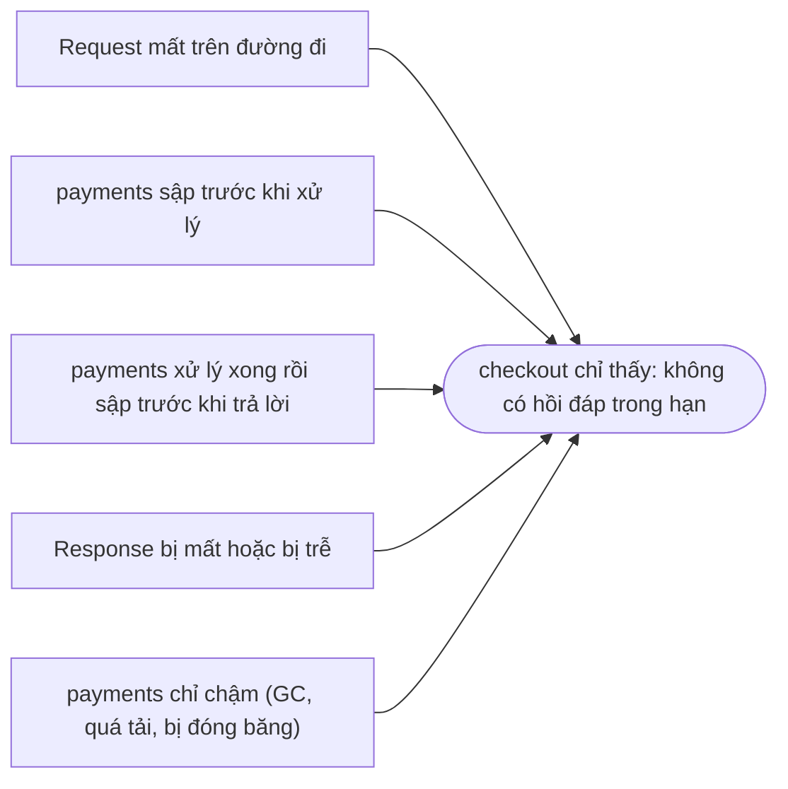
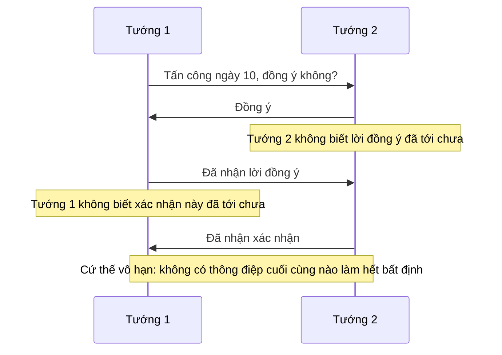
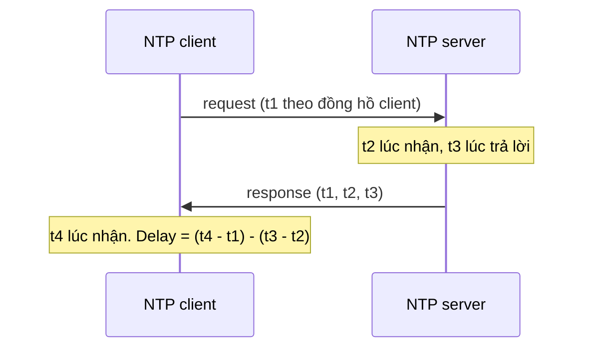
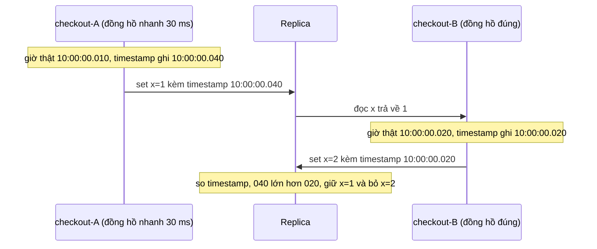
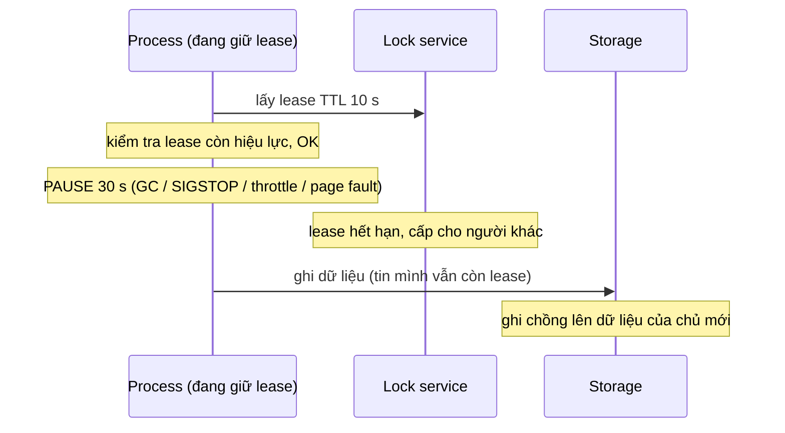
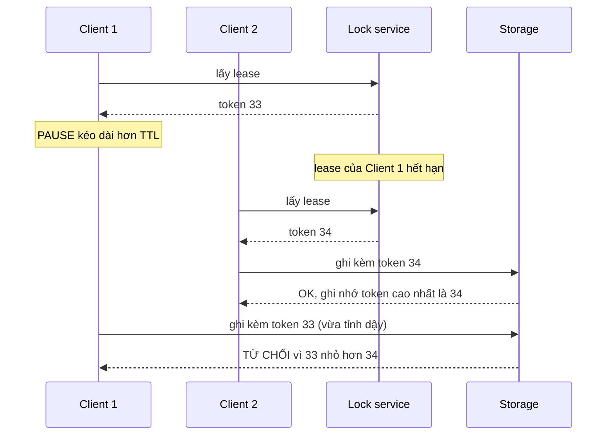

# P12 · Chương 08 — Sự cố của hệ phân tán

> Chương này theo khung chủ đề của chương 8 sách DDIA, "The Trouble with Distributed Systems"[^ddia-toc], nhưng **không** trích nội dung sách. Nguồn chính là bài giảng *Concurrent and Distributed Systems* (Cambridge, 2021/22)[^notes-ref]. Người viết bài giảng là Martin Kleppmann[^notes-author]. Ngoài ra chương dùng RFC 9293 và 5905, man page Linux (Debian bookworm), docs Rust 1.95.0, docs `tokio` 1.53.2 và `tonic` 0.14.2, docs gRPC, Google SRE book, paper Chubby và Dynamo, docs etcd, Cassandra, Kubernetes. Mọi đoạn code chỉ để minh họa, chưa biên dịch và không kèm khẳng định nào về kết quả chạy.

## Bạn sẽ hiểu được gì

- **Q1.** "Partial failure" là gì, và vì sao một RPC không có hồi đáp lại là tình huống mơ hồ khó chịu nhất? → mục 1
- **Q2.** Mạng được mô hình hóa ra sao (reliable / fair-loss / arbitrary), và TCP giải quyết được đến đâu? → mục 2
- **Q3.** Bài toán *two generals* nói gì, và nó dẫn tới thiết kế thực tế nào? → mục 3
- **Q4.** Mô hình hệ thống (synchronous / partially synchronous / asynchronous; crash-stop / crash-recovery / Byzantine) là gì, và timeout đóng vai trò gì trong failure detector? → mục 4
- **Q5.** Đồng hồ *time-of-day* khác *monotonic* thế nào (`clock_gettime(2)`), và `Instant` / `SystemTime` của Rust ứng với cái nào? → mục 5
- **Q6.** NTP làm gì và sai ở đâu; vì sao timestamp từ hai máy không dùng để sắp thứ tự (last-write-wins mất dữ liệu thế nào)? → mục 6
- **Q7.** Process pause (GC, preempt, page fault, `SIGSTOP`, throttle…) là gì, và vì sao "kiểm tra rồi mới làm" bằng thời gian cục bộ là sai? → mục 7
- **Q8.** Lease và fencing token giải quyết gì, mỗi thứ không giải quyết được gì? → mục 8

## Kiến thức cần trước

- [Chương 01 của phase này](01-reliability-scalability-maintainability.md): phân biệt fault và failure ở mức khái niệm. Chương này đi vào *các loại fault* riêng của hệ phân tán.
- [P6 · Chương 05 — TCP: tin cậy và flow control](../06-networking/05-tcp-reliability-va-flow-control.md), mục 3 (retransmission, RTO) và mục 8 (keepalive): chương này dùng lại kết quả, không giải thích lại cách TCP gửi lại gói hay thăm dò kết nối rảnh.
- [P1 · Chương 02 — System call](../01-linux/02-system-call.md), mục 4: vDSO, và vì sao đọc đồng hồ có thể không phải vào kernel.
- [P3 · Chương 04 — Page fault và swapping](../03-memory/04-page-fault-va-swapping.md) và [P7 · Chương 09 — Async trong production](../07-io-async/09-async-trong-production.md), mục 5 (blocking trong async): hai nguồn làm process "đứng hình" mà mục 7 nhắc lại. Từ P7·09 mục 2 (`timeout`), chương này chỉ lấy hệ quả cho RPC mơ hồ, không giải thích lại cách hủy future.

(Chương sau dùng kết quả của chương này: [replication](05-replication.md) cần failover, [transaction](07-transaction.md) cần hiểu vì sao timeout làm commit mơ hồ, [consistency và consensus](09-consistency-va-consensus.md) trả lời câu hỏi "làm sao đồng ý khi không tin được thời gian", còn [đúng đắn và tích hợp dữ liệu](12-dung-dan-va-tich-hop-du-lieu.md) bàn idempotency đầu-cuối.)

## 1. Partial failure: một RPC không có hồi đáp (Q1)

> **Trả lời ngắn.** Trong hệ phân tán, một phần của hệ thống có thể hỏng trong khi phần còn lại vẫn chạy bình thường; đó là *partial failure* (hỏng từng phần)[^partial-fail]. Trên một máy đơn thì thường không có chuyện đó, vì một linh kiện hỏng thì nhiều khả năng cả máy chỉ sập[^single-crash]. Hệ quả cụ thể nhất là khi bạn gọi RPC mà không nhận được hồi đáp, bạn không biết server đã nhận và xử lý yêu cầu hay chưa[^rpc-unknown]. Chờ mãi không phải lựa chọn, nên client buộc phải bỏ cuộc sau một timeout[^rpc-timeout]; còn gửi lại thì có thể làm việc bị thực hiện nhiều lần[^rpc-retry].

**Giải thích.**

*Với service của bạn.* Cả chương bám theo một ví dụ giả định: `checkout`, service Rust chạy 3 replica trên Kubernetes. Với mỗi đơn hàng, `checkout` gọi `POST /payments` sang service `payments` để trừ tiền, rồi ghi đơn vào database. Thêm một việc nền: mỗi đêm, một replica được chọn làm leader để chạy job đối soát `settle`, ghi vào một storage dùng chung (nhận xét của người soạn: đây là ví dụ giả định, không phải code trong repo). Câu hỏi của mục này: khi `payments` không trả lời, `checkout` biết được gì?

### 1.1 Fault, failure và partial failure

Trước hết cần thống nhất ba từ. *Fault* là một phần nào đó của hệ thống không chạy, còn *failure* là cả hệ thống không chạy[^fault-def]. *Fault tolerance* là việc hệ thống vẫn chạy dù có fault, tới một số fault tối đa[^ft-def]. Bài giảng dùng cụm "partial failure" cho tình huống một node sập mà các node còn lại vẫn có thể tiếp tục cung cấp dịch vụ[^partial-fail]. Nói theo cách của người soạn, đó là có fault mà chưa thành failure: một replica `checkout` bị kill thì hai replica kia vẫn nhận request.

Gọi hàm trong cùng một process thì thường không gặp chuyện này: hàm chạy xong và trả kết quả, hoặc cả process cùng chết (bỏ qua lỗi từng thread) (nhận xét của người soạn).

### 1.2 Vì sao im lặng lại mơ hồ

Giả sử `checkout` gọi `POST /payments` rồi connection im bặt sau 5 giây. `payments` đã trừ tiền chưa? Từ phía `checkout` không có cách nào trả lời, vì mọi nguyên nhân dưới đây cho cùng một quan sát: không có phản hồi trong hạn. Bài giảng liệt kê node sập, node tạm thời không đáp, mất message và message bị trễ, rồi kết luận client không phân biệt được chúng[^fd-problem].

(Sơ đồ là tổng hợp của người soạn từ các nguyên nhân bài giảng liệt kê[^fd-problem]; trường hợp "server chỉ chậm" được bàn kỹ ở mục 7.)



Năm nguyên nhân này khác nhau về *hậu quả* nhưng giống hệt nhau về *quan sát* (nhận xét của người soạn: A và B là việc chưa làm; C và D là việc đã làm xong; E là việc có thể đang làm dở hoặc sẽ làm xong sau). Vì thế timeout chỉ là phỏng đoán chứ không phải kết luận. Kleppmann cũng nói đúng như vậy khi dùng timeout làm failure detector: nó chỉ là một phỏng đoán rằng có gì đó không ổn[^kb-guess].

Nhìn ở mức mã client, một RPC chỉ có ba kết cục: server trả mã thành công, server trả mã lỗi, hoặc request thất bại vì không nhận được phản hồi nào, thường do mạng gián đoạn[^rpc-outcomes]. Hai kết cục đầu cho `checkout` đủ thông tin để quyết định. Kết cục thứ ba thì không.

### 1.3 Retry không miễn phí

Gửi lại khi chưa rõ `payments` đã làm hay chưa có thể khiến yêu cầu bị thực hiện hơn một lần, ví dụ trừ thẻ hai lần[^rpc-retry]. Vì vậy "retry có an toàn không" thực ra là câu hỏi về thiết kế thao tác (idempotent hay không), và chương [12](12-dung-dan-va-tich-hop-du-lieu.md) sẽ bàn tiếp. Retry còn kéo theo một tác dụng phụ về tải: server quá tải trả lời trễ, vượt hạn của client, việc server đã làm bị bỏ phí, client lại gửi lại và làm quá tải nặng hơn[^sre-wasted].

<details><summary>Đi sâu: vì sao "đồng bộ" và "bất đồng bộ" gây nhầm, và retry an toàn thế nào</summary>

- *Synchronous/asynchronous* có hai nghĩa khác nhau tùy ngữ cảnh. Trong lập trình RPC/I/O, "synchronous" thường là "caller chờ thao tác xong"; trong lý thuyết hệ phân tán, nó nói về giả định thời gian (mục 4). Kleppmann ghi chú rằng dùng chung một từ là điều đáng tiếc, nhưng đó là thuật ngữ chuẩn trong tài liệu[^terms].
- Về retry: backoff có ngẫu nhiên và retry budget là khuyến nghị của Google SRE, đã trình bày kèm nguồn ở chương [12](12-dung-dan-va-tich-hop-du-lieu.md) mục 4 (nơi gốc) nên không lặp lại. Chương này chỉ giữ ý đã nêu ở trên: retry là thêm tải đúng lúc hệ thống đang yếu[^sre-wasted].
- Bài tập 3 trong bài giảng hỏi đúng câu cho phần dedup: nếu client lặp lại RPC tới khi có hồi đáp, server khử trùng lặp bằng cách nào? Lời giải kinh điển (nhận xét của người soạn: mỗi request mang ID duy nhất, server nhớ ID đã xử lý) thuộc chương [12](12-dung-dan-va-tich-hop-du-lieu.md).

</details>

**Quay lại Q1:** partial failure nghĩa là một phần hỏng còn phần khác chạy; hệ quả là hồi đáp không đến *không cho biết* việc đã làm hay chưa, và mọi timeout chỉ là phỏng đoán.

## 2. Mạng không tin cậy: ba mô hình liên kết và TCP (Q2)

> **Trả lời ngắn.** Không mạng nào hoàn hảo: cáp bị rút nhầm, quá tải hay tấn công từ chối dịch vụ đều làm mất message[^net-unrel]. Để suy luận cho gọn, bài giảng gom liên kết giữa hai node vào ba loại: reliable, fair-loss và arbitrary[^net-links]. Từ liên kết *fair-loss* (có thể mất, trùng, đảo thứ tự, nhưng gửi mãi thì cuối cùng tới) ta dựng được liên kết reliable bằng cách gửi lại liên tục và lọc trùng ở phía nhận[^net-convert]. TCP làm đúng việc đó ở mức gói mạng, nhưng thường được cấu hình timeout nên sẽ bỏ cuộc sau cỡ một phút; vì vậy tầng ứng dụng vẫn cần cơ chế retry và khử trùng riêng, đặt thêm trên TCP[^net-tcp].

**Giải thích.**

*Với `checkout`.* `checkout` nói chuyện với `payments` qua TCP, và `write()` trả về thành công, nên rất dễ nghĩ rằng `payments` đã nhận và xử lý. Mục này cho thấy TCP thực sự bảo đảm đến đâu, và phần còn lại `checkout` phải tự lo.

### 2.1 Ba loại liên kết

Bảng dưới giả định liên kết hai chiều, point-to-point giữa hai node.

| Loại | Điều được hứa |
|---|---|
| Reliable (perfect) | Message được nhận khi và chỉ khi nó được gửi; có thể bị đảo thứ tự[^net-links] |
| Fair-loss | Message có thể bị mất, trùng hay đảo thứ tự; nếu gửi lại mãi thì cuối cùng một bản sẽ tới[^net-links] |
| Arbitrary | Kẻ tấn công chủ động có thể can thiệp: nghe lén, sửa, thả, giả mạo, phát lại[^net-links] |

Các loại này chuyển đổi được cho nhau. Fair-loss lên reliable bằng gửi lại và khử trùng[^net-convert]. Arbitrary xuống fair-loss nhờ TLS, vì TLS ngăn kẻ tấn công nghe lén, sửa, giả mạo hay phát lại, nhưng không ngăn được việc chặn không cho message đi qua; do đó chỉ chuyển được nếu giả định kẻ tấn công không chặn mãi mãi[^net-tls].

### 2.2 Partition và message đến muộn

Bài giảng định nghĩa network partition là tình huống một số liên kết thả hoặc làm trễ mọi message trong thời gian dài[^net-partition]. Chú ý "trễ" không nhất thiết là "thả": Kleppmann kể một vụ ở GitHub, nơi gói tin bị trễ khoảng 90 giây trong mạng[^kb-github]. Một message gửi trong lúc partition chỉ tới sau khi partition lành, tức có thể rất lâu sau[^net-delayed]. Điều này quan trọng cho mục 7 và 8: `payments` có thể nhận một request đã gửi từ rất lâu.

### 2.3 TCP bảo đảm đến đâu

P6 đã giải thích TCP gửi lại bằng RTO và backoff (xem [P6·05 mục 3](../06-networking/05-tcp-reliability-va-flow-control.md)). Ở đây chỉ cần ba điểm, theo thứ tự mà `checkout` sẽ gặp.

1. **TCP có ngưỡng bỏ cuộc.** RFC 9293 mô tả: khi số lần truyền cùng một segment đạt ngưỡng R2, TCP đóng kết nối[^rfc-r2]. Ứng dụng phải đặt được R2 cho từng kết nối[^rfc-r2-app]. Giá trị cụ thể trên Linux xem [P6·05 mục 3](../06-networking/05-tcp-reliability-va-flow-control.md); "cỡ một phút" ở trên là mô tả chung của bài giảng, đừng suy ra thành con số của Linux.
2. **ACK của TCP chỉ cho biết stack TCP bên kia đã nhận byte.** Trường ACK chứa số thứ tự byte kế tiếp mà bên gửi segment mong nhận[^rfc-ack]. Nó không nói ứng dụng bên kia đã đọc, đã xử lý xong hay đã ghi xuống đĩa (suy luận của người soạn từ định nghĩa của trường ACK). Do đó "`write()` thành công" hay "đã gửi hết" không thay được xác nhận ở tầng ứng dụng.
3. **Kết nối chết có thể không tự báo.** Kết nối "half-open" là kết nối mà một đầu đã đóng hoặc hủy mà đầu kia không biết, hoặc hai đầu lệch trạng thái do sự cố hay khởi động lại làm mất bộ nhớ; nó sẽ tự bị reset khi có bên cố gửi dữ liệu[^rfc-halfopen]. Hệ quả (nhận xét của người soạn): một kết nối rảnh tới peer đã chết không tự báo lỗi, và nếu peer mất điện hẳn thì không có RST nào quay về, bên gửi chỉ gửi lại tới ngưỡng R2 (điểm 1). Keepalive ([P6·05 mục 8](../06-networking/05-tcp-reliability-va-flow-control.md)) hoặc heartbeat ở tầng ứng dụng là cách phát hiện.

Từ ba điểm trên, kết luận thực tế (nhận xét của người soạn) là: với thao tác quan trọng, hãy coi liên kết như *fair-loss* ở tầng ứng dụng. Kleppmann nói đúng ý này: muốn vượt qua partition dài hơn timeout của TCP thì cần một cơ chế retry và khử trùng riêng đặt trên TCP[^net-tcp].

<details><summary>Đi sâu: vì sao đọc "mô hình" lại quan trọng, và chuyện cá mập</summary>

- Bài giảng nhấn mạnh rằng mô hình bỏ qua chi tiết vật lý: cá mập cắn cáp quang biển và bò giẫm lên cáp trên đất liền đều từng được nêu, nhưng trong mô hình chúng chỉ là "mất message"[^net-unrel]. Giá trị của mô hình (nhận xét của người soạn) là thuật toán chỉ phụ thuộc vào *tính chất* (mất, trễ, trùng), không phụ thuộc nguyên nhân.
- Liên kết reliable *vẫn* cho phép đảo thứ tự[^net-links]. Muốn FIFO thì phải thêm số thứ tự ở phía trên; đây là bài tập 4 của bài giảng. TCP làm điều này trong một kết nối, nhưng không xuyên qua nhiều kết nối (nhận xét của người soạn).
- Người gửi cũng có thể sập giữa lúc đang gửi lại, khiến message mất vĩnh viễn; vì vậy mô hình liên kết phải đi cùng mô hình node (mục 4)[^net-links-node].

</details>

**Quay lại Q2:** mạng là fair-loss ở cấp ứng dụng: có thể mất, trễ, trùng, đảo; TCP dựng được kênh tin cậy tạm thời nhưng có ngưỡng bỏ cuộc, ACK không phải xác nhận xử lý, và kết nối chết lặng lẽ không tự báo.

## 3. Two generals: không thể chắc chắn về trạng thái của node khác (Q3)

> **Trả lời ngắn.** Hai viên tướng chỉ thắng nếu cùng tấn công, mà họ chỉ liên lạc bằng người đưa tin có thể bị bắt. Dù trao đổi bao nhiêu lần xác nhận, người ta chứng minh được là không thể đạt chắc chắn bằng một số hữu hạn message[^twogen-finite]. Hệ quả: trong hệ phân tán không node nào chắc chắn về trạng thái của node khác; một node chỉ biết điều gì đó nếu nó được truyền tới trong một message[^twogen-nocert]. Trong ví dụ cửa hàng online và thanh toán, bài toán giải được vì thanh toán có thể hoàn tác (hoàn tiền), và khi liên lạc gián đoạn cửa hàng có thể chờ kết nối phục hồi rồi truy vấn lại trạng thái các giao dịch chưa rõ kết quả[^twogen-pay].

**Giải thích.**

*Với `checkout`.* `checkout` và `payments` muốn cùng đạt một điều: "giao hàng khi và chỉ khi đã thu tiền". Nhưng giữa hai bên chỉ có RPC, tức những message có thể mất hoặc trễ. Mục này nói vì sao không có giao thức nào cho `checkout` sự chắc chắn tuyệt đối, và hệ thống thật xoay xở thế nào.

### 3.1 Bài toán gốc

Hai đội quân cùng tấn công thì chiếm được thành; chỉ một đội tấn công thì thua. Người đưa tin phải đi qua vùng của thành nên đôi khi bị bắt, vì vậy một viên tướng chỉ biết tin của mình đã tới khi nhận được hồi đáp rõ ràng. Nếu không nhận được tin nào, ông không thể biết là bên kia không gửi hay mọi người đưa tin đã bị bắt[^twogen-ref].

Mỗi viên tướng chỉ có hai lựa chọn. Một là cam kết tấn công dù không có hồi đáp, và chịu nguy cơ tấn công một mình. Hai là đợi xác nhận trước khi cam kết; nhưng khi đó vấn đề chuyển sang người kia, người phải quyết định có cam kết hay đợi "xác nhận của xác nhận"[^twogen-options].



Bài giảng tóm gọn bằng một câu: không có "common knowledge", cách duy nhất để biết một điều là nó được truyền đi bằng message[^twogen-nocommon].

### 3.2 Áp vào `checkout` và `payments`

`checkout` và `payments` có đúng cấu trúc của hai viên tướng. Điểm khác là thanh toán *hoàn tác được*, và bài giảng chỉ ra chính tính hoàn tác đó khiến bài toán giải được: lúc liên lạc gián đoạn, cửa hàng đợi kết nối phục hồi rồi hỏi dịch vụ thanh toán trạng thái các giao dịch chưa rõ kết quả[^twogen-pay].

Từ đó (suy luận của người soạn) có ba kỹ thuật phổ biến: thao tác có ID để truy vấn lại (idempotency key, chương [12](12-dung-dan-va-tich-hop-du-lieu.md)), thao tác bù (hoàn tiền thay vì "rollback"), và giao thức commit nhiều bước như two-phase commit ([chương 07](07-transaction.md)). Riêng two-phase commit không thoát khỏi bất định: bài giảng nêu coordinator là điểm hỏng đơn[^2pc-spof]. Các transaction đã prepare nhưng chưa biết kết quả (in-doubt) phải chờ coordinator hồi phục mới biết số phận của chúng[^2pc-indoubt].

<details><summary>Đi sâu: Byzantine generals — nút thắt ở phía node, không phải mạng</summary>

Bài giảng đặt hai thí nghiệm tư duy cạnh nhau: *two generals* mô hình hóa **mạng**, còn *Byzantine generals* mô hình hóa **hành vi node**. Trong bài toán Byzantine, tin nhắn luôn tới đúng, nhưng một số tướng là kẻ phản bội, cố ý gây nhầm lẫn; các tướng trung thành không biết ai là kẻ phản bội, và những kẻ này có thể thông đồng[^byz-ref]. Với chậm trễ liên lạc không dự đoán được, bài toán chỉ giải được nếu *ít hơn một phần ba* số tướng là kẻ phản bội, tức cần 3f + 1 tướng để chịu được f kẻ phản bội[^byz-third]. Chữ ký số giúp một phần nhưng bài toán vẫn khó[^byz-sign]. Chủ đề này quay lại ở mục 4 khi nói về mô hình node.

</details>

**Quay lại Q3:** không có số message hữu hạn nào đưa hai bên tới chắc chắn tuyệt đối; hệ thống thực tế sống được nhờ thao tác hoàn tác được và khả năng *hỏi lại* trạng thái.

## 4. Mô hình hệ thống, failure detector và timeout (Q4)

> **Trả lời ngắn.** *Mô hình hệ thống* là tập giả định về cách node và mạng hành xử[^sysmodel-def]. Nó có ba trục: mạng (reliable / fair-loss / arbitrary, mục 2), node (crash-stop / crash-recovery / Byzantine) và thời gian (synchronous / partially synchronous / asynchronous). Trong hệ thống thực, rất hiếm khi an toàn để giả định mô hình synchronous, nên phần lớn thuật toán phân tán cần được thiết kế cho mô hình asynchronous hoặc partially synchronous[^rarely-sync]. Việc phát hiện node hỏng dựa vào timeout, và theo bài giảng, một failure detector hoàn hảo dựa trên timeout chỉ tồn tại trong mô hình synchronous crash-stop với liên kết reliable[^fd-perfect].

**Giải thích.**

*Với `checkout`.* `checkout` đặt timeout 2 giây cho mỗi lần gọi `payments`. Con số đó ngầm giả định rằng mạng và `payments` luôn trả lời trong chừng ấy thời gian, nên nó là một mô hình hệ thống, dù chưa ai viết ra (nhận xét của người soạn). Mục này liệt kê các giả định như vậy, cho thấy giả định nào nguy hiểm, và rút ra cách dùng timeout cho đúng. Bài giảng nói gọn rằng nếu giả định sai thì mọi thứ đều không còn chắc chắn[^models-summary].

### 4.1 Trục node

| Mô hình | Giả định |
|---|---|
| Crash-stop | Sau khi sập, node dừng mãi mãi[^crash-stop] |
| Crash-recovery | Node có thể sập bất cứ lúc nào và mất trạng thái trong RAM, có thể chạy lại về sau; dữ liệu đã ghi bền trên đĩa còn nguyên[^crash-rec] |
| Byzantine (fail-arbitrary) | Node hỏng có thể làm mọi thứ, kể cả hành vi ác ý[^byz-node] |

Crash-recovery là mô hình sát database thật nhất, vì node khởi động lại và đọc lại log trên đĩa (nhận xét của người soạn). P5 ([crash consistency](../05-storage/05-crash-consistency-va-journaling.md), [durability](../05-storage/06-durability-trong-thuc-te.md)) nói chính điều gì xảy ra với "dữ liệu trên đĩa" trong mô hình này. Replica `checkout` bị kill rồi Kubernetes chạy lại cũng thuộc mô hình này.

### 4.2 Trục thời gian

- *Synchronous*: độ trễ message không vượt giới hạn trên đã biết, node chạy với tốc độ đã biết[^sync-def]. Thuật toán viết cho mô hình này có thể đổ vỡ thảm khốc nếu giả định bị vi phạm, dù chỉ ngắn và hiếm khi[^sync-bad].
- *Asynchronous*: không có giả định thời gian nào; message trễ tùy ý, node có thể tạm dừng tùy ý[^async-def]. Thuật toán viết cho mô hình này thường rất bền, nhưng một số bài toán không giải được trong nó[^async-impossible].
- *Partially synchronous*: hệ thống phần lớn thời gian synchronous, thỉnh thoảng chuyển sang asynchronous một cách không đoán trước, và lúc đó mọi bảo đảm thời gian mất hiệu lực. Đây là thỏa hiệp cho nhiều hệ thống thực, nhưng "dùng đúng cần cẩn thận"[^partial-def].

Vì sao không thể giả định synchronous? Độ trễ mạng có thể vọt lên do mất gói phải gửi lại, hàng đợi ở switch hay cấu hình lại route. Tốc độ chạy của node có thể bị gián đoạn do lập lịch hệ điều hành, GC, page fault. Kleppmann nêu cả ca gói tin trong một datacenter bị trễ hơn một phút[^sync-violations]. Với `checkout`, điều đó có nghĩa "`payments` luôn trả lời trong 2 giây" là giả định mà thực tế sẽ vi phạm lúc nào đó.

### 4.3 Failure detector

Failure detector là thuật toán xác định node khác có hỏng không. Cách phổ biến là định kỳ gửi message và coi node là sập nếu không có hồi đáp trong hạn[^fd-def]. Một detector *hoàn hảo* gắn nhãn "hỏng" khi và chỉ khi node thực sự sập. Theo bài giảng, detector hoàn hảo dựa trên timeout chỉ tồn tại trong hệ synchronous crash-stop với liên kết reliable, và không tồn tại trong hệ partially synchronous[^fd-perfect]. Trong hệ partially synchronous vẫn có loại hữu ích: *eventually perfect failure detector*, cho phép nhầm tạm thời (gắn nhãn hỏng cho node đang tốt, hoặc ngược lại) nhưng cuối cùng gắn nhãn đúng[^fd-evperfect]. Việc phát hiện cũng không tức thời, và có thể có timeout giả (spurious)[^fd-spurious].

### 4.4 Quy tắc dùng timeout

Kleppmann (trong bài về khóa phân tán) nêu rằng mô hình thực tế nhất trong tài liệu học thuật cho loại thuật toán này là asynchronous cộng failure detector không đáng tin[^kb-async-model]. Các thuật toán đó nói chung giữ *tính an toàn (safety)* mà không giả định gì về thời gian[^kb-safety]. Chỉ *tính sống (liveness)* phụ thuộc timeout hoặc failure detector; nếu thời gian hỗn loạn thì hiệu năng có thể tệ nhưng thuật toán không ra quyết định sai[^kb-safety-liveness].

Từ đó có một quy tắc dùng được ngay (nhận xét của người soạn): **dùng timeout để quyết định *khi nào thôi chờ*, không dùng thời gian để quyết định *điều gì đúng***. `checkout` hết 2 giây thì thôi chờ `payments` là hợp lý; kết luận "chưa trừ tiền" từ đó thì không. Đây là sợi chỉ nối sang mục 8.

### 4.5 Chọn timeout trong thực hành

Google SRE khuyên thường nên đặt deadline; không đặt hoặc đặt quá cao có thể khiến các vấn đề ngắn hạn đã qua từ lâu vẫn tiếp tục ngốn tài nguyên server cho tới khi server khởi động lại[^sre-deadline-pick]. Deadline cao làm tầng trên tốn tài nguyên chờ khi tầng dưới gặp sự cố; deadline ngắn có thể khiến một số request tốn kém hơn thất bại liên tục[^sre-high-short]. Cân bằng hai đầu đó "có phần là nghệ thuật"[^sre-art].

<details><summary>Đi sâu: Byzantine và bug, RTOS, deadline propagation, gRPC và đồng hồ</summary>

- Bài giảng lưu ý lỗi phần mềm có thể coi là Byzantine, nhưng nếu mọi node chạy cùng phần mềm thì mọi node có cùng lỗi, và thuật toán giả định dưới một phần ba node Byzantine không chống được lỗi đó[^byz-bug-same]. Vì vậy thông lệ chỉ dùng chữ "Byzantine" cho việc cố ý lệch giao thức, không cho bug[^byz-bug].
- Hệ điều hành thời gian thực (RTOS) có bảo đảm lập lịch, nhưng hầu hết hệ phân tán không dùng nó[^rtos].
- *Deadline propagation*: deadline được đặt ở tầng cao (frontend), và mọi RPC phát sinh từ request đó dùng cùng một deadline *tuyệt đối*[^sre-propagate]. Mỗi tầng nhận phần thời gian còn lại, không tự bịa deadline mới.
- gRPC: theo docs, một số API ngôn ngữ dùng khái niệm *deadline* (một mốc thời gian), số khác dùng *timeout* (khoảng thời gian tối đa)[^grpc-deadline-apis]. Đổi timeout thành deadline bằng cách cộng timeout vào thời điểm hiện tại lúc bắt đầu gọi[^grpc-deadline]. Mặc định gRPC *không* đặt deadline, nên client có thể đợi vô hạn trên thực tế[^grpc-default].
- Trên dây, giao thức HTTP/2 của gRPC truyền header `grpc-timeout` gồm một số nguyên dương tối đa 8 chữ số và đơn vị[^grpc-wire]; nếu thiếu thì server nên coi là timeout vô hạn[^grpc-omit]. Nghĩa là thứ đi qua mạng là một *khoảng thời gian*, không phải mốc theo đồng hồ treo tường của client, và chi tiết đó giúp tránh một lớp lỗi do đồng hồ hai máy lệch nhau (mục 6). (Hai câu cuối là suy luận của người soạn từ định dạng header.)
- Crash-recovery không giả định thời gian hồi phục: node có thể chạy lại sau bao lâu cũng được, thậm chí không bao giờ[^crash-rec-time].

</details>

**Quay lại Q4:** mô hình hệ thống = giả định về mạng, node, thời gian; hệ thực rất hiếm khi an toàn để giả định synchronous, nên thường được mô hình hóa là partially synchronous (và, theo nhận xét của người soạn, crash-recovery); timeout chỉ là failure detector không hoàn hảo, nên dùng cho liveness chứ không cho safety.

## 5. Đồng hồ: time-of-day và monotonic (Q5)

> **Trả lời ngắn.** Một máy Linux có (ít nhất) hai loại đồng hồ chính. `CLOCK_REALTIME` là đồng hồ treo tường: settable, và chịu cả những bước nhảy khi chỉnh giờ lẫn điều chỉnh của NTP[^cg-realtime-jumps]. `CLOCK_MONOTONIC` không bị bước nhảy do chỉnh tay hay step, nhưng vẫn bị slew của NTP[^cg-mono-nojump]. Nó không đếm thời gian máy ngủ[^cg-mono-suspend]. Nó cũng bảo đảm hai lần gọi liên tiếp không đi lùi[^cg-mono-nodecrease]. Vì vậy đo *khoảng thời gian* thì dùng monotonic[^tod-jump]; muốn *một mốc thời gian* để so sánh giữa các máy thì dùng time-of-day, với sai số còn lại ở mục 6 (khuyến nghị tổng hợp của người soạn).

**Giải thích.**

*Với `checkout`.* `checkout` cần đo hai thứ: một lần gọi `payments` mất bao lâu (để đặt metric latency và timeout), và đơn hàng được tạo lúc mấy giờ (để ghi vào database). Hai việc này cần hai loại đồng hồ khác nhau, và dùng nhầm thì sai theo cách rất khó thấy.

Time-of-day clock cho thời gian tính từ một mốc cố định (epoch). Khi NTP step đồng hồ, giá trị có thể nhảy, nên hiệu của hai mốc có thể lớn hơn nhiều thời gian thực, thậm chí âm; loại đồng hồ này vì thế không phù hợp để đo thời gian trôi qua[^tod-jump]. Nếu `checkout` đo latency bằng nó và NTP step giữa chừng, latency ghi được có thể là một số âm (nhận xét của người soạn). Monotonic clock thì không bị NTP step và luôn đi tiến, chỉ tốc độ có thể bị slew[^mono-def]. Đổi lại, giá trị tuyệt đối của nó vô nghĩa vì đo từ một mốc tùy ý (như lúc máy khởi động); chỉ *hiệu* hai giá trị trên *cùng một node* mới có nghĩa, còn so sánh giá trị monotonic giữa các node là vô lý[^mono-local].

| | Time-of-day | Monotonic |
|---|---|---|
| `clock_gettime` | `CLOCK_REALTIME` | `CLOCK_MONOTONIC` |
| Settable? | Có[^cg-realtime] | Không[^cg-mono] |
| Nhảy do chỉnh giờ/step? | Có[^cg-realtime-jumps] | Không, nhưng vẫn bị slew[^cg-mono-nojump] |
| Đếm thời gian máy ngủ? | Man page không nêu cho `CLOCK_REALTIME` | Không[^cg-mono-suspend] |
| Dùng để | Ghi mốc, đối chiếu giữa các máy (nếu đồng bộ) | Đo khoảng thời gian, timeout, lease *cục bộ* |

Hàng cuối của bảng là khuyến nghị của người soạn, dựa trên hai đoạn trích dẫn ngay phía trên.

Đừng đảo vai hai đồng hồ. Nếu đo timeout bằng `CLOCK_REALTIME` thì timeout sẽ co giãn khi ai đó (hoặc NTP) nhảy giờ, vì đồng hồ này chịu các bước nhảy đó[^cg-realtime-jumps] (nhận xét của người soạn). Chính kernel cũng tránh điều này khi cần chờ: `epoll_wait` tính timeout theo `CLOCK_MONOTONIC`[^epoll-mono] (xem [P7·04](../07-io-async/04-kien-truc-event-loop.md)).

Về chi phí đọc đồng hồ: `clock_gettime` có thể chạy hoàn toàn trong user space qua vDSO, không vào kernel; chuyện này đã giải thích ở [P1·02 mục 4](../01-linux/02-system-call.md) nên không lặp lại. Việc đó có thật sự xảy ra hay không còn tùy kiến trúc và phiên bản, và `std` không hứa điều đó[^inst-disclaimer].

<details><summary>Đi sâu: các đồng hồ khác của Linux, leap second và Unix time</summary>

- `CLOCK_BOOTTIME` giống `CLOCK_MONOTONIC` nhưng *có* tính thời gian máy ngủ[^cg-boottime]. Hệ quả (suy luận của người soạn) cho lease dài trên laptop hay VM bị tạm dừng: chọn clock nào thì lease "trôi" hay "đứng" lúc suspend.
- `CLOCK_MONOTONIC_RAW` không chịu điều chỉnh của NTP hay `adjtime(3)` và cũng không đếm lúc suspend[^cg-raw]. Còn `CLOCK_TAI` bắt nguồn từ wall clock nhưng bỏ qua leap second, nên không có gián đoạn hay nhảy lùi do NTP chèn leap second như `CLOCK_REALTIME`[^cg-tai].
- Các biến thể `CLOCK_MONOTONIC` bảo đảm hai lần gọi liên tiếp không đi lùi, nhưng tùy kiến trúc hai lần gọi có thể trả *cùng* giá trị[^cg-mono-nodecrease]. Đừng giả định hai lần đọc luôn cách nhau một lượng dương.
- *Leap second.* Unix time đếm giây từ epoch mà không tính leap second; đa số phần mềm lờ chúng đi, kể cả POSIX[^unix-leap]. Bài giảng chỉ ra một sự cố có thật: lỗi kernel Linux khiến leap second ngày 30/6/2012 có xác suất cao kích hoạt livelock với process đa luồng, làm hàng loạt dịch vụ sập đồng loạt; khởi động lại không chữa được, nhưng đặt lại giờ hệ thống thì xóa trạng thái lỗi[^leap-2012]. Cách chữa phổ biến là *smear*: dàn giây thừa trong nhiều giờ bằng cách làm đồng hồ chạy chậm lại (hoặc nhanh lên)[^leap-smear], và cách này cũng có vấn đề riêng.

</details>

**Quay lại Q5:** monotonic để đo "đã trôi bao lâu" trên một máy; time-of-day để đặt nhãn thời gian; hai loại không thay nhau được, và cả hai đều không cho biết thứ tự sự kiện giữa các máy (mục 6).

## 6. NTP, độ lệch và vì sao không dùng timestamp để sắp thứ tự (Q6)

> **Trả lời ngắn.** Đồng hồ thạch anh trong máy không chính xác: nó chạy nhanh hay chậm tùy chip và nhiệt độ, hiện tượng gọi là *drift*[^drift-def]. NTP đồng bộ định kỳ với server chuẩn, nhưng sai số dư phụ thuộc độ trễ mạng; trong điều kiện tốt chỉ còn vài mili-giây, và có thể tệ hơn nhiều[^ntp-good]. Vì vậy hai máy luôn lệch nhau chút ít, và timestamp theo đồng hồ treo tường từ hai máy có thể đảo ngược thứ tự nhân quả thật[^ts-order]. Dùng nó để "ai ghi sau thì thắng" (last-write-wins) là chấp nhận mất dữ liệu khi có ghi đồng thời[^lww-loss], và lệch đồng hồ còn có thể làm bỏ nhầm cả ghi xảy ra sau (suy luận của người soạn).

**Giải thích.**

*Với `checkout`.* Hai replica `checkout` chạy trên hai máy khác nhau, cùng ghi vào một bản ghi và dùng timestamp từ đồng hồ máy mình để phân định "ai ghi sau". Câu hỏi của mục này: timestamp đó đáng tin đến đâu? Câu trả lời đi qua ba bước: đồng hồ trôi bao nhiêu, NTP sửa được bao nhiêu, và phần sai còn lại làm hỏng thứ tự thế nào.

### 6.1 Drift

Drift là tốc độ đồng hồ chạy nhanh hay chậm; tần số dao động của thạch anh còn đổi theo nhiệt độ[^drift-temp]. Một phần triệu (1 ppm) tương đương 1 micro-giây mỗi giây, khoảng 86 ms mỗi ngày, hay 32 giây mỗi năm[^drift-ppm]. Bài giảng cho biết đồng hồ máy tính thường đúng trong khoảng 50 ppm[^drift-50]. (Tính của người soạn từ 86 ms/ngày: 50 ppm là cỡ 4 giây mỗi ngày nếu không được đồng bộ.)

### 6.2 NTP làm gì

NTP là giao thức đồng bộ giờ phổ biến, và mọi hệ điều hành chính đều có sẵn client[^ntp-os]. Client gửi request kèm t1 theo đồng hồ của mình; server ghi t2 lúc nhận và t3 lúc trả lời; client ghi t4 lúc nhận response. Từ bốn mốc đó, client ước lượng độ trễ khứ hồi bằng (t4 − t1) trừ thời gian xử lý ở server (t3 − t2)[^ntp-rtt]. Để suy ra độ lệch, nó phải *giả định độ trễ hai chiều gần như bằng nhau*[^ntp-asym]. Giả định này sai khi một chiều nghẽn hơn chiều kia, mà mạng thì không cho node biết độ trễ thật của từng gói[^ntp-latency]. Vì vậy sau đồng bộ vẫn còn một độ bất định dư về độ lệch giữa hai đồng hồ[^ts-order].



Khi đã biết độ lệch, client sửa đồng hồ theo hai cách. Nếu lệch nhỏ, nó chỉnh tốc độ đồng hồ nhanh hơn hoặc chậm hơn một chút để dần dần khớp; đó là *slew*[^ntp-slew]. Nếu lệch lớn, nó đặt thẳng đồng hồ về giờ ước lượng; đó là *step*, và ứng dụng đang theo dõi đồng hồ sẽ thấy thời gian nhảy tiến hoặc lùi đột ngột[^ntp-step-note]. Bài giảng rút ra rằng hệ thống phụ thuộc đồng bộ đồng hồ phải giám sát độ lệch, vì chạy NTP không bảo đảm đồng hồ đúng[^ntp-monitor]. Các ngưỡng cụ thể của RFC 5905 nằm ở phần Đi sâu cuối mục.

### 6.3 Timestamp làm đảo thứ tự

Giả sử replica A gửi m1 với timestamp t1 theo đồng hồ của A, rồi B nhận và gửi m2 trả lời theo đồng hồ của B. Vì phần bất định còn lại của NTP, đồng hồ của A có thể hơi nhanh hơn B, nên timestamp của m2 có thể *nhỏ hơn* của m1. Sắp theo timestamp đồng hồ treo tường khi đó cho thứ tự sai[^ts-order2]. Bài giảng nhấn mạnh nguyên nhân là sự bất định còn lại sau đồng bộ, nhất là khi độ trễ hai chiều bất đối xứng[^ts-order].

### 6.4 Last-write-wins mất dữ liệu

Nếu hai ghi đồng thời lên cùng một khóa được phân định bằng timestamp, bản có timestamp lớn nhất thắng và các bản đồng thời có timestamp nhỏ hơn bị bỏ. (Bài giảng mô tả LWW cho timestamp có thứ tự toàn phần như Lamport clock[^lww-def].) Cách này đơn giản nhưng ngụ ý mất dữ liệu khi có nhiều cập nhật đồng thời[^lww-loss]. Khi timestamp lấy từ đồng hồ treo tường, lệch giờ còn có thể làm LWW bỏ nhầm cả ghi xảy ra sau về nhân quả (suy luận của người soạn). Ví dụ giả định của người soạn:



B *đã thấy* x=1 rồi mới ghi x=2, tức x=2 xảy ra sau x=1 về nhân quả; nhưng LWW theo đồng hồ treo tường giữ x=1 và vứt x=2, im lặng.

Đây không phải chuyện lý thuyết. Cassandra ghi version bằng timestamp lấy từ đồng hồ client hoặc, nếu thiếu, từ đồng hồ coordinator, và giải quyết xung đột bằng last-write-wins[^cass-source]. Tài liệu nói thẳng rằng độ đúng của Cassandra *phụ thuộc* các đồng hồ này, nên cần chạy NTP[^cass-clock]. Paper Dynamo thì xếp "last write wins" vào loại chính sách đơn giản mà kho dữ liệu có thể áp khi tự giải quyết xung đột, đối lập với việc để ứng dụng quyết định cách merge[^dyn-lww].

### 6.5 Thay thế cho timestamp

Khi cần thứ tự nhân quả, hướng thường dùng (nhận xét của người soạn) là *logical clock* (Lamport clock, vector clock): LWW dùng timestamp có thứ tự toàn phần, còn vector clock có thứ tự riêng phần và giữ lại cả các giá trị đồng thời[^lww-vs-vc]. Chi tiết ở [chương 09](09-consistency-va-consensus.md). Google Spanner đi con đường khác: TrueTime *không* trả một timestamp mà trả một khoảng bất định[^tt-interval]. Commit sẽ đợi cho hết khoảng bất định đó[^tt-wait].

<details><summary>Đi sâu: ngưỡng step/panic của NTP, và TrueTime với con số của nó</summary>

**Ngưỡng của NTP.** Theo RFC 5905, lệch vượt ngưỡng panic 1000 giây thì chương trình nên thoát và ghi log[^rfc-panic]. Lệch dưới panic nhưng trên ngưỡng step 125 ms thì đồng hồ bị step[^rfc-step]. Việc đặt thẳng đồng hồ chỉ thực hiện sau khoảng stepout 900 giây khi độ lệch vẫn vượt ngưỡng step, nhằm chống step trong lúc mạng tắc nghẽn cực độ[^rfc-stepout]. Về độ chính xác, phần Introduction của RFC nêu ba mức. Server chính điển hình chính xác cỡ vài chục micro-giây, và client trên LAN nhanh cỡ vài trăm micro-giây với poll tới 1024 giây[^rfc-ntp-micro]. Với poll tới 36 giờ, độ chính xác chỉ cỡ vài chục mili-giây[^rfc-ntp-precision].

**TrueTime.** Bài giảng mô tả cách Spanner giữ khoảng bất định nhỏ: đặt đồng hồ nguyên tử và bộ thu GPS trong mỗi datacenter, đồng bộ đồng hồ thạch anh của mỗi node với server giờ cục bộ mỗi 30 giây[^tt-sync]. Giữa hai lần đồng bộ, Google giả định drift tối đa 200 ppm[^tt-drift]. Mức đó tương ứng 6 ms sau 30 giây[^tt-six]. Khoảng bất định tăng dần tới khoảng 7 ms rồi reset về khoảng 1 ms ở mỗi lần đồng bộ[^tt-range]. Trung bình nó khoảng 4 ms, và 4 ms đó chính là thời gian trung bình một transaction phải chờ trước khi commit[^tt-avg]. (Kiểm lại: 200 ppm × 30 s = 6 ms.) Bài học cho người không có đồng hồ nguyên tử (nhận xét của người soạn): muốn dựa vào thời gian thì phải *đo và công khai độ bất định* thay vì giả vờ nó bằng 0.

</details>

**Quay lại Q6:** NTP chỉ thu hẹp chứ không xóa độ lệch giữa các đồng hồ; timestamp từ hai máy không bảo đảm đúng thứ tự thật, nên LWW theo đồng hồ treo tường là một cách mất dữ liệu có chủ ý hoặc vô ý.

## 7. Process pause: process bị đóng băng mà không biết (Q7)

> **Trả lời ngắn.** Một process có thể bị tạm dừng bất kỳ lúc nào, trong thời gian dài (GC, bị hệ điều hành chiếm CPU, page fault, tín hiệu dừng, bị giới hạn CPU…), mà thường không nhận ra. Trong lúc đó các node khác vẫn chạy bình thường và có thể kết luận nó đã chết[^pause-others]. Khi tỉnh lại, nó tiếp tục như chưa có chuyện gì[^pause-nonotice]. Vì thế kiểu code "kiểm tra mình còn quyền (hạn khóa chưa hết) rồi mới làm" vẫn sai: pause có thể rơi đúng giữa lúc kiểm tra và lúc làm[^kb-check].

**Giải thích.**

*Với `checkout`.* Replica đang giữ lease để chạy job `settle` kiểm tra thấy lease còn hạn, rồi chuẩn bị ghi vào storage. Giữa hai việc đó, container của nó bị throttle CPU 30 giây. Lease hết hạn, replica khác được cấp lease và bắt đầu ghi; replica cũ tỉnh lại, không biết gì, vẫn ghi tiếp (nhận xét của người soạn: kịch bản giả định). Mục này nói pause đến từ đâu và vì sao kiểm tra trước khi ghi không cứu được.

### 7.1 Pause đến từ đâu

Bài giảng và bài viết của Kleppmann liệt kê các nguồn sau:

- **Preempt.** Hệ điều hành có thể preempt một thread và để nó dừng trong khi chương trình khác chạy, nhất là khi máy tải nặng[^pause-preempt].
- **GC.** Trong ngôn ngữ có quản lý bộ nhớ như Java, GC thỉnh thoảng phải dừng mọi thread[^pause-gc]. Trên heap lớn, pause có thể kéo dài nhiều phút (theo tài liệu bài giảng trích)[^pause-gc-long].
- **Page fault.** Thread có thể bị treo vì page fault, nhất là khi bộ nhớ trống ít[^pause-pf]. Kleppmann mô tả cụ thể: process đọc một địa chỉ chưa nạp thì page fault và dừng tới khi trang được nạp từ đĩa[^kb-pf].
- **`SIGSTOP`.** "Ai đó lỡ gửi `SIGSTOP`" cũng là một nguyên nhân[^kb-sigstop]. `SIGSTOP` không bắt, chặn hay bỏ qua được[^sig-stop].
- **Throttle CPU.** Nếu một nhóm tiến trình (ví dụ container) dùng hết quota CPU trong một period thì các thread bị throttle và không chạy lại cho tới period kế tiếp[^bwc-throttle]. Quota này đặt qua `cpu.max` ở cgroup v2, xem [P8·03 mục 5](../08-containers/03-cgroups-v2.md).

Rust không có GC, nhưng *không* miễn nhiễm: page fault, preempt, `SIGSTOP`, throttle cgroup vẫn xảy ra. Thêm một nguồn rất Rust: chặn một worker thread của async runtime làm mọi task trên thread đó đứng ([P7·09 mục 5](../07-io-async/09-async-trong-production.md)). Docs `tokio::time::timeout` cũng nói rõ future được poll *trước* khi timeout được kiểm tra, nên nếu future không nhường (không `yield`) thì nó có thể hoàn tất vượt timeout mà không bị báo lỗi[^tt-polled] (xem thêm [P7·09 mục 2](../07-io-async/09-async-trong-production.md)).

### 7.2 Pause không phải crash

Khi bị tạm dừng, process thường không nhận ra, trừ khi nó chủ động kiểm tra đồng hồ để đo thời gian trôi qua. Khởi động lại thì khác: chương trình xử lý tường minh vì trạng thái trong RAM đã mất[^pause-nonotice]. Với node bị dừng, thời gian như "đứng yên" trong khi các node khác chạy bình thường. Chúng có thể thấy node đó không phản hồi và cho rằng nó đã sập; sau một lúc node bị dừng chạy lại mà không nhận ra mình từng bị dừng lâu[^pause-others].

Không chỉ process: message cũng có thể bị trễ trên đường (mục 2). Kleppmann mô tả cả trường hợp các hồi đáp từ server bị giữ trong buffer mạng của kernel khi process đang dừng, và process nhận chúng ngay sau khi tỉnh dậy[^kb-buffer].

### 7.3 Vì sao kiểm tra ngay trước khi ghi không cứu được

Kleppmann viết rõ: không thể sửa bằng cách chèn một bước kiểm tra hạn của khóa ngay trước khi ghi, vì GC có thể dừng thread tại điểm bất tiện nhất, giữa lần kiểm tra cuối và thao tác ghi[^kb-check]. Sửa đúng cần sự hợp tác của *tài nguyên được bảo vệ*, tức fencing (mục 8).



<details><summary>Đi sâu: vì sao các số liệu thời gian ở đây không có "con số chuẩn"</summary>

- Bài giảng không đưa một thời lượng pause điển hình; nó chỉ nói pause trên heap lớn có thể dài tới vài phút (dẫn một tài liệu khác)[^pause-gc-long]. Nhận xét của người soạn: đó là mốc đã quan sát được, không phải giới hạn trên. Kleppmann đưa một mốc cho độ trễ *mạng*: vụ ở GitHub với khoảng 90 giây[^kb-github]. Hãy coi chúng là bằng chứng về *tồn tại*, không phải ước lượng cho hệ của bạn.
- Chu kỳ throttle do bạn đặt (period, quota; ở cgroup v2 là `cpu.max`), và tài liệu CFS bandwidth mô tả cơ chế theo từng period[^bwc-throttle]. Cách quan sát (`cpu.stat`, `nr_throttled`) đã nằm ở [P8·03](../08-containers/03-cgroups-v2.md).
- Với `tokio::time::interval`, một lần bị pause làm lỡ nhiều tick, và mặc định `MissedTickBehavior::Burst` bắn các tick bị lỡ càng nhanh càng tốt cho tới khi bắt kịp[^mtb-burst]. Đây là hành vi mặc định khi tạo interval bằng `interval`[^mtb-default]. Heartbeat gửi bằng `interval` sau một pause sẽ gửi dồn nhiều heartbeat liên tiếp (suy luận của người soạn từ hành vi `Burst`); heartbeat đó không chứng minh node *đã* sống liên tục.

</details>

**Quay lại Q7:** process có thể bị đóng băng bất kỳ lúc nào mà không biết; mọi suy luận "mình còn hiệu lực" dựa trên một lần kiểm tra thời gian cục bộ đều có thể sai ngay lúc hành động.

## 8. Lease và fencing token (Q8)

> **Trả lời ngắn.** *Lease* là khóa có hạn: người giữ phải gia hạn định kỳ, quá hạn mà không gia hạn thì người khác lấy được, nên hệ thống không bị kẹt mãi nếu người giữ chết. Nhưng lease không ngăn được chủ cũ bị pause rồi vẫn ghi sau khi hết hạn[^kb-pause-lease]. *Fencing token* sửa điều đó: mỗi lần cấp khóa, dịch vụ khóa tăng một số; client gửi số này kèm mọi thao tác, và tài nguyên được bảo vệ từ chối token nhỏ hơn token đã thấy[^kb-fencing].

**Giải thích.**

*Với `checkout`.* Job `settle` chỉ nên chạy ở một replica tại một thời điểm, nên các replica `checkout` tranh một lease. Mục 7 vừa cho thấy chuyện gì xảy ra khi replica giữ lease bị pause. Mục này trả lời hai câu: lease giúp được gì, và cần thêm gì để chủ cũ vừa tỉnh dậy không ghi đè được dữ liệu của chủ mới.

### 8.1 Lease

Ví dụ cụ thể: etcd cấp lease có time-to-live, và lease hết hạn nếu cluster không nhận được keepAlive trong TTL[^etcd-lease]. Khi lease hết hạn hay bị thu hồi, mọi khóa gắn với lease bị xóa[^etcd-lease-keys]. Phía người giữ lease, Chubby làm theo hướng bảo thủ: client giữ một *local lease timeout* là xấp xỉ *bảo thủ* của hạn bên master, vì phải tính cả thời gian KeepAlive reply còn nằm trên đường và tốc độ đồng hồ của master[^ch-lease-local].

Nói cách khác (nhận xét của người soạn): *bên cấp* lease đo hạn bằng đồng hồ của mình, còn *bên giữ* lease phải đo hạn bằng đồng hồ *monotonic của chính mình* và đo bảo thủ. Hạn tính từ lúc **gửi** yêu cầu gia hạn, không phải lúc nhận hồi đáp (xem ví dụ ở mục "Liên hệ với Rust").

### 8.2 Vì sao lease một mình không đủ

Kịch bản đã nêu ở mục 7: client 1 giữ lease, bị pause lâu hơn TTL, client 2 nhận lease, rồi client 1 tỉnh dậy và ghi. Kleppmann viết rằng lock có timeout (tức lease) luôn là ý hay, vì client chết thì không giữ khóa mãi; nhưng nếu GC pause dài hơn hạn lease và client không nhận ra hạn đã hết, nó có thể tiến hành một thay đổi không an toàn[^kb-pause-lease]. Chubby mô tả đúng vấn đề này một cách tổng quát: một process giữ khóa L có thể phát request R rồi hỏng; process khác lấy L và làm việc gì đó trước khi R tới đích; nếu R tới sau, nó có thể bị xử lý mà không có sự bảo vệ của L, tác động lên dữ liệu không nhất quán[^ch-problem].

### 8.3 Fencing token

Cơ chế: một số tăng mỗi lần client lấy khóa (ví dụ dịch vụ khóa tăng nó)[^kb-fencing-def]. Client 1 lấy lease và nhận token 33, rồi pause; lease hết hạn; client 2 lấy lease, nhận token 34 và ghi kèm 34. Khi client 1 sống lại và ghi kèm 33, storage nhớ đã xử lý một ghi có token cao hơn (34) nên từ chối 33[^kb-fencing].



Fencing chỉ hoạt động khi có hai điều kiện:

1. **Storage phải chủ động kiểm tra token** và từ chối ghi có token đi lùi[^kb-fencing-active]. Suy luận của người soạn: tài nguyên được bảo vệ phải được sửa; không thể "gắn fencing" từ bên ngoài vào một dịch vụ không biết token.
2. **Nguồn token phải tăng đơn điệu nghiêm ngặt.** Kleppmann nêu điều kiện là dịch vụ khóa sinh token tăng đơn điệu nghiêm ngặt thì khóa mới an toàn[^kb-fencing-monotonic]. Một bộ đếm đơn trên một node không đủ vì node đó có thể hỏng; khi bàn cách thêm fencing token cho Redlock, Kleppmann cho rằng có lẽ cần chính một thuật toán consensus chỉ để sinh token[^kb-fencing-consensus]. Cách etcd và ZooKeeper cung cấp số tăng như vậy nằm ở phần Đi sâu cuối mục.

### 8.4 Kubernetes leader election: lease tốt nhưng không có fencing

`checkout` chạy trên Kubernetes, nên đáng xem cơ chế leader election có sẵn của nó. Gói `leaderelection` của client-go (v0.31.0) ghi thẳng trong comment đầu file rằng cài đặt này *không* bảo đảm chỉ một client hành động như leader, tức không cung cấp fencing[^k8s-nofence]. Nó chỉ dùng timestamp *quan sát cục bộ* để suy ra trạng thái, không tin timestamp trong record vì có thể không do đồng hồ cục bộ tạo ra, và chỉ dùng *sự thay đổi* của record để biết leader đã gia hạn. Nhờ vậy nó chịu được skew tùy ý, nhưng không chịu được skew *rate* tùy ý[^k8s-local].

Nhận xét của người soạn: hệ quả là nếu controller của bạn làm việc có tác dụng phụ ra ngoài (ghi database, gọi API), pause của leader cũ vẫn có thể gây hai leader tác động cùng lúc; fencing phải nằm ở tài nguyên đích.

### 8.5 Khi nào cần fencing, khi nào không

Kleppmann phân biệt hai lý do dùng khóa. Lý do thứ nhất là *hiệu quả*: tránh làm trùng việc, và nếu khóa hỏng thì hậu quả nhỏ như tốn thêm tiền hoặc gửi trùng email. Lý do thứ hai là *đúng đắn*: tránh hai bên cùng làm trên một dữ liệu, và hỏng thì dữ liệu hỏng, mất mát vĩnh viễn. Ông nhấn mạnh phải rõ mình đang ở trường hợp nào[^kb-two-reasons].

Quy tắc (nhận xét của người soạn): khóa "vì hiệu quả" có thể dùng lease thuần; khóa "vì đúng đắn" bắt buộc có fencing token kiểm tra ở tài nguyên đích, hoặc dùng cơ chế mà tài nguyên đích tự đảm bảo (ví dụ compare-and-set, xem chương [09](09-consistency-va-consensus.md)). Với `checkout`, nếu `settle` chỉ gửi email nhắc, lease là đủ; nếu `settle` ghi sổ đối soát thì cần fencing.

<details><summary>Đi sâu: Chubby, token từ etcd/ZooKeeper, mặc định của Kubernetes, lease với đồng hồ lệch, và consensus</summary>

- *Chubby, phần lease.* Mỗi session có lease, và master có thể kéo dài hạn (mặc định thêm 12 giây)[^ch-lease-ext]. Để giữ nhất quán, Chubby *yêu cầu* đồng hồ server không chạy nhanh hơn đồng hồ client quá một hệ số hằng đã biết[^ch-clockrate]. Khi lease cục bộ hết hạn, client không chắc master đã hủy session chưa: nó xả và vô hiệu hóa cache, session rơi vào trạng thái "in jeopardy"[^ch-jeopardy]. Sau đó client đợi thêm một *grace period* (mặc định 45 giây)[^ch-grace].
- *Chubby, sequencer và lock-delay.* *Sequencer* là chuỗi byte mờ mô tả trạng thái khóa ngay sau khi lấy, gồm tên khóa, chế độ và số thế hệ (*lock generation number*)[^ch-seq]. Server nhận được dự kiến kiểm tra sequencer còn hợp lệ không và từ chối nếu không[^ch-seq-check]. Với các server chưa hỗ trợ, Chubby có cơ chế *lock-delay* không hoàn hảo: nếu khóa trống vì người giữ hỏng hay không liên lạc được, server ngăn người khác lấy khóa trong một khoảng, giảm rủi ro do message trễ hay khởi động lại[^ch-lockdelay]. "Không hoàn hảo" ở đây là lời của chính tác giả paper.
- *Token có sẵn trong ZooKeeper và etcd.* Với ZooKeeper, có thể dùng zxid hoặc version của znode làm fencing token[^kb-zk]. etcd có *revision*, bộ đếm 64-bit toàn cluster tăng mỗi lần key space thay đổi, đóng vai trò logical clock sắp xếp mọi cập nhật[^etcd-rev]. Mỗi key mang `mod_revision`, là revision của lần sửa cuối[^etcd-modrev]. (Suy luận của người soạn: revision lấy lúc giành khóa có thể dùng làm fencing token; docs etcd chỉ nói revision dùng cho điều phối đồng thời, không gọi nó là fencing token.) Cách etcd/ZooKeeper cung cấp khóa dựa trên consensus được ghi thêm ở [chương 09, mục 8](09-consistency-va-consensus.md).
- *Mặc định của Kubernetes.* `LeaseDuration` là khoảng thời gian các ứng viên không phải leader chờ trước khi ép giành quyền lãnh đạo, đo từ lần ack quan sát cuối[^k8s-leaseduration]. Các client lõi mặc định giá trị này là 15 giây[^k8s-leaseduration-default]. `RenewDeadline` là khoảng thời gian leader đang làm việc thử gia hạn trước khi bỏ cuộc, mặc định 10 giây[^k8s-renew]. Đây là giá trị của `client-go` v0.31.0 và có thể đổi ở phiên bản khác.
- *Safety không được phụ thuộc đồng hồ.* Kleppmann chỉ ra thuật toán đúng trong mô hình asynchronous giữ safety mà không cần giả định thời gian; chỉ liveness phụ thuộc timeout hoặc failure detector[^kb-safety-liveness]. Fencing token đưa safety khỏi thời gian: dù lease hết hạn lệch giờ thế nào, storage vẫn từ chối token cũ. Lease vẫn cần thời gian, nhưng chỉ để *liveness* (giải phóng khóa của node chết).
- *Redlock và đồng hồ.* Theo bài viết 2016 của Kleppmann, Redis dùng `gettimeofday`, không phải đồng hồ monotonic, để xác định hạn key[^kb-redis-clock]. Man page `gettimeofday` nói giá trị trả về chịu bước nhảy của giờ hệ thống[^gtod-man]. Kleppmann dùng điều này làm một trong các lập luận phản đối dùng Redlock cho khóa cần đúng đắn. Đây là *phê bình của một tác giả* về một thuật toán cụ thể, không phải đánh giá chính thức; chương này chỉ lấy lại bài học "đừng đo lease bằng đồng hồ nhảy được".
- (Suy luận của người soạn, chốt ở chương [09](09-consistency-va-consensus.md)) Các thuật toán consensus như Raft dùng một "nhiệm kỳ" đơn điệu tăng để loại bỏ leader cũ; đó cùng họ ý tưởng với fencing token: số thế hệ tăng đơn điệu, node thấy số lớn hơn thì từ chối số nhỏ hơn.
- Fencing không cứu được thao tác không idempotent ở tài nguyên *bên ngoài* không kiểm tra token (gửi email, gọi API thanh toán). Khi đó dùng ID thao tác và dedup (chương [12](12-dung-dan-va-tich-hop-du-lieu.md)). (Nhận xét của người soạn.)

</details>

**Quay lại Q8:** lease để *giải phóng* khóa của node chết (liveness); fencing token để *chặn* chủ cũ vừa tỉnh dậy (safety), và token phải được tài nguyên đích kiểm tra, vì chỉ nó nhìn thấy mọi ghi tới.

## Liên hệ với Rust

*Chỗ Rust đứng trên các khái niệm trên.* Cả ba mục dưới đều xoay quanh `checkout`: đo thời gian bằng kiểu nào, đặt timeout cho lần gọi `payments` ra sao, và gRPC mang deadline thế nào.

**1. `Instant` là monotonic, `SystemTime` là time-of-day.** Docs 1.95.0 mô tả `Instant` là phép đo của một đồng hồ monotonic không giảm, "chỉ có ích với `Duration`". Hai `Instant` luôn không nhỏ hơn bất kỳ `Instant` nào đo trước đó, trừ lỗi nền tảng[^inst-mono]. Tuy vậy nó *không* được bảo đảm "steady": tick có thể dài ngắn khác nhau, có thể nhảy tiến hoặc giãn thời gian, nhưng không bao giờ đi lùi[^inst-steady]. Docs cũng nói rõ chưa quy định thời gian máy ngủ có tính hay không, tùy nền tảng và phiên bản Rust[^inst-suspend]. Trên UNIX, `Instant` dùng `clock_gettime` với `CLOCK_MONOTONIC`[^inst-sys]. `Instant` là kiểu mờ: không có hàm lấy "số giây", chỉ đo khoảng giữa hai `Instant` hoặc so sánh[^inst-opaque]. Điều này ăn khớp với ý "chỉ hiệu hai giá trị cùng node mới có nghĩa" ở mục 5[^mono-local]. Nhận xét của người soạn: vì vậy `Instant` không thể (và không nên) gửi qua mạng hay lưu xuống đĩa để node khác dùng.

`SystemTime` là phép đo của đồng hồ hệ thống để nói chuyện với bên ngoài như file system hay process khác. Docs ghi rõ nó *không monotonic*: lưu file này rồi file kia, file sau có thể có `SystemTime` sớm hơn[^st-nonmono]. Vì vậy so hai `SystemTime` trả về `Result` chứ không phải `Duration` thẳng, để buộc người gọi xử lý trôi giờ[^st-result]. Trên UNIX nó là `clock_gettime` đồng hồ realtime[^st-sys]. Nó không đếm leap second, và hành vi quanh leap second tùy nền tảng nên đừng dựa vào[^st-leap].

| Việc cần làm | Dùng | Vì sao |
|---|---|---|
| Đo latency lần gọi `payments`, đặt timeout/lease cục bộ | `Instant` | Không bao giờ đi lùi[^inst-steady]; là đồng hồ monotonic nên không chịu bước nhảy do chỉnh giờ (mục 5) |
| Ghi nhãn thời gian vào log/bản ghi để người đọc hoặc máy khác hiểu | `SystemTime` | Neo vào epoch Unix[^st-epoch] |
| Sắp thứ tự sự kiện giữa các node | Không dùng cả hai | Cần logical clock hoặc consensus (mục 6, chương [09](09-consistency-va-consensus.md)) |

Với xử lý lỗi, `duration_since`, `elapsed` và phép trừ của `Instant` *saturate về 0* khi đồng hồ vi phạm monotonic (ở phiên bản cũ là panic). Docs cảnh báo cách này che đi lỗi lập trình khi hai `Instant` bị hoán đổi, nên các phiên bản Rust sau có thể đưa panic trở lại[^inst-sat]. `checked_duration_since` dùng để phát hiện tình huống đó, hoặc trường hợp trừ ngược thứ tự[^inst-checked]. Nhận xét của người soạn: với lease, hãy dùng `checked_duration_since` hoặc so sánh trực tiếp `Instant::now() < deadline`; đừng dựa vào hành vi saturate.

```rust
use std::time::{Duration, Instant};

/// Lease phía client, hạn đo bằng đồng hồ monotonic CỤC BỘ (minh họa, chưa biên dịch).
struct LocalLease {
    token: u64,           // fencing token do lock service cấp
    valid_until: Instant, // mốc cục bộ
}

impl LocalLease {
    /// `sent_at` phải được lấy TRƯỚC khi gửi yêu cầu gia hạn: thời gian hồi đáp
    /// nằm trên đường về không làm lease trông dài hơn thực tế (bảo thủ).
    fn renewed(token: u64, sent_at: Instant, ttl: Duration) -> Self {
        Self { token, valid_until: sent_at + ttl }
    }

    /// Chỉ là gợi ý: ngay sau khi trả về `true`, process vẫn có thể bị pause (mục 7).
    fn looks_valid(&self) -> bool {
        Instant::now() < self.valid_until
    }
}
```

Điểm của đoạn mã (nhận xét của người soạn): `looks_valid()` chỉ là tối ưu, để thôi làm việc sớm khi hết hạn thật. An toàn nằm ở `token` đi kèm *mỗi* thao tác ghi, không ở `looks_valid()`.

Phía tài nguyên đích, kiểm tra token là *một* thao tác nguyên tử với thao tác ghi (suy luận của người soạn: nếu kiểm tra và ghi tách nhau, hai ghi đồng thời có thể cùng qua kiểm tra):

```rust
struct StaleToken { got: u64, seen: u64 }

/// Minh họa, chưa biên dịch. Trong thực tế bọc `Mutex` hoặc dùng cập nhật có điều kiện
/// của kho dữ liệu để bảo đảm kiểm tra và ghi là một bước nguyên tử.
struct FencedStore { highest_token: u64, data: Vec<u8> }

impl FencedStore {
    fn write(&mut self, token: u64, data: Vec<u8>) -> Result<(), StaleToken> {
        if token < self.highest_token {
            return Err(StaleToken { got: token, seen: self.highest_token });
        }
        self.highest_token = token;
        self.data = data;
        Ok(())
    }
}
```

Dùng `<` (không phải `<=`) để cùng một holder ghi nhiều lần với cùng token vẫn được; chỉ từ chối token đi lùi, đúng như mô tả của Kleppmann[^kb-fencing-active].

**2. `tokio::time::timeout`.** Theo docs `tokio` 1.53.2, hàm này yêu cầu future hoàn tất trước thời hạn: nếu xong kịp thì trả giá trị, ngược lại trả lỗi và future *bị hủy*[^tt-cancel]. Kiểu trả về là `Result<T, Elapsed>`[^tt-result]. Vì hủy là drop future, mọi hệ quả (kể cả việc `timeout` không dừng được việc phía xa) nằm ở [P7·09 mục 1–2](../07-io-async/09-async-trong-production.md), nơi gốc.

Suy luận của người soạn: `Err(Elapsed)` chỉ nói "bên này thôi chờ", không nói `payments` đã làm hay chưa, đúng cái mơ hồ của mục 1. Thao tác có tác dụng phụ ở xa (ghi, trừ tiền) mà bọc bằng `timeout` thì *phải* đi kèm cách hỏi lại trạng thái hoặc ID idempotent (chương [12](12-dung-dan-va-tich-hop-du-lieu.md)). Còn việc future không nhường thì `timeout` không ngắt được đã nêu ở mục 7[^tt-polled].

**3. gRPC trong Rust (`tonic` 0.14.2).** `Request::set_timeout(Duration)` đặt thời gian tối đa mà request được phép kéo dài, và cần server hỗ trợ metadata `grpc-timeout`, điều mà Tonic có[^tn-timeout]. Theo định dạng header ở mục 4[^grpc-wire], thứ đi qua mạng là một khoảng thời gian chứ không phải mốc giờ treo tường (suy luận của người soạn). Nhận xét của người soạn: mọi hàm gọi ra ngoài trong service Rust nên có deadline tường minh, vì mặc định gRPC không đặt deadline[^grpc-default].

<details><summary>Đi sâu: Darwin, đồng hồ giả của Tokio và độ phân giải của sleep</summary>

- Bảng syscall trong docs `Instant` ghi UNIX dùng `CLOCK_MONOTONIC` còn Darwin dùng `CLOCK_UPTIME_RAW`[^inst-sys]. Docs kèm lưu ý rằng các lời gọi này có thể đổi theo thời gian[^inst-disclaimer].
- `tokio::time::Instant` là kiểu riêng của Tokio. `tokio::time::pause` (cần feature `test-util`) làm `Instant::now()` của Tokio trả giá trị đã lưu, chỉ ảnh hưởng `Instant` của Tokio còn `Instant` của `std` chạy như thường[^tk-pause]. Pausing đòi runtime `current_thread`[^tk-pause-ct]. Hệ quả (nhận xét của người soạn): test lease/timeout dùng đồng hồ Tokio mô phỏng được thời gian trôi, nhưng không mô phỏng được *pause thật* của process (mục 7); chỗ đó vẫn cần fencing ở tầng đích.
- `sleep` của Tokio chạy ở độ chi tiết mili-giây, và docs khuyên không dùng cho tác vụ cần timer độ phân giải cao[^sleep-gran]. `interval` mặc định `Burst` khi lỡ tick, xem mục 7[^mtb-default].

</details>

## Tóm tắt

- Partial failure nghĩa là một phần hỏng còn phần khác chạy; RPC không có hồi đáp có thể do request mất, server sập (trước hoặc sau khi xử lý, chi tiết này là phân tích của người soạn), response mất hoặc trễ, và client không phân biệt được[^fd-problem].
- Mô hình liên kết gồm reliable, fair-loss, arbitrary; fair-loss thành reliable bằng gửi lại cộng khử trùng. TCP làm điều đó nhưng có ngưỡng bỏ cuộc, nên tầng ứng dụng vẫn cần retry và dedup[^net-tcp].
- Two generals: không số message hữu hạn nào đạt chắc chắn[^twogen-finite]. Trong ví dụ thanh toán, bài toán giải được nhờ thao tác hoàn tác được và khả năng truy vấn lại trạng thái[^twogen-pay].
- Mô hình hệ thống = mạng + node (crash-stop/crash-recovery/Byzantine) + thời gian (synchronous/partially synchronous/asynchronous); hệ thực rất hiếm khi an toàn để giả định synchronous[^rarely-sync].
- Failure detector bằng timeout không bao giờ hoàn hảo trong hệ partially synchronous, và timeout chỉ là phỏng đoán[^fd-perfect]. Dùng thời gian cho liveness, không cho safety[^kb-safety-liveness].
- Time-of-day (`CLOCK_REALTIME`) có thể nhảy[^cg-realtime-jumps]; monotonic (`CLOCK_MONOTONIC`) không nhảy do chỉnh giờ nhưng chỉ có nghĩa trên một máy[^mono-local]. Rust: `Instant` tương ứng monotonic, `SystemTime` tương ứng wall clock[^inst-sys].
- NTP chỉ thu hẹp độ lệch, và phụ thuộc giả định độ trễ hai chiều gần như bằng nhau[^ntp-asym]. Timestamp hai máy có thể đảo thứ tự nhân quả; LWW vốn mất dữ liệu khi có ghi đồng thời[^lww-loss], và đồng hồ lệch làm tình hình tệ hơn (suy luận của người soạn).
- Process có thể bị pause (GC, preempt, page fault, `SIGSTOP`, throttle) mà không biết; kiểm tra hạn ngay trước khi ghi không cứu được[^kb-check].
- Lease để giải phóng khóa; fencing token (số tăng đơn điệu, tài nguyên đích từ chối token cũ) để bảo đảm an toàn[^kb-fencing]. Leader election của Kubernetes là lease *không* có fencing[^k8s-nofence].
- Rust: dùng `Instant` cho timeout/lease cục bộ; `timeout` của Tokio chỉ hủy future bên này và không nói gì về việc bên kia đã làm hay chưa[^tt-cancel].

## Câu hỏi tự kiểm tra

1. Kể ít nhất bốn nguyên nhân khiến client thấy "không có hồi đáp", và nói vì sao client không phân biệt được chúng.
<details><summary>Đáp án</summary>

Request mất, server sập, response mất, response trễ, server tạm thời không đáp[^fd-problem]. Client chỉ quan sát được kết cục "không nhận được hồi đáp", nhánh thứ ba trong ba kết cục của RPC[^rpc-outcomes]. Vì vậy nó không biết server đã xử lý hay chưa[^rpc-unknown].

</details>

2. Fair-loss khác reliable thế nào, và biến đổi một thành loại kia ra sao?
<details><summary>Đáp án</summary>

Fair-loss có thể mất, trùng, đảo thứ tự nhưng gửi mãi thì cuối cùng tới; reliable nhận khi và chỉ khi gửi[^net-links]. Biến fair-loss thành reliable bằng gửi lại liên tục và lọc trùng ở phía nhận[^net-convert].

</details>

3. ACK của TCP có chứng minh ứng dụng bên kia đã xử lý dữ liệu không?
<details><summary>Đáp án</summary>

Không. Trường ACK chứa số thứ tự byte kế tiếp mà bên gửi segment mong nhận[^rfc-ack]; đó là xác nhận ở tầng TCP (suy luận của người soạn). Cần xác nhận ở tầng ứng dụng.

</details>

4. Two generals chứng minh điều gì, và vì sao thanh toán online "giải được" còn đội quân thì không?
<details><summary>Đáp án</summary>

Không thể đạt chắc chắn bằng số message hữu hạn[^twogen-finite]. Thanh toán thì hoàn tác được, và có thể truy vấn lại trạng thái giao dịch chưa rõ kết quả[^twogen-pay].

</details>

5. Một hệ thống nên giả định mô hình thời gian nào, và vì sao đừng giả định synchronous?
<details><summary>Đáp án</summary>

Phần lớn thuật toán nên thiết kế cho asynchronous hoặc partially synchronous vì rất hiếm khi an toàn khi giả định synchronous[^rarely-sync]. Mô hình synchronous có thể đổ vỡ thảm khốc dù giả định chỉ bị vi phạm ngắn và hiếm[^sync-bad].

</details>

6. Vì sao failure detector hoàn hảo không tồn tại trong hệ partially synchronous? Cái gì tồn tại?
<details><summary>Đáp án</summary>

Detector hoàn hảo dựa timeout chỉ tồn tại trong hệ synchronous crash-stop với liên kết reliable[^fd-perfect]. Trong partially synchronous có eventually perfect failure detector, được phép nhầm tạm thời[^fd-evperfect].

</details>

7. Khác biệt giữa `CLOCK_REALTIME` và `CLOCK_MONOTONIC`? Dùng cái nào để đo timeout và vì sao? Rust ánh xạ ra sao?
<details><summary>Đáp án</summary>

REALTIME settable[^cg-realtime]. Nó còn bị nhảy do chỉnh giờ hoặc NTP[^cg-realtime-jumps]. MONOTONIC không bị bước nhảy nhưng vẫn bị slew[^cg-mono-nojump]. Nó cũng không đếm lúc suspend[^cg-mono-suspend]. Đo timeout dùng monotonic[^tod-jump]. `Instant` dùng `CLOCK_MONOTONIC` trên UNIX[^inst-sys]. `SystemTime` dùng đồng hồ realtime[^st-sys].

</details>

8. NTP ước lượng độ lệch dựa trên giả định nào, và khi nào giả định đó sai?
<details><summary>Đáp án</summary>

Giả định độ trễ mạng gần như bằng nhau theo hai chiều[^ntp-asym]. Giả định này sai khi hàng đợi chiếm phần lớn độ trễ và một chiều nghẽn hơn chiều kia, vì mạng không cho node biết độ trễ thật của từng gói[^ntp-latency].

</details>

9. Cho ví dụ LWW làm mất ghi dù không có lỗi phần mềm nào.
<details><summary>Đáp án</summary>

Ví dụ giả định của người soạn: Client A có đồng hồ nhanh hơn B; B đọc giá trị của A rồi ghi lại với timestamp nhỏ hơn; LWW giữ giá trị của A (mục 6)[^ts-order2]. Cassandra giải quyết xung đột bằng last-write-wins[^cass-source]. Tài liệu nói độ đúng của nó phụ thuộc đồng hồ[^cass-clock].

</details>

10. Vì sao "kiểm tra lease còn hạn rồi mới ghi" không an toàn?
<details><summary>Đáp án</summary>

Process có thể bị pause đúng giữa lần kiểm tra và thao tác ghi[^kb-check]. Nó cũng không nhận ra mình từng bị dừng[^pause-nonotice]. Lúc tỉnh dậy, lease có thể đã sang tay người khác[^kb-pause-lease].

</details>

11. Fencing token hoạt động thế nào và đòi hỏi gì ở tài nguyên đích?
<details><summary>Đáp án</summary>

Mỗi lần cấp khóa tăng một số; client gửi token kèm ghi; storage từ chối ghi mang token nhỏ hơn token đã thấy[^kb-fencing]. Storage phải chủ động kiểm tra[^kb-fencing-active]. Nguồn token thì phải tăng đơn điệu nghiêm ngặt[^kb-fencing-monotonic].

</details>

12. Leader election của Kubernetes (client-go `leaderelection`) có fencing không? Nó chịu được loại lệch đồng hồ nào?
<details><summary>Đáp án</summary>

Không; comment trong source ghi cài đặt không bảo đảm chỉ một client hành động như leader[^k8s-nofence]. Nó chịu được skew tùy ý (vì dùng timestamp cục bộ và chỉ dùng sự thay đổi của record) nhưng không chịu được skew rate tùy ý[^k8s-local].

</details>

13. `tokio::time::timeout` trả `Err(Elapsed)`. Bạn biết gì về việc bên kia đã xử lý chưa?
<details><summary>Đáp án</summary>

Không biết gì. `timeout` chỉ hủy future bên này[^tt-cancel]; tình huống này là mơ hồ của mục 1[^rpc-unknown]. Cần hỏi lại trạng thái hoặc dùng thao tác idempotent.

</details>

## Đọc thêm

- DDIA (Kleppmann, O'Reilly, ấn bản 1), chương 8 "The Trouble with Distributed Systems"[^ddia-toc]: khung chủ đề gốc của chương này. Mục lục chương do ETH Library lưu liệt kê các mục như "Faults and Partial Failures", "Cloud Computing and Supercomputing" và "Unreliable Networks"[^ddia-toc-faults]. Chương này không trích nội dung sách.
- [Kleppmann, *Concurrent and Distributed Systems* (Cambridge)](https://www.cl.cam.ac.uk/teaching/2122/ConcDisSys/dist-sys-notes.pdf), mục 2 (models of distributed systems) và mục 3 (time, clocks): nguồn chính của chương, có bài tập 3–7 đáng làm.
- [Kleppmann, "How to do distributed locking"](https://martin.kleppmann.com/2016/02/08/how-to-do-distributed-locking.html): bài phân tích lease, pause và fencing token; đây là bài viết của một tác giả, hãy đọc cùng paper Chubby để có nguồn gốc cơ chế.
- [Burrows, "The Chubby lock service" (OSDI 2006)](https://research.google.com/archive/chubby-osdi06.pdf), mục 2.4 (Locks and sequencers) và mục 2.8 (Sessions and KeepAlives): nguồn gốc của sequencer, lock-delay, jeopardy và grace period.
- [client-go `leaderelection` v0.31.0](https://raw.githubusercontent.com/kubernetes/client-go/v0.31.0/tools/leaderelection/leaderelection.go): đọc comment đầu file để thấy lease, skew và việc không có fencing được viết ra rõ ràng.
- [Sách SRE, Addressing Cascading Failures](https://sre.google/sre-book/addressing-cascading-failures/), mục Latency and Deadlines và Retries: chọn deadline, deadline propagation, retry budget.
- [RFC 9293 (TCP)](https://www.rfc-editor.org/rfc/rfc9293.html), mục 3.5.1 (half-open) và 3.8.3 (ngưỡng R1/R2): vì sao kết nối chết lặng lẽ không tự báo và TCP bỏ cuộc khi nào.
- [`std::time::Instant`](https://doc.rust-lang.org/1.95.0/std/time/struct.Instant.html) và [`SystemTime`](https://doc.rust-lang.org/1.95.0/std/time/struct.SystemTime.html): hợp đồng chính xác của hai kiểu, mục Monotonicity.
- [`clock_gettime(2)`](https://manpages.debian.org/bookworm/manpages-dev/clock_gettime.2.en.html): danh sách đồng hồ Linux và mức bảo đảm của từng loại.
- [P6·05 — TCP reliability](../06-networking/05-tcp-reliability-va-flow-control.md), [P7·09 — async trong production](../07-io-async/09-async-trong-production.md): hai chương nền cho mục 2 và Liên hệ với Rust.
- Chương tiếp theo của phase: [09 — Consistency và consensus](09-consistency-va-consensus.md): làm sao đồng ý khi không tin được thời gian.

[^notes-ref]: Kleppmann, Concurrent and Distributed Systems (Cambridge, 2021/22), lecture notes, trang bìa — <https://www.cl.cam.ac.uk/teaching/2122/ConcDisSys/dist-sys-notes.pdf> — "University of Cambridge Computer Science Tripos, Part IB Michaelmas term 2021/22"
[^rpc-unknown]: Kleppmann, Concurrent and Distributed Systems, mục 1.3 RPC — <https://www.cl.cam.ac.uk/teaching/2122/ConcDisSys/dist-sys-notes.pdf> — "If the client sends an RPC request but receives no response, it doesn’t know whether or not the server received and processed the request."
[^rpc-retry]: Kleppmann, Concurrent and Distributed Systems, mục 1.3 RPC — <https://www.cl.cam.ac.uk/teaching/2122/ConcDisSys/dist-sys-notes.pdf> — "but that might cause the request to be performed more than once (e.g. charging a credit card twice)"
[^rpc-timeout]: Kleppmann, Concurrent and Distributed Systems, mục 1.3 RPC — <https://www.cl.cam.ac.uk/teaching/2122/ConcDisSys/dist-sys-notes.pdf> — "Waiting forever is not a good approach, so in practice the client will have to give up after some timeout."
[^rpc-outcomes]: Kleppmann, Concurrent and Distributed Systems, mục 1.3 RPC — <https://www.cl.cam.ac.uk/teaching/2122/ConcDisSys/dist-sys-notes.pdf> — "or the request fails because no response was received from the server (most likely due to a network interruption)"
[^fault-def]: Kleppmann, Concurrent and Distributed Systems, mục 2.4 Fault tolerance — <https://www.cl.cam.ac.uk/teaching/2122/ConcDisSys/dist-sys-notes.pdf> — "Fault: some part of the system isn’t working"
[^ft-def]: Kleppmann, Concurrent and Distributed Systems, mục 2.4 Fault tolerance — <https://www.cl.cam.ac.uk/teaching/2122/ConcDisSys/dist-sys-notes.pdf> — "system as a whole continues working, despite faults (up to some maximum number of faults)"
[^fd-problem]: Kleppmann, Concurrent and Distributed Systems, mục 2.4 Failure detectors — <https://www.cl.cam.ac.uk/teaching/2122/ConcDisSys/dist-sys-notes.pdf> — "cannot tell the difference between crashed node, temporarily unresponsive node, lost message, and delayed message"
[^kb-guess]: Kleppmann, "How to do distributed locking" (2016-02-08) — <https://martin.kleppmann.com/2016/02/08/how-to-do-distributed-locking.html> — "When used as a failure detector, timeouts are just a guess that something is wrong."
[^sre-wasted]: Google SRE book, ch.22 Addressing Cascading Failures, Missed RPC deadlines — <https://sre.google/sre-book/addressing-cascading-failures/> — "The work the server did to respond is then wasted, and clients may retry the RPCs, leading to even more overload."
[^terms]: Kleppmann, Concurrent and Distributed Systems, mục 2.3 synchrony — <https://www.cl.cam.ac.uk/teaching/2122/ConcDisSys/dist-sys-notes.pdf> — "It’s unfortunate that the same words are used with different meanings"
[^net-unrel]: Kleppmann, Concurrent and Distributed Systems, mục 2.3 — <https://www.cl.cam.ac.uk/teaching/2122/ConcDisSys/dist-sys-notes.pdf> — "No network is perfectly reliable: even in carefully engineered systems with redundant network links, things can go wrong"
[^net-links]: Kleppmann, Concurrent and Distributed Systems, mục 2.3 network behaviour — <https://www.cl.cam.ac.uk/teaching/2122/ConcDisSys/dist-sys-notes.pdf> — "Fair-loss links: Messages may be lost, duplicated, or reordered. If you keep retrying, a message eventually gets through."
[^net-convert]: Kleppmann, Concurrent and Distributed Systems, mục 2.3 — <https://www.cl.cam.ac.uk/teaching/2122/ConcDisSys/dist-sys-notes.pdf> — "if we have a fair-loss link, we can turn it into a reliable link by continually retransmitting lost messages until they are finally received, and by filtering out duplicated messages on the recipient side"
[^net-tcp]: Kleppmann, Concurrent and Distributed Systems, mục 2.3 — <https://www.cl.cam.ac.uk/teaching/2122/ConcDisSys/dist-sys-notes.pdf> — "However, TCP is usually configured with a timeout, so it will give up and stop retrying after a certain time, typically on the order of one minute. To overcome network partitions that last for longer than this duration, a separate retry and deduplication mechanism needs to be implemented in addition to that provided by TCP."
[^net-tls]: Kleppmann, Concurrent and Distributed Systems, mục 2.3 — <https://www.cl.cam.ac.uk/teaching/2122/ConcDisSys/dist-sys-notes.pdf> — "The only thing that TLS cannot prevent is the adversary dropping (blocking) communication."
[^net-partition]: Kleppmann, Concurrent and Distributed Systems, mục 2.3, slide 33 — <https://www.cl.cam.ac.uk/teaching/2122/ConcDisSys/dist-sys-notes.pdf> — "Network partition: some links dropping/delaying all messages for extended period of time"
[^kb-github]: Kleppmann, "How to do distributed locking" (2016-02-08) — <https://martin.kleppmann.com/2016/02/08/how-to-do-distributed-locking.html> — "in a famous incident at GitHub, packets were delayed in the network for approximately 90 seconds"
[^rfc-r2]: RFC 9293 (TCP), mục 3.8.3 TCP Connection Failures — <https://www.rfc-editor.org/rfc/rfc9293.html> — "When the number of transmissions of the same segment reaches a threshold R2 greater than R1, close the connection."
[^rfc-r2-app]: RFC 9293 (TCP), mục 3.8.3 TCP Connection Failures — <https://www.rfc-editor.org/rfc/rfc9293.html> — "An application MUST (MUST-21) be able to set the value for R2 for a particular connection."
[^rfc-ack]: RFC 9293 (TCP), mục 3.1 Header Format, Acknowledgment Number — <https://www.rfc-editor.org/rfc/rfc9293.html> — "If the ACK control bit is set, this field contains the value of the next sequence number the sender of the segment is expecting to receive."
[^rfc-halfopen]: RFC 9293 (TCP), mục 3.5.1 Half-Open Connections and Other Anomalies — <https://www.rfc-editor.org/rfc/rfc9293.html> — "Such connections will automatically become reset if an attempt is made to send data in either direction."
[^net-links-node]: Kleppmann, Concurrent and Distributed Systems, mục 2.3 — <https://www.cl.cam.ac.uk/teaching/2122/ConcDisSys/dist-sys-notes.pdf> — "we also have to consider the possibility that the sender of a message may crash while attempting to retransmit a message, which may cause that message to be permanently lost"
[^twogen-finite]: Kleppmann, Concurrent and Distributed Systems, mục 2.1 The two generals problem — <https://www.cl.cam.ac.uk/teaching/2122/ConcDisSys/dist-sys-notes.pdf> — "it can be proved that they cannot reach certainty by exchanging any finite number of messages"
[^twogen-nocert]: Kleppmann, Concurrent and Distributed Systems, mục 2.1 — <https://www.cl.cam.ac.uk/teaching/2122/ConcDisSys/dist-sys-notes.pdf> — "in a distributed system, there is no way for one node to have certainty about the state of another node"
[^twogen-pay]: Kleppmann, Concurrent and Distributed Systems, mục 2.1 — <https://www.cl.cam.ac.uk/teaching/2122/ConcDisSys/dist-sys-notes.pdf> — "The fact that a payment is something that can be undone (unlike an army being defeated) makes the problem solvable."
[^twogen-ref]: Kleppmann, Concurrent and Distributed Systems, mục 2.1 — <https://www.cl.cam.ac.uk/teaching/2122/ConcDisSys/dist-sys-notes.pdf> — "If a general does not receive any messages, it is impossible to tell whether this is because the other general didn’t send any messages, or because all messengers were captured."
[^twogen-options]: Kleppmann, Concurrent and Distributed Systems, mục 2.1 — <https://www.cl.cam.ac.uk/teaching/2122/ConcDisSys/dist-sys-notes.pdf> — "either the general promises to go ahead with the attack in any case (even if no response is received), or the general waits for an acknowledgement before committing to attack"
[^twogen-nocommon]: Kleppmann, Concurrent and Distributed Systems, mục 2.1, slide 24 — <https://www.cl.cam.ac.uk/teaching/2122/ConcDisSys/dist-sys-notes.pdf> — "No common knowledge: the only way of knowing something is to communicate it"
[^byz-ref]: Kleppmann, Concurrent and Distributed Systems, mục 2.2 The Byzantine generals problem — <https://www.cl.cam.ac.uk/teaching/2122/ConcDisSys/dist-sys-notes.pdf> — "The honest generals don’t know who the malicious generals are, but the malicious generals may collude and secretly coordinate their actions."
[^byz-third]: Kleppmann, Concurrent and Distributed Systems, mục 2.2 — <https://www.cl.cam.ac.uk/teaching/2122/ConcDisSys/dist-sys-notes.pdf> — "it can be proved that the Byzantine generals problem can be solved only if strictly fewer than one third of the generals are malicious"
[^byz-sign]: Kleppmann, Concurrent and Distributed Systems, mục 2.2 — <https://www.cl.cam.ac.uk/teaching/2122/ConcDisSys/dist-sys-notes.pdf> — "However, even with signatures, the Byzantine generals problem remains challenging."
[^sysmodel-def]: Kleppmann, Concurrent and Distributed Systems, mục 2 — <https://www.cl.cam.ac.uk/teaching/2122/ConcDisSys/dist-sys-notes.pdf> — "A system model captures our assumptions about how nodes and the network behave."
[^rarely-sync]: Kleppmann, Concurrent and Distributed Systems, mục 2.3 — <https://www.cl.cam.ac.uk/teaching/2122/ConcDisSys/dist-sys-notes.pdf> — "it is very rarely safe to assume a synchronous system model. Most distributed algorithms need to be designed for the asynchronous or partially synchronous model."
[^models-summary]: Kleppmann, Concurrent and Distributed Systems, mục 2.3, slide 37 — <https://www.cl.cam.ac.uk/teaching/2122/ConcDisSys/dist-sys-notes.pdf> — "If your assumptions are wrong, all bets are off!"
[^crash-stop]: Kleppmann, Concurrent and Distributed Systems, mục 2.3 — <https://www.cl.cam.ac.uk/teaching/2122/ConcDisSys/dist-sys-notes.pdf> — "In the crash-stop model, we assume that after a node crashes, it never recovers."
[^crash-rec]: Kleppmann, Concurrent and Distributed Systems, mục 2.3 — <https://www.cl.cam.ac.uk/teaching/2122/ConcDisSys/dist-sys-notes.pdf> — "When a node crashes and restarts, we assume that all of its in-memory state is lost, but any data it has stored persistently on disk is preserved."
[^byz-node]: Kleppmann, Concurrent and Distributed Systems, mục 2.3 — <https://www.cl.cam.ac.uk/teaching/2122/ConcDisSys/dist-sys-notes.pdf> — "a faulty node may not only crash, but also deviate from the specified algorithm in arbitrary ways, including exhibiting malicious behaviour"
[^byz-bug]: Kleppmann, Concurrent and Distributed Systems, mục 2.3 — <https://www.cl.cam.ac.uk/teaching/2122/ConcDisSys/dist-sys-notes.pdf> — "We therefore usually reserve the term Byzantine when referring to deliberate deviation from the protocol, and not for bugs."
[^sync-def]: Kleppmann, Concurrent and Distributed Systems, mục 2.3, slide 35 — <https://www.cl.cam.ac.uk/teaching/2122/ConcDisSys/dist-sys-notes.pdf> — "Message latency no greater than a known upper bound."
[^sync-bad]: Kleppmann, Concurrent and Distributed Systems, mục 2.3 — <https://www.cl.cam.ac.uk/teaching/2122/ConcDisSys/dist-sys-notes.pdf> — "algorithms designed for a synchronous model often fail catastrophically if the assumptions of bounded latency and bounded execution speed are violated, even just for a short while"
[^async-def]: Kleppmann, Concurrent and Distributed Systems, mục 2.3 — <https://www.cl.cam.ac.uk/teaching/2122/ConcDisSys/dist-sys-notes.pdf> — "we make no timing assumptions at all: we allow messages to be delayed arbitrarily in the network"
[^async-impossible]: Kleppmann, Concurrent and Distributed Systems, mục 2.3 — <https://www.cl.cam.ac.uk/teaching/2122/ConcDisSys/dist-sys-notes.pdf> — "some problems in distributed computing are impossible to solve in an asynchronous model"
[^crash-rec-time]: Kleppmann, Concurrent and Distributed Systems, mục 2.3 — <https://www.cl.cam.ac.uk/teaching/2122/ConcDisSys/dist-sys-notes.pdf> — "The model makes no assumptions about how long it may take for a crashed node to recover"
[^partial-def]: Kleppmann, Concurrent and Distributed Systems, mục 2.3 — <https://www.cl.cam.ac.uk/teaching/2122/ConcDisSys/dist-sys-notes.pdf> — "we assume that our system is synchronous and well-behaved most of the time, but occasionally it may flip into asynchronous mode in which all timing guarantees are off"
[^sync-violations]: Kleppmann, Concurrent and Distributed Systems, mục 2.3 — <https://www.cl.cam.ac.uk/teaching/2122/ConcDisSys/dist-sys-notes.pdf> — "even within a single datacenter, there have been documented cases of packets being delayed for more than a minute"
[^rtos]: Kleppmann, Concurrent and Distributed Systems, mục 2.3, slide 36 — <https://www.cl.cam.ac.uk/teaching/2122/ConcDisSys/dist-sys-notes.pdf> — "Real-time operating systems (RTOS) provide scheduling guarantees, but most distributed systems do not use RTOS"
[^fd-def]: Kleppmann, Concurrent and Distributed Systems, mục 2.4 — <https://www.cl.cam.ac.uk/teaching/2122/ConcDisSys/dist-sys-notes.pdf> — "In most cases, a failure detector works by periodically sending messages to other nodes, and labelling a node as crashed if no response is received within the expected time."
[^fd-perfect]: Kleppmann, Concurrent and Distributed Systems, mục 2.4 — <https://www.cl.cam.ac.uk/teaching/2122/ConcDisSys/dist-sys-notes.pdf> — "A perfect timeout-based failure detector exists only in a synchronous crash-stop system with reliable links; in a partially synchronous system, a perfect failure detector does not exist."
[^fd-evperfect]: Kleppmann, Concurrent and Distributed Systems, mục 2.4 — <https://www.cl.cam.ac.uk/teaching/2122/ConcDisSys/dist-sys-notes.pdf> — "there is a useful failure detector that exists in partially synchronous systems: the eventually perfect failure detector"
[^fd-spurious]: Kleppmann, Concurrent and Distributed Systems, mục 2.4, slide 41 — <https://www.cl.cam.ac.uk/teaching/2122/ConcDisSys/dist-sys-notes.pdf> — "Reflects fact that detection is not instantaneous, and we may have spurious timeouts"
[^kb-safety-liveness]: Kleppmann, "How to do distributed locking" (2016-02-08) — <https://martin.kleppmann.com/2016/02/08/how-to-do-distributed-locking.html> — "Only liveness properties depend on timeouts or some other failure detector."
[^sre-deadline-pick]: Google SRE book, ch.22 Addressing Cascading Failures, Picking a deadline — <https://sre.google/sre-book/addressing-cascading-failures/> — "It’s usually wise to set a deadline. Setting either no deadline or an extremely high deadline may cause short-term problems that have long since passed to continue to consume server resources until the server restarts."
[^sre-high-short]: Google SRE book, ch.22 Addressing Cascading Failures, Picking a deadline — <https://sre.google/sre-book/addressing-cascading-failures/> — "High deadlines can result in resource consumption in higher levels of the stack when lower levels of the stack are having problems. Short deadlines can cause some more expensive requests to fail consistently."
[^sre-art]: Google SRE book, ch.22 Addressing Cascading Failures, Picking a deadline — <https://sre.google/sre-book/addressing-cascading-failures/> — "Balancing these constraints to pick a good deadline can be something of an art."
[^sre-propagate]: Google SRE book, ch.22 Addressing Cascading Failures, Deadline propagation — <https://sre.google/sre-book/addressing-cascading-failures/> — "The tree of RPCs emanating from an initial request will all have the same absolute deadline."
[^grpc-deadline]: gRPC docs, Deadlines — <https://grpc.io/docs/guides/deadlines/> — "A timeout can be converted to a deadline by adding the timeout to the current time when the application starts a call."
[^grpc-default]: gRPC docs, Deadlines — <https://grpc.io/docs/guides/deadlines/> — "By default, gRPC does not set a deadline which means it is possible for a client to end up waiting for a response effectively forever."
[^grpc-wire]: gRPC PROTOCOL-HTTP2.md (tag v1.60.0), Requests — <https://raw.githubusercontent.com/grpc/grpc/v1.60.0/doc/PROTOCOL-HTTP2.md> — "TimeoutValue → {positive integer as ASCII string of at most 8 digits}"
[^grpc-omit]: gRPC PROTOCOL-HTTP2.md (tag v1.60.0), Requests — <https://raw.githubusercontent.com/grpc/grpc/v1.60.0/doc/PROTOCOL-HTTP2.md> — "If Timeout is omitted a server should assume an infinite timeout."
[^cg-realtime]: clock_gettime(2), Debian bookworm — <https://manpages.debian.org/bookworm/manpages-dev/clock_gettime.2.en.html> — "A settable system-wide clock that measures real (i.e., wall-clock) time."
[^cg-realtime-jumps]: clock_gettime(2), Debian bookworm — <https://manpages.debian.org/bookworm/manpages-dev/clock_gettime.2.en.html> — "This clock is affected by discontinuous jumps in the system time (e.g., if the system administrator manually changes the clock), and by the incremental adjustments performed by adjtime(3) and NTP."
[^cg-mono]: clock_gettime(2), Debian bookworm — <https://manpages.debian.org/bookworm/manpages-dev/clock_gettime.2.en.html> — "A nonsettable system-wide clock that represents monotonic time since"
[^cg-mono-nojump]: clock_gettime(2), Debian bookworm — <https://manpages.debian.org/bookworm/manpages-dev/clock_gettime.2.en.html> — "The CLOCK_MONOTONIC clock is not affected by discontinuous jumps in the system time (e.g., if the system administrator manually changes the clock), but is affected by the incremental adjustments performed by adjtime(3) and NTP."
[^cg-mono-suspend]: clock_gettime(2), Debian bookworm — <https://manpages.debian.org/bookworm/manpages-dev/clock_gettime.2.en.html> — "This clock does not count time that the system is suspended."
[^cg-mono-nodecrease]: clock_gettime(2), Debian bookworm — <https://manpages.debian.org/bookworm/manpages-dev/clock_gettime.2.en.html> — "All CLOCK_MONOTONIC variants guarantee that the time returned by consecutive calls will not go backwards, but successive calls may"
[^cg-boottime]: clock_gettime(2), Debian bookworm — <https://manpages.debian.org/bookworm/manpages-dev/clock_gettime.2.en.html> — "A nonsettable system-wide clock that is identical to CLOCK_MONOTONIC, except that it also includes any time that the system is suspended."
[^cg-raw]: clock_gettime(2), Debian bookworm — <https://manpages.debian.org/bookworm/manpages-dev/clock_gettime.2.en.html> — "Similar to CLOCK_MONOTONIC, but provides access to a raw hardware-based time that is not subject to NTP adjustments or the incremental adjustments performed by adjtime(3)."
[^cg-tai]: clock_gettime(2), Debian bookworm — <https://manpages.debian.org/bookworm/manpages-dev/clock_gettime.2.en.html> — "A nonsettable system-wide clock derived from wall-clock time but ignoring leap seconds."
[^tod-jump]: Kleppmann, Concurrent and Distributed Systems, mục 3.2 — <https://www.cl.cam.ac.uk/teaching/2122/ConcDisSys/dist-sys-notes.pdf> — "This type of clock is therefore not suitable for measuring elapsed time."
[^mono-def]: Kleppmann, Concurrent and Distributed Systems, mục 3.2 — <https://www.cl.cam.ac.uk/teaching/2122/ConcDisSys/dist-sys-notes.pdf> — "which is not affected by NTP stepping: it still counts seconds elapsed, but it always moves forward."
[^mono-local]: Kleppmann, Concurrent and Distributed Systems, mục 3.2 — <https://www.cl.cam.ac.uk/teaching/2122/ConcDisSys/dist-sys-notes.pdf> — "When using a monotonic clock, only the difference between two timestamps from the same node is meaningful."
[^epoll-mono]: epoll_wait(2), Debian bookworm — <https://manpages.debian.org/bookworm/manpages-dev/epoll_wait.2.en.html> — "The timeout argument specifies the number of milliseconds that epoll_wait() will block. Time is measured against the CLOCK_MONOTONIC clock."
[^unix-leap]: Kleppmann, Concurrent and Distributed Systems, mục 3.1 — <https://www.cl.cam.ac.uk/teaching/2122/ConcDisSys/dist-sys-notes.pdf> — "This approach is taken by Unix timestamps, and by the POSIX standard."
[^leap-2012]: Kleppmann, Concurrent and Distributed Systems, mục 3.1 — <https://www.cl.cam.ac.uk/teaching/2122/ConcDisSys/dist-sys-notes.pdf> — "Due to a bug in the Linux kernel, the leap second had a high probability of triggering a livelock condition when running a multithreaded process"
[^leap-smear]: Kleppmann, Concurrent and Distributed Systems, mục 3.1 — <https://www.cl.cam.ac.uk/teaching/2122/ConcDisSys/dist-sys-notes.pdf> — "the extra second is spread out over several hours before and after that time by deliberately slowing down the clocks during that time"
[^drift-def]: Kleppmann, Concurrent and Distributed Systems, mục 3.1 — <https://www.cl.cam.ac.uk/teaching/2122/ConcDisSys/dist-sys-notes.pdf> — "The rate by which a clock runs fast or slow is called drift."
[^drift-temp]: Kleppmann, Concurrent and Distributed Systems, mục 3.1 — <https://www.cl.cam.ac.uk/teaching/2122/ConcDisSys/dist-sys-notes.pdf> — "Moreover, the oscillation frequency varies with the temperature."
[^drift-ppm]: Kleppmann, Concurrent and Distributed Systems, mục 3.1, slide 45 — <https://www.cl.cam.ac.uk/teaching/2122/ConcDisSys/dist-sys-notes.pdf> — "1 ppm = 1 microsecond/second = 86 ms/day = 32 s/year"
[^drift-50]: Kleppmann, Concurrent and Distributed Systems, mục 3.1, slide 45 — <https://www.cl.cam.ac.uk/teaching/2122/ConcDisSys/dist-sys-notes.pdf> — "Most computer clocks correct within ≈ 50 ppm"
[^ntp-good]: Kleppmann, Concurrent and Distributed Systems, mục 3.2, slide 54 — <https://www.cl.cam.ac.uk/teaching/2122/ConcDisSys/dist-sys-notes.pdf> — "Reduces clock skew to a few milliseconds in good network conditions, but can be much worse!"
[^ntp-os]: Kleppmann, Concurrent and Distributed Systems, mục 3.2 — <https://www.cl.cam.ac.uk/teaching/2122/ConcDisSys/dist-sys-notes.pdf> — "All mainstream operating systems have NTP clients built in."
[^ntp-rtt]: Kleppmann, Concurrent and Distributed Systems, mục 3.2 — <https://www.cl.cam.ac.uk/teaching/2122/ConcDisSys/dist-sys-notes.pdf> — "We can determine the time that the messages spent travelling across the network by calculating the round-trip time from the client’s point of view (t4 − t1 ) and subtracting the processing time on the server (t3 − t2 )."
[^ntp-asym]: Kleppmann, Concurrent and Distributed Systems, mục 3.2 — <https://www.cl.cam.ac.uk/teaching/2122/ConcDisSys/dist-sys-notes.pdf> — "This estimation depends on the assumption that the network latency is approximately the same in both directions."
[^ntp-latency]: Kleppmann, Concurrent and Distributed Systems, mục 3.2 — <https://www.cl.cam.ac.uk/teaching/2122/ConcDisSys/dist-sys-notes.pdf> — "Unfortunately, most networks do not give nodes any indication of the actual latency that a particular packet has experienced."
[^ntp-slew]: Kleppmann, Concurrent and Distributed Systems, mục 3.2 — <https://www.cl.cam.ac.uk/teaching/2122/ConcDisSys/dist-sys-notes.pdf> — "The client corrects small differences gently by adjusting the clock speed to run slightly faster or slower as needed"
[^ntp-step-note]: Kleppmann, Concurrent and Distributed Systems, mục 3.2 — <https://www.cl.cam.ac.uk/teaching/2122/ConcDisSys/dist-sys-notes.pdf> — "Any applications that are watching the clock on the client will see time suddenly jump forwards or backwards."
[^ntp-monitor]: Kleppmann, Concurrent and Distributed Systems, mục 3.2 — <https://www.cl.cam.ac.uk/teaching/2122/ConcDisSys/dist-sys-notes.pdf> — "any system that depends on clock synchronisation needs to be carefully monitored for clock skew"
[^rfc-step]: RFC 5905 (NTPv4), mục 11.2.3 Combine Algorithm (đoạn cuối, giải thích mã trả về IGNORE/PANIC/STEP/ADJ của clock update) — <https://www.rfc-editor.org/rfc/rfc5905.html> — "STEP means the offset is less than the panic threshold, but greater than the step threshold STEPT (125 ms)."
[^rfc-panic]: RFC 5905 (NTPv4), mục 11.2.3 Combine Algorithm (cùng đoạn); ngưỡng PANICT cũng nằm ở bảng tham số mục 11.3 — <https://www.rfc-editor.org/rfc/rfc5905.html> — "PANIC means the offset is greater than the panic threshold PANICT (1000 s) and SHOULD cause the program to exit with a diagnostic message to the"
[^rfc-ntp-precision]: RFC 5905 (NTPv4), mục 1 Introduction — <https://www.rfc-editor.org/rfc/rfc5905.html> — "With NTPv4, servers and clients are precise within a few tens of milliseconds with poll intervals up to 36 hours."
[^ts-order]: Kleppmann, Concurrent and Distributed Systems, mục 3.3 — <https://www.cl.cam.ac.uk/teaching/2122/ConcDisSys/dist-sys-notes.pdf> — "The clock synchronisation performed by NTP and similar protocols always leaves some residual uncertainty about the exact skew between two clocks, especially if the network latency in the two directions is asymmetric."
[^ts-order2]: Kleppmann, Concurrent and Distributed Systems, mục 3.3 — <https://www.cl.cam.ac.uk/teaching/2122/ConcDisSys/dist-sys-notes.pdf> — "Thus, if we order messages based on their timestamps from time-of-day clocks, we might again end up with the wrong order."
[^lww-def]: Kleppmann, Concurrent and Distributed Systems, mục 5.1 — <https://www.cl.cam.ac.uk/teaching/2122/ConcDisSys/dist-sys-notes.pdf> — "the update with the greatest timestamp takes effect, and any concurrent updates with lower timestamps to the same key are discarded"
[^lww-loss]: Kleppmann, Concurrent and Distributed Systems, mục 5.1 — <https://www.cl.cam.ac.uk/teaching/2122/ConcDisSys/dist-sys-notes.pdf> — "This approach is simple to work with, but it does imply data loss when multiple updates are performed concurrently."
[^lww-vs-vc]: Kleppmann, Concurrent and Distributed Systems, mục 5.1, slide 95 — <https://www.cl.cam.ac.uk/teaching/2122/ConcDisSys/dist-sys-notes.pdf> — "Multi-value register: Use timestamps with partial order (e.g. vector clock)"
[^cass-source]: Apache Cassandra 5.0 docs, Dynamo — Data Versioning — <https://cassandra.apache.org/doc/5.0/cassandra/architecture/dynamo.html> — "with a timestamp provided either from a client clock or, absent a client-provided timestamp, from the coordinator node’s clock. Updates resolve according to the conflict resolution rule of last write wins."
[^cass-clock]: Apache Cassandra 5.0 docs, Dynamo — Data Versioning — <https://cassandra.apache.org/doc/5.0/cassandra/architecture/dynamo.html> — "Cassandra’s correctness does depend on these clocks, so make sure a proper time synchronization process is running such as NTP."
[^dyn-lww]: DeCandia et al., Dynamo (SOSP 2007), mục 2.3 Design Considerations — <https://www.allthingsdistributed.com/files/amazon-dynamo-sosp2007.pdf> — "the data store can only use simple policies, such as “last write wins” [22], to resolve conflicting updates"
[^tt-interval]: Kleppmann, Concurrent and Distributed Systems, mục 8.2 Spanner — <https://www.cl.cam.ac.uk/teaching/2122/ConcDisSys/dist-sys-notes.pdf> — "TrueTime is a system of physical clocks that does not return a single timestamp, but rather returns an uncertainty interval."
[^tt-wait]: Kleppmann, Concurrent and Distributed Systems, mục 8.2 Spanner — <https://www.cl.cam.ac.uk/teaching/2122/ConcDisSys/dist-sys-notes.pdf> — "before the transaction actually commits and releases its locks, it first pauses and waits for a duration equal to the clock uncertainty period"
[^tt-sync]: Kleppmann, Concurrent and Distributed Systems, mục 8.2 Spanner — <https://www.cl.cam.ac.uk/teaching/2122/ConcDisSys/dist-sys-notes.pdf> — "Google achieves this by installing atomic clocks and GPS receivers in every datacenter, and synchronising every node’s quartz clock with a time server in the local datacenter every 30 seconds."
[^tt-avg]: Kleppmann, Concurrent and Distributed Systems, mục 8.2 Spanner — <https://www.cl.cam.ac.uk/teaching/2122/ConcDisSys/dist-sys-notes.pdf> — "The average uncertainty interval is therefore approximately 4 ms in normal operating conditions, and this 4 ms is therefore the average time that a transaction must wait before it can commit."
[^pause-others]: Kleppmann, Concurrent and Distributed Systems, mục 2.3 — <https://www.cl.cam.ac.uk/teaching/2122/ConcDisSys/dist-sys-notes.pdf> — "Other nodes may even notice that the paused node is not responding, and assume that it has crashed."
[^pause-nonotice]: Kleppmann, Concurrent and Distributed Systems, mục 2.3 — <https://www.cl.cam.ac.uk/teaching/2122/ConcDisSys/dist-sys-notes.pdf> — "When an executing process or thread is paused, it normally does not notice it has been paused, unless it regularly checks the system clock to measure elapsed time."
[^kb-check]: Kleppmann, "How to do distributed locking" (2016-02-08) — <https://martin.kleppmann.com/2016/02/08/how-to-do-distributed-locking.html> — "You cannot fix this problem by inserting a check on the lock expiry just before writing back to storage."
[^pause-preempt]: Kleppmann, Concurrent and Distributed Systems, mục 2.3 — <https://www.cl.cam.ac.uk/teaching/2122/ConcDisSys/dist-sys-notes.pdf> — "Scheduling in the operating system can preempt a running thread and leave it paused while other programs run, especially on a machine under heavy load."
[^pause-gc]: Kleppmann, Concurrent and Distributed Systems, mục 2.3 — <https://www.cl.cam.ac.uk/teaching/2122/ConcDisSys/dist-sys-notes.pdf> — "A real problem in memory-managed languages such as Java is that when the garbage collector runs, it needs to pause all running threads from time to time"
[^pause-gc-long]: Kleppmann, Concurrent and Distributed Systems, mục 2.3 — <https://www.cl.cam.ac.uk/teaching/2122/ConcDisSys/dist-sys-notes.pdf> — "On large heaps, such pauses can be as long as several minutes"
[^pause-pf]: Kleppmann, Concurrent and Distributed Systems, mục 2.3 — <https://www.cl.cam.ac.uk/teaching/2122/ConcDisSys/dist-sys-notes.pdf> — "why a thread may get suspended, especially when there is not much free memory left."
[^kb-pf]: Kleppmann, "How to do distributed locking" (2016-02-08) — <https://martin.kleppmann.com/2016/02/08/how-to-do-distributed-locking.html> — "Maybe your process tried to read an address that is not yet loaded into memory, so it gets a page fault and is paused until the page is loaded from disk."
[^kb-sigstop]: Kleppmann, "How to do distributed locking" (2016-02-08) — <https://martin.kleppmann.com/2016/02/08/how-to-do-distributed-locking.html> — "Maybe someone accidentally sent SIGSTOP to the process."
[^sig-stop]: signal(7), Debian bookworm — <https://manpages.debian.org/bookworm/manpages/signal.7.en.html> — "The signals SIGKILL and SIGSTOP cannot be caught, blocked, or ignored."
[^bwc-throttle]: Linux kernel docs, CFS Bandwidth Control — <https://docs.kernel.org/scheduler/sched-bwc.html> — "Throttled threads will not be able to run again until the next period when the quota is replenished."
[^kb-buffer]: Kleppmann, "How to do distributed locking" (2016-02-08) — <https://martin.kleppmann.com/2016/02/08/how-to-do-distributed-locking.html> — "Client 1 finishes GC, and receives the responses from Redis nodes indicating that it successfully acquired the lock"
[^tt-polled]: tokio 1.53.2, `tokio::time::timeout` — <https://docs.rs/tokio/1.53.2/tokio/time/fn.timeout.html> — "Note that the future is polled before the timeout is checked, so if the future does not yield during execution then it is possible for the future to complete and exceed the timeout without returning an error."
[^mtb-burst]: tokio 1.53.2, `tokio::time::MissedTickBehavior` — <https://docs.rs/tokio/1.53.2/tokio/time/enum.MissedTickBehavior.html> — "which results in it firing ticks as fast as possible until it is caught up in time to where it should be"
[^mtb-default]: tokio 1.53.2, `tokio::time::MissedTickBehavior` — <https://docs.rs/tokio/1.53.2/tokio/time/enum.MissedTickBehavior.html> — "This is the default behavior when Interval is created with interval and interval_at."
[^kb-pause-lease]: Kleppmann, "How to do distributed locking" (2016-02-08) — <https://martin.kleppmann.com/2016/02/08/how-to-do-distributed-locking.html> — "However, if the GC pause lasts longer than the lease expiry period, and the client doesn’t realise that it has expired, it may go ahead and make some unsafe change."
[^kb-fencing]: Kleppmann, "How to do distributed locking" (2016-02-08) — <https://martin.kleppmann.com/2016/02/08/how-to-do-distributed-locking.html> — "the storage server remembers that it has already processed a write with a higher token number (34), and so it rejects the request with token 33"
[^kb-fencing-def]: Kleppmann, "How to do distributed locking" (2016-02-08) — <https://martin.kleppmann.com/2016/02/08/how-to-do-distributed-locking.html> — "a fencing token is simply a number that increases (e.g. incremented by the lock service) every time a client acquires the lock."
[^kb-fencing-active]: Kleppmann, "How to do distributed locking" (2016-02-08) — <https://martin.kleppmann.com/2016/02/08/how-to-do-distributed-locking.html> — "Note this requires the storage server to take an active role in checking tokens, and rejecting any writes on which the token has gone backwards."
[^kb-fencing-consensus]: Kleppmann, "How to do distributed locking" (2016-02-08) — <https://martin.kleppmann.com/2016/02/08/how-to-do-distributed-locking.html> — "It’s likely that you would need a consensus algorithm just to generate the fencing tokens."
[^kb-zk]: Kleppmann, "How to do distributed locking" (2016-02-08) — <https://martin.kleppmann.com/2016/02/08/how-to-do-distributed-locking.html> — "if you are using ZooKeeper as lock service, you can use the zxid or the znode version number as fencing token"
[^kb-two-reasons]: Kleppmann, "How to do distributed locking" (2016-02-08) — <https://martin.kleppmann.com/2016/02/08/how-to-do-distributed-locking.html> — "Both are valid cases for wanting a lock, but you need to be very clear about which one of the two you are dealing with."
[^kb-redis-clock]: Kleppmann, "How to do distributed locking" (2016-02-08) — <https://martin.kleppmann.com/2016/02/08/how-to-do-distributed-locking.html> — "Note that Redis uses gettimeofday, not a monotonic clock, to determine the expiry of keys."
[^etcd-lease]: etcd v3.5 docs, API reference, Lease API — <https://etcd.io/docs/v3.5/learning/api/> — "A lease expires if the etcd cluster does not receive a keepAlive within a given TTL period."
[^etcd-lease-keys]: etcd v3.5 docs, API reference, Lease API — <https://etcd.io/docs/v3.5/learning/api/> — "When a lease expires or is revoked, all keys attached to that lease will be deleted."
[^etcd-rev]: etcd v3.5 docs, API reference, Revisions — <https://etcd.io/docs/v3.5/learning/api/> — "The revision serves as a global logical clock, sequentially ordering all updates to the store."
[^etcd-modrev]: etcd v3.5 docs, API reference, Key-Value pair — <https://etcd.io/docs/v3.5/learning/api/> — "Mod_Revision - revision of the last modification on the key."
[^ch-lease-ext]: Burrows, The Chubby lock service for loosely-coupled distributed systems (OSDI 2006), mục 2.8 Sessions and KeepAlives — <https://research.google.com/archive/chubby-osdi06.pdf> — "The master may extend the timeout by any amount. The default extension is 12s"
[^ch-lease-local]: Burrows, Chubby (OSDI 2006), mục 2.8 Sessions and KeepAlives — <https://research.google.com/archive/chubby-osdi06.pdf> — "The client maintains a local lease timeout that is a conservative approximation of the master’s lease timeout."
[^ch-clockrate]: Burrows, Chubby (OSDI 2006), mục 2.8 Sessions and KeepAlives — <https://research.google.com/archive/chubby-osdi06.pdf> — "to maintain consistency, we require that the server’s clock advance no faster than a known constant factor faster than the client’s."
[^ch-jeopardy]: Burrows, Chubby (OSDI 2006), mục 2.8 Sessions and KeepAlives — <https://research.google.com/archive/chubby-osdi06.pdf> — "If a client’s local lease timeout expires, it becomes unsure whether the master has terminated its session."
[^ch-grace]: Burrows, Chubby (OSDI 2006), mục 2.8 Sessions and KeepAlives — <https://research.google.com/archive/chubby-osdi06.pdf> — "The client waits a further interval called the grace period, 45s by default."
[^ch-problem]: Burrows, Chubby (OSDI 2006), mục 2.4 Locks and sequencers — <https://research.google.com/archive/chubby-osdi06.pdf> — "Thus, a process holding a lock L may issue a request R, but then fail. Another process may acquire L and perform some action before R arrives at its destination."
[^ch-seq]: Burrows, Chubby (OSDI 2006), mục 2.4 Locks and sequencers — <https://research.google.com/archive/chubby-osdi06.pdf> — "At any time, a lock holder may request a sequencer, an opaque byte-string that describes the state of the lock immediately after acquisition."
[^ch-seq-check]: Burrows, Chubby (OSDI 2006), mục 2.4 Locks and sequencers — <https://research.google.com/archive/chubby-osdi06.pdf> — "The recipient server is expected to test whether the sequencer is still valid and has the appropriate mode; if not, it should reject the request."
[^ch-lockdelay]: Burrows, Chubby (OSDI 2006), mục 2.4 Locks and sequencers — <https://research.google.com/archive/chubby-osdi06.pdf> — "if a lock becomes free because the holder has failed or become inaccessible, the lock server will prevent other clients from claiming the lock for a period called the lock-delay."
[^k8s-nofence]: kubernetes/client-go v0.31.0, tools/leaderelection/leaderelection.go, package comment — <https://raw.githubusercontent.com/kubernetes/client-go/v0.31.0/tools/leaderelection/leaderelection.go> — "This implementation does not guarantee that only one client is acting as a leader (a.k.a. fencing)."
[^k8s-local]: kubernetes/client-go v0.31.0, tools/leaderelection/leaderelection.go, package comment — <https://raw.githubusercontent.com/kubernetes/client-go/v0.31.0/tools/leaderelection/leaderelection.go> — "Thus the implementation is tolerant to arbitrary clock skew, but is not tolerant to arbitrary clock skew rate."
[^k8s-leaseduration]: kubernetes/client-go v0.31.0, tools/leaderelection/leaderelection.go, LeaderElectionConfig — <https://raw.githubusercontent.com/kubernetes/client-go/v0.31.0/tools/leaderelection/leaderelection.go> — "LeaseDuration is the duration that non-leader candidates will wait to force acquire leadership. This is measured against time of last observed ack."
[^k8s-renew]: kubernetes/client-go v0.31.0, tools/leaderelection/leaderelection.go, LeaderElectionConfig — <https://raw.githubusercontent.com/kubernetes/client-go/v0.31.0/tools/leaderelection/leaderelection.go> — "RenewDeadline is the duration that the acting master will retry refreshing leadership before giving up. Core clients default this value to 10 seconds."
[^inst-mono]: Rust std 1.95.0, `std::time::Instant` — <https://doc.rust-lang.org/1.95.0/std/time/struct.Instant.html> — "Instants are always guaranteed, barring platform bugs, to be no less than any previously measured instant when created"
[^inst-steady]: Rust std 1.95.0, `std::time::Instant` — <https://doc.rust-lang.org/1.95.0/std/time/struct.Instant.html> — "An instant may jump forwards or experience time dilation (slow down or speed up), but it will never go backwards."
[^inst-suspend]: Rust std 1.95.0, `std::time::Instant` — <https://doc.rust-lang.org/1.95.0/std/time/struct.Instant.html> — "it is also not specified whether system suspends count as elapsed time or not"
[^inst-sys]: Rust std 1.95.0, `std::time::Instant`, Underlying System calls — <https://doc.rust-lang.org/1.95.0/std/time/struct.Instant.html> — "UNIX clock_gettime with CLOCK_MONOTONIC Darwin clock_gettime with CLOCK_UPTIME_RAW"
[^inst-disclaimer]: Rust std 1.95.0, `std::time::Instant`, Underlying System calls — <https://doc.rust-lang.org/1.95.0/std/time/struct.Instant.html> — "Disclaimer: These system calls might change over time."
[^inst-opaque]: Rust std 1.95.0, `std::time::Instant` — <https://doc.rust-lang.org/1.95.0/std/time/struct.Instant.html> — "There is no method to get “the number of seconds” from an instant."
[^inst-sat]: Rust std 1.95.0, `std::time::Instant`, Monotonicity — <https://doc.rust-lang.org/1.95.0/std/time/struct.Instant.html> — "To work around these bugs and platforms not offering monotonic clocks duration_since, elapsed and sub saturate to zero."
[^inst-checked]: Rust std 1.95.0, `std::time::Instant`, Monotonicity — <https://doc.rust-lang.org/1.95.0/std/time/struct.Instant.html> — "checked_duration_since can be used to detect and handle situations where monotonicity is violated, or Instants are subtracted in the wrong order."
[^st-nonmono]: Rust std 1.95.0, `std::time::SystemTime` — <https://doc.rust-lang.org/1.95.0/std/time/struct.SystemTime.html> — "Distinct from the Instant type, this time measurement is not monotonic."
[^st-result]: Rust std 1.95.0, `std::time::SystemTime` — <https://doc.rust-lang.org/1.95.0/std/time/struct.SystemTime.html> — "comparing two SystemTime instances to learn about the duration between them returns a Result instead of an infallible Duration"
[^st-sys]: Rust std 1.95.0, `std::time::SystemTime`, Platform-specific behavior — <https://doc.rust-lang.org/1.95.0/std/time/struct.SystemTime.html> — "UNIX clock_gettime (Realtime Clock)"
[^st-leap]: Rust std 1.95.0, `std::time::SystemTime` — <https://doc.rust-lang.org/1.95.0/std/time/struct.SystemTime.html> — "A SystemTime does not count leap seconds."
[^st-epoch]: Rust std 1.95.0, `std::time::SystemTime::UNIX_EPOCH` — <https://doc.rust-lang.org/1.95.0/std/time/struct.SystemTime.html> — "This constant is defined to be “1970-01-01 00:00:00 UTC” on all systems with respect to the system clock."
[^tt-cancel]: tokio 1.53.2, `tokio::time::timeout` — <https://docs.rs/tokio/1.53.2/tokio/time/fn.timeout.html> — "If the future completes before the duration has elapsed, then the completed value is returned. Otherwise, an error is returned and the future is canceled."
[^tt-result]: tokio 1.53.2, `tokio::time::timeout` — <https://docs.rs/tokio/1.53.2/tokio/time/fn.timeout.html> — "This function returns a future whose return type is Result\<T,Elapsed>, where T is the return type of the provided future."
[^tk-pause]: tokio 1.53.2, `tokio::time::pause` — <https://docs.rs/tokio/1.53.2/tokio/time/fn.pause.html> — "This only affects the Instant type in Tokio, and the Instant in std continues to work as normal."
[^tk-pause-ct]: tokio 1.53.2, `tokio::time::pause` — <https://docs.rs/tokio/1.53.2/tokio/time/fn.pause.html> — "Pausing time requires the current_thread Tokio runtime."
[^sleep-gran]: tokio 1.53.2, `tokio::time::sleep` — <https://docs.rs/tokio/1.53.2/tokio/time/fn.sleep.html> — "Sleep operates at millisecond granularity and should not be used for tasks that require high-resolution timers."
[^tn-timeout]: tonic 0.14.2, `tonic::Request::set_timeout` — <https://docs.rs/tonic/0.14.2/tonic/struct.Request.html> — "Set the max duration the request is allowed to take. Requires the server to support the grpc-timeout metadata, which Tonic does."
[^ddia-toc]: Mục lục DDIA ấn bản 1 do ETH Library lưu, chương 8 — <https://toc.library.ethz.ch/objects/pdf03/z01_978-1-4493-7332-0_01.pdf> — "8. The Trouble with Distributed Systems"
[^ddia-toc-faults]: Mục lục DDIA ấn bản 1 do ETH Library lưu, các mục con của chương 8 — <https://toc.library.ethz.ch/objects/pdf03/z01_978-1-4493-7332-0_01.pdf> — "Faults and Partial Failures Cloud Computing and Supercomputing Unreliable Networks"
[^notes-author]: Kleppmann, Concurrent and Distributed Systems (Cambridge, 2021/22), lecture notes, trang bìa — <https://www.cl.cam.ac.uk/teaching/2122/ConcDisSys/dist-sys-notes.pdf> — "Dr. Martin Kleppmann mk428@cst.cam.ac.uk"
[^partial-fail]: Kleppmann, Concurrent and Distributed Systems, mục 1.1 About distributed systems — <https://www.cl.cam.ac.uk/teaching/2122/ConcDisSys/dist-sys-notes.pdf> — "if one node has crashed (a partial failure), the remaining nodes may still be able to continue providing the service"
[^single-crash]: Kleppmann, Concurrent and Distributed Systems, mục 1.1 About distributed systems — <https://www.cl.cam.ac.uk/teaching/2122/ConcDisSys/dist-sys-notes.pdf> — "we normally don’t expect the computer to continue working nevertheless: it will probably just crash"
[^net-delayed]: Kleppmann, Concurrent and Distributed Systems, mục 2.3 — <https://www.cl.cam.ac.uk/teaching/2122/ConcDisSys/dist-sys-notes.pdf> — "any messages sent during a network partition will only be received after the interruption is repaired"
[^2pc-spof]: Kleppmann, Concurrent and Distributed Systems, mục 7.1 Two-phase commit — <https://www.cl.cam.ac.uk/teaching/2122/ConcDisSys/dist-sys-notes.pdf> — "The problem with two-phase commit is that the coordinator is a single point of failure."
[^2pc-indoubt]: Kleppmann, Concurrent and Distributed Systems, mục 7.1 Two-phase commit — <https://www.cl.cam.ac.uk/teaching/2122/ConcDisSys/dist-sys-notes.pdf> — "Any in-doubt transactions must wait until the coordinator recovers to learn their fate"
[^byz-bug-same]: Kleppmann, Concurrent and Distributed Systems, mục 2.3 — <https://www.cl.cam.ac.uk/teaching/2122/ConcDisSys/dist-sys-notes.pdf> — "if all of the nodes are running the same software, they will all have the same bug"
[^kb-async-model]: Kleppmann, "How to do distributed locking" (2016-02-08) — <https://martin.kleppmann.com/2016/02/08/how-to-do-distributed-locking.html> — "the most practical system model for this kind of algorithm is the asynchronous model with unreliable failure detectors"
[^kb-safety]: Kleppmann, "How to do distributed locking" (2016-02-08) — <https://martin.kleppmann.com/2016/02/08/how-to-do-distributed-locking.html> — "these algorithms generally ensure that their safety properties always hold, without making any timing assumptions"
[^kb-fencing-monotonic]: Kleppmann, "How to do distributed locking" (2016-02-08) — <https://martin.kleppmann.com/2016/02/08/how-to-do-distributed-locking.html> — "And provided that the lock service generates strictly monotonically increasing tokens, this makes the lock safe."
[^gtod-man]: gettimeofday(2), Debian bookworm — <https://manpages.debian.org/bookworm/manpages-dev/gettimeofday.2.en.html> — "The time returned by gettimeofday() is affected by discontinuous jumps in the system time"
[^grpc-deadline-apis]: gRPC docs, Deadlines — <https://grpc.io/docs/guides/deadlines/> — "some language APIs have the concept of a deadline, others use the idea of a timeout"
[^tt-drift]: Kleppmann, Concurrent and Distributed Systems, mục 8.2 Spanner — <https://www.cl.cam.ac.uk/teaching/2122/ConcDisSys/dist-sys-notes.pdf> — "Google assumes a maximum drift rate of 200 ppm"
[^tt-six]: Kleppmann, Concurrent and Distributed Systems, mục 8.2 Spanner — <https://www.cl.cam.ac.uk/teaching/2122/ConcDisSys/dist-sys-notes.pdf> — "this implies a clock uncertainty of 6 ms due to quartz drift"
[^tt-range]: Kleppmann, Concurrent and Distributed Systems, mục 8.2 Spanner — <https://www.cl.cam.ac.uk/teaching/2122/ConcDisSys/dist-sys-notes.pdf> — "up to about 7 ms, and which resets to about 1 ms"
[^rfc-stepout]: RFC 5905 (NTPv4), mục 11.3 Clock Discipline Algorithm — <https://www.rfc-editor.org/rfc/rfc5905.html> — "A step clock action is implemented by setting the clock directly, but this is done only after the stepout threshold WATCH (900 s) when the offset is more than the step threshold STEPT (.125 s)."
[^rfc-ntp-micro]: RFC 5905 (NTPv4), mục 1 Introduction — <https://www.rfc-editor.org/rfc/rfc5905.html> — "Typical primary servers using modern machines are precise within a few tens of microseconds. Typical secondary servers and clients on fast LANs are within a few hundred microseconds with poll intervals up to 1024 seconds"
[^k8s-leaseduration-default]: kubernetes/client-go v0.31.0, tools/leaderelection/leaderelection.go, LeaderElectionConfig — <https://raw.githubusercontent.com/kubernetes/client-go/v0.31.0/tools/leaderelection/leaderelection.go> — "long waits in the scenario. Core clients default this value to 15 seconds."
