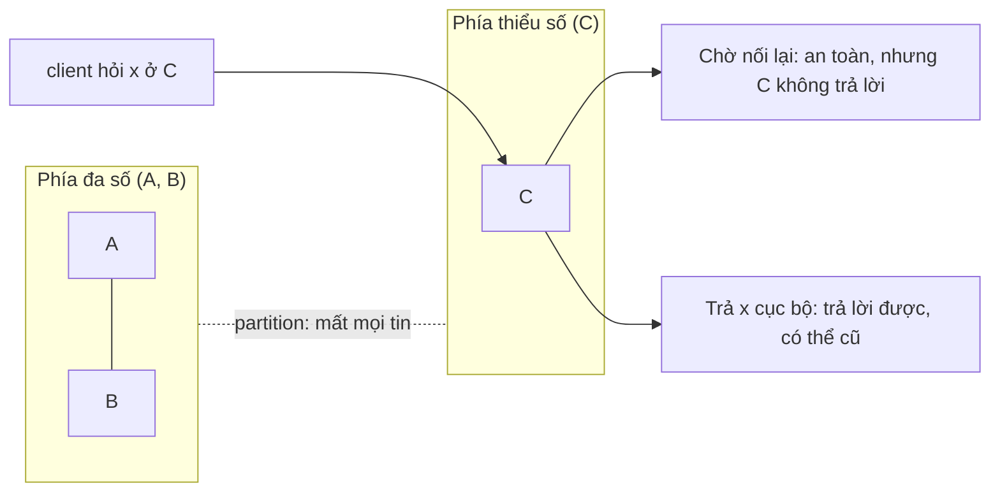
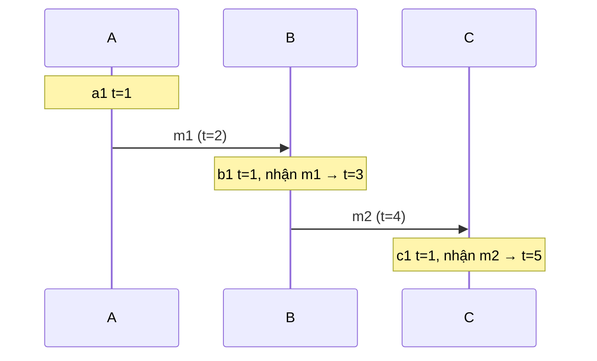
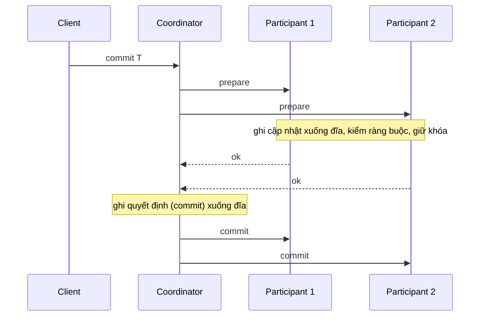
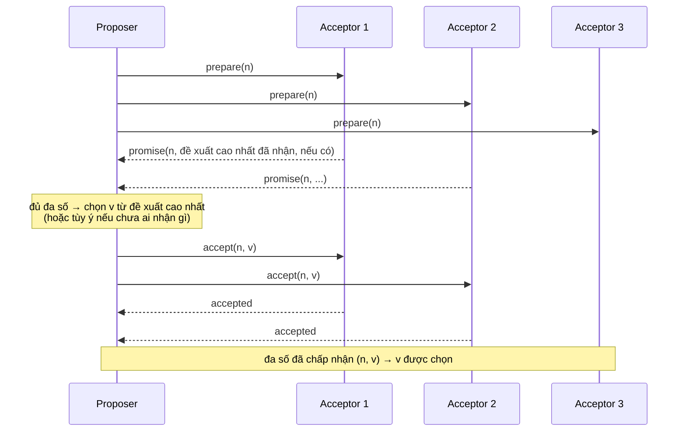
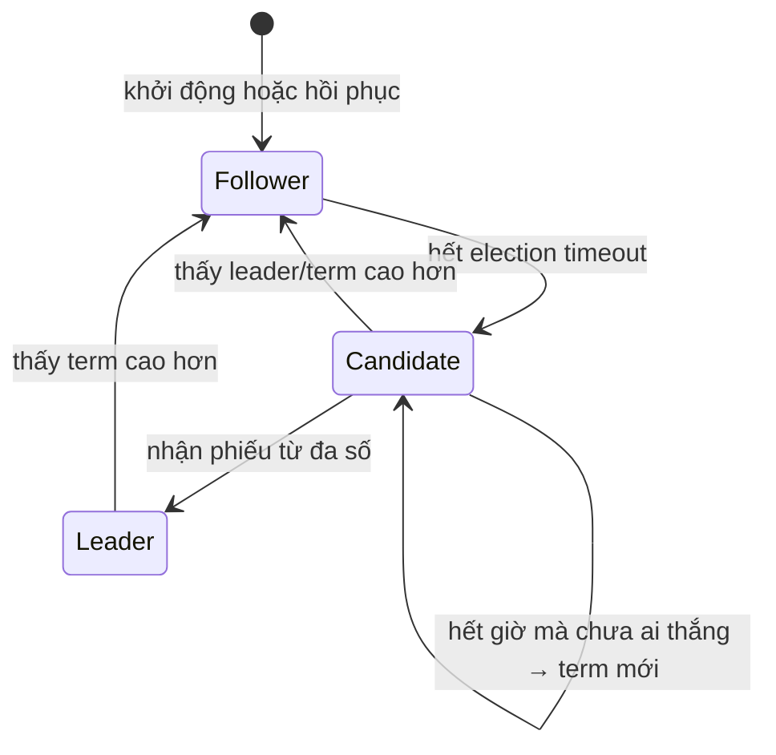

# P12 · Chương 09 — Consistency và consensus

> Khung chủ đề lấy theo *Designing Data-Intensive Applications* (DDIA), nhưng **không trích sách**: nội dung dựa trên bài giảng *Distributed Systems* của chính Martin Kleppmann tại Cambridge (bản 2021–22) và các paper gốc (Herlihy–Wing, Lamport 1978, Gilbert–Lynch, FLP, *Paxos Made Simple*, Raft, Chubby, ZooKeeper). Docs hệ thống ghim phiên bản: etcd v3.5, ZooKeeper 3.9.2, PostgreSQL 16; crate Rust: `openraft` 0.9.21, `raft` 0.7.0, `etcd-client` 0.14.1, `uhlc` 0.8.0; std Rust 1.95.0. Không có thí nghiệm nào được chạy cho chương này; ví dụ code chỉ minh họa.

## Bạn sẽ hiểu được gì

- **Q1.** Linearizability là gì, khác serializability ở đâu, và nó liên quan gì tới memory model của một máy nhiều core? → mục 1
- **Q2.** Định lý CAP thực sự nói gì, và vì sao câu "chọn 2 trong 3" gây hiểu lầm? → mục 2
- **Q3.** "Cái nào xảy ra trước" trong hệ phân tán nghĩa là gì; Lamport clock và vector clock giải quyết đến đâu? → mục 3
- **Q4.** Total order broadcast là gì, vì sao nó đủ để dựng replication, và nó tương đương bài toán nào? → mục 4
- **Q5.** Two-phase commit hoạt động ra sao, và chuyện gì xảy ra khi coordinator chết giữa chừng? → mục 5
- **Q6.** Consensus là bài toán gì, Paxos giải bằng hai pha nào, và định lý FLP cấm điều gì? → mục 6
- **Q7.** Raft bầu leader, sao chép log và giữ an toàn như thế nào? → mục 7
- **Q8.** etcd và ZooKeeper cho ứng dụng những bảo đảm gì; vì sao khóa phân tán cần fencing token? → mục 8

## Kiến thức cần trước

- [Chương 05 — Replication](05-replication.md): leader/follower, quorum đọc/ghi. Chương này dùng lại ý "quorum giao nhau" mà không dựng lại từ đầu.
- [Chương 07 — Transaction](07-transaction.md): isolation, serializability. Mục 1 chỉ đặt linearizability cạnh serializability.
- [Chương 08 — Sự cố hệ phân tán](08-su-co-he-phan-tan.md): đồng hồ không đáng tin, tiến trình bị tạm dừng, lỗi từng phần. Chương này giả định bạn chấp nhận các tiền đề đó và xây thuật toán trên chúng.
- [P4 · Chương 06 — Memory model](../04-concurrency/06-memory-model.md): `Ordering`, happens-before trong một máy; mục 1 và mục 3 đối chiếu với nó.
- [P5 · Chương 06 — Durability trong thực tế](../05-storage/06-durability-trong-thuc-te.md): `fsync`; mọi thuật toán trong chương này giả định "ghi xuống đĩa bền rồi mới trả lời" (mục 6, 7, Rust).

Lưu ý ngay từ đầu: chữ "consistency" mang nhiều nghĩa. Trong ACID nó là tính chất của *trạng thái* (thỏa các ràng buộc của ứng dụng); trong replication nó là quan hệ giữa các *bản sao*[^cam-consistency-word]. Chương này nói về nghĩa thứ hai, và Kleppmann gọi đó là các *consistency model*[^cam-consistency-model].

## 1. Linearizability, serializability và máy nhiều core (Q1)

> **Trả lời ngắn.** Linearizability cho ảo giác rằng mỗi thao tác có hiệu lực tức thời tại một điểm nào đó giữa lúc được gọi và lúc trả kết quả[^hw-def], đồng thời thứ tự "tức thời" ấy phải tôn trọng thứ tự thời gian thực của các thao tác[^hw-l2]. Hệ quả dễ hiểu nhất: một lần đọc bắt đầu *sau khi* một lần ghi đã xong thì phải thấy giá trị đó hoặc giá trị mới hơn[^gl-read-after-write]. Serializability là chuyện khác: nó nói về transaction và chỉ đòi kết quả giống một thứ tự tuần tự nào đó, không nói thứ tự đó là gì[^cam-linser].

**Giải thích.**

Hình dung (nhận xét của người soạn): bạn chuyển tiền xong, app báo "thành công". Bạn đưa điện thoại cho vợ mở app ngân hàng *sau đó*; nếu vợ vẫn thấy số dư cũ thì với bạn hệ thống "nói dối". Linearizability cấm đúng loại hành vi này: không cần hai người trao đổi tin nhắn nào, chỉ cần việc A xong trước việc B bắt đầu theo đồng hồ của người quan sát.

*Bước 1 — mỗi thao tác là một khoảng thời gian.* Từ góc nhìn client, một thao tác bắt đầu khi ứng dụng yêu cầu và kết thúc khi kết quả được trả về; ở giữa có thể có nhiều bước mạng[^cam-start-finish]. Định nghĩa không nhìn vào cách cài đặt (replica, giao thức): chỉ quan tâm *lúc nào* thao tác bắt đầu/kết thúc và *kết quả* là gì[^cam-impl-indep].

*Bước 2 — hai trường hợp.* Nếu `get` bắt đầu sau khi `set` đã kết thúc thì `get` phải trả giá trị `set` ghi. Nếu hai thao tác chồng lấn nhau về thời gian thì không biết cái nào có hiệu lực trước, và `get` trả giá trị cũ hay mới đều chấp nhận được[^cam-overlap].

*Bước 3 — "kết thúc trước khi bắt đầu" không phải happens-before.* Bài giảng nhấn mạnh hai khái niệm này khác nhau: happens-before định nghĩa bằng việc gửi/nhận tin nhắn (mục 3), còn linearizability định nghĩa bằng thời gian thực, nên có thể hai thao tác không chồng lấn nhưng vẫn "đồng thời" theo happens-before vì chưa ai nói chuyện với ai[^cam-not-hb]. Hệ quả (suy luận của người soạn từ khác biệt đó): định nghĩa không đòi hai thao tác phải liên lạc với nhau, nên linearizability áp dụng cả khi người dùng chuyển tin ngoài hệ thống (gọi điện, đưa điện thoại như ở ví dụ Hình dung).

*Bước 4 — quorum đọc/ghi giao nhau chưa đủ.* Bài giảng có phản ví dụ: client 1 ghi `x = v1` nhưng bản cập nhật chỉ kịp tới replica A; client 2 đọc quorum {A, B}, thấy v1 và trả v1; *sau khi* đọc của client 2 xong, client 3 đọc quorum {B, C} và chỉ thấy v0. Client 3 thấy giá trị cũ hơn client 2 dù thứ tự thời gian thực đòi ngược lại, điều không được phép trong hệ thống linearizable[^cam-quorum-nonlin]. [Chương 05](05-replication.md) (phần "Quorum không phải linearizable") đã dựng ví dụ này đầy đủ; ở đây chỉ giữ kết luận.

*Bước 5 — sửa được: đọc phải "ghi ngược".* Thuật toán ABD (Attiya–Bar-Noy–Dolev) buộc `get` ghi giá trị mới nhất trở lại cho các replica chưa có (như read repair) rồi mới kết thúc, nên khi một `get` hay `set` kết thúc, giá trị đã nằm trên một quorum và mọi quorum đọc sau đó đều thấy nó hoặc giá trị mới hơn[^cam-abd]. Chi tiết ABD (kể cả trường hợp nhiều writer) nằm ở [chương 05](05-replication.md).

*Bước 6 — compare-and-swap thì ABD không làm được.* Các replica có thể thấy các thao tác theo thứ tự khác nhau nên kết luận khác nhau về việc một CAS thành công hay không[^cam-abd-cas]. CAS linearizable thì cài được bằng *total order broadcast* (mục 4): broadcast mọi thao tác và chỉ thực thi khi nó được "giao" (deliver)[^cam-cas-tob].

*Linearizability khác serializability.* Bảng so sánh:

| | Linearizability | Serializability |
|---|---|---|
| Đơn vị | một thao tác trên một đối tượng; Herlihy–Wing coi nó là trường hợp đặc biệt của strict serializability khi transaction chỉ có một thao tác trên một đối tượng[^hw-strict] | transaction gồm nhiều thao tác trên nhiều đối tượng; phù hợp khi lập trình viên phải giữ các bất biến phức tạp qua nhiều đối tượng[^hw-domains] |
| Thứ tự | phải khớp thứ tự thời gian thực[^hw-l2] | kết quả như một thứ tự tuần tự nào đó, bài giảng nói rõ nó "không định nghĩa thứ tự đó là gì"[^cam-linser] |
| Tính "local" | có: hệ thống linearizable nếu từng đối tượng linearizable[^hw-local] | không: cả serializability lẫn strict serializability đều không local[^hw-nonlocal] |

Một hệ thống có thể cung cấp cả hai; tổ hợp đó gọi là strict serializability hay one-copy serializability[^cam-strict-ser]. Chi tiết isolation level và serializability nằm ở [chương 07](07-transaction.md); đừng nhầm "serializable" với "linearizable" khi đọc quảng cáo của một database (nhận xét của người soạn).

*Liên hệ với memory model (P4·06).* Bài giảng của Kleppmann nêu rõ linearizability không chỉ là chuyện hệ phân tán: trên máy nhiều core, truy cập bộ nhớ *mặc định không linearizable*[^cam-multicore]. Chủ đề đó thuộc [P4 · Chương 06 — Memory model](../04-concurrency/06-memory-model.md), nơi `Ordering::SeqCst` là mức mạnh nhất trong năm `Ordering`. Doc của std mô tả `SeqCst` là giữ thêm một thứ tự toàn cục của các thao tác `SeqCst` trên mọi thread[^rust-seqcst]. Cái nhìn song song (suy luận của người soạn, không phải câu của nguồn): "một thứ tự toàn cục mà mọi thread đồng ý" ở trong máy giống với "một thứ tự toàn cục mà mọi replica đồng ý" ở ngoài máy (mục 4). Nhưng đừng đồng nhất `SeqCst` với linearizability: thứ tự toàn cục đó chỉ nằm giữa các thao tác `SeqCst`, không bao trùm mọi truy cập bộ nhớ; và chỉ khi *cả hai phía* của một quan hệ happens-before dùng `SeqCst` thì quan hệ ấy mới chắc chắn nhất quán với thứ tự đó[^atomics-seqcst-both]. Nguồn về `SeqCst` không nói thứ tự đó khớp với thời gian thực; thứ được hứa gần với *sequential consistency*, yếu hơn linearizability vì không đòi giữ thứ tự đi trước theo thời gian thực[^hw-seqcons] (việc xếp `SeqCst` vào gần sequential consistency là suy luận của người soạn). Hai chỗ nữa cần tách bạch: (i) chữ "happens-before" ở P4·06 là quan hệ giữa các thao tác bộ nhớ trong một process, còn ở mục 3 là quan hệ giữa các sự kiện gửi/nhận tin; bài giảng Cambridge cho phép coi mỗi thread là một "node" riêng để dùng chung định nghĩa[^cam-thread-node]; (ii) trong máy, thứ tự do coherence của phần cứng và compiler lo; `Mutex`/atomic cho bạn thứ tự mà không cần quorum, nhưng không lan sang máy khác, còn ngoài máy phải trả bằng các vòng gửi tin tới quorum (nhận xét của người soạn).

<details><summary>Đi sâu: tính chất local, non-blocking, và linearizability = consensus</summary>

- Herlihy–Wing: linearizability là tính chất *local* (từng đối tượng linearizable thì cả hệ thống linearizable) và *non-blocking* (tiến trình gọi thao tác total không bao giờ bị buộc phải chờ)[^hw-local-nb]. Ngược lại, serializability *vốn dĩ* có tính blocking: có tình huống một transaction không thể hoàn tất thao tác mà không vi phạm serializability, phải rollback và chạy lại[^hw-block]. Bài báo cũng nêu: linearizability không bao giờ bắt các tiến trình thực hiện thao tác total phải chờ nhau[^hw-nonblock]. (Nhận xét của người soạn: đây là tính chất của *định nghĩa*; một cài đặt cụ thể vẫn có thể chặn, ví dụ ABD phải chờ phản hồi từ một quorum.)
- Sequential consistency (Lamport) yếu hơn vì không đòi bảo toàn thứ tự đi trước theo thời gian thực của lịch sử gốc[^hw-seqcons].
- Bài giảng: CAS linearizable tương đương consensus (kết quả của Herlihy, 1991), nên cũng đòi partial synchrony; ABD cho get/set thì không cần đồng hồ hay timeout[^cam-cas-consensus].
- etcd phát biểu API KV của nó đảm bảo strict serializability: thao tác là nguyên tử và xảy ra theo một thứ tự toàn phần nhất quán với thứ tự thời gian thực, và thứ tự đó được biểu diễn bằng *revision*[^etcd-strict]. Phần Watch thì etcd nói thẳng *không* đảm bảo linearizability, người dùng phải kiểm revision của sự kiện[^etcd-watch-nolin].

</details>

**Quay lại Q1:** linearizability là "như thể chỉ có một bản sao và mỗi thao tác xảy ra tức thời trong khoảng của nó, theo thứ tự thời gian thực"; serializability là chuyện transaction nhiều đối tượng và không ràng buộc thứ tự thời gian thực; trong một máy nhiều core, câu hỏi tương tự là câu chuyện `Ordering` của P4·06 (`SeqCst` gần sequential consistency hơn là linearizability, theo suy luận ở trên).

## 2. CAP: nói gì và không nói gì (Q2)

> **Trả lời ngắn.** CAP (Gilbert–Lynch) là một định lý hẹp: trong mô hình mạng bất đồng bộ, không thể cài một register đọc/ghi vừa *atomic* (linearizable) vừa *available* trong mọi lịch chạy, kể cả các lịch có mất tin[^gl-thm1]. Bài giảng của Kleppmann phát biểu lại: nếu có network partition thì phải chọn giữa linearizable và available; không có partition thì có thể có cả hai[^cam-cap-choice]. Cách nói "chọn 2 trong 3" bị Kleppmann cho là gây hiểu lầm[^cam-cap-misleading]; bài phê bình CAP của ông ghi rằng các cuộc tranh luận sau đó cũng kết luận cách phát biểu này gây hiểu lầm[^cap-crit-misleading].

**Giải thích.**

Hình dung (nhận xét của người soạn): hai chi nhánh ngân hàng mất đường truyền với nhau. Khách ở chi nhánh bị cô lập hỏi số dư: chi nhánh hoặc từ chối trả lời cho tới khi nối lại (an toàn nhưng "không available"), hoặc trả số dư nó đang có, có thể đã cũ (trả lời được nhưng không còn linearizable). Không có lựa chọn thứ ba trong lúc đường truyền đứt.

*Ba chữ trong định lý có nghĩa rất cụ thể.*

- **C — consistency** chính là *atomic*/linearizable: tồn tại một thứ tự toàn phần của mọi thao tác sao cho mỗi thao tác trông như hoàn tất tại một khoảnh khắc[^gl-atomic], và thao tác đọc bắt đầu sau khi ghi hoàn tất phải trả giá trị đó hoặc giá trị của lần ghi sau[^gl-read-after-write].
- **A — availability**: mọi yêu cầu nhận bởi một node *không hỏng* đều phải nhận được phản hồi[^gl-avail]. Định nghĩa này không đặt giới hạn thời gian nào, và bài báo thừa nhận điều đó cho phép tính toán không giới hạn[^gl-avail-weak].
- **P — partition tolerance**: mạng được phép làm mất tùy ý nhiều tin giữa các node[^gl-part]; mọi kiểu mất tin đều có thể mô hình hóa như một partition tạm thời đúng lúc tin bị mất[^gl-part-loss].

*Kết quả.* Trong mô hình bất đồng bộ (không có đồng hồ, node chỉ dựa vào tin nhận được) không thể cài register đảm bảo cả availability lẫn atomic consistency trong mọi lịch chạy công bằng, kể cả lịch có mất tin[^gl-thm1]. Bài báo nói có thể đạt bất kỳ hai trong ba tính chất[^gl-any-two]. Cụ thể, bỏ availability thì ví dụ một node trung tâm giữ giá trị[^gl-central], hoặc các hệ dựa trên khóa phân tán/quorum[^gl-quorum]; bỏ partition thì atomic + available là dễ[^gl-nopart], ví dụ hệ chạy trên intranet/LAN[^gl-lan]; bỏ consistency thì trả luôn giá trị khởi tạo cho mọi yêu cầu cũng là available và chịu partition[^gl-trivial].



(Sơ đồ theo tình huống "node C không liên lạc được với A và B" ở bài giảng: C phải hoặc chờ, có thể vô hạn, hoặc trả giá trị cục bộ có thể cũ[^cam-cap-diagram].)

*Vì sao "chọn 2 trong 3" sai lệch.* Partition không phải thứ bạn "chọn bỏ": nó là sự kiện của mạng (nhận xét của người soạn). Bài phê bình CAP của Kleppmann ghi rằng nhiều tác giả nay ưa cách phát biểu: không có partition thì vừa nhất quán vừa available được; khi partition xảy ra thì chọn một trong hai (CP hoặc AP)[^cap-crit-misleading]. Bài giảng viết tương tự: có thể vừa linearizable vừa available chừng nào không có partition; lựa chọn chỉ bị ép khi có partition[^cam-cap-forced].

*Ví dụ của bài giảng.* Ứng dụng lịch trên điện thoại cho sửa lịch khi offline; nếu giao thức replication của nó là linearizable thì điều đó không thể xảy ra, vì thiết bị offline không liên lạc được với quorum[^cam-calendar]. Ứng dụng chọn nhánh "available, mất linearizability" và đồng bộ sau.

<details><summary>Đi sâu: các hạn chế của CAP khi áp vào hệ thống thật</summary>

- *Availability của Gilbert–Lynch không phải availability của bạn.* Theo phân tích của Kleppmann, nhiều hệ thống "high availability" ngoài đời lại là "unavailable" theo định nghĩa này; ví dụ hệ có leader/primary: client không với tới leader do lỗi mạng thì không ghi được dù vẫn với được một replica khác[^cap-crit-leader]. Ngược lại định nghĩa không đòi giới hạn thời gian nào, nên một dịch vụ trả lời sau một tuần vẫn "available"; chính tác giả nói trực giác thông thường coi đó là không available[^cap-crit-nobound].
- *Nếu partition luôn hữu hạn thì thuật toán linearizable có thể "chờ cho hết partition" mà vẫn thỏa A của định lý.* Vì availability chỉ đòi phản hồi hữu hạn mà không chặn trên, trong mô hình fair-loss (partition có thể dài tùy ý nhưng hữu hạn) thuật toán chỉ việc chờ partition lành[^cap-crit-wait]; còn khi partition kéo dài vô hạn thì buộc phải chọn giữa chờ mãi (mất A) và trả giá trị cũ (mất linearizability), nên Theorem 1 chỉ đúng trong mô hình cho phép partition vô hạn[^cap-crit-inf]. Đây là lý do định lý khó dùng để kết luận về SLA thật (suy luận của người soạn).
- *Kleppmann đề xuất khung khác.* Ông cho rằng nên mô hình availability theo *độ trễ thao tác*[^cap-crit-latency], và dẫn Abadi: có trade-off giữa consistency và latency *ngay cả khi không có partition* (khung PACELC)[^cap-crit-pacelc]. Với người làm backend: câu hỏi hữu ích thường là "thao tác này chậm thêm bao nhiêu khi mạng chậm/đứt" hơn là "CP hay AP".
- *Partially synchronous không cứu được.* Bài báo CAP chứng minh vẫn không thể có atomic + available khi tin có thể bị mất tùy ý, ngay cả trong mô hình đồng bộ một phần[^gl-partsync]; nhưng có thuật toán đồng bộ một phần trả dữ liệu atomic khi mọi tin được giao[^gl-partsync-sol], và bài báo định nghĩa một bảo đảm yếu hơn là delayed-t consistency[^gl-delayed].
- etcd định vị mình ở phía nhất quán: tài liệu "why" của nó viết rằng etcd dành cho các hệ thống không bao giờ chấp nhận split-brain và sẵn sàng hy sinh availability để đạt điều đó[^etcd-why-cp] (xếp etcd vào phía CP là cách diễn giải của người soạn).

</details>

**Quay lại Q2:** CAP chỉ nói rằng khi mạng phân mảnh thì linearizable và "luôn trả lời" không đi cùng nhau; nó không phát biểu gì về độ trễ, về các mô hình yếu hơn linearizable, hay về hệ thống khi mạng khỏe.

## 3. Thứ tự và nhân quả: happens-before, Lamport clock, vector clock (Q3)

> **Trả lời ngắn.** Trong hệ phân tán thường không thể nói sự kiện nào xảy ra trước, nên quan hệ "xảy ra trước" chỉ là thứ tự *một phần*[^lamport-partial]. Lamport clock gán cho mỗi sự kiện một số sao cho nếu a xảy ra trước b thì số của a nhỏ hơn số của b, nhưng chiều ngược lại không đúng[^cam-lamport-prop]. Vector clock giữ thêm một ô cho mỗi node nên phân biệt được "xảy ra trước" với "đồng thời"[^cam-vc-hb].

**Giải thích.**

Hình dung (nhận xét của người soạn): ba người nhắn tin nhóm. A hỏi một câu, B trả lời, nhưng người C nhận tin trả lời của B *trước* tin hỏi của A. Từ góc nhìn C trông như B trả lời trước khi A hỏi. Bài giảng dùng đúng ví dụ này: mạng cho phép đảo thứ tự, và C thấy câu trả lời trước câu hỏi mà nó đáp lại[^cam-chat].

*Vì sao không dùng đồng hồ vật lý.* Đồng hồ monotonic không so sánh được giữa các node[^cam-mono-not-cross]. Đồng hồ time-of-day thì NTP luôn để lại sai số dư về độ lệch giữa hai đồng hồ, nên timestamp của tin B có thể nhỏ hơn timestamp của tin A mà B đang trả lời[^cam-ntp-resid]. Chi tiết về đồng hồ nằm ở [chương 08](08-su-co-he-phan-tan.md).

*Định nghĩa happens-before.* Mỗi node tuần tự (một node = một luồng); sự kiện gửi tin xảy ra trước sự kiện nhận chính tin đó; rồi lấy bao đóng bắc cầu. Kết quả là thứ tự một phần: với một số cặp a, b không cái nào xảy ra trước cái nào và ta gọi chúng *đồng thời*[^cam-hb]. "Đồng thời" ở đây không có nghĩa "cùng lúc theo đồng hồ" mà nghĩa là không có chuỗi tin nào nối từ sự kiện này sang sự kiện kia[^cam-concurrent]. Đây là điều Lamport nêu ngay đầu bài báo 1978: nên định nghĩa quan hệ này mà không dựa vào đồng hồ vật lý[^lamport-no-physical]. Quan hệ mã hóa *nhân quả tiềm tàng*: nếu a → b thì a có thể đã gây ra b; nếu a và b đồng thời thì a không thể gây ra b[^cam-causality].

*Lamport clock.* Mỗi node giữ một bộ đếm `t`. Mỗi sự kiện cục bộ: `t := t + 1`. Gửi tin: tăng `t` rồi gắn `t` vào tin. Nhận tin mang `t'`: `t := max(t, t') + 1`[^cam-lamport-alg]. Điều kiện đúng đắn Lamport đặt ra (Clock Condition): nếu a xảy ra trước b thì đồng hồ của a nhỏ hơn đồng hồ của b[^lamport-clockcond]; ông cũng nói không thể đòi chiều ngược lại vì như thế hai sự kiện đồng thời sẽ phải xảy ra cùng lúc[^lamport-converse]. Hệ quả: biết `L(a) < L(b)` ta chỉ kết luận được b không xảy ra trước a; không phân biệt được "a → b" với "a đồng thời b"[^cam-lamport-nodist].

*Biến thứ tự một phần thành toàn phần.* Hai sự kiện khác node có thể trùng timestamp; để có timestamp duy nhất ta ghép thêm định danh node[^cam-lamport-unique], tức so sánh theo cặp `(t, node_id)`. Lamport: dùng đồng hồ thỏa Clock Condition ta có thể đặt một thứ tự toàn phần lên mọi sự kiện, phá hòa bằng thứ tự tùy ý giữa các process[^lamport-total]. Thứ tự toàn phần này nhất quán với nhân quả, nhưng với hai sự kiện đồng thời nó chọn tùy ý; chỉ thứ tự một phần mới là duy nhất do chính hệ thống sự kiện quyết định[^lamport-unique-partial].

*Vector clock.* Thay một số bằng một vector, một ô cho mỗi node. Sự kiện tại node i tăng ô i; tin gắn cả vector; bên nhận lấy tối đa theo từng phần tử rồi tăng ô của mình[^cam-vc-alg]. So sánh: `T ≤ T'` khi mọi phần tử đều ≤; hai vector "đồng thời" khi không cái nào ≤ cái kia. Thứ tự này ứng đúng với happens-before, tức vector clock cho cách *tính* happens-before trong thực tế[^cam-vc-hb]. Trong thực tế vector thường là một map từ ID node sang số nguyên chứ không phải mảng[^cam-vc-map].

Ví dụ tay (người soạn tính từ các luật trên, không lấy từ nguồn): ba node A, B, C. A có sự kiện cục bộ a1, rồi gửi m1 cho B. B có sự kiện cục bộ b1, rồi nhận m1, rồi gửi m2 cho C. C có sự kiện cục bộ c1, rồi nhận m2.

| Sự kiện | Lamport `t` | Vector `⟨A,B,C⟩` |
|---|---|---|
| A: a1 (cục bộ) | 1 | ⟨1,0,0⟩ |
| A: gửi m1 | 2 | ⟨2,0,0⟩ |
| B: b1 (cục bộ) | 1 | ⟨0,1,0⟩ |
| B: nhận m1 | max(1,2)+1 = 3 | max(⟨0,1,0⟩,⟨2,0,0⟩)=⟨2,1,0⟩ rồi tăng ô B: ⟨2,2,0⟩ |
| B: gửi m2 | 4 | ⟨2,3,0⟩ |
| C: c1 (cục bộ) | 1 | ⟨0,0,1⟩ |
| C: nhận m2 | max(1,4)+1 = 5 | max(⟨0,0,1⟩,⟨2,3,0⟩)=⟨2,3,1⟩ rồi tăng ô C: ⟨2,3,2⟩ |

Đọc bảng: b1 có `t = 1` nhỏ hơn "A gửi m1" có `t = 2` nhưng chúng đồng thời; Lamport clock không nói được điều đó. Vector thì ⟨0,1,0⟩ và ⟨2,0,0⟩ không so sánh được, nên ta biết chúng đồng thời. Còn ⟨2,0,0⟩ < ⟨2,3,0⟩ cho ta biết "A gửi m1" xảy ra trước "B gửi m2" (khớp với chuỗi tin m1 rồi m2).



<details><summary>Đi sâu: thuật toán loại trừ tương hỗ của Lamport, anomaly, và giới hạn</summary>

- Lamport dùng thứ tự toàn phần để giải bài toán một tài nguyên dùng chung: mỗi process có hàng đợi yêu cầu riêng mà không process nào khác thấy[^lamport-mutex]; yêu cầu và giải phóng được gửi tới mọi process kèm timestamp; process được cấp tài nguyên khi yêu cầu của nó đứng đầu hàng đợi theo thứ tự toàn phần *và* đã nhận từ mọi process khác một tin có timestamp muộn hơn yêu cầu đó[^lamport-grant]. Ông lưu ý một bộ lập lịch trung tâm cấp theo thứ tự nhận tin không thỏa điều kiện "cấp theo thứ tự yêu cầu", vì yêu cầu của P2 (gửi sau khi nhận tin từ P1) có thể tới bộ lập lịch trước yêu cầu của P1[^lamport-central].
- Tổng quát hóa: mỗi process mô phỏng cùng một state machine bằng cách thực thi lệnh theo thứ tự timestamp[^lamport-sm]. Điểm yếu: thuật toán đòi *mọi* process tham gia, nên hỏng một process là cả hệ thống dừng[^lamport-halt]; và Lamport nhận xét khái niệm "hỏng" chỉ có nghĩa khi có thời gian vật lý, vì không có nó thì không phân biệt được process hỏng với process đang tạm dừng[^lamport-fail]. (Nhận xét của người soạn: hai ý này là hạt giống của mục 4 (state machine replication) và mục 6 (FLP).)
- *Anomaly.* Người dùng gửi yêu cầu A ở máy 1, rồi gọi điện nhờ bạn gửi yêu cầu B ở máy 2: B vẫn có thể nhận timestamp thấp hơn A, vì hệ thống không biết A đi trước B (thông tin đó nằm ngoài các tin của hệ thống)[^lamport-anomaly]. Lamport nêu hai cách tránh: đưa thông tin thứ tự vào hệ thống (người dùng mang timestamp của A sang B)[^lamport-anomaly-way1] hoặc dùng đồng hồ vật lý đồng bộ[^lamport-anomaly-fix]. (Suy luận của người soạn: so với mục 1, linearizability chính là bảo đảm "nhìn theo thời gian thực" mà Lamport clock thuần túy không cho.)
- *Hybrid logical clock.* Bài giảng nhắc tới đồng hồ lai kết hợp tính chất của đồng hồ logic và vật lý[^cam-hybrid]; crate `uhlc` cài một HLC kèm định danh duy nhất[^rust-uhlc].
- Chi phí vector clock (suy luận của người soạn): kích thước vector tỉ lệ số node tham gia, nên với số client rất lớn thường phải dùng các biến thể rút gọn; chương 05 (replication không leader) và 12 xử lý ngữ cảnh đó.

</details>

**Quay lại Q3:** happens-before là thứ tự một phần dựa trên truyền tin; Lamport clock cho một thứ tự toàn phần nhất quán với nhân quả nhưng không phát hiện được đồng thời, vector clock phát hiện được với giá một ô mỗi node.

## 4. Total order broadcast và state machine replication (Q4)

> **Trả lời ngắn.** Total order broadcast (TOB) là kiểu broadcast mà mọi node giao các tin theo *cùng một thứ tự*[^cam-tob-def]. Nếu mọi replica áp dụng các cập nhật theo thứ tự đó bằng logic tất định thì chúng luôn ở cùng trạng thái: đó là state machine replication[^cam-smr]. Về mặt hình thức, TOB và consensus tương đương nhau[^cam-equiv].

**Giải thích.**

Hình dung (nhận xét của người soạn): một cuốn sổ cái dùng chung. Mỗi chi nhánh có bản sao, và mọi người thống nhất ghi các dòng theo đúng một thứ tự; ai đọc từ đầu tới cuối cũng ra cùng số dư. Điều quan trọng không phải *thứ tự nào* mà là *cùng thứ tự*.

*Ba kiểu broadcast.* Bài giảng phân biệt (đều "reliable": mọi tin cuối cùng tới mọi node không hỏng): FIFO broadcast (tin cùng một người gửi được giao theo thứ tự gửi); causal broadcast (giao theo thứ tự nhân quả); và total order broadcast (nếu một node giao m1 trước m2 thì mọi node đều giao m1 trước m2)[^cam-bc-forms]. FIFO-total order broadcast kết hợp FIFO và total order. Thứ tự mạnh dần: FIFO-total mạnh hơn causal, mạnh hơn FIFO; total order mạnh hơn reliable thường[^cam-bc-hier].

*Cái giá của "tổng".* Với FIFO/causal broadcast, node gửi có thể giao tin cho chính mình ngay lập tức mà không chờ ai. Với TOB thì không: nó phải chờ tới khi thứ tự được xác định, nên việc giao cho chính mình phải chờ tin của node khác[^cam-tob-self]. Đây là nguồn gốc độ trễ của mọi hệ thống dựa trên TOB (nhận xét của người soạn).

*Hai cách làm TOB đơn giản, đều không chịu lỗi.* Dùng một leader (sequencer): mọi tin gửi cho leader, leader phát qua FIFO broadcast; hoặc dùng Lamport timestamp: giao theo thứ tự timestamp và chờ tin từ mọi node. Nhưng cả hai đều dừng khi một node hỏng[^cam-tob-naive]; đổi leader an toàn là phần khó, và đó chính là việc consensus làm (mục 6, 7).

*State machine replication (SMR).* Broadcast mọi cập nhật qua FIFO-TOB; replica nhận được thì áp vào trạng thái của nó. Điều kiện duy nhất: logic áp cập nhật phải tất định, hai replica cùng trạng thái, cùng đầu vào thì phải ra cùng trạng thái kế tiếp[^cam-smr-det]. Thậm chí lỗi cũng phải tất định: nếu cập nhật thành công ở replica này và thất bại ở replica kia thì chúng lệch nhau[^cam-smr-err]. Đây chính là phương pháp Lamport mô tả năm 1978: mỗi process mô phỏng cùng một state machine với các lệnh xếp theo thứ tự chung[^lamport-sm]. Paxos Made Simple cũng dựng "máy trạng thái" y như vậy: các server là bản sao của cùng một máy tất định, và để chúng chạy cùng chuỗi lệnh người ta dùng một chuỗi các lần chạy consensus[^paxos-sm-seq]. Với database: primary-backup chính là TOB của các commit record; leader commit transaction theo một thứ tự toàn phần rồi follower áp theo thứ tự commit[^cam-passive]. Chi tiết các kiểu replication ở [chương 05](05-replication.md).

*TOB ≡ consensus.* Từ TOB làm consensus: node muốn đề xuất giá trị thì broadcast nó, tin đầu tiên được giao là giá trị quyết định[^cam-equiv-dirs]. Từ consensus làm TOB: dùng một lần chạy consensus riêng cho tin thứ nhất, thứ hai, thứ ba...[^cam-consensus-to-tob]. Bài giảng dẫn kết quả hình thức này từ Chandra–Toueg (1996)[^cam-equiv].

<details><summary>Đi sâu: broadcast yếu hơn thì cần gì; CAS; giới hạn của SMR</summary>

- Dùng causal broadcast để replicate thì các cập nhật đồng thời có thể được giao khác thứ tự, nên muốn các replica hội tụ phải làm cho các cập nhật giao hoán[^cam-commute]. Bảng của bài giảng: TOB cần cập nhật tất định; causal cần tất định và các cập nhật đồng thời giao hoán; reliable cần mọi cập nhật giao hoán[^cam-bc-table-rows]; best-effort còn cần idempotent và chịu mất tin[^cam-bc-table]. Đây là đường dẫn tới CRDT/eventual consistency, ngoài phạm vi chương.
- CAS linearizable bằng TOB: broadcast `(CAS, x, old, new)` rồi thực thi khi giao; mọi replica cùng thấy cùng thứ tự nên cùng kết luận thành công/thất bại[^cam-cas-tob]. Theo pseudocode của bài giảng, `get` cũng đi qua broadcast rồi chờ được giao mới trả giá trị[^cam-get-tob].
- Giới hạn của SMR: replica không cập nhật trạng thái ngay được mà phải đi qua broadcast, phối hợp với node khác rồi chờ giao lại cho chính mình[^cam-smr-limit]; (nhận xét của người soạn) chịu lỗi tới đâu là phụ thuộc TOB bên dưới. Dù vậy cách này được dùng rộng rãi[^cam-smr-wide].
- Sổ cái blockchain trong bài giảng chỉ là chuỗi tin do một giao thức TOB giao; mỗi replica thực thi tất định các giao dịch trong đó[^cam-blockchain]. (Chỉ để thấy cùng một ý tưởng; chương này không bàn Byzantine.)

</details>

**Quay lại Q4:** TOB cho mọi replica cùng một chuỗi lệnh; cộng với logic tất định, ta được replication nhất quán; và việc tìm một chuỗi lệnh chung chịu lỗi chính là bài toán consensus.

## 5. Two-phase commit và coordinator chết (Q5)

> **Trả lời ngắn.** Two-phase commit (2PC) đảm bảo một transaction chạm nhiều node hoặc commit ở tất cả hoặc abort ở tất cả[^cam-2pc-atomic]. Coordinator hỏi từng participant "chuẩn bị được chưa"; chỉ khi *tất cả* trả lời đồng ý mới quyết định commit[^cam-2pc-decide]. Nếu coordinator chết sau khi participant đã trả lời đồng ý, các participant đó kẹt ở trạng thái *in-doubt* và không tự quyết được cho tới khi coordinator hồi phục[^cam-2pc-indoubt].

**Giải thích.**

Hình dung (nhận xét của người soạn): ba người cùng góp tiền mua chung một món quà, nhờ một người giữ quỹ hỏi "ai cũng đồng ý chứ?". Khi mỗi người đã hứa "đồng ý", họ không được rút lại. Nếu người giữ quỹ biến mất ngay sau khi nhận đủ lời hứa mà chưa kịp nói "mua" hay "hủy", cả ba chỉ biết ngồi chờ: họ không biết liệu người kia có đã được nghe quyết định hay chưa.

*Bài toán là atomic commit.* Khi transaction cập nhật dữ liệu trên nhiều node, cần mọi node commit và làm cập nhật bền, hoặc mọi node abort và hủy cập nhật[^cam-2pc-atomic]. Bài giảng nhấn mạnh: nghe giống consensus nhưng *không phải*; cùng là đạt thỏa thuận nhưng chi tiết khác biệt đáng kể[^cam-2pc-notconsensus]. Khác biệt: consensus quyết định một trong các giá trị được đề xuất[^cam-cons-pick] và chịu được node hỏng miễn có quorum[^cam-cons-quorum]; còn trong atomic commit mọi node bỏ phiếu commit hay abort[^cam-ac-vote], và phải abort nếu một participant hỏng[^cam-ac-vs-cons] (so sánh theo bảng ở bài giảng, slide 123).

*Hai pha.* Client chạy transaction thường trên từng participant, rồi gửi yêu cầu commit cho *coordinator* (node điều phối)[^cam-2pc-flow].

1. **Pha 1 — prepare.** Coordinator gửi `prepare`. Participant chưa commit, nhưng phải bảo đảm chắc chắn commit được ở pha 2 nếu được yêu cầu. Cụ thể nó phải ghi mọi cập nhật xuống đĩa và kiểm tra ràng buộc *trước khi* trả lời "ok", đồng thời *tiếp tục giữ khóa*[^cam-2pc-prepare].
2. **Pha 2 — quyết định.** Nếu mọi participant trả "ok", coordinator quyết định commit; nếu có participant muốn abort hoặc không trả lời trong thời hạn thì quyết định abort[^cam-2pc-decide]. Quyết định gửi tới mọi participant; nếu là commit thì mỗi participant được đảm bảo commit được vì pha 1 đã chuẩn bị sẵn.



(Sơ đồ do người soạn vẽ lại từ mô tả hai pha ở bài giảng[^cam-2pc-flow][^cam-2pc-prepare][^cam-2pc-decide]; bước coordinator ghi quyết định xuống đĩa theo [^cam-2pc-recover].)

*Coordinator chết.* Coordinator có thể ghi quyết định xuống đĩa; khi hồi phục thì đọc lại và gửi cho participant, hoặc abort nếu chưa có quyết định trước khi chết[^cam-2pc-recover]. Vấn đề là các transaction *đã prepare nhưng chưa nhận quyết định* lúc coordinator chết, gọi là in-doubt; chúng phải chờ coordinator hồi phục vì không thể tự quyết commit hay abort: quyết định đó có thể mâu thuẫn với coordinator và các node khác, vi phạm tính nguyên tử[^cam-2pc-indoubt]. Bài giảng kết luận: coordinator là single point of failure[^cam-2pc-spof]. Trong lúc chờ, participant giữ khóa (nhận xét của người soạn, dựa trên việc pha 1 đòi "tiếp tục giữ khóa"[^cam-2pc-prepare]): các transaction khác chạm dữ liệu đó bị chặn.

*FLP và cửa sổ dễ tổn thương.* Bài báo FLP chỉ ra rằng mọi giao thức commit đều có một "cửa sổ dễ tổn thương" (khoảng thời gian trong lúc chạy mà một process chậm hoặc không với tới được có thể khiến cả thuật toán chờ vô hạn), và kết quả bất khả của họ xác nhận điều folklore vẫn tin[^flp-window]; 2PC với coordinator chết là một ví dụ của cửa sổ đó (nhận xét của người soạn).

*Cách thoát khỏi single point of failure.* Dùng consensus hoặc TOB để *phát tán các phiếu*, tức "Paxos Commit" của Gray–Lamport[^cam-paxos-commit][^cam-paxos-commit-name]. Mỗi participant dùng TOB phát phiếu của mình[^cam-pc-vote]; nếu node A nghi B đã chết thì A có thể bỏ phiếu abort thay B; nhờ TOB mọi node thấy cùng thứ tự phiếu và chỉ đếm phiếu giao đầu tiên của mỗi replica[^cam-pc-first]. Kết quả: mọi node đều ra cùng quyết định commit/abort[^cam-pc-same].

*2PC không phải 2PL, và không phải 3PC.* 2PL (two-phase locking) đảm bảo serializable isolation, còn 2PC đảm bảo atomic commitment[^cam-2pc-2pl]. Three-phase commit tồn tại nhưng giả định mô hình đồng bộ không thực tế nên bài giảng không bàn[^cam-3pc].

<details><summary>Đi sâu: PostgreSQL <code>PREPARE TRANSACTION</code>, mức giả định, và chuyện timeout</summary>

- PostgreSQL 16 cung cấp pha 1 của 2PC dưới dạng `PREPARE TRANSACTION`: sau lệnh này transaction không còn gắn với session, trạng thái được lưu đầy đủ trên đĩa và có xác suất rất cao commit được ngay cả khi database crash trước khi có yêu cầu commit[^pg-prepare]. Sau đó có thể `COMMIT PREPARED` hoặc `ROLLBACK PREPARED` từ session nào cũng được[^pg-prepare-later].
- Tài liệu nói mục đích của nó là để một *transaction manager bên ngoài* thực hiện giao dịch toàn cục nguyên tử qua nhiều database hay tài nguyên có giao dịch; nếu bạn không viết transaction manager thì có lẽ không nên dùng[^pg-prepare-purpose]. Nó cảnh báo để transaction ở trạng thái prepared lâu là thiếu khôn ngoan: cản trở VACUUM thu hồi chỗ[^pg-prepare-caution], và transaction vẫn giữ khóa[^pg-prepare-locks]. Tham số `max_prepared_transactions` mặc định bằng 0, tức tắt tính năng[^pg-max-prepared]. (Nhận xét của người soạn: đây là hiện thân của "participant giữ khóa chờ coordinator" ở trên.)
- Bài giảng xếp atomic commit là bài toán có giả định mạnh nhất vì phải chờ *mọi* node tham gia[^cam-ac-strongest]; consensus, TOB và các thuật toán linearizable chỉ cần chờ một quorum[^cam-ac-all].
- Chuyện timeout (nhận xét của người soạn): nếu bạn là client của coordinator và request commit hết thời hạn, bạn *không biết* kết quả; việc hủy future phía bạn không hủy việc phía xa. Xem [P7 · Chương 09, mục 2](../07-io-async/09-async-trong-production.md) về `timeout` và vì sao nó không hủy việc đã gửi đi. etcd nói tương tự: client có thể không chắc trạng thái của thao tác nếu nó hết thời gian hoặc mạng gián đoạn[^etcd-uncertain].
- Với dữ liệu nằm trên nhiều partition, 2PC là cách phổ biến để có atomic commit xuyên partition; xem [chương 06](06-partitioning.md) và [chương 07](07-transaction.md).

</details>

**Quay lại Q5:** 2PC làm cho mọi node cùng commit hoặc cùng abort bằng prepare rồi quyết định; cái giá là participant đã trả lời "ok" phải giữ khóa và chờ, và nếu coordinator chết thì họ không thể tự quyết, trừ khi phiếu được phát qua một TOB/consensus chịu lỗi.

## 6. Consensus: Paxos và định lý FLP (Q6)

> **Trả lời ngắn.** Consensus là bài toán để nhiều node đồng ý về *một* giá trị trong số các giá trị được đề xuất, quyết định là chung cuộc và không đổi[^cam-consensus-def]. Paxos giải nó bằng hai pha trên một nhóm acceptor: pha *prepare* xin lời hứa và tìm giá trị đã có thể được chọn, pha *accept* đề xuất giá trị đó[^paxos-p1][^paxos-p2]; mọi quyết định cần một đa số, vì hai đa số bất kỳ có ít nhất một acceptor chung[^paxos-majority]. FLP chứng minh rằng không thể có thuật toán consensus tất định *bảo đảm kết thúc* trong hệ bất đồng bộ dù chỉ một node có thể hỏng[^flp-abs]; Paxos giữ an toàn bất kể thời gian và chỉ dựa vào timeout cho tính sống[^cam-safety-liveness].

**Giải thích.**

Hình dung (nhận xét của người soạn): một hội đồng muốn chốt một ngày họp, liên lạc bằng thư tín thất thường: thư có thể trễ, mất, trùng. Ai cũng có thể đề xuất. Cần một quy trình sao cho một khi ngày đã chốt thì không bao giờ có ai chốt ngày khác, kể cả khi vài thành viên tạm mất liên lạc rồi quay lại.

*Bài toán.* Một hay nhiều node đề xuất giá trị; thuật toán bảo đảm giá trị được quyết định là một trong các giá trị đã đề xuất, mọi node (trừ node hỏng) quyết định cùng giá trị, và quyết định là chung cuộc[^cam-consensus-def]. *Paxos Made Simple* phát biểu ba yêu cầu an toàn: chỉ giá trị đã được đề xuất mới có thể được chọn; chỉ một giá trị được chọn; một process không bao giờ "học" rằng một giá trị đã được chọn nếu thực tế chưa[^paxos-safety]. Có ba vai trò: proposer, acceptor, learner[^paxos-roles].

*Mô hình lỗi.* Agent chạy tốc độ tùy ý, có thể hỏng bằng cách dừng và có thể khởi động lại[^paxos-agents]; tin có thể mất thời gian dài tùy ý để tới nơi, có thể bị trùng hoặc mất nhưng không bị sửa[^paxos-model]. Vì mọi agent có thể hỏng sau khi một giá trị được chọn rồi khởi động lại, giải pháp chỉ khả thi nếu agent hỏng-rồi-khởi-động-lại còn nhớ được thông tin nào đó[^paxos-stable]. Vì vậy acceptor ghi phản hồi dự định vào stable storage trước khi gửi đi[^paxos-stable-write], và Raft cũng đòi cập nhật stable storage trước khi trả lời RPC[^raft-persist] (nhận xét của người soạn: cái giá thực tế là `fsync`, xem [P5 · Chương 06](../05-storage/06-durability-trong-thuc-te.md)).

*Vì sao đa số.* Một acceptor duy nhất thì hỏng nó là hết tiến triển[^paxos-single]. Dùng nhiều acceptor và đặt "đủ lớn" là mọi đa số: hai đa số bất kỳ có ít nhất một acceptor chung nên nếu mỗi acceptor chỉ chấp nhận một giá trị thì không thể chọn hai giá trị[^paxos-majority]. Nhưng nếu acceptor chỉ chấp nhận đề xuất đầu tiên nó nhận (P1) thì nhiều đề xuất đồng thời có thể chia phiếu mà không ai đạt đa số, nên acceptor phải được phép chấp nhận nhiều đề xuất, đánh số bằng *proposal number*[^paxos-p1-problem].

*Hai pha.* (Tóm lược theo bài báo.)

1. **Phase 1.** Proposer chọn số n rồi gửi `prepare(n)` tới một đa số acceptor. Acceptor nhận `prepare` có số n lớn hơn mọi `prepare` đã trả lời thì trả lời bằng *lời hứa* không chấp nhận đề xuất nào có số nhỏ hơn n, kèm đề xuất có số cao nhất (nếu có) mà nó đã chấp nhận[^paxos-p1].
2. **Phase 2.** Nếu proposer nhận trả lời từ một đa số, nó gửi `accept(n, v)` trong đó v là giá trị của đề xuất số cao nhất trong các trả lời, hoặc giá trị tùy ý nếu không ai báo đề xuất nào[^paxos-p2]. Acceptor chấp nhận trừ khi nó đã trả lời một `prepare` có số lớn hơn n[^paxos-accept].

Ý nghĩa của pha 1: proposer không thể đoán trước tương lai nên *điều khiển* nó bằng cách "xin lời hứa" rằng sẽ không có đề xuất nhỏ hơn nào được chấp nhận nữa[^paxos-promise]. Bất biến an toàn mà thuật toán giữ (P2c): khi một đề xuất số n với giá trị v được phát ra thì có một đa số S sao cho hoặc không acceptor nào trong S từng chấp nhận đề xuất số nhỏ hơn n, hoặc v là giá trị của đề xuất số cao nhất trong số đó[^paxos-p2c]. Acceptor phải nhớ qua cả lần khởi động lại: đề xuất số cao nhất nó từng chấp nhận và số của `prepare` cao nhất nó từng trả lời[^paxos-persist].



(Sơ đồ do người soạn vẽ lại từ mô tả hai pha ở trên, với ba acceptor trong đó hai acceptor trả lời đủ để thành đa số[^paxos-p1][^paxos-p2].)

*Tính sống (liveness) và livelock.* Dễ dựng kịch bản hai proposer liên tục phát đề xuất với số tăng dần mà không đề xuất nào được chọn: p xong pha 1 với n1, q xong pha 1 với n2 > n1, `accept` của p bị bỏ qua, p lại chạy pha 1 với n3 > n2, v.v.[^paxos-livelock]. Để bảo đảm tiến triển phải chọn một *distinguished proposer* duy nhất được đề xuất[^paxos-distinguished]. Việc chọn proposer ấy chịu ràng buộc của FLP: theo *Paxos Made Simple*, thuật toán bầu đáng tin phải dùng ngẫu nhiên hoặc thời gian thực (timeout), nhưng an toàn vẫn được giữ bất kể bầu chọn thành hay bại[^paxos-flp-elect].

*Từ một giá trị tới một log: Multi-Paxos.* Để chọn *chuỗi* lệnh cho state machine, ta chạy một chuỗi các lần Paxos riêng, giá trị chọn ở lần thứ i là lệnh thứ i[^paxos-sm-seq]. Bình thường có một server là leader đóng vai distinguished proposer cho mọi lần chạy[^paxos-leader]. Leader mới chạy pha 1 cho vô hạn lần chạy bằng một thông điệp ngắn (dùng cùng một số đề xuất), và lấp các lỗ hổng trong chuỗi bằng lệnh "noop" không đổi trạng thái[^paxos-noop][^paxos-inf-phase1]. Theo bài giảng, Paxos nguyên bản chỉ cho consensus một giá trị, còn Multi-Paxos là sự tổng quát hóa cho FIFO-TOB[^cam-paxos-raft]; Raft thiết kế để cho FIFO-TOB ngay từ đầu[^cam-raft-fifo-tob].

*FLP: điều bị cấm.* Bài báo Fischer–Lynch–Paterson chứng minh mọi giao thức cho bài toán này đều có khả năng không kết thúc, dù chỉ có một process hỏng[^flp-abs]. Mô hình của họ: hoàn toàn bất đồng bộ, không giả định gì về tốc độ process hay độ trễ tin[^flp-model]; không có đồng hồ đồng bộ nên giải pháp dựa timeout không dùng được[^flp-noclock]; và không thể phân biệt một process đã chết với một process đang chạy rất chậm[^flp-nodetect]. Dù vậy, ngay cả khi hệ thống tin nhắn tin cậy, việc một process dừng đúng lúc vẫn đủ làm mọi giao thức commit phân tán không đạt được thỏa thuận[^flp-reliable-msgs]. Bài giảng phát biểu gọn: không có thuật toán consensus *tất định* nào bảo đảm kết thúc trong mô hình bất đồng bộ crash-stop[^cam-flp].

*Thực tế đi vòng thế nào.* Chính bài FLP nói kết quả không có nghĩa bài toán không giải được trong thực tế mà chỉ ra nhu cầu mô hình thực tế hơn hoặc yêu cầu bớt nghiêm ngặt (ví dụ chỉ đòi kết thúc với xác suất 1)[^flp-conclusion]. Các hệ như Paxos/Raft dùng đồng hồ chỉ cho timeout (failure detector) để đảm bảo tiến triển[^cam-flp-clocks], còn an toàn không phụ thuộc thời gian: bài giảng nói mọi thuật toán consensus phải giữ an toàn bất kể thời gian, kể cả khi tin bị trễ tùy ý, và chỉ tính sống phụ thuộc đồng hồ[^cam-safety-liveness]. Chubby cũng viết rằng Paxos giữ an toàn không cần giả định thời gian nhưng phải đưa đồng hồ vào để có tính sống, và "vượt" kết quả bất khả của FLP theo cách đó[^chubby-flp].

<details><summary>Đi sâu: learner, vì sao Paxos khó dựng, Byzantine, và sự sống còn của Paxos trong thực tế</summary>

- *Learner.* Cách ngây thơ là mỗi acceptor báo mọi learner mỗi khi nó chấp nhận; tốn tích số acceptor × learner thông điệp[^paxos-learner-cost]. Có thể báo cho một learner đặc biệt rồi learner đó thông báo lại[^paxos-learner]; cách này kém tin cậy hơn vì learner đặc biệt có thể hỏng[^paxos-learner-less]. Vì mất tin, một giá trị có thể được chọn mà không learner nào biết; khi đó muốn biết thì để một proposer đưa ra một đề xuất mới bằng đúng thuật toán trên[^paxos-learn-loss].
- *Paxos làm "nền".* Chubby: mọi giao thức consensus bất đồng bộ hoạt động được mà nhóm tác giả gặp đều có Paxos ở lõi[^chubby-paxos-core].
- *Vì sao có Raft.* Tác giả Raft cho rằng kiến trúc Paxos không hợp để xây hệ thống thực tế[^raft-paxos-poor]; họ nhận định thiết kế quanh một log nối tiếp thì đơn giản và hiệu quả hơn[^raft-log-simpler]. Phần sau là Raft.
- *Byzantine.* Các thuật toán chịu lỗi Byzantine (node nói dối) phức tạp và kém hiệu quả hơn nhiều so với loại không-Byzantine[^cam-byz]; bài giảng chỉ tập trung vào mô hình crash-recovery, hữu ích trong nhiều tình huống thực tế như trung tâm dữ liệu có mạng riêng tin cậy[^cam-crash-recovery-focus], và chương này theo cùng mô hình.

</details>

**Quay lại Q6:** Paxos đạt consensus bằng hai pha trên đa số acceptor; an toàn đến từ lời hứa ở pha 1 và giao nhau của các đa số, còn tính sống cần một leader ổn định, chọn bằng timeout, vì FLP cấm đạt cả hai trong mô hình bất đồng bộ thuần.

## 7. Raft: leader election, log replication và safety (Q7)

> **Trả lời ngắn.** Raft là thuật toán consensus thiết kế để dễ hiểu[^raft-title], cho một log được sao chép trên một cụm máy. Tại mỗi thời điểm bình thường có đúng một leader nhận mọi yêu cầu của client; leader được bầu bằng đa số phiếu trong một *term*, ghi lệnh vào log rồi chép sang follower; một lệnh được coi là *committed* khi leader đã tạo ra entry đó chép được nó lên đa số máy (việc đếm bản sao để commit chỉ áp dụng cho entry của term hiện tại, xem luật an toàn thứ hai bên dưới)[^raft-states][^raft-commit]. An toàn dựa vào hai luật: chỉ ứng viên có log "đủ mới" mới được bầu, và leader chỉ đếm bản sao để commit với các entry thuộc term hiện tại[^raft-restr][^raft-prior].

**Giải thích.**

Hình dung (nhận xét của người soạn): lớp học có một lớp trưởng ghi sổ đầu bài. Nếu lớp trưởng nghỉ, một bạn đứng ra tranh cử và cần quá nửa lớp bỏ phiếu; mỗi bạn chỉ bỏ một phiếu mỗi nhiệm kỳ. Lớp trưởng mới phải có cuốn sổ ít nhất cập nhật bằng đa số, vì cuốn sổ có chữ ký của quá nửa lớp là cuốn sổ "có giá trị".

*Mô hình.* Raft giả định lỗi dừng (non-Byzantine): máy hỏng bằng cách dừng, có thể phục hồi từ stable storage rồi gia nhập lại cụm[^raft-stop]; an toàn dưới mọi điều kiện không-Byzantine gồm trễ, partition, mất/trùng/đảo thứ tự tin[^raft-safety-nonbyz]; hoạt động đầy đủ miễn một đa số máy vận hành và liên lạc được[^raft-props] (cụm 5 máy chịu được 2 máy hỏng[^raft-five]). Dữ liệu trạng thái bền gồm `currentTerm`, `votedFor`, `log[]`, và phải được cập nhật vào stable storage *trước khi trả lời RPC*[^raft-persist].

*Vai trò và term.* Mỗi server ở một trong ba trạng thái: leader, follower, candidate; bình thường có đúng một leader, mọi máy khác là follower[^raft-states]. Thời gian chia thành các *term* đánh số liên tiếp; mỗi term bắt đầu bằng một cuộc bầu cử[^raft-terms]. Hai RPC chính: `RequestVote` (ứng viên dùng khi bầu) và `AppendEntries` (leader dùng để chép log và làm heartbeat)[^raft-rpcs].



(Theo slide 111 của bài giảng và Hình 4 của paper; rút gọn.)

*Bầu leader.* Leader gửi heartbeat định kỳ (`AppendEntries` không mang entry). Follower không nhận được gì trong khoảng *election timeout* thì cho rằng không còn leader hợp lệ và bắt đầu bầu cử[^raft-hb]. Nó tăng term, chuyển sang candidate, bỏ phiếu cho chính mình và gửi `RequestVote` song song cho các máy khác[^raft-election-start]. Mỗi server chỉ bỏ phiếu cho tối đa một ứng viên trong một term, theo thứ tự đến trước được phục vụ trước[^raft-vote]; luật đa số bảo đảm tối đa một ứng viên thắng trong một term (Election Safety)[^raft-majority-rule]. Nếu nhiều ứng viên cùng lúc thì phiếu có thể bị chia và không ai đạt đa số; để tránh, Raft dùng election timeout *ngẫu nhiên* chọn từ một khoảng cố định (paper ví dụ 150–300 ms)[^raft-random][^raft-timeout-range].

*Chép log.* Leader thêm lệnh vào log như một entry mới rồi gửi `AppendEntries` song song để chép; nếu follower chậm hay mất gói, leader thử lại vô hạn[^raft-replicate]. Mỗi entry lưu lệnh cùng số term lúc leader nhận, và một chỉ số vị trí[^raft-entry]. Một entry là *committed* khi leader đã tạo ra nó chép được lên đa số máy[^raft-commit]; việc đó commit luôn mọi entry đứng trước, kể cả của leader cũ[^raft-commit-prior]. Raft đảm bảo entry committed là bền và cuối cùng được mọi state machine còn sống thực thi[^raft-durable]. Leader gửi chỉ số commit cao nhất trong các `AppendEntries` sau để follower biết và áp entry vào state machine theo thứ tự log[^raft-apply].

*Log Matching.* Hai tính chất: (1) hai entry ở hai log có cùng index và term thì chứa cùng lệnh[^raft-logmatch-same]; (2) nếu cùng index và term thì mọi entry trước đó cũng giống hệt[^raft-logmatch]. `AppendEntries` kèm index và term của entry ngay trước các entry mới; follower không thấy entry khớp thì từ chối[^raft-consistency-check].

*Sửa log lệch.* Sau khi đổi leader, log của follower có thể thiếu entry hoặc thừa entry chưa commit. Raft xử lý bằng cách leader ép log follower trùng với log của mình: entry xung đột ở follower bị ghi đè[^raft-force]. Leader giữ `nextIndex` cho mỗi follower; bị từ chối thì giảm `nextIndex` rồi thử lại tới khi khớp[^raft-nextindex]. Leader không bao giờ ghi đè hay xóa entry trong log của chính mình (Leader Append-Only)[^raft-append-only].

*Hai luật an toàn.*

- **Election restriction.** Raft dùng quá trình bỏ phiếu để ngăn ứng viên thắng nếu log của nó thiếu entry đã committed: ứng viên phải liên hệ một đa số, mà mọi entry committed đã nằm trên ít nhất một máy trong đa số đó, nên người bỏ phiếu từ chối nếu log của mình "mới hơn" log ứng viên[^raft-restr]. "Mới hơn" so sánh index và term của entry cuối: term sau thì mới hơn; cùng term thì log dài hơn mới hơn[^raft-uptodate].
- **Chỉ đếm bản sao cho entry của term hiện tại.** Raft *không bao giờ* commit entry của term cũ bằng cách đếm bản sao; chỉ entry của term hiện tại của leader được commit bằng cách đếm, và khi nó đã commit thì mọi entry trước đó commit gián tiếp nhờ Log Matching[^raft-prior]. Lý do là tình huống ở Hình 8: một entry term 2 đã nằm trên đa số nhưng chưa commit; nếu S1 chết, S5 có thể thắng cử và ghi đè entry đó bằng entry của term 3[^raft-fig8].

*Năm tính chất.* Paper tóm Raft bằng năm tính chất luôn đúng: Election Safety (tối đa một leader mỗi term); Leader Append-Only; Log Matching; Leader Completeness (entry đã commit ở một term sẽ có mặt trong log của leader ở mọi term sau); State Machine Safety (nếu một server đã áp entry tại index nào thì không server nào áp entry khác tại index đó)[^raft-props5-a][^raft-props5-b][^raft-props5-c].

*Leader cũ vẫn có thể tồn tại.* Bài giảng nhấn mạnh: chỉ đảm bảo tối đa một leader *mỗi term*, không ngăn nhiều leader ở các term khác nhau (leader cũ bị cô lập có thể không biết mình đã bị thay); vì vậy mỗi quyết định phải được xác nhận lại bởi một quorum, và leader cũ sẽ phát hiện ra qua ít nhất một trong các phản hồi nên không còn quyết được gì thêm[^cam-stale-leader][^cam-leader-quorum]. Hệ quả (suy luận của người soạn; Raft §8 nêu cùng rủi ro dữ liệu cũ khi đọc, xem Đi sâu[^raft-read]): *đọc* từ leader không tự động linearizable.

<details><summary>Đi sâu: đọc linearizable, trùng lặp lệnh, thành viên cụm, tham số thời gian, số đo</summary>

- *Đọc.* Paper: có thể xử lý đọc mà không ghi vào log, nhưng nếu không có biện pháp thêm thì có nguy cơ trả dữ liệu cũ vì leader có thể đã bị thay mà chưa biết[^raft-read]. Hai biện pháp: mỗi leader commit một entry *no-op* ngay đầu term để biết mình có thông tin commit mới nhất[^raft-noop]; và trước khi trả lời đọc, leader trao đổi heartbeat với một đa số để biết mình chưa bị phế truất[^raft-readindex]. Phương án khác là dựa vào heartbeat như một *lease*, nhưng khi đó an toàn phụ thuộc thời gian (giả định độ lệch đồng hồ có chặn)[^raft-lease].
- *Lệnh bị thực thi hai lần.* Nếu leader chết sau khi commit nhưng trước khi trả lời, client thử lại với leader mới và lệnh bị chạy lần thứ hai; cách giải: client gán số thứ tự duy nhất cho mỗi lệnh, state machine nhớ số mới nhất đã xử lý của từng client và trả lại kết quả cũ nếu thấy lệnh trùng[^raft-dup]. Mục tiêu của paper là ngữ nghĩa linearizable (mỗi thao tác như thực thi tức thời, đúng một lần, tại một điểm giữa lúc gọi và lúc trả lời)[^raft-linear-goal]. (Nhận xét của người soạn: đây chính là idempotency key mà bạn dùng với API thanh toán, đặt ở tầng state machine.)
- *Thay đổi thành viên.* Chuyển thẳng từ cấu hình cũ sang cấu hình mới là không an toàn vì các server không thể đổi cùng lúc, cụm có thể tách thành hai đa số độc lập[^raft-member-unsafe]; Raft đi qua một cấu hình chuyển tiếp gọi là *joint consensus*, rồi mới sang cấu hình mới[^raft-joint].
- *Server bị gỡ làm phiền cụm.* Server bị gỡ không nhận heartbeat nên hết giờ rồi bắt đầu bầu cử với term cao hơn, ép leader về follower; cách chặn: server không cập nhật term hay bỏ phiếu nếu nhận `RequestVote` trong vòng election timeout tối thiểu kể từ lần nghe từ leader hiện tại[^raft-disrupt].
- *Thời gian.* An toàn không được phụ thuộc thời gian, nhưng tính sẵn sàng thì tất yếu có[^raft-timing-safety]. Điều kiện: broadcast time nhỏ hơn election timeout cỡ một bậc độ lớn để leader gửi heartbeat đáng tin[^raft-broadcast-time]; khi leader chết cụm không khả dụng chừng một election timeout[^raft-timing-ineq]. Số đo *của tác giả paper* (không phải bảo đảm): election timeout 12–24 ms cho trung bình 35 ms để bầu leader, nhưng giảm thấp hơn vi phạm yêu cầu thời gian và gây đổi leader không cần thiết; họ khuyến nghị 150–300 ms[^raft-eval]. etcd nhấn mạnh độ trễ đĩa là một phần của "sức sống" của leader[^etcd-disk]; trong ví dụ của FAQ, nếu leader mất một phút để `fsync` một bản cập nhật log trong khi election timeout là 1 giây, nó vẫn gửi được heartbeat nhưng thực chất không commit được đề xuất mới nào vì đang chờ đĩa[^etcd-disk-example]. Xem lại [P5 · Chương 06](../05-storage/06-durability-trong-thuc-te.md) về giá của `fsync`.
- Đối chiếu bài giảng: bốn biến phải nằm trên stable storage là `currentTerm`, `votedFor`, `log`, `commitLength`[^cam-raft-stable]; election timeout được ngẫu nhiên hóa để giảm khả năng nhiều node thành candidate cùng lúc[^cam-raft-random].

</details>

**Quay lại Q7:** Raft = bầu một leader bằng đa số trong từng term + chép log qua `AppendEntries` + hai luật an toàn (ứng viên phải có log đủ mới; chỉ đếm bản sao cho entry của term hiện tại); mọi thứ khác (đọc, thành viên, thời gian) là hệ quả hoặc phần mở rộng.

## 8. Dịch vụ phối hợp: etcd và ZooKeeper (Q8)

> **Trả lời ngắn.** etcd và ZooKeeper là các dịch vụ phối hợp lưu dữ liệu dạng key-value (etcd) hoặc cây znode (ZooKeeper), được sao chép bằng consensus (Raft cho etcd, Zab cho ZooKeeper), dùng làm "nền" cho các hệ thống phân tán: cấu hình, service discovery, bầu leader, khóa phân tán[^etcd-why-use][^zk-what]. etcd mặc định đảm bảo linearizability cho thao tác KV bằng cách đẩy qua Raft, nhưng cho phép đọc `serializable` rẻ hơn mà có thể cũ[^etcd-lin-default][^etcd-serializable]. ZooKeeper đảm bảo ghi linearizable nhưng đọc được phục vụ cục bộ nên có thể cũ, và cần `sync()` nếu muốn thấy ghi mới nhất[^zab-writes-lin][^zk-sync]. Khóa dựa trên lease/TTL *không tự* bảo đảm loại trừ tương hỗ: cần fencing token ở phía tài nguyên[^etcd-lease-nomx][^kl-fence].

**Giải thích.**

Hình dung (nhận xét của người soạn): bảng thông báo của tòa nhà, có người giữ chìa khóa duy nhất. Mọi tầng phải tin vào bảng này để biết "ai đang là trưởng tầng" hay "cấu hình hiện tại là gì". Bảng nhỏ, ít ghi, nhưng *phải đúng*; nên người ta dùng consensus cho bảng và để dữ liệu lớn nằm ở chỗ khác. Tài liệu etcd nói nhiều tổ chức dùng nó cho các hệ production như bộ lập lịch container[^etcd-k8s].

*Mục đích.* etcd tự mô tả là một kho key-value nhất quán, dùng cho quản lý cấu hình, service discovery và điều phối công việc[^etcd-why-use-kv]; các mẫu phổ biến gồm bầu leader, khóa phân tán, theo dõi tình trạng máy[^etcd-why-use]. ZooKeeper là dịch vụ phối hợp có mô hình dữ liệu theo cây thư mục, cho phép xây các dịch vụ đồng bộ hóa, quản lý cấu hình, nhóm và đặt tên[^zk-what]. Chubby là dịch vụ khóa của Google (FAQ của etcd gọi nó là tương tự etcd[^etcd-chubby5]) cho hệ thống kết nối lỏng lẻo, có giao diện giống hệ thống file với khóa tư vấn (advisory lock), thiết kế ưu tiên availability và độ tin cậy hơn hiệu năng cao[^chubby-what]; nó nhắm tới khóa thô (coarse-grained)[^chubby-coarse].

*Bên dưới là TOB.* Mọi ghi đi qua một giao thức consensus. ZooKeeper dùng Zab, một giao thức atomic broadcast dựa leader[^zab-leaderbased], mặc định dùng đa số quorum nên chạy được khi đa số server còn đúng (2f+1 server chịu f lỗi)[^zab-majority]. etcd: một cụm cần đa số, quorum = (n/2)+1[^etcd-quorum]; khuyến nghị số thành viên lẻ vì cụm lẻ chịu cùng số lỗi với cụm chẵn mà ít máy hơn[^etcd-odd]; cụm 5 chịu được hai máy hỏng, và FAQ cho rằng cụm etcd có lẽ không nên quá bảy node (không phải giới hạn cứng)[^etcd-chubby5]; cụm lớn hơn làm chậm ghi vì dữ liệu phải sao chép tới nhiều máy hơn[^etcd-five].

*Bảo đảm của etcd (v3.5).*

- Mọi thao tác KV bền và strict serializable: nguyên tử, xảy ra theo thứ tự toàn phần nhất quán với thứ tự thời gian thực, thứ tự được biểu diễn bằng *revision*[^etcd-strict].
- Mặc định đọc linearizable, trả giá bằng việc phải đi qua Raft; client có thể chọn chế độ `serializable` để giảm độ trễ và tăng thông lượng, đổi lại có thể thấy dữ liệu cũ so với quorum[^etcd-lin-default][^etcd-serializable].
- Mỗi thao tác sửa kho dữ liệu nhận một revision tăng dần; revision có thể dùng như đồng hồ logic của kho dữ liệu[^etcd-revision]. (Nhận xét của người soạn, liên hệ mục 3: đây giống một bộ đếm toàn cục kiểu Lamport, có được nhờ tất cả ghi đi qua một log.)
- Watch có thứ tự theo revision, không trùng, nguyên tử, không bỏ sót trong phạm vi cửa sổ lịch sử còn giữ[^etcd-watch-reliable], có thể nối lại từ một revision nếu revision đó còn trong cửa sổ lịch sử[^etcd-watch-list], nhưng *không* linearizable[^etcd-watch-nolin].

*Bảo đảm của ZooKeeper (3.9.2).* Server đánh dấu mỗi cập nhật bằng một số phản ánh thứ tự mọi transaction[^zk-order]; mỗi thay đổi nhận một `zxid`, lộ ra thứ tự toàn phần của mọi thay đổi[^zk-zxid]. Các bảo đảm: Sequential Consistency (cập nhật từ một client áp theo thứ tự gửi), Atomicity, Single System Image (một client không bao giờ thấy view cũ hơn kể cả khi chuyển server), Reliability (cập nhật đã áp thì bền)[^zk-guarantees]. Paper ZooKeeper phát biểu cụ thể hơn: ghi linearizable và thứ tự FIFO theo từng client; đọc được server phục vụ cục bộ, không đi qua Zab[^zab-writes-lin][^zab-local-reads]. Vì vậy tài liệu cảnh báo một hiểu lầm phổ biến: ZooKeeper *không* đảm bảo hai client luôn có cùng view tại cùng một thời điểm; nếu cần thì client gọi `sync()` trước khi đọc[^zk-nocross][^zk-sync].

*Phát hiện hỏng bằng lease/session.* ZooKeeper có node *ephemeral*: tồn tại chừng nào session tạo ra nó còn hoạt động, hết session thì bị xóa[^zk-eph]. etcd có *lease*: gắn TTL vào key, hết hạn thì bị thu hồi theo đồng hồ treo tường[^etcd-lease-api]. Việc dùng chúng làm cơ sở cho bầu leader và khóa là nhận xét của người soạn; riêng với etcd, tài liệu liệt kê leader election và distributed locks là các mẫu phổ biến[^etcd-why-use].

*Vì sao khóa dựa trên lease không an toàn nếu thiếu fencing.* etcd tự cảnh báo: TTL là một khoảng thời gian vật lý và cả server lẫn client đo bằng đồng hồ riêng, nên có thể xảy ra server đã thu hồi lease mà client vẫn tưởng mình giữ[^etcd-lease-clock]. Do đó bản thân lease không đảm bảo loại trừ tương hỗ[^etcd-lease-nomx]. Kịch bản client giữ khóa bị tạm dừng (GC, v.v.) rồi ghi tiếp sau khi lease đã hết hạn, cùng cơ chế fencing token tổng quát (token tăng đơn điệu; tài nguyên nhớ token cao nhất đã thấy và từ chối token cũ hơn; phải chủ động kiểm token) đã được trình bày đầy đủ ở [chương 08, mục 8](08-su-co-he-phan-tan.md), kể cả sơ đồ token 33/34 và *sequencer* của Chubby; chương này không lặp lại.

*Nguồn token ở ZooKeeper và etcd.* Điểm riêng của hai dịch vụ này là lấy token ở đâu. Kleppmann nói với ZooKeeper có thể dùng `zxid` hoặc version của znode làm token[^kl-zxid]; với etcd, tài liệu etcd diễn giải token là số revision[^etcd-fence]. Cả hai là số tăng đơn điệu nhờ mọi ghi đi qua một log đồng thuận (nhận xét của người soạn, liên hệ mục 4); tài nguyên đích vẫn phải tự kiểm token[^kl-active], dịch vụ khóa không làm thay.

<details><summary>Đi sâu: etcd — hoàn tất thao tác, lock API, ZooKeeper — Zab; vì sao Chubby không chỉ là thư viện Paxos</summary>

- *Thao tác "hoàn tất" trong etcd* là khi nó được commit qua consensus và lưu bền; client biết thao tác hoàn tất khi nhận phản hồi, nhưng có thể không chắc nếu hết thời gian hoặc mạng gián đoạn; etcd có thể hủy thao tác khi có bầu cử leader và *không* gửi phản hồi abort cho request đang chờ[^etcd-completed]. Hệ quả (nhận xét của người soạn): client của etcd phải xử lý "kết quả không rõ" bằng thao tác idempotent hoặc đọc lại để kiểm, y như lệnh bị lặp ở Raft (mục 7).
- *Lock API của etcd.* Dựa trên cơ chế lease. Tài liệu nói rõ API khóa không thể dùng làm cơ chế loại trừ tương hỗ *một mình*; loại trừ được cài bằng kiểm tra số phiên bản (revision, lease ID) trong `Put`/`Txn`, tức compare-and-swap[^etcd-lock-cas]. Vai trò của lease là tối ưu giảm số request bị abort[^etcd-lease-opt]. Bản chất (liên hệ mục 1): compare-and-swap linearizable cài được bằng TOB[^cam-cas-tob]; việc etcd cung cấp nó nhờ mọi ghi đi qua Raft là suy luận của người soạn.
- *Zab và ZooKeeper.* Yêu cầu ghi được chuyển tới một leader; các follower nhận đề xuất và đồng ý trên việc giao thông điệp; tầng nhắn tin lo thay leader và đồng bộ follower[^zk-leader]. Zab cho thứ tự mạnh hơn atomic broadcast thường, vì thay đổi trạng thái phụ thuộc vào các thay đổi trước[^zab-order].
- *Vì sao một dịch vụ khóa thay vì thư viện Paxos.* Chubby có cả một mục để lý giải; một lý do được nêu là giao diện khóa quen thuộc hơn với lập trình viên[^chubby-why-lock].
- *Không dùng một dịch vụ phối hợp thay cho database.* Chỉ ghi chú của người soạn: các dịch vụ này tối ưu cho ít dữ liệu, quan trọng và ít ghi (etcd có hạn mức dung lượng mặc định 2 GB[^etcd-size], khuyến nghị tối đa 8 GB[^etcd-size-max]); nên không dùng làm kho dữ liệu ứng dụng.

</details>

**Quay lại Q8:** etcd/ZooKeeper là consensus được đóng gói thành dịch vụ KV có thứ tự, lease/session, watch; chúng đảm bảo thứ tự và (tùy cấu hình đọc) linearizability, nhưng khóa chỉ thực sự an toàn khi tài nguyên kiểm fencing token.

## Liên hệ với Rust

*Quy tắc chung (nhận xét của người soạn):* đừng tự viết Paxos/Raft cho production. Chọn một trong ba mức: (1) *dùng dịch vụ* (etcd, ZooKeeper) qua client; (2) *nhúng thư viện Raft* vào dịch vụ của bạn; (3) *tự cài* chỉ cho mục đích học. Mục này bám theo docs.rs đã ghim.

**Nhúng Raft: `openraft` 0.9.21.** Docs của crate ghi API còn *chưa ổn định*, có thể phá vỡ tương thích trước 1.0.0[^rust-openraft-unstable]. Các trait của crate tách "Raft" khỏi ba thứ bạn tự cung cấp (cách chia này là nhận xét của người soạn dựa trên các trait trong docs.rs), ứng với mục 7:

- *Lưu trữ log:* trait `RaftLogStorage`. `save_vote` phải lưu vote xuống đĩa trước khi trả về[^rust-save-vote], tương ứng `votedFor`/`currentTerm` phải được cập nhật vào stable storage trước khi trả lời RPC ở paper[^raft-persist]. `append` gọi callback khi entry đã được ghi bền xuống đĩa[^rust-append], và log không được có lỗ hổng[^rust-append-hole]. Cái giá thật là `fsync` ([P5 · Chương 06](../05-storage/06-durability-trong-thuc-te.md)).
- *State machine:* trait `RaftStateMachine`, hàm `apply`. Docs: giao thức đảm bảo chỉ log đã committed, tức đã sao chép lên một quorum, mới được áp vào state machine[^rust-apply]; đây là chỗ đặt logic nghiệp vụ.
- *Mạng:* `RaftNetwork` do bạn cài[^rust-network] để gửi RPC; node nhận RPC của peer qua `Raft::append_entries` (leader dùng để chép log và làm heartbeat) và `Raft::vote` (RequestVote)[^rust-append-entries][^rust-vote].
- *Ghi:* `Raft::client_write` gửi một yêu cầu ghi: nó được thêm vào log, commit trên cụm, rồi áp vào state machine; docs nhắc client nên gán số thứ tự duy nhất cho mỗi lệnh phòng bị chạy hai lần[^rust-client-write], đúng ý "chống lệnh lặp" ở mục 7.
- *Đọc linearizable:* `Raft::ensure_linearizable` xác nhận leadership bằng cách gửi heartbeat tới một quorum follower và chờ state machine đủ mới; việc đọc bản thân do ứng dụng làm[^rust-ensure-lin]. Đối chiếu với mục 7: đó là biện pháp "trao đổi heartbeat với đa số trước khi đọc".

**Nhúng Raft: `raft` (raft-rs) 0.7.0.** Cách đặt vấn đề khác: crate chỉ là *lõi thuật toán*; bạn tự lo vòng lặp, mạng và lưu trữ (suy từ API, nhận xét của người soạn). Cần cung cấp `Storage` và `Config` để tạo `RawNode`[^rust-raftrs-create]; dùng timer để `tick` node đều đặn[^rust-raftrs-tick]; khi có "Ready" phải xử lý theo từng mục: lưu entry mới vào log của Raft[^rust-raftrs-append], gửi các message tới peer[^rust-raftrs-msgs], áp các committed entry vào state machine[^rust-raftrs-committed]. Docs cảnh báo một cái bẫy: Raft đảm bảo chỉ áp entry đã được lưu và committed nhưng không đảm bảo commit index đã được lưu trước khi áp; nên lưu commit index cùng lúc hoặc trước khi áp entry[^rust-raftrs-commit-idx]. (Nhận xét của người soạn: cả hai crate đẩy phần "ghi bền" sang bạn; mọi lỗi `fsync` ở P5·06 áp dụng nguyên vẹn.)

**Dùng etcd: `etcd-client` 0.14.1.** Là client etcd v3 bất đồng bộ trên `tokio` và `tonic`; hỗ trợ KV, Watch, Lease, Lock, Election[^rust-etcdc]. Điểm cần nhớ so với mục 1 và 8:

- `get` mặc định linearizable; `GetOptions::with_serializable()` đổi sang đọc phục vụ cục bộ, nhanh hơn nhưng có thể cũ[^rust-etcdc-serial].
- `Txn::when(...).and_then(...)`: nếu mọi `Compare` thỏa thì chạy các thao tác trong `and_then`, nếu không chạy `or_else`[^rust-etcdc-txn]. `Compare::mod_revision` so revision sửa gần nhất của một key[^rust-etcdc-cmp]; kết hợp lại là compare-and-swap theo revision.
- `LockClient::lock` trả về một key tồn tại chừng nào caller còn giữ khóa; key này dùng *cùng với transaction* để bảo đảm cập nhật etcd chỉ xảy ra khi còn giữ khóa[^rust-etcdc-lock]. Khóa được giữ tới khi `unlock` hoặc lease của chủ sở hữu hết hạn[^rust-etcdc-lock]. Phạm vi bảo đảm này chỉ là các cập nhật *trong etcd* (đưa key vào `Txn` làm điều kiện); tài liệu etcd nói rõ lock của etcd không dùng để bảo vệ tài nguyên bên ngoài[^etcd-lock-external], nên tài nguyên ngoài vẫn phải tự kiểm fencing token (mục 8) và bạn đừng tin lease một mình.

Ví dụ minh họa (chưa biên dịch, chưa chạy; chữ ký hàm lấy từ docs.rs đã nêu) cho compare-and-swap theo revision:

```rust
use etcd_client::{Client, Compare, CompareOp, Error, Txn, TxnOp};

/// Ghi `new` vào `key` chỉ khi key chưa bị sửa kể từ revision `expect_rev`.
async fn cas_by_revision(
    client: &mut Client,
    key: &str,
    expect_rev: i64,
    new: &str,
) -> Result<bool, Error> {
    let txn = Txn::new()
        .when([Compare::mod_revision(key, CompareOp::Equal, expect_rev)])
        .and_then([TxnOp::put(key, new, None)]);
    let resp = client.txn(txn).await?;
    Ok(resp.succeeded()) // `Err(_)` nghĩa là kết quả có thể không rõ (xem mục 8)
}
```

`TxnResponse::succeeded` trả về `true` nếu các so sánh đúng[^rust-etcdc-succeeded]; một lỗi hay timeout từ `txn` thì *không* cho biết CAS đã áp hay chưa (xem Đi sâu mục 8: etcd có thể không gửi phản hồi abort).

**Đồng hồ trong Rust, và thứ tự logic.**

- `std::time::Instant` đo thời gian trôi qua: nó có thể nhảy tiến hoặc giãn thời gian nhưng (trừ lỗi nền tảng) không bao giờ đi lùi[^rust-instant]. Việc nó chỉ có nghĩa trên một máy là suy luận từ bài giảng: đồng hồ monotonic vô nghĩa để so sánh giữa các node[^cam-mono-not-cross].
- `SystemTime` có thể đi lùi do hệ thống chỉnh đồng hồ[^rust-systemtime]; đừng dùng nó làm timestamp thứ tự giữa các node (Lamport 1978 và mục 3: đồng hồ vật lý không đảm bảo nhất quán nhân quả).
- Lamport clock là một bộ đếm với đúng hai luật ở mục 3. Vì phép "max rồi +1" phải đọc-sửa-ghi thống nhất, cách dễ đúng nhất là đặt sau một `Mutex` (nhận xét của người soạn). Ví dụ minh họa (chưa chạy):

```rust
use std::sync::Mutex;

/// Cặp (t, node) so sánh theo thứ tự khai báo của các trường:
/// `derive(Ord)` trên struct cho thứ tự từ điển theo thứ tự khai báo.
#[derive(Clone, Copy, PartialEq, Eq, PartialOrd, Ord)]
pub struct Stamp { pub t: u64, pub node: u32 }

pub struct Lamport { node: u32, t: Mutex<u64> }

impl Lamport {
    pub fn new(node: u32) -> Self { Self { node, t: Mutex::new(0) } }
    /// Sự kiện cục bộ hoặc gửi tin: t := t + 1.
    pub fn tick(&self) -> Stamp {
        let mut t = self.t.lock().unwrap();
        *t += 1;
        Stamp { t: *t, node: self.node }
    }
    /// Nhận tin mang t': t := max(t, t') + 1.
    pub fn recv(&self, remote: u64) -> Stamp {
        let mut t = self.t.lock().unwrap();
        *t = (*t).max(remote) + 1;
        Stamp { t: *t, node: self.node }
    }
}
```

  Đây là hai luật của bài giảng[^cam-lamport-alg] cộng việc ghép định danh node để có thứ tự toàn phần[^cam-lamport-unique]; `derive(Ord)` trên struct cho thứ tự từ điển theo thứ tự khai báo các trường nên `Stamp` so sánh `t` trước rồi mới tới `node`[^rust-ord-derive]. Muốn *phát hiện đồng thời* thì cần vector clock (một `BTreeMap<NodeId, u64>` gộp bằng `max` theo từng khóa; ý tưởng ở bài giảng[^cam-vc-map]); chưa có crate vector clock nào được kiểm trong chương này. Nếu bạn cần timestamp nửa-vật-lý nửa-logic, `uhlc` 0.8.0 là một HLC kèm ID duy nhất[^rust-uhlc]. (Chọn crate nào là quyết định của bạn; chương không đánh giá chất lượng của chúng.)

- Về một máy: `AtomicU64::compare_exchange` là CAS trên một ô nhớ[^rust-cas], và `Ordering::SeqCst` cho thứ tự toàn cục giữa các thao tác `SeqCst`[^rust-seqcst] (gần sequential consistency, chưa phải linearizability theo thời gian thực: suy luận của người soạn ở mục 1). Nó cho bạn "CAS" ở quy mô một tiến trình; sang nhiều máy, bạn quay lại etcd `Txn` hoặc Raft (mục 1, mục 4).

**Checklist backend (nhận xét của người soạn):**

1. Cần một leader duy nhất? Dùng lease của etcd/ZooKeeper *kèm* fencing token ở phía tài nguyên; đừng tin `SystemTime`.
2. Đọc có cần thấy ghi mới nhất? Chọn đọc linearizable (mặc định ở etcd) hay `serializable`; hiểu ZooKeeper cần `sync()`.
3. Hết thời hạn khi gọi dịch vụ phối hợp là *kết quả không rõ*; thiết kế thao tác idempotent hoặc có số thứ tự (mục 7, Đi sâu), và nhớ timeout không hủy việc ở xa ([P7 · Chương 09, mục 2](../07-io-async/09-async-trong-production.md)).
4. Kích thước cụm lẻ (3 hoặc 5), đĩa nhanh cho log, và đo `fsync` ([P5 · Chương 06](../05-storage/06-durability-trong-thuc-te.md)); election timeout liên quan trực tiếp tới độ trễ mạng và đĩa (mục 7).
5. Giao dịch nhiều dịch vụ hay nhiều database: 2PC cần transaction manager chịu lỗi; nếu không, chấp nhận in-doubt (mục 5; cân nhắc [chương 12](12-dung-dan-va-tich-hop-du-lieu.md)).

## Tóm tắt

- Linearizability: mỗi thao tác như tức thời tại một điểm giữa lúc gọi và lúc trả về, theo thứ tự thời gian thực; serializability là về transaction và không ràng buộc thứ tự thời gian thực; kết hợp là strict serializability.
- CAP (Gilbert–Lynch) chỉ nói: khi có partition thì không thể vừa atomic vừa luôn trả lời; "chọn 2 trong 3" gây hiểu lầm, định nghĩa availability của nó khác trực giác và không có chặn thời gian.
- Happens-before là thứ tự một phần dựa trên truyền tin; Lamport clock thỏa "a → b thì L(a) < L(b)" nhưng không phát hiện đồng thời; vector clock phát hiện được.
- Total order broadcast cho mọi node cùng một thứ tự giao tin; cùng logic tất định thì được state machine replication; TOB và consensus tương đương nhau.
- 2PC cho atomic commit nhưng participant đã prepare giữ khóa và chờ, coordinator chết thì in-doubt; thoát bằng cách phát phiếu qua TOB/consensus (Paxos Commit).
- Paxos: prepare/promise rồi accept, an toàn từ giao nhau của các đa số và lời hứa; livelock cần một proposer duy nhất; Multi-Paxos dựng log.
- FLP: không có consensus tất định bảo đảm kết thúc trong hệ bất đồng bộ dù chỉ một node hỏng; thực tế dùng timeout cho tính sống và giữ an toàn không phụ thuộc thời gian.
- Raft: term, bầu bằng đa số với election timeout ngẫu nhiên, chép log bằng `AppendEntries` + kiểm tra khớp, commit khi đa số có entry; hai luật an toàn là election restriction và chỉ đếm bản sao cho entry của term hiện tại.
- etcd/ZooKeeper đóng gói consensus thành dịch vụ KV có thứ tự, lease/session, watch; đọc có thể linearizable hay cũ tùy chế độ; khóa phân tán cần fencing token vì lease dựa trên đồng hồ và tiến trình có thể bị tạm dừng.
- Rust: `openraft` 0.9.21 / `raft` 0.7.0 để nhúng Raft (bạn lo ghi bền, mạng), `etcd-client` 0.14.1 để dùng etcd (`Txn`, `with_serializable`, `LockClient`); `Instant`/`SystemTime` không phải thứ tự giữa các node.

## Câu hỏi tự kiểm tra

1. Client A ghi `x = 1` và nhận "ok" lúc 10:00:00. Client B, không hề liên lạc với A, bắt đầu đọc `x` lúc 10:00:01 và nhận giá trị cũ. Hệ thống có linearizable không? Vì sao?
<details><summary>Đáp án</summary>

Không. Linearizability dựa trên thời gian thực, không dựa trên việc hai client có liên lạc hay không: đọc bắt đầu sau khi ghi kết thúc phải thấy giá trị đó hoặc mới hơn[^gl-read-after-write][^cam-not-hb]. Nếu hai thao tác chồng lấn nhau thì trả cũ hay mới đều chấp nhận được[^cam-overlap].

</details>

2. Vì sao quorum đọc và quorum ghi giao nhau vẫn chưa đủ để có linearizability? Cần thêm gì?
<details><summary>Đáp án</summary>

Ví dụ client 3 có thể đọc quorum chưa thấy bản cập nhật mà client 2 đã thấy xong trước đó[^cam-quorum-nonlin]. Cần "ghi ngược" (read repair) trong `get` như ABD để giá trị đã đọc nằm trên một quorum trước khi `get` kết thúc[^cam-abd]; còn CAS thì ABD không làm được[^cam-abd-cas], nhưng cài được bằng TOB[^cam-cas-tob].

</details>

3. Nêu hai điểm khác nhau giữa linearizability và serializability.
<details><summary>Đáp án</summary>

Linearizability nói về từng thao tác đơn trên từng đối tượng và đòi khớp thứ tự thời gian thực[^hw-strict][^hw-l2]; serializability nói về transaction nhiều đối tượng và không định nghĩa thứ tự là gì[^cam-linser][^hw-domains]. Linearizability là local, serializability thì không[^hw-local][^hw-nonlocal].

</details>

4. Hệ thống A trả lời mọi request trong mọi trường hợp partition nhưng có thể trả giá trị cũ. Hệ thống B từ chối phục vụ phía thiểu số khi partition. Mỗi hệ thống ứng với lựa chọn nào của CAP? Vì sao "chọn 2 trong 3" gây hiểu lầm?
<details><summary>Đáp án</summary>

A chọn availability (bỏ linearizability), B chọn consistency (bỏ availability cho node thiểu số)[^cam-cap-choice]. Partition không phải thứ có thể "chọn bỏ"; lựa chọn chỉ bị ép khi có partition, còn khi không có partition thì có cả hai[^cap-crit-misleading][^cam-cap-forced]. Hơn nữa availability của Gilbert–Lynch không giới hạn thời gian[^gl-avail-weak] và hệ có leader nhiều khi là "unavailable" theo định nghĩa đó[^cap-crit-leader].

</details>

5. Cho hai sự kiện có Lamport timestamp 3 và 5. Có thể kết luận sự kiện đầu xảy ra trước không? Vector clock thì sao?
<details><summary>Đáp án</summary>

Không: `L(a) < L(b)` chỉ cho biết b không xảy ra trước a, không phân biệt được "a → b" với "đồng thời"[^cam-lamport-nodist]. Vector clock thì có: `V(a) < V(b)` khi và chỉ khi a → b, và hai vector không so sánh được nghĩa là đồng thời[^cam-vc-hb].

</details>

6. Vì sao total order broadcast không cho node gửi giao tin cho chính nó ngay? Điều này ảnh hưởng gì tới state machine replication?
<details><summary>Đáp án</summary>

Vì thứ tự giao phải giống nhau trên mọi node, nên node gửi phải chờ thứ tự được xác định (có thể phải chờ tin khác)[^cam-tob-self]. Hệ quả: replica không cập nhật trạng thái ngay được mà phải đi qua broadcast và chờ giao lại[^cam-smr-limit].

</details>

7. Coordinator của 2PC chết sau khi mọi participant trả lời "ok" ở pha prepare nhưng trước khi gửi quyết định. Participant có thể tự commit không? Có thể tự abort không? Vì sao?
<details><summary>Đáp án</summary>

Không thể làm cả hai: quyết định đơn phương có thể mâu thuẫn với coordinator và các node khác, vi phạm tính nguyên tử, nên chúng phải chờ coordinator hồi phục (in-doubt)[^cam-2pc-indoubt]. Trong lúc chờ chúng vẫn giữ khóa[^cam-2pc-prepare]. Dùng TOB/consensus để phát phiếu (Paxos Commit) loại bỏ single point of failure này[^cam-paxos-commit].

</details>

8. Trong Paxos, vì sao proposer ở pha 2 *không được* tự chọn giá trị nếu có acceptor đã báo một đề xuất trước đó?
<details><summary>Đáp án</summary>

Giá trị phải là của đề xuất số cao nhất trong các trả lời; chỉ khi không ai báo đề xuất nào mới được chọn tùy ý[^paxos-p2]. Điều này duy trì bất biến (P2c) rằng mọi đề xuất sau đều mang giá trị đã (có thể) được chọn, nên không thể chọn hai giá trị khác nhau[^paxos-p2c][^paxos-majority].

</details>

9. FLP nói chính xác điều gì? Raft vượt qua nó bằng cách nào?
<details><summary>Đáp án</summary>

Mọi giao thức consensus trong mô hình bất đồng bộ đều có khả năng không kết thúc, dù chỉ một process hỏng[^flp-abs]; cụ thể không có thuật toán tất định bảo đảm kết thúc[^cam-flp]. Raft (và Paxos) không đảm bảo luôn kết thúc (suy ra từ FLP, nhận xét của người soạn): an toàn không phụ thuộc thời gian, còn tính sống dùng election timeout ngẫu nhiên[^raft-timing-safety][^raft-random][^cam-safety-liveness].

</details>

10. Vì sao Raft không commit entry của term cũ bằng cách đếm bản sao? Mô tả ngắn tình huống ở Hình 8.
<details><summary>Đáp án</summary>

Vì entry term 2 có thể nằm trên đa số mà vẫn bị ghi đè: nếu S1 chết, S5 có thể thắng cử (với phiếu của S2, S3, S4) và ghi đè entry đó bằng entry term 3[^raft-fig8]. Nên Raft chỉ commit bằng đếm bản sao entry của term hiện tại, rồi các entry trước commit gián tiếp nhờ Log Matching[^raft-prior].

</details>

11. Một lease của etcd có TTL 10 giây. Client giữ lease bị GC dừng 30 giây rồi ghi vào storage. Lease có ngăn được việc ghi này không? Cách nào ngăn?
<details><summary>Đáp án</summary>

Không: TTL là khoảng thời gian vật lý do server và client tự đo, nên server có thể đã thu hồi lease khi client vẫn tưởng còn[^etcd-lease-clock]; lease không tự bảo đảm loại trừ tương hỗ[^etcd-lease-nomx]. Ngăn bằng fencing token tăng đơn điệu (revision của etcd, `zxid` của ZooKeeper) gửi kèm mỗi ghi và để storage từ chối token cũ[^kl-fence][^kl-active][^etcd-fence][^kl-zxid].

</details>

12. Trong Rust, bạn cần timestamp để xếp thứ tự các sự kiện từ nhiều node theo nhân quả. `Instant::now()` hay `SystemTime::now()` có phù hợp không? Nên làm gì?
<details><summary>Đáp án</summary>

Không. `Instant` chỉ có nghĩa trên một máy[^rust-instant][^cam-mono-not-cross], `SystemTime` có thể đi lùi[^rust-systemtime], và đồng hồ vật lý đồng bộ NTP vẫn có sai số dư nên timestamp có thể trái nhân quả[^cam-ntp-resid]. Dùng đồng hồ logic: Lamport `(t, node)` để có thứ tự toàn phần nhất quán nhân quả[^cam-lamport-alg][^cam-lamport-unique], hoặc vector clock nếu cần phát hiện đồng thời[^cam-vc-hb]; HLC (`uhlc`) nếu cần pha trộn với thời gian vật lý[^rust-uhlc].

</details>

## Đọc thêm

- [Chương 18 — Thuật toán đồng thuận](18-thuat-toan-dong-thuan.md): phần tiếp theo của mục 6–8, gồm chứng minh an toàn của Paxos và Raft, snapshot, đổi thành viên, PreVote/CheckQuorum, VR/Zab/EPaxos/PBFT, hiệu năng và lỗi ngoài đời.
- Kleppmann, *Distributed Systems* (Cambridge, 2021–22), §3–§7 <https://www.cl.cam.ac.uk/teaching/2122/ConcDisSys/dist-sys-notes.pdf>: đọc §3.3 (happens-before), §4 (broadcast, Lamport/vector clock), §6 (consensus, Raft), §7 (2PC, linearizability, CAP) cùng các bài tập; nguồn chính của chương.
- Herlihy & Wing, *Linearizability: A Correctness Condition for Concurrent Objects* <https://cs.brown.edu/~mph/HerlihyW90/p463-herlihy.pdf>: định nghĩa hình thức, locality, so sánh với serializability (§3.3).
- Gilbert & Lynch, *Brewer's Conjecture and the Feasibility of Consistent, Available, Partition-Tolerant Web Services* <https://www.comp.nus.edu.sg/~gilbert/pubs/BrewersConjecture-SigAct.pdf>: các định nghĩa chính xác và chứng minh; đọc cùng Kleppmann, *A Critique of the CAP Theorem* <https://arxiv.org/pdf/1509.05393> để thấy giới hạn.
- Lamport, *Time, Clocks, and the Ordering of Events in a Distributed System* (1978) <https://lamport.azurewebsites.net/pubs/time-clocks.pdf>: happens-before, Lamport clock, state machine, anomaly.
- Lamport, *Paxos Made Simple* <https://lamport.azurewebsites.net/pubs/paxos-simple.pdf>: §2 (thuật toán, tính sống), §3 (state machine, Multi-Paxos).
- Fischer, Lynch & Paterson, *Impossibility of Distributed Consensus with One Faulty Process* <https://groups.csail.mit.edu/tds/papers/Lynch/jacm85.pdf>: phát biểu và ý nghĩa của FLP (đọc phần mở đầu và kết luận trước khi đọc chứng minh).
- Ongaro & Ousterhout, *In Search of an Understandable Consensus Algorithm (Raft)* <https://raft.github.io/raft.pdf>: Hình 2 (tóm tắt thuật toán), §5.4 (safety), §6 (thành viên), §8 (client).
- Hunt et al., *ZooKeeper: Wait-free coordination for Internet-scale systems* <https://www.usenix.org/legacy/event/atc10/tech/full_papers/Hunt.pdf>; Burrows, *The Chubby lock service* <https://static.googleusercontent.com/media/research.google.com/en//archive/chubby-osdi06.pdf>: hai dịch vụ phối hợp gốc.
- etcd v3.5: *API guarantees* <https://etcd.io/docs/v3.5/learning/api_guarantees/>, *Why etcd* <https://etcd.io/docs/v3.5/learning/why/>, *FAQ* <https://etcd.io/docs/v3.5/faq/>; ZooKeeper 3.9.2: *Overview* <https://zookeeper.apache.org/doc/r3.9.2/zookeeperOver.html> và *Programmer's Guide* <https://zookeeper.apache.org/doc/r3.9.2/zookeeperProgrammers.html>.
- Kleppmann, *How to do distributed locking* <https://martin.kleppmann.com/2016/02/08/how-to-do-distributed-locking.html>: kịch bản tạm dừng và fencing token.
- *Designing Data-Intensive Applications* (ấn bản 1), chương 8 "The Trouble with Distributed Systems"[^toc-ddia8] và chương 9 "Consistency and Consensus"[^toc-ddia9] (tên chương theo mục lục do ETH Library lưu); chỉ làm khung chủ đề, chương này không trích sách. Mục lục chương 9 liệt kê các mục "Total Order Broadcast", "Distributed Transactions and Consensus" và "Membership and Coordination Services"[^toc-ddia9b], tức phần lõi (linearizability, thứ tự, 2PC, consensus, dịch vụ phối hợp) nằm trong khung đó; phần Rust và các nhận xét thực hành là mở rộng của người soạn. Trang của sách: <https://dataintensive.net/>.

[^cam-consistency-word]: Kleppmann, Distributed Systems (Cambridge 2021–22), §7 — <https://www.cl.cam.ac.uk/teaching/2122/ConcDisSys/dist-sys-notes.pdf> — "Unfortunately the word “consistency” means different things in different contexts."
[^cam-consistency-model]: Kleppmann, Distributed Systems (Cambridge 2021–22), §7 — <https://www.cl.cam.ac.uk/teaching/2122/ConcDisSys/dist-sys-notes.pdf> — "Since there is no one true definition of consistency, we speak instead about a variety of consistency models."
[^hw-def]: Herlihy & Wing 1990, Linearizability, phần kết — <https://cs.brown.edu/~mph/HerlihyW90/p463-herlihy.pdf> — "Linearizability provides the illusion that each operation takes effect instantaneously at some point between its invocation and its response"
[^hw-l2]: Herlihy & Wing 1990, §2 — <https://cs.brown.edu/~mph/HerlihyW90/p463-herlihy.pdf> — "L2 states that this apparent sequential interleaving respects the real-time precedence ordering of operations."
[^gl-read-after-write]: Gilbert & Lynch 2002, §2.1 — <https://www.comp.nus.edu.sg/~gilbert/pubs/BrewersConjecture-SigAct.pdf> — "any read operation that begins after a write operation completes must return that value, or the result of a later write operation."
[^cam-linser]: Kleppmann, Distributed Systems, §7.2 — <https://www.cl.cam.ac.uk/teaching/2122/ConcDisSys/dist-sys-notes.pdf> — "Serializability means that transactions have the same effect as if they had been executed in some serial order, but it does not define what that order should be."
[^cam-start-finish]: Kleppmann, Distributed Systems, §7.2 — <https://www.cl.cam.ac.uk/teaching/2122/ConcDisSys/dist-sys-notes.pdf> — "We say that an operation starts at the moment when it is requested by the application, and it finishes when the operation result is returned to the application."
[^cam-impl-indep]: Kleppmann, Distributed Systems, §7.2 — <https://www.cl.cam.ac.uk/teaching/2122/ConcDisSys/dist-sys-notes.pdf> — "Linearizability is independent of the system implementation and communication protocols: all that matters is the timing of each operation’s start and finish, and the outcome of the operation."
[^cam-overlap]: Kleppmann, Distributed Systems, §7.2 — <https://www.cl.cam.ac.uk/teaching/2122/ConcDisSys/dist-sys-notes.pdf> — "the get and set operation overlap in time: in this case we don’t necessarily know in which order the operations take effect."
[^cam-not-hb]: Kleppmann, Distributed Systems, §7.2 — <https://www.cl.cam.ac.uk/teaching/2122/ConcDisSys/dist-sys-notes.pdf> — "Note that “operation A finished before operation B started” is not the same as “A happened before B”."
[^cam-quorum-nonlin]: Kleppmann, Distributed Systems, §7.2 — <https://www.cl.cam.ac.uk/teaching/2122/ConcDisSys/dist-sys-notes.pdf> — "Thus, client 3 observes an older value than client 2, even though the real-time order of operations would require client 3’s read to return a value that is no older than client 2’s result."
[^cam-abd]: Kleppmann, Distributed Systems, §7.2 — <https://www.cl.cam.ac.uk/teaching/2122/ConcDisSys/dist-sys-notes.pdf> — "It ensures linearizable reads and writes, because whenever a get and set operation finishes, we know that the value read or written is present on a quorum of replicas"
[^cam-abd-cas]: Kleppmann, Distributed Systems, §7.2 — <https://www.cl.cam.ac.uk/teaching/2122/ConcDisSys/dist-sys-notes.pdf> — "The ABD algorithm is not able to implement CAS, because different replicas may see the operations in a different order"
[^cam-cas-tob]: Kleppmann, Distributed Systems, §7.2 — <https://www.cl.cam.ac.uk/teaching/2122/ConcDisSys/dist-sys-notes.pdf> — "it is possible to implement a linearizable, replicated CAS operation using total order broadcast"
[^hw-strict]: Herlihy & Wing 1990, §3.3 — <https://cs.brown.edu/~mph/HerlihyW90/p463-herlihy.pdf> — "Linearizability can be viewed as a special case of strict serializability where transactions are restricted to consist of a single operation applied to a single object."
[^hw-domains]: Herlihy & Wing 1990, §3.3 — <https://cs.brown.edu/~mph/HerlihyW90/p463-herlihy.pdf> — "Serializability is appropriate for systems such as databases in which it must be easy for application programmers to preserve complex application-specific invariants spanning multiple objects."
[^hw-local]: Herlihy & Wing 1990, §1 — <https://cs.brown.edu/~mph/HerlihyW90/p463-herlihy.pdf> — "linearizability is a local property: a system is linearizable if each individual object is linearizable."
[^hw-nonlocal]: Herlihy & Wing 1990, §3.3 — <https://cs.brown.edu/~mph/HerlihyW90/p463-herlihy.pdf> — "neither serializability nor strict serializability is a local property."
[^cam-strict-ser]: Kleppmann, Distributed Systems, §7.2 — <https://www.cl.cam.ac.uk/teaching/2122/ConcDisSys/dist-sys-notes.pdf> — "It is possible for a system to provide both serializability and linearizability: the combination of the two is called strict serializability or one-copy serializability."
[^cam-multicore]: Kleppmann, Distributed Systems, §7.2 — <https://www.cl.cam.ac.uk/teaching/2122/ConcDisSys/dist-sys-notes.pdf> — "on a computer with multiple CPU cores (pretty much all servers, laptops and smartphones nowadays), memory access is not linearizable by default!"
[^rust-seqcst]: std::sync::atomic::Ordering (Rust 1.95.0) — <https://doc.rust-lang.org/1.95.0/std/sync/atomic/enum.Ordering.html> — "a store-load pair of Ordering::SeqCst operations synchronize other memory while additionally preserving a total order of such operations across all threads."
[^cam-thread-node]: Kleppmann, Distributed Systems, §3.3 — <https://www.cl.cam.ac.uk/teaching/2122/ConcDisSys/dist-sys-notes.pdf> — "A multithreaded process can be modelled by using a separate node to represent each thread."
[^hw-local-nb]: Herlihy & Wing 1990, §1 — <https://cs.brown.edu/~mph/HerlihyW90/p463-herlihy.pdf> — "Linearizability is also a nonblocking property: processes invoking totally-defined operations are never forced to wait."
[^hw-block]: Herlihy & Wing 1990, §3.3 — <https://cs.brown.edu/~mph/HerlihyW90/p463-herlihy.pdf> — "Serializability is inherently a blocking property: under certain circumstances, a transaction may be unable to complete a pending operation without violating serializability, even if the operation is total."
[^hw-nonblock]: Herlihy & Wing 1990, §3.3 — <https://cs.brown.edu/~mph/HerlihyW90/p463-herlihy.pdf> — "linearizability never forces processes executing total operations to wait for one another."
[^hw-seqcons]: Herlihy & Wing 1990, §3.3 — <https://cs.brown.edu/~mph/HerlihyW90/p463-herlihy.pdf> — "Sequential consistency is weaker than linearizability, because it does not require the original history’s precedence ordering to be preserved."
[^cam-cas-consensus]: Kleppmann, Distributed Systems, §7.3 — <https://www.cl.cam.ac.uk/teaching/2122/ConcDisSys/dist-sys-notes.pdf> — "It can be shown that a linearizable CAS operation is equivalent to consensus"
[^etcd-strict]: etcd v3.5, API guarantees — <https://etcd.io/docs/v3.5/learning/api_guarantees/> — "KV Service operations are atomic and occur in a total order, consistent with real-time order of those operations. Total order is implied through revision."
[^etcd-watch-nolin]: etcd v3.5, API guarantees — <https://etcd.io/docs/v3.5/learning/api_guarantees/> — "etcd does not ensure linearizability for watch operations. Users are expected to verify the revision of watch events to ensure correct ordering with other operations."
[^gl-thm1]: Gilbert & Lynch 2002, §3.1 — <https://www.comp.nus.edu.sg/~gilbert/pubs/BrewersConjecture-SigAct.pdf> — "It is impossible in the asynchronous network model to implement a read/write data object that guarantees the following properties"
[^cam-cap-choice]: Kleppmann, Distributed Systems, §7.3 — <https://www.cl.cam.ac.uk/teaching/2122/ConcDisSys/dist-sys-notes.pdf> — "A system can be both linearizable and available as long as there is no network partition, and the choice is forced only in the presence of a partition"
[^cam-cap-misleading]: Kleppmann, Distributed Systems, §7.3 — <https://www.cl.cam.ac.uk/teaching/2122/ConcDisSys/dist-sys-notes.pdf> — "Sometimes the CAP theorem is formulated as a choice of “pick 2 out of 3”, but that framing is misleading."
[^cap-crit-misleading]: Kleppmann, A Critique of the CAP Theorem (arXiv 1509.05393), §2 — <https://arxiv.org/pdf/1509.05393> — "if there is no network partition, a system can be both consistent and available; when a network partition occurs, a system must choose between either consistency (CP) or availability (AP)."
[^gl-atomic]: Gilbert & Lynch 2002, §2.1 — <https://www.comp.nus.edu.sg/~gilbert/pubs/BrewersConjecture-SigAct.pdf> — "there must exist a total order on all operations such that each operation looks as if it were completed at a single instant."
[^gl-avail]: Gilbert & Lynch 2002, §2.2 — <https://www.comp.nus.edu.sg/~gilbert/pubs/BrewersConjecture-SigAct.pdf> — "every request received by a non-failing node in the system must result in a response."
[^gl-avail-weak]: Gilbert & Lynch 2002, §2.2 — <https://www.comp.nus.edu.sg/~gilbert/pubs/BrewersConjecture-SigAct.pdf> — "it puts no bound on how long the algorithm may run before terminating, and therefore allows unbounded computation."
[^gl-part]: Gilbert & Lynch 2002, §2.3 — <https://www.comp.nus.edu.sg/~gilbert/pubs/BrewersConjecture-SigAct.pdf> — "the network will be allowed to lose arbitrarily many messages sent from one node to another."
[^gl-part-loss]: Gilbert & Lynch 2002, §2.3 — <https://www.comp.nus.edu.sg/~gilbert/pubs/BrewersConjecture-SigAct.pdf> — "any pattern of message loss can be modeled as a temporary partition separating the communicating nodes at the exact instant the message is lost."
[^gl-any-two]: Gilbert & Lynch 2002, §3.2 — <https://www.comp.nus.edu.sg/~gilbert/pubs/BrewersConjecture-SigAct.pdf> — "While it is impossible to provide all three properties: atomicity, availability, and partition tolerance, any two of these three properties can be achieved."
[^cam-cap-diagram]: Kleppmann, Distributed Systems, §7.3 — <https://www.cl.cam.ac.uk/teaching/2122/ConcDisSys/dist-sys-notes.pdf> — "C must either wait indefinitely for the network to recover, or return a potentially stale value"
[^cam-cap-forced]: Kleppmann, Distributed Systems, §7.3 — <https://www.cl.cam.ac.uk/teaching/2122/ConcDisSys/dist-sys-notes.pdf> — "A system can be both linearizable and available as long as there is no network partition"
[^cam-calendar]: Kleppmann, Distributed Systems, §7.3 — <https://www.cl.cam.ac.uk/teaching/2122/ConcDisSys/dist-sys-notes.pdf> — "If the calendar app’s replication protocol was linearizable, this would not be possible, since an offline device cannot communicate with a quorum of replicas."
[^cap-crit-leader]: Kleppmann, A Critique of the CAP Theorem, §2.1 — <https://arxiv.org/pdf/1509.05393> — "in a system with an elected leader or primary node, if a client that cannot reach the leader due to a network fault, the client cannot perform any writes, even though it may be able to reach another replica."
[^cap-crit-nobound]: Kleppmann, A Critique of the CAP Theorem, §2.1.2 — <https://arxiv.org/pdf/1509.05393> — "in most situations, a service that takes a week to respond might as well be considered unavailable"
[^cap-crit-wait]: Kleppmann, A Critique of the CAP Theorem, §3.1.2 — <https://arxiv.org/pdf/1509.05393> — "it is acceptable for the algorithm to simply wait for the partition to be healed: at any point in time, there is still hope that the partition will be healed in future"
[^cap-crit-latency]: Kleppmann, A Critique of the CAP Theorem, §4 — <https://arxiv.org/pdf/1509.05393> — "We go further, and assert that availability should be modeled in terms of operation latency."
[^cap-crit-pacelc]: Kleppmann, A Critique of the CAP Theorem, §4.1 — <https://arxiv.org/pdf/1509.05393> — "there is a trade-off between consistency and latency, which applies even when there is no network partition"
[^gl-partsync]: Gilbert & Lynch 2002, §4.2 — <https://www.comp.nus.edu.sg/~gilbert/pubs/BrewersConjecture-SigAct.pdf> — "It is still impossible to have an always available, atomic data object when arbitrary messages may be lost, even in the partially synchronous model."
[^gl-delayed]: Gilbert & Lynch 2002, §4.4 — <https://www.comp.nus.edu.sg/~gilbert/pubs/BrewersConjecture-SigAct.pdf> — "will define a weaker guarantee, Delayed-t consistency"
[^etcd-why-cp]: etcd v3.5, Why etcd — <https://etcd.io/docs/v3.5/learning/why/> — "These are systems that will never tolerate split-brain operation and are willing to sacrifice availability to achieve this end."
[^lamport-partial]: Lamport 1978, Time, Clocks, and the Ordering of Events — <https://lamport.azurewebsites.net/pubs/time-clocks.pdf> — "In a distributed system, it is sometimes impossible to say that one of two events occurred first. The relation “happened before” is therefore only a partial ordering of the events in the system."
[^cam-lamport-prop]: Kleppmann, Distributed Systems, §4.1 — <https://www.cl.cam.ac.uk/teaching/2122/ConcDisSys/dist-sys-notes.pdf> — "Lamport timestamps have the property that if a happened before b, then b always has a greater timestamp than a; in other words, the timestamps are consistent with causality."
[^cam-vc-hb]: Kleppmann, Distributed Systems, §4.1 — <https://www.cl.cam.ac.uk/teaching/2122/ConcDisSys/dist-sys-notes.pdf> — "The partial order over vector timestamps corresponds exactly to the partial order defined by the happens-before relation. Thus, the vector clock algorithm provides us with a mechanism for computing the happens-before relation in practice."
[^cam-chat]: Kleppmann, Distributed Systems, §3.3 — <https://www.cl.cam.ac.uk/teaching/2122/ConcDisSys/dist-sys-notes.pdf> — "From C’s point of view, the result is confusing: C first sees the reply, and then the message it is replying to."
[^cam-ntp-resid]: Kleppmann, Distributed Systems, §3.3 — <https://www.cl.cam.ac.uk/teaching/2122/ConcDisSys/dist-sys-notes.pdf> — "The clock synchronisation performed by NTP and similar protocols always leaves some residual uncertainty about the exact skew between two clocks"
[^cam-hb]: Kleppmann, Distributed Systems, §3.3 — <https://www.cl.cam.ac.uk/teaching/2122/ConcDisSys/dist-sys-notes.pdf> — "This is a partial order, which means that it is possible that for some events a and b, neither a happened before b, nor b happened before a."
[^cam-concurrent]: Kleppmann, Distributed Systems, §3.3 — <https://www.cl.cam.ac.uk/teaching/2122/ConcDisSys/dist-sys-notes.pdf> — "“concurrent” does not mean literally “at the same time”, but rather that a and b are independent in the sense that there is no sequence of messages leading from one to the other."
[^lamport-no-physical]: Lamport 1978 — <https://lamport.azurewebsites.net/pubs/time-clocks.pdf> — "We will therefore define the “happened before” relation without using physical clocks."
[^cam-causality]: Kleppmann, Distributed Systems, §3.3 — <https://www.cl.cam.ac.uk/teaching/2122/ConcDisSys/dist-sys-notes.pdf> — "When a → b, then a might have caused b."
[^cam-lamport-alg]: Kleppmann, Distributed Systems, §4.1 — <https://www.cl.cam.ac.uk/teaching/2122/ConcDisSys/dist-sys-notes.pdf> — "When the recipient receives a message, it moves its local Lamport clock forward to the timestamp in the message plus one; if the recipient’s clock is already ahead of the timestamp in the message, it is only incremented."
[^lamport-clockcond]: Lamport 1978 — <https://lamport.azurewebsites.net/pubs/time-clocks.pdf> — "The strongest reasonable condition is that if an event a occurs before another event b, then a should happen at an earlier time than b."
[^lamport-converse]: Lamport 1978 — <https://lamport.azurewebsites.net/pubs/time-clocks.pdf> — "Note that we cannot expect the converse condition to hold as well, since that would imply that any two concurrent events must occur at the same time."
[^cam-lamport-nodist]: Kleppmann, Distributed Systems, §4.1 — <https://www.cl.cam.ac.uk/teaching/2122/ConcDisSys/dist-sys-notes.pdf> — "Given the Lamport timestamps of two events, it is in general not possible to tell whether those events are concurrent or whether one happened before the other."
[^cam-lamport-unique]: Kleppmann, Distributed Systems, §4.1 — <https://www.cl.cam.ac.uk/teaching/2122/ConcDisSys/dist-sys-notes.pdf> — "If we need a unique timestamp for every event, each timestamp can be extended with the name or identifier of the node on which that event occurred."
[^lamport-total]: Lamport 1978 — <https://lamport.azurewebsites.net/pubs/time-clocks.pdf> — "We can use a system of clocks satisfying the Clock Condition to place a total ordering on the set of all system events."
[^lamport-unique-partial]: Lamport 1978 — <https://lamport.azurewebsites.net/pubs/time-clocks.pdf> — "It is only the partial ordering which is uniquely determined by the system of events."
[^cam-vc-alg]: Kleppmann, Distributed Systems, §4.1 — <https://www.cl.cam.ac.uk/teaching/2122/ConcDisSys/dist-sys-notes.pdf> — "the recipient merges the vector timestamp in the message with its local timestamp by taking the element-wise maximum of the two vectors, and then the recipient increments its own entry."
[^cam-vc-map]: Kleppmann, Distributed Systems, §4.1 — <https://www.cl.cam.ac.uk/teaching/2122/ConcDisSys/dist-sys-notes.pdf> — "In practice, this vector is often implemented as a map from node IDs to integers rather than an array of integers."
[^lamport-mutex]: Lamport 1978 — <https://lamport.azurewebsites.net/pubs/time-clocks.pdf> — "Each process maintains its own request queue which is never seen by any other process."
[^lamport-grant]: Lamport 1978 — <https://lamport.azurewebsites.net/pubs/time-clocks.pdf> — "has received a message from every other process timestamped later than"
[^lamport-central]: Lamport 1978 — <https://lamport.azurewebsites.net/pubs/time-clocks.pdf> — "Using a central scheduling process which grants requests in the order they are received will not work, unless additional assumptions are made."
[^lamport-sm]: Lamport 1978 — <https://lamport.azurewebsites.net/pubs/time-clocks.pdf> — "Each process independently simulates the execution of the State Machine, using the commands issued by all the processes."
[^lamport-halt]: Lamport 1978 — <https://lamport.azurewebsites.net/pubs/time-clocks.pdf> — "A process must know all the commands issued by other processes, so that the failure of a single process will make it impossible for any other process to execute State Machine commands, thereby halting the system."
[^lamport-fail]: Lamport 1978 — <https://lamport.azurewebsites.net/pubs/time-clocks.pdf> — "Without physical time, there is no way to distinguish a failed process from one which is just pausing between events."
[^lamport-anomaly]: Lamport 1978 — <https://lamport.azurewebsites.net/pubs/time-clocks.pdf> — "It is quite possible for request B to receive a lower timestamp and be ordered before request A."
[^lamport-anomaly-fix]: Lamport 1978 — <https://lamport.azurewebsites.net/pubs/time-clocks.pdf> — "We can therefore use physical clocks to eliminate anomalous behavior."
[^cam-hybrid]: Kleppmann, Distributed Systems, §4.1 — <https://www.cl.cam.ac.uk/teaching/2122/ConcDisSys/dist-sys-notes.pdf> — "there are hybrid clocks that combine some of the properties of logical and physical clocks"
[^rust-uhlc]: uhlc 0.8.0 (docs.rs) — <https://docs.rs/uhlc/0.8.0/uhlc/> — "Thus, it is able to generate timestamps that are unique across a distributed system, without the need of a centralized time source."
[^cam-tob-def]: Kleppmann, Distributed Systems, §4.2 — <https://www.cl.cam.ac.uk/teaching/2122/ConcDisSys/dist-sys-notes.pdf> — "If m1 is delivered before m2 on one node, then m1 must be delivered before m2 on all nodes"
[^cam-smr]: Kleppmann, Distributed Systems, §5.3 — <https://www.cl.cam.ac.uk/teaching/2122/ConcDisSys/dist-sys-notes.pdf> — "Replica is a state machine: starts in fixed initial state, goes through same sequence of state transitions in the same order =⇒ all replicas end up in the same state"
[^cam-equiv]: Kleppmann, Distributed Systems, §6.1 — <https://www.cl.cam.ac.uk/teaching/2122/ConcDisSys/dist-sys-notes.pdf> — "It has been formally shown that consensus and total order broadcast are equivalent to each other"
[^cam-bc-forms]: Kleppmann, Distributed Systems, §4.2 — <https://www.cl.cam.ac.uk/teaching/2122/ConcDisSys/dist-sys-notes.pdf> — "If broadcast(m1 ) → broadcast(m2 ) then m1 must be delivered before m2"
[^cam-bc-hier]: Kleppmann, Distributed Systems, §4.2 — <https://www.cl.cam.ac.uk/teaching/2122/ConcDisSys/dist-sys-notes.pdf> — "FIFO-total order broadcast is a strictly stronger model than causal broadcast"
[^cam-tob-self]: Kleppmann, Distributed Systems, §4.2 — <https://www.cl.cam.ac.uk/teaching/2122/ConcDisSys/dist-sys-notes.pdf> — "when a node broadcasts a message, it can immediately deliver that message to itself, without having to wait for communication with any other node. This is no longer true in total order broadcast"
[^cam-tob-naive]: Kleppmann, Distributed Systems, §4.3 — <https://www.cl.cam.ac.uk/teaching/2122/ConcDisSys/dist-sys-notes.pdf> — "neither of these approaches is fault tolerant: in both cases, the crash of a single node can stop all other nodes from being able to deliver messages."
[^cam-smr-det]: Kleppmann, Distributed Systems, §5.3 — <https://www.cl.cam.ac.uk/teaching/2122/ConcDisSys/dist-sys-notes.pdf> — "We only require that the update logic is deterministic: any two replicas that are in the same state, and are given the same input, must end up in the same next state."
[^cam-smr-err]: Kleppmann, Distributed Systems, §5.3 — <https://www.cl.cam.ac.uk/teaching/2122/ConcDisSys/dist-sys-notes.pdf> — "Even errors must be deterministic: if an update succeeds on one replica but fails on another, they would become inconsistent."
[^paxos-sm-seq]: Lamport, Paxos Made Simple, §3 — <https://lamport.azurewebsites.net/pubs/paxos-simple.pdf> — "To guarantee that all servers execute the same sequence of state machine commands, we implement a sequence of separate instances of the Paxos consensus algorithm"
[^cam-passive]: Kleppmann, Distributed Systems, §5.3 — <https://www.cl.cam.ac.uk/teaching/2122/ConcDisSys/dist-sys-notes.pdf> — "we can see that it is equivalent to total order broadcast of transaction commit records."
[^cam-equiv-dirs]: Kleppmann, Distributed Systems, §6.1 — <https://www.cl.cam.ac.uk/teaching/2122/ConcDisSys/dist-sys-notes.pdf> — "To turn total order broadcast into consensus, a node that wants to propose a value broadcasts it, and the first message delivered by total order broadcast is taken to be the decided value."
[^cam-commute]: Kleppmann, Distributed Systems, §5.3 — <https://www.cl.cam.ac.uk/teaching/2122/ConcDisSys/dist-sys-notes.pdf> — "we want to ensure that replicas end up in the same state, no matter in which order concurrent updates are delivered, we need to make those updates commutative"
[^cam-bc-table]: Kleppmann, Distributed Systems, §5.3 — <https://www.cl.cam.ac.uk/teaching/2122/ConcDisSys/dist-sys-notes.pdf> — "deterministic, commutative, idempotent, tolerates message loss"
[^cam-smr-limit]: Kleppmann, Distributed Systems, §5.3 — <https://www.cl.cam.ac.uk/teaching/2122/ConcDisSys/dist-sys-notes.pdf> — "a replica that wants to update its state cannot do so immediately, but it has to go through the broadcast process, coordinate with other nodes, and wait for the update to be delivered back to itself."
[^cam-smr-wide]: Kleppmann, Distributed Systems, §5.3 — <https://www.cl.cam.ac.uk/teaching/2122/ConcDisSys/dist-sys-notes.pdf> — "Nevertheless, replication based on total order broadcast is widely used."
[^cam-blockchain]: Kleppmann, Distributed Systems, §5.3 — <https://www.cl.cam.ac.uk/teaching/2122/ConcDisSys/dist-sys-notes.pdf> — "the “chain of blocks” in a blockchain is nothing other than the sequence of messages delivered by a total order broadcast protocol"
[^cam-2pc-atomic]: Kleppmann, Distributed Systems, §7.1 — <https://www.cl.cam.ac.uk/teaching/2122/ConcDisSys/dist-sys-notes.pdf> — "either all nodes must commit the transaction and make its updates durable, or all nodes must abort the transaction and discard or roll back its updates."
[^cam-2pc-decide]: Kleppmann, Distributed Systems, §7.1 — <https://www.cl.cam.ac.uk/teaching/2122/ConcDisSys/dist-sys-notes.pdf> — "If all nodes reply ok, the coordinator decides to commit; if any node wants to abort, or if any node fails to reply within some timeout, the coordinator decides to abort."
[^cam-2pc-indoubt]: Kleppmann, Distributed Systems, §7.1 — <https://www.cl.cam.ac.uk/teaching/2122/ConcDisSys/dist-sys-notes.pdf> — "Any in-doubt transactions must wait until the coordinator recovers to learn their fate; they cannot unilaterally decide to commit or abort, because that decision could end up being inconsistent with the coordinator and other nodes, which might violate atomicity."
[^cam-2pc-notconsensus]: Kleppmann, Distributed Systems, §7.1 — <https://www.cl.cam.ac.uk/teaching/2122/ConcDisSys/dist-sys-notes.pdf> — "The answer is no: although both are superficially about reaching agreement, the details differ significantly."
[^cam-2pc-flow]: Kleppmann, Distributed Systems, §7.1 — <https://www.cl.cam.ac.uk/teaching/2122/ConcDisSys/dist-sys-notes.pdf> — "When the client is ready to commit the transaction, it sends a commit request to the transaction coordinator, a designated node that manages the 2PC protocol."
[^cam-2pc-prepare]: Kleppmann, Distributed Systems, §7.1 — <https://www.cl.cam.ac.uk/teaching/2122/ConcDisSys/dist-sys-notes.pdf> — "the replica must write all of the transaction’s updates to disk and check any integrity constraints before replying ok to the prepare message, while continuing to hold any locks for the transaction."
[^cam-2pc-spof]: Kleppmann, Distributed Systems, §7.1 — <https://www.cl.cam.ac.uk/teaching/2122/ConcDisSys/dist-sys-notes.pdf> — "The problem with two-phase commit is that the coordinator is a single point of failure."
[^flp-window]: Fischer, Lynch & Paterson 1985, §1 — <https://groups.csail.mit.edu/tds/papers/Lynch/jacm85.pdf> — "It follows from our impossibility result that every commit protocol has such a “window,” confirming a widely believed tenet in the folklore."
[^cam-paxos-commit]: Kleppmann, Distributed Systems, §7.1 — <https://www.cl.cam.ac.uk/teaching/2122/ConcDisSys/dist-sys-notes.pdf> — "Fortunately it is possible to avoid the single point of failure of the coordinator by using a consensus algorithm or total order broadcast protocol."
[^cam-pc-first]: Kleppmann, Distributed Systems, §7.1 — <https://www.cl.cam.ac.uk/teaching/2122/ConcDisSys/dist-sys-notes.pdf> — "In doing so, we count only the first vote from any given replica, and ignore any subsequent votes from the same replica."
[^cam-2pc-2pl]: Kleppmann, Distributed Systems, §7.1 — <https://www.cl.cam.ac.uk/teaching/2122/ConcDisSys/dist-sys-notes.pdf> — "2PL ensures serializable isolation, while 2PC ensures atomic commitment."
[^cam-3pc]: Kleppmann, Distributed Systems, §7.1 — <https://www.cl.cam.ac.uk/teaching/2122/ConcDisSys/dist-sys-notes.pdf> — "There is also a three-phase commit protocol, but it assumes the unrealistic synchronous system model, so we won’t discuss it here."
[^pg-prepare]: PostgreSQL 16, PREPARE TRANSACTION — <https://www.postgresql.org/docs/16/sql-prepare-transaction.html> — "After this command, the transaction is no longer associated with the current session; instead, its state is fully stored on disk, and there is a very high probability that it can be committed successfully, even if a database crash occurs before the commit is requested."
[^pg-prepare-later]: PostgreSQL 16, PREPARE TRANSACTION — <https://www.postgresql.org/docs/16/sql-prepare-transaction.html> — "Those commands can be issued from any session, not only the one that executed the original transaction."
[^pg-prepare-purpose]: PostgreSQL 16, PREPARE TRANSACTION — <https://www.postgresql.org/docs/16/sql-prepare-transaction.html> — "Its purpose is to allow an external transaction manager to perform atomic global transactions across multiple databases or other transactional resources. Unless you're writing a transaction manager, you probably shouldn't be using PREPARE TRANSACTION."
[^pg-prepare-caution]: PostgreSQL 16, PREPARE TRANSACTION — <https://www.postgresql.org/docs/16/sql-prepare-transaction.html> — "It is unwise to leave transactions in the prepared state for a long time. This will interfere with the ability of VACUUM to reclaim storage"
[^pg-max-prepared]: PostgreSQL 16, Resource Consumption — <https://www.postgresql.org/docs/16/runtime-config-resource.html> — "Setting this parameter to zero (which is the default) disables the prepared-transaction feature."
[^cam-ac-all]: Kleppmann, Distributed Systems, §7.3 — <https://www.cl.cam.ac.uk/teaching/2122/ConcDisSys/dist-sys-notes.pdf> — "Consensus, total order broadcast, and linearizable algorithms make weaker assumptions since they only require waiting for communication with a quorum, so they can tolerate some unavailable nodes."
[^etcd-uncertain]: etcd v3.5, API guarantees — <https://etcd.io/docs/v3.5/learning/api_guarantees/> — "Note that the client may be uncertain about the status of an operation if it times out, or there is a network disruption between the client and the etcd member."
[^cam-consensus-def]: Kleppmann, Distributed Systems, §6.1 — <https://www.cl.cam.ac.uk/teaching/2122/ConcDisSys/dist-sys-notes.pdf> — "The algorithm guarantees that the decided value is one of the proposed values, that all nodes decide on the same value (with the exception of faulty nodes, which may not decide anything), and that the decision is final"
[^paxos-p1]: Lamport, Paxos Made Simple, §2.2 — <https://lamport.azurewebsites.net/pubs/paxos-simple.pdf> — "If an acceptor receives a prepare request with number n greater than that of any prepare request to which it has already responded, then it responds to the request with a promise not to accept any more proposals numbered less than n and with the highest-numbered proposal (if any) that it has accepted."
[^paxos-p2]: Lamport, Paxos Made Simple, §2.2 — <https://lamport.azurewebsites.net/pubs/paxos-simple.pdf> — "where v is the value of the highest-numbered proposal among the responses, or is any value if the responses reported no proposals."
[^flp-abs]: Fischer, Lynch & Paterson 1985, Abstract — <https://groups.csail.mit.edu/tds/papers/Lynch/jacm85.pdf> — "it is shown that every protocol for this problem has the possibility of nontermination, even with only one faulty process."
[^cam-safety-liveness]: Kleppmann, Distributed Systems, §6.1 — <https://www.cl.cam.ac.uk/teaching/2122/ConcDisSys/dist-sys-notes.pdf> — "Only the liveness (namely, that a message is eventually delivered) depends on clocks and timing."
[^paxos-safety]: Lamport, Paxos Made Simple, §2.1 — <https://lamport.azurewebsites.net/pubs/paxos-simple.pdf> — "Only a value that has been proposed may be chosen, Only a single value is chosen, and A process never learns that a value has been chosen unless it actually has been."
[^paxos-roles]: Lamport, Paxos Made Simple, §2.1 — <https://lamport.azurewebsites.net/pubs/paxos-simple.pdf> — "We let the three roles in the consensus algorithm be performed by three classes of agents: proposers, acceptors, and learners."
[^paxos-model]: Lamport, Paxos Made Simple, §2.1 — <https://lamport.azurewebsites.net/pubs/paxos-simple.pdf> — "Messages can take arbitrarily long to be delivered, can be duplicated, and can be lost, but they are not corrupted."
[^paxos-stable]: Lamport, Paxos Made Simple, §2.1 — <https://lamport.azurewebsites.net/pubs/paxos-simple.pdf> — "a solution is impossible unless some information can be remembered by an agent that has failed and restarted."
[^paxos-single]: Lamport, Paxos Made Simple, §2.2 — <https://lamport.azurewebsites.net/pubs/paxos-simple.pdf> — "the failure of the acceptor makes any further progress impossible."
[^paxos-majority]: Lamport, Paxos Made Simple, §2.2 — <https://lamport.azurewebsites.net/pubs/paxos-simple.pdf> — "Because any two majorities have at least one acceptor in common, this works if an acceptor can accept at most one value."
[^paxos-p1-problem]: Lamport, Paxos Made Simple, §2.2 — <https://lamport.azurewebsites.net/pubs/paxos-simple.pdf> — "every acceptor has accepted a value, but no single value is accepted by a majority of them."
[^paxos-accept]: Lamport, Paxos Made Simple, §2.2 — <https://lamport.azurewebsites.net/pubs/paxos-simple.pdf> — "it accepts the proposal unless it has already responded to a prepare request having a number greater than n."
[^paxos-promise]: Lamport, Paxos Made Simple, §2.2 — <https://lamport.azurewebsites.net/pubs/paxos-simple.pdf> — "the proposer controls it by extracting a promise that there won’t be any such acceptances."
[^paxos-p2c]: Lamport, Paxos Made Simple, §2.2 — <https://lamport.azurewebsites.net/pubs/paxos-simple.pdf> — "then there is a set S consisting of a majority of acceptors such that either (a) no acceptor in S has accepted any proposal numbered less than n, or (b) v is the value of the highest-numbered proposal among all proposals numbered less than n accepted by the acceptors in S"
[^paxos-persist]: Lamport, Paxos Made Simple, §2.2 — <https://lamport.azurewebsites.net/pubs/paxos-simple.pdf> — "an acceptor must remember this information even if it fails and then restarts."
[^paxos-livelock]: Lamport, Paxos Made Simple, §2.4 — <https://lamport.azurewebsites.net/pubs/paxos-simple.pdf> — "It’s easy to construct a scenario in which two proposers each keep issuing a sequence of proposals with increasing numbers, none of which are ever chosen."
[^paxos-distinguished]: Lamport, Paxos Made Simple, §2.4 — <https://lamport.azurewebsites.net/pubs/paxos-simple.pdf> — "To guarantee progress, a distinguished proposer must be selected as the only one to try issuing proposals."
[^paxos-flp-elect]: Lamport, Paxos Made Simple, §2.4 — <https://lamport.azurewebsites.net/pubs/paxos-simple.pdf> — "a reliable algorithm for electing a proposer must use either randomness or real time"
[^paxos-leader]: Lamport, Paxos Made Simple, §3 — <https://lamport.azurewebsites.net/pubs/paxos-simple.pdf> — "In normal operation, a single server is elected to be the leader, which acts as the distinguished proposer"
[^paxos-noop]: Lamport, Paxos Made Simple, §3 — <https://lamport.azurewebsites.net/pubs/paxos-simple.pdf> — "a special “noop” command that leaves the state unchanged."
[^paxos-inf-phase1]: Lamport, Paxos Made Simple, §3 — <https://lamport.azurewebsites.net/pubs/paxos-simple.pdf> — "A newly chosen leader executes phase 1 for infinitely many instances of the consensus algorithm"
[^cam-paxos-raft]: Kleppmann, Distributed Systems, §6.1 — <https://www.cl.cam.ac.uk/teaching/2122/ConcDisSys/dist-sys-notes.pdf> — "In its original formulation, Paxos provides only consensus on a single value, and the MultiPaxos algorithm is a generalisation of Paxos that provides FIFO-total order broadcast."
[^flp-model]: Fischer, Lynch & Paterson 1985, §1 — <https://groups.csail.mit.edu/tds/papers/Lynch/jacm85.pdf> — "we make no assumptions about the relative speeds of processes or about the delay time in delivering a message."
[^flp-reliable-msgs]: Fischer, Lynch & Paterson 1985, §1 — <https://groups.csail.mit.edu/tds/papers/Lynch/jacm85.pdf> — "Nevertheless, even with these assumptions, the stopping of a single process at an inopportune time can cause any distributed commit protocol to fail to reach agreement."
[^flp-noclock]: Fischer, Lynch & Paterson 1985, §1 — <https://groups.csail.mit.edu/tds/papers/Lynch/jacm85.pdf> — "so algorithms based on time-outs, for example, cannot be used."
[^flp-nodetect]: Fischer, Lynch & Paterson 1985, §1 — <https://groups.csail.mit.edu/tds/papers/Lynch/jacm85.pdf> — "so it is impossible for one process to tell whether another has died (stopped entirely) or is just running very slowly."
[^cam-flp]: Kleppmann, Distributed Systems, §6.1 — <https://www.cl.cam.ac.uk/teaching/2122/ConcDisSys/dist-sys-notes.pdf> — "There is no deterministic consensus algorithm that is guaranteed to terminate in an asynchronous crash-stop system model."
[^flp-conclusion]: Fischer, Lynch & Paterson 1985, §5 — <https://groups.csail.mit.edu/tds/papers/Lynch/jacm85.pdf> — "These results do not show that such problems cannot be “solved” in practice; rather, they point up the need for more refined models of distributed computing that better reflect realistic assumptions about processor and communication timings"
[^chubby-flp]: Burrows, The Chubby lock service (OSDI 2006), §1 — <https://static.googleusercontent.com/media/research.google.com/en//archive/chubby-osdi06.pdf> — "Paxos maintains safety without timing assumptions, but clocks must be introduced to ensure liveness; this overcomes the impossibility result of Fischer et al."
[^paxos-learner]: Lamport, Paxos Made Simple, §2.3 — <https://lamport.azurewebsites.net/pubs/paxos-simple.pdf> — "We can have the acceptors respond with their acceptances to a distinguished learner, which in turn informs the other learners when a value has been chosen."
[^paxos-learn-loss]: Lamport, Paxos Made Simple, §2.3 — <https://lamport.azurewebsites.net/pubs/paxos-simple.pdf> — "Because of message loss, a value could be chosen with no learner ever finding out."
[^chubby-paxos-core]: Burrows, The Chubby lock service, §1 — <https://static.googleusercontent.com/media/research.google.com/en//archive/chubby-osdi06.pdf> — "all working protocols for asynchronous consensus we have so far encountered have Paxos at their core."
[^raft-paxos-poor]: Ongaro & Ousterhout, Raft, §1 — <https://raft.github.io/raft.pdf> — "the Paxos architecture is a poor one for building practical systems"
[^cam-byz]: Kleppmann, Distributed Systems, §6.1 — <https://www.cl.cam.ac.uk/teaching/2122/ConcDisSys/dist-sys-notes.pdf> — "Byzantine fault-tolerant consensus algorithms are significantly more complicated and less efficient than non-Byzantine ones."
[^paxos-stable-write]: Lamport, Paxos Made Simple, §2.5 — <https://lamport.azurewebsites.net/pubs/paxos-simple.pdf> — "An acceptor records its intended response in stable storage before actually sending the response."
[^raft-states]: Ongaro & Ousterhout, Raft, §5.1 — <https://raft.github.io/raft.pdf> — "At any given time each server is in one of three states: leader, follower, or candidate. In normal operation there is exactly one leader and all of the other servers are followers."
[^raft-commit]: Ongaro & Ousterhout, Raft, §5.3 — <https://raft.github.io/raft.pdf> — "A log entry is committed once the leader that created the entry has replicated it on a majority of the servers"
[^raft-restr]: Ongaro & Ousterhout, Raft, §5.4.1 — <https://raft.github.io/raft.pdf> — "Raft uses the voting process to prevent a candidate from winning an election unless its log contains all committed entries."
[^raft-prior]: Ongaro & Ousterhout, Raft, §5.4.2 — <https://raft.github.io/raft.pdf> — "Raft never commits log entries from previous terms by counting replicas."
[^raft-props]: Ongaro & Ousterhout, Raft, §2 — <https://raft.github.io/raft.pdf> — "They are fully functional (available) as long as any majority of the servers are operational and can communicate with each other and with clients."
[^raft-persist]: Ongaro & Ousterhout, Raft, Hình 2 — <https://raft.github.io/raft.pdf> — "(Updated on stable storage before responding to RPCs)"
[^raft-terms]: Ongaro & Ousterhout, Raft, §5.1 — <https://raft.github.io/raft.pdf> — "Terms are numbered with consecutive integers. Each term begins with an election"
[^raft-rpcs]: Ongaro & Ousterhout, Raft, §5 — <https://raft.github.io/raft.pdf> — "RequestVote RPCs are initiated by candidates during elections (Section 5.2), and AppendEntries RPCs are initiated by leaders to replicate log entries and to provide a form of heartbeat (Section 5.3)."
[^raft-hb]: Ongaro & Ousterhout, Raft, §5.2 — <https://raft.github.io/raft.pdf> — "If a follower receives no communication over a period of time called the election timeout, then it assumes there is no viable leader and begins an election to choose a new leader."
[^raft-election-start]: Ongaro & Ousterhout, Raft, §5.2 — <https://raft.github.io/raft.pdf> — "To begin an election, a follower increments its current term and transitions to candidate state. It then votes for itself and issues RequestVote RPCs in parallel to each of the other servers in the cluster."
[^raft-vote]: Ongaro & Ousterhout, Raft, §5.2 — <https://raft.github.io/raft.pdf> — "Each server will vote for at most one candidate in a given term, on a first-come-first-served basis"
[^raft-random]: Ongaro & Ousterhout, Raft, §5.2 — <https://raft.github.io/raft.pdf> — "Raft uses randomized election timeouts to ensure that split votes are rare and that they are resolved quickly."
[^raft-replicate]: Ongaro & Ousterhout, Raft, §5.3 — <https://raft.github.io/raft.pdf> — "the leader retries AppendEntries RPCs indefinitely (even after it has responded to the client) until all followers eventually store all log entries."
[^raft-entry]: Ongaro & Ousterhout, Raft, §5.3 — <https://raft.github.io/raft.pdf> — "Each log entry stores a state machine command along with the term number when the entry was received by the leader."
[^raft-durable]: Ongaro & Ousterhout, Raft, §5.3 — <https://raft.github.io/raft.pdf> — "Raft guarantees that committed entries are durable and will eventually be executed by all of the available state machines."
[^raft-apply]: Ongaro & Ousterhout, Raft, §5.3 — <https://raft.github.io/raft.pdf> — "Once a follower learns that a log entry is committed, it applies the entry to its local state machine (in log order)."
[^raft-logmatch]: Ongaro & Ousterhout, Raft, §5.3 — <https://raft.github.io/raft.pdf> — "If two entries in different logs have the same index and term, then the logs are identical in all preceding entries."
[^raft-consistency-check]: Ongaro & Ousterhout, Raft, §5.3 — <https://raft.github.io/raft.pdf> — "If the follower does not find an entry in its log with the same index and term, then it refuses the new entries."
[^raft-force]: Ongaro & Ousterhout, Raft, §5.3 — <https://raft.github.io/raft.pdf> — "the leader handles inconsistencies by forcing the followers’ logs to duplicate its own."
[^raft-nextindex]: Ongaro & Ousterhout, Raft, §5.3 — <https://raft.github.io/raft.pdf> — "After a rejection, the leader decrements nextIndex and retries the AppendEntries RPC."
[^raft-append-only]: Ongaro & Ousterhout, Raft, §5.3 — <https://raft.github.io/raft.pdf> — "A leader never overwrites or deletes entries in its own log"
[^raft-uptodate]: Ongaro & Ousterhout, Raft, §5.4.1 — <https://raft.github.io/raft.pdf> — "If the logs end with the same term, then whichever log is longer is more up-to-date."
[^raft-fig8]: Ongaro & Ousterhout, Raft, Hình 8 — <https://raft.github.io/raft.pdf> — "has been replicated on a majority of the servers, but it is not committed. If S1 crashes as in (d), S5 could be elected leader (with votes from S2, S3, and S4) and overwrite the entry with its own entry from term 3."
[^raft-props5-a]: Ongaro & Ousterhout, Raft, Hình 3 — <https://raft.github.io/raft.pdf> — "Election Safety: at most one leader can be elected in a given term."
[^raft-props5-b]: Ongaro & Ousterhout, Raft, Hình 3 — <https://raft.github.io/raft.pdf> — "Leader Completeness: if a log entry is committed in a given term, then that entry will be present in the logs of the leaders for all higher-numbered terms."
[^raft-props5-c]: Ongaro & Ousterhout, Raft, Hình 3 — <https://raft.github.io/raft.pdf> — "State Machine Safety: if a server has applied a log entry at a given index to its state machine, no other server will ever apply a different log entry for the same index."
[^cam-stale-leader]: Kleppmann, Distributed Systems, §6.1 — <https://www.cl.cam.ac.uk/teaching/2122/ConcDisSys/dist-sys-notes.pdf> — "Node 1 may not even know that a new leader has been elected!"
[^cam-leader-quorum]: Kleppmann, Distributed Systems, §6.1 — <https://www.cl.cam.ac.uk/teaching/2122/ConcDisSys/dist-sys-notes.pdf> — "Therefore, even though multiple leaders may exist at the same time, the old leaders will no longer be able to decide on any further messages to deliver, making the algorithm safe."
[^raft-read]: Ongaro & Ousterhout, Raft, §8 — <https://raft.github.io/raft.pdf> — "Read-only operations can be handled without writing anything into the log. However, with no additional measures, this would run the risk of returning stale data, since the leader responding to the request might have been superseded by a newer leader of which it is unaware."
[^raft-noop]: Ongaro & Ousterhout, Raft, §8 — <https://raft.github.io/raft.pdf> — "Raft handles this by having each leader commit a blank no-op entry into the log at the start of its term."
[^raft-readindex]: Ongaro & Ousterhout, Raft, §8 — <https://raft.github.io/raft.pdf> — "Raft handles this by having the leader exchange heartbeat messages with a majority of the cluster before responding to read-only requests."
[^raft-lease]: Ongaro & Ousterhout, Raft, §8 — <https://raft.github.io/raft.pdf> — "this would rely on timing for safety (it assumes bounded clock skew)."
[^raft-dup]: Ongaro & Ousterhout, Raft, §8 — <https://raft.github.io/raft.pdf> — "The solution is for clients to assign unique serial numbers to every command."
[^raft-linear-goal]: Ongaro & Ousterhout, Raft, §8 — <https://raft.github.io/raft.pdf> — "Our goal for Raft is to implement linearizable semantics (each operation appears to execute instantaneously, exactly once, at some point between its invocation and its response)."
[^raft-member-unsafe]: Ongaro & Ousterhout, Raft, §6 — <https://raft.github.io/raft.pdf> — "any approach where servers switch directly from the old configuration to the new configuration is unsafe."
[^raft-joint]: Ongaro & Ousterhout, Raft, §6 — <https://raft.github.io/raft.pdf> — "In Raft the cluster first switches to a transitional configuration we call joint consensus"
[^raft-disrupt]: Ongaro & Ousterhout, Raft, §6 — <https://raft.github.io/raft.pdf> — "if a server receives a RequestVote RPC within the minimum election timeout of hearing from a current leader, it does not update its term or grant its vote."
[^raft-timing-safety]: Ongaro & Ousterhout, Raft, §5.6 — <https://raft.github.io/raft.pdf> — "One of our requirements for Raft is that safety must not depend on timing"
[^raft-timing-ineq]: Ongaro & Ousterhout, Raft, §5.6 — <https://raft.github.io/raft.pdf> — "When the leader crashes, the system will be unavailable for roughly the election timeout"
[^raft-eval]: Ongaro & Ousterhout, Raft, §9.3 — <https://raft.github.io/raft.pdf> — "We recommend using a conservative election timeout such as 150–300ms"
[^etcd-disk]: etcd v3.5, FAQ — <https://etcd.io/docs/v3.5/faq/> — "This is intentional; disk latency is part of leader liveness."
[^cam-raft-stable]: Kleppmann, Distributed Systems, §6.2 — <https://www.cl.cam.ac.uk/teaching/2122/ConcDisSys/dist-sys-notes.pdf> — "Four of the variables (currentTerm, votedFor, log, and commitLength) need to be maintained in stable storage (e.g. on disk), since their values must not be lost in the case of a crash."
[^cam-raft-random]: Kleppmann, Distributed Systems, §6.2 — <https://www.cl.cam.ac.uk/teaching/2122/ConcDisSys/dist-sys-notes.pdf> — "The timeout for detecting leader failure is randomised, to reduce the probability of several nodes becoming candidates concurrently and competing to become leader."
[^etcd-why-use]: etcd v3.5, Why etcd — <https://etcd.io/docs/v3.5/learning/why/> — "Common distributed patterns using etcd include leader election, distributed locks, and monitoring machine liveness."
[^zk-what]: ZooKeeper 3.9.2, Overview — <https://zookeeper.apache.org/doc/r3.9.2/zookeeperOver.html> — "ZooKeeper is a distributed, open-source coordination service for distributed applications."
[^etcd-lin-default]: etcd v3.5, API guarantees — <https://etcd.io/docs/v3.5/learning/api_guarantees/> — "etcd ensures linearizability for all other operations by default. Linearizability comes with a cost, however, because linearized requests must go through the Raft consensus process."
[^etcd-serializable]: etcd v3.5, API guarantees — <https://etcd.io/docs/v3.5/learning/api_guarantees/> — "clients can configure a request’s consistency mode to serializable, which may access stale data with respect to quorum"
[^zab-writes-lin]: Hunt et al., ZooKeeper (USENIX ATC 2010), §2.3 — <https://www.usenix.org/legacy/event/atc10/tech/full_papers/Hunt.pdf> — "Linearizable writes: all requests that update the state of ZooKeeper are serializable and respect precedence; FIFO client order: all requests from a given client are executed in the order that they were sent by the client."
[^zk-sync]: ZooKeeper 3.9.2, Programmer's Guide — <https://zookeeper.apache.org/doc/r3.9.2/zookeeperProgrammers.html> — "If it is important that Client A and Client B read the same value, Client B should call the sync() method from the ZooKeeper API method before it performs its read."
[^etcd-lease-nomx]: etcd v3.5, Why etcd — <https://etcd.io/docs/v3.5/learning/why/> — "Actually, the lease mechanism itself doesn’t guarantee mutual exclusion."
[^kl-fence]: Kleppmann, How to do distributed locking (2016) — <https://martin.kleppmann.com/2016/02/08/how-to-do-distributed-locking.html> — "you need to include a fencing token with every write request to the storage service."
[^zab-majority]: Hunt et al., ZooKeeper, §4.1 — <https://www.usenix.org/legacy/event/atc10/tech/full_papers/Hunt.pdf> — "Zab uses by default simple majority quorums to decide on a proposal, so Zab and thus ZooKeeper can only work if a majority of servers are correct"
[^etcd-quorum]: etcd v3.5, FAQ — <https://etcd.io/docs/v3.5/faq/> — "An etcd cluster needs a majority of nodes, a quorum, to agree on updates to the cluster state. For a cluster with n members, quorum is (n/2)+1."
[^etcd-odd]: etcd v3.5, FAQ — <https://etcd.io/docs/v3.5/faq/> — "An odd-size cluster tolerates the same number of failures as an even-size cluster but with fewer nodes."
[^etcd-five]: etcd v3.5, FAQ — <https://etcd.io/docs/v3.5/faq/> — "Although larger clusters provide better fault tolerance, the write performance suffers because data must be replicated across more machines."
[^etcd-revision]: etcd v3.5, API guarantees — <https://etcd.io/docs/v3.5/learning/api_guarantees/> — "The revision can be used as a logical clock for key value store."
[^etcd-watch-list]: etcd v3.5, API guarantees — <https://etcd.io/docs/v3.5/learning/api_guarantees/> — "Resumable - A broken watch can be resumed by establishing a new watch starting after the last revision received in a watch event before the break"
[^zk-order]: ZooKeeper 3.9.2, Overview — <https://zookeeper.apache.org/doc/r3.9.2/zookeeperOver.html> — "ZooKeeper stamps each update with a number that reflects the order of all ZooKeeper transactions."
[^zk-zxid]: ZooKeeper 3.9.2, Programmer's Guide — <https://zookeeper.apache.org/doc/r3.9.2/zookeeperProgrammers.html> — "This exposes the total ordering of all changes to ZooKeeper."
[^zk-guarantees]: ZooKeeper 3.9.2, Overview — <https://zookeeper.apache.org/doc/r3.9.2/zookeeperOver.html> — "Single System Image - A client will see the same view of the service regardless of the server that it connects to."
[^zab-local-reads]: Hunt et al., ZooKeeper, §1 — <https://www.usenix.org/legacy/event/atc10/tech/full_papers/Hunt.pdf> — "In ZooKeeper, servers process read operations locally, and we do not use Zab to totally order them."
[^zk-nocross]: ZooKeeper 3.9.2, Programmer's Guide — <https://zookeeper.apache.org/doc/r3.9.2/zookeeperProgrammers.html> — "ZooKeeper does not guarantee that at every instance in time, two different clients will have identical views of ZooKeeper data."
[^zk-eph]: ZooKeeper 3.9.2, Overview — <https://zookeeper.apache.org/doc/r3.9.2/zookeeperOver.html> — "These znodes exists as long as the session that created the znode is active. When the session ends the znode is deleted."
[^etcd-lease-api]: etcd v3.5, API guarantees — <https://etcd.io/docs/v3.5/learning/api_guarantees/> — "a lease can be created with the grant API, attached to a key with the put API, revoked with the revoke API, and will be expired by the wall clock time to live (TTL)."
[^etcd-lease-clock]: etcd v3.5, Why etcd — <https://etcd.io/docs/v3.5/learning/why/> — "It allows a situation that the server revokes the lease but the client still claims it owns the lease."
[^kl-active]: Kleppmann, How to do distributed locking — <https://martin.kleppmann.com/2016/02/08/how-to-do-distributed-locking.html> — "Note this requires the storage server to take an active role in checking tokens, and rejecting any writes on which the token has gone backwards."
[^kl-zxid]: Kleppmann, How to do distributed locking — <https://martin.kleppmann.com/2016/02/08/how-to-do-distributed-locking.html> — "if you are using ZooKeeper as lock service, you can use the zxid or the znode version number as fencing token"
[^etcd-fence]: etcd v3.5, Why etcd — <https://etcd.io/docs/v3.5/learning/why/> — "The authors interpret that fencing token is revision number in the case of etcd."
[^chubby-what]: Burrows, The Chubby lock service, Abstract — <https://static.googleusercontent.com/media/research.google.com/en//archive/chubby-osdi06.pdf> — "Chubby provides an interface much like a distributed file system with advisory locks, but the design emphasis is on availability and reliability, as opposed to high performance."
[^chubby-coarse]: Burrows, The Chubby lock service, Abstract — <https://static.googleusercontent.com/media/research.google.com/en//archive/chubby-osdi06.pdf> — "which is intended to provide coarse-grained locking as well as reliable (though low-volume) storage"
[^etcd-completed]: etcd v3.5, API guarantees — <https://etcd.io/docs/v3.5/learning/api_guarantees/> — "etcd may also abort operations when there is a leader election. etcd does not send abort responses to clients’ outstanding requests in this event."
[^etcd-lock-cas]: etcd v3.5, Why etcd — <https://etcd.io/docs/v3.5/learning/why/> — "In the case of controlling mutual accesses to keys of etcd itself with etcd lock, mutual exclusion is implemented based on the mechanism of version number validation"
[^etcd-lease-opt]: etcd v3.5, Why etcd — <https://etcd.io/docs/v3.5/learning/why/> — "leases provide an optimization mechanism for reducing a number of aborted requests."
[^zk-leader]: ZooKeeper 3.9.2, Overview — <https://zookeeper.apache.org/doc/r3.9.2/zookeeperOver.html> — "all write requests from clients are forwarded to a single server, called the leader."
[^zab-order]: Hunt et al., ZooKeeper, §4.1 — <https://www.usenix.org/legacy/event/atc10/tech/full_papers/Hunt.pdf> — "Because state changes depend on the application of previous state changes, Zab provides stronger order guarantees than regular atomic broadcast."
[^chubby-why-lock]: Burrows, The Chubby lock service, §1.1 — <https://static.googleusercontent.com/media/research.google.com/en//archive/chubby-osdi06.pdf> — "a lock-based interface is more familiar to our programmers"
[^etcd-size]: etcd v3.5, FAQ — <https://etcd.io/docs/v3.5/faq/> — "etcd enforces a configurable storage size quota set to 2GB by default."
[^rust-openraft-unstable]: openraft 0.9.21 (docs.rs) — <https://docs.rs/openraft/0.9.21/openraft/> — "Incompatibilities may arise in upgrades prior to 1.0.0."
[^rust-save-vote]: openraft 0.9.21, RaftLogStorage — <https://docs.rs/openraft/0.9.21/openraft/storage/trait.RaftLogStorage.html> — "The vote must be persisted on disk before returning."
[^rust-append]: openraft 0.9.21, RaftLogStorage — <https://docs.rs/openraft/0.9.21/openraft/storage/trait.RaftLogStorage.html> — "When the callback is called, the entries must be persisted on disk."
[^rust-apply]: openraft 0.9.21, RaftStateMachine — <https://docs.rs/openraft/0.9.21/openraft/storage/trait.RaftStateMachine.html> — "The Raft protocol guarantees that only logs which have been committed, that is, logs which have been replicated to a quorum of the cluster, will be applied to the state machine."
[^rust-append-entries]: openraft 0.9.21, Raft — <https://docs.rs/openraft/0.9.21/openraft/raft/struct.Raft.html> — "These RPCs are sent by the cluster leader to replicate log entries (§5.3), and are also used as heartbeats (§5.2)."
[^rust-vote]: openraft 0.9.21, Raft — <https://docs.rs/openraft/0.9.21/openraft/raft/struct.Raft.html> — "Submit a VoteRequest (RequestVote in the spec) RPC to this Raft node."
[^rust-client-write]: openraft 0.9.21, Raft — <https://docs.rs/openraft/0.9.21/openraft/raft/struct.Raft.html> — "As such, clients should assign unique serial numbers to every command."
[^rust-ensure-lin]: openraft 0.9.21, Raft — <https://docs.rs/openraft/0.9.21/openraft/raft/struct.Raft.html> — "This method confirms the node’s leadership at the time of invocation by sending heartbeats to a quorum of followers, and the state machine is up to date."
[^rust-raftrs-create]: raft 0.7.0 (docs.rs) — <https://docs.rs/raft/0.7.0/raft/> — "To create the Raft node, you need to provide a Storage component, and a Config to the RawNode::new function."
[^rust-raftrs-tick]: raft 0.7.0 (docs.rs) — <https://docs.rs/raft/0.7.0/raft/> — "Use a timer to tick the Raft node at regular intervals."
[^rust-raftrs-msgs]: raft 0.7.0 (docs.rs) — <https://docs.rs/raft/0.7.0/raft/> — "Check whether messages is empty or not. If not, it means that the node will send messages to other nodes"
[^rust-raftrs-committed]: raft 0.7.0 (docs.rs) — <https://docs.rs/raft/0.7.0/raft/> — "If not, it means that there are some newly committed log entries which you must apply to the state machine."
[^rust-raftrs-commit-idx]: raft 0.7.0 (docs.rs) — <https://docs.rs/raft/0.7.0/raft/> — "although Raft guarentees only persisted committed entries will be applied, but it doesn’t guarentee commit index is persisted before being applied."
[^rust-etcdc]: etcd-client 0.14.1 (docs.rs) — <https://docs.rs/etcd-client/0.14.1/etcd_client/> — "It provides asynchronous client backed by tokio and tonic."
[^rust-etcdc-serial]: etcd-client 0.14.1, GetOptions — <https://docs.rs/etcd-client/0.14.1/etcd_client/struct.GetOptions.html> — "Get requests are linearizable by default; linearizable requests have higher latency and lower throughput than serializable requests but reflect the current consensus of the cluster."
[^rust-etcdc-txn]: etcd-client 0.14.1, Txn — <https://docs.rs/etcd-client/0.14.1/etcd_client/struct.Txn.html> — "If all comparisons passed in succeed, the operations passed into and_then() will be executed. Or the operations passed into or_else() will be executed."
[^rust-etcdc-cmp]: etcd-client 0.14.1, Compare — <https://docs.rs/etcd-client/0.14.1/etcd_client/struct.Compare.html> — "Compares the last modified revision of the given key."
[^rust-etcdc-lock]: etcd-client 0.14.1, LockClient — <https://docs.rs/etcd-client/0.14.1/etcd_client/struct.LockClient.html> — "This key can be used in conjunction with transactions to safely ensure updates to etcd only occur while holding lock ownership. The lock is held until Unlock is called on the key or the lease associate with the owner expires."
[^rust-etcdc-succeeded]: etcd-client 0.14.1, TxnResponse — <https://docs.rs/etcd-client/0.14.1/etcd_client/struct.TxnResponse.html> — "Returns true if the compare evaluated to true or false otherwise."
[^rust-instant]: std::time::Instant (Rust 1.95.0) — <https://doc.rust-lang.org/1.95.0/std/time/struct.Instant.html> — "An instant may jump forwards or experience time dilation (slow down or speed up), but it will never go backwards."
[^cam-mono-not-cross]: Kleppmann, Distributed Systems, §3.2 — <https://www.cl.cam.ac.uk/teaching/2122/ConcDisSys/dist-sys-notes.pdf> — "It does not make sense to compare monotonic clock timestamps across different nodes."
[^rust-systemtime]: std::time::SystemTime (Rust 1.95.0) — <https://doc.rust-lang.org/1.95.0/std/time/struct.SystemTime.html> — "measurements taken earlier are not guaranteed to always be before later measurements (due to anomalies such as the system clock being adjusted either forwards or backwards)."
[^rust-ord-derive]: std::cmp::Ord (Rust 1.95.0) — <https://doc.rust-lang.org/1.95.0/std/cmp/trait.Ord.html> — "When derived on structs, it will produce a lexicographic ordering based on the top-to-bottom declaration order of the struct’s members."
[^rust-cas]: std::sync::atomic::AtomicU64 (Rust 1.95.0) — <https://doc.rust-lang.org/1.95.0/std/sync/atomic/struct.AtomicU64.html> — "compare_exchange takes two Ordering arguments to describe the memory ordering of this operation."
[^gl-central]: Gilbert & Lynch 2002, §3.2.1 — <https://www.comp.nus.edu.sg/~gilbert/pubs/BrewersConjecture-SigAct.pdf> — "A simple centralized algorithm meets these requirements: a single designated node maintains the value of an object."
[^gl-quorum]: Gilbert & Lynch 2002, §3.2.1 — <https://www.comp.nus.edu.sg/~gilbert/pubs/BrewersConjecture-SigAct.pdf> — "Many distributed databases provide this type of guarantee, especially algorithms based on distributed locking or quorums"
[^gl-nopart]: Gilbert & Lynch 2002, §3.2.2 — <https://www.comp.nus.edu.sg/~gilbert/pubs/BrewersConjecture-SigAct.pdf> — "If there are no partitions, it is clearly possible to provide atomic, available data."
[^gl-lan]: Gilbert & Lynch 2002, §3.2.2 — <https://www.comp.nus.edu.sg/~gilbert/pubs/BrewersConjecture-SigAct.pdf> — "Systems that run on intranets and LANs are an example of these types of algorithms."
[^gl-trivial]: Gilbert & Lynch 2002, §3.2.3 — <https://www.comp.nus.edu.sg/~gilbert/pubs/BrewersConjecture-SigAct.pdf> — "the service can trivially return v0, the initial value, in response to every request."
[^cam-cons-pick]: Kleppmann, Distributed Systems, §7.1 (slide 123) — <https://www.cl.cam.ac.uk/teaching/2122/ConcDisSys/dist-sys-notes.pdf> — "Any one of the proposed values is decided"
[^cam-ac-vote]: Kleppmann, Distributed Systems, §7.1 (slide 123) — <https://www.cl.cam.ac.uk/teaching/2122/ConcDisSys/dist-sys-notes.pdf> — "Every node votes whether to commit or abort"
[^cam-ac-vs-cons]: Kleppmann, Distributed Systems, §7.1 (slide 123) — <https://www.cl.cam.ac.uk/teaching/2122/ConcDisSys/dist-sys-notes.pdf> — "Must abort if a participating node crashes"
[^etcd-k8s]: etcd v3.5, Why etcd — <https://etcd.io/docs/v3.5/learning/why/> — "Many organizations use etcd to implement production systems such as container schedulers, service discovery services, and distributed data storage."
[^etcd-chubby5]: etcd v3.5, FAQ — <https://etcd.io/docs/v3.5/faq/> — "However, an etcd cluster probably should have no more than seven nodes. Google Chubby lock service, similar to etcd and widely deployed within Google for many years, suggests running five nodes. A 5-member etcd cluster can tolerate two member failures, which is enough in most cases."
[^zab-leaderbased]: Hunt et al., ZooKeeper, §1 — <https://www.usenix.org/legacy/event/atc10/tech/full_papers/Hunt.pdf> — "we implement a leader-based atomic broadcast protocol"
[^toc-ddia8]: Designing Data-Intensive Applications (O'Reilly, ấn bản 1), mục lục do ETH Library lưu, chương 8 — <https://toc.library.ethz.ch/objects/pdf03/z01_978-1-4493-7332-0_01.pdf> — "8. The Trouble with Distributed Systems Faults and Partial Failures"
[^toc-ddia9]: Designing Data-Intensive Applications (O'Reilly, ấn bản 1), mục lục do ETH Library lưu, chương 9 — <https://toc.library.ethz.ch/objects/pdf03/z01_978-1-4493-7332-0_01.pdf> — "Consistency and Consensus 321 Consistency Guarantees 322 Linearizability 324 What Makes a System Linearizable?"
[^toc-ddia9b]: Designing Data-Intensive Applications (O'Reilly, ấn bản 1), mục lục do ETH Library lưu, chương 9 — <https://toc.library.ethz.ch/objects/pdf03/z01_978-1-4493-7332-0_01.pdf> — "Total Order Broadcast 348 Distributed Transactions and Consensus 352 Atomic Commit and Two-Phase Commit (2PC) 354 Distributed Transactions in Practice 360 Fault-Tolerant Consensus 364 Membership and Coordination Services"
[^atomics-seqcst-both]: Rust Atomics and Locks, ch.3 Memory Ordering — <https://marabos.nl/atomics/memory-ordering.html> — "Only when both sides of a happens-before relationship use SeqCst ordering is it guaranteed to be consistent with the single total order of SeqCst operations."
[^cap-crit-inf]: Kleppmann, A Critique of the CAP Theorem, §3.1.2 — <https://arxiv.org/pdf/1509.05393> — "We can conclude that Theorem 1 is only valid in a system model where infinite partitions are possible."
[^gl-partsync-sol]: Gilbert & Lynch 2002, §4.3 — <https://www.comp.nus.edu.sg/~gilbert/pubs/BrewersConjecture-SigAct.pdf> — "There are partially synchronous algorithms that will return atomic data when all messages in an execution are delivered"
[^lamport-anomaly-way1]: Lamport 1978 — <https://lamport.azurewebsites.net/pubs/time-clocks.pdf> — "The first way is to explicitly introduce into the system the necessary information about the ordering"
[^cam-consensus-to-tob]: Kleppmann, Distributed Systems, §6.1 — <https://www.cl.cam.ac.uk/teaching/2122/ConcDisSys/dist-sys-notes.pdf> — "To turn consensus into total order broadcast, we use a separate instance of the consensus protocol to decide on the first, second, third"
[^cam-bc-table-rows]: Kleppmann, Distributed Systems, §5.3 (slide 104) — <https://www.cl.cam.ac.uk/teaching/2122/ConcDisSys/dist-sys-notes.pdf> — "total order deterministic (SMR) causal deterministic, concurrent updates commute reliable deterministic, all updates commute"
[^cam-get-tob]: Kleppmann, Distributed Systems, §7.2 (slide 136) — <https://www.cl.cam.ac.uk/teaching/2122/ConcDisSys/dist-sys-notes.pdf> — "total order broadcast (get, x) and wait for delivery"
[^cam-cons-quorum]: Kleppmann, Distributed Systems, §7.1 (slide 123) — <https://www.cl.cam.ac.uk/teaching/2122/ConcDisSys/dist-sys-notes.pdf> — "Crashed nodes can be tolerated, as long as a quorum is working"
[^cam-2pc-recover]: Kleppmann, Distributed Systems, §7.1 — <https://www.cl.cam.ac.uk/teaching/2122/ConcDisSys/dist-sys-notes.pdf> — "When it recovers, read decision from disk and send it to replicas (or abort if no decision was made before crash)"
[^cam-paxos-commit-name]: Kleppmann, Distributed Systems, §7.1 — <https://www.cl.cam.ac.uk/teaching/2122/ConcDisSys/dist-sys-notes.pdf> — "Slide 126 shows a fault-tolerant two-phase commit algorithm based on Paxos Commit [Gray and Lamport, 2006]."
[^cam-pc-vote]: Kleppmann, Distributed Systems, §7.1 — <https://www.cl.cam.ac.uk/teaching/2122/ConcDisSys/dist-sys-notes.pdf> — "every node that is participating in the transaction uses total order broadcast to disseminate its vote on whether to commit or abort."
[^cam-pc-same]: Kleppmann, Distributed Systems, §7.1 — <https://www.cl.cam.ac.uk/teaching/2122/ConcDisSys/dist-sys-notes.pdf> — "Thanks to total order broadcast, all nodes are guaranteed to make the same decision on whether to abort or to commit, which preserves atomicity."
[^pg-prepare-locks]: PostgreSQL 16, PREPARE TRANSACTION — <https://www.postgresql.org/docs/16/sql-prepare-transaction.html> — "Keep in mind also that the transaction continues to hold whatever locks it held."
[^cam-ac-strongest]: Kleppmann, Distributed Systems, §7.3 — <https://www.cl.cam.ac.uk/teaching/2122/ConcDisSys/dist-sys-notes.pdf> — "Atomic commit makes the strongest assumptions, since it must wait for communication with all nodes participating in a transaction"
[^paxos-agents]: Lamport, Paxos Made Simple, §2.1 — <https://lamport.azurewebsites.net/pubs/paxos-simple.pdf> — "Agents operate at arbitrary speed, may fail by stopping, and may restart."
[^cam-flp-clocks]: Kleppmann, Distributed Systems, §6.1 — <https://www.cl.cam.ac.uk/teaching/2122/ConcDisSys/dist-sys-notes.pdf> — "Paxos, Raft, etc. use clocks only used for timeouts/failure detector to ensure progress."
[^cam-raft-fifo-tob]: Kleppmann, Distributed Systems, §6.1 — <https://www.cl.cam.ac.uk/teaching/2122/ConcDisSys/dist-sys-notes.pdf> — "On the other hand, Raft is designed to provide FIFO-total order broadcast"
[^paxos-learner-cost]: Lamport, Paxos Made Simple, §2.3 — <https://lamport.azurewebsites.net/pubs/paxos-simple.pdf> — "a number of responses equal to the product of the number of acceptors and the number of learners"
[^paxos-learner-less]: Lamport, Paxos Made Simple, §2.3 — <https://lamport.azurewebsites.net/pubs/paxos-simple.pdf> — "It is also less reliable, since the distinguished learner could fail."
[^raft-log-simpler]: Ongaro & Ousterhout, Raft, §1 — <https://raft.github.io/raft.pdf> — "It is simpler and more efficient to design a system around a log, where new entries are appended sequentially in a constrained order."
[^cam-crash-recovery-focus]: Kleppmann, Distributed Systems, §6.1 — <https://www.cl.cam.ac.uk/teaching/2122/ConcDisSys/dist-sys-notes.pdf> — "We will focus on fair-loss, crash-recovery algorithms for now, which are useful in many practical settings (such as datacenters with trusted private networks)."
[^raft-title]: Ongaro & Ousterhout, Raft — <https://raft.github.io/raft.pdf> — "In Search of an Understandable Consensus Algorithm"
[^raft-stop]: Ongaro & Ousterhout, Raft, §2 — <https://raft.github.io/raft.pdf> — "Servers are assumed to fail by stopping; they may later recover from state on stable storage and rejoin the cluster."
[^raft-safety-nonbyz]: Ongaro & Ousterhout, Raft, §2 — <https://raft.github.io/raft.pdf> — "They ensure safety (never returning an incorrect result) under all non-Byzantine conditions, including network delays, partitions, and packet loss, duplication, and reordering."
[^raft-five]: Ongaro & Ousterhout, Raft, §2 — <https://raft.github.io/raft.pdf> — "Thus, a typical cluster of five servers can tolerate the failure of any two servers."
[^raft-majority-rule]: Ongaro & Ousterhout, Raft, §5.2 — <https://raft.github.io/raft.pdf> — "The majority rule ensures that at most one candidate can win the election for a particular term"
[^raft-timeout-range]: Ongaro & Ousterhout, Raft, §5.2 — <https://raft.github.io/raft.pdf> — "election timeouts are chosen randomly from a fixed interval (e.g., 150–300ms)"
[^raft-commit-prior]: Ongaro & Ousterhout, Raft, §5.3 — <https://raft.github.io/raft.pdf> — "This also commits all preceding entries in the leader’s log, including entries created by previous leaders."
[^raft-logmatch-same]: Ongaro & Ousterhout, Raft, §5.3 — <https://raft.github.io/raft.pdf> — "If two entries in different logs have the same index and term, then they store the same command."
[^raft-broadcast-time]: Ongaro & Ousterhout, Raft, §5.6 — <https://raft.github.io/raft.pdf> — "The broadcast time should be an order of magnitude less than the election timeout so that leaders can reliably send the heartbeat messages"
[^etcd-disk-example]: etcd v3.5, FAQ — <https://etcd.io/docs/v3.5/faq/> — "Suppose the cluster leader takes a minute to fsync a raft log update to disk, but the etcd cluster has a one second election timeout."
[^etcd-why-use-kv]: etcd v3.5, Why etcd — <https://etcd.io/docs/v3.5/learning/why/> — "Distributed systems use etcd as a consistent key-value store for configuration management, service discovery, and coordinating distributed work."
[^etcd-watch-reliable]: etcd v3.5, API guarantees — <https://etcd.io/docs/v3.5/learning/api_guarantees/> — "Reliable - a sequence of events will never drop any subsequence of events within the available history window."
[^etcd-size-max]: etcd v3.5, FAQ — <https://etcd.io/docs/v3.5/faq/> — "8GB is a suggested maximum size for normal environments"
[^etcd-lock-external]: etcd v3.5, Why etcd — <https://etcd.io/docs/v3.5/learning/why/> — "The lock feature of etcd itself cannot be used for protecting external resources."
[^rust-append-hole]: openraft 0.9.21, RaftLogStorage — <https://docs.rs/openraft/0.9.21/openraft/storage/trait.RaftLogStorage.html> — "There must not be a hole in logs."
[^rust-network]: openraft 0.9.21, RaftNetwork — <https://docs.rs/openraft/0.9.21/openraft/network/trait.RaftNetwork.html> — "A trait defining the interface for a Raft network between cluster members."
[^rust-raftrs-append]: raft 0.7.0 (docs.rs) — <https://docs.rs/raft/0.7.0/raft/> — "it means that there are newly added entries but have not been committed yet, we must append the entries to the Raft log"
