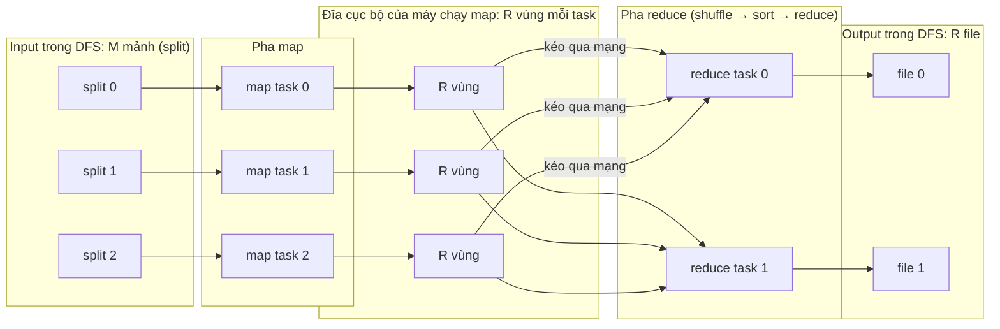
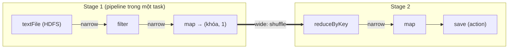

# P12 · Chương 10 — Batch processing

> Chương này dùng cuốn *Designing Data-Intensive Applications* (DDIA) chỉ làm **khung chủ đề**; không trích hay viết lại nội dung sách. Mọi khẳng định dựa vào paper gốc (MapReduce OSDI'04, GFS SOSP'03, Spark RDD NSDI'12, Blanas et al. SIGMOD'10, Pavlo et al. SIGMOD'09), bài giảng Distributed Systems của Kleppmann (Cambridge), docs có phiên bản (Hadoop 3.3.6, Spark 3.5.6, rayon 1.12.0, DataFusion 55.2.0, Polars 0.55.2) và Google SRE book. Số liệu hiệu năng trong paper là **số đo của tác giả trên phần cứng thời đó**, không phải bảo đảm cho hệ thống hôm nay.

## Bạn sẽ hiểu được gì

- **Q1.** Triết lý Unix (`pipe`, `sort`, `uniq`) dạy gì cho batch processing, và nó thiếu gì khi dữ liệu vượt một máy? → mục 1
- **Q2.** Một job MapReduce chạy qua những bước nào (map, shuffle, sort, reduce) và combiner để làm gì? → mục 2
- **Q3.** Vì sao MapReduce chịu được máy chết bằng *chạy lại* (re-execution) mà không cần checkpoint; commit nguyên tử và backup task đóng vai gì? → mục 3
- **Q4.** Distributed filesystem (GFS/HDFS) giả định gì về dữ liệu, và "đưa code tới chỗ dữ liệu" (locality) là gì? → mục 4
- **Q5.** Join trong batch: join phía reduce (sort-merge) và phía map (broadcast/partitioned) khác nhau thế nào, skew xử lý ra sao? → mục 5
- **Q6.** Output của batch đi đâu, commit an toàn và chạy lại được bằng cách nào? → mục 6
- **Q7.** Dataflow engine (Spark RDD) khác MapReduce ở đâu: lineage, narrow/wide dependency, stage? → mục 7
- **Q8.** Batch kiểu MapReduce khác MPP database ở những trục nào? → mục 8

## Kiến thức cần trước

- [P1 · Chương 04, mục 8 — Pipe, FIFO, Unix domain socket](../01-linux/04-file-descriptor-va-vfs.md): pipe là kênh byte một chiều, có EOF/`SIGPIPE`, dung lượng hữu hạn. Chương này coi pipe là tiền thân của dataflow.
- [P5 · Chương 06 — Durability trong thực tế](../05-storage/06-durability-trong-thuc-te.md) và [P5 · Chương 08, mục 4 — Ghi nguyên tử bằng `rename`](../05-storage/08-rust-va-luu-tru.md): mẫu "ghi file tạm rồi `rename`" mà mục 3 và mục 6 dựa vào.
- [P12 · Chương 03 — Storage engine](03-storage-engine.md) (SSTable/LSM, dùng ở mục 6), [P12 · Chương 04 — Encoding và tiến hóa schema](04-encoding-va-tien-hoa-schema.md) (định dạng file đầu vào/ra), [P12 · Chương 06 — Partitioning](06-partitioning.md) (hash partition, hot key: nền của shuffle và skew).
- Chương P12·08 (sự cố hệ phân tán) và P12·12 (dung dưỡng, exactly-once, dữ liệu dẫn xuất) được nối ở mục 3 và mục 6. Kiến trúc warehouse/lake, ETL, tách compute–storage nằm ở [P12 · Chương 13](13-kien-truc-he-du-lieu.md); chương này chỉ nhắc 1–2 câu rồi chuyển link.

**Ví dụ chạy xuyên chương.** Giả sử shop online của bạn có một service `shop-api`, mỗi ngày ghi ra một lượng access log rất lớn. Mỗi đêm bạn cần một báo cáo: URL nào được gọi nhiều nhất hôm qua, và người dùng nước nào bấm nhiều nhất. Job làm báo cáo đó tên là `daily-report`. Nó đọc hai thứ: file `clicks` (mỗi dòng là một lần bấm, có `user_id` và URL) và bảng `users` (`user_id`, quốc gia). Ví dụ này là giả định của người soạn, không phải code trong repo. Mỗi mục dưới đây mở đầu bằng câu hỏi "chuyện này có nghĩa gì với `daily-report`".

## 1. Từ pipe của Unix đến batch processing (Q1)

> **Trả lời ngắn.** Một chuỗi lệnh như `sort | uniq -c` là một job batch thu nhỏ: đọc một đầu vào hữu hạn, biến đổi qua các bước nhỏ độc lập nối bằng pipe, ghi ra kết quả mới. Triết lý Unix là mỗi chương trình làm một việc và làm tốt[^unix-phil]. Đầu ra của chương trình này nên sẵn sàng làm đầu vào của chương trình khác[^unix-ii]. Khi dữ liệu vượt một máy, ta thiếu ba thứ: chia việc ra nhiều máy, chịu được máy chết, và đặt dữ liệu ở đâu. Đó đúng là những thứ MapReduce bổ sung.

**Giải thích.**

*Với `daily-report`.* Trước khi nghĩ đến cụm máy, hãy xem bài toán này giải thế nào khi log còn vừa một máy. Đầu vào của job là một tập dữ liệu hữu hạn, đã nằm sẵn đó và không đổi trong lúc job chạy; đầu ra là file kết quả mới. Đó là định nghĩa của batch. Câu hỏi của mục này: Unix giải bài đó ra sao, và lời giải ấy gãy ở đâu khi log lớn hơn một máy?

### 1.1 `daily-report` trên một máy

Muốn có 5 URL được gọi nhiều nhất, một dòng shell là đủ (minh họa, giả sử cột 7 của log là URL):

```sh
awk '{print $7}' access.log | sort | uniq -c | sort -rn | head -n 5
```

Mỗi bước làm một việc nhỏ (nhận xét của người soạn). `awk` trích URL từ mỗi dòng làm khóa. `sort` đưa các dòng cùng khóa về cạnh nhau. `uniq -c` đếm các dòng giống nhau nằm kề nhau. `sort -rn | head` lấy top 5. Bước `sort` đầu tiên không bỏ được, vì `uniq` chỉ nhận ra dòng lặp khi chúng nằm kề nhau[^uniq-adj]. Hình dáng này (trích khóa, gom theo khóa, gộp) chính là "map → sort/gom theo khóa → reduce" mà mục 2 sẽ phân tán ra nhiều máy.

Triết lý đứng sau chuỗi lệnh đó do Doug McIlroy, người phát minh Unix pipe[^mcilroy], tóm tắt như sau. Viết chương trình làm một việc và làm tốt; viết chương trình để chạy cùng nhau; viết chương trình xử lý text stream vì đó là giao diện phổ quát[^unix-phil]. Một châm ngôn khác của ông giải thích vì sao các bước ghép được với nhau: đầu ra của mọi chương trình nên sẵn sàng thành đầu vào của một chương trình khác mà ta chưa biết[^unix-ii].

Mô hình này có ba tính chất mà batch phân tán thừa hưởng (nhận xét của người soạn):

1. **Đầu vào chỉ đọc, đầu ra là dữ liệu mới.** `awk` không sửa `access.log`; kết quả là những dòng text mới. Chạy lại cùng lệnh trên cùng input cho cùng output, và đó là nền tảng của "lỗi thì chạy lại" ở mục 3.
2. **Mỗi bước độc lập, nói chuyện với nhau qua giao diện đơn giản.** Bạn thay `awk` bằng chương trình khác trích khóa mà không phải đụng tới `sort`.
3. **Backpressure có sẵn.** Pipe có dung lượng hữu hạn: ghi vào pipe đầy thì `write` chặn cho tới khi bên đọc lấy bớt[^pipe-block]. Chi tiết ở [P1 · Chương 04, mục 8](../01-linux/04-file-descriptor-va-vfs.md); phiên bản async của ý này ở [P7 · Chương 09, mục 3](../07-io-async/09-async-trong-production.md).

`sort` còn cho thấy cách xử lý dữ liệu lớn hơn RAM trên một máy. GNU `sort` dùng một main-memory buffer có kích thước cấu hình được[^sort-buf]. Khi phải gộp nhiều đầu vào hơn ngưỡng `nmerge`, nó gộp theo nhóm, lưu kết quả trung gian vào file tạm rồi gộp tiếp[^sort-merge]. Kỹ thuật này là *external merge sort*, và MapReduce dùng lại đúng nó khi dữ liệu trung gian không vừa bộ nhớ (mục 2)[^mr-extsort].

### 1.2 Thiếu gì khi log vượt một máy

Chuỗi lệnh Unix chạy trên một máy: một ổ đĩa, một bộ CPU, và máy chết là mất cả việc. MapReduce thì được dựng cho môi trường khác hẳn: cụm hàng trăm hay hàng nghìn máy phổ thông, nơi máy hỏng là chuyện thường[^mr-env]. Vì vậy mọi thứ Unix coi là hiển nhiên phải làm lại.

Thay đổi cốt lõi (nhận xét của người soạn) là "pipe giữa hai bước" biến thành *file trong hệ thống file phân tán*. Paper MapReduce nói output của một job thường được đưa thẳng làm input cho một job MapReduce khác[^mr-outfiles]. Cái giá là mất tính streaming của pipe, nơi hai bước nối nhau chạy đồng thời (nhận xét của người soạn). Pipeline định kỳ nhiều giai đoạn ở Google cũng thường phải chờ giai đoạn trước xong hẳn mới sang giai đoạn sau, phần lớn vì có thể có bước sắp xếp, mà sắp xếp cần toàn bộ dữ liệu[^sre-sort].

<details><summary>Đi sâu: "distributed grep", cron và pipeline định kỳ</summary>

- Paper MapReduce liệt kê *Distributed Grep* làm ví dụ đầu tiên: map phát ra dòng khớp mẫu, reduce là hàm đồng nhất chỉ chép dữ liệu trung gian ra output[^mr-grep]. Nói cách khác đó là `grep` chạy song song trên nhiều mảnh input.
- Mẫu "chương trình đọc dữ liệu, biến đổi, ghi dữ liệu mới, chạy theo lịch của `cron`" được SRE Google gọi là *data pipeline*[^sre-def]. Họ nói data pipeline có lịch sử đi từ co-routine, DTSS communication files, Unix pipe, rồi sau này là ETL pipeline[^sre-hist].
- Mọi thứ ở trên là *batch*: đầu vào hữu hạn, biết trước. Khi đầu vào không bao giờ kết thúc, xem [P12 · Chương 11 — Stream processing](11-stream-processing.md).

</details>

**Quay lại Q1:** Unix pipe cho `daily-report` cái khuôn "nhiều bước nhỏ, đầu vào bất biến, đầu ra mới"; MapReduce giữ khuôn đó nhưng thay RAM và đĩa của một máy bằng cả cụm.

## 2. MapReduce: map, shuffle, sort, reduce (Q2)

> **Trả lời ngắn.** Người dùng chỉ viết hai hàm: `map` biến mỗi bản ghi đầu vào thành các cặp khóa/giá trị trung gian, còn `reduce` nhận một khóa cùng mọi giá trị của khóa đó và gộp chúng lại[^mr-model]. Framework lo phần còn lại: chia input thành M mảnh cho M map task, ghi output của map thành R phần theo hàm partition, để reduce task kéo về (shuffle), sắp xếp theo khóa rồi mới gọi `reduce`[^mr-part]. Combiner là bước gộp cục bộ ngay phía map, để bớt dữ liệu phải gửi qua mạng[^mr-combiner].

**Giải thích.**

*Với `daily-report`.* Ở mục 1, đếm top URL cần ba việc: trích URL, gom các dòng cùng URL lại, rồi đếm. Trên cụm, ta không tự viết cả ba mà chỉ viết phần riêng của bài toán (trích và đếm), còn việc gom thì framework làm. Mục này đi theo đường dữ liệu của `daily-report` từ file log tới file kết quả.

### 2.1 Hai hàm của người dùng

Với `daily-report`, `Map` nhận một dòng log và phát ra cặp `(url, 1)`; `Reduce` nhận một URL cùng mọi số 1 của nó rồi cộng lại. Ví dụ này lấy theo bài đếm từ trong paper, chỉ đổi "từ" thành "URL" (nhận xét của người soạn).

Tổng quát hơn, cả phép tính nhận một tập cặp khóa/giá trị đầu vào và sinh một tập cặp khóa/giá trị đầu ra, viết bằng hai hàm `Map` và `Reduce`[^mr-model]. `Map` nhận một cặp đầu vào và sinh ra tập cặp trung gian; thư viện gom mọi giá trị trung gian cùng khóa rồi đưa cho `Reduce`[^mr-map]. `Reduce` nhận một khóa cùng tập giá trị của nó và gộp chúng thành tập giá trị nhỏ hơn[^mr-reduce]. Giá trị đi vào `Reduce` qua một iterator, để xử lý được cả danh sách quá lớn so với RAM[^mr-iter]. Bài đếm từ trong paper làm đúng như vậy: map phát `(từ, "1")` cho mỗi từ, reduce cộng các số đếm của một từ[^mr-wc].



(Sơ đồ rút gọn theo Figure 1 của paper: mỗi map task ghi R vùng, mỗi reduce task đọc *một* vùng từ *mọi* map task, vì vậy có mũi tên từ cả ba map tới cả hai reduce.)

### 2.2 Đường đi của dữ liệu

Các bước dưới đây theo mục 3.1 của paper:

1. **Cắt input và khởi động.** Thư viện cắt input thành M mảnh, thường 16–64 MB mỗi mảnh và chỉnh được[^mr-split]. Sau đó nó chạy nhiều bản sao chương trình trên cụm: một bản là *master*, các bản còn lại là worker được master giao việc[^mr-step12]. Ở đây có hai chiều phân mảnh: chia *input* thành M mảnh, và chia *không gian khóa trung gian* thành R phần bằng hàm partition, ví dụ `hash(key) mod R` (cách gọi "hai chiều" là của người soạn). Số R và hàm partition do người dùng chỉ định[^mr-part].
2. **Map.** Worker nhận map task thì đọc split của mình, parse thành cặp khóa/giá trị rồi đưa vào `Map`. Kết quả trung gian được đệm trong RAM[^mr-step3].
3. **Ghi cục bộ.** Định kỳ, dữ liệu đệm được ghi xuống **đĩa cục bộ**, chia thành R vùng theo hàm partition. Vị trí các vùng được báo về master để chuyển cho reduce worker[^mr-step4].
4. **Shuffle.** Khi master báo vị trí, reduce worker dùng RPC đọc dữ liệu đệm từ đĩa cục bộ của các map worker[^mr-step5a]. Hadoop làm tương tự: framework lấy phần output tương ứng của mọi mapper qua HTTP[^hadoop-shuffle].
5. **Sort.** Đọc hết dữ liệu trung gian, reduce worker sắp xếp theo khóa để mọi lần xuất hiện của cùng một khóa nằm cạnh nhau[^mr-step5]. Cần sắp xếp vì thường nhiều khóa khác nhau rơi vào cùng một reduce task; nếu dữ liệu quá lớn thì dùng external sort[^mr-extsort]. Trong Hadoop, shuffle và sort chạy đồng thời: lấy map output tới đâu thì merge luôn tới đó[^hadoop-shuf-sort].
6. **Reduce.** Worker duyệt dữ liệu đã sắp xếp và gọi `Reduce` cho từng khóa duy nhất. Output được nối (append) vào file output của partition đó[^mr-step6].
7. **Kết thúc.** Khi mọi map và reduce task xong, `MapReduce` trả về cho chương trình gọi. Kết quả là R file, mỗi reduce task một file; người dùng thường không gộp lại mà đưa thẳng làm input cho job khác[^mr-outfiles].

Để khỏi nhầm (nhận xét của người soạn): **shuffle** là chuyển dữ liệu theo khóa tới đúng reducer (tốn mạng và đĩa), còn **sort** là sắp xếp trong từng partition. Ghép lại, ta có phiên bản phân tán của `sort | uniq -c` ở mục 1: `awk` ↔ map, `sort` ↔ shuffle + sort, `uniq -c` ↔ reduce.

Về thứ tự, paper bảo đảm trong một partition các cặp trung gian được xử lý theo khóa tăng dần[^mr-order]. Nhờ vậy sinh được file output đã sắp xếp theo từng partition[^mr-order-sorted]. Đây là bảo đảm riêng của MapReduce; Spark không có (mục 7).

### 2.3 Combiner

Trong `daily-report`, vài URL như trang chủ sẽ chiếm phần lớn log (nhận xét của người soạn). Paper gặp đúng tình huống đó ở bài đếm từ: tần suất từ theo phân phối Zipf, nên mỗi map task phát hàng trăm hoặc hàng nghìn bản ghi `<the, 1>`[^mr-comb-the]. Gửi hết qua mạng rồi mới cộng thì phí.

Nếu hàm reduce có tính giao hoán và kết hợp (commutative, associative), như phép cộng trong bài đếm từ[^mr-comb-why], ta có thể cộng một phần ngay trên máy chạy map trước khi gửi đi. Paper cho người dùng khai báo hàm Combiner để làm việc đó[^mr-combiner]. Hadoop mô tả combiner là bước gộp cục bộ giúp giảm lượng dữ liệu chuyển từ mapper sang reducer[^hadoop-comb]. Điều kiện giao hoán và kết hợp là bắt buộc, vì combiner chỉ thấy một phần dữ liệu rồi reduce chạy tiếp trên kết quả của nó (suy luận của người soạn từ định nghĩa). Rayon có đúng ràng buộc này cho `reduce` (mục 9).

<details><summary>Đi sâu: kích thước M và R, partition tùy biến, secondary sort, bản ghi hỏng</summary>

- **M và R nên lớn hơn nhiều số máy.** Mỗi worker làm nhiều task nhỏ thì cân bằng tải động tốt hơn. Khi một worker chết, các map task nó đã làm được rải ra mọi máy khác để chạy lại nhanh[^mr-granularity]. Giới hạn thực tế là master phải ra O(M + R) quyết định lập lịch và giữ O(M × R) trạng thái trong bộ nhớ[^mr-mr-state]. Paper cho ví dụ M = 200.000, R = 5.000 trên 2.000 worker[^mr-sizes].
- **Partition tùy biến.** Mặc định là hash, cân bằng khá tốt, nhưng có thể thay. Ví dụ `hash(Hostname(urlkey)) mod R` đưa mọi URL cùng host vào cùng một file output[^mr-userpart].
- **Hadoop: secondary sort.** Muốn nhóm khóa theo quy tắc khác quy tắc sắp xếp, Hadoop cho đặt hai comparator: một để sắp xếp (`setSortComparatorClass`), một để nhóm (`setGroupingComparatorClass`). Tài liệu nói có thể dùng chúng cùng nhau để mô phỏng secondary sort theo giá trị[^hadoop-secsort]. Kỹ thuật này là nền của "improved repartition join" ở mục 5 (liên hệ của người soạn).
- **Bỏ qua bản ghi hỏng.** Bug trong code người dùng có thể làm map/reduce crash có tính xác định trên vài bản ghi. Thư viện có chế độ tùy chọn phát hiện các bản ghi đó và bỏ qua để job tiến triển tiếp[^mr-skip].
- **Chạy cục bộ để debug.** Paper có bản cài đặt chạy tuần tự toàn bộ việc trên máy cục bộ, để debug, profile hoặc test nhỏ[^mr-local].
- **Chi phí của shuffle.** Với N map và M reduce có N × M "vùng" trung gian; Pavlo et al. tính ví dụ N = 1000, M = 500 ra 500.000 file cục bộ[^pavlo-pull]. Họ còn cho rằng nhiều reduce cùng kéo từ một map node gây nhiều lần seek[^pavlo-seek]. Đây là lập luận của các tác giả đó về cách MapReduce truyền dữ liệu từ map sang reduce, trong một benchmark chạy Hadoop năm 2009.

</details>

**Quay lại Q2:** map của `daily-report` phát `(url, 1)`, shuffle chuyển mọi cặp cùng URL về một reducer, sort đặt chúng kề nhau, reduce cộng lại; combiner chỉ là tối ưu gộp trước khi gửi.

## 3. Chịu lỗi bằng chạy lại: re-execution, commit nguyên tử, backup task (Q3)

> **Trả lời ngắn.** MapReduce coi máy chết là chuyện thường và dùng *chạy lại* (re-execution) làm cơ chế chịu lỗi chính[^mr-abstract]. Master đánh dấu worker chết khi nó không trả lời, rồi đặt các task của máy đó về trạng thái chờ để chạy ở nơi khác[^mr-master]. Map task đã xong cũng phải chạy lại vì output của nó nằm trên đĩa cục bộ của máy chết, còn reduce task đã xong thì không[^mr-completed]. Kết quả vẫn đúng nhờ hai điều. Một là hàm map/reduce xác định[^mr-determ]. Hai là output của task được commit nguyên tử[^mr-atomic]. Ngoài ra còn một điều kiện ngầm (nhận xét của người soạn): input không bị sửa trong lúc chạy.

**Giải thích.**

*Với `daily-report`.* Job chạy trên cả cụm, và trong cụm cỡ đó máy hỏng là chuyện thường. Nếu mỗi lần một máy chết ta phải chạy lại cả job từ đầu thì báo cáo có khi chẳng bao giờ xong. Vậy khi một máy chết giữa đêm, `daily-report` chạy lại phần nào, và làm sao chạy lại mà báo cáo không sai?

### 3.1 Máy chết thì chạy lại gì

Master ping mọi worker định kỳ. Worker nào không trả lời trong một khoảng thời gian thì bị đánh dấu hỏng. Mọi map task *đã xong* của worker đó bị đặt lại về idle để lên lịch trên worker khác[^mr-master]. Map/reduce task *đang chạy* trên nó cũng vậy[^mr-inprogress]. Bảng dưới là hệ quả: map task xong phải làm lại, reduce task xong thì không.

| Thứ nằm trên máy chết | Có phải chạy lại? | Lý do |
|---|---|---|
| Map/reduce task đang chạy | Có | Bị đặt lại về idle rồi lên lịch lại[^mr-inprogress] |
| Map task đã xong | Có | Output nằm trên đĩa cục bộ của máy hỏng nên không truy cập được[^mr-completed] |
| Reduce task đã xong | Không | Output nằm trong hệ thống file toàn cục (global file system)[^mr-completed] |

Nếu map task chạy lại ở worker B vì worker A chết, mọi reduce worker được báo. Reduce task nào chưa đọc dữ liệu của A sẽ đọc từ B[^mr-rerun-notify]. Paper kể một job gặp lúc bảo trì mạng, khiến từng nhóm 80 máy mất kết nối vài phút. Master chỉ việc chạy lại phần việc của các máy đó và job vẫn hoàn tất[^mr-80].

### 3.2 Vì sao chạy lại không làm sai kết quả

Chạy lại chỉ vô hại khi lần chạy sau cho cùng kết quả như lần trước và không để lại dữ liệu nửa vời. Điều kiện thứ nhất là hàm xác định: khi map và reduce là hàm xác định của đầu vào, bản cài đặt phân tán cho đúng output như một lần chạy tuần tự không lỗi[^mr-determ]. Điều kiện thứ hai là *commit nguyên tử* output của task[^mr-atomic]:

- Mỗi task đang chạy ghi output vào file tạm riêng: map task tạo R file, reduce task tạo một file. Map task xong thì báo master tên R file tạm đó[^mr-tmpfiles]. Nếu master đã nhận báo cáo xong của map task ấy rồi thì bỏ qua bản báo cáo thứ hai[^mr-dupmap].
- Reduce task xong thì đổi tên (rename) nguyên tử file tạm thành file output cuối. Nếu cùng một reduce task chạy trên nhiều máy, nhiều lời gọi rename cùng nhắm một tên cuối. Paper dựa vào tính nguyên tử của `rename` của hệ thống file để trạng thái cuối chỉ chứa dữ liệu của *một* lần chạy[^mr-rename].

Mẫu "ghi file tạm → `rename`" là chính mẫu ghi nguyên tử trên một máy ở [P5 · Chương 08, mục 4](../05-storage/08-rust-va-luu-tru.md), chỉ khác là `rename` ở đây do hệ thống file phân tán cung cấp. Khi toán tử *không* xác định, paper chỉ hứa ngữ nghĩa yếu hơn nhưng vẫn hợp lý: output của từng reduce task tương đương một lần chạy tuần tự nào đó, song các reduce task khác nhau có thể tương ứng với những lần chạy tuần tự khác nhau[^mr-nondet].

### 3.3 Straggler và backup task

Trong `daily-report`, có thể một máy không chết mà chỉ chậm bất thường, và cả job phải chờ nó. Máy như vậy gọi là *straggler*: nó mất nhiều thời gian bất thường để xong một trong các task cuối của job[^mr-straggler]. Cách chữa là khi job gần xong, master lên lịch *chạy dự phòng* các task còn dở. Task được tính xong ngay khi bản chính hoặc bản dự phòng xong trước[^mr-backup]. Với chương trình sort trong paper, tắt cơ chế này làm job lâu hơn 44% (số đo của tác giả trên cụm của họ)[^mr-44]. Backup task chỉ an toàn nhờ chính cơ chế commit nguyên tử ở trên (suy luận của người soạn): hai bản cùng ghi một tên, chỉ một bản "thắng".

### 3.4 Điểm yếu còn lại

Master chỉ có một. Paper nói khả năng nó hỏng là thấp, nên bản cài đặt hiện tại hủy cả job nếu master chết và để client thử lại nếu muốn[^mr-masterfail]. Ngoài ra, Google SRE ghi nhận pipeline định kỳ rất mong manh khi quy mô tăng[^sre-fragile]. Khi một chunk bị treo và job bị kill để chạy lại, vì pipeline thường không có checkpoint nên công việc trên mọi chunk bị làm lại từ đầu[^sre-restart].

<details><summary>Đi sâu: side-effect, counter, idempotent và liên hệ exactly-once</summary>

- **Side-effect ngoài output chính.** Paper nói MapReduce dựa vào người viết ứng dụng để làm side-effect nguyên tử và idempotent, thường bằng cách ghi file tạm rồi rename[^mr-side]. MapReduce không hỗ trợ two-phase commit nguyên tử cho nhiều file output của một task. Vì vậy task có nhiều output đòi hỏi nhất quán chéo file nên là xác định[^mr-2pc].
- **Counter không đếm trùng.** Khi master cộng counter từ các worker, nó loại bỏ ảnh hưởng của các lần thực thi trùng (do backup task hay chạy lại sau lỗi) để tránh đếm đôi[^mr-counters]. Đối chiếu: accumulator của Spark *không* được bảo đảm như vậy khi task bị chạy lại bên trong transformation (mục 7)[^spark-acc].
- **Idempotence là chìa khóa của retry an toàn.** Bài giảng Cambridge nói cập nhật idempotent có thể thử lại an toàn vì làm nhiều lần có cùng hiệu quả như một lần[^cam-idem]. Re-execution của batch là "retry ở mức task" dựa trên đúng tính chất đó. Bàn kỹ hơn ở [P12 · Chương 08](08-su-co-he-phan-tan.md) (lỗi từng phần, retry) và [P12 · Chương 12](12-dung-dan-va-tich-hop-du-lieu.md) (exactly-once end-to-end).
- **Bài học thiết kế.** Tác giả paper kết luận: hạn chế mô hình lập trình làm việc song song hóa và chịu lỗi trở nên dễ, và redundant execution giảm ảnh hưởng của máy chậm hoặc hỏng[^mr-lesson].

</details>

**Quay lại Q3:** `daily-report` sống sót qua máy chết nhờ input bất biến, hàm xác định và output chỉ lộ ra khi commit nguyên tử; backup task chạy trùng việc được cũng nhờ commit đó.

## 4. Distributed filesystem và locality (Q4)

> **Trả lời ngắn.** MapReduce đọc input từ và ghi output vào một hệ thống file phân tán (GFS ở Google, HDFS trong Hadoop). Loại hệ thống file này được thiết kế cho file rất lớn, ghi một lần rồi chủ yếu đọc tuần tự và nối thêm[^gfs-assump]. File bị cắt thành khối lớn, 64 MB ở GFS[^gfs-chunk]. Mỗi khối được nhân bản trên nhiều máy[^gfs-rep]. Nhờ biết khối nằm ở máy nào, scheduler đẩy *code* tới gần *dữ liệu* thay vì kéo dữ liệu qua mạng[^mr-locality].

**Giải thích.**

*Với `daily-report`.* File `clicks` của một ngày nằm ở đâu để job đọc? Không thể là đĩa của một máy: dữ liệu quá lớn, và máy chết thì mất log. Nó nằm trong một DFS. Ở đó file bị cắt thành khối, mỗi khối nhân bản trên vài máy, và scheduler của job biết khối nào ở máy nào. Mục này giải thích DFS giả định gì về dữ liệu, và scheduler dùng thông tin vị trí ra sao để job đỡ tốn mạng.

### 4.1 Giả định thiết kế

Paper GFS xuất phát từ workload của Google. Hệ thống chứa một lượng vừa phải file lớn, vài triệu file, thường từ 100 MB trở lên, file nhiều GB là chuyện thường[^gfs-assump]. Hầu hết file được thay đổi bằng cách nối thêm dữ liệu mới thay vì ghi đè, và ghi ngẫu nhiên gần như không có[^gfs-append]. Băng thông duy trì cao quan trọng hơn độ trễ thấp[^gfs-bw]. HDFS, bản mã nguồn mở cùng ý tưởng, nói tương tự: nó thiết kế cho xử lý batch hơn là tương tác, nhấn mạnh thông lượng cao hơn độ trễ thấp[^hdfs-batch]. HDFS cũng cần mô hình truy cập write-once-read-many[^hdfs-wom]. Vì vậy mô hình "quét cả file rồi ghi file mới" của mục 2 khớp với hệ thống file này (nhận xét của người soạn).

### 4.2 Kiến trúc

Một cụm GFS gồm một master duy nhất, nhiều chunkserver và nhiều client[^gfs-arch]. Client hỏi master để biết chunkserver nào giữ dữ liệu cần, nhưng dữ liệu đi thẳng tới chunkserver chứ không qua master[^gfs-direct]. Mỗi file chia thành chunk 64 MB, lớn hơn nhiều so với block của file system thông thường[^gfs-chunk]. Để bền, mỗi chunk được nhân bản trên nhiều chunkserver, mặc định ba bản[^gfs-rep].

HDFS có cấu trúc tương ứng. NameNode giữ namespace và ghi mọi thay đổi vào EditLog[^hdfs-nn]. File là chuỗi block, block được nhân bản, và cỡ block cùng số bản sao chỉnh được theo từng file[^hdfs-blk-rep]. Cỡ block điển hình là 128 MB[^hdfs-block]. NameNode liên tục theo dõi block nào thiếu bản và khởi động nhân bản khi cần[^hdfs-rerep].

Vì sao phải nhân bản nhiều bản? Vì paper GFS coi lỗi thành phần là chuyện thường trong cụm hàng trăm đến hàng nghìn máy làm từ linh kiện rẻ tiền[^gfs-fail]. Chủ đề nhân bản được bàn ở [P12 · Chương 05](05-replication.md). Còn việc chia file thành khối rải ra nhiều máy chính là *partitioning* ([P12 · Chương 06](06-partitioning.md)).

### 4.3 Locality

Trong môi trường của paper, băng thông mạng là tài nguyên khan hiếm. Vì vậy master MapReduce dùng thông tin vị trí của file input và cố lên lịch map task trên máy đang giữ một bản sao của split tương ứng[^mr-locality]. Nếu không được thì nó chọn máy gần bản sao, cùng switch[^mr-near]. Kết quả là khi job chạy trên một phần đáng kể worker của cụm, phần lớn input được đọc cục bộ và không tốn băng thông mạng[^mr-local-read].

Với `daily-report`, nghĩa là map task đọc block `clicks` ngay trên máy đang giữ block đó, chứ không kéo block qua mạng. HDFS phát biểu cùng nguyên tắc: chuyển tính toán đến gần dữ liệu thường hiệu quả hơn chuyển dữ liệu đến chỗ chạy ứng dụng, đặc biệt khi dữ liệu rất lớn[^hdfs-move]. Paper Spark đưa ý đó vào giao diện RDD: với RDD của file HDFS, `preferredLocations` trả về các node chứa block[^rdd-hdfs-pref].

(Nhận xét của người soạn: ngày nay nhiều hệ thống tách storage khỏi compute và đọc dữ liệu từ object store thay vì đĩa cục bộ; khi đó locality theo nghĩa của paper không còn. Chủ đề tách compute–storage nằm ở [P12 · Chương 13](13-kien-truc-he-du-lieu.md).)

<details><summary>Đi sâu: cách ứng dụng sống với GFS, record append, chọn vị trí bản sao</summary>

- **Ba kỹ thuật của ứng dụng GFS.** Paper nói ứng dụng chịu được mô hình nhất quán nới lỏng bằng vài kỹ thuật đơn giản: nối thêm thay vì ghi đè, checkpoint, và ghi bản ghi tự xác thực hoặc tự định danh[^gfs-apps]. Writer điển hình ghi file từ đầu đến cuối rồi đổi tên nguyên tử sang tên cố định sau khi ghi xong, hoặc định kỳ checkpoint phần đã ghi thành công[^gfs-rename]. Đó cùng mẫu với commit của reduce task ở mục 3.
- **Record append là at-least-once.** Nhiều writer cùng nối vào một file, và ngữ nghĩa "append ít nhất một lần" giữ output của mỗi writer. Reader loại padding và mảnh vỡ bằng checksum trong bản ghi; nếu không chịu được bản ghi trùng thì lọc bằng định danh duy nhất[^gfs-dups]. Đây là một ví dụ sớm của "at-least-once + dedup" ở [P12 · Chương 12](12-dung-dan-va-tich-hop-du-lieu.md).
- **Đặt bản sao theo rack.** Với số bản sao là 3, chính sách mặc định của HDFS đặt một bản ở máy ghi (nếu máy đó là datanode) hoặc một datanode ngẫu nhiên cùng rack, một bản ở rack khác, và bản cuối ở node khác trong rack xa đó. Tài liệu nói chính sách này giảm lưu lượng ghi giữa các rack[^hdfs-place].
- **Một master có bị nghẽn không?** Paper GFS lập luận một master giữ thiết kế đơn giản[^gfs-single]. Nhưng vai trò của nó trong đọc/ghi phải tối thiểu để nó không thành nút cổ chai. Vì vậy client không đọc/ghi dữ liệu qua master mà hỏi nó chunkserver nào cần liên lạc, rồi tương tác trực tiếp với chunkserver[^gfs-bottleneck].
- **Hệ quả cho object store.** Nhiều pipeline hiện đại ghi ra S3 thay vì HDFS. Tài liệu committer của Hadoop cảnh báo `rename` thư mục trên S3 không có tính chất như trên HDFS; xem mục 6.

</details>

**Quay lại Q4:** DFS cho batch là file khổng lồ ghi một lần, cắt thành khối và nhân bản; biết khối nằm đâu thì scheduler chạy map task của `daily-report` tại đó (locality), tiết kiệm băng thông mạng.

## 5. Join trong batch: phía reduce, phía map và skew (Q5)

> **Trả lời ngắn.** Join phía reduce (repartition/sort-merge) gắn thẻ nguồn lên mỗi bản ghi, dùng khóa join làm khóa shuffle để mọi bản ghi cùng khóa về một reducer, rồi ghép tại đó[^join-std]. Join phía map không shuffle: khi một bảng đủ nhỏ thì phát (broadcast) nó cho mọi map task dựng hash table trong RAM[^join-bc]. Khi hai bảng đã phân mảnh giống nhau từ trước thì join từng cặp phân mảnh[^join-pre]. Join cũng là chỗ skew (một khóa quá nóng) hay làm chậm job hoặc tràn bộ nhớ[^join-skew]. Engine hiện đại như Spark AQE tự tách các task lệch trong sort-merge join[^spark-skew].

**Giải thích.**

*Với `daily-report`.* Muốn đếm click theo quốc gia, mỗi dòng của `clicks` (chỉ có `user_id`) phải được gắn thêm quốc gia lấy từ `users`. Đó là một phép join theo `user_id`. Cả hai phía đều nằm rải trên nhiều máy, nên vấn đề của batch join là đưa những bản ghi cần ghép về cùng một chỗ bằng cách rẻ nhất.

Vì sao batch hay quét toàn bộ thay vì dùng index? Blanas et al. nêu lý do khi phân tích log: mọi bản ghi trong một khoảng thời gian thường được phân tích cùng nhau, nên quét đơn giản được ưa hơn quét index[^join-scan]. Bảng tham chiếu (người dùng, địa điểm…) cũng thường nhỏ hơn nhiều so với log[^join-ref]. Hệ quả là join trong batch quét cả hai phía.

### 5.1 Join phía reduce (repartition / sort-merge)

Gọi L là log (`clicks`) và R là bảng tham chiếu (`users`). *Standard repartition join* viết được trong một job MapReduce[^join-std]. Mỗi map task đọc split của L hoặc của R, gắn thẻ bảng nguồn cho bản ghi, rồi phát `(khóa join, bản ghi có thẻ)`. Framework partition, sắp xếp và gộp như thường, nên mọi bản ghi cùng khóa join về cùng một reducer. Đó chính là shuffle ở mục 2 với khóa join làm khóa.

Reducer tách và đệm các bản ghi theo thẻ thành hai tập, rồi lấy tích Descartes giữa hai tập[^join-cross]. Paper ví cách này giống partitioned sort-merge join của parallel RDBMS[^join-std-name].

Vấn đề là reducer phải đệm mọi bản ghi của một khóa join từ cả L lẫn R[^join-buf]. Khi số khóa khác nhau ít hoặc dữ liệu lệch nhiều, chúng có thể không vừa bộ nhớ[^join-skew]. Trong thí nghiệm của paper có trường hợp standard repartition join không chạy xong vì hết bộ nhớ[^join-oom].

*Improved repartition join* sửa bằng cách đổi khóa phát ra thành tổ hợp (khóa join, thẻ bảng), sao cho bản ghi của bảng nhỏ R đứng trước L. Partition chỉ theo phần khóa join, và nhóm cũng chỉ theo khóa join. Nhờ vậy chỉ cần đệm R, còn L được stream[^join-impr]. Cơ chế "khóa tổ hợp + comparator nhóm" chính là secondary sort ở mục 2 (liên hệ của người soạn).

### 5.2 Join phía map (không shuffle)

- **Broadcast hash join.** `users` nhỏ hơn `clicks` rất nhiều, nên thay vì chuyển cả hai bảng qua mạng, ta phát `users` đi. Cách này tránh sắp xếp cả hai bảng và quan trọng hơn là tránh chuyển bảng lớn L qua mạng[^join-bc]. Job chạy dạng *map-only*: mỗi node lấy toàn bộ R từ DFS, và mỗi map task dùng một hash table trong bộ nhớ để join một split của L với R[^join-bc-job]. Job map-only bỏ qua pha sort và merge, và output mỗi map task được ghi thẳng thành file riêng trong DFS[^join-maponly]. Kết quả đo: khi R có khoảng 1 triệu bản ghi trở xuống, broadcast join luôn tốt hơn improved repartition join, nhưng khi R lớn dần thì hiệu năng tương đối giảm nhanh[^join-res].
- **Partitioned (directed) join.** Nếu L và R đã được phân mảnh trước theo khóa join thì chi phí shuffle giảm đi[^join-pre]. Lúc truy vấn, các phân mảnh tương ứng của L và R được ghép trực tiếp[^join-direct]. Khác parallel RDBMS, DFS tự quyết định đặt block ở đâu nên không bảo đảm hai phân mảnh tương ứng nằm cùng node. Vì vậy phải dùng cách join có hướng: map task đọc phân mảnh Lᵢ và nạp Rᵢ (từ DFS nếu chưa có cục bộ) vào hash table[^join-dfs].
- **Phía map với đầu vào đã sắp xếp.** Hadoop có map-side join đòi các phân mảnh đầu vào đã được sắp xếp chặt theo khóa join. Paper lưu ý cách này đệm mọi bản ghi cùng khóa từ mọi bảng và có thể hết bộ nhớ khi L lệch, còn directed join chỉ đệm phân mảnh của bảng nhỏ[^join-mapside].

| Chiến lược | Shuffle? | Điều kiện | Rủi ro chính |
|---|---|---|---|
| Standard repartition | Có, cả hai bảng | Không | Đệm mọi bản ghi cùng khóa → hết RAM khi lệch[^join-buf] |
| Improved repartition | Có, cả hai bảng | Khóa tổ hợp + comparator nhóm | Vẫn sắp xếp và chuyển cả L, R qua mạng, khác với broadcast[^join-bc] |
| Broadcast hash | Không | R vừa RAM mỗi node | Chi phí chuyển và nạp R ở mọi node tăng theo R[^join-res] |
| Partitioned/directed | Không | L, R đã phân mảnh cùng khóa | Phải tiền xử lý; không bảo đảm đồng vị trí trong DFS[^join-dfs] |

### 5.3 Skew

Skew (lệch) là khi một số khóa (hot key) chiếm phần lớn dữ liệu. Với shuffle, mọi bản ghi cùng khóa đi về *một* reducer, nên reducer đó thành nút cổ chai (nhận xét của người soạn, hệ quả trực tiếp của cơ chế ở mục 2). Trong `daily-report`, một người dùng bot sinh hàng triệu click sẽ đẩy cả khối việc về một reducer.

SRE Google mô tả cùng hiện tượng ở mức pipeline. Khi workload phân theo khách hàng, chunk của vài khách có thể lớn hơn nhiều; vì khách hàng là đơn vị không chia nhỏ được nên thời gian chạy tổng bị chặn bởi khách hàng lớn nhất[^sre-skew].

Về công cụ, Spark AQE (bật mặc định từ 3.2.0) dùng thống kê lúc chạy để chọn kế hoạch tốt hơn. Nó có thể chuyển sort-merge join thành broadcast hash join và tối ưu skew join[^spark-aqe]. Với sort-merge join, skew join xử lý bằng cách tách (và nhân bản nếu cần) các task lệch thành các task cỡ gần bằng nhau[^spark-skew]. Spark còn cho gợi ý chiến lược join (`BROADCAST`, `MERGE`, `SHUFFLE_HASH`, `SHUFFLE_REPLICATE_NL`)[^spark-hint]. Nó cũng có ngưỡng kích thước bảng được tự động broadcast[^spark-bc-thr]. Về gốc rễ phân mảnh theo khóa và hot key, xem [P12 · Chương 06](06-partitioning.md).

<details><summary>Đi sâu: semi-join, so sánh Hadoop với Spark, giới hạn của thí nghiệm</summary>

- Paper Blanas còn mô tả *semi-join* cho trường hợp R lớn nhưng phần được log tham chiếu thì nhỏ. Ví dụ bảng user hàng trăm triệu dòng nhưng log một giờ chỉ chứa vài triệu user duy nhất. Mục đích là không chuyển và nạp những bản ghi R vô ích[^join-semi].
- Tất cả số đo ở đây từ thí nghiệm trên **cụm Hadoop 100 node** năm 2010[^join-abs]. Thứ tự tương đối giữa các thuật toán chịu ảnh hưởng của cài đặt Hadoop và phần cứng thời đó (nhận xét của người soạn).
- Spark gọi cùng khái niệm bằng tên khác. Tham số `spark.sql.autoBroadcastJoinThreshold` là kích thước tối đa của bảng được broadcast tới mọi worker khi join[^spark-bc-thr]. AQE có thể chuyển sort-merge join thành broadcast hash join khi thống kê thời gian chạy cho thấy một phía đủ nhỏ, tiết kiệm việc sắp xếp hai phía[^spark-aqe-bc].

</details>

**Quay lại Q5:** để gắn quốc gia vào `clicks`, reduce-side join dùng chính shuffle để đưa bản ghi cùng `user_id` về một chỗ (đắt, dễ lệch); map-side join tránh shuffle bằng broadcast `users` hoặc dữ liệu đã phân mảnh sẵn (rẻ nhưng cần điều kiện); skew là kẻ thù chung.

## 6. Output của batch: ghi ở đâu, commit và chạy lại thế nào (Q6)

> **Trả lời ngắn.** Output của một job batch là *file mới* trong DFS, không phải cập nhật từng dòng vào một database đang phục vụ: mỗi reduce task ghi một file output[^mr-step6]. Việc ghi an toàn dựa vào ghi vào chỗ tạm rồi commit bằng `rename`. Cơ chế này dùng được với HDFS vì rename thư mục ở đó nguyên tử[^s3a-commit]. Trên S3 thì *không* an toàn như vậy[^s3a-rename]. Vì input bất biến và output chỉ lộ ra sau commit, job lỗi thì chạy lại. Muốn nạp kết quả vào một kho khóa/giá trị thì dựng sẵn file SST offline rồi ingest nguyên khối[^sst-create].

**Giải thích.**

*Với `daily-report`.* Báo cáo xong thì phải tới tay người dùng: dashboard của shop đọc nó, và có thể `shop-api` tra nó theo khóa. Cám dỗ đầu tiên là để mỗi reduce task ghi thẳng từng dòng vào database đang phục vụ. Mục này giải thích vì sao batch không làm vậy, mà ghi file mới, commit cả cụm một lần và nạp nguyên khối.

### 6.1 Output là file mới

Mỗi reduce task nối kết quả vào file output của partition mình[^mr-step6]. Job kết thúc với R file, thường dùng làm input cho job kế tiếp[^mr-outfiles]. Reduce task có thể chạy lại hay chạy trùng (mục 3), nên để task ghi thẳng ra hệ ngoài là nguy hiểm. Paper nói thẳng rằng MapReduce dựa vào người viết ứng dụng để biến side-effect thành nguyên tử và idempotent[^mr-side]. Nó cũng không hỗ trợ commit nguyên tử nhiều file của một task[^mr-2pc]. Hệ quả thiết kế (nhận xét của người soạn): giữ task thuần túy, chỉ cho nó ghi file tạm của chính nó, và để *framework* thực hiện bước commit.

### 6.2 Commit bằng rename trên HDFS

Tài liệu committer của Hadoop mô tả rằng với HDFS và các hệ thống file tương tự, `rename()` thư mục là cơ chế dùng để commit công việc của task và job[^s3a-commit]. Task ghi vào thư mục task-attempt dưới `_temporary` của thư mục đích[^s3a-tmp]. Tutorial MapReduce của Hadoop nói thêm: khi task-attempt thành công, nội dung được "nâng" lên thư mục output; thư mục của attempt thất bại bị framework bỏ, hoàn toàn trong suốt với ứng dụng[^hadoop-temp]. Sau khi commit job, mọi kết quả phải hiển thị, và có thể có file `_SUCCESS` được ghi vào thư mục output[^s3a-success]. File marker này là cách để job sau biết "output đã trọn vẹn" (nhận xét của người soạn).

### 6.3 Vì sao S3 khác

Cách commit bằng rename đòi filesystem bên dưới thỏa vài yêu cầu, trong đó rename thư mục phải là giao dịch O(1) nguyên tử. Nếu rename lỗi thì dữ liệu hoặc ở chỗ cũ hoặc ở chỗ mới, và không tiến trình nào khác trong cụm được rename vào cùng đường dẫn[^s3a-rename-def]. Tài liệu nói S3A *không* thỏa các yêu cầu đó. Dù S3 nay đã nhất quán, client S3A vẫn mô phỏng `rename` bằng sao chép file rồi xóa bản gốc, có thể hỏng giữa chừng, và không có gì ngăn tiến trình khác rename cùng lúc[^s3a-rename]. Do đó cần một committer riêng cho S3[^s3a-need]. Đây là ví dụ rõ rằng "bảo đảm nguyên tử của filesystem" là *điều kiện* của thiết kế commit, không phải thứ mặc định (nhận xét của người soạn). Nếu `daily-report` ghi ra S3, nó phải dùng committer đó chứ không dựa vào `rename`.

### 6.4 Chạy lại và idempotent

Bài giảng Cambridge nói một cập nhật idempotent có thể thử lại an toàn vì kết quả của nhiều lần như một lần[^cam-idem]. Pipeline batch thường đạt điều đó bằng cách *thay thế* cả output (ghi ra thư mục mới rồi commit) thay vì cộng dồn (nhận xét của người soạn). Cũng vì thế, khi sửa bug trong code, ta chạy lại job trên input cũ để có output đúng (nhận xét của người soạn).

Cái giá cũng đã rõ. SRE ghi nhận pipeline định kỳ không có checkpoint sẽ làm lại mọi việc từ đầu khi chunk bị treo rồi job bị kill[^sre-restart]. Nếu rút chu kỳ chạy xuống dưới giới hạn sàn của pipeline thì các lần chạy xếp chồng trên scheduler, hoặc lần chạy gần xong bị kill khi lần kế tiếp bắt đầu[^sre-interval].

### 6.5 Nạp kết quả vào kho khóa/giá trị

Đẩy từng bản ghi qua mạng vào một database đang phục vụ là chậm, và khiến người đọc thấy output trộn lẫn nửa chừng (nhận xét của người soạn). Cách thay thế là dựng sẵn file dữ liệu theo định dạng của kho rồi nạp nguyên khối. RocksDB cho phép tạo file SST offline và ingest sau, hữu ích khi cần nạp dữ liệu nhanh mà việc tạo dữ liệu làm offline được[^sst-create]. Các khóa trong file phải được chèn theo thứ tự tăng chặt[^sst-order]. Việc nạp chỉ cần gọi `DB::IngestExternalFile()` với đường dẫn file[^sst-ingest]. Với nhiều column family, `DB::IngestExternalFiles()` nạp theo tính chất all-or-nothing[^sst-allornothing]. Cơ chế SST/LSM nằm ở [P12 · Chương 03](03-storage-engine.md).

<details><summary>Đi sâu: committer v1/v2 của Hadoop, và chuyện định dạng file</summary>

- **v1 và v2.** Khi task commit, file được rename sang thư mục đích (thuật toán v2) hoặc sang thư mục job-attempt dưới `_temporary` (v1). Khi job commit, v2 chỉ tạo `_SUCCESS` và xóa `_temporary`, còn v1 rename mọi output của các task đã commit vào thư mục đích[^s3a-v1v2]. Đó là mô tả cách hoạt động; tài liệu cũng cảnh báo thuật toán này không an toàn hay nhanh với S3[^s3a-nosafe].
- **Task bị cô lập.** Task/job đo khoảng thời gian giữa các liên lạc với Application Master/YARN. Khi khoảng đó quá lâu, chúng phải kết luận mạng bị chia cắt và hủy công việc của mình[^s3a-partition]. Đây cùng loại vấn đề "không biết đối phương còn sống không" ở [P12 · Chương 08](08-su-co-he-phan-tan.md).
- **Định dạng file** đầu vào/đầu ra (Avro, Parquet…) và việc tiến hóa schema giữa các lần chạy: xem [P12 · Chương 04](04-encoding-va-tien-hoa-schema.md). Kiến trúc warehouse/lake và ETL xem [P12 · Chương 13](13-kien-truc-he-du-lieu.md).

</details>

**Quay lại Q6:** `daily-report` ghi báo cáo thành file mới ở chỗ tạm rồi commit bằng rename nguyên tử; vì input bất biến nên lỗi thì chạy lại, và kết quả muốn vào database thì nạp nguyên khối (ví dụ ingest SST) thay vì ghi từng dòng.

## 7. Dataflow engine: Spark RDD, lineage, narrow/wide, stage (Q7)

> **Trả lời ngắn.** MapReduce buộc mỗi bước ghi kết quả ra DFS (nhân bản, I/O đĩa, tuần tự hóa) trước khi bước sau đọc, và chi phí đó nặng nhất khi nhiều job nối nhau hoặc lặp[^rdd-motiv]. Dataflow engine như Spark coi cả chương trình là một đồ thị phép biến đổi. RDD là tập bản ghi chỉ-đọc chia thành partition, chỉ tạo bằng phép biến đổi xác định từ dữ liệu bền hoặc từ RDD khác[^rdd-def]. Chịu lỗi nhờ ghi lại *lineage* (chuỗi phép biến đổi) thay vì ghi dữ liệu: mất partition nào thì tính lại partition đó[^rdd-lineage].

**Giải thích.**

*Với `daily-report`.* Giả sử báo cáo lớn dần: lọc bot, join với `users`, đếm, rồi xếp hạng. Làm bằng MapReduce thì đó là một chuỗi job, và giữa hai job kết quả trung gian phải ghi ra DFS với đủ ba bản sao rồi job sau mới đọc lại. Dataflow engine hỏi một câu khác: nếu nối thẳng các bước, và chỉ nhớ *công thức* để tính lại khi mất dữ liệu thì sao?

### 7.1 Động cơ

Paper Spark chỉ ra rằng trong các framework hiện hành, cách duy nhất để dùng lại dữ liệu giữa hai tính toán (ví dụ hai job MapReduce) là ghi nó ra hệ lưu trữ ngoài bền như DFS. Việc đó kéo theo chi phí nhân bản dữ liệu và I/O đĩa lớn[^rdd-motiv]. Các ứng dụng dùng lại kết quả trung gian nhiều lần gồm thuật toán lặp (PageRank, K-means, hồi quy logistic) và khai phá dữ liệu tương tác[^rdd-reuse].

### 7.2 RDD

Một RDD là tập bản ghi chỉ-đọc, chia partition, và chỉ tạo được bằng phép biến đổi xác định từ dữ liệu trong stable storage hoặc từ RDD khác[^rdd-def]. Các thao tác như `map`, `filter`, `join` gọi là *transformation*; thao tác như `count`, `collect`, `save` là *action*[^rdd-actions]. Spark tính RDD **lười**: chỉ khi một action dùng đến mới tính, nhờ đó pipeline được các transformation[^rdd-lazy]. Người dùng có thể `persist` RDD cần dùng lại; mặc định Spark giữ trong bộ nhớ và có thể tràn ra đĩa nếu thiếu RAM[^rdd-persist].

### 7.3 Lineage thay cho nhân bản

RDD cung cấp giao diện dựa trên transformation thô (coarse-grained), áp cùng một thao tác lên nhiều phần tử. Nhờ vậy chịu lỗi được bằng cách ghi lại các transformation đã dùng (lineage) thay vì dữ liệu thật[^rdd-lineage]. Khi một node hỏng, chỉ phần partition bị mất cần tính lại, và có thể tính song song trên nhiều node, không phải rollback cả chương trình[^rdd-recompute-par]. RDD bất biến nên hệ thống còn chạy được backup task cho node chậm như MapReduce[^rdd-straggler].

### 7.4 Narrow và wide dependency; stage

Paper phân loại phụ thuộc giữa RDD thành hai loại: *narrow* (mỗi partition cha dùng bởi nhiều nhất một partition con) và *wide* (nhiều partition con có thể phụ thuộc vào cùng partition cha)[^rdd-dep]. Narrow cho phép chạy pipeline trên một node, ví dụ `map` rồi `filter` theo từng phần tử[^rdd-narrow-pipe]. Wide đòi dữ liệu từ mọi partition cha và phải shuffle[^rdd-wide-shuffle]. Trong `daily-report`, "lọc bot" là narrow, còn "đếm theo URL" là wide.

Scheduler cắt chương trình thành các *stage*: mỗi stage chứa nhiều nhất có thể các transformation narrow được pipeline, và ranh giới stage là các phép shuffle của wide dependency[^rdd-stage]. Cho shuffle, Spark vật chất hóa bản ghi trung gian trên node giữ partition cha để đơn giản hóa phục hồi, giống cách MapReduce vật chất hóa map output[^rdd-shuffle-mat].



(Minh họa của người soạn theo định nghĩa trên: ranh giới stage nằm ở phép shuffle.)

### 7.5 Phục hồi: narrow rẻ, wide đắt

Khi node hỏng, với narrow dependency chỉ phải tính lại các partition cha bị mất, song song trên nhiều node. Với lineage chứa wide dependency, một node hỏng có thể làm mất một partition của *mọi* tổ tiên, buộc tính lại hoàn toàn[^rdd-wide-recovery]. Vì thế paper gợi ý checkpoint RDD có lineage dài với wide dependency[^rdd-ckpt].

Khi task thất bại, Spark chạy lại nó ở node khác miễn là các stage cha còn khả dụng. Nếu output phía map của một shuffle bị mất thì nó nộp lại các task tính các partition thiếu, song song[^rdd-resubmit]. Docs Spark ghi thêm rằng Spark tự lưu một phần dữ liệu trung gian của shuffle, để khỏi tính lại toàn bộ input nếu node hỏng giữa lúc shuffle[^spark-autopersist].

### 7.6 Shuffle trong Spark

Docs định nghĩa shuffle là cơ chế phân phối lại dữ liệu để nhóm khác đi giữa các partition. Nó thường kéo theo sao chép dữ liệu qua các executor và máy, nên phức tạp và tốn kém[^spark-shuffle]. Tên "map task"/"reduce task" trong shuffle xuất phát từ MapReduce, không liên quan trực tiếp đến phép `map`/`reduce` của Spark[^spark-nomen]. Bên trong, kết quả của từng map task được giữ trong bộ nhớ đến khi hết chỗ, rồi sắp xếp theo partition đích và ghi vào một file. Phía reduce đọc các block đã sắp xếp tương ứng[^spark-shuffle-impl]. Khác MapReduce, Spark *không* bảo đảm thứ tự phần tử trong partition sau shuffle; muốn có thì dùng `sortBy`, `repartitionAndSortWithinPartitions`, …[^spark-order]

| | MapReduce (paper OSDI'04) | Spark RDD (paper NSDI'12) |
|---|---|---|
| Đơn vị công việc | Hai hàm map/reduce; job nối nhau qua file[^mr-outfiles] | Đồ thị transformation, tính lười[^rdd-lazy] |
| Dữ liệu giữa các bước | Giữa các job: ghi vào DFS[^rdd-motiv]; trong một job: map output ra đĩa cục bộ[^mr-step4] | Có thể giữ trong RAM (`persist`)[^rdd-persist] |
| Chịu lỗi | Chạy lại task; reduce xong không cần chạy lại[^mr-completed] | Tính lại partition từ lineage[^rdd-lineage] |
| Shuffle | Map ghi R vùng cục bộ, reduce kéo[^mr-step5a] | Vật chất hóa phía map "như MapReduce"[^rdd-shuffle-mat] |
| Thứ tự sau shuffle | Bảo đảm tăng dần theo khóa[^mr-order] | Không bảo đảm[^spark-order] |
| Phù hợp | Batch quét lớn, đầu vào/đầu ra là file (nhận xét của người soạn) | Batch áp một thao tác lên cả dataset[^rdd-unsuitable]; kém hợp với cập nhật nhỏ bất đồng bộ lên trạng thái chung[^rdd-asyncupd] |

<details><summary>Đi sâu: giao diện RDD, accumulator, và con số "nhanh gấp 20 lần"</summary>

- **Năm thông tin của một RDD.** Giao diện chung gồm: tập partition, các dependency vào RDD cha, hàm tính dataset từ cha, và metadata về cách phân mảnh cùng vị trí đặt dữ liệu[^rdd-iface]. Paper nói "five pieces of information" nhưng chỉ liệt kê bốn mệnh đề, mệnh đề cuối gộp hai ý: cách phân mảnh và vị trí dữ liệu (nhận xét của người soạn). Ví dụ RDD của file HDFS có một partition cho mỗi block và biết block nằm trên máy nào[^rdd-hdfs-pref]. Join hai RDD có thể là hai narrow dependency (nếu cùng partitioner), hai wide dependency hoặc lẫn lộn[^rdd-join].
- **Accumulator và chạy lại.** Docs Spark cảnh báo: trong transformation, cập nhật accumulator của mỗi task có thể bị áp dụng nhiều hơn một lần nếu task hay stage bị chạy lại[^spark-acc]. Trong MapReduce, master loại trùng counter (mục 3)[^mr-counters]. Cùng một vấn đề "retry làm đếm đôi", hai cách xử lý khác nhau (nhận xét của người soạn).
- **Con số hiệu năng.** Các tác giả báo cáo Spark nhanh gấp tới 20 lần Hadoop trên ứng dụng lặp[^rdd-20x]. Đây là số đo của họ năm 2012 trên workload lặp, nơi cùng một dữ liệu được dùng lại nhiều lần như phần động cơ ở trên, không phải mức tăng chung cho mọi job.
- **Tối ưu lúc chạy.** Spark SQL bật AQE mặc định từ 3.2.0 (gộp partition sau shuffle, chuyển join, xử lý skew)[^spark-aqe]; xem mục 5.
- **Micro-batch / streaming** (không thuộc chương này): [P12 · Chương 11](11-stream-processing.md).

</details>

**Quay lại Q7:** dataflow engine bỏ việc ghi DFS giữa mọi bước của `daily-report`, giữ chương trình dưới dạng đồ thị và chịu lỗi bằng lineage; stage bị cắt ở shuffle (wide dependency), nơi phục hồi đắt nhất.

## 8. Batch (MapReduce) so với MPP database (Q8)

> **Trả lời ngắn.** Pavlo et al. (SIGMOD 2009) chỉ ra hai họ hệ thống làm cùng việc. Parallel DBMS (MPP) phân mảnh bảng qua các node và dịch SQL thành kế hoạch thực thi chia cho nhiều node[^pavlo-par]; MapReduce thì để lập trình viên tự viết map/reduce trên file không có schema[^pavlo-schema]. Trong benchmark của họ, parallel DBMS nhanh hơn rõ rệt dù nạp dữ liệu và tinh chỉnh lâu hơn[^pavlo-perf]. Đổi lại MapReduce chịu lỗi node tốt hơn vì chỉ chạy lại phần việc bị mất[^pavlo-ft1]. Đó là bức ảnh năm 2009; ngày nay ranh giới mờ đi vì các engine batch chạy được SQL và có optimizer (nhận xét của người soạn).

**Giải thích.**

*Với `daily-report`.* Bạn có thể hỏi: tại sao không nạp log vào một parallel database rồi viết `SELECT country, count(*) ... GROUP BY` thay vì viết map/reduce? Câu trả lời công bằng là cả hai đều làm được, và khác nhau ở những đánh đổi cụ thể. Mục này đặt hai cách cạnh nhau, theo số liệu của các paper đương thời.

### 8.1 Cùng một khung

Theo Pavlo et al., hai yếu tố cho phép parallel DBMS chạy song song: hầu hết (hoặc mọi) bảng được phân mảnh trên các node, và optimizer dịch SQL thành kế hoạch truy vấn chia cho nhiều node[^pavlo-par]. Với truy vấn "lọc bảng T1, join với T2, tính aggregate", bước lọc chạy song song giống `Map`. Khi cần hash lại cả hai bảng theo thuộc tính join để phân phối lại thì giống xử lý giữa `Map` và `Reduce`. Cuối cùng cần bước "roll-up" gộp các aggregate từng phần[^pavlo-same]. Nói cách khác (nhận xét của người soạn), shuffle của mục 2 và bước phân phối lại dữ liệu theo khóa trong MPP đóng cùng một vai trò. Pavlo et al. chỉ nói hai bước này "tương tự" nhau.

### 8.2 Khác nhau ở đâu, theo các tác giả

| Trục | MapReduce/Hadoop | Parallel DBMS (MPP) |
|---|---|---|
| Schema | Không đòi dữ liệu theo mô hình quan hệ[^pavlo-schema]; hợp log có schema thay đổi[^blanas-schema] | Dữ liệu phải vừa mô hình hàng–cột[^pavlo-schema] |
| Index | Framework không có index sẵn[^pavlo-idx] | Mọi DBMS hiện đại dùng index hash hoặc B-tree để tăng tốc truy cập dữ liệu[^pavlo-idx2] |
| Truyền dữ liệu map→reduce | Reduce kéo (pull) file từ đĩa map node[^pavlo-seek] | Đẩy (push), không vật chất hóa file chia[^pavlo-push] |
| Chịu lỗi node | Chạy lại task trên node khác[^pavlo-ft1]; output của map được vật chất hóa cục bộ[^pavlo-ft-mat] | Đơn vị việc lớn hơn (transaction); một node hỏng giữa truy vấn dài thì chạy lại cả truy vấn[^pavlo-ft2] |
| Biểu đạt | Code tùy ý | SQL, mở rộng bằng UDF[^pavlo-udf] |

Kết quả đo: nạp dữ liệu và tinh chỉnh parallel DBMS tốn thời gian hơn nhiều, nhưng hiệu năng đo được tốt hơn rõ rệt[^pavlo-perf]. Blanas et al., cùng thời, bênh MapReduce cho phân tích log. Lượng log khổng lồ khó định dạng và nạp kịp vào RDBMS song song[^blanas-load]. Schema log đổi liên tục[^blanas-schema]. Query của RDBMS song song thường phải chạy lại từ đầu nếu một node hỏng, trong khi MapReduce chỉ làm lại phần bị mất[^blanas-ft]. Chính họ cũng đồng ý với phê bình rằng MapReduce thiếu schema, thiếu ngôn ngữ khai báo và thiếu index[^blanas-agree].

### 8.3 Đừng đọc quá mức

Đây là benchmark của một cụm 100 node với Hadoop và hai DBMS cụ thể ở năm 2009[^pavlo-abs]. Paper không đề cập Spark, Parquet, vectorized execution hay object store (người soạn đã tìm các từ khóa này trong bản PDF). Các engine hiện đại đang hội tụ: Spark SQL có optimizer, join hint, AQE (mục 5, 7). Trong Rust, DataFusion có planner, engine thực thi cột, đa luồng, vector hóa (mục 9)[^df-desc]. Phân loại warehouse/lake/lakehouse, ETL và tách compute–storage: [P12 · Chương 13](13-kien-truc-he-du-lieu.md).

<details><summary>Đi sâu: vì sao push/pull và vật chất hóa là một cặp đánh đổi</summary>

- Pavlo et al. quy hiệu năng kém của MapReduce một phần vào việc map ghi N × M file cục bộ rồi reduce *kéo* (pull) bằng giao thức truyền file[^pavlo-pull]. Việc đó gây nhiều seek khi nhiều reduce cùng kéo từ một node[^pavlo-seek]. Parallel DBMS không vật chất hóa file chia mà dùng push[^pavlo-push].
- Cũng chính việc vật chất hóa trung gian ra đĩa là thứ giúp MapReduce chạy lại *một task* thay vì cả truy vấn; tác giả nêu mối liên hệ này khi giải thích chịu lỗi[^pavlo-ft-mat]. Spark giữ lại tinh thần đó (vật chất hóa phía map của shuffle "như MapReduce"[^rdd-shuffle-mat]) nhưng bỏ ghi DFS giữa các stage.
- Đây là phân tích của các tác giả 2009 về Hadoop thời đó. Nhận định "hiện nay còn đúng đến đâu" cần đo lại trên hệ cụ thể (suy luận của người soạn).

</details>

**Quay lại Q8:** `daily-report` có thể viết bằng map/reduce hoặc SQL trên MPP; hai họ làm cùng phép biến đổi (lọc, shuffle theo khóa, gộp) nhưng khác ở schema, index, push/pull và cách chịu lỗi. Benchmark 2009 cho MPP nhanh hơn, MapReduce chịu lỗi từng phần tốt hơn, và hôm nay các engine batch đã vay ý tưởng của nhau.

## 9. Liên hệ với Rust

Rust không có "Hadoop chuẩn", nhưng các mảnh của chương này đều có bản Rust, hoặc chạy trên một máy, hoặc dựng thành engine. Phiên bản được ghim: rayon 1.12.0, DataFusion 55.2.0, Polars 0.55.2 (docs.rs); `std` 1.95.0. Nếu viết `daily-report` bằng Rust cho log vừa một máy, bạn sẽ dùng các công cụ dưới đây, mỗi cái ứng với một mảnh ở trên.

**Pipe giữa các process.** `std::process::Command` với `Stdio::piped()` dựng một pipe nối cha và con[^rs-stdio]. Đây chính là cơ chế `a | b` ở mục 1. Ánh xạ lên `dup2` và việc phải `wait` được giải thích ở [P1 · Chương 07, mục 4](../01-linux/07-rust-tren-giao-dien-he-thong.md).

**Iterator: batch pipeline trong một process.** Iterator trong Rust lười: tạo iterator thì chưa làm gì cho tới khi gọi `next`[^rs-iter-lazy] ([P9 · Chương 06, mục 4](../09-rust-language/06-iterator-va-closure.md)). Chuỗi `lines.map(...).filter(...).fold(...)` là bản trong-process của `awk | grep | uniq` (nhận xét của người soạn): các adapter là các "trạm", dữ liệu chảy từng phần tử và không vật chất hóa bước trung gian. Engine DataFusion dùng cùng tư tưởng pull: `execute` trả về `SendableRecordBatchStream`, và mỗi lần `next().await` tính rồi trả `RecordBatch` kế tiếp[^df-pull].

**rayon: data-parallel trên một máy.** Rayon là thư viện data-parallelism biến tính toán tuần tự thành song song, bảo đảm chạy không có data race và chỉ song song hóa khi hợp lý theo tải lúc chạy[^rayon-desc]. `par_iter()` biến iterator tuần tự thành iterator song song[^rayon-par]. `par_sort` sắp xếp song song slice/vec[^rayon-parsort]. Nền bên dưới là `join`: nó gần giống tạo hai thread nhưng rất rẻ nhờ *work stealing* với một pool worker cố định, và chỉ song song khi còn CPU rảnh[^rayon-join].

Ánh xạ sang MapReduce (nhận xét của người soạn): `fold` ≈ map + combiner trên từng khối con; `reduce` ≈ pha reduce gộp các kết quả từng phần; còn shuffle thì không có vì mọi thread dùng chung bộ nhớ. Docs rayon cho thấy chính ràng buộc của combiner: thứ tự áp `op` trong `reduce` không được xác định đầy đủ, nên `op` phải có tính kết hợp, nếu không kết quả không xác định, và `identity()` phải là phần tử đơn vị thật[^rayon-reduce-assoc]. `fold` song song chia dãy thành các đoạn con nên sinh *nhiều* kết quả từng phần[^rayon-fold]. Số lượng các kết quả đó cũng không xác định[^rayon-fold-n].

```rust
// Minh họa (chưa biên dịch/chạy): đếm từ song song trên một máy.
use rayon::prelude::*;
use std::collections::HashMap;

fn word_count(lines: &[String]) -> HashMap<&str, u64> {
    lines
        .par_iter()
        // "map + combine": mỗi khối con có HashMap cục bộ riêng
        .fold(HashMap::new, |mut acc, line| {
            for w in line.split_whitespace() {
                *acc.entry(w).or_insert(0u64) += 1;
            }
            acc
        })
        // "reduce": gộp các HashMap từng phần (phép gộp có tính kết hợp)
        .reduce(HashMap::new, |mut a, b| {
            for (k, v) in b {
                *a.entry(k).or_insert(0) += v;
            }
            a
        })
}
```

Giới hạn cần biết: docs của `join` giả định closure là tác vụ CPU-bound, không làm I/O hay thao tác chặn; nếu các closure chặn chờ nhau (ví dụ qua channel) thì có thể deadlock[^rayon-block]. Trong code async, đừng chạy rayon trực tiếp trên worker của runtime (nhận xét của người soạn; xem [P7 · Chương 09, mục 5](../07-io-async/09-async-trong-production.md)). Rayon cũng không có phần chịu lỗi kiểu mục 3: nó chạy trong một process (suy luận của người soạn từ phạm vi "data-parallelism" mà docs mô tả).

**DataFusion và Polars: engine truy vấn dạng thư viện.** DataFusion là query engine mở rộng được, viết bằng Rust, dùng Apache Arrow làm định dạng trong bộ nhớ. Nó có query planner đầy đủ, execution engine dạng cột, streaming, đa luồng, vector hóa và nguồn dữ liệu có partition[^df-desc]. Nó phân biệt *LogicalPlan* (độc lập với cách thực thi) và *ExecutionPlan* (có thêm thông tin cụ thể như hash hay merge join, partitioning và sortedness)[^df-plan], tương ứng với "kế hoạch từ SQL" của MPP ở mục 8 (đối chiếu của người soạn). Song song cân bằng đạt được bằng các phép "Exchange" kiểu Volcano do `RepartitionExec` cài[^df-exchange]; đây là shuffle *trong một máy* (nhận xét của người soạn). `ListingTable` đọc Parquet/JSON/CSV/AVRO từ một hoặc nhiều thư mục cục bộ hoặc từ xa, hỗ trợ partition kiểu Hive[^df-listing].

Polars là thư viện DataFrame cho Rust dựa trên mô hình bộ nhớ Arrow[^pl-desc]. Docs khuyên dựng truy vấn bằng API lazy, nơi các biểu thức được tính song song và truy vấn được tối ưu "just in time"[^pl-lazy]. Vì cả hai API của Polars không phải async, docs dặn bọc chúng trong `spawn_blocking` khi dùng trong ngữ cảnh async[^pl-async]. Lý do này giống cảnh báo của rayon ở trên (nhận xét của người soạn). So với Spark, khi dùng như thư viện trong một process thì các thư viện này là phương án *single-node* (nhận xét của người soạn). Khi nào một máy là đủ và khi nào cần phân tán: xem [P12 · Chương 13](13-kien-truc-he-du-lieu.md).

## Tóm tắt

- Batch = đầu vào hữu hạn, bất biến → output mới; `sort | uniq -c` là hình dạng của "map → shuffle/sort → reduce".
- MapReduce: map ghi R vùng ra đĩa cục bộ theo hàm partition; reduce kéo (shuffle), sắp xếp theo khóa, gọi `reduce`; combiner gộp cục bộ nhưng cần hàm kết hợp.
- Chịu lỗi bằng re-execution: map task đã xong phải chạy lại (output cục bộ), reduce task đã xong thì không; commit nguyên tử bằng file tạm + `rename`; backup task xử lý straggler.
- DFS (GFS/HDFS): file lớn ghi một lần, cắt khối 64/128 MB, nhân bản ba bản; locality đẩy code tới nơi có block.
- Join: phía reduce dùng shuffle theo khóa join (đệm bảng nhỏ nhờ secondary sort); phía map dùng broadcast hoặc join phân mảnh sẵn để khỏi shuffle; skew là rủi ro chính.
- Output batch là file mới commit bằng rename nguyên tử (khác S3); nạp vào KV store bằng file dựng sẵn (SST ingest); input bất biến nên chạy lại là an toàn.
- Dataflow engine (Spark RDD): lineage thay vì nhân bản, narrow/wide dependency, stage cắt ở shuffle; không bảo đảm thứ tự sau shuffle.
- MapReduce vs MPP (2009): MPP nhanh hơn, MapReduce chịu lỗi từng phần tốt hơn và linh hoạt schema; hôm nay hai bên hội tụ.
- Rust: `Stdio::piped` cho pipe giữa process, iterator lười, rayon (`fold`/`reduce` cần hàm kết hợp) cho data-parallel một máy, DataFusion/Polars cho query engine trong process.

## Câu hỏi tự kiểm tra

1. Vì sao `sort | uniq -c` phải có `sort`? Nó tương ứng với bước nào của MapReduce?
<details><summary>Đáp án</summary>

`uniq` chỉ phát hiện dòng lặp khi chúng kề nhau[^uniq-adj], nên `sort` đưa cùng khóa về cạnh nhau. Bước đó tương ứng shuffle + sort; sau đó reduce gộp các khóa kề nhau[^mr-step5].

</details>

2. Output của map task nằm ở đâu, và vì sao điều đó buộc map task đã xong phải chạy lại khi máy chết còn reduce task đã xong thì không?
<details><summary>Đáp án</summary>

Map ghi xuống đĩa cục bộ của máy chạy nó[^mr-step4]. Máy hỏng thì output không truy cập được nên phải chạy lại; reduce task ghi output vào hệ thống file toàn cục nên không cần[^mr-completed].

</details>

3. Hai reduce task cùng chạy (do backup task) và cùng ghi output; làm sao kết quả cuối không bị trộn?
<details><summary>Đáp án</summary>

Mỗi task ghi file tạm riêng rồi `rename` nguyên tử sang tên cuối. Paper dựa vào tính nguyên tử của rename để trạng thái cuối chỉ chứa dữ liệu của một lần chạy[^mr-rename].

</details>

4. Combiner dùng được khi nào? Rayon có ràng buộc tương tự ở đâu?
<details><summary>Đáp án</summary>

Khi hàm reduce có tính giao hoán và kết hợp như đếm từ[^mr-comb-why]. Với rayon, `reduce` phải dùng `op` có tính kết hợp, nếu không kết quả không xác định[^rayon-reduce-assoc].

</details>

5. Nêu hai đặc điểm workload khiến GFS/HDFS được thiết kế quanh file rất lớn, ghi một lần, và hệ quả cho scheduler.
<details><summary>Đáp án</summary>

Workload là file rất lớn, quét tuần tự và nối thêm[^gfs-assump]. Ghi ngẫu nhiên gần như không có[^gfs-append]. Hệ thống quan tâm thông lượng hơn độ trễ[^hdfs-batch]. Vì biết block ở máy nào, scheduler đặt map task trên máy có bản sao (locality)[^mr-locality].

</details>

6. Khi nào chọn broadcast join thay vì repartition join, và rủi ro gì?
<details><summary>Đáp án</summary>

Khi bảng tham chiếu R nhỏ để vừa RAM mỗi node: cách này tránh sắp xếp và chuyển bảng lớn qua mạng[^join-bc]. Trong thí nghiệm, nó tốt hơn khi R cỡ 1 triệu bản ghi trở xuống nhưng kém dần khi R lớn[^join-res].

</details>

7. Skew gây hại gì ở reduce-side join, và Spark xử lý ra sao?
<details><summary>Đáp án</summary>

Mọi bản ghi cùng khóa về một reducer; khi lệch, các bản ghi của khóa đó có thể không vừa bộ nhớ[^join-skew]. Thời gian job còn bị chặn bởi phần lớn nhất[^sre-skew]. Spark AQE tách (và nhân bản nếu cần) các task lệch thành task cỡ gần đều[^spark-skew].

</details>

8. Vì sao commit bằng `rename` thư mục an toàn trên HDFS nhưng không trên S3 (qua S3A)?
<details><summary>Đáp án</summary>

Cách commit bằng rename đòi rename thư mục là giao dịch O(1) nguyên tử, cơ chế mà tài liệu mô tả cho HDFS và các hệ thống tương tự[^s3a-rename-def]. S3A mô phỏng rename bằng sao chép rồi xóa, có thể hỏng giữa chừng và không có gì ngăn rename đồng thời[^s3a-rename]. Vì vậy cần committer riêng[^s3a-need].

</details>

9. Phân biệt narrow và wide dependency; stage bị cắt ở đâu và vì sao phục hồi wide đắt hơn?
<details><summary>Đáp án</summary>

Narrow: mỗi partition cha dùng bởi tối đa một partition con; wide: nhiều con có thể phụ thuộc vào cùng cha[^rdd-dep]. Stage cắt ở shuffle của wide dependency[^rdd-stage]. Phục hồi wide có thể phải tính lại một phần từ mọi tổ tiên, thậm chí cả chương trình[^rdd-wide-recovery].

</details>

10. Spark khác MapReduce thế nào về thứ tự phần tử sau shuffle?
<details><summary>Đáp án</summary>

MapReduce bảo đảm xử lý theo khóa tăng dần trong một partition[^mr-order]. Spark thì không bảo đảm thứ tự phần tử trong partition mới shuffle; muốn có phải sắp xếp tường minh[^spark-order].

</details>

11. Theo Pavlo et al., MPP khác MapReduce ở đâu về truyền dữ liệu và chịu lỗi? Vì sao không nên suy rộng kết luận đó?
<details><summary>Đáp án</summary>

MapReduce: reduce kéo file từ map node[^pavlo-seek]. MPP: đẩy và không vật chất hóa[^pavlo-push]. MapReduce chạy lại từng task[^pavlo-ft1]. MPP phải chạy lại cả truy vấn nếu một node hỏng[^pavlo-ft2]. Đó là benchmark năm 2009 trên cụm 100 node với Hadoop cụ thể[^pavlo-abs].

</details>

12. Vì sao `rayon` không thay được Spark cho dữ liệu vài TB?
<details><summary>Đáp án</summary>

Rayon là data-parallelism trong một process với bộ nhớ chung[^rayon-desc]. Nó không có phân mảnh dữ liệu qua máy, shuffle qua mạng hay chạy lại task khi máy chết (suy luận của người soạn từ phạm vi docs). Một máy có đủ không: [P12 · Chương 13](13-kien-truc-he-du-lieu.md).

</details>

## Đọc thêm

- DDIA (ấn bản 1) — Phần III "Derived Data", chương 10 "Batch Processing"; tên Phần và chương lấy từ mục lục do ETH Library lưu[^ddia-toc10]. Mục lục cũng liệt kê các mục "MapReduce and Distributed Filesystems", "Reduce-Side Joins and Grouping", "Map-Side Joins", "The Output of Batch Workflows", "Comparing Hadoop to Distributed Databases", "Beyond MapReduce"[^ddia-toc10-sec]. Chúng tương ứng gần với mục 2–8 của chương này (đối chiếu của người soạn, không khớp một–một). Sách dùng làm khung chủ đề và bản đồ; chương này dựa vào các paper bên dưới. Trang sách: [dataintensive.net](https://dataintensive.net/).
- [MapReduce: Simplified Data Processing on Large Clusters (OSDI'04)](https://static.googleusercontent.com/media/research.google.com/en//archive/mapreduce-osdi04.pdf): mục 3 (cài đặt, fault tolerance, locality, backup task) và mục 4 (partition, combiner, side-effect).
- [The Google File System (SOSP'03)](https://static.googleusercontent.com/media/research.google.com/en//archive/gfs-sosp2003.pdf): mục 2 (giả định, kiến trúc, chunk) và mục 2.7 (ứng dụng sống với mô hình nhất quán nới lỏng).
- [Resilient Distributed Datasets (NSDI'12)](https://www.usenix.org/system/files/conference/nsdi12/nsdi12-final138.pdf): mục 2 (RDD, so với shared memory), mục 4 (narrow/wide), mục 5.1 (stage, scheduler).
- [A Comparison of Join Algorithms for Log Processing in MapReduce (SIGMOD'10)](https://pages.cs.wisc.edu/~jignesh/publ/hadoopjoin.pdf): mục 3 (repartition/broadcast/semi-join) và mục 4 (thí nghiệm).
- [A Comparison of Approaches to Large-Scale Data Analysis (SIGMOD'09)](https://www.cs.umd.edu/~abadi/papers/benchmarks-sigmod09.pdf): mục 2.2 (parallel DBMS) và mục 3 (schema, index, thực thi, chịu lỗi) để hiểu tranh luận MapReduce–MPP.
- [Google SRE Book — Data Processing Pipelines](https://sre.google/sre-book/data-processing-pipelines/): vận hành pipeline định kỳ — hanging chunk, thundering herd, giới hạn tần suất.
- [Hadoop 3.3.6 — S3A Committers](https://hadoop.apache.org/docs/r3.3.6/hadoop-aws/tools/hadoop-aws/committers.html): vì sao `rename` không đủ trên object store.
- [Spark 3.5.6 — RDD Programming Guide](https://spark.apache.org/docs/3.5.6/rdd-programming-guide.html) và [Performance Tuning (AQE, join hint)](https://spark.apache.org/docs/3.5.6/sql-performance-tuning.html).
- [rayon 1.12.0](https://docs.rs/rayon/1.12.0/rayon/), [DataFusion 55.2.0](https://docs.rs/datafusion/55.2.0/datafusion/), [Polars 0.55.2](https://docs.rs/polars/0.55.2/polars/): API data-parallel và query engine trong Rust.

[^unix-ii]: The Art of Unix Programming, mục "Basics of the Unix Philosophy" (McIlroy 1978) — <http://www.catb.org/~esr/writings/taoup/html/ch01s06.html> — "Expect the output of every program to become the input to another, as yet unknown, program."
[^unix-phil]: The Art of Unix Programming, mục "Basics of the Unix Philosophy" — <http://www.catb.org/~esr/writings/taoup/html/ch01s06.html> — "This is the Unix philosophy: Write programs that do one thing and do it well. Write programs to work together. Write programs to handle text streams, because that is a universal interface."
[^uniq-adj]: GNU coreutils manual, uniq invocation — <https://www.gnu.org/software/coreutils/manual/html_node/uniq-invocation.html> — "The input need not be sorted, but repeated input lines are detected only if they are adjacent."
[^pipe-block]: pipe(7), Debian bookworm — <https://manpages.debian.org/bookworm/manpages/pipe.7.en.html> — "If a process attempts to write to a full pipe (see below), then write(2) blocks until sufficient data has been read from the pipe to allow the write to complete."
[^sort-buf]: GNU coreutils manual, sort invocation, --buffer-size — <https://www.gnu.org/software/coreutils/manual/html_node/sort-invocation.html> — "Use a main-memory sort buffer of the given size."
[^sort-merge]: GNU coreutils manual, sort invocation, --batch-size — <https://www.gnu.org/software/coreutils/manual/html_node/sort-invocation.html> — "When sort has to merge more than nmerge inputs, it merges them in groups of nmerge, saving the result in a temporary file, which is then used as an input in a subsequent merge."
[^mr-extsort]: Dean & Ghemawat, MapReduce (OSDI'04), mục 3.1 — <https://static.googleusercontent.com/media/research.google.com/en//archive/mapreduce-osdi04.pdf> — "When a reduce worker has read all intermediate data, it sorts it by the intermediate keys so that all occurrences of the same key are grouped together. The sorting is needed because typically many different keys map to the same reduce task. If the amount of intermediate data is too large to fit in memory, an external sort is used."
[^mr-env]: Dean & Ghemawat, MapReduce (OSDI'04), mục 3 — <https://static.googleusercontent.com/media/research.google.com/en//archive/mapreduce-osdi04.pdf> — "A cluster consists of hundreds or thousands of machines, and therefore machine failures are common."
[^mr-outfiles]: Dean & Ghemawat, MapReduce (OSDI'04), mục 3.1 — <https://static.googleusercontent.com/media/research.google.com/en//archive/mapreduce-osdi04.pdf> — "Typically, users do not need to combine these R output files into one file – they often pass these files as input to another MapReduce call"
[^sre-sort]: Google SRE Book, Data Processing Pipelines — <https://sre.google/sre-book/data-processing-pipelines/> — "The pattern of typical user code is to wait for the total computation to complete before progressing to the next pipeline stage, commonly because sorting may be involved, which requires all data to proceed."
[^mr-grep]: Dean & Ghemawat, MapReduce (OSDI'04), mục 2.3 — <https://static.googleusercontent.com/media/research.google.com/en//archive/mapreduce-osdi04.pdf> — "Distributed Grep: The map function emits a line if it matches a supplied pattern. The reduce function is an identity function that just copies the supplied intermediate data to the output."
[^sre-def]: Google SRE Book, Data Processing Pipelines — <https://sre.google/sre-book/data-processing-pipelines/> — "Typically, the program is scheduled to run under the control of a periodic scheduling program such as cron. This design pattern is called a data pipeline."
[^mr-model]: Dean & Ghemawat, MapReduce (OSDI'04), mục 2 — <https://static.googleusercontent.com/media/research.google.com/en//archive/mapreduce-osdi04.pdf> — "The computation takes a set of input key/value pairs, and produces a set of output key/value pairs. The user of the MapReduce library expresses the computation as two functions: Map and Reduce."
[^mr-part]: Dean & Ghemawat, MapReduce (OSDI'04), mục 3.1 — <https://static.googleusercontent.com/media/research.google.com/en//archive/mapreduce-osdi04.pdf> — "The input splits can be processed in parallel by different machines. Reduce invocations are distributed by partitioning the intermediate key space into R pieces using a partitioning function (e.g., hash(key) mod R). The number of partitions (R) and the partitioning function are specified by the user."
[^mr-step5]: Dean & Ghemawat, MapReduce (OSDI'04), mục 3.1 — <https://static.googleusercontent.com/media/research.google.com/en//archive/mapreduce-osdi04.pdf> — "When a reduce worker has read all intermediate data, it sorts it by the intermediate keys so that all occurrences of the same key are grouped together."
[^mr-combiner]: Dean & Ghemawat, MapReduce (OSDI'04), mục 4.3 — <https://static.googleusercontent.com/media/research.google.com/en//archive/mapreduce-osdi04.pdf> — "We allow the user to specify an optional Combiner function that does partial merging of this data before it is sent over the network."
[^mr-map]: Dean & Ghemawat, MapReduce (OSDI'04), mục 2 — <https://static.googleusercontent.com/media/research.google.com/en//archive/mapreduce-osdi04.pdf> — "Map, written by the user, takes an input pair and produces a set of intermediate key/value pairs. The MapReduce library groups together all intermediate values associated with the same intermediate key I and passes them to the Reduce function."
[^mr-reduce]: Dean & Ghemawat, MapReduce (OSDI'04), mục 2 — <https://static.googleusercontent.com/media/research.google.com/en//archive/mapreduce-osdi04.pdf> — "The Reduce function, also written by the user, accepts an intermediate key I and a set of values for that key. It merges together these values to form a possibly smaller set of values."
[^mr-iter]: Dean & Ghemawat, MapReduce (OSDI'04), mục 2 — <https://static.googleusercontent.com/media/research.google.com/en//archive/mapreduce-osdi04.pdf> — "The intermediate values are supplied to the user's reduce function via an iterator. This allows us to handle lists of values that are too large to fit in memory."
[^mr-wc]: Dean & Ghemawat, MapReduce (OSDI'04), mục 2.1 — <https://static.googleusercontent.com/media/research.google.com/en//archive/mapreduce-osdi04.pdf> — "The map function emits each word plus an associated count of occurrences (just '1' in this simple example). The reduce function sums together all counts emitted for a particular word."
[^mr-step12]: Dean & Ghemawat, MapReduce (OSDI'04), mục 3.1 — <https://static.googleusercontent.com/media/research.google.com/en//archive/mapreduce-osdi04.pdf> — "One of the copies of the program is special – the master. The rest are workers that are assigned work by the master."
[^mr-step3]: Dean & Ghemawat, MapReduce (OSDI'04), mục 3.1 — <https://static.googleusercontent.com/media/research.google.com/en//archive/mapreduce-osdi04.pdf> — "The intermediate key/value pairs produced by the Map function are buffered in memory."
[^mr-step4]: Dean & Ghemawat, MapReduce (OSDI'04), mục 3.1 — <https://static.googleusercontent.com/media/research.google.com/en//archive/mapreduce-osdi04.pdf> — "Periodically, the buffered pairs are written to local disk, partitioned into R regions by the partitioning function."
[^mr-step5a]: Dean & Ghemawat, MapReduce (OSDI'04), mục 3.1 — <https://static.googleusercontent.com/media/research.google.com/en//archive/mapreduce-osdi04.pdf> — "When a reduce worker is notified by the master about these locations, it uses remote procedure calls to read the buffered data from the local disks of the map workers."
[^hadoop-shuffle]: Apache Hadoop 3.3.6, MapReduce Tutorial — <https://hadoop.apache.org/docs/r3.3.6/hadoop-mapreduce-client/hadoop-mapreduce-client-core/MapReduceTutorial.html> — "Input to the Reducer is the sorted output of the mappers. In this phase the framework fetches the relevant partition of the output of all the mappers, via HTTP."
[^hadoop-shuf-sort]: Apache Hadoop 3.3.6, MapReduce Tutorial — <https://hadoop.apache.org/docs/r3.3.6/hadoop-mapreduce-client/hadoop-mapreduce-client-core/MapReduceTutorial.html> — "The shuffle and sort phases occur simultaneously; while map-outputs are being fetched they are merged."
[^mr-step6]: Dean & Ghemawat, MapReduce (OSDI'04), mục 3.1 — <https://static.googleusercontent.com/media/research.google.com/en//archive/mapreduce-osdi04.pdf> — "The output of the Reduce function is appended to a final output file for this reduce partition."
[^mr-order]: Dean & Ghemawat, MapReduce (OSDI'04), mục 4.2 — <https://static.googleusercontent.com/media/research.google.com/en//archive/mapreduce-osdi04.pdf> — "We guarantee that within a given partition, the intermediate key/value pairs are processed in increasing key order."
[^mr-comb-why]: Dean & Ghemawat, MapReduce (OSDI'04), mục 4.3 — <https://static.googleusercontent.com/media/research.google.com/en//archive/mapreduce-osdi04.pdf> — "Reduce function is commutative and associative. A good example of this is the word counting example in Section 2.1."
[^hadoop-comb]: Apache Hadoop 3.3.6, MapReduce Tutorial — <https://hadoop.apache.org/docs/r3.3.6/hadoop-mapreduce-client/hadoop-mapreduce-client-core/MapReduceTutorial.html> — "Users can optionally specify a combiner, via Job.setCombinerClass(Class), to perform local aggregation of the intermediate outputs, which helps to cut down the amount of data transferred from the Mapper to the Reducer."
[^mr-granularity]: Dean & Ghemawat, MapReduce (OSDI'04), mục 3.5 — <https://static.googleusercontent.com/media/research.google.com/en//archive/mapreduce-osdi04.pdf> — "Having each worker perform many different tasks improves dynamic load balancing, and also speeds up recovery when a worker fails: the many map tasks it has completed can be spread out across all the other worker machines."
[^mr-mr-state]: Dean & Ghemawat, MapReduce (OSDI'04), mục 3.5 — <https://static.googleusercontent.com/media/research.google.com/en//archive/mapreduce-osdi04.pdf> — "the master must make O(M + R) scheduling decisions and keeps O(M ∗ R) state in memory as described above."
[^mr-sizes]: Dean & Ghemawat, MapReduce (OSDI'04), mục 3.5 — <https://static.googleusercontent.com/media/research.google.com/en//archive/mapreduce-osdi04.pdf> — "We often perform MapReduce computations with M = 200, 000 and R = 5, 000, using 2,000 worker machines."
[^mr-userpart]: Dean & Ghemawat, MapReduce (OSDI'04), mục 4.1 — <https://static.googleusercontent.com/media/research.google.com/en//archive/mapreduce-osdi04.pdf> — "using “hash(Hostname(urlkey)) mod R” as the partitioning function causes all URLs from the same host to end up in the same output file."
[^hadoop-secsort]: Apache Hadoop 3.3.6, MapReduce Tutorial — <https://hadoop.apache.org/docs/r3.3.6/hadoop-mapreduce-client/hadoop-mapreduce-client-core/MapReduceTutorial.html> — "Since Job.setGroupingComparatorClass(Class) can be used to control how intermediate keys are grouped, these can be used in conjunction to simulate secondary sort on values."
[^mr-skip]: Dean & Ghemawat, MapReduce (OSDI'04), mục 4.6 — <https://static.googleusercontent.com/media/research.google.com/en//archive/mapreduce-osdi04.pdf> — "We provide an optional mode of execution where the MapReduce library detects which records cause deterministic crashes and skips these records in order to make forward progress."
[^mr-local]: Dean & Ghemawat, MapReduce (OSDI'04), mục 4.7 — <https://static.googleusercontent.com/media/research.google.com/en//archive/mapreduce-osdi04.pdf> — "we have developed an alternative implementation of the MapReduce library that sequentially executes all of the work for a MapReduce operation on the local machine."
[^pavlo-pull]: Pavlo et al., A Comparison of Approaches to Large-Scale Data Analysis (SIGMOD'09), mục 3.5 — <https://www.cs.umd.edu/~abadi/papers/benchmarks-sigmod09.pdf> — "If N is 1000 and M is 500, the Map phase of the program produces 500,000 local files."
[^mr-abstract]: Dean & Ghemawat, MapReduce (OSDI'04), mục 1 (Introduction) — <https://static.googleusercontent.com/media/research.google.com/en//archive/mapreduce-osdi04.pdf> — "to parallelize large computations easily and to use re-execution as the primary mechanism for fault tolerance."
[^mr-master]: Dean & Ghemawat, MapReduce (OSDI'04), mục 3.3 — <https://static.googleusercontent.com/media/research.google.com/en//archive/mapreduce-osdi04.pdf> — "The master pings every worker periodically. If no response is received from a worker in a certain amount of time, the master marks the worker as failed. Any map tasks completed by the worker are reset back to their initial idle state, and therefore become eligible for scheduling on other workers."
[^mr-completed]: Dean & Ghemawat, MapReduce (OSDI'04), mục 3.3 — <https://static.googleusercontent.com/media/research.google.com/en//archive/mapreduce-osdi04.pdf> — "Completed map tasks are re-executed on a failure because their output is stored on the local disk(s) of the failed machine and is therefore inaccessible. Completed reduce tasks do not need to be re-executed since their output is stored in a global file system."
[^mr-determ]: Dean & Ghemawat, MapReduce (OSDI'04), mục 3.3 — <https://static.googleusercontent.com/media/research.google.com/en//archive/mapreduce-osdi04.pdf> — "When the user-supplied map and reduce operators are deterministic functions of their input values, our distributed implementation produces the same output as would have been produced by a non-faulting sequential execution of the entire program."
[^mr-atomic]: Dean & Ghemawat, MapReduce (OSDI'04), mục 3.3 — <https://static.googleusercontent.com/media/research.google.com/en//archive/mapreduce-osdi04.pdf> — "We rely on atomic commits of map and reduce task outputs to achieve this property. Each in-progress task writes its output to private temporary files."
[^mr-rerun-notify]: Dean & Ghemawat, MapReduce (OSDI'04), mục 3.3 — <https://static.googleusercontent.com/media/research.google.com/en//archive/mapreduce-osdi04.pdf> — "Any reduce task that has not already read the data from worker A will read the data from worker B."
[^mr-80]: Dean & Ghemawat, MapReduce (OSDI'04), mục 3.3 — <https://static.googleusercontent.com/media/research.google.com/en//archive/mapreduce-osdi04.pdf> — "network maintenance on a running cluster was causing groups of 80 machines at a time to become unreachable for several minutes. The MapReduce master simply re-executed the work done by the unreachable worker machines"
[^mr-dupmap]: Dean & Ghemawat, MapReduce (OSDI'04), mục 3.3 — <https://static.googleusercontent.com/media/research.google.com/en//archive/mapreduce-osdi04.pdf> — "If the master receives a completion message for an already completed map task, it ignores the message."
[^mr-rename]: Dean & Ghemawat, MapReduce (OSDI'04), mục 3.3 — <https://static.googleusercontent.com/media/research.google.com/en//archive/mapreduce-osdi04.pdf> — "When a reduce task completes, the reduce worker atomically renames its temporary output file to the final output file. If the same reduce task is executed on multiple machines, multiple rename calls will be executed for the same final output file. We rely on the atomic rename operation provided by the underlying file system to guarantee that the final file system state contains just the data produced by one execution of the reduce task."
[^mr-nondet]: Dean & Ghemawat, MapReduce (OSDI'04), mục 3.3 — <https://static.googleusercontent.com/media/research.google.com/en//archive/mapreduce-osdi04.pdf> — "When the map and/or reduce operators are nondeterministic, we provide weaker but still reasonable semantics."
[^mr-straggler]: Dean & Ghemawat, MapReduce (OSDI'04), mục 3.6 — <https://static.googleusercontent.com/media/research.google.com/en//archive/mapreduce-osdi04.pdf> — "a machine that takes an unusually long time to complete one of the last few map or reduce tasks in the computation."
[^mr-backup]: Dean & Ghemawat, MapReduce (OSDI'04), mục 3.6 — <https://static.googleusercontent.com/media/research.google.com/en//archive/mapreduce-osdi04.pdf> — "When a MapReduce operation is close to completion, the master schedules backup executions of the remaining in-progress tasks. The task is marked as completed whenever either the primary or the backup execution completes."
[^mr-44]: Dean & Ghemawat, MapReduce (OSDI'04), mục 3.6 — <https://static.googleusercontent.com/media/research.google.com/en//archive/mapreduce-osdi04.pdf> — "the sort program described in Section 5.3 takes 44% longer to complete when the backup task mechanism is disabled."
[^mr-masterfail]: Dean & Ghemawat, MapReduce (OSDI'04), mục 3.3 — <https://static.googleusercontent.com/media/research.google.com/en//archive/mapreduce-osdi04.pdf> — "given that there is only a single master, its failure is unlikely; therefore our current implementation aborts the MapReduce computation if the master fails. Clients can check for this condition and retry the MapReduce operation if they desire."
[^sre-fragile]: Google SRE Book, Data Processing Pipelines — <https://sre.google/sre-book/data-processing-pipelines/> — "However, the collective SRE experience has been that the periodic pipeline model is fragile."
[^sre-restart]: Google SRE Book, Data Processing Pipelines — <https://sre.google/sre-book/data-processing-pipelines/> — "because pipeline implementations by design usually don’t include checkpointing, work on all chunks is restarted from the beginning, thereby wasting the time, CPU cycles, and human effort invested in the previous cycle."
[^mr-side]: Dean & Ghemawat, MapReduce (OSDI'04), mục 4.5 — <https://static.googleusercontent.com/media/research.google.com/en//archive/mapreduce-osdi04.pdf> — "We rely on the application writer to make such side-effects atomic and idempotent."
[^mr-2pc]: Dean & Ghemawat, MapReduce (OSDI'04), mục 4.5 — <https://static.googleusercontent.com/media/research.google.com/en//archive/mapreduce-osdi04.pdf> — "We do not provide support for atomic two-phase commits of multiple output files produced by a single task."
[^mr-counters]: Dean & Ghemawat, MapReduce (OSDI'04), mục 4.9 — <https://static.googleusercontent.com/media/research.google.com/en//archive/mapreduce-osdi04.pdf> — "When aggregating counter values, the master eliminates the effects of duplicate executions of the same map or reduce task to avoid double counting."
[^spark-acc]: Apache Spark 3.5.6, RDD Programming Guide, Accumulators — <https://spark.apache.org/docs/3.5.6/rdd-programming-guide.html> — "In transformations, users should be aware of that each task’s update may be applied more than once if tasks or job stages are re-executed."
[^cam-idem]: Kleppmann, Distributed Systems lecture notes (Cambridge), mục Idempotence — <https://www.cl.cam.ac.uk/teaching/2122/ConcDisSys/dist-sys-notes.pdf> — "An idempotent update can safely be retried, because performing it several times has the same effect as performing it once."
[^mr-lesson]: Dean & Ghemawat, MapReduce (OSDI'04), mục 8 — <https://static.googleusercontent.com/media/research.google.com/en//archive/mapreduce-osdi04.pdf> — "First, restricting the programming model makes it easy to parallelize and distribute computations and to make such computations fault-tolerant."
[^gfs-assump]: Ghemawat et al., The Google File System (SOSP'03), mục 2.1 — <https://static.googleusercontent.com/media/research.google.com/en//archive/gfs-sosp2003.pdf> — "The system stores a modest number of large files. We expect a few million files, each typically 100 MB or larger in size. Multi-GB files are the common case and should be managed efficiently."
[^hdfs-wom]: Apache Hadoop 3.3.6, HDFS Architecture — <https://hadoop.apache.org/docs/r3.3.6/hadoop-project-dist/hadoop-hdfs/HdfsDesign.html> — "HDFS applications need a write-once-read-many access model for files."
[^gfs-chunk]: Ghemawat et al., The Google File System (SOSP'03), mục 2.5 — <https://static.googleusercontent.com/media/research.google.com/en//archive/gfs-sosp2003.pdf> — "We have chosen 64 MB, which is much larger than typical file system block sizes."
[^hdfs-block]: Apache Hadoop 3.3.6, HDFS Architecture — <https://hadoop.apache.org/docs/r3.3.6/hadoop-project-dist/hadoop-hdfs/HdfsDesign.html> — "A typical block size used by HDFS is 128 MB."
[^gfs-rep]: Ghemawat et al., The Google File System (SOSP'03), mục 2.3 — <https://static.googleusercontent.com/media/research.google.com/en//archive/gfs-sosp2003.pdf> — "For reliability, each chunk is replicated on multiple chunkservers. By default, we store three replicas, though users can designate different replication levels for different regions of the file namespace."
[^mr-locality]: Dean & Ghemawat, MapReduce (OSDI'04), mục 3.4 — <https://static.googleusercontent.com/media/research.google.com/en//archive/mapreduce-osdi04.pdf> — "The MapReduce master takes the location information of the input files into account and attempts to schedule a map task on a machine that contains a replica of the corresponding input data."
[^gfs-append]: Ghemawat et al., The Google File System (SOSP'03), mục 1 — <https://static.googleusercontent.com/media/research.google.com/en//archive/gfs-sosp2003.pdf> — "Third, most files are mutated by appending new data rather than overwriting existing data. Random writes within a file are practically non-existent."
[^gfs-bw]: Ghemawat et al., The Google File System (SOSP'03), mục 2.1 — <https://static.googleusercontent.com/media/research.google.com/en//archive/gfs-sosp2003.pdf> — "High sustained bandwidth is more important than low latency."
[^hdfs-batch]: Apache Hadoop 3.3.6, HDFS Architecture — <https://hadoop.apache.org/docs/r3.3.6/hadoop-project-dist/hadoop-hdfs/HdfsDesign.html> — "HDFS is designed more for batch processing rather than interactive use by users. The emphasis is on high throughput of data access rather than low latency of data access."
[^gfs-arch]: Ghemawat et al., The Google File System (SOSP'03), mục 2.3 — <https://static.googleusercontent.com/media/research.google.com/en//archive/gfs-sosp2003.pdf> — "A GFS cluster consists of a single master and multiple chunkservers and is accessed by multiple clients"
[^gfs-direct]: Ghemawat et al., The Google File System (SOSP'03), mục 2.3 — <https://static.googleusercontent.com/media/research.google.com/en//archive/gfs-sosp2003.pdf> — "Clients interact with the master for metadata operations, but all data-bearing communication goes directly to the chunkservers."
[^hdfs-nn]: Apache Hadoop 3.3.6, HDFS Architecture — <https://hadoop.apache.org/docs/r3.3.6/hadoop-project-dist/hadoop-hdfs/HdfsDesign.html> — "The NameNode uses a transaction log called the EditLog to persistently record every change that occurs to file system metadata."
[^hdfs-blk-rep]: Apache Hadoop 3.3.6, HDFS Architecture — <https://hadoop.apache.org/docs/r3.3.6/hadoop-project-dist/hadoop-hdfs/HdfsDesign.html> — "The blocks of a file are replicated for fault tolerance. The block size and replication factor are configurable per file."
[^hdfs-rerep]: Apache Hadoop 3.3.6, HDFS Architecture — <https://hadoop.apache.org/docs/r3.3.6/hadoop-project-dist/hadoop-hdfs/HdfsDesign.html> — "The NameNode constantly tracks which blocks need to be replicated and initiates replication whenever necessary."
[^mr-near]: Dean & Ghemawat, MapReduce (OSDI'04), mục 3.4 — <https://static.googleusercontent.com/media/research.google.com/en//archive/mapreduce-osdi04.pdf> — "Failing that, it attempts to schedule a map task near a replica of that task’s input data"
[^mr-local-read]: Dean & Ghemawat, MapReduce (OSDI'04), mục 3.4 — <https://static.googleusercontent.com/media/research.google.com/en//archive/mapreduce-osdi04.pdf> — "When running large MapReduce operations on a significant fraction of the workers in a cluster, most input data is read locally and consumes no network bandwidth."
[^hdfs-move]: Apache Hadoop 3.3.6, HDFS Architecture — <https://hadoop.apache.org/docs/r3.3.6/hadoop-project-dist/hadoop-hdfs/HdfsDesign.html> — "A computation requested by an application is much more efficient if it is executed near the data it operates on."
[^rdd-hdfs-pref]: Zaharia et al., Resilient Distributed Datasets (NSDI'12), mục 4 — <https://www.usenix.org/system/files/conference/nsdi12/nsdi12-final138.pdf> — "For these RDDs, partitions returns one partition for each block of the file (with the block’s offset stored in each Partition object), preferredLocations gives the nodes the block is on, and iterator reads the block."
[^gfs-apps]: Ghemawat et al., The Google File System (SOSP'03), mục 2.7.2 — <https://static.googleusercontent.com/media/research.google.com/en//archive/gfs-sosp2003.pdf> — "GFS applications can accommodate the relaxed consistency model with a few simple techniques already needed for other purposes: relying on appends rather than overwrites, checkpointing, and writing self-validating, self-identifying records."
[^gfs-rename]: Ghemawat et al., The Google File System (SOSP'03), mục 2.7.2 — <https://static.googleusercontent.com/media/research.google.com/en//archive/gfs-sosp2003.pdf> — "It atomically renames the file to a permanent name after writing all the data, or periodically checkpoints how much has been successfully written."
[^gfs-dups]: Ghemawat et al., The Google File System (SOSP'03), mục 2.7.2 — <https://static.googleusercontent.com/media/research.google.com/en//archive/gfs-sosp2003.pdf> — "If it cannot tolerate the occasional duplicates (e.g., if they would trigger non-idempotent operations), it can filter them out using unique identifiers in the records"
[^hdfs-place]: Apache Hadoop 3.3.6, HDFS Architecture — <https://hadoop.apache.org/docs/r3.3.6/hadoop-project-dist/hadoop-hdfs/HdfsDesign.html> — "put one replica on the local machine if the writer is on a datanode, otherwise on a random datanode in the same rack as that of the writer, another replica on a node in a different (remote) rack, and the last on a different node in the same remote rack."
[^join-std]: Blanas et al., A Comparison of Join Algorithms for Log Processing in MapReduce (SIGMOD'10), mục 3.1 — <https://pages.cs.wisc.edu/~jignesh/publ/hadoopjoin.pdf> — "To identify which table an input record is from, each map task tags the record with its originating table, and outputs the extracted join key and the tagged record as a (key, value) pair. The outputs are then partitioned, sorted and merged by the framework."
[^join-bc]: Blanas et al., SIGMOD'10, mục 3.2 — <https://pages.cs.wisc.edu/~jignesh/publ/hadoopjoin.pdf> — "Instead of moving both R and L across the network as in the repartition-based joins, we can simply broadcast the smaller table R, as it avoids sorting on both tables and more importantly avoids the network overhead for moving the larger table L."
[^join-pre]: Blanas et al., SIGMOD'10, mục 3.1 — <https://pages.cs.wisc.edu/~jignesh/publ/hadoopjoin.pdf> — "The shuffle overhead in the repartition join can be decreased if both L and R have already been partitioned on the join key before the join operation."
[^join-skew]: Blanas et al., SIGMOD'10, mục 3.1 — <https://pages.cs.wisc.edu/~jignesh/publ/hadoopjoin.pdf> — "When the key cardinality is small or when the data is highly skewed, all the records for a given join key may not fit in memory."
[^spark-skew]: Apache Spark 3.5.6, SQL Performance Tuning — <https://spark.apache.org/docs/3.5.6/sql-performance-tuning.html> — "Data skew can severely downgrade the performance of join queries. This feature dynamically handles skew in sort-merge join by splitting (and replicating if needed) skewed tasks into roughly evenly sized tasks."
[^join-scan]: Blanas et al., SIGMOD'10, mục 1 — <https://pages.cs.wisc.edu/~jignesh/publ/hadoopjoin.pdf> — "Third, all the log records within a time period are typically analyzed together, making simple scans preferable to index scans."
[^join-ref]: Blanas et al., SIGMOD'10, mục 1 — <https://pages.cs.wisc.edu/~jignesh/publ/hadoopjoin.pdf> — "These reference tables vary in size but are usually much smaller than the log data."
[^join-cross]: Blanas et al., SIGMOD'10, mục 3.1 — <https://pages.cs.wisc.edu/~jignesh/publ/hadoopjoin.pdf> — "For each join key, the reduce function first separates and buffers the input records into two sets according to the table tag and then performs a cross-product between records in these sets."
[^join-std-name]: Blanas et al., SIGMOD'10, mục 3.1 — <https://pages.cs.wisc.edu/~jignesh/publ/hadoopjoin.pdf> — "This join strategy resembles a partitioned sort-merge join in the parallel RDBMS literature."
[^join-buf]: Blanas et al., SIGMOD'10, mục 3.1 — <https://pages.cs.wisc.edu/~jignesh/publ/hadoopjoin.pdf> — "One potential problem with the standard repartition join is that all the records for a given join key from both L and R have to be buffered."
[^join-oom]: Blanas et al., SIGMOD'10, mục 4 — <https://pages.cs.wisc.edu/~jignesh/publ/hadoopjoin.pdf> — "In some extreme cases, the standard repartition join did not finish because it ran out of memory."
[^join-impr]: Blanas et al., SIGMOD'10, mục 3.1 — <https://pages.cs.wisc.edu/~jignesh/publ/hadoopjoin.pdf> — "Finally, as records from the smaller table R are guaranteed to be ahead of those from L for a given join key, only R records are buffered and L records are streamed to generate the join output."
[^join-bc-job]: Blanas et al., SIGMOD'10, mục 3.2 — <https://pages.cs.wisc.edu/~jignesh/publ/hadoopjoin.pdf> — "Broadcast join is run as a map-only job. On each node, all of R is retrieved from the DFS to avoid sending L over the network. Each map task uses a main-memory hash table to join a split of L with R."
[^join-maponly]: Blanas et al., SIGMOD'10, mục 3 — <https://pages.cs.wisc.edu/~jignesh/publ/hadoopjoin.pdf> — "A MapReduce job can be configured to be map-only, i.e., no reduce function is specified. In that case, the sort and the merge phase are bypassed and the output of each map task is stored as a separate file directly in the DFS, instead of in the local file system."
[^join-res]: Blanas et al., SIGMOD'10, mục 4.3 — <https://pages.cs.wisc.edu/~jignesh/publ/hadoopjoin.pdf> — "When R had about 1M records or less, it was always better than the improved repartition join algorithm. However, broadcast join’s relative performance degraded rapidly as R got bigger. This is because the cost of transferring R to every node across the network and loading it in memory started to dominate."
[^join-dfs]: Blanas et al., SIGMOD'10, mục 3.1 — <https://pages.cs.wisc.edu/~jignesh/publ/hadoopjoin.pdf> — "In contrast to a parallel RDBMS, it is not possible to guarantee that the corresponding partitions from L and R are collocated on the same node. This is because the DFS makes independent decisions on where to store a particular data block."
[^join-mapside]: Blanas et al., SIGMOD'10, mục 3.1 — <https://pages.cs.wisc.edu/~jignesh/publ/hadoopjoin.pdf> — "the map-side join requires that all records in each partition of the input tables are strictly sorted by the join key. In addition, this algorithm buffers all the records with the same join key from all input tables in memory. In the case of skewed L table, the map-side join can easily run out of memory. In contrast, the directed join algorithm only buffers the partition from the small table R"
[^sre-skew]: Google SRE Book, Data Processing Pipelines — <https://sre.google/sre-book/data-processing-pipelines/> — "Because the customer is the point of indivisibility, end-to-end runtime is thus capped to the runtime of the largest customer."
[^spark-aqe]: Apache Spark 3.5.6, SQL Performance Tuning — <https://spark.apache.org/docs/3.5.6/sql-performance-tuning.html> — "Adaptive Query Execution (AQE) is an optimization technique in Spark SQL that makes use of the runtime statistics to choose the most efficient query execution plan, which is enabled by default since Apache Spark 3.2.0."
[^spark-aqe-bc]: Apache Spark 3.5.6, SQL Performance Tuning — <https://spark.apache.org/docs/3.5.6/sql-performance-tuning.html> — "AQE converts sort-merge join to broadcast hash join when the runtime statistics of any join side is smaller than the adaptive broadcast hash join threshold."
[^spark-hint]: Apache Spark 3.5.6, SQL Performance Tuning — <https://spark.apache.org/docs/3.5.6/sql-performance-tuning.html> — "The join strategy hints, namely BROADCAST, MERGE, SHUFFLE_HASH and SHUFFLE_REPLICATE_NL, instruct Spark to use the hinted strategy on each specified relation when joining them with another relation."
[^spark-bc-thr]: Apache Spark 3.5.6, SQL Performance Tuning — <https://spark.apache.org/docs/3.5.6/sql-performance-tuning.html> — "Configures the maximum size in bytes for a table that will be broadcast to all worker nodes when performing a join."
[^join-semi]: Blanas et al., SIGMOD'10, mục 3.3 — <https://pages.cs.wisc.edu/~jignesh/publ/hadoopjoin.pdf> — "Often, when R is large, many records in R may not be actually referenced by any records in table L."
[^join-abs]: Blanas et al., SIGMOD'10, Abstract — <https://pages.cs.wisc.edu/~jignesh/publ/hadoopjoin.pdf> — "present a comprehensive experimental comparison of these join techniques on a 100node Hadoop cluster."
[^s3a-commit]: Apache Hadoop 3.3.6, S3A Committers — <https://hadoop.apache.org/docs/r3.3.6/hadoop-aws/tools/hadoop-aws/committers.html> — "That’s “essentially” it. When working with HDFS and similar filesystems, directory rename() is the mechanism used to commit the work of tasks and jobs."
[^s3a-rename]: Apache Hadoop 3.3.6, S3A Committers — <https://hadoop.apache.org/docs/r3.3.6/hadoop-aws/tools/hadoop-aws/committers.html> — "Although S3 is (now) consistent, the S3A client still mimics rename() by copying files and then deleting the originals. This can fail partway through, and there is nothing to prevent any other process in the cluster attempting a rename at the same time."
[^sst-create]: RocksDB wiki, Creating and Ingesting SST files (revision 2cc0b89) — <https://github.com/facebook/rocksdb/wiki/Creating-and-Ingesting-SST-files/2cc0b8937c81db5b13116dc60eed7aba6b3378bc> — "RocksDB provide the user with APIs that can be used to create SST files that can be ingested later. This can be useful if you have a use case that needs to load the data quickly, but the process of creating the data can be done offline."
[^sst-ingest]: RocksDB wiki, Creating and Ingesting SST files (revision 2cc0b89) — <https://github.com/facebook/rocksdb/wiki/Creating-and-Ingesting-SST-files/2cc0b8937c81db5b13116dc60eed7aba6b3378bc> — "Ingesting an SST files is simple, all you need to do is to call DB::IngestExternalFile() and pass the file paths as a vector of std::string"
[^s3a-tmp]: Apache Hadoop 3.3.6, S3A Committers — <https://hadoop.apache.org/docs/r3.3.6/hadoop-aws/tools/hadoop-aws/committers.html> — "Tasks write data to task attempt directories under the directory _temporary underneath the final destination directory."
[^hadoop-temp]: Apache Hadoop 3.3.6, MapReduce Tutorial — <https://hadoop.apache.org/docs/r3.3.6/hadoop-mapreduce-client/hadoop-mapreduce-client-core/MapReduceTutorial.html> — "Of course, the framework discards the sub-directory of unsuccessful task-attempts. This process is completely transparent to the application."
[^s3a-success]: Apache Hadoop 3.3.6, S3A Committers — <https://hadoop.apache.org/docs/r3.3.6/hadoop-aws/tools/hadoop-aws/committers.html> — "After a Job is committed, all its work must be visible. A file named _SUCCESS may be written to the output directory."
[^s3a-rename-def]: Apache Hadoop 3.3.6, S3A Committers — <https://hadoop.apache.org/docs/r3.3.6/hadoop-aws/tools/hadoop-aws/committers.html> — "When you rename a directory, it is an O(1) atomic transaction. No other process across the cluster may rename a file or directory to the same path. If the rename fails for any reason, either the data is at the original location, or it is at the destination"
[^s3a-need]: Apache Hadoop 3.3.6, S3A Committers — <https://hadoop.apache.org/docs/r3.3.6/hadoop-aws/tools/hadoop-aws/committers.html> — "For safe, as well as high-performance output of work to S3, we need to use “a committer” explicitly written to work with S3, treating it as an object store with special features."
[^sre-interval]: Google SRE Book, Data Processing Pipelines — <https://sre.google/sre-book/data-processing-pipelines/> — "For example, each new run might stack up on the cluster scheduler because the previous run is not complete. Even worse, the currently executing and nearly finished run could be killed when the next execution is scheduled to begin"
[^sst-order]: RocksDB wiki, Creating and Ingesting SST files (revision 2cc0b89) — <https://github.com/facebook/rocksdb/wiki/Creating-and-Ingesting-SST-files/2cc0b8937c81db5b13116dc60eed7aba6b3378bc> — "Rows must be inserted in a strictly increasing order"
[^sst-allornothing]: RocksDB wiki, Creating and Ingesting SST files (revision 2cc0b89) — <https://github.com/facebook/rocksdb/wiki/Creating-and-Ingesting-SST-files/2cc0b8937c81db5b13116dc60eed7aba6b3378bc> — "DB::IngestExternalFiles() ingests a collection of external SST files for multiple column families following the 'all-or-nothing' property."
[^s3a-v1v2]: Apache Hadoop 3.3.6, S3A Committers — <https://hadoop.apache.org/docs/r3.3.6/hadoop-aws/tools/hadoop-aws/committers.html> — "When a task is committed, these files are renamed to the destination directory (v2 algorithm) or a job attempt directory under _temporary (v1 algorithm). When a job is committed, for the v2 algorithm the _SUCCESS file is created, and the _temporary deleted. For the v1 algorithm, when a job is committed, all the tasks committed under the job attempt directory will have their output renamed into the destination directory."
[^s3a-nosafe]: Apache Hadoop 3.3.6, S3A Committers — <https://hadoop.apache.org/docs/r3.3.6/hadoop-aws/tools/hadoop-aws/committers.html> — "This algorithm does not work safely or swiftly with AWS S3 storage because renames go from being fast, atomic operations to slow operations which can fail partway through."
[^s3a-partition]: Apache Hadoop 3.3.6, S3A Committers — <https://hadoop.apache.org/docs/r3.3.6/hadoop-aws/tools/hadoop-aws/committers.html> — "Task and Job processes measure the intervals between communications with their Application Master and YARN respectively. When the interval has grown too large, they must conclude that the network has partitioned and that they must abort their work."
[^rdd-motiv]: Zaharia et al., Resilient Distributed Datasets (NSDI'12), mục 1 — <https://www.usenix.org/system/files/conference/nsdi12/nsdi12-final138.pdf> — "the only way to reuse data between computations (e.g., between two MapReduce jobs) is to write it to an external stable storage system, e.g., a distributed file system. This incurs substantial overheads due to data replication, disk I/O"
[^rdd-def]: Zaharia et al., RDD (NSDI'12), mục 2.1 — <https://www.usenix.org/system/files/conference/nsdi12/nsdi12-final138.pdf> — "Formally, an RDD is a read-only, partitioned collection of records. RDDs can only be created through deterministic operations on either (1) data in stable storage or (2) other RDDs."
[^rdd-lineage]: Zaharia et al., RDD (NSDI'12), mục 1 — <https://www.usenix.org/system/files/conference/nsdi12/nsdi12-final138.pdf> — "RDDs provide an interface based on coarse-grained transformations (e.g., map, filter and join) that apply the same operation to many data items. This allows them to efficiently provide fault tolerance by logging the transformations used to build a dataset (its lineage) rather than the actual data."
[^rdd-reuse]: Zaharia et al., RDD (NSDI'12), mục 1 — <https://www.usenix.org/system/files/conference/nsdi12/nsdi12-final138.pdf> — "Data reuse is common in many iterative machine learning and graph algorithms, including PageRank, K-means clustering, and logistic regression."
[^rdd-actions]: Zaharia et al., RDD (NSDI'12), mục 2.2 — <https://www.usenix.org/system/files/conference/nsdi12/nsdi12-final138.pdf> — "Examples of actions include count (which returns the number of elements in the dataset), collect (which returns the elements themselves), and save (which outputs the dataset to a storage system)."
[^rdd-lazy]: Zaharia et al., RDD (NSDI'12), mục 2.2 — <https://www.usenix.org/system/files/conference/nsdi12/nsdi12-final138.pdf> — "Like DryadLINQ, Spark computes RDDs lazily the first time they are used in an action, so that it can pipeline transformations."
[^rdd-persist]: Zaharia et al., RDD (NSDI'12), mục 2.2 — <https://www.usenix.org/system/files/conference/nsdi12/nsdi12-final138.pdf> — "Spark keeps persistent RDDs in memory by default, but it can spill them to disk if there is not enough RAM."
[^rdd-recompute-par]: Zaharia et al., RDD (NSDI'12), mục 2.3 — <https://www.usenix.org/system/files/conference/nsdi12/nsdi12-final138.pdf> — "Furthermore, only the lost partitions of an RDD need to be recomputed upon failure, and they can be recomputed in parallel on different nodes, without having to roll back the whole program."
[^rdd-straggler]: Zaharia et al., RDD (NSDI'12), mục 2.3 — <https://www.usenix.org/system/files/conference/nsdi12/nsdi12-final138.pdf> — "A second benefit of RDDs is that their immutable nature lets a system mitigate slow nodes (stragglers) by running backup copies of slow tasks as in MapReduce"
[^rdd-dep]: Zaharia et al., RDD (NSDI'12), mục 4 — <https://www.usenix.org/system/files/conference/nsdi12/nsdi12-final138.pdf> — "We found it both sufficient and useful to classify dependencies into two types: narrow dependencies, where each partition of the parent RDD is used by at most one partition of the child RDD, wide dependencies, where multiple child partitions may depend on it."
[^rdd-narrow-pipe]: Zaharia et al., RDD (NSDI'12), mục 4 — <https://www.usenix.org/system/files/conference/nsdi12/nsdi12-final138.pdf> — "First, narrow dependencies allow for pipelined execution on one cluster node, which can compute all the parent partitions."
[^rdd-wide-shuffle]: Zaharia et al., RDD (NSDI'12), mục 4 — <https://www.usenix.org/system/files/conference/nsdi12/nsdi12-final138.pdf> — "In contrast, wide dependencies require data from all parent partitions to be available and to be shuffled across the nodes"
[^rdd-stage]: Zaharia et al., RDD (NSDI'12), mục 5.1 — <https://www.usenix.org/system/files/conference/nsdi12/nsdi12-final138.pdf> — "Each stage contains as many pipelined transformations with narrow dependencies as possible. The boundaries of the stages are the shuffle operations required for wide dependencies"
[^rdd-shuffle-mat]: Zaharia et al., RDD (NSDI'12), mục 5.1 — <https://www.usenix.org/system/files/conference/nsdi12/nsdi12-final138.pdf> — "For wide dependencies (i.e., shuffle dependencies), we currently materialize intermediate records on the nodes holding parent partitions to simplify fault recovery, much like MapReduce materializes map outputs."
[^rdd-wide-recovery]: Zaharia et al., RDD (NSDI'12), mục 4 — <https://www.usenix.org/system/files/conference/nsdi12/nsdi12-final138.pdf> — "In contrast, in a lineage graph with wide dependencies, a single failed node might cause the loss of some partition from all the ancestors of an RDD, requiring a complete re-execution."
[^rdd-ckpt]: Zaharia et al., RDD (NSDI'12), mục 5.4 — <https://www.usenix.org/system/files/conference/nsdi12/nsdi12-final138.pdf> — "In general, checkpointing is useful for RDDs with long lineage graphs containing wide dependencies"
[^rdd-resubmit]: Zaharia et al., RDD (NSDI'12), mục 5.1 — <https://www.usenix.org/system/files/conference/nsdi12/nsdi12-final138.pdf> — "If a task fails, we re-run it on another node as long as its stage’s parents are still available. If some stages have become unavailable (e.g., because an output from the “map side” of a shuffle was lost), we resubmit tasks to compute the missing partitions in parallel."
[^spark-autopersist]: Apache Spark 3.5.6, RDD Programming Guide, RDD Persistence — <https://spark.apache.org/docs/3.5.6/rdd-programming-guide.html> — "Spark also automatically persists some intermediate data in shuffle operations (e.g. reduceByKey), even without users calling persist. This is done to avoid recomputing the entire input if a node fails during the shuffle."
[^spark-shuffle]: Apache Spark 3.5.6, RDD Programming Guide, Shuffle operations — <https://spark.apache.org/docs/3.5.6/rdd-programming-guide.html> — "The shuffle is Spark’s mechanism for re-distributing data so that it’s grouped differently across partitions. This typically involves copying data across executors and machines, making the shuffle a complex and costly operation."
[^spark-nomen]: Apache Spark 3.5.6, RDD Programming Guide, Shuffle operations — <https://spark.apache.org/docs/3.5.6/rdd-programming-guide.html> — "This nomenclature comes from MapReduce and does not directly relate to Spark’s map and reduce operations."
[^spark-shuffle-impl]: Apache Spark 3.5.6, RDD Programming Guide, Shuffle operations — <https://spark.apache.org/docs/3.5.6/rdd-programming-guide.html> — "Internally, results from individual map tasks are kept in memory until they can’t fit. Then, these are sorted based on the target partition and written to a single file. On the reduce side, tasks read the relevant sorted blocks."
[^spark-order]: Apache Spark 3.5.6, RDD Programming Guide, Shuffle operations — <https://spark.apache.org/docs/3.5.6/rdd-programming-guide.html> — "Although the set of elements in each partition of newly shuffled data will be deterministic, and so is the ordering of partitions themselves, the ordering of these elements is not."
[^rdd-unsuitable]: Zaharia et al., RDD (NSDI'12), mục 2.4 — <https://www.usenix.org/system/files/conference/nsdi12/nsdi12-final138.pdf> — "RDDs are best suited for batch applications that apply the same operation to all elements of a dataset."
[^rdd-iface]: Zaharia et al., RDD (NSDI'12), mục 4 — <https://www.usenix.org/system/files/conference/nsdi12/nsdi12-final138.pdf> — "exposes five pieces of information: a set of partitions, which are atomic pieces of the dataset; a set of dependencies on parent RDDs; a function for computing the dataset based on its parents; and metadata about its partitioning scheme and data placement."
[^rdd-join]: Zaharia et al., RDD (NSDI'12), mục 4 — <https://www.usenix.org/system/files/conference/nsdi12/nsdi12-final138.pdf> — "Joining two RDDs may lead to either two narrow dependencies (if they are both hash/range partitioned with the same partitioner), two wide dependencies, or a mix (if one parent has a partitioner and one does not)."
[^rdd-20x]: Zaharia et al., RDD (NSDI'12), mục 1 — <https://www.usenix.org/system/files/conference/nsdi12/nsdi12-final138.pdf> — "We show that Spark is up to 20× faster than Hadoop for iterative applications"
[^pavlo-par]: Pavlo et al., SIGMOD'09, mục 2.2 — <https://www.cs.umd.edu/~abadi/papers/benchmarks-sigmod09.pdf> — "The two key aspects that enable parallel execution are that (1) most (or even all) tables are partitioned over the nodes in a cluster and that (2) the system uses an optimizer that translates SQL commands into a query plan whose execution is divided amongst multiple nodes."
[^pavlo-schema]: Pavlo et al., SIGMOD'09, mục 3.1 — <https://www.cs.umd.edu/~abadi/papers/benchmarks-sigmod09.pdf> — "Parallel DBMSs require data to fit into the relational paradigm of rows and columns. In contrast, the MR model does not require that data files adhere to a schema defined using the relational data model."
[^pavlo-perf]: Pavlo et al., SIGMOD'09, Abstract — <https://www.cs.umd.edu/~abadi/papers/benchmarks-sigmod09.pdf> — "Although the process to load data into and tune the execution of parallel DBMSs took much longer than the MR system, the observed performance of these DBMSs was strikingly better."
[^pavlo-ft1]: Pavlo et al., SIGMOD'09, mục 3.7 — <https://www.cs.umd.edu/~abadi/papers/benchmarks-sigmod09.pdf> — "In a MR system, if a unit of work (i.e., processing a block of data) fails, then the MR scheduler can automatically restart the task on an alternate node."
[^blanas-ft]: Blanas et al., SIGMOD'10, mục 1 — <https://pages.cs.wisc.edu/~jignesh/publ/hadoopjoin.pdf> — "While most parallel RDBMSs have fault tolerance support, a query usually has to be restarted from scratch even if just one node in the cluster fails. In contrast, MapReduce deals more gracefully with failures and can redo only the part of the computation that was lost because of a failure."
[^pavlo-same]: Pavlo et al., SIGMOD'09, mục 2.2 — <https://www.cs.umd.edu/~abadi/papers/benchmarks-sigmod09.pdf> — "The redistribution of both T2 and the filtered version of T1 to the nodes is similar to the processing that occurs between the Map and the Reduce functions."
[^blanas-schema]: Blanas et al., SIGMOD'10, mục 1 — <https://pages.cs.wisc.edu/~jignesh/publ/hadoopjoin.pdf> — "Second, the log records do not always follow the same schema. Developers often want the flexibility to add and drop attributes and the interpretation of a log record may also change over time."
[^pavlo-idx]: Pavlo et al., SIGMOD'09, mục 3.2 — <https://www.cs.umd.edu/~abadi/papers/benchmarks-sigmod09.pdf> — "Because the MR model is so simple, MR frameworks do not provide built-in indexes."
[^pavlo-idx2]: Pavlo et al., SIGMOD'09, mục 3.2 — <https://www.cs.umd.edu/~abadi/papers/benchmarks-sigmod09.pdf> — "All modern DBMSs use hash or B-tree indexes to accelerate access to data."
[^pavlo-push]: Pavlo et al., SIGMOD'09, mục 3.5 — <https://www.cs.umd.edu/~abadi/papers/benchmarks-sigmod09.pdf> — "This is why parallel database systems do not materialize their split files and instead use a push approach to transfer data instead of a pull."
[^pavlo-ft2]: Pavlo et al., SIGMOD'09, mục 3.7 — <https://www.cs.umd.edu/~abadi/papers/benchmarks-sigmod09.pdf> — "Thus, if a single node fails during a long running query in a DBMS, the entire query must be completely restarted."
[^pavlo-udf]: Pavlo et al., SIGMOD'09, mục 3.6 — <https://www.cs.umd.edu/~abadi/papers/benchmarks-sigmod09.pdf> — "But almost all of the major DBMS products (commercial and open-source) now provide support for user-defined functions, stored procedures, and user-defined aggregates in SQL."
[^blanas-load]: Blanas et al., SIGMOD'10, mục 1 — <https://pages.cs.wisc.edu/~jignesh/publ/hadoopjoin.pdf> — "Just formatting and loading that much data into a parallel RDBMS in a timely manner is a challenge."
[^blanas-agree]: Blanas et al., SIGMOD'10, mục 1 — <https://pages.cs.wisc.edu/~jignesh/publ/hadoopjoin.pdf> — "Among other things, the critics of MapReduce like to point out its lack of a schema, lack of a declarative query language, and lack of indexes."
[^pavlo-abs]: Pavlo et al., SIGMOD'09, Abstract — <https://www.cs.umd.edu/~abadi/papers/benchmarks-sigmod09.pdf> — "For each task, we measure each system’s performance for various degrees of parallelism on a cluster of 100 nodes."
[^rs-stdio]: Rust std 1.95.0, std::process::Stdio::piped — <https://doc.rust-lang.org/1.95.0/std/process/struct.Stdio.html> — "A new pipe should be arranged to connect the parent and child processes."
[^rs-iter-lazy]: Rust std 1.95.0, module std::iter — <https://doc.rust-lang.org/1.95.0/std/iter/index.html> — "Iterators (and iterator adapters) are lazy. This means that just creating an iterator doesn’t do a whole lot. Nothing really happens until you call next."
[^df-pull]: DataFusion 55.2.0, crate docs (Execution) — <https://docs.rs/datafusion/55.2.0/datafusion/> — "Calling execute produces 1 or more partitions of data, as a SendableRecordBatchStream, which implements a pull based execution API."
[^rayon-desc]: rayon 1.12.0, crate docs — <https://docs.rs/rayon/1.12.0/rayon/> — "Rayon is a data-parallelism library that makes it easy to convert sequential computations into parallel. It is lightweight and convenient for introducing parallelism into existing code. It guarantees data-race free executions and takes advantage of parallelism when sensible, based on work-load at runtime."
[^rayon-par]: rayon 1.12.0, crate docs — <https://docs.rs/rayon/1.12.0/rayon/> — "Parallel iterators make it easy to convert a sequential iterator to execute in parallel."
[^rayon-parsort]: rayon 1.12.0, crate docs — <https://docs.rs/rayon/1.12.0/rayon/> — "The par_sort method sorts &mut [T] slices (or vectors) in parallel."
[^rayon-join]: rayon 1.12.0, fn join — <https://docs.rs/rayon/1.12.0/rayon/fn.join.html> — "Conceptually, calling join() is similar to spawning two threads, one executing each of the two closures. However, the implementation is quite different and incurs very low overhead. The underlying technique is called “work stealing”: the Rayon runtime uses a fixed pool of worker threads and attempts to only execute code in parallel when there are idle CPUs to handle it."
[^rayon-reduce-assoc]: rayon 1.12.0, ParallelIterator::reduce — <https://docs.rs/rayon/1.12.0/rayon/iter/trait.ParallelIterator.html> — "Note: unlike a sequential fold operation, the order in which op will be applied to reduce the result is not fully specified. So op should be associative or else the results will be non-deterministic. And of course identity() should produce a true identity."
[^rayon-fold]: rayon 1.12.0, ParallelIterator::fold — <https://docs.rs/rayon/1.12.0/rayon/iter/trait.ParallelIterator.html> — "Parallel fold is similar to sequential fold except that the sequence of items may be subdivided before it is folded."
[^rayon-block]: rayon 1.12.0, fn join, Warning about blocking I/O — <https://docs.rs/rayon/1.12.0/rayon/fn.join.html> — "The assumption is that the closures given to join() are CPU-bound tasks that do not perform I/O or other blocking operations."
[^df-desc]: DataFusion 55.2.0, crate docs — <https://docs.rs/datafusion/55.2.0/datafusion/> — "DataFusion is an extensible query engine written in Rust that uses Apache Arrow as its in-memory format."
[^df-plan]: DataFusion 55.2.0, crate docs (Physical Plans) — <https://docs.rs/datafusion/55.2.0/datafusion/> — "Compared to a LogicalPlan, an ExecutionPlan has additional concrete information about how to perform calculations (e.g. hash vs merge join), and how data flows during execution (e.g. partitioning and sortedness)."
[^df-exchange]: DataFusion 55.2.0, crate docs (Execution) — <https://docs.rs/datafusion/55.2.0/datafusion/> — "Balanced parallelism is achieved using Volcano style “Exchange” operations implemented by RepartitionExec."
[^df-listing]: DataFusion 55.2.0, crate docs (ListingTable) — <https://docs.rs/datafusion/55.2.0/datafusion/> — "ListingTable: Reads data from one or more Parquet, JSON, CSV, or AVRO files in one or more local or remote directories."
[^pl-desc]: Polars 0.55.2, crate docs — <https://docs.rs/polars/0.55.2/polars/> — "Polars is a DataFrame library for Rust. It is based on Apache Arrow’s memory model."
[^pl-lazy]: Polars 0.55.2, crate docs (Quickstart) — <https://docs.rs/polars/0.55.2/polars/> — "We recommend building queries directly with polars-lazy. This allows you to combine expressions into powerful aggregations and column selections. All expressions are evaluated in parallel and queries are optimized just in time."
[^pl-async]: Polars 0.55.2, crate docs (API) — <https://docs.rs/polars/0.55.2/polars/> — "As neither API is async they should be wrapped in spawn_blocking when used in an async context to avoid blocking the async thread pool of the runtime."
[^ddia-toc10]: ETH Library, mục lục *Designing Data-Intensive Applications* (ấn bản 1, ISBN 978-1-4493-7332-0) — <https://toc.library.ethz.ch/objects/pdf03/z01_978-1-4493-7332-0_01.pdf> — "Part III. 373 Derived Data 10. Batch Processing 389 Batch Processing with Unix Tools"
[^ddia-toc10-sec]: ETH Library, mục lục *Designing Data-Intensive Applications* (ấn bản 1, ISBN 978-1-4493-7332-0) — <https://toc.library.ethz.ch/objects/pdf03/z01_978-1-4493-7332-0_01.pdf> — "MapReduce and Distributed Filesystems 397 MapReduce Job Execution Reduce-Side Joins and Grouping Map-Side Joins The Output of Batch Workflows Comparing Hadoop to Distributed Databases Beyond MapReduce"
[^mcilroy]: The Art of Unix Programming, mục "Basics of the Unix Philosophy" — <http://www.catb.org/~esr/writings/taoup/html/ch01s06.html> — "Doug McIlroy, the inventor of Unix pipes and one of the founders of the Unix tradition, had this to say at the time"
[^sre-hist]: Google SRE Book, Data Processing Pipelines — <https://sre.google/sre-book/data-processing-pipelines/> — "Data pipelines go as far back as co-routines [Con63], the DTSS communication files [Bul80], the UNIX pipe [McI86], and later, ETL pipelines"
[^mr-split]: Dean & Ghemawat, MapReduce (OSDI'04), mục 3.1 — <https://static.googleusercontent.com/media/research.google.com/en//archive/mapreduce-osdi04.pdf> — "The MapReduce library in the user program first splits the input files into M pieces of typically 16 megabytes to 64 megabytes (MB) per piece (controllable by the user via an optional parameter)."
[^mr-comb-the]: Dean & Ghemawat, MapReduce (OSDI'04), mục 4.3 — <https://static.googleusercontent.com/media/research.google.com/en//archive/mapreduce-osdi04.pdf> — "Since word frequencies tend to follow a Zipf distribution, each map task will produce hundreds or thousands of records of the form \<the, 1>."
[^mr-inprogress]: Dean & Ghemawat, MapReduce (OSDI'04), mục 3.3 — <https://static.googleusercontent.com/media/research.google.com/en//archive/mapreduce-osdi04.pdf> — "Similarly, any map task or reduce task in progress on a failed worker is also reset to idle and becomes eligible for rescheduling."
[^mr-tmpfiles]: Dean & Ghemawat, MapReduce (OSDI'04), mục 3.3 — <https://static.googleusercontent.com/media/research.google.com/en//archive/mapreduce-osdi04.pdf> — "A reduce task produces one such file, and a map task produces R such files (one per reduce task). When a map task completes, the worker sends a message to the master and includes the names of the R temporary files in the message."
[^gfs-fail]: Ghemawat et al., The Google File System (SOSP'03), mục 1 — <https://static.googleusercontent.com/media/research.google.com/en//archive/gfs-sosp2003.pdf> — "First, component failures are the norm rather than the exception. The file system consists of hundreds or even thousands of storage machines built from inexpensive commodity parts"
[^gfs-single]: Ghemawat et al., The Google File System (SOSP'03), mục 2.4 — <https://static.googleusercontent.com/media/research.google.com/en//archive/gfs-sosp2003.pdf> — "Having a single master vastly simplifies our design"
[^gfs-bottleneck]: Ghemawat et al., The Google File System (SOSP'03), mục 2.4 — <https://static.googleusercontent.com/media/research.google.com/en//archive/gfs-sosp2003.pdf> — "However, we must minimize its involvement in reads and writes so that it does not become a bottleneck. Clients never read and write file data through the master."
[^join-direct]: Blanas et al., SIGMOD'10, mục 3.1 — <https://pages.cs.wisc.edu/~jignesh/publ/hadoopjoin.pdf> — "Then at query time, matching partitions from L and R can be directly joined."
[^rdd-asyncupd]: Zaharia et al., RDD (NSDI'12), mục 2.4 — <https://www.usenix.org/system/files/conference/nsdi12/nsdi12-final138.pdf> — "RDDs would be less suitable for applications that make asynchronous finegrained updates to shared state"
[^pavlo-seek]: Pavlo et al., SIGMOD'09, mục 3.5 — <https://www.cs.umd.edu/~abadi/papers/benchmarks-sigmod09.pdf> — "each of the 500 Reduce instances needs to read its 1000 input files and must use a file-transfer protocol to “pull” each of its input files from the nodes on which the Map instances were run. With 100s of Reduce instances running simultaneously, it is inevitable that two or more Reduce instances will attempt to read their input files from the same map node simultaneously, inducing large numbers of disk seeks"
[^pavlo-ft-mat]: Pavlo et al., SIGMOD'09, mục 3.7 — <https://www.cs.umd.edu/~abadi/papers/benchmarks-sigmod09.pdf> — "Part of the flexibility is the result of the fact that the output files of the Map phase are materialized locally instead of being streamed to the nodes running the Reduce tasks."
[^rayon-fold-n]: rayon 1.12.0, ParallelIterator::fold — <https://docs.rs/rayon/1.12.0/rayon/iter/trait.ParallelIterator.html> — "it yields up multiple sums. The number of results is nondeterministic, as is the point where the breaks occur."
[^mr-order-sorted]: Dean & Ghemawat, MapReduce (OSDI'04), mục 4.2 — <https://static.googleusercontent.com/media/research.google.com/en//archive/mapreduce-osdi04.pdf> — "This ordering guarantee makes it easy to generate a sorted output file per partition, which is useful when the output file format needs to support efficient random access lookups by key, or users of the output find it convenient to have the data sorted."
