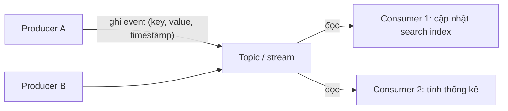
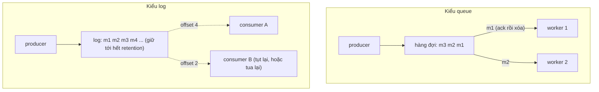
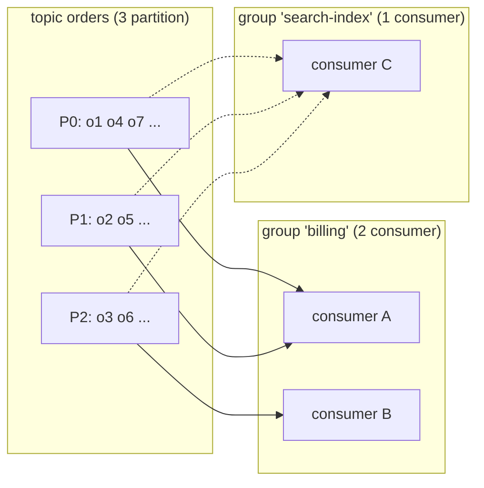
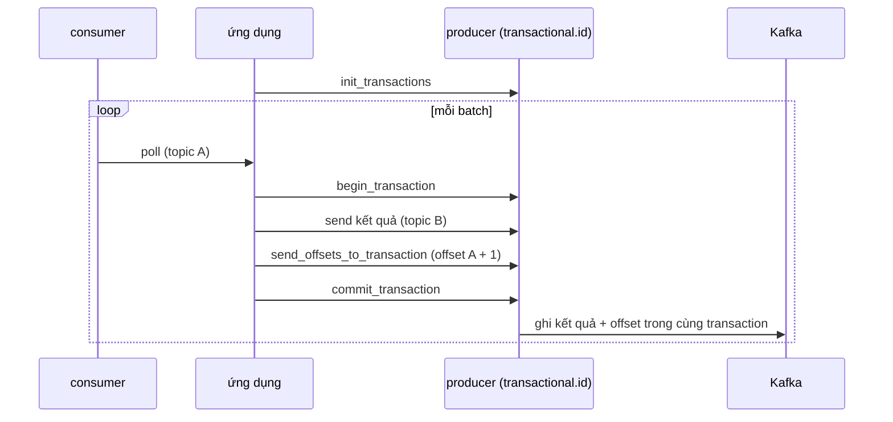
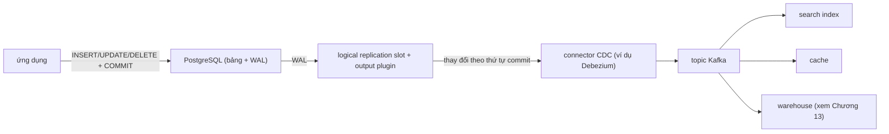
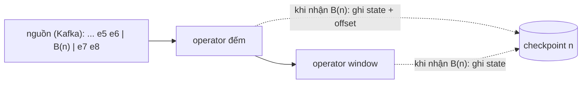

# P12 · Chương 11 — Stream processing: log, delivery semantics, CDC, window và watermark

> Chương này dùng khung chủ đề của sách *Designing Data-Intensive Applications* (DDIA) làm xương sống, nhưng **không trích và không viết lại nội dung sách** (sách không có bản đọc tự do). Mọi khẳng định dựa vào nguồn mở ghi ở chú thích: docs Apache Kafka 3.9.0 (ghim theo tag GitHub), Kafka Streams, docs Apache Flink 1.20, RabbitMQ, PostgreSQL 16, Debezium 2.7, bài *The Dataflow Model* (VLDB 2015), bài giảng *Distributed Systems* của Kleppmann (Cambridge), bài *End-to-End Arguments* (Saltzer–Reed–Clark), docs.rs `rdkafka` 0.39.0 và `tokio` 1.53.2. **Chương không có thí nghiệm**: không con số hiệu năng nào ở đây do người soạn đo.

## Bạn sẽ hiểu được gì

- **Q1.** Event, stream, producer và consumer là gì; "unbounded" khác "streaming" ra sao? → mục 1
- **Q2.** Message broker kiểu *queue* (xóa sau khi ack) khác kiểu *log* (giữ lại, consumer tự giữ vị trí) ở đâu, và mỗi kiểu hợp việc gì? → mục 2
- **Q3.** Trong một log kiểu Kafka, partition, key, offset, consumer group, retention và log compaction là gì và ăn khớp với nhau thế nào? → mục 3
- **Q4.** At-most-once, at-least-once, exactly-once khác nhau thế nào; idempotent producer và transaction của Kafka giải quyết đến đâu, và vì sao "exactly-once" với hệ ngoài vẫn cần thêm việc? → mục 4
- **Q5.** Change data capture (CDC) dựa vào PostgreSQL logical decoding hoạt động ra sao; event sourcing khác CDC thế nào; "stream–table duality" là gì? → mục 5
- **Q6.** Event time khác processing time thế nào; tumbling/hopping/session window là gì; watermark làm gì và vì sao không bao giờ đủ? → mục 6
- **Q7.** Stream join (stream–stream, stream–table, table–table) cần gì và dễ sai ở đâu? → mục 7
- **Q8.** Một job stream có state thì chịu lỗi bằng cách nào (checkpoint, changelog, replay)? → mục 8

## Kiến thức cần trước

- [Chương 05 — Replication](05-replication.md): replication log, leader/follower. Chương này dùng lại ý "log là nguồn sự thật" mà không giải thích lại cách replicate.
- [Chương 06 — Partitioning](06-partitioning.md): chia dữ liệu theo key; partition của Kafka là một ứng dụng của ý đó.
- [Chương 07 — Transaction](07-transaction.md): atomic commit; transaction của Kafka (mục 4) là một dạng "ghi nhiều nơi cùng thành hoặc cùng bại".
- [Chương 08 — Sự cố hệ phân tán](08-su-co-he-phan-tan.md): mạng mất/trễ/trùng gói, đồng hồ không đáng tin — gốc của mọi vấn đề *trùng lặp* và *sai thứ tự* ở chương này.
- [P5 · Chương 05 — Crash consistency và journaling](../05-storage/05-crash-consistency-va-journaling.md) (WAL) và [P5 · Chương 06 — Durability](../05-storage/06-durability-trong-thuc-te.md): "ghi vào log trước" và `fsync`; chương này không lặp lại.

(Batch processing đối chiếu ở [Chương 10](10-batch-processing.md); ghép stream vào kiến trúc tổng thể và dữ liệu dẫn xuất ở [Chương 12](12-dung-dan-va-tich-hop-du-lieu.md); warehouse/lake/ETL ở [Chương 13](13-kien-truc-he-du-lieu.md); xóa dữ liệu cá nhân và GDPR ở [Chương 14](14-trach-nhiem-voi-du-lieu.md). Các chủ đề đó chỉ được nhắc 1–2 câu ở đây.)

## 1. Event, stream, producer, consumer (Q1)

> **Trả lời ngắn.** *Event* là bản ghi rằng "một chuyện đã xảy ra" — trong Kafka nó gồm key, value, timestamp và vài header tùy chọn[^k-event][^k-event-fields]. *Stream* là chuỗi event không có điểm kết thúc đã biết trước; *producer* ghi event vào, *consumer* đọc ra, hai bên không cần biết nhau[^k-decoupled]. "Unbounded" (không biên) là tính chất của *dữ liệu*; "streaming" chỉ là một loại *engine* chạy — engine batch vẫn xử lý được dữ liệu không biên bằng cách chạy lặp, và engine streaming cũng xử lý được dữ liệu hữu hạn[^df-unbounded].

**Giải thích.**

Hình dung (nhận xét của người soạn): bảng `orders` trong database là *ảnh chụp* — "hiện giờ đơn #7 đang ở trạng thái PAID". Stream là *cuốn nhật ký* dẫn tới ảnh chụp đó: "đơn #7 tạo", "đơn #7 thanh toán", "đơn #7 hủy". Có nhật ký thì dựng lại được ảnh chụp tại mọi thời điểm; có ảnh chụp thì không suy ngược ra nhật ký.

*Event.* Docs Kafka định nghĩa event là bản ghi về việc "có chuyện đã xảy ra" trong thế giới hoặc trong nghiệp vụ; trong tài liệu nó còn được gọi là record hoặc message[^k-event]. Về khái niệm, event có key, value, timestamp và header tùy chọn[^k-event-fields]. Ví dụ của docs: key là "Alice", value là "Made a payment of $200 to Bob", kèm một mốc thời gian[^k-event-example]. Điểm cần nhớ: timestamp nằm *trong* event — mục 6 sẽ cho thấy nó là nền của toàn bộ bài toán thời gian.

*Producer và consumer.* Producer là ứng dụng ghi (publish) event; consumer là ứng dụng đăng ký đọc và xử lý chúng. Kafka coi hai phía là tách rời hoàn toàn, và docs nói đó là một yếu tố thiết kế chính cho khả năng mở rộng — ví dụ producer không bao giờ phải chờ consumer[^k-decoupled]. Một topic có thể có số producer và số consumer tùy ý, kể cả không có[^k-topicmulti].

*Unbounded và bounded.* Bài Dataflow (Google, VLDB 2015) chọn dùng cặp *unbounded/bounded* (vô hạn/hữu hạn) cho **dữ liệu**, và dành *streaming/batch* cho **engine thực thi**, vì cặp sau ngụ ý một loại engine cụ thể[^df-unbounded-def]. Lý do: dữ liệu vô hạn từ lâu đã được xử lý bằng cách chạy batch lặp đi lặp lại, và engine streaming được thiết kế tốt xử lý được cả dữ liệu hữu hạn[^df-unbounded]. Với dữ liệu vô hạn, phép gộp theo key (`GroupByKey`) có vấn đề: ta không biết khi nào dữ liệu hết; lời giải thông dụng là chia dữ liệu thành *window* (mục 6)[^df-groupbykey].



*Sơ đồ minh họa của người soạn: producer không chờ consumer, consumer không biết producer.*

<details><summary>Đi sâu: vì sao không chỉ "poll bảng database"; batch là trường hợp riêng của stream?</summary>

- Tách rời producer/consumer nghĩa là thêm consumer mới (ví dụ một job báo cáo) không đụng tới code của producer. Với cách "mỗi consumer tự truy vấn bảng của service khác", coupling nằm ở schema bảng (nhận xét của người soạn).
- Dataflow mô tả bài toán theo bốn câu hỏi: *tính cái gì*, *ở đâu trong event time*, *khi nào trong processing time thì phát kết quả*, và *kết quả sớm liên hệ với kết quả hiệu chỉnh sau thế nào*[^df-four]. Ba câu sau là nội dung mục 6; câu đầu là phép biến đổi thông thường.
- Cùng bài đó nhận xét rằng với góc nhìn của mô hình, batch hay streaming "phần lớn không liên quan" — chỉ là chọn engine theo độ trễ và chi phí[^df-unbounded-def]. Chương 10 nói batch từ phía kia.

</details>

**Quay lại Q1:** event là bản ghi "đã có chuyện"; stream là chuỗi event không biên; producer và consumer tách rời; "streaming" là kiểu engine, "unbounded" là kiểu dữ liệu.

## 2. Queue hay log: hai kiểu message broker (Q2)

> **Trả lời ngắn.** Broker kiểu *queue* (ví dụ RabbitMQ) chia việc cho các consumer, chờ ack rồi bỏ message khỏi hàng đợi[^rmq-workq][^rmq-ack-discard]. Broker kiểu *log* (Kafka) giữ event theo thời hạn cấu hình chứ không xóa sau khi tiêu thụ[^k-notdeleted], và để consumer tự giữ vị trí đọc[^k-offset-one]. Hệ quả: queue hợp với "giao việc một lần cho một worker"; log hợp với "nhiều bên cùng đọc, đọc lại, dựng lại state".

**Giải thích.**

Hình dung (nhận xét của người soạn): queue là *khay công văn* trên bàn thư ký — ai lấy tờ nào thì tờ đó rời khay. Log là *cuốn sổ cái đóng gáy* — mọi người đứng đọc cùng một cuốn, mỗi người kẹp một tờ giấy đánh dấu "tôi đọc đến dòng này".

*Kiểu queue.* Ý chính của work queue (RabbitMQ gọi là task queue) là khỏi làm việc nặng ngay trong lúc xử lý request, mà đóng việc thành message bỏ vào hàng đợi cho worker chạy nền[^rmq-workq]. Mặc định RabbitMQ gửi message cho consumer kế tiếp theo vòng, nên trung bình các consumer nhận số message bằng nhau — gọi là round-robin[^rmq-rr]. Khi consumer báo ack (xác nhận đã xử lý), broker ghi nhận message đã giao và có thể bỏ nó[^rmq-ack-discard]. Nếu consumer chết khi chưa ack, message được đưa lại vào hàng đợi (requeue) khi kênh/kết nối đóng[^rmq-requeue]; vì vậy docs yêu cầu consumer phải chịu được việc nhận lại và nên idempotent[^rmq-idem]. (Docs RabbitMQ được dẫn là bản ghi *Version 4.3* trên trang; URL không mang số phiên bản.)

*Kiểu log.* Kafka lưu event trong topic; event không bị xóa sau khi đọc — khác với hệ messaging truyền thống — mà bị bỏ khi quá thời hạn retention cấu hình theo từng topic[^k-notdeleted][^k-retain]. Vì không xóa theo consumer, broker không phải nhớ "message nào đã giao cho ai". Docs Kafka giải thích tại sao điều này quan trọng: hầu hết hệ messaging giữ metadata "đã tiêu thụ" ở broker[^k-broker-state]; làm vậy thì nếu đánh dấu "đã tiêu thụ" ngay lúc gửi, consumer chết giữa chừng sẽ làm mất message; còn thêm ack thì nếu consumer xử lý xong nhưng chết trước khi gửi ack, message bị tiêu thụ hai lần[^k-ack-problem]. Kafka đi hướng khác: mỗi partition chỉ có một consumer trong mỗi consumer group tại một thời điểm, nên vị trí đọc chỉ là *một số nguyên* mỗi partition — offset của message kế tiếp[^k-group-excl][^k-offset-one].

*Hệ quả của khác biệt đó.*

| | Queue (kiểu RabbitMQ) | Log (kiểu Kafka) |
|---|---|---|
| Sau khi tiêu thụ | message bị bỏ khi được ack[^rmq-ack-discard] | event vẫn còn tới hết retention[^k-notdeleted] |
| Ai nhớ vị trí | broker theo dõi ack | consumer giữ offset mỗi partition[^k-offset-one] |
| Đọc lại | không phải hợp đồng của work queue cổ điển (nhận xét của người soạn); RabbitMQ có thêm loại *stream* — log append-only đọc lại được tới khi hết hạn[^rmq-streams] | consumer có thể tua lại offset cũ và đọc lại[^k-rewind] |
| Chia tải | message lần lượt tới các consumer[^rmq-rr] | mỗi partition một consumer trong group[^k-group-excl] |
| Consumer chậm | (nhận xét của người soạn) hàng đợi dài ra | consumer cứ tụt lại rồi đuổi kịp khi có thể (do cơ chế pull)[^k-pull] |

Dòng cuối: Kafka chọn mô hình pull — consumer kéo dữ liệu — vì push dễ làm consumer bị quá tải khi tốc độ tiêu thụ thấp hơn tốc độ sinh, còn pull cho phép consumer tụt lại và đuổi kịp khi có thể[^k-pull].



*Sơ đồ minh họa của người soạn.*

<details><summary>Đi sâu: vì sao log "rẻ" — pagecache, ghi tuần tự, sendfile; và cái giá</summary>

- Kafka ghi mọi thứ vào log trên filesystem "mà không nhất thiết flush xuống đĩa", tức thực chất là chuyển vào pagecache của kernel[^k-pagecache]. Bài đó phụ thuộc vào cơ chế page cache của OS: xem [P5 · Chương 04](../05-storage/04-page-cache-va-direct-io.md), và `fsync` ở [P5 · Chương 06](../05-storage/06-durability-trong-thuc-te.md).
- Docs lập luận rằng cấu trúc log (đọc và append tuần tự) có mọi thao tác O(1), đọc không chặn ghi và không chặn nhau[^k-O1], nên Kafka có thể giữ message khá lâu — ví dụ một tuần — thay vì xóa ngay khi tiêu thụ[^k-retain-week].
- Gửi từ pagecache ra socket dùng `sendfile`, tránh chép dữ liệu qua lại: docs mô tả đường đi cổ điển có bốn lần chép và hai syscall, còn `sendfile` cho OS gửi thẳng từ pagecache ra mạng[^k-sendfile]. Cơ chế `sendfile` giải thích ở [P6 · Chương 09](../06-networking/09-zero-copy-io.md).
- Cái giá (suy luận của người soạn từ "mỗi partition một consumer trong group"[^k-group-excl]): số consumer *hữu ích* trong một group bị chặn trên bởi số partition; và một message "độc" (xử lý luôn lỗi) chặn các message sau nó *trong cùng partition* nếu consumer không bỏ qua hoặc chuyển nó sang nơi khác (dead-letter).
- Broker log vẫn cần *ack ở phía producer* — mức độ bền khi ghi (mục 4).

</details>

**Quay lại Q2:** queue = broker nhớ ai đã nhận gì và xóa sau ack; log = broker giữ một chuỗi append-only, consumer tự giữ offset, nên đọc lại và nhiều bên cùng đọc là chuyện bình thường.

## 3. Bên trong một log kiểu Kafka (Q3)

> **Trả lời ngắn.** Một topic chia thành nhiều *partition*, mỗi partition là một log append-only; event cùng key đi vào cùng partition và được đọc đúng thứ tự ghi — nhưng thứ tự chỉ bảo đảm *trong một partition*[^k-partition][^k-partition-order]. Vị trí đọc của consumer là *offset*; các consumer chung *consumer group* chia nhau các partition. Dữ liệu bị xóa khi quá *retention* (theo thời gian hoặc kích thước), hoặc được *compact* để giữ ít nhất giá trị mới nhất của mỗi key[^k-compaction].

**Giải thích.**

Hình dung (nhận xét của người soạn): cả công ty có một cuốn sổ cái quá lớn cho một máy; ta xé thành N cuốn nhỏ đánh số, quy ước "hóa đơn của khách hàng nào luôn ghi vào cuốn do tên khách hàng quyết định". Trong mỗi cuốn, thứ tự dòng là cố định; giữa các cuốn thì không có thứ tự chung nào.

*Partition và key.* Topic được "trải" ra nhiều partition đặt trên các broker khác nhau, để client đọc/ghi song song với nhiều broker; khi event được publish nó được append vào *một* partition của topic[^k-partition]. Event cùng key (ví dụ ID khách hàng) vào cùng partition, và Kafka bảo đảm consumer của một topic-partition đọc các event của partition đó đúng thứ tự đã ghi[^k-partition][^k-partition-order]. Client quyết định ghi vào partition nào: ngẫu nhiên, hoặc theo hàm phân vùng ngữ nghĩa băm key — docs lấy ví dụ key là user id để mọi dữ liệu của một user vào một partition[^k-keypartition]. Chia theo key là ý của [Chương 06](06-partitioning.md); điều chương này thêm là: *thứ tự theo key được bảo toàn, thứ tự toàn cục thì không* (suy luận của người soạn từ câu "đúng thứ tự trong partition" ở nguồn).

*Offset.* Offset là số thứ tự message trong một partition. Kafka dùng nó làm id của message; docs giải thích đã chọn một bộ đếm nguyên tử theo partition thay vì GUID của producer để khỏi phải dựng cấu trúc chỉ mục nặng[^k-offset-id]. Consumer gửi yêu cầu *fetch* tới broker đang là leader của partition và nêu offset muốn đọc[^k-fetch]; vì vậy consumer kiểm soát được vị trí của mình và tua lại khi cần[^k-rewind].

*Consumer group.* Mỗi consumer khai `group.id` để cho biết nó thuộc group nào[^kc-group-id]. Trong một group, mỗi partition do đúng một consumer đọc tại một thời điểm[^k-group-excl]. Kafka Streams — thư viện xử lý stream của Kafka — lấy chính điều này làm mô hình song song: số task cố định, tính theo số partition đầu vào, mỗi task được giao một danh sách partition[^ks-tasks]; số instance chạy song song tối đa bị chặn bởi số partition của topic đầu vào, ví dụ topic 5 partition thì tối đa 5 instance[^ks-maxpar].



*Sơ đồ minh họa của người soạn: mỗi group có offset riêng và đọc toàn bộ topic độc lập với group khác (suy luận của người soạn từ "mỗi partition một consumer trong mỗi group đăng ký").*

*Rebalance.* Khi thành viên group đổi (consumer chết, thêm instance), các partition được chia lại — gọi là rebalance. Consumer bị coi là hỏng nếu không gọi `poll()` trong `max.poll.interval.ms`, khi đó group rebalance để giao partition cho thành viên khác[^kc-poll-interval]. Docs Kafka cũng nêu rằng với ứng dụng có state lớn, các task bị chuyển sang instance khác lúc deploy/restart phải mất thời gian phục hồi state, nên có *static membership* (đặt `group.instance.id` cố định) để tránh rebalance không cần thiết[^k-static].

*Retention.* Dữ liệu không xóa theo consumer mà xóa theo chính sách của topic. Việc xóa làm theo từng *segment* (file log)[^k-impl-delete]. Kafka cho chọn xóa theo thời gian hoặc kích thước; chính sách theo thời gian dựa vào timestamp lớn nhất trong segment[^k-impl-retention], còn chính sách theo kích thước (mặc định tắt) xóa segment cũ nhất cho tới khi partition nằm trong giới hạn[^k-impl-size].

*Compaction.* Với log là dòng thay đổi của dữ liệu có key (ví dụ bảng email người dùng), có thể thay retention theo thời gian bằng *log compaction*: bảo đảm giữ ít nhất giá trị cập nhật cuối của mỗi key[^k-compaction]. Bản ghi có key và payload null là *tombstone* — đánh dấu xóa[^k-tombstone]. Compaction không đổi thứ tự message và không đổi offset: offset là định danh vĩnh viễn của một vị trí trong log[^k-compact-order][^k-compact-offsets]. Docs nêu các dùng cho compaction: đăng ký theo dõi thay đổi database[^k-compact-cdc], event sourcing[^k-compact-es], và journaling để phục hồi state của một tiến trình xử lý[^k-compact-uses] — ba chủ đề của mục 5 và 8.

*Replication và "committed".* Đơn vị replicate là partition: mỗi partition có một leader và các follower[^k-repl-unit]. Một message được coi là *committed* khi mọi replica trong ISR (tập replica đang đồng bộ) đã áp dụng nó vào log[^k-committed]; consumer chỉ được giao message đã committed[^k-committed-only], và message committed không mất miễn là còn ít nhất một replica đồng bộ còn sống[^k-committed-lost]. Đừng đọc "ISR" thành "mọi replica được gán": với `acks=all`, ack được trả ngay khi mọi replica *hiện đang* trong ISR đã nhận message[^k-acks-all-isr], và nếu producer đòi ack yếu hơn thì message vẫn có thể được commit và consume kể cả khi số replica đồng bộ thấp hơn mức tối thiểu của topic (tối đa là chỉ còn leader)[^k-min-isr]. Giao thức replicate log và bầu leader giải thích ở [Chương 05](05-replication.md) và [Chương 09](09-consistency-va-consensus.md).

<details><summary>Đi sâu: static membership, chọn partition, giới hạn của "thứ tự"</summary>

- **Static membership:** docs yêu cầu broker và client từ 2.3 trở lên, và mỗi instance một `group.instance.id` riêng; nếu trùng id giữa hai instance, broker "fence" instance trùng bằng `FencedInstanceIdException`[^k-static-detail].
- **Timestamp của record:** từ Kafka 0.10, timestamp được nhúng sẵn vào message; tùy cấu hình broker nó đại diện *event time* hoặc *ingestion time* — chọn ở cấu hình Kafka chứ không phải ở Kafka Streams[^ks-ts-choice]. Điều này nối sang mục 6.
- **Thứ tự và timestamp không đồng nhất:** trong một partition, timestamp của record có thể không tăng đơn điệu theo offset[^ks-oo-sources]. Nên "thứ tự theo offset" và "thứ tự theo thời gian" là hai thứ khác nhau.
- **Chọn số partition** (nhận xét của người soạn): số partition cố định mức song song tối đa của một group (ở trên), nên chọn dư một chút ngay từ đầu; đổi số partition sau này làm đổi ánh xạ key → partition, một chủ đề của [Chương 06](06-partitioning.md).

</details>

**Quay lại Q3:** topic = N log append-only (partition); key quyết định partition và bảo toàn thứ tự theo key; offset là vị trí đọc; group chia partition cho consumer; retention hoặc compaction quyết định phần nào của log còn lại.

## 4. At-most-once, at-least-once, exactly-once (Q4)

> **Trả lời ngắn.** *At-most-once*: message có thể mất nhưng không bao giờ giao lại. *At-least-once*: không mất nhưng có thể giao lại (trùng). *Exactly-once*: mỗi message được giao đúng một lần — điều mà mọi người thực sự muốn[^k-three][^k-three-2][^k-three-3]. Sự thật khó chịu là mất/trùng xuất phát từ việc *không biết* một yêu cầu đã thành công hay chưa sau khi mạng lỗi[^k-prod-unsure]. Kafka cung cấp producer idempotent và transaction để đạt exactly-once *trong Kafka*; với hệ bên ngoài thì cần cộng tác của hệ đó (idempotent write hoặc ghi offset cùng chỗ với kết quả)[^k-external-note].

**Giải thích.**

Hình dung (nhận xét của người soạn): bạn gọi shipper "giao đơn #7" rồi điện thoại đứt giữa chừng. Bạn không biết shipper nghe chưa. Nếu không gọi lại, có thể đơn không bao giờ được giao (at-most-once). Nếu gọi lại, đơn có thể được giao hai lần (at-least-once). Muốn "đúng một lần" thì cuộc gọi lại phải kèm số đơn để shipper nhận ra "đơn này tôi đã giao rồi".

*Ba mức bảo đảm.* Docs Kafka định nghĩa: at most once — message có thể mất nhưng không giao lại[^k-three]; at least once — không mất nhưng có thể giao lại[^k-three-2]; exactly once — mỗi message giao một lần và chỉ một lần[^k-three-3]. Docs cũng lưu ý bài toán tách làm hai: bảo đảm bền khi *publish* và bảo đảm khi *tiêu thụ*[^k-two-problems], và cảnh báo rằng nhiều hệ tuyên bố "exactly once" nhưng phần lớn lời tuyên bố đó gây hiểu nhầm (không đúng khi consumer/producer có thể lỗi, khi có nhiều consumer, hoặc khi dữ liệu ghi đĩa có thể mất)[^k-exactly-fine].

*Phía producer.* Producer gửi message và gặp lỗi mạng thì không biết lỗi xảy ra trước hay sau khi message được committed[^k-prod-unsure]. Trước Kafka 0.11.0.0, producer chỉ còn cách gửi lại, tức at-least-once vì lần gửi trước có thể đã thành công[^k-prod-resend]. Từ 0.11.0.0 có *idempotent producer*: broker gán cho producer một ID và khử trùng bằng số thứ tự (sequence number) kèm mỗi message, nhờ đó gửi lại không tạo bản ghi trùng trong log[^k-idem]. Bật bằng `enable.idempotence=true`: producer bảo đảm chỉ một bản sao mỗi message được ghi vào stream; nó đòi `max.in.flight.requests.per.connection` ≤ 5, `retries` > 0 và `acks=all`[^kp-idem]. `acks=all` nghĩa là leader chờ toàn bộ ISR xác nhận, bảo đảm record không mất miễn là còn một replica đồng bộ sống[^kp-acks-all].

*Phía consumer.* Thứ tự hai việc "xử lý" và "lưu offset" quyết định mức bảo đảm khi consumer chết giữa chừng:

| Thứ tự | Nếu chết ở giữa | Mức bảo đảm |
|---|---|---|
| đọc → **lưu offset** → xử lý | process thay thế bắt đầu từ offset đã lưu, bỏ sót message chưa xử lý | at-most-once[^k-cons-1] |
| đọc → xử lý → **lưu offset** | process thay thế xử lý lại vài message đầu | at-least-once[^k-cons-alo] |

Docs Kafka thêm: nhiều khi message có primary key nên cập nhật *idempotent* (nhận hai lần chỉ ghi đè bản ghi bằng chính nó)[^k-cons-2]. Mặc định Kafka bảo đảm at-least-once; at-most-once đạt được bằng cách tắt retry ở producer và commit offset trước khi xử lý batch[^k-default-alo].

*Exactly-once trong Kafka (transaction).* Khi vòng lặp là *đọc từ topic A → xử lý → ghi vào topic B*, có thể dùng producer transaction: producer có thể ghi nhiều partition theo kiểu "hoặc tất cả thành công, hoặc không cái nào"[^k-txn]. Vị trí đọc của consumer được lưu như một message trong một topic, nên offset được ghi trong *cùng transaction* với dữ liệu ra; transaction abort thì offset trở về giá trị cũ và dữ liệu ra không hiện với consumer khác[^k-offset-in-txn]. Consumer chọn thấy gì bằng `isolation.level`: `read_uncommitted` (mặc định của Kafka consumer) thấy cả message của transaction đã abort; `read_committed` chỉ thấy message của transaction đã commit và message không thuộc transaction nào[^k-readcommitted].



*Sơ đồ minh họa vòng consume–transform–produce; tên hàm theo API của `rdkafka` (mục "Liên hệ với Rust").*

*Với hệ bên ngoài Kafka.* Ghi ra database/HDFS thì cái khó là phải *phối hợp vị trí consumer với thứ thực sự được lưu*. Cách cổ điển là two-phase commit giữa nơi lưu offset và nơi lưu output; docs Kafka nói cách đơn giản và tổng quát hơn là lưu offset *cùng chỗ* với output, vì nhiều hệ đích không hỗ trợ 2PC — ví dụ một connector ghi dữ liệu vào HDFS cùng offset để dữ liệu và offset hoặc cùng cập nhật hoặc cùng không[^k-external]. Kết luận của docs: Kafka hỗ trợ exactly-once trong Kafka Streams; producer/consumer transactional dùng được cho việc chuyển và xử lý dữ liệu *giữa các topic Kafka*; với hệ đích khác thì cần cộng tác của hệ đó[^k-external-note].

*Vì sao "chỉ cần idempotent" là đủ trong nhiều trường hợp* (tóm tắt; phân tích đầy đủ ở [Chương 12, mục 4–5](12-dung-dan-va-tich-hop-du-lieu.md)). Bài giảng của Kleppmann tại Cambridge: nếu retry không tránh được, exactly-once = retry + idempotence hoặc khử trùng[^cam-eo]. Cập nhật idempotent có thể áp dụng nhiều lần nhưng hiệu quả như đúng một lần[^cam-idem]; đếm "like" bằng `+1` không idempotent, còn thêm user vào *tập* thì idempotent[^cam-counter]. Khử trùng thì phải lưu thông tin về request đã thấy ở nơi bền, để nhận ra trùng cả sau khi crash[^cam-dedup]. Theo lập luận end-to-end của Saltzer–Reed–Clark, việc khử trùng phải do ứng dụng làm, vì chỉ nó biết cách nhận ra trùng của mình[^e2e-dup].

<details><summary>Đi sâu: LSO, fencing, Kafka Streams, và "exactly-once" của Flink thực sự nghĩa là gì</summary>

- **LSO.** Ở `read_committed`, `poll()` chỉ trả message tới *last stable offset* (LSO) — nhỏ hơn offset của transaction đang mở đầu tiên một đơn vị; mọi message nằm sau message của transaction đang chạy bị giữ lại tới khi transaction đó xong, nên consumer `read_committed` không đọc tới high watermark được khi có transaction đang bay[^kc-iso].
- **`transactional.id`.** Cấu hình này cho phép bảo đảm kéo dài qua nhiều phiên producer: client bảo đảm các transaction cùng id đã hoàn tất trước khi bắt đầu transaction mới[^kp-txid2]; có `transactional.id` thì `enable.idempotence` được ngầm bật[^kp-txid]. Mặc định transaction cần cụm tối thiểu ba broker[^kp-txid]. Hàm `init_transactions` của `rdkafka` ghi: nó bảo đảm mọi transaction của producer trước dùng cùng id được hoàn tất, transaction còn mở sẽ bị abort[^rk-init-tx].
- **Kafka Streams.** Điểm khác biệt mà docs nêu: Streams tích hợp chặt với Kafka nên commit offset đầu vào, cập nhật state store và ghi topic đầu ra hoàn tất nguyên tử, không coi Kafka như hệ ngoài có tác dụng phụ[^ks-eos]. Bật chế độ exactly-once bằng cấu hình `processing.guarantee`[^ks-pg], mặc định là `at_least_once`[^ks-pg-default]; từ bản 3.0.0 phiên bản đầu của exactly-once bị đánh dấu deprecated và docs khuyến khích dùng "exactly-once v2" (`EXACTLY_ONCE_V2`)[^ks-eos-v2].
- **Flink.** Flink nói rõ "exactly once" *không* có nghĩa mỗi event được xử lý đúng một lần, mà là mỗi event *ảnh hưởng đến state do Flink quản lý* đúng một lần, vì Flink khôi phục bằng cách tua lại và phát lại nguồn[^flink-eo]. Muốn exactly-once đầu-cuối thì nguồn phải phát lại được và sink phải transactional hoặc idempotent[^flink-e2e].
- **Lưu ý cho consumer Rust** (nhận xét của người soạn): `rdkafka` 0.39.0 đi kèm librdkafka 2.12.1[^rk-sys-ver][^rk-sys-readme]; `CONFIGURATION.md` của librdkafka ở đúng tag đó ghi mặc định `isolation.level` là `read_committed`[^lib-iso], và docs `rdkafka` cũng nói consumer nhận biết transaction dùng mặc định `read_committed`[^rk-iso], trong khi docs consumer của client Java Kafka 3.9.0 ghi mặc định là `read_uncommitted`[^kc-iso-default]. Hai mặc định khác nhau vì là hai thư viện khác nhau (C và Java), nên **đặt `isolation.level` tường minh** thay vì dựa vào mặc định — nhất là khi bạn đổi qua lại giữa hai client hoặc dùng `dynamic-linking` với bản librdkafka khác.

</details>

**Quay lại Q4:** mất/trùng sinh ra từ việc không biết một lần gửi đã thành công chưa; thứ tự "xử lý rồi lưu offset" cho at-least-once; transaction của Kafka cho exactly-once *trong* Kafka; với hệ ngoài phải idempotent hoặc ghi offset cùng chỗ với kết quả.

## 5. CDC, event sourcing và stream–table duality (Q5)

> **Trả lời ngắn.** *Change data capture* (CDC) biến mọi thay đổi đã commit của database thành một stream event. Với PostgreSQL, cơ chế là *logical decoding*: đọc WAL và giải mã thành dạng dễ hiểu[^pg-ld-wal], giao qua *replication slot* theo đúng thứ tự thực hiện trên server gốc[^pg-slot] (các transaction đồng thời được giải mã theo thứ tự commit[^pg-commit-order]). *Event sourcing* khác: ở đó chính log event là nơi lưu sự thật, và trạng thái hiện tại được dựng bằng cách phát lại event[^az-es][^az-replay]. Cả hai nối vào ý "stream là changelog của một bảng, bảng là ảnh chụp của một stream"[^ks-stream-table][^ks-table-snapshot].

**Giải thích.**

Hình dung (nhận xét của người soạn): hệ thống của bạn có database là nguồn sự thật, và các hệ phụ — search index, cache, warehouse — cần theo kịp. Cách ngây thơ là app ghi database *rồi* ghi message lên broker. Hai bước ghi đó không nguyên tử: app chết giữa hai bước là database và search index lệch nhau vĩnh viễn. CDC đảo cách làm: chỉ ghi database; thay đổi của database *tự* thành stream.

*Logical decoding của PostgreSQL.* Docs định nghĩa logical decoding là quá trình trích mọi thay đổi bền của các bảng thành một định dạng mạch lạc, dễ hiểu, diễn giải được mà không cần biết nội bộ database[^pg-ld-def]. Trong PostgreSQL, nó được cài bằng cách giải mã nội dung WAL — vốn mô tả thay đổi ở mức lưu trữ — thành dạng ứng dụng dùng được như dòng tuple hay câu SQL[^pg-ld-wal]. (WAL và nguyên tắc "ghi log trước" xem [P5 · Chương 05](../05-storage/05-crash-consistency-va-journaling.md).) Điều kiện: `wal_level = logical` thêm thông tin cần cho logical decoding[^pg-wal-level].



*Sơ đồ minh họa của người soạn.*

*Replication slot.* Slot là một dòng thay đổi có thể phát lại cho client theo đúng thứ tự thực hiện trên server gốc; mỗi slot phát thay đổi của một database[^pg-slot]. Slot tồn tại độc lập với kết nối đang dùng nó và an toàn khi crash[^pg-slot-persist]. Các thay đổi được giải mã theo *thứ tự commit*; giữa begin và commit chỉ có thay đổi của đúng transaction đó; transaction bị rollback không bao giờ được giải mã[^pg-commit-order]. Chỉ transaction đã được flush an toàn xuống đĩa mới được giải mã[^pg-flushed]. *Output plugin* biến biểu diễn nội bộ của WAL thành định dạng mà consumer của slot muốn[^pg-plugin]. Có thể dùng slot qua giao thức streaming replication hoặc qua hàm SQL[^pg-consume].

*Hai điểm vận hành quan trọng* (đều có trong docs):

1. **Trùng lặp sau crash.** Slot phát mỗi thay đổi một lần trong điều kiện bình thường; nhưng vị trí slot chỉ được lưu tại checkpoint, nên sau crash slot có thể lùi về LSN cũ và gửi lại các thay đổi gần nhất; client chịu trách nhiệm tránh tác hại khi nhận cùng message nhiều lần[^pg-slot-once]. Nói cách khác CDC bản chất là *at-least-once* (mục 4) ở phía consumer. Debezium (một connector CDC phổ biến) nói đúng điều đó: khi hệ thống chạy bình thường nó giao exactly-once mỗi bản ghi thay đổi[^deb-eo], nhưng trong các tình huống bất thường nó, giống Kafka, chỉ bảo đảm at-least-once[^deb-alo].
2. **Slot giữ WAL.** Slot tồn tại qua crash và không biết trạng thái consumer; nó ngăn xóa tài nguyên cần thiết ngay cả khi không có kết nối nào dùng — theo docs, WAL cần thiết và các hàng catalog hệ thống cần thiết đều không được dọn chừng nào slot còn cần chúng, nên tốn dung lượng[^pg-slot-caution]; trong trường hợp cực đoan có thể làm database tắt để tránh wraparound ID transaction, và slot không còn dùng thì phải xóa[^pg-slot-wrap]. `max_slot_wal_keep_size` mặc định `-1` nghĩa là slot có thể giữ lượng WAL không giới hạn[^pg-maxslot]. (Nhận xét của người soạn: consumer CDC chết lâu là sự cố đĩa của database nguồn, nên cần theo dõi độ trễ slot.)

*Replica identity.* Output plugin luôn thấy hàng mới của INSERT và phiên bản mới của UPDATE; còn hàng *cũ* của UPDATE/DELETE có hay không phụ thuộc cấu hình replica identity[^pg-ri]. Mặc định chỉ ghi giá trị cũ của cột khóa chính[^pg-ri-default]; `FULL` ghi giá trị cũ của mọi cột[^pg-ri-full].

*Snapshot ban đầu.* CDC cần trạng thái đầu rồi mới theo dõi thay đổi. Khi tạo slot qua giao thức streaming replication, PostgreSQL xuất một snapshot cho biết đúng trạng thái database mà sau đó mọi thay đổi sẽ được đưa vào stream — dùng để dựng bản sao rồi áp tiếp nội dung slot mà không mất thay đổi nào[^pg-snapshot]. Debezium làm tương tự: lần đầu kết nối, connector chụp snapshot nhất quán, rồi liên tục bắt thay đổi mức hàng đã commit[^deb-snap]; nó ghi vị trí WAL cho mỗi event và khi khởi động lại thì đọc tiếp từ chỗ dừng[^deb-resume].

*Outbox* (tóm tắt; mẫu này và cách vận hành ở [Chương 12, mục 6](12-dung-dan-va-tich-hop-du-lieu.md)). Khi service cần vừa đổi state trong database vừa phát event, mẫu *outbox* (ghi event vào một bảng trong cùng transaction với thay đổi nghiệp vụ, rồi để CDC chuyển bảng đó lên broker) tránh sự không nhất quán giữa state nội bộ của service và state trong các event[^deb-outbox]. Phần chuyển lên broker là at-least-once nên consumer vẫn phải idempotent (suy luận của người soạn).

*Event sourcing.* Thay vì lưu trạng thái hiện tại rồi cập nhật tại chỗ, event sourcing lưu toàn bộ chuỗi hành động trên đối tượng vào kho append-only; kho đó là system of record để dựng lại đối tượng[^az-es]. Mỗi entity có một event stream riêng; trạng thái hiện tại có được bằng cách phát lại các event của nó — gọi là rehydration[^az-replay]. Vì phát lại tốn kém nên thường duy trì *materialized view* — phép chiếu chỉ-đọc của event store, tối ưu cho truy vấn[^az-mv]; vì view cập nhật sau event nên hệ thống chỉ *nhất quán cuối cùng* (eventually consistent)[^az-ec]. Khác biệt cốt lõi với CDC (nhận xét của người soạn): CDC *suy ra* event từ thay đổi của một database vốn là nơi giữ state; event sourcing đặt event làm nơi giữ state, còn bảng chỉ là dẫn xuất.

*Stream–table duality.* Docs Kafka Streams mô tả: stream có thể xem như changelog của một bảng — mỗi record là một thay đổi trạng thái[^ks-stream-table]; bảng có thể xem như ảnh chụp, tại một thời điểm, của giá trị mới nhất mỗi key trong một stream[^ks-table-snapshot]. Nói gọn: stream xem như bảng, bảng xem như stream; log compaction của Kafka khai thác chính tính đối ngẫu này[^ks-duality]. Đây là nền cho join stream–table ở mục 7 và cho changelog của state ở mục 8.

<details><summary>Đi sâu: event sourcing trả giá gì; xóa dữ liệu cá nhân; thử logical decoding bằng SQL</summary>

- **Giá phải trả.** Docs Azure Architecture Center cảnh báo event sourcing là một mẫu phức tạp với nhiều đánh đổi, thay đổi cách lưu dữ liệu, xử lý đồng thời, tiến hóa schema và truy vấn trạng thái[^az-complex]. Sự kiện đã lưu bất biến: muốn sửa hay hoàn tác chỉ có cách thêm *compensating event*[^az-comp]; đổi schema event có thể xử lý bằng *upcasting* — hàm chuyển schema cũ sang schema hiện tại lúc giải tuần tự hóa[^az-upcast]. Snapshot chỉ là tối ưu: event stream vẫn là nguồn sự thật[^az-snap]. Phân phối event thường at-least-once nên handler phải idempotent[^az-idem].
- **Xóa dữ liệu cá nhân.** Chính nguồn này nêu rằng tính append-only/bất biến của event store xung đột với quy định yêu cầu xóa dữ liệu cá nhân (quyền "được quên")[^az-gdpr]. Hướng xử lý (tách dữ liệu cá nhân, crypto-shredding…) được bàn ở [Chương 14](14-trach-nhiem-voi-du-lieu.md), không lặp lại ở đây.
- **Thử bằng SQL.** Docs PostgreSQL có ví dụ: tạo slot bằng `pg_create_logical_replication_slot` rồi đọc thay đổi bằng `pg_logical_slot_get_changes`[^pg-ex]. Ví dụ đó ghi chú rằng khi thay đổi đã được đọc bằng `get_changes` thì chúng được tiêu thụ và không phát lại[^pg-ex-consumed]; muốn xem trước mà không tiêu thụ thì dùng `pg_logical_slot_peek_changes`[^pg-ex-peek].
- **CDC vs replication** (nhận xét của người soạn): đây là *replication ở mức logic* (hàng/bảng) nên có thể đi sang hệ khác kiểu (search, warehouse); replication vật lý (byte WAL) chỉ nối PostgreSQL với PostgreSQL. Phân tích đầy đủ ở [Chương 05](05-replication.md).
- **Ghép lên kiến trúc lớn.** Dòng thay đổi này là một trong các cách đưa dữ liệu từ hệ vận hành sang hệ phân tích — xem [Chương 13](13-kien-truc-he-du-lieu.md) — và là chất liệu của "dữ liệu dẫn xuất" ở [Chương 12](12-dung-dan-va-tich-hop-du-lieu.md).

</details>

**Quay lại Q5:** CDC = đọc WAL → slot → stream thay đổi theo thứ tự commit (at-least-once; nhớ theo dõi slot giữ WAL); event sourcing = lưu event làm sự thật, state là dẫn xuất; hai thứ gặp nhau ở ý stream và bảng là hai mặt của cùng dữ liệu.

## 6. Event time, processing time, window và watermark (Q6)

> **Trả lời ngắn.** *Event time* là lúc sự việc thực sự xảy ra; *processing time* là lúc hệ thống xử lý nó, có thể muộn hơn vài mili-giây tới vài ngày[^ks-event-time][^ks-proc-time]. Gộp theo thời gian thì phải chia stream thành *window* (tumbling, hopping, session…), và vì event tới trễ/sai thứ tự nên cần *watermark* — tín hiệu "event time đã tới mốc t" — nhưng watermark thường chỉ là ước lượng nên có thể sai[^df-fast], và event trễ vẫn phải có chính sách riêng (grace period của Kafka Streams[^ks-grace], allowed lateness của Flink[^fl-late-drop]).

**Giải thích.**

Hình dung (nhận xét của người soạn): app giao hàng tính "số đơn mỗi 5 phút". Một shipper đi qua hầm, bấm "đã giao" lúc 12:03 nhưng điện thoại chỉ có sóng và gửi lúc 12:09. Nếu đếm theo *lúc server nhận* (processing time) thì đơn này vào ô 12:05–12:10 — sai so với thực tế. Nếu đếm theo *lúc xảy ra* (event time) thì nó thuộc ô 12:00–12:05 — nhưng ô đó có thể đã được chốt và gửi báo cáo.

*Hai miền thời gian.* Dataflow định nghĩa event time là thời điểm sự kiện thực sự xảy ra (đồng hồ của hệ sinh ra nó); processing time là thời điểm sự kiện được quan sát tại một điểm của pipeline theo đồng hồ hệ thống, và bài không giả định các đồng hồ phân tán được đồng bộ[^df-evdef][^df-procdef]. Event time của một sự kiện gần như không đổi, còn processing time luôn trôi tới[^df-time]. Độ chênh (skew) giữa hai miền thay đổi động vì độ trễ truyền thông, lập lịch, thời gian xử lý…[^df-skew] Kafka Streams tách thêm *ingestion time* — lúc broker lưu record vào partition[^ks-ingest]. Đồng hồ trên thiết bị sinh event không đáng tin tới đâu thì event time cũng sai tới đó (suy luận của người soạn; xem [Chương 08](08-su-co-he-phan-tan.md)).

*Window.* Windowing chia stream thành các khối hữu hạn để xử lý theo nhóm; với dữ liệu không biên, nó cần cho nhiều phép (gộp, outer join…)[^df-windowing] và về thực chất luôn dựa trên thời gian (nhiều hệ hỗ trợ window theo số tuple, nhưng đó là window theo thời gian logic)[^df-window-time]. Kafka Streams dùng window để nhóm các record cùng key[^ks-win-def], và theo dõi window *theo từng key*[^ks-win-key]. Các kiểu chính:

| Kiểu | Định nghĩa | Ghi chú |
|---|---|---|
| **Tumbling** (Dataflow: "fixed") | cửa sổ cỡ cố định, không chồng lấn, không hở[^ksdsl-tumb][^df-fixed] | một record thuộc đúng một window[^ksdsl-tumb] |
| **Hopping** (Dataflow: "sliding") | cỡ cố định + bước tiến (advance); có thể chồng lấn, ví dụ cỡ 5 phút, bước 1 phút[^ksdsl-hop][^ksdsl-hop2][^df-sliding] | một record có thể thuộc nhiều window[^ksdsl-hop] |
| **Session** | chuỗi hoạt động ngăn cách bởi khoảng im lặng (gap); cỡ thay đổi[^ksdsl-sess2], window của mỗi key được theo dõi độc lập[^ksdsl-sess-keys][^df-session] | event rơi trong gap của session đang có thì gộp vào đó[^ksdsl-sess] |

Tumbling là trường hợp riêng của hopping có cỡ bằng bước tiến[^ksdsl-tumb]; Dataflow nói tương tự: fixed window là trường hợp riêng của sliding window khi cỡ bằng chu kỳ[^df-fixed-special]. **Cẩn thận tên gọi:** Kafka Streams có thêm một kiểu riêng tên "sliding", là cửa sổ cỡ cố định chồng lấn dựa trên *chênh lệch giữa timestamp các record*[^ksdsl-sliding] — khác "sliding" của Dataflow, tương đương "hopping" của Kafka Streams. Flink dùng tên tumbling, sliding, session cho các window assigner[^fl-tumbling][^fl-session].

*Watermark.* Flink định nghĩa: `Watermark(t)` khai báo rằng event time đã tới t trong stream đó, nghĩa là không còn element nào có timestamp ≤ t[^fl-wm-def]. Với nhiều đầu vào, event time của operator là *min* của các đầu vào[^fl-wm-min]. Bài Dataflow nêu hai nhược điểm đều về tính đúng đắn: watermark đôi khi *quá nhanh* — vẫn có dữ liệu trễ tới sau watermark[^df-fast]; và đôi khi *quá chậm* — là một thước đo tiến độ toàn cục, một datum chậm có thể giữ cả pipeline[^df-slow]. Gốc rễ là với đa số tập dữ liệu phân tán thực tế, hệ thống không đủ thông tin để dựng watermark đúng 100%[^df-heur]. Kết luận của bài: chỉ watermark thì chưa đủ[^df-insufficient].

*Dữ liệu trễ.* Flink: element trễ là element tới sau khi đồng hồ event time (theo watermark) đã đi quá timestamp của nó[^fl-late]; làm watermark chậm hơn để chờ thì làm trễ kết quả window[^fl-wm-delay]. Nên có tham số cho phép trễ: `allowed lateness` mặc định 0, element tới sau watermark bị bỏ[^fl-late-drop]; đặt lớn hơn 0 thì element trễ nhưng chưa bị bỏ vẫn được thêm vào window và có thể làm window phát kết quả lần nữa[^fl-lateness]. Kafka Streams có *grace period*: thời gian chờ record sai thứ tự của một window[^ks-grace]; record tới sau grace period bị bỏ[^ks-grace2]. Docs gọi thẳng đây là đánh đổi giữa độ trễ, chi phí và độ đúng[^ks-tradeoff].

*Phát kết quả khi nào, và sửa ra sao.* Dataflow tách "khi nào phát" thành *trigger*[^df-trigger], và "kết quả sau liên hệ kết quả trước thế nào" thành chế độ tinh chỉnh: *discarding* (bỏ nội dung window sau mỗi lần phát)[^df-discarding], *accumulating* (giữ lại, kết quả sau là bản tinh chỉnh của kết quả trước)[^df-trigger-modes]. Trigger theo watermark phát khi watermark vượt cuối window[^df-wm-trigger]. Bài nhận xét Lambda Architecture né bài toán đầy đủ-dữ-liệu bằng cách chỉ cho ước lượng độ trễ thấp từ pipeline stream, kèm hứa hẹn đúng đắn về sau khi batch chạy[^df-lambda] — nối sang [Chương 10](10-batch-processing.md) và [Chương 12](12-dung-dan-va-tich-hop-du-lieu.md).

<details><summary>Đi sâu: stream time của Kafka Streams, nguồn nhàn rỗi, watermark theo partition</summary>

- **Stream time.** Kafka Streams gán timestamp cho mỗi record qua `TimestampExtractor`; thời gian do dữ liệu dẫn dắt (*stream time*) chỉ tiến khi có record mới tới processor[^ks-streamtime] — khác wall-clock time lúc ứng dụng chạy[^ks-streamtime2].
- **Nguồn nhàn rỗi (idle source).** Nếu một partition lâu không có event, bộ sinh watermark không có thông tin mới; watermark bị giữ lại vì nó là *min* của các watermark song song[^fl-idle]. Flink có `WatermarkStrategy` phát hiện nguồn nhàn rỗi và đánh dấu nó idle[^fl-idle2]. Tình huống này hay gặp khi một topic Kafka có partition thưa (nhận xét của người soạn).
- **Watermark theo partition Kafka.** Flink nêu rằng khi đọc Kafka song song nhiều partition, các event xen kẽ nhau và phá mẫu timestamp của từng partition, nên Flink có sinh watermark *bên trong* consumer Kafka theo từng partition rồi gộp[^fl-kafka-wm].
- **Event time và tính tái lập** (suy luận của người soạn): kết quả theo event time không phụ thuộc lúc chạy nên chạy lại trên log cũ cho kết quả như cũ — đó là lý do replay (mục 8) quan trọng; kết quả theo processing time thì không.

</details>

**Quay lại Q6:** event time là lúc xảy ra, processing time là lúc xử lý; window chia stream thành khối hữu hạn (tumbling/hopping/session); watermark ước lượng tiến độ event time nhưng có thể sai, nên cần thêm allowed lateness/grace và trigger.

## 7. Stream join (Q7)

> **Trả lời ngắn.** Join trên stream khác join trong database ở chỗ dữ liệu chưa đầy đủ và còn tới tiếp. Có ba dạng: *stream–stream* (hai dòng event ghép theo key trong một khoảng thời gian), *stream–table* (làm giàu event bằng giá trị mới nhất của một bảng được duy trì từ changelog) và *table–table*. Hai việc dễ sai là *co-partitioning* (hai đầu vào phải chia partition cùng cách) và *thứ tự* (xử lý theo offset hay theo timestamp).

**Giải thích.**

Hình dung (nhận xét của người soạn): bạn có luồng "lượt xem quảng cáo" và luồng "lượt click"; muốn biết click nào đến từ lượt xem nào. Hai luồng không đồng bộ: click có thể tới trước view trong log vì độ trễ khác nhau. Vì vậy join phải *nhớ* một lúc cả hai phía — nghĩa là có state và phải có giới hạn thời gian để state không phình mãi.

*Stream–stream (window join).* Flink: window join ghép các element của hai stream có cùng key và cùng nằm trong một window; window xác định bằng window assigner[^fl-win-join]. Các cặp được tạo như inner join: element không có đối tác ở stream kia thì không được phát ra[^fl-inner]. Có thêm *interval join*: element của stream B có timestamp nằm trong một khoảng tương đối so với timestamp của element stream A cùng key[^fl-interval]; hiện chỉ hỗ trợ event time[^fl-interval-event]. Kafka Streams: join stream–stream là join có cửa sổ; theo docs, ba loại (inner, outer, left) đều xử lý đúng dữ liệu sai thứ tự[^ks-join-ss].

*Stream–table (làm giàu).* Join KStream–KTable không dùng window: khi có record mới trên stream, nó tra một KTable (changelog stream)[^ksj-streamtable]; theo cách hiểu của người soạn (từ stream–table duality ở mục 5), đó là tra giá trị mới nhất của mỗi key. Ví dụ docs: làm giàu luồng hoạt động của user bằng thông tin hồ sơ user mới nhất[^ksj-enrich]. Đây chính là stream–table duality (mục 5) áp dụng.

*Co-partitioning.* Với equi-join, hai đầu vào phải *co-partitioned*: record cùng key của hai bên phải đến cùng một task xử lý[^ksj-copart]; điều kiện gồm hai topic có *cùng số partition* (và cùng cách phân vùng)[^ksj-same-parts], và docs nhấn mạnh việc bảo đảm điều đó là trách nhiệm của người dùng[^ksj-copart-user]. Đây là hệ quả trực tiếp của partition theo key ở [Chương 06](06-partitioning.md): muốn ghép hai dòng theo key mà không chuyển dữ liệu liên máy thì cả hai phải chia theo cùng cách (suy luận của người soạn).

*Thứ tự.* Stream–table join không dùng *versioned store* thì Kafka Streams không kiểm tra record sai thứ tự, chỉ xử lý theo thứ tự offset, nên có thể cho kết quả không đoán trước được[^ks-join-ooo]. Với versioned store, record phía stream sẽ join với bản ghi bảng có timestamp mới nhất mà không vượt quá timestamp của record stream[^ks-versioned]. Phía bảng sai thứ tự vẫn chưa được xử lý[^ks-join-ooo2].

<details><summary>Đi sâu: các biến thể khác</summary>

- Kafka Streams có `GlobalKTable` và *foreign-key join* của KTable không đòi co-partitioning (docs ghi rõ ở phần co-partitioning)[^ksj-copart-exempt]. Chi tiết xem developer guide.
- Phát biểu tổng quát (suy luận của người soạn): mọi join stream cần state có giới hạn thời gian (window hoặc interval) hoặc cần một bảng materialize; chọn kích thước window/interval là quyết định đánh đổi giống `grace period` ở mục 6.

</details>

**Quay lại Q7:** join stream = ghép hai nguồn đang tới tiếp, nên cần state; hai đầu vào phải chia partition cùng cách; và kết quả phụ thuộc vào chính sách xử lý sai thứ tự.

## 8. Chịu lỗi cho xử lý có state (Q8)

> **Trả lời ngắn.** Job có state (đếm, window, join) mất state khi máy chết, nên phải lưu lại state một cách có hệ thống và biết đọc lại nguồn từ đúng điểm. Hai cách phổ biến: *checkpoint* — chụp state của mọi operator cùng offset nguồn (Flink)[^flink-barrier], và *changelog* — mỗi state store ghi mọi cập nhật vào một topic Kafka để dựng lại sau lỗi (Kafka Streams)[^ks-changelog]. Cả hai đều dựa vào nguồn *phát lại được*.

**Giải thích.**

Hình dung (nhận xét của người soạn): bạn đang đếm phiếu bầu từ nhiều thùng phiếu, người đếm ghi tổng trên giấy nháp. Nếu người đếm ngất, người thay thế cần: (1) tờ giấy nháp lần ghi gần nhất, và (2) biết đã đếm đến phiếu số mấy ở mỗi thùng *tương ứng với tờ giấy đó*. Hai thứ này phải khớp nhau; lệch một chút là đếm sót hoặc đếm đôi.

*Checkpoint kiểu Flink.* Flink dùng một biến thể của thuật toán Chandy–Lamport gọi là *asynchronous barrier snapshotting*[^flink-abs]. Khi checkpoint coordinator ra lệnh, mọi nguồn ghi lại offset của mình và chèn các *barrier* đánh số vào stream; barrier trôi qua đồ thị job, đánh dấu phần stream trước và sau mỗi checkpoint[^flink-barrier]. Checkpoint n chứa state của mỗi operator có được sau khi đã tiêu thụ mọi event *trước* barrier n và không event nào *sau* nó[^flink-cp-n]. Operator có hai đầu vào thực hiện *barrier alignment* để snapshot phản ánh state sau khi tiêu thụ cả hai đầu vào tới (nhưng không quá) hai barrier[^flink-align]. Khi lỗi, Flink khôi phục bằng cách tua lại và phát lại các stream nguồn[^flink-replay].



*Sơ đồ minh họa của người soạn: barrier B(n) chia stream thành "trước" và "sau" checkpoint n.*

Ba kết quả có thể: Flink không cố gắng khôi phục (at-most-once); không mất nhưng có thể trùng kết quả (at-least-once); không mất, không trùng (exactly-once)[^flink-three]. Barrier alignment chỉ cần cho exactly-once; không cần thì có thể cấu hình `AT_LEAST_ONCE` để bỏ alignment cho nhanh hơn[^flink-alo]. Như mục 4: exactly-once ở đây là về *state của Flink*[^flink-eo]; ra hệ ngoài cần sink transactional hoặc idempotent[^flink-e2e].

*Changelog kiểu Kafka Streams.* Mỗi state store cục bộ có một *changelog topic* Kafka (replicate) ghi mọi cập nhật; topic này được partition để mỗi store/task có phần changelog riêng, và bật log compaction để dữ liệu cũ dọn được mà topic không phình mãi[^ks-changelog][^ks-changelog2]. Nếu task chạy trên máy hỏng và khởi động lại ở máy khác, Kafka Streams bảo đảm khôi phục state như trước lỗi bằng cách phát lại changelog trước khi tiếp tục xử lý[^ks-restore]. Chi phí khởi tạo lại chủ yếu là thời gian dựng lại state; để giảm, có thể cấu hình *standby replica*[^ks-standby] — bản sao đầy đủ của state[^ks-standby2]. Và theo mục 4, offset đầu vào, cập nhật state store và ghi topic đầu ra được commit nguyên tử trong chế độ exactly-once[^ks-eos].

*So sánh hai cách* (nhận xét của người soạn): checkpoint chụp *toàn bộ job tại một điểm cắt thống nhất*; ở dạng đầy đủ mỗi lần chụp phải ghi lượng state tương ứng, còn checkpoint tăng dần[^flink-ckstorage] giảm bớt phần này; changelog ghi *từng cập nhật* liên tục nên phục hồi tốn thời gian phát lại (giảm bằng standby). Cả hai chỉ đúng nếu nguồn đọc lại được từ một offset — lý do log kiểu Kafka (mục 2–3) hợp với stream processing.

<details><summary>Đi sâu: nơi lưu checkpoint, backpressure, và liên hệ với batch</summary>

- Flink tách *checkpoint* (snapshot tự động để phục hồi lỗi, có thể tăng dần, tối ưu cho việc khôi phục nhanh)[^flink-ckstorage] khỏi *savepoint* (snapshot do người dùng kích hoạt cho mục đích vận hành như redeploy/nâng cấp/đổi cỡ)[^flink-savepoint]; vị trí lưu snapshot cấu hình qua checkpoint storage[^flink-ckstore2].
- Một task Kafka Streams là đơn vị song song cố định, gắn với danh sách partition đầu vào; phép gán partition–task không đổi[^ks-tasks]. (Suy luận của người soạn: nên mỗi task phục hồi state độc lập với task khác.)
- Backpressure trong stream engine là bài toán cùng họ với channel bounded ở [P7 · Chương 09, mục 3](../07-io-async/09-async-trong-production.md): consumer chậm thì phải làm producer chậm theo, không để hàng đợi phình vô hạn.
- Kafka docs cho thấy ý "task thất bại khởi động lại từ vị trí gốc mà không có dữ liệu trùng" ở ví dụ nạp dữ liệu vào Hadoop[^k-hadoop] — ví dụ cổ điển cho batch tải offline từ log (nối sang [Chương 10](10-batch-processing.md)).

</details>

**Quay lại Q8:** state phải lưu cùng vị trí nguồn tương ứng (checkpoint, hoặc changelog + offset commit nguyên tử) và nguồn phải phát lại được; chịu lỗi khi đó là "tua lại và chạy lại".

## Liên hệ với Rust

> Các API dưới đây theo docs.rs **`rdkafka` 0.39.0** (binding an toàn tới `librdkafka`; docs cảnh báo thư viện đang phát triển và API có thể đổi[^rk-warn]) và **`tokio` 1.53.2**. Đoạn code chỉ để minh họa cách ghép API, **chưa được biên dịch hay chạy**; không khẳng định kết quả chạy.

**Các kiểu của `rdkafka` ứng với khái niệm trong chương.**

| Khái niệm | Kiểu / hàm | Ghi chú (nguồn) |
|---|---|---|
| producer async | `FutureProducer` | trả một `Future` hoàn tất khi message được giao tới Kafka (hoặc lỗi)[^rk-clients]; có thread poll nội bộ nên không cần poll tay[^rk-fp-poll] |
| consumer async | `StreamConsumer` | một `Stream` message, tự poll consumer[^rk-clients]; `recv().await` lấy message kế |
| thông tin message | trait `Message` | `key()`, `payload()`, `topic()`, `partition()`, `offset()`, `timestamp()`[^rk-msg] |
| commit offset | `Consumer::commit_message`, `CommitMode::{Sync, Async}` | tương đương `commit` với offset + 1[^rk-commit-plus1] |
| transaction | `init_transactions`, `begin_transaction`, `send_offsets_to_transaction`, `commit_transaction`, `abort_transaction` | trait `Producer`[^rk-tx-section] |

**At-least-once với `StreamConsumer`.** Docs `rdkafka` mô tả quy tắc ở mục 4 bằng lời Rust: để at-least-once, ứng dụng phải commit offset *chỉ sau khi* xử lý xong message; commit quá sớm có thể mất message vì khi phục hồi consumer bắt đầu từ message *kế tiếp*, bỏ qua message đang lỗi[^rk-alo]. Hai điểm API cần biết: `commit` coi mọi offset trước cũng đã commit, nên chỉ dùng khi xử lý *đúng thứ tự*[^rk-commit]; và `commit_message` tự cộng 1 vào offset của message[^rk-commit-plus1]. Muốn tự điều khiển, đặt `enable.auto.offset.store=false` rồi gọi `store_offset`[^rk-store].

```rust
// Minh họa (chưa biên dịch): đọc → xử lý idempotent → commit.
use rdkafka::config::ClientConfig;
use rdkafka::consumer::{CommitMode, Consumer, StreamConsumer};
use rdkafka::Message;

async fn run() -> Result<(), Box<dyn std::error::Error>> {
    let consumer: StreamConsumer = ClientConfig::new()
        .set("bootstrap.servers", "localhost:9092")
        .set("group.id", "billing")
        .set("enable.auto.commit", "false") // commit tay, sau khi xử lý
        .set("isolation.level", "read_committed") // đặt tường minh (mục 4)
        .create()?;
    consumer.subscribe(&["orders"])?;

    loop {
        let msg = consumer.recv().await?; // phải gọi đủ thường xuyên (xem dưới)
        if let Some(bytes) = msg.payload() {
            apply_idempotently(msg.partition(), msg.offset(), bytes).await?; // upsert theo khóa
        }
        consumer.commit_message(&msg, CommitMode::Async)?; // SAU khi xử lý
    }
}
// apply_idempotently là hàm của ứng dụng (ví dụ upsert theo khóa), không thuộc rdkafka.
```

Hai bẫy sát với async Rust (đều ghi trong docs):

- `StreamConsumer` phải được lấy message ra ít nhất mỗi `max.poll.interval.ms`, nếu không `librdkafka` coi luồng xử lý bị treo và rời group[^rk-sc-poll]. (Nhận xét của người soạn: handler `await` một lời gọi chậm rồi mới quay lại `recv` là cách dễ vi phạm; kết hợp với timeout và backpressure ở [P7 · Chương 09](../07-io-async/09-async-trong-production.md).)
- `CommitMode::Async` *không* "async theo nghĩa Rust": mọi API commit chỉ đặt yêu cầu vào hàng đợi cục bộ, thread riêng gửi tới broker; khác biệt Sync/Async là caller có chờ broker trả lời hay không, và docs nói API commit không phải `async` vì `librdkafka` không có giao diện callback[^rk-commitmode][^rk-commitmode2].

**Transaction (exactly-once trong Kafka).** Docs `rdkafka`: EOS đạt được bằng producer transactional, cho phép record và offset consumer được commit hoặc abort nguyên tử; consumer cần `isolation.level = read_committed` mới chỉ thấy message đã commit[^rk-eos]. Thứ tự gọi: `init_transactions` một lần[^rk-init-tx]; mỗi batch `begin_transaction` → gửi record → `send_offsets_to_transaction` → `commit_transaction`[^rk-tx-section]. `send_offsets_to_transaction` đánh dấu các offset là một phần transaction hiện tại và chỉ coi là đã commit nếu transaction commit thành công[^rk-send-offsets]; consumer không được bật auto commit[^rk-send-offsets-hint]. Sau khi `init_transactions`, producer không được ghi ngoài transaction[^rk-tx-nooutside]. Các hàm này có thể *chặn* tới hết timeout được truyền vào[^rk-tx-block] — (nhận xét của người soạn) trong runtime Tokio nên đặt chúng vào `spawn_blocking` hoặc thread riêng theo [P7 · Chương 09, mục 5](../07-io-async/09-async-trong-production.md).

```rust
// Minh họa (chưa biên dịch): một vòng consume–transform–produce.
use std::time::Duration;
use rdkafka::consumer::Consumer;
use rdkafka::producer::{FutureProducer, FutureRecord, Producer};
use rdkafka::topic_partition_list::{Offset, TopicPartitionList};
use rdkafka::util::Timeout;

// producer đã tạo với "transactional.id"; consumer với enable.auto.commit=false
async fn step<C: Consumer>(
    producer: &FutureProducer,
    consumer: &C,
    topic: &str,
    partition: i32,
    next_offset: i64, // offset của message tiếp theo = offset đã xử lý + 1
    key: &str,
    out: &str,
) -> Result<(), Box<dyn std::error::Error>> {
    producer.begin_transaction()?;
    producer
        .send(FutureRecord::to("orders-enriched").key(key).payload(out), Timeout::Never)
        .await
        .map_err(|(e, _)| e)?;
    let mut offsets = TopicPartitionList::new();
    offsets.add_partition_offset(topic, partition, Offset::Offset(next_offset))?;
    let meta = consumer.group_metadata().ok_or("consumer chưa vào group")?;
    producer.send_offsets_to_transaction(&offsets, &meta, Duration::from_secs(30))?;
    producer.commit_transaction(Duration::from_secs(30))?; // lỗi "abortable" thì gọi abort_transaction
    Ok(())
}
```

`commit_transaction` flush các message đang chờ trước khi commit; nếu một message lỗi vĩnh viễn, transaction vào trạng thái lỗi có thể abort, và phải gọi `abort_transaction` trước khi bắt đầu transaction mới[^rk-commit-tx]. Hàm nhận `offsets` là offset *của message kế tiếp sẽ đọc*, tức offset đã xử lý cộng một[^rk-send-offsets-next].

**`tokio::sync::mpsc`: queue *trong* process.** Module `mpsc` là hàng đợi nhiều-producer một-consumer để gửi giá trị giữa các task async[^tk-mpsc]; biến thể bounded giới hạn số message và `send` chờ khi đầy[^tk-bounded] — chính là backpressure đã học ở [P7 · Chương 09, mục 3](../07-io-async/09-async-trong-production.md). So với log của Kafka (nhận xét của người soạn):

| | `tokio::sync::mpsc` | Log kiểu Kafka |
|---|---|---|
| Phạm vi | trong một process | giữa nhiều process/máy |
| Consumer | một consumer[^tk-mpsc] | mỗi partition một consumer trong mỗi group[^k-group-excl]; vị trí đọc là offset riêng của từng group (suy luận của người soạn từ [^k-offset-one]) |
| Giữ sau khi nhận | không (message chuyển cho receiver) | giữ tới hết retention, đọc lại được[^k-notdeleted][^k-rewind] |
| Bền qua crash | message nằm trong bộ nhớ process nên mất khi process chết (suy luận của người soạn) | log trên đĩa broker, replicate theo partition[^k-repl-unit] |

Suy ra cách ghép thường gặp (suy luận của người soạn): trong service, consumer Kafka đọc message rồi đẩy vào `mpsc` bounded cho một pool worker; offset chỉ được commit *sau* khi worker xử lý xong, nếu không thì channel trở thành chỗ mất message (hàng đợi trong RAM đã "ack" lên Kafka mà chưa xử lý).

**Stream processing viết bằng Rust.** Docs `rdkafka` liệt kê một số dự án dùng nó, trong đó `timely-dataflow` — một compute engine song song dữ liệu phân tán[^rk-users]; bài Dataflow và docs Flink ở trên là nguồn khái niệm chung cho các engine đó.

## Tóm tắt

- Event là bản ghi "đã có chuyện" (key, value, timestamp, header); stream là chuỗi event không biên; producer và consumer tách rời. Unbounded là tính chất dữ liệu, streaming là kiểu engine.
- Queue: broker theo dõi ack rồi bỏ message, chia việc cho worker. Log: broker giữ theo retention, consumer giữ offset, đọc lại và nhiều bên đọc là bình thường.
- Kafka: topic = N partition; key → partition; thứ tự chỉ trong partition; mỗi partition một consumer trong mỗi group; retention theo segment hoặc compaction giữ giá trị mới nhất mỗi key.
- Mất/trùng sinh ra từ "không biết đã thành công chưa". "Xử lý rồi lưu offset" → at-least-once; "lưu offset rồi xử lý" → at-most-once. Idempotent producer + transaction cho exactly-once *trong Kafka*; với hệ ngoài thì idempotent write hoặc ghi offset cùng chỗ với kết quả.
- CDC của PostgreSQL = logical decoding đọc WAL, slot phát theo thứ tự commit, at-least-once sau crash, và slot giữ WAL — phải theo dõi. Outbox tránh ghi hai nơi. Event sourcing lưu event làm sự thật, trả giá bằng độ phức tạp.
- Stream và bảng là hai mặt của cùng dữ liệu (stream là changelog, bảng là ảnh chụp mới nhất mỗi key).
- Event time là lúc xảy ra, processing time là lúc xử lý; window tumbling/hopping/session; watermark là ước lượng tiến độ event time và có thể quá nhanh hoặc quá chậm, nên cần allowed lateness/grace và trigger.
- Stream join cần state có giới hạn thời gian, co-partitioning, và chính sách cho dữ liệu sai thứ tự.
- Chịu lỗi cho state: checkpoint (barrier + offset nguồn) hoặc changelog (+ standby); cả hai cần nguồn phát lại được; exactly-once của engine là về state nội bộ của nó.
- Rust: `rdkafka` (`StreamConsumer`, `FutureProducer`, transaction API; commit offset *sau* xử lý; các hàm transaction có thể chặn), `tokio::sync::mpsc` là queue trong process với backpressure nhưng không bền.

## Câu hỏi tự kiểm tra

1. Vì sao docs Dataflow ưa cặp "unbounded/bounded" hơn "streaming/batch"?
2. Nêu ba khác biệt giữa broker kiểu queue và kiểu log. Vì sao Kafka chỉ cần lưu *một số nguyên* mỗi partition cho mỗi consumer group?
3. Một topic có 4 partition, một group có 6 consumer. Bao nhiêu consumer thực sự nhận dữ liệu, và vì sao? Đâu là phần suy luận, đâu là phần có trong docs?
4. Thứ tự "lưu offset rồi xử lý" cho mức bảo đảm nào? Còn thứ tự ngược lại? Khi nào at-least-once vẫn cho kết quả đúng?
5. Idempotent producer khử trùng bằng cách nào, và nó không bảo vệ khỏi tình huống nào (gợi ý: consumer xử lý và ghi ra database ngoài)?
6. Trong transaction consume–transform–produce của Kafka, offset đầu vào nằm ở đâu và vì sao điều đó cho exactly-once? `read_committed` và LSO làm consumer thấy gì?
7. Nêu hai điều có thể làm hỏng một pipeline CDC dựa trên logical decoding của PostgreSQL ở phía *vận hành*, và cách phòng.
8. Event sourcing khác CDC ở đâu? Vì sao nó xung đột với yêu cầu xóa dữ liệu cá nhân (chỉ cần nêu, chi tiết ở Chương 14)?
9. Event time và processing time khác nhau thế nào? Tumbling, hopping, session window khác nhau ở đâu? Vì sao watermark "quá nhanh" và "quá chậm" đều là vấn đề?
10. Vì sao join stream–stream cần co-partitioning và window? Chuyện gì xảy ra với stream–table join khi bảng cập nhật sai thứ tự và không dùng versioned store?
11. So checkpoint của Flink với changelog của Kafka Streams. Cả hai dựa trên điều kiện nào của nguồn dữ liệu? "Exactly-once" của Flink thực sự bảo đảm điều gì?
12. Với `rdkafka`, vì sao nên commit offset *sau* khi xử lý, và vì sao `commit_message` cộng 1 vào offset? Vì sao các hàm transaction không nên gọi trực tiếp trên worker thread của Tokio?

<details><summary>Đáp án</summary>

1. "Streaming/batch" ngụ ý một loại engine cụ thể; thực tế dữ liệu vô hạn từng được xử lý bằng batch lặp, và engine streaming tốt xử lý được dữ liệu hữu hạn[^df-unbounded-def][^df-unbounded].
2. Queue: message bị bỏ sau ack[^rmq-ack-discard]; log giữ tới hết retention[^k-notdeleted]; queue chia round-robin[^rmq-rr], log chia theo partition[^k-group-excl]; log cho tua lại offset[^k-rewind]. Vì mỗi partition được đúng một consumer trong group đọc nên vị trí chỉ là offset của message kế tiếp[^k-offset-one].
3. Docs: mỗi partition do đúng một consumer trong group đọc tại một thời điểm[^k-group-excl]; số instance chạy song song tối đa bị chặn bởi số partition đầu vào (ví dụ 5 partition → tối đa 5 instance)[^ks-maxpar]. Suy luận: chỉ 4 consumer nhận dữ liệu, 2 consumer nhàn rỗi.
4. Lưu offset rồi xử lý → at-most-once; xử lý rồi lưu offset → at-least-once[^k-cons-1][^k-cons-alo]. Khi cập nhật idempotent (ví dụ upsert theo khóa chính), nhận lại hai lần chỉ ghi đè bằng chính nó[^k-cons-2].
5. Broker gán ID cho producer và khử trùng bằng sequence number[^k-idem]. Nó chỉ bảo vệ việc ghi *vào Kafka*; phần xử lý rồi ghi ra hệ ngoài cần idempotent hoặc ghi offset cùng chỗ với output[^k-external][^k-external-note].
6. Offset được lưu như một message trong một topic và ghi trong cùng transaction với dữ liệu ra: abort thì offset về giá trị cũ và dữ liệu ra không hiện[^k-offset-in-txn]. `read_committed` chỉ trả message tới LSO, các message sau transaction đang mở bị giữ lại[^kc-iso].
7. Trùng lặp sau crash (client phải chịu được nhận lại cùng thay đổi)[^pg-slot-once]; slot giữ WAL và catalog nên đĩa đầy hoặc nguy cơ wraparound nếu consumer chết lâu — xóa slot không dùng, đặt giới hạn `max_slot_wal_keep_size` (mặc định không giới hạn)[^pg-slot-caution][^pg-maxslot].
8. CDC suy ra event từ thay đổi của database đang giữ state; event sourcing dùng event store làm system of record[^az-es]. Event bất biến và append-only xung đột với quy định đòi xóa dữ liệu cá nhân[^az-gdpr] — hướng xử lý ở Chương 14.
9. Event time: lúc xảy ra; processing time: lúc xử lý[^df-evdef][^df-procdef]. Tumbling: cỡ cố định không chồng lấn[^ksdsl-tumb]; hopping: cỡ cố định + bước tiến, chồng lấn được[^ksdsl-hop]; session: ngăn cách bởi gap im lặng, cỡ thay đổi[^ksdsl-sess]. Quá nhanh → dữ liệu trễ sau watermark[^df-fast]; quá chậm → một datum chậm giữ cả pipeline[^df-slow].
10. Stream–stream: hai dòng không đồng bộ nên phải nhớ cả hai phía trong một khoảng thời gian (window/interval)[^fl-win-join][^fl-interval]; co-partitioning để record cùng key tới cùng task[^ksj-copart]. Stream–table không versioned: chỉ xử lý theo offset, có thể cho kết quả không đoán trước[^ks-join-ooo].
11. Checkpoint: chụp state mọi operator tại barrier cùng offset nguồn[^flink-barrier]; changelog: mỗi store ghi cập nhật vào topic để phát lại[^ks-changelog][^ks-restore]. Cả hai cần nguồn phát lại được[^flink-replay]. Flink exactly-once: mỗi event ảnh hưởng *state do Flink quản lý* đúng một lần, không phải được xử lý đúng một lần[^flink-eo].
12. Commit sớm rồi chết thì lúc phục hồi consumer bắt đầu từ message kế tiếp và bỏ qua message lỗi[^rk-alo]; offset commit là *vị trí message kế sẽ đọc* nên cộng 1[^rk-commit-plus1]. Các hàm transaction có thể chặn tới hết timeout[^rk-tx-block]; chặn trên worker thread async làm đói các task khác (nhận xét của người soạn, xem P7·09 mục 5).

</details>

## Đọc thêm

- DDIA (ấn bản 1) chương 11 *Stream Processing* — chương tương ứng của chương này; mục lục chương liệt kê "Transmitting Event Streams", "Databases and Streams" và "Processing Streams"[^toc-ddia11]. Sách chỉ dùng làm khung chủ đề, không trích; giới thiệu sách ở <https://dataintensive.net/>. Liên quan thêm: chương 5 *Replication* (log)[^toc-ddia5], chương 10 *Batch Processing*[^toc-ddia10] và chương 12 *The Future of Data Systems* (dữ liệu dẫn xuất)[^toc-ddia12] — đọc sau khi đã nắm nguồn mở ở chương này để so cách trình bày.
- [Kafka 3.9.0 — Design (docs/design.html)](https://raw.githubusercontent.com/apache/kafka/3.9.0/docs/design.html): mục 4.5 (Consumer, vị trí consumer), 4.6 (Message Delivery Semantics), 4.7 (Replication), Log Compaction — nguồn chính của mục 2–4.
- [Kafka 3.9.0 — Kafka Streams core concepts](https://raw.githubusercontent.com/apache/kafka/3.9.0/docs/streams/core-concepts.html) và [architecture](https://raw.githubusercontent.com/apache/kafka/3.9.0/docs/streams/architecture.html): time, windowing, stream–table duality, exactly-once, out-of-order, state/changelog/standby.
- [The Dataflow Model (VLDB 2015)](https://www.vldb.org/pvldb/vol8/p1792-Akidau.pdf): mục 1.2–2.4 (window, trigger, watermark, accumulating/discarding) — khung tư duy cho event time.
- [Flink 1.20 — Event Time and Watermarks](https://nightlies.apache.org/flink/flink-docs-release-1.20/docs/concepts/time/) và [Fault Tolerance (Learn Flink)](https://nightlies.apache.org/flink/flink-docs-release-1.20/docs/learn-flink/fault_tolerance/): watermark, barrier snapshot, exactly-once đầu-cuối.
- [PostgreSQL 16 — Chương 49 Logical Decoding](https://www.postgresql.org/docs/16/logicaldecoding.html): 49.2 (khái niệm, slot), 49.6 (output plugin); cộng [`ALTER TABLE … REPLICA IDENTITY`](https://www.postgresql.org/docs/16/sql-altertable.html).
- [Debezium 2.7 — PostgreSQL connector](https://debezium.io/documentation/reference/2.7/connectors/postgresql.html) và [Outbox Event Router](https://debezium.io/documentation/reference/2.7/transformations/outbox-event-router.html): vận hành CDC thực tế.
- [Azure Architecture Center — Event Sourcing pattern](https://learn.microsoft.com/en-us/azure/architecture/patterns/event-sourcing): đánh đổi, snapshot, upcasting, dữ liệu cá nhân.
- [Cambridge — Distributed Systems lecture notes (Kleppmann)](https://www.cl.cam.ac.uk/teaching/2122/ConcDisSys/dist-sys-notes.pdf): phần RPC, retry, idempotence, at-most/at-least/exactly-once.
- [docs.rs `rdkafka` 0.39.0](https://docs.rs/rdkafka/0.39.0/rdkafka/): mục "At-least-once delivery", "Exactly-once semantics", module `producer` (Transactions) và `consumer`.
- [P7 · Chương 09 — Async trong production](../07-io-async/09-async-trong-production.md): backpressure (`mpsc` bounded), blocking trong async — nền cho phần Rust.

[^k-event]: Apache Kafka 3.9.0, introduction (Main Concepts and Terminology) — <https://raw.githubusercontent.com/apache/kafka/3.9.0/docs/introduction.html> — "records the fact that "something happened" in the world or in your business. It is also called record or message in the documentation."
[^k-event-fields]: Apache Kafka 3.9.0, introduction — <https://raw.githubusercontent.com/apache/kafka/3.9.0/docs/introduction.html> — "Conceptually, an event has a key, value, timestamp, and optional metadata headers."
[^k-event-example]: Apache Kafka 3.9.0, introduction — <https://raw.githubusercontent.com/apache/kafka/3.9.0/docs/introduction.html> — "Event value: "Made a payment of $200 to Bob""
[^k-decoupled]: Apache Kafka 3.9.0, introduction — <https://raw.githubusercontent.com/apache/kafka/3.9.0/docs/introduction.html> — "In Kafka, producers and consumers are fully decoupled and agnostic of each other, which is a key design element to achieve the high scalability that Kafka is known for."
[^k-topicmulti]: Apache Kafka 3.9.0, introduction — <https://raw.githubusercontent.com/apache/kafka/3.9.0/docs/introduction.html> — "Topics in Kafka are always multi-producer and multi-subscriber: a topic can have zero, one, or many producers that write events to it, as well as zero, one, or many consumers that subscribe to these events."
[^k-notdeleted]: Apache Kafka 3.9.0, introduction — <https://raw.githubusercontent.com/apache/kafka/3.9.0/docs/introduction.html> — "unlike traditional messaging systems, events are not deleted after consumption"
[^k-retain]: Apache Kafka 3.9.0, introduction — <https://raw.githubusercontent.com/apache/kafka/3.9.0/docs/introduction.html> — "Instead, you define for how long Kafka should retain your events through a per-topic configuration setting, after which old events will be discarded."
[^k-partition]: Apache Kafka 3.9.0, introduction — <https://raw.githubusercontent.com/apache/kafka/3.9.0/docs/introduction.html> — "When a new event is published to a topic, it is actually appended to one of the topic's partitions. Events with the same event key (e.g., a customer or vehicle ID) are written to the same partition"
[^k-partition-order]: Apache Kafka 3.9.0, introduction — <https://raw.githubusercontent.com/apache/kafka/3.9.0/docs/introduction.html> — "that any consumer of a given topic-partition will always read that partition's events in exactly the same order as they were written."
[^df-unbounded]: Akidau et al., The Dataflow Model (VLDB 2015), 1.1 — <https://www.vldb.org/pvldb/vol8/p1792-Akidau.pdf> — "unbounded datasets have been processed using repeated runs of batch systems since their conception, and well-designed streaming systems are perfectly capable of processing bounded data."
[^df-unbounded-def]: Akidau et al., The Dataflow Model (VLDB 2015), 1.1 — <https://www.vldb.org/pvldb/vol8/p1792-Akidau.pdf> — "When describing infinite/finite data sets, we prefer the terms unbounded/bounded over streaming/batch"
[^df-groupbykey]: Akidau et al., The Dataflow Model (VLDB 2015), 2.1 — <https://www.vldb.org/pvldb/vol8/p1792-Akidau.pdf> — "The GroupByKey operation, on the other hand, collects all data for a given key before sending them downstream for reduction. If the input source is unbounded, we have no way of knowing when it will end. The common solution to this problem is to window the data."
[^df-four]: Akidau et al., The Dataflow Model (VLDB 2015), 1 — <https://www.vldb.org/pvldb/vol8/p1792-Akidau.pdf> — "What results are being computed. – Where in event time they are being computed. – When in processing time they are materialized. – How earlier results relate to later refinements."
[^k-broker-state]: Apache Kafka 3.9.0, design (Consumer Position) — <https://raw.githubusercontent.com/apache/kafka/3.9.0/docs/design.html> — "Most messaging systems keep metadata about what messages have been consumed on the broker."
[^k-ack-problem]: Apache Kafka 3.9.0, design (Consumer Position) — <https://raw.githubusercontent.com/apache/kafka/3.9.0/docs/design.html> — "if the consumer processes the message but fails before it can send an acknowledgement then the message will be consumed twice."
[^k-group-excl]: Apache Kafka 3.9.0, design (Consumer Position) — <https://raw.githubusercontent.com/apache/kafka/3.9.0/docs/design.html> — "each of which is consumed by exactly one consumer within each subscribing consumer group at any given time."
[^k-offset-one]: Apache Kafka 3.9.0, design (Consumer Position) — <https://raw.githubusercontent.com/apache/kafka/3.9.0/docs/design.html> — "the position of a consumer in each partition is just a single integer, the offset of the next message to consume."
[^k-rewind]: Apache Kafka 3.9.0, design (Consumer Position) — <https://raw.githubusercontent.com/apache/kafka/3.9.0/docs/design.html> — "back to an old offset and re-consume data. This violates the common contract of a queue, but turns out to be an essential feature for many consumers."
[^k-pull]: Apache Kafka 3.9.0, design (Push vs. pull) — <https://raw.githubusercontent.com/apache/kafka/3.9.0/docs/design.html> — "A pull-based system has the nicer property that the consumer simply falls behind and catches up when it can."
[^rmq-workq]: RabbitMQ tutorial two, Work Queues — <https://www.rabbitmq.com/tutorials/tutorial-two-python> — "The main idea behind Work Queues (aka: Task Queues) is to avoid doing a resource-intensive task immediately and having to wait for it to complete."
[^rmq-rr]: RabbitMQ tutorial two, Round-robin dispatching — <https://www.rabbitmq.com/tutorials/tutorial-two-python> — "By default, RabbitMQ will send each message to the next consumer, in sequence. On average every consumer will get the same number of messages. This way of distributing messages is called round-robin."
[^rmq-ack-discard]: RabbitMQ, Consumer Acknowledgements and Publisher Confirms — <https://www.rabbitmq.com/docs/confirms> — "Positive acknowledgements simply instruct RabbitMQ to record a message as delivered and can be discarded."
[^rmq-requeue]: RabbitMQ, Consumer Acknowledgements and Publisher Confirms — <https://www.rabbitmq.com/docs/confirms> — "any delivery (message) that was not acked is automatically requeued when the channel (or connection) on which the delivery happened is closed."
[^rmq-idem]: RabbitMQ, Consumer Acknowledgements and Publisher Confirms — <https://www.rabbitmq.com/docs/confirms> — "Due to this behavior, consumers must be prepared to handle redeliveries and otherwise be implemented with idempotence in mind."
[^k-pagecache]: Apache Kafka 3.9.0, design (Persistence) — <https://raw.githubusercontent.com/apache/kafka/3.9.0/docs/design.html> — "All data is immediately written to a persistent log on the filesystem without necessarily flushing to disk. In effect this just means that it is transferred into the kernel's pagecache."
[^k-O1]: Apache Kafka 3.9.0, design (Constant Time Suffices) — <https://raw.githubusercontent.com/apache/kafka/3.9.0/docs/design.html> — "This structure has the advantage that all operations are O(1) and reads do not block writes or each other."
[^k-retain-week]: Apache Kafka 3.9.0, design (Constant Time Suffices) — <https://raw.githubusercontent.com/apache/kafka/3.9.0/docs/design.html> — "instead of attempting to delete messages as soon as they are consumed, we can retain messages for a relatively long period (say a week)."
[^k-sendfile]: Apache Kafka 3.9.0, design (Efficiency) — <https://raw.githubusercontent.com/apache/kafka/3.9.0/docs/design.html> — "Using sendfile, this re-copying is avoided by allowing the OS to send the data from pagecache to the network directly."
[^k-keypartition]: Apache Kafka 3.9.0, design (Load balancing) — <https://raw.githubusercontent.com/apache/kafka/3.9.0/docs/design.html> — "if the key chosen was a user id then all data for a given user would be sent to the same partition."
[^k-offset-id]: Apache Kafka 3.9.0, implementation (Log) — <https://raw.githubusercontent.com/apache/kafka/3.9.0/docs/implementation.html> — "we decided to use a simple per-partition atomic counter which could be coupled with the partition id and node id to uniquely identify a message"
[^k-fetch]: Apache Kafka 3.9.0, design (The Consumer) — <https://raw.githubusercontent.com/apache/kafka/3.9.0/docs/design.html> — "The consumer specifies its offset in the log with each request and receives back a chunk of log beginning from that position."
[^kc-group-id]: Apache Kafka 3.9.0, consumer configs (group.id) — <https://kafka.apache.org/39/configuration/consumer-configs/> — "A unique string that identifies the consumer group this consumer belongs to."
[^ks-tasks]: Apache Kafka 3.9.0, Kafka Streams architecture (Stream Partitions and Tasks) — <https://raw.githubusercontent.com/apache/kafka/3.9.0/docs/streams/architecture.html> — "Kafka Streams creates a fixed number of tasks based on the input stream partitions for the application, with each task assigned a list of partitions from the input streams"
[^ks-maxpar]: Apache Kafka 3.9.0, Kafka Streams architecture — <https://raw.githubusercontent.com/apache/kafka/3.9.0/docs/streams/architecture.html> — "if your input topic has 5 partitions, then you can run up to 5 applications instances."
[^kc-poll-interval]: Apache Kafka 3.9.0, consumer configs (max.poll.interval.ms) — <https://kafka.apache.org/39/configuration/consumer-configs/> — "If poll() is not called before expiration of this timeout, then the consumer is considered failed and the group will rebalance in order to reassign the partitions to another member."
[^k-static]: Apache Kafka 3.9.0, design (Static Membership) — <https://raw.githubusercontent.com/apache/kafka/3.9.0/docs/design.html> — "For large state applications, shuffled tasks need a long time to recover their local states before processing and cause applications to be partially or entirely unavailable."
[^k-static-detail]: Apache Kafka 3.9.0, design (Static Membership) — <https://raw.githubusercontent.com/apache/kafka/3.9.0/docs/design.html> — "a fencing mechanism on broker side will inform your duplicate client to shutdown immediately by triggering a"
[^k-impl-delete]: Apache Kafka 3.9.0, implementation (Deletes) — <https://raw.githubusercontent.com/apache/kafka/3.9.0/docs/implementation.html> — "Data is deleted one log segment at a time."
[^k-impl-retention]: Apache Kafka 3.9.0, implementation (Deletes) — <https://raw.githubusercontent.com/apache/kafka/3.9.0/docs/implementation.html> — "For time-based policies, the record timestamps are considered, with the largest timestamp in a segment file (order of records is not relevant) defining the retention time for the entire segment."
[^k-impl-size]: Apache Kafka 3.9.0, implementation (Deletes) — <https://raw.githubusercontent.com/apache/kafka/3.9.0/docs/implementation.html> — "Size-based retention is disabled by default. When enabled the log manager keeps deleting the oldest segment file until the overall size of the partition is within the configured limit again."
[^k-compaction]: Apache Kafka 3.9.0, design (Log Compaction) — <https://raw.githubusercontent.com/apache/kafka/3.9.0/docs/design.html> — "Log compaction gives us a more granular retention mechanism so that we are guaranteed to retain at least the last update for each primary key"
[^k-tombstone]: Apache Kafka 3.9.0, design (Log Compaction Basics) — <https://raw.githubusercontent.com/apache/kafka/3.9.0/docs/design.html> — "A message with a key and a null payload will be treated as a delete from the log."
[^k-compact-order]: Apache Kafka 3.9.0, design (Log Compaction Details) — <https://raw.githubusercontent.com/apache/kafka/3.9.0/docs/design.html> — "Ordering of messages is always maintained. Compaction will never re-order messages, just remove some."
[^k-compact-offsets]: Apache Kafka 3.9.0, design (Log Compaction Details) — <https://raw.githubusercontent.com/apache/kafka/3.9.0/docs/design.html> — "The offset for a message never changes. It is the permanent identifier for a position in the log."
[^k-compact-uses]: Apache Kafka 3.9.0, design (Log Compaction) — <https://raw.githubusercontent.com/apache/kafka/3.9.0/docs/design.html> — "A process that does local computation can be made fault-tolerant by logging out changes that it makes to its local state so another process can reload these changes and carry on if it should fail."
[^k-compact-cdc]: Apache Kafka 3.9.0, design (Log Compaction) — <https://raw.githubusercontent.com/apache/kafka/3.9.0/docs/design.html> — "Each change to the database will need to be reflected in the cache, the search cluster, and eventually in Hadoop."
[^k-compact-es]: Apache Kafka 3.9.0, design (Log Compaction) — <https://raw.githubusercontent.com/apache/kafka/3.9.0/docs/design.html> — "This is a style of application design which co-locates query processing with application design and uses a log of changes as the primary store for the application."
[^k-repl-unit]: Apache Kafka 3.9.0, design (Replication) — <https://raw.githubusercontent.com/apache/kafka/3.9.0/docs/design.html> — "The unit of replication is the topic partition. Under non-failure conditions, each partition in Kafka has a single leader and zero or more followers."
[^k-committed]: Apache Kafka 3.9.0, design (Replicated Logs) — <https://raw.githubusercontent.com/apache/kafka/3.9.0/docs/design.html> — "We can now more precisely define that a message is considered committed when all replicas in the ISR for that partition have applied it to their log."
[^k-committed-only]: Apache Kafka 3.9.0, design (Replicated Logs) — <https://raw.githubusercontent.com/apache/kafka/3.9.0/docs/design.html> — "Only committed messages are ever given out to the consumer."
[^k-committed-lost]: Apache Kafka 3.9.0, design (Replicated Logs) — <https://raw.githubusercontent.com/apache/kafka/3.9.0/docs/design.html> — "The guarantee that Kafka offers is that a committed message will not be lost, as long as there is at least one in sync replica alive, at all times."
[^ks-ts-choice]: Apache Kafka 3.9.0, Kafka Streams core concepts (Time) — <https://raw.githubusercontent.com/apache/kafka/3.9.0/docs/streams/core-concepts.html> — "The choice between event-time and ingestion-time is actually done through the configuration of Kafka (not Kafka Streams)"
[^ks-oo-sources]: Apache Kafka 3.9.0, Kafka Streams core concepts (Out-of-Order Handling) — <https://raw.githubusercontent.com/apache/kafka/3.9.0/docs/streams/core-concepts.html> — "Within a topic-partition, a record's timestamp may not be monotonically increasing along with their offsets."
[^k-three]: Apache Kafka 3.9.0, design (Message Delivery Semantics) — <https://raw.githubusercontent.com/apache/kafka/3.9.0/docs/design.html> — "Messages may be lost but are never redelivered."
[^k-three-2]: Apache Kafka 3.9.0, design (Message Delivery Semantics) — <https://raw.githubusercontent.com/apache/kafka/3.9.0/docs/design.html> — "Messages are never lost but may be redelivered."
[^k-three-3]: Apache Kafka 3.9.0, design (Message Delivery Semantics) — <https://raw.githubusercontent.com/apache/kafka/3.9.0/docs/design.html> — "this is what people actually want, each message is delivered once and only once."
[^k-two-problems]: Apache Kafka 3.9.0, design (Message Delivery Semantics) — <https://raw.githubusercontent.com/apache/kafka/3.9.0/docs/design.html> — "this breaks down into two problems: the durability guarantees for publishing a message and the guarantees when consuming a message."
[^k-exactly-fine]: Apache Kafka 3.9.0, design (Message Delivery Semantics) — <https://raw.githubusercontent.com/apache/kafka/3.9.0/docs/design.html> — "it is important to read the fine print, most of these claims are misleading (i.e. they don't translate to the case where consumers or producers can fail, cases where there are multiple consumer processes, or cases where data written to disk can be lost)"
[^k-prod-unsure]: Apache Kafka 3.9.0, design (Message Delivery Semantics) — <https://raw.githubusercontent.com/apache/kafka/3.9.0/docs/design.html> — "If a producer attempts to publish a message and experiences a network error it cannot be sure if this error happened before or after the message was committed."
[^k-prod-resend]: Apache Kafka 3.9.0, design (Message Delivery Semantics) — <https://raw.githubusercontent.com/apache/kafka/3.9.0/docs/design.html> — "This provides at-least-once delivery semantics since the message may be written to the log again during resending if the original request had in fact succeeded."
[^k-idem]: Apache Kafka 3.9.0, design (Message Delivery Semantics) — <https://raw.githubusercontent.com/apache/kafka/3.9.0/docs/design.html> — "the broker assigns each producer an ID and deduplicates messages using a sequence number that is sent by the producer along with every message."
[^kp-idem]: Apache Kafka 3.9.0, producer configs (enable.idempotence) — <https://kafka.apache.org/39/configuration/producer-configs/> — "Note that enabling idempotence requires max.in.flight.requests.per.connection to be less than or equal to 5 (with message ordering preserved for any allowable value), retries to be greater than 0, and acks must be 'all'."
[^kp-acks-all]: Apache Kafka 3.9.0, producer configs (acks) — <https://kafka.apache.org/39/configuration/producer-configs/> — "This guarantees that the record will not be lost as long as at least one in-sync replica remains alive."
[^k-cons-1]: Apache Kafka 3.9.0, design (Message Delivery Semantics) — <https://raw.githubusercontent.com/apache/kafka/3.9.0/docs/design.html> — "This corresponds to "at-most-once" semantics as in the case of a consumer failure messages may not be processed."
[^k-cons-2]: Apache Kafka 3.9.0, design (Message Delivery Semantics) — <https://raw.githubusercontent.com/apache/kafka/3.9.0/docs/design.html> — "In many cases messages have a primary key and so the updates are idempotent (receiving the same message twice just overwrites a record with another copy of itself)."
[^k-default-alo]: Apache Kafka 3.9.0, design (Message Delivery Semantics) — <https://raw.githubusercontent.com/apache/kafka/3.9.0/docs/design.html> — "Otherwise, Kafka guarantees at-least-once delivery by default, and allows the user to implement at-most-once delivery by disabling retries on the producer and committing offsets in the consumer prior to processing a batch of messages."
[^k-txn]: Apache Kafka 3.9.0, design (Message Delivery Semantics) — <https://raw.githubusercontent.com/apache/kafka/3.9.0/docs/design.html> — "the producer supports the ability to send messages to multiple topic partitions using transaction-like semantics: i.e. either all messages are successfully written or none of them are."
[^k-offset-in-txn]: Apache Kafka 3.9.0, design (Message Delivery Semantics) — <https://raw.githubusercontent.com/apache/kafka/3.9.0/docs/design.html> — "The consumer's position is stored as a message in a topic, so we can write the offset to Kafka in the same transaction as the output topics receiving the processed data."
[^k-readcommitted]: Apache Kafka 3.9.0, design (Message Delivery Semantics) — <https://raw.githubusercontent.com/apache/kafka/3.9.0/docs/design.html> — "In the default "read_uncommitted" isolation level, all messages are visible to consumers even if they were part of an aborted transaction, but in "read_committed," the consumer will only return messages from transactions which were committed (and any messages which were not part of a transaction)."
[^k-external]: Apache Kafka 3.9.0, design (Message Delivery Semantics) — <https://raw.githubusercontent.com/apache/kafka/3.9.0/docs/design.html> — "this can be handled more simply and generally by letting the consumer store its offset in the same place as its output. This is better because many of the output systems a consumer might want to write to will not support a two-phase commit."
[^k-external-note]: Apache Kafka 3.9.0, design (Message Delivery Semantics) — <https://raw.githubusercontent.com/apache/kafka/3.9.0/docs/design.html> — "Exactly-once delivery for other destination systems generally requires cooperation with such systems, but Kafka provides the offset which makes implementing this feasible"
[^cam-eo]: Kleppmann, Distributed Systems lecture notes (Cambridge), slide 89 — <https://www.cl.cam.ac.uk/teaching/2122/ConcDisSys/dist-sys-notes.pdf> — "Exactly-once semantics: retry + idempotence or deduplication"
[^cam-idem]: Kleppmann, Distributed Systems lecture notes (Cambridge), slide 90 — <https://www.cl.cam.ac.uk/teaching/2122/ConcDisSys/dist-sys-notes.pdf> — "Idempotence allows an update to have exactly-once semantics: that is, the update may actually be applied multiple times, but the effect is the same as if it had been applied exactly once."
[^cam-counter]: Kleppmann, Distributed Systems lecture notes (Cambridge), slide 90 — <https://www.cl.cam.ac.uk/teaching/2122/ConcDisSys/dist-sys-notes.pdf> — "Incrementing a counter is not idempotent, but adding an element to a set is."
[^cam-dedup]: Kleppmann, Distributed Systems lecture notes (Cambridge), slide 89 — <https://www.cl.cam.ac.uk/teaching/2122/ConcDisSys/dist-sys-notes.pdf> — "in a crash-recovery system model, this requires storing requests (or some metadata about requests, such as a vector clock) in stable storage, so that duplicates can be accurately detected even after a crash."
[^e2e-dup]: Saltzer, Reed, Clark, End-to-End Arguments in System Design, Duplicate message suppression — <https://web.mit.edu/Saltzer/www/publications/endtoend/endtoend.pdf> — "These application level duplications look like different messages to the communication system, so it cannot suppress them; suppression must be accomplished by the application itself with knowledge of how to detect its own duplicates."
[^kc-iso]: Apache Kafka 3.9.0, consumer configs (isolation.level) — <https://kafka.apache.org/39/configuration/consumer-configs/> — "in read_committed mode, consumer.poll() will only return messages up to the last stable offset (LSO), which is the one less than the offset of the first open transaction."
[^kc-iso-default]: Apache Kafka 3.9.0, consumer configs (isolation.level) — <https://kafka.apache.org/39/configuration/consumer-configs/> — "If set to read_uncommitted (the default), consumer.poll() will return all messages, even transactional messages which have been aborted."
[^kp-txid]: Apache Kafka 3.9.0, producer configs (transactional.id) — <https://kafka.apache.org/39/configuration/producer-configs/> — "If a TransactionalId is configured, enable.idempotence is implied. By default the TransactionId is not configured, which means transactions cannot be used. Note that, by default, transactions require a cluster of at least three brokers"
[^kp-txid2]: Apache Kafka 3.9.0, producer configs (transactional.id) — <https://kafka.apache.org/39/configuration/producer-configs/> — "This enables reliability semantics which span multiple producer sessions since it allows the client to guarantee that transactions using the same TransactionalId have been completed prior to starting any new transactions."
[^ks-eos]: Apache Kafka 3.9.0, Kafka Streams core concepts (Processing Guarantees) — <https://raw.githubusercontent.com/apache/kafka/3.9.0/docs/streams/core-concepts.html> — "Kafka Streams tightly integrates with the underlying Kafka storage system and ensure that commits on the input topic offsets, updates on the state stores, and writes to the output topics will be completed atomically instead of treating Kafka as an external system that may have side-effects."
[^ks-pg]: Apache Kafka 3.9.0, Kafka Streams core concepts (Processing Guarantees) — <https://raw.githubusercontent.com/apache/kafka/3.9.0/docs/streams/core-concepts.html> — "To enable exactly-once semantics when running Kafka Streams applications,"
[^ks-pg-default]: Apache Kafka 3.9.0, Kafka Streams core concepts (Processing Guarantees) — <https://raw.githubusercontent.com/apache/kafka/3.9.0/docs/streams/core-concepts.html> — "config value (default value is"
[^ks-eos-v2]: Apache Kafka 3.9.0, Kafka Streams core concepts (Processing Guarantees) — <https://raw.githubusercontent.com/apache/kafka/3.9.0/docs/streams/core-concepts.html> — "As of the 3.0.0 release, the first version of exactly-once has been deprecated. Users are encouraged to use exactly-once v2 for exactly-once processing from now on"
[^flink-eo]: Apache Flink 1.20, Learn Flink: Fault Tolerance (Exactly Once Guarantees) — <https://nightlies.apache.org/flink/flink-docs-release-1.20/docs/learn-flink/fault_tolerance/> — "when the ideal situation is described as exactly once this does not mean that every event will be processed exactly once. Instead, it means that every event will affect the state being managed by Flink exactly once."
[^flink-e2e]: Apache Flink 1.20, Learn Flink: Fault Tolerance (Exactly Once End-to-end) — <https://nightlies.apache.org/flink/flink-docs-release-1.20/docs/learn-flink/fault_tolerance/> — "your sources must be replayable, and your sinks must be transactional (or idempotent)"
[^flink-three]: Apache Flink 1.20, Learn Flink: Fault Tolerance (Exactly Once Guarantees) — <https://nightlies.apache.org/flink/flink-docs-release-1.20/docs/learn-flink/fault_tolerance/> — "Nothing is lost, but you may experience duplicated results (at least once)"
[^flink-abs]: Apache Flink 1.20, Learn Flink: Fault Tolerance (How does State Snapshotting Work) — <https://nightlies.apache.org/flink/flink-docs-release-1.20/docs/learn-flink/fault_tolerance/> — "Flink uses a variant of the Chandy-Lamport algorithm known as asynchronous barrier snapshotting."
[^flink-barrier]: Apache Flink 1.20, Learn Flink: Fault Tolerance — <https://nightlies.apache.org/flink/flink-docs-release-1.20/docs/learn-flink/fault_tolerance/> — "it has all of the sources record their offsets and insert numbered checkpoint barriers into their streams. These barriers flow through the job graph, indicating the part of the stream before and after each checkpoint."
[^flink-cp-n]: Apache Flink 1.20, Learn Flink: Fault Tolerance — <https://nightlies.apache.org/flink/flink-docs-release-1.20/docs/learn-flink/fault_tolerance/> — "Checkpoint n will contain the state of each operator that resulted from having consumed every event before checkpoint barrier n, and none of the events after it."
[^flink-align]: Apache Flink 1.20, Learn Flink: Fault Tolerance — <https://nightlies.apache.org/flink/flink-docs-release-1.20/docs/learn-flink/fault_tolerance/> — "Operators with two input streams (such as a CoProcessFunction) perform barrier alignment so that the snapshot will reflect the state resulting from consuming events from both input streams up to (but not past) both barriers."
[^flink-replay]: Apache Flink 1.20, Learn Flink: Fault Tolerance — <https://nightlies.apache.org/flink/flink-docs-release-1.20/docs/learn-flink/fault_tolerance/> — "Given that Flink recovers from faults by rewinding and replaying the source data streams"
[^flink-alo]: Apache Flink 1.20, Learn Flink: Fault Tolerance — <https://nightlies.apache.org/flink/flink-docs-release-1.20/docs/learn-flink/fault_tolerance/> — "Barrier alignment is only needed for providing exactly once guarantees."
[^flink-ckstorage]: Apache Flink 1.20, Learn Flink: Fault Tolerance (Glossary) — <https://nightlies.apache.org/flink/flink-docs-release-1.20/docs/learn-flink/fault_tolerance/> — "Checkpoint – a snapshot taken automatically by Flink for the purpose of being able to recover from faults. Checkpoints can be incremental, and are optimized for being restored quickly."
[^flink-savepoint]: Apache Flink 1.20, Learn Flink: Fault Tolerance (Glossary) — <https://nightlies.apache.org/flink/flink-docs-release-1.20/docs/learn-flink/fault_tolerance/> — "Savepoint – a snapshot triggered manually by a user (or an API call) for some operational purpose, such as a stateful redeploy/upgrade/rescaling operation."
[^flink-ckstore2]: Apache Flink 1.20, Learn Flink: Fault Tolerance (Checkpoint Storage) — <https://nightlies.apache.org/flink/flink-docs-release-1.20/docs/learn-flink/fault_tolerance/> — "The location where these snapshots are stored is defined via the jobs checkpoint storage."
[^pg-ld-def]: PostgreSQL 16, 49.2.1 Logical Decoding — <https://www.postgresql.org/docs/16/logicaldecoding-explanation.html> — "Logical decoding is the process of extracting all persistent changes to a database's tables into a coherent, easy to understand format which can be interpreted without detailed knowledge of the database's internal state."
[^pg-ld-wal]: PostgreSQL 16, 49.2.1 Logical Decoding — <https://www.postgresql.org/docs/16/logicaldecoding-explanation.html> — "In PostgreSQL, logical decoding is implemented by decoding the contents of the write-ahead log, which describe changes on a storage level, into an application-specific form such as a stream of tuples or SQL statements."
[^pg-wal-level]: PostgreSQL 16, wal_level — <https://www.postgresql.org/docs/16/runtime-config-wal.html> — "logical adds information necessary to support logical decoding."
[^pg-slot]: PostgreSQL 16, 49.2.2 Replication Slots — <https://www.postgresql.org/docs/16/logicaldecoding-explanation.html> — "In the context of logical replication, a slot represents a stream of changes that can be replayed to a client in the order they were made on the origin server. Each slot streams a sequence of changes from a single database."
[^pg-slot-persist]: PostgreSQL 16, 49.2.2 Replication Slots — <https://www.postgresql.org/docs/16/logicaldecoding-explanation.html> — "Slots persist independently of the connection using them and are crash-safe."
[^pg-slot-once]: PostgreSQL 16, 49.2.2 Replication Slots — <https://www.postgresql.org/docs/16/logicaldecoding-explanation.html> — "A logical slot will emit each change just once in normal operation. The current position of each slot is persisted only at checkpoint, so in the case of a crash the slot may return to an earlier LSN, which will then cause recent changes to be sent again when the server restarts. Logical decoding clients are responsible for avoiding ill effects from handling the same message more than once."
[^pg-slot-caution]: PostgreSQL 16, 49.2.2 Replication Slots — <https://www.postgresql.org/docs/16/logicaldecoding-explanation.html> — "Replication slots persist across crashes and know nothing about the state of their consumer(s). They will prevent removal of required resources even when there is no connection using them. This consumes storage because neither required WAL nor required rows from the system catalogs can be removed by VACUUM as long as they are required by a replication slot."
[^pg-maxslot]: PostgreSQL 16, max_slot_wal_keep_size — <https://www.postgresql.org/docs/16/runtime-config-replication.html> — "If max_slot_wal_keep_size is -1 (the default), replication slots may retain an unlimited amount of WAL files."
[^pg-commit-order]: PostgreSQL 16, 49.6.1 Initialization / Logical Decoding Output Plugins — <https://www.postgresql.org/docs/16/logicaldecoding-output-plugin.html> — "Concurrent transactions are decoded in commit order, and only changes belonging to a specific transaction are decoded between the begin and commit callbacks. Transactions that were rolled back explicitly or implicitly never get decoded."
[^pg-flushed]: PostgreSQL 16, Logical Decoding Output Plugins — <https://www.postgresql.org/docs/16/logicaldecoding-output-plugin.html> — "Only transactions that have already safely been flushed to disk will be decoded."
[^pg-plugin]: PostgreSQL 16, 49.2.3 Output Plugins — <https://www.postgresql.org/docs/16/logicaldecoding-explanation.html> — "Output plugins transform the data from the write-ahead log's internal representation into the format the consumer of a replication slot desires."
[^pg-consume]: PostgreSQL 16, Chapter 49 Logical Decoding — <https://www.postgresql.org/docs/16/logicaldecoding.html> — "Changes can be consumed either using the streaming replication protocol (see Section 55.4 and Section 49.3), or by calling functions via SQL (see Section 49.4)."
[^pg-ri]: PostgreSQL 16, Chapter 49 Logical Decoding — <https://www.postgresql.org/docs/16/logicaldecoding.html> — "Availability of old row versions for UPDATE and DELETE depends on the configured replica identity"
[^pg-ri-default]: PostgreSQL 16, ALTER TABLE (REPLICA IDENTITY) — <https://www.postgresql.org/docs/16/sql-altertable.html> — "Records the old values of the columns of the primary key, if any. This is the default for non-system tables."
[^pg-ri-full]: PostgreSQL 16, ALTER TABLE (REPLICA IDENTITY) — <https://www.postgresql.org/docs/16/sql-altertable.html> — "Records the old values of all columns in the row."
[^pg-snapshot]: PostgreSQL 16, 49.2.4 Exported Snapshots — <https://www.postgresql.org/docs/16/logicaldecoding-explanation.html> — "a snapshot is exported (see Section 9.27.5), which will show exactly the state of the database after which all changes will be included in the change stream."
[^pg-ex]: PostgreSQL 16, 49.1 Logical Decoding Examples — <https://www.postgresql.org/docs/16/logicaldecoding-example.html> — "SELECT * FROM pg_create_logical_replication_slot('regression_slot', 'test_decoding', false, true);"
[^pg-ex-consumed]: PostgreSQL 16, 49.1 Logical Decoding Examples — <https://www.postgresql.org/docs/16/logicaldecoding-example.html> — "Once changes are read, they're consumed and not emitted"
[^pg-ex-peek]: PostgreSQL 16, 49.1 Logical Decoding Examples — <https://www.postgresql.org/docs/16/logicaldecoding-example.html> — "You can also peek ahead in the change stream without consuming changes"
[^deb-snap]: Debezium 2.7, PostgreSQL connector — <https://debezium.io/documentation/reference/2.7/connectors/postgresql.html> — "The first time it connects to a PostgreSQL server or cluster, the connector takes a consistent snapshot of all schemas. After that snapshot is complete, the connector continuously captures row-level changes that insert, update, and delete database content and that were committed to a PostgreSQL database."
[^deb-resume]: Debezium 2.7, PostgreSQL connector — <https://debezium.io/documentation/reference/2.7/connectors/postgresql.html> — "As the connector reads changes and produces events, it records the WAL position for each event. If the connector stops for any reason (including communication failures, network problems, or crashes), upon restart the connector continues reading the WAL where it last left off."
[^deb-eo]: Debezium 2.7, PostgreSQL connector — <https://debezium.io/documentation/reference/2.7/connectors/postgresql.html> — "When the system is operating normally or being managed carefully then Debezium provides exactly once delivery of every change event record."
[^deb-alo]: Debezium 2.7, PostgreSQL connector (Kafka Connect process stops / crashes) — <https://debezium.io/documentation/reference/2.7/connectors/postgresql.html> — "In these abnormal situations, Debezium, like Kafka, provides at least once delivery of change events."
[^deb-outbox]: Debezium 2.7, Outbox Event Router — <https://debezium.io/documentation/reference/2.7/transformations/outbox-event-router.html> — "An outbox pattern implementation avoids inconsistencies between a service's internal state (as typically persisted in its database) and state in events consumed by services that need the same data."
[^az-es]: Azure Architecture Center, Event Sourcing pattern — <https://learn.microsoft.com/en-us/azure/architecture/patterns/event-sourcing> — "store the full series of actions taken on an object in an append-only store. The store acts as the system of record that you can use to materialize the domain objects."
[^az-replay]: Azure Architecture Center, Event Sourcing pattern — <https://learn.microsoft.com/en-us/azure/architecture/patterns/event-sourcing> — "Each entity in an event-sourced system has its own eventstream, which is the ordered sequence of events that records every change to that entity. At any point, applications can read the history of events. Applications derive the current state of an entity by replaying all the events in its stream. This process is known as rehydration."
[^az-mv]: Azure Architecture Center, Event Sourcing pattern — <https://learn.microsoft.com/en-us/azure/architecture/patterns/event-sourcing> — "Applications typically implement materialized views because it's costly to read and replay events. Materialized views are read-only projections of the event store that are optimized for querying."
[^az-ec]: Azure Architecture Center, Event Sourcing pattern — <https://learn.microsoft.com/en-us/azure/architecture/patterns/event-sourcing> — "The system is only eventually consistent when it creates materialized views or generates projections of data by replaying events."
[^az-complex]: Azure Architecture Center, Event Sourcing pattern — <https://learn.microsoft.com/en-us/azure/architecture/patterns/event-sourcing> — "Event sourcing is a complex pattern that introduces significant trade-offs. It changes how you store data, handle concurrency, evolve schemas, and query state."
[^az-comp]: Azure Architecture Center, Event Sourcing pattern — <https://learn.microsoft.com/en-us/azure/architecture/patterns/event-sourcing> — "The only way to update an entity or undo a change is to add a compensating event to the event store."
[^az-upcast]: Azure Architecture Center, Event Sourcing pattern — <https://learn.microsoft.com/en-us/azure/architecture/patterns/event-sourcing> — "Upcasting: Register transformation functions that convert older event schemas to the current schema during deserialization."
[^az-snap]: Azure Architecture Center, Event Sourcing pattern — <https://learn.microsoft.com/en-us/azure/architecture/patterns/event-sourcing> — "Snapshots are an optimization, not a replacement for the eventstream. The eventstream remains the source of truth, and you can regenerate snapshots from it at any time."
[^az-idem]: Azure Architecture Center, Event Sourcing pattern — <https://learn.microsoft.com/en-us/azure/architecture/patterns/event-sourcing> — "Event delivery to consumers is typically at least once, so consumers can receive the same event more than once."
[^az-gdpr]: Azure Architecture Center, Event Sourcing pattern — <https://learn.microsoft.com/en-us/azure/architecture/patterns/event-sourcing> — "The append-only, immutable nature of an event store conflicts with data protection regulations that require deletion of personal data, such as the right to be forgotten laws."
[^ks-stream-table]: Apache Kafka 3.9.0, Kafka Streams core concepts (Duality of Streams and Tables) — <https://raw.githubusercontent.com/apache/kafka/3.9.0/docs/streams/core-concepts.html> — "A stream can be considered a changelog of a table, where each data record in the stream captures a state change of the table."
[^ks-duality]: Apache Kafka 3.9.0, Kafka Streams core concepts (Duality of Streams and Tables) — <https://raw.githubusercontent.com/apache/kafka/3.9.0/docs/streams/core-concepts.html> — "this duality means that a stream can be viewed as a table, and a table can be viewed as a stream. Kafka's log compaction feature, for example, exploits this duality."
[^ks-event-time]: Apache Kafka 3.9.0, Kafka Streams core concepts (Time) — <https://raw.githubusercontent.com/apache/kafka/3.9.0/docs/streams/core-concepts.html> — "The point in time when an event or data record occurred, i.e. was originally created "at the source"."
[^ks-proc-time]: Apache Kafka 3.9.0, Kafka Streams core concepts (Time) — <https://raw.githubusercontent.com/apache/kafka/3.9.0/docs/streams/core-concepts.html> — "The point in time when the event or data record happens to be processed by the stream processing application, i.e. when the record is being consumed."
[^ks-ingest]: Apache Kafka 3.9.0, Kafka Streams core concepts (Time) — <https://raw.githubusercontent.com/apache/kafka/3.9.0/docs/streams/core-concepts.html> — "The point in time when an event or data record is stored in a topic partition by a Kafka broker."
[^ks-streamtime]: Apache Kafka 3.9.0, Kafka Streams core concepts (Time) — <https://raw.githubusercontent.com/apache/kafka/3.9.0/docs/streams/core-concepts.html> — "As a result, this time will only advance when a new record arrives at the processor."
[^ks-streamtime2]: Apache Kafka 3.9.0, Kafka Streams core concepts (Time) — <https://raw.githubusercontent.com/apache/kafka/3.9.0/docs/streams/core-concepts.html> — "when this application is actually executing."
[^df-evdef]: Akidau et al., The Dataflow Model (VLDB 2015), 1.2 — <https://www.vldb.org/pvldb/vol8/p1792-Akidau.pdf> — "Event Time, which is the time at which the event itself actually occurred, i.e. a record of system clock time (for whatever system generated the event) at the time of occurrence."
[^df-procdef]: Akidau et al., The Dataflow Model (VLDB 2015), 1.2 — <https://www.vldb.org/pvldb/vol8/p1792-Akidau.pdf> — "Processing Time, which is the time at which an event is observed at any given point during processing within the pipeline, i.e. the current time according to the system clock. Note that we make no assumptions about clock synchronization within a distributed system."
[^df-time]: Akidau et al., The Dataflow Model (VLDB 2015), 1.3 Time Domains — <https://www.vldb.org/pvldb/vol8/p1792-Akidau.pdf> — "Event time for a given event essentially never changes, but processing time changes constantly for each event as it flows through the pipeline and time marches ever forward."
[^df-skew]: Akidau et al., The Dataflow Model (VLDB 2015), 1.3 Time Domains — <https://www.vldb.org/pvldb/vol8/p1792-Akidau.pdf> — "During processing, the realities of the systems in use (communication delays, scheduling algorithms, time spent processing, pipeline serialization, etc.) result in an inherent and dynamically changing amount of skew between the two domains."
[^df-fixed]: Akidau et al., The Dataflow Model (VLDB 2015), 1.2 Windowing — <https://www.vldb.org/pvldb/vol8/p1792-Akidau.pdf> — "Fixed windows (sometimes called tumbling windows) are defined by a static window size"
[^df-sliding]: Akidau et al., The Dataflow Model (VLDB 2015), 1.2 Windowing — <https://www.vldb.org/pvldb/vol8/p1792-Akidau.pdf> — "Sliding windows are defined by a window size and slide period, e.g. hourly windows starting every minute."
[^df-session]: Akidau et al., The Dataflow Model (VLDB 2015), 1.2 Windowing — <https://www.vldb.org/pvldb/vol8/p1792-Akidau.pdf> — "Sessions are windows that capture some period of activity over a subset of the data, in this case per key. Typically they are defined by a timeout gap."
[^df-fixed-special]: Akidau et al., The Dataflow Model (VLDB 2015), 1.2 Windowing — <https://www.vldb.org/pvldb/vol8/p1792-Akidau.pdf> — "Fixed windows are really a special case of sliding windows where size equals period."
[^df-heur]: Akidau et al., The Dataflow Model (VLDB 2015), 1.3 (footnote 6) — <https://www.vldb.org/pvldb/vol8/p1792-Akidau.pdf> — "For most real-world distributed data sets, the system lacks sufficient knowledge to establish a 100% correct watermark."
[^df-fast]: Akidau et al., The Dataflow Model (VLDB 2015), 2.3 — <https://www.vldb.org/pvldb/vol8/p1792-Akidau.pdf> — "They are sometimes too fast, meaning there may be late data that arrives behind the watermark."
[^df-slow]: Akidau et al., The Dataflow Model (VLDB 2015), 2.3 — <https://www.vldb.org/pvldb/vol8/p1792-Akidau.pdf> — "Because they are a global progress metric, the watermark can be held back for the entire pipeline by a single slow datum."
[^df-insufficient]: Akidau et al., The Dataflow Model (VLDB 2015), 2.3 — <https://www.vldb.org/pvldb/vol8/p1792-Akidau.pdf> — "For these reasons, we postulate that watermarks alone are insufficient."
[^df-trigger-modes]: Akidau et al., The Dataflow Model (VLDB 2015), 2.3 — <https://www.vldb.org/pvldb/vol8/p1792-Akidau.pdf> — "Accumulating: Upon triggering, window contents are left intact in persistent state, and later results become a refinement of previous results."
[^df-discarding]: Akidau et al., The Dataflow Model (VLDB 2015), 2.3 — <https://www.vldb.org/pvldb/vol8/p1792-Akidau.pdf> — "Discarding: Upon triggering, window contents are discarded, and later results bear no relation to previous results."
[^df-trigger]: Akidau et al., The Dataflow Model (VLDB 2015), 2.3 — <https://www.vldb.org/pvldb/vol8/p1792-Akidau.pdf> — "Triggering determines when in processing time the results of groupings are emitted as"
[^df-wm-trigger]: Akidau et al., The Dataflow Model (VLDB 2015), 2.4 — <https://www.vldb.org/pvldb/vol8/p1792-Akidau.pdf> — "The watermark trigger fires when the watermark passes the end of the window in question."
[^df-lambda]: Akidau et al., The Dataflow Model (VLDB 2015), 2.3 — <https://www.vldb.org/pvldb/vol8/p1792-Akidau.pdf> — "it does not solve the completeness problem by somehow providing correct answers faster; it simply provides the best low-latency estimate of a result that the streaming pipeline can provide, with the promise of eventual consistency and correctness once the batch pipeline"
[^ks-win-def]: Apache Kafka 3.9.0, Kafka Streams core concepts (Windowing) — <https://raw.githubusercontent.com/apache/kafka/3.9.0/docs/streams/core-concepts.html> — "group records that have the same key"
[^ks-win-key]: Apache Kafka 3.9.0, Kafka Streams core concepts (Windowing) — <https://raw.githubusercontent.com/apache/kafka/3.9.0/docs/streams/core-concepts.html> — "Windows are tracked per record key."
[^ksdsl-tumb]: Apache Kafka 3.9.0, Kafka Streams DSL (Tumbling time windows) — <https://raw.githubusercontent.com/apache/kafka/3.9.0/docs/streams/developer-guide/dsl-api.html> — "A tumbling window is a hopping window whose window size is equal to its advance interval. Since tumbling windows never overlap, a data record will belong to one and only one window."
[^ksdsl-hop]: Apache Kafka 3.9.0, Kafka Streams DSL (Hopping time windows) — <https://raw.githubusercontent.com/apache/kafka/3.9.0/docs/streams/developer-guide/dsl-api.html> — "A hopping window is defined by two properties"
[^ksdsl-hop2]: Apache Kafka 3.9.0, Kafka Streams DSL (Hopping time windows) — <https://raw.githubusercontent.com/apache/kafka/3.9.0/docs/streams/developer-guide/dsl-api.html> — "you can configure a hopping window with a size 5 minutes and an advance interval of 1 minute"
[^ksdsl-sess]: Apache Kafka 3.9.0, Kafka Streams DSL (Session Windows) — <https://raw.githubusercontent.com/apache/kafka/3.9.0/docs/streams/developer-guide/dsl-api.html> — "Any events processed that fall within the inactivity gap of any existing sessions are merged into the existing sessions."
[^ksdsl-sess2]: Apache Kafka 3.9.0, Kafka Streams DSL (Session Windows) — <https://raw.githubusercontent.com/apache/kafka/3.9.0/docs/streams/developer-guide/dsl-api.html> — "their window sizes sizes vary"
[^ksdsl-sliding]: Apache Kafka 3.9.0, Kafka Streams DSL (Windowing) — <https://raw.githubusercontent.com/apache/kafka/3.9.0/docs/streams/developer-guide/dsl-api.html> — "Fixed-size, overlapping windows that work on differences between record timestamps"
[^fl-tumbling]: Apache Flink 1.20, Windows (Tumbling Windows) — <https://nightlies.apache.org/flink/flink-docs-release-1.20/docs/dev/datastream/operators/windows/> — "A tumbling windows assigner assigns each element to a window of a specified window size."
[^fl-session]: Apache Flink 1.20, Windows (Session Windows) — <https://nightlies.apache.org/flink/flink-docs-release-1.20/docs/dev/datastream/operators/windows/> — "Instead a session window closes when it does not receive elements for a certain period of time, i.e., when a gap of inactivity occurred."
[^fl-wm-def]: Apache Flink 1.20, Event Time and Watermarks — <https://nightlies.apache.org/flink/flink-docs-release-1.20/docs/concepts/time/> — "A Watermark(t) declares that event time has reached time t in that stream, meaning that there should be no more elements from the stream with a timestamp t' <= t"
[^fl-wm-min]: Apache Flink 1.20, Event Time and Watermarks (Watermarks in Parallel Streams) — <https://nightlies.apache.org/flink/flink-docs-release-1.20/docs/concepts/time/> — "Such an operator's current event time is the minimum of its input streams' event times."
[^fl-late]: Apache Flink 1.20, Event Time and Watermarks (Late Elements) — <https://nightlies.apache.org/flink/flink-docs-release-1.20/docs/concepts/time/> — "Late elements are elements that arrive after the system's event time clock (as signaled by the watermarks) has already passed the time of the late element's timestamp."
[^fl-wm-delay]: Apache Flink 1.20, Event Time and Watermarks (Late Elements) — <https://nightlies.apache.org/flink/flink-docs-release-1.20/docs/concepts/time/> — "even if the lateness can be bounded, delaying the watermarks by too much is often not desirable, because it causes too much delay in the evaluation of event time windows."
[^fl-late-drop]: Apache Flink 1.20, Windows (Allowed Lateness) — <https://nightlies.apache.org/flink/flink-docs-release-1.20/docs/dev/datastream/operators/windows/> — "By default, the allowed lateness is set to 0. That is, elements that arrive behind the watermark will be dropped."
[^fl-lateness]: Apache Flink 1.20, Windows (Allowed Lateness) — <https://nightlies.apache.org/flink/flink-docs-release-1.20/docs/dev/datastream/operators/windows/> — "Elements that arrive after the watermark has passed the end of the window but before it passes the end of the window plus the allowed lateness, are still added to the window."
[^fl-idle]: Apache Flink 1.20, Generating Watermarks (Dealing With Idle Sources) — <https://nightlies.apache.org/flink/flink-docs-release-1.20/docs/dev/datastream/event-time/generating_watermarks/> — "In that case, the watermark will be held back, because it is computed as the minimum over all the different parallel watermarks."
[^fl-idle2]: Apache Flink 1.20, Generating Watermarks (Dealing With Idle Sources) — <https://nightlies.apache.org/flink/flink-docs-release-1.20/docs/dev/datastream/event-time/generating_watermarks/> — "To deal with this, you can use a WatermarkStrategy that will detect idleness and mark an input as idle."
[^fl-kafka-wm]: Apache Flink 1.20, Generating Watermarks (Watermark Strategies and the Kafka Connector) — <https://nightlies.apache.org/flink/flink-docs-release-1.20/docs/dev/datastream/event-time/generating_watermarks/> — "when consuming streams from Kafka, multiple partitions often get consumed in parallel, interleaving the events from the partitions and destroying the per-partition patterns"
[^ks-grace]: Apache Kafka 3.9.0, Kafka Streams core concepts (Windowing) — <https://raw.githubusercontent.com/apache/kafka/3.9.0/docs/streams/core-concepts.html> — "This grace period controls how long Kafka Streams will wait for"
[^ks-grace2]: Apache Kafka 3.9.0, Kafka Streams core concepts (Windowing) — <https://raw.githubusercontent.com/apache/kafka/3.9.0/docs/streams/core-concepts.html> — "data records for a given window. If a record arrives after the grace period of a window has passed, the record is discarded and will not be processed in that window."
[^ks-tradeoff]: Apache Kafka 3.9.0, Kafka Streams core concepts (Out-of-Order Handling) — <https://raw.githubusercontent.com/apache/kafka/3.9.0/docs/streams/core-concepts.html> — "making trade-off decisions between latency, cost, and correctness"
[^fl-win-join]: Apache Flink 1.20, Joining (Window Join) — <https://nightlies.apache.org/flink/flink-docs-release-1.20/docs/dev/datastream/operators/joining/> — "A window join joins the elements of two streams that share a common key and lie in the same window."
[^fl-inner]: Apache Flink 1.20, Joining (Window Join) — <https://nightlies.apache.org/flink/flink-docs-release-1.20/docs/dev/datastream/operators/joining/> — "The creation of pairwise combinations of elements of the two streams behaves like an inner-join, meaning elements from one stream will not be emitted if they don't have a corresponding element from the other stream to be joined with."
[^fl-interval]: Apache Flink 1.20, Joining (Interval Join) — <https://nightlies.apache.org/flink/flink-docs-release-1.20/docs/dev/datastream/operators/joining/> — "The interval join joins elements of two streams (we'll call them A & B for now) with a common key and where elements of stream B have timestamps that lie in a relative time interval to timestamps of elements in stream A."
[^fl-interval-event]: Apache Flink 1.20, Joining (Interval Join) — <https://nightlies.apache.org/flink/flink-docs-release-1.20/docs/dev/datastream/operators/joining/> — "The interval join currently only supports event time."
[^ks-join-ss]: Apache Kafka 3.9.0, Kafka Streams core concepts (Out-of-Order Handling) — <https://raw.githubusercontent.com/apache/kafka/3.9.0/docs/streams/core-concepts.html> — "For Stream-Stream joins, all three types (inner, outer, left) handle out-of-order records correctly."
[^ksj-streamtable]: Apache Kafka 3.9.0, Kafka Streams DSL (KStream-KTable Join) — <https://raw.githubusercontent.com/apache/kafka/3.9.0/docs/streams/developer-guide/dsl-api.html> — "against a KTable (changelog stream) upon receiving a new record from the KStream (record stream)."
[^ksj-enrich]: Apache Kafka 3.9.0, Kafka Streams DSL (KStream-KTable Join) — <https://raw.githubusercontent.com/apache/kafka/3.9.0/docs/streams/developer-guide/dsl-api.html> — "An example use case would be to enrich a stream of user activities (KStream) with the latest user profile information (KTable)."
[^ksj-copart]: Apache Kafka 3.9.0, Kafka Streams DSL (Join co-partitioning requirements) — <https://raw.githubusercontent.com/apache/kafka/3.9.0/docs/streams/developer-guide/dsl-api.html> — "For equi-joins, input data must be co-partitioned when joining. This ensures that input records with the same key from both sides of the join, are delivered to the same stream task during processing."
[^ksj-copart-user]: Apache Kafka 3.9.0, Kafka Streams DSL (Join co-partitioning requirements) — <https://raw.githubusercontent.com/apache/kafka/3.9.0/docs/streams/developer-guide/dsl-api.html> — "It is your responsibility to ensure data co-partitioning when joining."
[^ksj-same-parts]: Apache Kafka 3.9.0, Kafka Streams DSL (Join co-partitioning requirements) — <https://raw.githubusercontent.com/apache/kafka/3.9.0/docs/streams/developer-guide/dsl-api.html> — "The input topics of the join (left side and right side) must have the"
[^ks-join-ooo]: Apache Kafka 3.9.0, Kafka Streams core concepts (Out-of-Order Handling) — <https://raw.githubusercontent.com/apache/kafka/3.9.0/docs/streams/core-concepts.html> — "For Stream-Table joins, if not using versioned stores, then out-of-order records are not handled (i.e., Streams applications don't check for out-of-order records and just process all records in offset order), and hence it may produce unpredictable results."
[^ks-join-ooo2]: Apache Kafka 3.9.0, Kafka Streams core concepts (Out-of-Order Handling) — <https://raw.githubusercontent.com/apache/kafka/3.9.0/docs/streams/core-concepts.html> — "With versioned stores, stream-side out-of-order data will be properly handled by performing a timestamp-based lookup in the table. Table-side out-of-order data is still not handled."
[^ks-versioned]: Apache Kafka 3.9.0, Kafka Streams DSL (versioned state stores) — <https://raw.githubusercontent.com/apache/kafka/3.9.0/docs/streams/developer-guide/dsl-api.html> — "When performing a stream-table join, stream-side records will join with the latest-by-timestamp table record which has a timestamp less than or equal to the stream record's timestamp."
[^ks-changelog]: Apache Kafka 3.9.0, Kafka Streams architecture (Fault Tolerance) — <https://raw.githubusercontent.com/apache/kafka/3.9.0/docs/streams/architecture.html> — "For each state store, it maintains a replicated changelog Kafka topic in which it tracks any state updates."
[^ks-changelog2]: Apache Kafka 3.9.0, Kafka Streams architecture (Fault Tolerance) — <https://raw.githubusercontent.com/apache/kafka/3.9.0/docs/streams/architecture.html> — "is enabled on the changelog topics so that old data can be purged safely to prevent the topics from growing indefinitely."
[^ks-restore]: Apache Kafka 3.9.0, Kafka Streams architecture (Fault Tolerance) — <https://raw.githubusercontent.com/apache/kafka/3.9.0/docs/streams/architecture.html> — "If tasks run on a machine that fails and are restarted on another machine, Kafka Streams guarantees to restore their associated state stores to the content before the failure by replaying the corresponding changelog topics prior to resuming the processing on the newly started tasks."
[^ks-standby]: Apache Kafka 3.9.0, Kafka Streams architecture (Fault Tolerance) — <https://raw.githubusercontent.com/apache/kafka/3.9.0/docs/streams/architecture.html> — "To minimize this restoration time, users can configure their applications to have"
[^ks-standby2]: Apache Kafka 3.9.0, Kafka Streams architecture (Fault Tolerance) — <https://raw.githubusercontent.com/apache/kafka/3.9.0/docs/streams/architecture.html> — "i.e. fully replicated copies of the state"
[^k-hadoop]: Apache Kafka 3.9.0, design (Offline Data Load) — <https://raw.githubusercontent.com/apache/kafka/3.9.0/docs/design.html> — "tasks which fail can restart without danger of duplicate data"
[^rk-warn]: docs.rs rdkafka 0.39.0, crate root — <https://docs.rs/rdkafka/0.39.0/rdkafka/> — "Warning: the library is under active development and the APIs are likely to change."
[^rk-clients]: docs.rs rdkafka 0.39.0, crate root (Client types) — <https://docs.rs/rdkafka/0.39.0/rdkafka/> — "StreamConsumer: a Stream of messages that takes care of polling the consumer automatically."
[^rk-fp-poll]: docs.rs rdkafka 0.39.0, FutureProducer — <https://docs.rs/rdkafka/0.39.0/rdkafka/producer/future_producer/struct.FutureProducer.html> — "This producer has an internal polling thread and as such it doesn't need to be polled."
[^rk-msg]: docs.rs rdkafka 0.39.0, trait Message — <https://docs.rs/rdkafka/0.39.0/rdkafka/message/trait.Message.html> — "Returns the offset of the message within the partition."
[^rk-alo]: docs.rs rdkafka 0.39.0, crate root (At-least-once delivery) — <https://docs.rs/rdkafka/0.39.0/rdkafka/> — "In order to implement at-least-once delivery the stream processing application has to carefully commit the offset only once the message has been processed. Committing the offset too early, instead, might cause message loss, since upon recovery the consumer will start from the next message, skipping the one where the failure occurred."
[^rk-eos]: docs.rs rdkafka 0.39.0, crate root (Exactly-once semantics) — <https://docs.rs/rdkafka/0.39.0/rdkafka/> — "Exactly-once semantics (EOS) can be achieved using transactional producers, which allow produced records and consumer offsets to be committed or aborted atomically. Consumers that set their isolation.level to read_committed will only observe committed messages."
[^rk-iso]: docs.rs rdkafka 0.39.0, module producer (Transactions) — <https://docs.rs/rdkafka/0.39.0/rdkafka/producer/index.html> — "Transactional producers work together with transaction-aware consumers configured with the default isolation.level of read_committed."
[^rk-commit]: docs.rs rdkafka 0.39.0, trait Consumer (commit) — <https://docs.rs/rdkafka/0.39.0/rdkafka/consumer/trait.Consumer.html> — "Notice that when a specific offset is committed, all the previous offsets are considered committed as well. Use this method only if you are processing messages in order."
[^rk-commit-plus1]: docs.rs rdkafka 0.39.0, trait Consumer (commit_message) — <https://docs.rs/rdkafka/0.39.0/rdkafka/consumer/trait.Consumer.html> — "This method is exactly equivalent to invoking Consumer::commit with a TopicPartitionList which copies the topic and partition from the message and adds 1 to the offset of the message."
[^rk-store]: docs.rs rdkafka 0.39.0, trait Consumer (store_offset) — <https://docs.rs/rdkafka/0.39.0/rdkafka/consumer/trait.Consumer.html> — "Stores offset to be used on the next (auto)commit. When using this enable.auto.offset.store should be set to false in the config."
[^rk-commitmode]: docs.rs rdkafka 0.39.0, enum CommitMode — <https://docs.rs/rdkafka/0.39.0/rdkafka/consumer/enum.CommitMode.html> — "Regardless of the CommitMode, the commit APIs enqueue the commit request in a local work queue. A separate worker thread picks up this commit request and forwards it to the Kafka broker over the network."
[^rk-commitmode2]: docs.rs rdkafka 0.39.0, enum CommitMode — <https://docs.rs/rdkafka/0.39.0/rdkafka/consumer/enum.CommitMode.html> — "Note that the commit APIs are not async in the Rust sense due to the lack of a callback-based interface exposed by librdkafka."
[^rk-sc-poll]: docs.rs rdkafka 0.39.0, StreamConsumer — <https://docs.rs/rdkafka/0.39.0/rdkafka/consumer/stream_consumer/struct.StreamConsumer.html> — "You must be sure that you attempt to extract a message from the stream consumer at least every max.poll.interval.ms milliseconds, or librdkafka will assume that the processing thread is wedged and leave the consumer groups."
[^rk-init-tx]: docs.rs rdkafka 0.39.0, trait Producer (init_transactions) — <https://docs.rs/rdkafka/0.39.0/rdkafka/producer/trait.Producer.html> — "This function ensures any transactions initiated by previous producers with the same transactional.id are completed. Any transactions left open by any such previous producers will be aborted."
[^rk-tx-section]: docs.rs rdkafka 0.39.0, module producer (Transactions) — <https://docs.rs/rdkafka/0.39.0/rdkafka/producer/index.html> — "Consumer offsets can be sent as part of the ongoing transaction using send_offsets_to_transaction and will be committed atomically with the other records sent in the transaction."
[^rk-send-offsets]: docs.rs rdkafka 0.39.0, trait Producer (send_offsets_to_transaction) — <https://docs.rs/rdkafka/0.39.0/rdkafka/producer/trait.Producer.html> — "Sends a list of topic partition offsets to the consumer group coordinator for cgm, and marks the offsets as part of the current transaction. These offsets will be considered committed only if the transaction is committed successfully."
[^rk-send-offsets-hint]: docs.rs rdkafka 0.39.0, trait Producer (send_offsets_to_transaction) — <https://docs.rs/rdkafka/0.39.0/rdkafka/producer/trait.Producer.html> — "The consumer must not have automatic commits enabled."
[^rk-send-offsets-next]: docs.rs rdkafka 0.39.0, trait Producer (send_offsets_to_transaction) — <https://docs.rs/rdkafka/0.39.0/rdkafka/producer/trait.Producer.html> — "The offsets should be the next message your application will consume, i.e., one greater than the the last processed message's offset for each partition."
[^rk-tx-nooutside]: docs.rs rdkafka 0.39.0, module producer (Transactions) — <https://docs.rs/rdkafka/0.39.0/rdkafka/producer/index.html> — "Once you have initialized transactions on a producer, you are not permitted to produce messages outside of a transaction."
[^rk-tx-block]: docs.rs rdkafka 0.39.0, trait Producer (commit_transaction) — <https://docs.rs/rdkafka/0.39.0/rdkafka/producer/trait.Producer.html> — "This function may block for the specified timeout."
[^rk-commit-tx]: docs.rs rdkafka 0.39.0, trait Producer (commit_transaction) — <https://docs.rs/rdkafka/0.39.0/rdkafka/producer/trait.Producer.html> — "If any of the outstanding messages fail permanently, the current transaction will enter an abortable error state and this function will return an abortable error."
[^rk-users]: docs.rs rdkafka 0.39.0, crate root (Users) — <https://docs.rs/rdkafka/0.39.0/rdkafka/> — "timely-dataflow: a distributed data-parallel compute engine."
[^tk-mpsc]: docs.rs tokio 1.53.2, module sync::mpsc — <https://docs.rs/tokio/1.53.2/tokio/sync/mpsc/index.html> — "A multi-producer, single-consumer queue for sending values between asynchronous tasks."
[^tk-bounded]: docs.rs tokio 1.53.2, module sync::mpsc — <https://docs.rs/tokio/1.53.2/tokio/sync/mpsc/index.html> — "The bounded variant has a limit on the number of messages that the channel can store, and if this limit is reached, trying to send another message will wait until a message is received from the channel."
[^toc-ddia11]: Designing Data-Intensive Applications (O'Reilly, ấn bản 1), mục lục do ETH Library lưu, chương 11 — <https://toc.library.ethz.ch/objects/pdf03/z01_978-1-4493-7332-0_01.pdf> — "11. Stream Processing 439 Transmitting Event Streams Messaging Systems 440 441 Partitioned Logs 446 Databases and Streams 451 Keeping Systems in Sync 452 Change Data Capture 454 Event Sourcing 457 State, Streams, and Immutability 459 Processing Streams 464"
[^toc-ddia5]: Designing Data-Intensive Applications (O'Reilly, ấn bản 1), mục lục do ETH Library lưu, chương 5 — <https://toc.library.ethz.ch/objects/pdf03/z01_978-1-4493-7332-0_01.pdf> — "Part II. 5. Distributed Data Replication 151 Leaders and Followers"
[^toc-ddia10]: Designing Data-Intensive Applications (O'Reilly, ấn bản 1), mục lục do ETH Library lưu, chương 10 — <https://toc.library.ethz.ch/objects/pdf03/z01_978-1-4493-7332-0_01.pdf> — "10. Batch Processing 389 Batch Processing with Unix Tools"
[^toc-ddia12]: Designing Data-Intensive Applications (O'Reilly, ấn bản 1), mục lục do ETH Library lưu, chương 12 — <https://toc.library.ethz.ch/objects/pdf03/z01_978-1-4493-7332-0_01.pdf> — "12. The Future of Data Systems Data Integration Combining Specialized Tools by Deriving Data Batch and Stream Processing Unbundling Databases"
[^k-acks-all-isr]: Apache Kafka 3.9.0, design (Availability and Durability Guarantees) — <https://raw.githubusercontent.com/apache/kafka/3.9.0/docs/design.html> — "By default, when acks=all, acknowledgement happens as soon as all the current in-sync replicas have received the message."
[^k-min-isr]: Apache Kafka 3.9.0, design (Replicated Logs) — <https://raw.githubusercontent.com/apache/kafka/3.9.0/docs/design.html> — "If a less stringent acknowledgement is requested by the producer, then the message can be committed, and consumed, even if the number of in-sync replicas is lower than the minimum (e.g. it can be as low as just the leader)."
[^k-cons-alo]: Apache Kafka 3.9.0, design (Message Delivery Semantics) — <https://raw.githubusercontent.com/apache/kafka/3.9.0/docs/design.html> — "This corresponds to the "at-least-once" semantics in the case of consumer failure."
[^df-windowing]: Akidau et al., The Dataflow Model (VLDB 2015), 1.2 Windowing — <https://www.vldb.org/pvldb/vol8/p1792-Akidau.pdf> — "windowing is required for some operations (to delineate finite boundaries in most forms of grouping: aggregation, outer joins, time-bounded operations, etc.)"
[^df-window-time]: Akidau et al., The Dataflow Model (VLDB 2015), 1.2 Windowing — <https://www.vldb.org/pvldb/vol8/p1792-Akidau.pdf> — "Windowing is effectively always time based; while many systems support tuple-based windowing, this is essentially time-based windowing over a logical time domain"
[^ks-table-snapshot]: Apache Kafka 3.9.0, Kafka Streams core concepts (Duality of Streams and Tables) — <https://raw.githubusercontent.com/apache/kafka/3.9.0/docs/streams/core-concepts.html> — "A table can be considered a snapshot, at a point in time, of the latest value for each key in a stream"
[^rmq-streams]: RabbitMQ docs, Streams and Superstreams (Partitioned Streams) — <https://www.rabbitmq.com/docs/streams> — "Streams model an append-only log of messages that can be repeatedly read until they expire."
[^rk-sys-ver]: rust-rdkafka tag v0.39.0, rdkafka-sys/Cargo.toml — <https://raw.githubusercontent.com/fede1024/rust-rdkafka/v0.39.0/rdkafka-sys/Cargo.toml> — "name = "rdkafka-sys" version = "4.10.0+2.12.1""
[^rk-sys-readme]: rust-rdkafka tag v0.39.0, rdkafka-sys/README.md — <https://raw.githubusercontent.com/fede1024/rust-rdkafka/v0.39.0/rdkafka-sys/README.md> — "`RX.RY.RZ` is the version of the bundled librdkafka."
[^lib-iso]: librdkafka tag v2.12.1, CONFIGURATION.md (isolation.level) — <https://raw.githubusercontent.com/confluentinc/librdkafka/v2.12.1/CONFIGURATION.md> — "Controls how to read messages written transactionally: `read_committed` - only return transactional messages which have been committed. `read_uncommitted` - return all messages, even transactional messages which have been aborted."
[^ksdsl-sess-keys]: Apache Kafka 3.9.0, Kafka Streams DSL (Session Windows) — <https://raw.githubusercontent.com/apache/kafka/3.9.0/docs/streams/developer-guide/dsl-api.html> — "all windows are tracked independently across keys"
[^ksj-copart-exempt]: Apache Kafka 3.9.0, Kafka Streams DSL (Join co-partitioning requirements) — <https://raw.githubusercontent.com/apache/kafka/3.9.0/docs/streams/developer-guide/dsl-api.html> — "Co-partitioning is not required when performing"
[^pg-slot-wrap]: PostgreSQL 16, 49.2.2 Replication Slots — <https://www.postgresql.org/docs/16/logicaldecoding-explanation.html> — "In extreme cases this could cause the database to shut down to prevent transaction ID wraparound (see Section 25.1.5). So if a slot is no longer required it should be dropped."
