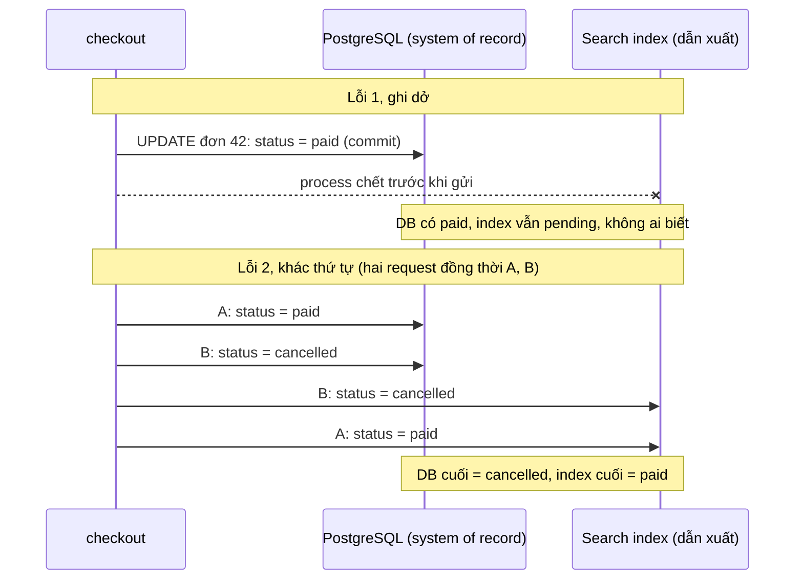
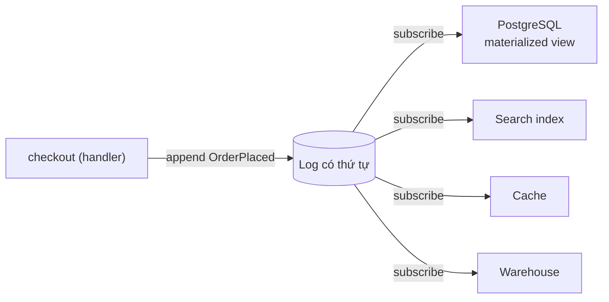
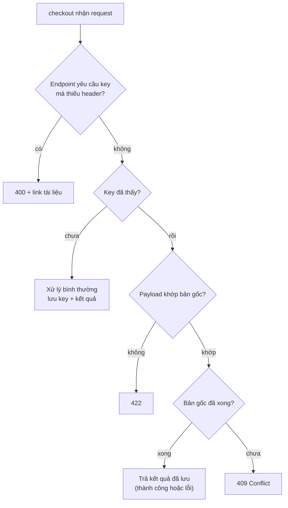
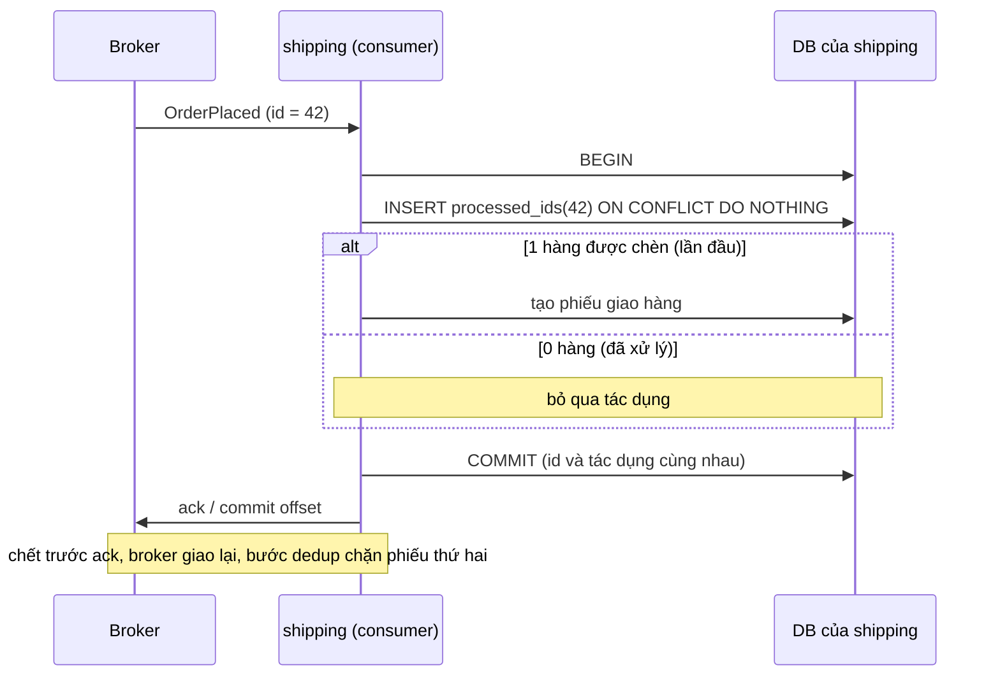
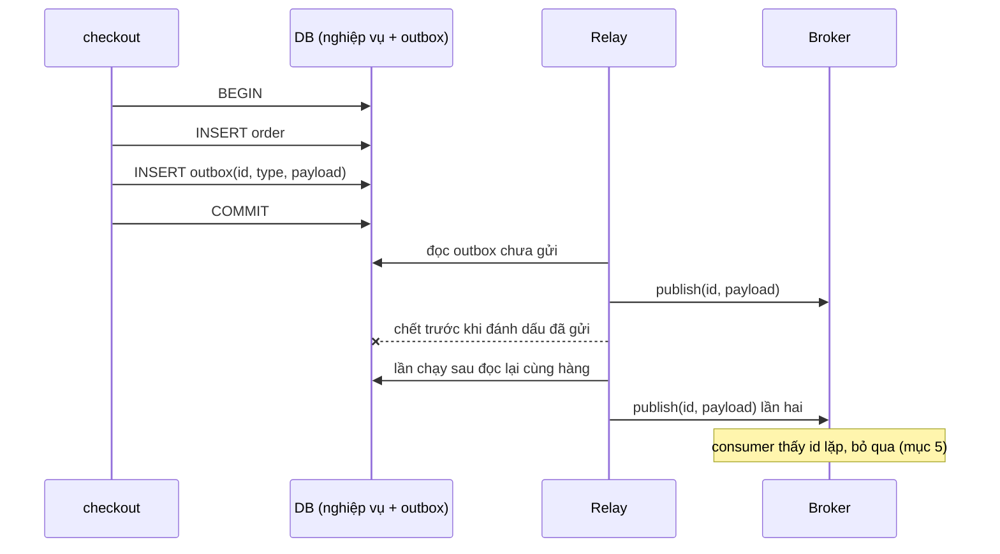

# P12 · Chương 12 — Đúng đắn và tích hợp dữ liệu

> Chương này ứng với chương 12 của DDIA (ấn bản 1), "The Future of Data Systems", theo mục lục do ETH Library lưu[^toc-ddia12]. Chương đó nằm trong Part III "Derived Data", cũng theo mục lục ấy[^toc-ddia-part3]. **Không trích sách DDIA**: sách không có bản đọc tự do, nên nội dung ở đây dựa trên bài giảng của chính Kleppmann ở Cambridge, các bài báo gốc (Saltzer–Reed–Clark 1984; Kleppmann–Beresford–Svingen 2019; Helland 2007 và 2015), RFC 9110, bản thảo IETF về `Idempotency-Key`, docs của Stripe, Kafka, PostgreSQL, Debezium, Azure, AWS và Google SRE book. Chương không chạy thí nghiệm; các đoạn code Rust và SQL chỉ để minh họa, **chưa biên dịch, chưa chạy**.

## Bạn sẽ hiểu được gì

- **Q1.** Đơn hàng của một service nằm ở nhiều kho (DB, search index, cache, warehouse): kho nào là "sự thật", kho nào là dữ liệu dẫn xuất, và vì sao để code ứng dụng ghi thẳng vào cả hai kho (dual write) thì hỏng? → mục 1
- **Q2.** "Unbundling database" là gì: một log sự kiện có thứ tự giải quyết được gì, và cái giá phải trả là gì? → mục 2
- **Q3.** End-to-end argument (Saltzer–Reed–Clark, 1984) nói gì, và vì sao TCP, replication hay "reliable queue" vẫn chưa đủ? → mục 3
- **Q4.** Khi client retry sau timeout, `Idempotency-Key` giúp server nhận ra request trùng bằng cách nào, và server phải xử lý những tình huống nào? → mục 4
- **Q5.** "Exactly-once" thực chất là gì, và vì sao nó luôn là "at-least-once cộng dedup"? → mục 5
- **Q6.** Outbox pattern giải quyết bài toán gì, và còn để lại gì? → mục 6
- **Q7.** Làm sao biết dữ liệu còn đúng: checksum, kiểm tra ngoài luồng, audit; và phần trách nhiệm với dữ liệu nằm ở đâu? → mục 7

## Kiến thức cần trước

- [Chương 05 — Replication](05-replication.md): replication log, follower. Chương này dùng lại ý "log là nguồn, bản sao là dẫn xuất".
- [Chương 07 — Transaction](07-transaction.md): atomicity, two-phase commit (2PC). Mục 1 và mục 6 chỉ nhắc lại vì sao 2PC khó dùng khi nối nhiều hệ.
- [Chương 08 — Sự cố hệ phân tán](08-su-co-he-phan-tan.md): timeout không cho biết phía bên kia đã làm hay chưa. Đây là gốc của bài toán retry ở mục 4.
- [Chương 09 — Consistency và consensus](09-consistency-va-consensus.md): total order broadcast. Mục 2 dùng ý "mọi bên thấy cùng một thứ tự".
- [Chương 11 — Stream processing](11-stream-processing.md): log, consumer offset, CDC (change data capture, bắt thay đổi từ log của DB), các ngữ nghĩa giao message, cơ chế của Kafka (idempotent producer, transaction; mục 4), replication slot và logical decoding (mục 5). Chương này chỉ dùng lại, không giải thích lại; chỗ nào trùng thì rút gọn và trỏ sang đó.
- [P5 · Chương 05 — Crash consistency và journaling](../05-storage/05-crash-consistency-va-journaling.md) (mục 7 nói checksum ở tầng đĩa và file system) và [P5 · Chương 06 — Durability trong thực tế](../05-storage/06-durability-trong-thuc-te.md) (khi nào `write` mới thật sự bền).
- [P6 · Chương 05 — TCP reliability](../06-networking/05-tcp-reliability-va-flow-control.md): TCP retransmit và loại gói trùng ra sao. Mục 3 của chương này chỉ nêu giới hạn của nó.
- [P7 · Chương 09 — Async trong production](../07-io-async/09-async-trong-production.md): hủy future và `timeout` không dừng được việc phía xa (mục 1 và 2 của chương đó). Đó là lý do client luôn rơi vào trạng thái "không biết".

Quyền riêng tư, xóa dữ liệu và đạo đức nằm ở [Chương 14](14-trach-nhiem-voi-du-lieu.md); warehouse/lake, operational vs analytical và cloud nằm ở [Chương 13](13-kien-truc-he-du-lieu.md). Chương này chỉ nêu một hai câu rồi trỏ sang.

**Ví dụ xuyên suốt.** Ta bám theo `checkout`, một service Rust nhận `POST /orders` từ app và web của một cửa hàng online. Đơn hàng nằm trong PostgreSQL; ngoài ra còn một search index cho bộ phận chăm sóc khách hàng tìm đơn, một cache cho trang chi tiết đơn, một warehouse cho nhóm phân tích, và service `shipping` nhận tin "có đơn mới" qua Kafka. Đây là ví dụ giả định của người soạn, không phải code trong repo. Mỗi mục dưới đây bắt đầu bằng việc `checkout` gặp chuyện gì.

---

## 1. Nhiều kho, một sự thật: system of record, dữ liệu dẫn xuất, và vì sao dual write hỏng (Q1)

> **Trả lời ngắn.** Ứng dụng lớn thường ghép nhiều công nghệ lưu trữ, mỗi công nghệ hợp với một kiểu truy cập[^olep-nosingle]. Vì vậy kho này hay giữ bản sao hoặc materialized view của dữ liệu ở kho kia[^olep-copy]. Cách gọn nhất để khỏi rối là chọn một nơi làm *system of record* (nơi ghi đầu tiên, được coi là sự thật), còn mọi kho khác là *dữ liệu dẫn xuất* tính lại được từ nó (định nghĩa làm việc của người soạn, dựa trên cách Helland phân biệt "observed fact" và "derived fact"[^helland15-derived]). Điều không nên làm là để code ứng dụng ghi thẳng vào cả hai kho: chết giữa chừng thì một kho có mà kho kia không[^olep-nonatomic]. Còn hai request chạy đồng thời thì hai kho có thể áp dụng chúng theo hai thứ tự khác nhau[^olep-order].

**Giải thích.**

*Với service `checkout`.* Một đơn mới phải có mặt ở bốn nơi: PostgreSQL, search index, cache và warehouse. Câu hỏi của mục này: nơi nào là sự thật, và vì sao để handler `POST /orders` tự ghi vào từng nơi là cách làm hỏng?

### 1.1 Sự thật và bản dẫn xuất

Sổ kế toán là mẫu dễ hiểu nhất để phân biệt hai thứ. Có những dòng ghi *điều đã quan sát* (một khoản ghi nợ hay ghi có vào tài khoản), và có những dòng ghi *điều suy ra* từ đó (số dư hiện tại)[^helland15-derived]. Đi tiếp theo hướng này, nội dung của database chỉ là bản cache các giá trị mới nhất của từng bản ghi và của index, lấy từ log; sự thật là log[^helland15-log]. Chữ "log" ở đây là log nói chung. Trong một DB cụ thể thì WAL là cái log ấy (suy luận của người soạn, xem [P5·05](../05-storage/05-crash-consistency-va-journaling.md)).

Áp vào `checkout`: bảng đơn hàng trong PostgreSQL là system of record. Search index là một kho riêng, cần khi người dùng tìm theo từ khóa[^olep-search]. Warehouse là nơi doanh nghiệp nạp dữ liệu xuất từ các DB OLTP để phân tích[^olep-warehouse]. Cả hai, cùng với cache và các bảng tổng hợp, là dữ liệu dẫn xuất của bảng đơn hàng (cách xếp của người soạn).

### 1.2 Dual write hỏng theo hai cách

Giờ nhìn một handler làm theo cách trực tiếp nhất: `UPDATE` đơn trong PostgreSQL, rồi gọi API của search index để ghi cùng thay đổi. Kiểu "ghi hai nơi từ code ứng dụng" này gọi là dual write. Bài OLEP của Kleppmann, Beresford và Svingen mô tả đúng tình huống đó với một RDBMS cộng một search server, chỉ là không dùng chữ "dual write"; AWS mới gọi đúng tên (xem mục 6[^aws-dualwrite]). Nó hỏng theo hai cách:

1. **Ghi dở.** Lỗi xảy ra giữa hai lần ghi, nên bản ghi có ở một kho mà không có ở kho kia[^olep-nonatomic].
2. **Khác thứ tự.** Hai request A và B cập nhật cùng một bản ghi; kho này xử lý A rồi B, kho kia xử lý B rồi A, nên hai kho bất đồng về bản nào là mới nhất[^olep-order].



*Sơ đồ minh họa của người soạn, dựa trên hai lỗi OLEP nêu.*

Cả hai lỗi đều không cần ai "nuốt" exception: chỉ cần một lần crash, hoặc hai request tới sát nhau.

Còn một câu hỏi tự nhiên: sao không bọc hai lần ghi vào một transaction chung? Về nguyên tắc, nếu cả hai kho cùng hỗ trợ distributed transaction thì atomicity được bảo đảm. Nhưng nhiều kho, điển hình là search index, không hỗ trợ XA hay bất kỳ mô hình transaction dị thể nào[^olep-noxa]. Ngay cả khi kho có hỗ trợ, một transaction trải qua nhiều sản phẩm của nhiều hãng chỉ có thể dựa vào "mẫu số chung nhỏ nhất" của các bên[^olep-xa]. Chi tiết 2PC xem [Chương 07](07-transaction.md); phần Đi sâu bên dưới có thêm hai lý do ở mức giao thức.

### 1.3 Thứ dẫn xuất thì dựng lại được

Phân định nguồn và dẫn xuất còn có lợi riêng: khi một bug làm sinh dữ liệu xấu, nếu nguồn là log thì ta bỏ qua các sự kiện sai và tính lại các view[^olep-recover]. Vì vậy nên phân định ngay từ thiết kế: thứ gì có thể đánh mất thì thứ đó phải dựng lại được (suy luận của người soạn; batch xem [Chương 10](10-batch-processing.md)). Với `checkout`, nếu search index nhận dữ liệu sai, ta dựng lại index từ PostgreSQL. Ngược lại, nếu chính bảng đơn hàng sai thì không còn nguồn nào để dựng lại.

<details><summary>Đi sâu: 2PC chặn ở đâu, các kho trong OLEP, "transaction chỉ dài bằng một HTTP request", replica khác kho dẫn xuất</summary>

- **XA và 2PC ở mức giao thức.** XA chặn việc thực thi nếu tiến trình ứng dụng hỏng ở pha prepare[^olep-xa-block]. Bài giảng Cambridge nêu nguyên nhân sâu hơn: coordinator của 2PC là điểm hỏng duy nhất, và transaction đã prepare mà chưa biết kết quả (in-doubt) phải chờ coordinator hồi phục, không được tự quyết commit hay abort[^kleppmann-2pc].
- **Các kho điển hình.** Bài OLEP kể ra full-text search (index có thể phải dựng lại theo thời gian[^olep-rebuild]), data warehouse, stream processing và cache tầng ứng dụng. Warehouse và cách tổ chức dữ liệu phân tích: [Chương 13](13-kien-truc-he-du-lieu.md).
- **Transaction ngắn.** Cùng bài báo nhận xét: phần lớn transaction OLTP hiện nay không dài hơn việc xử lý một HTTP request[^olep-tx-http]. Hệ quả (suy luận của người soạn): một workflow nhiều bước (giỏ hàng, thanh toán, xác nhận) không được bảo vệ bởi transaction nào, nên tính đúng đắn xuyên suốt phải do ứng dụng đảm nhiệm. Mục 3 nói đúng điều này theo lập luận end-to-end.
- **Replication và dữ liệu dẫn xuất.** *Replication* ([Chương 05](05-replication.md)) sao chép *cùng một kho* để bền và sẵn sàng; *dữ liệu dẫn xuất* là kho *khác loại* với cấu trúc khác. Cả hai đều là "bản sao có độ trễ", nhưng lỗi của chúng khác nhau: replica bị lệch do trễ, còn kho dẫn xuất có thể lệch cả vì logic dựng nó sai (nhận xét của người soạn).

</details>

**Quay lại Q1:** chọn một system of record và coi mọi kho khác là dẫn xuất. Đừng ghi hai nơi từ code ứng dụng, vì không có transaction chung nên hai lần ghi vừa có thể dở dang, vừa có thể đảo thứ tự.

## 2. Unbundling database: log có thứ tự làm xương sống (Q2)

> **Trả lời ngắn.** "Unbundling" (tách rời) là nhìn một database như một bộ tính năng (lưu, đánh index, nhân bản, cập nhật view), rồi để mỗi tính năng do một hệ chuyên biệt đảm nhiệm, nối với nhau bằng một *log sự kiện* làm nguồn (định nghĩa làm việc của người soạn: bài OLEP không dùng chữ "unbundling", còn mục lục DDIA chỉ cho biết tên mục[^toc-ddia12]). Khi đó mỗi kho là một materialized view trên chuỗi sự kiện của log[^olep-matview]. Log cho hai thứ mà dual write không có. Thứ nhất, thêm một sự kiện là thao tác nguyên tử[^olep-atomic-append]. Thứ hai, mọi bên đăng ký đọc đều thấy cùng một thứ tự[^olep-log]. Đổi lại, các kho "bắt kịp" log vào lúc nào thì không có cận trên, nên đọc chéo hai kho có thể thấy trạng thái lệch nhau[^olep-nobound].

**Giải thích.**

*Với service `checkout`.* Thay vì ghi vào PostgreSQL, search index và cache, handler `POST /orders` chỉ làm một việc: thêm sự kiện `OrderPlaced` vào cuối một log. Mỗi kho tự đọc log đó rồi cập nhật chính nó. Mục này xem log phải có những tính chất nào để cách làm ấy chạy được, nó sửa hai lỗi của mục 1 ra sao, và `checkout` phải trả giá gì.

Mục lục DDIA chương 12 đặt tên các phần này là "Unbundling Databases", "Composing Data Storage Technologies", "Designing Applications Around Dataflow" và "Observing Derived State"; cách trình bày bên dưới là của người soạn, đối chiếu với bài OLEP[^toc-ddia12].

### 2.1 Log cần có những tính chất nào

Để mọi kho tin vào log được, log phải bền, chỉ-nối-thêm, đọc tuần tự, chịu lỗi và chia được partition (đây là các tính chất bài OLEP đòi hỏi). Cụ thể, log được ghi xuống đĩa và nhân bản ra nhiều node nên không mất sự kiện khi có lỗi[^olep-durable]. Sự kiện mới chỉ được thêm vào cuối[^olep-log-append]. Mọi subscriber thấy cùng các sự kiện theo cùng thứ tự, vì mỗi sự kiện có một số tăng dần gọi là LSN (log sequence number)[^olep-log-seq]. Muốn mở rộng thì chia log thành nhiều partition, nhưng khi đó không có bảo đảm thứ tự giữa các partition khác nhau[^olep-log-part]. Với `checkout`, nghĩa là các sự kiện của cùng một đơn nên rơi vào cùng một partition (suy luận của người soạn). Partition xem [Chương 06](06-partitioning.md); thứ tự toàn cục và consensus xem [Chương 09](09-consistency-va-consensus.md).

### 2.2 Log sửa hai lỗi của dual write

`checkout` không ghi trực tiếp vào hai kho mà thêm một sự kiện vào log. DB và search index mỗi bên đăng ký log và ghi theo đúng thứ tự trong log[^olep-log]. Hai tính chất làm nên chuyện đó:

- Thêm một sự kiện vào log là nguyên tử, nên hoặc cả hai subscriber thấy nó, hoặc không ai thấy. Subscriber nào hỏng rồi hồi phục thì xử lý tiếp những sự kiện chưa xử lý[^olep-atomic-append]. Nhờ đó lỗi "ghi dở" biến mất.
- Mọi subscriber thấy cùng thứ tự, nên các kho ghi theo cùng một chuỗi tuần tự[^olep-log]. Nhờ đó lỗi "khác thứ tự" biến mất.



*Sơ đồ minh họa của người soạn.*

### 2.3 Subscriber vẫn phải chịu trùng

Có một chỗ dễ hiểu nhầm: log không có nghĩa là mỗi sự kiện tới subscriber đúng một lần. Mô hình trong bài giả định mỗi subscriber định kỳ lưu LSN đã xử lý vào bộ nhớ bền; chết rồi hồi phục thì nó đọc tiếp từ LSN đã lưu. Vì vậy nó có thể xử lý một số sự kiện hai lần, nhưng không bỏ sót sự kiện nào[^olep-checkpoint]. Hệ quả là việc cập nhật trạng thái phải idempotent[^olep-idem]. Đó là chủ đề của mục 4 và 5.

### 2.4 Lấy log từ đâu nếu DB đang chạy sẵn

`checkout` đã chạy trên PostgreSQL từ lâu và không ai muốn viết lại từ đầu. Có hai hướng: (a) đưa log lên làm nguồn (event sourcing, hướng của bài OLEP), hoặc (b) bắt thay đổi từ chính log nội bộ của DB. Hướng (b) làm được trên PostgreSQL nhờ *logical decoding*: trích mọi thay đổi bền của các bảng thành một định dạng dễ hiểu, không cần biết cấu trúc nội bộ của DB[^pg-ld]. Cụ thể, nó giải mã nội dung WAL thành dạng ứng dụng dùng được, như luồng tuple hay câu SQL[^pg-ld-wal]. Đây là nền của CDC và của một cách chạy outbox (mục 6). Cơ chế slot, thứ tự commit và việc giao trùng sau crash nằm ở [Chương 11, mục 5](11-stream-processing.md), không lặp lại ở đây.

### 2.5 Kiểm ràng buộc mà không cần transaction chung

Còn ràng buộc kiểu "tồn kho không âm" thì sao, khi không có transaction chung để khóa? Bài OLEP minh họa bằng hệ thanh toán. Yêu cầu chuyển tiền là một sự kiện mang ID duy nhất[^olep-pay-id]. Một executor chạy đơn luồng, xác định (deterministic) kiểm tra yêu cầu có được phép không, dựa trên số dư hiện tại[^olep-executor]. Việc chia "transaction" thành pipeline nhiều giai đoạn, mỗi giai đoạn chỉ dựa trên dữ liệu cục bộ, giúp một partition không bao giờ phải chờ phối hợp với partition khác[^olep-multistage]. Nói gọn (cách diễn đạt của người soạn): ràng buộc như số dư không âm được thi hành bằng cách dồn mọi quyết định liên quan tới một tài khoản về cùng một chỗ tuần tự, thay vì khóa phân tán. Với `checkout`, bài toán tương tự là giữ tồn kho của một sản phẩm không âm (nhận xét của người soạn).

### 2.6 Cái giá

Bài OLEP nói rõ ba điều:

- Mọi sự kiện rồi sẽ được mọi consumer xử lý kể cả khi có crash, nhưng *không có cận trên về thời gian* cho tới khi sự kiện được xử lý[^olep-nobound].
- Hệ quả là client đọc hai kho do hai consumer cập nhật có thể thấy giá trị không nhất quán với nhau; ví dụ thấy tài khoản nguồn đã trừ tiền nhưng tài khoản đích chưa cộng[^olep-readincons].
- Cách tiếp cận này hiện không cung cấp isolation cho các đọc đi thẳng vào kho mà không qua log[^olep-noisolation].

Với `checkout`, khách vừa đặt xong đã mở trang đơn hàng và thấy "không có đơn", vì cache chưa nhận sự kiện (nhận xét của người soạn). Tên mục "Timeliness and Integrity" trong khung DDIA[^toc-ddia12] gợi một cách đọc (của người soạn): *integrity* (không mất, không nhân đôi tác dụng, cuối cùng đúng) là thứ log cộng idempotence bảo đảm được; còn *timeliness* (kho dẫn xuất mới tới đâu) chỉ là "rồi sẽ tới". Hệ nào cần cả hai, chẳng hạn đọc-sau-khi-ghi, phải tự thiết kế thêm, ví dụ cho việc đọc đi qua log.

<details><summary>Đi sâu: ca New York Times, và những gì DB đơn khối "tặng kèm"</summary>

- New York Times giữ toàn bộ nội dung văn bản đã xuất bản từ 1851 trong một log duy nhất trên Kafka[^olep-nyt]. Ảnh để ở hệ khác, nhưng URL và caption của ảnh cũng là sự kiện trong log[^olep-nyt-img]. Quy tắc thứ tự là sự kiện publish tài sản được tham chiếu phải đứng trước sự kiện tham chiếu nó. Nhờ vậy không consumer nào rơi vào trạng thái bài viết trỏ tới ảnh chưa tồn tại, tức giữ được toàn vẹn tham chiếu mà không cần transaction[^olep-nyt-ref].
- Bài OLEP còn liệt kê lợi ích khác. Gỡ lỗi dễ hơn vì có thể phát lại sự kiện để chẩn đoán[^olep-debug]. Thêm view hay dịch vụ mới (kể cả search index) chỉ cần đọc log từ đầu đến cuối[^olep-newview].
- Bảng ánh xạ dưới đây là **suy luận của người soạn**, không phải nhận định của nguồn: những gì DB đơn khối cho sẵn nay thành các thành phần riêng.

| DB đơn khối cho sẵn | Khi tách rời |
|---|---|
| index phụ | search index/kho khác đăng ký log |
| replica đọc | consumer ghi vào bản sao |
| materialized view | consumer tính view từ log |
| trigger | subscriber phản ứng khi có sự kiện |

- Giới hạn: "log chung" không miễn phí. Mỗi consumer phải chịu trùng (mục 5), phải theo dõi độ trễ, và đọc nhất quán xuyên kho là việc của người thiết kế ([Chương 09](09-consistency-va-consensus.md)).

</details>

**Quay lại Q2:** unbundling là để một log có thứ tự làm nguồn, mọi kho là view. Đổi lại ta có atomic-append và thứ tự chung, nhưng mất bảo đảm về thời gian và mất isolation khi đọc chéo kho.

## 3. End-to-end argument: tầng dưới giúp được, nhưng không thay được kiểm tra ở hai đầu (Q3)

> **Trả lời ngắn.** *End-to-end argument* (Saltzer, Reed, Clark, 1984) là một nguyên lý thiết kế: một chức năng như độ tin cậy, chống trùng hay mã hóa chỉ cài đặt đầy đủ và đúng được với kiến thức và sự hỗ trợ của ứng dụng ở hai đầu giao tiếp. Vì vậy cung cấp nó như một tính năng của hệ truyền thông bên dưới là không thể, dù một bản chưa đầy đủ ở tầng dưới đôi khi hữu ích để tăng hiệu năng[^e2e-def]. Áp vào backend (nhận xét của người soạn): TCP, ổ đĩa có checksum, replication hay broker "đáng tin" chỉ làm giảm tần suất lỗi, chứ không bỏ được việc ứng dụng tự kiểm tra và tự chống trùng.

**Giải thích.**

*Với service `checkout`.* Hai tình huống sẽ lặp lại trong mục này. Thứ nhất, mỗi đêm `checkout` xuất file sao kê đơn hàng và upload lên object storage cho bộ phận kế toán. Thứ hai, app của khách gọi `POST /orders`, bị timeout, rồi gọi lại. Cả hai nghe như chuyện của tầng dưới ("TCP lo rồi", "ổ đĩa có checksum rồi"), và mục này cho thấy vì sao không phải vậy.

### 3.1 Ví dụ trong bài báo: careful file transfer

Bài báo lấy việc chuyển một file từ máy A sang máy B làm ví dụ. Có năm bước: đọc đĩa A, chia gói, truyền qua mạng, ghép gói ở B, ghi đĩa B[^e2e-steps]. Và ở mỗi bước đều có thể hỏng:

- Đĩa A đọc ra sai dù từng ghi đúng[^e2e-disk].
- Phần mềm của file system, của chương trình truyền file hoặc của hệ truyền thông sai khi buffer và sao chép[^e2e-software].
- Bộ xử lý hoặc bộ nhớ gặp lỗi thoáng qua khi sao chép[^e2e-threats].
- Mạng làm rơi, đổi hoặc nhân đôi gói[^e2e-net].
- Một trong hai máy chết giữa chừng, sau khi đã làm được một phần không rõ[^e2e-crash].

Gia cố từng bước (nhân bản, timeout/retry, redundancy) khó đủ. Chặn triệt để lỗi phần mềm đòi hỏi viết đúng mọi chương trình liên quan, việc rất khó và không phải chương trình nào cũng do người viết ứng dụng viết ra[^e2e-correct]. Còn làm mọi thứ ba lần thì quá đắt[^e2e-brute].

Cách khác là *kiểm tra đầu-cuối rồi thử lại*. B đọc lại file đã ghi từ đĩa vào bộ nhớ, tính lại checksum rồi gửi về A để so với checksum gốc. Chỉ khi hai giá trị khớp mới coi giao dịch là đã commit; không khớp thì thử lại từ đầu[^e2e-check].

### 3.2 Vì sao tầng dưới "đáng tin" vẫn không đủ

Giả sử mạng bảo đảm truyền đáng tin. Ứng dụng vẫn phải tự retry dựa trên checksum đầu-cuối, vì các mối đe dọa còn lại không nằm ở mạng. Công sức bỏ vào hệ truyền thông chỉ làm giảm số lần ứng dụng phải retry, không ảnh hưởng tới tính tất yếu hay tính đúng của kết quả[^e2e-redundant].

Bài báo kể một ca thật ở MIT. Các gateway kiểm checksum từng chặng, nên lập trình viên ứng dụng tin rằng mạng đã đáng tin. Nhưng dữ liệu không được bảo vệ khi nằm trong gateway, và một gateway bị lỗi thoáng qua đã hoán đổi một cặp byte với tần suất khoảng một lần mỗi triệu byte đi qua, làm hỏng nhiều file mã nguồn cho tới khi chủ file phải đối chiếu thủ công với bản in cũ[^e2e-gateway].

Với file sao kê của `checkout`, cách duy nhất chắc chắn là tính SHA-256 ở nguồn, đọc lại từ đích rồi so hai giá trị (nhận xét của người soạn). Lý do: file có thể hỏng ngay trong bộ nhớ của process trước khi gửi, hoặc ở một proxy nằm giữa, và không checksum nào của tầng dưới nhìn thấy được chỗ đó.

### 3.3 Cùng lập luận cho chống trùng

Giờ quay lại app gọi `POST /orders` bị timeout. Bài báo viết: ngay cả khi mạng loại bỏ trùng, chính ứng dụng vẫn có thể sinh request trùng trong quy trình lỗi/retry của nó. Mạng thấy các bản trùng ở tầng ứng dụng như những thông điệp khác nhau nên không thể loại, và ứng dụng phải tự nhận ra bản trùng của mình[^e2e-dup]. Đây là gốc triết lý của `Idempotency-Key` ở mục 4.

Bài giảng Cambridge nói cùng ý theo hướng thực hành. TCP có retry và loại trùng ở mức gói, nhưng thường bỏ cuộc sau khoảng một phút. Muốn vượt qua partition kéo dài hơn thì phải có cơ chế retry và dedup riêng ở trên TCP[^kleppmann-tcp]. Cơ chế TCP xem [P6·05](../06-networking/05-tcp-reliability-va-flow-control.md).

### 3.4 Không phải "tầng dưới vô dụng"

Bài báo nói rõ: mức nỗ lực dành cho độ tin cậy trong hệ truyền thông là một đánh đổi hiệu năng, không phải yêu cầu để đúng[^e2e-tradeoff]. Nguyên lý cũng không chỉ ra vị trí đặt các kiểm tra sớm, vì tầng nào cũng làm được việc tăng hiệu năng đó[^e2e-where]. Và đặt chức năng ở tầng dưới có thể đắt hơn, vì mọi ứng dụng dùng chung tầng ấy đều phải trả giá, kể cả ứng dụng không cần nó[^e2e-pay].

Bảng dưới là **nhận xét của người soạn**, áp nguyên lý lên các tầng quen thuộc của hệ dữ liệu trong `checkout`:

| Tầng dưới đã làm | Còn thiếu ở đầu-cuối | Công cụ ở đầu-cuối |
|---|---|---|
| TCP retransmit + loại trùng gói | request bị retry sau timeout là *hai request* với mạng | Idempotency-Key (mục 4) |
| Checksum đĩa/file system, RAID ([P5·05 mục 7](../05-storage/05-crash-consistency-va-journaling.md)) | hỏng ở bộ nhớ, ở proxy, ở bug ghi | digest do ứng dụng tính, so hai đầu (mục 7) |
| Replication ([Chương 05](05-replication.md)) | bug/lệnh xóa nhầm được sao chép sang mọi bản | backup phục hồi được, kiểm tra ngoài luồng (mục 7) |
| Broker "exactly-once" nội bộ | tác dụng phụ ra hệ ngoài, consumer chết giữa chừng | consumer idempotent (mục 5) |
| Transaction của một DB | workflow nhiều request, nhiều hệ | outbox, log (mục 2, 6) |

<details><summary>Đi sâu: nguyên lý không phải luật cứng</summary>

- Việc vận dụng đòi hỏi phân tích tinh tế yêu cầu của ứng dụng. Với cuộc gọi thoại gói thời gian thực, thậm chí một phiên bản *mạnh hơn* của lập luận áp dụng, vì cố truyền đúng từng bit ở tầng dưới có thể gây trễ không kiểm soát được[^e2e-voice]. Cùng loại dữ liệu đó nhưng nếu lưu thành tin nhắn thoại để nghe sau thì lập luận đổi khác[^e2e-ends]. Nghĩa là "đầu-cuối" phải xác định theo *ứng dụng cụ thể*, không theo loại dữ liệu.
- Liên hệ Q1 (nhận xét của người soạn): "ghi hai nơi" thất bại vì không có đầu-cuối nào chịu trách nhiệm khớp hai kho. Log (mục 2) và kiểm tra ngoài luồng (mục 7) là hai cách *đặt trách nhiệm đó vào đúng chỗ*.

</details>

**Quay lại Q3:** chức năng cần đúng tuyệt đối (toàn vẹn, chống trùng) phải được kiểm ở hai đầu ứng dụng. Tầng dưới (TCP, đĩa, replication, broker) chỉ làm giảm tần suất lỗi và chi phí retry, chứ không thay được.

## 4. Idempotency và request ID: `Idempotency-Key` (Q4)

> **Trả lời ngắn.** Khi client gửi request mà hết hạn chờ, client không biết server đã làm hay chưa[^idem-timeout]. Muốn retry an toàn, thao tác phải *idempotent*: lặp nhiều lần có cùng tác dụng như một lần[^rfc9110-idem]. `POST` thì không idempotent theo định nghĩa, nên client sinh một *idempotency key* duy nhất cho mỗi ý định và gửi trong header `Idempotency-Key`, để server nhận ra các lần retry của cùng một request[^idem-key-def]. Server cần nhớ key cùng kết quả ở nơi bền[^kleppmann-dedup], và phải xử lý bốn tình huống (cách gom của người soạn từ bản thảo): lần đầu, retry sau khi xong, retry khi bản gốc còn đang chạy, và cùng key nhưng payload khác.

**Giải thích.**

*Với service `checkout`.* Khách bấm "Đặt hàng", app gọi `POST /orders`, màn hình quay mãi rồi báo timeout. App không biết `checkout` đã tạo đơn chưa. Bấm lại có thể tạo hai đơn và trừ tiền hai lần; không bấm lại thì có thể đơn chưa bao giờ được tạo. Lối ra là để app sinh một key khi khách *mở trang thanh toán*, đính key đó vào mọi lần bấm của cùng trang. `checkout` thấy key đã xử lý thì chỉ trả lại kết quả cũ.

### 4.1 Bài toán

Khi client gửi RPC mà không nhận được phản hồi, nó không biết server đã nhận và xử lý hay chưa. Gửi lại có thể làm request chạy nhiều lần, ví dụ trừ thẻ tín dụng hai lần[^kleppmann-rpc]. Bản thảo IETF về `Idempotency-Key` mô tả đúng kịch bản này: client gửi POST, request hết hạn chờ, client không biết tài nguyên đã được tạo hay cập nhật chưa[^idem-timeout]. Timeout ở phía client không dừng việc phía server; xem [P7·09 mục 2](../07-io-async/09-async-trong-production.md). Sự bất định trong hệ phân tán nói chung: [Chương 08](08-su-co-he-phan-tan.md).

### 4.2 Idempotent trong HTTP

RFC 9110 định nghĩa một method là idempotent nếu tác dụng dự định lên server của nhiều request giống nhau bằng tác dụng của một request. Trong các method nó định nghĩa thì `PUT`, `DELETE` và các method an toàn là idempotent[^rfc9110-idem]. Định nghĩa này chỉ nói về điều người dùng *yêu cầu*: server vẫn có thể ghi log từng request, hay có tác dụng phụ không idempotent khác[^rfc9110-sideeffects].

Với method không idempotent như `POST`, RFC khuyên client không tự động retry, trừ khi biết chắc ngữ nghĩa thực ra idempotent, hoặc có cách phát hiện bản gốc chưa được áp dụng[^rfc9110-retry]. Proxy thì không được tự động retry request không idempotent[^rfc9110-proxy]. `Idempotency-Key` là một cách hiện thực hóa "cách phát hiện" mà câu trên nhắc tới (nhận xét của người soạn).

### 4.3 `Idempotency-Key` theo bản thảo IETF

Bản thảo `draft-ietf-httpapi-idempotency-key-header-07` ra vào tháng 10/2025[^idem-date]. Theo bản thảo, header này dùng để làm các method không idempotent như POST hay PATCH chịu lỗi được[^idem-abstract]. **Lưu ý trạng thái:** datatracker ghi bản thảo đã hết hạn và không còn hoạt động[^idem-expired]. Chính văn bản cũng nhắc rằng Internet-Draft chỉ là tài liệu đang làm, có thể bị thay hoặc bỏ bất cứ lúc nào[^idem-ietf-wip]. Vì vậy phần dưới coi nó là *một mô tả thực hành*, không phải chuẩn. Các điều khoản chính:

- Key là giá trị duy nhất do client sinh; resource dùng nó để nhận ra các lần retry của cùng một request[^idem-key-def].
- Key phải duy nhất và không được dùng lại cho request có payload khác[^idem-unique]. Khuyến nghị dùng UUID hoặc chuỗi ngẫu nhiên tương tự[^idem-uuid].
- Server có thể đặt thời hạn hiệu lực cho key để xóa key hết hạn, và nên công bố chính sách đó[^idem-expiry].
- Server có thể tính thêm một *fingerprint* từ payload để xác định tính duy nhất của request[^idem-fingerprint].

### 4.4 Server nên làm gì

Bản thảo dùng SHOULD chứ không phải MUST, và không quy định thứ tự kiểm tra. Sơ đồ dưới là cách sắp xếp của người soạn từ sáu gạch đầu dòng đi kèm.



- Lần đầu: xử lý bình thường[^idem-enforce-first].
- Retry sau khi bản gốc xong: trả kết quả của thao tác đã hoàn tất, thành công hay lỗi đều vậy[^idem-enforce-retry].
- Retry khi bản gốc chưa xong: nên trả lỗi xung đột tài nguyên[^idem-enforce-concurrent]. Cụ thể là HTTP 409[^idem-409].
- Cùng key nhưng khác payload: nên trả 422[^idem-422]. Với `checkout`, đó là khi app tái dùng key cho một giỏ hàng khác.
- Thiếu header ở thao tác yêu cầu nó: nên trả 400 kèm link tới tài liệu[^idem-400].
- Với các lỗi 4xx/5xx khác (401, 403, 500, 502, 503, 504, 429…), client làm theo tài liệu của resource[^idem-other].

### 4.5 Thực tế ở Stripe

Docs API của Stripe là một cài đặt thực tế của ý trên. API hỗ trợ idempotency để retry an toàn mà không làm cùng một thao tác hai lần[^stripe-purpose]. Client tự sinh key; Stripe gợi ý V4 UUID hoặc chuỗi ngẫu nhiên đủ entropy, dài tối đa 255 ký tự[^stripe-key]. Với API v1, Stripe lưu status code và body của request đầu tiên dùng key đó (sau khi endpoint bắt đầu chạy), và retry cùng key nhận lại bản đã lưu, kể cả lỗi 500[^stripe-v1]. Tầng idempotency còn so tham số mới với tham số của request gốc và báo lỗi nếu khác, để chống dùng nhầm[^stripe-params].

### 4.6 Nhớ ở đâu

Dedup request trong mô hình crash-recovery đòi hỏi lưu request (hoặc metadata về chúng) ở bộ nhớ bền, để vẫn nhận ra bản trùng sau khi crash[^kleppmann-dedup]. Với `checkout`, nơi đó nên là **cùng DB và cùng transaction** với tác dụng nghiệp vụ (nhận xét của người soạn, cùng lý do Kafka khuyên lưu offset cùng chỗ với output, mục 5). Nếu key được ghi ở một nơi còn đơn hàng ở nơi khác, ta lại gặp đúng bài toán dual write của mục 1.

### 4.7 Retry cũng cần kỷ luật

Retry không kỷ luật tự nó thành sự cố. Google SRE book, ở chương về cascading failure, đưa ra mấy quy tắc. Dùng exponential backoff có ngẫu nhiên khi lên lịch retry[^sre-backoff]. Giới hạn số lần retry cho mỗi request[^sre-limit]. Cân nhắc một "ngân sách retry" cho cả server[^sre-budget]. Đừng retry ở nhiều tầng liên tiếp, vì số lần thử nhân lên theo tích của số lần thử ở từng tầng[^sre-amplify]. Và đừng retry lỗi vĩnh viễn hay request sai dạng, vì chúng sẽ không bao giờ thành công[^sre-classify].

<details><summary>Đi sâu: các chi tiết Stripe, idempotent bằng cấu trúc, giới hạn của idempotence, SQL</summary>

- **Chi tiết Stripe (API v1).** Nếu tham số không qua validation, hoặc request xung đột với một request khác đang chạy, kết quả không được lưu vì chưa có endpoint nào bắt đầu thực thi, nên các request đó retry được[^stripe-nosave]. Key có thể bị xóa tự động khi đã ít nhất 24 giờ tuổi; dùng lại key sau khi bản gốc bị xóa thì tạo request mới[^stripe-prune]. Stripe cũng dặn không nhét dữ liệu nhạy cảm (email, định danh cá nhân) vào key[^stripe-sensitive]. Với `GET` và `DELETE` thì không cần gửi key vì chúng idempotent theo định nghĩa[^stripe-get].
- **Stripe API v2** làm khác: retry không lặp lại thao tác đã thành công; Stripe cố hoàn tất phần thất bại hoặc dang dở rồi trả phản hồi cập nhật, và nếu không thể thành công thì trả lỗi giải thích[^stripe-v2]. Nghĩa là "lưu nguyên phản hồi cũ" không phải thiết kế duy nhất.
- **Draft: cú pháp.** `Idempotency-Key` là một Item Structured Header, giá trị phải là String[^idem-syntax].
- **Idempotent do thiết kế thao tác.** Tăng bộ đếm không idempotent, nhưng thêm phần tử vào tập hợp thì có[^kleppmann-counter-set]. Vì vậy nếu cần số lượt thích, nên lưu tập người thích và suy ra số đếm từ kích thước tập[^kleppmann-set-card]. Cách này không cần bảng dedup riêng.
- **Giới hạn của idempotence.** Idempotence không đủ khi có nhiều cập nhật diễn ra đồng thời[^kleppmann-idem-limit]. Ví dụ trong bài giảng: client 1 thêm "like" nhưng ack bị mất; client 2 đọc tập "like" rồi gửi yêu cầu bỏ "like"[^kleppmann-slide91]. Sau đó client 1 retry và thêm lại, dù việc bỏ "like" xảy ra *sau* theo quan hệ nhân quả. Nghĩa là chống trùng theo key (nhớ rằng "ý định này đã xử lý") mạnh hơn "thao tác có tính idempotent" (nhận xét của người soạn).
- **SQL minh họa** (bảng khóa ở cùng DB với dữ liệu nghiệp vụ; không chạy thử):

```sql
CREATE TABLE idempotency_keys (
  key          text PRIMARY KEY,
  request_hash bytea NOT NULL,          -- fingerprint của payload
  response     jsonb,                   -- NULL cho tới lúc xong
  created_at   timestamptz NOT NULL DEFAULT now()
);

-- đầu transaction:
INSERT INTO idempotency_keys (key, request_hash)
VALUES ($1, $2)
ON CONFLICT (key) DO NOTHING;
-- rows_affected = 1: lần đầu, làm việc nghiệp vụ, UPDATE response, COMMIT.
-- rows_affected = 0: đã có; SELECT request_hash, response để quyết 422 / replay.
```

  `ON CONFLICT DO NOTHING` chỉ bỏ qua việc chèn khi vi phạm ràng buộc duy nhất[^pg-onconflict]. Số `count` của `INSERT` là số hàng đã chèn hoặc cập nhật[^pg-count], nên khi lệnh bị bỏ qua thì nó là 0 (suy luận của người soạn). Ràng buộc duy nhất do một unique index thi hành[^pg-unique].

  Một retry tới khi bản gốc còn đang chạy thì sao? Quy tắc của unique index trong PostgreSQL: nếu hàng xung đột do một transaction chưa commit chèn, bên chèn sau phải chờ xem transaction đó có commit không[^pg-uniq-wait]. Từ đó (suy luận của người soạn) retry sẽ *chờ* thay vì thấy trạng thái dang dở: bản gốc commit thì retry thấy `response` đầy đủ, bản gốc rollback thì retry trở thành lần đầu.

  **Giới hạn của suy luận này.** Docs PostgreSQL ghi rằng ở Read Committed, `INSERT … ON CONFLICT DO NOTHING` có thể không chèn một hàng vì kết quả của transaction khác mà snapshot của lệnh INSERT chưa thấy, và nói rõ đây chỉ là chuyện của Read Committed[^pg-iso-onconflict]. Việc `SELECT` ngay sau đó có thấy hàng của bản gốc hay không, và hành vi ở Repeatable Read/Serializable (thấy `response` hay gặp lỗi serialization), người soạn chưa kiểm bằng nguồn. Nếu dùng các mức đó, phải thử và áp vòng retry của [Chương 07, mục 8](07-transaction.md).

  Thiết kế này không cần trạng thái "in_progress" và không cần trả 409, đổi lại phải giữ một kết nối DB trong lúc chờ. Nếu việc nghiệp vụ nằm ở *hệ khác* (không chung DB), phải tách "claim" và "complete" thành hai bước; khi đó trạng thái treo do crash giữa hai bước cần được thu hồi (nhận xét của người soạn).
- **Bền thật sự.** Bản ghi key vô nghĩa nếu mất sau crash; việc commit có bền hay không thuộc [P5·06](../05-storage/06-durability-trong-thuc-te.md).

</details>

**Quay lại Q4:** client sinh một key cho mỗi *ý định* và giữ nguyên qua mọi lần retry. Server lưu key, fingerprint và kết quả cùng transaction với tác dụng nghiệp vụ, rồi trả kết quả cũ, 409 hoặc 422 tùy tình huống.

## 5. "Exactly-once" là at-least-once cộng dedup (Q5)

> **Trả lời ngắn.** Exactly-once thực chất là retry cộng idempotence hoặc deduplication: thao tác có thể thật sự bị áp dụng nhiều lần, nhưng tác dụng giống như đúng một lần[^kleppmann-idem-exact]. Docs Kafka cảnh báo nhiều hệ tuyên bố "exactly once", nhưng phần lớn lời tuyên bố ấy gây hiểu lầm khi consumer hoặc producer có thể hỏng, hay khi có nhiều consumer[^kafka-claims]. Kafka tự đạt được nó trong phạm vi Kafka → Kafka. Producer idempotent không tạo bản ghi trùng khi gửi lại[^kafka-idem]. Offset của consumer được ghi cùng transaction với output[^kafka-tx]. Còn ghi ra hệ ngoài thì cần hệ ngoài hợp tác[^kafka-ext]. Bài OLEP kết luận cùng ý: framework có "exactly-once" vẫn là at-least-once khi nói chuyện với kho ngoài, và dựa vào idempotence để xóa tác dụng của lần xử lý trùng[^olep-exact-ext]. Cơ chế bên trong Kafka: [Chương 11, mục 4](11-stream-processing.md).

**Giải thích.**

*Với service `checkout`.* `checkout` đã tạo đơn và phát `OrderPlaced` lên Kafka. Service `shipping` đọc sự kiện đó và tạo phiếu giao hàng. Nếu `shipping` tạo phiếu xong mà chết trước khi báo đã nhận (ack), Kafka sẽ giao lại sự kiện, và khách nhận hai phiếu. Để chỉ có một phiếu, `shipping` phải nhận ra "đơn này tôi xử lý rồi" và bỏ qua lần thứ hai. "Giao đúng một lần" thật ra là *giao ít nhất một lần* cộng *người nhận loại bản trùng*.

### 5.1 Ba ngữ nghĩa

Bài giảng của Kleppmann chia làm ba. At-most-once là gửi, không retry, nên cập nhật có thể không xảy ra[^kleppmann-amo]. At-least-once là retry cho tới khi được ack, nên cập nhật có thể bị lặp[^kleppmann-alo]. Exactly-once là retry kèm idempotence hoặc dedup[^kleppmann-exact-sem]. Docs Kafka chia cùng ba nhóm, kèm hai thứ tự của consumer ("xử lý rồi lưu offset" và "lưu offset rồi xử lý"); phần đó đã nằm ở [Chương 11, mục 4](11-stream-processing.md) nên chương này không lặp lại.

### 5.2 Vì sao có cửa sổ lỗi, và người nhận xử lý thế nào

Helland (2007) mô tả cửa sổ lỗi của consumer: message được tiêu thụ nhưng chưa ack, DB được cập nhật rồi message mới được ack. Nếu chết ở giữa thì khởi động lại và xử lý lại message. Cửa sổ này tồn tại vì việc giao message không gắn trực tiếp với việc cập nhật dữ liệu bền, ngoài hành động của ứng dụng[^helland07-window]. Chính là chỗ `shipping` tạo phiếu xong rồi chết.

Cách xử lý nằm ở người nhận. Nó phải chuẩn bị, trong trạng thái bền của mình, để nhận các message dư thừa và bỏ qua chúng[^helland07-alo]. Thường nó được thiết kế để *nhớ rằng message đã được xử lý*[^helland07-remember]. Trong ví dụ thanh toán của OLEP, tính idempotent đạt được bằng cách loại sự kiện trùng dựa trên ID của sự kiện gốc[^olep-pay-dedup]. Trên đường CDC, Debezium nói nó cũng chỉ cung cấp at-least-once khi phục hồi lỗi[^debezium-alo]. Consumer có thể theo dõi thông tin nguồn, đặc biệt là LSN, để biết một sự kiện có trùng không[^debezium-lsn].

Với `shipping`, cách nhớ đơn giản nhất là một bảng `processed_ids` nằm trong chính DB của `shipping`, ghi cùng transaction với việc tạo phiếu:



*Sơ đồ minh họa của người soạn: dedup nằm cùng DB, cùng transaction với tác dụng nghiệp vụ.*

### 5.3 Kafka làm được tới đâu

Chi tiết (producer ID và số thứ tự, offset trong cùng transaction, `isolation.level`) ở [Chương 11, mục 4](11-stream-processing.md); đây chỉ tóm phần liên quan. Trong Kafka → Kafka, producer idempotent không tạo bản ghi trùng khi gửi lại[^kafka-idem]. Offset của consumer được ghi *cùng transaction* với output[^kafka-tx]. Với **hệ ngoài**, docs nói exactly-once nói chung cần sự hợp tác của hệ đó, và Kafka đưa offset ra để việc cài đặt khả thi[^kafka-ext]. Lời khuyên cụ thể là để consumer lưu offset *cùng chỗ với output*, vì nhiều hệ đích không hỗ trợ two-phase commit[^kafka-same-place]. Bảng `processed_ids` trong sơ đồ trên là một cách làm đúng lời khuyên đó (nhận xét của người soạn).

### 5.4 Cần nhớ bao lâu

Dedup bằng ID nghĩa là phải nhớ ID. Bản thảo `Idempotency-Key` cho phép hết hạn key và đòi công bố chính sách[^idem-expiry]. Docs Stripe (API v1) nói key có thể bị xóa tự động khi đã ít nhất 24 giờ tuổi[^stripe-prune]. Nhận xét của người soạn: cửa sổ nhớ phải *dài hơn* thời gian tối đa client còn có thể retry; nếu không, retry muộn sẽ bị coi là request mới.

<details><summary>Đi sâu: các điểm cần đọc kỹ trong từng nguồn</summary>

- **OLEP:** subscriber xử lý sự kiện của một partition tuần tự trên một luồng với logic xác định, nên khi chết và chạy lại nó có thể thêm sự kiện trùng vào các log khác[^olep-dup-append]. Hạ nguồn dựa vào ID để bỏ trùng.
- **Outbox** (mục 6) chỉ chuyển bài toán dual write thành bài toán giao ít nhất một lần, vì relay có thể gửi trùng[^msio-dup]. Consumer vì thế vẫn phải chịu trùng (suy luận của người soạn).
- **AWS Prescriptive Guidance:** dịch vụ xử lý sự kiện có thể gửi trùng, nên khuyến nghị làm consumer idempotent bằng cách theo dõi các message đã xử lý[^aws-dup].
- **Azure Service Bus** có tùy chọn phát hiện trùng phía broker theo `MessageId` do ứng dụng đặt, loại bỏ message trùng[^azure-dedup]. Nhận xét của người soạn: dedup phía broker chỉ che một cửa sổ nhất định và không thay được dedup phía consumer, vì lỗi có thể xảy ra *sau* broker.

</details>

**Quay lại Q5:** "exactly-once" là giao ít nhất một lần cộng người nhận dedup hoặc idempotent, với trạng thái dedup commit nguyên tử cùng tác dụng. Trong phạm vi một hệ (Kafka → Kafka) hệ đó có thể tự làm; ra ngoài thì ứng dụng phải làm.

## 6. Outbox pattern: ghi tin vào DB cùng transaction (Q6)

> **Trả lời ngắn.** Một service thường phải vừa cập nhật DB vừa gửi message ra broker, và hai việc đó phải cùng thành hoặc cùng không[^msio-problem]. Dùng 2PC giữa DB và broker không khả thi: nhiều hệ không hỗ trợ, và nó gắn service với cả hai[^msio-2pc]. Còn gửi giữa transaction hay sau commit đều không đáng tin[^msio-fail]. Outbox lưu message vào một bảng trong *chính transaction* cập nhật dữ liệu nghiệp vụ, rồi một tiến trình riêng gửi các message đó ra broker[^msio-solution]. Message được gửi nếu và chỉ nếu transaction commit[^msio-benefit]. Nhưng relay có thể gửi một message nhiều lần[^msio-dup].

**Giải thích.**

*Với service `checkout`.* Sau khi `INSERT` đơn vào PostgreSQL, `checkout` phải báo cho `shipping` qua Kafka. Hai việc này là một cặp dual write kiểu khác (DB và broker), và nó hỏng ở đúng chỗ như mục 1: `INSERT` xong mà process chết thì `shipping` không bao giờ biết có đơn. Outbox là cách `checkout` tránh điều đó mà không cần 2PC.

### 6.1 Vấn đề: dual write với broker

Lệnh của service phải cập nhật DB và gửi message một cách nguyên tử[^msio-problem]. Gửi *giữa* transaction thì không bảo đảm transaction sẽ commit. Gửi *sau* commit thì không bảo đảm tiến trình không chết trước khi gửi[^msio-fail]. AWS Prescriptive Guidance gọi đúng tên vấn đề này: dual write xảy ra khi một thao tác gồm cả ghi DB lẫn gửi thông báo[^aws-dualwrite].

### 6.2 Cơ chế

1. Trong cùng một transaction, `checkout` `INSERT` vào bảng nghiệp vụ và `INSERT` một hàng vào bảng *outbox*. Với DB quan hệ, outbox là một bảng lưu các message cần gửi[^msio-parts].
2. `COMMIT`: cả hai cùng bền hoặc cùng mất.
3. *Message relay* đọc bảng outbox và gửi message tới broker[^msio-relay].
4. Relay đánh dấu hoặc xóa hàng đã gửi. Bước này do người soạn mô tả; microservices.io chỉ nói relay có thể crash sau khi publish nhưng trước khi ghi nhận việc đó[^msio-dup]. Nếu chết giữa bước 3 và 4, lần sau relay gửi lại.



*Sơ đồ minh họa của người soạn: relay chết trước khi đánh dấu thì lần sau gửi lại.*

### 6.3 Hai cách làm relay

- **Polling.** Relay truy vấn bảng outbox định kỳ. `SELECT … FOR UPDATE SKIP LOCKED` của PostgreSQL bỏ qua các hàng đang bị khóa. Docs lưu ý nó cho một cái nhìn không nhất quán về dữ liệu nên không dùng cho việc đa dụng, nhưng dùng được để tránh tranh chấp khóa giữa nhiều consumer đọc một bảng giống hàng đợi[^pg-skiplocked].
- **CDC.** Một connector đọc WAL qua logical decoding[^pg-ld]; cơ chế slot, snapshot và trùng sau crash xem [Chương 11, mục 5](11-stream-processing.md). Một slot là luồng thay đổi có thể phát lại cho client theo đúng thứ tự chúng xảy ra trên server nguồn[^pg-slot-order]. Debezium có sẵn một *outbox event router*, mô tả outbox pattern là cách trao đổi dữ liệu giữa các (micro)service một cách an toàn, tránh bất nhất giữa trạng thái nội bộ của service và trạng thái trong các sự kiện mà service khác tiêu thụ[^debezium-outbox]. Connector được cấu hình để chỉ bắt thay đổi ở bảng outbox[^debezium-outbox-capture].

Cột `id` trong bảng outbox mặc định của Debezium chứa ID duy nhất của sự kiện. Nó thành một header của message và dùng được, chẳng hạn, để loại message trùng[^debezium-outbox-id]. Đây là chỗ outbox nối vào mục 5: ID ở outbox chính là khóa dedup của consumer.

### 6.4 Thứ tự gửi

Gửi theo đúng thứ tự dịch vụ cập nhật DB là yếu tố quan trọng[^aws-order]. Với relay polling thì chỗ này có bẫy (suy luận của người soạn, chưa có nguồn). Nếu relay đọc theo một cột tăng dần như id tuần tự, hai transaction có thể commit khác thứ tự cấp id, nên con trỏ "đã gửi đến id N" có thể bỏ sót hàng commit muộn. Đọc theo WAL tránh được vì thứ tự ở đó là thứ tự commit[^pg-slot-order]. Chạy nhiều relay polling song song bằng `SKIP LOCKED` cũng khó giữ thứ tự gửi, vì mỗi relay lấy một tập hàng riêng. Đó là lý do cần thiết kế cẩn thận khi chọn polling.

### 6.5 Outbox còn để lại gì

- Pattern có thể sai nếu lập trình viên quên chèn hàng outbox sau khi cập nhật DB[^msio-forget]. Nên bọc cả hai việc trong một hàm hoặc repository duy nhất (nhận xét của người soạn).
- Gửi trùng: relay có thể publish một message hơn một lần[^msio-dup]. Consumer phải idempotent (mục 5).
- Kết quả là *eventual*: kho và consumer hạ nguồn thấy thay đổi muộn (mục 2).
- Bảng outbox cần dọn để không phình vô hạn; chính sách dọn phụ thuộc cách relay đánh dấu (nhận xét của người soạn).

<details><summary>Đi sâu: nguồn của pattern, cột outbox của Debezium, Azure, và outbox so với "log là nguồn"</summary>

- **Nguồn có thẩm quyền.** Người soạn không tìm được RFC hay bài báo học thuật định nghĩa "transactional outbox". Chương dùng tài liệu pattern của microservices.io, hướng dẫn kiến trúc của AWS/Azure và docs Debezium; đó đều là thực hành công nghiệp được ghi lại, không phải chuẩn. Bài OLEP không nhắc tên "outbox"; lập luận của nó về giới hạn của transaction dị thể ở mục 1 chỉ là nền cho việc tránh 2PC (nhận xét của người soạn).
- Bảng outbox mặc định của Debezium 2.7 được giả định có các cột `id` (uuid), `aggregatetype`, `aggregateid`, `type` (varchar 255) và `payload` (jsonb)[^debezium-outbox-cols].
- Hướng dẫn Azure dùng Cosmos DB transactional batch, change feed và Service Bus[^azure-parts]. Khi xử lý lại, ứng dụng có thể đã gửi một số message, nên bật phát hiện trùng của Service Bus theo `MessageId`, đặt bằng ID tài liệu sự kiện[^azure-dedup].
- Outbox giữ *DB quan hệ là nguồn* và đẩy sự kiện ra ngoài. Hướng OLEP (mục 2) làm ngược lại: *log là nguồn*, DB là view. Hãy chọn một trong hai làm system of record; để cả hai cùng là nguồn sẽ quay về dual write (nhận xét của người soạn).

</details>

**Quay lại Q6:** outbox đổi "ghi hai nơi" thành "ghi một nơi trong một transaction, rồi một tiến trình khác chuyển tiếp". Cái giá là giao ít nhất một lần và độ trễ; consumer phải dedup theo ID.

## 7. Dữ liệu còn đúng không? Checksum, kiểm tra ngoài luồng, audit (Q7)

> **Trả lời ngắn.** Dữ liệu có thể sai một cách *im lặng*, ở đĩa, ở CPU hay ở phần mềm, nên cần nhiều lớp phòng thủ: checksum ở từng tầng cộng kiểm tra đầu-cuối. Backup phải khôi phục được chứ không chỉ là replication, vì replication sao chép luôn cả lỗi[^sre-sync]. Ngoài ra cần kiểm tra ngoài luồng định kỳ để phát hiện hỏng nhẹ trước khi hết cách khôi phục[^sre-oob]. Log chỉ-nối-thêm cho dấu vết kiểm toán[^helland15-ledger]. Nó cũng giúp gỡ lỗi, vì có thể phát lại sự kiện để chẩn đoán[^olep-debug]. Phần "việc nên làm với dữ liệu về con người" thuộc [Chương 14](14-trach-nhiem-voi-du-lieu.md).

**Giải thích.**

*Với service `checkout`.* Giả sử `checkout` đã chạy vài tháng, mọi đơn đều qua transaction, mọi consumer đều idempotent. Vẫn có thể một ngày search index thiếu vài trăm đơn, hay một job dọn dẹp xóa nhầm một dải bản ghi, mà không có lỗi nào xuất hiện trong log. Mục này nói cách phát hiện chuyện đó trước khi khách phàn nàn.

### 7.1 Hỏng im lặng có thật

Nghiên cứu FAST 2008 phân tích các trường hợp hỏng dữ liệu ghi nhận ở hệ lưu trữ production, gồm tổng cộng 1,53 triệu ổ đĩa trong 41 tháng. Họ tìm thấy hơn 400.000 trường hợp checksum không khớp trong thời gian đó[^fast08-count]. (Nhận xét của người soạn: các ca này lộ ra nhờ có checksum; không có checksum thì hỏng sẽ lọt qua.) Silent data corruption là loại hỏng mà ổ không hề báo lỗi[^fast08-silent].

CPU cũng vậy. Bài "Cores that don't count" (Google, HotOS 2021) nhận xét rằng ta quen coi máy tính là fail-stop, và phần lớn phần mềm hệ thống ngầm dựa vào giả định đó[^cores-failstop]. Nhưng một số lõi có lỗi thoáng qua mà triệu chứng duy nhất là *tính ra kết quả sai*[^cores-silent]. Ca gateway MIT ở mục 3 là một ví dụ cùng loại (nhận xét của người soạn)[^e2e-gateway].

### 7.2 Checksum ở từng tầng

PostgreSQL là ví dụ cụ thể. Mặc định data page *không* được bảo vệ bằng checksum, nhưng có thể bật cho cả cluster. Khi bật, mỗi data page chứa một checksum được cập nhật lúc ghi và kiểm tra mỗi lần đọc. Chỉ data page được bảo vệ, còn các cấu trúc nội bộ và file tạm thì không[^pg-checksum]. Checksum ở tầng đĩa và file system xem [P5·05 mục 7](../05-storage/05-crash-consistency-va-journaling.md). Nhưng như ở mục 3, các tầng dưới không phát hiện được lỗi sinh ra *ở trên* chúng, nên ứng dụng vẫn cần digest của riêng mình khi chuyển hoặc lưu dữ liệu quan trọng (nhận xét của người soạn).

### 7.3 Replication không phải backup

Replication và dự phòng không phải khả năng khôi phục[^sre-replication]. Lý do: datastore tự đồng bộ các replica sẽ đẩy cả hàng hỏng hay lệnh xóa nhầm tới mọi bản sao, thường trước khi bạn kịp cô lập sự cố[^sre-sync]. Một khảo sát 19 vụ khôi phục dữ liệu ở Google cho thấy kịch bản mất dữ liệu phổ biến nhất mà người dùng thấy là xóa dữ liệu, hoặc mất toàn vẹn tham chiếu, do lỗi phần mềm[^sre-study]. Vì không có biện pháp nào bao trùm hết, cần *defense in depth*: nhiều lớp, mỗi lớp bảo vệ khỏi những kịch bản ngày càng hiếm[^sre-defense]. Ba lớp được nêu là soft deletion, backup cùng phương pháp khôi phục, và kiểm tra dữ liệu định kỳ[^sre-layers].

### 7.4 Kiểm tra ngoài luồng (out-of-band)

Dữ liệu xấu không nằm yên mà lan truyền: tham chiếu tới dữ liệu thiếu hay hỏng bị sao chép, link lan rộng, chất lượng datastore giảm dần theo từng lần cập nhật[^sre-propagate]. Để phát hiện hỏng nhẹ trước khi không còn khôi phục được, cần một hệ thống kiểm tra ngoài luồng ở bên trong và giữa các datastore của ứng dụng[^sre-oob]. Gmail là ví dụ: nhà phát triển yên tâm vì lỗi gây bất nhất dữ liệu production được phát hiện trong vòng 24 giờ, và "rùng mình" khi nghĩ tới chạy validator ít hơn hằng ngày[^sre-gmail].

Kiểm tra cũng có chỗ khó. Quá chặt thì thay đổi hợp lý cũng làm nó fail và kỹ sư bỏ nó; quá lỏng thì hỏng lọt qua[^sre-strict]. Lời khuyên là chỉ kiểm các bất biến mà vi phạm gây tàn phá cho người dùng[^sre-balance].

Với dữ liệu dẫn xuất ở mục 1, một kiểm tra tự nhiên là *tính lại từ nguồn rồi so* (một batch job, [Chương 10](10-batch-processing.md)). Ví dụ `checkout` đếm đơn trong PostgreSQL và trong search index theo từng ngày; chỉ lệch ở các bất biến quan trọng thì báo động (nhận xét của người soạn). Đây là "trust, but verify", một mục trong khung DDIA chương 12[^toc-ddia12], làm thành thủ tục.

### 7.5 Audit và append-only

Kế toán không dùng cục tẩy: mọi dòng trong sổ cái vẫn ở đó, sửa sai bằng dòng mới[^helland15-ledger]. Với log chỉ-nối-thêm, gỡ lỗi dễ hơn vì có thể phát lại để chẩn đoán điều gì đã xảy ra[^olep-debug]. Lưu ý (nhận xét của người soạn): log không bao giờ xóa mâu thuẫn với yêu cầu xóa dữ liệu cá nhân; hai mục tiêu này phải được cân nhắc cùng nhau, xem [Chương 14](14-trach-nhiem-voi-du-lieu.md).

### 7.6 Đạo đức dữ liệu (rất ngắn)

Mục lục DDIA chương 12 kết thúc bằng "Doing the Right Thing", với các mục về predictive analytics và privacy and tracking[^toc-ddia12]. Đây không phải vấn đề kỹ thuật thuần túy nên được dành riêng một chương: [Chương 14 — Trách nhiệm với dữ liệu](14-trach-nhiem-voi-du-lieu.md).

<details><summary>Đi sâu: backup khác archive; 24 kiểu hỏng; "proactive detection"</summary>

- Điểm khác chính giữa backup và archive là backup nạp lại được vào ứng dụng, còn archive thì không[^sre-backup-archive]. Archive phục vụ nhu cầu kiểm toán và tuân thủ; backup phục vụ khôi phục thảm họa.
- SRE book đếm 24 kiểu hỏng khi ba yếu tố của hỏng dữ liệu kết hợp theo mọi cách, và khuyên xét từng kiểu khi thiết kế chương trình toàn vẹn dữ liệu[^sre-24].
- Cùng chương đó: bí quyết để toàn vẹn dữ liệu cao là phát hiện chủ động và sửa, khôi phục nhanh[^sre-proactive].
- Ràng buộc trong chính DB (unique index) là một dạng kiểm tra tại chỗ[^pg-unique]. Ràng buộc xuyên các kho dẫn xuất thì không có sẵn, phải thi hành bằng cách dồn quyết định về một chỗ tuần tự (mục 2) hoặc kiểm tra ngoài luồng (mục này).

</details>

**Quay lại Q7:** tin nhưng phải kiểm: checksum từng tầng, digest đầu-cuối, backup khôi phục được, kiểm tra ngoài luồng chỉ trên bất biến quan trọng, và log append-only để truy vết.

## Liên hệ với Rust

Toàn bộ mục này là nhận xét của người soạn; các API được dẫn nguồn, còn ví dụ chỉ để minh họa và **chưa biên dịch**. Ta vẫn dùng `checkout` làm nền.

*1. Newtype cho idempotency key.* Tách `IdempotencyKey` khỏi mọi `String` khác để không truyền nhầm một ID đơn hàng vào chỗ cần key. Mẫu newtype không có chi phí runtime, kiểu bọc bị loại bỏ lúc biên dịch[^rust-newtype]. Hãy để trường private và dùng `TryFrom` để kiểm hợp lệ ngay tại biên hệ thống. Trait `TryFrom` dành cho chuyển đổi đơn giản, an toàn nhưng có thể thất bại một cách có kiểm soát[^tryfrom]. Với serde, `#[serde(try_from = "FromType")]` deserialize vào kiểu trung gian rồi chuyển đổi, và bước chuyển đổi có thể thất bại[^serde-tryfrom]. `#[serde(transparent)]` thì cho newtype serialize y như trường bên trong[^serde-transparent].

```rust
use std::convert::TryFrom;

#[derive(Debug, Clone, PartialEq, Eq, Hash, serde::Deserialize)]
#[serde(try_from = "String")]
pub struct IdempotencyKey(String);          // trường private

#[derive(Debug)]
pub enum KeyError { Empty, TooLong(usize), NotVisibleAscii }

impl std::fmt::Display for KeyError {          // serde `try_from` đòi Error: Display
    fn fmt(&self, f: &mut std::fmt::Formatter<'_>) -> std::fmt::Result {
        match self {
            KeyError::Empty => write!(f, "key rỗng"),
            KeyError::TooLong(n) => write!(f, "key dài {n} byte"),
            KeyError::NotVisibleAscii => write!(f, "key có ký tự không phải ASCII hiển thị được"),
        }
    }
}

impl TryFrom<String> for IdempotencyKey {
    type Error = KeyError;
    fn try_from(s: String) -> Result<Self, KeyError> {
        if s.is_empty() { return Err(KeyError::Empty); }
        if s.len() > 255 { return Err(KeyError::TooLong(s.len())); }   // giới hạn 255 theo docs Stripe
        if !s.bytes().all(|b| b.is_ascii_graphic()) { return Err(KeyError::NotVisibleAscii); }
        Ok(Self(s))
    }
}
```

Nếu hợp đồng API quy định key là UUID, hãy dùng `uuid::Uuid`. Trong crate `uuid` 1.18.1, `Uuid::new_v4()` tạo UUID ngẫu nhiên và dùng `getrandom` để lấy số ngẫu nhiên từ RNG của hệ điều hành[^uuid-v4]. `Uuid::parse_str` phân tích UUID từ chuỗi hex[^uuid-parse]. Crate docs gợi ý v4 cho định danh duy nhất thông thường, v7 khi cần dùng làm khóa DB hoặc cần sắp xếp[^uuid-pick]. Bản thảo IETF cũng khuyến nghị UUID hoặc định danh ngẫu nhiên tương tự[^idem-uuid]. Client nên sinh key ở nơi *bắt đầu ý định* (lúc khách mở trang thanh toán), không sinh lại ở mỗi lần retry.

*2. Fingerprint payload.* Bản thảo cho phép server dùng checksum hay digest của payload làm fingerprint[^idem-fingerprint]. Crate `sha2` 0.10.9 cài đặt họ SHA-2[^sha2]. API của nó chạy tăng dần: `Sha256::new` → `update` → `finalize`[^sha2-api]. Crate `crc32fast` 1.5.0 tính CRC32 (IEEE) nhanh bằng SIMD[^crc32fast]. Chọn hàm nào là quyết định của người soạn: fingerprint nên dùng digest mật mã; CRC chỉ hợp để phát hiện hỏng ngẫu nhiên khi ghi hoặc đọc bản ghi.

*3. Trạng thái server là enum, buộc phải xử lý hết.* Bốn tình huống của mục 4 thành một `enum`, và `match` phải đủ nhánh:

```rust
pub struct StoredResponse(pub serde_json::Value);   // response đã lưu (cột jsonb)

pub enum Claim {
    First,                       // tiếp tục trong cùng transaction
    Replay(StoredResponse),      // trả lại kết quả đã lưu
    InFlight,                    // 409 (chỉ có nếu tách claim/complete)
    PayloadMismatch,             // 422
}

async fn claim(
    tx: &mut sqlx::PgConnection,
    key: &IdempotencyKey,
    fp: &[u8],
) -> sqlx::Result<Claim> {
    let r = sqlx::query(
        "INSERT INTO idempotency_keys (key, request_hash) VALUES ($1, $2) \
         ON CONFLICT (key) DO NOTHING",
    )
    .bind(&key.0)
    .bind(fp)
    .execute(&mut *tx)
    .await?;
    if r.rows_affected() == 1 { return Ok(Claim::First); }
    // Đã có hàng: đọc lại bản ghi cũ để chọn Replay / PayloadMismatch / InFlight.
    let (old_hash, response): (Vec<u8>, Option<serde_json::Value>) = sqlx::query_as(
        "SELECT request_hash, response FROM idempotency_keys WHERE key = $1",
    )
    .bind(&key.0)
    .fetch_one(&mut *tx)
    .await?;
    Ok(if old_hash != fp {
        Claim::PayloadMismatch
    } else {
        match response {
            Some(body) => Claim::Replay(StoredResponse(body)),
            None => Claim::InFlight,
        }
    })
}
```

(Chưa biên dịch. Suy luận của người soạn, chưa kiểm với docs: `query_as` đọc tuple có cột `jsonb` cần feature `json` của `sqlx` và crate `serde_json`.)

Về `sqlx` 0.8.6: `execute` trả số hàng bị ảnh hưởng[^sqlx-exec]. `Transaction` dùng được như một `Executor` khi chạy query[^sqlx-tx-exec]. Nếu không `commit` hay `rollback` trước khi ra khỏi scope thì `rollback` được gọi khi drop[^sqlx-tx-drop].

Hệ quả cho idempotency (suy luận của người soạn): nếu handler bị hủy giữa các `.await` (future bị drop, xem [P7·09 mục 1](../07-io-async/09-async-trong-production.md)) thì transaction chưa commit sẽ rollback. Hàng key *và* tác dụng nghiệp vụ cùng biến mất, nên client retry sẽ là "lần đầu". Đó là hành vi đúng, miễn là cả hai nằm trong cùng transaction. Nếu bạn ghi key bằng một câu lệnh autocommit riêng, hủy giữa chừng sẽ để lại key mồ côi. Một cách khác để phát hiện trùng là bắt lỗi vi phạm unique: `DatabaseError::is_unique_violation` báo lỗi có phải vi phạm ràng buộc unique hay primary key không[^sqlx-unique].

*4. Outbox trong cùng transaction.* Dùng cùng `tx` đó để chèn vào bảng nghiệp vụ, rồi chèn vào `outbox(id, type, payload)`, rồi `tx.commit().await`. Docs sqlx có ví dụ ngay sau câu nói về `Executor` ở trên, dùng `execute(&mut *tx)` rồi `tx.commit().await`[^sqlx-tx-exec]. Relay là một task riêng, đọc outbox và publish; id sự kiện đi kèm để consumer dedup (mục 5, 6).

*5. Retry phía client: phân loại kết quả, key không đổi.* Kết quả của một lần gọi nên mô hình hóa thành ba loại: *thành công*; *lỗi xác định* (4xx vĩnh viễn, không retry[^sre-classify]); và *không xác định* (timeout, đứt kết nối; với 5xx thì tùy tài liệu API[^idem-other]). Chỉ loại thứ ba mới retry, và retry với *cùng key*. `tower::retry::Policy` trong tower 0.5.2 là một "retry policy" quyết định có retry một request hay không[^tower-policy]. Với `retry`, trả `None` nghĩa là không retry, trả `Some(future)` nghĩa là retry sau khi future đó (độ trễ) hoàn tất[^tower-retry]. Còn `clone_request` trả `None` nếu request không clone được, và khi đó `retry` không được gọi[^tower-clone]. Vì vậy `clone_request` phải giữ nguyên `IdempotencyKey` của request gốc (suy luận của người soạn, từ chữ ký trait).

```rust
use tower::retry::Policy;

#[derive(Clone)]
struct Call { key: IdempotencyKey, body: Vec<u8> }   // key cố định qua mọi lần thử
struct Resp { status: u16 }
enum Failure { Timeout, ConnectionReset, Other }

struct Attempts(usize);                              // số lần thử còn lại

impl Policy<Call, Resp, Failure> for Attempts {
    type Future = tokio::time::Sleep;                // Output = ()
    fn retry(&mut self, _req: &mut Call, result: &mut Result<Resp, Failure>) -> Option<Self::Future> {
        let indeterminate = match result {
            Err(Failure::Timeout) | Err(Failure::ConnectionReset) => true,
            Ok(r) => r.status == 503,                 // theo tài liệu API, không phải quy tắc chung
            _ => false,
        };
        if !indeterminate || self.0 == 0 { return None; }
        self.0 -= 1;
        Some(tokio::time::sleep(jittered_backoff(self.0)))   // hàm tự viết: backoff + jitter
    }
    fn clone_request(&mut self, req: &Call) -> Option<Call> { Some(req.clone()) }
}
```

Bốn quy tắc retry của SRE book ở mục 4 áp dụng nguyên cho client này. Backoff có ngẫu nhiên[^sre-backoff]. Giới hạn số lần retry[^sre-limit]. Ngân sách retry cho cả server[^sre-budget]. Và không retry ở nhiều tầng[^sre-amplify]. `tokio::time::timeout` quanh lời gọi chỉ drop future chứ không hủy việc phía server ([P7·09 mục 2](../07-io-async/09-async-trong-production.md)); đó chính là nguồn gốc của kết quả "không xác định".

## Tóm tắt

- Chọn một *system of record*, mọi kho khác là dữ liệu dẫn xuất tính lại được từ nó[^helland15-derived] (định nghĩa làm việc của người soạn).
- Dual write hỏng vì không nguyên tử và khác thứ tự[^olep-nonatomic]. Transaction chung giữa nhiều hệ khác loại thường không có hoặc nặng[^olep-noxa].
- Unbundling dùng một log có thứ tự làm nguồn và các kho là view. Ta được atomic-append và thứ tự chung[^olep-log]. Nhưng ta mất cận trên về độ trễ[^olep-nobound]. Ta cũng mất isolation khi đọc chéo kho[^olep-noisolation].
- End-to-end argument: chức năng đúng tuyệt đối chỉ làm được khi có ứng dụng ở hai đầu[^e2e-def]. Tầng dưới chỉ giảm tần suất lỗi và chi phí retry[^e2e-redundant].
- Sau timeout, client không biết request đã chạy chưa[^idem-timeout]. `Idempotency-Key` cho server nhận ra retry[^idem-key-def]. Nếu bản gốc còn đang chạy thì server nên trả 409[^idem-409]; nếu cùng key mà khác payload thì nên trả 422[^idem-422]. Bản thảo IETF đã hết hạn nên chỉ là mô tả thực hành[^idem-expired].
- Exactly-once là at-least-once cộng idempotence hoặc dedup[^kleppmann-idem-exact]. Ra hệ ngoài thì lưu trạng thái dedup cùng chỗ với output[^kafka-same-place].
- Outbox: ghi message vào bảng trong cùng transaction rồi relay chuyển tiếp. Message gửi nếu và chỉ nếu commit[^msio-benefit]. Nhưng nó có thể bị gửi trùng[^msio-dup].
- Dữ liệu hỏng im lặng có thật[^fast08-count]. Replication không phải backup[^sre-sync]. Cần checksum từng tầng, kiểm tra ngoài luồng chỉ trên bất biến quan trọng[^sre-balance]. Log append-only dùng để truy vết[^helland15-ledger].
- Rust: newtype và `TryFrom` cho key[^tryfrom]; enum cho trạng thái idempotency; `sqlx::Transaction` rollback khi drop[^sqlx-tx-drop]; `tower::retry::Policy` với `clone_request` giữ nguyên key[^tower-clone].
- Đạo đức và quyền riêng tư: [Chương 14](14-trach-nhiem-voi-du-lieu.md). Kiến trúc phân tích và warehouse: [Chương 13](13-kien-truc-he-du-lieu.md).

## Câu hỏi tự kiểm tra

1. Vì sao ghi thẳng vào DB và search index từ code ứng dụng có thể làm hai kho bất đồng ngay cả khi không có lỗi nào bị nuốt?
2. Bài OLEP chỉ ra hai bảo đảm nào của log sửa được lỗi dual write? Và hai hạn chế nào còn lại?
3. Phát biểu end-to-end argument bằng lời của bạn; ví dụ "careful file transfer" cho thấy điều gì về công sức ở tầng truyền thông?
4. Vì sao request bị retry sau timeout là "hai request khác nhau" với tầng mạng, và điều đó liên quan thế nào đến idempotency key?
5. Liệt kê các tình huống server phải xử lý theo bản thảo `Idempotency-Key` và mã HTTP tương ứng. Vì sao nên coi bản thảo đó chỉ là thực hành chứ không phải chuẩn?
6. Vì sao nên lưu bản ghi key trong cùng transaction với tác dụng nghiệp vụ? Điều gì xảy ra nếu lưu riêng bằng câu lệnh autocommit rồi handler bị hủy giữa chừng?
7. "Exactly-once" của Kafka đúng trong phạm vi nào, và vì sao ghi ra DB ngoài thì cần consumer idempotent?
8. Outbox pattern bảo đảm gì và *không* bảo đảm gì? Relay polling theo id tuần tự có thể gặp vấn đề gì (đánh dấu là suy luận)?
9. Vì sao replication không thay được backup? Nêu hai lớp phòng thủ khác trong "defense in depth" của SRE book.
10. Trong Rust, vì sao `clone_request` của `tower::retry::Policy` cần giữ nguyên idempotency key, và vì sao `Transaction` rollback khi drop lại hữu ích cho handler bị hủy?

<details><summary>Đáp án</summary>

1. Có hai lỗi. Một là ghi không nguyên tử: chết giữa hai lần ghi nên một kho có, kho kia không[^olep-nonatomic]. Hai là khác thứ tự: hai request đồng thời được hai kho áp dụng theo thứ tự khác nhau[^olep-order]. Không cần lỗi nào "bị nuốt"; chỉ cần crash hoặc đua thời gian (mục 1).
2. Bảo đảm thứ nhất: thêm một sự kiện vào log là nguyên tử, hoặc mọi subscriber thấy hoặc không ai thấy[^olep-atomic-append]. Bảo đảm thứ hai: mọi subscriber thấy cùng thứ tự[^olep-log]. Hạn chế thứ nhất: không có cận trên về thời gian xử lý[^olep-nobound]. Vì thế đọc chéo hai kho có thể lệch[^olep-readincons]. Hạn chế thứ hai: không có isolation cho đọc đi thẳng vào kho[^olep-noisolation].
3. Chức năng cần đúng và đầy đủ chỉ làm được với kiến thức và sự hỗ trợ của ứng dụng ở hai đầu; bản ở tầng dưới chỉ là tối ưu hiệu năng[^e2e-def]. Trong ví dụ file transfer, công sức ở tầng truyền thông chỉ giảm số lần retry. Nó không ảnh hưởng tính đúng của kết quả, vì checksum đầu-cuối mới quyết định[^e2e-redundant].
4. Mạng không thấy "ý định" của ứng dụng. Bản trùng do ứng dụng sinh ra trông như thông điệp khác, nên tầng mạng không loại được, và ứng dụng phải tự nhận ra[^e2e-dup]. Idempotency key chính là định danh ý định đó[^idem-key-def].
5. Lần đầu: xử lý bình thường[^idem-enforce-first]. Retry sau khi xong: trả kết quả đã lưu[^idem-enforce-retry]. Retry khi còn chạy: 409[^idem-409]. Cùng key khác payload: 422[^idem-422]. Thiếu header ở thao tác yêu cầu: 400[^idem-400]. Bản thảo -07 đã hết hạn và không hoạt động[^idem-expired]. Chính văn bản nói Internet-Draft chỉ là tài liệu đang làm[^idem-ietf-wip].
6. Để key và kết quả cùng bền hoặc cùng mất; nếu tách thì quay lại dual write. Dedup cần stable storage để còn đúng sau crash[^kleppmann-dedup]. Nếu key ghi bằng autocommit riêng rồi handler bị drop (P7·09), key tồn tại nhưng tác dụng nghiệp vụ chưa xảy ra, và retry sẽ bị coi là "đã xử lý" (suy luận của người soạn, xem mục Liên hệ với Rust).
7. Trong phạm vi Kafka → Kafka (consume-process-produce), nhờ producer idempotent[^kafka-idem]. Offset của consumer cũng được ghi cùng transaction với output[^kafka-tx]. Ra hệ ngoài cần sự hợp tác của hệ đó[^kafka-ext]. Framework exactly-once vẫn là at-least-once khi ghi ra kho ngoài và dựa vào idempotence[^olep-exact-ext].
8. Bảo đảm: message được gửi nếu và chỉ nếu transaction commit[^msio-benefit]. Message cũng được gửi tới broker theo thứ tự ứng dụng gửi[^msio-order]. Không bảo đảm: không gửi trùng[^msio-dup]. Không bảo đảm độ trễ (nhận xét của người soạn). Cũng không bảo đảm lập trình viên không quên chèn hàng outbox[^msio-forget]. Polling theo id tuần tự: transaction cấp id nhỏ có thể commit muộn hơn transaction id lớn, nên con trỏ có thể vượt qua nó (suy luận của người soạn, chưa có nguồn).
9. Replica tự đồng bộ nên hàng hỏng hoặc lệnh xóa nhầm được đẩy sang mọi bản sao[^sre-sync]. Replication và dự phòng không phải khả năng khôi phục[^sre-replication]. Các lớp khác: soft deletion, backup với phương pháp khôi phục, kiểm tra dữ liệu định kỳ[^sre-layers].
10. `clone_request` tạo bản sao request cho lần thử sau. Nếu key bị đổi, server coi đó là ý định mới và tác dụng bị lặp (suy luận của người soạn). Nếu `clone_request` trả `None` thì không retry[^tower-clone]. `Transaction` rollback khi drop[^sqlx-tx-drop], nên khi handler bị hủy trước `commit`, cả key lẫn tác dụng cùng biến mất, và retry là "lần đầu".

</details>

## Đọc thêm

- DDIA (Kleppmann, O'Reilly), ấn bản 1, Part III "Derived Data", mở đầu bằng chương 10 "Batch Processing" (tên Part và chương theo mục lục do ETH Library lưu[^toc-ddia-part3]). Tiếp theo là chương 11 "Stream Processing"[^toc-ddia11]. Chương 12 "The Future of Data Systems" có khung chủ đề gồm các mục "Data Integration", "Unbundling Databases", "Aiming for Correctness" và "Doing the Right Thing"[^toc-ddia12]. Sách không có bản đọc tự do, nên chương này chỉ dùng tên mục.
- Kleppmann, Beresford, Svingen, "Online Event Processing", CACM 2019 — <https://martin.kleppmann.com/papers/olep-cacm.pdf>: nền cho mục 1, 2, 5; có ca New York Times.
- Saltzer, Reed, Clark, "End-to-End Arguments in System Design" (1984) — <https://web.mit.edu/Saltzer/www/publications/endtoend/endtoend.pdf>: bản gốc nguyên lý end-to-end, đọc phần "Duplicate message suppression" và "Performance aspects".
- Helland, "Life beyond Distributed Transactions: an Apostate's Opinion" (CIDR 2007) — <https://www.cidrdb.org/cidr2007/papers/cidr07p15.pdf>: at-least-once, entity, activity và idempotence ở quy mô lớn.
- Helland, "Immutability Changes Everything" (CIDR 2015) — <https://www.cidrdb.org/cidr2015/Papers/CIDR15_Paper16.pdf>: log là sự thật, dữ liệu dẫn xuất, sổ kế toán.
- RFC 9110 §9.2.2 "Idempotent Methods" — <https://www.rfc-editor.org/rfc/rfc9110.html>: định nghĩa chuẩn và khuyến nghị retry.
- IETF draft `draft-ietf-httpapi-idempotency-key-header-07` — <https://www.ietf.org/archive/id/draft-ietf-httpapi-idempotency-key-header-07.txt>: mô tả `Idempotency-Key` (đã hết hạn).
- Stripe API Reference, "Idempotent requests" — <https://docs.stripe.com/api/idempotent_requests>: một cài đặt thực tế (v1 và v2).
- Kafka docs, "Design" (3.9), mục Message Delivery Semantics — <https://kafka.apache.org/39/design/design/>: exactly-once trong và ngoài Kafka.
- Google SRE book, chương 26 "Data Integrity" — <https://sre.google/sre-book/data-integrity/>: defense in depth, kiểm tra ngoài luồng; và chương "Addressing Cascading Failures" — <https://sre.google/sre-book/addressing-cascading-failures/>: kỷ luật retry.
- Debezium, "Outbox Event Router" — <https://debezium.io/documentation/reference/2.7/transformations/outbox-event-router.html>, và microservices.io, "Transactional outbox" — <https://microservices.io/patterns/data/transactional-outbox.html>: outbox pattern.
- Chương liên quan: [05 Replication](05-replication.md), [07 Transaction](07-transaction.md), [09 Consistency và consensus](09-consistency-va-consensus.md), [10 Batch](10-batch-processing.md), [11 Stream](11-stream-processing.md), [13 Kiến trúc hệ dữ liệu](13-kien-truc-he-du-lieu.md), [14 Trách nhiệm với dữ liệu](14-trach-nhiem-voi-du-lieu.md).

[^toc-ddia12]: Designing Data-Intensive Applications (O'Reilly, ấn bản 1), mục lục do ETH Library lưu, chương 12 — <https://toc.library.ethz.ch/objects/pdf03/z01_978-1-4493-7332-0_01.pdf> — "12. The Future of Data Systems Data Integration Combining Specialized Tools by Deriving Data Batch and Stream Processing Unbundling Databases Composing Data Storage Technologies Designing Applications Around Dataflow Observing Derived State Aiming for Correctness The End-to-End Argument for Databases Enforcing Constraints Timeliness and Integrity Trust, but Verify Doing the Right Thing Predictive Analytics Privacy and Tracking Summary"
[^toc-ddia-part3]: Designing Data-Intensive Applications (O'Reilly, ấn bản 1), mục lục do ETH Library lưu, Part III — <https://toc.library.ethz.ch/objects/pdf03/z01_978-1-4493-7332-0_01.pdf> — "Part III. 373 Derived Data 10. Batch Processing 389"
[^toc-ddia11]: Designing Data-Intensive Applications (O'Reilly, ấn bản 1), mục lục do ETH Library lưu, chương 11 — <https://toc.library.ethz.ch/objects/pdf03/z01_978-1-4493-7332-0_01.pdf> — "11. Stream Processing 439 Transmitting Event Streams"
[^olep-nosingle]: Kleppmann, Beresford, Svingen, "Online Event Processing", CACM 62(5), 2019, phần mở đầu — <https://martin.kleppmann.com/papers/olep-cacm.pdf> — "Today, large-scale applications are often implemented by combining several distinct data-storage technologies that are optimized for different access patterns."
[^olep-search]: Kleppmann, Beresford, Svingen, "Online Event Processing", mục Polyglot Persistence — <https://martin.kleppmann.com/papers/olep-cacm.pdf> — "When users need to perform a keyword search on a dataset (for example, a product catalog), a full-text search index is required."
[^olep-warehouse]: Kleppmann, Beresford, Svingen, "Online Event Processing", mục Polyglot Persistence — <https://martin.kleppmann.com/papers/olep-cacm.pdf> — "Most enterprises export operational data from their OLTP databases and load it into a data warehouse for business analytics."
[^olep-copy]: Kleppmann, Beresford, Svingen, "Online Event Processing", mục Polyglot Persistence — <https://martin.kleppmann.com/papers/olep-cacm.pdf> — "Rather, it is common for one system to hold a copy or materialized view of data in another system."
[^olep-nonatomic]: Kleppmann, Beresford, Svingen, "Online Event Processing", mục "Building Upon Event Logs" — <https://martin.kleppmann.com/papers/olep-cacm.pdf> — "If a failure occurs, a record may be written to one of the systems but not the other, leaving them inconsistent with each other."
[^olep-order]: Kleppmann, Beresford, Svingen, "Online Event Processing", mục "Building Upon Event Logs" — <https://martin.kleppmann.com/papers/olep-cacm.pdf> — "If there are two concurrent update requests A and B for the same record, one system may process them in the order A, B while the other system processes them in the order B, A."
[^olep-noxa]: Kleppmann, Beresford, Svingen, "Online Event Processing", mục "Heterogeneous distributed transactions are problematic" — <https://martin.kleppmann.com/papers/olep-cacm.pdf> — "Many of the systems listed here, such as search indexes, do not support XA or any other heterogeneous transaction model."
[^olep-xa]: Kleppmann, Beresford, Svingen, "Online Event Processing", mục "Heterogeneous distributed transactions are problematic" — <https://martin.kleppmann.com/papers/olep-cacm.pdf> — "While some homogeneous transaction implementations have proved successful, heterogeneous transactions continue to be problematic. By their nature, they can only rely on a lowest common denominator of participating systems."
[^olep-xa-block]: Kleppmann, Beresford, Svingen, "Online Event Processing", mục "Heterogeneous distributed transactions are problematic" — <https://martin.kleppmann.com/papers/olep-cacm.pdf> — "XA transactions block execution if the application process fails during the prepare phase"
[^kleppmann-2pc]: Kleppmann, Distributed Systems lecture notes (Cambridge, 2021–22), mục 7.1 Two-phase commit — <https://www.cl.cam.ac.uk/teaching/2122/ConcDisSys/dist-sys-notes.pdf> — "Any in-doubt transactions must wait until the coordinator recovers to learn their fate; they cannot unilaterally decide to commit or abort"
[^helland15-derived]: Helland, "Immutability Changes Everything", CIDR 2015, mục 2.2 Accounting: Observed & Derived Facts — <https://www.cidrdb.org/cidr2015/Papers/CIDR15_Paper16.pdf> — "Some entries describe observed facts. For example, receiving a debit or credit against a checking account is an observed fact. Some entries describe derived facts. Based on the observations, we can calculate something new."
[^helland15-log]: Helland, "Immutability Changes Everything", CIDR 2015, mục 2.1 "Append-Only" Computing — <https://www.cidrdb.org/cidr2015/Papers/CIDR15_Paper16.pdf> — "From this perspective, the contents of the database hold a caching of the latest record values in the logs. The truth is the log. The database is a cache of a subset of the log. That cached subset happens to be the latest value of each record and index value from the log."
[^helland15-ledger]: Helland, "Immutability Changes Everything", CIDR 2015, mục 2.2 — <https://www.cidrdb.org/cidr2015/Papers/CIDR15_Paper16.pdf> — "Accountants don’t use erasers or they go to jail. All entries in a ledger remain in the ledger. Corrections can be made but only by making new entries in the ledger."
[^olep-recover]: Kleppmann, Beresford, Svingen, "Online Event Processing", mục "Advantages of event processing" — <https://martin.kleppmann.com/papers/olep-cacm.pdf> — "If an application bug causes bad events to be appended to a log, it is fairly easy to recover: subscribers can be programmed to ignore the incorrect events, and any views derived from the events can be recomputed."
[^olep-rebuild]: Kleppmann, Beresford, Svingen, "Online Event Processing", mục Polyglot Persistence — <https://martin.kleppmann.com/papers/olep-cacm.pdf> — "the search engine’s indexes may need to be rebuilt from time to time."
[^olep-tx-http]: Kleppmann, Beresford, Svingen, "Online Event Processing", mục "OLTP transactions are predefined and short" — <https://martin.kleppmann.com/papers/olep-cacm.pdf> — "In the vast majority of applications, the span of a transaction extends no longer than the handling of a single HTTP request."
[^olep-matview]: Kleppmann, Beresford, Svingen, "Online Event Processing", mục "Building Upon Event Logs" — <https://martin.kleppmann.com/papers/olep-cacm.pdf> — "In effect, the database and the search index are materialized views onto the sequence of events in the log."
[^olep-log]: Kleppmann, Beresford, Svingen, "Online Event Processing", mục "Building Upon Event Logs" — <https://martin.kleppmann.com/papers/olep-cacm.pdf> — "when the application wants to update a record, rather than performing direct writes to the two storage systems, it appends an update event to a log. The database and the search index each subscribe to this log and write updates to their storage in the order they appear in the log."
[^olep-atomic-append]: Kleppmann, Beresford, Svingen, "Online Event Processing", mục "Building Upon Event Logs" — <https://martin.kleppmann.com/papers/olep-cacm.pdf> — "Appending a single event to a log is atomic; thus, either both subscribers see an event, or neither does. If a subscriber fails and recovers, it resumes processing any events that it has not processed previously."
[^olep-log-append]: Kleppmann, Beresford, Svingen, "Online Event Processing", mục "The log abstraction" — <https://martin.kleppmann.com/papers/olep-cacm.pdf> — "New events can be added to the log only by appending them at the end."
[^olep-log-seq]: Kleppmann, Beresford, Svingen, "Online Event Processing", mục "The log abstraction" — <https://martin.kleppmann.com/papers/olep-cacm.pdf> — "All subscribers of the log see the same events in the same order. Each event is assigned a monotonically increasing LSN (log sequence number)."
[^olep-log-part]: Kleppmann, Beresford, Svingen, "Online Event Processing", mục "The log abstraction" — <https://martin.kleppmann.com/papers/olep-cacm.pdf> — "The system can be assumed to scale linearly, however, by having many partitions—that is, many independent logs that can be distributed across many machines—and to have no ordering guarantee across different log partitions."
[^olep-checkpoint]: Kleppmann, Beresford, Svingen, "Online Event Processing", mục "The log abstraction" — <https://martin.kleppmann.com/papers/olep-cacm.pdf> — "Thus, a subscriber may process some events twice (those processed between the last checkpoint and the crash), but it never skips any events."
[^olep-idem]: Kleppmann, Beresford, Svingen, "Online Event Processing", mục "The log abstraction" — <https://martin.kleppmann.com/papers/olep-cacm.pdf> — "Since it is possible for an event to be processed more than once when recovering from a failure, state updates must also be idempotent."
[^pg-ld]: PostgreSQL 16 documentation, 49.2 Logical Decoding Concepts — <https://www.postgresql.org/docs/16/logicaldecoding-explanation.html> — "Logical decoding is the process of extracting all persistent changes to a database's tables into a coherent, easy to understand format which can be interpreted without detailed knowledge of the database's internal state."
[^pg-ld-wal]: PostgreSQL 16 documentation, 49.2.1 Logical Decoding — <https://www.postgresql.org/docs/16/logicaldecoding-explanation.html> — "In PostgreSQL, logical decoding is implemented by decoding the contents of the write-ahead log, which describe changes on a storage level, into an application-specific form such as a stream of tuples or SQL statements."
[^pg-slot-order]: PostgreSQL 16 documentation, 49.2.2 Replication Slots — <https://www.postgresql.org/docs/16/logicaldecoding-explanation.html> — "In the context of logical replication, a slot represents a stream of changes that can be replayed to a client in the order they were made on the origin server."
[^olep-pay-id]: Kleppmann, Beresford, Svingen, "Online Event Processing", mục "Atomicity and enforcing constraints" — <https://martin.kleppmann.com/papers/olep-cacm.pdf> — "The event carries a unique ID to identify the request."
[^olep-executor]: Kleppmann, Beresford, Svingen, "Online Event Processing", mục "Atomicity and enforcing constraints" — <https://martin.kleppmann.com/papers/olep-cacm.pdf> — "This process deterministically checks whether the payment request should be allowed, based on the current balance and perhaps other factors."
[^olep-multistage]: Kleppmann, Beresford, Svingen, "Online Event Processing", mục "Multipartition processing" — <https://martin.kleppmann.com/papers/olep-cacm.pdf> — "allows each stage to make progress based only on local data; it ensures that one partition is never blocked waiting for communication or coordination with another partition."
[^olep-pay-dedup]: Kleppmann, Beresford, Svingen, "Online Event Processing", mục "Atomicity and enforcing constraints" — <https://martin.kleppmann.com/papers/olep-cacm.pdf> — "The event processing is made idempotent by suppressing duplicates based on the original event ID."
[^olep-nobound]: Kleppmann, Beresford, Svingen, "Online Event Processing", mục "Disadvantages of the OLEP approach" — <https://martin.kleppmann.com/papers/olep-cacm.pdf> — "While the OLEP approach ensures every event in the log will eventually be processed by every consumer, even in the face of crashes, there is no upper bound on the time until an event is processed."
[^olep-readincons]: Kleppmann, Beresford, Svingen, "Online Event Processing", mục "Disadvantages of the OLEP approach" — <https://martin.kleppmann.com/papers/olep-cacm.pdf> — "This means if a client reads from two different data stores that are updated by two different consumers or log partitions, then the values read by the client may be inconsistent with each other."
[^olep-noisolation]: Kleppmann, Beresford, Svingen, "Online Event Processing", mục "Disadvantages of the OLEP approach" — <https://martin.kleppmann.com/papers/olep-cacm.pdf> — "At present, the OLEP approach does not provide isolation for read requests that are sent directly to data stores (rather than being serialized through the log)."
[^olep-nyt]: Kleppmann, Beresford, Svingen, "Online Event Processing", mục "Case Study: The New York Times" — <https://martin.kleppmann.com/papers/olep-cacm.pdf> — "The New York Times maintains all textual content published since the newspaper’s founding in 1851 in a single log"
[^olep-nyt-img]: Kleppmann, Beresford, Svingen, "Online Event Processing", mục "Case Study: The New York Times" — <https://martin.kleppmann.com/papers/olep-cacm.pdf> — "Image files are stored in a separate system, but URLs and captions of images are also stored as log events."
[^olep-nyt-ref]: Kleppmann, Beresford, Svingen, "Online Event Processing", mục "Case Study: The New York Times" — <https://martin.kleppmann.com/papers/olep-cacm.pdf> — "The log order ensures that no consumer is ever in a state where the article references an image that does not yet exist, ensuring referential integrity."
[^olep-debug]: Kleppmann, Beresford, Svingen, "Online Event Processing", mục "Advantages of event processing" — <https://martin.kleppmann.com/papers/olep-cacm.pdf> — "debugging is much easier with an append-only log than a mutable database, because events can be replayed in order to diagnose what happened in a particular situation."
[^olep-newview]: Kleppmann, Beresford, Svingen, "Online Event Processing", mục "Advantages of event processing" — <https://martin.kleppmann.com/papers/olep-cacm.pdf> — "A new search index or view over an existing dataset can be built simply by consuming the event log from beginning to end."
[^olep-dup-append]: Kleppmann, Beresford, Svingen, "Online Event Processing", mục "The log abstraction" — <https://martin.kleppmann.com/papers/olep-cacm.pdf> — "The events in a single log partition are processed sequentially on a single thread, using deterministic logic. Thus, if a subscriber crashes and restarts, it may append duplicate events to other logs."
[^olep-exact-ext]: Kleppmann, Beresford, Svingen, "Online Event Processing", khung "Aside: Exactly-once semantics" — <https://martin.kleppmann.com/papers/olep-cacm.pdf> — "Thus, frameworks with exactly-once semantics still exhibit at-least-once processing when interacting with external storage and rely on idempotence to eliminate the effects of duplicate processing."
[^e2e-def]: Saltzer, Reed, Clark, "End-to-End Arguments in System Design", phần mở đầu — <https://web.mit.edu/Saltzer/www/publications/endtoend/endtoend.pdf> — "The function in question can completely and correctly be implemented only with the knowledge and help of the application standing at the end points of the communication system. Therefore, providing that questioned function as a feature of the communication system itself is not possible. (Sometimes an incomplete version of the function provided by the communication system may be useful as a performance enhancement.)"
[^e2e-threats]: Saltzer, Reed, Clark, "End-to-End Arguments in System Design", mục "Careful file transfer" — <https://web.mit.edu/Saltzer/www/publications/endtoend/endtoend.pdf> — "The hardware processor or its local memory might have a transient error while doing the buffering and copying, either at host A or host B."
[^e2e-steps]: Saltzer, Reed, Clark, "End-to-End Arguments in System Design", mục "Careful file transfer" — <https://web.mit.edu/Saltzer/www/publications/endtoend/endtoend.pdf> — "the file transfer program asks the file system to write the received data on the disk of host B."
[^e2e-disk]: Saltzer, Reed, Clark, "End-to-End Arguments in System Design", mục "Careful file transfer" — <https://web.mit.edu/Saltzer/www/publications/endtoend/endtoend.pdf> — "The file, though originally written correctly onto the disk at host A, if read now may contain incorrect data, perhaps because of hardware faults in the disk storage system."
[^e2e-software]: Saltzer, Reed, Clark, "End-to-End Arguments in System Design", mục "Careful file transfer" — <https://web.mit.edu/Saltzer/www/publications/endtoend/endtoend.pdf> — "The software of the file system, the file transfer program, or the data communication system might make a mistake in buffering and copying the data of the file, either at host A or host B."
[^e2e-brute]: Saltzer, Reed, Clark, "End-to-End Arguments in System Design", mục "Careful file transfer" — <https://web.mit.edu/Saltzer/www/publications/endtoend/endtoend.pdf> — "brute force countermeasures such as doing everything three times appear uneconomical."
[^e2e-check]: Saltzer, Reed, Clark, "End-to-End Arguments in System Design", mục "Careful file transfer" — <https://web.mit.edu/Saltzer/www/publications/endtoend/endtoend.pdf> — "Only if the two checksums agree does the file transfer application declare the transaction committed. If the comparison fails, something went wrong, and a retry from the beginning might be attempted."
[^e2e-redundant]: Saltzer, Reed, Clark, "End-to-End Arguments in System Design", mục "Careful file transfer" — <https://web.mit.edu/Saltzer/www/publications/endtoend/endtoend.pdf> — "the extra effort expended in the communication system to provide a guarantee of reliable data transmission is only reducing the frequency of retries by the file transfer application; it has no effect on inevitability or correctness of the outcome"
[^e2e-gateway]: Saltzer, Reed, Clark, "End-to-End Arguments in System Design", mục "A too-real example" — <https://web.mit.edu/Saltzer/www/publications/endtoend/endtoend.pdf> — "One gateway computer developed a transient error in which while copying data from an input to an output buffer a byte pair was interchanged, with a frequency of about one such interchange in every million bytes passed."
[^e2e-dup]: Saltzer, Reed, Clark, "End-to-End Arguments in System Design", mục "Duplicate message suppression" — <https://web.mit.edu/Saltzer/www/publications/endtoend/endtoend.pdf> — "even if the network suppresses duplicates, the application itself may accidentally originate duplicate requests, in its own failure/retry procedures. These application level duplications look like different messages to the communication system, so it cannot suppress them; suppression must be accomplished by the application itself with knowledge of how to detect its own duplicates."
[^e2e-tradeoff]: Saltzer, Reed, Clark, "End-to-End Arguments in System Design", mục "Performance aspects" — <https://web.mit.edu/Saltzer/www/publications/endtoend/endtoend.pdf> — "Thus the amount of effort to put into reliability measures within the data communication system is seen to be an engineering tradeoff based on performance, rather than a requirement for correctness."
[^e2e-where]: Saltzer, Reed, Clark, "End-to-End Arguments in System Design", mục "Performance aspects" — <https://web.mit.edu/Saltzer/www/publications/endtoend/endtoend.pdf> — "The end-to-end argument does not tell us where to put the early checks, since either layer can do this performance-enhancement job."
[^e2e-pay]: Saltzer, Reed, Clark, "End-to-End Arguments in System Design", mục "Performance aspects" — <https://web.mit.edu/Saltzer/www/publications/endtoend/endtoend.pdf> — "First, since the lower level subsystem is common to many applications, those applications that do not need the function will pay for it anyway."
[^e2e-voice]: Saltzer, Reed, Clark, "End-to-End Arguments in System Design", mục "Identifying the ends" — <https://web.mit.edu/Saltzer/www/publications/endtoend/endtoend.pdf> — "if low levels of the communication system try to accomplish bit-perfect communication, they will probably introduce uncontrolled delays in packet delivery"
[^e2e-ends]: Saltzer, Reed, Clark, "End-to-End Arguments in System Design", mục "Identifying the ends" — <https://web.mit.edu/Saltzer/www/publications/endtoend/endtoend.pdf> — "If one considers instead a speech message system, in which the voice packets are stored in a file for later listening by the recipient, the arguments suddenly change their nature."
[^kleppmann-tcp]: Kleppmann, Distributed Systems lecture notes (Cambridge, 2021–22), mục 2.1 Network — <https://www.cl.cam.ac.uk/teaching/2122/ConcDisSys/dist-sys-notes.pdf> — "However, TCP is usually configured with a timeout, so it will give up and stop retrying after a certain time, typically on the order of one minute. To overcome network partitions that last for longer than this duration, a separate retry and deduplication mechanism needs to be implemented in addition to that provided by TCP."
[^kleppmann-rpc]: Kleppmann, Distributed Systems lecture notes (Cambridge, 2021–22), mục 1.3 RPC — <https://www.cl.cam.ac.uk/teaching/2122/ConcDisSys/dist-sys-notes.pdf> — "If the client sends an RPC request but receives no response, it doesn’t know whether or not the server received and processed the request. It could resend the request if it doesn’t hear back for a while, but that might cause the request to be performed more than once (e.g. charging a credit card twice)."
[^kleppmann-dedup]: Kleppmann, Distributed Systems lecture notes (Cambridge, 2021–22), mục "Retrying state updates" — <https://www.cl.cam.ac.uk/teaching/2122/ConcDisSys/dist-sys-notes.pdf> — "One way of preventing an update from taking effect multiple times is to deduplicate requests. However, in a crash-recovery system model, this requires storing requests (or some metadata about requests, such as a vector clock) in stable storage, so that duplicates can be accurately detected even after a crash."
[^kleppmann-counter-set]: Kleppmann, Distributed Systems lecture notes (Cambridge, 2021–22), mục "Idempotence" — <https://www.cl.cam.ac.uk/teaching/2122/ConcDisSys/dist-sys-notes.pdf> — "Incrementing a counter is not idempotent, but adding an element to a set is."
[^kleppmann-idem-limit]: Kleppmann, Distributed Systems lecture notes (Cambridge, 2021–22), mục "Idempotence" — <https://www.cl.cam.ac.uk/teaching/2122/ConcDisSys/dist-sys-notes.pdf> — "However, idempotence has a limitation that becomes apparent when there are multiple updates in"
[^kleppmann-idem-exact]: Kleppmann, Distributed Systems lecture notes (Cambridge, 2021–22), mục "Idempotence" — <https://www.cl.cam.ac.uk/teaching/2122/ConcDisSys/dist-sys-notes.pdf> — "Idempotence allows an update to have exactly-once semantics: that is, the update may actually be applied multiple times, but the effect is the same as if it had been applied exactly once."
[^rfc9110-idem]: RFC 9110 HTTP Semantics, mục 9.2.2 Idempotent Methods — <https://www.rfc-editor.org/rfc/rfc9110.html> — "if the intended effect on the server of multiple identical requests with that method is the same as the effect for a single such request. Of the request methods defined by this specification, PUT, DELETE, and safe request methods are idempotent."
[^rfc9110-sideeffects]: RFC 9110 HTTP Semantics, mục 9.2.2 — <https://www.rfc-editor.org/rfc/rfc9110.html> — "a server is free to log each request separately, retain a revision control history, or implement other non-idempotent side effects for each idempotent request."
[^rfc9110-retry]: RFC 9110 HTTP Semantics, mục 9.2.2 — <https://www.rfc-editor.org/rfc/rfc9110.html> — "A client SHOULD NOT automatically retry a request with a non-idempotent method unless it has some means to know that the request semantics are actually idempotent, regardless of the method, or some means to detect that the original request was never applied."
[^rfc9110-proxy]: RFC 9110 HTTP Semantics, mục 9.2.2 — <https://www.rfc-editor.org/rfc/rfc9110.html> — "A proxy MUST NOT automatically retry non-idempotent requests."
[^idem-abstract]: Jena, Dalal, "The Idempotency-Key HTTP Header Field", draft-ietf-httpapi-idempotency-key-header-07, Abstract — <https://www.ietf.org/archive/id/draft-ietf-httpapi-idempotency-key-header-07.txt> — "The HTTP Idempotency-Key request header field can be used to make non-idempotent HTTP methods such as POST or PATCH fault-tolerant."
[^idem-date]: Jena, Dalal, draft-ietf-httpapi-idempotency-key-header-07, trang đầu — <https://www.ietf.org/archive/id/draft-ietf-httpapi-idempotency-key-header-07.txt> — "Expires: 18 April 2026 15 October 2025 The Idempotency-Key HTTP Header Field"
[^idem-expired]: IETF Datatracker, trang draft-ietf-httpapi-idempotency-key-header — <https://datatracker.ietf.org/doc/draft-ietf-httpapi-idempotency-key-header/> — "This Internet-Draft is no longer active."
[^idem-ietf-wip]: Jena, Dalal, draft-ietf-httpapi-idempotency-key-header-07, Status of This Memo — <https://www.ietf.org/archive/id/draft-ietf-httpapi-idempotency-key-header-07.txt> — "Internet-Drafts are draft documents valid for a maximum of six months and may be updated, replaced, or obsoleted by other documents at any time."
[^idem-timeout]: Jena, Dalal, draft-ietf-httpapi-idempotency-key-header-07, mục 1 Introduction — <https://www.ietf.org/archive/id/draft-ietf-httpapi-idempotency-key-header-07.txt> — "Consider a scenario where the client sent a POST request to the server, but the request timed out. The client is left uncertain about the status of the resource."
[^idem-key-def]: Jena, Dalal, draft-ietf-httpapi-idempotency-key-header-07, mục 2 — <https://www.ietf.org/archive/id/draft-ietf-httpapi-idempotency-key-header-07.txt> — "An idempotency key is a unique value generated by the client which the resource uses to recognize subsequent retries of the same request."
[^idem-syntax]: Jena, Dalal, draft-ietf-httpapi-idempotency-key-header-07, mục 2.1 Syntax — <https://www.ietf.org/archive/id/draft-ietf-httpapi-idempotency-key-header-07.txt> — "Idempotency-Key is an Item Structured Header [RFC8941]. Its value MUST be a String (Section 3.3.3 of [RFC8941])."
[^idem-unique]: Jena, Dalal, draft-ietf-httpapi-idempotency-key-header-07, mục 2.2 — <https://www.ietf.org/archive/id/draft-ietf-httpapi-idempotency-key-header-07.txt> — "The idempotency key MUST be unique and MUST NOT be reused with another request with a different request payload."
[^idem-uuid]: Jena, Dalal, draft-ietf-httpapi-idempotency-key-header-07, mục 2.2 — <https://www.ietf.org/archive/id/draft-ietf-httpapi-idempotency-key-header-07.txt> — "It is RECOMMENDED that a UUID [RFC4122] or a similar random identifier be used as an idempotency key."
[^idem-expiry]: Jena, Dalal, draft-ietf-httpapi-idempotency-key-header-07, mục 2.3 — <https://www.ietf.org/archive/id/draft-ietf-httpapi-idempotency-key-header-07.txt> — "The resource MAY require time based idempotency keys to be able to purge or delete a key upon its expiry. The resource SHOULD define such expiration policy and publish it in the documentation."
[^idem-fingerprint]: Jena, Dalal, draft-ietf-httpapi-idempotency-key-header-07, mục 2.4 — <https://www.ietf.org/archive/id/draft-ietf-httpapi-idempotency-key-header-07.txt> — "An idempotency fingerprint MAY be used in conjunction with an idempotency key to determine the uniqueness of a request. Such a fingerprint is generated from request payload data by the resource. An idempotency fingerprint generation algorithm MAY use one of the following or similar approaches to create a fingerprint. * Checksum of the entire request payload."
[^idem-enforce-first]: Jena, Dalal, draft-ietf-httpapi-idempotency-key-header-07, mục 2.6 — <https://www.ietf.org/archive/id/draft-ietf-httpapi-idempotency-key-header-07.txt> — "The resource SHOULD process the request normally and respond with an appropriate response and status code."
[^idem-enforce-retry]: Jena, Dalal, draft-ietf-httpapi-idempotency-key-header-07, mục 2.6 — <https://www.ietf.org/archive/id/draft-ietf-httpapi-idempotency-key-header-07.txt> — "The request was retried after the original request completed. The resource SHOULD respond with the result of the previously completed operation, success or an error."
[^idem-enforce-concurrent]: Jena, Dalal, draft-ietf-httpapi-idempotency-key-header-07, mục 2.6 — <https://www.ietf.org/archive/id/draft-ietf-httpapi-idempotency-key-header-07.txt> — "The request was retried before the original request completed. The resource SHOULD respond with a resource conflict error."
[^idem-409]: Jena, Dalal, draft-ietf-httpapi-idempotency-key-header-07, mục 2.7 Error Handling — <https://www.ietf.org/archive/id/draft-ietf-httpapi-idempotency-key-header-07.txt> — "If the request is retried, while the original request is still being processed, the resource SHOULD reply with an HTTP 409 status code with body containing problem description."
[^idem-422]: Jena, Dalal, draft-ietf-httpapi-idempotency-key-header-07, mục 2.7 — <https://www.ietf.org/archive/id/draft-ietf-httpapi-idempotency-key-header-07.txt> — "If there is an attempt to reuse an idempotency key with a different request payload, the resource SHOULD reply with a HTTP 422 status code with body containing a link pointing to relevant documentation."
[^idem-400]: Jena, Dalal, draft-ietf-httpapi-idempotency-key-header-07, mục 2.7 — <https://www.ietf.org/archive/id/draft-ietf-httpapi-idempotency-key-header-07.txt> — "If the Idempotency-Key request header is missing for a documented idempotent operation requiring this header, the resource SHOULD reply with an HTTP 400 status code with body containing a link pointing to relevant documentation."
[^idem-other]: Jena, Dalal, draft-ietf-httpapi-idempotency-key-header-07, mục 2.7 — <https://www.ietf.org/archive/id/draft-ietf-httpapi-idempotency-key-header-07.txt> — "For other 4xx/5xx errors, such as 401, 403, 500, 502, 503, 504, 429, or any other HTTP error code that is not listed here, the client SHOULD act appropriately by following the resource's documentation."
[^stripe-purpose]: Stripe API Reference, "Idempotent requests" — <https://docs.stripe.com/api/idempotent_requests> — "The API supports idempotency for safely retrying requests without accidentally performing the same operation twice."
[^stripe-key]: Stripe API Reference, "Idempotent requests" — <https://docs.stripe.com/api/idempotent_requests> — "A client generates an idempotency key, which is a unique key that the server uses to recognize subsequent retries of the same request. How you create unique keys is up to you, but we suggest using V4 UUIDs, or another random string with enough entropy to avoid collisions. Idempotency keys are up to 255 characters long."
[^stripe-v1]: Stripe API Reference, "Idempotent requests" — <https://docs.stripe.com/api/idempotent_requests> — "For API v1, Stripe saves the status code and body of the first request made with a given idempotency key after endpoint execution begins. Retries with the same key return the saved response, including 500 errors."
[^stripe-v2]: Stripe API Reference, "Idempotent requests" — <https://docs.stripe.com/api/idempotent_requests> — "With API v2, retries don’t repeat successful operations. Stripe retries failed or partially failed work to completion when possible and returns an updated response. If a retry can’t succeed, Stripe returns an error explaining why."
[^stripe-params]: Stripe API Reference, "Idempotent requests" — <https://docs.stripe.com/api/idempotent_requests> — "The idempotency layer compares incoming parameters to those of the original request and errors if they’re not the same to prevent accidental misuse."
[^stripe-nosave]: Stripe API Reference, "Idempotent requests" — <https://docs.stripe.com/api/idempotent_requests> — "If incoming parameters fail validation, or the request conflicts with another request that’s executing concurrently, we don’t save the idempotent result because no API endpoint initiates the execution. You can retry these requests."
[^stripe-prune]: Stripe API Reference, "Idempotent requests" — <https://docs.stripe.com/api/idempotent_requests> — "For API v1, you can remove keys from the system automatically after they’re at least 24 hours old. We generate a new request if a key is reused after the original is pruned."
[^stripe-sensitive]: Stripe API Reference, "Idempotent requests" — <https://docs.stripe.com/api/idempotent_requests> — "Avoid using sensitive data (for example, email addresses or personal identifiers) as idempotency keys."
[^stripe-get]: Stripe API Reference, "Idempotent requests" — <https://docs.stripe.com/api/idempotent_requests> — "Don’t send idempotency keys in GET and DELETE requests because it has no effect. These requests are idempotent by definition."
[^sre-backoff]: Google SRE book, "Addressing Cascading Failures", mục Triggering Conditions / retry — <https://sre.google/sre-book/addressing-cascading-failures/> — "Always use randomized exponential backoff when scheduling retries."
[^sre-limit]: Google SRE book, "Addressing Cascading Failures" — <https://sre.google/sre-book/addressing-cascading-failures/> — "Limit retries per request. Don’t retry a given request indefinitely."
[^sre-budget]: Google SRE book, "Addressing Cascading Failures" — <https://sre.google/sre-book/addressing-cascading-failures/> — "Consider having a server-wide retry budget."
[^sre-amplify]: Google SRE book, "Addressing Cascading Failures" — <https://sre.google/sre-book/addressing-cascading-failures/> — "avoid amplifying retries by issuing retries at multiple levels: a single request at the highest layer may produce a number of attempts as large as the product of the number of attempts at each layer to the lowest layer."
[^sre-classify]: Google SRE book, "Addressing Cascading Failures" — <https://sre.google/sre-book/addressing-cascading-failures/> — "Don’t retry permanent errors or malformed requests in a client, because neither will ever succeed."
[^kafka-claims]: Apache Kafka 3.9 documentation, Design, mục Message Delivery Semantics — <https://kafka.apache.org/39/design/design/> — "Many systems claim to provide “exactly once” delivery semantics, but it is important to read the fine print, most of these claims are misleading (i.e. they don’t translate to the case where consumers or producers can fail, cases where there are multiple consumer processes, or cases where data written to disk can be lost)."
[^kafka-idem]: Apache Kafka 3.9 documentation, Design, mục Message Delivery Semantics — <https://kafka.apache.org/39/design/design/> — "Since 0.11.0.0, the Kafka producer also supports an idempotent delivery option which guarantees that resending will not result in duplicate entries in the log. To achieve this, the broker assigns each producer an ID and deduplicates messages using a sequence number that is sent by the producer along with every message."
[^kafka-tx]: Apache Kafka 3.9 documentation, Design, mục Message Delivery Semantics — <https://kafka.apache.org/39/design/design/> — "The consumer’s position is stored as a message in a topic, so we can write the offset to Kafka in the same transaction as the output topics receiving the processed data. If the transaction is aborted, the consumer’s position will revert to its old value and the produced data on the output topics will not be visible to other consumers, depending on their “isolation level.”"
[^kafka-same-place]: Apache Kafka 3.9 documentation, Design, mục Message Delivery Semantics — <https://kafka.apache.org/39/design/design/> — "But this can be handled more simply and generally by letting the consumer store its offset in the same place as its output. This is better because many of the output systems a consumer might want to write to will not support a two-phase commit."
[^kafka-ext]: Apache Kafka 3.9 documentation, Design, mục Message Delivery Semantics — <https://kafka.apache.org/39/design/design/> — "Exactly-once delivery for other destination systems generally requires cooperation with such systems, but Kafka provides the offset which makes implementing this feasible"
[^helland07-window]: Helland, "Life beyond Distributed Transactions: an Apostate's Opinion", CIDR 2007, mục "Most Applications Use At-Least-Once Messaging" — <https://www.cidrdb.org/cidr2007/papers/cidr07p15.pdf> — "The dilemma derives from the fact that the message delivery is not directly coupled to the update of the durable data other than through application action."
[^helland07-alo]: Helland, "Life beyond Distributed Transactions: an Apostate's Opinion", CIDR 2007, mục "Entities Manage Per-Partner State (Activities)" — <https://www.cidrdb.org/cidr2007/papers/cidr07p15.pdf> — "This means that the recipient entity must be prepared in its durable state to be assailed with redundant messages that must be ignored."
[^helland07-remember]: Helland, "Life beyond Distributed Transactions: an Apostate's Opinion", CIDR 2007, mục "Entities Manage Per-Partner State (Activities)" — <https://www.cidrdb.org/cidr2007/papers/cidr07p15.pdf> — "To ensure idempotence (i.e. guarantee the processing of retried messages is harmless), the recipient entity is typically designed to remember that the message has been processed."
[^debezium-alo]: Debezium 2.7 documentation, PostgreSQL connector, mục Kafka Connect / fault tolerance — <https://debezium.io/documentation/reference/2.7/connectors/postgresql.html> — "However, while it is recovering from the fault, it’s possible that the connector might emit some duplicate change events. In these abnormal situations, Debezium, like Kafka, provides at least once delivery of change events."
[^debezium-lsn]: Debezium 2.7 documentation, PostgreSQL connector — <https://debezium.io/documentation/reference/2.7/connectors/postgresql.html> — "Consumers can keep track of this information, especially the LSN, to determine whether an event is a duplicate."
[^aws-dup]: AWS Prescriptive Guidance, Cloud design patterns, "Transactional outbox pattern" — <https://docs.aws.amazon.com/prescriptive-guidance/latest/cloud-design-patterns/transactional-outbox.html> — "The events processing service might send out duplicate messages or events, so we recommend that you make the consuming service idempotent by tracking the processed messages."
[^aws-dualwrite]: AWS Prescriptive Guidance, "Transactional outbox pattern" — <https://docs.aws.amazon.com/prescriptive-guidance/latest/cloud-design-patterns/transactional-outbox.html> — "The transactional outbox pattern resolves the dual write operations issue that occurs in distributed systems when a single operation involves both a database write operation and a message or event notification."
[^aws-order]: AWS Prescriptive Guidance, "Transactional outbox pattern" — <https://docs.aws.amazon.com/prescriptive-guidance/latest/cloud-design-patterns/transactional-outbox.html> — "Send messages or events in the same order in which the service updates the database."
[^azure-dedup]: Microsoft Learn, Azure Architecture Center, "Transactional Outbox pattern with Azure Cosmos DB" — <https://learn.microsoft.com/en-us/azure/architecture/databases/guide/transactional-outbox-cosmos> — "To prevent this scenario, you can turn on duplicate message detection in Service Bus. Service Bus checks whether a message already exists in a topic or queue based on the application-controlled MessageId property of the message."
[^azure-parts]: Microsoft Learn, Azure Architecture Center, "Transactional Outbox pattern with Azure Cosmos DB" — <https://learn.microsoft.com/en-us/azure/architecture/databases/guide/transactional-outbox-cosmos> — "This pattern uses Azure Cosmos DB transactional batches, the change feed, and Azure Service Bus."
[^msio-problem]: Richardson, microservices.io, "Pattern: Transactional outbox" — <https://microservices.io/patterns/data/transactional-outbox.html> — "The command must atomically update the database and send messages in order to avoid data inconsistencies and bugs."
[^msio-2pc]: Richardson, microservices.io, "Pattern: Transactional outbox" — <https://microservices.io/patterns/data/transactional-outbox.html> — "However, it is not viable to use a traditional distributed transaction (2PC) that spans the database and the message broker The database and/or the message broker might not support 2PC. And even if they do, it’s often undesirable to couple the service to both the database and the message broker."
[^msio-fail]: Richardson, microservices.io, "Pattern: Transactional outbox" — <https://microservices.io/patterns/data/transactional-outbox.html> — "But without using 2PC, sending a message in the middle of a transaction is not reliable. There’s no guarantee that the transaction will commit. Similarly, if a service sends a message after committing the transaction there’s no guarantee that it won’t crash before sending the message."
[^msio-solution]: Richardson, microservices.io, "Pattern: Transactional outbox" — <https://microservices.io/patterns/data/transactional-outbox.html> — "The solution is for the service that sends the message to first store the message in the database as part of the transaction that updates the business entities. A separate process then sends the messages to the message broker."
[^msio-parts]: Richardson, microservices.io, "Pattern: Transactional outbox" — <https://microservices.io/patterns/data/transactional-outbox.html> — "Message outbox - if it’s a relational database, this is a table that stores the messages to be sent."
[^msio-relay]: Richardson, microservices.io, "Pattern: Transactional outbox" — <https://microservices.io/patterns/data/transactional-outbox.html> — "Message relay - sends the messages stored in the outbox to the message broker"
[^msio-benefit]: Richardson, microservices.io, "Pattern: Transactional outbox" — <https://microservices.io/patterns/data/transactional-outbox.html> — "Messages are guaranteed to be sent if and only if the database transaction commits"
[^msio-order]: Richardson, microservices.io, "Pattern: Transactional outbox" — <https://microservices.io/patterns/data/transactional-outbox.html> — "Messages are sent to the message broker in the order they were sent by the application"
[^msio-dup]: Richardson, microservices.io, "Pattern: Transactional outbox" — <https://microservices.io/patterns/data/transactional-outbox.html> — "The Message relay might publish a message more than once."
[^msio-forget]: Richardson, microservices.io, "Pattern: Transactional outbox" — <https://microservices.io/patterns/data/transactional-outbox.html> — "Potentially error prone since the developer might forget to publish the message/event after updating the database."
[^debezium-outbox]: Debezium 2.7 documentation, "Outbox Event Router" — <https://debezium.io/documentation/reference/2.7/transformations/outbox-event-router.html> — "The outbox pattern is a way to safely and reliably exchange data between multiple (micro) services. An outbox pattern implementation avoids inconsistencies between a service’s internal state (as typically persisted in its database) and state in events consumed by services that need the same data."
[^debezium-outbox-capture]: Debezium 2.7 documentation, "Outbox Event Router" — <https://debezium.io/documentation/reference/2.7/transformations/outbox-event-router.html> — "A Debezium connector that is configured to apply the outbox SMT should capture changes that occur in an outbox table only."
[^debezium-outbox-id]: Debezium 2.7 documentation, "Outbox Event Router", Table 1 — <https://debezium.io/documentation/reference/2.7/transformations/outbox-event-router.html> — "Contains the unique ID of the event. In an outbox message, this value is a header. You can use this ID, for example, to remove duplicate messages."
[^debezium-outbox-cols]: Debezium 2.7 documentation, "Outbox Event Router", mục Basic outbox table — <https://debezium.io/documentation/reference/2.7/transformations/outbox-event-router.html> — "id | uuid | not null aggregatetype | character varying(255) | not null aggregateid | character varying(255) | not null type | character varying(255) | not null payload | jsonb"
[^pg-skiplocked]: PostgreSQL 16 documentation, SELECT, mục The Locking Clause — <https://www.postgresql.org/docs/16/sql-select.html> — "Skipping locked rows provides an inconsistent view of the data, so this is not suitable for general purpose work, but can be used to avoid lock contention with multiple consumers accessing a queue-like table."
[^pg-onconflict]: PostgreSQL 16 documentation, INSERT, mục Parameters (ON CONFLICT) — <https://www.postgresql.org/docs/16/sql-insert.html> — "ON CONFLICT DO NOTHING simply avoids inserting a row as its alternative action."
[^pg-count]: PostgreSQL 16 documentation, INSERT, mục Outputs — <https://www.postgresql.org/docs/16/sql-insert.html> — "The count is the number of rows inserted or updated."
[^pg-unique]: PostgreSQL 16 documentation, 11.6 Unique Indexes — <https://www.postgresql.org/docs/16/indexes-unique.html> — "Indexes can also be used to enforce uniqueness of a column's value, or the uniqueness of the combined values of more than one column."
[^pg-uniq-wait]: PostgreSQL 16 documentation, 64.5 Index Uniqueness Checks — <https://www.postgresql.org/docs/16/index-unique-checks.html> — "If a conflicting row has been inserted by an as-yet-uncommitted transaction, the would-be inserter must wait to see if that transaction commits."
[^pg-iso-onconflict]: PostgreSQL 16 documentation, 13.2.1 Read Committed Isolation Level — <https://www.postgresql.org/docs/16/transaction-iso.html> — "INSERT with an ON CONFLICT DO NOTHING clause may have insertion not proceed for a row due to the outcome of another transaction whose effects are not visible to the INSERT snapshot. Again, this is only the case in Read Committed mode."
[^pg-checksum]: PostgreSQL 16 documentation, 30.2 Data Checksums — <https://www.postgresql.org/docs/16/checksums.html> — "By default, data pages are not protected by checksums, but this can optionally be enabled for a cluster. When enabled, each data page includes a checksum that is updated when the page is written and verified each time the page is read. Only data pages are protected by checksums; internal data structures and temporary files are not."
[^fast08-count]: Bairavasundaram et al., "An Analysis of Data Corruption in the Storage Stack", FAST 2008, Abstract — <https://www.usenix.org/legacy/event/fast08/tech/full_papers/bairavasundaram/bairavasundaram.pdf> — "We analyze corruption instances recorded in production storage systems containing a total of 1.53 million disk drives, over a period of 41 months. We study three classes of corruption: checksum mismatches, identity discrepancies, and parity inconsistencies. We focus on checksum mismatches since they occur the most. We find more than 400,000 instances of checksum mismatches over the 41-month period."
[^fast08-silent]: Bairavasundaram et al., "An Analysis of Data Corruption in the Storage Stack", FAST 2008, mục 1 Introduction — <https://www.usenix.org/legacy/event/fast08/tech/full_papers/bairavasundaram/bairavasundaram.pdf> — "silent data corruption, where the data is silently corrupted with no indication from the drive that an error has occurred."
[^cores-failstop]: Hochschild et al., "Cores that don't count", HotOS 2021, Abstract — <https://sigops.org/s/conferences/hotos/2021/papers/hotos21-s01-hochschild.pdf> — "We are accustomed to thinking of computers as fail-stop, especially the cores that execute instructions, and most system software implicitly relies on that assumption."
[^cores-silent]: Hochschild et al., "Cores that don't count", HotOS 2021, Abstract — <https://sigops.org/s/conferences/hotos/2021/papers/hotos21-s01-hochschild.pdf> — "Worse, these failures are often “silent” – the only symptom is an erroneous computation."
[^sre-replication]: Google SRE book, chương 26 "Data Integrity: What You Read Is What You Wrote" — <https://sre.google/sre-book/data-integrity/> — "In designing a data integrity program, it’s important to recognize that replication and redundancy are not recoverability."
[^sre-sync]: Google SRE book, chương 26 "Data Integrity" — <https://sre.google/sre-book/data-integrity/> — "Datastores that automatically sync multiple replicas guarantee that a corrupt database row or errant delete are pushed to all of your copies, likely before you can isolate the problem."
[^sre-study]: Google SRE book, chương 26 "Data Integrity" — <https://sre.google/sre-book/data-integrity/> — "A study of 19 data recovery efforts at Google found that the most common user-visible data loss scenarios involved data deletion or loss of referential integrity caused by software bugs."
[^sre-layers]: Google SRE book, chương 26 "Data Integrity" — <https://sre.google/sre-book/data-integrity/> — "The first layer is soft deletion (or "lazy deletion" in the case of developer API offerings), which has proven to be an effective defense against inadvertent data deletion scenarios. The second line of defense is backups and their related recovery methods. The third and final layer is regular data validation"
[^sre-propagate]: Google SRE book, chương 26 "Data Integrity", mục Third Layer: Early Detection — <https://sre.google/sre-book/data-integrity/> — "References to missing or corrupt data are copied, links fan out, and with every update the overall quality of your datastore goes down."
[^sre-oob]: Google SRE book, chương 26 "Data Integrity", mục Out-of-band data validation — <https://sre.google/sre-book/data-integrity/> — "To prevent data quality from degrading before users’ eyes, and to detect low-grade data corruption or data loss scenarios before they become unrecoverable, a system of out-of-band checks and balances is needed both within and between an application’s datastores."
[^sre-gmail]: Google SRE book, chương 26 "Data Integrity", mục Out-of-band data validation — <https://sre.google/sre-book/data-integrity/> — "Gmail developers derive comfort from the knowledge that bugs introducing inconsistencies in production data are detected within 24 hours, and shudder at the thought of running their data validators less often than daily."
[^sre-balance]: Google SRE book, chương 26 "Data Integrity", mục Out-of-band data validation — <https://sre.google/sre-book/data-integrity/> — "To find the right balance, only validate invariants that cause devastation to users."
[^sre-strict]: Google SRE book, chương 26 "Data Integrity", mục Out-of-band data validation — <https://sre.google/sre-book/data-integrity/> — "When too strict, even simple, appropriate changes cause validation to fail. As a result, engineers abandon data validation altogether. If the data validation isn’t strict enough, user experience–affecting data corruption can slip through undetected."
[^sre-backup-archive]: Google SRE book, chương 26 "Data Integrity", mục Backups Versus Archives — <https://sre.google/sre-book/data-integrity/> — "The most important difference between backups and archives is that backups can be loaded back into an application, while archives cannot."
[^sre-24]: Google SRE book, chương 26 "Data Integrity" — <https://sre.google/sre-book/data-integrity/> — "As illustrated by Figure 26-3, at a very high level, there are 24 distinct types of failures when the 3 factors can occur in any combination."
[^sre-proactive]: Google SRE book, chương 26 "Data Integrity" — <https://sre.google/sre-book/data-integrity/> — "the secret to superior data integrity is proactive detection and rapid repair and recovery."
[^rust-newtype]: The Rust Programming Language (1.95.0), ch. 20.2 Advanced Traits, mục newtype pattern — <https://doc.rust-lang.org/1.95.0/book/ch20-02-advanced-traits.html> — "There is no runtime performance penalty for using this pattern, and the wrapper type is elided at compile time."
[^tryfrom]: Rust std 1.95.0, trait `std::convert::TryFrom` — <https://doc.rust-lang.org/1.95.0/std/convert/trait.TryFrom.html> — "Simple and safe type conversions that may fail in a controlled way under some circumstances."
[^serde-tryfrom]: Serde, Container attributes — <https://serde.rs/container-attrs.html> — "Deserialize this type by deserializing into FromType, then converting fallibly. This type must implement TryFrom\<FromType> with an error type that implements Display, and FromType must implement Deserialize."
[^serde-transparent]: Serde, Container attributes — <https://serde.rs/container-attrs.html> — "Serialize and deserialize a newtype struct or a braced struct with one field exactly the same as if its one field were serialized and deserialized by itself."
[^uuid-v4]: docs.rs, uuid 1.18.1, `Uuid::new_v4` — <https://docs.rs/uuid/1.18.1/uuid/struct.Uuid.html> — "Creates a random UUID. This uses the getrandom crate to utilise the operating system’s RNG as the source of random numbers."
[^uuid-parse]: docs.rs, uuid 1.18.1, `Uuid::parse_str` — <https://docs.rs/uuid/1.18.1/uuid/struct.Uuid.html> — "Parses a Uuid from a string of hexadecimal digits with optional"
[^uuid-pick]: docs.rs, uuid 1.18.1, crate docs — <https://docs.rs/uuid/1.18.1/uuid/> — "If you just want to generate unique identifiers then consider version 4 (v4) UUIDs. If you want to use UUIDs as database keys or need to sort them then consider version 7 (v7) UUIDs."
[^sha2]: docs.rs, sha2 0.10.9, crate docs — <https://docs.rs/sha2/0.10.9/sha2/> — "An implementation of the SHA-2 cryptographic hash algorithms."
[^sha2-api]: docs.rs, sha2 0.10.9, crate docs, mục Incremental API — <https://docs.rs/sha2/0.10.9/sha2/> — "let mut hasher = Sha256::new(); // write input message hasher.update(b"hello world"); // read hash digest and consume hasher let result = hasher.finalize();"
[^crc32fast]: docs.rs, crc32fast 1.5.0, crate docs — <https://docs.rs/crc32fast/1.5.0/crc32fast/> — "Fast, SIMD-accelerated CRC32 (IEEE) checksum computation."
[^sqlx-exec]: docs.rs, sqlx 0.8.6, trait `Executor` — <https://docs.rs/sqlx/0.8.6/sqlx/trait.Executor.html> — "Execute the query and return the total number of rows affected."
[^sqlx-tx-drop]: docs.rs, sqlx 0.8.6, struct `Transaction` — <https://docs.rs/sqlx/0.8.6/sqlx/struct.Transaction.html> — "A transaction should end with a call to commit or rollback. If neither are called before the transaction goes out-of-scope, rollback is called. In other words, rollback is called on drop if the transaction is still in-progress."
[^sqlx-unique]: docs.rs, sqlx 0.8.6, trait `DatabaseError` — <https://docs.rs/sqlx/0.8.6/sqlx/error/trait.DatabaseError.html> — "Returns whether the error kind is a violation of a unique/primary key constraint."
[^tower-policy]: docs.rs, tower 0.5.2, trait `tower::retry::Policy` — <https://docs.rs/tower/0.5.2/tower/retry/trait.Policy.html> — "A “retry policy” to classify if a request should be retried."
[^tower-retry]: docs.rs, tower 0.5.2, `Policy::retry` — <https://docs.rs/tower/0.5.2/tower/retry/trait.Policy.html> — "If the request should not be retried, return None. If the request should be retried, return Some future that will delay the next retry of the request."
[^tower-clone]: docs.rs, tower 0.5.2, `Policy::clone_request` — <https://docs.rs/tower/0.5.2/tower/retry/trait.Policy.html> — "If the request cannot be cloned, return None. Moreover, the retry function will not be called if the None is returned."
[^olep-durable]: Kleppmann, Beresford, Svingen, "Online Event Processing", mục "The log abstraction" — <https://martin.kleppmann.com/papers/olep-cacm.pdf> — "The log is written to disk and replicated to several nodes, ensuring that no events are lost in a failure."
[^e2e-net]: Saltzer, Reed, Clark, "End-to-End Arguments in System Design", mục "Careful file transfer" — <https://web.mit.edu/Saltzer/www/publications/endtoend/endtoend.pdf> — "The communication system might drop or change the bits in a packet, or lose a packet or deliver a packet more than once."
[^e2e-crash]: Saltzer, Reed, Clark, "End-to-End Arguments in System Design", mục "Careful file transfer" — <https://web.mit.edu/Saltzer/www/publications/endtoend/endtoend.pdf> — "Either of the hosts may crash part way through the transaction after performing an unknown amount (perhaps all) of the transaction."
[^e2e-correct]: Saltzer, Reed, Clark, "End-to-End Arguments in System Design", mục "Careful file transfer" — <https://web.mit.edu/Saltzer/www/publications/endtoend/endtoend.pdf> — "requires writing correct programs, which task is quite difficult, and not all the programs that must be correct are written by the file transfer application programmer."
[^kleppmann-set-card]: Kleppmann, Distributed Systems lecture notes (Cambridge, 2021–22), mục "Idempotence" — <https://www.cl.cam.ac.uk/teaching/2122/ConcDisSys/dist-sys-notes.pdf> — "if a counter is required (as in the number of likes), it might be better to actually maintain the set of elements in the database, and to derive the counter value from the set by computing its cardinality."
[^kleppmann-slide91]: Kleppmann, Distributed Systems lecture notes (Cambridge, 2021–22), mục "Idempotence" — <https://www.cl.cam.ac.uk/teaching/2122/ConcDisSys/dist-sys-notes.pdf> — "client 1 adds a user ID to the set of likes for a post, but the acknowledgement is lost. Client 2 reads the set of likes from the database (including the user ID added by client 1), and then makes a request to remove the user ID again."
[^kleppmann-amo]: Kleppmann, Distributed Systems lecture notes (Cambridge, 2021–22), mục "Idempotence" (slide 89) — <https://www.cl.cam.ac.uk/teaching/2122/ConcDisSys/dist-sys-notes.pdf> — "At-most-once semantics: send request, don’t retry, update may not happen"
[^kleppmann-alo]: Kleppmann, Distributed Systems lecture notes (Cambridge, 2021–22), mục "Idempotence" (slide 89) — <https://www.cl.cam.ac.uk/teaching/2122/ConcDisSys/dist-sys-notes.pdf> — "At-least-once semantics: retry request until acknowledged, may repeat update"
[^kleppmann-exact-sem]: Kleppmann, Distributed Systems lecture notes (Cambridge, 2021–22), mục "Idempotence" (slide 89) — <https://www.cl.cam.ac.uk/teaching/2122/ConcDisSys/dist-sys-notes.pdf> — "Exactly-once semantics: retry + idempotence or deduplication"
[^sre-defense]: Google SRE book, chương 26 "Data Integrity" — <https://sre.google/sre-book/data-integrity/> — "Instead, you need defense in depth. Defense in depth comprises multiple layers, with each successive layer of defense conferring protection from progressively less common data loss scenarios."
[^sqlx-tx-exec]: docs.rs, sqlx 0.8.6, struct `Transaction` — <https://docs.rs/sqlx/0.8.6/sqlx/struct.Transaction.html> — "A transaction can be used as an Executor when performing queries:"
