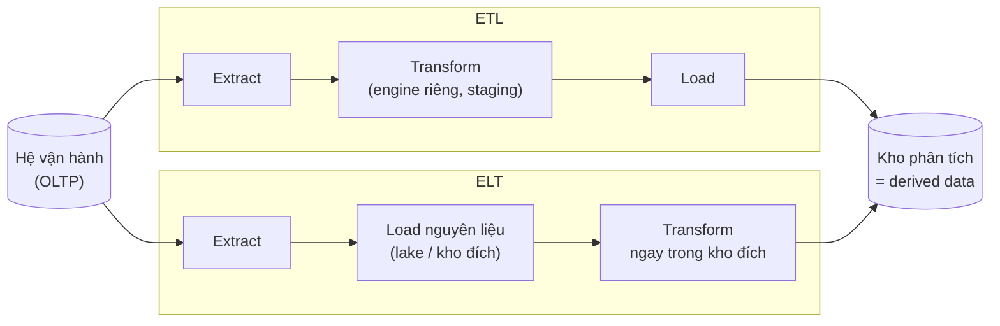
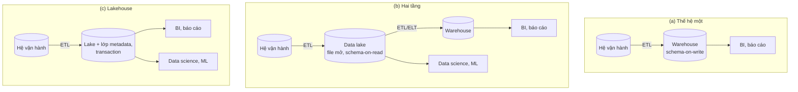
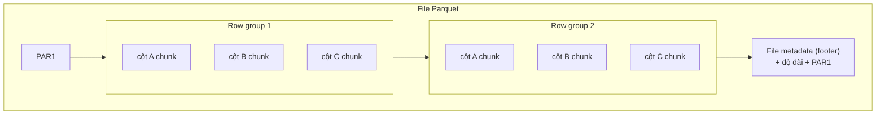
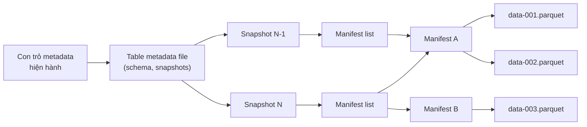
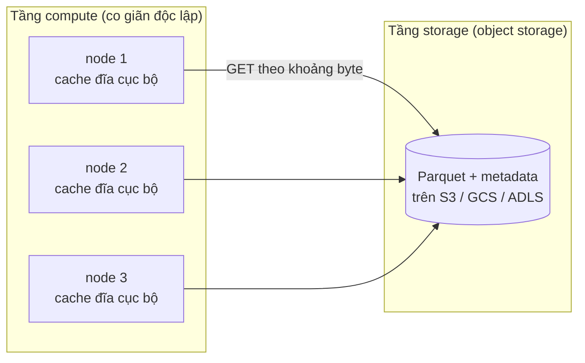
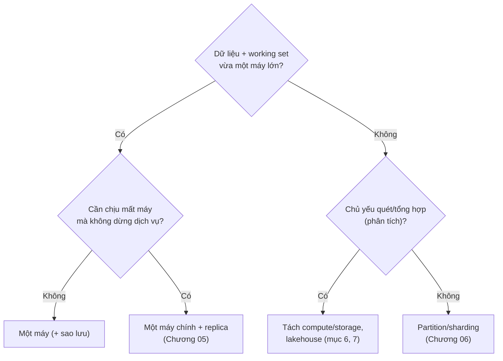

# P12 · Chương 13 — Kiến trúc hệ dữ liệu: operational vs analytical, warehouse/lake, cloud vs tự vận hành

> Chương này nói về *cách ghép các hệ thống dữ liệu thành một kiến trúc*, không đi vào bên trong một engine (xem [Chương 03](03-storage-engine.md)). Nguồn gồm paper gốc (Lakehouse, Delta Lake, Snowflake, COST), spec ghim phiên bản (Apache Iceberg `apache-iceberg-1.5.0`, Delta `v3.2.0`, Parquet `apache-parquet-format-2.10.0`), docs.rs ghim phiên bản (`parquet 53.3.0`, `object_store 0.11.2`) và tài liệu vendor (AWS, Google Cloud, Microsoft, DuckDB, PostgreSQL, SQLite). Tài liệu vendor **không ghim được phiên bản**: nội dung là bản truy cập ngày 2026-10-12 và có thể đổi. Không có thí nghiệm nào được chạy; ví dụ code ở phần Rust chỉ để minh họa và **chưa được biên dịch** trong chương này.

## Bạn sẽ hiểu được gì

- **Q1.** Hệ vận hành (OLTP) khác hệ phân tích ở đâu, và vì sao thường tách thành hai hệ thống? → mục 1
- **Q2.** Dữ liệu đi từ hệ vận hành sang hệ phân tích thế nào (ETL vs ELT), và "system of record" khác "derived data" ra sao? → mục 2
- **Q3.** Data warehouse, data lake và lakehouse là gì, mỗi thế hệ sinh ra để giải quyết điều gì? → mục 3
- **Q4.** Vì sao Parquet là định dạng file mặc định cho phân tích, và nó khác Arrow thế nào? → mục 4
- **Q5.** Object storage (S3) bảo đảm gì và *không* bảo đảm gì? → mục 5
- **Q6.** Iceberg và Delta biến một đống file bất biến trên object storage thành "bảng có transaction" bằng cách nào? → mục 6
- **Q7.** Tách compute khỏi storage, serverless, cloud so với tự vận hành: được gì, mất gì? → mục 7
- **Q8.** Khi nào một máy là đủ, khi nào mới cần phân tán? → mục 8

## Kiến thức cần trước

- [Chương 01 — Reliability, scalability, maintainability](01-reliability-scalability-maintainability.md): ngôn ngữ để nói "đủ tốt" là gì (tải, độ trễ, khả năng vận hành).
- [Chương 03 — Storage engine](03-storage-engine.md): engine lưu theo hàng và theo cột *bên trong một database*. Chương này chỉ dùng kết quả (cột nén tốt, quét nhanh), không giải thích lại.
- [Chương 07 — Transaction](07-transaction.md): ACID, snapshot isolation, optimistic concurrency; mục 6 dùng lại các khái niệm này.
- Có thể đọc lướt: [Chương 05 — Replication](05-replication.md), [Chương 06 — Partitioning](06-partitioning.md) (mục 7: giá phải trả của việc chia dữ liệu), [Chương 10 — Batch processing](10-batch-processing.md) và [Chương 12 — Đúng đắn và tích hợp dữ liệu](12-dung-dan-va-tich-hop-du-lieu.md) (mục 2).

Chuyện *trách nhiệm với dữ liệu* (xóa dữ liệu theo luật, GDPR, đạo đức) nằm ở [Chương 14](14-trach-nhiem-voi-du-lieu.md); chương này chỉ chỉ ra chỗ kiến trúc va vào nó.

## 1. Vận hành vs phân tích (Q1)

> **Trả lời ngắn.** Hệ vận hành (OLTP) ghi lại từng giao dịch kinh doanh ngay khi nó xảy ra và phục vụ ứng dụng trực tiếp[^oltp-def]. Hệ phân tích (OLAP) thì nghiêng về đọc nhiều, ghi ít[^olap-heavyread]. Tải của nó hay là những truy vấn quét một phần lớn dữ liệu[^duck-olap]. Hai bài toán kéo thiết kế về hai hướng ngược nhau, nên thực hành phổ biến là đặt chúng ở hai hệ thống riêng. Đó là thực hành chứ không phải quy luật tự nhiên, và nó có lý do cụ thể (xem bên dưới).

**Giải thích.**

*Với service `shop`.* Hãy hình dung `shop`, một service Rust nhận đơn hàng và lưu vào bảng `orders` trong PostgreSQL. Mỗi request chỉ chạm vài dòng, tra theo khóa, và phải trả lời trong vài mili giây. Rồi team kinh doanh xin báo cáo "doanh thu theo vùng, theo tuần": nghĩa là quét hàng chục triệu dòng `orders` để cộng một cột. Ta sẽ bám theo `shop` suốt chương, vì cả chương là một câu hỏi: dữ liệu của `shop` nên nằm ở đâu, dưới hình dạng nào, để vừa phục vụ khách vừa trả lời được báo cáo (nhận xét của người soạn: `shop` là ví dụ giả định, không phải code trong repo).

Phía khách hàng của `shop` là OLTP (online transaction processing): hệ thống ghi nhận các tương tác kinh doanh ngay khi chúng xảy ra trong vận hành hằng ngày, và cho truy vấn lại dữ liệu đó[^oltp-def]. Một đơn hàng phải lưu trọn vẹn hoặc không lưu gì, nên giao dịch cần tính nguyên tử, tức là chữ A trong ACID ở [Chương 07](07-transaction.md)[^oltp-atomic]. Tải điển hình (nhận xét của người soạn): rất nhiều thao tác nhỏ chạm vài dòng, tra cứu bằng khóa, độ trễ tính bằng mili giây.

Báo cáo doanh thu thì thuộc về OLAP (online analytical processing). Microsoft mô tả OLAP là loại database tối ưu cho tác vụ đọc nhiều, ghi ít[^olap-heavyread]. DuckDB định nghĩa theo *tải*: truy vấn phức tạp, chạy tương đối lâu, xử lý một phần đáng kể tập dữ liệu, ví dụ tổng hợp trên cả bảng hoặc join nhiều bảng lớn[^duck-olap]. Với `shop`, đó là vài truy vấn nhưng mỗi truy vấn đọc hàng triệu dòng mà chỉ cần vài cột như `region` và `amount` (nhận xét của người soạn). Đây chính là kiểu tải mà lưu theo cột trả công nhất. Cơ chế bên trong engine (layout hàng/cột, nén) nằm ở [Chương 03](03-storage-engine.md), mục 8; chương này chỉ nhìn ở tầng kiến trúc hệ thống.

Vậy sao không chạy báo cáo thẳng trên Postgres đang phục vụ `shop`? Microsoft nêu rằng database OLTP chứa thông tin quý nhưng "không được thiết kế để phân tích", nên lấy dữ liệu ra để phân tích vừa chậm vừa khó[^olap-notdesigned]. Tách ra thì truy vấn phức tạp chạy được mà không làm gián đoạn hệ giao dịch[^olap-nodisrupt]. Tài liệu BigQuery nói cùng hướng về database kiểu cũ: phải chia sẻ tài nguyên giữa thao tác đọc/ghi và thao tác phân tích[^bq-share]. Còn cơ chế cụ thể (nhận xét của người soạn): một truy vấn quét lớn tranh CPU, băng thông đĩa và bộ nhớ đệm với các giao dịch nhạy độ trễ trên cùng máy, nên request của khách có thể chậm theo. Đây là suy luận từ kiến trúc, các nguồn trên không đo điều đó.

| Trục | OLTP (đơn hàng của `shop`) | Phân tích (báo cáo doanh thu) |
|---|---|---|
| Mục tiêu | Ghi nhận và phục vụ giao dịch ngay[^oltp-def] | Truy vấn phức tạp trên khối lượng lớn[^duck-olap] |
| Nghiêng về | Ghi nặng, đọc vừa phải[^oltp-workload] | Đọc nhiều, ghi ít[^olap-heavyread] |
| Thay đổi dữ liệu | Giao dịch phải nguyên tử[^oltp-atomic] | Thay đổi dự kiến cũng ở quy mô lớn: thêm nhiều dòng hoặc đổi phần lớn bảng cùng lúc[^duck-olap-change] |

(Bảng tóm tắt của người soạn; mỗi ô dựa vào nguồn ghi ở chú thích.)

<details><summary>Đi sâu: hai nghĩa của chữ "OLAP", và con số quy mô trong docs Azure</summary>

- Chữ "OLAP" được dùng theo hai nghĩa. Trang của Microsoft mô tả mô hình ngữ nghĩa kiểu cube/star/snowflake, nơi cập nhật hoặc nối thêm dữ liệu thường phải *tính lại cube*[^olap-cube]. DuckDB thì dùng chữ này để chỉ *kiểu tải* (quét, tổng hợp), không nói đến cube[^duck-olap]. Khi đọc tài liệu, hãy hỏi: họ đang nói về mô hình dữ liệu (cube) hay về kiểu truy vấn?
- Cũng trang đó gán quy mô OLTP là "nhỏ (MB) đến lớn (vài TB)"[^azure-oltp-scale]. Quy mô OLAP là "lớn, hàng trăm GB đến nhiều PB"[^azure-olap-scale]. Đây là con số minh họa cho phân loại, *không phải giới hạn kỹ thuật* của từng loại engine (mục 8 cho thấy giới hạn máy đơn lớn hơn nhiều).
- Chương này không đi vào hệ lai (một engine phục vụ cả hai tải), vì tập nguồn của P12 chưa có tài liệu ghim phiên bản cho chủ đề đó.

</details>

**Quay lại Q1:** với `shop`, OLTP phục vụ từng đơn hàng nhỏ, cần đúng và nhanh; báo cáo doanh thu quét khối lớn, cần thông lượng. Hai tải đòi layout dữ liệu và tài nguyên khác nhau, nên thực hành phổ biến là tách ra hai hệ thống.

## 2. ETL, ELT, system of record và derived data (Q2)

> **Trả lời ngắn.** Muốn phân tích mà không làm nặng hệ vận hành, ta phải sao dữ liệu sang nơi khác. ETL biến đổi dữ liệu *trước khi* nạp vào kho đích, còn ELT nạp nguyên liệu vào kho đích rồi biến đổi *ngay trong đó*[^elt-def]. Dù đi đường nào, bản trong kho cũng là *derived data* (dữ liệu dẫn xuất), dựng lại được từ nguồn[^mv-disposable]. Nơi giữ bản gốc có thẩm quyền là *system of record*[^es-sor].

**Giải thích.**

*Với service `shop`.* Bảng `orders` trong Postgres là bản gốc. Bảng `revenue_by_region_week` trong kho phân tích là bản tính ra từ nó. Nếu một con số trên báo cáo sai, bạn sửa `orders` hoặc sửa cách tính rồi tính lại; không ai sửa tay bảng báo cáo và coi đó là sự thật (nhận xét của người soạn). Mục này trả lời hai câu hỏi: `shop` đưa dữ liệu sang kho bằng cách nào, và bản nào được coi là thật.

### 2.1 Đưa dữ liệu sang kho: ETL và ELT

ETL (extract–transform–load) là quy trình gom dữ liệu từ nhiều nguồn vào một kho thống nhất. Ở bước biến đổi, dữ liệu bị sửa theo quy tắc kinh doanh bằng một engine chuyên dụng, thường gồm lọc, sắp xếp, tổng hợp, join, làm sạch, khử trùng lặp và kiểm tra hợp lệ[^etl-def]. Với `shop`, ETL nghĩa là: lấy đơn từ Postgres, bỏ đơn nháp, join với bảng khách hàng, cộng theo vùng, rồi mới nạp kết quả vào kho.

ELT chỉ khác ETL ở nơi diễn ra phép biến đổi: nó xảy ra trong kho đích[^elt-def]. Với `shop`, ta nạp nguyên bảng `orders` vào kho rồi chạy SQL cộng theo vùng ngay tại đó. Cái lợi là bỏ được engine biến đổi riêng[^elt-simplify]. Ngoài ra, scale kho đích cũng kéo theo hiệu năng của pipeline[^elt-scale]. Đổi lại, kho đích phải đủ mạnh để biến đổi hiệu quả[^elt-condition]. Cùng trang cũng lưu ý ELT không nhất thiết là truy vấn "ảo": có workload vẫn vật chất hóa bảng đã biến đổi[^elt-materialize].



(Sơ đồ của người soạn, minh họa định nghĩa ETL/ELT ở trên.)

Chọn đường nào thì pipeline cũng là một hệ thống bạn phải vận hành. Cách cổ điển là viết chương trình đọc, biến đổi, xuất dữ liệu mới, thường chạy theo lịch của một bộ lập lịch định kỳ như cron; mẫu này gọi là data pipeline[^sre-pipeline]. Kinh nghiệm SRE của Google là mô hình pipeline chạy định kỳ rất *mong manh*: lúc cài đặt thì người ta tinh chỉnh kỹ nên chạy ổn, nhưng tăng trưởng hữu cơ làm lộ ra job vượt hạn, cạn tài nguyên, chunk bị treo[^sre-fragile]. Vì vậy Microsoft khuyên thiết kế song song hóa theo ranh giới phân vùng (ngày, tenant, shard key) để tránh tranh chấp ghi và cho phép *retry idempotent*[^etl-idem]. Idempotent (cách hiểu của người soạn): chạy lại cùng đầu vào thì cho cùng kết quả, không nhân đôi dòng. Định nghĩa và các cơ chế nằm ở [Chương 12](12-dung-dan-va-tich-hop-du-lieu.md), mục 4.

### 2.2 Bản nào là thật

Tài liệu event sourcing của Microsoft gọi event store là "system of record", tức nguồn dữ liệu có thẩm quyền về trạng thái hiện tại[^es-sor]. Ngược lại, materialized view (view đã được tính sẵn và lưu) cùng dữ liệu trong nó là "hoàn toàn bỏ đi được vì có thể dựng lại hoàn toàn từ kho nguồn"[^mv-disposable]. Kleppmann nêu hệ quả thực tế của việc lấy log sự kiện làm gốc: index tìm kiếm hay view mới có thể dựng bằng cách đọc log từ đầu đến cuối[^olep-rebuild]. Và nếu bug ghi sai sự kiện, các view dẫn xuất tính lại được[^olep-recover].

Từ đó rút ra ba hệ quả kiến trúc cho `shop` (nhận xét của người soạn):

1. Mỗi tập dữ liệu nên có *một* system of record được chỉ định rõ. Ở đây là `orders` trong Postgres; mọi bản khác (warehouse, search index, cache) là derived.
2. Sửa lỗi dữ liệu ở nguồn rồi để derived data được tính lại, thay vì vá từng bản.
3. Xóa dữ liệu theo yêu cầu pháp lý phải lan tới *mọi* bản dẫn xuất; nội dung ở [Chương 14](14-trach-nhiem-voi-du-lieu.md).

Điểm thứ ba có nguồn thực tế: paper Delta Lake nêu rằng các tập dữ liệu về người dùng thường cần cập nhật toàn bảng để thực hiện chính sách riêng tư như GDPR[^delta-gdpr].

<details><summary>Đi sâu: độ sâu pipeline, và dòng "ELT rồi ETL" trong kiến trúc hai tầng</summary>

- SRE định nghĩa *pipeline depth* là số chương trình nối tiếp nhau trong pipeline: pipeline nông có một chương trình, pipeline sâu có hàng chục đến hàng trăm[^sre-depth]. Mỗi bậc là thêm một chỗ có thể trễ hoặc hỏng (suy luận của người soạn).
- Paper Lakehouse mô tả hệ hai tầng: dữ liệu bị ETL vào lake rồi lại ELT sang warehouse, "tạo ra phức tạp, độ trễ và kiểu lỗi mới"[^lh-etl-twice]. Đây là động lực để tìm kiến trúc ít bước sao chép hơn (mục 3).
- Chương 10 và 11 nói cách *tính* derived data bằng batch và stream; chương 12 nói cách giữ chúng nhất quán với nguồn.

</details>

**Quay lại Q2:** `shop` sao `orders` sang kho bằng ETL (biến đổi trước khi nạp) hoặc ELT (nạp rồi biến đổi trong kho đích). Bản trong kho là dữ liệu dẫn xuất dựng lại được, còn gốc có thẩm quyền nằm ở system of record, nên sửa ở gốc rồi tính lại.

## 3. Warehouse, lake, lakehouse (Q3)

> **Trả lời ngắn.** Data warehouse là kho tập trung, gom dữ liệu từ các hệ vận hành để phục vụ báo cáo và hỗ trợ ra quyết định[^lh-gen1]. Data lake là kho lưu trữ giá rẻ có API file, chứa dữ liệu thô ở định dạng mở như Parquet[^lh-gen2]. Lakehouse là mô hình do các tác giả paper CIDR 2021 đề xuất: đặt lớp quản lý kiểu warehouse (transaction, hiệu năng) *lên trên* dữ liệu mở của lake[^lh-def]. Cần nhớ đây là *luận điểm* của một nhóm làm ở một vendor, không phải sự thật đã được thống nhất (xem phần Đi sâu).

**Giải thích.**

*Với service `shop`.* Dữ liệu của `shop` không dừng ở `orders`. Còn log tìm kiếm, clickstream, ảnh sản phẩm, đánh giá của khách. Câu hỏi của mục này: cất tất cả ở đâu để vừa lên được báo cáo doanh thu, vừa cho team ML dùng? Paper *Lakehouse* kể lịch sử câu trả lời theo ba thế hệ (Hình 1 của paper).

1. **Thế hệ một: warehouse.** Data warehousing bắt đầu từ việc gom dữ liệu của các database vận hành vào kho tập trung để hỗ trợ quyết định và BI (business intelligence). Dữ liệu ghi theo *schema-on-write*, nghĩa là bị ép về mô hình đã thiết kế ngay *lúc ghi*[^lh-gen1]. Với `shop`, `orders` phải được làm sạch và khớp schema của kho trước khi vào (minh họa của người soạn). Kiểu này có hai vấn đề. Một là compute và storage gắn thành một thiết bị on-premises, nên doanh nghiệp phải mua theo đỉnh tải và đỉnh dữ liệu[^lh-coupled]. Hai là dữ liệu phi cấu trúc (video, âm thanh, văn bản) không lưu truy vấn được[^lh-unstructured].
2. **Thế hệ hai: data lake.** Thay vì ép schema, ta đổ dữ liệu thô vào lake: hệ lưu trữ giá thấp có API file, dùng định dạng mở như Parquet và ORC[^lh-gen2]. Lake là *schema-on-read* (áp cấu trúc khi *đọc*): lưu gì cũng được và rẻ, nhưng đẩy bài toán chất lượng và quản trị dữ liệu về phía sau[^lh-schema-read]. Từ 2015, lake trên đám mây như S3, ADLS, GCS bắt đầu thay HDFS[^lh-cloud-lake].
3. **Hệ hai tầng hiện hành.** Một phần dữ liệu trong lake lại được ETL sang warehouse cho các ứng dụng quan trọng nhất[^lh-twotier-etl]. Các tác giả viết rằng, theo kinh nghiệm của họ, kiến trúc lake + warehouse hai tầng này đang thống trị công nghiệp[^lh-twotier]. Đó là lời của tác giả, không phải khảo sát.



(Sơ đồ rút gọn theo Hình 1 của paper; vẽ lại bằng chữ của người soạn.)

Paper gán bốn vấn đề cho kiến trúc hai tầng: độ tin cậy (giữ lake và warehouse nhất quán khó và tốn kém), dữ liệu cũ (warehouse trễ so với lake), hỗ trợ phân tích nâng cao hạn chế (ML cần đọc dữ liệu lớn bằng mã không phải SQL) và tổng chi phí sở hữu[^lh-four]. Riêng chi phí, paper nói cụ thể là trả hai lần chi phí lưu trữ cho dữ liệu sao sang warehouse, và bị khóa vào định dạng độc quyền của warehouse thương mại[^lh-tco]. Vì thế lakehouse được định nghĩa là mô hình đặc trưng bởi (i) định dạng mở truy cập trực tiếp như Parquet và ORC, (ii) hỗ trợ hạng nhất cho ML và data science, (iii) hiệu năng hiện đại[^lh-def].

Điều kiện kỹ thuật để làm được vậy, theo paper, là một lớp metadata đặt trên lưu trữ của lake. Lý do: S3 hay HDFS chỉ có giao diện object/file mức thấp, trong đó ngay cả việc cập nhật một bảng trải trên nhiều file cũng không nguyên tử[^lh-nonatomic]. Với `shop`, nghĩa là nạp một batch đơn hàng gồm nhiều file thì reader có thể thấy batch dở dang. Mục 5 và 6 mổ xẻ chính điều này.

<details><summary>Đi sâu: đọc paper Lakehouse với con mắt phản biện</summary>

- Các tác giả làm việc ở Databricks và Berkeley/Stanford[^lh-authors]. Paper là bài *lập luận*: nó "lập luận rằng kiến trúc warehouse hiện nay sẽ suy yếu"[^lh-abstract]. Kèm theo là kết quả TPC-DS của một hệ dùng Parquet có hiệu năng cạnh tranh với warehouse đám mây phổ biến[^lh-tpcds]. Nhận xét của người soạn: nên đọc nó như một đề xuất thiết kế có động cơ thương mại, đối chiếu với nhu cầu thực tế của mình, chứ không như kết luận trung lập. Chương này dùng paper chủ yếu để *mô tả thế hệ và vấn đề*, còn cơ chế thì lấy từ spec Iceberg/Delta (mục 6).
- Paper cũng nêu phương án "bỏ lake, chỉ dùng warehouse có tách compute/storage" và tự gọi là giải pháp *straw-man*. Họ cho rằng khả năng ứng dụng của nó hạn chế vì không quản lý dễ dữ liệu video/audio/văn bản và không cho ML đọc trực tiếp nhanh[^lh-strawman].
- Với một service backend nhỏ như `shop`, câu hỏi thực tế thường không phải "chọn lakehouse hay warehouse" mà là "đã cần kho phân tích riêng chưa"; đối chiếu mục 8 (nhận xét của người soạn).

</details>

**Quay lại Q3:** warehouse tối ưu cho BI nhưng đắt và đóng; lake rẻ và mở nhưng thiếu quản trị; lakehouse cố giữ định dạng mở của lake và thêm transaction/hiệu năng của warehouse. Đó là một luận điểm có cơ chế kỹ thuật cụ thể (mục 5–6) nhưng đến từ một vendor.

## 4. Parquet và định dạng file cột (Q4)

> **Trả lời ngắn.** Parquet là định dạng file lưu theo cột, hỗ trợ cả dữ liệu lồng nhau[^pq-def]. Một file chia thành các row group, mỗi row group có đúng một column chunk cho mỗi cột, và mỗi chunk chia thành các page[^pq-hier]. Metadata nằm cuối file, nên reader đọc metadata trước rồi chỉ lấy đúng các column chunk cần[^pq-footer]. Nhờ vậy truy vấn chỉ đọc cột nó cần, và nén/mã hóa được chọn riêng cho từng cột[^pq-percol]. Arrow là định dạng *trong bộ nhớ* ưu tiên hiệu quả tính toán, còn Parquet ưu tiên hiệu quả lưu trữ[^pq-vs-arrow].

**Giải thích.**

*Với service `shop`.* Giả sử `shop` xuất `orders` ra file, bảng có hàng chục cột, hàng trăm triệu dòng, mà báo cáo doanh thu chỉ cần cộng cột `amount` theo cột `region`. Lưu theo hàng thì phải đọc qua mọi cột của từng dòng; lưu theo cột thì chỉ đọc đúng hai "băng" `region` và `amount` (nhận xét của người soạn). Lý do và kỹ thuật bên trong engine (nén theo cột, ghi vào kho cột, late materialization) nằm ở [Chương 03](03-storage-engine.md). Ở đây ta nhìn một *file* cột nằm trên object storage.

### 4.1 Cấu trúc file

Phân cấp file → row group → column chunk → page đã được mô tả ở [Chương 03](03-storage-engine.md) (mục 8). Ở đây chỉ giữ điều cần cho object storage. File gồm một hay nhiều row group, và mỗi row group có đúng một column chunk cho mỗi cột[^pq-hier]. Column chunk của một cột trong một row group được bảo đảm nằm liền nhau trong file[^pq-glossary], nên đọc trọn một chunk có thể chỉ là một lượt đọc theo khoảng byte (suy luận của người soạn).

Layout file là: magic `PAR1`, lần lượt các column chunk, rồi file metadata, độ dài metadata, và `PAR1` một lần nữa. Metadata được ghi sau dữ liệu để cho phép ghi một lượt[^pq-footer]. Reader đọc metadata trước để tìm các column chunk quan tâm, rồi mới đọc các chunk đó[^pq-read]. Bản thân metadata mã hóa bằng Apache Thrift[^pq-thrift].



(Sơ đồ của người soạn theo layout ở đoạn trên; chỉ vẽ hai row group và ba cột cho gọn.)

### 4.2 Đọc ít hơn

Có hai cách bỏ bớt việc đọc. Cách thứ nhất là **chiếu cột** (projection): chỉ đọc cột cần, nhờ metadata chỉ rõ vị trí từng column chunk. Với báo cáo của `shop`, reader chỉ lấy hai chunk `region` và `amount` trong mỗi row group. Cách thứ hai là **cắt tỉa** (pruning): bỏ phần dữ liệu không thể khớp, nhờ thống kê min/max mà Parquet lưu ở nhiều cấp (column chunk, column index, data page)[^pq-minmax]. README nói thống kê có thể dùng để pruning[^pq-prune]. File cũng có thể kèm column index để reader bỏ qua page hiệu quả hơn[^pq-skip]. Cách dùng điển hình là bỏ cả row group có khoảng min/max không chứa giá trị đang tìm (suy luận của người soạn).

Snowflake mô tả cùng ý trên S3: vì S3 cho GET theo khoảng byte của file, truy vấn chỉ tải header và các cột nó cần[^snow-range]. Còn việc nén/mã hóa chọn riêng từng cột thì xem [Chương 03](03-storage-engine.md), mục 8.

### 4.3 Parquet và Arrow

Docs crate `parquet` nói Parquet giống Arrow về tinh thần nhưng tập trung vào hiệu quả lưu trữ, còn Arrow ưu tiên hiệu quả tính toán[^pq-vs-arrow]. Đặc tả Arrow cho biết định dạng cột của nó đổi hiệu năng phân tích và tính cục bộ dữ liệu lấy chi phí thay đổi (mutation) cao hơn[^arrow-tradeoff]. Vì vậy pipeline điển hình *lưu* ở Parquet rồi *nạp* thành Arrow `RecordBatch` để tính trong RAM (nhận xét của người soạn).

<details><summary>Đi sâu: kiểu dữ liệu tối thiểu, nested, kích thước row group, tách metadata khỏi dữ liệu</summary>

- Parquet cố ý giữ tập kiểu vật lý tối thiểu. Ví dụ không có số nguyên 16 bit, vì số nguyên 32 bit cùng một mã hóa hiệu quả đã bao phủ nó[^pq-types]. Kiểu logic (như chuỗi UTF8 trên byte array) chỉ là chú thích diễn giải[^pq-logical].
- Dữ liệu lồng nhau dùng thuật toán record shredding/assembly mô tả trong paper Dremel, mà README cho là tốt hơn việc "làm phẳng" không gian tên[^pq-dremel].
- README khuyến nghị row group lớn, 512MB–1GB[^pq-rg-recommend]. Lý do: row group lớn cho column chunk lớn, tức I/O tuần tự lớn hơn[^pq-rg-benefit]. Khuyến nghị này gắn với HDFS, vì cùng đoạn nói row group nên nằm trọn một HDFS block[^pq-rg-hdfs]. Trên object storage thì đo lại theo workload của mình (nhận xét của người soạn).
- Thiết kế *tách metadata khỏi dữ liệu* cho phép chia cột ra nhiều file, hoặc để một file metadata tham chiếu nhiều file Parquet[^pq-sep]. Ý tưởng này là tiền đề để table format (mục 6) quản lý "bảng gồm nhiều file".
- Quy tắc so sánh min/max có chi tiết riêng cho NaN và ±0; spec ghi cụ thể và coi định nghĩa Thrift là có thẩm quyền[^pq-nan]. Engine tự viết cần tuân theo để pruning không loại nhầm.

</details>

**Quay lại Q4:** Parquet là file cột có footer metadata và thống kê, nên `shop` chỉ cần đọc các cột và row group cần từ object storage. Arrow là dạng trong RAM để tính, Parquet là dạng để lưu.

## 5. Object storage: bảo đảm gì, không bảo đảm gì (Q5)

> **Trả lời ngắn.** Amazon S3 cho read-after-write *mạnh* với PUT và DELETE đối tượng[^s3-strong]. Cập nhật một khóa là nguyên tử[^s3-atomic-key]. Nhưng nó *không có* cập nhật nguyên tử xuyên nhiều khóa[^s3-nocross]. Nó cũng không có khóa đối tượng cho nhiều người ghi đồng thời[^s3-nolock]. Đối tượng thường chỉ thay được cả khối[^delta-whole]. Đọc theo khoảng byte thì được[^snow-range]. Chính những hạn chế này quyết định thiết kế của table format ở mục 6.

**Giải thích.**

*Với service `shop`.* Giả sử `shop` ghi các file Parquet lên S3. Có ba tình huống `shop` sẽ gặp. Ghi xong một file rồi đọc lại ngay, có thấy đúng bản vừa ghi không? Ghi một lúc nhiều file, reader có thể thấy trạng thái nửa vời không? Hai instance `shop` cùng ghi một khóa thì chuyện gì xảy ra? Phần dưới trả lời lần lượt, theo đúng những gì docs AWS hứa.

*Mô hình dữ liệu.* S3 lưu dữ liệu dưới dạng *object* trong *bucket*; object là một file cùng metadata mô tả nó[^s3-model]. Khóa (key) trông như đường dẫn nhưng không phải cây thư mục (nhận xét của người soạn; xem thêm `object_store` ở phần Rust).

*Những gì S3 bảo đảm.* Với tình huống đầu tiên, AWS ghi rõ read-after-write mạnh cho PUT/DELETE trong mọi Region, áp dụng cả cho object mới lẫn PUT ghi đè và DELETE[^s3-strong]. Xóa object rồi liệt kê khóa ngay thì object không còn trong danh sách[^s3-list]. Cập nhật một khóa cũng là nguyên tử: nếu một thread PUT đè trong khi thread khác GET cùng khóa, thread GET thấy dữ liệu cũ hoặc mới, không bao giờ thấy nửa vời[^s3-atomic-key].

*Những gì S3 không làm.* Cập nhật chỉ tính theo khóa, không có cách làm nguyên tử xuyên khóa. Nếu khóa này phụ thuộc khóa kia thì bạn phải tự thiết kế trong ứng dụng[^s3-nocross]. Với `shop`, ghi một batch mười file và muốn reader thấy cả mười hoặc không file nào là đúng loại việc này (nhận xét của người soạn). Tình huống thứ ba cũng không được bảo vệ: S3 không hỗ trợ khóa đối tượng cho nhiều writer đồng thời. Hai PUT cùng lúc vào cùng một khóa thì request có timestamp muộn hơn thắng, và nếu đó là vấn đề thì phải tự xây cơ chế khóa[^s3-nolock]. Ngoài ra, cấu hình bucket có mô hình nhất quán *cuối cùng* (eventual) chứ không mạnh[^s3-bucket].

*Ghi có điều kiện.* Có một công cụ để hai writer không đè nhau: *conditional writes*. Bạn thêm header `If-None-Match` hoặc `If-Match` vào request ghi; `If-None-Match` ngăn ghi đè khi đã có object cùng khóa[^s3-cw]. Nếu nhiều ghi có điều kiện cùng khóa thì ghi hoàn tất đầu tiên thành công, các ghi sau nhận `412 Precondition Failed`[^s3-first]. Docs còn nói có thể nhận `409 Conflict` khi có request đồng thời, ví dụ một delete hoàn tất trước khi ghi có điều kiện xong[^s3-409]; vì vậy client cần xử lý cả hai mã (suy luận của người soạn). Hiểu theo cách dùng: `If-None-Match` là "tạo nếu chưa có", còn `If-Match` so ETag là compare-and-swap trên *một* khóa. Đó là nguyên liệu để dựng commit trên object storage (mục 6; việc nối nguồn này là suy luận của người soạn). Chương [09](09-consistency-va-consensus.md) nói compare-and-swap nằm ở đâu trong bức tranh đồng thuận.

*Hình dạng đối tượng.* Paper Delta Lake nói cập nhật object thường cần ghi lại cả object[^delta-whole]. Các cập nhật này có thể làm nguyên tử, để reader thấy hoặc bản mới hoặc bản cũ[^delta-atomic-obj]. Snowflake mô tả trên S3 điều tương tự: không thể append vào cuối file[^snow-noappend]. Với `shop`, nghĩa là muốn thêm dòng vào một file Parquet đã có thì phải ghi lại cả file hoặc ghi file mới (suy luận của người soạn). Paper Delta cũng nêu thao tác metadata như liệt kê object tốn kém[^delta-list].

<details><summary>Đi sâu: "S3 từng nhất quán cuối cùng", khác biệt giữa các nhà cung cấp, và giới hạn của một lượt liệt kê</summary>

- Paper Delta Lake viết rằng các object store cài đặt dạng key-value khiến khó đạt ACID và hiệu năng cao: thao tác metadata như liệt kê đắt, bảo đảm nhất quán hạn chế[^delta-abs]. Câu này là của tác giả *tại thời điểm viết paper*; bảo đảm hiện hành của S3 là chuỗi đã trích từ docs AWS ở trên. Đừng suy ra điều đó cho kho khác: hãy đọc tài liệu đúng nhà cung cấp và đúng loại bucket (nhận xét của người soạn).
- Một số nhà cung cấp phủ giao diện hệ file lên blob storage, ví dụ ADLS Gen2 của Azure, với ngữ nghĩa gần HDFS[^delta-adls]. Đừng gộp chúng với S3 khi nói "object storage bảo đảm gì".
- Iceberg spec nêu rõ bộ yêu cầu tối thiểu với file system: ghi tại chỗ (file không bị di chuyển hay sửa sau khi ghi), đọc có seek, và xóa. Các yêu cầu này tương thích với object store như S3[^ice-fsops].
- Thư viện `object_store` của Rust ghi trong source rằng một lượt liệt kê có thể bị giới hạn 1.000 object theo hạn chế của kho lưu trữ nền[^os-list].

</details>

**Quay lại Q5:** S3 cho read-after-write mạnh và PUT nguyên tử theo từng khóa, lại có ghi có điều kiện; nhưng không có nguyên tử xuyên khóa và không khóa đối tượng cho nhiều writer. Nên mọi thứ "giống database" mà `shop` cần đều phải xây lên trên.

## 6. Table format mở: Iceberg và Delta (Q6)

> **Trả lời ngắn.** Table format là một đặc tả quy định cách *một bảng* được ghi thành tập file bất biến cộng với metadata, sao cho engine nào đọc spec cũng đọc được. Iceberg theo dõi từng data file riêng lẻ thay vì thư mục[^ice-files-not-dirs]. Mỗi thay đổi tạo file metadata mới và thay file cũ bằng một "hoán đổi nguyên tử"[^ice-atomic-swap]. Delta ghi mỗi phiên bản bảng thành một entry trong log giao dịch, và không bao giờ ghi đè entry có sẵn[^delta-never-overwrite]. Cả hai dùng optimistic concurrency: ghi trước, đụng độ thì thử lại. Iceberg nêu rõ điều đó trong spec[^ice-occ]. Delta thì commit theo hai pha[^delta-twophase].

**Giải thích.**

*Với service `shop`.* Mỗi đêm `shop` muốn nạp một batch gồm nhiều file Parquet vào bảng `orders_history` trên S3. Báo cáo chạy lúc đang nạp phải thấy trọn batch cũ hoặc trọn batch mới. Hai job nạp chạy chồng nhau không được phá nhau. Mục 5 cho thấy S3 không tự đảm bảo cả hai điều này. Table format giải quyết bằng một ý đơn giản: không sửa gì tại chỗ. Mỗi lần thay đổi, ghi thêm một bản metadata mới liệt kê các file hợp lệ; ai muốn biết bảng đang thế nào thì đọc bản mới nhất; và nếu hai writer cùng muốn tạo bản kế tiếp thì chỉ một bên thắng, bên kia đọc lại rồi thử lại (nhận xét của người soạn, tóm tắt cơ chế mô tả bên dưới).

### Iceberg

Spec của Iceberg tự mô tả là đặc tả table format, nhằm quản lý một tập file lớn, thay đổi chậm, trong hệ file phân tán hoặc kho key-value như một bảng[^ice-def]. Cấu trúc gồm ba lớp:

- Trạng thái bảng nằm trong *metadata file*: schema, cấu hình partition, thuộc tính, và các *snapshot*. Mỗi snapshot là trạng thái bảng tại một thời điểm, dùng để truy cập toàn bộ tập data file[^ice-overview].
- Data file trong snapshot do một hay nhiều *manifest file* theo dõi. Mỗi manifest chứa một dòng cho mỗi data file cùng dữ liệu partition và số đo (metrics) của file đó[^ice-manifest]. Các manifest của một snapshot được liệt kê trong một *manifest list*[^ice-manifest-list].
- Manifest được dùng lại giữa các snapshot để khỏi viết lại metadata thay đổi chậm[^ice-manifest-reuse].



(Sơ đồ của người soạn, dựng theo mô tả ở trên; manifest A được hai snapshot dùng chung như spec cho phép.)

*Commit.* Mọi thay đổi trạng thái bảng tạo file metadata mới và thay file cũ bằng hoán đổi nguyên tử[^ice-atomic-swap]. Chính hoán đổi này là nền tảng cho serializable isolation: reader dùng snapshot hiện hành lúc nạp metadata và không bị ảnh hưởng cho tới khi refresh[^ice-occ-basis]. Còn writer tạo file metadata một cách lạc quan (optimistic), giả định phiên bản hiện hành sẽ không đổi trước lúc commit, rồi commit bằng cách hoán đổi con trỏ file metadata từ phiên bản gốc sang phiên bản mới[^ice-occ]. Nếu snapshot nền của cập nhật không còn là hiện hành thì writer phải thử lại trên phiên bản hiện hành mới[^ice-retry]. Với `shop`: job nạp đêm đọc metadata hiện hành, ghi các file Parquet mới, rồi commit; nếu giữa chừng có job khác đã commit thì nó đọc lại phiên bản mới và thử lại, còn báo cáo chạy song song vẫn thấy trọn snapshot cũ (minh họa của người soạn).

Điều đáng nhớ là spec không chuẩn hóa thao tác nguyên tử dùng để commit; thao tác đó phụ thuộc cách bảng được theo dõi[^ice-notstd]. Spec đưa ví dụ: bảng dạng file system dùng rename nguyên tử ở hệ file hỗ trợ (HDFS, đa số hệ file cục bộ)[^ice-fs-tables]. Bảng dạng metastore thì lưu con trỏ trong metastore hoặc database và cập nhật bằng check-and-put[^ice-metastore]. Spec cũng nói bảng không cần rename, trừ bảng dùng rename nguyên tử để commit[^ice-norename].

Còn trên S3? Paper Delta Lake (2020) liệt kê cách cài bước ghi log nguyên tử trên từng kho, và ghi rằng *lúc đó* Amazon S3 không có "put if absent" hay rename nguyên tử[^delta-s3-2020]. Docs AWS hiện hành (mục 5) đã có ghi có điều kiện. Đây là hai thời điểm khác nhau, nên (suy luận của người soạn) trên S3 ngày nay commit có thể dùng catalog/metastore hoặc ghi có điều kiện; đừng giả định có rename nguyên tử.

### Delta

Đặc tả giao thức Delta đặt mục tiêu mang tính chất ACID cho tập dữ liệu lớn lưu dạng file trong hệ file phân tán hoặc object store[^delta-def]. Delta cài giao dịch bằng multi-version concurrency control (MVCC): giữ nhiều bản dữ liệu thay vì thay ngay file chứa bản ghi bị sửa hay xóa[^delta-mvcc]. Writer sửa bảng theo hai pha. Trước hết nó ghi lạc quan các data file mới (hoặc bản sao cập nhật của file cũ). Sau đó nó commit bằng cách thêm một entry mới vào log, tạo ra phiên bản nguyên tử mới của bảng[^delta-twophase].

Mỗi entry là một *Delta file*, đơn vị nguyên tử của bảng. Tên file là số phiên bản kế tiếp, đệm số 0 đủ 20 chữ số, nằm trong thư mục `_delta_log`[^delta-log-entry]. Vì tên file chính là số phiên bản, hai job nạp của `shop` cùng muốn commit phiên bản 8 sẽ cùng nhắm vào một khóa; chỉ cần lớp lưu trữ cho đúng một bên tạo thành công là xong (suy luận của người soạn).

Quy tắc đứng sau việc đó: writer *không bao giờ* được ghi đè log entry có sẵn. Với phần còn lại spec chỉ dùng "should": khi có thể, nên dùng primitive nguyên tử của hệ file nền để các writer đồng thời không ghi đè nhau[^delta-never-overwrite]. Spec v3.2.0 không gọi tên "put-if-absent". Paper Delta Lake thì nêu rằng bước tạo log record kế tiếp phải nguyên tử, chỉ một client được tạo object mang tên đó[^delta-atomic-create]. Paper cũng kể cách cài: Google Cloud Storage và Azure Blob Store dùng put-if-absent nguyên tử[^delta-impls]. Nối với `If-None-Match` ở mục 5 là suy luận của người soạn: phép "tạo nếu chưa có" nguyên tử trên S3 chính là thứ header này cung cấp.

### So sánh nhanh

| Khía cạnh | Iceberg 1.5.0 (spec) | Delta v3.2.0 (protocol) |
|---|---|---|
| Đơn vị theo dõi | Data file qua manifest, snapshot[^ice-manifest] | Action `add`/`remove` trong log[^delta-action] |
| Điểm commit | Hoán đổi nguyên tử file metadata, cơ chế *không chuẩn hóa*[^ice-notstd] | Entry log mới, không ghi đè entry cũ[^delta-never-overwrite] |
| Mô hình cạnh tranh | Optimistic, retry[^ice-retry] | Optimistic, hai pha[^delta-twophase] |
| Mục tiêu về isolation | Serializable isolation[^ice-goal-ser] | Ghi serializable[^delta-ser] |
| Metadata nằm đâu | Metadata/manifest file, con trỏ qua catalog tùy cách theo dõi[^ice-notstd] | "Tự mô tả": metadata nằm cạnh dữ liệu, không cần metastore riêng để đọc[^delta-selfdesc] |

(Bảng so sánh của người soạn từ hai spec.) Delta nêu thêm mục tiêu cho phía đọc: reader đọc được một snapshot nhất quán của bảng, kể cả khi có ghi đồng thời[^delta-goals]. Isolation ở đây là *mục tiêu* spec nêu, không phải bảo đảm của mọi engine: Iceberg spec nói writer có thể chọn điều kiện kiểm tra khác nhau, nên mức isolation phụ thuộc điều kiện để một ghi commit thành công[^ice-validate].

<details><summary>Đi sâu: version của spec, delete file, sequence number, checkpoint, vacuum</summary>

- Iceberg spec ở tag 1.5.0 nói phiên bản 1 và 2 đã hoàn tất và được cộng đồng chấp nhận, còn phiên bản 3 đang phát triển tích cực, chưa chính thức được chấp nhận[^ice-versions]. Khi đọc spec trên web không ghim, hãy kiểm tra số phiên bản đang xem.
- Phiên bản 1 quản lý bảng phân tích bằng định dạng file bất biến: Parquet, Avro, ORC[^ice-v1]. Phiên bản 2 thêm cập nhật/xóa theo dòng; thay đổi chính là *delete file* mã hóa những dòng đã bị xóa trong data file có sẵn, để xóa hoặc thay từng dòng mà không viết lại file[^ice-v2].
- Mỗi commit thành công được gán một *sequence number* để so tuổi tương đối giữa data file và delete file. Nếu commit phải thử lại thì sequence number được gán lại[^ice-seq].
- Delta ghi rõ một log entry không được chứa nhiều hơn một action "reconcile" với nhau, ví dụ nhiều `Metadata` action, hoặc `add`/`remove` cùng `(path, DV)`[^delta-one-action]. Đây là ràng buộc về nội dung một entry; còn "ai thắng khi hai writer đụng nhau" do quy tắc không ghi đè entry quyết định (nhận xét của người soạn).
- Checkpoint của log Delta lưu dạng Parquet: các action là các cột riêng, kiểu struct[^delta-checkpoint-pq]. Paper Delta nói log "được nén thành định dạng Parquet" để có ACID, time travel và thao tác metadata nhanh hơn nhiều[^delta-paper-log]. Checkpoint nhiều phần *không thể ghi nguyên tử*, nên reader phải bỏ qua checkpoint nhiều phần thiếu part[^delta-multipart].
- File dữ liệu không còn trong phiên bản mới nhất có thể bị xóa chậm bằng lệnh vacuum, sau thời gian lưu giữ do người dùng đặt (mặc định 7 ngày)[^delta-vacuum].
- Delta dành sẵn chỗ cho định danh giao dịch ứng dụng (cặp `appId`/`version`), ghi nguyên tử cùng thay đổi bảng để tránh nhân đôi dữ liệu khi stream retry[^delta-txid]. Điều này liên quan trực tiếp đến idempotence ở [Chương 12](12-dung-dan-va-tich-hop-du-lieu.md) và [Chương 11](11-stream-processing.md).
- Bảng đọc/ghi qua "reader/writer protocol version" và "table features"; chúng quyết định engine nào được đọc hay ghi bảng[^delta-protocol]. Trước khi chia sẻ bảng giữa nhiều engine, hãy kiểm tra tính tương thích (nhận xét của người soạn).

</details>

**Quay lại Q6:** table format là tập file bất biến, cộng metadata có phiên bản, cộng *một* thao tác nguyên tử để commit (hoán đổi con trỏ, hoặc tạo entry log chưa tồn tại). Cạnh tranh giữa các writer được giải bằng optimistic concurrency, nên `shop` có transaction trên object storage dù bản thân object storage không có transaction.

## 7. Tách compute/storage, serverless, cloud vs tự vận hành (Q7)

> **Trả lời ngắn.** *Tách compute khỏi storage* nghĩa là phần tính toán và phần lưu dữ liệu là hai dịch vụ co giãn độc lập. Snowflake ghép hai phần đó lỏng lẻo và cho co giãn độc lập[^snow-sep]. BigQuery cũng tách như vậy, để mỗi tầng cấp phát tài nguyên động mà không ảnh hưởng hiệu năng hay tính sẵn sàng của tầng kia[^bq-sep]. Cái được (suy ra từ các nhược điểm của shared-nothing thuần mà paper Snowflake nêu): phần cứng không phải thỏa hiệp cho một loại tải[^snow-hetero]. Đổi số node cũng không kéo theo xáo trộn dữ liệu trên chính các node đang xử lý truy vấn[^snow-member]. Snowflake còn cung cấp dạng trả theo mức dùng[^snow-payg]. Cái mất: dữ liệu nằm xa compute nên phải có cache[^snow-cache]. *Serverless* đẩy việc cấp phát tài nguyên cho nhà cung cấp[^bq-serverless]. *Cloud được quản lý* như RDS nhận việc sao lưu, vá, phát hiện lỗi[^rds-manage]. *Tự vận hành* giữ toàn quyền nhưng nhận toàn bộ trách nhiệm.

**Giải thích.**

*Với service `shop`.* Giờ `shop` có dữ liệu trên object storage và cần một engine để truy vấn nó. Có hai câu hỏi tách bạch. Engine đó nên dính liền với chỗ lưu dữ liệu hay tách riêng? Và ai chạy, vá, sao lưu, co giãn nó: đội của bạn hay nhà cung cấp? Mục này đi qua từng câu hỏi.

### 7.1 Vì sao tách compute khỏi storage

Hãy bắt đầu từ thiết kế cũ, shared-nothing thuần: mỗi node có đĩa cục bộ, bảng được chia ngang giữa các node và mỗi node chỉ chịu trách nhiệm các dòng trên đĩa mình[^snow-sn]. Cái dở là nó gắn chặt compute với storage, nên một số tình huống sinh vấn đề[^snow-couple]. Paper Snowflake nêu hai vấn đề cụ thể.

Vấn đề thứ nhất là tải không đồng nhất. Cấu hình tốt cho nạp hàng loạt (băng thông I/O cao, ít tính) lại kém cho truy vấn phức tạp (ít I/O, tính nhiều) và ngược lại, nên phần cứng đành thỏa hiệp với mức sử dụng trung bình thấp[^snow-hetero]. Với `shop`, job nạp đơn hằng đêm và truy vấn báo cáo cần hai kiểu máy khác nhau, nhưng một cụm dính liền thì chỉ chọn được một kiểu (minh họa của người soạn).

Vấn đề thứ hai là thay đổi thành viên node. Khi đổi tập node (do lỗi hay do resize) phải xáo trộn lượng lớn dữ liệu. Chính các node đó vừa xáo trộn vừa xử lý truy vấn, nên hiệu năng bị ảnh hưởng đáng kể[^snow-member]. Trên đám mây, thay đổi thành viên "không phải ngoại lệ mà là chuẩn mực"[^snow-norm]. Từ đó Snowflake tách hai phần thành hai dịch vụ ghép lỏng, co giãn độc lập[^snow-sep].

BigQuery nêu cùng nguyên tắc: tách tầng compute và storage cho phép mỗi tầng cấp phát tài nguyên động mà không ảnh hưởng hiệu năng hay tính sẵn sàng của tầng kia[^bq-sep]. Paper Lakehouse chỉ ra điểm kinh tế của hệ cũ: thiết bị on-premises gắn compute với storage buộc doanh nghiệp trả tiền cho đỉnh tải và đỉnh dữ liệu[^lh-coupled].



(Sơ đồ của người soạn; "cache đĩa cục bộ" theo mô tả của paper Snowflake ở đoạn *Cái giá* bên dưới.)

*Cái giá.* Để giảm lưu lượng giữa compute và storage, mỗi node compute của Snowflake cache một phần dữ liệu bảng trên đĩa cục bộ[^snow-cache]. Với `shop`, truy vấn đầu tiên vào một phân vùng chưa có trong cache sẽ chậm hơn các lần sau, vì phải kéo dữ liệu qua mạng từ object storage (nhận xét của người soạn: đây là suy luận từ kiến trúc, nguồn trên không đo độ trễ này).

### 7.2 Cloud so với tự vận hành

Hai chiều tách bạch:

- *Ai làm việc vận hành.* Amazon RDS là dịch vụ database được quản lý: nó lo sao lưu, vá phần mềm, tự phát hiện lỗi và khôi phục[^rds-manage]. Snowflake đặt mục tiêu người dùng "không cần mua máy, thuê DBA hay cài phần mềm"[^snow-saas]. Nhưng trách nhiệm không biến mất mà *chia*. Mô hình trách nhiệm chia sẻ của AWS có "bảo mật *của* đám mây", nơi AWS chịu trách nhiệm bảo vệ hạ tầng chạy dịch vụ[^aws-sr-of]. Phần "bảo mật *trong* đám mây" thuộc khách hàng, và mức việc phải làm tùy dịch vụ chọn[^aws-sr-in].
- *Ai co giãn.* BigQuery tự mô tả là kiến trúc serverless với "quản lý hạ tầng bằng không"[^bq-serverless]. Docs của họ nói việc tách compute/storage là thiết yếu để cung cấp warehouse serverless được quản lý hoàn toàn, nơi đội kỹ sư BigQuery lo cập nhật và bảo trì[^bq-managed].

*Khóa nhà cung cấp.* Paper Lakehouse lập luận rằng warehouse thương mại khóa dữ liệu vào định dạng độc quyền, làm tăng chi phí di chuyển dữ liệu hoặc workload sang hệ khác[^lh-tco]. Định dạng mở (Parquet, mục 4) cùng table format mở (mục 6) là cách các tác giả đề xuất để giảm khóa này. Đây là lập luận của paper, và nó chỉ giảm khóa *dữ liệu*, không loại bỏ khóa dịch vụ như catalog, quyền truy cập, API riêng (nhận xét của người soạn).

| Câu hỏi | Nghiêng về dịch vụ được quản lý | Nghiêng về tự vận hành |
|---|---|---|
| Có đội vận hành database không? | Không/ít: để nhà cung cấp lo sao lưu, vá, failover[^rds-manage] | Có, và đã có quy trình riêng |
| Tải có đỉnh nhọn, thất thường? | Có: mua theo mức dùng thay vì theo đỉnh[^snow-payg] | Tải ổn định, dự đoán được |
| Cần kiểm soát hạ tầng/tuân thủ chi tiết? | Chia trách nhiệm theo mô hình nhà cung cấp[^aws-sr-in] | Toàn quyền, và toàn gánh |
| Lo khóa nhà cung cấp? | Ưu tiên định dạng mở, đọc được ngoài dịch vụ[^lh-tco] | — |

(Bảng là khung quyết định của người soạn: chú thích chỉ dẫn chứng cho *dữ kiện nền*, còn việc chọn nghiêng về đâu là nhận xét của người soạn. Chương không đưa số tiền vì giá dịch vụ thay đổi và không nằm trong tập nguồn ghim phiên bản.)

<details><summary>Đi sâu: các vấn đề nêu trong paper Snowflake, và hạn chế của trích dẫn</summary>

- Snowflake dùng cấu hình tách compute/storage: compute dựng trên engine shared-nothing riêng, còn storage đi qua Amazon S3, nhưng paper nói "về nguyên tắc loại blob store nào cũng được"[^snow-sep2].
- Về tính chất S3 ảnh hưởng thiết kế: object chỉ ghi đè được cả khối, không append, kích thước phải khai trước trong PUT, và S3 hỗ trợ GET theo khoảng byte. Paper nói những tính chất đó "ảnh hưởng mạnh" tới định dạng file bảng và cơ chế điều khiển đồng thời của Snowflake[^snow-s3-props]. Đây là cùng bộ ràng buộc ở mục 5, nhìn từ phía một engine chứ không phải table format mở.
- Paper là của vendor (Snowflake Computing) và mô tả hệ của họ[^snow-authors]. Dùng nó để hiểu *lý do thiết kế*, không như so sánh khách quan giữa các sản phẩm.
- Trong cloud, theo paper, lỗi node xảy ra thường hơn và hiệu năng có thể khác rất nhiều ngay cả giữa node cùng loại[^snow-norm-src]. Nối với [Chương 08](08-su-co-he-phan-tan.md): thiết kế coi lỗi là mặc định chứ không phải ngoại lệ (nhận xét của người soạn).

</details>

**Quay lại Q7:** tách compute/storage đổi "co giãn độc lập, trả theo mức dùng"[^snow-payg] lấy việc dữ liệu ở xa compute nên cần cache. Dịch vụ được quản lý hay serverless đổi công vận hành lấy sự phụ thuộc vào nhà cung cấp, nhưng trách nhiệm không mất đi mà được chia theo mô hình của từng nhà cung cấp.

## 8. Một máy đủ khi nào, phân tán khi nào (Q8)

> **Trả lời ngắn.** Hệ phân tán thêm những lỗi riêng mà chương trình một máy không phải xử lý: mạng hỏng, node chết hay chậm[^kdist-fault]. Vì vậy nó chỉ đáng dùng khi bài toán thật sự đòi hỏi (nhận xét của người soạn). Kleppmann liệt kê các lý do chính đáng, trong đó có dữ liệu quá lớn không vừa một máy, cần chịu lỗi, hoặc cần gần người dùng[^kdist-why]. Paper COST cho thấy nhiều hệ "scalable" đã công bố không có cấu hình nào thắng nổi một thread viết cẩn thận, trên các bài toán đồ thị được xét[^cost-unbounded]. Quyết định đúng là đo khối lượng thật rồi so với giới hạn máy đơn, không mặc định "big data" (nhận xét của người soạn).

**Giải thích.**

*Với service `shop`.* Giả sử dữ liệu của `shop` đã lên vài trăm GB và ai đó đề xuất dựng cụm phân tán cho báo cáo. Trước khi duyệt, ta cần hai thứ: biết phân tán đem lại gì và đòi gì, rồi so khối lượng thật của `shop` với những gì một máy làm được.

### 8.1 Được gì, mất gì khi phân tán

Bài giảng của Kleppmann liệt kê các lý do để phân tán: vốn đã phân tán (ví dụ tin nhắn giữa hai điện thoại); độ tin cậy tốt hơn (một node hỏng, cả hệ vẫn chạy); hiệu năng tốt hơn (lấy dữ liệu từ node gần); và giải bài toán lớn hơn (ví dụ lượng dữ liệu khổng lồ không vừa một máy)[^kdist-why].

Cái giá cũng nằm trong bài giảng đó. Truyền thông có thể hỏng mà ta không biết, tiến trình có thể chết mà ta không biết, và tất cả xảy ra không tất định[^kdist-down]. Trên một máy, nếu một bộ phận hỏng thì thường cả máy dừng. Hệ phân tán thì muốn chịu được một phần hỏng ("partial failure"), và đó là điều làm lập trình phân tán khác biệt và thường khó hơn[^kdist-fault]. Chi tiết ở [Chương 08](08-su-co-he-phan-tan.md).

### 8.2 Bằng chứng về chi phí

McSherry và Isard đề xuất thước đo COST (Configuration that Outperforms a Single Thread): cấu hình phần cứng cần có trước khi một nền tảng vượt được một cài đặt đơn luồng có năng lực, cho một bài toán nhất định[^cost-def]. Họ so các paper hệ thống về xử lý đồ thị với cài đặt đơn luồng đơn giản trên cùng tập dữ liệu, dùng một laptop cao cấp đời 2014[^cost-method]. Kết quả: nhiều hệ đã công bố có COST *không giới hạn*, tức không cấu hình nào thắng được cài đặt đơn luồng tốt nhất, với mọi bài toán chúng được áp dụng[^cost-unbounded].

Cần đọc đúng phạm vi. Đây là kết quả về *xử lý đồ thị* của các hệ đời trước 2015, và tác giả tự nhận phép so sánh "không hoàn hảo và không phải lúc nào cũng công bằng"[^cost-caveat]. Đừng suy ra "phân tán luôn chậm hơn một máy" (nhận xét của người soạn).

### 8.3 Giới hạn thực của máy đơn

Một số mốc từ docs chính thức:

- PostgreSQL 17: "relation size" tối đa 32 TB với `BLCKSZ` mặc định 8192 byte[^pg-limits]. Docs cũng nhắc giới hạn thực tế như hiệu năng hay dung lượng đĩa có thể chạm trước giới hạn cứng[^pg-practical].
- SQLite: dùng được cho backend website thông thường, nhưng nếu website ghi nặng hoặc bận tới mức cần nhiều server thì docs khuyên cân nhắc database client/server cấp doanh nghiệp[^sqlite-site].
- DuckDB: engine phân tích chạy *trong* tiến trình chủ, không có server riêng cần cài hay bảo trì[^duck-embedded]. Nó nhắm tới tải OLAP[^duck-olap]. Một thiết kế như vậy cho thấy phân tích mức vài chục GB có thể không cần cụm (nhận xét của người soạn, chưa đo trong chương này).



(Cây quyết định của người soạn để định hướng suy nghĩ, không phải quy tắc có nguồn; mỗi nhánh là một chương/mục đã nói.)

Điều đáng nhớ (nhận xét của người soạn): *replica để chịu lỗi* (nhân bản cùng một dữ liệu) và *partition để vượt dung lượng/thông lượng một máy* (chia dữ liệu) là hai bài toán khác nhau, và nhiều hệ chỉ cần cái đầu. Nhầm lẫn giữa hai cái dễ dẫn tới dựng cụm lớn cho `shop` khi chỉ cần thêm replica.

<details><summary>Đi sâu: đọc paper COST đúng cách, và chi phí ẩn của pipeline phân tán</summary>

- COST không kết luận rằng phân tán là sai. Tác giả viết hệ scalable thường hợp với tài nguyên cụm, nhưng cần cân nhắc phần cứng khác để đạt hiệu năng đỉnh[^cost-alt]. Họ cũng nhấn mạnh cần phân biệt "scalability" với "dùng tài nguyên hiệu quả"[^cost-distinguish].
- Lý do tác giả nêu: môi trường cụm thường đề cao dung lượng và thông lượng hơn độ trễ, với lõi, lưu trữ, bộ nhớ chậm hơn[^cost-env]. Laptop dung lượng thấp hơn nhưng lõi, lưu trữ, bộ nhớ nhanh hơn[^cost-laptop].
- Kết luận của paper: câu hỏi "hệ thống có thể được làm cho scale tốt không?" đã được trả lời tầm thường (ở phần mở đầu) và không phải câu hỏi đúng[^cost-q]. Cần minh bạch hơn về các phương án đã có để nhận ra tiến bộ[^cost-concl].
- Chi phí vận hành của pipeline nhiều bậc: SRE cho biết pipeline sâu thì mỗi bậc là một chỗ chunk có thể bị treo. Nếu phản ứng "mặc định" là giết job rồi chạy lại mà pipeline không có checkpoint thì công việc của mọi chunk bị làm lại (xem đoạn "hanging chunk")[^sre-fragile].
- Bước đầu hợp lý (nhận xét của người soạn): viết bản đơn giản nhất chạy trên một máy với định dạng mở (Parquet, mục 4), và chỉ chuyển sang cụm khi *đo được* nút thắt. Vì dữ liệu đã ở định dạng mở, việc chuyển không phải viết lại dữ liệu mà chỉ đổi engine đọc nó.

</details>

**Quay lại Q8:** phân tán đổi dung lượng và chịu lỗi lấy phức tạp và chi phí điều phối. Vì vậy với `shop`, phải so khối lượng thật với giới hạn máy đơn trước, và nhớ rằng replica (chịu lỗi) khác partition (vượt dung lượng).

## Liên hệ với Rust

Quay lại `shop`: nếu `shop` viết bằng Rust thì các tầng ở trên đều có crate tương ứng, do chính dự án Apache Arrow duy trì. Ví dụ dưới chỉ để minh họa và **chưa biên dịch hay chạy** trong chương này; phiên bản ghim là `parquet 53.3.0`, `object_store 0.11.2`. Để dùng `ParquetObjectReader`, crate `parquet` cần bật feature `async` và `object_store`[^pq-feat], cùng `tokio` và `futures` cho phần chạy bất đồng bộ.

| Crate | Vai trò | Nguồn |
|---|---|---|
| `arrow` | Cài đặt Rust thuần, an toàn, đầy đủ của Apache Arrow, định dạng dữ liệu trong bộ nhớ | [^arrow-crate] |
| `parquet` | Cài đặt Rust native chính thức của Parquet, thuộc dự án Arrow | [^pq-crate] |
| `object_store` | API thống nhất cho object storage (S3, GCS, Azure, local) qua trait `ObjectStore` | [^os-crate] |

Crate `parquet` có module `arrow` để đọc và ghi dữ liệu Parquet từ/sang Arrow `RecordBatch`[^pq-arrow-api].

**`object_store` mô hình hóa object store chứ không phải hệ file.** Docs nói giao diện được thiết kế để phản chiếu API object store chứ không phải hệ file, nên API *không có trạng thái* thay vì giao diện dựa con trỏ như `Read`/`Seek`[^os-nofs]. Docs nêu các lợi ích: mọi thao tác nguyên tử và reader không thấy ghi dở hay thất bại, phương thức ánh xạ trực tiếp sang API object store, và cho phép đặt điều kiện tiên quyết cho thao tác[^os-nofs-benefits]. Trait là `Send + Sync + 'static`, và các phương thức async trả `Pin<Box<dyn Future ...>>` (dùng `async_trait`)[^os-trait-sig]. Nhờ vậy giữ được `Arc<dyn ObjectStore>` làm trait object: cùng một binary chạy trên nhiều cloud, còn môi trường test chỉ khác ở cấu hình runtime[^os-crate]. (Chi tiết async: [Phase 7, Tokio](../07-io-async/08-tokio.md).)

**Đọc Parquet từ object store, chỉ lấy vài cột** (khớp mục 4):

```rust
use std::sync::Arc;
use futures::TryStreamExt;
use object_store::{local::LocalFileSystem, path::Path, ObjectStore};
use parquet::arrow::{
    async_reader::{ParquetObjectReader, ParquetRecordBatchStreamBuilder},
    ProjectionMask,
};

#[tokio::main]
async fn main() -> Result<(), Box<dyn std::error::Error>> {
    // Đổi sang AmazonS3Builder ... .build()? để dùng S3 mà không đổi phần còn lại.
    let store: Arc<dyn ObjectStore> = Arc::new(LocalFileSystem::new_with_prefix("/data")?);
    let path = Path::from("events/2026-10-12.parquet");

    let meta = store.head(&path).await?;                   // HEAD: kích thước, etag...
    let reader = ParquetObjectReader::new(store, meta);    // đọc theo khoảng byte
    let builder = ParquetRecordBatchStreamBuilder::new(reader).await?; // đọc footer

    // Chỉ cột gốc số 0 và 3 (projection).
    let mask = ProjectionMask::roots(builder.metadata().file_metadata().schema_descr(), [0, 3]);
    let batches: Vec<_> = builder.with_projection(mask).build()?.try_collect().await?;
    println!("{} batch", batches.len());
    Ok(())
}
```

Điểm bám vào docs: `ParquetObjectReader` đọc Parquet trong object storage qua `ObjectStore`[^pq-objreader]. Nó được tạo từ `Arc<dyn ObjectStore>` và `ObjectMeta`, lấy bằng `head` hoặc `list`[^pq-objmeta]. `ParquetRecordBatchStreamBuilder` dựng `ParquetRecordBatchStream` để đọc bất đồng bộ[^pq-streambuilder]. Kiểu này là alias của `ArrowReaderBuilder<AsyncReader<T>>`[^pq-alias]. `ProjectionMask` xác định tập cột trong schema có thể lồng nhau[^pq-projmask]. Vì là alias của `ArrowReaderBuilder`, builder async có `with_projection`, được ghi là "chỉ đọc dữ liệu từ các cột được chỉ định"[^pq-with-proj]. Nó cũng có `with_row_groups`, chỉ đọc từ các row group được chọn, còn gọi là *row group filtering*[^pq-with-rg]. Hai lời gọi này là bản Rust của chiếu cột và cắt tỉa ở mục 4.

**Commit kiểu Delta: tạo log entry chỉ khi chưa tồn tại** (khớp mục 5–6):

```rust
use object_store::{path::Path, Error, ObjectStore, PutMode, PutPayload};

/// Ghi `_delta_log/<version>.json`; trả Ok(true) nếu ta thắng cuộc đua commit.
async fn try_commit(
    store: &dyn ObjectStore,
    version: u64,
    entry: Vec<u8>,
) -> object_store::Result<bool> {
    let path = Path::from(format!("t/_delta_log/{version:020}.json"));
    match store
        .put_opts(&path, PutPayload::from(entry), PutMode::Create.into())
        .await
    {
        Ok(_) => Ok(true),
        Err(Error::AlreadyExists { .. }) => Ok(false), // người khác đã commit version này
        Err(e) => Err(e),
    }
}
```

Hàm này là cuộc đua commit của hai job nạp `shop` ở mục 6, viết thành code. `PutMode::Create` ghi nguyên tử và trả `Error::AlreadyExists` nếu đã có object[^pq-putmode]. Với `PutMode::Update(UpdateVersion)`, ghi chỉ thành công nếu phiên bản hiện tại của object khớp, nếu không thì trả `Error::Precondition`[^pq-putmode]. Docs nói chế độ này dùng để dựng giao dịch optimistic concurrency, và tạo điều kiện dựng catalog metadata kiểu Iceberg hay Delta ngay trên object storage, không cần DBMS riêng[^os-condput].

Hỗ trợ ghi có điều kiện phụ thuộc kho nền. Trong `0.11.2`, `S3ConditionalPut` có hai chế độ: `ETagMatch` và `Dynamo` (một bảng DynamoDB để điều phối). Docs mô tả `ETagMatch` là dùng header `If-Match`/`If-None-Match`, nêu ví dụ Cloudflare R2 và MinIO mà không nêu AWS S3[^os-s3cond]. Đối chiếu mã nguồn tag `object_store_0.11.2`: builder S3 cấu hình chế độ này bằng `with_conditional_put`[^os-s3-with]. Nếu không đặt, `PutMode::Create`/`Update` trả `Error::NotImplemented`[^os-s3-default]. Với `ETagMatch`, `Create` gửi `If-None-Match: *`[^os-s3-inm]. Nhánh `Update` có chú thích "Real S3 will occasionally report 409 Conflict", tức mã đã tính tới S3 thật[^os-s3-409].

Hệ quả cho `try_commit` ở trên (đọc từ mã nguồn, chưa chạy với S3 thật): trên S3 với `object_store 0.11.2` phải gọi `AmazonS3Builder::with_conditional_put(S3ConditionalPut::ETagMatch)` (hoặc cấu hình `Dynamo`). Nếu quên, hàm nhận `Err(NotImplemented)` thay vì `Ok(true)`/`Ok(false)`. Việc nối với docs AWS ở mục 5, tức `If-None-Match`/`If-Match` ngay trên S3[^s3-cw], là suy luận của người soạn.

Hai điểm sư phạm (nhận xét của người soạn). Thứ nhất, Rust ép bạn xử lý `Result` ở mỗi nhánh. Trong code trên, *"thua cuộc đua"* là một giá trị trả về (`Ok(false)`) chứ không phải ngoại lệ, đúng với bản chất optimistic concurrency, nơi commit thất bại là kết quả bình thường. Thứ hai, vòng lặp retry (đọc phiên bản mới, tính lại, thử lại) là *trách nhiệm của thư viện hoặc của bạn*, không phải của object storage; đúng như mục 6 mô tả.

## Tóm tắt

- OLTP phục vụ từng giao dịch nhỏ cần đúng và nhanh[^oltp-def]. Phân tích quét phần lớn dữ liệu và cần thông lượng[^duck-olap]. Vì vậy thường tách thành hai hệ thống, như `shop` tách Postgres khỏi kho báo cáo[^olap-nodisrupt].
- ETL biến đổi trước khi nạp, ELT nạp rồi biến đổi trong kho đích[^elt-def]. Bản trong kho là dữ liệu dẫn xuất dựng lại được[^mv-disposable]. Gốc có thẩm quyền là system of record[^es-sor].
- Pipeline định kỳ là hệ thống cần vận hành và có thể mong manh[^sre-fragile]. Hãy thiết kế cho retry idempotent[^etl-idem].
- Ba thế hệ: warehouse (schema-on-write, đắt, đóng)[^lh-gen1]. Lake (rẻ, mở, schema-on-read)[^lh-gen2]. Lakehouse (đề xuất lớp metadata/transaction trên lake)[^lh-def]. Lakehouse là luận điểm của một vendor, nên đọc có phản biện.
- Parquet là file cột có footer metadata, thống kê min/max và nén theo cột[^pq-hier]. Arrow là dạng trong RAM để tính[^pq-vs-arrow].
- S3 cho read-after-write mạnh và nguyên tử theo từng khóa[^s3-strong]. Nó không nguyên tử xuyên khóa[^s3-nocross]. Nó cũng không khóa đối tượng cho nhiều writer[^s3-nolock]. Đổi lại, S3 có ghi có điều kiện[^s3-cw].
- Iceberg và Delta biến file bất biến thành bảng có transaction bằng metadata có phiên bản, cộng một thao tác nguyên tử để commit, cộng optimistic concurrency[^ice-atomic-swap]. Delta thì không ghi đè log entry có sẵn[^delta-never-overwrite].
- Tách compute/storage đổi co giãn độc lập lấy việc dữ liệu ở xa, nên cần cache[^snow-cache]. Dịch vụ quản lý và serverless chuyển việc vận hành sang nhà cung cấp, nhưng trách nhiệm được chia chứ không mất[^aws-sr-in].
- Phân tán thêm lỗi từng phần và chi phí điều phối[^kdist-fault]. COST cho thấy cần so với một máy trước[^cost-def]. Replica khác partition.
- Trong Rust: `parquet` + `arrow` + `object_store`. `object_store` mô hình hóa object store chứ không phải hệ file[^os-nofs]. Nó cũng có ghi có điều kiện[^os-condput].

## Câu hỏi tự kiểm tra

1. Nêu hai khác biệt giữa tải OLTP và tải phân tích, và một lý do thực tế để tách chúng ra hai hệ thống.
<details><summary>Đáp án</summary>

OLTP ghi nhận giao dịch khi chúng xảy ra[^oltp-def]. Giao dịch phải nguyên tử[^oltp-atomic]. Phân tích tối ưu cho đọc nhiều ghi ít[^olap-heavyread]. Truy vấn của nó quét phần lớn dữ liệu[^duck-olap]. Lý do tách: OLTP không được thiết kế để phân tích[^olap-notdesigned]. OLAP thì cho phép truy vấn phức tạp mà không làm gián đoạn hệ giao dịch[^olap-nodisrupt]. Tài liệu BigQuery nêu việc chia sẻ tài nguyên giữa đọc/ghi và phân tích ở database kiểu cũ[^bq-share]. Chi tiết CPU/đĩa/cache là suy luận của người soạn.

</details>

2. ELT khác ETL ở điểm nào, và điều kiện nào làm ELT hợp lý?
<details><summary>Đáp án</summary>

Chỉ khác nơi biến đổi: ELT biến đổi trong kho đích[^elt-def]. Nó hợp lý khi kho đích đủ mạnh để biến đổi hiệu quả[^elt-condition].

</details>

3. "System of record" và "derived data" khác nhau thế nào? Vì sao sửa dữ liệu nên làm ở gốc?
<details><summary>Đáp án</summary>

System of record là nguồn có thẩm quyền về trạng thái dữ liệu[^es-sor]. Derived data như materialized view có thể dựng lại hoàn toàn từ nguồn[^mv-disposable]. Sửa ở gốc rồi tính lại, vì các view dẫn xuất tính lại được từ nguồn[^olep-recover]. Vá tay bản dẫn xuất thì sẽ mất khi tính lại (suy luận của người soạn).

</details>

4. Ba thế hệ kiến trúc dữ liệu theo paper Lakehouse là gì, và vấn đề của kiến trúc hai tầng?
<details><summary>Đáp án</summary>

Warehouse schema-on-write, gắn compute với storage[^lh-gen1]. Lake schema-on-read, định dạng mở[^lh-gen2]. Hai tầng lake + warehouse[^lh-twotier]. Vấn đề: độ tin cậy, dữ liệu cũ, hỗ trợ phân tích nâng cao, tổng chi phí sở hữu[^lh-four].

</details>

5. Vì sao truy vấn Parquet trên object storage chỉ cần đọc một phần file?
<details><summary>Đáp án</summary>

Footer metadata ở cuối file cho reader tìm các column chunk cần[^pq-read]. S3 hỗ trợ GET theo khoảng byte[^snow-range]. Thống kê min/max cho phép bỏ row group[^pq-minmax].

</details>

6. Hãy nêu ba điều S3 bảo đảm và hai điều không.
<details><summary>Đáp án</summary>

Bảo đảm: read-after-write mạnh cho PUT/DELETE[^s3-strong]. Cập nhật một khóa nguyên tử[^s3-atomic-key]. Liệt kê không còn thấy object đã xóa[^s3-list]. Không bảo đảm: nguyên tử xuyên khóa[^s3-nocross]. Không có khóa đối tượng cho nhiều writer (timestamp muộn hơn thắng)[^s3-nolock].

</details>

7. Iceberg commit một thay đổi bảng bằng cách nào, và vì sao spec không nói rõ cơ chế nguyên tử?
<details><summary>Đáp án</summary>

Tạo metadata file mới rồi hoán đổi con trỏ nguyên tử từ bản gốc sang bản mới[^ice-occ]. Nếu bản gốc đã đổi thì thử lại[^ice-retry]. Thao tác nguyên tử cụ thể phụ thuộc cách theo dõi bảng nên không được chuẩn hóa[^ice-notstd]. Ví dụ là rename nguyên tử[^ice-fs-tables]. Hoặc check-and-put trong metastore[^ice-metastore].

</details>

8. Quy tắc nào của Delta làm hai writer không thể cùng commit một phiên bản? Primitive nào ở lớp lưu trữ cần có?
<details><summary>Đáp án</summary>

Writer không được ghi đè log entry có sẵn, và nên dùng primitive nguyên tử của hệ file nền[^delta-never-overwrite]. Entry đặt tên theo số phiên bản kế tiếp[^delta-log-entry]. Paper Delta nêu bước tạo entry này phải nguyên tử, chỉ một client được tạo object tên đó[^delta-atomic-create]. Primitive cần là "tạo nếu chưa có" nguyên tử, ví dụ `If-None-Match` trên S3[^s3-cw] (nối nguồn là suy luận của người soạn).

</details>

9. Vì sao Snowflake chọn tách compute khỏi storage? Cái giá phải trả là gì?
<details><summary>Đáp án</summary>

Shared-nothing thuần gắn chặt compute với storage[^snow-couple]. Tải không đồng nhất khiến phần cứng phải thỏa hiệp[^snow-hetero]. Thay đổi thành viên thì phải xáo trộn dữ liệu[^snow-member]. Trên cloud đó là chuyện thường[^snow-norm]. Cái giá: node compute phải cache dữ liệu để giảm lưu lượng tới storage[^snow-cache].

</details>

10. COST là gì, và đừng suy ra điều gì từ paper COST?
<details><summary>Đáp án</summary>

COST là cấu hình cần để nền tảng vượt một cài đặt đơn luồng có năng lực[^cost-def]. Nhiều hệ có COST không giới hạn trên bài toán đồ thị được xét[^cost-unbounded]. Đừng suy ra phân tán luôn chậm; tác giả tự nhận phép so sánh không hoàn hảo[^cost-caveat].

</details>

11. Mô tả chức năng của `ParquetObjectReader`, `ProjectionMask` và `PutMode::Create` trong chương này.
<details><summary>Đáp án</summary>

`ParquetObjectReader` đọc Parquet trong object storage qua `ObjectStore`[^pq-objreader]. `ProjectionMask` chọn cột[^pq-projmask]. `PutMode::Create` ghi nguyên tử và trả `AlreadyExists` nếu đã có object[^pq-putmode].

</details>

## Đọc thêm

- DDIA (Kleppmann, O'Reilly, ấn bản 1) **không có chương tương ứng 1-1** với chương này; đây là phần mở rộng của người soạn (kiến trúc hệ dữ liệu, table format, object storage). Sách không có bản đọc tự do nên chương này chỉ dùng tên chương/mục từ mục lục, không trích nội dung. Các phần liên quan:
  - Chương 3 "Storage and Retrieval", mục "Stars and Snowflakes: Schemas for Analytics" (cùng các mục "Data Warehousing" và "Column-Oriented Storage")[^toc-ddia3].
  - Chương 10 "Batch Processing", các mục "The Output of Batch Workflows" và "Comparing Hadoop to Distributed Databases"[^toc-ddia10].
  - Chương 12 "The Future of Data Systems", mục "Data Integration"[^toc-ddia12].
- [Lakehouse (CIDR 2021)](https://www.cidrdb.org/cidr2021/papers/cidr2021_paper17.pdf), mục 1–3: đọc để thấy lập luận ba thế hệ và danh sách vấn đề của kiến trúc hai tầng; nhớ đây là bài lập luận của vendor.
- [Delta Lake: High-Performance ACID Table Storage over Cloud Object Stores](https://www.databricks.com/wp-content/uploads/2020/08/p975-armbrust.pdf): đọc để hiểu vì sao object store cần lớp log giao dịch và các lựa chọn thiết kế.
- [Iceberg Table Spec (tag 1.5.0)](https://raw.githubusercontent.com/apache/iceberg/apache-iceberg-1.5.0/format/spec.md): đọc mục Overview, Optimistic Concurrency và Table Metadata để thấy chi tiết snapshot/manifest.
- [Delta Transaction Log Protocol (v3.2.0)](https://raw.githubusercontent.com/delta-io/delta/v3.2.0/PROTOCOL.md): đọc mục Delta Table Specification và Requirements for Writers.
- [Parquet format (2.10.0)](https://raw.githubusercontent.com/apache/parquet-format/apache-parquet-format-2.10.0/README.md): đọc để biết layout file và cấu hình row group/page.
- [The Snowflake Elastic Data Warehouse](https://www.cs.cmu.edu/~15721-f24/papers/Snowflake.pdf), mục 2–3: lý do tách storage và compute và các ràng buộc của S3 lên thiết kế.
- [Scalability! But at what COST?](https://www.usenix.org/system/files/conference/hotos15/hotos15-paper-mcsherry.pdf): đọc để học cách *đo* trước khi phân tán.
- [Amazon S3 data consistency model](https://docs.aws.amazon.com/AmazonS3/latest/userguide/Welcome.html) và [Conditional writes](https://docs.aws.amazon.com/AmazonS3/latest/userguide/conditional-writes.html): đọc để biết chính xác S3 hứa gì.
- [docs.rs `object_store 0.11.2`](https://docs.rs/object_store/0.11.2/object_store/) và [docs.rs `parquet 53.3.0`](https://docs.rs/parquet/53.3.0/parquet/): đọc phần Conditional Put và phần Read/Write Arrow.
- [Chương 03 — Storage engine](03-storage-engine.md): bù phần lưu theo cột bên trong engine mà chương này bỏ qua.
- [Chương 14 — Trách nhiệm với dữ liệu](14-trach-nhiem-voi-du-lieu.md): xóa dữ liệu, GDPR và đạo đức khi dữ liệu đã được sao ra nhiều nơi.

[^oltp-def]: Microsoft Azure Architecture Center, Online transaction processing (OLTP) — <https://learn.microsoft.com/en-us/azure/architecture/data-guide/relational-data/online-transaction-processing> — "OLTP systems record business interactions as they occur in the day-to-day operation of the organization, and support querying of this data to make inferences."
[^oltp-atomic]: Microsoft Azure Architecture Center, Online transaction processing (OLTP) — <https://learn.microsoft.com/en-us/azure/architecture/data-guide/relational-data/online-transaction-processing> — "Atomicity means that an entire transaction always succeeds or fails as one unit of work, and is never left in a half-completed state."
[^olap-heavyread]: Microsoft Azure Architecture Center, Online analytical processing (OLAP) — <https://learn.microsoft.com/en-us/azure/architecture/data-guide/relational-data/online-analytical-processing> — "OLAP databases are optimized for heavy-read and low-write tasks."
[^olap-notdesigned]: Microsoft Azure Architecture Center, Online analytical processing (OLAP) — <https://learn.microsoft.com/en-us/azure/architecture/data-guide/relational-data/online-analytical-processing> — "These databases hold valuable information, but they're not designed for analysis, so data retrieval is time-consuming and difficult."
[^olap-nodisrupt]: Microsoft Azure Architecture Center, Online analytical processing (OLAP) — <https://learn.microsoft.com/en-us/azure/architecture/data-guide/relational-data/online-analytical-processing> — "This method enables intricate queries without disrupting transactional systems."
[^olap-cube]: Microsoft Azure Architecture Center, Online analytical processing (OLAP) — <https://learn.microsoft.com/en-us/azure/architecture/data-guide/relational-data/online-analytical-processing> — "Updateable No, typically requires recomputing cube Appendable No, typically requires recomputing cube"
[^azure-oltp-scale]: Microsoft Azure Architecture Center, Online transaction processing (OLTP) — <https://learn.microsoft.com/en-us/azure/architecture/data-guide/relational-data/online-transaction-processing> — "Scale Small (MBs) to large (a few TBs)"
[^azure-olap-scale]: Microsoft Azure Architecture Center, Online analytical processing (OLAP) — <https://learn.microsoft.com/en-us/azure/architecture/data-guide/relational-data/online-analytical-processing> — "Scale Large, hundreds of gigabytes (GBs) to multiple petabytes (PBs)"
[^duck-olap]: DuckDB, Why DuckDB — <https://duckdb.org/why_duckdb> — "These workloads are characterized by complex, relatively long-running queries that process significant portions of the stored dataset, for example aggregations over entire tables or joins between several large tables."
[^duck-olap-change]: DuckDB, Why DuckDB — <https://duckdb.org/why_duckdb> — "Changes to the data are expected to be rather large-scale as well"
[^duck-embedded]: DuckDB, Why DuckDB — <https://duckdb.org/why_duckdb> — "DuckDB does not run as a separate process, but completely embedded within a host process."
[^etl-def]: Microsoft Azure Architecture Center, ETL — <https://learn.microsoft.com/en-us/azure/architecture/data-guide/relational-data/etl> — "Extract, transform, load (ETL) is a data integration process that consolidates data from diverse sources into a unified data store."
[^elt-def]: Microsoft Azure Architecture Center, ETL — <https://learn.microsoft.com/en-us/azure/architecture/data-guide/relational-data/etl> — "Extract, load, transform (ELT) differs from ETL solely in where the transformation takes place."
[^elt-condition]: Microsoft Azure Architecture Center, ETL — <https://learn.microsoft.com/en-us/azure/architecture/data-guide/relational-data/etl> — "However, ELT only works well when the target system is powerful enough to transform the data efficiently."
[^elt-materialize]: Microsoft Azure Architecture Center, ETL — <https://learn.microsoft.com/en-us/azure/architecture/data-guide/relational-data/etl> — "Some workloads materialize transformed tables or views to improve query performance or enforce governance rules; ELT doesn't always imply purely virtualized transformations."
[^etl-idem]: Microsoft Azure Architecture Center, ETL — <https://learn.microsoft.com/en-us/azure/architecture/data-guide/relational-data/etl> — "You typically design parallelization around data partition boundaries (date, tenant, shard key) to avoid write contention and enable idempotent retries."
[^sre-pipeline]: Google SRE book, Chapter 25 Data Processing Pipelines — <https://sre.google/sre-book/data-processing-pipelines/> — "Typically, the program is scheduled to run under the control of a periodic scheduling program such as cron. This design pattern is called a data pipeline."
[^sre-fragile]: Google SRE book, Chapter 25 Data Processing Pipelines — <https://sre.google/sre-book/data-processing-pipelines/> — "However, the collective SRE experience has been that the periodic pipeline model is fragile."
[^sre-depth]: Google SRE book, Chapter 25 Data Processing Pipelines — <https://sre.google/sre-book/data-processing-pipelines/> — "whereas a deep pipeline may have a pipeline depth in the tens or hundreds of programs."
[^es-sor]: Microsoft Azure Architecture Center, Event Sourcing pattern — <https://learn.microsoft.com/en-us/azure/architecture/patterns/event-sourcing> — "The events persist in an event store that serves as the system of record, or the authoritative data source, about the current state of the data."
[^mv-disposable]: Microsoft Azure Architecture Center, Materialized View pattern — <https://learn.microsoft.com/en-us/azure/architecture/patterns/materialized-view> — "A key point is that a materialized view and the data it contains are completely disposable because they can be entirely rebuilt from the source data stores."
[^olep-rebuild]: Kleppmann, Online Event Processing, Communications of the ACM 62(5), 2019 — <https://martin.kleppmann.com/papers/olep-cacm.pdf> — "A new search index or view over an existing dataset can be built simply by consuming the event log from beginning to end."
[^olep-recover]: Kleppmann, Online Event Processing, Communications of the ACM 62(5), 2019 — <https://martin.kleppmann.com/papers/olep-cacm.pdf> — "and any views derived from the events can be recomputed."
[^delta-gdpr]: Armbrust et al., Delta Lake (VLDB 2020), Section 2 — <https://www.databricks.com/wp-content/uploads/2020/08/p975-armbrust.pdf> — "most datasets about users require table-wide updates to implement privacy policies such as GDPR compliance"
[^lh-gen1]: Armbrust, Ghodsi, Xin, Zaharia, Lakehouse (CIDR 2021), Section 1 — <https://www.cidrdb.org/cidr2021/papers/cidr2021_paper17.pdf> — "The history of data warehousing started with helping business leaders get analytical insights by collecting data from operational databases into centralized warehouses, which then could be used for decision support and business intelligence (BI)."
[^lh-coupled]: Armbrust, Ghodsi, Xin, Zaharia, Lakehouse (CIDR 2021), Section 1 — <https://www.cidrdb.org/cidr2021/papers/cidr2021_paper17.pdf> — "they typically coupled compute and storage into an on-premises appliance. This forced enterprises to provision and pay for the peak of user load and data under management, which became very costly as datasets grew."
[^lh-unstructured]: Armbrust, Ghodsi, Xin, Zaharia, Lakehouse (CIDR 2021), Section 1 — <https://www.cidrdb.org/cidr2021/papers/cidr2021_paper17.pdf> — "more and more datasets were completely unstructured, e.g., video, audio, and text documents, which data warehouses could not store and query at all."
[^lh-gen2]: Armbrust, Ghodsi, Xin, Zaharia, Lakehouse (CIDR 2021), Section 1 — <https://www.cidrdb.org/cidr2021/papers/cidr2021_paper17.pdf> — "started offloading all the raw data into data lakes: low-cost storage systems with a file API that hold data in generic and usually open file formats, such as Apache Parquet and ORC"
[^lh-schema-read]: Armbrust, Ghodsi, Xin, Zaharia, Lakehouse (CIDR 2021), Section 1 — <https://www.cidrdb.org/cidr2021/papers/cidr2021_paper17.pdf> — "schema-on-read architecture that enabled the agility of storing any data at low cost, but on the other hand, punted the problem of data"
[^lh-cloud-lake]: Armbrust, Ghodsi, Xin, Zaharia, Lakehouse (CIDR 2021), Section 1 — <https://www.cidrdb.org/cidr2021/papers/cidr2021_paper17.pdf> — "From 2015 onwards, cloud data lakes, such as S3, ADLS and GCS, started replacing HDFS."
[^lh-twotier-etl]: Armbrust, Ghodsi, Xin, Zaharia, Lakehouse (CIDR 2021), Section 1 — <https://www.cidrdb.org/cidr2021/papers/cidr2021_paper17.pdf> — "In this architecture, a small subset of data in the lake would later be ETLed to a downstream data warehouse"
[^lh-twotier]: Armbrust, Ghodsi, Xin, Zaharia, Lakehouse (CIDR 2021), Section 1 — <https://www.cidrdb.org/cidr2021/papers/cidr2021_paper17.pdf> — "This two-tier data lake + warehouse architecture is now dominant in the industry in our experience"
[^lh-etl-twice]: Armbrust, Ghodsi, Xin, Zaharia, Lakehouse (CIDR 2021), Section 1 — <https://www.cidrdb.org/cidr2021/papers/cidr2021_paper17.pdf> — "In today’s architectures, data is first ETLed into lakes, and then again ELTed into warehouses, creating complexity, delays, and new failure modes."
[^lh-four]: Armbrust, Ghodsi, Xin, Zaharia, Lakehouse (CIDR 2021), Section 1 — <https://www.cidrdb.org/cidr2021/papers/cidr2021_paper17.pdf> — "Reliability. Keeping the data lake and warehouse consistent is difficult and costly."
[^lh-tco]: Armbrust, Ghodsi, Xin, Zaharia, Lakehouse (CIDR 2021), Section 1 — <https://www.cidrdb.org/cidr2021/papers/cidr2021_paper17.pdf> — "users pay double the storage cost for data copied to a warehouse, and commercial warehouses lock data into proprietary formats that increase the cost of migrating data or workloads to other systems."
[^lh-def]: Armbrust, Ghodsi, Xin, Zaharia, Lakehouse (CIDR 2021), Section 1 — <https://www.cidrdb.org/cidr2021/papers/cidr2021_paper17.pdf> — "characterized by (i) open direct-access data formats, such as Apache Parquet and ORC, (ii) first-class support for machine learning and data science workloads, and (iii) state-of-the-art performance."
[^lh-nonatomic]: Armbrust, Ghodsi, Xin, Zaharia, Lakehouse (CIDR 2021), Section 3.2 — <https://www.cidrdb.org/cidr2021/papers/cidr2021_paper17.pdf> — "Data lake storage systems such as S3 or HDFS only provide a low-level object store or filesystem interface where even simple operations, such as updating a table that spans multiple files, are not atomic."
[^lh-authors]: Armbrust, Ghodsi, Xin, Zaharia, Lakehouse (CIDR 2021), tiêu đề — <https://www.cidrdb.org/cidr2021/papers/cidr2021_paper17.pdf> — "Michael Armbrust1 , Ali Ghodsi1,2 , Reynold Xin1 , Matei Zaharia1,3 1 Databricks, 2 UC Berkeley, 3 Stanford"
[^lh-abstract]: Armbrust, Ghodsi, Xin, Zaharia, Lakehouse (CIDR 2021), Abstract — <https://www.cidrdb.org/cidr2021/papers/cidr2021_paper17.pdf> — "This paper argues that the data warehouse architecture as we know it today will wither in the coming years and be replaced by a new architectural pattern, the Lakehouse"
[^lh-tpcds]: Armbrust, Ghodsi, Xin, Zaharia, Lakehouse (CIDR 2021), Abstract — <https://www.cidrdb.org/cidr2021/papers/cidr2021_paper17.pdf> — "We also report results from a Lakehouse system using Parquet that is competitive with popular cloud data warehouses on TPC-DS."
[^lh-strawman]: Armbrust, Ghodsi, Xin, Zaharia, Lakehouse (CIDR 2021), Section 1 — <https://www.cidrdb.org/cidr2021/papers/cidr2021_paper17.pdf> — "We will argue that this has limited viability, as evidenced by lack of adoption, because it still doesn’t support managing video/audio/text data easily or fast direct access from ML and data science workloads."
[^pq-def]: Apache parquet-format 2.10.0, README — <https://raw.githubusercontent.com/apache/parquet-format/apache-parquet-format-2.10.0/README.md> — "Parquet is a columnar storage format that supports nested data."
[^pq-thrift]: Apache parquet-format 2.10.0, README — <https://raw.githubusercontent.com/apache/parquet-format/apache-parquet-format-2.10.0/README.md> — "Parquet metadata is encoded using Apache Thrift."
[^pq-hier]: Apache parquet-format 2.10.0, README, Glossary — <https://raw.githubusercontent.com/apache/parquet-format/apache-parquet-format-2.10.0/README.md> — "Hierarchically, a file consists of one or more row groups. A row group contains exactly one column chunk per column. Column chunks contain one or more pages."
[^pq-glossary]: Apache parquet-format 2.10.0, README, Glossary — <https://raw.githubusercontent.com/apache/parquet-format/apache-parquet-format-2.10.0/README.md> — "Column chunk: A chunk of the data for a particular column. They live in a particular row group and are guaranteed to be contiguous in the file."
[^pq-footer]: Apache parquet-format 2.10.0, README, File format — <https://raw.githubusercontent.com/apache/parquet-format/apache-parquet-format-2.10.0/README.md> — "Metadata is written after the data to allow for single pass writing."
[^pq-read]: Apache parquet-format 2.10.0, README, File format — <https://raw.githubusercontent.com/apache/parquet-format/apache-parquet-format-2.10.0/README.md> — "Readers are expected to first read the file metadata to find all the column chunks they are interested in."
[^pq-percol]: Apache parquet-format 2.10.0, README, Motivation — <https://raw.githubusercontent.com/apache/parquet-format/apache-parquet-format-2.10.0/README.md> — "Parquet allows compression schemes to be specified on a per-column level, and is future-proofed to allow adding more encodings as they are invented and implemented."
[^pq-minmax]: Apache parquet-format 2.10.0, README, Sort Order — <https://raw.githubusercontent.com/apache/parquet-format/apache-parquet-format-2.10.0/README.md> — "Parquet stores min/max statistics at several levels (such as Column Chunk, Column Index and Data Page)."
[^pq-types]: Apache parquet-format 2.10.0, README, Types — <https://raw.githubusercontent.com/apache/parquet-format/apache-parquet-format-2.10.0/README.md> — "For example, 16-bit ints are not explicitly supported in the storage format since they are covered by 32-bit ints with an efficient encoding."
[^pq-logical]: Apache parquet-format 2.10.0, README, Logical Types — <https://raw.githubusercontent.com/apache/parquet-format/apache-parquet-format-2.10.0/README.md> — "For example, strings are stored as byte arrays (binary) with a UTF8 annotation."
[^pq-dremel]: Apache parquet-format 2.10.0, README, Motivation — <https://raw.githubusercontent.com/apache/parquet-format/apache-parquet-format-2.10.0/README.md> — "We believe this approach is superior to simple flattening of nested name spaces."
[^pq-rg-benefit]: Apache parquet-format 2.10.0, README, Configurations — <https://raw.githubusercontent.com/apache/parquet-format/apache-parquet-format-2.10.0/README.md> — "Larger row groups allow for larger column chunks which makes it possible to do larger sequential IO."
[^pq-rg-recommend]: Apache parquet-format 2.10.0, README, Configurations — <https://raw.githubusercontent.com/apache/parquet-format/apache-parquet-format-2.10.0/README.md> — "We recommend large row groups (512MB - 1GB)."
[^pq-rg-hdfs]: Apache parquet-format 2.10.0, README, Configurations — <https://raw.githubusercontent.com/apache/parquet-format/apache-parquet-format-2.10.0/README.md> — "Since an entire row group might need to be read, we want it to completely fit on one HDFS block."
[^pq-sep]: Apache parquet-format 2.10.0, README, Separating metadata and column data — <https://raw.githubusercontent.com/apache/parquet-format/apache-parquet-format-2.10.0/README.md> — "This allows splitting columns into multiple files, as well as having a single metadata file reference multiple parquet files."
[^pq-nan]: Apache parquet-format 2.10.0, README, Sort Order — <https://raw.githubusercontent.com/apache/parquet-format/apache-parquet-format-2.10.0/README.md> — "They are summarized here but the Thrift definition is considered authoritative"
[^pq-vs-arrow]: parquet 53.3.0 crate docs (docs.rs), Format Overview — <https://docs.rs/parquet/53.3.0/parquet/> — "Parquet is similar in spirit to Arrow, but focuses on storage efficiency whereas Arrow prioritizes compute efficiency."
[^arrow-tradeoff]: Apache Arrow Columnar Format specification — <https://arrow.apache.org/docs/format/Columnar.html> — "The Arrow columnar format provides analytical performance and data locality guarantees in exchange for comparatively more expensive mutation operations."
[^snow-range]: Dageville et al., The Snowflake Elastic Data Warehouse (SIGMOD 2016), Section 3.1 — <https://www.cs.cmu.edu/~15721-f24/papers/Snowflake.pdf> — "Because S3 allows GET requests over parts of files, queries only need to download the file headers and those columns they are interested in."
[^s3-model]: Amazon S3 User Guide, What is Amazon S3? — <https://docs.aws.amazon.com/AmazonS3/latest/userguide/Welcome.html> — "Amazon S3 is an object storage service that stores data as objects, hierarchical data, or tabular data within buckets."
[^s3-strong]: Amazon S3 User Guide, Amazon S3 data consistency model — <https://docs.aws.amazon.com/AmazonS3/latest/userguide/Welcome.html> — "Amazon S3 provides strong read-after-write consistency for PUT and DELETE requests of objects in your Amazon S3 bucket in all AWS Regions."
[^s3-atomic-key]: Amazon S3 User Guide, Amazon S3 data consistency model — <https://docs.aws.amazon.com/AmazonS3/latest/userguide/Welcome.html> — "Updates to a single key are atomic."
[^s3-nocross]: Amazon S3 User Guide, Amazon S3 data consistency model — <https://docs.aws.amazon.com/AmazonS3/latest/userguide/Welcome.html> — "Updates are key-based. There is no way to make atomic updates across keys."
[^s3-nolock]: Amazon S3 User Guide, Amazon S3 data consistency model — <https://docs.aws.amazon.com/AmazonS3/latest/userguide/Welcome.html> — "Amazon S3 does not support object locking for concurrent writers. If two PUT requests are simultaneously made to the same key, the request with the latest timestamp wins."
[^s3-bucket]: Amazon S3 User Guide, Amazon S3 data consistency model — <https://docs.aws.amazon.com/AmazonS3/latest/userguide/Welcome.html> — "Bucket configurations have an eventual consistency model."
[^s3-list]: Amazon S3 User Guide, Amazon S3 data consistency model — <https://docs.aws.amazon.com/AmazonS3/latest/userguide/Welcome.html> — "A process deletes an existing object and immediately lists keys within its bucket. The object does not appear in the listing."
[^s3-cw]: Amazon S3 User Guide, Conditional writes — <https://docs.aws.amazon.com/AmazonS3/latest/userguide/conditional-writes.html> — "To conditionally write objects, add the HTTP If-None-Match or If-Match header."
[^s3-first]: Amazon S3 User Guide, Conditional writes — <https://docs.aws.amazon.com/AmazonS3/latest/userguide/conditional-writes.html> — "If multiple conditional writes or copies occur for the same object name, the first write operation to finish succeeds."
[^delta-whole]: Armbrust et al., Delta Lake (VLDB 2020), Section 2 — <https://www.databricks.com/wp-content/uploads/2020/08/p975-armbrust.pdf> — "Updating objects usually requires rewriting the whole object at once."
[^delta-atomic-obj]: Armbrust et al., Delta Lake (VLDB 2020), Section 2 — <https://www.databricks.com/wp-content/uploads/2020/08/p975-armbrust.pdf> — "These updates can be made atomic, so that readers will either see the new object version or the old one."
[^delta-list]: Armbrust et al., Delta Lake (VLDB 2020), Abstract — <https://www.databricks.com/wp-content/uploads/2020/08/p975-armbrust.pdf> — "metadata operations such as listing objects are expensive, and consistency guarantees are limited"
[^delta-abs]: Armbrust et al., Delta Lake (VLDB 2020), Abstract — <https://www.databricks.com/wp-content/uploads/2020/08/p975-armbrust.pdf> — "Unfortunately, their implementation as key-value stores makes it difficult to achieve ACID transactions and high performance"
[^delta-adls]: Armbrust et al., Delta Lake (VLDB 2020), Section 2 — <https://www.databricks.com/wp-content/uploads/2020/08/p975-armbrust.pdf> — "Some cloud vendors have also implemented distributed filesystem interfaces over blob storage, such as Azure’s ADLS Gen2"
[^snow-noappend]: Dageville et al., The Snowflake Elastic Data Warehouse (SIGMOD 2016), Section 3.3 — <https://www.cs.cmu.edu/~15721-f24/papers/Snowflake.pdf> — "It is not even possible to append data to the end of a file."
[^os-list]: object_store 0.11.2, src/lib.rs (ListResult) — <https://raw.githubusercontent.com/apache/arrow-rs/object_store_0.11.2/object_store/src/lib.rs> — "Individual result sets may be limited to 1,000 objects based on the underlying object storage's limitations."
[^ice-fsops]: Apache Iceberg 1.5.0, Table Spec, File System Operations — <https://raw.githubusercontent.com/apache/iceberg/apache-iceberg-1.5.0/format/spec.md> — "These requirements are compatible with object stores, like S3."
[^ice-def]: Apache Iceberg 1.5.0, Table Spec — <https://raw.githubusercontent.com/apache/iceberg/apache-iceberg-1.5.0/format/spec.md> — "This is a specification for the Iceberg table format that is designed to manage a large, slow-changing collection of files in a distributed file system or key-value store as a table."
[^ice-files-not-dirs]: Apache Iceberg 1.5.0, Table Spec, Overview — <https://raw.githubusercontent.com/apache/iceberg/apache-iceberg-1.5.0/format/spec.md> — "This table format tracks individual data files in a table instead of directories."
[^ice-atomic-swap]: Apache Iceberg 1.5.0, Table Spec, Overview — <https://raw.githubusercontent.com/apache/iceberg/apache-iceberg-1.5.0/format/spec.md> — "All changes to table state create a new metadata file and replace the old metadata with an atomic swap."
[^ice-overview]: Apache Iceberg 1.5.0, Table Spec, Overview — <https://raw.githubusercontent.com/apache/iceberg/apache-iceberg-1.5.0/format/spec.md> — "A snapshot represents the state of a table at some time and is used to access the complete set of data files in the table."
[^ice-manifest]: Apache Iceberg 1.5.0, Table Spec, Overview — <https://raw.githubusercontent.com/apache/iceberg/apache-iceberg-1.5.0/format/spec.md> — "Data files in snapshots are tracked by one or more manifest files that contain a row for each data file in the table, the file's partition data, and its metrics."
[^ice-manifest-list]: Apache Iceberg 1.5.0, Table Spec, Overview — <https://raw.githubusercontent.com/apache/iceberg/apache-iceberg-1.5.0/format/spec.md> — "The manifests that make up a snapshot are stored in a manifest list file."
[^ice-manifest-reuse]: Apache Iceberg 1.5.0, Table Spec, Overview — <https://raw.githubusercontent.com/apache/iceberg/apache-iceberg-1.5.0/format/spec.md> — "Manifest files are reused across snapshots to avoid rewriting metadata that is slow-changing."
[^ice-occ-basis]: Apache Iceberg 1.5.0, Table Spec, Optimistic Concurrency — <https://raw.githubusercontent.com/apache/iceberg/apache-iceberg-1.5.0/format/spec.md> — "An atomic swap of one table metadata file for another provides the basis for serializable isolation."
[^ice-occ]: Apache Iceberg 1.5.0, Table Spec, Optimistic Concurrency — <https://raw.githubusercontent.com/apache/iceberg/apache-iceberg-1.5.0/format/spec.md> — "Writers create table metadata files optimistically, assuming that the current version will not be changed before the writer's commit."
[^ice-retry]: Apache Iceberg 1.5.0, Table Spec, Optimistic Concurrency — <https://raw.githubusercontent.com/apache/iceberg/apache-iceberg-1.5.0/format/spec.md> — "If the snapshot on which an update is based is no longer current, the writer must retry the update based on the new current version."
[^ice-notstd]: Apache Iceberg 1.5.0, Table Spec, Table Metadata — <https://raw.githubusercontent.com/apache/iceberg/apache-iceberg-1.5.0/format/spec.md> — "The atomic operation used to commit metadata depends on how tables are tracked and is not standardized by this spec."
[^ice-fs-tables]: Apache Iceberg 1.5.0, Table Spec, File System Tables — <https://raw.githubusercontent.com/apache/iceberg/apache-iceberg-1.5.0/format/spec.md> — "An atomic swap can be implemented using atomic rename in file systems that support it, like HDFS or most local file systems."
[^ice-metastore]: Apache Iceberg 1.5.0, Table Spec, Metastore Tables — <https://raw.githubusercontent.com/apache/iceberg/apache-iceberg-1.5.0/format/spec.md> — "The atomic swap needed to commit new versions of table metadata can be implemented by storing a pointer in a metastore or database that is updated with a check-and-put operation"
[^ice-norename]: Apache Iceberg 1.5.0, Table Spec, File System Operations — <https://raw.githubusercontent.com/apache/iceberg/apache-iceberg-1.5.0/format/spec.md> — "Tables do not require rename, except for tables that use atomic rename to implement the commit operation for new metadata files."
[^ice-goal-ser]: Apache Iceberg 1.5.0, Table Spec, Goals — <https://raw.githubusercontent.com/apache/iceberg/apache-iceberg-1.5.0/format/spec.md> — "Serializable isolation -- Reads will be isolated from concurrent writes and always use a committed snapshot of a table’s data."
[^ice-versions]: Apache Iceberg 1.5.0, Table Spec, Format Versioning — <https://raw.githubusercontent.com/apache/iceberg/apache-iceberg-1.5.0/format/spec.md> — "Version 3 is under active development and has not been formally adopted."
[^ice-v1]: Apache Iceberg 1.5.0, Table Spec, Format Versioning — <https://raw.githubusercontent.com/apache/iceberg/apache-iceberg-1.5.0/format/spec.md> — "Version 1 of the Iceberg spec defines how to manage large analytic tables using immutable file formats: Parquet, Avro, and ORC."
[^ice-v2]: Apache Iceberg 1.5.0, Table Spec, Format Versioning — <https://raw.githubusercontent.com/apache/iceberg/apache-iceberg-1.5.0/format/spec.md> — "The primary change in version 2 adds delete files to encode rows that are deleted in existing data files."
[^ice-seq]: Apache Iceberg 1.5.0, Table Spec, Sequence Numbers — <https://raw.githubusercontent.com/apache/iceberg/apache-iceberg-1.5.0/format/spec.md> — "If the commit fails and must be retried, the sequence number is reassigned and written into new snapshot metadata."
[^delta-def]: Delta Lake v3.2.0, Transaction Log Protocol, Overview — <https://raw.githubusercontent.com/delta-io/delta/v3.2.0/PROTOCOL.md> — "properties to large collections of data, stored as files, in a distributed file system or object store."
[^delta-goals]: Delta Lake v3.2.0, Transaction Log Protocol, Overview — <https://raw.githubusercontent.com/delta-io/delta/v3.2.0/PROTOCOL.md> — "Snapshot Isolation for Reads - readers can read a consistent snapshot of a Delta table, even in the face of concurrent writes."
[^delta-selfdesc]: Delta Lake v3.2.0, Transaction Log Protocol, Overview — <https://raw.githubusercontent.com/delta-io/delta/v3.2.0/PROTOCOL.md> — "all metadata for a Delta table is stored alongside the data. This design eliminates the need to maintain a separate metastore just to read the data"
[^delta-mvcc]: Delta Lake v3.2.0, Transaction Log Protocol, Overview — <https://raw.githubusercontent.com/delta-io/delta/v3.2.0/PROTOCOL.md> — "As a table changes, Delta's MVCC algorithm keeps multiple copies of the data around rather than immediately replacing files that contain records that are being updated or removed."
[^delta-twophase]: Delta Lake v3.2.0, Transaction Log Protocol, Overview — <https://raw.githubusercontent.com/delta-io/delta/v3.2.0/PROTOCOL.md> — "Then, they commit, creating the latest atomic version of the table by adding a new entry to the log."
[^delta-vacuum]: Delta Lake v3.2.0, Transaction Log Protocol, Overview — <https://raw.githubusercontent.com/delta-io/delta/v3.2.0/PROTOCOL.md> — "Data files that are no longer present in the latest version of the table can be lazily deleted by the vacuum command after a user-specified retention period (default 7 days)."
[^delta-log-entry]: Delta Lake v3.2.0, Transaction Log Protocol, Delta Log Entries — <https://raw.githubusercontent.com/delta-io/delta/v3.2.0/PROTOCOL.md> — "Delta files are the unit of atomicity for a table, and are named using the next available version number, zero-padded to 20 digits."
[^delta-never-overwrite]: Delta Lake v3.2.0, Transaction Log Protocol, Creation of New Log Entries — <https://raw.githubusercontent.com/delta-io/delta/v3.2.0/PROTOCOL.md> — "Writers MUST never overwrite an existing log entry. When ever possible they should use atomic primitives of the underlying filesystem to ensure concurrent writers do not overwrite each others entries."
[^delta-checkpoint-pq]: Delta Lake v3.2.0, Transaction Log Protocol, Checkpoints — <https://raw.githubusercontent.com/delta-io/delta/v3.2.0/PROTOCOL.md> — "All of these actions are stored as their individual columns in parquet as struct fields."
[^delta-paper-log]: Armbrust et al., Delta Lake (VLDB 2020), Abstract — <https://www.databricks.com/wp-content/uploads/2020/08/p975-armbrust.pdf> — "Delta Lake uses a transaction log that is compacted into Apache Parquet format to provide ACID properties, time travel, and significantly faster metadata operations"
[^delta-one-action]: Delta Lake v3.2.0, Transaction Log Protocol, Delta Log Entries — <https://raw.githubusercontent.com/delta-io/delta/v3.2.0/PROTOCOL.md> — "A single log entry MUST NOT include more than one action that reconciles with each other."
[^delta-multipart]: Delta Lake v3.2.0, Transaction Log Protocol, Checkpoints — <https://raw.githubusercontent.com/delta-io/delta/v3.2.0/PROTOCOL.md> — "Because a multi-part checkpoint cannot be created atomically (e.g. vulnerable to slow and/or failed writes), readers must ignore multi-part checkpoints with missing parts."
[^delta-txid]: Delta Lake v3.2.0, Transaction Log Protocol, Transaction Identifiers — <https://raw.githubusercontent.com/delta-io/delta/v3.2.0/PROTOCOL.md> — "Transaction identifiers allow this information to be recorded atomically in the transaction log of a delta table along with the other actions that modify the contents of the table."
[^delta-protocol]: Delta Lake v3.2.0, Transaction Log Protocol, Delta Table Specification — <https://raw.githubusercontent.com/delta-io/delta/v3.2.0/PROTOCOL.md> — "Delta log protocol consists of two protocol versions, and if applicable, corresponding table features, that are required to correctly read or write the table"
[^snow-sep]: Dageville et al., The Snowflake Elastic Data Warehouse (SIGMOD 2016), Section 2 — <https://www.cs.cmu.edu/~15721-f24/papers/Snowflake.pdf> — "The two aspects are handled by two loosely coupled, independently scalable services."
[^snow-sep2]: Dageville et al., The Snowflake Elastic Data Warehouse (SIGMOD 2016), Section 2 — <https://www.cs.cmu.edu/~15721-f24/papers/Snowflake.pdf> — "Compute is provided through Snowflake’s (proprietary) shared-nothing engine."
[^snow-sn]: Dageville et al., The Snowflake Elastic Data Warehouse (SIGMOD 2016), Section 2 — <https://www.cs.cmu.edu/~15721-f24/papers/Snowflake.pdf> — "Tables are horizontally partitioned across nodes and each node is only responsible for the rows on its local disks."
[^snow-couple]: Dageville et al., The Snowflake Elastic Data Warehouse (SIGMOD 2016), Section 2 — <https://www.cs.cmu.edu/~15721-f24/papers/Snowflake.pdf> — "it tightly couples compute resources and storage resources, which leads to problems in certain scenarios."
[^snow-hetero]: Dageville et al., The Snowflake Elastic Data Warehouse (SIGMOD 2016), Section 2 — <https://www.cs.cmu.edu/~15721-f24/papers/Snowflake.pdf> — "A system configuration that is ideal for bulk loading (high I/O bandwidth, light compute) is a poor fit for complex queries (low I/O bandwidth, heavy compute) and vice versa."
[^snow-member]: Dageville et al., The Snowflake Elastic Data Warehouse (SIGMOD 2016), Section 2 — <https://www.cs.cmu.edu/~15721-f24/papers/Snowflake.pdf> — "Since the very same nodes are responsible for both data shuffling and query processing, a significant performance impact can be observed"
[^snow-norm]: Dageville et al., The Snowflake Elastic Data Warehouse (SIGMOD 2016), Section 2 — <https://www.cs.cmu.edu/~15721-f24/papers/Snowflake.pdf> — "Membership changes are thus not an exception, they are the norm."
[^snow-norm-src]: Dageville et al., The Snowflake Elastic Data Warehouse (SIGMOD 2016), Section 2 — <https://www.cs.cmu.edu/~15721-f24/papers/Snowflake.pdf> — "At the same time, node failures are more frequent and performance can vary dramatically, even among nodes of the same type"
[^snow-saas]: Dageville et al., The Snowflake Elastic Data Warehouse (SIGMOD 2016), Section 2 — <https://www.cs.cmu.edu/~15721-f24/papers/Snowflake.pdf> — "Users need not buy machines, hire database administrators, or install software."
[^snow-cache]: Dageville et al., The Snowflake Elastic Data Warehouse (SIGMOD 2016), Section 3 — <https://www.cs.cmu.edu/~15721-f24/papers/Snowflake.pdf> — "To reduce network traffic between compute nodes and storage nodes, each compute node caches some table data on local disk."
[^snow-s3-props]: Dageville et al., The Snowflake Elastic Data Warehouse (SIGMOD 2016), Section 3.3 — <https://www.cs.cmu.edu/~15721-f24/papers/Snowflake.pdf> — "These properties had a strong influence on Snowflake’s table file format and concurrency control scheme"
[^snow-authors]: Dageville et al., The Snowflake Elastic Data Warehouse (SIGMOD 2016), tiêu đề — <https://www.cs.cmu.edu/~15721-f24/papers/Snowflake.pdf> — "Philipp Unterbrunner Snowflake Computing ABSTRACT"
[^bq-sep]: Google Cloud, BigQuery introduction — <https://cloud.google.com/bigquery/docs/introduction> — "BigQuery's separation of compute and storage layers lets each layer dynamically allocate resources without impacting the performance or availability of the other."
[^bq-serverless]: Google Cloud, BigQuery introduction — <https://cloud.google.com/bigquery/docs/introduction> — "BigQuery's serverless architecture lets you use languages like SQL and Python to answer your organization's biggest questions with zero infrastructure management."
[^rds-manage]: Amazon RDS User Guide, What is Amazon RDS — <https://docs.aws.amazon.com/AmazonRDS/latest/UserGuide/Welcome.html> — "Amazon RDS manages backups, software patching, automatic failure detection, and recovery."
[^aws-sr-of]: AWS, Shared Responsibility Model — <https://aws.amazon.com/compliance/shared-responsibility-model/> — "AWS is responsible for protecting the infrastructure that runs all of the services offered in the AWS Cloud."
[^aws-sr-in]: AWS, Shared Responsibility Model — <https://aws.amazon.com/compliance/shared-responsibility-model/> — "Customer responsibility will be determined by the AWS Cloud services that a customer selects."
[^kdist-why]: Kleppmann, Distributed Systems lecture notes (Cambridge, 2021/22), Section 1.1 — <https://www.cl.cam.ac.uk/teaching/2122/ConcDisSys/dist-sys-notes.pdf> — "To solve bigger problems: e.g. huge amounts of data, can’t fit on one machine"
[^kdist-down]: Kleppmann, Distributed Systems lecture notes (Cambridge, 2021/22), Section 1.1 — <https://www.cl.cam.ac.uk/teaching/2122/ConcDisSys/dist-sys-notes.pdf> — "Communication may fail (and we might not even know it has failed). I Processes may crash (and we might not know). I All of this may happen nondeterministically."
[^kdist-fault]: Kleppmann, Distributed Systems lecture notes (Cambridge, 2021/22), Section 1.1 — <https://www.cl.cam.ac.uk/teaching/2122/ConcDisSys/dist-sys-notes.pdf> — "Dealing with faults is what makes distributed computing fundamentally different, and often harder, compared to programming a single computer."
[^cost-def]: McSherry, Isard, Murray, Scalability! But at what COST? (HotOS 2015) — <https://www.usenix.org/system/files/conference/hotos15/hotos15-paper-mcsherry.pdf> — "The COST of a given platform for a given problem is the hardware configuration required before the platform outperforms a competent single-threaded implementation."
[^cost-method]: McSherry, Isard, Murray, Scalability! But at what COST? (HotOS 2015), Introduction — <https://www.usenix.org/system/files/conference/hotos15/hotos15-paper-mcsherry.pdf> — "compare their reported performance against simple, single-threaded implementations on the same datasets using a high-end 2014 laptop."
[^cost-unbounded]: McSherry, Isard, Murray, Scalability! But at what COST? (HotOS 2015), Introduction — <https://www.usenix.org/system/files/conference/hotos15/hotos15-paper-mcsherry.pdf> — "Perhaps surprisingly, many published systems have unbounded COST—i.e., no configuration outperforms the best single-threaded implementation—for all of the problems to which they have been applied."
[^cost-caveat]: McSherry, Isard, Murray, Scalability! But at what COST? (HotOS 2015), Introduction — <https://www.usenix.org/system/files/conference/hotos15/hotos15-paper-mcsherry.pdf> — "The comparisons are neither perfect nor always fair, but the conclusions are sufficiently dramatic"
[^cost-env]: McSherry, Isard, Murray, Scalability! But at what COST? (HotOS 2015) — <https://www.usenix.org/system/files/conference/hotos15/hotos15-paper-mcsherry.pdf> — "The former often values high capacity and throughput over latency, with slower cores, storage, and memory."
[^cost-concl]: McSherry, Isard, Murray, Scalability! But at what COST? (HotOS 2015), Conclusions — <https://www.usenix.org/system/files/conference/hotos15/hotos15-paper-mcsherry.pdf> — "There is a substantial amount of good research to do, but identifying progress requires being more upfront about existing alternatives."
[^pg-limits]: PostgreSQL 17 documentation, Appendix K. PostgreSQL Limits — <https://www.postgresql.org/docs/17/limits.html> — "relation size 32 TB with the default BLCKSZ of 8192 bytes"
[^pg-practical]: PostgreSQL 17 documentation, Appendix K. PostgreSQL Limits — <https://www.postgresql.org/docs/17/limits.html> — "However, practical limits, such as performance limitations or available disk space may apply before absolute hard limits are reached."
[^sqlite-site]: SQLite, Appropriate Uses For SQLite — <https://www.sqlite.org/whentouse.html> — "But if the website is write-intensive or is so busy that it requires multiple servers, then consider using an enterprise-class client/server database engine instead of SQLite."
[^arrow-crate]: arrow 53.3.0 crate docs (docs.rs) — <https://docs.rs/arrow/53.3.0/arrow/> — "A complete, safe, native Rust implementation of Apache Arrow, a cross-language development platform for in-memory data."
[^pq-crate]: parquet 53.3.0 crate docs (docs.rs) — <https://docs.rs/parquet/53.3.0/parquet/> — "This crate contains the official Native Rust implementation of Apache Parquet, part of the Apache Arrow project."
[^pq-arrow-api]: parquet 53.3.0 crate docs (docs.rs) — <https://docs.rs/parquet/53.3.0/parquet/> — "The arrow module allows reading and writing Parquet data to/from Arrow RecordBatch."
[^os-crate]: object_store 0.11.2 crate docs (docs.rs) — <https://docs.rs/object_store/0.11.2/object_store/> — "This crate provides a uniform API for interacting with object storage services and local files via the ObjectStore trait."
[^os-nofs]: object_store 0.11.2 crate docs (docs.rs), Why not a Filesystem Interface? — <https://docs.rs/object_store/0.11.2/object_store/> — "The ObjectStore interface is designed to mirror the APIs of object stores and not filesystems, and thus has stateless APIs instead of cursor based interfaces such as Read or Seek available in filesystems."
[^os-nofs-benefits]: object_store 0.11.2 crate docs (docs.rs), Why not a Filesystem Interface? — <https://docs.rs/object_store/0.11.2/object_store/> — "All operations are atomic, and readers cannot observe partial and/or failed writes"
[^os-trait-sig]: object_store 0.11.2 docs (docs.rs), trait ObjectStore — <https://docs.rs/object_store/0.11.2/object_store/trait.ObjectStore.html> — "pub trait ObjectStore: Display + Send + Sync + Debug + 'static"
[^os-condput]: object_store 0.11.2 crate docs (docs.rs), Conditional Put — <https://docs.rs/object_store/0.11.2/object_store/> — "This facilitates building metadata catalogs, such as Apache Iceberg or Delta Lake, directly on top of object storage, without relying on a separate DBMS."
[^os-s3cond]: object_store 0.11.2 docs (docs.rs), enum S3ConditionalPut — <https://docs.rs/object_store/0.11.2/object_store/aws/enum.S3ConditionalPut.html> — "Some S3-compatible stores, such as Cloudflare R2 and minio support conditional put using the standard HTTP precondition headers If-Match and If-None-Match"
[^pq-putmode]: object_store 0.11.2 docs (docs.rs), enum PutMode — <https://docs.rs/object_store/0.11.2/object_store/enum.PutMode.html> — "Perform an atomic write operation, returning Error::AlreadyExists if an object already exists at the provided path"
[^pq-objreader]: parquet 53.3.0 docs (docs.rs), ParquetObjectReader — <https://docs.rs/parquet/53.3.0/parquet/arrow/async_reader/struct.ParquetObjectReader.html> — "Reads Parquet files in object storage using ObjectStore."
[^pq-projmask]: parquet 53.3.0 docs (docs.rs), module parquet::arrow — <https://docs.rs/parquet/53.3.0/parquet/arrow/index.html> — "A ProjectionMask identifies a set of columns within a potentially nested schema to project"
[^pq-with-proj]: parquet 53.3.0, arrow_reader/mod.rs (arrow-rs tag 53.3.0) — <https://raw.githubusercontent.com/apache/arrow-rs/53.3.0/parquet/src/arrow/arrow_reader/mod.rs> — "Only read data from the provided column indexes"
[^pq-with-rg]: parquet 53.3.0, arrow_reader/mod.rs (arrow-rs tag 53.3.0) — <https://raw.githubusercontent.com/apache/arrow-rs/53.3.0/parquet/src/arrow/arrow_reader/mod.rs> — "Only read data from the provided row group indexes This is also called row group filtering"
[^oltp-workload]: Microsoft Azure Architecture Center, Online transaction processing (OLTP) — <https://learn.microsoft.com/en-us/azure/architecture/data-guide/relational-data/online-transaction-processing> — "Workload Heavy writes, moderate reads"
[^bq-share]: Google Cloud, BigQuery introduction — <https://cloud.google.com/bigquery/docs/introduction> — "Legacy databases usually have to share resources between read and write operations and analytical operations."
[^elt-simplify]: Microsoft Azure Architecture Center, ETL — <https://learn.microsoft.com/en-us/azure/architecture/data-guide/relational-data/etl> — "This simplifies the architecture by removing the transformation engine from the pipeline."
[^elt-scale]: Microsoft Azure Architecture Center, ETL — <https://learn.microsoft.com/en-us/azure/architecture/data-guide/relational-data/etl> — "Another benefit to this approach is that scaling the target data store also scales the ELT pipeline performance."
[^pq-prune]: Apache parquet-format 2.10.0, README, Sort Order — <https://raw.githubusercontent.com/apache/parquet-format/apache-parquet-format-2.10.0/README.md> — "If a column is annotated with an unknown logical type, statistics may not be used for pruning data."
[^pq-skip]: Apache parquet-format 2.10.0, README, Column chunks — <https://raw.githubusercontent.com/apache/parquet-format/apache-parquet-format-2.10.0/README.md> — "files can contain an optional column index to allow readers to skip pages more efficiently."
[^s3-409]: Amazon S3 User Guide, Conditional writes — <https://docs.aws.amazon.com/AmazonS3/latest/userguide/conditional-writes.html> — "You can also receive a 409 Conflict response in the case of concurrent requests"
[^delta-s3-2020]: Armbrust et al., Delta Lake (VLDB 2020), Section 3.2 — <https://www.databricks.com/wp-content/uploads/2020/08/p975-armbrust.pdf> — "Amazon S3 does not have atomic “put if absent” or rename operations."
[^delta-atomic-create]: Armbrust et al., Delta Lake (VLDB 2020), Section 3.2 — <https://www.databricks.com/wp-content/uploads/2020/08/p975-armbrust.pdf> — "needs to be atomic: only one client should succeed in creating the object with that name."
[^delta-impls]: Armbrust et al., Delta Lake (VLDB 2020), Section 3.2 — <https://www.databricks.com/wp-content/uploads/2020/08/p975-armbrust.pdf> — "Google Cloud Storage and Azure Blob Store support atomic put-if-absent operations, so we use those."
[^delta-action]: Delta Lake v3.2.0, Transaction Log Protocol, Delta Log Entries — <https://raw.githubusercontent.com/delta-io/delta/v3.2.0/PROTOCOL.md> — "An action changes one aspect of the table's state, for example, adding or removing a file."
[^delta-ser]: Delta Lake v3.2.0, Transaction Log Protocol, Overview — <https://raw.githubusercontent.com/delta-io/delta/v3.2.0/PROTOCOL.md> — "Serializable ACID Writes - multiple writers can concurrently modify a Delta table while maintaining ACID semantics."
[^ice-validate]: Apache Iceberg 1.5.0, Table Spec, Optimistic Concurrency — <https://raw.githubusercontent.com/apache/iceberg/apache-iceberg-1.5.0/format/spec.md> — "Writers can select what to validate and can make different isolation guarantees."
[^snow-payg]: Dageville et al., The Snowflake Elastic Data Warehouse (SIGMOD 2016), Section 1 — <https://www.cs.cmu.edu/~15721-f24/papers/Snowflake.pdf> — "The system is offered as a pay-as-you-go service in the Amazon cloud."
[^bq-managed]: Google Cloud, BigQuery introduction — <https://cloud.google.com/bigquery/docs/introduction> — "It is also essential to offering a fully managed serverless data warehouse in which the BigQuery engineering team handles updates and maintenance."
[^cost-alt]: McSherry, Isard, Murray, Scalability! But at what COST? (HotOS 2015), Lessons learned — <https://www.usenix.org/system/files/conference/hotos15/hotos15-paper-mcsherry.pdf> — "While scalable systems are often a good match to cluster resources, it is important to consider alternative hardware for peak performance."
[^cost-distinguish]: McSherry, Isard, Murray, Scalability! But at what COST? (HotOS 2015), Lessons learned — <https://www.usenix.org/system/files/conference/hotos15/hotos15-paper-mcsherry.pdf> — "it is important to distinguish “scalability” from “efficient use of resources”."
[^cost-laptop]: McSherry, Isard, Murray, Scalability! But at what COST? (HotOS 2015), Lessons learned — <https://www.usenix.org/system/files/conference/hotos15/hotos15-paper-mcsherry.pdf> — "The laptop now embodies the personal computer, with lower capacity but faster cores, storage, and memory."
[^cost-q]: McSherry, Isard, Murray, Scalability! But at what COST? (HotOS 2015), Conclusions — <https://www.usenix.org/system/files/conference/hotos15/hotos15-paper-mcsherry.pdf> — "is trivially answered (in the introduction) and is not itself the right question."
[^pq-feat]: parquet 53.3.0 crate docs (docs.rs), Feature flags — <https://docs.rs/parquet/53.3.0/parquet/> — "with the object_store feature is enabled, ParquetObjectReader provides efficient integration with object storage services such as S3 via the object_store crate"
[^pq-objmeta]: parquet 53.3.0 docs (docs.rs), ParquetObjectReader::new — <https://docs.rs/parquet/53.3.0/parquet/arrow/async_reader/struct.ParquetObjectReader.html> — "ObjectMeta can be obtained using ObjectStore::list or ObjectStore::head"
[^pq-streambuilder]: parquet 53.3.0 docs (docs.rs), ParquetRecordBatchStreamBuilder — <https://docs.rs/parquet/53.3.0/parquet/arrow/async_reader/type.ParquetRecordBatchStreamBuilder.html> — "A builder used to construct a ParquetRecordBatchStream for async reading"
[^pq-alias]: parquet 53.3.0 docs (docs.rs), ParquetRecordBatchStreamBuilder — <https://docs.rs/parquet/53.3.0/parquet/arrow/async_reader/type.ParquetRecordBatchStreamBuilder.html> — "pub type ParquetRecordBatchStreamBuilder\<T> = ArrowReaderBuilder\<AsyncReader\<T>>;"
[^os-s3-with]: object_store 0.11.2 docs (docs.rs), struct AmazonS3Builder — <https://docs.rs/object_store/0.11.2/object_store/aws/struct.AmazonS3Builder.html> — "Configure how to provide conditional put operations"
[^os-s3-default]: object_store 0.11.2, src/aws/mod.rs (put_opts) — <https://raw.githubusercontent.com/apache/arrow-rs/object_store_0.11.2/object_store/src/aws/mod.rs> — "(PutMode::Create | PutMode::Update(_), None) => Err(Error::NotImplemented),"
[^os-s3-inm]: object_store 0.11.2, src/aws/mod.rs (put_opts) — <https://raw.githubusercontent.com/apache/arrow-rs/object_store_0.11.2/object_store/src/aws/mod.rs> — "match request.header(&IF_NONE_MATCH, \"*\").do_put().await {"
[^os-s3-409]: object_store 0.11.2, src/aws/mod.rs (put_opts) — <https://raw.githubusercontent.com/apache/arrow-rs/object_store_0.11.2/object_store/src/aws/mod.rs> — "Real S3 will occasionally report 409 Conflict"
[^toc-ddia3]: Designing Data-Intensive Applications (O'Reilly, ấn bản 1), mục lục do ETH Library lưu, chương 3 — <https://toc.library.ethz.ch/objects/pdf03/z01_978-1-4493-7332-0_01.pdf> — "Stars and Snowflakes: Schemas for Analytics"
[^toc-ddia10]: Designing Data-Intensive Applications (O'Reilly, ấn bản 1), mục lục do ETH Library lưu, chương 10 — <https://toc.library.ethz.ch/objects/pdf03/z01_978-1-4493-7332-0_01.pdf> — "The Output of Batch Workflows Comparing Hadoop to Distributed Databases Beyond MapReduce"
[^toc-ddia12]: Designing Data-Intensive Applications (O'Reilly, ấn bản 1), mục lục do ETH Library lưu, chương 12 — <https://toc.library.ethz.ch/objects/pdf03/z01_978-1-4493-7332-0_01.pdf> — "12. The Future of Data Systems Data Integration Combining Specialized Tools by Deriving Data Batch and Stream Processing"
