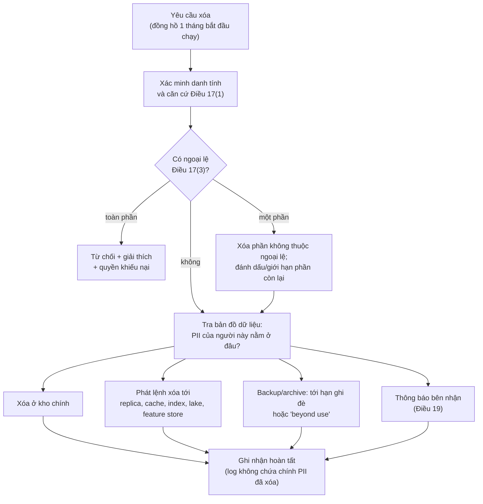
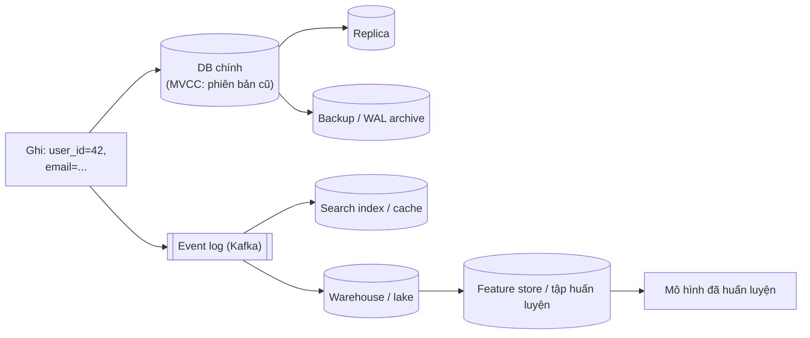

# P12 · Chương 14 — Trách nhiệm với dữ liệu: quyền riêng tư, xóa dữ liệu, đạo đức

> **Đây không phải tư vấn pháp lý.** Chương này đọc GDPR (Regulation (EU) 2016/679) như một *tài liệu thiết kế* cho người làm hệ thống dữ liệu: điều khoản nói gì, nó đẩy kiến trúc về hướng nào. Áp dụng vào một sản phẩm cụ thể (có bị GDPR điều chỉnh không, căn cứ xử lý nào, ngoại lệ nào) là việc của luật sư và DPO (data protection officer, người phụ trách bảo vệ dữ liệu). Văn bản GDPR lấy từ bản XHTML tiếng Anh của Cơ quan Công báo EU — đích chuyển hướng của URI `publications.europa.eu/resource/celex/32016R0679` (CELEX 32016R0679) — nên mỗi trích dẫn kiểm chứng được máy móc. Khi trích, chương này phân biệt **Điều (article)** với **recital** (các đoạn mở đầu "Whereas", xem mục 1): chỗ nào dựa vào recital thì nói rõ đó là recital. Chỗ nào là nhận định của người soạn thì ghi rõ "(nhận xét/suy luận của người soạn)". Không có thí nghiệm nào được chạy cho chương này. Chương này không có chương DDIA tương ứng 1-1: đó là phần mở rộng của người soạn quanh mục "Doing the Right Thing" của chương 12 DDIA ấn bản 1 (xem Đọc thêm).

## Bạn sẽ hiểu được gì

- **Q1.** Dữ liệu cá nhân là gì, và GDPR đặt những nguyên tắc nào lên cách bạn lưu và xử lý nó? → mục 1
- **Q2.** "Privacy by design" (Điều 25) biến thành những quyết định kiến trúc cụ thể nào — thu thập, quyền truy cập, retention? → mục 2
- **Q3.** Quyền xóa (Điều 17) đòi hệ thống làm gì, trong bao lâu, và có ngoại lệ nào? → mục 3
- **Q4.** Vì sao "xóa" khó trong log bất biến, replica, backup và dữ liệu dẫn xuất; crypto-shredding đứng ở đâu? → mục 4
- **Q5.** Pseudonymisation khác anonymisation thế nào; băm `user_id` có làm dữ liệu ẩn danh không? → mục 5
- **Q6.** Quyết định tự động (Điều 22) và thiên lệch: hệ thống phải bảo đảm gì, và vì sao "bỏ cột nhạy cảm" chưa đủ? → mục 6
- **Q7.** Bộ quy tắc đạo đức ACM đòi gì mà luật không đòi? → mục 7

(Mục 8: Việt Nam. Mục 9: Liên hệ với Rust — newtype cho dữ liệu nhạy cảm, `Debug`, `secrecy`, `zeroize`.)

## Kiến thức cần trước

- [Chương 03 — Storage engine](03-storage-engine.md): log-structured storage, compaction, vì sao dữ liệu "bị xóa" vẫn có thể còn nằm trên đĩa một thời gian.
- [Chương 05 — Replication](05-replication.md): replica và backup là những bản sao mà lệnh xóa phải đi tới.
- [Chương 07 — Transaction](07-transaction.md): MVCC giữ nhiều phiên bản của một dòng, nền cho phần "xóa trong DB" ở mục 4.
- [Chương 11 — Stream processing](11-stream-processing.md): log bất biến (event log), retention, compaction, tombstone — mục 2 và 4 dùng lại.
- [Chương 12 — Đúng đắn và tích hợp dữ liệu](12-dung-dan-va-tich-hop-du-lieu.md): dữ liệu dẫn xuất (derived data) và pipeline; mục 4 nói vì sao chúng làm bài toán xóa khó hơn.
- [Chương 13 — Kiến trúc hệ dữ liệu](13-kien-truc-he-du-lieu.md): warehouse/lake là nơi dữ liệu cá nhân thường được nhân bản nhiều nhất.

## 1. Dữ liệu cá nhân và các nguyên tắc nền của GDPR (Q1)

> **Trả lời ngắn.** Dữ liệu cá nhân là *bất kỳ thông tin nào* liên quan tới một người đã xác định hoặc xác định được, trực tiếp hay gián tiếp — kể cả khi chỉ có một mã số[^art4-1]. GDPR buộc dữ liệu đó được thu thập cho mục đích rõ ràng và không dùng sai mục đích (purpose limitation)[^art5-b], chỉ ở mức cần thiết (data minimisation)[^art5-c], và chỉ giữ chừng nào còn cần để nhận diện được người đó (storage limitation)[^art5-e]. Bên chịu trách nhiệm phải chứng minh được mình tuân thủ[^art5-2].

**Giải thích.**

Hình dung (nhận xét của người soạn): bạn quản lý tủ hồ sơ của một phòng khám. Luật không cấm có tủ; nó hỏi ba câu với *từng* ngăn kéo: vì sao giữ (mục đích), có cần hết các tờ trong đó không (tối thiểu), và bao giờ đem hủy (thời hạn). Rồi nó thêm câu thứ tư: bạn có chứng minh được câu trả lời không.

*Định nghĩa rộng hơn "tên + email".* Theo Điều 4(1), người "xác định được" là người có thể nhận diện trực tiếp hoặc gián tiếp thông qua định danh như tên, số định danh, dữ liệu vị trí, định danh trực tuyến, hoặc các đặc điểm riêng[^art4-1]. Phần giải thích đi kèm (recital 30) nêu rằng địa chỉ IP và cookie là những định danh trực tuyến có thể để lại dấu vết dùng để lập hồ sơ và nhận diện người[^rec30]. Với backend, hệ quả là một cột `user_id` kiểu số, một dòng access log có IP, một event `click` gắn device id — đều ở trong phạm vi định nghĩa này (suy luận của người soạn từ định danh nêu trong Điều 4(1) và recital 30; ranh giới từng trường hợp là câu hỏi pháp lý).

*"Xử lý" gồm cả lưu trữ và xóa.* Điều 4(2) định nghĩa processing là mọi thao tác trên dữ liệu cá nhân, liệt kê thu thập, ghi, lưu trữ, truy xuất, truyền, kết hợp, cho tới xóa hoặc hủy[^art4-2]. Nghĩa là "chỉ đang nằm trong bảng, chưa ai đọc" vẫn là xử lý; và việc xóa cũng là một thao tác xử lý phải có thiết kế.

*Hai vai trò.* Controller là bên quyết định mục đích và phương tiện xử lý[^art4-7]; processor là bên xử lý thay controller[^art4-8]. (Nhận xét của người soạn: một công ty dùng nhà cung cấp cloud DB thường là controller, nhà cung cấp là processor — nhưng cách gán vai trò cho từng hợp đồng là việc pháp lý.)

*Phạm vi địa lý.* GDPR còn áp dụng cho controller/processor không đặt tại EU khi hoạt động xử lý liên quan tới việc chào bán hàng hóa/dịch vụ cho người đang ở EU[^art3-2a] hoặc theo dõi hành vi của họ trong phạm vi hành vi đó diễn ra ở Liên minh[^art3-2b] (điều kiện chung nằm ở Điều 3(2)[^art3-2]). Hệ quả (suy luận của người soạn): "server của chúng tôi ở nơi khác" không tự động loại trừ.

*Cần một căn cứ hợp pháp.* Xử lý chỉ hợp pháp khi ít nhất một trong các căn cứ ở Điều 6(1) đúng[^art6], chẳng hạn consent của chủ thể[^art6-a], cần cho hợp đồng với chủ thể[^art6-b], nghĩa vụ pháp lý của controller[^art6-c], lợi ích chính đáng của controller hoặc bên thứ ba[^art6-f] (Điều 6(1) có sáu căn cứ (a)–(f); đây là bốn căn cứ người làm backend hay gặp — nhận xét của người soạn). Một số loại dữ liệu — như sức khỏe, sinh trắc để định danh, xu hướng tính dục — thuộc "special categories" (tên Điều 9) và bị cấm xử lý theo mặc định[^art9], trừ khi có ngoại lệ ở Điều 9(2)[^art9-2].

*Các nguyên tắc ở Điều 5 và hệ quả kỹ thuật.*

| Nguyên tắc (Điều 5(1)) | Nội dung | Hệ quả cho hệ thống (suy luận của người soạn) |
|---|---|---|
| Purpose limitation, (b) | Thu thập cho mục đích xác định, rõ ràng, chính đáng; không xử lý tiếp theo cách không tương thích[^art5-b] | Gắn mục đích vào dữ liệu/topic/bảng; cấm "đổ hết vào lake rồi tính sau" khi mục đích mới chưa được xem xét |
| Data minimisation, (c) | Đủ, liên quan, giới hạn ở mức cần thiết cho mục đích[^art5-c] | Không thêm cột/field "phòng khi cần"; cắt field ở nguồn chứ không ở báo cáo |
| Storage limitation, (e) | Giữ dạng nhận diện được không lâu hơn cần thiết[^art5-e] | Mỗi loại dữ liệu có thời hạn giữ; có job thực thi thời hạn đó |
| Integrity & confidentiality, (f) | Bảo mật phù hợp, chống truy cập trái phép, mất mát, hủy hoại[^art5-f] | Mã hóa, kiểm soát truy cập, backup hợp lệ |
| Accountability, Điều 5(2) | Controller chịu trách nhiệm và phải chứng minh được tuân thủ[^art5-2] | Có bản đồ dữ liệu, log kiểm toán, tài liệu hóa quyết định |

<details><summary>Đi sâu: khai báo thời hạn lưu, hồ sơ xử lý, và một lưu ý về recital</summary>

- Khi thu thập trực tiếp từ người dùng, controller phải cho họ biết thời hạn lưu, hoặc tiêu chí xác định thời hạn nếu không nêu được con số[^art13-2a]. Nghĩa là retention không thể chỉ là cấu hình nội bộ: nó là thông tin phải công bố (nhận xét của người soạn: nên giữ một bảng retention duy nhất làm nguồn sự thật cho cả policy công khai lẫn job xóa).
- Mỗi controller phải duy trì "record of processing activities" thuộc trách nhiệm của mình[^art30]; hồ sơ này gồm, "nếu có thể", thời hạn dự kiến để xóa từng nhóm dữ liệu[^art30-f]. Trên thực tế (nhận xét của người soạn) đó là một bản đồ "dữ liệu gì, ở đâu, vì sao, bao lâu" — cũng chính là thứ mục 3–4 cần để xóa được.
- Các "recital" (như recital 26, 30, 71 được dùng trong chương) nằm ở phần mở đầu bắt đầu bằng "Whereas"[^whereas-start] và kết thúc ngay trước câu "HAVE ADOPTED THIS REGULATION" mở ra các Điều[^whereas-end]. Chương này dùng chúng để hiểu cách đọc các Điều; điều khoản ràng buộc là các Điều (nhận xét của người soạn — vai trò pháp lý chính xác của recital: hỏi luật sư).

</details>

**Quay lại Q1:** dữ liệu cá nhân rộng hơn "tên và email"; GDPR đòi mục đích, mức tối thiểu và thời hạn cho từng loại dữ liệu, và bạn phải chứng minh được.

## 2. Privacy by design: từ Điều 25 đến quyết định kiến trúc (Q2)

> **Trả lời ngắn.** Điều 25(1) yêu cầu đưa các biện pháp kỹ thuật và tổ chức vào ngay lúc *chọn phương tiện xử lý* và cả lúc *xử lý*, nhằm hiện thực hóa các nguyên tắc như data minimisation[^art25-1]. Điều 25(2) đòi *mặc định* chỉ xử lý dữ liệu cần thiết cho từng mục đích — áp dụng cho lượng thu thập, mức xử lý, thời hạn lưu và khả năng truy cập[^art25-2]. Với người làm backend, schema, retention và quyền truy cập là những quyết định "by design", không phải việc dọn dẹp sau.

**Giải thích.**

Hình dung (nhận xét của người soạn): nút thoát hiểm phải vẽ vào bản thiết kế tòa nhà; đục thêm sau khi xây xong thì tốn gấp nhiều lần và luôn có chỗ không đục được. "Xóa dữ liệu của một người" cũng vậy: nếu dữ liệu đã tản ra mười nơi và không ai có bản đồ, không có lệnh `DELETE` nào cứu được.

*Điều 25 nói gì.* Biện pháp phải tính tới trạng thái kỹ thuật hiện hành, chi phí, tính chất, phạm vi, bối cảnh, mục đích xử lý, và rủi ro đối với quyền và tự do của cá nhân[^art25-1b]; ví dụ biện pháp được nêu là pseudonymisation[^art25-1]. Khoản 2 đặt "mặc định": phạm vi bốn trục — lượng thu thập, mức xử lý, thời hạn lưu, khả năng truy cập — và nói rõ rằng mặc định dữ liệu cá nhân không được để cho một số lượng người không xác định truy cập mà không có sự can thiệp của cá nhân đó[^art25-2].

*Điều 32 là phần bổ trợ về bảo mật.* Controller và processor phải triển khai biện pháp kỹ thuật và tổ chức để bảo đảm mức bảo mật tương xứng rủi ro[^art32-1], trong đó (theo danh sách "inter alia as appropriate") có pseudonymisation và mã hóa[^art32-a], cùng khả năng khôi phục dữ liệu kịp thời sau sự cố[^art32-c]. (Nhận xét của người soạn: giữa "xóa được" và "khôi phục được" có một giằng co thật — xem mục 4.)

*Bốn trục của Điều 25(2), dịch sang việc của bạn (suy luận của người soạn).*

| Trục | Câu hỏi thiết kế | Ví dụ |
|---|---|---|
| Lượng thu thập | Field này phục vụ mục đích nào đã khai báo? | Form đăng ký không hỏi ngày sinh nếu chỉ cần xác nhận ≥18 tuổi → lưu cờ boolean |
| Mức xử lý | Ai/hệ nào được dùng dữ liệu cho việc gì? | Tách PII ra bảng/service riêng, các bảng nghiệp vụ chỉ giữ khóa tham chiếu |
| Thời hạn lưu | Bao lâu thì dữ liệu hết lý do tồn tại, và cái gì thực thi điều đó? | TTL trên bảng, `retention.ms` trên topic, vòng đời object storage |
| Khả năng truy cập | Mặc định ai đọc được? | Least privilege; không có "đọc được hết" cho analyst; view đã che cột |

*Retention là nơi nguyên tắc chạm vào cấu hình.* Với Kafka (xem [Chương 11](11-stream-processing.md)): chính sách mặc định của topic là `delete`, nghĩa là bỏ các segment cũ khi hết thời gian hoặc dung lượng giữ[^kafka-cleanup]. `retention.ms` là thời gian tối đa giữ log trước khi loại bỏ segment cũ, và tài liệu mô tả nó là cam kết (SLA) về việc consumer phải đọc kịp dữ liệu trong bao lâu; đặt `-1` thì không có giới hạn thời gian[^kafka-ret]. Tài liệu thiết kế của Kafka cũng nói rõ lợi ích của việc giữ message khá lâu (ví dụ một tuần) là consumer linh hoạt hơn[^kafka-week]. Từ đó, một topic chứa PII mà để `retention.ms=-1` là một quyết định cần lý do mục đích rõ ràng, vì nó đi ngược storage limitation theo mặc định (suy luận của người soạn).

Retention của Kafka cũng chỉ có độ phân giải *segment*: `segment.ms` quy định sau bao lâu Kafka ép đóng (roll) segment hiện tại, "để retention có thể xóa hoặc compact dữ liệu cũ"[^kafka-segment]; và khi điều kiện `retention.ms` thỏa, Kafka kích hoạt việc roll segment mới[^kafka-ret-roll]. (Suy luận của người soạn: dữ liệu hết hạn không biến mất đúng giây hết hạn; nó biến mất khi segment chứa nó được xóa — nên "retention 30 ngày" thực tế là "30 ngày cộng độ trễ của việc roll và dọn"; độ trễ cụ thể phụ thuộc cấu hình broker mà chương này không kiểm.)

<details><summary>Đi sâu: DPIA và khi nào thiết kế phải được đánh giá trước</summary>

Điều 35 yêu cầu đánh giá tác động bảo vệ dữ liệu (DPIA) *trước* khi xử lý nếu loại xử lý có khả năng gây rủi ro cao cho quyền và tự do của cá nhân[^art35-1]. Điều 35(3) nêu ba trường hợp mà DPIA "đặc biệt" (*in particular*) được yêu cầu[^art35-3] — suy luận của người soạn từ chữ "in particular": danh sách này không giới hạn các trường hợp cần DPIA. Một trong ba là đánh giá có hệ thống và quy mô rộng các khía cạnh cá nhân dựa trên xử lý tự động (kể cả profiling) mà làm cơ sở cho quyết định có hiệu lực pháp lý hoặc ảnh hưởng đáng kể[^art35-3a] — tức đúng loại hệ thống ở mục 6. Nhận xét của người soạn: DPIA là bước "design review" mà luật bắt buộc; nếu đội bạn đã có design review, thêm các câu hỏi ở mục 1–6 vào mẫu là cách rẻ nhất để không làm hai lần.

</details>

**Quay lại Q2:** Điều 25 biến minimisation, thời hạn lưu và quyền truy cập thành thuộc tính của thiết kế — schema, topic config, phân quyền — và đặt giá trị mặc định ở phía ít dữ liệu nhất.

## 3. Quyền xóa (Điều 17): hệ thống phải làm gì (Q3)

> **Trả lời ngắn.** Khi một trong các căn cứ ở Điều 17(1) đúng — ví dụ dữ liệu không còn cần cho mục đích thu thập, hoặc người dùng rút consent mà không còn căn cứ khác — controller phải xóa dữ liệu của người đó "không chậm trễ quá mức"[^art17-1]. Thời hạn trả lời yêu cầu là một tháng kể từ khi nhận, gia hạn tối đa thêm hai tháng nếu phức tạp[^art12-3]. Có ngoại lệ, như nghĩa vụ pháp lý bắt buộc phải xử lý tiếp hoặc để lập, thực hiện, bảo vệ yêu cầu pháp lý[^art17-3b][^art17-3e].

**Giải thích.**

Hình dung (nhận xét của người soạn): ai đó gửi thư "hãy xóa tôi khỏi mọi sổ sách của anh". Câu hỏi đầu tiên của kỹ sư không phải "lệnh xóa viết thế nào" mà là "tên người này có thể nằm ở những sổ nào?". Nếu không trả lời được câu đó trong vài phút thì không có quy trình xóa nào đáng tin.

*Các căn cứ để được xóa.* Điều 17(1) liệt kê sáu căn cứ: dữ liệu không còn cần cho mục đích ban đầu[^art17-1a]; người dùng rút consent làm căn cứ xử lý và không còn căn cứ nào khác[^art17-1b]; phản đối xử lý theo Điều 21(1) mà không có lý do chính đáng vượt trội, hoặc theo Điều 21(2)[^art17-1c]; dữ liệu bị xử lý bất hợp pháp[^art17-1d]; phải xóa để tuân thủ nghĩa vụ pháp lý theo luật Liên minh hoặc luật thành viên[^art17-1e]; và dữ liệu thu thập khi chào dịch vụ xã hội thông tin theo Điều 8(1)[^art17-1f] (Điều 8(1) nói về dịch vụ chào trực tiếp cho trẻ em[^art8-1]). Toàn văn: [Điều 17](https://eur-lex.europa.eu/eli/reg/2016/679/oj).

*Thời hạn.* Điều 12(3): thông báo kết quả xử lý yêu cầu "không chậm trễ quá mức và trong mọi trường hợp trong vòng một tháng kể từ khi nhận yêu cầu", gia hạn thêm hai tháng khi cần, tính tới độ phức tạp và số lượng yêu cầu[^art12-3]; việc gia hạn phải được báo cho người dùng trong tháng đầu, kèm lý do[^art12-3b]. Điều 12(2) yêu cầu controller *tạo điều kiện* để người dùng thực hiện các quyền[^art12-2] — suy luận của người soạn: một đường dẫn "xóa tài khoản" chạy được là một yêu cầu thiết kế, không phải tiện ích.

*Lan tỏa tới bên khác.* Nếu controller đã làm dữ liệu công khai và phải xóa, họ phải thực hiện các bước hợp lý, "tính tới công nghệ sẵn có và chi phí", kể cả biện pháp kỹ thuật, để báo các controller khác đang xử lý dữ liệu đó về việc người dùng yêu cầu xóa mọi liên kết, bản sao hay bản sao chép[^art17-2]. Điều 19 thêm: controller phải thông báo việc xóa tới từng bên nhận dữ liệu, trừ khi bất khả thi hoặc đòi hỏi nỗ lực không tương xứng[^art19].

*Ngoại lệ.* Điều 17(3) loại trừ khoản 1 và 2 trong phạm vi việc xử lý là cần thiết[^art17-3]: để tuân thủ nghĩa vụ pháp lý đòi hỏi xử lý theo luật Liên minh hoặc luật thành viên[^art17-3b]; hoặc để lập, thực hiện hay bảo vệ yêu cầu pháp lý[^art17-3e]; cùng các ngoại lệ khác: tự do ngôn luận và thông tin[^art17-3a], y tế công[^art17-3c], lưu trữ vì lợi ích công, nghiên cứu hoặc thống kê[^art17-3d]. Nhận xét của người soạn: ngoại lệ thường áp lên *một phần* dữ liệu (ví dụ hóa đơn phải giữ theo luật kế toán) — nên quy trình xóa cần xóa phần được phép xóa chứ không phải "hoặc xóa hết hoặc không làm gì".

*Giới hạn thay vì xóa.* Điều 18 cho phép "restriction of processing" — đánh dấu dữ liệu đang lưu để hạn chế xử lý trong tương lai[^art4-3] — trong một số tình huống, thay cho xóa: ví dụ khi xử lý bất hợp pháp nhưng người dùng phản đối việc xóa và đòi hạn chế sử dụng thay vào đó[^art18-1b]. Nhận xét của người soạn: về kỹ thuật, đó là một cờ `restricted` mà mọi đường đọc phải tôn trọng; nó khó đúng hơn xóa nếu dữ liệu đã tản ra nhiều nơi.



(Sơ đồ là minh họa quy trình của người soạn, không phải quy trình do GDPR quy định; hai chi tiết bám văn bản là nhánh từ chối — Điều 12(4): thông báo lý do không hành động và khả năng khiếu nại lên cơ quan giám sát[^art12-4] — và bước xác minh danh tính — Điều 12(6): có thể yêu cầu thông tin bổ sung để xác nhận danh tính khi có nghi ngờ hợp lý[^art12-6]. Các nhánh `D1..D4` là nội dung mục 4.)

<details><summary>Đi sâu: yêu cầu của bạn với "bản đồ dữ liệu" và với log kiểm toán</summary>

- Quy trình xóa chỉ chạy được khi tồn tại một chỉ mục từ *danh tính* (user, email, device) tới *mọi nơi lưu*. Đó là lý do mục 2 nhấn vào việc tách PII: càng ít nơi giữ PII thô, bản đồ càng ngắn (nhận xét của người soạn).
- Một log kiểm toán nói "đã xóa user X lúc T" cần được thiết kế để *không* chứa lại PII vừa xóa (ví dụ ghi một định danh nội bộ không thể tra ngược sau khi mapping bị xóa, thay vì email). Đây là suy luận của người soạn từ nguyên tắc minimisation; hỏi DPO về điều bạn được/phải giữ làm bằng chứng.
- Quy trình nên *idempotent*: chạy lại không hại, vì với nhiều kho (mục 4) bạn sẽ phải thử lại nhiều lần trong khung thời gian một tháng (nhận xét của người soạn; cơ chế retry và idempotency nói chung: [Chương 12](12-dung-dan-va-tich-hop-du-lieu.md), mục 4).

</details>

**Quay lại Q3:** Điều 17 + Điều 12 biến "xóa dữ liệu của một người" thành một quy trình có hạn chót, có ngoại lệ từng phần và phải chạm tới mọi bản sao — nên bạn cần bản đồ dữ liệu trước khi cần lệnh xóa.

## 4. Vì sao xóa khó: log bất biến, MVCC, replica, backup, dữ liệu dẫn xuất; crypto-shredding (Q4)

> **Trả lời ngắn.** Một dòng dữ liệu cá nhân thường tồn tại ở nhiều tầng: trong log append-only (chỉ bị loại khi segment bị bỏ hoặc rewrite), trong các phiên bản cũ của DB (chờ vacuum), trong replica và backup, và trong dữ liệu dẫn xuất (index, cache, warehouse, bảng đặc trưng ML). Mỗi tầng có cơ chế và độ trễ xóa riêng, nên "đã xóa" phải được định nghĩa theo từng tầng và công bố giới hạn trên của độ trễ. Crypto-shredding — mã hóa theo từng chủ thể và hủy khóa thay vì đi tìm mọi bản mã — là kỹ thuật được mô tả cho thiết bị lưu trữ[^nist-ce] và được EDPB nhắc tới cho dữ liệu mã hóa trên blockchain[^edpb-key]; áp dụng tổng quát cho hệ thống dữ liệu là một suy luận có điều kiện (mục "Crypto-shredding" bên dưới).

**Giải thích.**

Hình dung (nhận xét của người soạn): bạn photocopy một lá thư gửi năm người, ba người khác lại chụp ảnh nó vào hồ sơ của họ. "Hủy bản gốc" không thu hồi bản nào trong số đó. Trong hệ thống dữ liệu, bản gốc là dòng trong DB; các bản sao là mọi thứ P12·03, 05, 10, 11, 12 đã dạy bạn tạo ra vì lý do hiệu năng và độ bền.



(Minh họa của người soạn. Mỗi mũi tên là một bản sao hoặc bản dẫn xuất mà lệnh xóa phải xử lý riêng.)

*Tầng log (Kafka).* Topic mặc định chỉ bỏ dữ liệu khi segment hết hạn[^kafka-cleanup]. Với topic bật compaction (khái niệm ở [Chương 11](11-stream-processing.md), mục 3), một record có key nhưng payload null được coi là *tombstone* — dấu xóa[^kafka-tombstone]: nó làm các record trước đó cùng key bị loại bỏ, và bản thân tombstone cũng bị dọn sau một khoảng thời gian[^kafka-tombstone-clean]. Nhưng compaction chạy nền bằng cách viết lại segment định kỳ[^kafka-recopy]; segment đang được ghi (active) không bị compact ngay cả khi mọi message trong đó đã già hơn ngưỡng[^kafka-active]; và hạn chót compaction tối đa "không phải là cam kết cứng" vì còn phụ thuộc số luồng cleaner và thời điểm compact thực tế[^kafka-maxlag]. Hơn nữa, consumer đọc chậm hơn `delete.retention.ms` có thể bỏ lỡ tombstone[^kafka-tombstone-miss] — suy luận của người soạn: một dịch vụ dựng trạng thái từ topic đó có thể giữ lại bản ghi đã bị xóa nếu nó không bao giờ thấy tombstone. Nói cách khác, tombstone *loại bỏ dữ liệu khỏi log*, nhưng không tự loại dữ liệu đã được consumer sao chép đi nơi khác. Và cách này chỉ dùng được nếu key của topic chính là chủ thể dữ liệu (ví dụ `user_id`); topic key theo thứ khác thì không có key nào để phát tombstone (suy luận của người soạn). Event sourcing, nơi log là nguồn sự thật, làm bài toán này gay gắt hơn: xem [Chương 11](11-stream-processing.md), mục 5.

*Tầng DB (MVCC).* Trong PostgreSQL, `UPDATE`/`DELETE` không xóa ngay phiên bản cũ của dòng, vì phiên bản đó có thể còn nhìn thấy được với transaction khác[^pg-mvcc]. `VACUUM` thường dọn các phiên bản chết và đánh dấu chỗ trống để tái sử dụng[^pg-vacuum], nhưng không trả dung lượng về hệ điều hành trừ trường hợp đặc biệt; `VACUUM FULL` viết lại cả bảng thành bản mới không còn chỗ trống[^pg-vacuum-os]. Suy luận của người soạn: "chỗ trống được đánh dấu để tái sử dụng" không đồng nghĩa byte cũ đã bị ghi đè — nên nếu yêu cầu của bạn là dữ liệu không còn trên đĩa, câu trả lời phụ thuộc vào engine, cấu hình và mức mã hóa ở lớp đĩa, và cần được kiểm tra trên đúng hệ thống của bạn (không có thí nghiệm nào được chạy cho chương này).

*Tầng replica.* Replication đẩy mọi thay đổi tới các bản sao, kể cả `DELETE` lỡ tay; [Chương 12](12-dung-dan-va-tich-hop-du-lieu.md), mục 7 đã dẫn SRE book về chuyện này (replica không thay được backup) nên ở đây không lặp lại. Với bài toán xóa, tính chất đó có lợi: lệnh xóa cũng sẽ được đẩy tới replica. Phần cần chú ý (suy luận của người soạn): độ trễ replication, replica trễ có chủ đích, và replica nằm ở vùng/đối tác khác (cơ chế replication: [Chương 05](05-replication.md)).

*Tầng backup.* Đây là chỗ nhiều đội dừng lại. Cơ quan bảo vệ dữ liệu Anh (ICO — hướng dẫn về UK GDPR, *không* phải văn bản của EU) nói rằng nếu yêu cầu xóa hợp lệ và không có ngoại lệ thì phải có bước để xóa cả ở hệ thống backup[^ico-backup1]; yêu cầu có thể được thực hiện ngay ở hệ thống đang chạy trong khi dữ liệu còn nằm trong backup tới khi bị ghi đè[^ico-backup2]; điểm mấu chốt là đưa dữ liệu backup vào trạng thái "beyond use"[^ico-backup3] — không dùng cho mục đích nào khác, backup chỉ được giữ tới khi bị thay theo lịch đã định[^ico-hold] — và nói rõ với người dùng chuyện gì sẽ xảy ra với dữ liệu của họ, kể cả ở backup[^ico-clear]. Đây là quan điểm của một cơ quan quản lý cụ thể, không phải kết luận chung của EU (nhận xét của người soạn).

SRE book cho một chuẩn đo hữu ích: chương data integrity giới hạn phần "privacy" ở việc xóa — dữ liệu phải bị hủy trong khoảng thời gian hợp lý sau khi người dùng xóa[^sre-priv]; và soft deletion (đánh dấu xóa, hủy sau một độ trễ) thường chọn 15, 30, 45 hoặc 60 ngày[^sre-soft]. Suy luận của người soạn: độ trễ soft-delete cộng với vòng đời backup là *giới hạn trên* của việc dữ liệu đã xóa vẫn còn tồn tại; bạn nên biết con số đó, nó phải khớp với điều bạn nói với người dùng, và nó chính là chỗ tính năng "undelete" (có lý do chính đáng chống xóa nhầm) đối đầu với yêu cầu xóa "không chậm trễ quá mức".

*Tầng dữ liệu dẫn xuất.* Index, cache, bảng tổng hợp, warehouse/lake, feature store, tập huấn luyện ML (xem [Chương 12](12-dung-dan-va-tich-hop-du-lieu.md), [Chương 13](13-kien-truc-he-du-lieu.md)) đều có thể chứa PII hoặc dữ liệu suy ra từ PII. Điều 17(2) nói tới việc báo các controller khác xóa "liên kết, bản sao hay bản sao chép"[^art17-2]; Điều 19 đòi thông báo tới các bên nhận[^art19]. GDPR không có ngoại lệ riêng cho dữ liệu dẫn xuất (suy luận của người soạn từ nội dung Điều 17; không có nguồn nào trong chương nói ngược lại). Cái bạn cần là *lineage*: biết dữ liệu nào được sinh ra từ nguồn nào, để xóa hoặc tái tạo (rebuild) được. Với pipeline batch, cách sạch nhất thường là tái tính từ nguồn đã xóa, vì dữ liệu dẫn xuất vốn tái sinh được (nhận xét của người soạn; xem [Chương 10](10-batch-processing.md)). Còn *mô hình đã huấn luyện* từ dữ liệu của người đã yêu cầu xóa là câu hỏi mở: chương này không có nguồn thẩm quyền để khẳng định cách xử lý.

*Crypto-shredding.* Ý tưởng: mã hóa dữ liệu của mỗi chủ thể bằng một khóa riêng (data key); lưu khóa ở nơi chỉ có một bản có thể hủy được (KMS/HSM); "xóa" = hủy khóa. Mọi bản mã còn lại — trong log bất biến, replica, backup — trở thành byte không đọc được. Nguồn thẩm quyền về nền tảng:

- NIST SP 800-88 Rev. 1 mô tả *Cryptographic Erase* cho thiết bị lưu trữ: tận dụng việc dữ liệu đã được mã hóa để vệ sinh *khóa* mã hóa, chỉ còn ciphertext trên media và đọc không được[^nist-ce]; nếu dùng mật mã mạnh thì vệ sinh dữ liệu quy về vệ sinh khóa[^nist-ce2]. NIST cũng nêu điều kiện: không dùng CE để vệ sinh media nếu mã hóa chỉ được bật sau khi dữ liệu nhạy cảm đã nằm trên thiết bị mà chưa được vệ sinh[^nist-ce-not]; chỉ nên cân nhắc CE khi mọi dữ liệu cần vệ sinh đã được mã hóa *trước khi* lưu lên media (kể cả các bản sao ảo hóa)[^nist-ce-when].
- EDPB (Guidelines 02/2025 về blockchain, bản 2.0 thông qua 07/2026) nêu: mã hóa dữ liệu cá nhân trước khi lưu lên chuỗi nghĩa là khi khóa giải mã bị xóa, dữ liệu mã hóa trở nên không đọc được — ít nhất tới khi thuật toán bị phá, kỹ thuật giải mã tiến bộ đủ, hoặc khóa đã bị lộ[^edpb-key].

Nhưng cũng chính EDPB đặt các giới hạn quan trọng: dữ liệu cá nhân đã mã hóa *vẫn là* dữ liệu cá nhân và mã hóa không miễn trừ việc tuân thủ GDPR[^edpb-still]; mã hóa hoàn hảo cũng sẽ bị thời gian vượt qua nếu chuỗi được giữ vô hạn[^edpb-time]; và EDPB nêu rằng không nên ghi dữ liệu cá nhân ở dạng rõ, mã hóa hoặc băm lên blockchain, mà nên lưu ngoài chuỗi[^edpb-offchain]. Về quyền xóa, EDPB nói controller nên cân nhắc yêu cầu này từ giai đoạn thiết kế và bảo đảm dữ liệu cá nhân đặt trên chuỗi có thể được làm cho ẩn danh một cách hiệu quả khi có yêu cầu xóa[^edpb-anon]. Nhận xét của người soạn: hướng dẫn thẩm quyền duy nhất mà chương này tìm được *không* coi hủy khóa là giải pháp mặc định cho dữ liệu bất biến; nó coi là biện pháp có điều kiện và ưu tiên thiết kế để dữ liệu cá nhân không nằm trên cấu trúc bất biến ngay từ đầu — đúng tinh thần Điều 25 (EDPB tự nhắc tới Điều 25 trong cùng phần này[^edpb-design]).

Với một hệ thống dữ liệu thông thường (không phải blockchain), đây là suy luận của người soạn, chưa có nguồn thẩm quyền chung xác nhận: (1) crypto-shredding *có thể* làm dữ liệu trong bản sao không đọc được nếu khóa không bao giờ rời KMS ở dạng bản rõ và mọi bản sao khóa (cache, backup của KMS) cũng được hủy; (2) liệu cơ quan quản lý/tòa án coi đó là "erasure" theo Điều 17 cho từng trường hợp là câu hỏi pháp lý mở; (3) cái nó giải quyết là dữ liệu *trong bản sao bất biến*, không giải quyết dữ liệu dẫn xuất đã được giải mã và đã sinh ra bảng khác.

| Tầng | Vì sao không xóa tức thì | Cơ chế | Đại lượng cần biết (suy luận của người soạn) |
|---|---|---|---|
| Event log | Append-only; xóa theo segment/compaction[^kafka-recopy] | Tombstone + compaction; retention; hoặc crypto-shred payload | Độ trễ compaction/retention; consumer đã sao chép |
| DB (MVCC) | Phiên bản cũ còn tới khi vacuum[^pg-mvcc] | `DELETE` + vacuum; rewrite bảng | Khi nào byte bị ghi đè; mã hóa đĩa |
| Replica | Đồng bộ có độ trễ | Lệnh xóa lan qua replication | Độ trễ tối đa, replica trễ có chủ đích |
| Backup | Bất biến theo thiết kế; khôi phục nguyên bản | Hết vòng đời, "beyond use"[^ico-backup3], crypto-shred | Vòng đời backup + soft-delete window |
| Dẫn xuất | Là bản sao biến đổi | Lineage + rebuild; xóa theo khóa | Danh sách nơi dẫn xuất; tần suất rebuild |

<details><summary>Đi sâu: các chi tiết Kafka và PostgreSQL ảnh hưởng tới thời hạn xóa</summary>

- Kafka (docs 4.0): với topic compact, "tombstone" cũng bị dọn sau `delete.retention.ms`, mặc định 24 giờ theo tài liệu thiết kế[^kafka-tombstone-miss]; cấu hình này được mô tả thêm là giới hạn thời gian mà consumer phải hoàn tất việc đọc nếu bắt đầu từ offset 0 để thấy snapshot cuối cùng hợp lệ[^kafka-delmax]. Compaction cũng bị chặn dưới bởi `min.compaction.lag.ms` — giữ message tối thiểu một khoảng trước khi được compact — và chặn trên `max.compaction.lag.ms`[^kafka-lag]. Với yêu cầu xóa, lag tối thiểu là độ trễ bạn *chủ động* chấp nhận; đặt nó bằng 0 cho topic PII là quyết định cần cân nhắc cùng nhu cầu của consumer (nhận xét của người soạn).
- PostgreSQL: các biến thể viết lại bảng (`VACUUM FULL`, `CLUSTER`, một số dạng `ALTER TABLE`) đều tạo bản mới và cần khóa `ACCESS EXCLUSIVE`, tạm dùng thêm dung lượng xấp xỉ kích thước bảng[^pg-rewrite] — nghĩa là "xóa vật lý ngay" trên bảng lớn có giá vận hành thật; nó không nên là lệnh bạn chạy cho mỗi yêu cầu xóa (nhận xét của người soạn).
- Cùng chuyện với các engine LSM ([Chương 03](03-storage-engine.md), kể cả phần nói về compaction toàn phần của Bigtable): dữ liệu bị xóa tồn tại tới khi compaction của chính engine đó loại bỏ nó (suy luận của người soạn; chi tiết từng engine cần đọc docs của engine).

</details>

**Quay lại Q4:** "xóa" phải được định nghĩa theo từng tầng bản sao, mỗi tầng có độ trễ riêng; crypto-shredding giúp với dữ liệu nằm trong bản sao bất biến nhưng có điều kiện chặt và chưa phải câu trả lời pháp lý chung.

## 5. Pseudonymisation và anonymisation (Q5)

> **Trả lời ngắn.** Pseudonymisation là xử lý sao cho dữ liệu không còn gán được cho một người cụ thể nếu thiếu "thông tin bổ sung" được giữ riêng và bảo vệ[^art4-5] — nhưng recital 26 nêu rằng dữ liệu đã pseudonymise vẫn phải được coi là thông tin về người xác định được[^rec26-pseud]. Anonymous là dữ liệu mà chủ thể không còn (hoặc không bao giờ) xác định được; khi đó, theo recital 26, nguyên tắc bảo vệ dữ liệu không áp dụng[^rec26-anon]. Ngưỡng này cao: phải tính tới mọi phương tiện có khả năng được dùng, bởi bất kỳ bên nào[^rec26-means]. Băm `user_id` thường chỉ là pseudonymisation (suy luận của người soạn từ các nguồn trong mục này).

**Giải thích.**

Hình dung (nhận xét của người soạn): danh sách bệnh nhân chỉ ghi mã BN-0417; bảng tra mã→tên nằm trong két khác. Ai chỉ có danh sách thì chưa biết bệnh nhân là ai — nhưng phòng khám có két thì biết, và kẻ nào lấy được két (hay đối chiếu mã với lịch hẹn) cũng biết. Đó là pseudonymisation. Anonymisation là khi *không ai* — kể cả bạn — còn cách nào quay lại.

*Định nghĩa.* Điều 4(5): dữ liệu "không còn gán được cho một chủ thể cụ thể nếu không dùng thông tin bổ sung", với điều kiện thông tin bổ sung đó được lưu riêng và có biện pháp kỹ thuật, tổ chức để dữ liệu không bị gán lại cho người xác định được[^art4-5]. Recital 26 nói thẳng: dữ liệu đã pseudonymise mà có thể gán lại cho người bằng thông tin bổ sung thì phải coi là thông tin về người xác định được[^rec26-pseud]. Vì vậy pseudonymisation *giảm rủi ro* và được Điều 25 và Điều 32 nêu như biện pháp bảo vệ[^art25-1][^art32-a] — nhưng không đưa dữ liệu ra khỏi phạm vi GDPR.

*Ngưỡng của "anonymous".* Recital 26 nêu rằng cần xét "mọi phương tiện có khả năng hợp lý được sử dụng", ví dụ singling out (tách riêng một cá nhân), bởi controller hoặc người khác[^rec26-means], và xét mọi yếu tố khách quan như chi phí, thời gian cần để nhận diện, công nghệ hiện có và xu hướng phát triển[^rec26-factors]. Khi dữ liệu thật sự ẩn danh, recital 26 nói nguyên tắc bảo vệ dữ liệu không áp dụng[^rec26-anon], và GDPR không điều chỉnh việc xử lý thông tin ẩn danh đó, kể cả cho mục đích thống kê hay nghiên cứu[^rec26-stat].

*Ý kiến thẩm quyền về kỹ thuật.* Working Party Điều 29 là cơ quan tư vấn độc lập của EU, lập theo Directive 95/46/EC[^wp-origin]; GDPR quy định các tham chiếu tới Working Party này được hiểu là tham chiếu tới EDPB[^art94-2]. Trong Opinion 05/2014, Working Party nêu rằng pseudonymisation *không* phải phương pháp anonymisation: nó chỉ giảm khả năng liên kết dữ liệu với danh tính gốc, và là biện pháp bảo mật hữu ích[^wp-pseud]. Một giải pháp anonymisation hiệu quả phải ngăn cả ba rủi ro: singling out, linkability (liên kết hai bản ghi, trong một tập hoặc giữa hai tập) và inference[^wp-three] — inference là khả năng suy ra, với xác suất đáng kể, giá trị một thuộc tính từ giá trị của các thuộc tính khác[^wp-infer]. Opinion này cũng chỉ ra điểm yếu của k-anonymity: nó không ngăn được tấn công inference — nếu cả k người cùng thuộc một nhóm và biết một người ở nhóm nào thì lấy được giá trị thuộc tính[^wp-kanon]. (Opinion thuộc thời Directive 95/46/EC, trước GDPR; việc nó còn phản ánh đúng cách đọc hiện hành tới đâu là câu hỏi cho chuyên gia pháp lý — nhận xét của người soạn.)

*Bằng chứng thực nghiệm rằng "bỏ định danh" không đủ.* Narayanan và Shmatikov cho thấy một đối thủ chỉ biết rất ít về một người dùng vẫn nhận ra bản ghi của người đó trong tập đánh giá phim "ẩn danh" của Netflix; dùng Internet Movie Database làm nguồn kiến thức nền, họ nhận ra bản ghi Netflix của những người dùng đã biết và lộ ra cả sở thích chính trị rõ ràng của họ cùng thông tin nhạy cảm khác[^netflix]. Bài học cho backend (nhận xét của người soạn): ghép tập "đã bỏ tên" với nguồn ngoài là đường quay lại danh tính — và ACM nêu đúng điều đó ở mục 7.

*Băm không phải thuốc thần.* EDPB (trong bối cảnh blockchain) mô tả giải pháp chỉ lưu trên chuỗi một hash có muối hoặc có khóa (salted/keyed hash) của dữ liệu cá nhân, còn dữ liệu gốc cùng khóa hay muối được giữ kín ngoài chuỗi[^edpb-hash-def]; ngay cả khi đó GDPR vẫn áp dụng và hash cũng được coi là dữ liệu cá nhân[^edpb-hash]. Suy luận của người soạn: băm email bằng hàm không khóa cho ra giá trị mà ai có danh sách email ứng viên đều tính lại được để đối chiếu; còn HMAC với khóa giữ riêng thì tương đương một dạng pseudonymisation có thông tin bổ sung là chính khóa — hủy khóa làm việc liên kết khó/không thể, nhưng khi đó câu hỏi anonymisation vẫn phải trả lời theo recital 26, không tự động đạt.

*Differential privacy.* Một hướng khác là cung cấp *định nghĩa* thay vì thủ thuật: Dwork và Roth mô tả differential privacy là một định nghĩa chứ không phải thuật toán[^dp-def]; tham số ε nhỏ hơn cho riêng tư tốt hơn nhưng kết quả kém chính xác hơn[^dp-eps]. Nhận xét của người soạn: nó cho ngôn ngữ để nói "mất mát riêng tư tối đa là bao nhiêu" khi xuất thống kê; nó không thay việc xác định xem bộ dữ liệu cụ thể của bạn có là dữ liệu cá nhân hay không.

| | Pseudonymised | Anonymous |
|---|---|---|
| Còn cách quay lại danh tính? | Có, bằng thông tin bổ sung giữ riêng[^art4-5] | Không còn, tính theo mọi phương tiện hợp lý[^rec26-means] |
| Thuộc phạm vi GDPR? | Có (theo recital 26)[^rec26-pseud] | Không (theo recital 26)[^rec26-anon] |
| Có xóa theo yêu cầu Điều 17? | Có (vẫn là dữ liệu cá nhân; suy luận của người soạn) | Không áp dụng (không còn là dữ liệu cá nhân) |
| Vai trò | Biện pháp giảm rủi ro[^wp-pseud] | Cách để dùng dữ liệu mà các nguyên tắc bảo vệ dữ liệu không còn áp dụng[^rec26-anon] |

<details><summary>Đi sâu: vì sao pseudonymisation vẫn đáng làm dù không thoát phạm vi GDPR</summary>

Pseudonymisation chia dữ liệu thành hai phần với hai chế độ truy cập: bảng sự kiện (pseudonym + hành vi) cho analyst, và bảng ánh xạ (pseudonym ↔ danh tính) chỉ cho dịch vụ có nhiệm vụ. Định nghĩa Điều 4(5) đòi chính sự tách rời này (thông tin bổ sung "kept separately" kèm biện pháp)[^art4-5]. Lợi ích kiến trúc (suy luận của người soạn): (1) rò rỉ bảng sự kiện không tự lộ danh tính; (2) yêu cầu xóa có thể thực hiện ở *một* nơi — xóa dòng ánh xạ rồi coi các sự kiện còn lại là không còn liên kết tới người đó, với điều kiện việc này đủ để thỏa recital 26 và các cột còn lại không đủ để nhận diện lại; điều kiện đó phải được đánh giá, không mặc định đúng.

</details>

**Quay lại Q5:** pseudonymisation giảm rủi ro nhưng dữ liệu vẫn là dữ liệu cá nhân; chỉ khi không còn phương tiện hợp lý nào quay lại danh tính (singling out, linkability, inference) mới là anonymous — và "bỏ tên, băm id" thường chưa tới đó.

## 6. Quyết định tự động, profiling và thiên lệch (Điều 22) (Q6)

> **Trả lời ngắn.** Điều 22(1) cho cá nhân quyền không bị chịu một quyết định *chỉ* dựa trên xử lý tự động — kể cả profiling — nếu quyết định đó có hiệu lực pháp lý hoặc ảnh hưởng đáng kể tương tự tới họ[^art22-1]. Có ngoại lệ (cần cho hợp đồng, luật cho phép, hoặc consent rõ ràng), nhưng với hợp đồng và consent thì controller phải bảo đảm tối thiểu quyền được con người can thiệp, nêu quan điểm và phản đối quyết định[^art22-3]. Về thiên lệch: bỏ cột nhạy cảm không đủ, vì thuộc tính khác có thể mã hóa lại chính nhóm đó[^dwork-blind].

**Giải thích.**

Hình dung (nhận xét của người soạn): hệ thống chấm điểm vay tự động từ chối đơn lúc 3 giờ sáng. Người nộp đơn chỉ nhận một dòng "không đủ điều kiện". Điều 22 hỏi: có người nào xem lại không, người dùng có nói được "dữ liệu của tôi sai" không, và quyết định có đang đối xử khác nhau với một nhóm người vì lý do không chính đáng không.

*Điều kiện áp dụng.* Profiling theo Điều 4(4) là mọi hình thức xử lý tự động dữ liệu cá nhân để đánh giá các khía cạnh cá nhân — như hiệu quả công việc, tình hình kinh tế, sức khỏe, sở thích, độ tin cậy, hành vi, vị trí[^art4-4]. Recital 71 lấy ví dụ: từ chối đơn tín dụng trực tuyến tự động, hoặc tuyển dụng điện tử, mà không có can thiệp của con người[^rec71-ex]. Chữ "chỉ" ("solely") quan trọng: Điều 22 nhắm vào quyết định không có con người trong vòng (nhận xét của người soạn: một bước "duyệt" hình thức mà người duyệt không thể thay đổi kết quả sẽ khó được tính là can thiệp của con người — nhận định thực hành, cần xác nhận pháp lý).

*Ngoại lệ và biện pháp bảo vệ.* Điều 22(2) cho phép nếu quyết định cần để ký kết/thực hiện hợp đồng[^art22-2a], được luật Liên minh/thành viên cho phép kèm biện pháp bảo vệ phù hợp[^art22-2b], hoặc dựa trên consent rõ ràng của chủ thể[^art22-2c]. Với trường hợp hợp đồng và consent (điểm (a) và (c)), Điều 22(3) đòi biện pháp phù hợp, tối thiểu gồm quyền được con người can thiệp, nêu quan điểm và phản đối quyết định[^art22-3]. Điều 22(4) hạn chế dựa vào special categories (Điều 9(1)): chỉ khi áp dụng điểm (a) hoặc (g) của Điều 9(2) và có biện pháp bảo vệ phù hợp[^art22-4]. Phân biệt recital với Điều: recital 71 còn nhắc quyền *được giải thích* về quyết định đạt được và quyền phản đối[^rec71-expl], nhưng chữ "explanation" không có trong văn bản Điều 22(3)[^art22-3]; quyền được giải thích có ràng buộc tới đâu là câu hỏi pháp lý (nhận xét của người soạn).

*Minh bạch.* Điều 15(1)(h): người dùng có thể đòi biết về sự tồn tại của ra quyết định tự động và, ít nhất trong các trường hợp Điều 22(1) và (4), "thông tin có ý nghĩa về logic liên quan" cùng ý nghĩa và hậu quả dự kiến[^art15-h]. Với hệ thống ML, việc đáp ứng điều này là yêu cầu thiết kế: phải *lưu* được đủ về đầu vào, phiên bản mô hình và lý do chính để giải thích và xem xét lại một quyết định (nhận xét của người soạn; và phải cân với minimisation — chỉ lưu đủ cho mục đích đó, với thời hạn xác định).

*Đánh giá trước.* DPIA là bắt buộc cho đánh giá có hệ thống, quy mô rộng các khía cạnh cá nhân dựa trên xử lý tự động làm cơ sở cho quyết định có hiệu lực pháp lý hoặc ảnh hưởng đáng kể[^art35-3a].

*Thiên lệch không biến mất khi bỏ cột.* Recital 71 nêu rằng controller *nên* dùng quy trình toán học/thống kê phù hợp cho profiling và biện pháp để sửa các yếu tố gây sai lệch dữ liệu, giảm rủi ro sai sót[^rec71-measure], cũng như ngăn hiệu ứng phân biệt đối xử dựa trên chủng tộc, quan điểm chính trị, tôn giáo và các đặc điểm khác[^rec71-disc] — đây là recital, không phải điều khoản ràng buộc như Điều 22 (xem lưu ý ở mục 1). Về mặt kỹ thuật, Dwork và cộng sự mô tả "discrimination based on redundant encoding": phép thử thành viên nhóm bị thay bằng một phép thử tương đương trên thực tế — đây là tấn công thành công vào "fairness through blindness", tức cách chỉ việc bỏ qua thuộc tính được bảo vệ như giới tính hay chủng tộc[^dwork-blind]. Bài báo đề xuất một khung công bằng trong phân loại, gồm một thước đo "giống nhau" riêng cho tác vụ và ràng buộc "các cá nhân giống nhau được đối xử giống nhau"[^dwork-def]. (Nhận xét của người soạn: định nghĩa công bằng không duy nhất và không đo bằng một con số; chương này chỉ dùng bài báo để minh họa rằng "xóa cột nhạy cảm" không phải biện pháp đủ.)

<details><summary>Đi sâu: các câu hỏi kỹ thuật nên hỏi một hệ thống ra quyết định (checklist của người soạn)</summary>

- Quyết định nào của hệ thống có hiệu lực pháp lý hoặc ảnh hưởng đáng kể tới người dùng (vay, tuyển dụng, bảo hiểm, giá/quyền truy cập dịch vụ)? Nếu có, DPIA đã làm chưa[^art35-3a]?
- Có con người *có quyền thay đổi kết quả* trong vòng không, hay chỉ có nút "xác nhận"?
- Người dùng có kênh nêu quan điểm và phản đối[^art22-3]? Kênh đó có SLA?
- Tập dữ liệu huấn luyện lấy từ đâu; có thuộc tính proxy cho nhóm được bảo vệ không[^dwork-blind]?
- Mô hình được đánh giá lại khi dữ liệu/ngữ cảnh đổi không? (ACM 2.5: hệ thống mà rủi ro tương lai không dự đoán đáng tin cậy được thì cần đánh giá lại thường xuyên, hoặc không nên triển khai[^acm-25b] — mục 7.)

</details>

**Quay lại Q6:** Điều 22 gắn việc ra quyết định tự động có ảnh hưởng lớn với quyền can thiệp của con người, quyền phản đối và nghĩa vụ minh bạch; và vì thuộc tính proxy tồn tại, công bằng phải được kiểm tra chủ động chứ không đạt được bằng cách giấu cột.

## 7. ACM Code of Ethics: điều luật không phủ hết (Q7)

> **Trả lời ngắn.** ACM Code of Ethics and Professional Conduct (2018) là bộ quy tắc nghề nghiệp của người làm tính toán — chính văn bản tự mô tả là biểu đạt "lương tâm của nghề"[^acm-preamble] — không phải luật (nhận xét của người soạn). Các nguyên tắc liên quan trực tiếp tới dữ liệu: tránh gây hại (1.2), công bằng và không phân biệt đối xử (1.4), tôn trọng quyền riêng tư (1.6), và đánh giá toàn diện rủi ro của hệ thống (2.5). Điểm đáng giá: chúng nêu *nghĩa vụ cá nhân của kỹ sư* — như chỉ thu thập tối thiểu, xác định và thực thi thời hạn hủy, thận trọng khi gộp dữ liệu — kể cả khi luật chưa bắt buộc (nhận xét của người soạn).

**Giải thích.**

Hình dung (nhận xét của người soạn): GDPR giống bộ luật giao thông — nó cho biết bạn bị phạt vì gì. ACM Code giống câu hỏi "tôi có phải một tài xế tử tế không": nó áp dụng cả ở những chỗ không có biển báo.

*1.2 Avoid harm.* Bộ quy tắc định nghĩa "harm" là hậu quả tiêu cực, đặc biệt khi đáng kể và bất công; ví dụ có việc tiết lộ thông tin không chính đáng và thiệt hại danh tiếng[^acm-harm-def]. Nó nhấn rằng việc tránh gây hại bắt đầu bằng cân nhắc cẩn thận tác động lên mọi người chịu ảnh hưởng bởi quyết định[^acm-harm]. Đặc biệt với dữ liệu: hậu quả của việc *gộp dữ liệu* và các tính chất nổi lên của hệ thống cần được phân tích kỹ[^acm-12-agg].

*1.4 Be fair and take action not to discriminate.* Công bằng đòi hỏi ngay cả quy trình quyết định cẩn thận cũng phải có kênh để khiếu nại, sửa sai[^acm-14] — cùng tinh thần với quyền phản đối ở Điều 22(3) (nhận xét của người soạn).

*1.6 Respect privacy.*[^acm-16-title] Nguyên tắc này đặt nhiều điều cụ thể:

- Dùng thông tin cá nhân chỉ cho mục đích chính đáng; phải phòng ngừa việc định danh lại dữ liệu đã ẩn danh hoặc thu thập trái phép, bảo đảm độ chính xác, hiểu nguồn gốc dữ liệu và bảo vệ khỏi truy cập trái phép và lộ ngẫu nhiên[^acm-16-reid].
- Thiết lập chính sách minh bạch để cá nhân hiểu được dữ liệu nào được thu thập và dùng thế nào, đồng ý có hiểu biết, xem, lấy, sửa và xóa dữ liệu của mình[^acm-16-rights].
- Chỉ thu thập lượng tối thiểu cần thiết[^acm-16-min]; thời hạn giữ và hủy phải được xác định rõ, thực thi và thông báo tới chủ thể[^acm-16-ret]; không dùng dữ liệu thu cho một mục đích vào mục đích khác nếu chưa có sự đồng ý[^acm-16-purpose].
- Gộp các bộ dữ liệu có thể làm hỏng các bảo đảm riêng tư của bộ gốc, nên cần đặc biệt cẩn trọng[^acm-16-merge].

Nhiều ý ở trên *trùng về tinh thần* với GDPR: mục đích và mức tối thiểu (Điều 5(1)(b), (c)), thời hạn lưu (Điều 5(1)(e)), quyền xem, sửa, xóa (các Điều 15–17). Nhận xét của người soạn: không phải ngẫu nhiên — cả hai đều viết ra từ cùng một mối lo. Chỗ ACM đi xa hơn là đặt trách nhiệm lên cá nhân kỹ sư và nêu tường minh rủi ro của việc *gộp dữ liệu*, thứ pipeline tích hợp ở [Chương 12](12-dung-dan-va-tich-hop-du-lieu.md) và kho phân tích ở [Chương 13](13-kien-truc-he-du-lieu.md) làm hằng ngày.

*2.5 Đánh giá hệ thống và rủi ro* (tên nguyên văn: "Give comprehensive and thorough evaluations of computer systems and their impacts, including analysis of possible risks")[^acm-25-title]. Bộ quy tắc yêu cầu đặc biệt cẩn trọng để nhận diện và giảm thiểu rủi ro tiềm tàng trong hệ thống học máy[^acm-25]. Tiếp đó nêu: hệ thống mà rủi ro tương lai không thể dự đoán đáng tin cậy thì cần đánh giá lại thường xuyên khi nó tiến hóa trong thực tế, hoặc không nên triển khai[^acm-25b].

| Câu hỏi bạn có thể đặt ở design review (nhận xét của người soạn) | Nguyên tắc ACM |
|---|---|
| Ai chịu hậu quả nếu bảng này bị lộ/bị ghép với nguồn khác? | 1.2[^acm-12-agg] |
| Người bị quyết định sai có đường khiếu nại không? | 1.4[^acm-14] |
| Ta thu thập field này vì cần, hay vì "có thể hữu ích"? | 1.6[^acm-16-min] |
| Thời hạn hủy được thực thi bởi job nào, ai theo dõi? | 1.6[^acm-16-ret] |
| Dữ liệu mới có bị dùng lại cho mục đích ngoài lời hứa ban đầu? | 1.6[^acm-16-purpose] |
| Mô hình sẽ được đánh giá lại khi nào? | 2.5[^acm-25b] |

<details><summary>Đi sâu: cách dùng bộ quy tắc khi yêu cầu kinh doanh mâu thuẫn</summary>

Bộ quy tắc còn có phần "Compliance with the Code" và các case study kèm theo trong cùng tài liệu[^acm-sections]; chương này không trích chúng. Nhận xét của người soạn: giá trị thực hành của một bộ quy tắc nghề nghiệp là *lý lẽ để nói không* trong một cuộc họp sản phẩm — "luật chưa cấm" không phải câu trả lời cho "chúng ta có nên làm không". Nó không thay luật sư và cũng không có hiệu lực pháp lý (nhận xét của người soạn).

</details>

**Quay lại Q7:** ACM Code đặt các cam kết cụ thể — tối thiểu, thời hạn hủy, mục đích, thận trọng khi gộp dữ liệu, đánh giá rủi ro ML — lên vai người kỹ sư, bất kể luật đã đòi hay chưa.

## 8. Việt Nam: Nghị định 13/2023/NĐ-CP và Luật Bảo vệ dữ liệu cá nhân (mục phụ)

Mục này chỉ nêu những gì kiểm chứng được từ nguồn: metadata trên cổng chính phủ và một số điều khoản của Luật được trích nguyên văn. Ngoài các trích dẫn đó, mục này không tóm tắt nội dung điều khoản.

- Cổng thông tin chính phủ đăng **Nghị định số 13/2023/NĐ-CP của Chính phủ: Bảo vệ dữ liệu cá nhân**[^vn-decree-title], ban hành 17-04-2023 và có hiệu lực 01-07-2023[^vn-decree-date]. Văn bản chính thức đính kèm là tệp PDF có chữ ký số: <https://datafiles.chinhphu.vn/cpp/files/vbpq/2023/4/13nd.signed.pdf>.
- Cổng này cũng đăng **Luật số 91/2025/QH15 của Quốc hội: Luật Bảo vệ dữ liệu cá nhân**[^vn-law-title], ban hành 26-06-2025 và có hiệu lực 01-01-2026[^vn-law-date]. Tệp PDF chính thức: <https://datafiles.chinhphu.vn/cpp/files/vbpq/2025/7/91qh.signed.pdf>.
- Điều 38(1) của Luật quy định Luật có hiệu lực thi hành từ ngày 01-01-2026[^vn-law-38]. Điều 39(1) (quy định chuyển tiếp): hoạt động xử lý dữ liệu cá nhân đang thực hiện mà đã được chủ thể đồng ý hoặc theo thỏa thuận[^vn-law-39a] theo Nghị định 13/2023/NĐ-CP trước ngày Luật có hiệu lực thì "tiếp tục thực hiện, không phải xin đồng ý lại hoặc thỏa thuận lại"[^vn-law-39].
- Điều 14 của Luật có tên "Xóa, hủy, khử nhận dạng dữ liệu cá nhân". Khoản 1 liệt kê các trường hợp thực hiện việc xóa, hủy, gồm: chủ thể có yêu cầu "và chấp nhận các rủi ro, thiệt hại có thể xảy ra đối với mình"[^vn-law-14a]; đã hoàn thành mục đích xử lý[^vn-law-14b]; hết thời hạn lưu trữ theo quy định của pháp luật[^vn-law-14c]. Khoản 2: không thực hiện yêu cầu xóa, hủy của chủ thể "trong các trường hợp quy định tại Điều 19 của Luật này"[^vn-law-14-2]. Khoản 5: nếu không thể xóa, hủy vì lý do chính đáng sau khi nhận yêu cầu, bên kiểm soát phải thông báo để chủ thể biết[^vn-law-14-5].

Giới hạn của người soạn: hai tệp PDF chính thức là bản quét hình, không có lớp văn bản nên công cụ kiểm chứng trích dẫn của giáo trình không đọc được chúng. Vì vậy các trích dẫn Điều 14, 38, 39 ở trên lấy từ bản đăng của luatvietnam.vn — một cơ sở dữ liệu pháp luật thương mại, không phải nguồn chính thức — để máy kiểm chứng được; người soạn đã đối chiếu bằng mắt các điều này với trang 8, 22 và 23 của PDF chính thức và thấy nội dung khớp. Chương này **không** khẳng định nay điều khoản nào của Nghị định 13/2023/NĐ-CP còn hiệu lực hay đã được thay thế (Điều 38 và 39 không cho phép kết luận điều đó), không nêu các trường hợp ngoại lệ ở Điều 19 của Luật, và không so được quyền xóa dữ liệu của Việt Nam với Điều 17 GDPR. Nếu bạn làm sản phẩm có người dùng ở Việt Nam, hãy đọc trực tiếp hai văn bản trên cổng chính thức và hỏi luật sư địa phương; đây là điểm để ngỏ của chương.

## 9. Liên hệ với Rust: newtype cho dữ liệu nhạy cảm, `Debug`, `secrecy`, `zeroize`

Rust không làm bạn tuân thủ GDPR, nhưng hệ kiểu giúp một lớp lỗi rất cụ thể: *PII rò ra qua log và dump nhờ một dòng `#[derive(Debug)]`*. (Phần này là nhận xét thiết kế của người soạn dựa trên docs; ví dụ code chỉ để minh họa, không chạy.)

*Vì sao `derive(Debug)` là mặc định nguy hiểm với PII.* Tài liệu std khuyên: nói chung bạn nên cứ derive `Debug`[^rust-debug-gen]; khi derive cho struct, định dạng gồm tên struct và danh sách từng field cùng giá trị `Debug` của chúng[^rust-debug-derive]. Nghĩa là mọi struct chứa field PII mà `derive(Debug)` sẽ in PII vào bất kỳ chỗ nào dùng `{:?}` — log lỗi, panic message, kết quả `assert_eq!` (suy luận của người soạn từ hai đoạn docs trên).

*Newtype với `Debug` thủ công.* Bọc mỗi loại PII trong kiểu riêng và tự cài `Debug` che giá trị. Vì `derive(Debug)` ở struct bao ngoài chỉ gọi `Debug` của từng field, field kiểu `Email` sẽ in ra dạng đã che.

```rust
use std::fmt;

/// Email người dùng. Cố ý KHÔNG derive Debug/Display/Serialize.
pub struct Email(String);

impl Email {
    pub fn parse(raw: &str) -> Option<Self> {
        raw.contains('@').then(|| Email(raw.to_owned()))
    }

    /// Chỗ duy nhất lấy giá trị thô ra: dễ grep khi review.
    pub fn expose(&self) -> &str {
        &self.0
    }
}

impl fmt::Debug for Email {
    fn fmt(&self, f: &mut fmt::Formatter<'_>) -> fmt::Result {
        f.write_str("Email(<redacted>)")
    }
}

#[derive(Debug)]
pub struct SignupEvent {
    pub user_id: u64, // vẫn là dữ liệu cá nhân theo Điều 4(1): đừng nghĩ chỉ có email mới cần che
    pub email: Email,
}
```

*`secrecy`.* Crate `secrecy` (docs.rs bản 0.10.3) đặt mục tiêu: truy cập bí mật phải tường minh và dễ kiểm toán qua `ExposeSecret`/`ExposeSecretMut`, ngăn rò rỉ ngẫu nhiên qua kênh như debug logging, và xóa bí mật khỏi bộ nhớ khi drop bằng crate `zeroize`[^secrecy-goals]. `SecretBox` được mô tả là kiểu bọc cho giá trị chứa bí mật như mật khẩu, khóa mật mã, token[^secrecy-wrapper]; mặc định nó *không* có `Serialize`, và muốn serialize bằng serde phải tự cài marker trait `SerializableSecret`[^secrecy-serde]. Nhận xét của người soạn: `secrecy` thiết kế cho *credential*; với PII thuần như email bạn có thể dùng cùng mẫu hình (newtype + truy cập tường minh), nhưng nên thận trọng khi ép nó vào đúng mục đích của crate.

```rust
use secrecy::{ExposeSecret, SecretString};

fn connect(dsn: SecretString) {
    let raw: &str = dsn.expose_secret();
    // dùng `raw` cho đúng một lời gọi; tránh nhân bản nó thành String sống lâu
    let _ = raw;
}
```

*`zeroize`.* Crate này bảo đảm thao tác ghi số 0 không bị compiler tối ưu bỏ và các lần đọc sau thấy giá trị đã zero[^zeroize-guarantee]. Các giới hạn nên biết: nhiều thao tác Rust có thể vô tình để lại bản sao dữ liệu — move/copy, cấp phát lại của `Vec`/`String`, bản sao do borrower tạo[^zeroize-copies]; impl cho `Vec`/`String` zero cả capacity nhưng không bảo đảm các bản sao đã được tạo trước đó do realloc[^zeroize-vec]; và không có bảo đảm trước các tấn công vi kiến trúc kiểu Spectre/Meltdown[^zeroize-spectre]. Thêm một giới hạn từ std: `mem::forget` không phải `unsafe` vì an toàn của Rust không bảo đảm destructor luôn chạy[^rust-forget] — vậy "zeroize khi drop" là nỗ lực tốt nhất, không phải bất biến (suy luận của người soạn từ hai nguồn trên).

```rust
use zeroize::Zeroizing;

fn with_data_key(from_kms: &[u8; 32]) {
    let mut dek = Zeroizing::new([0u8; 32]);
    dek.copy_from_slice(from_kms);
    // ... mã hóa/giải mã bằng `dek` ...
} // `dek` được zeroize khi drop (với các giới hạn trên)
```

*Phác thảo giao diện cho crypto-shredding (minh họa của người soạn).* Mẫu hình ở mục 4 có thể được thể hiện thành trait để buộc mọi nơi dùng khóa đi qua một cổng:

```rust
use zeroize::Zeroizing;

pub struct SubjectId(pub u64);

pub enum KeyError {
    Destroyed,   // chủ thể đã bị crypto-shred: bản mã không còn giải được
    Unavailable, // KMS lỗi tạm thời: thử lại, KHÔNG coi như đã xóa
}

pub trait SubjectKeys {
    fn data_key(&self, s: &SubjectId) -> Result<Zeroizing<[u8; 32]>, KeyError>;
    fn destroy(&self, s: &SubjectId) -> Result<(), KeyError>;
}
```

Điều kiểu làm được ở đây là *tách hai lỗi mà code hay gộp nhầm*: "khóa đã bị hủy" (kết quả mong muốn) khác với "KMS đang lỗi" (phải thử lại). Còn việc khóa có thật sự biến mất khỏi mọi bản sao hay không là vấn đề vận hành của KMS, không phải của hệ kiểu. Và `zeroize` ở đây chỉ dọn khóa trong *bộ nhớ process*; nó không phải là việc xóa dữ liệu khỏi kho lưu trữ (nhận xét của người soạn).

## Tóm tắt

- Dữ liệu cá nhân gồm cả định danh gián tiếp như số id, IP, cookie; lưu trữ và xóa đều là "xử lý"[^art4-1][^art4-2][^rec30].
- Điều 5: mục đích xác định, tối thiểu, giới hạn lưu trữ, bảo mật, và chứng minh được tuân thủ[^art5-b][^art5-c][^art5-e][^art5-2].
- Điều 25 biến các nguyên tắc đó thành quyết định thiết kế và mặc định: lượng thu thập, mức xử lý, thời hạn lưu, khả năng truy cập[^art25-2]; retention (như `retention.ms` của Kafka) là chỗ nguyên tắc thành cấu hình[^kafka-ret].
- Điều 17 + 12: xóa không chậm trễ quá mức, trả lời trong một tháng (có thể gia hạn), với ngoại lệ từng phần[^art17-1][^art12-3][^art17-3].
- "Xóa" phải định nghĩa theo từng tầng: log (tombstone/compaction/retention), DB (MVCC/vacuum), replica, backup (hết vòng đời/"beyond use"), dữ liệu dẫn xuất[^kafka-tombstone][^pg-mvcc][^ico-backup3].
- Crypto-shredding có nền ở NIST cho thiết bị và được EDPB nêu có điều kiện cho blockchain; EDPB vẫn khuyến nghị không đưa PII (kể cả mã hóa) lên cấu trúc bất biến; áp dụng tổng quát là suy luận[^nist-ce][^edpb-key][^edpb-offchain].
- Pseudonymised data vẫn là dữ liệu cá nhân theo recital 26; anonymous theo recital 26 phải tính tới mọi phương tiện hợp lý, và Working Party Điều 29 cụ thể hóa thành ba rủi ro singling out, linkability, inference[^rec26-pseud][^wp-three]; Netflix là ví dụ thực nghiệm của tái định danh[^netflix].
- Điều 22: quyền không bị quyết định chỉ dựa trên xử lý tự động có ảnh hưởng đáng kể, kèm quyền can thiệp của con người; bỏ cột nhạy cảm không bảo đảm công bằng[^art22-1][^art22-3][^dwork-blind].
- ACM Code (1.2, 1.4, 1.6, 2.5) đặt nghĩa vụ đạo đức lên kỹ sư — tối thiểu, thời hạn hủy, mục đích, thận trọng khi gộp dữ liệu[^acm-16-min][^acm-16-ret][^acm-16-merge].
- Rust: newtype + `Debug` thủ công, `secrecy` cho truy cập tường minh, `zeroize` cho bộ nhớ — đều có giới hạn do chính docs nêu[^rust-debug-derive][^secrecy-goals][^zeroize-copies].
- Đây không phải tư vấn pháp lý; Việt Nam: đọc trực tiếp văn bản chính thức (mục 8).

## Câu hỏi tự kiểm tra

1. Một `user_id` kiểu số, không kèm tên, có phải dữ liệu cá nhân theo định nghĩa của GDPR không? Dựa vào đâu?
2. Kể tên bốn trục mà Điều 25(2) áp cho nguyên tắc "mặc định", và cho mỗi trục một ví dụ cấu hình hay quyết định kiến trúc.
3. Một topic Kafka chứa PII có `retention.ms=-1` vi phạm nguyên tắc nào nếu không có lý do? Vì sao retention còn phụ thuộc `segment.ms`?
4. Controller có bao lâu để trả lời một yêu cầu xóa? Có thể gia hạn không?
5. Kể ba ngoại lệ ở Điều 17(3). Vì sao một yêu cầu xóa thường phải được thực hiện *một phần*?
6. Vì sao phát tombstone vào topic Kafka chưa chắc xóa hết dữ liệu của người đó? Liệt kê ít nhất ba lý do.
7. ICO nói gì về xóa dữ liệu trong backup, và vì sao cần cẩn thận khi dùng quan điểm đó?
8. Crypto-shredding là gì; nguồn thẩm quyền nào mô tả nó, trong bối cảnh nào; và EDPB đặt những giới hạn nào?
9. Phân biệt pseudonymisation và anonymisation; vì sao băm email không chắc ẩn danh?
10. Vì sao "bỏ cột giới tính khỏi tập huấn luyện" chưa bảo đảm mô hình không phân biệt đối xử?
11. Điều 22 áp dụng cho loại quyết định nào, và Điều 22(3) đòi tối thiểu biện pháp bảo vệ gì?
12. Vì sao `#[derive(Debug)]` trên struct chứa email là rủi ro, và `zeroize` có giải quyết được yêu cầu xóa Điều 17 không?

<details><summary>Đáp án</summary>

1. Có thể: Điều 4(1) liệt kê "identification number" và "online identifier" làm định danh, và định nghĩa gồm cả nhận diện gián tiếp[^art4-1]; recital 30 nêu IP, cookie[^rec30]. Việc một id cụ thể có nhận diện được người hay không phụ thuộc có thể ghép với dữ liệu khác thế nào (suy luận của người soạn); câu hỏi pháp lý cuối cùng thuộc luật sư.
2. Lượng thu thập, mức xử lý, thời hạn lưu, khả năng truy cập[^art25-2]. Ví dụ: bỏ field không cần (lượng thu thập); tách bảng PII khỏi bảng nghiệp vụ (mức xử lý); TTL/`retention.ms` (thời hạn lưu); least privilege (truy cập) — bảng ở mục 2 là suy luận của người soạn.
3. Storage limitation (Điều 5(1)(e))[^art5-e] — dữ liệu nhận diện được giữ không giới hạn thời gian cần lý do[^kafka-ret]. Retention chỉ xóa theo segment; `segment.ms` quyết định khi nào segment được roll để retention có thể xóa dữ liệu cũ[^kafka-segment][^kafka-ret-roll].
4. Một tháng kể từ khi nhận, gia hạn thêm tối đa hai tháng khi cần tính tới độ phức tạp và số lượng, kèm thông báo lý do trong tháng đầu[^art12-3][^art12-3b].
5. Ví dụ: nghĩa vụ pháp lý bắt buộc xử lý[^art17-3b]; lập/thực hiện/bảo vệ yêu cầu pháp lý[^art17-3e]; tự do ngôn luận và thông tin[^art17-3a], y tế công[^art17-3c], lưu trữ/nghiên cứu[^art17-3d] (cùng điều kiện chung ở [^art17-3]). Một phần dữ liệu (như hóa đơn) có thể thuộc ngoại lệ trong khi phần còn lại thì không (nhận xét của người soạn).
6. (a) compaction viết lại segment ở nền, không tức thì[^kafka-recopy]; (b) segment active không bị compact[^kafka-active]; (c) hạn chót compaction không phải cam kết cứng[^kafka-maxlag]; (d) consumer đọc chậm hơn `delete.retention.ms` có thể bỏ lỡ tombstone[^kafka-tombstone-miss]; (e) bản sao ở consumer/dẫn xuất không bị tombstone chạm tới (suy luận); (f) topic không key theo chủ thể không có key để phát tombstone (suy luận).
7. Phải có bước để xóa cả ở backup khi yêu cầu hợp lệ; dữ liệu có thể còn trong backup tới khi bị ghi đè; điểm mấu chốt là đưa nó vào trạng thái "beyond use" và nói rõ với người dùng[^ico-backup1][^ico-backup2][^ico-backup3]. ICO là cơ quan Anh, hướng dẫn về UK GDPR — không phải văn bản của EU.
8. Hủy khóa mã hóa thay vì xóa mọi bản mã. NIST SP 800-88 mô tả Cryptographic Erase cho thiết bị lưu trữ[^nist-ce][^nist-ce2]; EDPB nêu xóa khóa với dữ liệu mã hóa trên blockchain[^edpb-key]. Giới hạn: dữ liệu mã hóa vẫn là dữ liệu cá nhân[^edpb-still]; mã hóa bị thời gian vượt qua nếu giữ vô hạn[^edpb-time]; khuyến nghị lưu ngoài chuỗi[^edpb-offchain].
9. Pseudonymised: gán lại được bằng thông tin bổ sung giữ riêng (Điều 4(5)), và theo recital 26 vẫn là dữ liệu cá nhân[^art4-5][^rec26-pseud]; anonymous: không còn xác định được theo mọi phương tiện hợp lý[^rec26-anon][^rec26-means]. EDPB (bối cảnh blockchain) coi cả salted/keyed hash lưu trên chuỗi là dữ liệu cá nhân[^edpb-hash]; hash không khóa còn có thể đối chiếu bằng danh sách ứng viên (suy luận của người soạn).
10. Thuộc tính khác có thể mã hóa lại nhóm đó (redundant encoding), nên "fairness through blindness" thất bại[^dwork-blind]; recital 71 còn nêu rằng controller nên có biện pháp ngăn hiệu ứng phân biệt đối xử[^rec71-disc] (recital, không phải điều khoản ràng buộc).
11. Quyết định chỉ dựa trên xử lý tự động, kể cả profiling, có hiệu lực pháp lý hoặc ảnh hưởng đáng kể tương tự[^art22-1]. Với ngoại lệ hợp đồng/consent: tối thiểu quyền được con người can thiệp, nêu quan điểm và phản đối quyết định[^art22-3].
12. `derive(Debug)` in tên và giá trị `Debug` của từng field[^rust-debug-derive], nên email có thể vào log. `zeroize` chỉ ghi số 0 vào bộ nhớ của process và có các giới hạn tự nêu[^zeroize-guarantee][^zeroize-copies]; nó không xóa dữ liệu khỏi DB/log/backup nên không đáp ứng Điều 17 (suy luận của người soạn).

</details>

## Đọc thêm

- [GDPR trên EUR-Lex](https://eur-lex.europa.eu/eli/reg/2016/679/oj) — đọc trực tiếp Điều 4, 5, 12, 17, 22, 25, 32, 35 và recital 26, 71.
- [Kafka documentation — Design, mục Log Compaction](https://kafka.apache.org/40/design/design/) và [topic configs](https://kafka.apache.org/40/generated/topic_config.html) — hiểu chính xác tombstone, `delete.retention.ms`, compaction lag trước khi thiết kế xóa trên log; liên hệ [Chương 11](11-stream-processing.md).
- [Google SRE book, Data Integrity](https://sre.google/sre-book/data-integrity/) — soft deletion, backup vs. archive và "privacy = deletion" từ góc nhìn vận hành.
- [NIST SP 800-88 Rev. 1](https://nvlpubs.nist.gov/nistpubs/SpecialPublications/NIST.SP.800-88r1.pdf), mục 2.6 — Cryptographic Erase và điều kiện của nó.
- [EDPB Guidelines 02/2025 về blockchain](https://www.edpb.europa.eu/system/files/2026-07/edpb_guidelines_202502_blockchain_v2_en.pdf), mục 4.2 và 5.2 — cách một cơ quan thẩm quyền của EU nhìn mã hóa, băm và xóa dữ liệu trong cấu trúc bất biến.
- [WP29 Opinion 05/2014 về Anonymisation Techniques](https://ec.europa.eu/justice/article-29/documentation/opinion-recommendation/files/2014/wp216_en.pdf) — phân tích kỹ thuật từng phương pháp theo singling out, linkability, inference.
- [Dwork và cộng sự, Fairness Through Awareness](https://arxiv.org/abs/1104.3913) — vì sao "fairness through blindness" thất bại, và một khung công bằng hình thức.
- [ACM Code of Ethics (booklet PDF)](https://www.acm.org/binaries/content/assets/about/acm-code-of-ethics-booklet.pdf) — toàn văn các nguyên tắc 1.2, 1.4, 1.6, 2.5 và case study.
- [docs.rs — secrecy 0.10.3](https://docs.rs/secrecy/0.10.3/secrecy/) và [zeroize 1.8.1](https://docs.rs/zeroize/1.8.1/zeroize/) — API và giới hạn nêu ở mục 9.
- Kleppmann, *Designing Data-Intensive Applications* (O'Reilly, ấn bản 1), chương 12 "The Future of Data Systems", phần cuối "Doing the Right Thing" với các mục "Predictive Analytics" và "Privacy and Tracking"[^toc-ddia12-right] (chỉ tên mục theo mục lục do ETH Library lưu; sách không có bản đọc tự do nên chương này không trích sách). Chương 14 này không có chương DDIA ấn bản 1 tương ứng 1-1: phần GDPR, xóa dữ liệu, crypto-shredding và Rust là mở rộng của người soạn, liên quan tới chương 12 (như trên), chương 3 "Storage and Retrieval" và chương 11 "Stream Processing" của DDIA.
- [Chương 12](12-dung-dan-va-tich-hop-du-lieu.md) và [Chương 13](13-kien-truc-he-du-lieu.md) — nơi dữ liệu dẫn xuất được tạo ra; mục 4 của chương này là hệ quả bảo vệ dữ liệu của chúng.

[^art4-1]: GDPR (Regulation (EU) 2016/679), Điều 4(1) — <https://publications.europa.eu/resource/cellar/3e485e15-11bd-11e6-ba9a-01aa75ed71a1.0006.03/DOC_1> — "‘personal data’ means any information relating to an identified or identifiable natural person (‘data subject’); an identifiable natural person is one who can be identified, directly or indirectly, in particular by reference to an identifier such as a name, an identification number, location data, an online identifier"
[^art4-2]: GDPR, Điều 4(2) — <https://publications.europa.eu/resource/cellar/3e485e15-11bd-11e6-ba9a-01aa75ed71a1.0006.03/DOC_1> — "such as collection, recording, organisation, structuring, storage, adaptation or alteration, retrieval, consultation, use, disclosure by transmission, dissemination or otherwise making available, alignment or combination, restriction, erasure or destruction"
[^art4-3]: GDPR, Điều 4(3) — <https://publications.europa.eu/resource/cellar/3e485e15-11bd-11e6-ba9a-01aa75ed71a1.0006.03/DOC_1> — "‘restriction of processing’ means the marking of stored personal data with the aim of limiting their processing in the future"
[^art4-4]: GDPR, Điều 4(4) — <https://publications.europa.eu/resource/cellar/3e485e15-11bd-11e6-ba9a-01aa75ed71a1.0006.03/DOC_1> — "‘profiling’ means any form of automated processing of personal data consisting of the use of personal data to evaluate certain personal aspects relating to a natural person"
[^art4-5]: GDPR, Điều 4(5) — <https://publications.europa.eu/resource/cellar/3e485e15-11bd-11e6-ba9a-01aa75ed71a1.0006.03/DOC_1> — "‘pseudonymisation’ means the processing of personal data in such a manner that the personal data can no longer be attributed to a specific data subject without the use of additional information, provided that such additional information is kept separately and is subject to technical and organisational measures to ensure that the personal data are not attributed to an identified or identifiable natural person"
[^art4-7]: GDPR, Điều 4(7) — <https://publications.europa.eu/resource/cellar/3e485e15-11bd-11e6-ba9a-01aa75ed71a1.0006.03/DOC_1> — "‘controller’ means the natural or legal person, public authority, agency or other body which, alone or jointly with others, determines the purposes and means of the processing of personal data"
[^art4-8]: GDPR, Điều 4(8) — <https://publications.europa.eu/resource/cellar/3e485e15-11bd-11e6-ba9a-01aa75ed71a1.0006.03/DOC_1> — "‘processor’ means a natural or legal person, public authority, agency or other body which processes personal data on behalf of the controller"
[^art3-2]: GDPR, Điều 3(2) — <https://publications.europa.eu/resource/cellar/3e485e15-11bd-11e6-ba9a-01aa75ed71a1.0006.03/DOC_1> — "This Regulation applies to the processing of personal data of data subjects who are in the Union by a controller or processor not established in the Union, where the processing activities are related to"
[^rec30]: GDPR, recital 30 — <https://publications.europa.eu/resource/cellar/3e485e15-11bd-11e6-ba9a-01aa75ed71a1.0006.03/DOC_1> — "Natural persons may be associated with online identifiers provided by their devices, applications, tools and protocols, such as internet protocol addresses, cookie identifiers or other identifiers such as radio frequency identification tags. This may leave traces which, in particular when combined with unique identifiers and other information received by the servers, may be used to create profiles of the natural persons and identify them."
[^art5-b]: GDPR, Điều 5(1)(b) — <https://publications.europa.eu/resource/cellar/3e485e15-11bd-11e6-ba9a-01aa75ed71a1.0006.03/DOC_1> — "collected for specified, explicit and legitimate purposes and not further processed in a manner that is incompatible with those purposes"
[^art5-c]: GDPR, Điều 5(1)(c) — <https://publications.europa.eu/resource/cellar/3e485e15-11bd-11e6-ba9a-01aa75ed71a1.0006.03/DOC_1> — "adequate, relevant and limited to what is necessary in relation to the purposes for which they are processed"
[^art5-e]: GDPR, Điều 5(1)(e) — <https://publications.europa.eu/resource/cellar/3e485e15-11bd-11e6-ba9a-01aa75ed71a1.0006.03/DOC_1> — "kept in a form which permits identification of data subjects for no longer than is necessary for the purposes for which the personal data are processed"
[^art5-f]: GDPR, Điều 5(1)(f) — <https://publications.europa.eu/resource/cellar/3e485e15-11bd-11e6-ba9a-01aa75ed71a1.0006.03/DOC_1> — "processed in a manner that ensures appropriate security of the personal data, including protection against unauthorised or unlawful processing and against accidental loss, destruction or damage"
[^art5-2]: GDPR, Điều 5(2) — <https://publications.europa.eu/resource/cellar/3e485e15-11bd-11e6-ba9a-01aa75ed71a1.0006.03/DOC_1> — "The controller shall be responsible for, and be able to demonstrate compliance with, paragraph 1"
[^art6]: GDPR, Điều 6(1) — <https://publications.europa.eu/resource/cellar/3e485e15-11bd-11e6-ba9a-01aa75ed71a1.0006.03/DOC_1> — "Processing shall be lawful only if and to the extent that at least one of the following applies"
[^art9]: GDPR, Điều 9(1) — <https://publications.europa.eu/resource/cellar/3e485e15-11bd-11e6-ba9a-01aa75ed71a1.0006.03/DOC_1> — "genetic data, biometric data for the purpose of uniquely identifying a natural person, data concerning health or data concerning a natural person's sex life or sexual orientation shall be prohibited"
[^art13-2a]: GDPR, Điều 13(2)(a) — <https://publications.europa.eu/resource/cellar/3e485e15-11bd-11e6-ba9a-01aa75ed71a1.0006.03/DOC_1> — "the controller shall, at the time when personal data are obtained, provide the data subject with the following further information necessary to ensure fair and transparent processing: (a) the period for which the personal data will be stored, or if that is not possible, the criteria used to determine that period"
[^art30]: GDPR, Điều 30(1) — <https://publications.europa.eu/resource/cellar/3e485e15-11bd-11e6-ba9a-01aa75ed71a1.0006.03/DOC_1> — "Each controller and, where applicable, the controller's representative, shall maintain a record of processing activities under its responsibility."
[^art25-1]: GDPR, Điều 25(1) — <https://publications.europa.eu/resource/cellar/3e485e15-11bd-11e6-ba9a-01aa75ed71a1.0006.03/DOC_1> — "the controller shall, both at the time of the determination of the means for processing and at the time of the processing itself, implement appropriate technical and organisational measures, such as pseudonymisation, which are designed to implement data-protection principles, such as data minimisation, in an effective manner"
[^art25-2]: GDPR, Điều 25(2) — <https://publications.europa.eu/resource/cellar/3e485e15-11bd-11e6-ba9a-01aa75ed71a1.0006.03/DOC_1> — "by default, only personal data which are necessary for each specific purpose of the processing are processed. That obligation applies to the amount of personal data collected, the extent of their processing, the period of their storage and their accessibility. In particular, such measures shall ensure that by default personal data are not made accessible without the individual's intervention to an indefinite number of natural persons."
[^art32-a]: GDPR, Điều 32(1)(a) — <https://publications.europa.eu/resource/cellar/3e485e15-11bd-11e6-ba9a-01aa75ed71a1.0006.03/DOC_1> — "the pseudonymisation and encryption of personal data"
[^art32-c]: GDPR, Điều 32(1)(c) — <https://publications.europa.eu/resource/cellar/3e485e15-11bd-11e6-ba9a-01aa75ed71a1.0006.03/DOC_1> — "the ability to restore the availability and access to personal data in a timely manner in the event of a physical or technical incident"
[^art35-1]: GDPR, Điều 35(1) — <https://publications.europa.eu/resource/cellar/3e485e15-11bd-11e6-ba9a-01aa75ed71a1.0006.03/DOC_1> — "is likely to result in a high risk to the rights and freedoms of natural persons, the controller shall, prior to the processing, carry out an assessment of the impact of the envisaged processing operations on the protection of personal data"
[^art35-3a]: GDPR, Điều 35(3)(a) — <https://publications.europa.eu/resource/cellar/3e485e15-11bd-11e6-ba9a-01aa75ed71a1.0006.03/DOC_1> — "a systematic and extensive evaluation of personal aspects relating to natural persons which is based on automated processing, including profiling, and on which decisions are based that produce legal effects concerning the natural person or similarly significantly affect the natural person"
[^art12-2]: GDPR, Điều 12(2) — <https://publications.europa.eu/resource/cellar/3e485e15-11bd-11e6-ba9a-01aa75ed71a1.0006.03/DOC_1> — "The controller shall facilitate the exercise of data subject rights under Articles 15 to 22."
[^art12-3]: GDPR, Điều 12(3) — <https://publications.europa.eu/resource/cellar/3e485e15-11bd-11e6-ba9a-01aa75ed71a1.0006.03/DOC_1> — "The controller shall provide information on action taken on a request under Articles 15 to 22 to the data subject without undue delay and in any event within one month of receipt of the request. That period may be extended by two further months where necessary, taking into account the complexity and number of the requests."
[^art17-1]: GDPR, Điều 17(1) — <https://publications.europa.eu/resource/cellar/3e485e15-11bd-11e6-ba9a-01aa75ed71a1.0006.03/DOC_1> — "The data subject shall have the right to obtain from the controller the erasure of personal data concerning him or her without undue delay and the controller shall have the obligation to erase personal data without undue delay where one of the following grounds applies"
[^art17-1a]: GDPR, Điều 17(1)(a) — <https://publications.europa.eu/resource/cellar/3e485e15-11bd-11e6-ba9a-01aa75ed71a1.0006.03/DOC_1> — "the personal data are no longer necessary in relation to the purposes for which they were collected or otherwise processed"
[^art17-1b]: GDPR, Điều 17(1)(b) — <https://publications.europa.eu/resource/cellar/3e485e15-11bd-11e6-ba9a-01aa75ed71a1.0006.03/DOC_1> — "the data subject withdraws consent on which the processing is based according to point (a) of Article 6(1), or point (a) of Article 9(2), and where there is no other legal ground for the processing"
[^art17-2]: GDPR, Điều 17(2) — <https://publications.europa.eu/resource/cellar/3e485e15-11bd-11e6-ba9a-01aa75ed71a1.0006.03/DOC_1> — "Where the controller has made the personal data public and is obliged pursuant to paragraph 1 to erase the personal data, the controller, taking account of available technology and the cost of implementation, shall take reasonable steps, including technical measures, to inform controllers which are processing the personal data that the data subject has requested the erasure by such controllers of any links to, or copy or replication of, those personal data"
[^art17-3]: GDPR, Điều 17(3) — <https://publications.europa.eu/resource/cellar/3e485e15-11bd-11e6-ba9a-01aa75ed71a1.0006.03/DOC_1> — "Paragraphs 1 and 2 shall not apply to the extent that processing is necessary"
[^art17-3b]: GDPR, Điều 17(3)(b) — <https://publications.europa.eu/resource/cellar/3e485e15-11bd-11e6-ba9a-01aa75ed71a1.0006.03/DOC_1> — "for compliance with a legal obligation which requires processing by Union or Member State law to which the controller is subject"
[^art17-3e]: GDPR, Điều 17(3)(e) — <https://publications.europa.eu/resource/cellar/3e485e15-11bd-11e6-ba9a-01aa75ed71a1.0006.03/DOC_1> — "for the establishment, exercise or defence of legal claims"
[^art19]: GDPR, Điều 19 — <https://publications.europa.eu/resource/cellar/3e485e15-11bd-11e6-ba9a-01aa75ed71a1.0006.03/DOC_1> — "The controller shall communicate any rectification or erasure of personal data or restriction of processing carried out in accordance with Article 16, Article 17(1) and Article 18 to each recipient to whom the personal data have been disclosed, unless this proves impossible or involves disproportionate effort."
[^art15-h]: GDPR, Điều 15(1)(h) — <https://publications.europa.eu/resource/cellar/3e485e15-11bd-11e6-ba9a-01aa75ed71a1.0006.03/DOC_1> — "the existence of automated decision-making, including profiling, referred to in Article 22(1) and (4) and, at least in those cases, meaningful information about the logic involved, as well as the significance and the envisaged consequences of such processing for the data subject"
[^art22-1]: GDPR, Điều 22(1) — <https://publications.europa.eu/resource/cellar/3e485e15-11bd-11e6-ba9a-01aa75ed71a1.0006.03/DOC_1> — "The data subject shall have the right not to be subject to a decision based solely on automated processing, including profiling, which produces legal effects concerning him or her or similarly significantly affects him or her."
[^art22-2a]: GDPR, Điều 22(2)(a) — <https://publications.europa.eu/resource/cellar/3e485e15-11bd-11e6-ba9a-01aa75ed71a1.0006.03/DOC_1> — "is necessary for entering into, or performance of, a contract between the data subject and a data controller"
[^art22-2c]: GDPR, Điều 22(2)(c) — <https://publications.europa.eu/resource/cellar/3e485e15-11bd-11e6-ba9a-01aa75ed71a1.0006.03/DOC_1> — "is based on the data subject's explicit consent"
[^art22-3]: GDPR, Điều 22(3) — <https://publications.europa.eu/resource/cellar/3e485e15-11bd-11e6-ba9a-01aa75ed71a1.0006.03/DOC_1> — "In the cases referred to in points (a) and (c) of paragraph 2, the data controller shall implement suitable measures to safeguard the data subject's rights and freedoms and legitimate interests, at least the right to obtain human intervention on the part of the controller, to express his or her point of view and to contest the decision"
[^art22-4]: GDPR, Điều 22(4) — <https://publications.europa.eu/resource/cellar/3e485e15-11bd-11e6-ba9a-01aa75ed71a1.0006.03/DOC_1> — "Decisions referred to in paragraph 2 shall not be based on special categories of personal data referred to in Article 9(1), unless point (a) or (g) of Article 9(2) applies and suitable measures to safeguard the data subject's rights and freedoms and legitimate interests are in place"
[^rec26-pseud]: GDPR, recital 26 — <https://publications.europa.eu/resource/cellar/3e485e15-11bd-11e6-ba9a-01aa75ed71a1.0006.03/DOC_1> — "Personal data which have undergone pseudonymisation, which could be attributed to a natural person by the use of additional information should be considered to be information on an identifiable natural person."
[^rec26-means]: GDPR, recital 26 — <https://publications.europa.eu/resource/cellar/3e485e15-11bd-11e6-ba9a-01aa75ed71a1.0006.03/DOC_1> — "To determine whether a natural person is identifiable, account should be taken of all the means reasonably likely to be used, such as singling out, either by the controller or by another person to identify the natural person directly or indirectly."
[^rec26-factors]: GDPR, recital 26 — <https://publications.europa.eu/resource/cellar/3e485e15-11bd-11e6-ba9a-01aa75ed71a1.0006.03/DOC_1> — "account should be taken of all objective factors, such as the costs of and the amount of time required for identification, taking into consideration the available technology at the time of the processing and technological developments."
[^rec26-anon]: GDPR, recital 26 — <https://publications.europa.eu/resource/cellar/3e485e15-11bd-11e6-ba9a-01aa75ed71a1.0006.03/DOC_1> — "The principles of data protection should therefore not apply to anonymous information, namely information which does not relate to an identified or identifiable natural person or to personal data rendered anonymous in such a manner that the data subject is not or no longer identifiable."
[^rec71-ex]: GDPR, recital 71 — <https://publications.europa.eu/resource/cellar/3e485e15-11bd-11e6-ba9a-01aa75ed71a1.0006.03/DOC_1> — "such as automatic refusal of an online credit application or e-recruiting practices without any human intervention"
[^rec71-expl]: GDPR, recital 71 — <https://publications.europa.eu/resource/cellar/3e485e15-11bd-11e6-ba9a-01aa75ed71a1.0006.03/DOC_1> — "the right to obtain human intervention, to express his or her point of view, to obtain an explanation of the decision reached after such assessment and to challenge the decision"
[^rec71-measure]: GDPR, recital 71 — <https://publications.europa.eu/resource/cellar/3e485e15-11bd-11e6-ba9a-01aa75ed71a1.0006.03/DOC_1> — "the controller should use appropriate mathematical or statistical procedures for the profiling, implement technical and organisational measures appropriate to ensure, in particular, that factors which result in inaccuracies in personal data are corrected and the risk of errors is minimised"
[^kafka-cleanup]: Apache Kafka 4.0, Topic configs, cleanup.policy — <https://kafka.apache.org/40/generated/topic_config.html> — "The "delete" policy (which is the default) will discard old segments when their retention time or size limit has been reached."
[^kafka-ret]: Apache Kafka 4.0, Topic configs, retention.ms — <https://kafka.apache.org/40/generated/topic_config.html> — "This configuration controls the maximum time we will retain a log before we will discard old log segments to free up space if we are using the "delete" retention policy. This represents an SLA on how soon consumers must read their data. If set to -1, no time limit is applied."
[^kafka-ret-roll]: Apache Kafka 4.0, Topic configs, retention.ms — <https://kafka.apache.org/40/generated/topic_config.html> — "Moreover, it triggers the rolling of new segment if the retention.ms condition is satisfied."
[^kafka-segment]: Apache Kafka 4.0, Topic configs, segment.ms — <https://kafka.apache.org/40/generated/topic_config.html> — "This configuration controls the period of time after which Kafka will force the log to roll even if the segment file isn't full to ensure that retention can delete or compact old data."
[^kafka-week]: Apache Kafka 4.0, Design — <https://kafka.apache.org/40/design/design/> — "we can retain messages for a relatively long period (say a week). This leads to a great deal of flexibility for consumers"
[^kafka-tombstone]: Apache Kafka 4.0, Design, Log Compaction Basics — <https://kafka.apache.org/40/design/design/> — "A message with a key and a null payload will be treated as a delete from the log. Such a record is sometimes referred to as a tombstone."
[^kafka-recopy]: Apache Kafka 4.0, Design, Log Compaction Basics — <https://kafka.apache.org/40/design/design/> — "The compaction is done in the background by periodically recopying log segments."
[^kafka-active]: Apache Kafka 4.0, Design, Log Compaction Details — <https://kafka.apache.org/40/design/design/> — "The active segment will not be compacted even if all of its messages are older than the minimum compaction time lag."
[^kafka-maxlag]: Apache Kafka 4.0, Design, Log Compaction Details — <https://kafka.apache.org/40/design/design/> — "Note that this compaction deadline is not a hard guarantee since it is still subjected to the availability of log cleaner threads and the actual compaction time."
[^kafka-tombstone-miss]: Apache Kafka 4.0, Design, Log Compaction guarantees — <https://kafka.apache.org/40/design/design/> — "all delete markers for deleted records will be seen, provided the consumer reaches the head of the log in a time period less than the topic’s delete.retention.ms setting (the default is 24 hours). In other words: since the removal of delete markers happens concurrently with reads, it is possible for a consumer to miss delete markers if it lags by more than delete.retention.ms."
[^kafka-delmax]: Apache Kafka 4.0, Topic configs, delete.retention.ms — <https://kafka.apache.org/40/generated/topic_config.html> — "The amount of time to retain delete tombstone markers for log compacted topics. This setting also gives a bound on the time in which a consumer must complete a read if they begin from offset 0 to ensure that they get a valid snapshot of the final stage (otherwise delete tombstones may be collected before they complete their scan)."
[^kafka-lag]: Apache Kafka 4.0, Topic configs, min.compaction.lag.ms — <https://kafka.apache.org/40/generated/topic_config.html> — "The minimum time a message will remain uncompacted in the log. Only applicable for logs that are being compacted."
[^pg-mvcc]: PostgreSQL 17, Routine Vacuuming — <https://www.postgresql.org/docs/17/routine-vacuuming.html> — "In PostgreSQL, an UPDATE or DELETE of a row does not immediately remove the old version of the row."
[^pg-vacuum]: PostgreSQL 17, Routine Vacuuming — <https://www.postgresql.org/docs/17/routine-vacuuming.html> — "The standard form of VACUUM removes dead row versions in tables and indexes and marks the space available for future reuse."
[^pg-rewrite]: PostgreSQL 17, Routine Vacuuming — <https://www.postgresql.org/docs/17/routine-vacuuming.html> — "you will need to use VACUUM FULL, or alternatively CLUSTER or one of the table-rewriting variants of ALTER TABLE. These commands rewrite an entire new copy of the table and build new indexes for it. All these options require an ACCESS EXCLUSIVE lock. Note that they also temporarily use extra disk space approximately equal to the size of the table"
[^sre-priv]: Google SRE book, Data Integrity — <https://sre.google/sre-book/data-integrity/> — "this chapter limits its scope in discussing privacy to data deletion: data must be destroyed within a reasonable time after users delete it."
[^sre-soft]: Google SRE book, Data Integrity, Soft Deletion — <https://sre.google/sre-book/data-integrity/> — "Common choices of soft deletion delays are 15, 30, 45, or 60 days."
[^ico-backup1]: ICO, Right to erasure — <https://ico.org.uk/for-organisations/uk-gdpr-guidance-and-resources/individual-rights/individual-rights/right-to-erasure/> — "If a valid erasure request is received and no exemption applies then you will have to take steps to ensure erasure from backup systems as well as live systems."
[^ico-backup2]: ICO, Right to erasure — <https://ico.org.uk/for-organisations/uk-gdpr-guidance-and-resources/individual-rights/individual-rights/right-to-erasure/> — "It may be that the erasure request can be instantly fulfilled in respect of live systems, but that the data will remain within the backup environment for a certain period of time until it is overwritten."
[^ico-backup3]: ICO, Right to erasure — <https://ico.org.uk/for-organisations/uk-gdpr-guidance-and-resources/individual-rights/individual-rights/right-to-erasure/> — "The key issue is to put the backup data ‘beyond use’, even if it cannot be immediately overwritten."
[^nist-ce]: NIST SP 800-88 Rev. 1, mục 2.6 — <https://nvlpubs.nist.gov/nistpubs/SpecialPublications/NIST.SP.800-88r1.pdf> — "Cryptographic Erase (CE) leverages the encryption of target data by enabling sanitization of the target data’s encryption key. This leaves only the ciphertext remaining on the media, effectively sanitizing the data by preventing read-access."
[^nist-ce2]: NIST SP 800-88 Rev. 1, mục 2.6 — <https://nvlpubs.nist.gov/nistpubs/SpecialPublications/NIST.SP.800-88r1.pdf> — "If strong cryptography is used, sanitization of the target data is reduced to sanitization of the encryption key(s) used to encrypt the target data."
[^edpb-key]: EDPB, Guidelines 02/2025 on blockchain v2.0, mục 4.2 — <https://www.edpb.europa.eu/system/files/2026-07/edpb_guidelines_202502_blockchain_v2_en.pdf> — "This also means that upon deletion of this decryption key, the encrypted data will be unintelligible, at least until the algorithm is broken, the decryption techniques advance sufficiently to allow the decryption"
[^edpb-still]: EDPB, Guidelines 02/2025 on blockchain v2.0, mục 4.2 — <https://www.edpb.europa.eu/system/files/2026-07/edpb_guidelines_202502_blockchain_v2_en.pdf> — "The EDPB recalls that encrypted personal data is still personal data and encryption does not remove the need for GDPR compliance."
[^edpb-time]: EDPB, Guidelines 02/2025 on blockchain v2.0, mục 4.2 — <https://www.edpb.europa.eu/system/files/2026-07/edpb_guidelines_202502_blockchain_v2_en.pdf> — "even state-of-the-art encryption perfectly implemented will be overtaken by time if the blockchain is retained indefinitely."
[^edpb-hash]: EDPB, Guidelines 02/2025 on blockchain v2.0, mục 4.2 — <https://www.edpb.europa.eu/system/files/2026-07/edpb_guidelines_202502_blockchain_v2_en.pdf> — "Although this may be referred to as “off chain” storage, it is important to recall that the GDPR will still apply to that processing activity and that the hash will also be considered personal data, as will any other identifiers that might exist."
[^edpb-offchain]: EDPB, Guidelines 02/2025 on blockchain v2.0, mục 5.2 — <https://www.edpb.europa.eu/system/files/2026-07/edpb_guidelines_202502_blockchain_v2_en.pdf> — "It is therefore not advisable to register personal data in those forms on a blockchain. Instead, personal data in those forms should be stored off-chain."
[^edpb-design]: EDPB, Guidelines 02/2025 on blockchain v2.0, mục 5.2 — <https://www.edpb.europa.eu/system/files/2026-07/edpb_guidelines_202502_blockchain_v2_en.pdf> — "The facilitation of data subject rights should be considered at the design phase of the processing, in line with Article 25."
[^wp-origin]: Article 29 Working Party, Opinion 05/2014 (WP216) — <https://ec.europa.eu/justice/article-29/documentation/opinion-recommendation/files/2014/wp216_en.pdf> — "This Working Party was set up under Article 29 of Directive 95/46/EC. It is an independent European advisory body on data protection and privacy."
[^wp-pseud]: Article 29 Working Party, Opinion 05/2014 (WP216), tóm tắt — <https://ec.europa.eu/justice/article-29/documentation/opinion-recommendation/files/2014/wp216_en.pdf> — "pseudonymisation is not a method of anonymisation. It merely reduces the linkability of a dataset with the original identity of a data subject, and is accordingly a useful security measure."
[^wp-three]: Article 29 Working Party, Opinion 05/2014 (WP216) — <https://ec.europa.eu/justice/article-29/documentation/opinion-recommendation/files/2014/wp216_en.pdf> — "An effective anonymisation solution prevents all parties from singling out an individual in a dataset, from linking two records within a dataset (or between two separate datasets) and from inferring any information in such dataset."
[^wp-kanon]: Article 29 Working Party, Opinion 05/2014 (WP216), mục k-anonymity — <https://ec.europa.eu/justice/article-29/documentation/opinion-recommendation/files/2014/wp216_en.pdf> — "The main flaw of the k-anonymity model is that it does not prevent any type of inference attack. Indeed, if all k individuals are within a same group, then if it is known which group an individual belongs to, it is trivial to retrieve the value of this property."
[^netflix]: Narayanan và Shmatikov, How To Break Anonymity of the Netflix Prize Dataset (arXiv:cs/0610105), abstract — <https://arxiv.org/abs/cs/0610105> — "an adversary who knows only a little bit about an individual subscriber can easily identify this subscriber's record in the dataset. Using the Internet Movie Database as the source of background knowledge, we successfully identified the Netflix records of known users, uncovering their apparent political preferences and other potentially sensitive information."
[^dp-def]: Dwork và Roth, The Algorithmic Foundations of Differential Privacy, mục 1 — <https://www.cis.upenn.edu/~aaroth/Papers/privacybook.pdf> — "Differential privacy is a definition, not an algorithm."
[^dp-eps]: Dwork và Roth, The Algorithmic Foundations of Differential Privacy, mục 1 — <https://www.cis.upenn.edu/~aaroth/Papers/privacybook.pdf> — "A smaller ε will yield better privacy (and less accurate responses)."
[^dwork-blind]: Dwork và cộng sự, Fairness Through Awareness, Appendix A — <https://arxiv.org/pdf/1104.3913> — "Discrimination Based on Redundant Encoding. Here the explicit test for membership in S is replaced by a test that is, in practice, essentially equivalent. This is a successful attack against “fairness through blindness,” in which the idea is to simply ignore protected attributes such as sex or race."
[^dwork-def]: Dwork và cộng sự, Fairness Through Awareness (arXiv:1104.3913), abstract — <https://arxiv.org/abs/1104.3913> — "a framework for fair classification comprising (1) a (hypothetical) task-specific metric for determining the degree to which individuals are similar with respect to the classification task at hand; (2) an algorithm for maximizing utility subject to the fairness constraint, that similar individuals are treated similarly."
[^acm-harm-def]: ACM Code of Ethics and Professional Conduct (2018), 1.2 — <https://www.acm.org/binaries/content/assets/about/acm-code-of-ethics-booklet.pdf> — "Avoid harm. In this document, “harm” means negative consequences, especially when those consequences are significant and unjust. Examples of harm include unjustified physical or mental injury, unjustified destruction or disclosure of information, and unjustified damage to property, reputation, and the environment."
[^acm-harm]: ACM Code of Ethics (2018), 1.2 — <https://www.acm.org/binaries/content/assets/about/acm-code-of-ethics-booklet.pdf> — "Avoiding harm begins with careful consideration of potential impacts on all those affected by decisions."
[^acm-12-agg]: ACM Code of Ethics (2018), 1.2 — <https://www.acm.org/binaries/content/assets/about/acm-code-of-ethics-booklet.pdf> — "the consequences of data aggregation and emergent properties of systems should be carefully analyzed."
[^acm-14]: ACM Code of Ethics (2018), 1.4 — <https://www.acm.org/binaries/content/assets/about/acm-code-of-ethics-booklet.pdf> — "Be fair and take action not to discriminate. The values of equality, tolerance, respect for others, and justice govern this principle. Fairness requires that even careful decision processes provide some avenue for redress of grievances."
[^acm-16-reid]: ACM Code of Ethics (2018), 1.6 — <https://www.acm.org/binaries/content/assets/about/acm-code-of-ethics-booklet.pdf> — "This requires taking precautions to prevent re-identification of anonymized data or unauthorized data collection, ensuring the accuracy of data, understanding the provenance of the data, and protecting it from unauthorized access and accidental disclosure."
[^acm-16-rights]: ACM Code of Ethics (2018), 1.6 — <https://www.acm.org/binaries/content/assets/about/acm-code-of-ethics-booklet.pdf> — "Computing professionals should establish transparent policies and procedures that allow individuals to understand what data is being collected and how it is being used, to give informed consent for automatic data collection, and to review, obtain, correct inaccuracies in, and delete their personal data."
[^acm-16-min]: ACM Code of Ethics (2018), 1.6 — <https://www.acm.org/binaries/content/assets/about/acm-code-of-ethics-booklet.pdf> — "Only the minimum amount of personal information necessary should be collected in a system."
[^acm-16-ret]: ACM Code of Ethics (2018), 1.6 — <https://www.acm.org/binaries/content/assets/about/acm-code-of-ethics-booklet.pdf> — "The retention and disposal periods for that information should be clearly defined, enforced, and communicated to data subjects."
[^acm-16-purpose]: ACM Code of Ethics (2018), 1.6 — <https://www.acm.org/binaries/content/assets/about/acm-code-of-ethics-booklet.pdf> — "Personal information gathered for a specific purpose should not be used for other purposes without the person’s consent."
[^acm-16-merge]: ACM Code of Ethics (2018), 1.6 — <https://www.acm.org/binaries/content/assets/about/acm-code-of-ethics-booklet.pdf> — "Merged data collections can compromise privacy features present in the original collections."
[^acm-25]: ACM Code of Ethics (2018), 2.5 — <https://www.acm.org/binaries/content/assets/about/acm-code-of-ethics-booklet.pdf> — "Extraordinary care should be taken to identify and mitigate potential risks in machine learning systems."
[^acm-25b]: ACM Code of Ethics (2018), 2.5 — <https://www.acm.org/binaries/content/assets/about/acm-code-of-ethics-booklet.pdf> — "A system for which future risks cannot be reliably predicted requires frequent reassessment of risk as the system evolves in use, or it should not be deployed."
[^vn-decree-title]: Cổng thông tin điện tử Chính phủ (vanban.chinhphu.vn), trang văn bản — <https://vanban.chinhphu.vn/?pageid=27160&docid=207759> — "Nghị định số 13/2023/NĐ-CP của Chính phủ: Bảo vệ dữ liệu cá nhân"
[^vn-decree-date]: Cổng thông tin điện tử Chính phủ (vanban.chinhphu.vn), trang văn bản — <https://vanban.chinhphu.vn/?pageid=27160&docid=207759> — "Ngày ban hành 17-04-2023 Ngày có hiệu lực 01-07-2023"
[^vn-law-title]: Cổng thông tin điện tử Chính phủ (vanban.chinhphu.vn), trang văn bản — <https://vanban.chinhphu.vn/?classid=1&docid=214590&pageid=27160&typegroupid=3> — "Luật số 91/2025/QH15 của Quốc hội: Luật Bảo vệ dữ liệu cá nhân"
[^vn-law-date]: Cổng thông tin điện tử Chính phủ (vanban.chinhphu.vn), trang văn bản — <https://vanban.chinhphu.vn/?classid=1&docid=214590&pageid=27160&typegroupid=3> — "Ngày ban hành 26-06-2025 Ngày có hiệu lực 01-01-2026"
[^rust-debug-gen]: Rust 1.95.0, std::fmt::Debug — <https://doc.rust-lang.org/1.95.0/std/fmt/trait.Debug.html> — "Generally speaking, you should just derive a Debug implementation."
[^rust-debug-derive]: Rust 1.95.0, std::fmt::Debug — <https://doc.rust-lang.org/1.95.0/std/fmt/trait.Debug.html> — "When derived for structs, it will use the name of the struct, then {, then a comma-separated list of each field’s name and Debug value, then }."
[^rust-forget]: Rust 1.95.0, std::mem::forget — <https://doc.rust-lang.org/1.95.0/std/mem/fn.forget.html> — "forget is not marked as unsafe, because Rust’s safety guarantees do not include a guarantee that destructors will always run."
[^secrecy-goals]: secrecy 0.10.3 (docs.rs), Goals — <https://docs.rs/secrecy/0.10.3/secrecy/> — "Make secret access explicit and easy-to-audit via the ExposeSecret and ExposeSecretMut traits. Prevent accidental leakage of secrets via channels like debug logging Ensure secrets are wiped from memory on drop securely (using the zeroize crate)"
[^secrecy-wrapper]: secrecy 0.10.3 (docs.rs), SecretBox — <https://docs.rs/secrecy/0.10.3/secrecy/struct.SecretBox.html> — "Wrapper type for values that contains secrets, which attempts to limit accidental exposure and ensure secrets are wiped from memory when dropped. (e.g. passwords, cryptographic keys, access tokens or other credentials)"
[^secrecy-serde]: secrecy 0.10.3 (docs.rs), serde support — <https://docs.rs/secrecy/0.10.3/secrecy/> — "To prevent exfiltration of secret values via serde, by default SecretBox\<T> does not receive a corresponding Serialize impl."
[^zeroize-guarantee]: zeroize 1.8.1 (docs.rs), What guarantees does this crate provide? — <https://docs.rs/zeroize/1.8.1/zeroize/> — "The zeroing operation can’t be “optimized away” by the compiler. All subsequent reads to memory will see “zeroized” values."
[^zeroize-copies]: zeroize 1.8.1 (docs.rs), Stack/Heap Zeroing Notes — <https://docs.rs/zeroize/1.8.1/zeroize/> — "be aware several operations in Rust can unintentionally leave copies of data in memory."
[^zeroize-vec]: zeroize 1.8.1 (docs.rs), Stack/Heap Zeroing Notes — <https://docs.rs/zeroize/1.8.1/zeroize/> — "The Zeroize impls for Vec, String and CString zeroize the entire capacity of their backing buffer, but cannot guarantee copies of the data were not previously made by buffer reallocation."
[^zeroize-spectre]: zeroize 1.8.1 (docs.rs), What guarantees does this crate provide? — <https://docs.rs/zeroize/1.8.1/zeroize/> — "This crate makes no guarantees that zeroized values cannot be leaked through such channels, as they represent flaws in the underlying hardware."
[^whereas-start]: GDPR, phần mở đầu (recital 1) — <https://publications.europa.eu/resource/cellar/3e485e15-11bd-11e6-ba9a-01aa75ed71a1.0006.03/DOC_1> — "Whereas: (1) The protection of natural persons in relation to the processing of personal data is a fundamental right."
[^whereas-end]: GDPR, cuối phần recital, đầu Chương I — <https://publications.europa.eu/resource/cellar/3e485e15-11bd-11e6-ba9a-01aa75ed71a1.0006.03/DOC_1> — "Once this Regulation is adopted, Directive 2002/58/EC should be reviewed in particular in order to ensure consistency with this Regulation, HAVE ADOPTED THIS REGULATION: CHAPTER I General provisions Article 1"
[^art3-2a]: GDPR, Điều 3(2)(a) — <https://publications.europa.eu/resource/cellar/3e485e15-11bd-11e6-ba9a-01aa75ed71a1.0006.03/DOC_1> — "the offering of goods or services, irrespective of whether a payment of the data subject is required, to such data subjects in the Union"
[^art3-2b]: GDPR, Điều 3(2)(b) — <https://publications.europa.eu/resource/cellar/3e485e15-11bd-11e6-ba9a-01aa75ed71a1.0006.03/DOC_1> — "the monitoring of their behaviour as far as their behaviour takes place within the Union"
[^art6-a]: GDPR, Điều 6(1)(a) — <https://publications.europa.eu/resource/cellar/3e485e15-11bd-11e6-ba9a-01aa75ed71a1.0006.03/DOC_1> — "the data subject has given consent to the processing of his or her personal data for one or more specific purposes"
[^art6-b]: GDPR, Điều 6(1)(b) — <https://publications.europa.eu/resource/cellar/3e485e15-11bd-11e6-ba9a-01aa75ed71a1.0006.03/DOC_1> — "processing is necessary for the performance of a contract to which the data subject is party or in order to take steps at the request of the data subject prior to entering into a contract"
[^art6-c]: GDPR, Điều 6(1)(c) — <https://publications.europa.eu/resource/cellar/3e485e15-11bd-11e6-ba9a-01aa75ed71a1.0006.03/DOC_1> — "processing is necessary for compliance with a legal obligation to which the controller is subject"
[^art6-f]: GDPR, Điều 6(1)(f) — <https://publications.europa.eu/resource/cellar/3e485e15-11bd-11e6-ba9a-01aa75ed71a1.0006.03/DOC_1> — "processing is necessary for the purposes of the legitimate interests pursued by the controller or by a third party, except where such interests are overridden by the interests or fundamental rights and freedoms of the data subject which require protection of personal data"
[^art9-2]: GDPR, Điều 9(2) — <https://publications.europa.eu/resource/cellar/3e485e15-11bd-11e6-ba9a-01aa75ed71a1.0006.03/DOC_1> — "Paragraph 1 shall not apply if one of the following applies"
[^art30-f]: GDPR, Điều 30(1)(f) — <https://publications.europa.eu/resource/cellar/3e485e15-11bd-11e6-ba9a-01aa75ed71a1.0006.03/DOC_1> — "where possible, the envisaged time limits for erasure of the different categories of data"
[^art25-1b]: GDPR, Điều 25(1) — <https://publications.europa.eu/resource/cellar/3e485e15-11bd-11e6-ba9a-01aa75ed71a1.0006.03/DOC_1> — "Taking into account the state of the art, the cost of implementation and the nature, scope, context and purposes of processing as well as the risks of varying likelihood and severity for rights and freedoms of natural persons posed by the processing"
[^art32-1]: GDPR, Điều 32(1) — <https://publications.europa.eu/resource/cellar/3e485e15-11bd-11e6-ba9a-01aa75ed71a1.0006.03/DOC_1> — "the controller and the processor shall implement appropriate technical and organisational measures to ensure a level of security appropriate to the risk, including inter alia as appropriate"
[^art35-3]: GDPR, Điều 35(3) — <https://publications.europa.eu/resource/cellar/3e485e15-11bd-11e6-ba9a-01aa75ed71a1.0006.03/DOC_1> — "A data protection impact assessment referred to in paragraph 1 shall in particular be required in the case of"
[^art17-1c]: GDPR, Điều 17(1)(c) — <https://publications.europa.eu/resource/cellar/3e485e15-11bd-11e6-ba9a-01aa75ed71a1.0006.03/DOC_1> — "the data subject objects to the processing pursuant to Article 21(1) and there are no overriding legitimate grounds for the processing, or the data subject objects to the processing pursuant to Article 21(2)"
[^art17-1d]: GDPR, Điều 17(1)(d) — <https://publications.europa.eu/resource/cellar/3e485e15-11bd-11e6-ba9a-01aa75ed71a1.0006.03/DOC_1> — "the personal data have been unlawfully processed"
[^art17-1e]: GDPR, Điều 17(1)(e) — <https://publications.europa.eu/resource/cellar/3e485e15-11bd-11e6-ba9a-01aa75ed71a1.0006.03/DOC_1> — "the personal data have to be erased for compliance with a legal obligation in Union or Member State law to which the controller is subject"
[^art17-1f]: GDPR, Điều 17(1)(f) — <https://publications.europa.eu/resource/cellar/3e485e15-11bd-11e6-ba9a-01aa75ed71a1.0006.03/DOC_1> — "the personal data have been collected in relation to the offer of information society services referred to in Article 8(1)"
[^art8-1]: GDPR, Điều 8(1) — <https://publications.europa.eu/resource/cellar/3e485e15-11bd-11e6-ba9a-01aa75ed71a1.0006.03/DOC_1> — "in relation to the offer of information society services directly to a child"
[^art12-3b]: GDPR, Điều 12(3) — <https://publications.europa.eu/resource/cellar/3e485e15-11bd-11e6-ba9a-01aa75ed71a1.0006.03/DOC_1> — "The controller shall inform the data subject of any such extension within one month of receipt of the request, together with the reasons for the delay."
[^art17-3a]: GDPR, Điều 17(3)(a) — <https://publications.europa.eu/resource/cellar/3e485e15-11bd-11e6-ba9a-01aa75ed71a1.0006.03/DOC_1> — "for exercising the right of freedom of expression and information"
[^art17-3c]: GDPR, Điều 17(3)(c) — <https://publications.europa.eu/resource/cellar/3e485e15-11bd-11e6-ba9a-01aa75ed71a1.0006.03/DOC_1> — "for reasons of public interest in the area of public health in accordance with points (h) and (i) of Article 9(2) as well as Article 9(3)"
[^art17-3d]: GDPR, Điều 17(3)(d) — <https://publications.europa.eu/resource/cellar/3e485e15-11bd-11e6-ba9a-01aa75ed71a1.0006.03/DOC_1> — "for archiving purposes in the public interest, scientific or historical research purposes or statistical purposes in accordance with Article 89(1)"
[^art18-1b]: GDPR, Điều 18(1)(b) — <https://publications.europa.eu/resource/cellar/3e485e15-11bd-11e6-ba9a-01aa75ed71a1.0006.03/DOC_1> — "the processing is unlawful and the data subject opposes the erasure of the personal data and requests the restriction of their use instead"
[^art12-4]: GDPR, Điều 12(4) — <https://publications.europa.eu/resource/cellar/3e485e15-11bd-11e6-ba9a-01aa75ed71a1.0006.03/DOC_1> — "the reasons for not taking action and on the possibility of lodging a complaint with a supervisory authority and seeking a judicial remedy"
[^art12-6]: GDPR, Điều 12(6) — <https://publications.europa.eu/resource/cellar/3e485e15-11bd-11e6-ba9a-01aa75ed71a1.0006.03/DOC_1> — "where the controller has reasonable doubts concerning the identity of the natural person making the request referred to in Articles 15 to 21, the controller may request the provision of additional information necessary to confirm the identity of the data subject"
[^art22-2b]: GDPR, Điều 22(2)(b) — <https://publications.europa.eu/resource/cellar/3e485e15-11bd-11e6-ba9a-01aa75ed71a1.0006.03/DOC_1> — "is authorised by Union or Member State law to which the controller is subject and which also lays down suitable measures to safeguard the data subject's rights and freedoms and legitimate interests"
[^rec71-disc]: GDPR, recital 71 — <https://publications.europa.eu/resource/cellar/3e485e15-11bd-11e6-ba9a-01aa75ed71a1.0006.03/DOC_1> — "prevents, inter alia, discriminatory effects on natural persons on the basis of racial or ethnic origin, political opinion, religion or beliefs, trade union membership, genetic or health status or sexual orientation"
[^rec26-stat]: GDPR, recital 26 — <https://publications.europa.eu/resource/cellar/3e485e15-11bd-11e6-ba9a-01aa75ed71a1.0006.03/DOC_1> — "This Regulation does not therefore concern the processing of such anonymous information, including for statistical or research purposes."
[^art94-2]: GDPR, Điều 94(2) — <https://publications.europa.eu/resource/cellar/3e485e15-11bd-11e6-ba9a-01aa75ed71a1.0006.03/DOC_1> — "References to the Working Party on the Protection of Individuals with regard to the Processing of Personal Data established by Article 29 of Directive 95/46/EC shall be construed as references to the European Data Protection Board established by this Regulation."
[^kafka-tombstone-clean]: Apache Kafka 4.0, Design, Log Compaction Basics — <https://kafka.apache.org/40/design/design/> — "This delete marker will cause any prior message with that key to be removed (as would any new message with that key), but delete markers are special in that they will themselves be cleaned out of the log after a period of time to free up space."
[^pg-vacuum-os]: PostgreSQL 17, Routine Vacuuming — <https://www.postgresql.org/docs/17/routine-vacuuming.html> — "However, it will not return the space to the operating system, except in the special case where one or more pages at the end of a table become entirely free and an exclusive table lock can be easily obtained. In contrast, VACUUM FULL actively compacts tables by writing a complete new version of the table file with no dead space."
[^ico-hold]: ICO, Right to erasure — <https://ico.org.uk/for-organisations/uk-gdpr-guidance-and-resources/individual-rights/individual-rights/right-to-erasure/> — "You must ensure that you do not use the data within the backup for any other purpose, ie that the backup is simply held on your systems until it is replaced in line with an established schedule."
[^ico-clear]: ICO, Right to erasure — <https://ico.org.uk/for-organisations/uk-gdpr-guidance-and-resources/individual-rights/individual-rights/right-to-erasure/> — "You must be absolutely clear with individuals as to what will happen to their data when their erasure request is fulfilled, including in respect of backup systems."
[^nist-ce-not]: NIST SP 800-88 Rev. 1, mục 2.6.1 — <https://nvlpubs.nist.gov/nistpubs/SpecialPublications/NIST.SP.800-88r1.pdf> — "Do not use CE to purge media if the encryption was enabled after sensitive data was stored on the device without having been sanitized first."
[^nist-ce-when]: NIST SP 800-88 Rev. 1, mục 2.6.2 — <https://nvlpubs.nist.gov/nistpubs/SpecialPublications/NIST.SP.800-88r1.pdf> — "Consider using CE when all data intended for CE is encrypted prior to storage on the media (including the data, as well as virtualized copies)."
[^edpb-anon]: EDPB, Guidelines 02/2025 on blockchain v2.0, mục 5.2 — <https://www.edpb.europa.eu/system/files/2026-07/edpb_guidelines_202502_blockchain_v2_en.pdf> — "controllers should consider this requirement early in the design phase and make sure that any personal data stored on the blockchain can be effectively rendered anonymous if an erasure request or objection is received."
[^edpb-hash-def]: EDPB, Guidelines 02/2025 on blockchain v2.0, mục 4.2 — <https://www.edpb.europa.eu/system/files/2026-07/edpb_guidelines_202502_blockchain_v2_en.pdf> — "Another measure is to store only a salted or keyed hash of the personal data on the blockchain."
[^wp-infer]: Article 29 Working Party, Opinion 05/2014 (WP216) — <https://ec.europa.eu/justice/article-29/documentation/opinion-recommendation/files/2014/wp216_en.pdf> — "Inference, which is the possibility to deduce, with significant probability, the value of an attribute from the values of a set of other attributes."
[^acm-preamble]: ACM Code of Ethics and Professional Conduct (2018), Preamble — <https://www.acm.org/binaries/content/assets/about/acm-code-of-ethics-booklet.pdf> — "The ACM Code of Ethics and Professional Conduct (“the Code”) expresses the conscience of the profession."
[^acm-sections]: ACM Code of Ethics and Professional Conduct (2018), mục lục — <https://www.acm.org/binaries/content/assets/about/acm-code-of-ethics-booklet.pdf> — "Compliance with the Code • Case Studies • Using the Code"
[^acm-16-title]: ACM Code of Ethics (2018), 1.6 — <https://www.acm.org/binaries/content/assets/about/acm-code-of-ethics-booklet.pdf> — "Respect privacy. The responsibility of respecting privacy applies to computing professionals in a particularly profound way."
[^acm-25-title]: ACM Code of Ethics (2018), 2.5 — <https://www.acm.org/binaries/content/assets/about/acm-code-of-ethics-booklet.pdf> — "Give comprehensive and thorough evaluations of computer systems and their impacts, including analysis of possible risks."
[^vn-law-38]: Luật Bảo vệ dữ liệu cá nhân số 91/2025/QH15, Điều 38 khoản 1 (bản đăng trên luatvietnam.vn; đã đối chiếu bằng mắt với PDF chính thức, trang 22) — <https://luatvietnam.vn/dan-su/luat-bao-ve-du-lieu-ca-nhan-2025-so-91-2025-qh15-405135-d1.html> — "Luật này có hiệu lực thi hành từ ngày 01 tháng 01 năm 2026."
[^vn-law-39]: Luật Bảo vệ dữ liệu cá nhân số 91/2025/QH15, Điều 39 khoản 1 (bản đăng trên luatvietnam.vn; đã đối chiếu bằng mắt với PDF chính thức, trang 23) — <https://luatvietnam.vn/dan-su/luat-bao-ve-du-lieu-ca-nhan-2025-so-91-2025-qh15-405135-d1.html> — "theo quy định của Nghị định số 13/2023/NĐ-CP ngày 17 tháng 4 năm 2023 của Chính phủ trước ngày Luật này có hiệu lực thi hành thì tiếp tục thực hiện, không phải xin đồng ý lại hoặc thỏa thuận lại"
[^vn-law-39a]: Luật Bảo vệ dữ liệu cá nhân số 91/2025/QH15, Điều 39 khoản 1 (bản đăng trên luatvietnam.vn; đã đối chiếu bằng mắt với PDF chính thức, trang 23) — <https://luatvietnam.vn/dan-su/luat-bao-ve-du-lieu-ca-nhan-2025-so-91-2025-qh15-405135-d1.html> — "Hoạt động xử lý dữ liệu cá nhân đang thực hiện mà đã được chủ thể dữ liệu cá nhân đồng ý hoặc theo thỏa thuận"
[^vn-law-14a]: Luật Bảo vệ dữ liệu cá nhân số 91/2025/QH15, Điều 14 khoản 1 điểm a (bản đăng trên luatvietnam.vn; đã đối chiếu bằng mắt với PDF chính thức, trang 8) — <https://luatvietnam.vn/dan-su/luat-bao-ve-du-lieu-ca-nhan-2025-so-91-2025-qh15-405135-d1.html> — "Chủ thể dữ liệu cá nhân có yêu cầu và chấp nhận các rủi ro, thiệt hại có thể xảy ra đối với mình."
[^vn-law-14b]: Luật Bảo vệ dữ liệu cá nhân số 91/2025/QH15, Điều 14 khoản 1 điểm b (bản đăng trên luatvietnam.vn; đã đối chiếu bằng mắt với PDF chính thức, trang 8) — <https://luatvietnam.vn/dan-su/luat-bao-ve-du-lieu-ca-nhan-2025-so-91-2025-qh15-405135-d1.html> — "Đã hoàn thành mục đích xử lý dữ liệu cá nhân;"
[^vn-law-14c]: Luật Bảo vệ dữ liệu cá nhân số 91/2025/QH15, Điều 14 khoản 1 điểm c (bản đăng trên luatvietnam.vn; đã đối chiếu bằng mắt với PDF chính thức, trang 8) — <https://luatvietnam.vn/dan-su/luat-bao-ve-du-lieu-ca-nhan-2025-so-91-2025-qh15-405135-d1.html> — "Hết thời hạn lưu trữ theo quy định của pháp luật;"
[^vn-law-14-2]: Luật Bảo vệ dữ liệu cá nhân số 91/2025/QH15, Điều 14 khoản 2 (bản đăng trên luatvietnam.vn; đã đối chiếu bằng mắt với PDF chính thức, trang 8) — <https://luatvietnam.vn/dan-su/luat-bao-ve-du-lieu-ca-nhan-2025-so-91-2025-qh15-405135-d1.html> — "Không thực hiện yêu cầu của chủ thể dữ liệu cá nhân về việc xóa, hủy dữ liệu cá nhân trong các trường hợp quy định tại Điều 19 của Luật này"
[^vn-law-14-5]: Luật Bảo vệ dữ liệu cá nhân số 91/2025/QH15, Điều 14 khoản 5 (bản đăng trên luatvietnam.vn; đã đối chiếu bằng mắt với PDF chính thức, trang 8) — <https://luatvietnam.vn/dan-su/luat-bao-ve-du-lieu-ca-nhan-2025-so-91-2025-qh15-405135-d1.html> — "Trường hợp không thể xóa, hủy dữ liệu cá nhân vì lý do chính đáng sau khi nhận được yêu cầu của chủ thể dữ liệu cá nhân"
[^toc-ddia12-right]: Designing Data-Intensive Applications (O'Reilly, ấn bản 1), mục lục do ETH Library lưu, chương 12 — <https://toc.library.ethz.ch/objects/pdf03/z01_978-1-4493-7332-0_01.pdf> — "Trust, but Verify Doing the Right Thing Predictive Analytics Privacy and Tracking Summary"
