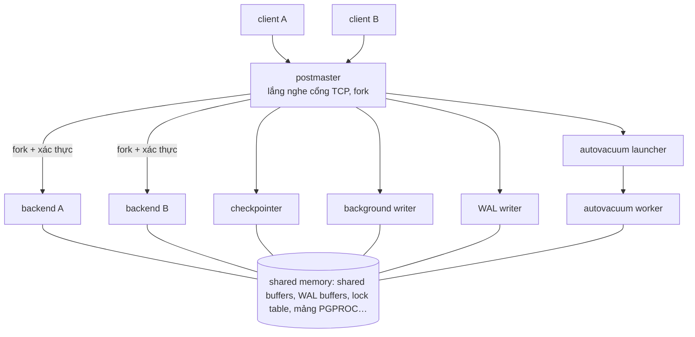
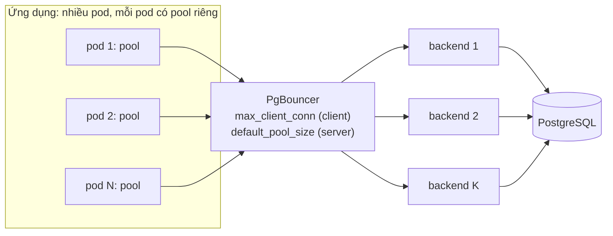
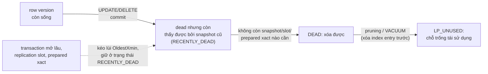
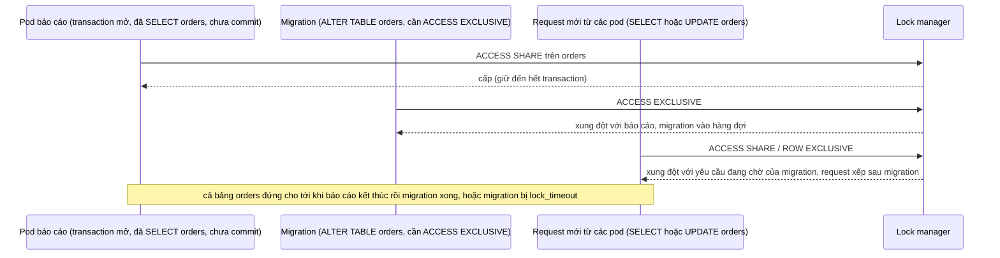
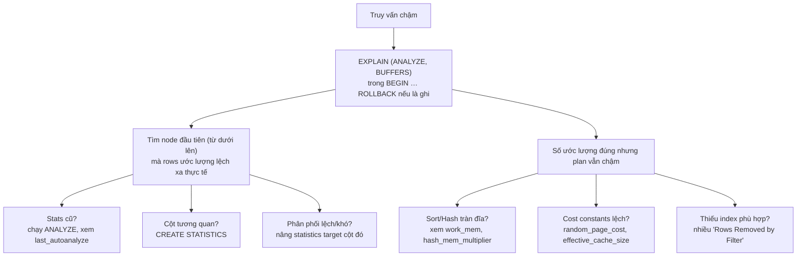

# P12 · Chương 15 — PostgreSQL bên trong: process, bộ nhớ, VACUUM, lock, planner

> Chương này là **case study**. Các khái niệm đã có chương riêng (MVCC, isolation, WAL, B-tree, replication, deadlock lý thuyết, page cache) chỉ được tóm 1–3 câu kèm link. Phần viết sâu là thứ chưa chỗ nào có: PostgreSQL *thực sự chạy* thế nào khi bạn vận hành nó. Mọi khẳng định về hành vi cụ thể là về **PostgreSQL 16**, trừ khi ghi khác.
>
> Nguồn gồm: docs PostgreSQL 16 (trang sống, truy cập 2026-10-12, nội dung có thể được sửa theo bản vá nhỏ); mã nguồn PostgreSQL ghim tag `REL_16_4` trên `raw.githubusercontent.com`; docs và changelog PgBouncer (trang sống, truy cập 2026-10-12, lúc đó trang chủ liệt kê 1.26.0 là bản mới nhất, nên chi tiết, nhất là mặc định `max_prepared_statements`, có thể khác ở bản cũ hơn); docs.rs ghim phiên bản (`sqlx` 0.9.0, `sqlx-core` 0.9.0, `tokio-postgres` 0.7.18, `deadpool-postgres` 0.14.2, `deadpool` 0.13.1); và một đoạn source `sqlx-postgres` ghim tag `v0.9.0`.
>
> Người soạn **không có số đo** nào của riêng mình. Mọi câu SQL/Rust chỉ để minh họa, chưa chạy hay biên dịch. Hình trích từ docs đều ghi rõ nguồn. Các giá trị mặc định (default) là của docs PostgreSQL 16 / PgBouncer tại thời điểm truy cập.

## Bạn sẽ hiểu được gì

- **Q1.** Một connection tới PostgreSQL thực chất là gì ở mức process? Postmaster, backend và các process nền (checkpointer, background writer, WAL writer, autovacuum) mỗi cái làm gì? → mục 1
- **Q2.** Vì sao connection "đắt", vì sao cần pooler, và PgBouncer ở chế độ session / transaction / statement mỗi chế độ cho phép và cấm gì (prepared statement, `SET`, advisory lock)? → mục 2
- **Q3.** `shared_buffers`, `work_mem`, `maintenance_work_mem`, `effective_cache_size` mỗi cái là bộ nhớ của ai, tính theo đơn vị nào, và *double buffering* với page cache của OS là gì? → mục 3
- **Q4.** Một câu `UPDATE` đi qua những bước nào từ backend tới WAL, checkpoint và data file (tóm lược, kèm chỗ chương khác đã nói)? → mục 4
- **Q5.** VACUUM và autovacuum làm gì, kích hoạt khi nào, vì sao một transaction mở lâu chặn được chúng, và XID wraparound / freezing là gì? → mục 5
- **Q6.** Table lock, row lock, bảng xung đột, hàng đợi lock, deadlock detection là gì, và vì sao một `ALTER TABLE` có thể làm cả bảng "đứng"? → mục 6
- **Q7.** Đọc `EXPLAIN` / `EXPLAIN ANALYZE` thế nào; cost, các kiểu scan, các kiểu join và statistics quyết định plan ra sao? → mục 7
- **Q8.** Nhìn vào một PostgreSQL đang chạy bằng gì (`pg_stat_activity`, `pg_stat_statements`, `pg_locks`, wait event), và những cấu hình nào hay gây sự cố? → mục 8 và mục 9

## Kiến thức cần trước

- [P1 · Chương 03 — Process](../01-linux/03-process.md): `fork` nhân bản một process; chương này dùng lại khi nói "mỗi connection là một process".
- [P3 · Chương 05 — Bộ nhớ của tiến trình trên Linux](../03-memory/05-bo-nho-tien-trinh-linux.md): RSS/VSZ, overcommit (mục 5, 6), nền cho phần OOM killer và cách đo bộ nhớ của backend.
- [P4 · Chương 05 — Bug concurrency và deadlock](../04-concurrency/05-concurrency-bug-va-deadlock.md): lý thuyết deadlock (mục 3–5) và deadlock ở tầng database/pool (mục 7). Chương này chỉ nói PostgreSQL *cài đặt* việc phát hiện deadlock ra sao.
- [P5 · Chương 04 — Page cache, writeback và direct I/O](../05-storage/04-page-cache-va-direct-io.md): page cache của OS, `fsync`; nền cho *double buffering* ở mục 3.
- [P5 · Chương 05](../05-storage/05-crash-consistency-va-journaling.md) và [Chương 06](../05-storage/06-durability-trong-thuc-te.md): write-ahead logging và `fsync` đúng chỗ; mục 4 không lặp lại.
- [P12 · Chương 03 — Storage engine](03-storage-engine.md): B-tree, page, WAL, full-page write, HOT (mục 5).
- [P12 · Chương 05 — Replication](05-replication.md): replication slot, standby; chỉ nhắc khi chúng ảnh hưởng VACUUM/WAL.
- [P12 · Chương 07 — Transaction và isolation](07-transaction.md): MVCC, `xmin`/`xmax`, snapshot (mục 4), `SELECT ... FOR UPDATE` (mục 5), lỗi `40001`/`40P01` và vòng retry (mục 8). Chương này **không** giải thích lại các thứ đó.

## 1. Một connection là một process: postmaster, backend và các process nền (Q1)

> **Trả lời ngắn.** PostgreSQL dùng mô hình "một process cho mỗi client": mỗi connection ứng với đúng một *backend process* riêng[^pm-process]. Một process giám sát tên *postmaster* lắng nghe cổng TCP và `fork` ra backend mới mỗi khi có connection tới[^pm-spawn]. Bên cạnh các backend phục vụ client còn có các process nền (checkpointer, background writer, WAL writer, autovacuum launcher chạy thường trực), mỗi cái lo một việc bảo trì[^backend-types]. Riêng autovacuum worker thì do launcher khởi động khi cần[^av-launcher].

**Giải thích.**

*Với service `orders`.* Cả chương này bám theo một service giả định: `orders`, viết bằng Rust (axum + sqlx), chạy khoảng 20 pod, mỗi pod có một pool sqlx tối đa 10 connection, nói chuyện với PostgreSQL 16 (một primary và một standby), ở vài môi trường qua PgBouncer (ví dụ giả định của người soạn). Bảng chính là `orders(id, customer_id, status, total, updated_at)` với hàng chục triệu dòng; `status` liên tục được UPDATE (pending → paid → shipped), và mỗi đêm có một báo cáo `GROUP BY customer_id`. Câu hỏi của mục này: khi một pod của `orders` mở connection, phía PostgreSQL thực sự có gì được tạo ra, và ai đang chạy cạnh nó?

**Một pod mở connection: câu chuyện postmaster → fork → backend**

*Postmaster.* Server không biết trước sẽ có bao nhiêu connection, nên phải có một *supervisor process* (process giám sát) luôn chạy để sinh backend mới mỗi khi có yêu cầu. Supervisor đó là postmaster, nghe ở một cổng TCP/IP chỉ định[^pm-spawn]. Nhìn từ phía client thì cũng vậy: server `fork` một process mới cho mỗi connection, từ đó client và process mới nói chuyện trực tiếp, còn process giám sát vẫn chạy mãi; client và server process đi kèm thì đến rồi đi[^tut-fork]. Với `orders`, một pod mở thêm connection thì postmaster `fork` thêm một process. Còn thứ tự chi tiết thì nằm trong `postmaster.c` (`REL_16_4`): nhận được yêu cầu là postmaster `fork()` ngay, process con tự xác thực, và chỉ thành backend nếu xác thực thành công[^pm-forkimm].

*Backend.* Sau `fork`, process con (trong `BackendStartup`) đóng các socket của postmaster, đọc startup packet, rồi tạo cấu trúc `PGPROC` riêng của nó trong shared memory trước khi vào vòng lặp phục vụ query[^pm-bestart]. Từ đó backend nhận query dạng text từ pod, parse, lập plan, thực thi và trả các hàng về trên chính connection ấy[^pm-query]. Các backend phối hợp với nhau và với những process khác của instance qua semaphore và shared memory, để dữ liệu nhất quán khi nhiều backend truy cập cùng lúc[^pm-ipc]. Mỗi backend là một process OS bình thường: PID của nó chính là cột `pid` trong `pg_stat_activity`, và `ps` cũng thấy được nó[^pid-ps]. Cơ chế `fork` (nhân bản bảng trang theo kiểu copy-on-write, thừa hưởng file descriptor) là kiến thức của [P1 · Chương 03](../01-linux/03-process.md). Hệ quả: 20 pod × 10 connection là tới 200 process backend, mỗi cái một PID riêng (con số chỉ để minh họa, giả định).

*Các process nền.* Không phải process nào cũng phục vụ client. Cột `backend_type` của `pg_stat_activity` liệt kê: autovacuum launcher, autovacuum worker, logical replication launcher/worker, parallel worker, background writer, client backend, checkpointer, archiver, standalone backend, startup, walreceiver, walsender, walwriter[^backend-types]. Tên là vậy, còn việc của từng process thì như bảng dưới đây (lấy theo docs):

| Process | Làm gì | Nguồn |
|---|---|---|
| checkpointer | tự động chạy checkpoint theo chu kỳ (`checkpoint_timeout`) hoặc khi WAL sắp vượt `max_wal_size` | [^ckpt-proc][^ckpt-trigger] |
| background writer | chủ động ghi bớt các shared buffer "dirty" ra file system để backend khỏi phải tự ghi | [^bgw] |
| WAL writer | định kỳ flush WAL theo `wal_writer_delay` | [^walw] |
| autovacuum launcher / worker | launcher khởi động các worker; worker chạy VACUUM/ANALYZE | [^av-launcher] |
| startup, walreceiver, walsender, archiver | có trong danh sách `backend_type`; theo tên, liên quan tới khôi phục và replication/lưu trữ WAL (suy luận của người soạn từ tên; xem [P12 · Chương 05](05-replication.md)) | [^backend-types] |

Phần checkpoint/WAL ở mục 4, autovacuum ở mục 5.



*Sơ đồ: minh họa của người soạn, tổng hợp từ các nguồn trên; không liệt kê hết process.*

*Postmaster tránh đụng vào shared memory.* Postmaster tạo pool shared memory và semaphore lúc khởi động nhưng không tự dùng chúng, và nó cũng không nằm trong mảng `PGPROC`, nên không tham gia lock manager. Lý do là giữ postmaster xa shared memory làm nó đơn giản và đáng tin hơn, nhờ vậy thường hồi phục được sau khi một backend crash bằng cách reset shared memory[^pm-noshm].

**Hệ quả vận hành cho `orders`**

Hai tình huống đáng nhớ, và cả hai đều làm *mọi pod* mất connection cùng lúc, không chỉ pod có connection gặp sự cố.

1. *Một child process crash.* `HandleChildCrash` ghi log `terminating any other active server processes`, postmaster dừng các process còn lại rồi khởi tạo lại, và log tương ứng là `all server processes terminated; reinitializing`[^pm-crash]. Vì vậy một backend bị kill (ví dụ do OOM killer) có thể kéo theo *toàn bộ connection* của instance bị ngắt, trong lúc server chạy crash recovery. Với `orders`, đó là cả 20 pod cùng báo lỗi connection (suy luận của người soạn từ hai thông điệp log trên, không từ lời của docs).
2. *OOM killer giết chính postmaster.* Kernel Linux có thể kill postmaster khi hết bộ nhớ ảo[^oom-pm]. Khi đó các connection đang có vẫn chạy bình thường, nhưng không nhận thêm connection mới[^oom-conn]. Với `orders`, pod nào đang giữ connection trong pool vẫn dùng được, còn pod mới khởi động hoặc pool cần mở thêm sẽ không kết nối nổi (suy luận của người soạn).

Nền tảng về OOM killer: [P3 · Chương 04, mục 5](../03-memory/04-page-fault-va-swapping.md).

<details><summary>Đi sâu: <code>fork</code> vs <code>fork</code>+<code>exec</code>, worker song song, và vì sao autovacuum worker không tính vào <code>max_connections</code></summary>

- Trong `BackendStartup`, nhánh chuẩn gọi `fork_process()` rồi chạy tiếp trong process con; nhánh `EXEC_BACKEND` (cho nền tảng không có `fork`, như Windows) dùng `backend_forkexec`[^pm-bestart]. Ở Linux, backend là con `fork` của postmaster và không `exec` lại (suy luận của người soạn từ việc nhánh `!EXEC_BACKEND` không gọi exec).
- Trong mã `REL_16_4`, postmaster khởi động một số process phụ trợ (background writer, checkpointer, WAL writer) bằng cùng hàm tạo process con `StartChildProcess`[^pm-aux]. Đây là chi tiết cài đặt có thể đổi giữa các bản, và không phải loại nào trong danh sách `backend_type` cũng đi đường này: client backend được tạo ở `BackendStartup`, như trên.
- *Parallel query* sinh thêm process: docs nói mỗi parallel worker là một process hoàn toàn riêng và tác động lên hệ thống gần như một user session thêm vào[^par-sep]. Vì vậy một truy vấn song song 4 worker có thể dùng tới 5 lần CPU/bộ nhớ/I/O của truy vấn không song song[^par-five].
- Autovacuum worker không bị tính vào giới hạn `max_connections` hay `superuser_reserved_connections`[^av-nocount]. Semaphore thì được cấp theo tổng `max_connections` + `autovacuum_max_workers` + `max_wal_senders` + `max_worker_processes` (với System V semaphore)[^kr-sem].
- Chuyện gì xảy ra khi số connection chạm `max_connections` được bàn ở mục 2 và mục 9.

</details>

**Quay lại Q1:** một connection = một process OS riêng do postmaster `fork`; cạnh các backend còn có checkpointer, background writer, WAL writer, autovacuum, tất cả chia sẻ shared memory, và với `orders` thì mỗi connection trong pool của mỗi pod là một process như vậy.

## 2. Vì sao connection đắt, và PgBouncer: session, transaction, statement (Q2)

> **Trả lời ngắn.** Mỗi connection tới PostgreSQL giữ một process OS và một chỗ trong các bảng dùng chung của server, kích cỡ theo `max_connections`[^kr-sem]. Nó còn giữ bộ nhớ riêng của session[^work-mem]. Khi chính PostgreSQL làm hệ thống hết bộ nhớ, khuyến nghị trong nhiều trường hợp là giảm `max_connections` và dùng một *connection pooler* bên ngoài[^kr-pool]. PgBouncer là pooler như vậy: nhiều client nối vào nó, còn số connection thật tới PostgreSQL thì ít và được dùng lại. Nó có ba chế độ là session, transaction và statement[^pgb-modes]. Chế độ càng gom mạnh thì càng nhét được nhiều client lên ít connection thật, nhưng càng làm hỏng những tính năng gắn với session như `SET`, `LISTEN`, `PREPARE` và advisory lock mức session[^pgb-table].

**Giải thích.**

*Với service `orders`.* Giả sử `orders` chạy 20 pod, mỗi pod có một pool sqlx tối đa 10 connection, tức tối đa 200 connection tới PostgreSQL 16 (ví dụ giả định của người soạn). Mỗi connection đó là một process phía server, và `max_connections` là một con số cố định cấu hình từ lúc khởi động. Câu hỏi của mục này: vì sao 200 connection là gánh nặng đáng kể dù phần lớn thời gian chúng nằm rảnh, và PgBouncer giúp thế nào khi đứng giữa 20 pod và PostgreSQL?

**2a. Vì sao connection "đắt".** Chi phí đến từ năm nguồn khác nhau, nên tách ra từng cái.

1. *Một process mỗi connection.* Như mục 1 đã nói, mỗi connection là một process do postmaster `fork`, và process con tự lo xác thực[^pm-forkimm]. Mở một connection nghĩa là `fork`, đọc startup packet, tạo `PGPROC` trong shared memory rồi xác thực[^pm-bestart]. Chuỗi việc này tốn thời gian, vì vậy mở connection mới cho từng request là ý tồi (nhận xét của người soạn: docs không đưa con số).
2. *Chỗ trong bảng dùng chung theo `max_connections`.* Tham số này quyết định số connection đồng thời tối đa, và đổi nó phải restart[^maxconn]. Semaphore (với System V semaphore) được cấp theo tổng connection, autovacuum worker, WAL sender và background process[^kr-sem].
3. *Bộ nhớ riêng của session.* `work_mem` áp dụng cho từng thao tác sort/hash, và nhiều session có thể làm việc đó cùng lúc, nên tổng bộ nhớ có thể gấp nhiều lần `work_mem`[^work-mem] (chi tiết ở mục 3). Mỗi session còn có `temp_buffers` riêng cho bảng tạm, cấp phát dần tới giới hạn[^temp-buf].
4. *Process song song.* Mỗi parallel worker tác động lên server như thêm một user session[^par-sep].
5. *Hết bộ nhớ.* Khi chính PostgreSQL làm hệ thống hết bộ nhớ, docs gợi ý hạ `shared_buffers`, `work_mem`, `hash_mem_multiplier`. Vì nguyên nhân có thể là cho phép quá nhiều connection, docs cũng gợi ý giảm `max_connections` và dùng connection pooler ngoài, kèm lời dè dặt "trong nhiều trường hợp"[^kr-pool].

Có một điểm tinh tế (suy luận của người soạn từ hai nguồn). Một session idle, không nằm trong transaction, không gây chi phí lớn cho server[^idle-cheap]. Vậy cái đắt không phải là "có nhiều connection mở". Cái đắt là nhiều connection *đang chạy* cùng lúc tranh CPU, I/O và bộ nhớ, cộng với connection *treo trong transaction* vì nó giữ snapshot và lock (mục 5 và 6). Với `orders`, 200 connection mà chỉ 15 cái đang chạy query thì chưa đáng lo bằng một pod để connection treo trong transaction. Pooler giúp vì nó cho phép chặn số truy vấn thực sự chạy đồng thời ở một con số bạn chọn, dù phía trước có hàng nghìn client.

**2b. PgBouncer đứng ở đâu.** PgBouncer nằm giữa ứng dụng và PostgreSQL, nói giao thức PostgreSQL ở cả hai phía. Nó nhẹ: mặc định 2 kB bộ nhớ cho mỗi connection, vì không cần nhìn thấy trọn gói tin một lần[^pgb-2kb]. Số connection client tối đa là `max_client_conn`, mặc định 100[^pgb-maxclient]. Số connection server tối đa cho mỗi cặp user/database mặc định là `default_pool_size` = 20, và có thể ghi đè bằng `pool_size` theo từng database hoặc user[^pgb-poolsize].



*Sơ đồ: minh họa của người soạn; số lượng tượng trưng.*

**2c. Ba chế độ.** Chế độ được chọn bằng `pool_mode`, mặc định là `session`[^pgb-mode-default].

- **Session pooling**: khi client kết nối, PgBouncer gán cho nó một server connection trong *suốt thời gian* nó còn kết nối; client ngắt thì server connection mới trở lại pool. Chế độ này hỗ trợ mọi tính năng của PostgreSQL[^pgb-session].
- **Transaction pooling**: server connection chỉ gán cho client *trong một transaction*. Khi PgBouncer thấy transaction kết thúc, server connection quay về pool[^pgb-trans]. Chế độ này làm hỏng vài tính năng dựa vào session, nên chỉ dùng được khi ứng dụng hợp tác và tránh các tính năng đó[^pgb-compat].
- **Statement pooling**: giống transaction pooling nhưng *cấm transaction nhiều câu lệnh*, để ép client chạy kiểu autocommit[^pgb-stmt].

Với `orders`, transaction pooling là chế độ đáng cân nhắc nhất: một request thường chỉ giữ connection trong vài câu lệnh, rồi trả về pool cho request của pod khác. Cái giá là bảng tương thích dưới đây.

**2d. Bảng tương thích (theo docs PgBouncer).** Ở transaction pooling, các mục sau được ghi là "Never", nghĩa là không dùng được: `SET`/`RESET`, `LISTEN`, `WITH HOLD CURSOR`, `PREPARE`/`DEALLOCATE` mức SQL, temp table kiểu `PRESERVE`/`DELETE ROWS`, `LOAD`, và advisory lock mức session[^pgb-table]. Các mục còn lại dùng được: `NOTIFY`, cursor `WITHOUT HOLD`, temp table `ON COMMIT DROP`, reset cached plan[^pgb-table-prep]. Lý do chung (suy luận của người soạn): mỗi transaction của bạn có thể rơi vào một server connection khác. PgBouncer cũng dựa vào chính điều này khi giải thích vì sao `server_reset_query` không dùng ở chế độ này[^pgb-reset]. Từng tính năng hỏng theo cách riêng:

| Tính năng | Vì sao hỏng ở transaction pooling | Cách đi đường khác |
|---|---|---|
| `SET x = …` (mức session) | giá trị gắn vào *session của server connection*, còn transaction kế tiếp của bạn có thể chạy ở connection khác[^set-session] | `SET LOCAL`: hiệu lực chỉ đến hết transaction hiện tại[^set-local]; hoặc `ALTER ROLE … SET …` để đặt giá trị mặc định cho session mới của role[^alter-role] |
| `LISTEN` | đăng ký nghe nằm ở session phía server, connection khác sẽ không nhận thông báo (suy luận) | session pooling riêng cho consumer `LISTEN`, hoặc connection trực tiếp |
| `PREPARE` (SQL) / prepared statement có tên | prepared statement chỉ sống trong session tạo ra nó[^prep-session][^prep-proto]; sang connection khác là mất | `PREPARE` mức SQL: PgBouncer không có lối thoát, lệnh chuyển thẳng tới Postgres[^pgb-maxprep-sql]. Prepared statement *mức giao thức*: đặt `max_prepared_statements` khác 0 (xem đoạn *Về prepared statement* dưới đây), hoặc không dùng prepared statement có tên |
| advisory lock mức session | lock giữ đến khi nhả tường minh hoặc session kết thúc, *không theo ngữ nghĩa transaction*[^adv-session]; nó có thể mắc lại trên một connection mà bạn không còn dùng | `pg_advisory_xact_lock`: tự nhả cuối transaction[^adv-xact] |
| temp table `PRESERVE ROWS` | bảng tạm gắn với session | `ON COMMIT DROP`, hoặc dùng bảng thường |

*Về prepared statement.* Prepared statement là chỗ ứng dụng Rust dễ vấp nhất, vì sqlx dùng prepared statement có tên. Ở mức giao thức, statement có tên tồn tại đến hết session trừ khi bị hủy tường minh[^prep-proto]. Statement *không tên* thì chỉ sống đến lần `Parse` không tên kế tiếp[^prep-unnamed]. Hai điều này mâu thuẫn với transaction pooling, vì statement `orders` prepare ở connection A có thể không còn khi transaction sau rơi vào connection B.

PgBouncer có lối thoát cho prepared statement có tên ở mức giao thức. Khi `max_prepared_statements` khác 0, nó theo dõi các statement đó ở chế độ transaction/statement và bảo đảm statement client đã prepare luôn có mặt trên server connection đang phục vụ, kể cả khi statement được prepare ở connection khác[^pgb-maxprep]. Cách làm: PgBouncer đặt cho mỗi chuỗi query một tên nội bộ dạng `PGBOUNCER_<số>`, và viết lại tên do client đặt thành tên này trước khi chuyển lệnh đi[^pgb-maxprep-how]. Nếu server connection được gán chưa có statement, nó tự prepare trên đó[^pgb-maxprep-auto]. Cơ chế này không áp dụng cho `PREPARE`/`EXECUTE`/`DEALLOCATE` mức SQL, các lệnh ấy đi thẳng tới Postgres[^pgb-maxprep-sql]. Riêng `DEALLOCATE ALL` và `DISCARD ALL` vẫn chạy như kỳ vọng và xóa các statement PgBouncer đang theo dõi cho client gửi lệnh[^pgb-maxprep-all]. Còn giá trị mặc định của `max_prepared_statements` đổi theo phiên bản PgBouncer; phần đó nằm ở Đi sâu bên dưới, và việc cần nhớ là kiểm tra cấu hình thực của bản bạn đang chạy.

*Hệ quả khi migration DDL.* Mọi client dùng chung một tên nội bộ cho cùng chuỗi query. Vì vậy nếu kiểu trả về hoặc kiểu tham số của statement đổi giữa các lần chạy, PostgreSQL có thể báo lỗi `cached plan must not change result type`[^pgb-maxprep-err]. Với `orders`, tình huống này đúng là migration thêm một cột vào bảng `orders`. Cách xử lý: chạy `RECONNECT` trên admin console của PgBouncer sau migration để ép prepare lại. Thêm cột hoặc đổi kiểu cột là trường hợp hay gặp nhất[^pgb-maxprep-ddl] (liên hệ migration ở mục 6d).

*Về tham số khởi động.* PgBouncer chỉ theo dõi một số tham số trong startup packet. Tham số khác gây lỗi trừ khi bạn liệt kê chúng trong `ignore_startup_parameters`[^pgb-ignore]. `options` là một startup parameter thuộc loại này, nơi client có thể gửi `-c statement_timeout=…`. Giao thức cho phép đặt tham số trực tiếp trong startup packet hoặc bên trong `options`, và `ignore_startup_parameters` hỗ trợ cả hai cách[^pgb-ignore-ex]. Ý nghĩa với Rust: xem mục "Liên hệ với Rust".

*Hàng đợi khi pool cạn.* Khi mọi server connection đang bận, truy vấn phải chờ. `query_wait_timeout` (mặc định 120 giây) là thời gian tối đa một truy vấn được chờ để được gán server; hết hạn mà chưa được gán thì client bị ngắt, còn đặt 0 thì client xếp hàng vô hạn[^pgb-qwait]. Nói cách khác, latency của `orders` giờ có thêm một thành phần là thời gian chờ pool (nhận xét của người soạn), và cần giám sát nó ở cả pool ứng dụng lẫn PgBouncer.

<details><summary>Đi sâu: ngân sách connection, mặc định của max_prepared_statements, fd của PgBouncer, và reset query</summary>

- *Ngân sách connection phía PostgreSQL* (suy luận của người soạn, số liệu tự đặt). Giả sử `max_connections = 100`, mặc định của PostgreSQL[^maxconn]. Với `superuser_reserved_connections = 3`, cũng là mặc định[^super-res], còn lại tối đa 97 chỗ cho mọi nguồn: tất cả PgBouncer, các tool admin/monitoring, job migration kết nối trực tiếp. Nếu 20 pod `orders`, mỗi pod một pool tối đa 10 connection, nối *thẳng* PostgreSQL thì cần 200 connection, vượt hạn mức ngay cả khi mỗi pod chỉ dùng một phần. Nối qua PgBouncer thì số connection thật của mỗi PgBouncer bị chặn bởi `pool_size` của từng cặp (user, database), mặc định là `default_pool_size`[^pgb-poolsize]. Nếu bật `reserve_pool_size` (mặc định tắt) thì cộng thêm phần đó[^pgb-reserve]. Con số này không phụ thuộc số pod.
- *Mặc định của `max_prepared_statements` đổi theo phiên bản PgBouncer.* Đặt 0 thì hỗ trợ prepared statement cho transaction/statement pooling bị tắt (trang Configuration hiện hành, lúc truy cập liệt kê PgBouncer 1.26.0)[^pgb-maxprep-zero]. Bản 1.21.0 thêm tính năng này và yêu cầu đặt giá trị khác 0 để dùng[^pgb-prep-1-21]. Bản 1.24.0 đổi mặc định thành 200[^pgb-prep-default]. Suy ra (suy luận của người soạn từ hai dòng changelog, chưa kiểm từng bản): từ 1.24.0 tính năng bật sẵn, còn với 1.21–1.23 phải tự đặt giá trị khác 0. Bảng tương thích của trang Features cũng cho mục *Protocol-level prepared plans* chạy được ở transaction pooling, kèm chú thích phải đặt `max_prepared_statements` khác 0[^pgb-table-prep]. Chú thích này nhất quán với việc giá trị 0 là tắt.
- *File descriptor.* Tăng `max_client_conn` có thể cần tăng giới hạn fd của OS. Số fd có thể dùng lớn hơn `max_client_conn`; lý thuyết tối đa là `max_client_conn + (max pool_size × số database × số user)` khi mỗi user kết nối bằng tên riêng[^pgb-fd]. Cách xem và nâng giới hạn fd (`RLIMIT_NOFILE`): [P1 · Chương 06, mục 6](../01-linux/06-user-quyen-proc-sys.md).
- *`server_reset_query`.* Ở session pooling, khi server connection được trả lại, PgBouncer gửi một câu để dọn trạng thái session cho client sau. Mặc định là `DISCARD ALL`, có thể thay bằng câu nhẹ hơn như `DEALLOCATE ALL`[^pgb-reset-q]. Ở transaction pooling câu này không dùng[^pgb-reset]. `DISCARD ALL` giải phóng mọi tài nguyên tạm của session và đưa session về trạng thái ban đầu[^discard].
- *Hai tầng pool cùng tồn tại.* Pool trong ứng dụng (sqlx, deadpool…) và PgBouncer có thể dùng chung: pool ứng dụng tiết kiệm chi phí mở connection tới PgBouncer, còn PgBouncer gom lại thành ít connection thật. Chi tiết cấu hình phía Rust ở mục "Liên hệ với Rust".

</details>

**Quay lại Q2:** connection đắt vì mỗi cái là một process cộng chỗ trong bảng dùng chung cộng bộ nhớ riêng, và vì chỉ ít truy vấn chạy đồng thời mới có ích; PgBouncer ép nhiều client lên ít connection thật, đổi lại ở transaction/statement mode `orders` mất mọi thứ gắn với session.

## 3. Bộ nhớ: `shared_buffers`, `work_mem`, `maintenance_work_mem`, `effective_cache_size` (Q3)

> **Trả lời ngắn.** `shared_buffers` là vùng bộ nhớ dùng chung cho mọi backend, mặc định 128MB[^sb-def]. Muốn đổi nó phải khởi động lại server[^sb-restart]. `work_mem` là hạn mức cho *mỗi thao tác sort/hash trong một truy vấn*, không phải cho mỗi connection hay mỗi truy vấn, nên tổng bộ nhớ có thể gấp nhiều lần con số bạn đặt[^wm-multi]. `maintenance_work_mem` dành cho VACUUM, `CREATE INDEX`…[^mwm]. `effective_cache_size` thì không cấp phát gì cả, chỉ là con số giả định để planner ước lượng chi phí[^ecs-noalloc]. Vì PostgreSQL đọc file qua page cache của OS, một page có thể nằm ở cả hai nơi (*double buffering*)[^ecs-both].

**Giải thích.**

*Với service `orders`.* Hai con số cấu hình mà `orders` hay đụng tới là `shared_buffers` (cache chung của cả server) và `work_mem` (bộ nhớ riêng cho mỗi sort/hash). Câu hỏi của mục này: với 20 pod, mỗi pod một pool tới 10 connection, PostgreSQL thực sự tiêu bao nhiêu RAM và con số nào trong cấu hình có thể làm nó vượt tầm kiểm soát? Câu trả lời: `shared_buffers` có kích thước cố định, còn `work_mem` thì nhân lên theo số session *và* số thao tác mỗi session chạy.

**3a. Đường đọc một page.** Khi `orders` đọc một dòng của bảng `orders`, backend phục vụ connection đó phải "ghim" (pin) buffer chứa page ấy trong shared buffers, vì buffer chưa pin có thể bị lấy cho page khác bất cứ lúc nào[^bufpin]. Nếu page chưa có trong shared buffers, backend phải chọn một buffer để tái sử dụng, theo thuật toán *clock sweep* (chi tiết ở phần Đi sâu bên dưới). Nếu buffer được chọn đang dirty thì phải ghi nó ra đĩa trước khi dùng lại[^dirty-first]. Background writer tồn tại chính là để backend ít phải tự đi ghi buffer dirty như vậy[^bgw-reduce]. Dữ liệu đọc từ file đi qua page cache của kernel ([P5 · Chương 04, mục 1](../05-storage/04-page-cache-va-direct-io.md)), và PostgreSQL mặc định không dùng direct I/O ([mục 7 chương đó](../05-storage/04-page-cache-va-direct-io.md)).

*Double buffering.* Hệ quả của việc đọc qua page cache: một page nóng của bảng `orders` có thể có hai bản, một ở shared buffers, một ở page cache của OS. Cách đặt `effective_cache_size` phải tính cả shared buffers lẫn phần disk cache của kernel dành cho file dữ liệu PostgreSQL, dù một số dữ liệu có thể nằm ở cả hai nơi[^ecs-both]. Đó cũng là lý do `shared_buffers` chỉ nên bắt đầu ở khoảng 25% RAM trên máy chuyên dụng từ 1GB RAM trở lên, và rất khó có chuyện đặt trên 40% RAM chạy tốt hơn, vì PostgreSQL *cũng dựa vào cache của OS*[^sb-25]. Một điểm dễ nhầm khi đọc số liệu: `blks_hit` trong `pg_stat_database` chỉ đếm hit ở cache của PostgreSQL, không tính cache file system của OS[^blks-hit]. Vì vậy hit ratio 99% của bảng `orders` không cho biết 1% còn lại chạm đĩa thật hay chỉ chạm page cache (suy luận của người soạn từ định nghĩa trên).

**3b. `work_mem`: mỗi thao tác một hạn mức.** `work_mem` là mức tối đa cho *một thao tác của truy vấn* (một sort hay một hash table) trước khi dữ liệu tràn sang file tạm; mặc định 4MB[^wm-default]. Một truy vấn phức tạp có thể chạy nhiều sort/hash cùng lúc, mỗi cái được dùng tới mức này, và nhiều session có thể cùng làm vậy[^work-mem]. Sort xuất hiện ở `ORDER BY`, `DISTINCT`, merge join[^wm-sorts]. Hash thì có hạn mức riêng là `work_mem × hash_mem_multiplier`[^hash-mem]. Hệ số này mặc định 2.0[^hash-mem-default]. Thao tác hash thường nhạy với bộ nhớ hơn sort[^hash-sens]. Với parallel query, `work_mem` áp dụng riêng cho từng worker[^par-wm].

Báo cáo đêm `GROUP BY customer_id` của `orders` là ví dụ điển hình: nó có thể dùng một hash aggregate hoặc một sort, và nếu bảng có hàng chục triệu dòng thì bộ nhớ cần có thể vượt `work_mem`. Còn cận trên *lý thuyết* của cả cụm thì tính như sau (suy luận của người soạn, số liệu giả định): 20 pod × 10 connection là tối đa 200 session cùng chạy; nếu mỗi session có 3 thao tác sort/hash dùng đủ `work_mem` = 4MB thì tổng là 200 × 3 × 4MB = 2400MB. Nâng `work_mem` lên 64MB ở mức toàn server chỉ để cứu một báo cáo chậm thì cận trên thành 200 × 3 × 64MB = 38400MB. Vì vậy nên đặt `work_mem` thấp ở mức server rồi nâng cục bộ cho vai trò hay truy vấn cần (xem `SET LOCAL` ở mục 2). Cũng vì vậy pooler như PgBouncer, nhờ giảm số session *thực sự chạy* cùng lúc, giảm luôn cận trên này.

Khi vượt hạn mức, thao tác tràn ra đĩa, và có bốn cách nhìn thấy điều đó. `EXPLAIN ANALYZE` hiển thị cách sort (in-memory hay on-disk) cùng dung lượng, còn node Hash hiển thị số batch; số batch lớn hơn 1 nghĩa là có dùng đĩa[^explain-sort]. `pg_stat_database.temp_files` đếm số file tạm của mọi truy vấn trong database[^db-temp]. `log_temp_files` bật log từng file tạm, mặc định tắt[^log-temp]. Cuối cùng, `temp_file_limit` đặt trần dung lượng file tạm cho mỗi process, vượt thì transaction bị hủy; mặc định không giới hạn[^temp-limit].

**3c. `maintenance_work_mem`.** Tham số này dành cho thao tác bảo trì như VACUUM, `CREATE INDEX`, `ALTER TABLE ADD FOREIGN KEY`; mặc định 64MB[^mwm]. Một session chỉ chạy một thao tác như vậy mỗi lúc và thường ít cái chạy đồng thời, nên đặt nó lớn hơn `work_mem` khá nhiều là an toàn. Tuy vậy khi autovacuum chạy, bộ nhớ này có thể được cấp tới `autovacuum_max_workers` lần; nếu cần, tách riêng bằng `autovacuum_work_mem`[^mwm-av]. Với VACUUM trên bảng `orders` (nơi `status` bị update liên tục), bộ nhớ này chứa mảng *địa chỉ dòng chết* (dead TID) cần xóa khỏi index. VACUUM chỉ dùng tối đa `maintenance_work_mem` (hoặc `autovacuum_work_mem`) cho mảng đó[^vl-header]. Phần này còn bị chặn ở 1GB[^mwm-1gb]. Nếu hết chỗ giữa chừng, VACUUM phải dừng để vacuum index rồi quay lại, và mỗi lần như vậy index được xử lý *toàn bộ*; chú thích trong mã nguồn gọi cách này là rất kém hiệu quả khi bộ nhớ eo hẹp[^vl-inefficient]. Nói cách khác, `maintenance_work_mem` quá nhỏ trên bảng nhiều dòng chết làm VACUUM đi qua index nhiều lần (nhận xét của người soạn từ chú thích trên).

**3d. `effective_cache_size`.** Đây là giả định của planner về kích thước cache đĩa dành cho *một truy vấn*, và nó đi vào công thức chi phí của index scan: giá trị cao làm index scan dễ được chọn, giá trị thấp làm seq scan dễ được chọn[^ecs]. Nó không đổi kích thước shared memory và cũng không dự trữ cache của kernel[^ecs-noalloc]. Vì vậy sai số ở tham số này không gây OOM, chỉ gây *plan sai*; kiểm tra nó cùng với `random_page_cost` ở mục 7 (nhận xét của người soạn).

<details><summary>Đi sâu: clock sweep, ring buffer, đọc RSS của backend, huge pages, WAL buffers</summary>

- *Clock sweep.* (Theo README của buffer manager trong `REL_16_4`; chi tiết cài đặt, có thể đổi giữa các bản.) Mỗi buffer có một bộ đếm sử dụng, tăng tới một ngưỡng nhỏ mỗi lần bị pin[^clock]. Kim đồng hồ quét vòng tròn các buffer: buffer đang bị pin hoặc có bộ đếm khác 0 thì chưa dùng được, bộ đếm của nó giảm một (nếu khác 0) và kim chuyển sang buffer kế, cho tới khi gặp buffer chưa pin có bộ đếm 0[^clock-sweep].
- *Buffer ring cho scan lớn.* Truy vấn đọc nhiều page *đúng một lần* như VACUUM hay seq scan lớn không dùng clock sweep thông thường mà dùng một vòng buffer nhỏ tái sử dụng suốt lượt scan, để khỏi quét sạch cả cache[^ring]. Với seq scan vòng là 256KB (README `REL_16_4`, chi tiết cài đặt)[^ring-256]; một hệ quả là phần lớn lượng ghi do câu lệnh đó sinh ra do chính backend đảm nhiệm[^ring-write]. VACUUM/ANALYZE dùng *Buffer Access Strategy* cỡ `vacuum_buffer_usage_limit` (mặc định 256kB)[^vbul].
- *Đọc RSS của backend.* Trên Linux, `shared_memory_type` mặc định là `mmap`, tức shared memory anonymous cấp bằng `mmap`[^shm-type]. Định nghĩa `RssShmem` ở [P3 · Chương 05, mục 6](../03-memory/05-bo-nho-tien-trinh-linux.md) gồm cả shared anonymous mapping; vì vậy cộng `RSS` của các backend sẽ đếm trùng vùng shared buffers, và muốn cộng cho đúng thì dùng PSS (suy luận của người soạn từ hai nguồn).
- *Huge pages.* `huge_pages` mặc định `try`: thử xin huge page, thất bại thì quay về mặc định[^huge-try]. Transparent huge pages (THP) của Linux đã gây giảm hiệu năng với PostgreSQL ở một số người dùng và một số phiên bản Linux, nên hiện không khuyến khích; THP khác với `huge_pages` tường minh[^thp].
- *WAL buffers.* `wal_buffers` mặc định -1 chọn 1/32 `shared_buffers`, tối thiểu 64kB và tối đa một WAL segment (thường 16MB)[^wal-buf]. Phần WAL nằm ở mục 4.
- *`shared_buffers` và `max_wal_size` đi theo cặp.* `shared_buffers` lớn thường đòi `max_wal_size` tăng tương ứng, để rải việc ghi lượng lớn dữ liệu mới/thay đổi trên một khoảng thời gian dài hơn[^sb-wal].

</details>

**Quay lại Q3:** `shared_buffers` là cache chung có kích thước cố định; `work_mem` là hạn mức cho *mỗi thao tác sort/hash* nên tổng bộ nhớ là tích số session × thao tác; `maintenance_work_mem` cho VACUUM/`CREATE INDEX`; `effective_cache_size` chỉ là giả định của planner; và page có thể nằm ở cả shared buffers lẫn page cache.

## 4. Đường đi của một `UPDATE`: row version mới, WAL trước, checkpoint (Q4)

> **Trả lời ngắn.** `UPDATE` trong PostgreSQL không sửa tại chỗ: backend thêm một *row version* mới vào page (cùng page nếu còn chỗ, khi đó có thể là HOT, hoặc page khác), đánh dấu bản cũ là đã bị thay, và các thay đổi này nằm trong shared buffers (page bị "dirty") cùng một WAL record trong bộ nhớ. Tới `COMMIT` (với `synchronous_commit` mặc định `on`), WAL phải được flush xuống đĩa *trước khi* báo thành công; data page được ghi sau bởi background writer/checkpointer. Checkpoint là mốc từ đó crash recovery phát lại WAL, và lần sửa đầu tiên của mỗi page sau checkpoint kéo theo ghi nguyên page vào WAL (`full_page_writes`).

**Giải thích.**

*Với service `orders`.* Giả sử một pod chạy `UPDATE orders SET status = 'paid' WHERE id = 42`, chuyển đơn từ `pending` sang `paid`. Câu hỏi của mục này: câu lệnh đó đi qua những bước nào trong PostgreSQL, process nào làm bước nào, và tại sao server chết ngay sau khi báo "đã commit" vẫn không mất đơn?

Mục này *ghép* những mảnh đã học thành một đường đi duy nhất; từng mảnh được giải thích kỹ ở chương khác: MVCC, `xmin`/`xmax` và snapshot ở [P12 · Chương 07, mục 4](07-transaction.md); B-tree, torn page, WAL và HOT ở [P12 · Chương 03, mục 5](03-storage-engine.md); giao thức WAL và `fsync` ở [P5 · Chương 05](../05-storage/05-crash-consistency-va-journaling.md) và [P5 · Chương 06](../05-storage/06-durability-trong-thuc-te.md). Cái *mới* ở đây là thứ tự các bước và ai làm bước nào. Thứ tự dưới đây theo mã `heap_update` ở `REL_16_4` và docs (chi tiết nhỏ có thể đổi giữa các bản).

1. *Lock mức bảng và mức hàng.* `UPDATE` lấy lock `ROW EXCLUSIVE` trên bảng `orders`[^lk-rowexcl]. Trên dòng `id = 42` nó lấy lock hàng chế độ `FOR NO KEY UPDATE`[^lk-nokey]. Nếu update đổi một số cột nhất định (các cột thuộc unique index dùng được cho foreign key) thì lock hàng là `FOR UPDATE`[^lk-forupd]. Chi tiết ở mục 6.
2. *Ghim buffer, tìm chỗ cho bản mới.* Backend giữ pin và khóa nội dung trên buffer của bản cũ. Buffer cho bản mới có thể là *chính buffer đó* (nếu page còn chỗ) hoặc buffer khác; tới điểm này cả hai đã được pin và khóa, và buffer mới đủ chỗ cho tuple mới[^hu-bufs].
3. *Quyết định HOT.* Nếu bản mới nằm cùng page, backend kiểm tra xem có cột nào được index tham chiếu bị đổi không; nếu không có thì dùng HOT[^hu-hot]. Với `orders`, `status` mà không nằm trong index nào thì update thường đủ điều kiện HOT; còn nếu có index trên `status` thì không. Điều kiện HOT theo docs (đã nói ở [P12 · Chương 03, mục 5](03-storage-engine.md), phần Đi sâu): update không đổi cột nào được index tham chiếu (không tính index kiểu tóm tắt như BRIN) và page chứa hàng cũ còn đủ chỗ[^hot-doc]. Nếu không phải HOT, tuple mới phải được chèn vào mọi index của bảng[^hot-readme-all]; docs nêu thêm rằng MVCC có thể đòi index entry mới cho mỗi hàng được update[^hot-cost].
4. *Sửa page trong bộ nhớ.* Backend chèn tuple mới vào buffer[^hu-put]. Nó ghi vào bản cũ thông tin transaction đang update (trường `xmax`)[^hu-xmax]. Nó đặt `t_ctid` của bản cũ trỏ tới bản mới[^hu-ctid]. Nó cũng xóa cờ all-visible của page và các bit tương ứng trong visibility map[^hu-vm]; lý do (suy luận của người soạn) là page vừa có bản mới mà các transaction cũ chưa chắc nhìn thấy, nên không còn "mọi tuple thấy được với mọi transaction". Cuối cùng buffer được đánh dấu dirty.
5. *Sinh WAL record.* Nếu bảng cần WAL, backend đưa WAL record vào *WAL buffers* trong shared memory rồi ghi LSN của record vào page (trong mã nguồn là `log_heap_update`)[^hu-wal]. Bước đưa record vào buffer phải thật nhanh, vì nó diễn ra khi backend đang giữ lock độc quyền trên page dữ liệu[^wal-insert].
6. *COMMIT.* `synchronous_commit` mặc định là bật[^sc-default]. Khi đó backend ghi commit record rồi flush WAL tới vị trí cần thiết *trước khi* báo thành công cho client (trong mã nguồn là `XLogFlush(XactLastRecEnd)`; chi tiết cài đặt `REL_16_4`: điều kiện gọi có vế `synchronous_commit > SYNCHRONOUS_COMMIT_OFF`)[^xact-flush]. Yêu cầu flush này phần lớn được đưa ra lúc commit, để bảo đảm các record của transaction nằm trên bộ nhớ bền[^wal-flush-commit]. Nguyên lý WAL là thay đổi data file chỉ được ghi *sau khi* WAL mô tả chúng đã flush[^wal-intro]. Một lần `fsync` WAL còn có thể phục vụ nhiều transaction[^wal-group]. Cả hai đã được giải thích ở [P5 · Chương 05, mục 8](../05-storage/05-crash-consistency-va-journaling.md) và [P12 · Chương 03, mục 5](03-storage-engine.md); khác biệt `fsync`/`fdatasync` ở [P5 · Chương 06, mục 2](../05-storage/06-durability-trong-thuc-te.md). Mặc định trên Linux, phương thức flush là `fdatasync`[^wal-sync-default].
7. *Sau đó, không nằm trên đường chờ của client.* Background writer ghi dần các data page dirty[^bgw]. Còn mỗi checkpoint ghi *hết* dirty page, rồi ghi một checkpoint record vào WAL[^ckpt-def].

```mermaid
sequenceDiagram
  participant C as Client
  participant B as Backend
  participant SB as Shared buffers
  participant WB as WAL buffers
  participant WF as File WAL
  participant BG as bgwriter / checkpointer
  participant DF as Data file
  C->>B: UPDATE …
  B->>SB: pin buffer, thêm row version mới, sửa xmax/t_ctid bản cũ (page dirty)
  B->>WB: WAL record (log_heap_update)
  C->>B: COMMIT
  B->>WB: commit record
  B->>WF: write + flush (synchronous_commit = on; mặc định Linux: fdatasync)
  B-->>C: COMMIT thành công
  BG->>SB: tìm buffer dirty
  BG->>DF: ghi data page (checkpoint: ghi hết, rồi ghi checkpoint record)
```

*Sơ đồ: minh họa của người soạn từ các nguồn trên; thứ tự giữa bước 5 và 6 là thứ tự logic, không phải mô tả từng lệnh gọi hệ thống.*

**Vì sao crash không làm mất commit.** Giả sử server chết sau bước 6 nhưng trước khi data page của đơn 42 được ghi xuống file. WAL đã có đủ thông tin: sau crash, recovery đọc checkpoint record gần nhất, lấy từ đó vị trí *redo record* và phát lại (REDO) mọi thay đổi từ điểm đó[^ckpt-redo]. Nghĩa là *tần suất checkpoint quyết định thời gian recovery*: giảm `checkpoint_timeout`/`max_wal_size` làm checkpoint dày hơn và recovery nhanh hơn (ít phải làm lại), đổi lại chi phí flush data page dày hơn[^ckpt-tradeoff].

**Checkpoint kích hoạt khi nào, và tốn gì.** Checkpoint bắt đầu mỗi `checkpoint_timeout` giây hoặc khi WAL sắp vượt `max_wal_size`, cái nào tới trước[^ckpt-trigger]. Mặc định là 5 phút và 1GB[^ckpt-defaults]. Ghi hết dirty page là tải I/O lớn, nên checkpoint được "dàn trải": I/O bắt đầu từ lúc checkpoint khởi động và xong trước khi checkpoint kế tiếp tới hạn[^ckpt-spread]. `checkpoint_completion_target` là mục tiêu hoàn thành tính theo tỷ lệ của khoảng cách giữa hai checkpoint, mặc định 0.9[^ckpt-target]. Dù vậy checkpoint vẫn khá đắt, vì phải ghi hết buffer dirty và vì sinh thêm WAL (xem `full_page_writes` ngay dưới)[^ckpt-expensive].

**`full_page_writes`: vì sao WAL phình sau checkpoint.** Cơ chế torn page đã được giải thích ở [P12 · Chương 03, mục 5](03-storage-engine.md): khi `full_page_writes` bật, lần sửa *đầu tiên* của mỗi page sau mỗi checkpoint ghi nguyên nội dung page vào WAL[^fpw-def]. Mặc định `full_page_writes` là bật[^fpw-default]. Phần *vận hành* thêm ở đây: khoảng cách checkpoint nhỏ hơn làm tăng lượng WAL, phần nào triệt tiêu mục tiêu của việc rút ngắn khoảng cách[^ckpt-fpw]. `wal_compression` giảm lượng WAL, đổi lại tốn CPU lúc ghi và phát lại[^wal-compress]. Mặc định nó tắt[^wal-compress-def]. Tắt `full_page_writes` thì nhanh hơn nhưng có thể dẫn tới hỏng dữ liệu im lặng sau sự cố hệ thống, rủi ro tương tự tắt `fsync`[^fpw-off].

**Hệ quả với bảng nhiều update như `orders` (nhận xét của người soạn, có nền từ docs).** Thứ nhất, muốn update thành HOT hơn, tránh đặt index lên cột thay đổi liên tục (ví dụ `updated_at`) và có thể hạ `fillfactor` của bảng để page chừa chỗ. Hạ `fillfactor` làm tăng khả năng đủ chỗ cho HOT update, và bạn có thể theo dõi tỷ lệ HOT bằng `pg_stat_all_tables`[^hot-fill]. Thứ hai, mỗi update không-HOT làm index phình và tăng việc cho VACUUM (mục 5). Thứ ba, tốc độ sinh WAL ảnh hưởng trực tiếp tới replication sang standby ([P12 · Chương 05, mục 3](05-replication.md)) và tới việc `max_wal_size` có bị chạm không.

<details><summary>Đi sâu: HOT và pruning, group commit, <code>synchronous_commit</code></summary>

- *HOT chain và pruning.* Phiên bản mới không có index entry nên cả chuỗi update trên page chỉ có một index entry[^hot-chain]. Từ entry đó, tìm kiếm đi tiếp tới các tuple con chừng nào còn thấy cờ `HEAP_HOT_UPDATED`[^hot-chain2]. Vì chuỗi nằm gọn trong một page nên có thể dọn "tại chỗ" (pruning) mà không cần vacuum cả bảng: phiên bản cũ có thể bị xóa hoàn toàn *trong hoạt động bình thường, kể cả `SELECT`*, thay vì phải đợi VACUUM định kỳ, vì index không tham chiếu tới item identifier của chúng[^hot-prune]. HOT chain kết thúc khi update đổi cột nằm trong một index không phải kiểu tóm tắt (BRIN không tính) hoặc khi page không còn chỗ cho bản mới[^hot-end].
- *Group commit.* `commit_delay` (mặc định 0) cho một *group commit leader* ngủ một chút sau khi giữ lock trong `XLogFlush`, để các transaction khác kịp đưa commit record vào buffer và được flush chung. Kể cả khi bằng 0, vẫn có dạng group commit gồm các session chạm tới điểm cần flush trong lúc lần flush trước đang diễn ra[^commit-delay].
- *`synchronous_commit`.* `on` (mặc định) chờ flush WAL cục bộ. Ở chế độ `off` thì không chờ, nên có độ trễ giữa lúc báo thành công và lúc transaction thật sự an toàn trước crash; docs nói độ trễ tối đa là ba lần `wal_writer_delay`, và khác với `fsync`, tắt `synchronous_commit` *không* gây rủi ro hỏng nhất quán database, chỉ có thể mất vài transaction vừa "commit"[^sync-commit-off]. Các giá trị `remote_write`/`remote_apply` liên quan tới standby: [P12 · Chương 05, mục 1](05-replication.md).
- *WAL writer và asynchronous commit.* WAL writer flush mỗi `wal_writer_delay`, mặc định 200ms[^walw-delay-def]. Nó cũng flush khi đã có đủ lượng WAL (`wal_writer_flush_after`), mặc định 1MB[^walw-flush-def].

</details>

**Quay lại Q4:** `UPDATE` thêm row version mới và đánh dấu bản cũ trong shared buffers, sinh WAL record; `COMMIT` flush WAL (không phải data page) rồi mới báo thành công; data page được ghi sau bởi bgwriter/checkpointer, và checkpoint + `full_page_writes` quyết định thời gian recovery và lượng WAL.

## 5. VACUUM, autovacuum, bloat, XID wraparound và transaction mở lâu (Q5)

> **Trả lời ngắn.** `UPDATE`/`DELETE` không xóa ngay phiên bản cũ của hàng[^vac-nodelete], nên bảng và index tích tụ "dòng chết". VACUUM dọn chúng, đánh dấu chỗ trống để tái sử dụng, cập nhật visibility map và "đóng băng" (freeze) hàng cũ để chống XID wraparound[^vac-reasons]. Autovacuum tự chạy việc này khi số dòng thay đổi vượt ngưỡng[^av-trig]. Nhưng VACUUM chỉ xóa được phiên bản mà *không transaction nào còn có thể thấy*: một transaction mở lâu (kể cả "idle in transaction") giữ các phiên bản đó lại và làm bảng phình[^iit]. Còn nếu autovacuum không freeze kịp, server sẽ cảnh báo rồi *từ chối thao tác ghi* khi quá gần wraparound[^wrap-refuse].

**Giải thích.**

*Với service `orders`.* Cột `status` của bảng `orders` bị cập nhật liên tục (pending → paid → shipped), và mỗi `UPDATE` để lại một phiên bản cũ nằm trong heap cho tới khi có ai dọn. Mục này trả lời ba câu hỏi: ai dọn, dọn khi nào, và điều gì chặn việc dọn. Câu trả lời cuối thường là một connection quên đóng transaction của một pod nào đó, và nó cũng là nguồn gốc của sự cố wraparound.

**5a. Dòng chết và VACUUM làm gì.**

Vì sao có dòng chết đã nói ở [P12 · Chương 07, mục 4](07-transaction.md): `UPDATE`/`DELETE` không bỏ phiên bản cũ ngay vì một transaction khác có thể còn đang nhìn thấy nó, và VACUUM thu hồi chỗ đó về sau[^vac-nodelete]. Với `orders`, nghĩa là mỗi lần đơn chuyển từ `paid` sang `shipped` sẽ thêm một phiên bản mới của hàng và biến phiên bản cũ thành dòng chết trong cả bảng lẫn index.

VACUUM (dạng chuẩn) xóa các phiên bản chết khỏi bảng *và index*, rồi đánh dấu chỗ trống để tái sử dụng. Nó *không trả không gian cho hệ điều hành*, trừ trường hợp đặc biệt khi các page ở cuối bảng trống hoàn toàn và lấy được lock độc quyền dễ dàng[^vac-space]. `VACUUM FULL` thì viết lại cả bảng thành file mới không có chỗ chết, nhưng cần `ACCESS EXCLUSIVE` nên không chạy song song với mọi truy cập khác[^vac-full]. Vì vậy docs đặt mục tiêu chạy VACUUM chuẩn đủ thường để không phải dùng `VACUUM FULL`: mức dùng đĩa ổn định ở kích thước tối thiểu của bảng cộng phần phát sinh giữa hai lần vacuum[^vac-steady]. Dạng chuẩn chạy song song với `SELECT`/`INSERT`/`UPDATE`/`DELETE` bình thường, chỉ không cho đổi định nghĩa bảng bằng `ALTER TABLE` trong lúc chạy[^vac-concurrent]. Với `orders`, điều này có nghĩa là migration thêm cột có thể phải chờ một lần vacuum đang chạy dở.

*Bloat* (phình) là thuật ngữ của người soạn, không phải của docs: bảng hoặc index to hơn mức dữ liệu sống cần, do dòng chết hoặc chỗ trống chưa tái sử dụng được. Hậu quả: nightly report `GROUP BY customer_id` phải đọc nhiều page hơn, và index to thì ít đoạn index vừa trong cache hơn (nhận xét của người soạn). Bloat còn xuất hiện khi một transaction mở lâu giữ các phiên bản cũ lại[^iit]. Standby bật `hot_standby_feedback` cũng có thể gây ra nó ở primary với một số workload[^hsf].

Một lần VACUUM đi qua heap theo ba bước. Nó quét heap, *prune* từng page và cân nhắc freeze các tuple còn lại, bỏ qua các page mà visibility map cho biết không cần xử lý. Tiếp đó nó xóa các index tuple đang trỏ tới item `LP_DEAD`. Cuối cùng nó quay lại heap lần thứ hai để chuyển `LP_DEAD` thành `LP_UNUSED`[^vl-phases]. Thứ tự này không tùy tiện: không được phép còn index tuple nào trỏ tới một line pointer đã thành `LP_UNUSED`, nên phải dọn index trước rồi mới tái sử dụng line pointer[^vl-invariant]. Từ đó suy ra vì sao mảng TID phải nằm trong bộ nhớ (mục 3c), và vì sao HOT tiết kiệm việc: HOT dọn tại chỗ mà không cần động tới index (mục 4) (suy luận của người soạn từ các chú thích trên).

*Visibility map* (VM) gắn cho mỗi page của heap hai bit. Bit "all-visible" nghĩa là page không chứa tuple nào cần vacuum[^vm-bits]. Bit "all-frozen" nghĩa là mọi tuple trong page đã freeze, nên ngay cả anti-wraparound vacuum cũng không cần ghé lại[^vm-frozen]. VM có hai công dụng: lần sau VACUUM bỏ qua các page đó, và *index-only scan* trả lời chỉ bằng index mà không cần ghé heap kiểm tra visibility khi page đã all-visible[^vm-uses] (xem mục 7).

**5b. Autovacuum: ai chạy, khi nào chạy.**

Autovacuum gồm một *launcher* thường trực và nhiều *worker*. Launcher cố gắng khởi động một worker trong mỗi database sau mỗi `autovacuum_naptime`, mặc định 1 phút[^av-naptime]. Số worker chạy cùng lúc tối đa là `autovacuum_max_workers`, mặc định 3, và đổi phải restart[^av-workers]. Với mỗi bảng, worker chạy VACUUM khi số tuple lỗi thời kể từ lần vacuum trước vượt một *ngưỡng* tính theo công thức sau:

```text
ngưỡng vacuum = ngưỡng cơ sở + scale factor × số tuple
```

Trong công thức, ngưỡng cơ sở là `autovacuum_vacuum_threshold` còn số tuple là `pg_class.reltuples`[^av-formula]. Ngoài việc dọn dòng chết, autovacuum còn hai loại việc khác theo công thức song song: vacuum vì có nhiều dòng *chèn* mới, và ANALYZE để cập nhật statistics. Ba cặp tham số và mặc định của chúng:

| Việc kích hoạt | Ngưỡng cơ sở (mặc định) | Scale factor (mặc định) | Công thức |
|---|---|---|---|
| VACUUM vì update/delete | `autovacuum_vacuum_threshold`: 50[^av-thr-def] | `autovacuum_vacuum_scale_factor`: 0,2[^av-scale-def] | ở trên |
| VACUUM vì insert | `autovacuum_vacuum_insert_threshold`: 1000[^av-insert-def] | `autovacuum_vacuum_insert_scale_factor`: 0,2[^av-insert-scale] | cùng dạng[^av-insert] |
| ANALYZE | `autovacuum_analyze_threshold`: 50[^av-analyze-thr] | `autovacuum_analyze_scale_factor`: 0,1[^av-analyze-scale] | cùng dạng[^av-analyze] |

Riêng bảng có `relfrozenxid` quá `autovacuum_freeze_max_age` thì luôn bị vacuum, kể cả khi autovacuum "tắt"[^freeze-max].

Thử nhân với số mặc định cho một bảng `orders` 100 triệu dòng (phép tính của người soạn, số dòng là giả định): autovacuum chỉ kích hoạt khi có 50 + 0,2 × 100 000 000 = 20 000 050 tuple lỗi thời, còn ANALYZE cần 50 + 0,1 × 100 000 000 = 10 000 050 dòng thay đổi. Nói cách khác, *bảng càng lớn thì autovacuum càng "lười"* nếu để nguyên scale factor, nên bảng rất lớn như `orders` thường được hạ scale factor riêng (nhận xét của người soạn). Việc hạ này làm được: các ngưỡng trên, cùng nhiều tham số autovacuum khác, đều ghi đè được theo từng bảng bằng storage parameter[^av-pertable].

*Autovacuum chạy chậm có chủ đích.* VACUUM tạo nhiều I/O, nên có cơ chế *cost-based delay*: một bộ đếm ước lượng chi phí I/O, và khi đạt `vacuum_cost_limit` thì tiến trình ngủ `vacuum_cost_delay` rồi mới tiếp tục[^cost-delay]. Với autovacuum, `autovacuum_vacuum_cost_delay` mặc định 2ms[^av-cost-def]. Khi có nhiều worker, các tham số này được cân bằng để tổng tác động I/O không đổi dù đang chạy bao nhiêu worker[^av-balance]. Vậy thêm worker *không* làm vacuum nhanh gấp đôi, vì các worker chia chung một ngân sách I/O (suy luận của người soạn từ câu trên). Muốn nhanh hơn phải nâng ngân sách (`autovacuum_vacuum_cost_limit`) hoặc hạ delay.

*Autovacuum nhường chỗ.* Autovacuum giữ lock `SHARE UPDATE EXCLUSIVE`, và nếu một tiến trình xin lock xung đột thì yêu cầu đó sẽ *ngắt* autovacuum[^av-interrupt]. Ngoại lệ là autovacuum chạy để chống wraparound (tên truy vấn trong `pg_stat_activity` kết thúc bằng `(to prevent wraparound)`): loại này không tự bị ngắt[^av-wrap-nointr]. Mặt trái là một lệnh xin lock xung đột với `SHARE UPDATE EXCLUSIVE` đều đặn (ví dụ `ANALYZE`) có thể khiến autovacuum không bao giờ hoàn thành[^av-warn]. Một điều nữa: autovacuum *không* chạy ANALYZE cho bảng partitioned (bảng cha), nên cần ANALYZE thủ công, và hệ quả với planner nằm ở mục 7[^av-partitioned].

**5c. Transaction mở lâu chặn VACUUM.**

Giả sử một pod của `orders` mở transaction rồi bị kẹt ở trạng thái "idle in transaction" trên một connection của pool (đúng kịch bản engineer từng để quên). Pod đó không giữ lock đáng kể, nhưng VACUUM vẫn không xóa được các phiên bản cũ mà chỉ transaction ấy có thể còn nhìn thấy, nên nằm idle lâu góp phần làm bảng phình[^iit]. Hậu quả cũng không dừng ở các hàng transaction đó chạm vào: mọi phiên bản bị thay thế *sau* thời điểm nó bắt đầu đều phải giữ lại, nên cả bảng `orders` phình dần trong lúc nó còn mở.

Cơ chế nằm ở một *cutoff* `OldestXmin` mà VACUUM tính ra để quyết định tuple đã xóa nào là DEAD (xóa được) chứ chưa phải `RECENTLY_DEAD` (mới chết)[^vl-cutoff]. Cột `backend_xmin` của `pg_stat_activity` chính là *xmin horizon* của một backend[^bxmin], nên một connection kẹt có `backend_xmin` cũ sẽ kéo `OldestXmin` lùi theo. VACUUM báo số tuple bị giữ lại này bằng dòng `dead but not yet removable` trong log hoặc `VERBOSE`[^vl-log].

Nguồn của "horizon cũ" không chỉ là connection người dùng quên đóng. Khi xử lý wraparound, có ba nơi cần tìm. Nơi thứ nhất là transaction đã `PREPARE` còn treo, xem ở `pg_prepared_xacts`[^wrap-prepared]. Nơi thứ hai là transaction mở lâu, xem `age(backend_xid)`/`age(backend_xmin)` trong `pg_stat_activity`[^wrap-longtx]. Nơi thứ ba là replication slot cũ, xem ở `pg_replication_slots`[^wrap-slots]. Với `orders` có một standby, cần thêm một nguồn nữa: standby bật `hot_standby_feedback` gửi thông tin về truy vấn đang chạy trên nó, và việc này có thể gây bloat ở primary với một số workload[^hsf] (liên hệ [P12 · Chương 05](05-replication.md)).



*Sơ đồ: minh họa của người soạn từ `vacuumlazy.c`, `procarray.c` và docs.*

**5d. XID wraparound và freezing.**

*Vấn đề.* XID chỉ có 32 bit, nên một cụm chạy đủ lâu (hơn 4 tỷ transaction) sẽ gặp wraparound: bộ đếm quay về 0, transaction cũ bỗng trông như ở tương lai và dữ liệu của chúng trở nên vô hình. Đó là mất dữ liệu thảm họa, dù dữ liệu thực ra vẫn còn đó chỉ là không truy cập được[^xid-32] (cái giá này đã được nêu ở [P12 · Chương 07, mục 4](07-transaction.md)). Lý do wraparound nguy hiểm đến vậy là XID được so sánh theo số học modulo 2³²: với mọi XID bình thường có hai tỷ XID "cũ hơn" và hai tỷ "mới hơn", tức không gian XID là một vòng tròn không điểm cuối[^xid-modulo].

*Giải pháp: freeze.* VACUUM đánh dấu hàng là *frozen*, nghĩa là hàng đã được chèn bởi một transaction commit đủ lâu trong quá khứ để chắc chắn mọi transaction hiện tại và tương lai đều thấy hiệu ứng của nó[^xid-freeze]. Từ 9.4, freeze chỉ đặt một cờ chứ không thay `xmin` gốc[^freeze-flag]. Các ngưỡng điều khiển việc này (mặc định theo docs 16):

| Tham số | Mặc định | Ý nghĩa |
|---|---|---|
| `vacuum_freeze_min_age` | 50 triệu | mốc tuổi XID để VACUUM quyết định có freeze các page chứa XID cũ hơn hay không[^freeze-min] |
| `vacuum_freeze_table_age` | 150 triệu | `relfrozenxid` đạt tuổi này thì VACUUM thành *aggressive* — quét mọi page có thể chứa XID chưa freeze, không chỉ page có dòng chết[^freeze-table] |
| `autovacuum_freeze_max_age` | 200 triệu | `relfrozenxid` đạt tuổi này thì bảng *bị ép* vacuum chống wraparound, ngay cả khi autovacuum bị tắt[^freeze-max][^freeze-max-def] |
| `vacuum_failsafe_age` | 1,6 tỷ | VACUUM bước vào chế độ "cuối cùng": bỏ cost-based delay, bỏ các việc không thiết yếu như vacuum index[^failsafe][^failsafe-def] |

VACUUM thường bỏ qua page không có dòng chết kể cả khi chúng còn XID cũ, nên không phải lần VACUUM nào cũng freeze hết. Vì vậy cần aggressive vacuum định kỳ, và phần lớn bảng đều cần nó[^aggressive]. Bit "all-frozen" của VM giúp aggressive vacuum bỏ qua các page đã freeze hết[^vm-aggr].

*Theo dõi tuổi.* VACUUM lưu hai mốc. `pg_class.relfrozenxid` là XID chưa freeze cũ nhất còn lại ở cuối lần VACUUM gần nhất đã đẩy được nó tiến lên. `pg_database.datfrozenxid` là cận dưới của các XID chưa freeze trong database, bằng giá trị nhỏ nhất trong các `relfrozenxid`[^frozen-cols]. Để đọc hai mốc này, ta dùng `age(c.relfrozenxid)` và `age(datfrozenxid)`, trong đó `age` đo số transaction từ XID cắt tới XID hiện tại[^age-col]. Dưới đây là hai truy vấn theo mẫu của docs (viết lại, chưa chạy):

```sql
-- tuổi XID chưa freeze của từng bảng (gộp cả bảng TOAST đi kèm)
SELECT c.oid::regclass AS table_name,
       greatest(age(c.relfrozenxid), age(t.relfrozenxid)) AS age
FROM pg_class c
LEFT JOIN pg_class t ON c.reltoastrelid = t.oid
WHERE c.relkind IN ('r', 'm');

-- tuổi XID chưa freeze của từng database
SELECT datname, age(datfrozenxid) FROM pg_database;
```

*Khi sự cố xảy ra.* Nếu autovacuum không dọn được XID cũ, hệ thống bắt đầu in cảnh báo khi XID cũ nhất của database còn bốn mươi triệu transaction nữa là wraparound[^wrap-warn]. Nếu bỏ qua, server từ chối cấp XID mới khi còn dưới ba triệu transaction[^wrap-threshold]. Lúc đó các transaction đang chạy vẫn tiếp tục được, nhưng chỉ transaction chỉ-đọc mới bắt đầu được, thao tác ghi thất bại, còn `VACUUM` vẫn chạy bình thường[^wrap-refuse]. Với `orders`, tức là toàn bộ đường ghi đơn hàng dừng lại trong khi đường đọc vẫn sống.

Cách khắc phục đi theo thứ tự: xử lý prepared transaction cũ, kết thúc transaction mở lâu, xóa replication slot cũ, rồi chạy VACUUM trên database đích. Không cần dừng postmaster hay vào chế độ single-user, dù thông báo lỗi gợi ý như vậy[^wrap-nosingle]. Cũng *không* dùng `VACUUM FULL`, vì nó cần XID và sẽ thất bại[^wrap-novacfull]. Danh sách này chính là bảng kiểm "ai đang giữ horizon" của 5c: wraparound và bloat có cùng nguyên nhân gốc (nhận xét của người soạn).

<details><summary>Đi sâu: cách tính horizon, <code>INDEX_CLEANUP</code>, truncate, multixact, tiến độ VACUUM</summary>

- *Cách tính `OldestXmin`.* Pruning kỳ vọng xóa mọi tuple đã xóa có `xmax` nhỏ hơn `OldestXmin`[^vl-vistest]. Hàm `ComputeXidHorizons` lấy `xmin` của các backend làm cơ sở[^ph-backend-xmin]. Nó xét cả `xid` vì một transaction có thể có `xmin` mà chưa có `xid`, và ngược lại[^ph-xid]. Backend ở database khác thường bị bỏ qua, trừ horizon của bảng dùng chung[^ph-otherdb]. Horizon còn bị kéo lùi thêm bởi `xmin` của replication slot[^ph-slot-xmin]. Kết quả là xid cũ nhất mà tuple đã xóa còn phải giữ lại trong bảng người dùng[^ph-data-oldest].
- *Bỏ qua vacuum index.* `VACUUM` mặc định (`INDEX_CLEANUP AUTO`) bỏ qua vacuum index khi bảng có rất ít dòng chết, vì chi phí xử lý mọi index được coi là vượt xa lợi ích[^idx-cleanup]. Ở REL_16_4, điều kiện bỏ qua là số page có item `LP_DEAD` ít hơn ngưỡng tính từ hằng số `BYPASS_THRESHOLD_PAGES` = 0,02, tức 2% số page của bảng[^vl-bypass]. Ngoài ra tổng số item `LP_DEAD` còn phải dưới một giới hạn cứng[^vl-bypass2]. Đây là chi tiết cài đặt trong `vacuumlazy.c`, có thể đổi.
- *Cắt đuôi bảng cần `ACCESS EXCLUSIVE`.* Tùy chọn `TRUNCATE` (mặc định bật) cắt các page trống ở cuối bảng để trả đĩa cho OS. Việc cắt đòi lock `ACCESS EXCLUSIVE`, nên tắt tùy chọn này có ích khi cần tránh lock đó[^vac-truncate].
- *Parallel vacuum.* VACUUM chuẩn có thể xử lý index song song bằng nhiều worker (tùy `PARALLEL`, `max_parallel_maintenance_workers`)[^vac-parallel].
- *Multixact.* Khi nhiều transaction cùng khóa một hàng, thông tin được mã hóa thành *multixact ID*[^multixact]. ID này cũng 32 bit, cũng có wraparound và cũng cần aging/freeze riêng[^multixact32]. Cạn XID chặn mọi transaction ghi, còn cạn multixact chỉ chặn tập con thao tác cần multixact (khóa hàng nhiều bên)[^mxid-subset].
- *Theo dõi.* Mỗi backend chạy VACUUM (không `FULL`) báo tiến độ ở `pg_stat_progress_vacuum`[^vac-progress]. Autovacuum ghi log nếu chạy từ `log_autovacuum_min_duration` trở lên, mặc định 10 phút (mục 9)[^av-log].

</details>

**Quay lại Q5:** VACUUM dọn dòng chết, cập nhật visibility map và freeze hàng cũ; autovacuum kích hoạt theo ngưỡng cộng với scale factor (nên bảng lớn như `orders` cần chỉnh riêng); mọi thứ giữ *xmin horizon* cũ — transaction mở lâu, prepared transaction, replication slot — chặn dọn dẹp và đẩy cụm về phía wraparound.

## 6. Lock: table lock, row lock, hàng đợi, deadlock và migration (Q6)

> **Trả lời ngắn.** PostgreSQL có tám chế độ lock mức bảng, và chúng chỉ khác nhau ở chỗ mỗi chế độ xung đột với những chế độ nào[^lk-intro2]. Câu `SELECT` thường chỉ lấy `ACCESS SHARE`, và chỉ `ACCESS EXCLUSIVE` mới chặn được nó[^lk-tip]; nhiều dạng `ALTER TABLE` lại đòi đúng `ACCESS EXCLUSIVE`[^at-lock]. Cái bẫy vận hành là lock xin theo *hàng đợi*: một `ALTER TABLE` đang chờ sau một transaction dài sẽ kéo theo mọi truy vấn đến sau cũng phải chờ, và cả bảng "đứng" (suy luận từ luật hàng đợi của lock manager, xem mục 6c)[^lock-rule1]. Cách phòng là đặt `lock_timeout` ngắn, chọn migration ít lock, và giữ transaction ngắn.

**Giải thích.**

*Với service `orders`.* Giả sử một pod đang chạy báo cáo: nó mở transaction, `SELECT` bảng `orders` rồi chưa commit. Lúc đó một migration `ALTER TABLE orders ...` được chạy. Migration không vào được vì báo cáo còn giữ bảng, nên nó đứng chờ, và từ giây đó mọi request `SELECT`/`UPDATE` từ 20 pod đổ vào `orders` cũng đứng chờ sau nó. Câu hỏi của mục này: lock nào xung đột với lock nào, vì sao một lệnh đang *chờ* lại chặn được cả bảng, và làm sao chạy migration mà không gây ra chuyện đó.

**6a. Lock mức bảng.** Mọi chế độ trong bảng dưới đều là lock mức bảng, kể cả những chế độ tên có chữ "row"; tên đó chỉ là di sản lịch sử[^lk-intro]. Khác biệt thật duy nhất giữa chúng là tập chế độ xung đột, và hai transaction không thể cùng giữ lock xung đột trên một bảng[^lk-intro2]. Lock được giữ đến hết transaction, hoặc nhả sớm nếu rollback về một savepoint nằm trước lúc lấy lock[^lk-hold].

| Chế độ | Ví dụ lệnh lấy (theo docs) | Xung đột với |
|---|---|---|
| `ACCESS SHARE` | `SELECT` thường[^lk-as] | chỉ `ACCESS EXCLUSIVE` |
| `ROW SHARE` | `SELECT … FOR UPDATE/SHARE/…`[^lk-rs] | `EXCLUSIVE`, `ACCESS EXCLUSIVE` |
| `ROW EXCLUSIVE` | `UPDATE`, `DELETE`, `INSERT`, `MERGE`[^lk-rowexcl] | `SHARE`, `SHARE ROW EXCLUSIVE`, `EXCLUSIVE`, `ACCESS EXCLUSIVE`[^lk-re] |
| `SHARE UPDATE EXCLUSIVE` | `VACUUM` (không `FULL`), `ANALYZE`, `CREATE INDEX CONCURRENTLY`, vài dạng `ALTER TABLE`[^lk-sue] | chính nó và mọi chế độ từ `SHARE` trở lên |
| `SHARE` | `CREATE INDEX` (không `CONCURRENTLY`)[^lk-s] | `ROW EXCLUSIVE` và mọi chế độ mạnh hơn (trừ chính `SHARE`) |
| `SHARE ROW EXCLUSIVE` | `CREATE TRIGGER`, vài dạng `ALTER TABLE` (như `ADD FOREIGN KEY`)[^lk-sre][^at-fk] | `ROW EXCLUSIVE` trở lên, kể cả chính nó |
| `EXCLUSIVE` | `REFRESH MATERIALIZED VIEW CONCURRENTLY`[^lk-e] | mọi chế độ trừ `ACCESS SHARE` |
| `ACCESS EXCLUSIVE` | `DROP TABLE`, `TRUNCATE`, `REINDEX`, `CLUSTER`, `VACUUM FULL`, nhiều dạng `ALTER TABLE`/`ALTER INDEX`[^lk-ae] | mọi chế độ |

Bảng xung đột đầy đủ (✗ = hai chế độ *không* cùng tồn tại được trên một bảng; người soạn dựng lại từ cột "Xung đột với" ở bảng trên, mỗi hàng ở đó có nguồn riêng, rồi đối chiếu từng ô với Table 13.2 của docs[^lk-table]; ma trận đối xứng):

| yêu cầu ↓ \ đang giữ → | AS | RS | RE | SUE | S | SRE | E | AE |
|---|---|---|---|---|---|---|---|---|
| **ACCESS SHARE** (AS) |  |  |  |  |  |  |  | ✗ |
| **ROW SHARE** (RS) |  |  |  |  |  |  | ✗ | ✗ |
| **ROW EXCLUSIVE** (RE) |  |  |  |  | ✗ | ✗ | ✗ | ✗ |
| **SHARE UPDATE EXCLUSIVE** (SUE) |  |  |  | ✗ | ✗ | ✗ | ✗ | ✗ |
| **SHARE** (S) |  |  | ✗ | ✗ |  | ✗ | ✗ | ✗ |
| **SHARE ROW EXCLUSIVE** (SRE) |  |  | ✗ | ✗ | ✗ | ✗ | ✗ | ✗ |
| **EXCLUSIVE** (E) |  | ✗ | ✗ | ✗ | ✗ | ✗ | ✗ | ✗ |
| **ACCESS EXCLUSIVE** (AE) | ✗ | ✗ | ✗ | ✗ | ✗ | ✗ | ✗ | ✗ |

Đọc nhanh trên bảng `orders`: `UPDATE status` (RE) không xung đột với `SELECT` (AS) hay với một `UPDATE` khác (RE), nên ghi và đọc chạy đồng thời. `UPDATE` xung đột với `CREATE INDEX` thường (S), nên tạo index kiểu thường chặn ghi nhưng không chặn đọc, vì AS không xung đột với S[^ci-conc]. Còn `VACUUM` (SUE) không chặn đọc/ghi, nhưng xung đột với chính nó và với `ALTER TABLE`/`CREATE INDEX` thường (suy luận của người soạn từ bảng).

**6b. Lock mức hàng và vì sao nó khó thấy.** Ngoài lock bảng còn có lock hàng (`FOR UPDATE`, `FOR NO KEY UPDATE`, `FOR SHARE`, `FOR KEY SHARE`). Chúng không ảnh hưởng truy vấn đọc thường, chỉ chặn bên ghi và bên khóa cùng hàng, và nhả khi transaction kết thúc hoặc khi rollback tới savepoint[^lk-row]. Cách dùng và ngữ nghĩa các chế độ này nằm ở [P12 · Chương 07, mục 5](07-transaction.md); ở đây chỉ nói điều *vận hành*. PostgreSQL không giữ hàng bị khóa trong bộ nhớ nên không giới hạn số hàng khóa, nhưng đổi lại việc khóa hàng có thể gây ghi đĩa vì phải đánh dấu ngay trên hàng[^lk-row-disk].

Hệ quả là lock hàng thường *không hiện trong `pg_locks`*. Một `UPDATE orders` đang chờ hàng bị `UPDATE` khác giữ sẽ hiện là đang chờ *transaction ID thường trực của bên giữ lock*[^pglocks-row]. Lý do: transaction nào đã được cấp transaction ID thường trực (thường chỉ khi nó thay đổi trạng thái database, như sửa hàng) thì giữ lock độc quyền trên ID đó đến khi kết thúc, và ai muốn chờ transaction ấy kết thúc thì xin lock chia sẻ trên ID đó[^pglocks-xid]. Vì vậy wait event của kiểu chờ này là `Lock: transactionid`[^we-xid].

**6c. Hàng đợi lock: vì sao `ALTER TABLE` làm cả bảng đứng.** Lock manager cấp lock theo một luật đơn giản: yêu cầu được cấp ngay nếu nó *không xung đột với lock nào đang giữ lẫn yêu cầu nào đang chờ*, hoặc nếu chính process đó đã giữ một lock cùng loại[^lock-rule1]. Nếu không thì yêu cầu vào hàng đợi, và khi lock được nhả, các waiter được đánh thức theo thứ tự; nhờ luật trên, các yêu cầu xung đột được cấp đúng thứ tự đến[^lock-order]. Cũng vì thế `pg_blocking_pids()` tính một process là "chặn" cả khi nó giữ lock xung đột (hard block) lẫn khi nó đang chờ một lock sẽ xung đột và đứng trước trong hàng đợi (soft block)[^blockpids].

Ghép lại, đây là chuyện xảy ra với `orders` (suy luận của người soạn từ các luật trên, không phải trích nguyên văn):



Trình tự như sau: (1) pod báo cáo đọc `orders` và *chưa kết thúc transaction* (có thể chỉ vì code quên commit, như ở mục 5); (2) migration cần `ACCESS EXCLUSIVE` nên phải chờ báo cáo; (3) mọi truy vấn mới tới `orders` xếp sau migration, kể cả `SELECT`, vì `SELECT` xung đột với `ACCESS EXCLUSIVE` đang chờ. Nhìn từ ngoài, bảng không chậm mà là *mọi* truy vấn tới nó cùng treo, và pool connection của các pod cạn dần (mục 2). Có hai lối thoát: chấm dứt transaction báo cáo, hoặc để migration tự bỏ cuộc nhờ `lock_timeout`.

**6d. Migration an toàn hơn** (nhận xét của người soạn, mỗi mệnh đề kỹ thuật kèm nguồn). Với `orders`, ta cần làm sáu việc:

1. *Đặt `lock_timeout` ngắn cho phiên chạy migration, rồi retry.* `lock_timeout` hủy câu lệnh nào chờ lock quá thời gian đã đặt, và tính riêng cho từng lần xin lock, cả lock tường minh lẫn lock tự động[^lt-def]. Mặc định là 0, nghĩa là tắt[^lt-default]. Đừng đặt nó trong `postgresql.conf`, vì khi đó nó áp cho mọi session[^lt-conf]; hãy đặt trong session hoặc transaction chạy migration (`SET`/`SET LOCAL`; khác biệt khi có PgBouncer xem mục 2). Đặt `lock_timeout` bằng hoặc lớn hơn `statement_timeout` thì vô nghĩa, vì `statement_timeout` luôn đến trước[^lt-vs-st].
2. *Biết lệnh nào lấy lock gì.* `ALTER TABLE` lấy `ACCESS EXCLUSIVE` trừ khi docs ghi khác, và khi có nhiều subcommand thì lấy chế độ mạnh nhất trong số đó[^at-lock].
3. *`ADD COLUMN`.* Nếu `DEFAULT` không volatile thì giá trị mặc định được lưu trong metadata và bảng không bị viết lại[^at-addcol]. Còn `DEFAULT` volatile, hoặc đổi kiểu cột, thì phải viết lại cả bảng và index[^at-rewrite]. Một ngoại lệ khi đổi kiểu: nếu `USING` không đổi nội dung cột và kiểu cũ binary coercible sang kiểu mới thì không cần viết lại[^at-rewrite-exc].
4. *Thêm ràng buộc.* Với foreign key hoặc `CHECK` mới, mặc định PostgreSQL phải quét bảng để kiểm tra, và các update khác bị khóa cho đến khi `ALTER TABLE ADD CONSTRAINT` commit. Tùy chọn `NOT VALID` (PG16 chỉ cho phép với foreign key và `CHECK`[^at-notvalid-scope]) bỏ bước quét nên commit ngay. Sau đó `VALIDATE CONSTRAINT` kiểm các hàng sẵn có mà không khóa update[^at-notvalid]. Lệnh validate này chỉ lấy `SHARE UPDATE EXCLUSIVE`[^at-validate]. `ADD FOREIGN KEY` lấy `SHARE ROW EXCLUSIVE`, cả trên bảng được tham chiếu[^at-fk]. `SET NOT NULL` thường quét cả bảng, trừ khi đã có `CHECK` hợp lệ chứng minh không có `NULL` thì bỏ qua bước quét[^at-notnull].
5. *Tạo index bằng `CREATE INDEX CONCURRENTLY`.* Cách này không khóa chặn insert/update/delete, trong khi index thường chặn ghi (không chặn đọc) tới khi xong[^ci-conc]. Đổi lại nó quét bảng hai lần và phải chờ mọi transaction hiện có mà có thể sửa hoặc dùng index đó kết thúc, nên tốn nhiều công việc hơn và lâu hơn (suy luận của người soạn từ hai điều đó)[^ci-cost]. Nếu nó thất bại (deadlock, vi phạm unique…), một index "invalid" còn lại và phải dọn tay[^ci-invalid].
6. *Trước khi chạy,* xem `pg_stat_activity` tìm transaction mở lâu có thể chặn migration (mục 8).

**6e. Deadlock: phát hiện thế nào.** Lý thuyết deadlock (bốn điều kiện Coffman, cách phòng tránh) ở [P4 · Chương 05, mục 3–5](../04-concurrency/05-concurrency-bug-va-deadlock.md); deadlock ở tầng database ở [mục 7 chương đó](../04-concurrency/05-concurrency-bug-va-deadlock.md); lỗi `40P01` và cách retry ở [P12 · Chương 07, mục 8](07-transaction.md). Ở đây chỉ nói phần *cài đặt* của PostgreSQL.

Deadlock xảy ra cả khi không dùng lock tường minh, vì lock hàng đã đủ tạo vòng chờ. Ví dụ hai transaction cùng `UPDATE` hai đơn trong `orders` theo thứ tự ngược nhau[^dl-row]. PostgreSQL tự phát hiện, hủy một transaction (khó đoán là transaction nào) và ứng dụng phải retry; phần đó đã ở [P4 · Chương 05, mục 5 và 7](../04-concurrency/05-concurrency-bug-va-deadlock.md), dưới đây là cách nó làm.

- *Chờ lạc quan (optimistic waiting).* Process không lấy được lock thì đi ngủ ngay mà *chưa kiểm tra deadlock*, chỉ đặt đồng hồ `deadlock_timeout` (thường một giây). Hết hạn mà vẫn chưa được cấp lock thì mới chạy mã phát hiện và phá deadlock[^lock-optimistic]. Lý do (kiểm tra deadlock đắt, deadlock hiếm) nằm ở [P4 · Chương 05, mục 5](../04-concurrency/05-concurrency-bug-va-deadlock.md). Một giây cũng gần như là mức thấp nhất đáng đặt trong thực tế[^dl-timeout-def].
- *Thuật toán.* Các process là đỉnh của đồ thị chờ (waits-for graph)[^lock-wfg]. Chu trình dẫn về chính process đang kiểm tra là deadlock, và thường được giải bằng cách hủy transaction của process phát hiện[^lock-resolve]. PostgreSQL còn có cạnh "mềm" (soft edge), tức chờ vì đứng sau trong hàng đợi, và đôi khi *sắp xếp lại hàng đợi* thay vì hủy transaction[^lock-soft].
- *Phòng tránh.* Thứ tự lock nhất quán và retry đã ở [P4 · Chương 05, mục 5 và 7](../04-concurrency/05-concurrency-bug-va-deadlock.md); docs PostgreSQL thêm lời khuyên là lấy luôn lock mạnh nhất cần dùng ngay lần đầu[^dl-order].
- *Quan sát.* `log_lock_waits` (mặc định tắt) ghi log khi một session chờ lock quá `deadlock_timeout`[^log-lock-waits]. Còn `pg_stat_database.deadlocks` đếm số deadlock đã phát hiện[^db-deadlocks]. Người soạn khuyên chỉ hạ `deadlock_timeout` khi đang điều tra, vì khi `log_lock_waits` bật thì giá trị này cũng là thời gian chờ trước khi ghi log[^dl-logwait].

**6f. Các timeout liên quan.** Tổng hợp (mặc định theo docs 16):

| Tham số | Đo cái gì | Mặc định |
|---|---|---|
| `statement_timeout` | từ lúc lệnh tới server đến lúc xong; với giao thức extended, tính từ khi message Parse/Bind/Execute/Describe đầu tiên tới đến khi `Execute`/`Sync` hoàn tất[^st-def] | 0 (tắt)[^st-default] |
| `lock_timeout` | chỉ thời gian *chờ lock*, mỗi lần xin lock[^lt-def] | 0 (tắt)[^lt-default] |
| `idle_in_transaction_session_timeout` | session idle *trong transaction* quá hạn thì bị ngắt; để tránh giữ lock quá lâu[^iit-def] | 0 (tắt)[^iit-def] |
| `idle_session_timeout` | session idle *ngoài transaction*; docs cảnh báo cẩn thận khi áp dụng với connection qua pooler vì pooler có thể không chịu được connection bị đóng bất ngờ[^idle-sess-warn] | 0 (tắt)[^idle-sess-def] |
| `deadlock_timeout` | chờ lock bao lâu thì mới kiểm tra deadlock | 1 giây[^dl-timeout-def] |

<details><summary>Đi sâu: <code>max_locks_per_transaction</code>, page lock, fast-path và lock bảng partition</summary>

- *Bảng lock dùng chung có kích thước cố định:* nó chứa `max_locks_per_transaction` đối tượng (ví dụ bảng) cho mỗi server process hoặc prepared transaction. Đây là *số đối tượng khác nhau* bị khóa cùng lúc, không phải số hàng[^max-locks]. Mặc định là 64; docs nói có thể phải nâng nếu truy vấn chạm nhiều bảng trong một transaction, ví dụ truy vấn bảng cha có nhiều bảng con[^max-locks-def]. Advisory lock cũng dùng vùng bộ nhớ này, và khi nó cạn thì server không cấp thêm được lock nào[^adv-pool].
- *Lock mức page* chỉ để điều khiển truy cập đọc/ghi vào page trong buffer pool, và nhả ngay sau khi lấy hoặc sửa xong một hàng; nhà phát triển ứng dụng thường không cần quan tâm[^lk-page]. Còn *lightweight lock* (LWLock) bảo vệ cấu trúc trong shared memory và hiện ở wait event kiểu `LWLock`[^we-lwlock].
- *Prepared transaction* không bao giờ ở trạng thái chờ lock, nhưng vẫn giữ các lock đã lấy khi còn chạy[^pglocks-prep]. Vì vậy một prepared transaction bị bỏ quên là nguồn giữ lock (và giữ horizon của VACUUM, mục 5) khó thấy, và `pid` trong `pg_locks` của lock do nó giữ là null[^pglocks-pid].

</details>

**Quay lại Q6:** lock bảng có tám chế độ, phân biệt nhau chỉ bằng ma trận xung đột; hàng đợi lock khiến một `ALTER TABLE orders` đang chờ chặn cả những truy vấn đến sau, nên migration cần `lock_timeout` ngắn, lệnh ít lock và chỉ chạy khi không có transaction dài; còn deadlock được phát hiện lạc quan sau `deadlock_timeout` rồi hủy một transaction.

## 7. Planner: đọc `EXPLAIN`, cost, scan, join và statistics (Q7)

> **Trả lời ngắn.** Với mỗi câu SQL, planner liệt kê nhiều cách thực thi cho cùng một kết quả, rồi ước lượng chi phí từng cách dựa trên *statistics* về dữ liệu và các hằng số chi phí như `seq_page_cost`, `random_page_cost`[^cost-unit]. Ước lượng đó luôn chỉ gần đúng[^stats-approx]. Nếu tính được trong thời gian hợp lý, planner chọn cách được kỳ vọng chạy nhanh nhất[^planner-intro]. `EXPLAIN` in cây plan đã chọn kèm con số *ước lượng*; `EXPLAIN ANALYZE` chạy thật câu lệnh và thêm số liệu *thực tế*[^explain-analyze]. Kỹ năng quan trọng nhất là so số dòng ước lượng với số dòng thực tế ở từng node[^actual-ms]: lệch lớn thường nghĩa là statistics sai hoặc planner thiếu thông tin, và plan tệ bắt đầu từ chỗ đó.

**Giải thích.**

*Với service `orders`.* Báo cáo đêm của `orders` chạy `GROUP BY customer_id` trên bảng `orders` có hàng chục triệu dòng. Câu SQL chỉ nói "muốn kết quả gì", còn việc quét bảng bằng seq scan hay đi qua index trên `customer_id` là do planner quyết định, và hai lựa chọn có thể chênh nhau hàng chục lần thời gian. Mục này trả lời: planner chọn dựa vào đâu, làm sao đọc `EXPLAIN` để biết nó đã chọn gì, và khi nó chọn sai thì sửa ở đâu.

**7a. Cây plan và con số trong ngoặc.** Plan là một *cây các node*. Node ở đáy là node scan, trả về hàng thô từ bảng; phía trên là các node join, aggregate, sort…[^explain-tree] Với báo cáo của `orders`, đáy cây là một scan trên `orders`, và trên đó là node aggregate gom theo `customer_id`.

Mỗi node hiển thị `(cost=A..B rows=N width=W)`. A là chi phí khởi động, tức phần việc phải làm trước khi node xuất được hàng đầu tiên (ví dụ bước sắp xếp trong node Sort). B là chi phí tổng nếu chạy hết[^explain-numbers]. `rows` là số hàng ước lượng *node xuất ra* và `width` là độ rộng trung bình của hàng đó tính bằng byte[^explain-numbers2]. `rows` không phải số hàng node phải quét, mà là số hàng còn lại sau khi lọc[^explain-rows].

Chi phí đo bằng *đơn vị tùy ý*, quy ước theo số lần đọc page đĩa, với `seq_page_cost = 1.0` làm điểm quy chiếu[^cost-unit]. Chi phí của node cha *bao gồm* chi phí các node con, và không tính thời gian gửi kết quả về client[^cost-child]. Với seq scan, công thức là (số page đọc × `seq_page_cost`) + (số hàng quét × `cpu_tuple_cost`); ví dụ trong docs có 358 page và 10000 hàng nên chi phí là 358 × 1,0 + 10000 × 0,01 = 458[^cost-formula].

Ví dụ dưới đây *trích từ docs* PostgreSQL 16 (mục 14.1). Các ví dụ này lấy từ CSDL regression sau `VACUUM ANALYZE`, bằng mã nguồn 9.3 development, nên số trên máy bạn sẽ khác[^explain-9-3]:

```text
EXPLAIN SELECT * FROM tenk1 WHERE unique1 < 100;
 Bitmap Heap Scan on tenk1  (cost=5.07..229.20 rows=101 width=244)
   Recheck Cond: (unique1 < 100)
   ->  Bitmap Index Scan on tenk1_unique1  (cost=0.00..5.04 rows=101 width=0)
         Index Cond: (unique1 < 100)
```

Đọc từ *dưới lên*: node thụt vào sâu nhất chạy trước và cung cấp hàng cho node cha (nhận xét của người soạn; docs mô tả cấu trúc cây qua thụt lề[^explain-indent]). Ở đây `Bitmap Index Scan` tìm vị trí các hàng thỏa `unique1 < 100` trong index, rồi `Bitmap Heap Scan` ở trên mới đi lấy các hàng đó từ bảng.

**7b. Các kiểu scan.** Planner luôn tạo plan seq scan, và tạo thêm plan dùng index nếu có index khớp điều kiện[^plan-seq]. Có bốn kiểu để chọn:

- *Seq scan* đọc toàn bộ bảng. Kiểu này rẻ khi truy vấn cần đọc phần lớn bảng, hoặc khi bảng nhỏ: bảng chỉ chiếm một page thì gần như luôn chọn seq scan dù có index, vì dù sao cũng phải đọc page đó[^toy-seq]. Với `orders`, báo cáo `GROUP BY customer_id` trên toàn bảng đọc gần hết các hàng, nên seq scan thường hợp lý ở đó (nhận xét của người soạn).
- *Index scan* lấy hàng *theo thứ tự index*. Mỗi hàng là một lần đọc page rời nên đắt theo từng hàng; kiểu này hợp khi chỉ cần vài hàng, hoặc khi `ORDER BY` khớp thứ tự index nên khỏi sort[^indexscan-use]. Ví dụ tra `WHERE id = 42` hay lấy đơn của một `customer_id` cụ thể.
- *Bitmap scan* chạy hai tầng: `Bitmap Index Scan` ở dưới tìm vị trí các hàng khớp, `Bitmap Heap Scan` ở trên sắp các vị trí theo thứ tự vật lý rồi mới đọc, để giảm chi phí đọc rời[^bitmap-why]. Đọc rời vẫn đắt hơn đọc tuần tự nhiều, nhưng vì không phải đọc hết page nên bitmap scan rẻ hơn seq scan[^bitmap-cheaper]. Bitmap còn cho *kết hợp nhiều index* bằng AND/OR. Đổi lại, thứ tự gốc của index mất đi, nên có thể cần thêm bước sort nếu có `ORDER BY`[^bitmap-combine].
- *Index-only scan* trả lời chỉ bằng index mà khỏi ghé heap, *nếu* visibility map cho biết mọi tuple trên page đều thấy được[^vm-only]. Vì vậy bảng chưa được vacuum thì index-only scan mất lợi thế (suy luận của người soạn từ câu trên và mục 5).

Planner chọn kiểu nào là do *chi phí*. Hằng số `random_page_cost` mặc định là 4,0[^rpc-def]. Hằng số `seq_page_cost` mặc định là 1,0[^spc-def]. Truy cập ngẫu nhiên tới bộ nhớ bền thường đắt hơn nhiều so với bốn lần truy cập tuần tự, nhưng giá trị mặc định lại thấp hơn thế, vì phần lớn truy cập ngẫu nhiên (như đọc qua index) được *giả định là đã nằm trong cache*[^rpc-why]. `effective_cache_size` cũng đi vào ước lượng chi phí index scan (mục 3d)[^ecs]. Nếu dữ liệu nhiều khả năng nằm trọn trong cache thì hạ `random_page_cost` có thể hợp lý[^rpc-tip]. Con số đúng phải rút ra từ workload và phần cứng của bạn, không từ lời khuyên chung (nhận xét của người soạn).

**7c. Ba kiểu join.** Khi một câu SQL nối hai bảng, planner xét ba chiến lược join[^join-3]. Bảng dưới tóm tắt mỗi chiến lược chạy ra sao và khi nào hợp.

| Kiểu | Cách chạy (theo docs) | Hợp khi (nhận xét của người soạn, nối từ ví dụ docs) |
|---|---|---|
| *nested loop* | quét bên phải một lần cho *mỗi* hàng bên trái; đơn giản nhưng có thể rất tốn[^join-nl] | số hàng bên ngoài ít, và bên trong có index để mỗi lần lặp rẻ[^join-nl-index] |
| *hash join* | nạp bên phải vào hash table theo khóa join, rồi quét bên trái và tra hash table[^join-hash] | không có thứ tự sẵn; cần đủ bộ nhớ (`work_mem × hash_mem_multiplier`), nếu không chia batch ra đĩa (mục 3b)[^hash-mem] |
| *merge join* | sort hai bên theo khóa join rồi quét song song, ghép hàng khớp; mỗi bên chỉ quét một lần[^join-merge] | đầu vào đã sắp (qua index) hoặc sort rẻ; docs lưu ý merge join *đòi* input được sắp theo khóa join[^explain-merge] |

Với truy vấn nhiều bảng, planner còn phải chọn *thứ tự join*. Dưới ngưỡng `geqo_threshold`, nó tìm gần như vét cạn[^geqo]. Từ ngưỡng đó trở lên (đếm theo số mục `FROM`; mặc định 12) nó chuyển sang heuristic GEQO (genetic): chấp nhận một plan "hợp lý" thay vì tối ưu để khỏi tốn quá nhiều thời gian lập plan[^geqo-thr].

**7d. `EXPLAIN ANALYZE`: đọc số thực tế.** Khác với `EXPLAIN` thường, `ANALYZE` *thực sự chạy* câu lệnh rồi hiển thị số hàng và thời gian thật của từng node, đặt cạnh các ước lượng[^explain-analyze]. Vì chạy thật, mọi tác dụng phụ vẫn xảy ra. Muốn phân tích một câu ghi dữ liệu mà không đổi bảng, docs gợi ý bọc trong `BEGIN … ROLLBACK`[^explain-sideeffect]. Tuy vậy, trên primary đang chạy thật, một câu `UPDATE` bị `EXPLAIN ANALYZE` vẫn lấy lock và sinh WAL như thường (mục 4 và 6), nên đừng chạy tùy tiện trên bảng nóng như `orders` (nhận xét của người soạn).

Khi đã có output, nên soi theo thứ tự sau (nhận xét của người soạn, mỗi điểm kèm nguồn):

1. *Ước lượng so với thực tế.* `actual time` tính bằng mili-giây thật, còn `cost` là đơn vị tùy ý nên hai thứ không so được với nhau. Thứ quan trọng nhất cần nhìn là số hàng ước lượng có gần thực tế không[^actual-ms].
2. *`loops`.* Với node chạy nhiều lần (ví dụ phía trong nested loop), `actual time` và `rows` là *trung bình mỗi lần*, phải nhân với `loops` mới ra tổng[^loops].
3. *`Rows Removed by Filter`.* Đây là số hàng bị lọc bỏ, chỉ hiện khi có ít nhất một hàng bị loại[^rows-removed]. Nhiều hàng bị loại ở node scan nghĩa là scan đã đọc nhiều hơn cần, có thể do thiếu index phù hợp (suy luận của người soạn).
4. *`Sort Method`, `Hash` batches.* Hai dòng này cho biết sort có tràn ra đĩa không và hash có chia batch không[^explain-sort] (liên hệ `work_mem`, mục 3b).
5. *`BUFFERS`* (`EXPLAIN (ANALYZE, BUFFERS)`). Tùy chọn này giúp xác định phần nào tốn I/O nhất[^explain-buffers].
6. *`Planning time` và `Execution time`.* Thời gian lập plan không gồm parse/rewrite; thời gian thực thi gồm khởi động/kết thúc executor và trigger, nhưng không gồm parse/rewrite/plan[^explain-times].

`EXPLAIN ANALYZE` cũng có vài chỗ dễ gây hiểu lầm. Thời gian đo không gồm chi phí gửi dòng kết quả tới client, và bản thân việc đo có thể tốn đáng kể trên máy có `gettimeofday()` chậm[^explain-caveat]. Kết quả trên bảng nhỏ không ngoại suy được sang bảng lớn[^explain-toy]. Số ước lượng và số thực tế có thể lệch mà chẳng có gì sai, ví dụ khi node bị dừng sớm bởi `LIMIT`[^explain-limit].

**7e. Statistics: nguyên liệu của ước lượng.** Planner dùng hai nhóm thông tin. Nhóm thứ nhất là tổng số hàng và số page của từng bảng/index, lưu trong `pg_class.reltuples`/`relpages`. Chúng không cập nhật tức thời nên thường hơi cũ; VACUUM, ANALYZE và vài lệnh DDL như `CREATE INDEX` cập nhật chúng, và planner co giãn theo kích thước vật lý hiện tại của bảng[^stats-pgclass]. Nhóm thứ hai là *selectivity* của điều kiện `WHERE`, tức tỷ lệ hàng khớp, lấy từ `pg_statistic` (xem qua view `pg_stats`). ANALYZE cập nhật nhóm này, và nó *luôn chỉ gần đúng*, kể cả vừa mới cập nhật[^stats-approx].

ANALYZE lấy *mẫu ngẫu nhiên* các hàng chứ không đọc hết bảng[^analyze-sample]. Độ chi tiết của mẫu (số phần tử tối đa của danh sách giá trị phổ biến và của histogram) theo `default_statistics_target`, mặc định 100, và đổi được theo từng cột bằng `ALTER TABLE … SET STATISTICS`. Nâng lên có thể cho ước lượng chính xác hơn với phân phối bất thường, đổi lại tốn thêm chỗ chứa và thời gian[^stats-target]. Với `orders`, nếu vài khách hàng chiếm rất nhiều đơn thì `customer_id` là kiểu cột như vậy (ví dụ giả định của người soạn). Autovacuum chạy ANALYZE theo công thức ngưỡng ở mục 5b. Nó *không* chạy cho bảng partitioned cha[^av-partitioned]. Nó cũng không chạy cho foreign table[^av-foreign].

*Cột tương quan.* Mặc định planner coi các điều kiện trên nhiều cột là *độc lập*. Giả định này sai khi giá trị các cột tương quan với nhau, vì statistics theo từng cột không nắm được tương quan chéo[^ext-indep]. PostgreSQL giải quyết bằng *extended statistics* (`CREATE STATISTICS`). Số tổ hợp cột quá nhiều để tính tự động, nên người dùng tự tạo *statistics object* cho những tập cột đáng quan tâm[^ext-create]. Lệnh tạo chỉ ghi một mục trong catalog; dữ liệu thật do ANALYZE thu thập sau đó[^ext-analyze]. Có ba loại: `ndistinct` (thống kê số giá trị phân biệt theo nhóm cột), `dependencies` (phụ thuộc hàm) và `mcv` (danh sách giá trị phổ biến nhiều cột)[^ext-kinds]. Chỉ nên tạo cho nhóm cột thật sự tương quan, để khỏi tốn công ANALYZE và lập plan[^ext-advice]. Với biểu thức/hàm, nếu bạn tạo statistics object hoặc *expression index* dùng lời gọi hàm thì statistics về hàm được thu thập, giúp plan dùng expression index tốt hơn[^func-stats].

*Prepared statement và plan.* Prepared statement có tham số chạy được bằng *generic plan* (giống nhau cho mọi lần chạy, tiết kiệm thời gian lập plan) hoặc *custom plan* (lập riêng cho giá trị tham số cụ thể)[^prep-plan]. Với mặc định `plan_cache_mode = auto`, server chạy năm lần đầu bằng custom plan, tính chi phí trung bình, rồi so với chi phí generic plan để quyết định[^prep-auto]. Điều này đáng nhớ với `orders`, vì `sqlx`/`tokio-postgres` dùng prepared statement ngầm (xem mục "Liên hệ với Rust").

**7f. Quy trình chẩn đoán gợi ý** (nhận xét của người soạn). Khi một truy vấn của `orders` chậm, đi theo sơ đồ sau:



Ngoài ra còn một công cụ thô nhưng hữu ích. Các cờ `enable_seqscan`, `enable_nestloop`, `enable_sort`… làm planner "không thích" kiểu scan/join tương ứng chứ không cấm hẳn (không thể loại bỏ hoàn toàn seq scan hay sort tường minh)[^enable-flags]. Đây là công cụ thô nhưng hữu ích để xem các plan biến thể[^enable-crude]. Hãy dùng chúng để *thử nghiệm trong một session*, đừng đặt toàn cục (nhận xét của người soạn).

<details><summary>Đi sâu: ví dụ <code>EXPLAIN ANALYZE</code> của docs và cách đọc <code>loops</code></summary>

Ví dụ *trích từ docs* PostgreSQL 16 (mục 14.1.2; số liệu là của docs, không phải do người soạn chạy):

```text
EXPLAIN ANALYZE SELECT *
FROM tenk1 t1, tenk2 t2
WHERE t1.unique1 < 10 AND t1.unique2 = t2.unique2;

 Nested Loop  (cost=4.65..118.62 rows=10 width=488) (actual time=0.128..0.377 rows=10 loops=1)
   ->  Bitmap Heap Scan on tenk1 t1  (cost=4.36..39.47 rows=10 width=244) (actual time=0.057..0.121 rows=10 loops=1)
         Recheck Cond: (unique1 < 10)
         ->  Bitmap Index Scan on tenk1_unique1  (cost=0.00..4.36 rows=10 width=0) (actual time=0.024..0.024 rows=10 loops=1)
               Index Cond: (unique1 < 10)
   ->  Index Scan using tenk2_unique2 on tenk2 t2  (cost=0.29..7.91 rows=1 width=244) (actual time=0.021..0.022 rows=1 loops=10)
         Index Cond: (unique2 = t1.unique2)
 Planning time: 0.181 ms
 Execution time: 0.501 ms
```

Lưu ý nhãn: ví dụ giữ nguyên định dạng của docs (`Planning time`, `Execution time`)[^explain-label]. Còn `explain.c` ở `REL_16_4` in các nhãn này là `Planning Time` và `Execution Time` viết hoa[^explain-label2]. Vì vậy hãy dùng chữ hoa khi grep output PG16 thật.

Cách đọc `loops`: node `Index Scan` ở dưới cùng chạy `loops=10` lần, mỗi lần cho một trong 10 hàng bên ngoài. Mỗi lần trung bình `0.022` ms, nên tổng khoảng 0,220 ms; docs tự tính con số này và ghi rằng tổng cộng là 0,220 mili-giây cho các index scan trên tenk2[^loops]. Ước lượng `rows=10` khớp `rows=10` thực tế ở node cha. Trong ví dụ này mọi ước lượng đều chính xác tuyệt đối, nhưng thực tế hiếm khi được như vậy[^actual-ms].

Một số dòng chỉ hiện ở `ANALYZE`: `Sort Method: quicksort Memory: 77kB`, và `Buckets: 1024 Batches: 1 Memory Usage: 28kB` ở node Hash trong một ví dụ khác của docs. Riêng `BitmapAnd`/`BitmapOr` luôn báo số hàng thực tế bằng 0 do giới hạn cài đặt, nên đừng coi đó là lỗi[^explain-bitmapzero].

</details>

**Quay lại Q7:** với `orders`, planner liệt kê plan, ước lượng chi phí từ statistics rồi chọn plan rẻ nhất (seq scan hay index trên `customer_id` cho báo cáo đêm). Đọc `EXPLAIN ANALYZE` là so số hàng ước lượng với thực tế từ dưới lên và tìm node đầu tiên lệch. Plan tệ phần lớn xuất phát từ statistics cũ hoặc thiếu, cột tương quan, hoặc hằng số chi phí không hợp phần cứng.

## 8. Quan sát PostgreSQL đang chạy: `pg_stat_activity`, wait event, `pg_locks`, `pg_stat_statements` (Q8, phần 1)

> **Trả lời ngắn.** Khi có sự cố, bạn cần bốn nguồn số liệu. `pg_stat_activity` cho biết mỗi process đang làm gì, ở trạng thái nào, đang chờ gì[^psa-row]. Wait event (hai cột `wait_event_type` và `wait_event` của chính view đó) nói process đang chờ loại tài nguyên nào[^psa-wait]. `pg_locks` cho biết ai giữ và ai chờ lock nào, và hàm `pg_blocking_pids()` trả lời thẳng câu "ai chặn ai"[^pglocks-blocking]. Cuối cùng, extension `pg_stat_statements` cộng dồn thống kê theo từng dạng câu lệnh: số lần chạy, tổng thời gian…[^pgss-intro] Cấu hình nào hay gây sự cố thì nằm ở mục 9.

**Giải thích.**

*Với service `orders`.* Giả sử một buổi chiều latency của `orders` tăng vọt: các request chạm bảng `orders` bắt đầu treo, pool sqlx của nhiều pod cạn dần. Mục này đi theo đúng thứ tự một người trực sẽ làm: nhìn ngay bây giờ có gì đang kẹt (`pg_stat_activity`, wait event, `pg_locks`), rồi mới nhìn lại xem câu lệnh nào tốn nhiều thời gian nhất (`pg_stat_statements`). Câu hỏi của mục: PostgreSQL đang làm gì với các connection của `orders`, và nó đang chờ cái gì?

Các câu SQL bên dưới chỉ để minh họa cách ghép (chưa chạy); tên cột lấy từ docs PostgreSQL 16.

**8a. `pg_stat_activity`: một dòng mỗi process.** Bước đầu tiên khi `orders` chậm là liệt kê connection. View này có một dòng cho mỗi server process, kèm trạng thái và truy vấn hiện tại[^psa-row]. Các cột đáng nhớ:

| Cột | Ý nghĩa |
|---|---|
| `pid` | PID của process OS (mục 1)[^pid-ps] |
| `backend_type` | loại process: `client backend`, `autovacuum worker`, `checkpointer`, `walwriter`…[^backend-types] |
| `state` | `active` (đang chạy query), `idle` (chờ lệnh), `idle in transaction` (trong transaction nhưng không đang chạy query), `idle in transaction (aborted)` (như trên nhưng một câu lệnh đã lỗi)[^psa-state] |
| `xact_start` | lúc transaction hiện tại bắt đầu, null nếu không có transaction; nếu query hiện tại là câu đầu của transaction thì bằng `query_start`[^psa-xact] |
| `backend_xid` | XID của transaction cấp cao nhất (top-level) của backend, nếu có[^bxid] |
| `backend_xmin` | *xmin horizon* của backend (mục 5c)[^bxmin] |
| `wait_event_type`, `wait_event` | đang chờ cái gì, null nếu không chờ[^psa-wait] |
| `query_id` | định danh của câu lệnh gần nhất; null nếu không bật `compute_query_id` hoặc dùng module bên thứ ba[^psa-queryid] |

Câu hỏi hay hỏi nhất là: *transaction nào đang mở lâu?* (mục 5, 6). Với `orders`, đây là chỗ bạn tìm ra engineer đã để một transaction treo từ chiều.

```sql
-- Minh họa, chưa chạy: transaction mở lâu nhất, kèm horizon mà nó giữ
SELECT pid, usename, state,
       now() - xact_start AS xact_age,
       backend_xmin, wait_event_type, wait_event,
       left(query, 100) AS last_query
FROM pg_stat_activity
WHERE xact_start IS NOT NULL
ORDER BY xact_start
LIMIT 20;
```

Cần đọc kết quả thế này (nhận xét của người soạn): dòng có `state = 'idle in transaction'` và `xact_age` lớn là ứng viên số một vừa chặn VACUUM (mục 5c) vừa giữ lock (mục 6). Cột `query` của dòng đó là câu *cuối cùng* nó chạy chứ không phải việc nó đang làm, vì nó không làm gì cả.

Khi cần dừng một session, `pg_cancel_backend(pid)` gửi `SIGINT` để hủy câu lệnh hiện tại, còn `pg_terminate_backend(pid)` gửi `SIGTERM` để kết thúc cả session[^cancel-term]. Mục 6 và mục 9 nói khi nào nên đặt timeout tự động thay vì dọn tay.

**8b. Wait event: process đang chờ gì.** Sau khi biết ai đang `active`, bạn hỏi tiếp: nó đang chờ cái gì? `wait_event_type` cho biết *loại* thứ đang chờ, còn `wait_event` là tên điểm chờ cụ thể; cả hai là null nếu process không chờ gì[^psa-wait]. Các loại gồm:

- `Activity`: process rảnh, chờ việc ở vòng lặp chính của nó[^we-activity].
- `BufferPin`: chờ quyền độc quyền trên một buffer dữ liệu. Việc chờ này có thể kéo dài nếu process khác giữ một cursor mở đã đọc buffer đó[^we-type-bufferpin].
- `Client`: chờ hoạt động từ phía socket nối với ứng dụng, tức chờ thứ không phụ thuộc process nội bộ[^we-type-client].
- `Extension`: chờ điều kiện do một extension định nghĩa[^we-extension].
- `IO`: chờ một thao tác I/O hoàn tất[^we-io].
- `IPC`: chờ tương tác với một process server khác[^we-ipc].
- `Lock`: chờ lock "nặng" (heavyweight, còn gọi lock manager lock hay đơn giản là lock), loại chủ yếu bảo vệ đối tượng nhìn thấy được từ SQL như bảng[^we-type-lock].
- `LWLock`: chờ lock nhẹ, thường bảo vệ một cấu trúc dữ liệu trong shared memory[^we-lwlock].
- `Timeout`: chờ một timeout hết hạn[^we-timeout].

Mỗi loại lại có bảng `wait_event` cụ thể riêng trong docs. Những dòng hay gặp nhất, kèm hướng đi tiếp (cột cuối là nhận xét của người soạn):

| `wait_event_type` / `wait_event` | Nghĩa | Đi tiếp |
|---|---|---|
| `Lock` / `relation` | chờ lock trên một relation[^we-relation] | `pg_blocking_pids`, xem mục 6c |
| `Lock` / `transactionid` | chờ một transaction kết thúc[^we-xid] | thường là chờ lock hàng; tìm transaction đang giữ |
| `Client` / `ClientRead` | chờ đọc dữ liệu từ client[^we-clientread] | với `state = idle in transaction`: ứng dụng đang giữ transaction mà không gửi lệnh |
| `IO` / `DataFileRead` | chờ đọc một file dữ liệu của relation[^we-datafileread] | cache miss; xem `shared_buffers`, `EXPLAIN (BUFFERS)` (mục 3, 7) |
| `IO` / `WALWrite` | chờ ghi file WAL[^we-walwrite] | độ trễ commit; xem mục 4 và P5·06 |
| `IO` / `WALSync` | chờ file WAL đạt bộ nhớ bền[^we-walsync] | như trên |
| `BufferPin` | chờ quyền độc quyền (exclusive pin) trên buffer[^we-bufferpin] | xem cursor mở lâu trong `pg_stat_activity` (suy luận từ mô tả của loại `BufferPin` ở trên) |
| `LWLock` | chờ lock nhẹ bảo vệ cấu trúc trong shared memory[^we-lwlock] | tranh chấp nội bộ; xem tên cụ thể, ví dụ `LockManager` là chờ đọc/cập nhật thông tin lock nặng[^we-lockmanager] |

`wait_event` chỉ là *ảnh chụp tức thời*. Muốn thấy xu hướng, bạn phải lấy mẫu lặp lại (một script chạy mỗi giây chẳng hạn) rồi đếm theo `wait_event` (nhận xét của người soạn). Một process `active` mà `wait_event` null thì nó không chờ thứ gì trong danh sách của docs; thường nghĩa là nó đang chạy trên CPU (suy luận của người soạn).

Để xem nhanh các process đang chờ, PostgreSQL có sẵn một truy vấn mẫu[^we-example]:

```sql
SELECT pid, wait_event_type, wait_event FROM pg_stat_activity WHERE wait_event is NOT NULL;
```

**8c. `pg_locks` và `pg_blocking_pids()`.** Nếu phần lớn connection của `orders` hiện `Lock`, bạn cần biết ai chặn ai. `pg_locks` có một dòng cho mỗi tổ hợp (đối tượng bị khóa, chế độ, process). Đối tượng bị khóa có thể là cả relation, một page, một tuple, một transaction ID, một đối tượng database, hoặc một advisory lock[^pglocks-objs]. Cột `granted` là true nếu process đang giữ lock, false nếu đang chờ[^pglocks-granted]. Cột `pid` nối được sang `pg_stat_activity`[^pglocks-join].

Tự join `pg_locks` với chính nó để biết ai chặn ai thì rất khó làm đúng. Bạn phải mã hóa kiến thức về chế độ nào xung đột chế độ nào; view không cho biết process nào đứng trước process nào trong hàng đợi lock, cũng không cho biết parallel worker thuộc session nào. Vì vậy nên dùng `pg_blocking_pids()`, và docs cũng khuyên đúng như thế[^pglocks-blocking]. Hàm này trả về mảng PID đang chặn process đã cho, tính cả hard block lẫn soft block[^blockpids].

```sql
-- Minh họa, chưa chạy: ai đang bị chặn và bởi ai
SELECT pid,
       pg_blocking_pids(pid) AS blocked_by,
       wait_event_type, wait_event,
       now() - query_start AS waiting_for,
       left(query, 100) AS query
FROM pg_stat_activity
WHERE cardinality(pg_blocking_pids(pid)) > 0;
```

Bạn lần ngược chuỗi `blocked_by` cho đến một PID *không* nằm trong danh sách bị chặn: đó là "đầu chuỗi" (nhận xét của người soạn). Đầu chuỗi thường là một session `idle in transaction`, hoặc một `ALTER TABLE` như migration thêm cột của `orders` (mục 6c).

**8d. `pg_stat_statements`: thống kê theo dạng câu lệnh.** `pg_stat_activity` chỉ cho thấy lúc này, còn câu hỏi "trong cả buổi chiều, câu nào của `orders` tốn nhiều thời gian nhất?" cần số liệu cộng dồn. Module `pg_stat_statements` theo dõi thống kê *lập plan và thực thi* của mọi câu SQL trong server[^pgss-intro]. Để bật, trước hết bạn thêm nó vào `shared_preload_libraries` và restart, vì module cần thêm shared memory. Query identifier cũng phải được tính; việc này tự động khi `compute_query_id` là `auto` hoặc `on`[^pgss-setup]. Sau đó bạn chạy `CREATE EXTENSION pg_stat_statements` ở database cần xem[^pgss-ext].

View có một dòng cho mỗi tổ hợp (database, user, query ID, top-level hay không), tối đa bằng số câu lệnh mà module theo dõi được[^pgss-row]. Các câu chỉ khác nhau ở hằng số được gộp vào một dòng, hằng số được thay bằng `$1`…[^pgss-normalize] Nhờ vậy các lần chạy cùng một câu có tham số `$1` (như qua sqlx) với giá trị khác nhau dồn vào một dòng. Câu viết sẵn literal và câu tương đương viết bằng `$1` có chung `queryid` hay không thì docs không nói, nên đừng giả định chúng gộp chung (nhận xét của người soạn).

Các cột hay dùng: `calls`, `total_exec_time`, `mean_exec_time`, `rows`, `shared_blks_hit`/`shared_blks_read` (hit và read ở cache của PostgreSQL), `temp_blks_read/written`, `wal_bytes`[^pgss-cols]. Truy vấn mẫu sắp theo `total_exec_time` có sẵn trong docs[^pgss-sample]; bản dưới viết lại theo mẫu đó.

```sql
-- Minh họa, theo mẫu trong docs: câu nào tốn tổng thời gian thực thi nhiều nhất
SELECT query, calls, total_exec_time, rows,
       100.0 * shared_blks_hit / nullif(shared_blks_hit + shared_blks_read, 0) AS hit_percent
FROM pg_stat_statements
ORDER BY total_exec_time DESC
LIMIT 5;
```

Bốn lưu ý docs nêu:

1. Chỉ superuser và role có đặc quyền `pg_read_all_stats` thấy được text và `queryid` của câu lệnh người dùng khác[^pgss-privacy].
2. Thống kê *thời gian lập plan* chỉ có khi bật `pg_stat_statements.track_planning`. Mặc định nó tắt vì có thể làm hiệu năng giảm đáng kể khi nhiều connection cùng cập nhật ít entry[^pgss-planning].
3. `queryid` chỉ ổn định ở mức hạn chế. Nó tính từ cây sau parse-analysis nên phụ thuộc cả vào OID đối tượng: hai câu giống hệt nhau nhưng tham chiếu một bảng đã bị drop rồi tạo lại sẽ bị coi là khác nhau[^pgss-queryid-stability].
4. Khi số câu phân biệt vượt `pg_stat_statements.max` (mặc định 5000), thông tin của câu ít chạy nhất bị loại; số lần loại xem ở `pg_stat_statements_info`[^pgss-max].

**8e. Các view thống kê khác và log.** Ngoài hai nguồn trên còn vài chỗ nên nhìn khi điều tra `orders`:

- *Bảng:* `pg_stat_all_tables` có `n_dead_tup` (ước lượng số dòng chết)[^pgstat-dead]. Nó còn có `n_tup_hot_upd`, số lần HOT update, tức update không cần phiên bản kế tiếp trong index[^pgstat-hot]. Cột `last_autovacuum` là lần cuối autovacuum dọn bảng này[^pgstat-lastav]. `pg_stat_user_tables` có cùng thông tin nhưng chỉ gồm bảng người dùng[^pgstat-user]. Bạn dùng chúng để kiểm tra vì sao bảng phình (mục 5) và update có đi đường HOT không (mục 4); với bảng `orders` bị UPDATE `status` liên tục, đây là chỗ nhìn đầu tiên.
- *Database:* `pg_stat_database` có `deadlocks`[^db-deadlocks]. Nó cũng có `temp_files`[^db-temp]. Cột `blks_hit` chỉ tính cache của PostgreSQL[^blks-hit].
- *Checkpoint:* `pg_stat_bgwriter` có `checkpoints_timed` (checkpoint theo lịch) và `checkpoints_req` (checkpoint được yêu cầu)[^pgstat-ckpt]. Nếu checkpoint do WAL đầy xảy ra dày hơn `checkpoint_warning`, server ghi log gợi ý tăng `max_wal_size`[^ckpt-warning].
- *Tiến độ VACUUM:* `pg_stat_progress_vacuum`[^vac-progress].
- *Log:* `log_min_duration_statement` ghi thời lượng những câu chạy từ ngưỡng chỉ định trở lên[^log-min-dur]. Mặc định nó là -1, tức tắt[^log-min-dur-def]. `log_lock_waits` mặc định tắt[^log-lock-waits]. `log_checkpoints` mặc định bật[^log-ckpt]. `log_autovacuum_min_duration` mặc định 10 phút[^av-log]. `log_temp_files` mặc định tắt[^log-temp].

**8f. Bảng chẩn đoán nhanh** (nhận xét của người soạn; cột cuối chỉ về mục giải thích):

| Triệu chứng | Nhìn đâu trước | Hiểu là gì | Mục |
|---|---|---|---|
| Mọi truy vấn tới một bảng cùng treo | `pg_stat_activity` + `pg_blocking_pids`, `wait_event_type = Lock` | có một lock mạnh đang chờ hoặc đang giữ; tìm đầu chuỗi | 6c, 8c |
| Bảng/index phình dù autovacuum chạy | `n_dead_tup`, `last_autovacuum`, `backend_xmin` cũ nhất, `pg_prepared_xacts`, `pg_replication_slots`, log VACUUM `dead but not yet removable` | có thứ giữ horizon | 5c |
| Pool ứng dụng cạn, nhiều session `idle in transaction` | `pg_stat_activity` nhóm theo `state` | ứng dụng giữ transaction qua I/O chậm | 2, 5c, 9 |
| Latency tăng theo chu kỳ vài phút | `checkpoints_req` so với `checkpoints_timed`, log checkpoint, wait event `WALWrite`/`WALSync`/`DataFileRead` | tải checkpoint hoặc fsync WAL | 4 |
| Truy vấn bỗng chậm sau thay đổi dữ liệu | `pg_stat_statements` (`mean_exec_time`), `EXPLAIN (ANALYZE, BUFFERS)`, ngày `last_autoanalyze` | statistics lệch hoặc plan đổi | 7 |
| Sort/hash chậm bất thường | `pg_stat_database.temp_files`, `log_temp_files`, `Sort Method`/`Batches` trong `EXPLAIN ANALYZE` | tràn `work_mem` | 3b |
| Lỗi xin lock / `lock_timeout` | log (với `log_lock_waits`), `pg_locks WHERE NOT granted` | xung đột lock, thường do migration | 6 |

<details><summary>Đi sâu: <code>pg_stat_statements</code> và bộ nhớ; wait event theo ngữ cảnh; đọc <code>pg_locks</code> cho lock hàng</summary>

- *Bộ nhớ của `pg_stat_statements`.* Module cần shared memory tỷ lệ với `pg_stat_statements.max`, và chiếm ngay khi được nạp, kể cả khi `pg_stat_statements.track` là `none`[^pgss-mem]. Text câu lệnh đại diện nằm trong một file ngoài chứ không chiếm shared memory[^pgss-extfile]. Nếu file phình quá cỡ, module có thể bỏ hết text; khi đó view cho `query` null nhưng thống kê theo `queryid` vẫn còn[^pgss-text].
- *`plans` và `calls` có thể lệch nhau.* Thống kê plan và thực thi được cập nhật ở cuối mỗi pha tương ứng và chỉ cho thao tác thành công; nếu dùng cached plan thì chỉ thống kê thực thi được cập nhật[^pgss-plans-calls].
- *Lock hàng trong `pg_locks`.* Lock hàng nằm trên đĩa nên chờ lock hàng hiện ra là chờ `transactionid` của bên giữ (mục 6b). Để tìm bên giữ, `pg_blocking_pids` là lối ngắn nhất.
- *Chuỗi lock kéo dài (lock convoy).* Khi nhiều session xếp sau một `ACCESS EXCLUSIVE` đang chờ (mục 6c), trong `pg_stat_activity` bạn sẽ thấy nhiều dòng `Lock`/`relation` cùng một `blocked_by` (suy luận của người soạn).

</details>

**Quay lại Q8 (phần 1):** `pg_stat_activity` cho biết ai đang làm hoặc chờ gì; `wait_event` phân loại chỗ chờ theo loại tài nguyên; `pg_blocking_pids()` thay cho việc tự join `pg_locks`; `pg_stat_statements` cho bức tranh tích lũy theo dạng câu lệnh; các view bảng/database/checkpoint và log hoàn thiện phần còn lại. Với `orders`, đó là bộ công cụ để biến câu "latency tăng" thành một PID, một loại chờ và một câu SQL cụ thể.

## 9. Những cấu hình hay gây sự cố (Q8, phần 2)

> **Trả lời ngắn.** Phần lớn sự cố do cấu hình không đến từ một giá trị "sai", mà từ giá trị mặc định không hợp với quy mô của bạn, hoặc từ chỗ không có giới hạn nào cả. `statement_timeout` mặc định là 0, tức tắt[^st-default]. `lock_timeout` mặc định cũng là 0[^lt-default]. Với `idle_in_transaction_session_timeout` cũng thế[^iit-def]. Vì vậy một câu lệnh, một lần chờ lock hay một transaction treo có thể kéo dài vô hạn. Các nhóm hay vỡ là: số connection so với `max_connections`, `work_mem` nhân với số thao tác và số session, ngưỡng autovacuum tính theo tỷ lệ phần trăm, kích thước WAL/checkpoint, và hành vi của OS khi hết bộ nhớ. Các bảng bên dưới là nhận xét của người soạn: mỗi giá trị mặc định và mỗi cơ chế đều có nguồn docs, còn cột "vì sao hay vỡ" là suy luận từ các cơ chế đó.

**Giải thích.**

*Với service `orders`.* Chương này đã theo `orders` qua connection, bộ nhớ, VACUUM, WAL và lock. Mục này gom lại những chỗ mà chính cấu hình mặc định sẽ làm `orders` vấp khi lên ~20 pod, bảng `orders` lớn dần và `status` bị UPDATE liên tục. Câu hỏi của mục: tham số nào nên rà soát trước khi sự cố xảy ra, và mỗi tham số sẽ vỡ theo kiểu nào?

Các giá trị mặc định của PostgreSQL là điểm khởi đầu an toàn cho một máy bất kỳ, không phải cấu hình tối ưu cho máy production của bạn (nhận xét của người soạn). Ví dụ rõ nhất là `shared_buffers`: mặc định thường chỉ 128MB[^sb-def]. Trên máy chuyên dụng có từ 1GB RAM trở lên, điểm khởi đầu hợp lý là 25% RAM[^sb-min].

Bảng dưới không ghi "giá trị khuyến nghị". Con số phù hợp phụ thuộc workload và phần cứng, mà chương này không có số đo nào làm căn cứ (nhận xét của người soạn).

**9a. Connection và bộ nhớ**

| Tham số | Mặc định (docs 16) | Vì sao hay vỡ (suy luận của người soạn) | Xem lại ở |
|---|---|---|---|
| `max_connections` | 100, đổi cần restart[^maxconn] | tổng pool của mọi pod + job + tool vượt hạn mức; còn 3 chỗ dành riêng cho superuser[^super-res] | mục 2 |
| `shared_buffers` | 128MB[^sb-def] | quá thấp so với dữ liệu; nhưng nâng quá cao (trên ~40% RAM) khó có lợi vì PostgreSQL cũng dựa vào cache của OS[^sb-25] | mục 3 |
| `work_mem` | 4MB, tính *cho mỗi thao tác* sort/hash[^wm-default][^wm-multi] | tăng toàn cục chỉ vì một báo cáo chậm thì cận trên bộ nhớ nhân với session × thao tác; hash còn nhân thêm `hash_mem_multiplier`[^hash-mem-default] | mục 3b |
| `maintenance_work_mem` | 64MB; autovacuum có thể dùng tới số worker lần[^mwm][^mwm-av] | vừa có thể quá nhỏ (VACUUM phải đi nhiều lượt qua index) vừa có thể quá lớn (nhân với số worker) | mục 3c |
| `max_locks_per_transaction` | 64[^max-locks-def] | truy vấn chạm nhiều bảng/partition trong một transaction | mục 6 |
| `max_prepared_transactions` | 0; docs khuyên để 0 nếu không dùng, để khỏi vô tình tạo prepared transaction[^max-prep] | nếu đặt cao, prepared transaction bị bỏ quên sẽ giữ lock và horizon của VACUUM | mục 5c |

**9b. VACUUM và XID**

| Tham số | Mặc định (docs 16) | Vì sao hay vỡ (suy luận của người soạn) | Xem lại ở |
|---|---|---|---|
| `autovacuum_vacuum_scale_factor` | 0,2 (20% bảng)[^av-scale-def] | bảng lớn phải đợi lượng dòng chết khổng lồ mới được dọn | mục 5b |
| `autovacuum_max_workers`, `autovacuum_vacuum_cost_delay` | 3 worker[^av-workers]; delay 2ms[^av-cost-def] | nhiều bảng lớn cùng đến hạn thì mọi worker bận, các bảng và database khác phải chờ (docs cũng cảnh báo điều này)[^av-busy] | mục 5b |
| `autovacuum_freeze_max_age` | 200 triệu[^freeze-max-def] | bảng lớn ít ghi bị anti-wraparound autovacuum ập đến bất ngờ, và nó không tự ngắt khi vướng lock xung đột[^av-wrap-nointr] | mục 5d |
| `idle_in_transaction_session_timeout` | 0 (tắt)[^iit-def] | connection kẹt trong transaction giữ lock và chặn việc dọn dòng chết[^iit] | mục 5c, 6f |
| `hot_standby_feedback` | off; bật có thể gây bloat ở primary[^hsf] | standby chạy truy vấn dài sẽ giữ horizon trên primary | mục 5c |

**9c. WAL, checkpoint, durability**

| Tham số | Mặc định (docs 16) | Vì sao hay vỡ (suy luận của người soạn) | Xem lại ở |
|---|---|---|---|
| `max_wal_size`, `checkpoint_timeout` | 1GB, 5 phút[^ckpt-defaults] | tải ghi lớn làm checkpoint do WAL đầy xảy ra dày; log `checkpoint_warning` gợi ý nâng `max_wal_size`[^ckpt-warning] | mục 4, 8e |
| WAL tích tụ trong `pg_wal` | — | nếu archive WAL không theo kịp hoặc `archive_command` liên tục thất bại, WAL cũ tích lũy cho đến khi sửa xong; standby chậm hoặc hỏng dùng replication slot cũng gây hiệu ứng tương tự[^wal-accum]. Hệ quả là nguy cơ đầy đĩa (suy luận) | [P12 · Chương 05](05-replication.md) |
| `full_page_writes` | on[^fpw-default] | tắt để "nhanh hơn" có thể gây hỏng dữ liệu thầm lặng sau sự cố[^fpw-off] | mục 4 |
| `fsync` | docs không nêu mặc định ở mục này; khi bật, server cố bảo đảm mọi update được ghi thật xuống đĩa[^fsync-on] | tắt thường có lợi hiệu năng nhưng có thể gây hỏng dữ liệu không phục hồi được khi mất điện hoặc crash[^fsync-off]; chỉ chấp nhận khi dựng lại được toàn bộ dữ liệu từ nguồn ngoài | [P5 · Chương 06](../05-storage/06-durability-trong-thuc-te.md) |
| `synchronous_commit` | on[^sc-default] | đặt `off` để giảm độ trễ nghĩa là chấp nhận mất vài transaction vừa "commit" khi crash, nhưng không gây hỏng nhất quán[^sync-commit-off]. Docs lưu ý có thể đặt riêng cho từng transaction bằng `SET LOCAL synchronous_commit TO OFF`[^sc-local]. Với transaction không quan trọng, tắt nó thường cho phần lớn lợi ích hiệu năng của tắt `fsync` mà không có rủi ro hỏng dữ liệu[^fsync-sc] | mục 4 |

**9d. Timeout và lock**

| Tham số | Mặc định (docs 16) | Vì sao hay vỡ (suy luận của người soạn) | Xem lại ở |
|---|---|---|---|
| `statement_timeout` | 0[^st-default] | truy vấn mất kiểm soát chiếm connection mãi; nhưng đặt trong `postgresql.conf` thì ảnh hưởng mọi session, nên docs không khuyến nghị[^st-conf] | mục 6f, Rust |
| `lock_timeout` | 0[^lt-default] | migration chờ lock vô hạn và kéo cả bảng đứng (mục 6c) | mục 6c–6d |
| `deadlock_timeout` | 1s[^dl-timeout-def] | quá nhỏ thì kiểm tra deadlock tốn kém dồn dập; quá lớn thì lỗi deadlock thật được báo chậm[^dl-timeout][^dl-tradeoff] | mục 6e |

**9e. Planner**

| Tham số | Mặc định (docs 16) | Vì sao hay vỡ (suy luận của người soạn) | Xem lại ở |
|---|---|---|---|
| `random_page_cost` | 4,0[^rpc-def] | không khớp phần cứng và cache thực tế; docs chỉ rõ điều kiện nên hạ khi dữ liệu nằm trọn trong cache[^rpc-tip] | mục 7b |
| `effective_cache_size` | docs: là giả định của planner[^ecs] | đặt quá thấp so với RAM thực làm planner né index | mục 3d |
| `default_statistics_target` | 100[^stats-target] | cột phân phối lệch cần histogram chi tiết hơn | mục 7e |

**9f. Hệ điều hành và quan sát**

| Chủ đề | Sự thật theo docs | Vì sao hay vỡ (suy luận của người soạn) | Xem lại ở |
|---|---|---|---|
| Overcommit/OOM killer của Linux | hành vi bộ nhớ ảo mặc định trên Linux không tối ưu cho PostgreSQL vì kernel có thể kill postmaster[^oom-default]. Có thể đặt strict overcommit để giảm khả năng bị kill[^oom-strict], hoặc đặt OOM score của postmaster là -1000[^oom-score] | hết RAM (do `work_mem`, nhiều connection) rồi một process quan trọng bị kill | [P3 · Chương 05, mục 5](../03-memory/05-bo-nho-tien-trinh-linux.md); container: [mục 8 chương đó](../03-memory/05-bo-nho-tien-trinh-linux.md) |
| Transparent huge pages | docs cho biết THP có thể làm giảm hiệu năng với một số người dùng và không khuyến khích dùng[^thp]; `huge_pages` tường minh mặc định là `try`[^huge-try] | bật THP mặc định của distro mà không biết | mục 3, phần Đi sâu |
| Log mặc định | `log_min_duration_statement` -1 (tắt)[^log-min-dur-def]; `log_lock_waits` off[^log-lock-waits]; `log_temp_files` -1 (tắt)[^log-temp]; `log_autovacuum_min_duration` 10 phút[^av-log] | sự cố xảy ra mà không có dấu vết để điều tra: không biết câu nào chậm, ai chờ lock, sort nào tràn đĩa | mục 8e |
| `pg_stat_statements` | không có sẵn: phải nạp qua `shared_preload_libraries` và restart[^pgss-setup] | chưa bật trước khi cần thì không có lịch sử | mục 8d |

<details><summary>Đi sâu: các tổ hợp nguy hiểm (nhận xét của người soạn)</summary>

- *Pool lớn + transaction giữ qua I/O chậm + không có `idle_in_transaction_session_timeout`:* mỗi request giữ một connection (mục 2) và một snapshot (mục 5c) trong lúc chờ HTTP bên ngoài. Khi dịch vụ ngoài chậm, connection cạn trước khi CPU database kịp bận. Nếu `statement_timeout` vẫn là 0 thì không có lớp nào tự cắt.
- *Migration `ALTER TABLE` + transaction dài + `lock_timeout = 0`:* chính là kịch bản ở mục 6c.
- *Bảng cập nhật nhiều + scale factor mặc định + một replication slot cũ:* autovacuum vẫn chạy nhưng không dọn được vì horizon bị slot giữ (mục 5c), bảng phình, và WAL đồng thời tích tụ[^wal-accum]. Hai triệu chứng khác nhau, cùng một nguyên nhân.
- *Tăng `shared_buffers` mà không tăng `max_wal_size`:* docs nói hai tham số này thường đi cùng nhau[^sb-wal]; nếu không, checkpoint do WAL đầy sẽ đến sớm hơn dự định (suy luận).

</details>

**Quay lại Q8 (phần 2):** với `orders`, sự cố cấu hình hay gặp nằm ở năm chỗ: connection và bộ nhớ nhân lên theo số session, autovacuum theo tỷ lệ phần trăm trên bảng lớn, WAL/checkpoint và slot cũ, các timeout mặc định bằng 0, và OOM của OS. Cả năm đều có thể thấy sớm bằng các view ở mục 8, miễn là đã bật log và `pg_stat_statements` từ trước.

## Liên hệ với Rust

*Với service `orders`.* `orders` nói chuyện với PostgreSQL qua sqlx, nên mọi cơ chế ở trên cuối cùng đều hiện ra ở vài dòng cấu hình Rust: kích thước pool, statement cache, timeout và migration. Phần này đi qua từng chỗ đó, với `sqlx` làm trường hợp chính và `tokio-postgres`, `deadpool-postgres` để so sánh. Phiên bản được ghim (docs.rs): `sqlx` 0.9.0 (phần `PoolOptions` nằm ở `sqlx-core` 0.9.0), `tokio-postgres` 0.7.18, `deadpool-postgres` 0.14.2 và `deadpool` 0.13.1. Mọi đoạn code là *minh họa*, chưa biên dịch và chưa chạy; chương này không khẳng định kết quả chạy. Cách quản lý transaction, rollback khi drop và vòng retry `40001`/`40P01` đã nằm ở [P12 · Chương 07, mục "Liên hệ với Rust"](07-transaction.md), nên không lặp lại.

**R1. Kích thước pool so với `max_connections`.** Mỗi pool trong ứng dụng là một nguồn connection tới PostgreSQL (hoặc tới PgBouncer). `sqlx` đặt trần bằng `PoolOptions::max_connections`; docs của nó nhắc phải để ý hạn mức connection của database *và* của các ứng dụng khác dùng chung database, kể cả nhiều bản sao của cùng ứng dụng trong triển khai HA[^sqlx-maxconn]. Với `deadpool`, trần là `PoolConfig::max_size`, mặc định `cpu_core_count * 2`[^dp-maxsize]. Điểm đáng chú ý hơn là `Timeouts` của nó mặc định là không có timeout nào[^dp-timeouts], nên một tác vụ xin connection khi pool cạn có thể chờ vô hạn (suy luận của người soạn). `sqlx` thì có `acquire_timeout`, giới hạn tổng thời gian `Pool::acquire()` được chờ qua các pha: chờ giấy phép từ semaphore, kiểm tra sống connection idle, rồi nếu cần thì mở connection mới[^sqlx-acquire]. Bước kiểm tra sống có sẵn mặc định: connection idle được kiểm tra sống và toàn vẹn trước khi trả về, và việc đó có thể phải chạy một lệnh trên connection[^sqlx-tba].

Phép tính (suy luận của người soạn; xem mục 2): *tổng* `max_connections` của mọi pool ở mọi pod phải ≤ `max_connections` của server, trừ chỗ dành riêng cho superuser và chỗ cho tool/migration. Với `orders`, giả định `max_connections = 100` và 3 chỗ dành riêng[^super-res]. Khi ấy 20 pod × pool 10 = 200 connection, vượt xa 97 dù mỗi pod chỉ dùng một phần pool. Khi HPA (autoscaler) thêm pod, con số này *tự tăng theo*, và đó là lý do thực tế để đặt PgBouncer ở giữa. Qua PgBouncer, giới hạn thật là `default_pool_size` cho mỗi cặp user/database[^pgb-poolsize]. Phía client thì giới hạn là `max_client_conn`[^pgb-maxclient]. Pool trong pod lúc đó chỉ quyết định có bao nhiêu truy vấn của pod này được đứng chờ trên PgBouncer.

**R2. Statement cache và PgBouncer transaction mode.** Hai thế giới va nhau ở đây: thư viện Rust thích dùng prepared statement có tên và cache chúng theo connection, còn transaction pooling có thể đổi server connection giữa các transaction (mục 2).

- `sqlx`: mỗi connection có statement cache LRU, mặc định 100 câu, đổi bằng `PgConnectOptions::statement_cache_capacity`[^sqlx-cache]. `Query::persistent(bool)` (mặc định `true`) quyết định câu được prepare một lần và giữ trong cache, hay bị đóng sau khi chạy[^sqlx-persistent]. Ở source `sqlx-postgres` 0.9.0 (chi tiết cài đặt, có thể đổi), câu không persistent được prepare bằng statement *không tên* (`StatementId::UNNAMED`)[^sqlx-unnamed]. Loại statement này chỉ sống đến lần `Parse` không tên kế tiếp[^prep-unnamed]. Riêng trường hợp cùng chuỗi SQL đã nằm trong cache nhờ một lần chạy `persistent(true)` trước đó thì vẫn dùng statement cache[^sqlx-persistent].
- `tokio-postgres`: prepared statement chỉ dùng được với connection đã tạo ra nó[^tp-prepare]. Nếu truyền chuỗi thô vào `query` rồi chạy lặp lại, nên `prepare` trước[^tp-query]. Còn `query_typed` cho phép chạy mà không cần ba round trip (prepare, execute, close) bằng cách khai báo kiểu tham số. Nó hợp với môi trường không hỗ trợ prepared statement (ví dụ trong docs: Cloudflare Workers với Hyperdrive; docs không nhắc PgBouncer)[^tp-typed].
- `deadpool-postgres`: bọc `tokio_postgres::Client` kèm một `StatementCache`, và `prepare_cached` dùng lại `Statement` có sẵn nếu có[^dp-cache]. Cách recycle mặc định là `Fast`, không chạy câu dọn dẹp nào[^dp-fast]; nó chỉ gọi `Client::is_closed()`[^dp-fast2]. `Clean` chạy chuỗi dọn trạng thái gần giống `DISCARD ALL` nhưng *không* gọi `DEALLOCATE ALL`, để cache statement không bị vô hiệu[^dp-clean].

Tổ hợp nào an toàn, tổ hợp nào không: phần dưới là suy luận của người soạn từ các nguồn trên và docs PgBouncer ở mục 2, chưa chạy thử. Điều kiện chung cho cột *transaction* mode là `max_prepared_statements` ở PgBouncer phải khác 0. Mặc định là 200 từ 1.24.0, nhưng ở 1.21–1.23 phải tự đặt (mục 2d), nên hãy kiểm tra giá trị thực của bản đang chạy.

| Cấu hình | Với PgBouncer *session* mode | Với PgBouncer *transaction* mode |
|---|---|---|
| `sqlx`, `persistent(true)` (mặc định) | khớp: server connection gắn với client suốt thời gian kết nối[^pgb-session], và prepared statement có tên sống đến hết session[^prep-proto] | an toàn *nếu* `max_prepared_statements` khác 0: PgBouncer theo dõi, viết lại tên và prepare lại khi server connection đổi[^pgb-maxprep]. Nếu bằng 0 thì hỗ trợ bị tắt[^pgb-maxprep-zero], và statement đã prepare có thể không có trên server connection kế tiếp, vì prepared statement chỉ sống trong session tạo ra nó[^prep-session] |
| `sqlx`, `persistent(false)` | khớp | dùng statement không tên (source 0.9.0, chi tiết cài đặt)[^sqlx-unnamed], nên không để lại statement có tên trên server connection. Docs PgBouncer chỉ nói về statement *có tên*; việc statement không tên đi trọn trong một transaction là suy luận của người soạn. Nếu SQL đã nằm trong cache do lần `persistent(true)` trước thì vẫn dùng statement cache[^sqlx-persistent] |
| `tokio-postgres` / `deadpool-postgres` với `prepare_cached` | khớp | `Statement` chỉ dùng được với connection tạo ra nó[^tp-prepare]; cần `max_prepared_statements` khác 0 như hàng đầu, hoặc tránh cache |
| `query_typed` | khớp | docs `tokio-postgres`: hợp với môi trường không hỗ trợ prepared statement[^tp-typed] (docs không nhắc PgBouncer) |
| `PREPARE`/`EXECUTE` mức SQL | khớp | không dùng được: lệnh chuyển thẳng tới Postgres, PgBouncer không theo dõi[^pgb-maxprep-sql] |

Sau migration DDL, statement đã cache có thể báo `cached plan must not change result type`; xem đoạn *Hệ quả khi migration DDL* ở mục 2. Với `orders`, nghĩa là sau migration thêm cột, các pod đang chạy có thể gặp lỗi này ở những câu đã cache (nhận xét của người soạn).

Ví dụ cấu hình pool tới PgBouncer, tắt giữ statement có tên cho truy vấn này (minh họa):

```rust
use std::time::Duration;
use sqlx::postgres::{PgConnectOptions, PgPoolOptions};
use sqlx::PgPool;

pub async fn make_pool() -> Result<PgPool, sqlx::Error> {
    let opts = PgConnectOptions::new()
        .host("pgbouncer.internal")
        .port(6432)
        .username("app")
        .database("app")
        // hiện trong cột application_name của pg_stat_activity (mục 8)
        .application_name("orders-api");

    PgPoolOptions::new()
        // phần của MỖI pod trong ngân sách connection (R1)
        .max_connections(10)
        // pool cạn thì trả lỗi sau 3 giây thay vì chờ vô hạn
        .acquire_timeout(Duration::from_secs(3))
        .connect_with(opts)
        .await
}

pub async fn find_name(pool: &PgPool, id: i64) -> Result<Option<String>, sqlx::Error> {
    use sqlx::Row;
    let row = sqlx::query("SELECT name FROM accounts WHERE id = $1")
        .bind(id)
        // không giữ prepared statement có tên trên connection (R2)
        .persistent(false)
        .fetch_optional(pool)
        .await?;
    row.map(|r| r.try_get::<String, _>("name")).transpose()
}
```

Ghi chú: `application_name` là cột có thật trong `pg_stat_activity`, chứa tên ứng dụng đang kết nối tới backend đó[^psa-appname]. `sqlx` cũng có `PgConnectOptions::application_name` để đặt giá trị này[^sqlx-appname]. Vì vậy nên đặt tên dịch vụ ở đây, để các view ở mục 8 cho thấy *service nào* đang giữ transaction dài.

**R3. `statement_timeout` từ Rust.** `statement_timeout` là hạn mức *phía server*. Nó tính từ khi lệnh tới server tới khi xong; trong giao thức extended thì tính từ message Parse/Bind/Execute/Describe đầu tiên tới khi `Execute`/`Sync` hoàn tất[^st-def]. Mặc định nó là 0, tức tắt[^st-default]. Có bốn chỗ đặt, mỗi chỗ có hệ quả riêng với pooler (suy luận của người soạn, ghép từ docs):

1. *Mặc định của role/database:* `ALTER ROLE app SET statement_timeout = '5s'` làm giá trị này thành mặc định cho *session mới* của role[^alter-role]. Qua PgBouncer, nó áp dụng cho các server connection mà PgBouncer mở *sau* lệnh này bằng role đó; connection đã nằm sẵn trong pool giữ giá trị cũ cho tới khi được mở lại (suy luận từ chữ "session mới" của docs). Vì không phụ thuộc `SET` của client, đây là cách ít vướng nhất với transaction pooling. Cũng nhớ rằng docs khuyên *không* đặt `statement_timeout` trong `postgresql.conf`, vì nó ảnh hưởng mọi session[^st-conf].
2. *Tham số khởi động qua `options`:* `sqlx` có `PgConnectOptions::options`, là các cặp khóa-giá trị gửi lúc khởi động[^sqlx-options]; `tokio-postgres::Config` cũng có `options`, là tùy chọn dòng lệnh dùng để cấu hình server[^tp-options]. Nhưng PgBouncer mặc định chỉ chấp nhận tham số khởi động nó theo dõi được, các tham số khác gây lỗi, trừ khi liệt kê trong `ignore_startup_parameters`[^pgb-ignore]. Tham số nằm trong `options` cũng được hỗ trợ ở đó[^pgb-ignore-ex].
3. *`SET` ở `after_connect` của sqlx:* docs `sqlx` có ví dụ chạy `SET application_name…; SET search_path…` ngay sau khi kết nối[^sqlx-after]. Đó là `SET` mức session; với transaction pooling nó chỉ chắc chắn đúng cho server connection ở thời điểm đó (mục 2d, bảng `SET/RESET` ghi "Never"[^pgb-table]).
4. *Mỗi transaction:* `SET LOCAL` chỉ có hiệu lực đến hết transaction hiện tại[^set-local]. Hàm `set_config(name, value, true)` làm điều tương tự và bind được tham số[^set-config]. Hình dạng của nó như sau (minh họa):

```rust
pub async fn debit(pool: &PgPool, id: i64, amount: i64) -> Result<u64, sqlx::Error> {
    let mut tx = pool.begin().await?;
    // hiệu lực đến hết transaction này; an toàn với transaction pooling
    sqlx::query("SELECT set_config('statement_timeout', $1, true)")
        .bind("5s")
        .execute(&mut *tx)
        .await?;
    let done = sqlx::query("UPDATE accounts SET balance = balance - $1 WHERE id = $2")
        .bind(amount)
        .bind(id)
        .execute(&mut *tx)
        .await?
        .rows_affected();
    tx.commit().await?;
    Ok(done)
}
```

PgBouncer có `query_timeout` riêng, nhưng docs nói chỉ nên dùng nó cùng một `statement_timeout` phía server *nhỏ hơn một chút*, để nó chỉ lo sự cố mạng[^pgb-qtimeout]. Timeout *phía client* của Rust (ví dụ bọc future bằng `tokio::time::timeout`) chỉ làm `orders` ngừng *chờ*; truy vấn vẫn có thể chạy tiếp trên server. Muốn yêu cầu server hủy, `tokio-postgres` có `Client::cancel_token()`: token hủy dùng để yêu cầu hủy một truy vấn đang chạy trên connection của client này[^tp-cancel]. Yêu cầu hủy đã gửi có đến kịp hay không là chuyện khác, nguồn đã đọc ở đây không nói.

**R4. Hai thói quen nên có.** Thứ nhất, đặt `lock_timeout` ngắn trong *công cụ migration* của bạn (mục 6d), để migration thêm cột vào `orders` thà thất bại còn hơn xếp hàng chặn mọi truy vấn khác. Thứ hai, không giữ `Transaction`/connection qua lời gọi mạng chậm: mỗi giây giữ là một connection và một snapshot bị khóa (mục 2, 5c). Mối liên hệ này đã được [P4 · Chương 05, mục 7](../04-concurrency/05-concurrency-bug-va-deadlock.md) phân tích ở tầng pool.

**R5. Cache và hàng đợi đứng cạnh PostgreSQL (nối sang Redis).** Với mẫu cache-aside, `orders` đọc cache trước, trượt thì đọc PostgreSQL rồi nạp lại cache. Redis nhờ đó giảm số truy vấn *đọc* tới PostgreSQL (nhận xét của người soạn). Phần đúng đắn của mẫu này (cuộc đua stale set, lease, stampede) được phân tích ở [P12 · Chương 17, mục 1](17-redis-patterns.md) và [P13 · Chương 09, mục 4](../13-tla-plus/09-mo-hinh-hoa-he-backend.md). Các nút vặn phía Redis (`maxmemory`, TTL, single-flight) nằm ở [P12 · Chương 16, mục 8.4](16-redis-ben-trong.md); chương này không lặp lại.

Phần thuộc về phía PostgreSQL (suy luận của người soạn từ các mục trước) là thế này: khi cache trượt hàng loạt, tải dồn xuống PostgreSQL chỉ bị chặn bởi những gì bạn đã đặt, gồm kích thước pool và `max_connections` (R1, mục 2), `statement_timeout` (R3, mục 6f) và hàng đợi `query_wait_timeout` của PgBouncer (mục 2). Thao tác ghi thì vẫn đi trọn qua WAL và lock (mục 4, 6). Vì vậy đừng giữ transaction PostgreSQL mở trong lúc chờ Redis hay HTTP (R4). Khi một thay đổi trong PostgreSQL phải kéo theo thông điệp sang Redis hoặc queue, mẫu *transactional outbox* và mô hình retry/timeout được bàn ở [P13 · Chương 09, mục 5 và 6](../13-tla-plus/09-mo-hinh-hoa-he-backend.md). Khóa phân tán bằng Redis (so với advisory lock ở mục 2d) nằm ở [P12 · Chương 16, mục 8.1–8.3](16-redis-ben-trong.md), và cách ghép thành pattern ở [P12 · Chương 17, mục 3](17-redis-patterns.md).

## Tóm tắt

- Mỗi connection của `orders` là một process backend riêng do postmaster `fork` ra[^pm-process]. Bên cạnh đó có checkpointer, background writer, WAL writer và autovacuum[^backend-types]. Tất cả cùng chia sẻ một vùng shared memory[^pm-ipc].
- Khi PostgreSQL làm máy hết bộ nhớ, cách xử lý thường gặp là giảm `max_connections` và đặt một pooler ngoài phía trước[^kr-pool]. PgBouncer có ba mode. Ở transaction mode, `SET`, `LISTEN` và advisory lock mức session không dùng được[^pgb-table]. `PREPARE` mức SQL cũng không[^pgb-table-prep].
- `work_mem` là hạn mức cho *từng* thao tác sort/hash, nên tổng bộ nhớ nhân lên theo số session và số thao tác trong mỗi truy vấn[^wm-multi]. `effective_cache_size` chỉ là con số planner dùng để ước lượng chứ không cấp phát gì[^ecs-noalloc]. Lý do là một page có thể nằm cùng lúc trong shared buffers và page cache của OS[^ecs-both].
- Một `UPDATE status` tạo ra row version mới và sinh WAL; `COMMIT` flush WAL, còn data page được ghi xuống sau[^wal-intro]. Checkpoint đánh dấu điểm mà recovery bắt đầu phát lại WAL[^ckpt-redo]. Còn `full_page_writes` làm WAL phình lên sau mỗi checkpoint[^fpw-def].
- VACUUM chỉ dọn được dòng chết khi không còn snapshot nào nhìn thấy nó[^iit]. Vì vậy transaction mở lâu và prepared transaction treo kéo lùi mốc dọn[^wrap-longtx]. Replication slot cũ cũng làm điều đó, gây bloat và đẩy bảng về phía wraparound[^wrap-slots].
- Autovacuum kích hoạt khi số dòng chết vượt ngưỡng cơ sở cộng tỷ lệ nhân số dòng, nên bảng `orders` hàng chục triệu dòng cần chỉnh ngưỡng riêng[^av-formula]. XID chỉ có 32 bit nên phải freeze định kỳ[^xid-32]. Nếu để sát wraparound, server từ chối ghi[^wrap-refuse].
- Lock xếp hàng theo thứ tự yêu cầu: một `ACCESS EXCLUSIVE` đang chờ chặn luôn cả những truy vấn đến sau[^lock-rule1]. Vì vậy migration cần `lock_timeout` ngắn[^lt-def]. Nên ưu tiên lệnh ít lock như `CREATE INDEX CONCURRENTLY`[^ci-conc]. `ADD CONSTRAINT … NOT VALID` cũng là một lệnh như vậy[^at-notvalid].
- Deadlock được phát hiện theo kiểu lạc quan: server chờ rồi mới kiểm tra[^lock-optimistic]. Thời gian chờ đó là `deadlock_timeout`, mặc định 1 giây[^dl-timeout-def]. Lock bảng có tám chế độ, và ma trận xung đột cho biết cặp nào chặn nhau[^lk-intro2].
- Đọc `EXPLAIN ANALYZE` là đi từ node dưới lên, so số hàng ước lượng với số hàng thực tế[^actual-ms]. Plan tệ thường quy về statistics cũ hoặc thiếu, hoặc cột tương quan nhau[^ext-indep]. Hằng số chi phí lệch so với phần cứng cũng gây ra plan tệ[^rpc-why].
- Để quan sát, dùng `pg_stat_activity` kèm wait event[^psa-row]. `pg_blocking_pids()` chỉ ra ai đang chặn ai[^pglocks-blocking]. `pg_stat_statements` cho thống kê theo câu lệnh[^pgss-intro]. `statement_timeout` mặc định bằng 0[^st-default]. `lock_timeout` cũng vậy[^lt-default]. `idle_in_transaction_session_timeout` cũng thế[^iit-def]. Nghĩa là mặc định không có giới hạn nào, và đó là nguồn sự cố phổ biến (nhận xét của người soạn).
- Từ Rust, tổng pool của mọi pod phải nằm trong ngân sách `max_connections`[^sqlx-maxconn]. Nếu đi qua PgBouncer transaction mode, cần để ý statement cache của sqlx[^sqlx-persistent]. Cách đặt `statement_timeout` cũng phải đổi sang `SET LOCAL`/`set_config`, hoặc mặc định theo role[^set-local].

## Câu hỏi tự kiểm tra

1. Một session idle ngoài transaction không gây chi phí lớn. Vậy tại sao `orders` vẫn nên dùng pooler?

<details><summary>Đáp án</summary>

Chi phí đáng kể nằm ở số connection *đang chạy*: chúng tranh CPU và I/O[^idle-cheap]. Mỗi connection còn giữ bộ nhớ riêng như `work_mem` và `temp_buffers`[^work-mem]. Thêm vào đó là các connection kẹt trong transaction, vì chúng giữ snapshot và lock. Pooler cho phép đặt trần cho số truy vấn chạy đồng thời ở con số ta chọn[^kr-pool]. Ngoài ra mỗi connection là một process[^pm-process]. Nó cũng chiếm một chỗ trong các bảng dùng chung cỡ `max_connections`[^kr-sem].

</details>

2. Kể ba thứ không dùng được ở PgBouncer transaction mode và một cách thay thế cho mỗi thứ.

<details><summary>Đáp án</summary>

`SET` mức session thì đổi sang `SET LOCAL`[^set-local]. Hoặc đặt mặc định theo role bằng `ALTER ROLE … SET`[^alter-role]. Việc `SET` không dùng được ở mode này là do bảng tính năng của PgBouncer[^pgb-table]. `PREPARE`/`DEALLOCATE` mức SQL cũng bị cấm[^pgb-table-prep]. Thay vào đó dùng prepared statement mức giao thức với `max_prepared_statements` khác 0[^pgb-maxprep], hoặc không dùng statement có tên. Giá trị mặc định là 200 từ PgBouncer 1.24.0[^pgb-prep-default]. Ở 1.21–1.23 thì phải tự đặt[^pgb-prep-1-21]. Advisory lock mức session thì đổi sang `pg_advisory_xact_lock`, nhả khi transaction kết thúc[^adv-xact]. Danh sách còn có `LISTEN`, `LOAD` và temp table `PRESERVE`/`DELETE ROWS`.

</details>

3. 100 session đồng thời, mỗi session chạy một truy vấn có 3 thao tác sort, `work_mem = 4MB`. Cận trên bộ nhớ cho các thao tác này là bao nhiêu, và vì sao đó chỉ là cận trên *lý thuyết*?

<details><summary>Đáp án</summary>

100 × 3 × 4MB = 1200MB (phép nhân của người soạn). Mỗi thao tác được dùng tới `work_mem` trước khi tràn ra đĩa[^wm-multi]. Nhiều session có thể cùng làm vậy một lúc[^work-mem]. Nhưng thực tế còn tùy thao tác có chạm hạn mức hay không, và riêng hash còn được nhân thêm `hash_mem_multiplier`[^hash-mem].

</details>

4. Thứ tự đúng giữa "ghi WAL", "báo commit thành công" và "ghi data page" là gì, và vì sao crash không làm mất commit?

<details><summary>Đáp án</summary>

Thứ tự là: sinh WAL record, flush WAL lúc commit, báo thành công, rồi mới ghi data page nhờ bgwriter/checkpointer[^wal-intro]. Việc flush lúc commit xảy ra khi `synchronous_commit` là `on`, mặc định[^wal-flush-commit]. Sau crash, recovery lấy *redo record* từ checkpoint record gần nhất[^ckpt-redo]. Rồi nó phát lại WAL từ đó[^ckpt-def]. Commit đã nằm trong WAL trên đĩa nên không mất.

</details>

5. Bảng 50 triệu dòng, `autovacuum_vacuum_threshold` = 50 và `scale_factor` = 0,2 (mặc định). Cần bao nhiêu tuple lỗi thời để autovacuum kích hoạt? Bạn đổi gì cho bảng này?

<details><summary>Đáp án</summary>

Ngưỡng cơ sở là `autovacuum_vacuum_threshold`, mặc định 50[^av-thr-def]. Scale factor là `autovacuum_vacuum_scale_factor`, mặc định 0,2[^av-scale-def]. Công thức là ngưỡng cơ sở cộng scale factor nhân số tuple[^av-formula]. Vậy 50 + 0,2 × 50 000 000 = 10 000 050 (phép tính của người soạn, với `reltuples` khoảng 50 triệu). Với bảng cỡ này nên hạ `autovacuum_vacuum_scale_factor` riêng cho bảng bằng storage parameter[^av-pertable].

</details>

6. Autovacuum chạy liên tục trên một bảng nhưng `n_dead_tup` không giảm và bảng vẫn phình. Kể ba chỗ cần kiểm tra.

<details><summary>Đáp án</summary>

Chỗ thứ nhất là transaction mở lâu: xem `backend_xmin` cũ ở `pg_stat_activity`[^wrap-longtx]. Chỗ thứ hai là prepared transaction treo, xem ở `pg_prepared_xacts`[^wrap-prepared]. Chỗ thứ ba là replication slot cũ, xem ở `pg_replication_slots`[^wrap-slots]. Ngoài ra có thể là `hot_standby_feedback` từ standby[^hsf]. VACUUM báo số tuple bị giữ lại bằng dòng `dead but not yet removable`[^vl-log]. Một transaction mở quá lâu giữ được các tuple đó vì nó còn cần snapshot cũ[^iit].

</details>

7. Khi còn dưới ba triệu transaction tới wraparound thì server làm gì, và vì sao `VACUUM FULL` không phải lối thoát?

<details><summary>Đáp án</summary>

Ở ngưỡng đó server từ chối cấp XID mới[^wrap-threshold]. Transaction đang chạy vẫn chạy tiếp và transaction chỉ-đọc vẫn bắt đầu được, nhưng thao tác ghi thì thất bại, còn `VACUUM` thường vẫn chạy[^wrap-refuse]. `VACUUM FULL` cần một XID nên sẽ thất bại, hoặc ở chế độ superuser thì tiêu thêm XID[^wrap-novacfull]. Cũng không cần vào single-user mode[^wrap-nosingle].

</details>

8. Một `ALTER TABLE` đang chờ sau một `SELECT` chạy lâu. Vì sao các `SELECT` mới tới bảng đó cũng treo, và có hai cách nào giảm thiệt hại?

<details><summary>Đáp án</summary>

Một yêu cầu lock chỉ được cấp ngay nếu nó không xung đột với lock đang giữ *và* với các yêu cầu đang chờ[^lock-rule1]. `SELECT` mới (`ACCESS SHARE`) xung đột với `ACCESS EXCLUSIVE` đang chờ nên phải xếp sau nó[^lock-order]. Chỉ `ACCESS EXCLUSIVE` mới chặn được một `SELECT` thường[^lk-tip]. Cách giảm thiệt hại thứ nhất là đặt `lock_timeout` ngắn cho phiên migration rồi retry[^lt-def]. Cách thứ hai là dùng lệnh ít lock: `NOT VALID` rồi `VALIDATE`[^at-notvalid]. Hoặc `CREATE INDEX CONCURRENTLY`[^ci-conc]. Và đừng chạy migration khi đang có transaction dài.

</details>

9. Vì sao `deadlock_timeout` mặc định là 1 giây thay vì 0, và nó còn ảnh hưởng gì khác?

<details><summary>Đáp án</summary>

Kiểm tra deadlock khá đắt, nên PostgreSQL không kiểm tra ngay[^dl-timeout]. Nó chờ một lúc vì giả định deadlock hiếm[^lock-optimistic]. Khi bật `log_lock_waits`, đây cũng là thời gian chờ lock trước khi server ghi log về việc chờ đó[^dl-logwait].

</details>

10. `EXPLAIN ANALYZE` cho một node có `rows=10` ước lượng nhưng thực tế `rows=1000000` ngay ở scan. Nêu các bước điều tra, và hai điều *không* nên làm với `EXPLAIN ANALYZE` trên bảng nóng.

<details><summary>Đáp án</summary>

Nghi phạm đầu tiên là statistics cũ hoặc thiếu: chạy `ANALYZE` và xem autovacuum analyze[^stats-pgclass]. Con số ước lượng và con số thực tế nằm cạnh nhau trong kết quả[^actual-ms]. Nghi phạm thứ hai là cột tương quan nhau, xử lý bằng `CREATE STATISTICS`[^ext-indep]. Nghi phạm thứ ba là phân phối lệch, xử lý bằng cách nâng statistics target[^stats-target]. Đừng chạy câu ghi dưới `EXPLAIN ANALYZE` mà không bọc `BEGIN … ROLLBACK`, vì nó chạy thật và có tác dụng phụ[^explain-sideeffect]. Cũng đừng suy luận từ bảng nhỏ ra bảng lớn[^explain-toy].

</details>

11. Vì sao nên dùng `pg_blocking_pids()` thay vì tự join `pg_locks` với chính nó?

<details><summary>Đáp án</summary>

Tự join thì phải tự mã hóa chế độ nào xung đột với chế độ nào. Ngoài ra `pg_locks` không cho biết process nào đứng trước process nào trong hàng đợi, hay parallel worker thuộc session nào[^pglocks-blocking]. `pg_blocking_pids()` xử lý cả hard block lẫn soft block[^blockpids].

</details>

12. Có 12 pod, mỗi pod `max_connections(10)` trên sqlx, nối thẳng PostgreSQL với `max_connections = 100`. Chuyện gì xảy ra, và nếu chuyển qua PgBouncer transaction mode thì cần chú ý gì ở statement cache?

<details><summary>Đáp án</summary>

12 × 10 = 120 connection tiềm năng, trong khi trần là 100[^maxconn]. Còn phải trừ 3 chỗ dành riêng cho superuser[^super-res]. Vậy là vượt hạn mức (phép tính của người soạn). Tài liệu của `sqlx` cũng nhắc phải để ý hạn mức của database khi chạy nhiều bản sao ứng dụng[^sqlx-maxconn]. Với transaction mode, `persistent` mặc định là `true` nên sqlx giữ statement có tên trong cache theo từng connection[^sqlx-persistent]. Khi đó PgBouncer phải đặt `max_prepared_statements` khác 0[^pgb-maxprep]. Mặc định là 200 từ 1.24.0[^pgb-prep-default]. Cách khác là dùng `.persistent(false)`, theo source 0.9.0 thì statement không tên[^sqlx-unnamed].

</details>

## Đọc thêm

- [PostgreSQL 16 docs — 20.4 Resource Consumption](https://www.postgresql.org/docs/16/runtime-config-resource.html): `shared_buffers`, `work_mem`, `maintenance_work_mem`, cost-based vacuum delay, background writer; đọc để biết chính xác từng tham số bộ nhớ làm gì.
- [PostgreSQL 16 docs — 25.1 Routine Vacuuming](https://www.postgresql.org/docs/16/routine-vacuuming.html): toàn bộ VACUUM, visibility map, wraparound, autovacuum; đọc để nắm các công thức và quy trình khắc phục.
- [PostgreSQL 16 docs — 13.3 Explicit Locking](https://www.postgresql.org/docs/16/explicit-locking.html): bảng chế độ lock và ma trận xung đột gốc (Table 13.2), deadlock, advisory lock.
- [PostgreSQL 16 docs — 14.1 Using EXPLAIN](https://www.postgresql.org/docs/16/using-explain.html) và [14.2 Statistics Used by the Planner](https://www.postgresql.org/docs/16/planner-stats.html): các ví dụ plan đầy đủ và statistics mở rộng.
- [PostgreSQL 16 docs — 28.2 The Cumulative Statistics System](https://www.postgresql.org/docs/16/monitoring-stats.html): mọi cột của `pg_stat_activity` và bảng wait event đầy đủ.
- [PostgreSQL 16 docs — F.32 pg_stat_statements](https://www.postgresql.org/docs/16/pgstatstatements.html): cách thiết lập, các cột, và lưu ý về `queryid`.
- [PgBouncer — Features](https://www.pgbouncer.org/features.html) và [Configuration](https://www.pgbouncer.org/config.html): bảng tương thích theo mode, `max_prepared_statements`, `ignore_startup_parameters`, `query_wait_timeout`.
- [P12 · Chương 03 — Storage engine](03-storage-engine.md), mục 5: B-tree, WAL, full-page write, HOT ở mức khái niệm.
- [P12 · Chương 07 — Transaction và isolation](07-transaction.md): MVCC, `FOR UPDATE`, lỗi `40001`/`40P01` và retry trong Rust.
- [P4 · Chương 05 — Bug concurrency và deadlock](../04-concurrency/05-concurrency-bug-va-deadlock.md), mục 7: deadlock và pool-locking ở tầng database/pool.
- [P5 · Chương 04](../05-storage/04-page-cache-va-direct-io.md) và [Chương 06](../05-storage/06-durability-trong-thuc-te.md): page cache, `fsync`, durability, nền cho mục 3 và 4.
- [P12 · Chương 17 — Redis trong thực chiến](17-redis-patterns.md), mục 1: cache-aside, stale và stampede khi Redis đứng trước PostgreSQL (xem R5); [Chương 16](16-redis-ben-trong.md), mục 8.4: các nút vặn phía Redis.
- [P13 · Chương 09 — Mô hình hóa hệ backend](../13-tla-plus/09-mo-hinh-hoa-he-backend.md): cache-aside, outbox và retry/timeout bằng TLA+.
- [docs.rs — `sqlx` 0.9.0, `PgConnectOptions`](https://docs.rs/sqlx/0.9.0/sqlx/postgres/struct.PgConnectOptions.html) và [`tokio-postgres` 0.7.18, `Client`](https://docs.rs/tokio-postgres/0.7.18/tokio_postgres/struct.Client.html): statement cache, `options`, `cancel_token`.
- [docs.rs — `deadpool-postgres` 0.14.2](https://docs.rs/deadpool-postgres/0.14.2/deadpool_postgres/): `ManagerConfig`, `RecyclingMethod`, `prepare_cached`.

[^pm-process]: PostgreSQL 16 docs (trang sống, truy cập 2026-10-12), 52.2 How Connections Are Established — <https://www.postgresql.org/docs/16/connect-estab.html> — "PostgreSQL implements a “process per user” client/server model. In this model, every client process connects to exactly one backend process."
[^pm-spawn]: PostgreSQL 16 docs (trang sống, truy cập 2026-10-12), 52.2 How Connections Are Established — <https://www.postgresql.org/docs/16/connect-estab.html> — "we have to use a “supervisor process” that spawns a new backend process every time a connection is requested. This supervisor process is called postmaster and listens at a specified TCP/IP port for incoming connections."
[^pm-ipc]: PostgreSQL 16 docs (trang sống, truy cập 2026-10-12), 52.2 How Connections Are Established — <https://www.postgresql.org/docs/16/connect-estab.html> — "Those backend processes communicate with each other and with other processes of the instance using semaphores and shared memory to ensure data integrity throughout concurrent data access."
[^pm-query]: PostgreSQL 16 docs (trang sống, truy cập 2026-10-12), 52.2 How Connections Are Established — <https://www.postgresql.org/docs/16/connect-estab.html> — "The backend process parses the query, creates an execution plan, executes the plan, and returns the retrieved rows to the client by transmitting them over the established connection."
[^tut-fork]: PostgreSQL 16 docs (trang sống, truy cập 2026-10-12), 1.2 Architectural Fundamentals — <https://www.postgresql.org/docs/16/tutorial-arch.html> — "To achieve this it starts (“forks”) a new process for each connection. From that point on, the client and the new server process communicate without intervention by the original postgres process."
[^pm-forkimm]: PostgreSQL REL_16_4, src/backend/postmaster/postmaster.c, comment đầu file — <https://raw.githubusercontent.com/postgres/postgres/REL_16_4/src/backend/postmaster/postmaster.c> — "When a request message is received, we now fork() immediately. The child process performs authentication of the request, and then becomes a backend if successful."
[^pm-bestart]: PostgreSQL REL_16_4, postmaster.c, BackendStartup — <https://raw.githubusercontent.com/postgres/postgres/REL_16_4/src/backend/postmaster/postmaster.c> — "Close the postmaster's sockets */ ClosePostmasterPorts(false); /* Perform additional initialization and collect startup packet */ BackendInitialize(port); /* * Create a per-backend PGPROC struct in shared memory. We must do * this before we can use LWLocks."
[^pm-noshm]: PostgreSQL REL_16_4, postmaster.c, comment đầu file — <https://raw.githubusercontent.com/postgres/postgres/REL_16_4/src/backend/postmaster/postmaster.c> — "Keeping the postmaster away from shared memory operations makes it simpler and more reliable. The postmaster is almost always able to recover from crashes of individual backends by resetting shared memory"
[^pm-aux]: PostgreSQL REL_16_4, postmaster.c, các macro khởi động process nền — <https://raw.githubusercontent.com/postgres/postgres/REL_16_4/src/backend/postmaster/postmaster.c> — "#define StartBackgroundWriter() StartChildProcess(BgWriterProcess) #define StartCheckpointer() StartChildProcess(CheckpointerProcess) #define StartWalWriter() StartChildProcess(WalWriterProcess)"
[^pm-crash]: PostgreSQL REL_16_4, postmaster.c, HandleChildCrash — <https://raw.githubusercontent.com/postgres/postgres/REL_16_4/src/backend/postmaster/postmaster.c> — "errmsg("terminating any other active server processes")"
[^backend-types]: PostgreSQL 16 docs (trang sống, truy cập 2026-10-12), 28.2 pg_stat_activity, cột backend_type — <https://www.postgresql.org/docs/16/monitoring-stats.html> — "Possible types are autovacuum launcher, autovacuum worker, logical replication launcher, logical replication worker, parallel worker, background writer, client backend, checkpointer, archiver, standalone backend, startup, walreceiver, walsender and walwriter."
[^ckpt-proc]: PostgreSQL 16 docs (trang sống, truy cập 2026-10-12), 30.5 WAL Configuration — <https://www.postgresql.org/docs/16/wal-configuration.html> — "The server's checkpointer process automatically performs a checkpoint every so often."
[^ckpt-trigger]: PostgreSQL 16 docs (trang sống, truy cập 2026-10-12), 30.5 WAL Configuration — <https://www.postgresql.org/docs/16/wal-configuration.html> — "A checkpoint is begun every checkpoint_timeout seconds, or if max_wal_size is about to be exceeded, whichever comes first."
[^bgw]: PostgreSQL 16 docs (trang sống, truy cập 2026-10-12), 20.4.5 Background Writer — <https://www.postgresql.org/docs/16/runtime-config-resource.html> — "There is a separate server process called the background writer, whose function is to issue writes of “dirty” (new or modified) shared buffers."
[^walw]: PostgreSQL 16 docs (trang sống, truy cập 2026-10-12), 20.5 wal_writer_delay — <https://www.postgresql.org/docs/16/runtime-config-wal.html> — "Specifies how often the WAL writer flushes WAL, in time terms."
[^av-launcher]: PostgreSQL 16 docs (trang sống, truy cập 2026-10-12), 25.1.6 The Autovacuum Daemon — <https://www.postgresql.org/docs/16/routine-vacuuming.html> — "There is a persistent daemon process, called the autovacuum launcher, which is in charge of starting autovacuum worker processes for all databases."
[^av-nocount]: PostgreSQL 16 docs (trang sống, truy cập 2026-10-12), 25.1.6 The Autovacuum Daemon — <https://www.postgresql.org/docs/16/routine-vacuuming.html> — "Note that the number of running workers does not count towards max_connections or superuser_reserved_connections limits."
[^par-sep]: PostgreSQL 16 docs (trang sống, truy cập 2026-10-12), 20.4.6 max_parallel_workers_per_gather — <https://www.postgresql.org/docs/16/runtime-config-resource.html> — "each worker process is a completely separate process which has roughly the same impact on the system as an additional user session."
[^par-five]: PostgreSQL 16 docs (trang sống, truy cập 2026-10-12), 20.4.6 max_parallel_workers_per_gather — <https://www.postgresql.org/docs/16/runtime-config-resource.html> — "For example, a parallel query using 4 workers may use up to 5 times as much CPU time, memory, I/O bandwidth, and so forth as a query which uses no workers at all."
[^kr-sem]: PostgreSQL 16 docs (trang sống, truy cập 2026-10-12), 19.4.1 Shared Memory and Semaphores — <https://www.postgresql.org/docs/16/kernel-resources.html> — "When using System V semaphores, PostgreSQL uses one semaphore per allowed connection (max_connections), allowed autovacuum worker process (autovacuum_max_workers), allowed WAL sender process (max_wal_senders), and allowed background process (max_worker_processes), in sets of 16."
[^pid-ps]: PostgreSQL 16 docs (trang sống, truy cập 2026-10-12), 9.27.2 Server Signaling Functions — <https://www.postgresql.org/docs/16/functions-admin.html> — "The process ID of an active backend can be found from the pid column of the pg_stat_activity view, or by listing the postgres processes on the server (using ps on Unix or the Task Manager on Windows)."
[^oom-pm]: PostgreSQL 16 docs (trang sống, truy cập 2026-10-12), 19.4.4 Linux Memory Overcommit — <https://www.postgresql.org/docs/16/kernel-resources.html> — "the kernel might terminate the PostgreSQL postmaster (the supervisor server process) if the memory demands of either PostgreSQL or another process cause the system to run out of virtual memory."
[^oom-conn]: PostgreSQL 16 docs (trang sống, truy cập 2026-10-12), 19.4.4 Linux Memory Overcommit — <https://www.postgresql.org/docs/16/kernel-resources.html> — "Although existing database connections will continue to function normally, no new connections will be accepted."
[^kr-pool]: PostgreSQL 16 docs (trang sống, truy cập 2026-10-12), 19.4.4 Linux Memory Overcommit — <https://www.postgresql.org/docs/16/kernel-resources.html> — "In many cases, it may be better to reduce max_connections and instead make use of external connection-pooling software."
[^maxconn]: PostgreSQL 16 docs (trang sống, truy cập 2026-10-12), 20.3 max_connections — <https://www.postgresql.org/docs/16/runtime-config-connection.html> — "Determines the maximum number of concurrent connections to the database server. The default is typically 100 connections, but might be less if your kernel settings will not support it (as determined during initdb). This parameter can only be set at server start."
[^super-res]: PostgreSQL 16 docs (trang sống, truy cập 2026-10-12), 20.3 superuser_reserved_connections — <https://www.postgresql.org/docs/16/runtime-config-connection.html> — "The default value is three connections. The value must be less than max_connections minus reserved_connections."
[^work-mem]: PostgreSQL 16 docs (trang sống, truy cập 2026-10-12), 20.4.1 work_mem — <https://www.postgresql.org/docs/16/runtime-config-resource.html> — "Also, several running sessions could be doing such operations concurrently. Therefore, the total memory used could be many times the value of work_mem; it is necessary to keep this fact in mind when choosing the value."
[^temp-buf]: PostgreSQL 16 docs (trang sống, truy cập 2026-10-12), 20.4.1 temp_buffers — <https://www.postgresql.org/docs/16/runtime-config-resource.html> — "A session will allocate temporary buffers as needed up to the limit given by temp_buffers."
[^idle-cheap]: PostgreSQL 16 docs (trang sống, truy cập 2026-10-12), 20.11 idle_session_timeout — <https://www.postgresql.org/docs/16/runtime-config-client.html> — "Unlike the case with an open transaction, an idle session without a transaction imposes no large costs on the server, so there is less need to enable this timeout than idle_in_transaction_session_timeout."
[^pgb-modes]: PgBouncer docs (trang sống, truy cập 2026-10-12), Features — <https://www.pgbouncer.org/features.html> — "Several levels of brutality when rotating connections: Session pooling Most polite method."
[^pgb-session]: PgBouncer docs (trang sống, truy cập 2026-10-12), Features — <https://www.pgbouncer.org/features.html> — "When a client connects, a server connection will be assigned to it for the whole duration it stays connected. When the client disconnects, the server connection will be put back into pool. This mode supports all PostgreSQL features."
[^pgb-trans]: PgBouncer docs (trang sống, truy cập 2026-10-12), Features — <https://www.pgbouncer.org/features.html> — "A server connection is assigned to a client only during a transaction. When PgBouncer notices that the transaction is over, the server will be put back into the pool."
[^pgb-compat]: PgBouncer docs (trang sống, truy cập 2026-10-12), Features — <https://www.pgbouncer.org/features.html> — "This mode breaks a few session-based features of PostgreSQL. You can use it only when the application cooperates by not using features that break."
[^pgb-stmt]: PgBouncer docs (trang sống, truy cập 2026-10-12), Features — <https://www.pgbouncer.org/features.html> — "Multi-statement transactions are disallowed. This is meant to enforce “autocommit” mode on the client, mostly targeted at PL/Proxy."
[^pgb-table]: PgBouncer docs (trang sống, truy cập 2026-10-12), Features, bảng SQL feature map — <https://www.pgbouncer.org/features.html> — "SET/RESET Yes Never LISTEN Yes Never NOTIFY Yes Yes WITHOUT HOLD CURSOR Yes Yes WITH HOLD CURSOR Yes Never"
[^pgb-table-prep]: PgBouncer docs (trang sống, truy cập 2026-10-12), Features, bảng SQL feature map — <https://www.pgbouncer.org/features.html> — "Protocol-level prepared plans Yes Yes 2 PREPARE / DEALLOCATE Yes Never ON COMMIT DROP temp tables Yes Yes PRESERVE/DELETE ROWS temp tables Yes Never Cached plan reset Yes Yes LOAD statement Yes Never Session-level advisory locks Yes Never"
[^pgb-2kb]: PgBouncer docs (trang sống, truy cập 2026-10-12), Features — <https://www.pgbouncer.org/features.html> — "Low memory requirements (2 kB per connection by default). This is because PgBouncer does not need to see full packets at once."
[^pgb-maxclient]: PgBouncer docs (trang sống, truy cập 2026-10-12), Configuration, max_client_conn — <https://www.pgbouncer.org/config.html> — "Note: ulimit does not apply in a Windows environment. Default: 100"
[^pgb-poolsize]: PgBouncer docs (trang sống, truy cập 2026-10-12), Configuration, default_pool_size — <https://www.pgbouncer.org/config.html> — "The maximum number of server connections to allow per user/database pair. Can be overridden by pool_size in the per-database and per-user configuration; this is the default used if no specific pool_size is specified for a given database or user. Default: 20"
[^pgb-mode-default]: PgBouncer docs (trang sống, truy cập 2026-10-12), Configuration, pool_mode — <https://www.pgbouncer.org/config.html> — "Server is released back to pool after client disconnects. Default."
[^pgb-reset]: PgBouncer docs (trang sống, truy cập 2026-10-12), Configuration, server_reset_query — <https://www.pgbouncer.org/config.html> — "When transaction pooling is used, the server_reset_query is not used, because in that mode, clients must not use any session-based features, since each transaction ends up in a different connection and thus gets a different session state."
[^pgb-reset-q]: PgBouncer docs (trang sống, truy cập 2026-10-12), Configuration, server_reset_query — <https://www.pgbouncer.org/config.html> — "The default is DISCARD ALL, which cleans everything, but that leaves the next client no pre-cached state. It can be made lighter, e.g. DEALLOCATE ALL to just drop prepared statements, if the application does not break when some state is kept around."
[^pgb-maxprep]: PgBouncer docs (trang sống, truy cập 2026-10-12), Configuration, max_prepared_statements — <https://www.pgbouncer.org/config.html> — "When this is set to a non-zero value PgBouncer tracks protocol-level named prepared statements related commands sent by the client in transaction and statement pooling mode. PgBouncer makes sure that any statement prepared by a client is available on the backing server connection. Even when the statement was originally prepared on another server connection."
[^pgb-maxprep-sql]: PgBouncer docs (trang sống, truy cập 2026-10-12), Configuration, max_prepared_statements — <https://www.pgbouncer.org/config.html> — "This tracking and rewriting of prepared statement commands does not work for SQL-level prepared statement commands, so PREPARE, EXECUTE and DEALLOCATE are forwarded straight to Postgres."
[^pgb-ignore]: PgBouncer docs (trang sống, truy cập 2026-10-12), Configuration, ignore_startup_parameters — <https://www.pgbouncer.org/config.html> — "By default, PgBouncer allows only parameters it can keep track of in startup packets (see track_extra_parameters for the list). All other parameters will raise an error."
[^pgb-ignore-ex]: PgBouncer docs (trang sống, truy cập 2026-10-12), Configuration, ignore_startup_parameters — <https://www.pgbouncer.org/config.html> — "The Postgres protocol allows specifying parameters settings, both directly as a parameter in the startup packet, or inside the options startup packet. Parameters specified using both of these methods are supported by ignore_startup_parameters."
[^pgb-qwait]: PgBouncer docs (trang sống, truy cập 2026-10-12), Configuration, query_wait_timeout — <https://www.pgbouncer.org/config.html> — "Maximum time queries are allowed to spend waiting for execution. If the query is not assigned to a server during that time, the client is disconnected. 0 disables. If this is disabled, clients will be queued indefinitely."
[^pgb-fd]: PgBouncer docs (trang sống, truy cập 2026-10-12), Configuration, max_client_conn — <https://www.pgbouncer.org/config.html> — "If each user connects under its own user name to the server, the theoretical maximum used is: max_client_conn + (max pool_size * total databases * total users)"
[^prep-session]: PostgreSQL 16 docs (trang sống, truy cập 2026-10-12), PREPARE — <https://www.postgresql.org/docs/16/sql-prepare.html> — "Prepared statements only last for the duration of the current database session. When the session ends, the prepared statement is forgotten, so it must be recreated before being used again."
[^prep-proto]: PostgreSQL 16 docs (trang sống, truy cập 2026-10-12), 55.2.3 Extended Query — <https://www.postgresql.org/docs/16/protocol-flow.html> — "If successfully created, a named prepared-statement object lasts till the end of the current session, unless explicitly destroyed."
[^set-local]: PostgreSQL 16 docs (trang sống, truy cập 2026-10-12), SET — <https://www.postgresql.org/docs/16/sql-set.html> — "The effects of SET LOCAL last only till the end of the current transaction, whether committed or not."
[^alter-role]: PostgreSQL 16 docs (trang sống, truy cập 2026-10-12), ALTER ROLE — <https://www.postgresql.org/docs/16/sql-alterrole.html> — "Whenever the role subsequently starts a new session, the specified value becomes the session default, overriding whatever setting is present in postgresql.conf or has been received from the postgres command line."
[^adv-session]: PostgreSQL 16 docs (trang sống, truy cập 2026-10-12), 13.3.5 Advisory Locks — <https://www.postgresql.org/docs/16/explicit-locking.html> — "Once acquired at session level, an advisory lock is held until explicitly released or the session ends. Unlike standard lock requests, session-level advisory lock requests do not honor transaction semantics"
[^adv-xact]: PostgreSQL 16 docs (trang sống, truy cập 2026-10-12), 13.3.5 Advisory Locks — <https://www.postgresql.org/docs/16/explicit-locking.html> — "Transaction-level lock requests, on the other hand, behave more like regular lock requests: they are automatically released at the end of the transaction, and there is no explicit unlock operation."
[^discard]: PostgreSQL 16 docs (trang sống, truy cập 2026-10-12), DISCARD ALL — <https://www.postgresql.org/docs/16/sql-discard.html> — "Releases all temporary resources associated with the current session and resets the session to its initial state."
[^sb-def]: PostgreSQL 16 docs (trang sống, truy cập 2026-10-12), 20.4.1 shared_buffers — <https://www.postgresql.org/docs/16/runtime-config-resource.html> — "Sets the amount of memory the database server uses for shared memory buffers. The default is typically 128 megabytes (128MB), but might be less if your kernel settings will not support it (as determined during initdb)."
[^sb-restart]: PostgreSQL 16 docs (trang sống, truy cập 2026-10-12), 20.4.1 shared_buffers — <https://www.postgresql.org/docs/16/runtime-config-resource.html> — "(Non-default values of BLCKSZ change the minimum value.) This parameter can only be set at server start."
[^sb-25]: PostgreSQL 16 docs (trang sống, truy cập 2026-10-12), 20.4.1 shared_buffers — <https://www.postgresql.org/docs/16/runtime-config-resource.html> — "If you have a dedicated database server with 1GB or more of RAM, a reasonable starting value for shared_buffers is 25% of the memory in your system."
[^sb-wal]: PostgreSQL 16 docs (trang sống, truy cập 2026-10-12), 20.4.1 shared_buffers — <https://www.postgresql.org/docs/16/runtime-config-resource.html> — "Larger settings for shared_buffers usually require a corresponding increase in max_wal_size, in order to spread out the process of writing large quantities of new or changed data over a longer period of time."
[^wm-default]: PostgreSQL 16 docs (trang sống, truy cập 2026-10-12), 20.4.1 work_mem — <https://www.postgresql.org/docs/16/runtime-config-resource.html> — "Sets the base maximum amount of memory to be used by a query operation (such as a sort or hash table) before writing to temporary disk files. If this value is specified without units, it is taken as kilobytes. The default value is four megabytes (4MB)."
[^wm-multi]: PostgreSQL 16 docs (trang sống, truy cập 2026-10-12), 20.4.1 work_mem — <https://www.postgresql.org/docs/16/runtime-config-resource.html> — "Note that a complex query might perform several sort and hash operations at the same time, with each operation generally being allowed to use as much memory as this value specifies before it starts to write data into temporary files."
[^wm-sorts]: PostgreSQL 16 docs (trang sống, truy cập 2026-10-12), 20.4.1 work_mem — <https://www.postgresql.org/docs/16/runtime-config-resource.html> — "Sort operations are used for ORDER BY, DISTINCT, and merge joins."
[^hash-mem]: PostgreSQL 16 docs (trang sống, truy cập 2026-10-12), 20.4.1 work_mem — <https://www.postgresql.org/docs/16/runtime-config-resource.html> — "The memory limit for a hash table is computed by multiplying work_mem by hash_mem_multiplier. This makes it possible for hash-based operations to use an amount of memory that exceeds the usual work_mem base amount."
[^hash-mem-default]: PostgreSQL 16 docs (trang sống, truy cập 2026-10-12), 20.4.1 hash_mem_multiplier — <https://www.postgresql.org/docs/16/runtime-config-resource.html> — "The default value is 2.0, which makes hash-based operations use twice the usual work_mem base amount."
[^hash-sens]: PostgreSQL 16 docs (trang sống, truy cập 2026-10-12), 20.4.1 work_mem — <https://www.postgresql.org/docs/16/runtime-config-resource.html> — "Hash-based operations are generally more sensitive to memory availability than equivalent sort-based operations."
[^par-wm]: PostgreSQL 16 docs (trang sống, truy cập 2026-10-12), 20.4.6 max_parallel_workers_per_gather — <https://www.postgresql.org/docs/16/runtime-config-resource.html> — "Resource limits such as work_mem are applied individually to each worker, which means the total utilization may be much higher across all processes than it would normally be for any single process."
[^mwm]: PostgreSQL 16 docs (trang sống, truy cập 2026-10-12), 20.4.1 maintenance_work_mem — <https://www.postgresql.org/docs/16/runtime-config-resource.html> — "Specifies the maximum amount of memory to be used by maintenance operations, such as VACUUM, CREATE INDEX, and ALTER TABLE ADD FOREIGN KEY. If this value is specified without units, it is taken as kilobytes. It defaults to 64 megabytes (64MB)."
[^mwm-av]: PostgreSQL 16 docs (trang sống, truy cập 2026-10-12), 20.4.1 maintenance_work_mem — <https://www.postgresql.org/docs/16/runtime-config-resource.html> — "Note that when autovacuum runs, up to autovacuum_max_workers times this memory may be allocated, so be careful not to set the default value too high. It may be useful to control for this by separately setting autovacuum_work_mem."
[^mwm-1gb]: PostgreSQL 16 docs (trang sống, truy cập 2026-10-12), 20.4.1 maintenance_work_mem — <https://www.postgresql.org/docs/16/runtime-config-resource.html> — "Note that for the collection of dead tuple identifiers, VACUUM is only able to utilize up to a maximum of 1GB of memory."
[^vl-header]: PostgreSQL REL_16_4, src/backend/access/heap/vacuumlazy.c, comment đầu file — <https://raw.githubusercontent.com/postgres/postgres/REL_16_4/src/backend/access/heap/vacuumlazy.c> — "We are willing to use at most maintenance_work_mem (or perhaps autovacuum_work_mem) memory space to keep track of dead TIDs."
[^vl-inefficient]: PostgreSQL REL_16_4, vacuumlazy.c, lazy_scan_heap — <https://raw.githubusercontent.com/postgres/postgres/REL_16_4/src/backend/access/heap/vacuumlazy.c> — "However, we process indexes in full every time lazy_vacuum is called, which makes index processing very inefficient when memory is in short supply."
[^ecs]: PostgreSQL 16 docs (trang sống, truy cập 2026-10-12), 20.7.2 effective_cache_size — <https://www.postgresql.org/docs/16/runtime-config-query.html> — "Sets the planner's assumption about the effective size of the disk cache that is available to a single query. This is factored into estimates of the cost of using an index; a higher value makes it more likely index scans will be used, a lower value makes it more likely sequential scans will be used."
[^ecs-both]: PostgreSQL 16 docs (trang sống, truy cập 2026-10-12), 20.7.2 effective_cache_size — <https://www.postgresql.org/docs/16/runtime-config-query.html> — "When setting this parameter you should consider both PostgreSQL's shared buffers and the portion of the kernel's disk cache that will be used for PostgreSQL data files, though some data might exist in both places."
[^ecs-noalloc]: PostgreSQL 16 docs (trang sống, truy cập 2026-10-12), 20.7.2 effective_cache_size — <https://www.postgresql.org/docs/16/runtime-config-query.html> — "This parameter has no effect on the size of shared memory allocated by PostgreSQL, nor does it reserve kernel disk cache; it is used only for estimation purposes."
[^blks-hit]: PostgreSQL 16 docs (trang sống, truy cập 2026-10-12), 28.2 pg_stat_database, cột blks_hit — <https://www.postgresql.org/docs/16/monitoring-stats.html> — "Number of times disk blocks were found already in the buffer cache, so that a read was not necessary (this only includes hits in the PostgreSQL buffer cache, not the operating system's file system cache)"
[^bufpin]: PostgreSQL REL_16_4, src/backend/storage/buffer/README — <https://raw.githubusercontent.com/postgres/postgres/REL_16_4/src/backend/storage/buffer/README> — "An unpinned buffer is subject to being reclaimed and reused for a different page at any instant, so touching it is unsafe."
[^clock]: PostgreSQL REL_16_4, src/backend/storage/buffer/README — <https://raw.githubusercontent.com/postgres/postgres/REL_16_4/src/backend/storage/buffer/README> — "Each buffer header contains a usage counter, which is incremented (up to a small limit value) whenever the buffer is pinned."
[^dirty-first]: PostgreSQL REL_16_4, src/backend/storage/buffer/README — <https://raw.githubusercontent.com/postgres/postgres/REL_16_4/src/backend/storage/buffer/README> — "if the selected buffer is dirty, we will have to write it out before we can recycle it"
[^bgw-reduce]: PostgreSQL 16 docs (trang sống, truy cập 2026-10-12), 20.4.5 Background Writer — <https://www.postgresql.org/docs/16/runtime-config-resource.html> — "This reduces the likelihood that server processes handling user queries will be unable to find clean buffers and have to write dirty buffers themselves."
[^explain-sort]: PostgreSQL 16 docs (trang sống, truy cập 2026-10-12), 14.1.2 EXPLAIN ANALYZE — <https://www.postgresql.org/docs/16/using-explain.html> — "The Sort node shows the sort method used (in particular, whether the sort was in-memory or on-disk) and the amount of memory or disk space needed. The Hash node shows the number of hash buckets and batches as well as the peak amount of memory used for the hash table. (If the number of batches exceeds one, there will also be disk space usage involved, but that is not shown.)"
[^db-temp]: PostgreSQL 16 docs (trang sống, truy cập 2026-10-12), 28.2 pg_stat_database, cột temp_files — <https://www.postgresql.org/docs/16/monitoring-stats.html> — "Number of temporary files created by queries in this database. All temporary files are counted, regardless of why the temporary file was created (e.g., sorting or hashing), and regardless of the log_temp_files setting."
[^log-temp]: PostgreSQL 16 docs (trang sống, truy cập 2026-10-12), 20.8.3 log_temp_files — <https://www.postgresql.org/docs/16/runtime-config-logging.html> — "Temporary files can be created for sorts, hashes, and temporary query results. If enabled by this setting, a log entry is emitted for each temporary file, with the file size specified in bytes, when it is deleted."
[^temp-limit]: PostgreSQL 16 docs (trang sống, truy cập 2026-10-12), 20.4.2 temp_file_limit — <https://www.postgresql.org/docs/16/runtime-config-resource.html> — "Specifies the maximum amount of disk space that a process can use for temporary files, such as sort and hash temporary files, or the storage file for a held cursor. A transaction attempting to exceed this limit will be canceled."
[^ring]: PostgreSQL REL_16_4, src/backend/storage/buffer/README, Buffer Ring Replacement Strategy — <https://raw.githubusercontent.com/postgres/postgres/REL_16_4/src/backend/storage/buffer/README> — "When running a query that needs to access a large number of pages just once, such as VACUUM or a large sequential scan, a different strategy is used."
[^ring-256]: PostgreSQL REL_16_4, src/backend/storage/buffer/README, Buffer Ring Replacement Strategy — <https://raw.githubusercontent.com/postgres/postgres/REL_16_4/src/backend/storage/buffer/README> — "For sequential scans, a 256KB ring is used. That's small enough to fit in L2 cache, which makes transferring pages from OS cache to shared buffer cache efficient."
[^ring-write]: PostgreSQL REL_16_4, src/backend/storage/buffer/README, Buffer Ring Replacement Strategy — <https://raw.githubusercontent.com/postgres/postgres/REL_16_4/src/backend/storage/buffer/README> — "This also implies that much of the write traffic caused by such a statement will be done by the backend itself and not pushed off onto other processes."
[^vbul]: PostgreSQL 16 docs (trang sống, truy cập 2026-10-12), 20.4.1 vacuum_buffer_usage_limit — <https://www.postgresql.org/docs/16/runtime-config-resource.html> — "Specifies the size of the Buffer Access Strategy used by the VACUUM and ANALYZE commands. A setting of 0 will allow the operation to use any number of shared_buffers."
[^shm-type]: PostgreSQL 16 docs (trang sống, truy cập 2026-10-12), 20.4.1 huge_pages — <https://www.postgresql.org/docs/16/runtime-config-resource.html> — "On Linux, it is only supported when shared_memory_type is set to mmap (the default)."
[^huge-try]: PostgreSQL 16 docs (trang sống, truy cập 2026-10-12), 20.4.1 huge_pages — <https://www.postgresql.org/docs/16/runtime-config-resource.html> — "With huge_pages set to try, the server will try to request huge pages, but fall back to the default if that fails."
[^thp]: PostgreSQL 16 docs (trang sống, truy cập 2026-10-12), 20.4.1 huge_pages — <https://www.postgresql.org/docs/16/runtime-config-resource.html> — "That feature has been known to cause performance degradation with PostgreSQL for some users on some Linux versions, so its use is currently discouraged (unlike explicit use of huge_pages)."
[^wal-buf]: PostgreSQL 16 docs (trang sống, truy cập 2026-10-12), 20.5.1 wal_buffers — <https://www.postgresql.org/docs/16/runtime-config-wal.html> — "The default setting of -1 selects a size equal to 1/32nd (about 3%) of shared_buffers, but not less than 64kB nor more than the size of one WAL segment, typically 16MB."
[^lk-rowexcl]: PostgreSQL 16 docs (trang sống, truy cập 2026-10-12), 13.3.1 Table-Level Locks — <https://www.postgresql.org/docs/16/explicit-locking.html> — "The commands UPDATE, DELETE, INSERT, and MERGE acquire this lock mode on the target table (in addition to ACCESS SHARE locks on any other referenced tables)."
[^lk-nokey]: PostgreSQL 16 docs (trang sống, truy cập 2026-10-12), 13.3.2 Row-Level Locks — <https://www.postgresql.org/docs/16/explicit-locking.html> — "Behaves similarly to FOR UPDATE, except that the lock acquired is weaker: this lock will not block SELECT FOR KEY SHARE commands that attempt to acquire a lock on the same rows. This lock mode is also acquired by any UPDATE that does not acquire a FOR UPDATE lock."
[^lk-forupd]: PostgreSQL 16 docs (trang sống, truy cập 2026-10-12), 13.3.2 Row-Level Locks — <https://www.postgresql.org/docs/16/explicit-locking.html> — "The FOR UPDATE lock mode is also acquired by any DELETE on a row, and also by an UPDATE that modifies the values of certain columns."
[^hu-bufs]: PostgreSQL REL_16_4, src/backend/access/heap/heapam.c, heap_update — <https://raw.githubusercontent.com/postgres/postgres/REL_16_4/src/backend/access/heap/heapam.c> — "At this point newbuf and buffer are both pinned and locked, and newbuf has enough space for the new tuple. If they are the same buffer, only one pin is held."
[^hu-hot]: PostgreSQL REL_16_4, heapam.c, heap_update — <https://raw.githubusercontent.com/postgres/postgres/REL_16_4/src/backend/access/heap/heapam.c> — "Since the new tuple is going into the same page, we might be able to do a HOT update. Check if any of the index columns have been changed."
[^hu-put]: PostgreSQL REL_16_4, heapam.c, heap_update — <https://raw.githubusercontent.com/postgres/postgres/REL_16_4/src/backend/access/heap/heapam.c> — "RelationPutHeapTuple(relation, newbuf, heaptup, false); /* insert new tuple */"
[^hu-xmax]: PostgreSQL REL_16_4, heapam.c, heap_update — <https://raw.githubusercontent.com/postgres/postgres/REL_16_4/src/backend/access/heap/heapam.c> — "and store info about transaction updating this tuple"
[^hu-ctid]: PostgreSQL REL_16_4, heapam.c, heap_update — <https://raw.githubusercontent.com/postgres/postgres/REL_16_4/src/backend/access/heap/heapam.c> — "record address of new tuple in t_ctid of old one"
[^hu-vm]: PostgreSQL REL_16_4, heapam.c, heap_update — <https://raw.githubusercontent.com/postgres/postgres/REL_16_4/src/backend/access/heap/heapam.c> — "clear PD_ALL_VISIBLE flags, reset all visibilitymap bits"
[^hu-wal]: PostgreSQL REL_16_4, heapam.c, heap_update — <https://raw.githubusercontent.com/postgres/postgres/REL_16_4/src/backend/access/heap/heapam.c> — "recptr = log_heap_update(relation, buffer, newbuf, &oldtup, heaptup, old_key_tuple, all_visible_cleared, all_visible_cleared_new);"
[^hot-doc]: PostgreSQL 16 docs (trang sống, truy cập 2026-10-12), 73.7 Heap-Only Tuples (HOT) — <https://www.postgresql.org/docs/16/storage-hot.html> — "The update does not modify any columns referenced by the table's indexes, not including summarizing indexes. The only summarizing index method in the core PostgreSQL distribution is BRIN. There is sufficient free space on the page containing the old row for the updated row."
[^hot-cost]: PostgreSQL 16 docs (trang sống, truy cập 2026-10-12), 73.7 Heap-Only Tuples (HOT) — <https://www.postgresql.org/docs/16/storage-hot.html> — "Specifically, updates require new versions of rows to be added to tables. This can also require new index entries for each updated row, and removal of old versions of rows and their index entries can be expensive."
[^hot-prune]: PostgreSQL 16 docs (trang sống, truy cập 2026-10-12), 73.7 Heap-Only Tuples (HOT) — <https://www.postgresql.org/docs/16/storage-hot.html> — "Old versions of updated rows can be completely removed during normal operation, including SELECTs, instead of requiring periodic vacuum operations. (This is possible because indexes do not reference their page item identifiers.)"
[^hot-fill]: PostgreSQL 16 docs (trang sống, truy cập 2026-10-12), 73.7 Heap-Only Tuples (HOT) — <https://www.postgresql.org/docs/16/storage-hot.html> — "You can increase the likelihood of sufficient page space for HOT updates by decreasing a table's fillfactor. If you don't, HOT updates will still happen because new rows will naturally migrate to new pages and existing pages with sufficient free space for new row versions. The system view pg_stat_all_tables allows monitoring of the occurrence of HOT and non-HOT updates."
[^hot-chain]: PostgreSQL REL_16_4, src/backend/access/heap/README.HOT — <https://raw.githubusercontent.com/postgres/postgres/REL_16_4/src/backend/access/heap/README.HOT> — "With HOT, a new tuple placed on the same page and with all indexed columns the same as its parent row version does not get new index entries. This means there is only one index entry for the entire update chain on the heap page."
[^hot-end]: PostgreSQL REL_16_4, src/backend/access/heap/README.HOT — <https://raw.githubusercontent.com/postgres/postgres/REL_16_4/src/backend/access/heap/README.HOT> — "If an update changes any column indexed by a non-summarizing indexes, or if there is not room on the same page for the new tuple, then the HOT chain ends"
[^wal-insert]: PostgreSQL 16 docs (trang sống, truy cập 2026-10-12), 30.5 WAL Configuration — <https://www.postgresql.org/docs/16/wal-configuration.html> — "XLogInsertRecord is used on every database low level modification (for example, row insertion) at a time when an exclusive lock is held on affected data pages, so the operation needs to be as fast as possible."
[^wal-flush-commit]: PostgreSQL 16 docs (trang sống, truy cập 2026-10-12), 30.5 WAL Configuration — <https://www.postgresql.org/docs/16/wal-configuration.html> — "Normally, WAL buffers should be written and flushed by an XLogFlush request, which is made, for the most part, at transaction commit time to ensure that transaction records are flushed to permanent storage."
[^xact-flush]: PostgreSQL REL_16_4, src/backend/access/transam/xact.c, RecordTransactionCommit — <https://raw.githubusercontent.com/postgres/postgres/REL_16_4/src/backend/access/transam/xact.c> — "synchronous_commit > SYNCHRONOUS_COMMIT_OFF) || forceSyncCommit || nrels > 0) { XLogFlush(XactLastRecEnd);"
[^wal-intro]: PostgreSQL 16 docs (trang sống, truy cập 2026-10-12), 30.3 Write-Ahead Logging (WAL) — <https://www.postgresql.org/docs/16/wal-intro.html> — "changes to data files (where tables and indexes reside) must be written only after those changes have been logged, that is, after WAL records describing the changes have been flushed to permanent storage."
[^wal-group]: PostgreSQL 16 docs (trang sống, truy cập 2026-10-12), 30.3 Write-Ahead Logging (WAL) — <https://www.postgresql.org/docs/16/wal-intro.html> — "Furthermore, when the server is processing many small concurrent transactions, one fsync of the WAL file may suffice to commit many transactions."
[^wal-sync-default]: PostgreSQL 16 docs (trang sống, truy cập 2026-10-12), 20.5.1 wal_sync_method — <https://www.postgresql.org/docs/16/runtime-config-wal.html> — "The default is the first method in the above list that is supported by the platform, except that fdatasync is the default on Linux and FreeBSD."
[^ckpt-def]: PostgreSQL 16 docs (trang sống, truy cập 2026-10-12), 30.5 WAL Configuration — <https://www.postgresql.org/docs/16/wal-configuration.html> — "At checkpoint time, all dirty data pages are flushed to disk and a special checkpoint record is written to the WAL file. (The change records were previously flushed to the WAL files.)"
[^ckpt-redo]: PostgreSQL 16 docs (trang sống, truy cập 2026-10-12), 30.5 WAL Configuration — <https://www.postgresql.org/docs/16/wal-configuration.html> — "In the event of a crash, the crash recovery procedure looks at the latest checkpoint record to determine the point in the WAL (known as the redo record) from which it should start the REDO operation."
[^ckpt-tradeoff]: PostgreSQL 16 docs (trang sống, truy cập 2026-10-12), 30.5 WAL Configuration — <https://www.postgresql.org/docs/16/wal-configuration.html> — "Reducing checkpoint_timeout and/or max_wal_size causes checkpoints to occur more often. This allows faster after-crash recovery, since less work will need to be redone. However, one must balance this against the increased cost of flushing dirty data pages more often."
[^ckpt-defaults]: PostgreSQL 16 docs (trang sống, truy cập 2026-10-12), 30.5 WAL Configuration — <https://www.postgresql.org/docs/16/wal-configuration.html> — "The default settings are 5 minutes and 1 GB, respectively."
[^ckpt-spread]: PostgreSQL 16 docs (trang sống, truy cập 2026-10-12), 30.5 WAL Configuration — <https://www.postgresql.org/docs/16/wal-configuration.html> — "checkpoint activity is throttled so that I/O begins at checkpoint start and completes before the next checkpoint is due to start; this minimizes performance degradation during checkpoints."
[^ckpt-target]: PostgreSQL 16 docs (trang sống, truy cập 2026-10-12), 20.5.2 checkpoint_completion_target — <https://www.postgresql.org/docs/16/runtime-config-wal.html> — "Specifies the target of checkpoint completion, as a fraction of total time between checkpoints. The default is 0.9"
[^ckpt-expensive]: PostgreSQL 16 docs (trang sống, truy cập 2026-10-12), 30.5 WAL Configuration — <https://www.postgresql.org/docs/16/wal-configuration.html> — "Checkpoints are fairly expensive, first because they require writing out all currently dirty buffers, and second because they result in extra subsequent WAL traffic as discussed above."
[^ckpt-fpw]: PostgreSQL 16 docs (trang sống, truy cập 2026-10-12), 30.5 WAL Configuration — <https://www.postgresql.org/docs/16/wal-configuration.html> — "In that case, a smaller checkpoint interval increases the volume of output to the WAL, partially negating the goal of using a smaller interval, and in any case causing more disk I/O."
[^fpw-def]: PostgreSQL 16 docs (trang sống, truy cập 2026-10-12), 20.5.1 full_page_writes — <https://www.postgresql.org/docs/16/runtime-config-wal.html> — "When this parameter is on, the PostgreSQL server writes the entire content of each disk page to WAL during the first modification of that page after a checkpoint."
[^fpw-off]: PostgreSQL 16 docs (trang sống, truy cập 2026-10-12), 20.5.1 full_page_writes — <https://www.postgresql.org/docs/16/runtime-config-wal.html> — "Turning this parameter off speeds normal operation, but might lead to either unrecoverable data corruption, or silent data corruption, after a system failure. The risks are similar to turning off fsync, though smaller"
[^wal-compress]: PostgreSQL 16 docs (trang sống, truy cập 2026-10-12), 20.5.1 wal_compression — <https://www.postgresql.org/docs/16/runtime-config-wal.html> — "Enabling compression can reduce the WAL volume without increasing the risk of unrecoverable data corruption, but at the cost of some extra CPU spent on the compression during WAL logging and on the decompression during WAL replay."
[^wal-compress-def]: PostgreSQL 16 docs (trang sống, truy cập 2026-10-12), 20.5.1 wal_compression — <https://www.postgresql.org/docs/16/runtime-config-wal.html> — "The value on is a historical spelling of pglz. The default value is off."
[^commit-delay]: PostgreSQL 16 docs (trang sống, truy cập 2026-10-12), 30.5 WAL Configuration — <https://www.postgresql.org/docs/16/wal-configuration.html> — "When commit_delay is set to zero (the default), it is still possible for a form of group commit to occur, but each group will consist only of sessions that reach the point where they need to flush their commit records during the window in which the previous flush operation (if any) is occurring."
[^sync-commit-off]: PostgreSQL 16 docs (trang sống, truy cập 2026-10-12), 20.5.1 synchronous_commit — <https://www.postgresql.org/docs/16/runtime-config-wal.html> — "In off mode, there is no waiting, so there can be a delay between when success is reported to the client and when the transaction is later guaranteed to be safe against a server crash. (The maximum delay is three times wal_writer_delay.) Unlike fsync, setting this parameter to off does not create any risk of database inconsistency"
[^walw-delay-def]: PostgreSQL 16 docs (trang sống, truy cập 2026-10-12), 20.5.1 wal_writer_delay — <https://www.postgresql.org/docs/16/runtime-config-wal.html> — "If this value is specified without units, it is taken as milliseconds. The default value is 200 milliseconds (200ms)."
[^walw-flush-def]: PostgreSQL 16 docs (trang sống, truy cập 2026-10-12), 20.5.1 wal_writer_flush_after — <https://www.postgresql.org/docs/16/runtime-config-wal.html> — "If this value is specified without units, it is taken as WAL blocks, that is XLOG_BLCKSZ bytes, typically 8kB. The default is 1MB."
[^vac-reasons]: PostgreSQL 16 docs (trang sống, truy cập 2026-10-12), 25.1.1 Vacuuming Basics — <https://www.postgresql.org/docs/16/routine-vacuuming.html> — "To recover or reuse disk space occupied by updated or deleted rows. To update data statistics used by the PostgreSQL query planner. To update the visibility map, which speeds up index-only scans. To protect against loss of very old data due to transaction ID wraparound or multixact ID wraparound."
[^vac-nodelete]: PostgreSQL 16 docs (trang sống, truy cập 2026-10-12), 25.1.2 Recovering Disk Space — <https://www.postgresql.org/docs/16/routine-vacuuming.html> — "In PostgreSQL, an UPDATE or DELETE of a row does not immediately remove the old version of the row. This approach is necessary to gain the benefits of multiversion concurrency control (MVCC, see Chapter 13): the row version must not be deleted while it is still potentially visible to other transactions."
[^vac-space]: PostgreSQL 16 docs (trang sống, truy cập 2026-10-12), 25.1.2 Recovering Disk Space — <https://www.postgresql.org/docs/16/routine-vacuuming.html> — "The standard form of VACUUM removes dead row versions in tables and indexes and marks the space available for future reuse. However, it will not return the space to the operating system, except in the special case where one or more pages at the end of a table become entirely free and an exclusive table lock can be easily obtained."
[^vac-full]: PostgreSQL 16 docs (trang sống, truy cập 2026-10-12), 25.1.1 Vacuuming Basics — <https://www.postgresql.org/docs/16/routine-vacuuming.html> — "VACUUM FULL requires an ACCESS EXCLUSIVE lock on the table it is working on, and therefore cannot be done in parallel with other use of the table."
[^vac-steady]: PostgreSQL 16 docs (trang sống, truy cập 2026-10-12), 25.1.2 Recovering Disk Space — <https://www.postgresql.org/docs/16/routine-vacuuming.html> — "In this approach, the idea is not to keep tables at their minimum size, but to maintain steady-state usage of disk space: each table occupies space equivalent to its minimum size plus however much space gets used up between vacuum runs."
[^vac-concurrent]: PostgreSQL 16 docs (trang sống, truy cập 2026-10-12), 25.1.1 Vacuuming Basics — <https://www.postgresql.org/docs/16/routine-vacuuming.html> — "Also, the standard form of VACUUM can run in parallel with production database operations. (Commands such as SELECT, INSERT, UPDATE, and DELETE will continue to function normally, though you will not be able to modify the definition of a table with commands such as ALTER TABLE while it is being vacuumed.)"
[^vl-phases]: PostgreSQL REL_16_4, src/backend/access/heap/vacuumlazy.c, lazy_scan_heap — <https://raw.githubusercontent.com/postgres/postgres/REL_16_4/src/backend/access/heap/vacuumlazy.c> — "Also invokes lazy_vacuum_all_indexes to vacuum indexes, which largely consists of deleting index tuples that point to LP_DEAD items left in heap pages following pruning. Earlier initial pass over the heap will have collected the TIDs whose index tuples need to be removed."
[^vl-invariant]: PostgreSQL REL_16_4, vacuumlazy.c, lazy_scan_heap — <https://raw.githubusercontent.com/postgres/postgres/REL_16_4/src/backend/access/heap/vacuumlazy.c> — "no extant index tuple can ever be allowed to contain a TID that points to an LP_UNUSED line pointer in the heap."
[^vm-bits]: PostgreSQL 16 docs (trang sống, truy cập 2026-10-12), 73.4 Visibility Map — <https://www.postgresql.org/docs/16/storage-vm.html> — "The visibility map stores two bits per heap page. The first bit, if set, indicates that the page is all-visible, or in other words that the page does not contain any tuples that need to be vacuumed."
[^vm-uses]: PostgreSQL 16 docs (trang sống, truy cập 2026-10-12), 25.1.4 Updating the Visibility Map — <https://www.postgresql.org/docs/16/routine-vacuuming.html> — "First, vacuum itself can skip such pages on the next run, since there is nothing to clean up. Second, it allows PostgreSQL to answer some queries using only the index, without reference to the underlying table."
[^av-trig]: PostgreSQL 16 docs (trang sống, truy cập 2026-10-12), 25.1.6 The Autovacuum Daemon — <https://www.postgresql.org/docs/16/routine-vacuuming.html> — "When enabled, autovacuum checks for tables that have had a large number of inserted, updated or deleted tuples."
[^av-naptime]: PostgreSQL 16 docs (trang sống, truy cập 2026-10-12), 20.10 autovacuum_naptime — <https://www.postgresql.org/docs/16/runtime-config-autovacuum.html> — "In each round the daemon examines the database and issues VACUUM and ANALYZE commands as needed for tables in that database. If this value is specified without units, it is taken as seconds. The default is one minute (1min)."
[^av-workers]: PostgreSQL 16 docs (trang sống, truy cập 2026-10-12), 20.10 autovacuum_max_workers — <https://www.postgresql.org/docs/16/runtime-config-autovacuum.html> — "Specifies the maximum number of autovacuum processes (other than the autovacuum launcher) that may be running at any one time. The default is three. This parameter can only be set at server start."
[^av-formula]: PostgreSQL 16 docs (trang sống, truy cập 2026-10-12), 25.1.6 The Autovacuum Daemon — <https://www.postgresql.org/docs/16/routine-vacuuming.html> — "vacuum threshold = vacuum base threshold + vacuum scale factor * number of tuples where the vacuum base threshold is autovacuum_vacuum_threshold, the vacuum scale factor is autovacuum_vacuum_scale_factor, and the number of tuples is pg_class.reltuples."
[^av-thr-def]: PostgreSQL 16 docs (trang sống, truy cập 2026-10-12), 20.10 autovacuum_vacuum_threshold — <https://www.postgresql.org/docs/16/runtime-config-autovacuum.html> — "Specifies the minimum number of updated or deleted tuples needed to trigger a VACUUM in any one table. The default is 50 tuples."
[^av-scale-def]: PostgreSQL 16 docs (trang sống, truy cập 2026-10-12), 20.10 autovacuum_vacuum_scale_factor — <https://www.postgresql.org/docs/16/runtime-config-autovacuum.html> — "Specifies a fraction of the table size to add to autovacuum_vacuum_threshold when deciding whether to trigger a VACUUM. The default is 0.2 (20% of table size)."
[^av-insert]: PostgreSQL 16 docs (trang sống, truy cập 2026-10-12), 25.1.6 The Autovacuum Daemon — <https://www.postgresql.org/docs/16/routine-vacuuming.html> — "vacuum insert threshold = vacuum base insert threshold + vacuum insert scale factor * number of tuples"
[^av-insert-def]: PostgreSQL 16 docs (trang sống, truy cập 2026-10-12), 20.10 autovacuum_vacuum_insert_threshold — <https://www.postgresql.org/docs/16/runtime-config-autovacuum.html> — "Specifies the number of inserted tuples needed to trigger a VACUUM in any one table. The default is 1000 tuples."
[^av-insert-scale]: PostgreSQL 16 docs (trang sống, truy cập 2026-10-12), 20.10 autovacuum_vacuum_insert_scale_factor — <https://www.postgresql.org/docs/16/runtime-config-autovacuum.html> — "Specifies a fraction of the table size to add to autovacuum_vacuum_insert_threshold when deciding whether to trigger a VACUUM. The default is 0.2 (20% of table size)."
[^av-analyze]: PostgreSQL 16 docs (trang sống, truy cập 2026-10-12), 25.1.6 The Autovacuum Daemon — <https://www.postgresql.org/docs/16/routine-vacuuming.html> — "analyze threshold = analyze base threshold + analyze scale factor * number of tuples"
[^av-analyze-thr]: PostgreSQL 16 docs (trang sống, truy cập 2026-10-12), 20.10 autovacuum_analyze_threshold — <https://www.postgresql.org/docs/16/runtime-config-autovacuum.html> — "Specifies the minimum number of inserted, updated or deleted tuples needed to trigger an ANALYZE in any one table. The default is 50 tuples."
[^av-analyze-scale]: PostgreSQL 16 docs (trang sống, truy cập 2026-10-12), 20.10 autovacuum_analyze_scale_factor — <https://www.postgresql.org/docs/16/runtime-config-autovacuum.html> — "Specifies a fraction of the table size to add to autovacuum_analyze_threshold when deciding whether to trigger an ANALYZE. The default is 0.1 (10% of table size)."
[^av-pertable]: PostgreSQL 16 docs (trang sống, truy cập 2026-10-12), 25.1.6 The Autovacuum Daemon — <https://www.postgresql.org/docs/16/routine-vacuuming.html> — "The default thresholds and scale factors are taken from postgresql.conf, but it is possible to override them (and many other autovacuum control parameters) on a per-table basis"
[^cost-delay]: PostgreSQL 16 docs (trang sống, truy cập 2026-10-12), 20.4.4 Cost-based Vacuum Delay — <https://www.postgresql.org/docs/16/runtime-config-resource.html> — "When the accumulated cost reaches a limit (specified by vacuum_cost_limit), the process performing the operation will sleep for a short period of time, as specified by vacuum_cost_delay."
[^av-cost-def]: PostgreSQL 16 docs (trang sống, truy cập 2026-10-12), 20.10 autovacuum_vacuum_cost_delay — <https://www.postgresql.org/docs/16/runtime-config-autovacuum.html> — "If this value is specified without units, it is taken as milliseconds. The default value is 2 milliseconds."
[^av-balance]: PostgreSQL 16 docs (trang sống, truy cập 2026-10-12), 25.1.6 The Autovacuum Daemon — <https://www.postgresql.org/docs/16/routine-vacuuming.html> — "When multiple workers are running, the autovacuum cost delay parameters (see Section 20.4.4) are “balanced” among all the running workers, so that the total I/O impact on the system is the same regardless of the number of workers actually running."
[^av-interrupt]: PostgreSQL 16 docs (trang sống, truy cập 2026-10-12), 25.1.6 The Autovacuum Daemon — <https://www.postgresql.org/docs/16/routine-vacuuming.html> — "Autovacuum workers generally don't block other commands. If a process attempts to acquire a lock that conflicts with the SHARE UPDATE EXCLUSIVE lock held by autovacuum, lock acquisition will interrupt the autovacuum."
[^av-wrap-nointr]: PostgreSQL 16 docs (trang sống, truy cập 2026-10-12), 25.1.6 The Autovacuum Daemon — <https://www.postgresql.org/docs/16/routine-vacuuming.html> — "However, if the autovacuum is running to prevent transaction ID wraparound (i.e., the autovacuum query name in the pg_stat_activity view ends with (to prevent wraparound)), the autovacuum is not automatically interrupted."
[^av-warn]: PostgreSQL 16 docs (trang sống, truy cập 2026-10-12), 25.1.6 The Autovacuum Daemon — <https://www.postgresql.org/docs/16/routine-vacuuming.html> — "Regularly running commands that acquire locks conflicting with a SHARE UPDATE EXCLUSIVE lock (e.g., ANALYZE) can effectively prevent autovacuums from ever completing."
[^av-partitioned]: PostgreSQL 16 docs (trang sống, truy cập 2026-10-12), 25.1.6 The Autovacuum Daemon — <https://www.postgresql.org/docs/16/routine-vacuuming.html> — "Unfortunately, this means that autovacuum does not run ANALYZE on partitioned tables, and this can cause suboptimal plans for queries that reference partitioned table statistics."
[^vl-cutoff]: PostgreSQL REL_16_4, vacuumlazy.c, heap_vacuum_rel — <https://raw.githubusercontent.com/postgres/postgres/REL_16_4/src/backend/access/heap/vacuumlazy.c> — "Get cutoffs that determine which deleted tuples are considered DEAD, not just RECENTLY_DEAD, and which XIDs/MXIDs to freeze."
[^vl-vistest]: PostgreSQL REL_16_4, vacuumlazy.c, heap_vacuum_rel — <https://raw.githubusercontent.com/postgres/postgres/REL_16_4/src/backend/access/heap/vacuumlazy.c> — "We expect vistest will always make heap_page_prune remove any deleted tuple whose xmax is < OldestXmin."
[^ph-backend-xmin]: PostgreSQL REL_16_4, src/backend/storage/ipc/procarray.c, ComputeXidHorizons — <https://raw.githubusercontent.com/postgres/postgres/REL_16_4/src/backend/storage/ipc/procarray.c> — "h->data_oldest_nonremovable = TransactionIdOlder(h->data_oldest_nonremovable, xmin);"
[^ph-slot-xmin]: PostgreSQL REL_16_4, procarray.c, ComputeXidHorizons — <https://raw.githubusercontent.com/postgres/postgres/REL_16_4/src/backend/storage/ipc/procarray.c> — "h->data_oldest_nonremovable = TransactionIdOlder(h->data_oldest_nonremovable, h->slot_xmin);"
[^ph-data-oldest]: PostgreSQL REL_16_4, procarray.c, ComputeXidHorizonsResult — <https://raw.githubusercontent.com/postgres/postgres/REL_16_4/src/backend/storage/ipc/procarray.c> — "Oldest xid for which deleted tuples need to be retained in normal user defined tables."
[^bxmin]: PostgreSQL 16 docs (trang sống, truy cập 2026-10-12), 28.2 pg_stat_activity, cột backend_xmin — <https://www.postgresql.org/docs/16/monitoring-stats.html> — "The current backend's xmin horizon."
[^vl-log]: PostgreSQL REL_16_4, vacuumlazy.c, log của VACUUM VERBOSE/autovacuum — <https://raw.githubusercontent.com/postgres/postgres/REL_16_4/src/backend/access/heap/vacuumlazy.c> — "tuples: %lld removed, %lld remain, %lld are dead but not yet removable"
[^iit]: PostgreSQL 16 docs (trang sống, truy cập 2026-10-12), 20.11 idle_in_transaction_session_timeout — <https://www.postgresql.org/docs/16/runtime-config-client.html> — "Even when no significant locks are held, an open transaction prevents vacuuming away recently-dead tuples that may be visible only to this transaction; so remaining idle for a long time can contribute to table bloat."
[^hsf]: PostgreSQL 16 docs (trang sống, truy cập 2026-10-12), 20.6.3 hot_standby_feedback — <https://www.postgresql.org/docs/16/runtime-config-replication.html> — "This parameter can be used to eliminate query cancels caused by cleanup records, but can cause database bloat on the primary for some workloads. Feedback messages will not be sent more frequently than once per wal_receiver_status_interval. The default value is off."
[^wrap-prepared]: PostgreSQL 16 docs (trang sống, truy cập 2026-10-12), 25.1.5 Preventing Transaction ID Wraparound Failures — <https://www.postgresql.org/docs/16/routine-vacuuming.html> — "Resolve old prepared transactions. You can find these by checking pg_prepared_xacts for rows where age(transactionid) is large. Such transactions should be committed or rolled back."
[^wrap-longtx]: PostgreSQL 16 docs (trang sống, truy cập 2026-10-12), 25.1.5 Preventing Transaction ID Wraparound Failures — <https://www.postgresql.org/docs/16/routine-vacuuming.html> — "End long-running open transactions. You can find these by checking pg_stat_activity for rows where age(backend_xid) or age(backend_xmin) is large."
[^wrap-slots]: PostgreSQL 16 docs (trang sống, truy cập 2026-10-12), 25.1.5 Preventing Transaction ID Wraparound Failures — <https://www.postgresql.org/docs/16/routine-vacuuming.html> — "Drop any old replication slots. Use pg_replication_slots to find slots where age(xmin) or age(catalog_xmin) is large."
[^xid-32]: PostgreSQL 16 docs (trang sống, truy cập 2026-10-12), 25.1.5 Preventing Transaction ID Wraparound Failures — <https://www.postgresql.org/docs/16/routine-vacuuming.html> — "But since transaction IDs have limited size (32 bits) a cluster that runs for a long time (more than 4 billion transactions) would suffer transaction ID wraparound: the XID counter wraps around to zero, and all of a sudden transactions that were in the past appear to be in the future"
[^xid-modulo]: PostgreSQL 16 docs (trang sống, truy cập 2026-10-12), 25.1.5 Preventing Transaction ID Wraparound Failures — <https://www.postgresql.org/docs/16/routine-vacuuming.html> — "This means that for every normal XID, there are two billion XIDs that are “older” and two billion that are “newer”; another way to say it is that the normal XID space is circular with no endpoint."
[^xid-freeze]: PostgreSQL 16 docs (trang sống, truy cập 2026-10-12), 25.1.5 Preventing Transaction ID Wraparound Failures — <https://www.postgresql.org/docs/16/routine-vacuuming.html> — "VACUUM will mark rows as frozen, indicating that they were inserted by a transaction that committed sufficiently far in the past that the effects of the inserting transaction are certain to be visible to all current and future transactions."
[^freeze-flag]: PostgreSQL 16 docs (trang sống, truy cập 2026-10-12), 25.1.5 Preventing Transaction ID Wraparound Failures — <https://www.postgresql.org/docs/16/routine-vacuuming.html> — "Newer versions just set a flag bit, preserving the row's original xmin for possible forensic use."
[^freeze-min]: PostgreSQL 16 docs (trang sống, truy cập 2026-10-12), 20.11 vacuum_freeze_min_age — <https://www.postgresql.org/docs/16/runtime-config-client.html> — "Specifies the cutoff age (in transactions) that VACUUM should use to decide whether to trigger freezing of pages that have an older XID. The default is 50 million transactions."
[^freeze-table]: PostgreSQL 16 docs (trang sống, truy cập 2026-10-12), 20.11 vacuum_freeze_table_age — <https://www.postgresql.org/docs/16/runtime-config-client.html> — "VACUUM performs an aggressive scan if the table's pg_class.relfrozenxid field has reached the age specified by this setting. An aggressive scan differs from a regular VACUUM in that it visits every page that might contain unfrozen XIDs or MXIDs, not just those that might contain dead tuples. The default is 150 million transactions."
[^freeze-max]: PostgreSQL 16 docs (trang sống, truy cập 2026-10-12), 20.10 autovacuum_freeze_max_age — <https://www.postgresql.org/docs/16/runtime-config-autovacuum.html> — "Specifies the maximum age (in transactions) that a table's pg_class.relfrozenxid field can attain before a VACUUM operation is forced to prevent transaction ID wraparound within the table. Note that the system will launch autovacuum processes to prevent wraparound even when autovacuum is otherwise disabled."
[^freeze-max-def]: PostgreSQL 16 docs (trang sống, truy cập 2026-10-12), 20.10 autovacuum_freeze_max_age — <https://www.postgresql.org/docs/16/runtime-config-autovacuum.html> — "Vacuum also allows removal of old files from the pg_xact subdirectory, which is why the default is a relatively low 200 million transactions."
[^failsafe]: PostgreSQL 16 docs (trang sống, truy cập 2026-10-12), 20.11 vacuum_failsafe_age — <https://www.postgresql.org/docs/16/runtime-config-client.html> — "When the failsafe is triggered, any cost-based delay that is in effect will no longer be applied, further non-essential maintenance tasks (such as index vacuuming) are bypassed"
[^failsafe-def]: PostgreSQL 16 docs (trang sống, truy cập 2026-10-12), 20.11 vacuum_failsafe_age — <https://www.postgresql.org/docs/16/runtime-config-client.html> — "The default is 1.6 billion transactions."
[^aggressive]: PostgreSQL 16 docs (trang sống, truy cập 2026-10-12), 25.1.5 Preventing Transaction ID Wraparound Failures — <https://www.postgresql.org/docs/16/routine-vacuuming.html> — "Therefore, normal VACUUMs won't always freeze every old row version in the table. When that happens, VACUUM will eventually need to perform an aggressive vacuum, which will freeze all eligible unfrozen XID and MXID values, including those from all-visible but not all-frozen pages. In practice most tables require periodic aggressive vacuuming."
[^frozen-cols]: PostgreSQL 16 docs (trang sống, truy cập 2026-10-12), 25.1.5 Preventing Transaction ID Wraparound Failures — <https://www.postgresql.org/docs/16/routine-vacuuming.html> — "Similarly, the datfrozenxid column of a database's pg_database row is a lower bound on the unfrozen XIDs appearing in that database — it is just the minimum of the per-table relfrozenxid values within the database."
[^age-col]: PostgreSQL 16 docs (trang sống, truy cập 2026-10-12), 25.1.5 Preventing Transaction ID Wraparound Failures — <https://www.postgresql.org/docs/16/routine-vacuuming.html> — "The age column measures the number of transactions from the cutoff XID to the current transaction's XID."
[^wrap-warn]: PostgreSQL 16 docs (trang sống, truy cập 2026-10-12), 25.1.5 Preventing Transaction ID Wraparound Failures — <https://www.postgresql.org/docs/16/routine-vacuuming.html> — "If for some reason autovacuum fails to clear old XIDs from a table, the system will begin to emit warning messages like this when the database's oldest XIDs reach forty million transactions from the wraparound point"
[^wrap-threshold]: PostgreSQL 16 docs (trang sống, truy cập 2026-10-12), 25.1.5 Preventing Transaction ID Wraparound Failures — <https://www.postgresql.org/docs/16/routine-vacuuming.html> — "If these warnings are ignored, the system will refuse to assign new XIDs once there are fewer than three million transactions left until wraparound"
[^wrap-refuse]: PostgreSQL 16 docs (trang sống, truy cập 2026-10-12), 25.1.5 Preventing Transaction ID Wraparound Failures — <https://www.postgresql.org/docs/16/routine-vacuuming.html> — "In this condition any transactions already in progress can continue, but only read-only transactions can be started. Operations that modify database records or truncate relations will fail. The VACUUM command can still be run normally."
[^wrap-novacfull]: PostgreSQL 16 docs (trang sống, truy cập 2026-10-12), 25.1.5 Preventing Transaction ID Wraparound Failures — <https://www.postgresql.org/docs/16/routine-vacuuming.html> — "Do not use VACUUM FULL in this scenario, because it requires an XID and will therefore fail, except in super-user mode, where it will instead consume an XID and thus increase the risk of transaction ID wraparound."
[^wrap-nosingle]: PostgreSQL 16 docs (trang sống, truy cập 2026-10-12), 25.1.5 Preventing Transaction ID Wraparound Failures — <https://www.postgresql.org/docs/16/routine-vacuuming.html> — "Contrary to what the hint states, it is not necessary or desirable to stop the postmaster or enter single user-mode in order to restore normal operation."
[^idx-cleanup]: PostgreSQL 16 docs (trang sống, truy cập 2026-10-12), VACUUM, tùy chọn INDEX_CLEANUP — <https://www.postgresql.org/docs/16/sql-vacuum.html> — "Normally, VACUUM will skip index vacuuming when there are very few dead tuples in the table. The cost of processing all of the table's indexes is expected to greatly exceed the benefit of removing dead index tuples when this happens."
[^vl-bypass]: PostgreSQL REL_16_4, vacuumlazy.c — <https://raw.githubusercontent.com/postgres/postgres/REL_16_4/src/backend/access/heap/vacuumlazy.c> — "Threshold that controls whether we bypass index vacuuming and heap vacuuming as an optimization #define BYPASS_THRESHOLD_PAGES 0.02 /* i.e. 2% of rel_pages */"
[^vac-truncate]: PostgreSQL 16 docs (trang sống, truy cập 2026-10-12), VACUUM, tùy chọn TRUNCATE — <https://www.postgresql.org/docs/16/sql-vacuum.html> — "Setting this option to false may be useful to avoid ACCESS EXCLUSIVE lock on the table that the truncation requires."
[^vac-parallel]: PostgreSQL 16 docs (trang sống, truy cập 2026-10-12), VACUUM, tùy chọn PARALLEL — <https://www.postgresql.org/docs/16/sql-vacuum.html> — "The number of workers used to perform the operation is equal to the number of indexes on the relation that support parallel vacuum which is limited by the number of workers specified with PARALLEL option if any which is further limited by max_parallel_maintenance_workers."
[^multixact]: PostgreSQL 16 docs (trang sống, truy cập 2026-10-12), 25.1.5.1 Multixacts and Wraparound — <https://www.postgresql.org/docs/16/routine-vacuuming.html> — "Multixact IDs are used to support row locking by multiple transactions."
[^mxid-subset]: PostgreSQL 16 docs (trang sống, truy cập 2026-10-12), 25.1.5.1 Multixacts and Wraparound — <https://www.postgresql.org/docs/16/routine-vacuuming.html> — "XID exhaustion will block all write transactions, but MXID exhaustion will only block a subset of write transactions, specifically those that involve row locks that require an MXID."
[^vac-progress]: PostgreSQL 16 docs (trang sống, truy cập 2026-10-12), VACUUM, mục Notes — <https://www.postgresql.org/docs/16/sql-vacuum.html> — "Each backend running VACUUM without the FULL option will report its progress in the pg_stat_progress_vacuum view."
[^av-log]: PostgreSQL 16 docs (trang sống, truy cập 2026-10-12), 20.8.2 log_autovacuum_min_duration — <https://www.postgresql.org/docs/16/runtime-config-logging.html> — "The default is 10min. Enabling this parameter can be helpful in tracking autovacuum activity."
[^lk-intro]: PostgreSQL 16 docs (trang sống, truy cập 2026-10-12), 13.3.1 Table-Level Locks — <https://www.postgresql.org/docs/16/explicit-locking.html> — "Remember that all of these lock modes are table-level locks, even if the name contains the word “row”; the names of the lock modes are historical."
[^lk-intro2]: PostgreSQL 16 docs (trang sống, truy cập 2026-10-12), 13.3.1 Table-Level Locks — <https://www.postgresql.org/docs/16/explicit-locking.html> — "The only real difference between one lock mode and another is the set of lock modes with which each conflicts (see Table 13.2). Two transactions cannot hold locks of conflicting modes on the same table at the same time."
[^lk-hold]: PostgreSQL 16 docs (trang sống, truy cập 2026-10-12), 13.3.1 Table-Level Locks — <https://www.postgresql.org/docs/16/explicit-locking.html> — "Once acquired, a lock is normally held until the end of the transaction. But if a lock is acquired after establishing a savepoint, the lock is released immediately if the savepoint is rolled back to."
[^lk-tip]: PostgreSQL 16 docs (trang sống, truy cập 2026-10-12), 13.3.1 Table-Level Locks — <https://www.postgresql.org/docs/16/explicit-locking.html> — "Only an ACCESS EXCLUSIVE lock blocks a SELECT (without FOR UPDATE/SHARE) statement."
[^lk-as]: PostgreSQL 16 docs (trang sống, truy cập 2026-10-12), 13.3.1 Table-Level Locks — <https://www.postgresql.org/docs/16/explicit-locking.html> — "ACCESS SHARE (AccessShareLock) Conflicts with the ACCESS EXCLUSIVE lock mode only. The SELECT command acquires a lock of this mode on referenced tables."
[^lk-rs]: PostgreSQL 16 docs (trang sống, truy cập 2026-10-12), 13.3.1 Table-Level Locks — <https://www.postgresql.org/docs/16/explicit-locking.html> — "ROW SHARE (RowShareLock) Conflicts with the EXCLUSIVE and ACCESS EXCLUSIVE lock modes. The SELECT command acquires a lock of this mode on all tables on which one of the FOR UPDATE, FOR NO KEY UPDATE, FOR SHARE, or FOR KEY SHARE options is specified"
[^lk-re]: PostgreSQL 16 docs (trang sống, truy cập 2026-10-12), 13.3.1 Table-Level Locks — <https://www.postgresql.org/docs/16/explicit-locking.html> — "ROW EXCLUSIVE (RowExclusiveLock) Conflicts with the SHARE, SHARE ROW EXCLUSIVE, EXCLUSIVE, and ACCESS EXCLUSIVE lock modes."
[^lk-sue]: PostgreSQL 16 docs (trang sống, truy cập 2026-10-12), 13.3.1 Table-Level Locks — <https://www.postgresql.org/docs/16/explicit-locking.html> — "Conflicts with the SHARE UPDATE EXCLUSIVE, SHARE, SHARE ROW EXCLUSIVE, EXCLUSIVE, and ACCESS EXCLUSIVE lock modes. This mode protects a table against concurrent schema changes and VACUUM runs. Acquired by VACUUM (without FULL), ANALYZE, CREATE INDEX CONCURRENTLY, CREATE STATISTICS, COMMENT ON, REINDEX CONCURRENTLY, and certain ALTER INDEX and ALTER TABLE variants"
[^lk-s]: PostgreSQL 16 docs (trang sống, truy cập 2026-10-12), 13.3.1 Table-Level Locks — <https://www.postgresql.org/docs/16/explicit-locking.html> — "Conflicts with the ROW EXCLUSIVE, SHARE UPDATE EXCLUSIVE, SHARE ROW EXCLUSIVE, EXCLUSIVE, and ACCESS EXCLUSIVE lock modes. This mode protects a table against concurrent data changes. Acquired by CREATE INDEX (without CONCURRENTLY)."
[^lk-sre]: PostgreSQL 16 docs (trang sống, truy cập 2026-10-12), 13.3.1 Table-Level Locks — <https://www.postgresql.org/docs/16/explicit-locking.html> — "Conflicts with the ROW EXCLUSIVE, SHARE UPDATE EXCLUSIVE, SHARE, SHARE ROW EXCLUSIVE, EXCLUSIVE, and ACCESS EXCLUSIVE lock modes. This mode protects a table against concurrent data changes, and is self-exclusive so that only one session can hold it at a time. Acquired by CREATE TRIGGER and some forms of ALTER TABLE."
[^lk-e]: PostgreSQL 16 docs (trang sống, truy cập 2026-10-12), 13.3.1 Table-Level Locks — <https://www.postgresql.org/docs/16/explicit-locking.html> — "This mode allows only concurrent ACCESS SHARE locks, i.e., only reads from the table can proceed in parallel with a transaction holding this lock mode. Acquired by REFRESH MATERIALIZED VIEW CONCURRENTLY."
[^lk-ae]: PostgreSQL 16 docs (trang sống, truy cập 2026-10-12), 13.3.1 Table-Level Locks — <https://www.postgresql.org/docs/16/explicit-locking.html> — "This mode guarantees that the holder is the only transaction accessing the table in any way. Acquired by the DROP TABLE, TRUNCATE, REINDEX, CLUSTER, VACUUM FULL, and REFRESH MATERIALIZED VIEW (without CONCURRENTLY) commands. Many forms of ALTER INDEX and ALTER TABLE also acquire a lock at this level."
[^lk-row]: PostgreSQL 16 docs (trang sống, truy cập 2026-10-12), 13.3.2 Row-Level Locks — <https://www.postgresql.org/docs/16/explicit-locking.html> — "Row-level locks do not affect data querying; they block only writers and lockers to the same row. Row-level locks are released at transaction end or during savepoint rollback, just like table-level locks."
[^lk-row-disk]: PostgreSQL 16 docs (trang sống, truy cập 2026-10-12), 13.3.2 Row-Level Locks — <https://www.postgresql.org/docs/16/explicit-locking.html> — "PostgreSQL doesn't remember any information about modified rows in memory, so there is no limit on the number of rows locked at one time. However, locking a row might cause a disk write, e.g., SELECT FOR UPDATE modifies selected rows to mark them locked, and so will result in disk writes."
[^lk-page]: PostgreSQL 16 docs (trang sống, truy cập 2026-10-12), 13.3.3 Page-Level Locks — <https://www.postgresql.org/docs/16/explicit-locking.html> — "page-level share/exclusive locks are used to control read/write access to table pages in the shared buffer pool. These locks are released immediately after a row is fetched or updated. Application developers normally need not be concerned with page-level locks"
[^pglocks-row]: PostgreSQL 16 docs (trang sống, truy cập 2026-10-12), 54.12 pg_locks — <https://www.postgresql.org/docs/16/view-pg-locks.html> — "Although tuples are a lockable type of object, information about row-level locks is stored on disk, not in memory, and therefore row-level locks normally do not appear in this view. If a process is waiting for a row-level lock, it will usually appear in the view as waiting for the permanent transaction ID of the current holder of that row lock."
[^pglocks-xid]: PostgreSQL 16 docs (trang sống, truy cập 2026-10-12), 54.12 pg_locks — <https://www.postgresql.org/docs/16/view-pg-locks.html> — "If a permanent ID is assigned to the transaction (which normally happens only if the transaction changes the state of the database), it also holds an exclusive lock on the transaction's permanent transaction ID until it ends. When a process finds it necessary to wait specifically for another transaction to end, it does so by attempting to acquire share lock on the other transaction's ID"
[^pglocks-prep]: PostgreSQL 16 docs (trang sống, truy cập 2026-10-12), 54.12 pg_locks — <https://www.postgresql.org/docs/16/view-pg-locks.html> — "A prepared transaction can never be waiting for a lock, but it continues to hold the locks it acquired while running."
[^pglocks-pid]: PostgreSQL 16 docs (trang sống, truy cập 2026-10-12), 54.12 pg_locks, cột pid — <https://www.postgresql.org/docs/16/view-pg-locks.html> — "Process ID of the server process holding or awaiting this lock, or null if the lock is held by a prepared transaction"
[^we-xid]: PostgreSQL 16 docs (trang sống, truy cập 2026-10-12), 28.2 Lock Wait Events — <https://www.postgresql.org/docs/16/monitoring-stats.html> — "transactionid Waiting for a transaction to finish."
[^we-lwlock]: PostgreSQL 16 docs (trang sống, truy cập 2026-10-12), 28.2 pg_stat_activity, wait_event_type LWLock — <https://www.postgresql.org/docs/16/monitoring-stats.html> — "The server process is waiting for a lightweight lock. Most such locks protect a particular data structure in shared memory."
[^lock-rule1]: PostgreSQL REL_16_4, src/backend/storage/lmgr/README, Lock acquisition — <https://raw.githubusercontent.com/postgres/postgres/REL_16_4/src/backend/storage/lmgr/README> — "A lock request is granted immediately if it does not conflict with any existing or waiting lock request, or if the process already holds an instance of the same lock type"
[^lock-order]: PostgreSQL REL_16_4, src/backend/storage/lmgr/README — <https://raw.githubusercontent.com/postgres/postgres/REL_16_4/src/backend/storage/lmgr/README> — "Each waiter is awoken if (a) its request does not conflict with already-granted locks, and (b) its request does not conflict with the requests of prior un-wakable waiters. Rule (b) ensures that conflicting requests are granted in order of arrival."
[^blockpids]: PostgreSQL 16 docs (trang sống, truy cập 2026-10-12), 9.26.1 Session Information Functions, pg_blocking_pids — <https://www.postgresql.org/docs/16/functions-info.html> — "One server process blocks another if it either holds a lock that conflicts with the blocked process's lock request (hard block), or is waiting for a lock that would conflict with the blocked process's lock request and is ahead of it in the wait queue (soft block)."
[^lock-optimistic]: PostgreSQL REL_16_4, src/backend/storage/lmgr/README, The Deadlock Detection Algorithm — <https://raw.githubusercontent.com/postgres/postgres/REL_16_4/src/backend/storage/lmgr/README> — "We do this using an "optimistic waiting" approach: if a process cannot acquire the lock it wants immediately, it goes to sleep without any deadlock check. But it also sets a delay timer, with a delay of DeadlockTimeout milliseconds (typically set to one second). If the delay expires before the process is granted the lock it wants, it runs the deadlock detection/breaking code."
[^lock-wfg]: PostgreSQL REL_16_4, src/backend/storage/lmgr/README — <https://raw.githubusercontent.com/postgres/postgres/REL_16_4/src/backend/storage/lmgr/README> — "To perform deadlock checking, we use the standard method of viewing the various processes as nodes in a directed graph (the waits-for graph or WFG)."
[^lock-resolve]: PostgreSQL REL_16_4, src/backend/storage/lmgr/README — <https://raw.githubusercontent.com/postgres/postgres/REL_16_4/src/backend/storage/lmgr/README> — "But if a deadlock condition does exist, it will be resolved, usually by aborting the detecting process' transaction."
[^lock-soft]: PostgreSQL REL_16_4, src/backend/storage/lmgr/README — <https://raw.githubusercontent.com/postgres/postgres/REL_16_4/src/backend/storage/lmgr/README> — "A "soft" block, or wait-priority block, has the same potential for inducing deadlock as a hard block. However, we may be able to resolve a soft block without aborting the transactions involved: we can instead rearrange the order of the wait queue."
[^dl-row]: PostgreSQL 16 docs (trang sống, truy cập 2026-10-12), 13.3.4 Deadlocks — <https://www.postgresql.org/docs/16/explicit-locking.html> — "Note that deadlocks can also occur as the result of row-level locks (and thus, they can occur even if explicit locking is not used)."
[^dl-order]: PostgreSQL 16 docs (trang sống, truy cập 2026-10-12), 13.3.4 Deadlocks — <https://www.postgresql.org/docs/16/explicit-locking.html> — "The best defense against deadlocks is generally to avoid them by being certain that all applications using a database acquire locks on multiple objects in a consistent order."
[^dl-timeout]: PostgreSQL 16 docs (trang sống, truy cập 2026-10-12), 20.12 deadlock_timeout — <https://www.postgresql.org/docs/16/runtime-config-locks.html> — "The check for deadlock is relatively expensive, so the server doesn't run it every time it waits for a lock. We optimistically assume that deadlocks are not common in production applications and just wait on the lock for a while before checking for a deadlock."
[^dl-timeout-def]: PostgreSQL 16 docs (trang sống, truy cập 2026-10-12), 20.12 deadlock_timeout — <https://www.postgresql.org/docs/16/runtime-config-locks.html> — "The default is one second (1s), which is probably about the smallest value you would want in practice. On a heavily loaded server you might want to raise it."
[^dl-logwait]: PostgreSQL 16 docs (trang sống, truy cập 2026-10-12), 20.12 deadlock_timeout — <https://www.postgresql.org/docs/16/runtime-config-locks.html> — "When log_lock_waits is set, this parameter also determines the amount of time to wait before a log message is issued about the lock wait. If you are trying to investigate locking delays you might want to set a shorter than normal deadlock_timeout."
[^log-lock-waits]: PostgreSQL 16 docs (trang sống, truy cập 2026-10-12), 20.8.3 log_lock_waits — <https://www.postgresql.org/docs/16/runtime-config-logging.html> — "Controls whether a log message is produced when a session waits longer than deadlock_timeout to acquire a lock. This is useful in determining if lock waits are causing poor performance. The default is off."
[^db-deadlocks]: PostgreSQL 16 docs (trang sống, truy cập 2026-10-12), 28.2 pg_stat_database, cột deadlocks — <https://www.postgresql.org/docs/16/monitoring-stats.html> — "Number of deadlocks detected in this database"
[^max-locks]: PostgreSQL 16 docs (trang sống, truy cập 2026-10-12), 20.12 max_locks_per_transaction — <https://www.postgresql.org/docs/16/runtime-config-locks.html> — "The shared lock table has space for max_locks_per_transaction objects (e.g., tables) per server process or prepared transaction; hence, no more than this many distinct objects can be locked at any one time."
[^max-locks-def]: PostgreSQL 16 docs (trang sống, truy cập 2026-10-12), 20.12 max_locks_per_transaction — <https://www.postgresql.org/docs/16/runtime-config-locks.html> — "The default, 64, has historically proven sufficient, but you might need to raise this value if you have queries that touch many different tables in a single transaction, e.g., query of a parent table with many children."
[^adv-pool]: PostgreSQL 16 docs (trang sống, truy cập 2026-10-12), 13.3.5 Advisory Locks — <https://www.postgresql.org/docs/16/explicit-locking.html> — "Both advisory locks and regular locks are stored in a shared memory pool whose size is defined by the configuration variables max_locks_per_transaction and max_connections. Care must be taken not to exhaust this memory or the server will be unable to grant any locks at all."
[^at-lock]: PostgreSQL 16 docs (trang sống, truy cập 2026-10-12), ALTER TABLE — <https://www.postgresql.org/docs/16/sql-altertable.html> — "Note that the lock level required may differ for each subform. An ACCESS EXCLUSIVE lock is acquired unless explicitly noted. When multiple subcommands are given, the lock acquired will be the strictest one required by any subcommand."
[^at-fk]: PostgreSQL 16 docs (trang sống, truy cập 2026-10-12), ALTER TABLE, ADD table_constraint — <https://www.postgresql.org/docs/16/sql-altertable.html> — "Although most forms of ADD table_constraint require an ACCESS EXCLUSIVE lock, ADD FOREIGN KEY requires only a SHARE ROW EXCLUSIVE lock. Note that ADD FOREIGN KEY also acquires a SHARE ROW EXCLUSIVE lock on the referenced table, in addition to the lock on the table on which the constraint is declared."
[^at-addcol]: PostgreSQL 16 docs (trang sống, truy cập 2026-10-12), ALTER TABLE, Notes — <https://www.postgresql.org/docs/16/sql-altertable.html> — "When a column is added with ADD COLUMN and a non-volatile DEFAULT is specified, the default is evaluated at the time of the statement and the result stored in the table's metadata. That value will be used for the column for all existing rows. If no DEFAULT is specified, NULL is used. In neither case is a rewrite of the table required."
[^at-rewrite]: PostgreSQL 16 docs (trang sống, truy cập 2026-10-12), ALTER TABLE, Notes — <https://www.postgresql.org/docs/16/sql-altertable.html> — "Adding a column with a volatile DEFAULT or changing the type of an existing column will require the entire table and its indexes to be rewritten."
[^at-notvalid]: PostgreSQL 16 docs (trang sống, truy cập 2026-10-12), ALTER TABLE, Notes — <https://www.postgresql.org/docs/16/sql-altertable.html> — "The main purpose of the NOT VALID constraint option is to reduce the impact of adding a constraint on concurrent updates. With NOT VALID, the ADD CONSTRAINT command does not scan the table and can be committed immediately. After that, a VALIDATE CONSTRAINT command can be issued to verify that existing rows satisfy the constraint."
[^at-validate]: PostgreSQL 16 docs (trang sống, truy cập 2026-10-12), ALTER TABLE, VALIDATE CONSTRAINT — <https://www.postgresql.org/docs/16/sql-altertable.html> — "Nothing happens if the constraint is already marked valid. (See Notes below for an explanation of the usefulness of this command.) This command acquires a SHARE UPDATE EXCLUSIVE lock."
[^at-notnull]: PostgreSQL 16 docs (trang sống, truy cập 2026-10-12), ALTER TABLE, SET NOT NULL — <https://www.postgresql.org/docs/16/sql-altertable.html> — "Ordinarily this is checked during the ALTER TABLE by scanning the entire table; however, if a valid CHECK constraint exists (and is not dropped in the same command) which proves no NULL can exist, then the table scan is skipped."
[^ci-conc]: PostgreSQL 16 docs (trang sống, truy cập 2026-10-12), CREATE INDEX, CONCURRENTLY — <https://www.postgresql.org/docs/16/sql-createindex.html> — "When this option is used, PostgreSQL will build the index without taking any locks that prevent concurrent inserts, updates, or deletes on the table; whereas a standard index build locks out writes (but not reads) on the table until it's done."
[^ci-cost]: PostgreSQL 16 docs (trang sống, truy cập 2026-10-12), CREATE INDEX, Building Indexes Concurrently — <https://www.postgresql.org/docs/16/sql-createindex.html> — "When this option is used, PostgreSQL must perform two scans of the table, and in addition it must wait for all existing transactions that could potentially modify or use the index to terminate."
[^ci-invalid]: PostgreSQL 16 docs (trang sống, truy cập 2026-10-12), CREATE INDEX, Building Indexes Concurrently — <https://www.postgresql.org/docs/16/sql-createindex.html> — "If a problem arises while scanning the table, such as a deadlock or a uniqueness violation in a unique index, the CREATE INDEX command will fail but leave behind an “invalid” index."
[^lt-def]: PostgreSQL 16 docs (trang sống, truy cập 2026-10-12), 20.11 lock_timeout — <https://www.postgresql.org/docs/16/runtime-config-client.html> — "Abort any statement that waits longer than the specified amount of time while attempting to acquire a lock on a table, index, row, or other database object. The time limit applies separately to each lock acquisition attempt."
[^lt-default]: PostgreSQL 16 docs (trang sống, truy cập 2026-10-12), 20.11 lock_timeout — <https://www.postgresql.org/docs/16/runtime-config-client.html> — "The limit applies both to explicit locking requests (such as LOCK TABLE, or SELECT FOR UPDATE without NOWAIT) and to implicitly-acquired locks. If this value is specified without units, it is taken as milliseconds. A value of zero (the default) disables the timeout."
[^lt-conf]: PostgreSQL 16 docs (trang sống, truy cập 2026-10-12), 20.11 lock_timeout — <https://www.postgresql.org/docs/16/runtime-config-client.html> — "Setting lock_timeout in postgresql.conf is not recommended because it would affect all sessions."
[^lt-vs-st]: PostgreSQL 16 docs (trang sống, truy cập 2026-10-12), 20.11 lock_timeout — <https://www.postgresql.org/docs/16/runtime-config-client.html> — "Note that if statement_timeout is nonzero, it is rather pointless to set lock_timeout to the same or larger value, since the statement timeout would always trigger first."
[^st-def]: PostgreSQL 16 docs (trang sống, truy cập 2026-10-12), 20.11 statement_timeout — <https://www.postgresql.org/docs/16/runtime-config-client.html> — "In extended query protocol, the timeout starts running when any query-related message (Parse, Bind, Execute, Describe) arrives, and it is canceled by completion of an Execute or Sync message."
[^st-default]: PostgreSQL 16 docs (trang sống, truy cập 2026-10-12), 20.11 statement_timeout — <https://www.postgresql.org/docs/16/runtime-config-client.html> — "Abort any statement that takes more than the specified amount of time. If log_min_error_statement is set to ERROR or lower, the statement that timed out will also be logged. If this value is specified without units, it is taken as milliseconds. A value of zero (the default) disables the timeout."
[^iit-def]: PostgreSQL 16 docs (trang sống, truy cập 2026-10-12), 20.11 idle_in_transaction_session_timeout — <https://www.postgresql.org/docs/16/runtime-config-client.html> — "A value of zero (the default) disables the timeout. This option can be used to ensure that idle sessions do not hold locks for an unreasonable amount of time."
[^idle-sess-def]: PostgreSQL 16 docs (trang sống, truy cập 2026-10-12), 20.11 idle_session_timeout — <https://www.postgresql.org/docs/16/runtime-config-client.html> — "Terminate any session that has been idle (that is, waiting for a client query), but not within an open transaction, for longer than the specified amount of time. If this value is specified without units, it is taken as milliseconds. A value of zero (the default) disables the timeout."
[^idle-sess-warn]: PostgreSQL 16 docs (trang sống, truy cập 2026-10-12), 20.11 idle_session_timeout — <https://www.postgresql.org/docs/16/runtime-config-client.html> — "Be wary of enforcing this timeout on connections made through connection-pooling software or other middleware, as such a layer may not react well to unexpected connection closure."
[^planner-intro]: PostgreSQL 16 docs (trang sống, truy cập 2026-10-12), 52.5 Planner/Optimizer — <https://www.postgresql.org/docs/16/planner-optimizer.html> — "If it is computationally feasible, the query optimizer will examine each of these possible execution plans, ultimately selecting the execution plan that is expected to run the fastest."
[^plan-seq]: PostgreSQL 16 docs (trang sống, truy cập 2026-10-12), 52.5.1 Generating Possible Plans — <https://www.postgresql.org/docs/16/planner-optimizer.html> — "There is always the possibility of performing a sequential scan on a relation, so a sequential scan plan is always created."
[^join-3]: PostgreSQL 16 docs (trang sống, truy cập 2026-10-12), 52.5.1 Generating Possible Plans — <https://www.postgresql.org/docs/16/planner-optimizer.html> — "If the query requires joining two or more relations, plans for joining relations are considered after all feasible plans have been found for scanning single relations. The three available join strategies are:"
[^join-nl]: PostgreSQL 16 docs (trang sống, truy cập 2026-10-12), 52.5.1 Generating Possible Plans — <https://www.postgresql.org/docs/16/planner-optimizer.html> — "nested loop join: The right relation is scanned once for every row found in the left relation. This strategy is easy to implement but can be very time consuming."
[^join-nl-index]: PostgreSQL 16 docs (trang sống, truy cập 2026-10-12), 52.5.1 Generating Possible Plans — <https://www.postgresql.org/docs/16/planner-optimizer.html> — "However, if the right relation can be scanned with an index scan, this can be a good strategy. It is possible to use values from the current row of the left relation as keys for the index scan of the right."
[^join-merge]: PostgreSQL 16 docs (trang sống, truy cập 2026-10-12), 52.5.1 Generating Possible Plans — <https://www.postgresql.org/docs/16/planner-optimizer.html> — "merge join: Each relation is sorted on the join attributes before the join starts. Then the two relations are scanned in parallel, and matching rows are combined to form join rows. This kind of join is attractive because each relation has to be scanned only once."
[^join-hash]: PostgreSQL 16 docs (trang sống, truy cập 2026-10-12), 52.5.1 Generating Possible Plans — <https://www.postgresql.org/docs/16/planner-optimizer.html> — "hash join: the right relation is first scanned and loaded into a hash table, using its join attributes as hash keys. Next the left relation is scanned and the appropriate values of every row found are used as hash keys to locate the matching rows in the table."
[^geqo]: PostgreSQL 16 docs (trang sống, truy cập 2026-10-12), 52.5.1 Generating Possible Plans — <https://www.postgresql.org/docs/16/planner-optimizer.html> — "If the query uses fewer than geqo_threshold relations, a near-exhaustive search is conducted to find the best join sequence."
[^explain-tree]: PostgreSQL 16 docs (trang sống, truy cập 2026-10-12), 14.1.1 EXPLAIN Basics — <https://www.postgresql.org/docs/16/using-explain.html> — "The structure of a query plan is a tree of plan nodes. Nodes at the bottom level of the tree are scan nodes: they return raw rows from a table."
[^explain-numbers]: PostgreSQL 16 docs (trang sống, truy cập 2026-10-12), 14.1.1 EXPLAIN Basics — <https://www.postgresql.org/docs/16/using-explain.html> — "Estimated start-up cost. This is the time expended before the output phase can begin, e.g., time to do the sorting in a sort node. Estimated total cost. This is stated on the assumption that the plan node is run to completion, i.e., all available rows are retrieved."
[^explain-numbers2]: PostgreSQL 16 docs (trang sống, truy cập 2026-10-12), 14.1.1 EXPLAIN Basics — <https://www.postgresql.org/docs/16/using-explain.html> — "Estimated number of rows output by this plan node. Again, the node is assumed to be run to completion. Estimated average width of rows output by this plan node (in bytes)."
[^cost-unit]: PostgreSQL 16 docs (trang sống, truy cập 2026-10-12), 14.1.1 EXPLAIN Basics — <https://www.postgresql.org/docs/16/using-explain.html> — "The costs are measured in arbitrary units determined by the planner's cost parameters (see Section 20.7.2). Traditional practice is to measure the costs in units of disk page fetches; that is, seq_page_cost is conventionally set to 1.0 and the other cost parameters are set relative to that."
[^cost-child]: PostgreSQL 16 docs (trang sống, truy cập 2026-10-12), 14.1.1 EXPLAIN Basics — <https://www.postgresql.org/docs/16/using-explain.html> — "It's important to understand that the cost of an upper-level node includes the cost of all its child nodes. It's also important to realize that the cost only reflects things that the planner cares about. In particular, the cost does not consider the time spent transmitting result rows to the client"
[^explain-rows]: PostgreSQL 16 docs (trang sống, truy cập 2026-10-12), 14.1.1 EXPLAIN Basics — <https://www.postgresql.org/docs/16/using-explain.html> — "The rows value is a little tricky because it is not the number of rows processed or scanned by the plan node, but rather the number emitted by the node."
[^cost-formula]: PostgreSQL 16 docs (trang sống, truy cập 2026-10-12), 14.1.1 EXPLAIN Basics — <https://www.postgresql.org/docs/16/using-explain.html> — "The estimated cost is computed as (disk pages read * seq_page_cost) + (rows scanned * cpu_tuple_cost). By default, seq_page_cost is 1.0 and cpu_tuple_cost is 0.01, so the estimated cost is (358 * 1.0) + (10000 * 0.01) = 458."
[^explain-9-3]: PostgreSQL 16 docs (trang sống, truy cập 2026-10-12), 14.1 Using EXPLAIN — <https://www.postgresql.org/docs/16/using-explain.html> — "Examples in this section are drawn from the regression test database after doing a VACUUM ANALYZE, using 9.3 development sources. You should be able to get similar results if you try the examples yourself, but your estimated costs and row counts might vary slightly"
[^explain-indent]: PostgreSQL 16 docs (trang sống, truy cập 2026-10-12), 14.1.1 EXPLAIN Basics — <https://www.postgresql.org/docs/16/using-explain.html> — "The indentation of the node summary lines reflects the plan tree structure."
[^toy-seq]: PostgreSQL 16 docs (trang sống, truy cập 2026-10-12), 14.1.3 Caveats — <https://www.postgresql.org/docs/16/using-explain.html> — "An extreme example is that on a table that only occupies one disk page, you'll nearly always get a sequential scan plan whether indexes are available or not."
[^indexscan-use]: PostgreSQL 16 docs (trang sống, truy cập 2026-10-12), 14.1.1 EXPLAIN Basics — <https://www.postgresql.org/docs/16/using-explain.html> — "In this type of plan the table rows are fetched in index order, which makes them even more expensive to read, but there are so few that the extra cost of sorting the row locations is not worth it. You'll most often see this plan type for queries that fetch just a single row."
[^bitmap-why]: PostgreSQL 16 docs (trang sống, truy cập 2026-10-12), 14.1.1 EXPLAIN Basics — <https://www.postgresql.org/docs/16/using-explain.html> — "The reason for using two plan levels is that the upper plan node sorts the row locations identified by the index into physical order before reading them, to minimize the cost of separate fetches."
[^bitmap-cheaper]: PostgreSQL 16 docs (trang sống, truy cập 2026-10-12), 14.1.1 EXPLAIN Basics — <https://www.postgresql.org/docs/16/using-explain.html> — "Fetching rows separately is much more expensive than reading them sequentially, but because not all the pages of the table have to be visited, this is still cheaper than a sequential scan."
[^bitmap-combine]: PostgreSQL 16 docs (trang sống, truy cập 2026-10-12), 11.5 Combining Multiple Indexes — <https://www.postgresql.org/docs/16/indexes-bitmap-scans.html> — "The table rows are visited in physical order, because that is how the bitmap is laid out; this means that any ordering of the original indexes is lost, and so a separate sort step will be needed if the query has an ORDER BY clause."
[^vm-only]: PostgreSQL 16 docs (trang sống, truy cập 2026-10-12), 25.1.4 Updating the Visibility Map — <https://www.postgresql.org/docs/16/routine-vacuuming.html> — "An index-only scan, on the other hand, checks the visibility map first. If it's known that all tuples on the page are visible, the heap fetch can be skipped."
[^rpc-def]: PostgreSQL 16 docs (trang sống, truy cập 2026-10-12), 20.7.2 random_page_cost — <https://www.postgresql.org/docs/16/runtime-config-query.html> — "Sets the planner's estimate of the cost of a non-sequentially-fetched disk page. The default is 4.0."
[^spc-def]: PostgreSQL 16 docs (trang sống, truy cập 2026-10-12), 20.7.2 seq_page_cost — <https://www.postgresql.org/docs/16/runtime-config-query.html> — "Sets the planner's estimate of the cost of a disk page fetch that is part of a series of sequential fetches. The default is 1.0."
[^rpc-why]: PostgreSQL 16 docs (trang sống, truy cập 2026-10-12), 20.7.2 random_page_cost — <https://www.postgresql.org/docs/16/runtime-config-query.html> — "Random access to durable storage is normally much more expensive than four times sequential access. However, a lower default is used (4.0) because the majority of random accesses to storage, such as indexed reads, are assumed to be in cache."
[^rpc-tip]: PostgreSQL 16 docs (trang sống, truy cập 2026-10-12), 20.7.2 random_page_cost — <https://www.postgresql.org/docs/16/runtime-config-query.html> — "Correspondingly, if your data is likely to be completely in cache, such as when the database is smaller than the total server memory, or network latency is high, decreasing random_page_cost might be appropriate."
[^explain-merge]: PostgreSQL 16 docs (trang sống, truy cập 2026-10-12), 14.1.1 EXPLAIN Basics — <https://www.postgresql.org/docs/16/using-explain.html> — "Merge join requires its input data to be sorted on the join keys."
[^explain-analyze]: PostgreSQL 16 docs (trang sống, truy cập 2026-10-12), 14.1.2 EXPLAIN ANALYZE — <https://www.postgresql.org/docs/16/using-explain.html> — "With this option, EXPLAIN actually executes the query, and then displays the true row counts and true run time accumulated within each plan node, along with the same estimates that a plain EXPLAIN shows."
[^explain-sideeffect]: PostgreSQL 16 docs (trang sống, truy cập 2026-10-12), 14.1.2 EXPLAIN ANALYZE — <https://www.postgresql.org/docs/16/using-explain.html> — "Keep in mind that because EXPLAIN ANALYZE actually runs the query, any side-effects will happen as usual, even though whatever results the query might output are discarded in favor of printing the EXPLAIN data. If you want to analyze a data-modifying query without changing your tables, you can roll the command back afterwards"
[^actual-ms]: PostgreSQL 16 docs (trang sống, truy cập 2026-10-12), 14.1.2 EXPLAIN ANALYZE — <https://www.postgresql.org/docs/16/using-explain.html> — "Note that the “actual time” values are in milliseconds of real time, whereas the cost estimates are expressed in arbitrary units; so they are unlikely to match up. The thing that's usually most important to look for is whether the estimated row counts are reasonably close to reality."
[^loops]: PostgreSQL 16 docs (trang sống, truy cập 2026-10-12), 14.1.2 EXPLAIN ANALYZE — <https://www.postgresql.org/docs/16/using-explain.html> — "In such cases, the loops value reports the total number of executions of the node, and the actual time and rows values shown are averages per-execution. This is done to make the numbers comparable with the way that the cost estimates are shown. Multiply by the loops value to get the total time actually spent in the node. In the above example, we spent a total of 0.220 milliseconds executing the index scans on tenk2."
[^rows-removed]: PostgreSQL 16 docs (trang sống, truy cập 2026-10-12), 14.1.2 EXPLAIN ANALYZE — <https://www.postgresql.org/docs/16/using-explain.html> — "The “Rows Removed” line only appears when at least one scanned row, or potential join pair in the case of a join node, is rejected by the filter condition."
[^explain-buffers]: PostgreSQL 16 docs (trang sống, truy cập 2026-10-12), 14.1.2 EXPLAIN ANALYZE — <https://www.postgresql.org/docs/16/using-explain.html> — "The numbers provided by BUFFERS help to identify which parts of the query are the most I/O-intensive."
[^explain-times]: PostgreSQL 16 docs (trang sống, truy cập 2026-10-12), 14.1.2 EXPLAIN ANALYZE — <https://www.postgresql.org/docs/16/using-explain.html> — "The Planning time shown by EXPLAIN ANALYZE is the time it took to generate the query plan from the parsed query and optimize it. It does not include parsing or rewriting. The Execution time shown by EXPLAIN ANALYZE includes executor start-up and shut-down time, as well as the time to run any triggers that are fired, but it does not include parsing, rewriting, or planning time."
[^explain-caveat]: PostgreSQL 16 docs (trang sống, truy cập 2026-10-12), 14.1.3 Caveats — <https://www.postgresql.org/docs/16/using-explain.html> — "First, since no output rows are delivered to the client, network transmission costs and I/O conversion costs are not included. Second, the measurement overhead added by EXPLAIN ANALYZE can be significant, especially on machines with slow gettimeofday() operating-system calls."
[^explain-toy]: PostgreSQL 16 docs (trang sống, truy cập 2026-10-12), 14.1.3 Caveats — <https://www.postgresql.org/docs/16/using-explain.html> — "EXPLAIN results should not be extrapolated to situations much different from the one you are actually testing; for example, results on a toy-sized table cannot be assumed to apply to large tables."
[^explain-limit]: PostgreSQL 16 docs (trang sống, truy cập 2026-10-12), 14.1.3 Caveats — <https://www.postgresql.org/docs/16/using-explain.html> — "There are cases in which the actual and estimated values won't match up well, but nothing is really wrong. One such case occurs when plan node execution is stopped short by a LIMIT or similar effect."
[^explain-bitmapzero]: PostgreSQL 16 docs (trang sống, truy cập 2026-10-12), 14.1.3 Caveats — <https://www.postgresql.org/docs/16/using-explain.html> — "BitmapAnd and BitmapOr nodes always report their actual row counts as zero, due to implementation limitations."
[^stats-pgclass]: PostgreSQL 16 docs (trang sống, truy cập 2026-10-12), 14.2.1 Single-Column Statistics — <https://www.postgresql.org/docs/16/planner-stats.html> — "For efficiency reasons, reltuples and relpages are not updated on-the-fly, and so they usually contain somewhat out-of-date values. They are updated by VACUUM, ANALYZE, and a few DDL commands such as CREATE INDEX."
[^stats-approx]: PostgreSQL 16 docs (trang sống, truy cập 2026-10-12), 14.2.1 Single-Column Statistics — <https://www.postgresql.org/docs/16/planner-stats.html> — "The information used for this task is stored in the pg_statistic system catalog. Entries in pg_statistic are updated by the ANALYZE and VACUUM ANALYZE commands, and are always approximate even when freshly updated."
[^analyze-sample]: PostgreSQL 16 docs (trang sống, truy cập 2026-10-12), 25.1.3 Updating Planner Statistics — <https://www.postgresql.org/docs/16/routine-vacuuming.html> — "ANALYZE uses a statistically random sampling of the rows of a table rather than reading every single row."
[^stats-target]: PostgreSQL 16 docs (trang sống, truy cập 2026-10-12), 14.2.1 Single-Column Statistics — <https://www.postgresql.org/docs/16/planner-stats.html> — "The default limit is presently 100 entries. Raising the limit might allow more accurate planner estimates to be made, particularly for columns with irregular data distributions, at the price of consuming more space in pg_statistic and slightly more time to compute the estimates."
[^ext-indep]: PostgreSQL 16 docs (trang sống, truy cập 2026-10-12), 14.2.2 Extended Statistics — <https://www.postgresql.org/docs/16/planner-stats.html> — "It is common to see slow queries running bad execution plans because multiple columns used in the query clauses are correlated. The planner normally assumes that multiple conditions are independent of each other, an assumption that does not hold when column values are correlated. Regular statistics, because of their per-individual-column nature, cannot capture any knowledge about cross-column correlation."
[^ext-create]: PostgreSQL 16 docs (trang sống, truy cập 2026-10-12), 14.2.2 Extended Statistics — <https://www.postgresql.org/docs/16/planner-stats.html> — "Because the number of possible column combinations is very large, it's impractical to compute multivariate statistics automatically. Instead, extended statistics objects, more often called just statistics objects, can be created to instruct the server to obtain statistics across interesting sets of columns."
[^ext-analyze]: PostgreSQL 16 docs (trang sống, truy cập 2026-10-12), 14.2.2 Extended Statistics — <https://www.postgresql.org/docs/16/planner-stats.html> — "Creation of such an object merely creates a catalog entry expressing interest in the statistics. Actual data collection is performed by ANALYZE (either a manual command, or background auto-analyze)."
[^ext-kinds]: PostgreSQL 16 docs (trang sống, truy cập 2026-10-12), CREATE STATISTICS — <https://www.postgresql.org/docs/16/sql-createstatistics.html> — "Currently supported kinds are ndistinct, which enables n-distinct statistics, dependencies, which enables functional dependency statistics, and mcv which enables most-common values lists."
[^ext-advice]: PostgreSQL 16 docs (trang sống, truy cập 2026-10-12), 14.2.2.1 Functional Dependencies — <https://www.postgresql.org/docs/16/planner-stats.html> — "It is advisable to create dependencies statistics only for column groups that are strongly correlated, to avoid unnecessary overhead in both ANALYZE and later query planning."
[^func-stats]: PostgreSQL 16 docs (trang sống, truy cập 2026-10-12), 25.1.3 Updating Planner Statistics — <https://www.postgresql.org/docs/16/routine-vacuuming.html> — "However, if you create a statistics object or an expression index that uses a function call, useful statistics will be gathered about the function, which can greatly improve query plans that use the expression index."
[^prep-plan]: PostgreSQL 16 docs (trang sống, truy cập 2026-10-12), PREPARE, Notes — <https://www.postgresql.org/docs/16/sql-prepare.html> — "A generic plan is the same across all executions, while a custom plan is generated for a specific execution using the parameter values given in that call. Use of a generic plan avoids planning overhead, but in some situations a custom plan will be much more efficient to execute because the planner can make use of knowledge of the parameter values."
[^prep-auto]: PostgreSQL 16 docs (trang sống, truy cập 2026-10-12), PREPARE, Notes — <https://www.postgresql.org/docs/16/sql-prepare.html> — "By default (that is, when plan_cache_mode is set to auto), the server will automatically choose whether to use a generic or custom plan for a prepared statement that has parameters. The current rule for this is that the first five executions are done with custom plans and the average estimated cost of those plans is calculated."
[^enable-flags]: PostgreSQL 16 docs (trang sống, truy cập 2026-10-12), 20.7.1 enable_seqscan — <https://www.postgresql.org/docs/16/runtime-config-query.html> — "It is impossible to suppress sequential scans entirely, but turning this variable off discourages the planner from using one if there are other methods available."
[^enable-crude]: PostgreSQL 16 docs (trang sống, truy cập 2026-10-12), 14.1.1 EXPLAIN Basics — <https://www.postgresql.org/docs/16/using-explain.html> — "One way to look at variant plans is to force the planner to disregard whatever strategy it thought was the cheapest, using the enable/disable flags described in Section 20.7.1. (This is a crude tool, but useful."
[^psa-row]: PostgreSQL 16 docs (trang sống, truy cập 2026-10-12), 28.2.3 pg_stat_activity — <https://www.postgresql.org/docs/16/monitoring-stats.html> — "The pg_stat_activity view will have one row per server process, showing information related to the current activity of that process."
[^psa-wait]: PostgreSQL 16 docs (trang sống, truy cập 2026-10-12), 28.2.3 pg_stat_activity, cột wait_event_type và wait_event — <https://www.postgresql.org/docs/16/monitoring-stats.html> — "The type of event for which the backend is waiting, if any; otherwise NULL. See Table 28.4. wait_event text Wait event name if backend is currently waiting, otherwise NULL."
[^psa-state]: PostgreSQL 16 docs (trang sống, truy cập 2026-10-12), 28.2.3 pg_stat_activity, cột state — <https://www.postgresql.org/docs/16/monitoring-stats.html> — "active: The backend is executing a query. idle: The backend is waiting for a new client command. idle in transaction: The backend is in a transaction, but is not currently executing a query. idle in transaction (aborted): This state is similar to idle in transaction, except one of the statements in the transaction caused an error."
[^psa-xact]: PostgreSQL 16 docs (trang sống, truy cập 2026-10-12), 28.2.3 pg_stat_activity, cột xact_start — <https://www.postgresql.org/docs/16/monitoring-stats.html> — "Time when this process' current transaction was started, or null if no transaction is active. If the current query is the first of its transaction, this column is equal to the query_start column."
[^psa-queryid]: PostgreSQL 16 docs (trang sống, truy cập 2026-10-12), 28.2.3 pg_stat_activity, cột query_id — <https://www.postgresql.org/docs/16/monitoring-stats.html> — "Query identifiers are not computed by default so this field will be null unless compute_query_id parameter is enabled or a third-party module that computes query identifiers is configured."
[^cancel-term]: PostgreSQL 16 docs (trang sống, truy cập 2026-10-12), 9.27.2 Server Signaling Functions — <https://www.postgresql.org/docs/16/functions-admin.html> — "pg_cancel_backend and pg_terminate_backend send signals (SIGINT or SIGTERM respectively) to backend processes identified by process ID."
[^we-activity]: PostgreSQL 16 docs (trang sống, truy cập 2026-10-12), 28.2 Wait Event Types — <https://www.postgresql.org/docs/16/monitoring-stats.html> — "The server process is idle. This event type indicates a process waiting for activity in its main processing loop."
[^we-type-bufferpin]: PostgreSQL 16 docs (trang sống, truy cập 2026-10-12), 28.2 Wait Event Types — <https://www.postgresql.org/docs/16/monitoring-stats.html> — "The server process is waiting for exclusive access to a data buffer. Buffer pin waits can be protracted if another process holds an open cursor that last read data from the buffer in question."
[^we-type-client]: PostgreSQL 16 docs (trang sống, truy cập 2026-10-12), 28.2 Wait Event Types — <https://www.postgresql.org/docs/16/monitoring-stats.html> — "The server process is waiting for activity on a socket connected to a user application. Thus, the server expects something to happen that is independent of its internal processes."
[^we-extension]: PostgreSQL 16 docs (trang sống, truy cập 2026-10-12), 28.2 Wait Event Types — <https://www.postgresql.org/docs/16/monitoring-stats.html> — "The server process is waiting for some condition defined by an extension module."
[^we-io]: PostgreSQL 16 docs (trang sống, truy cập 2026-10-12), 28.2 Wait Event Types — <https://www.postgresql.org/docs/16/monitoring-stats.html> — "The server process is waiting for an I/O operation to complete."
[^we-ipc]: PostgreSQL 16 docs (trang sống, truy cập 2026-10-12), 28.2 Wait Event Types — <https://www.postgresql.org/docs/16/monitoring-stats.html> — "The server process is waiting for some interaction with another server process."
[^we-type-lock]: PostgreSQL 16 docs (trang sống, truy cập 2026-10-12), 28.2 Wait Event Types — <https://www.postgresql.org/docs/16/monitoring-stats.html> — "The server process is waiting for a heavyweight lock. Heavyweight locks, also known as lock manager locks or simply locks, primarily protect SQL-visible objects such as tables."
[^we-timeout]: PostgreSQL 16 docs (trang sống, truy cập 2026-10-12), 28.2 Wait Event Types — <https://www.postgresql.org/docs/16/monitoring-stats.html> — "The server process is waiting for a timeout to expire."
[^we-relation]: PostgreSQL 16 docs (trang sống, truy cập 2026-10-12), 28.2 Lock Wait Events — <https://www.postgresql.org/docs/16/monitoring-stats.html> — "Waiting to acquire a lock on a relation."
[^we-clientread]: PostgreSQL 16 docs (trang sống, truy cập 2026-10-12), 28.2 Client Wait Events — <https://www.postgresql.org/docs/16/monitoring-stats.html> — "Waiting to read data from the client."
[^we-datafileread]: PostgreSQL 16 docs (trang sống, truy cập 2026-10-12), 28.2 IO Wait Events — <https://www.postgresql.org/docs/16/monitoring-stats.html> — "Waiting for a read from a relation data file."
[^we-walwrite]: PostgreSQL 16 docs (trang sống, truy cập 2026-10-12), 28.2 IO Wait Events — <https://www.postgresql.org/docs/16/monitoring-stats.html> — "Waiting for a write to a WAL file."
[^we-walsync]: PostgreSQL 16 docs (trang sống, truy cập 2026-10-12), 28.2 IO Wait Events — <https://www.postgresql.org/docs/16/monitoring-stats.html> — "Waiting for a WAL file to reach durable storage."
[^we-bufferpin]: PostgreSQL 16 docs (trang sống, truy cập 2026-10-12), 28.2 BufferPin Wait Events — <https://www.postgresql.org/docs/16/monitoring-stats.html> — "Waiting to acquire an exclusive pin on a buffer."
[^we-lockmanager]: PostgreSQL 16 docs (trang sống, truy cập 2026-10-12), 28.2 LWLock Wait Events — <https://www.postgresql.org/docs/16/monitoring-stats.html> — "Waiting to read or update information about “heavyweight” locks."
[^we-example]: PostgreSQL 16 docs (trang sống, truy cập 2026-10-12), 28.2 Wait Event Reference — <https://www.postgresql.org/docs/16/monitoring-stats.html> — "Here is an example of how wait events can be viewed: SELECT pid, wait_event_type, wait_event FROM pg_stat_activity WHERE wait_event is NOT NULL;"
[^pglocks-objs]: PostgreSQL 16 docs (trang sống, truy cập 2026-10-12), 54.12 pg_locks — <https://www.postgresql.org/docs/16/view-pg-locks.html> — "There are several distinct types of lockable objects: whole relations (e.g., tables), individual pages of relations, individual tuples of relations, transaction IDs (both virtual and permanent IDs), and general database objects"
[^pglocks-granted]: PostgreSQL 16 docs (trang sống, truy cập 2026-10-12), 54.12 pg_locks — <https://www.postgresql.org/docs/16/view-pg-locks.html> — "granted is true in a row representing a lock held by the indicated process. False indicates that this process is currently waiting to acquire this lock"
[^pglocks-join]: PostgreSQL 16 docs (trang sống, truy cập 2026-10-12), 54.12 pg_locks — <https://www.postgresql.org/docs/16/view-pg-locks.html> — "The pid column can be joined to the pid column of the pg_stat_activity view to get more information on the session holding or awaiting each lock"
[^pglocks-blocking]: PostgreSQL 16 docs (trang sống, truy cập 2026-10-12), 54.12 pg_locks — <https://www.postgresql.org/docs/16/view-pg-locks.html> — "Worse, the pg_locks view does not expose information about which processes are ahead of which others in lock wait queues, nor information about which processes are parallel workers running on behalf of which other client sessions. It is better to use the pg_blocking_pids() function (see Table 9.67) to identify which process(es) a waiting process is blocked behind."
[^pgss-intro]: PostgreSQL 16 docs (trang sống, truy cập 2026-10-12), F.32 pg_stat_statements — <https://www.postgresql.org/docs/16/pgstatstatements.html> — "The pg_stat_statements module provides a means for tracking planning and execution statistics of all SQL statements executed by a server."
[^pgss-setup]: PostgreSQL 16 docs (trang sống, truy cập 2026-10-12), F.32 pg_stat_statements — <https://www.postgresql.org/docs/16/pgstatstatements.html> — "The module must be loaded by adding pg_stat_statements to shared_preload_libraries in postgresql.conf, because it requires additional shared memory. This means that a server restart is needed to add or remove the module. In addition, query identifier calculation must be enabled in order for the module to be active, which is done automatically if compute_query_id is set to auto or on, or any third-party module that calculates query identifiers is loaded."
[^pgss-row]: PostgreSQL 16 docs (trang sống, truy cập 2026-10-12), F.32.1 The pg_stat_statements View — <https://www.postgresql.org/docs/16/pgstatstatements.html> — "This view contains one row for each distinct combination of database ID, user ID, query ID and whether it's a top-level statement or not (up to the maximum number of distinct statements that the module can track)."
[^pgss-normalize]: PostgreSQL 16 docs (trang sống, truy cập 2026-10-12), F.32.1 The pg_stat_statements View — <https://www.postgresql.org/docs/16/pgstatstatements.html> — "Typically, two queries will be considered the same for this purpose if they are semantically equivalent except for the values of literal constants appearing in the query."
[^pgss-cols]: PostgreSQL 16 docs (trang sống, truy cập 2026-10-12), F.32.1 The pg_stat_statements View — <https://www.postgresql.org/docs/16/pgstatstatements.html> — "calls bigint Number of times the statement was executed total_exec_time double precision Total time spent executing the statement, in milliseconds"
[^pgss-sample]: PostgreSQL 16 docs (trang sống, truy cập 2026-10-12), F.32.5 Sample Output — <https://www.postgresql.org/docs/16/pgstatstatements.html> — "SELECT query, calls, total_exec_time, rows, 100.0 * shared_blks_hit / nullif(shared_blks_hit + shared_blks_read, 0) AS hit_percent FROM pg_stat_statements ORDER BY total_exec_time DESC LIMIT 5;"
[^pgss-privacy]: PostgreSQL 16 docs (trang sống, truy cập 2026-10-12), F.32.1 The pg_stat_statements View — <https://www.postgresql.org/docs/16/pgstatstatements.html> — "For security reasons, only superusers and roles with privileges of the pg_read_all_stats role are allowed to see the SQL text and queryid of queries executed by other users."
[^pgss-planning]: PostgreSQL 16 docs (trang sống, truy cập 2026-10-12), F.32.4 Configuration Parameters — <https://www.postgresql.org/docs/16/pgstatstatements.html> — "Enabling this parameter may incur a noticeable performance penalty, especially when statements with identical query structure are executed by many concurrent connections which compete to update a small number of pg_stat_statements entries. The default value is off."
[^pgss-queryid-stability]: PostgreSQL 16 docs (trang sống, truy cập 2026-10-12), F.32.1 The pg_stat_statements View — <https://www.postgresql.org/docs/16/pgstatstatements.html> — "Since the identifier is derived from the post-parse-analysis tree, its value is a function of, among other things, the internal object identifiers appearing in this representation. This has some counterintuitive implications. For example, pg_stat_statements will consider two apparently-identical queries to be distinct, if they reference a table that was dropped and recreated between the executions of the two queries."
[^pgss-max]: PostgreSQL 16 docs (trang sống, truy cập 2026-10-12), F.32.4 Configuration Parameters — <https://www.postgresql.org/docs/16/pgstatstatements.html> — "If more distinct statements than that are observed, information about the least-executed statements is discarded. The number of times such information was discarded can be seen in the pg_stat_statements_info view. The default value is 5000."
[^pgss-mem]: PostgreSQL 16 docs (trang sống, truy cập 2026-10-12), F.32.4 Configuration Parameters — <https://www.postgresql.org/docs/16/pgstatstatements.html> — "The module requires additional shared memory proportional to pg_stat_statements.max. Note that this memory is consumed whenever the module is loaded, even if pg_stat_statements.track is set to none."
[^pgss-text]: PostgreSQL 16 docs (trang sống, truy cập 2026-10-12), F.32.1 The pg_stat_statements View — <https://www.postgresql.org/docs/16/pgstatstatements.html> — "As a recovery method if that happens, pg_stat_statements may choose to discard the query texts, whereupon all existing entries in the pg_stat_statements view will show null query fields, though the statistics associated with each queryid are preserved."
[^pgss-plans-calls]: PostgreSQL 16 docs (trang sống, truy cập 2026-10-12), F.32.1 The pg_stat_statements View — <https://www.postgresql.org/docs/16/pgstatstatements.html> — "plans and calls aren't always expected to match because planning and execution statistics are updated at their respective end phase, and only for successful operations."
[^pgstat-user]: PostgreSQL 16 docs (trang sống, truy cập 2026-10-12), 28.2.18 pg_stat_all_tables — <https://www.postgresql.org/docs/16/monitoring-stats.html> — "The pg_stat_user_tables and pg_stat_sys_tables views contain the same information, but filtered to only show user and system tables respectively."
[^pgstat-dead]: PostgreSQL 16 docs (trang sống, truy cập 2026-10-12), 28.2.18 pg_stat_all_tables, cột n_dead_tup — <https://www.postgresql.org/docs/16/monitoring-stats.html> — "n_dead_tup bigint Estimated number of dead rows"
[^pgstat-hot]: PostgreSQL 16 docs (trang sống, truy cập 2026-10-12), 28.2.18 pg_stat_all_tables, cột n_tup_hot_upd — <https://www.postgresql.org/docs/16/monitoring-stats.html> — "Number of rows HOT updated. These are updates where no successor versions are required in indexes."
[^pgstat-lastav]: PostgreSQL 16 docs (trang sống, truy cập 2026-10-12), 28.2.18 pg_stat_all_tables, cột last_autovacuum — <https://www.postgresql.org/docs/16/monitoring-stats.html> — "Last time at which this table was vacuumed by the autovacuum daemon"
[^pgstat-ckpt]: PostgreSQL 16 docs (trang sống, truy cập 2026-10-12), 28.2.14 pg_stat_bgwriter — <https://www.postgresql.org/docs/16/monitoring-stats.html> — "checkpoints_timed bigint Number of scheduled checkpoints that have been performed checkpoints_req bigint Number of requested checkpoints that have been performed"
[^ckpt-warning]: PostgreSQL 16 docs (trang sống, truy cập 2026-10-12), 20.5.2 checkpoint_warning — <https://www.postgresql.org/docs/16/runtime-config-wal.html> — "Write a message to the server log if checkpoints caused by the filling of WAL segment files happen closer together than this amount of time (which suggests that max_wal_size ought to be raised)."
[^log-min-dur]: PostgreSQL 16 docs (trang sống, truy cập 2026-10-12), 20.8.2 log_min_duration_statement — <https://www.postgresql.org/docs/16/runtime-config-logging.html> — "Causes the duration of each completed statement to be logged if the statement ran for at least the specified amount of time. For example, if you set it to 250ms then all SQL statements that run 250ms or longer will be logged. Enabling this parameter can be helpful in tracking down unoptimized queries in your applications."
[^log-ckpt]: PostgreSQL 16 docs (trang sống, truy cập 2026-10-12), 20.8.3 log_checkpoints — <https://www.postgresql.org/docs/16/runtime-config-logging.html> — "Some statistics are included in the log messages, including the number of buffers written and the time spent writing them. This parameter can only be set in the postgresql.conf file or on the server command line. The default is on."
[^pgss-ext]: PostgreSQL 16 docs (trang sống, truy cập 2026-10-12), F.32 pg_stat_statements — <https://www.postgresql.org/docs/16/pgstatstatements.html> — "These are not available globally but can be enabled for a specific database with CREATE EXTENSION pg_stat_statements."
[^pgss-extfile]: PostgreSQL 16 docs (trang sống, truy cập 2026-10-12), F.32.1 The pg_stat_statements View — <https://www.postgresql.org/docs/16/pgstatstatements.html> — "The representative query texts are kept in an external disk file, and do not consume shared memory."
[^log-min-dur-def]: PostgreSQL 16 docs (trang sống, truy cập 2026-10-12), 20.8.2 log_min_duration_statement — <https://www.postgresql.org/docs/16/runtime-config-logging.html> — "Setting this to zero prints all statement durations. -1 (the default) disables logging statement durations."
[^sb-min]: PostgreSQL 16 docs (trang sống, truy cập 2026-10-12), 20.4.1 shared_buffers — <https://www.postgresql.org/docs/16/runtime-config-resource.html> — "If you have a dedicated database server with 1GB or more of RAM, a reasonable starting value for shared_buffers is 25% of the memory in your system."
[^max-prep]: PostgreSQL 16 docs (trang sống, truy cập 2026-10-12), 20.4.1 max_prepared_transactions — <https://www.postgresql.org/docs/16/runtime-config-resource.html> — "Setting this parameter to zero (which is the default) disables the prepared-transaction feature. This parameter can only be set at server start. If you are not planning to use prepared transactions, this parameter should be set to zero to prevent accidental creation of prepared transactions."
[^av-busy]: PostgreSQL 16 docs (trang sống, truy cập 2026-10-12), 25.1.6 The Autovacuum Daemon — <https://www.postgresql.org/docs/16/routine-vacuuming.html> — "If several large tables all become eligible for vacuuming in a short amount of time, all autovacuum workers might become occupied with vacuuming those tables for a long period. This would result in other tables and databases not being vacuumed until a worker becomes available."
[^wal-accum]: PostgreSQL 16 docs (trang sống, truy cập 2026-10-12), 30.5 WAL Configuration — <https://www.postgresql.org/docs/16/wal-configuration.html> — "If WAL archiving cannot keep up with the pace that WAL is generated, or if archive_command or archive_library fails repeatedly, old WAL files will accumulate in pg_wal until the situation is resolved. A slow or failed standby server that uses a replication slot will have the same effect"
[^fpw-default]: PostgreSQL 16 docs (trang sống, truy cập 2026-10-12), 20.5.1 full_page_writes — <https://www.postgresql.org/docs/16/runtime-config-wal.html> — "This parameter can only be set in the postgresql.conf file or on the server command line. The default is on."
[^fsync-on]: PostgreSQL 16 docs (trang sống, truy cập 2026-10-12), 20.5.1 fsync — <https://www.postgresql.org/docs/16/runtime-config-wal.html> — "If this parameter is on, the PostgreSQL server will try to make sure that updates are physically written to disk, by issuing fsync() system calls or various equivalent methods (see wal_sync_method)."
[^fsync-off]: PostgreSQL 16 docs (trang sống, truy cập 2026-10-12), 20.5.1 fsync — <https://www.postgresql.org/docs/16/runtime-config-wal.html> — "While turning off fsync is often a performance benefit, this can result in unrecoverable data corruption in the event of a power failure or system crash. Thus it is only advisable to turn off fsync if you can easily recreate your entire database from external data."
[^sc-default]: PostgreSQL 16 docs (trang sống, truy cập 2026-10-12), 20.5.1 synchronous_commit — <https://www.postgresql.org/docs/16/runtime-config-wal.html> — "Valid values are remote_apply, on (the default), remote_write, local, and off."
[^sc-local]: PostgreSQL 16 docs (trang sống, truy cập 2026-10-12), 20.5.1 synchronous_commit — <https://www.postgresql.org/docs/16/runtime-config-wal.html> — "It is therefore possible, and useful, to have some transactions commit synchronously and others asynchronously. For example, to make a single multistatement transaction commit asynchronously when the default is the opposite, issue SET LOCAL synchronous_commit TO OFF within the transaction."
[^st-conf]: PostgreSQL 16 docs (trang sống, truy cập 2026-10-12), 20.11 statement_timeout — <https://www.postgresql.org/docs/16/runtime-config-client.html> — "Setting statement_timeout in postgresql.conf is not recommended because it would affect all sessions."
[^oom-default]: PostgreSQL 16 docs (trang sống, truy cập 2026-10-12), 19.4.4 Linux Memory Overcommit — <https://www.postgresql.org/docs/16/kernel-resources.html> — "The default virtual memory behavior on Linux is not optimal for PostgreSQL. Because of the way that the kernel implements memory overcommit, the kernel might terminate the PostgreSQL postmaster (the supervisor server process) if the memory demands of either PostgreSQL or another process cause the system to run out of virtual memory."
[^oom-strict]: PostgreSQL 16 docs (trang sống, truy cập 2026-10-12), 19.4.4 Linux Memory Overcommit — <https://www.postgresql.org/docs/16/kernel-resources.html> — "It is possible to modify the kernel's behavior so that it will not “overcommit” memory. Although this setting will not prevent the OOM killer from being invoked altogether, it will lower the chances significantly and will therefore lead to more robust system behavior."
[^oom-score]: PostgreSQL 16 docs (trang sống, truy cập 2026-10-12), 19.4.4 Linux Memory Overcommit — <https://www.postgresql.org/docs/16/kernel-resources.html> — "set the process-specific OOM score adjustment value for the postmaster process to -1000, thereby guaranteeing it will not be targeted by the OOM killer."
[^fsync-sc]: PostgreSQL 16 docs (trang sống, truy cập 2026-10-12), 20.5.1 fsync — <https://www.postgresql.org/docs/16/runtime-config-wal.html> — "In many situations, turning off synchronous_commit for noncritical transactions can provide much of the potential performance benefit of turning off fsync, without the attendant risks of data corruption."
[^sqlx-maxconn]: docs.rs sqlx-core 0.9.0, PoolOptions::max_connections — <https://docs.rs/sqlx-core/0.9.0/sqlx_core/pool/struct.PoolOptions.html> — "Be mindful of the connection limits for your database as well as other applications which may want to connect to the same database (or even multiple instances of the same application in high-availability deployments)."
[^sqlx-acquire]: docs.rs sqlx-core 0.9.0, PoolOptions::acquire_timeout — <https://docs.rs/sqlx-core/0.9.0/sqlx_core/pool/struct.PoolOptions.html> — "Caps the total amount of time Pool::acquire() can spend waiting across multiple phases: First, it may need to wait for a permit from the semaphore, which grants it the privilege of opening a connection or popping one from the idle queue."
[^sqlx-tba]: docs.rs sqlx-core 0.9.0, PoolOptions::acquire_timeout — <https://docs.rs/sqlx-core/0.9.0/sqlx_core/pool/struct.PoolOptions.html> — "If an existing idle connection is acquired, by default it will be checked for liveness and integrity before being returned, which may require executing a command on the connection."
[^sqlx-after]: docs.rs sqlx-core 0.9.0, PoolOptions::after_connect — <https://docs.rs/sqlx-core/0.9.0/sqlx_core/pool/struct.PoolOptions.html> — "This callback may be used to set additional configuration parameters that are not exposed by the database's ConnectOptions."
[^sqlx-cache]: docs.rs sqlx 0.9.0, PgConnectOptions::statement_cache_capacity — <https://docs.rs/sqlx/0.9.0/sqlx/postgres/struct.PgConnectOptions.html> — "Sets the capacity of the connection's statement cache in a number of stored distinct statements. Caching is handled using LRU, meaning when the amount of queries hits the defined limit, the oldest statement will get dropped. The default cache capacity is 100 statements."
[^sqlx-persistent]: docs.rs sqlx 0.9.0, Query::persistent — <https://docs.rs/sqlx/0.9.0/sqlx/query/struct.Query.html> — "If true, the statement will get prepared once and cached to the connection's statement cache. If queried once with the flag set to true, all subsequent queries matching the one with the flag will use the cached statement until the cache is cleared. If false, the prepared statement will be closed after execution. Default: true."
[^sqlx-options]: docs.rs sqlx 0.9.0, PgConnectOptions::options — <https://docs.rs/sqlx/0.9.0/sqlx/postgres/struct.PgConnectOptions.html> — "Set additional startup options for the connection as a list of key-value pairs."
[^sqlx-appname]: docs.rs sqlx 0.9.0, PgConnectOptions::application_name — <https://docs.rs/sqlx/0.9.0/sqlx/postgres/struct.PgConnectOptions.html> — "Sets the application name. Defaults to None"
[^tp-prepare]: docs.rs tokio-postgres 0.7.18, Client::prepare — <https://docs.rs/tokio-postgres/0.7.18/tokio_postgres/struct.Client.html> — "Prepared statements can be executed repeatedly, and may contain query parameters (indicated by $1, $2, etc), which are set when executed. Prepared statements can only be used with the connection that created them."
[^tp-query]: docs.rs tokio-postgres 0.7.18, Client::query — <https://docs.rs/tokio-postgres/0.7.18/tokio_postgres/struct.Client.html> — "The statement argument can either be a Statement, or a raw query string. If the same statement will be repeatedly executed (perhaps with different query parameters), consider preparing the statement up front with the prepare method."
[^tp-typed]: docs.rs tokio-postgres 0.7.18, Client::query_typed — <https://docs.rs/tokio-postgres/0.7.18/tokio_postgres/struct.Client.html> — "Compared to query, this method allows performing queries without three round trips (for prepare, execute, and close) by requiring the caller to specify parameter values along with their Postgres type. Thus, this is suitable in environments where prepared statements aren't supported (such as Cloudflare Workers with Hyperdrive)."
[^tp-options]: docs.rs tokio-postgres 0.7.18, config::Config — <https://docs.rs/tokio-postgres/0.7.18/tokio_postgres/config/struct.Config.html> — "options - Command line options used to configure the server."
[^tp-cancel]: docs.rs tokio-postgres 0.7.18, Client::cancel_token — <https://docs.rs/tokio-postgres/0.7.18/tokio_postgres/struct.Client.html> — "Constructs a cancellation token that can later be used to request cancellation of a query running on the connection associated with this client."
[^dp-maxsize]: docs.rs deadpool 0.13.1, managed::PoolConfig — <https://docs.rs/deadpool/0.13.1/deadpool/managed/struct.PoolConfig.html> — "Maximum size of the Pool. Default: cpu_core_count * 2"
[^dp-timeouts]: docs.rs deadpool 0.13.1, managed::PoolConfig — <https://docs.rs/deadpool/0.13.1/deadpool/managed/struct.PoolConfig.html> — "Timeouts of the Pool. Default: No timeouts"
[^dp-cache]: docs.rs deadpool-postgres 0.14.2, ClientWrapper::prepare_cached — <https://docs.rs/deadpool-postgres/0.14.2/deadpool_postgres/struct.ClientWrapper.html> — "Like tokio_postgres::Client::prepare(), but uses an existing Statement from the StatementCache if possible."
[^dp-fast]: docs.rs deadpool-postgres 0.14.2, RecyclingMethod — <https://docs.rs/deadpool-postgres/0.14.2/deadpool_postgres/enum.RecyclingMethod.html> — "The default is Fast which does not check the connection health or perform any clean-up queries."
[^dp-clean]: docs.rs deadpool-postgres 0.14.2, RecyclingMethod::Clean — <https://docs.rs/deadpool-postgres/0.14.2/deadpool_postgres/enum.RecyclingMethod.html> — "This is similar to calling DISCARD ALL. but doesn't call DEALLOCATE ALL and DISCARD PLAN, so that the statement cache is not rendered ineffective."
[^psa-appname]: PostgreSQL 16 docs (trang sống, truy cập 2026-10-12), 28.2.3 pg_stat_activity, cột application_name — <https://www.postgresql.org/docs/16/monitoring-stats.html> — "Name of the application that is connected to this backend"
[^set-config]: PostgreSQL 16 docs (trang sống, truy cập 2026-10-12), 9.27.1 Configuration Settings Functions — <https://www.postgresql.org/docs/16/functions-admin.html> — "Sets the parameter setting_name to new_value, and returns that value. If is_local is true, the new value will only apply during the current transaction."
[^pgb-qtimeout]: PgBouncer docs (trang sống, truy cập 2026-10-12), Configuration, query_timeout — <https://www.pgbouncer.org/config.html> — "Queries running longer than that are canceled. This should be used only with a slightly smaller server-side statement_timeout, to apply only for network problems."
[^set-session]: PostgreSQL 16 docs (trang sống, truy cập 2026-10-12), SET — <https://www.postgresql.org/docs/16/sql-set.html> — "Once the surrounding transaction is committed, the effects will persist until the end of the session, unless overridden by another SET."
[^prep-unnamed]: PostgreSQL 16 docs (trang sống, truy cập 2026-10-12), 55.2.3 Extended Query — <https://www.postgresql.org/docs/16/protocol-flow.html> — "An unnamed prepared statement lasts only until the next Parse statement specifying the unnamed statement as destination is issued."
[^pgb-maxprep-how]: PgBouncer docs (trang sống, truy cập 2026-10-12), Configuration, max_prepared_statements — <https://www.pgbouncer.org/config.html> — "PgBouncer keeps track of the name that the client gave to each prepared statement. It then rewrites each command that uses a prepared statement to by replacing the client side name with the internal name (e.g. replacing my_prepared_statement with PGBOUNCER_123) before forwarding that command to the server."
[^pgb-maxprep-auto]: PgBouncer docs (trang sống, truy cập 2026-10-12), Configuration, max_prepared_statements — <https://www.pgbouncer.org/config.html> — "More importantly, if the prepared statement that the client wants to execute is not yet prepared on the server (e.g. because a different server is now assigned to the client than when the client prepared the statement), then PgBouncer transparently prepares the statement before executing it."
[^pgb-maxprep-all]: PgBouncer docs (trang sống, truy cập 2026-10-12), Configuration, max_prepared_statements — <https://www.pgbouncer.org/config.html> — "The exception to this rule are the DEALLOCATE ALL and DISCARD ALL commands, these do work as expected and will clear the prepared statements that PgBouncer tracked for the client that sends this command."
[^pgb-maxprep-zero]: PgBouncer docs (trang sống, truy cập 2026-10-12), Configuration, max_prepared_statements — <https://www.pgbouncer.org/config.html> — "When the setting is set to 0 prepared statement support for transaction and statement pooling is disabled."
[^pgb-prep-1-21]: PgBouncer docs (trang sống, truy cập 2026-10-12), Changelog, PgBouncer 1.21.0 — <https://www.pgbouncer.org/changelog.html> — "To benefit from this new feature you need to change the new max_prepared_statements setting to a non-zero value"
[^pgb-prep-default]: PgBouncer docs (trang sống, truy cập 2026-10-12), Changelog, PgBouncer 1.24.0 (2025-01-10) — <https://www.pgbouncer.org/changelog.html> — "Enable prepared statement support by default, max_prepared_statements is now set to 200 by default."
[^pgb-maxprep-err]: PgBouncer docs (trang sống, truy cập 2026-10-12), Configuration, max_prepared_statements — <https://www.pgbouncer.org/config.html> — "If the return or argument types of a prepared statement changes across executions then PostgreSQL currently throws an error such as: ERROR: cached plan must not change result type You can avoid such errors by not having multiple clients that use the exact same query string in a prepared statement, but expecting different argument or result types."
[^pgb-maxprep-ddl]: PgBouncer docs (trang sống, truy cập 2026-10-12), Configuration, max_prepared_statements — <https://www.pgbouncer.org/config.html> — "One of the most common ways of running into this issue is during a DDL migration where you add a new column or change a column type on an existing table. In those cases you can run RECONNECT on the PgBouncer admin console after doing the migration to force a re-prepare of the query and make the error go away."
[^pgb-reserve]: PgBouncer docs (trang sống, truy cập 2026-10-12), Configuration, reserve_pool_size — <https://www.pgbouncer.org/config.html> — "How many additional connections to allow to a pool (see reserve_pool_timeout). 0 disables. Default: 0 (disabled)"
[^clock-sweep]: PostgreSQL REL_16_4, src/backend/storage/buffer/README, Buffer Replacement Strategy — <https://raw.githubusercontent.com/postgres/postgres/REL_16_4/src/backend/storage/buffer/README> — "If the selected buffer is pinned or has a nonzero usage count, it cannot be used. Decrement its usage count (if nonzero), reacquire buffer_strategy_lock, and return to step 3 to examine the next buffer."
[^hot-readme-all]: PostgreSQL REL_16_4, src/backend/access/heap/README.HOT — <https://raw.githubusercontent.com/postgres/postgres/REL_16_4/src/backend/access/heap/README.HOT> — "If any columns that are included by non-summarizing indexes are updated, the HOT optimization is not applied, and the new tuple is inserted into all indexes of the table."
[^hot-chain2]: PostgreSQL REL_16_4, src/backend/access/heap/README.HOT — <https://raw.githubusercontent.com/postgres/postgres/REL_16_4/src/backend/access/heap/README.HOT> — "after traversing from the index to tuple 1, the index search proceeds forward to child tuples as long as it sees the HEAP_HOT_UPDATED flag set."
[^vm-frozen]: PostgreSQL 16 docs (trang sống, truy cập 2026-10-12), 73.4 Visibility Map — <https://www.postgresql.org/docs/16/storage-vm.html> — "The second bit, if set, means that all tuples on the page have been frozen. That means that even an anti-wraparound vacuum need not revisit the page."
[^vm-aggr]: PostgreSQL 16 docs (trang sống, truy cập 2026-10-12), 25.1.5 Preventing Transaction ID Wraparound Failures — <https://www.postgresql.org/docs/16/routine-vacuuming.html> — "As discussed in the previous section, an aggressive vacuum means that only those pages which are known to be all-frozen will be skipped."
[^ph-xid]: PostgreSQL REL_16_4, procarray.c, ComputeXidHorizons — <https://raw.githubusercontent.com/postgres/postgres/REL_16_4/src/backend/storage/ipc/procarray.c> — "We must check both because a transaction might have an Xmin but not (yet) an Xid; conversely, if it has an Xid, that could determine some not-yet-set Xmin."
[^ph-otherdb]: PostgreSQL REL_16_4, procarray.c, ComputeXidHorizons — <https://raw.githubusercontent.com/postgres/postgres/REL_16_4/src/backend/storage/ipc/procarray.c> — "Normally sessions in other databases are ignored for anything but the shared horizon."
[^vl-bypass2]: PostgreSQL REL_16_4, vacuumlazy.c — <https://raw.githubusercontent.com/postgres/postgres/REL_16_4/src/backend/access/heap/vacuumlazy.c> — "bypass = (vacrel->lpdead_item_pages < threshold && vacrel->lpdead_items < MAXDEADITEMS(32L * 1024L * 1024L));"
[^multixact32]: PostgreSQL 16 docs (trang sống, truy cập 2026-10-12), 25.1.5.1 Multixacts and Wraparound — <https://www.postgresql.org/docs/16/routine-vacuuming.html> — "Like transaction IDs, multixact IDs are implemented as a 32-bit counter and corresponding storage, all of which requires careful aging management, storage cleanup, and wraparound handling."
[^lk-table]: PostgreSQL 16 docs (trang sống, truy cập 2026-10-12), 13.3.1 Table-Level Locks, Table 13.2 (bảng bị làm phẳng khi trích: ô trống không hiện, mỗi X là một xung đột) — <https://www.postgresql.org/docs/16/explicit-locking.html> — "ACCESS SHARE X ROW SHARE X X ROW EXCL. X X X X SHARE UPDATE EXCL. X X X X X"
[^at-rewrite-exc]: PostgreSQL 16 docs (trang sống, truy cập 2026-10-12), ALTER TABLE, Notes — <https://www.postgresql.org/docs/16/sql-altertable.html> — "As an exception, when changing the type of an existing column, if the USING clause does not change the column contents and the old type is either binary coercible to the new type or an unconstrained domain over the new type, a table rewrite is not needed."
[^at-notvalid-scope]: PostgreSQL 16 docs (trang sống, truy cập 2026-10-12), ALTER TABLE, ADD table_constraint — <https://www.postgresql.org/docs/16/sql-altertable.html> — "plus the option NOT VALID, which is currently only allowed for foreign key and CHECK constraints."
[^geqo-thr]: PostgreSQL 16 docs (trang sống, truy cập 2026-10-12), 20.7.3 Genetic Query Optimizer, geqo_threshold — <https://www.postgresql.org/docs/16/runtime-config-query.html> — "Use genetic query optimization to plan queries with at least this many FROM items involved. (Note that a FULL OUTER JOIN construct counts as only one FROM item.) The default is 12."
[^av-foreign]: PostgreSQL 16 docs (trang sống, truy cập 2026-10-12), 25.1.6 The Autovacuum Daemon — <https://www.postgresql.org/docs/16/routine-vacuuming.html> — "The autovacuum daemon does not issue ANALYZE commands for foreign tables, since it has no means of determining how often that might be useful."
[^explain-label]: PostgreSQL REL_16_4, src/backend/commands/explain.c — <https://raw.githubusercontent.com/postgres/postgres/REL_16_4/src/backend/commands/explain.c> — "ExplainPropertyFloat("Planning Time", "ms", 1000.0 * plantime, 3, es);"
[^explain-label2]: PostgreSQL REL_16_4, src/backend/commands/explain.c — <https://raw.githubusercontent.com/postgres/postgres/REL_16_4/src/backend/commands/explain.c> — "ExplainPropertyFloat("Execution Time", "ms", 1000.0 * totaltime, 3,"
[^bxid]: PostgreSQL 16 docs (trang sống, truy cập 2026-10-12), 28.2 pg_stat_activity, cột backend_xid — <https://www.postgresql.org/docs/16/monitoring-stats.html> — "Top-level transaction identifier of this backend, if any"
[^dl-tradeoff]: PostgreSQL 16 docs (trang sống, truy cập 2026-10-12), 20.12 deadlock_timeout — <https://www.postgresql.org/docs/16/runtime-config-locks.html> — "Increasing this value reduces the amount of time wasted in needless deadlock checks, but slows down reporting of real deadlock errors."
[^sqlx-unnamed]: sqlx 0.9.0 (tag v0.9.0), sqlx-postgres/src/connection/executor.rs, hàm prepare — <https://raw.githubusercontent.com/launchbadge/sqlx/v0.9.0/sqlx-postgres/src/connection/executor.rs> — "let id = if persistent { let id = conn.inner.next_statement_id; conn.inner.next_statement_id = id.next(); id } else { StatementId::UNNAMED };"
[^dp-fast2]: docs.rs deadpool-postgres 0.14.2, RecyclingMethod::Fast — <https://docs.rs/deadpool-postgres/0.14.2/deadpool_postgres/enum.RecyclingMethod.html> — "Only run Client::is_closed() when recycling existing connections."
