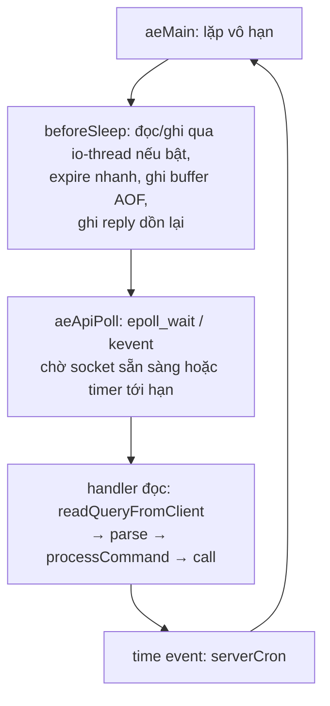
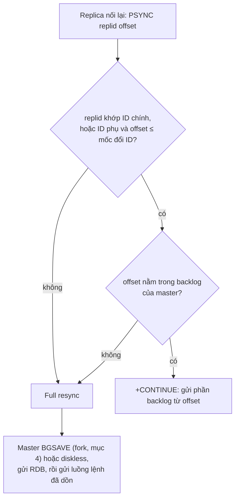

# P12 · Chương 16 — Redis bên trong: event loop, cấu trúc dữ liệu, persistence, replication, cluster

> Chương này là **case study**: nó không dạy lại khái niệm đã có ở chương khác (replication, partitioning, transaction, fencing…) mà chỉ tóm 1–3 câu rồi link, và đi sâu vào phần *chỉ Redis mới có*. Mọi khẳng định về **source code** là về **Redis 7.2.5** (tag ghim `7.2.5` trên GitHub `redis/redis`); mọi khẳng định về **tài liệu** lấy từ repo `redis/redis-doc` ghim ở commit `1044224` (đó là bản markdown của các trang redis.io tại thời điểm commit; trang redis.io hiện tại có thể đã đổi nội dung — người soạn không đối chiếu từng trang sống). Redis 8.x không được đọc source trong chương này; nơi nào hành vi là *chi tiết cài đặt của 7.2.5* thì có ghi. Không có thí nghiệm nào được chạy: mọi hành vi lấy từ source và tài liệu, không có số đo.

> Các pattern dựng trên những cơ chế này — cache + stampede, rate limiter, lock + idempotency, job queue, leaderboard, đếm, session — nằm ở [P12 · Chương 17 — Redis pattern thực chiến](17-redis-patterns.md); chương này chỉ dừng ở cơ chế bên dưới.

## Bạn sẽ hiểu được gì

- **Q1.** Vì sao Redis xử lý lệnh trong một thread mà vẫn nhanh; event loop `ae` chạy gì trên epoll/kqueue; `io-threads` và các thread nền làm gì và *không* làm gì; một lệnh O(N) ảnh hưởng ai? → mục 1
- **Q2.** Một key `string`/`list`/`hash`/`set`/`zset` thực sự nằm trong RAM dưới dạng cấu trúc nào (SDS, listpack, quicklist, intset, skiplist + dict), và ngưỡng nào trong `redis.conf` làm Redis đổi encoding? → mục 2
- **Q3.** `maxmemory` + `maxmemory-policy` hoạt động ra sao; LRU/LFU "xấp xỉ" nghĩa là gì; key hết hạn (expire) được xóa lúc nào? → mục 3
- **Q4.** RDB (fork + copy-on-write) và AOF (`appendfsync`, rewrite, mixed) làm gì; crash thì có thể mất tối đa bao nhiêu dữ liệu? → mục 4
- **Q5.** Replication của Redis: bất đồng bộ, PSYNC và replication backlog; `WAIT` có biến Redis thành CP không; Sentinel failover ra sao? → mục 5
- **Q6.** Redis Cluster thêm gì so với replication + sharding thủ công, và vì sao spec nói thẳng là không có strong consistency? → mục 6
- **Q7.** `MULTI`/`EXEC`, `WATCH`, Lua/Functions bảo đảm gì (và *không* bảo đảm gì); khi nào dùng Pub/Sub, khi nào dùng Streams + consumer group? → mục 7
- **Q8.** Ở mức cơ chế: `SET NX PX` đúng cách ra sao và vì sao nguyên tử, Redlock bị tranh luận ở đâu (hai phía), và Redis làm cache hay rate limiter dựa trên nút vặn nào của chương này? (Cách *ghép* cache, rate limiter, lock + idempotency thành pattern hoàn chỉnh nằm ở [Chương 17](17-redis-patterns.md).) → mục 8

## Kiến thức cần trước

- [P7 · Chương 02 — select, poll và epoll](../07-io-async/02-select-poll-epoll.md) và [P7 · Chương 04 — Kiến trúc event loop](../07-io-async/04-kien-truc-event-loop.md): Redis là một event loop kiểu reactor; chương này chỉ chỉ ra *nơi nó nằm trong source Redis*.
- [P10 · Chương 09 — Bên trong collection của std](../10-rust-internals/09-collections-internals.md): để so `Vec`/`VecDeque`/`HashMap`/`BTreeMap` của Rust với listpack/quicklist/dict/skiplist của Redis.
- [P1 · Chương 03 — Process](../01-linux/03-process.md) (mục `fork` và copy-on-write), [P3 · Chương 04 — Page fault](../03-memory/04-page-fault-va-swapping.md) và [P5 · Chương 06 — Durability trong thực tế](../05-storage/06-durability-trong-thuc-te.md) (`fsync`): nền cho persistence ở mục 4.
- [P12 · Chương 05 — Replication](05-replication.md), [Chương 06 — Partitioning](06-partitioning.md), [Chương 07 — Transaction](07-transaction.md), [Chương 08 — Sự cố của hệ phân tán](08-su-co-he-phan-tan.md) (lease, fencing), [Chương 11 — Stream processing](11-stream-processing.md): khái niệm chung; chương này chỉ nói cách Redis hiện thực chúng.
- [P13 · Chương 09 — Mô hình hóa hệ backend](../13-tla-plus/09-mo-hinh-hoa-he-backend.md): mục 2 (lease + fencing) và mục 4 (cache-aside và cuộc đua stale cache) được mô hình hóa ở đó bằng TLA+.
- [P12 · Chương 15 — PostgreSQL bên trong](15-postgresql-ben-trong.md): mục 1–2 (một process mỗi connection, pooler) và mục 4 (WAL, `COMMIT`) để đối chiếu với mô hình của Redis ở mục 1 và 4; cache-aside với Redis đứng trước PostgreSQL được nối ở mục 8.4 của chương này.

## 1. Một luồng, một event loop, và cái giá của lệnh chậm (Q1)

> **Trả lời ngắn.** Redis chạy mọi lệnh của mọi client trong một thread chính, lần lượt từng lệnh[^lat-seq]; thread đó là một event loop gọi `epoll_wait` (Linux)[^ae-epoll][^ae-cfg-epoll] hoặc `kevent` (macOS/BSD)[^ae-kqueue][^ae-cfg-kqueue] để biết socket nào sẵn sàng rồi xử lý[^ae-order]. Nó nhanh vì lệnh thường chỉ chạm cấu trúc dữ liệu trong RAM và (theo thiết kế) không bị chặn ở system call[^lat-nonblock], và mỗi lệnh nguyên tử vì không có lệnh nào chen vào giữa (suy luận của người soạn). Cái giá: một lệnh chậm làm mọi client khác phải chờ[^lat-slow].

**Giải thích.**

Hình dung (nhận xét của người soạn): một quầy thu ngân duy nhất, nhưng khách nào cũng chỉ mua một món đã có sẵn trên quầy — quét xong là đi. Quầy không bao giờ phải "đợi hàng về" (không block I/O), nên một người thu ngân đủ phục vụ cả hàng dài. Nhưng nếu một khách đẩy cả xe 10.000 món vào, cả hàng đứng chờ.

*Vòng lặp.* Hàm `aeMain` lặp vô hạn gọi `aeProcessEvents`[^ae-main-call]. Mỗi vòng, `aeProcessEvents` làm theo thứ tự: gọi hook `beforesleep`; gọi `aeApiPoll` — lớp bọc quanh epoll/kqueue — rồi chờ tới khi có sự kiện hoặc tới hạn timer gần nhất[^ae-poll]; chạy handler đọc/ghi cho từng fd sẵn sàng; cuối cùng chạy các *time event*[^ae-time] (ví dụ `serverCron`, được đăng ký làm một time event[^srv-cron-timer]). Lớp đa hợp (multiplexing) được chọn lúc biên dịch theo thứ tự "tốt nhất trước": evport, epoll, kqueue, select[^ae-order]. Kiến thức epoll/kqueue nằm ở [P7 · Chương 02](../07-io-async/02-select-poll-epoll.md) và [Chương 03](../07-io-async/03-kqueue-io-uring.md); vòng lặp reactor ở [P7 · Chương 04](../07-io-async/04-kien-truc-event-loop.md).



*(Sơ đồ là tổng hợp của người soạn từ các nguồn trong mục này: thứ tự vòng lặp theo `aeProcessEvents`[^ae-poll][^ae-time]; `beforeSleep` ghi AOF buffer và reply[^bs-aof-write][^net-pending-write] và có chu kỳ expire "nhanh"[^bs-expire-fast]; `readQueryFromClient` là hàm handler đọc trong `networking.c`[^net-readquery].)*

*Một lệnh đi qua đâu.* Handler đọc đọc byte từ socket vào buffer, parse, rồi `processInputBuffer` gọi `processCommandAndResetClient` → `processCommand` → `call`[^net-process][^net-proc-cmd][^srv-call]. Ở cấu hình mặc định (không bật `io-threads-do-reads`, mục dưới) cả chuỗi này chạy trên thread chính; khi bật thì chỉ phần *thực thi lệnh* luôn ở thread chính (suy luận của người soạn từ mô tả io-threads ở mục dưới). `beforeSleep` — chạy *trước* mỗi lần ngủ trong poll — gom các việc cần làm một lần mỗi vòng: ghi AOF buffer xuống file, ghi reply của các client đang chờ ghi[^bs-aof-write]. Ghi reply ngay tại đó là để khỏi tốn một system call đăng ký "writable event" rồi chờ nó nổ[^net-pending-write].

*Vì sao đủ nhanh.* Tài liệu Redis giải thích: một request được phục vụ trong khoảng thời gian rất ngắn, nhưng lý do chính là Redis (cũng như Node.js) được thiết kế để không block ở system call như đọc/ghi socket[^lat-nonblock]. Chi phí đắt nhất nằm ở I/O socket chứ không ở thao tác trên cấu trúc dữ liệu: mỗi `read()`/`write()` là một lần chuyển từ user sang kernel, "một sự phạt tốc độ rất lớn"[^pipe-ctxsw]; vì thế pipelining (gửi nhiều lệnh, đọc nhiều reply trong ít system call) cải thiện thông lượng nhiều[^pipe-batch] — theo tài liệu, số truy vấn mỗi giây ban đầu tăng gần tuyến tính theo độ dài pipeline rồi đạt khoảng 10 lần mốc không pipeline (số của tài liệu trên setup của họ; chương này không tự đo)[^pipe-10x].

*Mỗi lệnh nguyên tử.* Vì thread chính phục vụ lần lượt từng request[^lat-seq], nên (suy luận của người soạn) không có request nào của client khác xen vào giữa một lệnh. (Cũng suy luận của người soạn: đó là lý do `INCR`, `LPUSH`, `SADD`… không cần lock; còn *chuỗi* nhiều lệnh thì chỉ nguyên tử nếu dùng `MULTI`/`EXEC` hoặc script — mục 7.)

*Lệnh chậm chặn tất cả.* Tài liệu nói thẳng hệ quả: khi một request chậm, mọi client khác chờ nó; `GET`/`SET`/`LPUSH` là thời gian hằng nên không sao, nhưng các lệnh làm việc trên nhiều phần tử như `SORT`, `LREM`, `SUNION` có thể mất đáng kể; độ phức tạp của mọi lệnh đều được ghi trong tài liệu và nên kiểm tra[^lat-slow]. `KEYS` là ví dụ kinh điển: O(N) trên toàn bộ keyspace, tài liệu cảnh báo dùng "cực kỳ cẩn thận" ở production và gợi ý `SCAN` hoặc dùng set[^keys-warn]. Xóa một key khổng lồ bằng `DEL` cũng block; `UNLINK` chỉ gỡ key khỏi keyspace rồi thu hồi bộ nhớ ở thread khác[^unlink-doc] (chi tiết cài đặt 7.2.5: object nhỏ dưới một ngưỡng vẫn được giải phóng đồng bộ ngay, chỉ object đủ lớn mới đẩy sang thread nền[^lazyfree-threshold]). `SLOWLOG` ghi các lệnh vượt ngưỡng thời gian, nhưng thời gian đó *chỉ tính phần thực thi lệnh*, không tính I/O với client[^slowlog-doc].

*Vậy "đơn luồng" có thật không?* Chỉ "chủ yếu". Source 7.2.5 ghi trong `redis.conf`: Redis chủ yếu là đơn luồng, nhưng một số thao tác như `UNLINK`, I/O chậm chạy ở thread phụ[^conf-mostly]; tài liệu latency cũng nói từ 2.4 có thread nền cho I/O đĩa nhưng vẫn "phục vụ mọi request bằng một thread"[^lat-bg].

(Nhận xét của người soạn: mô hình ngược lại — một process cho mỗi connection — là của PostgreSQL, xem [P12 · Chương 15, mục 1 và 2](15-postgresql-ben-trong.md); hai hệ trả giá ở hai chỗ khác nhau: PostgreSQL ở số connection, Redis ở độ dài của lệnh chậm nhất.)

<details><summary>Đi sâu: io-threads (7.2.5), thread nền <code>bio</code>, và vì sao chúng không phá tính tuần tự</summary>

- **`io-threads`.** Ở 7.2.5 có thể đẩy việc *ghi* reply xuống socket (system call `write`) sang thread khác. `redis.conf` 7.2.5: khi bật I/O thread, mặc định chỉ dùng cho việc ghi[^conf-io-writes]; có thể bật cả đọc + parse bằng `io-threads-do-reads yes`, nhưng "thường thì thread hóa việc đọc không giúp nhiều"[^conf-io-reads]; mặc định tắt, tài liệu cấu hình gợi ý chỉ bật khi máy có ≥ 4 core[^conf-io-default] và thực sự có vấn đề hiệu năng[^conf-io-problems] (nhận xét: đừng bật vì "nghe nói nhanh hơn").
- **Lệnh vẫn chạy trên thread chính.** Khi đọc được thread hóa, handler đọc chỉ xếp client vào hàng đợi; các I/O thread (thread chính cũng nhận một lát danh sách client[^net-main-slice]) đọc và parse *lệnh đầu tiên* vào cấu trúc client[^net-reads-queue]. Sau đó thread chính chờ mọi I/O thread xong (fan-in) rồi mới gọi `processPendingCommandAndInputBuffer` để thực thi từng lệnh[^net-fanin]. Mô hình "fan-out → fan-in" này giữ nguyên tính tuần tự của việc *thực thi*; chỉ I/O socket và parse được song song (đọc từ code 7.2.5; chương này không đọc source Redis 8 nên không nói gì về cách bản đó cài I/O threading).
- **Thread nền (`bio`).** `bio.c` có các worker riêng cho việc đóng file, `fsync` AOF và lazy free[^bio-workers]; mỗi loại job giao cho một worker cụ thể, job cùng worker chạy theo thứ tự từ cũ tới mới[^bio-design]. `lazyfree-lazy-eviction`, `lazyfree-lazy-expire`, `lazyfree-lazy-server-del` đều mặc định `no` trong `redis.conf` 7.2.5[^conf-lazyfree-default] (nghĩa là mặc định eviction/expire xóa key theo kiểu block như `DEL`[^conf-lazyfree-del]; xem mục 3).
- **Tiến trình con.** RDB và AOF rewrite dùng `fork` — một *process* khác, không phải thread; xem mục 4.
- **Event loop vẫn xử lý được khi đang bận.** `beforeSleep` có nhánh riêng khi vòng lặp được vào lại từ `processEventsWhileBlocked()` (để trả lỗi `-LOADING` khi đang nạp dữ liệu[^net-while-blocked], hoặc khi một script chạy quá lâu[^net-script-timeout]), chỉ chạy một tập con việc thiết yếu[^bs-while-blocked].

</details>

**Quay lại Q1:** một thread chính chạy event loop trên epoll/kqueue, thực thi từng lệnh một nên mỗi lệnh nguyên tử và không có lock giữa các lệnh; nhanh vì lệnh nhỏ, dữ liệu trong RAM, I/O không block — và đổi lại, mọi lệnh O(N) chặn toàn bộ instance (`io-threads` chỉ song song hóa I/O socket, không song song hóa việc thực thi lệnh).

## 2. Giá trị trong RAM: encoding theo kích thước (Q2)

> **Trả lời ngắn.** Mỗi key trỏ tới một `redisObject` mang *kiểu* (`string`, `list`…) và *encoding* (cách biểu diễn bên trong)[^obj-struct]. Với dữ liệu nhỏ, Redis dùng biểu diễn gọn trong một khối nhớ liền (`listpack`, `intset`, string nhúng); khi số phần tử hoặc kích thước phần tử vượt ngưỡng cấu hình trong `redis.conf`, nó tự đổi sang cấu trúc "thật" (hash table, `quicklist`, skiplist)[^memopt-convert]. Người dùng không thấy sự khác biệt qua API[^memopt-transparent], chỉ thấy trong bộ nhớ và độ trễ (nhận xét của người soạn).

**Giải thích.**

Hình dung (nhận xét của người soạn): hồ sơ vài tờ thì kẹp vào một cặp file mỏng, tìm bằng cách lật từ đầu — rẻ, nhanh vì ít; hồ sơ hàng nghìn tờ thì phải dựng tủ hồ sơ có chỉ mục. Redis đổi "cặp file" sang "tủ" ngay khi dữ liệu vượt ngưỡng, vì lật tuần tự thì O(N) còn chỉ mục thì tốn thêm bộ nhớ.

*Khung chung.* Header của `redisObject` có `type` (4 bit), `encoding` (4 bit), 24 bit cho dữ liệu LRU/LFU (mục 3), `refcount` và con trỏ `ptr` tới dữ liệu thật[^obj-struct]. Keyspace — ánh xạ `key → redisObject` — là một hash table `dict`: dùng chaining (mỗi entry có con trỏ `next` tới entry cùng bucket)[^dict-next], và *rehash tăng dần*: mỗi "bước" chuyển một bucket từ bảng cũ sang bảng mới, và số bucket rỗng bị duyệt qua mỗi bước bị chặn để thời gian không vô hạn[^dict-rehash]. `redis.conf` nói rõ hệ quả: càng nhiều thao tác chạy trên bảng đang rehash thì càng nhiều "bước" được thực hiện, nên khi server rảnh thì rehash không bao giờ xong và tốn thêm chút bộ nhớ[^conf-lazyrehash]; vì thế có `activerehashing`, dành 1 ms mỗi 100 ms CPU để giúp rehash bảng keyspace chính[^conf-activerehash]. (So với `HashMap` của Rust — cách bảng tăng trưởng nằm ở mục 4 của [P10 · Chương 09](../10-rust-internals/09-collections-internals.md): Redis chọn chia nhỏ việc chuyển bảng để không chặn event loop lâu; đây là suy luận của người soạn từ comment giới hạn công việc mỗi bước.)

*Bảng encoding (7.2.5).*

| Kiểu | Biểu diễn gọn | Biểu diễn "thật" | Ngưỡng mặc định (`redis.conf`) |
|---|---|---|---|
| string | `int` (số nguyên 64-bit có dấu)[^objenc-int], `embstr` (≤ 44 byte, nhúng cùng object) | `raw` (SDS riêng) | giới hạn 44 byte cố định trong source[^obj-embstr] |
| list | `listpack` (một khối) | `quicklist` (danh sách liên kết đôi các listpack)[^ql-def] | `list-max-listpack-size -2` (nút tối đa 8 KB)[^conf-list] |
| hash | `listpack` | hash table `dict`[^objenc-hash] | `hash-max-listpack-entries 512`, `hash-max-listpack-value 64`[^conf-hash] |
| set | `intset` (toàn số nguyên) → `listpack`[^objenc-set] | hash table | `set-max-intset-entries 512`[^conf-set]; `set-max-listpack-entries 128`, `set-max-listpack-value 64`[^conf-set-lp] |
| sorted set | `listpack` | `skiplist` + `dict`[^objenc-zset] | `zset-max-listpack-entries 128`, `zset-max-listpack-value 64`[^conf-zset] |
| stream | — | radix tree các listpack[^enc-stream] | `stream-node-max-bytes 4096`, `stream-node-max-entries 100`[^conf-stream] |

Giá trị trong bảng là mặc định ghi trong `redis.conf` 7.2.5; mọi thứ chỉnh được. Encoding `listpack` cho `set` chỉ có từ Redis 7.2[^objenc-set72]; với list/hash/sorted set thì `listpack` thay `ziplist` từ Redis 7.0 (tài liệu ghi `ziplist` dùng cho Redis ≤ 6.2)[^objenc-ziplist][^objenc-lp70]. Lệnh `OBJECT ENCODING` cho biết encoding hiện tại của một key[^objenc-doc].

*String và SDS.* Chuỗi của Redis là *SDS* (simple dynamic string): một con trỏ `char*` trỏ vào buffer, nằm ngay sau một header nhỏ lưu độ dài đã dùng (`len`) và độ dài đã cấp (`alloc`, không tính header và byte null cuối)[^sds-hdr]. Độ dài nằm sẵn trong header nên có thể lấy O(1) và string chứa được byte bất kỳ kể cả `\0` (binary safe) — cả hai là suy luận của người soạn từ cấu trúc header, không phải khẳng định của nguồn. Header có nhiều cỡ (`sdshdr8/16/32/64`) để chuỗi ngắn không phải trả hai trường 8 byte `len`/`alloc` của cỡ lớn nhất[^sds-hdr][^sds-hdr64] (suy luận của người soạn từ việc các trường `len`/`alloc` có kiểu `uint8_t`…`uint64_t`). Chuỗi ≤ 44 byte dùng `embstr`: object và SDS nằm trong *một* lần cấp phát; 44 được chọn để object lớn nhất vẫn vừa một "arena" 64 byte của jemalloc[^obj-embstr].

*List: quicklist.* List nhỏ nằm trong một `listpack`. Khi vượt `list-max-listpack-size`, thành `quicklist` — danh sách liên kết đôi mà mỗi nút là một listpack[^ql-def]; tham số âm `-1…-5` là giới hạn byte mỗi nút (4 KB…64 KB), tham số dương là số phần tử tối đa mỗi nút[^conf-list]. Có thể nén các nút giữa (`list-compress-depth`), đầu và đuôi luôn không nén để push/pop nhanh[^conf-compress]. Có một chi tiết hay: khi list *co lại*, Redis chỉ đổi ngược quicklist → listpack nếu kích thước/độ dài xuống dưới *một nửa* giới hạn, để tránh đổi qua đổi lại liên tục khi thêm/xóa[^list-shrink], và chỉ khi quicklist chỉ còn đúng một nút[^ql-one-node] (đây là hysteresis — "độ trễ" trong ngưỡng đổi).

*Set: intset.* Set toàn số nguyên (biểu diễn thập phân trong miền int64) và không vượt quá `set-max-intset-entries` phần tử dùng `intset`[^conf-set-intset]; set chuỗi nhỏ dùng listpack (từ 7.2); còn lại là hash table.

*Sorted set: skiplist + dict.* Sorted set lớn giữ *cùng các phần tử trong hai cấu trúc*: hash table ánh xạ phần tử → score[^zset-map] (suy luận của người soạn: nên tra điểm O(1)) và skiplist sắp theo score (để đạt O(log N) khi chèn/xóa)[^zset-dual]; chuỗi SDS của phần tử được dùng chung giữa hai cấu trúc để tiết kiệm bộ nhớ[^zset-sharedsds]. Skiplist của Redis là bản dịch gần như nguyên văn thuật toán của William Pugh, sửa ba điểm: cho phép score trùng, so sánh theo cả dữ liệu đi kèm, và có con trỏ `backward` ở tầng 1 để duyệt ngược cho `ZREVRANGE`[^zset-pugh]. Số tầng tối đa là 32 "đủ cho 2^64 phần tử"[^zset-maxlevel]. Mỗi tầng của một node có `forward` và `span`[^zskiplist-node]; `span` là số node mà liên kết `forward` bỏ qua và là thứ cho phép tính *rank* (`ZRANK`) mà không duyệt hết (cả hai là suy luận của người soạn từ cách `zslInsert`/`zslGetRank` dùng trường này). Tài liệu sorted set mô tả đúng cấu trúc "hai cổng" này và nói mỗi lần thêm phần tử Redis làm một thao tác O(log N)[^zset-doc].

(Cách dùng sorted set làm bảng xếp hạng — tie-break, phân trang, vòng đời bảng — ở [Chương 17, mục 5](17-redis-patterns.md).)

(Nhận xét của người soạn, liên hệ P10·09: skiplist đóng vai trò mà `BTreeMap` đóng trong Rust — khóa có thứ tự, range query — nhưng chọn cấu trúc xác suất vì cài đặt đơn giản và range/rank rẻ; còn listpack ứng với một `Vec` các phần tử tuần tự mà bạn quét tuyến tính, thắng nhờ locality khi N nhỏ.)

<details><summary>Đi sâu: listpack, hysteresis, và khi bạn đổi ngưỡng</summary>

- `listpack.c` mở đầu bằng "Listpack — một định dạng tuần tự hóa danh sách chuỗi", với đặc tả ở repo `antirez/listpack`[^lp-head]; nó thay `ziplist` (encoding `ziplist` đã bị đánh dấu "không còn dùng" trong enum, còn `OBJ_ENCODING_LISTPACK` là encoding mới)[^enc-enum]. Chương này không đi vào định dạng byte vì không đọc đặc tả đó.
- Tài liệu memory optimization: các kiểu nhỏ dùng encoding đặc biệt tốn "tới 10 lần ít bộ nhớ hơn" (trung bình tiết kiệm 5 lần)[^memopt-10x]; đó là *lời tài liệu*, không phải số đo của chương này. Đổi CPU lấy bộ nhớ: nếu bạn nâng ngưỡng để dùng encoding gọn cho aggregate lớn hơn nhiều, tài liệu khuyên benchmark thời gian chuyển đổi[^memopt-bench].
- `dict` còn có một ràng buộc liên quan fork: khi có tiến trình con đang lưu RDB/AOF, Redis tạm tắt/hạn chế resize hash table vì "dùng copy-on-write và không muốn di chuyển nhiều bộ nhớ khi có child đang lưu"[^dict-cow]; `updateDictResizePolicy` đặt `DICT_RESIZE_AVOID` khi có child và `DICT_RESIZE_FORBID` trong chính child[^srv-resize-policy]; ở chế độ `AVOID` bảng vẫn được nở nếu tỉ lệ phần tử/bucket vượt một ngưỡng[^dict-avoid-ratio] (xem mục 4).

</details>

**Quay lại Q2:** key nhỏ nằm trong khối nhớ liền (listpack/intset/embstr) để tiết kiệm RAM, vượt ngưỡng `*-max-*` thì Redis tự đổi sang hash table/quicklist/skiplist+dict; sorted set lớn giữ cùng phần tử ở hai cấu trúc để có cả tra điểm O(1) lẫn thứ tự O(log N).

## 3. Bộ nhớ, eviction và expire (Q3)

> **Trả lời ngắn.** `maxmemory` đặt trần dữ liệu (mặc định `0` = không giới hạn trên hệ 64-bit)[^evict-max0]; chạm trần thì `maxmemory-policy` quyết định: mặc định `noeviction` từ chối lệnh ghi[^conf-policy-default][^conf-noevict], còn các policy LRU/LFU/random/TTL xóa bớt key[^evict-policies][^evict-policies-ttl]. LRU/LFU của Redis là *xấp xỉ* — lấy mẫu vài key rồi xóa key tệ nhất trong mẫu, không giữ danh sách LRU chính xác[^evict-approx]. Key hết hạn bị xóa theo hai đường: xóa lười khi có người truy cập, và quét chủ động theo chu kỳ[^expire-two].

**Giải thích.**

Hình dung (nhận xét của người soạn): kho lạnh sắp đầy. Cách "đúng" là giữ sổ ghi từng món lần cuối ai lấy — tốn giấy mực và tốn thời gian ghi. Redis thay bằng: mỗi lần cần chỗ, bốc ngẫu nhiên vài món, vứt món để lâu nhất trong nhóm đó. Không hoàn hảo, nhưng gần đúng mà gần như không tốn thêm bộ nhớ.

*Eviction chạy ở đâu và lúc nào.* Ngay trong `processCommand` — tức là trên thread chính, *trước khi chạy lệnh*: nếu `maxmemory` bật thì gọi `performEvictions()`[^srv-evict-call]; nếu không xóa đủ chỗ và lệnh thuộc loại "deny OOM" (lệnh có thể ăn thêm bộ nhớ) thì trả lỗi OOM[^srv-oom-reject]. Tài liệu mô tả đúng vòng đó: client chạy lệnh làm thêm dữ liệu → Redis kiểm tra bộ nhớ, nếu vượt trần thì xóa theo policy → lệnh kế tiếp; vì vậy Redis liên tục *vượt qua rồi quay lại dưới trần*[^evict-loop], và một lệnh tạo nhiều dữ liệu (như giao hai set lớn rồi lưu) có thể làm vượt trần đáng kể trong một lúc[^evict-overshoot]. (Nhận xét của người soạn: `maxmemory` là mục tiêu mềm, không phải tường cứng — chừa headroom cho child fork, buffer client, v.v.)

*Bộ nhớ nào không tính vào `maxmemory`.* `redis.conf` nói: khi có replica, kích thước output buffer dùng để nuôi replica *bị trừ khỏi* số bộ nhớ đã dùng, để mất kết nối/resync không kích hoạt vòng lặp "xóa key → sinh `DEL` đẩy vào buffer replica → buffer đầy → xóa thêm key…" làm trống cả database; vì thế nên đặt `maxmemory` thấp hơn RAM để chừa chỗ cho buffer replica[^conf-repl-buf].

*Các policy.* Có `noeviction`, `allkeys-lru/lfu/random`, `volatile-lru/lfu/random`, `volatile-ttl`[^evict-policies][^evict-policies-ttl]; nhóm `volatile-*` chỉ xét key có expire và *hành xử như `noeviction`* nếu không có key nào đủ điều kiện[^evict-policies-fallback]. Quy tắc ngón tay cái của tài liệu: `allkeys-lru` khi phân bố độ phổ biến theo power-law (và là lựa chọn tốt nếu chưa chắc)[^evict-rule-lru]; `allkeys-random` khi truy cập quay vòng hoặc đồng đều[^evict-rule-random]; `volatile-ttl` khi muốn gợi ý ứng viên bằng TTL[^evict-rule-ttl]. `volatile-lru`/`volatile-random` hợp khi một instance vừa làm cache vừa giữ key bền, nhưng tài liệu nói thường nên chạy hai instance riêng[^evict-volatile].

*LRU xấp xỉ.* Mỗi object có 24 bit `lru` lưu "đồng hồ" truy cập[^obj-struct], độ phân giải 1 giây[^srv-lru-res]. Mỗi lần tra key, Redis cập nhật `lru`/LFU — *trừ khi đang có tiến trình con lưu RDB/AOF*, vì cập nhật sẽ gây "điên cuồng copy-on-write"[^db-lru-cow] (đây là mối nối trực tiếp giữa eviction và persistence). Khi cần xóa, `evictionPoolPopulate` lấy mẫu `maxmemory-samples` key (mặc định 5)[^evict-samples-doc][^conf-samples] rồi đưa vào một *pool* ứng viên cỡ `EVPOOL_SIZE = 16`[^evict-poolsize], giữ lại những key "tệ nhất" qua các lần gọi; chọn ứng viên tốt nhất trong pool để xóa[^evict-pool]. Tài liệu: nâng mẫu lên 10 thì xấp xỉ gần LRU thật hơn, tốn thêm CPU[^evict-samples10]; với truy cập power-law, chênh lệch giữa LRU thật và xấp xỉ là nhỏ hoặc không có (theo mô phỏng của chính tài liệu)[^evict-powerlaw].

*LFU.* Từ Redis 4.0 có LFU: đếm *tần suất* truy cập bằng bộ đếm xác suất Morris chỉ vài bit mỗi object, có chu kỳ suy giảm (decay) để key từng nóng nhưng nguội đi sẽ bị đẩy ra[^evict-lfu]. Mặc định: bộ đếm bão hòa quanh một triệu request, suy giảm mỗi phút[^evict-lfu-default]; tham số `lfu-log-factor 10`, `lfu-decay-time 1`[^evict-lfu-params]. Trong source, `LFULogIncr` tăng bộ đếm theo xác suất càng thấp khi giá trị càng cao và chặn ở 255[^evict-lfu-incr]; 8 bit thấp của trường `lru` là tần suất và 16 bit cao là thời điểm truy cập[^obj-struct] (tính theo phút[^evict-lfu-minutes]).

*Expire: lazy + active.* Một key bị xóa *thụ động* khi có client truy cập và thấy nó quá hạn[^expire-two]. Chưa đủ vì key không ai truy cập sẽ nằm mãi, nên Redis còn quét *chủ động*. Theo mô tả của tài liệu EXPIRE: 10 lần mỗi giây, lấy 20 key ngẫu nhiên trong tập key có expire, xóa key quá hạn, và nếu hơn 25% số mẫu quá hạn thì lặp lại[^expire-active]. Tài liệu suy ra: số key đã quá hạn nhưng còn chiếm bộ nhớ tối đa vào cỡ (số thao tác ghi mỗi giây)/4[^expire-active-bound]. (Nhận xét của người soạn: con số 25% là của tài liệu; trong source 7.2.5 ngưỡng "chấp nhận được" để cố thêm là hằng `ACTIVE_EXPIRE_CYCLE_ACCEPTABLE_STALE` = 10 (%)[^expire-stale-src], và ngưỡng này phụ thuộc `active_expire_effort` được cấu hình[^expire-stale-effort].) Trong source, chu kỳ chậm bị giới hạn ~25% CPU (`ACTIVE_EXPIRE_CYCLE_SLOW_TIME_PERC 25`)[^expire-cpu]; `beforeSleep` còn chạy thêm một chu kỳ "nhanh" nếu cần — chỉ trên master[^bs-expire-fast].

*Expire và replication.* Replica không tự xóa key hết hạn: master tổng hợp lệnh `DEL` đẩy vào AOF và tới mọi replica để việc hết hạn tập trung ở master và không sinh bất nhất[^expire-repl]. Trong source, `expireIfNeeded` trên replica chỉ *báo* key đã quá hạn chứ không xóa — việc xóa do `DEL` từ master gửi tới (ngoại lệ trong comment: khi có lệnh ghi trên replica ghi được)[^db-expire-replica]. Nhưng replica vẫn giữ trạng thái expire nên khi được bầu làm master thì tự hết hạn key được[^expire-repl-promote].

<details><summary>Đi sâu: xóa key lớn, <code>lazyfree</code>, tenacity, và key hết hạn "trôi" trong RAM</summary>

- **Xóa đồng bộ là mặc định.** Các tùy chọn `lazyfree-lazy-eviction`, `lazyfree-lazy-expire`, `lazyfree-lazy-server-del`, `lazyfree-lazy-user-del` đều mặc định `no`[^conf-lazyfree-userdel]; mặc định là xóa kiểu block như `DEL`[^conf-lazyfree-del]. Nghĩa là mặc định eviction và expire của một key khổng lồ (list hàng triệu phần tử) giải phóng bộ nhớ ngay trên thread chính (suy luận của người soạn từ cấu hình; `evict.c` truyền `server.lazyfree_lazy_eviction` vào `dbGenericDelete`[^evict-del-lazy]).
- **`maxmemory-eviction-tenacity`** (mặc định 10; 0 = độ trễ tối thiểu, 100 = xử lý bất chấp độ trễ) điều chỉnh mức Redis chịu trễ để theo kịp tốc độ ghi[^conf-tenacity] (suy luận của người soạn: tức eviction không phải lúc nào cũng chạy hết một mạch).
- **Mức "effort" của expire chủ động.** Giới hạn "(số ghi mỗi giây)/4" ở trên là *ước lượng của tài liệu*, không phải bảo đảm cứng. Source có tham số `active_expire_effort` (mặc định 1, tối đa 10) để điều chỉnh các thông số của chu kỳ quét[^expire-effort]; việc nó nâng số mẫu mỗi vòng và hạ ngưỡng chấp nhận key quá hạn là suy luận của người soạn từ cách tính `config_keys_per_loop`/`config_cycle_acceptable_stale` trong `activeExpireCycle`.
- **Pause và expire.** Nếu hành động `expire` đang bị tạm dừng (pause), `activeExpireCycle` thoát ngay; comment giải thích: hết pause thì key sẽ được xóa đúng, hoặc đã failover và primary mới sẽ gửi lệnh xóa tới[^expire-pause].

</details>

**Quay lại Q3:** `maxmemory` + policy là cơ chế *trước mỗi lệnh* trên thread chính; LRU/LFU lấy mẫu vài key thay vì giữ sổ chính xác (rẻ, gần đúng); expire = xóa lười khi chạm vào + quét chủ động xác suất, và replica chờ `DEL` từ master chứ không tự xóa.

## 4. Persistence: RDB, AOF và "crash thì mất bao nhiêu" (Q4)

> **Trả lời ngắn.** RDB là ảnh chụp (snapshot) toàn bộ dữ liệu do một *tiến trình con* ghi sau `fork` nhờ copy-on-write[^pers-rdb-def][^pers-rdb-fork][^pers-fork-cow]; AOF là nhật ký mọi lệnh ghi, được `fsync` theo `appendfsync` (`always`/`everysec`/`no`)[^pers-aof-def][^pers-aof-policies]. Mất bao nhiêu khi crash tùy cấu hình: chỉ RDB thì có thể mất vài phút gần nhất[^pers-rdb-lose]; AOF `everysec` thì tài liệu nói khoảng 1 giây[^aof-everysec]; `always` thì `fsync` trước khi trả lời client[^aof-always]. Đó mới là một node — replication bất đồng bộ (mục 5) thêm một cửa sổ mất dữ liệu nữa.

**Giải thích.**

Hình dung (nhận xét của người soạn): RDB là chụp ảnh cả kho hàng mỗi ngày — khôi phục nhanh nhưng mất hết biến động từ lúc chụp. AOF là cuốn sổ ghi từng phiếu xuất/nhập — gần như không mất gì, nhưng sổ cứ dày lên nên thỉnh thoảng phải chép lại gọn (rewrite).

*RDB — snapshot bằng `fork`.* Mặc định `redis.conf` 7.2.5 lưu snapshot nếu ≥ 1 thay đổi sau 3600 giây, ≥ 100 thay đổi sau 300 giây, hoặc ≥ 10000 thay đổi sau 60 giây[^conf-save-default]. Khi tới lúc, `rdbSaveBackground` gọi `redisFork`; con ghi dữ liệu ra file tạm rồi thay file cũ[^rdb-src-fork][^pers-rdb-fork]. Process cha chỉ làm đúng một việc: `fork` — tài liệu nói cha không bao giờ làm disk I/O ở đây[^pers-rdb-parent]. Con ghi vào file tạm `temp-<pid>.rdb`, `fflush` + `fsync` cho chắc dữ liệu không còn nằm trong buffer của OS[^rdb-src-fsync], rồi `rename` để file đích chỉ bị thay *nguyên tử* khi file mới đã đúng[^rdb-src-rename], rồi `fsync` cả thư mục chứa[^rdb-src-dirsync]. Đó đúng là mẫu "tạo tạm → fsync → rename → fsync thư mục" của [P5 · Chương 06, mục 4](../05-storage/06-durability-trong-thuc-te.md).

*Vì sao `fork` đủ rẻ để snapshot một dataset hàng chục GB.* Sau `fork`, cha và con dùng chung các trang bộ nhớ; chỉ khi một bên *ghi* vào trang thì kernel mới sao chép trang đó (copy-on-write, COW; cơ chế ở [P1 · Chương 03, mục 3.2](../01-linux/03-process.md) và page fault ở [P3 · Chương 04](../03-memory/04-page-fault-va-swapping.md)). Tài liệu persistence nói đúng ý đó: phương pháp này cho phép Redis hưởng lợi từ copy-on-write[^pers-fork-cow]. Hệ quả cần nhớ: con thấy *đúng* dữ liệu tại thời điểm `fork`, còn cha tiếp tục nhận ghi — mỗi trang cha sửa trong lúc con còn chạy sẽ tốn thêm một trang RAM (suy luận của người soạn từ cơ chế COW). Redis có `INFO` báo lượng bộ nhớ COW của con đang chạy (`current_cow_size`, `current_cow_peak`)[^info-cow].

*Chi phí của `fork`, và những chỗ Redis né COW.*

- Bản thân `fork` chạy trên thread chính và có thể gây trễ: nó phải sao chép page table; tài liệu tính ví dụ một instance 24 GB trên Linux/AMD64 (trang 4 KB) cần page table cỡ 24 GB / 4 KB × 8 = 48 MB phải cấp phát và sao chép[^lat-fork-pt][^lat-fork-main].
- Transparent Huge Pages (THP) làm COW tệ đi: sau `fork` hai process dùng chung các trang lớn; chỉ vài vòng event loop có thể chạm vài nghìn trang và buộc sao chép gần như toàn bộ bộ nhớ process, dẫn tới trễ lớn và tốn RAM; tài liệu bảo tắt THP[^lat-thp]. Source 7.2.5 có kiểm tra lúc khởi động với cùng lý do (chỉ Linux; cảnh báo khi THP đang ở chế độ `always`)[^sys-thp].
- `vm.overcommit_memory`: khi overcommit bị tắt, Linux có thể giết con của background save nếu không đủ RAM trống cho *gấp đôi* bộ nhớ đang dùng, dù con dùng COW[^sys-overcommit] (overcommit: [P3 · Chương 05, mục 5](../03-memory/05-bo-nho-tien-trinh-linux.md); OOM killer: [P3 · Chương 04, mục 5](../03-memory/04-page-fault-va-swapping.md)).
- Redis tự tránh làm bẩn trang khi có con đang chạy: không cập nhật trường LRU/LFU của object khi có child lưu (nếu không sẽ gây "copy on write madness")[^db-lru-cow], và hạn chế/cấm resize hash table `dict`[^dict-cow] (mục 2–3).

*AOF — nhật ký lệnh.* `appendonly` mặc định là `no` trong `redis.conf` 7.2.5[^conf-appendonly]. Khi bật, mỗi lệnh làm đổi dữ liệu được nối vào buffer AOF; `beforeSleep` (mục 1) gọi `flushAppendOnlyFile` để `write(2)` buffer xuống file *trước khi* ghi reply cho client[^bs-aof-write]; sau `write`, `fsync` chạy theo chính sách:

| `appendfsync` | Hành vi | Lời tài liệu |
|---|---|---|
| `always` | `fsync` sau mỗi lần ghi buffer; gom các lệnh của nhiều client/pipeline trong một vòng thành một `write` + một `fsync` *trước khi trả lời*[^aof-always] | rất chậm, rất an toàn[^aof-always] |
| `everysec` (mặc định[^aof-default-everysec]) | `fsync` mỗi giây, bằng thread nền[^aof-everysec-thread] | "có thể mất 1 giây dữ liệu nếu có thảm họa"[^aof-everysec] |
| `no` | không `fsync`; để OS xả | Linux thường xả sau ~30 giây nhưng tùy tinh chỉnh kernel[^aof-no] |

Với `always`, Redis không để cùng một fd vừa được đọc vừa được ghi trong cùng một vòng event loop (*write barrier*) để `beforeSleep` kịp `fsync` giữa lúc nhận lệnh và trả lời[^aof-barrier]. Trên Linux, `redis_fsync` được định nghĩa là `fdatasync()` để khỏi xả metadata[^aof-fdatasync] (khác biệt `fsync`/`fdatasync`: [P5 · Chương 06, mục 2](../05-storage/06-durability-trong-thuc-te.md)). Nếu `write`/`fsync` lỗi ở chế độ `always`, Redis *thoát* thay vì tiếp tục — vì reply đã nằm trong output buffer và thay đổi không thể rollback, trong khi đã hứa với user là ghi đã báo xong thì đã nằm trên đĩa[^aof-always-exit] (so với "fsyncgate" ở [P5 · Chương 06, mục 5](../05-storage/06-durability-trong-thuc-te.md)).

*Rewrite: giữ AOF không phình mãi.* Tăng một counter 100 lần thì dataset chỉ có một key giữ giá trị cuối nhưng AOF có 100 dòng[^pers-aof-incr] — rewrite sinh ra dãy lệnh ngắn nhất tái tạo dataset hiện tại, trong nền[^pers-aof-rewrite-why]. Từ 7.0, AOF là *multi part*: một file *base* (tối đa một, dạng RDB hoặc AOF[^conf-aof-preamble]) cộng các file *incremental*[^aof-multipart], có file manifest theo dõi[^aof-manifest]. Khi rewrite, cha mở ngay một file incremental mới để tiếp tục ghi, con sinh base mới; xong thì Redis đổi manifest tạm thành manifest chính một cách nguyên tử[^aof-rewrite-7][^aof-rewrite-swap]. Tự động kích hoạt khi AOF lớn hơn 100% so với kích thước sau lần rewrite trước và ≥ 64 MB (mặc định)[^conf-aof-rewrite-auto]. Base mặc định ở dạng RDB (`aof-use-rdb-preamble yes`; `redis.conf` nói định dạng RDB luôn nhanh và hiệu quả hơn)[^conf-aof-preamble], còn các file incremental chứa các thay đổi lệnh từ lần tạo base gần nhất[^aof-manifest].

*Khởi động lại.* Nếu AOF bật, Redis nạp AOF vì đó là file có bảo đảm bền hơn[^conf-aof-load-pref]. AOF có thể bị cụt ở cuối khi máy/OS crash lúc đang ghi hoặc đĩa đầy[^pers-aof-trunc-cause] (`redis.conf` nói rõ điều này không xảy ra khi chỉ riêng tiến trình Redis crash mà OS vẫn chạy đúng[^conf-aof-trunc-ossafe]); mặc định Redis nạp phần hợp lệ rồi chạy tiếp (`aof-load-truncated yes`)[^conf-aof-trunc-default]; còn AOF hỏng *giữa* file thì Redis thoát với lỗi[^conf-aof-trunc]; công cụ `redis-check-aof` nên chạy trước, không kèm tùy chọn sửa, để hiểu vấn đề[^pers-aof-trunc-tool]; chế độ sửa có thể bỏ toàn bộ phần AOF từ chỗ hỏng đến cuối file[^pers-aof-fix-discard].

*Mất bao nhiêu khi crash?* Bảng dưới đây gộp lời tài liệu và source; "process crash" là Redis chết nhưng OS còn sống (ví dụ `kill -9`), "mất điện/OS crash" là cả máy dừng.

| Cấu hình | Process crash | Mất điện / OS crash |
|---|---|---|
| Chỉ RDB | mất mọi thứ từ snapshot cuối — "chuẩn bị mất vài phút gần nhất"[^pers-rdb-lose] | như bên trái |
| AOF `no` | không có bảo đảm riêng của Redis về `fsync`; dữ liệu đã `write(2)` thuộc về OS (suy luận của người soạn) | tùy OS; Linux ~30 giây[^aof-no] |
| AOF `everysec` | `redis.conf`: "một lệnh ghi" nếu lỗi nằm ở process Redis nhưng OS vẫn chạy đúng[^conf-aof-loss] | tối đa ~1 giây theo `redis.conf` và tài liệu[^conf-aof-loss][^aof-everysec-thread] |
| AOF `always` | ghi đã được trả lời thì đã `fsync`[^aof-always] | như bên trái, *với điều kiện đĩa thật sự bền* (cache ghi của đĩa: [P5 · Chương 06, mục 7](../05-storage/06-durability-trong-thuc-te.md)) |

Có hai ngoại lệ quan trọng mà bảng "mất ~1 giây" không nói: (1) khi `fsync` nền của `everysec` còn đang chạy, Redis *trì hoãn* `write(2)` tối đa khoảng hai giây (vì `write` trên Linux có thể bị block khi đang `fsync` cùng file), rồi vẫn ghi dù `fsync` chưa xong[^lat-everysec-postpone][^aof-postpone]; từ source đó suy ra (suy luận của người soạn) cửa sổ mất dữ liệu khi *process* crash lúc đang trì hoãn có thể dài hơn "một lệnh". (2) `no-appendfsync-on-rewrite yes` (mặc định `no`[^conf-norewrite-default]) tắt `fsync` ở main process khi có child đang lưu: lúc đó độ bền *bằng* `appendfsync no`, tức có thể mất tới 30 giây log trong trường hợp xấu nhất với cấu hình Linux mặc định[^conf-aof-norewrite-fsync].

<details><summary>Đi sâu: nên dùng RDB hay AOF; <code>WAITAOF</code>; lỗi <code>bgsave</code>; mã nguồn <code>flushAppendOnlyFile</code></summary>

- **Khuyến nghị của tài liệu.** Nếu muốn mức an toàn dữ liệu "tương đương PostgreSQL" thì dùng cả hai[^pers-both]; tài liệu không khuyến khích AOF-only vì snapshot RDB hữu ích để backup, restart nhanh và đề phòng bug của engine AOF[^pers-aof-only]. (Nhận xét của người soạn: "tương đương PostgreSQL" là phát biểu của tài liệu về *ý định*; chương này không có nguồn để kiểm chứng ngang hàng — nên coi `appendfsync everysec` + replication là rủi ro mất dữ liệu có chủ ý.)
- **`WAITAOF` (7.2).** Chặn client tới khi các lệnh ghi *của client đó* được báo là đã `fsync` vào AOF của local và/hoặc tối thiểu số replica chỉ định[^waitaof-doc]. Đây là cách *hỏi* độ bền mà không phải chuyển cả instance sang `always` (nhận xét của người soạn).
- **`stop-writes-on-bgsave-error`.** Mặc định, nếu có ít nhất một save point và lần background save gần nhất lỗi thì Redis ngừng nhận lệnh ghi — để người vận hành biết "một cách cứng rắn" rằng dữ liệu không xuống đĩa[^conf-stop-writes].
- **`flushAppendOnlyFile` trong source.** Nếu buffer rỗng, hàm vẫn có nhánh `fsync` lúc `everysec` để dữ liệu đã nằm trong page cache được xả đúng hạn dù người dùng ngừng ghi[^aof-flush-empty]. Mọi flush là một lệnh `write` duy nhất; comment trong source nói thao tác này *nên* nguyên tử ít nhất nếu filesystem là filesystem vật lý thật — nhằm chống trường hợp server bị kill, còn cả máy dừng vì mất điện thì comment thừa nhận không làm gì thêm được[^aof-single-write]; `ftruncate` bỏ ghi dở khi short write[^aof-short-write].
- **Replica không persistence + auto restart.** Master tắt persistence và tự khởi động lại sẽ lên với dataset rỗng; replica đồng bộ từ nó sẽ tự xóa dữ liệu — tài liệu mô tả đúng kịch bản này[^repl-nopersist-wipe].

</details>

**Quay lại Q4:** RDB = snapshot do con `fork` ghi nhờ COW (nhanh khi restart, mất tới vài phút); AOF = log theo `appendfsync` (`always` không mất lệnh đã trả lời nếu đĩa bền, `everysec` ≈ 1 giây nhưng có ngoại lệ trì hoãn ~2 giây, `no` tùy OS); AOF rewrite + base dạng RDB giữ log gọn; và con `fork` luôn đi kèm chi phí page table và COW.

## 5. Replication: bất đồng bộ, PSYNC, backlog, `WAIT` và Sentinel (Q5)

> **Trả lời ngắn.** Replication của Redis mặc định **bất đồng bộ**[^repl-async-default], replica chỉ báo lại bất đồng bộ là đã nhận tới đâu[^repl-async]. Replica nối lại bằng `PSYNC` với `(replication ID, offset)`; còn đủ dữ liệu trong *backlog* thì chỉ nhận phần thiếu, không thì phải đồng bộ toàn bộ bằng RDB[^repl-psync]. `WAIT` chờ replica xác nhận nhưng *không* biến Redis thành hệ CP[^repl-wait-cp], và Sentinel failover cũng không bảo đảm giữ ghi đã báo xong[^sent-async].

**Giải thích.**

Hình dung (nhận xét của người soạn): thư ký (master) ghi sổ rồi báo "xong" với sếp, đồng thời photo từng trang gửi cho các chi nhánh. Nếu thư ký ngất ngay sau khi báo "xong" mà chưa kịp photo, chi nhánh được đôn lên thay sẽ không có trang đó.

Khái niệm chung (single-leader, replication lag, failover, split brain) có ở [P12 · Chương 05, mục 1–2](05-replication.md); sự cố hệ phân tán (failure detector, timeout, lease) ở [Chương 08](08-su-co-he-phan-tan.md). Dưới đây là phần *chỉ Redis*.

*Luồng cập nhật.* Khi master và replica nối tốt, master gửi một *luồng lệnh* để tái tạo ảnh hưởng lên dataset: lệnh ghi của client, key hết hạn hoặc bị evict, và mọi hành động khác làm đổi dataset[^repl-stream] (nối với mục 3: expire/evict của master thành lệnh `DEL` trong luồng này). Replica *không chặn* master: master vẫn phục vụ client khi replica đang đồng bộ lần đầu hoặc nối lại một phần[^repl-nonblock]. Đọc từ replica là đọc dữ liệu có thể cũ (replication lag, chương 05 mục 4).

*Replication ID và offset.* Mỗi master có một replication ID — chuỗi giả ngẫu nhiên đánh dấu một "lịch sử" của dataset — và một offset tăng theo từng byte của luồng replication[^repl-id]; theo tài liệu, offset vẫn tăng kể cả khi không có replica nào nối[^repl-id-pair] (chi tiết cài đặt 7.2.5: khi không có backlog lẫn replica, master chỉ cộng 1 cho mỗi lệnh để theo dõi fsync AOF[^repl-offset-noreplica]); cặp `(ID, offset)` xác định chính xác một phiên bản dataset[^repl-id-pair]. Offset đóng vai "đồng hồ logic": cùng ID mà offset 1000 so với 1023 nghĩa là bên 1000 thiếu vài lệnh[^repl-offset-clock].

*PSYNC: chọn partial hay full.* Replica gửi `PSYNC <replid cũ> <offset đã xử lý>`; master chỉ gửi phần thiếu nếu còn đủ trong backlog, và nếu replica trỏ vào một lịch sử không còn biết thì phải full resync[^repl-psync]. Source 7.2.5 `masterTryPartialResynchronization` làm đúng hai bước kiểm: (1) replication ID của replica phải khớp ID chính hoặc ID phụ (ID phụ chỉ hợp lệ tới một offset nhất định)[^repl-src-id]; (2) offset yêu cầu phải nằm trong khoảng backlog còn giữ — nếu không thì log "lack of backlog" và đi đường full[^repl-src-backlog].



*(Sơ đồ tóm tắt hai bước kiểm của `masterTryPartialResynchronization` ở trên[^repl-src-id][^repl-src-backlog]; `+CONTINUE` là câu master dùng để báo replica rằng partial resync được chấp nhận[^repl-continue]; nhánh full resync mô tả ở đoạn "Full resync" bên dưới[^repl-full].)*

*Replication backlog.* Là bộ đệm tích lũy dữ liệu luồng replication để replica mất kết nối một lúc có thể nối lại *một phần*; backlog càng lớn thì replica chịu được mất kết nối càng lâu; mặc định `repl-backlog-size 1mb`, và chỉ được cấp khi có ít nhất một replica nối[^conf-backlog]. Replica không bao giờ giải phóng backlog do timeout, vì nó có thể được thăng làm master sau này[^conf-backlog-ttl].

*Full resync.* Master bắt đầu một tiến trình nền tạo file RDB (cùng `fork` như mục 4), đồng thời đệm mọi lệnh ghi mới; RDB xong thì chuyển cho replica, replica lưu rồi nạp vào RAM, rồi master gửi các lệnh đã đệm[^repl-full]. Nhiều replica yêu cầu cùng lúc thì dùng chung một lần background save[^repl-share-save]; với diskless, replica đến sau khi transfer đã bắt đầu phải xếp hàng chờ lần transfer kế[^conf-diskless-queue]. Bản 7.2.5 mặc định `repl-diskless-sync yes` (con gửi RDB thẳng qua socket, không qua đĩa)[^conf-diskless] với `repl-diskless-sync-delay 5` giây để chờ gom thêm replica[^conf-diskless-delay]. Replica phải xóa dataset cũ (theo docs, từ 4.0 có thể cấu hình để việc xóa chạy ở thread khác; mặc định `replica-lazy-flush no`) rồi nạp dataset mới trên thread chính, nên có thể chặn kết nối vài giây với dataset rất lớn[^repl-replica-block].

*Hai replication ID sau failover.* Mỗi lần một instance khởi động từ đầu với vai master, hoặc một replica được thăng lên master, nó tạo replication ID *mới* vì lịch sử mới bắt đầu[^repl-newid]. Replica vừa được thăng nhớ lại ID cũ làm ID phụ cùng offset lúc đổi, nên các replica khác nối vào master mới vẫn partial resync được — sau failover không phải full sync[^repl-id2]. Lý do phải đổi ID: master cũ có thể vẫn đang chạy như master trong một network partition; giữ nguyên ID sẽ phá điều "cùng ID, cùng offset ⇒ cùng dữ liệu"[^repl-newid-why].

*`WAIT` — đồng bộ tùy chọn, không phải CP.* `WAIT numreplicas timeout` chặn *client gọi nó* tới khi mọi lệnh ghi trước đó của *cùng kết nối* được ít nhất `numreplicas` replica xác nhận[^wait-doc]; Redis nhớ offset luồng replication tại lệnh ghi cuối của mỗi client và kiểm xem đủ replica đã ack offset đó (hoặc lớn hơn) chưa[^wait-impl]. Nhưng tài liệu nói: `WAIT` không biến một tập instance Redis thành hệ CP với strong consistency — ghi đã ack vẫn có thể mất khi failover, tùy cách cấu hình persistence[^repl-wait-cp]; replication đồng bộ chỉ là một phần của replicated state machine, không phải tất cả[^wait-notcp]. Cụ thể, Sentinel/Cluster chỉ *cố gắng hết sức* chọn replica cập nhật nhất để thăng, nên vẫn có thể mất một ghi đã đồng bộ tới nhiều replica[^wait-besteffort]. (Nhận xét của người soạn, đối chiếu [P12 · Chương 09](09-consistency-va-consensus.md): thiếu một thuật toán consensus quyết định *ai được làm master* và chỉ bầu trong số bản sao đã commit thì quorum-ack một mình không đủ.) Một cấu hình hỗ trợ khác là `min-replicas-to-write N` + `min-replicas-max-lag M`: master từ chối ghi khi ít hơn N replica có lag ≤ M giây; `redis.conf` nói rõ nó *không bảo đảm* N replica sẽ nhận ghi, chỉ giới hạn cửa sổ mất dữ liệu[^conf-minreplicas].

*Sentinel.* Sentinel là hệ giám sát chạy như tiến trình riêng (nhận xét của người soạn: không phải node chứa dữ liệu) với nhiệm vụ failover tự động[^sent-caps]; ngoài ra nó giám sát, thông báo và làm "nhà cung cấp cấu hình" cho client[^sent-tasks]. Nó là một hệ phân tán nhiều tiến trình: phát hiện lỗi cần nhiều Sentinel đồng ý (giảm dương tính giả) và hệ vẫn chạy khi một phần Sentinel chết[^sent-distributed]; tài liệu yêu cầu ít nhất ba Sentinel, đặt ở máy hỏng độc lập[^sent-three].

- *Phát hiện lỗi.* Một Sentinel đánh dấu master là **SDOWN** (subjectively down) nếu không nhận được trả lời PING hợp lệ trong thời gian cấu hình bởi `down-after-milliseconds`[^sent-sdown]; **ODOWN** (objectively down) khi đủ số Sentinel (quorum) cùng SDOWN và trao đổi qua `SENTINEL is-master-down-by-addr`[^sent-odown]. Từ SDOWN lên ODOWN chỉ dùng một dạng *gossip*, không dùng thuật toán đồng thuận mạnh[^sent-gossip]. (Đây chính là failure detector kiểu timeout ở [P12 · Chương 08, mục 4](08-su-co-he-phan-tan.md).)
- *Quorum ≠ đa số.* Quorum chỉ dùng để *phát hiện* lỗi; để thực sự failover, một Sentinel phải được đa số các Sentinel ủy quyền[^sent-quorum]. Không bao giờ failover ở phân vùng thiểu số[^sent-minority].
- *Epoch.* Khi được ủy quyền, Sentinel nhận một *configuration epoch* duy nhất cho master đang failover; cấu hình sau failover được đánh phiên bản bằng epoch đó, nên — vì đa số đã đồng ý gán version đó cho một Sentinel — không Sentinel nào khác dùng lại được số này[^sent-epoch], và epoch lớn hơn luôn thắng khi cấu hình được loan truyền[^sent-prop]. (Suy luận của người soạn: cùng họ ý tưởng "số thế hệ tăng đơn điệu" với fencing token ở [Chương 08, mục 8](08-su-co-he-phan-tan.md) và nhiệm kỳ Raft ở [Chương 09](09-consistency-va-consensus.md).)
- *Chọn replica.* Loại những replica đã mất kết nối với master quá `down-after-milliseconds × 10` cộng thời gian master SDOWN[^sent-select]; rồi xếp theo `replica-priority` (thấp hơn được ưu tiên) rồi theo replication offset đã xử lý (nhiều hơn được ưu tiên)[^sent-order], rồi theo run ID nhỏ hơn[^sent-runid]. `replica-priority 0` nghĩa là không bao giờ được chọn[^sent-prio0].
- *Tính nhất quán dưới partition.* Tài liệu: Redis + Sentinel nói chung là một hệ *eventually consistent*; hợp nhất theo "last failover wins", dữ liệu của master cũ bị bỏ để nhân bản dữ liệu của master hiện tại — nên luôn có cửa sổ mất ghi đã báo xong[^sent-lfw]. Ví dụ trong tài liệu: client ở phân vùng với master cũ vẫn ghi được; khi phân vùng lành, master cũ thành replica và mọi dữ liệu ghi trong phân vùng bị mất[^sent-lost]. Giảm thiểu bằng `min-replicas-to-write 1` + `min-replicas-max-lag 10`: master cũ ngừng nhận ghi sau ~10 giây[^sent-minrep].

<details><summary>Đi sâu: cấu hình dùng Sentinel đúng, và hai cách duy nhất tài liệu nêu để không mất ghi</summary>

- Tài liệu Sentinel nêu cách tránh hoàn toàn mất ghi đã báo xong chỉ có hai: replication đồng bộ cùng một thuật toán consensus cho replicated state machine, hoặc hệ eventually consistent có hợp nhất phiên bản; và nói Redis hiện *không* dùng cách nào, và việc đó nằm ngoài mục tiêu phát triển[^sent-two-ways]. Đó là một lập trường thiết kế (nhận xét của người soạn: chọn Redis làm *cache/cấu trúc dữ liệu nhanh* và làm nguồn chân lý ở nơi khác là hệ quả trực tiếp).
- `SENTINEL CKQUORUM <master>` kiểm cấu hình Sentinel có đạt quorum và đa số để failover hay không — nên đưa vào monitoring[^sent-ckquorum].
- Bài học vận hành (từ tài liệu Sentinel): hai Sentinel mà quorum 1 là cấu hình "đừng làm vậy"[^sent-two-bad]; và kiểm thử failover định kỳ vì "không có HA setup nào an toàn nếu không được test"[^sent-test].
- Cluster (mục 6) không dùng Sentinel: failover do chính các node master bầu bằng giao thức riêng.

</details>

**Quay lại Q5:** replication là luồng lệnh bất đồng bộ định danh bởi `(replid, offset)`; PSYNC cho nối lại rẻ nếu backlog đủ, không thì fork + RDB; `WAIT` thu hẹp nhưng không đóng cửa sổ mất ghi; Sentinel bầu replica nhờ quorum + đa số + epoch nhưng "last failover wins" nên Redis + Sentinel vẫn có thể mất ghi đã ack.

## 6. Redis Cluster: slot, bus gossip, failover — và không phải strong consistency (Q6)

> **Trả lời ngắn.** Redis Cluster chia keyspace thành 16384 slot (đã nói ở [P12 · Chương 06](06-partitioning.md)) và thêm hai thứ so với "shard thủ công + Sentinel": các node nói chuyện với nhau qua *cluster bus* (gossip) để tự phát hiện lỗi, và các master tự *bầu* replica lên thay bằng epoch. Mục tiêu thiết kế được xếp theo thứ tự quan trọng: hiệu năng + scale tuyến tính trước, rồi mới tới "mức an toàn ghi chấp nhận được" và availability[^cl-goals]. Tài liệu nói thẳng: Cluster không bảo đảm strong consistency — dưới một số điều kiện, ghi đã được ack có thể mất[^cl-no-strong].

**Giải thích.**

Hình dung (nhận xét của người soạn): một chuỗi cửa hàng không có tổng đài; mỗi cửa hàng giữ một dải mã hàng, ai hỏi nhầm cửa hàng thì được chỉ sang cửa hàng đúng; các cửa hàng hay nhắn nhau "anh còn sống không", và khi đủ nhiều cửa hàng thấy một cửa hàng im lặng thì kho phó của nó được bầu lên thay.

*Phần đã có chương khác.* Slot = `CRC16(key) mod 16384`[^cl-hash-slot]; node không proxy mà trả `-MOVED`/`-ASK` để client tự đi tới node đúng[^cl-noproxy]; hash tag `{...}` ép nhiều key vào một slot[^cl-hashtag]; lệnh nhiều key chỉ chạy khi mọi key cùng slot[^cl-multikey] — xem [P12 · Chương 06, mục 5 (rebalancing), 6 (request routing) và 7 (cái giá của sharding)](06-partitioning.md). Chỉ thêm một chi tiết: `MOVED` nghĩa là "slot được phục vụ *lâu dài* ở node khác", còn `ASK` nghĩa là "chỉ gửi *truy vấn kế tiếp* tới node kia"[^cl-ask], và node đích chỉ phục vụ slot đang `IMPORTING` nếu client gửi lệnh `ASKING` ngay trước[^cl-asking]. Cluster chỉ có database `0`; `SELECT` bị cấm[^cl-db0].

*Cluster bus.* Mỗi node nối TCP với *mọi* node khác qua cluster bus, dùng gossip để khám phá node mới, gửi ping kiểm tra sống, và gửi các thông điệp báo những điều kiện đặc biệt; bus cũng chở Pub/Sub trong cụm và điều phối manual failover[^cl-bus][^cl-bus-pubsub]. Mỗi master quảng bá `configEpoch` cùng một *bitmap* các slot nó phục vụ trong ping/pong[^cl-slot-bitmap]; với 16384 slot, bitmap trong source là `CLUSTER_SLOTS/8` byte[^cl-slots-const] — tức 16384/8 = 2048 byte (phép chia của người soạn). (Vì sao chọn đúng 16384: tài liệu cluster spec và source không nêu lý do; chương này không khẳng định.)

*Phát hiện lỗi: PFAIL → FAIL.* Một node gắn cờ `PFAIL` (possible failure) lên node khác nếu không liên lạc được quá `NODE_TIMEOUT`[^cl-pfail-def]. Cờ `FAIL` nghĩa là lỗi đã được *đa số master* xác nhận trong một khoảng thời gian cố định[^cl-pfail]. Tài liệu nhấn mạnh sự đồng thuận ở bước PFAIL→FAIL là *yếu*[^cl-weak], vì trạng thái "đa số master" được thu thập từ các node ở những thời điểm khác nhau, và không có cách nào bảo đảm thông điệp `FAIL` tới được mọi node[^cl-fail-reach]; `FAIL` chỉ là *tín hiệu kích hoạt* phần an toàn của thuật toán bầu replica[^cl-fail-trigger]. Mặc định `cluster-node-timeout` trong `redis.conf` là 15000 ms (dòng ví dụ bị comment)[^conf-nodetimeout].

*Bầu replica.* Khi master ở trạng thái `FAIL`, các replica của nó chờ một độ trễ rồi xin phiếu: `DELAY = 500 ms + ngẫu nhiên 0–500 ms + REPLICA_RANK × 1000 ms`[^cl-rank], trong đó rank thấp hơn thuộc về replica có replication offset mới hơn[^cl-rank-offset] — tức replica cập nhật nhất thường được thử trước (best-effort, không bắt buộc[^cl-rank-soft]). Replica tăng `currentEpoch` rồi gửi yêu cầu bỏ phiếu tới các master[^cl-epoch-election]; được *đa số master* đồng ý thì thắng[^cl-vote-majority], nhận một `configEpoch` mới, duy nhất và lớn hơn `configEpoch` của mọi master hiện có[^cl-new-epoch]. `configEpoch` là thứ phân xử khi hai node cùng tuyên bố một slot trong phân vùng[^cl-configepoch]. `currentEpoch`/`configEpoch` được lưu và `fsync` xuống `nodes.conf` trước khi node tiếp tục hoạt động[^cl-epoch-fsync] (nối với [P5 · Chương 06](../05-storage/06-durability-trong-thuc-te.md)). (Suy luận của người soạn: đây là họ ý tưởng "term" của Raft — [Chương 09, mục 7](09-consistency-va-consensus.md) — nhưng được dùng bởi các master theo cách riêng của Redis, và tài liệu không tuyên bố nó là Raft.)

*Vì sao vẫn có thể mất ghi đã ack.* Hai nguồn mất ghi được tài liệu nêu. Một: replication giữa node là bất đồng bộ — master B trả `OK` cho client rồi mới chuyển ghi cho replica, không chờ ack vì như vậy sẽ là một cái giá độ trễ quá lớn (prohibitive)[^cl-async]; nếu B chết trước khi kịp gửi, replica chưa nhận ghi có thể được thăng và ghi mất vĩnh viễn. Hai: hợp nhất theo "last failover wins": dataset của master được bầu cuối cùng sẽ thay thế mọi bản khác[^cl-lfw]. Cụ thể tài liệu liệt kê hai kịch bản: (a) ghi tới master nhưng chưa tới replica, master chết lâu đủ để replica được thăng; (b) master bị cô lập, bị failover, quay lại, và một client có bảng định tuyến cũ ghi vào nó trước khi nó thành replica — tài liệu đánh giá (b) ít khả năng vì master không liên lạc được với đa số sẽ ngừng nhận ghi[^cl-write-safety]. Phía thiểu số của một phân vùng thì cửa sổ mất ghi lớn hơn[^cl-minority-larger]; nhưng nó ngừng nhận ghi ngay khi hết `NODE_TIMEOUT` mà không liên lạc được đa số, nên có một cửa sổ tối đa[^cl-minority]. `WAIT` có hỗ trợ nhưng tài liệu viết rõ: ngay cả khi dùng replication đồng bộ, Cluster vẫn không hiện thực strong consistency[^cl-wait]. Cơ chế này đồng dạng với Sentinel (mục 5), khác chỗ failover do chính các master quyết định.

*Availability.* Cluster sống sót qua phân vùng nếu đa số master còn liên lạc được và mỗi master mất liên lạc có ít nhất một replica[^cl-survive]; phía thiểu số của phân vùng thì không available[^cl-avail]. Mặc định `cluster-require-full-coverage yes`: cả cụm ngừng nhận truy vấn nếu *một* slot không có node phục vụ (đặt `no` để phần còn lại vẫn chạy)[^conf-fullcov].

<details><summary>Đi sâu: cờ <code>FAIL</code> được xóa và xác nhận ra sao, chi phí ping, và client Rust</summary>

- Cờ `FAIL` chỉ xóa được trong vài trường hợp (node đã liên lạc lại và là replica[^cl-fail-clear], hoặc là master không phục vụ slot nào[^cl-fail-clear2], hoặc đã quá lâu không có replica nào được thăng[^cl-fail-clear3]); để `FAIL` được xác nhận, báo cáo `PFAIL`/`FAIL` từ đa số master phải nằm trong cửa sổ `NODE_TIMEOUT × FAIL_REPORT_VALIDITY_MULT` (hằng số này là 2 trong source 7.2.5)[^cl-fail-window][^cl-fail-mult].
- Cluster bus ping mỗi node chưa gửi ping hoặc chưa nhận pong từ node đó quá nửa `NODE_TIMEOUT`[^cl-ping-half], nên số thông điệp toàn cục có thể lớn nếu `NODE_TIMEOUT` nhỏ và N rất lớn; ví dụ trong tài liệu: cụm 100 node với timeout 60 giây thì mỗi node ping 99 node mỗi 30 giây[^cl-ping-cost] (ví dụ của tài liệu, không phải số đo của chương này).
- Lớp Rust (mục "Liên hệ với Rust") cần một client hiểu cluster, vì phải xử lý `MOVED`/`ASK` và cập nhật topology: crate `redis` có module `cluster`, kết nối cụm tự định tuyến request và hỏi lại topology khi nhận chỉ báo thay đổi[^rs-cluster] (docs.rs không nói rõ nó xử lý `MOVED`/`ASK` thế nào nên chương này không khẳng định chi tiết đó).

</details>

**Quay lại Q6:** Cluster = slot + gossip bus + bầu replica bằng epoch do các master tự làm, được thiết kế ưu tiên hiệu năng và availability trong đa số; vì replication bất đồng bộ và "last failover wins", nó *không* strong consistent — `WAIT` thu hẹp nhưng không đóng cửa sổ mất ghi.

## 7. `MULTI`/`EXEC`, `WATCH`, Lua/Functions; Pub/Sub và Streams (Q7)

> **Trả lời ngắn.** `MULTI`/`EXEC` chạy một nhóm lệnh *liên tục*, không lệnh nào của client khác chen vào giữa[^tx-serial] — nhưng *không rollback*: một lệnh lỗi lúc chạy thì các lệnh còn lại vẫn chạy[^tx-runtime-err]. `WATCH` thêm optimistic locking kiểu check-and-set (CAS)[^tx-watch]; Lua script và Functions nguyên tử vì chặn cả server khi chạy[^sc-atomic][^fn-atomic]. Pub/Sub là "gửi rồi quên" (at-most-once)[^ps-at-most-once], còn Streams là log nối thêm có consumer group với xác nhận tường minh[^st-log][^st-cg-ack].

**Giải thích.**

Hình dung (nhận xét của người soạn): `MULTI`/`EXEC` giống đặt cả giỏ hàng lên băng chuyền một lượt — không ai chen vào giữa giỏ — nhưng nếu món thứ ba hỏng thì thu ngân không trả lại hai món đầu. `WATCH` là "tôi chỉ mua nếu giá niêm yết chưa đổi từ lúc tôi xem".

*`MULTI`/`EXEC` chạy ra sao.* Sau `MULTI`, mọi lệnh được xếp hàng và trả `QUEUED`; `EXEC` mới chạy cả hàng[^tx-usage]. Hai bảo đảm của tài liệu: các lệnh được tuần tự hóa và chạy liên tiếp, không có request nào của client khác được phục vụ *giữa chừng*[^tx-serial]; và nếu client mất kết nối trước `EXEC` thì không lệnh nào chạy, còn đã gọi `EXEC` thì mọi lệnh được chạy[^tx-exec-all]. Điều này là hệ quả trực tiếp của event loop một luồng ở mục 1 (suy luận của người soạn).

*Hai loại lỗi.* (1) Lỗi lúc *xếp hàng* (sai cú pháp, sai tên lệnh, hết bộ nhớ khi có `maxmemory`): từ 2.6.5 server phát hiện và `EXEC` từ chối cả transaction, trả `EXECABORT`[^tx-queue-err]; ví dụ lỗi xếp hàng gồm sai số đối số, sai tên lệnh, hoặc hết bộ nhớ khi server có `maxmemory`[^tx-errs-list]. (2) Lỗi lúc *chạy* (ví dụ gọi lệnh list lên một key kiểu string): *không* xử lý đặc biệt — các lệnh khác vẫn chạy[^tx-runtime-err]. Trong source `execCommand`: nếu cờ `CLIENT_DIRTY_CAS` (key `WATCH` bị đổi) thì `EXEC` trả một "null array"; nếu cờ `CLIENT_DIRTY_EXEC` (lỗi khi xếp hàng) thì trả `EXECABORT`[^tx-exec-src]. Vì thế `MULTI`/`EXEC` *không* là "A" (atomicity: tất cả hoặc không) của ACID theo nghĩa [P12 · Chương 07, mục 1](07-transaction.md) — nó cho *isolation* kiểu tuần tự và cho "không xen kẽ", còn all-or-nothing chỉ khi mọi lệnh thành công (nhận xét của người soạn đối chiếu hai chương). Về crash giữa chừng: AOF cố ghi cả transaction bằng một `write(2)`, nhưng nếu server bị kill cứng thì có thể chỉ một phần được ghi; Redis phát hiện lúc khởi động và thoát với lỗi[^tx-partial-aof], và `redis-check-aof` sửa được bằng cách cắt transaction dở[^tx-check-aof].

*`WATCH` = CAS.* `WATCH key…` làm `EXEC` có điều kiện: transaction chỉ chạy nếu *không* key nào được `WATCH` bị đổi — kể cả do chính Redis đổi như expire hay evict[^tx-watch-expire]; ngược lại `EXEC` trả null và client thử lại[^tx-watch-retry] — đúng vòng retry optimistic của [P12 · Chương 07, mục 5 và 8](07-transaction.md). Trong source, mỗi lần một key bị sửa, `touchWatchedKey` đánh dấu mọi client đang `WATCH` key đó bằng `CLIENT_DIRTY_CAS`[^tx-watch-src]; `EXEC` xong (dù thành công hay bị hủy) mọi key được `UNWATCH`[^tx-unwatch].

*Lua script — nguyên tử vì chặn.* `EVAL` chạy script Lua trong server; tài liệu: Redis bảo đảm script chạy nguyên tử — trong lúc chạy *mọi hoạt động của server bị chặn*, nên effect của script hoặc chưa xảy ra hoặc đã xảy ra[^sc-atomic]. Đây là cùng cơ chế "một luồng" của mục 1, với hệ quả cùng loại: script chậm chặn tất cả (suy luận của người soạn). Vì vậy có ngưỡng thời gian: khi script chạy quá `busy-reply-threshold` (mặc định 5 giây), Redis bắt đầu trả lỗi `BUSY` cho hầu hết các lệnh[^sc-busy][^sc-busy-default]; `SCRIPT KILL`/`FUNCTION KILL` chỉ dừng được script *chưa gọi lệnh ghi nào*[^sc-kill]. Một ràng buộc cho cluster: mọi tên key script truy cập phải được truyền tường minh qua `KEYS`, để chạy đúng cả ở standalone lẫn cluster[^sc-keys] (và các key khai báo phải cùng slot — mục 6[^sc-keys-slot]). Về replication: từ Redis 5.0 mặc định replicate *effect* (các lệnh ghi script đã gọi) chứ không phải script; từ 7.0 chế độ chép nguyên văn script không còn[^sc-effects].

*Functions (7.0+).* Là bước tiến hóa của script "tạm thời": được quản lý như một phần của database, bảo đảm có mặt nhờ persistence và replication[^fn-persist]; thực thi nguyên tử như mọi thao tác Redis[^fn-atomic]. Ngược lại, cache script của `EVAL` là *không bền*: restart Redis xóa nó[^sc-cache-volatile] — nên client dùng `EVALSHA` phải có đường lui sang `EVAL` khi gặp `NOSCRIPT` (thư viện thường làm sẵn).

*Pub/Sub.* Tài liệu: ngữ nghĩa giao tin *at-most-once* — tin được gửi tối đa một lần; nếu subscriber không xử lý được (lỗi hoặc đứt mạng) thì tin mất vĩnh viễn[^ps-at-most-once][^ps-lost]. Hợp cho thông báo "nóng" mà mất cũng được (ví dụ invalidate cache cục bộ, nhận xét của người soạn); không hợp cho việc cần giao đủ.

*Streams.* Là cấu trúc dữ liệu hoạt động như append-only log nhưng có thêm O(1) random access và các kiểu tiêu thụ phức tạp như consumer group[^st-log]. Khác Pub/Sub: tin được lưu và giữ vô thời hạn (trừ khi người dùng xóa), mỗi consumer nhớ ID tin cuối đã nhận[^st-vs]. *Consumer group* là một "consumer giả" phục vụ nhiều consumer thật: nó nhớ *ID đầu tiên chưa từng giao*[^st-cg-first]; việc tiêu thụ đòi hỏi `XACK` tường minh[^st-cg-ack]; và nó theo dõi danh sách *pending* (đã giao nhưng chưa ack)[^st-cg-pending]. `XREADGROUP ... >` trả tin chưa giao cho ai; với ID thật thì trả *lịch sử pending* của chính consumer đó, dùng để xử lý lại sau crash[^st-pending]. Consumer chết thì consumer khác có thể `XCLAIM` các tin pending đã nhàn rỗi quá lâu[^st-claim]. Nhờ vậy Streams hỗ trợ cả at-most-once lẫn at-least-once[^st-at-least]. Tài liệu lưu ý consumer group của Redis *không liên quan gì về cài đặt* với consumer group của Kafka dù tương tự về chức năng[^st-kafka]. Khái niệm queue-vs-log, delivery semantics, idempotent consumer: [P12 · Chương 11, mục 2 và 4](11-stream-processing.md), [Chương 12, mục 4](12-dung-dan-va-tich-hop-du-lieu.md).

(Job queue bằng List `BLMOVE` so với Stream + consumer group, và khi nào nên đổi sang broker thật: [Chương 17, mục 4](17-redis-patterns.md). Chọn giữa lệnh đơn, `MULTI`/`EXEC`, `WATCH` và Lua cho một thao tác: [Chương 17, mục 8.1](17-redis-patterns.md).)

| | Pub/Sub | List (`BLPOP`) | Stream + consumer group |
|---|---|---|---|
| Lưu tin | không[^st-vs-others] | có, nhưng pop là xóa[^st-vs-others] | có, đến khi bị xóa/trim[^st-vs][^st-capped] |
| Giao tin | at-most-once[^ps-at-most-once] | một consumer mỗi tin[^st-fanout] | ack tường minh, pending, claim[^st-cg-ack][^st-cg-pending][^st-claim] |
| Fan-out nhiều consumer | có[^st-fanout] | không[^st-fanout] | có (nhiều group[^st-cg-groups]) và chia tải trong group[^st-cg-multi] |

*Độ bền và replication của Streams.* Stream được replicate bất đồng bộ và persist vào AOF/RDB như mọi cấu trúc khác[^st-persist], và trạng thái consumer group cũng được propagate tới AOF, RDB và replica[^st-persist-group]; nên nếu cần giữ tin, phải dùng AOF với chính sách `fsync` mạnh[^st-persist-warn]; `WAIT` làm giảm khả năng mất nhưng failover vẫn chỉ best-effort[^st-wait-warn]. `XREADGROUP` là *lệnh ghi* (nó đổi trạng thái group) nên chỉ gọi được trên master[^st-write-cmd]. Stream không tự giới hạn kích thước: có `MAXLEN` trong `XADD`[^st-capped] và `XTRIM` để cắt[^st-xtrim] (và vì Redis giữ dữ liệu trong RAM — mục 3 — việc cắt là cần thiết trong thực tế; nhận xét của người soạn).

<details><summary>Đi sâu: <code>MULTI</code> + <code>maxmemory</code>, <code>WAIT</code> trong script, và sharded Pub/Sub</summary>

- Trong `processCommand`, nếu client đang ở `MULTI` thì *mọi* lệnh xếp hàng (trừ `EXEC`, `DISCARD`, `QUIT`, `RESET`) bị từ chối khi hết bộ nhớ, vì xếp hàng có thể ăn bộ nhớ không giới hạn[^srv-multi-oom].
- `WAIT` trong `MULTI` (hoặc ngữ cảnh không cho phép block như script từ 7.0) không chặn mà trả ngay số replica đã ack lệnh ghi trước đó[^wait-multi].
- Từ 7.0 có *sharded* Pub/Sub: channel được gán vào slot theo cùng thuật toán như key, dùng `SSUBSCRIBE`/`SPUBLISH`[^ps-sharded] — nhằm giữ việc lan tin trong phạm vi một shard của cluster, trong khi Pub/Sub thường là toàn cục và lan tới mọi node qua cluster bus[^ps-sharded-scale].
- Với client Rust: `Pipeline::atomic()` của crate `redis` bọc pipeline trong `MULTI`/`EXEC` (mục "Liên hệ với Rust") — nên cũng *không rollback* và có thể trả lỗi từng lệnh[^rs-atomic-norollback].

</details>

**Quay lại Q7:** transaction Redis là "chạy liền mạch, không rollback" (isolation tuần tự, không all-or-nothing khi lỗi lúc chạy); `WATCH` cho CAS; Lua/Functions nguyên tử nhờ chặn server nên script chậm là sự cố; Pub/Sub không lưu và mất tin, Streams lưu và có consumer group + ack để giao ít nhất một lần.

## 8. Redis làm lock, cache và rate limiter (Q8)

> **Trả lời ngắn.** Khóa trên *một* instance: `SET resource_name <giá trị ngẫu nhiên> NX PX <ttl>` để lấy và một script "xóa nếu giá trị còn là của tôi" để nhả[^lk-set][^lk-unlock]. Thêm replica thì mutual exclusion vỡ vì replication bất đồng bộ[^lk-replica-race]; Redlock (5 master độc lập, đa số) cố sửa nhưng bị tranh luận — Kleppmann cho rằng nó dựa vào giả định thời gian và không sinh fencing token[^kb-timing][^kb-fencing], còn tài liệu Redis (bản ghim) tự khuyên cài fencing token[^lk-disclaimer-fence]. Cache và rate limiter dùng đúng các nút vặn ở mục 1–3 (`maxmemory`, TTL, nguyên tử của lệnh đơn/`MULTI`/Lua); cách ghép chúng nằm ở [Chương 17, mục 1–3](17-redis-patterns.md).

**Giải thích.**

Hình dung (nhận xét của người soạn): khóa Redis là một tấm biển "đang dùng" có hạn tự gỡ treo trên cửa phòng. Biển tự rơi sau 30 giây dù người trong phòng chưa xong — phòng an toàn *miễn là* người trong phòng làm xong trước khi biển rơi, và không ai tin biển hơn thực tế.

### 8.1 Khóa trên một instance

Lấy khóa: `SET resource_name my_random_value NX PX 30000` — đặt key *chỉ khi chưa tồn tại* (`NX`), với hạn 30000 ms (`PX`); giá trị phải duy nhất giữa mọi client và mọi lần xin khóa[^lk-set]. Một lệnh duy nhất nên "kiểm tra + đặt + hạn" là nguyên tử (suy luận của người soạn từ mục 1; còn `SETNX` rồi `EXPIRE` riêng thì không). Nhả khóa phải bằng script kiểm giá trị trước khi xóa, vì chỉ `DEL` không an toàn: một client có thể xóa khóa của client khác[^lk-del-unsafe]; giá trị ngẫu nhiên "ký" khóa để chỉ chủ sở hữu mới xóa được[^lk-unlock]. TTL vừa là thời gian tự giải phóng, vừa là khoảng thời gian client có để làm xong việc mà chưa vi phạm mutual exclusion[^lk-window] — nếu làm lâu hơn TTL thì hai client cùng "giữ khóa" (đúng kịch bản pause ở [P12 · Chương 08, mục 7](08-su-co-he-phan-tan.md)). Gia hạn bằng script và giới hạn số lần gia hạn (nếu không vi phạm liveness[^lk-extend]), cùng cách ghép khóa với idempotency key, nằm ở [Chương 17, mục 3](17-redis-patterns.md).

### 8.2 Vì sao replica không cứu được, và Redlock

Tài liệu mô tả đúng kịch bản: A lấy khóa ở master; master chết trước khi ghi tới replica; replica được thăng; B lấy khóa của cùng tài nguyên — vi phạm an toàn[^lk-race-steps]; lý do là replication bất đồng bộ[^lk-replica-race] (mục 5). Redlock chạy trên N master *độc lập* (không replication, không phối hợp ngầm)[^lk-redlock-n], lấy khóa tuần tự ở cả N instance với timeout nhỏ so với hạn của khóa[^lk-timeout], và coi là đã lấy được nếu được đa số (≥ 3 trên 5) *và* tổng thời gian lấy chưa hết hạn hiệu lực của khóa[^lk-redlock-majority]. Thời gian hiệu lực còn lại là TTL trừ thời gian đã tốn[^lk-validity]. Chính tài liệu thừa nhận thuật toán dựa vào giả định đồng hồ cục bộ các process chạy cùng tốc độ xấp xỉ[^lk-clock]. Về crash: nếu Redis không persistence, một instance khởi động lại có thể cho client khác lấy lại khóa đang được giữ[^lk-restart]; AOF với `fsync` mỗi giây vẫn có thể làm mất key sau mất điện; tài liệu đề xuất *delayed restart* — để instance chết không tham gia lâu hơn TTL tối đa[^lk-fsync][^lk-delayed].

### 8.3 Tranh luận

Đây là phần đã có ở [P12 · Chương 08, mục 8](08-su-co-he-phan-tan.md) và [P13 · Chương 09, mục 2](../13-tla-plus/09-mo-hinh-hoa-he-backend.md); chỉ tóm các luận điểm có nguồn:

- *Kleppmann (2016).* (1) Redlock không có cách sinh fencing token: thuật toán không tạo ra số nào bảo đảm tăng mỗi lần lấy khóa, nên dù thuật toán hoàn hảo thì client bị pause hoặc gói tin bị trễ vẫn gây race[^kb-fencing]; đếm trên một node Redis thì không đủ vì node đó có thể hỏng[^kb-counter]. (2) Safety dựa nhiều vào giả định về thời gian: các node Redis giữ key đúng thời lượng, trễ mạng nhỏ so với hạn, và pause của process ngắn so với hạn[^kb-timing]. Kết luận: cho khóa chỉ để tối ưu hiệu quả thì dùng thuật toán một node đơn giản và ghi rõ trong code rằng khóa chỉ gần đúng[^kb-efficiency]; còn khóa cho tính đúng đắn thì đừng dùng Redlock, dùng hệ consensus kiểu ZooKeeper và buộc dùng fencing token ở mọi truy cập tài nguyên[^kb-conclusion]. (Phân tích kịch bản pause và cách kiểm token ở tài nguyên đích: [P12 · Chương 08, mục 8](08-su-co-he-phan-tan.md).)
- *Antirez (phản hồi).* Đồng ý rằng nên chuyển sang API thời gian monotonic[^ar-agree]; nói phê phán về fencing token đúng với *mọi* khóa phân tán có tự giải phóng mà không có bộ đếm tăng dần[^ar-fencing]; lập luận thêm rằng một định danh duy nhất cho mỗi lần lấy khóa vẫn dùng được cho cùng mục đích (ví dụ check-and-set) mà không đòi store bảo đảm mạnh[^ar-token]; nhưng không thấy các điểm khác trong phân tích ảnh hưởng safety của Redlock và không đồng ý với kết luận "đừng dùng Redlock khi cần mutual exclusion"[^ar-disagree].
- *Tài liệu Redis (bản ghim)* có một mục "Disclaimer about consistency": nếu quan tâm tính đúng đắn thì nên cài fencing token[^lk-disclaimer-fence]; và Redis không dùng đồng hồ monotonic cho cơ chế hết hạn TTL nên một bước nhảy đồng hồ có thể khiến khóa bị nhiều process giữ cùng lúc[^lk-disclaimer-clock].

(Nhận xét của người soạn: lấy cả hai phía làm dữ kiện, không phán ai thắng — nhưng quy tắc thực hành ở chương 08 mục 8 vẫn đứng: khóa "vì hiệu quả" thì Redis `SET NX PX` là đủ; khóa "vì đúng đắn" thì tài nguyên đích phải kiểm fencing token. Bộ đếm `INCR` trên Redis không tự giải quyết được vì nó nằm trên node có replication bất đồng bộ, suy luận từ mục 5 và từ nhận xét của Kleppmann ở trên. Khi dữ liệu cần bảo vệ đã nằm sẵn trong PostgreSQL, khóa ngay trong DB — row lock `SELECT ... FOR UPDATE` ([P12 · Chương 15, mục 6](15-postgresql-ben-trong.md)) hoặc advisory lock ([Chương 15, mục 2d](15-postgresql-ben-trong.md)) — tránh phải vận hành thêm một hệ khóa thứ hai; đây là so sánh của người soạn, không phải kết luận của nguồn nào.)

### 8.4 Cache

Cache-aside (đọc cache, trượt thì đọc DB rồi nạp; ghi DB rồi xóa key cache), cuộc đua "stale set" và cách chặn stampede được phân tích ở [Chương 17, mục 1](17-redis-patterns.md) (kèm phần phía Facebook) và được mô hình hóa bằng TLA+ ở [P13 · Chương 09, mục 4](../13-tla-plus/09-mo-hinh-hoa-he-backend.md). Phần *cơ chế Redis* mà chúng dựa vào đã ở các mục trên: `maxmemory` + policy (thường `allkeys-lru` khi phân bố truy cập lệch[^evict-rule-lru], mục 3), TTL để giới hạn "mãi mãi" của giá trị cũ (mục 3), single-flight dựng từ `SET NX PX` (mục 8.1), và `noeviction` *không* hợp với cache vì sẽ từ chối ghi khi đầy (mục 3; nhận xét của người soạn).

*Cache đứng trước PostgreSQL.* Trong cache-aside, "DB" ở trên thường là một PostgreSQL như [P12 · Chương 15](15-postgresql-ben-trong.md): mỗi lần trượt cache là một truy vấn tới nó. Khi cache trượt hàng loạt (hết hạn cùng lúc, bị evict, stampede), tải dồn xuống PostgreSQL chỉ bị chặn bởi những gì bạn đã đặt phía đó — kích thước pool, `max_connections` và hàng đợi của PgBouncer ([Chương 15, mục 2](15-postgresql-ben-trong.md) và mục R5 trong phần Rust của chương đó) (suy luận của người soạn dựa trên chương 15). `EXPLAIN` và `pg_stat_statements` ([Chương 15, mục 7 và 8](15-postgresql-ben-trong.md)) giúp biết truy vấn nào đáng cache (nhận xét của người soạn). Hai hệ cùng gặp câu hỏi "báo thành công lúc nào so với lúc dữ liệu xuống đĩa" nhưng trả lời khác nhau: PostgreSQL flush WAL trước khi báo `COMMIT` thành công ([Chương 15, mục 4](15-postgresql-ben-trong.md)), còn Redis tùy cấu hình persistence — chỉ RDB, hoặc AOF theo `appendfsync` (mục 4 của chương này). Vì vậy (nhận xét của người soạn) nguồn chân lý của dữ liệu trong mẫu cache-aside vẫn là PostgreSQL, Redis là bản sao có thể mất.

*Stampede* (nhiều request cùng trượt một key nóng rồi cùng đổ xuống DB) là chủ đề của [Chương 17, mục 1.4](17-redis-patterns.md): ở đó có single-flight, TTL có jitter và refresh sớm; chương này chỉ nhắc rằng bản thân `SET NX PX` ở mục 8.1 là primitive cho single-flight (suy luận của người soạn).

### 8.5 Rate limiter

Tài liệu Redis mô tả rate limiter là một *counter đặc biệt* dùng để giới hạn tần suất một thao tác, ví dụ mười request mỗi giây mỗi IP[^rl-pattern]. Điểm cơ chế: `INCR` rồi `EXPIRE` phải đặt trong `MULTI`/`EXEC` để chắc chắn *vừa tăng vừa đặt hạn* ở mỗi lần gọi[^rl-multi]; nếu client chạy `INCR` mà không chạy `EXPIRE` thì key rò rỉ tới khi gặp lại IP đó, và tài liệu sửa bằng một script Lua chạy bằng `EVAL`[^rl-race][^rl-lua]. Tài liệu xếp mẫu counter vào nhóm thao tác tăng nguyên tử của Redis[^rl-incr]; vì `INCR` là nguyên tử (mục 1), đếm không bị mất cập nhật dù nhiều client đồng thời (suy luận của người soạn). Các biến thể (fixed window, sliding window log, token bucket), chỗ hỏng ở biên cửa sổ và khi nào không dùng Redis: [Chương 17, mục 2](17-redis-patterns.md).

<details><summary>Đi sâu: các bước của Redlock, <code>SETNX</code> cũ, và ghi chú vận hành</summary>

- Trang `SET` của tài liệu ghi `NX`, `PX`, `EX`, `XX`, `KEEPTTL`, `GET` và nói các option này có thể thay thế `SETNX`, `SETEX`, `PSETEX`, `GETSET` (có thể bị deprecate về sau)[^set-options]. Trong source 7.2.5, `OBJ_SET_NX` và `OBJ_PX` là cờ bit của `SET`[^set-flags][^set-flags-px] (suy luận của người soạn: nên các option được gộp thành một lần parse rồi thực thi một lệnh trên thread chính).
- Năm bước của client Redlock: lấy giờ; lấy khóa tuần tự ở N instance với timeout nhỏ (ví dụ 5–50 ms nếu hạn là 10 giây)[^lk-steps-timeout]; tính thời gian đã tốn; nếu được đa số và chưa hết hạn thì thời gian hiệu lực = hạn ban đầu − thời gian đã tốn; nếu thất bại thì nhả khóa ở *tất cả* instance, kể cả instance tưởng là chưa lấy được[^lk-steps].
- Khi không lấy được khóa, client nên thử lại sau một độ trễ ngẫu nhiên để các client không đồng bộ nhịp nhau[^lk-retry].
- Hạn chế ghi nhận trong chính tài liệu: có thể trả giá availability bằng đúng thời gian TTL khi có partition liên tục[^lk-liveness].
- Tài liệu Redis liệt kê một cài đặt Redlock bằng Rust (`Rslock`)[^lk-rslock]; chương này không đọc mã nguồn của nó nên không đánh giá.

</details>

**Quay lại Q8:** `SET NX PX` + script nhả có kiểm giá trị là khóa đúng cách trên một instance (an toàn ở mức "có thể thỉnh thoảng vi phạm"); replica và Redlock đều không đủ khi cần *đúng đắn* mà không có fencing token ở tài nguyên đích; cache và rate limiter chỉ là cách dùng các nút vặn ở mục 1–3 và 7, ghép lại ở [Chương 17](17-redis-patterns.md).

## Liên hệ với Rust

Phần này dùng docs.rs ghim phiên bản: `redis` 1.7.1, `deadpool-redis` 0.23.1, `bb8-redis` 0.26.0, `fred` 10.1.0 (phiên bản mới nhất trên crates.io tại thời điểm người soạn truy cập API crates.io; người soạn không đối chiếu từng changelog). Ví dụ code dưới đây *chỉ minh họa* — chương này không biên dịch hay chạy chúng, và không khẳng định kết quả chạy.

*Kết nối: `MultiplexedConnection` và `ConnectionManager`.* `MultiplexedConnection` có thể clone để gửi request đồng thời qua *cùng một* kết nối TCP/unix socket[^rs-mux-shared]; nó an toàn khi hủy future (bỏ future không poll) nhưng request đã gửi *không* bị hủy ở server[^rs-mux]. `ConnectionManager` bọc một multiplexed connection và tự kết nối lại khi cần; khi lệnh lỗi vì "kết nối rớt", lỗi được trả cho người dùng *và* kích hoạt reconnect nền[^rs-cm]. Nối với đạo lý P12·08 mục 1 và Q8: lệnh lỗi vì rớt kết nối có thể đã được server thực thi hoặc chưa — `SET NX PX` hay `INCR` không tự retry an toàn; hoặc dùng lệnh idempotent, hoặc chấp nhận kết quả không chắc (suy luận của người soạn).

*Một kết nối, nhiều task — và lệnh block.* Vì Redis chạy các lệnh trong pipeline của *một* kết nối theo đúng thứ tự gửi[^sc-pipe-order] và `processInputBuffer` dừng xử lý khi client đang ở trạng thái blocked[^net-blocked], một lệnh block (`BLPOP`, `XREADGROUP ... BLOCK`, `WAIT`) trên kết nối multiplexed dùng chung sẽ giữ các lệnh sau đó của *cả các task khác chung kết nối* phía sau nó (suy luận của người soạn từ hai sự kiện trên; tài liệu `redis` crate nói riêng về việc tài nguyên kết nối có thể không được giải phóng khi có lệnh block, không nói điều này[^rs-mux-leak]). Quy tắc thực dụng: lệnh block dùng kết nối riêng (hoặc lấy từ pool) — không dùng chung với traffic bình thường.

*Pool.* `deadpool-redis` 0.23.1 là một `deadpool` manager cho Redis[^rs-dp]: `pool.get().await` trả kết nối, có feature `cluster` và `sentinel`[^rs-dp-features]. `bb8-redis` 0.26.0 cung cấp `RedisConnectionManager` cho pool `bb8`[^rs-bb8]. (Nhận xét của người soạn, kết hợp mục 1: vì server là một luồng nên *thêm connection không làm Redis nhanh hơn* khi nó đã bão hòa CPU — pool để tránh head-of-line blocking giữa lệnh chậm và lệnh nhanh trên cùng kết nối multiplexed, và để cô lập lệnh block, không phải để tăng thông lượng của server.)

*Pipeline, transaction, script.* `redis::pipe()` gửi nhiều lệnh một lượt[^rs-pipe]; `.atomic()` bọc cả pipeline trong `MULTI`/`EXEC`[^rs-atomic] — cùng ngữ nghĩa không rollback ở mục 7[^rs-atomic-norollback]; mặc định nếu một lệnh trong pipeline trả lỗi thì `query()` chỉ trả lỗi, và `ignore_errors()` đổi thành trả từng kết quả[^rs-ignore]. `redis::Script` biểu diễn một script Lua, "lo việc upload và thực thi tự động"[^rs-script]; truyền key bằng `.key(..)` và đối số bằng `.arg(..)` để khớp quy ước `KEYS`/`ARGV` ở mục 7[^rs-script-key].

```rust
// Minh họa, KHÔNG được biên dịch trong chương này.
// Nhả khóa chỉ khi giá trị còn là của mình (mục 8.1).
let unlock = redis::Script::new(r#"
  if redis.call("get", KEYS[1]) == ARGV[1] then
    return redis.call("del", KEYS[1])
  else
    return 0
  end
"#);
let released: i32 = unlock.key("lock:order:42").arg(&token).invoke_async(&mut conn).await?;

// Lấy khóa: SET key token NX PX ttl  (trả nil nếu key đã có).
let acquired: Option<String> = redis::cmd("SET")
    .arg("lock:order:42").arg(&token).arg("NX").arg("PX").arg(30_000)
    .query_async(&mut conn).await?;
```

*Cluster.* Module `redis::cluster` duy trì kết nối tới từng node, định tuyến request và hỏi lại topology khi nhận chỉ báo cụm đã đổi; tự kết nối lại node rớt[^rs-cluster]. Pub/Sub trên module đồng bộ này chưa được hỗ trợ[^rs-cluster-pubsub]; còn bản async hỗ trợ pubsub/push với RESP3 và một `AsyncPushSender`[^rs-cluster-async]. Pipeline trên cluster dùng `cluster_pipe()` (ví dụ trong docs)[^rs-cluster-pipe]. Nhớ mục 6: lệnh nhiều key và script phải dùng key cùng slot — trong Rust hãy dựng khóa có hash tag một cách tường minh (ví dụ `format!("{{user:{id}}}:cart")`), và tránh tự tính slot trừ khi đã đọc phụ lục CRC16 của spec ([P12 · Chương 06, mục 8](06-partitioning.md)).

*`fred`.* Client async cho Valkey/Redis; trang gốc 10.1.0 liệt kê hỗ trợ RESP2/RESP3, triển khai clustered/centralized/sentinel, kết nối lại tự động, pub/sub, pooling round-robin, Lua scripts/functions, transactions, pipelining, tự động pipelining và client tracking[^rs-fred]. Chương này không so sánh chi tiết `fred` với `redis`.

## Tóm tắt

- Redis thực thi lệnh trong một thread chính chạy event loop `ae` (epoll/kqueue); nhanh vì lệnh nhỏ trên RAM và (theo thiết kế) không block ở system call; mỗi lệnh nguyên tử; lệnh O(N), script dài hay xóa key lớn chặn cả instance. `io-threads` (7.2.5) chỉ song song hóa I/O socket, không phải việc thực thi lệnh.
- Giá trị nhỏ dùng encoding gọn (listpack, intset, embstr), vượt ngưỡng `*-max-*` thì đổi sang hash table/quicklist/skiplist+dict; sorted set lớn = skiplist + dict chung SDS.
- `maxmemory` + policy chạy trước mỗi lệnh trên thread chính; LRU/LFU lấy mẫu (mặc định 5) vào pool 16; expire = xóa lười + quét chủ động (theo tài liệu: 20 key mỗi lượt, lặp nếu > 25% quá hạn; ngưỡng trong source 7.2.5 là 10%); replica chờ `DEL` từ master.
- RDB = `fork` + COW + file tạm + `fsync` + `rename`; chi phí: page table, COW, THP, overcommit; AOF theo `appendfsync` (`always`/`everysec`/`no`), rewrite multi-part với base RDB; `everysec` có ngoại lệ trì hoãn `write` ~2 giây.
- Replication bất đồng bộ định danh `(replid, offset)`; PSYNC cần replid khớp và offset còn trong backlog, không thì full resync (fork + RDB); `WAIT` không biến Redis thành CP.
- Sentinel: SDOWN → ODOWN (quorum) → ủy quyền bởi đa số → epoch; "last failover wins" nên vẫn có cửa sổ mất ghi đã ack; `min-replicas-to-write` giới hạn cửa sổ.
- Cluster: slot + cluster bus gossip + PFAIL/FAIL + bầu replica bằng epoch; không strong consistency theo chính tài liệu.
- `MULTI`/`EXEC` không rollback; `WATCH` là CAS; Lua/Functions nguyên tử vì chặn; Pub/Sub at-most-once, Streams + consumer group cho ack/pending/claim.
- Khóa Redis: `SET NX PX` + script nhả có kiểm giá trị; replica và Redlock đều không thay được fencing token khi cần đúng đắn; rate limiter = counter + hạn đặt nguyên tử.
- Rust: `MultiplexedConnection`/`ConnectionManager` (lỗi rớt kết nối được trả về cho người gọi, reconnect chạy nền), lệnh block cần kết nối riêng, `Pipeline::atomic` = `MULTI`/`EXEC`, `Script`, `redis::cluster`, pool `deadpool-redis`/`bb8-redis`.

## Câu hỏi tự kiểm tra

1. Mỗi vòng event loop của thread chính Redis làm gì, và `io-threads` (7.2.5) giúp phần nào?

   <details><summary>Đáp án</summary>

   Mỗi vòng: `beforeSleep` → `aeApiPoll` (`epoll_wait`/`kevent`) → handler đọc/ghi → time event[^ae-poll][^ae-main-call][^ae-epoll][^ae-kqueue][^ae-time]. `io-threads` chỉ thread hóa ghi (và tùy chọn đọc + parse); lệnh vẫn thực thi trên thread chính[^conf-io-writes][^net-reads-queue][^net-fanin].

   </details>

2. Vì sao `KEYS *` ở production là rủi ro, và thay bằng gì?

   <details><summary>Đáp án</summary>

   O(N) trên toàn keyspace, chạy trên thread chính nên mọi client khác chờ[^lat-slow]; tài liệu cảnh báo và gợi ý `SCAN` hoặc set[^keys-warn]. Xóa key lớn thì dùng `UNLINK`[^unlink-doc].

   </details>

3. Sorted set 50 phần tử ngắn và sorted set 500 phần tử khác nhau thế nào về encoding theo cấu hình mặc định?

   <details><summary>Đáp án</summary>

   Mặc định `zset-max-listpack-entries 128`, `zset-max-listpack-value 64`[^conf-zset]. Vậy 50 phần tử ngắn là `listpack`; 500 phần tử vượt ngưỡng nên là `skiplist` kèm `dict`[^zset-dual].

   </details>

4. LRU xấp xỉ hoạt động ra sao, vì sao không cập nhật trường LRU khi có child đang lưu, và key hết hạn được xóa thế nào?

   <details><summary>Đáp án</summary>

   Lấy mẫu `maxmemory-samples` key đưa vào pool rồi xóa key tệ nhất[^evict-samples-doc][^evict-pool]; có child thì không cập nhật để tránh "copy on write madness"[^db-lru-cow]; expire = xóa lười + quét chủ động[^expire-two][^expire-active], và replica chờ `DEL` từ master[^expire-repl].

   </details>

5. RDB `fork` tốn những gì, và Redis tránh gì khi có child?

   <details><summary>Đáp án</summary>

   Sao chép page table trên thread chính[^lat-fork-pt][^lat-fork-main]; COW làm tốn RAM và THP làm tệ hơn[^lat-thp]; overcommit phải bật[^sys-overcommit]; tránh cập nhật LRU và resize `dict`[^db-lru-cow][^dict-cow].

   </details>

6. `appendfsync everysec` có thể mất tối đa bao nhiêu, và có ngoại lệ nào?

   <details><summary>Đáp án</summary>

   Tài liệu: ~1 giây[^aof-everysec]; ngoại lệ: khi `fsync` nền đang chạy, `write` có thể bị trì hoãn tới ~2 giây[^lat-everysec-postpone][^aof-postpone]; và `no-appendfsync-on-rewrite yes` hạ độ bền xuống như `no`[^conf-aof-norewrite-fsync].

   </details>

7. Replica mất kết nối 10 phút rồi nối lại — khi nào được partial resync?

   <details><summary>Đáp án</summary>

   Khi replid khớp ID chính hoặc ID phụ (trong giới hạn offset) *và* offset còn nằm trong backlog[^repl-src-id][^repl-src-backlog]; backlog mặc định 1 MB[^conf-backlog]; không thì full resync bằng RDB[^repl-full].

   </details>

8. `WAIT 2 100` có bảo đảm ghi không mất khi failover không? Sentinel khác Cluster ở điểm nào về ai quyết định failover?

   <details><summary>Đáp án</summary>

   Không: `WAIT` không biến Redis thành CP[^repl-wait-cp][^wait-notcp], thăng replica chỉ best-effort nên vẫn có thể mất một ghi đã đồng bộ tới nhiều replica[^wait-besteffort]. Sentinel là các tiến trình riêng cần quorum để phát hiện và đa số để ủy quyền[^sent-quorum]; Cluster do chính các master bầu replica bằng epoch[^cl-epoch-election][^cl-vote-majority].

   </details>

9. Vì sao tài liệu nói Redis Cluster không strong consistent?

   <details><summary>Đáp án</summary>

   Replication bất đồng bộ và "last failover wins"[^cl-async][^cl-lfw]; dù có `WAIT` vẫn không strong consistent[^cl-wait].

   </details>

10. `MULTI` chứa `SET a abc` rồi `LPOP a`: điều gì xảy ra, và `EXEC` trả null khi nào?

    <details><summary>Đáp án</summary>

    Cả hai xếp hàng; lúc chạy `LPOP` lỗi `WRONGTYPE` nhưng `SET` vẫn có hiệu lực — không rollback[^tx-runtime-err][^tx-no-rollback]. `EXEC` trả null khi một key được `WATCH` bị đổi[^tx-watch][^tx-exec-src]; client thử lại cả chu trình[^tx-watch-retry].

    </details>

11. Viết lệnh lấy khóa đúng cách trên một instance, vì sao nhả khóa không được chỉ dùng `DEL`, và tóm một phê phán của Kleppmann với Redlock.

    <details><summary>Đáp án</summary>

    `SET resource_name my_random_value NX PX 30000`[^lk-set]; `DEL` trần có thể xóa khóa của client khác[^lk-del-unsafe], phải dùng script so giá trị[^lk-unlock]. Kleppmann: Redlock không sinh fencing token[^kb-fencing] và safety phụ thuộc giả định thời gian[^kb-timing].

    </details>

12. Trong Rust, vì sao không nên chạy `BLPOP` trên một `MultiplexedConnection` dùng chung cả service?

    <details><summary>Đáp án</summary>

    Kết nối multiplexed được chia sẻ giữa nhiều task[^rs-mux-shared]; Redis xử lý lệnh của một kết nối theo thứ tự[^sc-pipe-order] và ngừng xử lý buffer khi client blocked[^net-blocked] — nên lệnh của các task khác chung kết nối phải chờ (suy luận của người soạn); dùng kết nối riêng hoặc pool (suy luận của người soạn)[^rs-dp].

    </details>

## Đọc thêm

- [P12 · Chương 05 — Replication](05-replication.md): single-leader, failover, lag; so với mục 5.
- [P12 · Chương 06 — Partitioning](06-partitioning.md): hash slot, MOVED/ASK, hash tag ở mức khái niệm.
- [P12 · Chương 07 — Transaction](07-transaction.md): ACID, CAS, retry loop; so với mục 7.
- [P12 · Chương 08 — Sự cố của hệ phân tán](08-su-co-he-phan-tan.md): mục 8 lease và fencing — nền cho mục 8 của chương này.
- [P12 · Chương 09 — Consistency và consensus](09-consistency-va-consensus.md): CAP, total order broadcast, Raft — để đặt Sentinel/Cluster vào bản đồ.
- [P12 · Chương 11 — Stream processing](11-stream-processing.md) và [Chương 12 — Đúng đắn và tích hợp dữ liệu](12-dung-dan-va-tich-hop-du-lieu.md): queue vs log, delivery semantics, idempotency.
- [P13 · Chương 09 — Mô hình hóa hệ backend](../13-tla-plus/09-mo-hinh-hoa-he-backend.md): lease + fencing và cache-aside bằng TLA+.
- [P12 · Chương 15 — PostgreSQL bên trong](15-postgresql-ben-trong.md): mục 2 (connection, pooler), mục 4 (WAL và `COMMIT`) và mục R5 (cache và hàng đợi đứng cạnh PostgreSQL) — phía PostgreSQL của cache-aside và của câu hỏi "báo thành công lúc nào".
- [P12 · Chương 17 — Redis pattern thực chiến](17-redis-patterns.md): cache + stampede (mục 1), rate limiter (mục 2), lock + idempotency (mục 3), job queue (mục 4) và các pattern còn lại — phần *ghép* mà chương này chỉ dừng ở cơ chế.
- [P7 · Chương 02](../07-io-async/02-select-poll-epoll.md), [Chương 04](../07-io-async/04-kien-truc-event-loop.md): epoll và reactor.
- [P5 · Chương 06 — Durability trong thực tế](../05-storage/06-durability-trong-thuc-te.md): `fsync`, rename + fsync thư mục.
- Redis docs (pin ở redis-doc commit `1044224`): Persistence, Replication, Sentinel, Cluster spec, Eviction, Latency, Distributed locks — các URL nằm ở phần chú thích bên dưới.
- Kleppmann, "How to do distributed locking" và antirez, "Is Redlock safe?" — hai phía của tranh luận Redlock: <https://martin.kleppmann.com/2016/02/08/how-to-do-distributed-locking.html>, <http://antirez.com/news/101>.


[^lat-seq]: Redis docs, Latency diagnosis (redis-doc commit 1044224), Single threaded nature of Redis — <https://raw.githubusercontent.com/redis/redis-doc/1044224477fceacc5af56a636b0a7495d19e533c/docs/management/optimization/latency.md> — "This means that Redis can serve a single request in every given moment, so all the requests are served sequentially."
[^ae-order]: Redis 7.2.5, src/ae.c — <https://raw.githubusercontent.com/redis/redis/7.2.5/src/ae.c> — "The following should be ordered by performances, descending."
[^ae-epoll]: Redis 7.2.5, src/ae_epoll.c, aeApiPoll — <https://raw.githubusercontent.com/redis/redis/7.2.5/src/ae_epoll.c> — "retval = epoll_wait(state->epfd,state->events,eventLoop->setsize,"
[^ae-kqueue]: Redis 7.2.5, src/ae_kqueue.c, aeApiPoll — <https://raw.githubusercontent.com/redis/redis/7.2.5/src/ae_kqueue.c> — "retval = kevent(state->kqfd, NULL, 0, state->events, eventLoop->setsize,"
[^lat-nonblock]: Redis docs, Latency diagnosis, Single threaded nature of Redis — <https://raw.githubusercontent.com/redis/redis-doc/1044224477fceacc5af56a636b0a7495d19e533c/docs/management/optimization/latency.md> — "but primarily because these products are designed to not block on system calls, such as reading data from or writing data to a socket."
[^lat-slow]: Redis docs, Latency diagnosis, Latency generated by slow commands — <https://raw.githubusercontent.com/redis/redis-doc/1044224477fceacc5af56a636b0a7495d19e533c/docs/management/optimization/latency.md> — "A consequence of being single thread is that when a request is slow to serve all the other clients will wait for this request to be served."
[^ae-main-call]: Redis 7.2.5, src/ae.c, aeMain — <https://raw.githubusercontent.com/redis/redis/7.2.5/src/ae.c> — "while (!eventLoop->stop) { aeProcessEvents(eventLoop, AE_ALL_EVENTS| AE_CALL_BEFORE_SLEEP| AE_CALL_AFTER_SLEEP);"
[^ae-poll]: Redis 7.2.5, src/ae.c, aeProcessEvents — <https://raw.githubusercontent.com/redis/redis/7.2.5/src/ae.c> — "Call the multiplexing API, will return only on timeout or when some event fires."
[^net-process]: Redis 7.2.5, src/networking.c, processInputBuffer — <https://raw.githubusercontent.com/redis/redis/7.2.5/src/networking.c> — "We are finally ready to execute the command. */ if (processCommandAndResetClient(c) == C_ERR) {"
[^bs-aof-write]: Redis 7.2.5, src/server.c, beforeSleep — <https://raw.githubusercontent.com/redis/redis/7.2.5/src/server.c> — "Write the AOF buffer on disk, must be done before handleClientsWithPendingWritesUsingThreads, in case of appendfsync=always."
[^net-pending-write]: Redis 7.2.5, src/networking.c, handleClientsWithPendingWrites — <https://raw.githubusercontent.com/redis/redis/7.2.5/src/networking.c> — "This function is called just before entering the event loop, in the hope we can just write the replies to the client output buffer without any need to use a syscall in order to install the writable event handler, get it called, and so forth."
[^pipe-ctxsw]: Redis docs, Using pipelining to speedup Redis queries — <https://raw.githubusercontent.com/redis/redis-doc/1044224477fceacc5af56a636b0a7495d19e533c/docs/manual/pipelining/index.md> — "but it is very costly from the point of view of doing the socket I/O. This involves calling the read() and write() syscall, that means going from user land to kernel land. The context switch is a huge speed penalty."
[^pipe-batch]: Redis docs, Using pipelining to speedup Redis queries — <https://raw.githubusercontent.com/redis/redis-doc/1044224477fceacc5af56a636b0a7495d19e533c/docs/manual/pipelining/index.md> — "When pipelining is used, many commands are usually read with a single read() system call, and multiple replies are delivered with a single write() system call."
[^keys-warn]: Redis docs, KEYS command — <https://raw.githubusercontent.com/redis/redis-doc/1044224477fceacc5af56a636b0a7495d19e533c/commands/keys.md> — "Warning: consider KEYS as a command that should only be used in production environments with extreme care."
[^unlink-doc]: Redis docs, UNLINK command — <https://raw.githubusercontent.com/redis/redis-doc/1044224477fceacc5af56a636b0a7495d19e533c/commands/unlink.md> — "However the command performs the actual memory reclaiming in a different thread, so it is not blocking, while DEL is."
[^slowlog-doc]: Redis docs, SLOWLOG GET command — <https://raw.githubusercontent.com/redis/redis-doc/1044224477fceacc5af56a636b0a7495d19e533c/commands/slowlog-get.md> — "The execution time does not include I/O operations like talking with the client, sending the reply and so forth"
[^conf-mostly]: Redis 7.2.5, redis.conf, THREADED I/O — <https://raw.githubusercontent.com/redis/redis/7.2.5/redis.conf> — "Redis is mostly single threaded, however there are certain threaded operations such as UNLINK, slow I/O accesses and other things that are performed on side threads."
[^lat-bg]: Redis docs, Latency diagnosis, Single threaded nature of Redis — <https://raw.githubusercontent.com/redis/redis-doc/1044224477fceacc5af56a636b0a7495d19e533c/docs/management/optimization/latency.md> — "but this does not change the fact that Redis serves all the requests using a single thread."
[^conf-io-writes]: Redis 7.2.5, redis.conf, THREADED I/O — <https://raw.githubusercontent.com/redis/redis/7.2.5/redis.conf> — "When I/O threads are enabled, we only use threads for writes, that is to thread the write(2) syscall and transfer the client buffers to the socket."
[^conf-io-reads]: Redis 7.2.5, redis.conf, THREADED I/O — <https://raw.githubusercontent.com/redis/redis/7.2.5/redis.conf> — "Usually threading reads doesn't help much."
[^conf-io-default]: Redis 7.2.5, redis.conf, THREADED I/O — <https://raw.githubusercontent.com/redis/redis/7.2.5/redis.conf> — "By default threading is disabled, we suggest enabling it only in machines that have at least 4 or more cores, leaving at least one spare core."
[^net-reads-queue]: Redis 7.2.5, src/networking.c, handleClientsWithPendingReadsUsingThreads — <https://raw.githubusercontent.com/redis/redis/7.2.5/src/networking.c> — "process them in order to accumulate the reads in the buffers, and also parse the first command available rendering it in the client structures."
[^net-fanin]: Redis 7.2.5, src/networking.c, handleClientsWithPendingReadsUsingThreads — <https://raw.githubusercontent.com/redis/redis/7.2.5/src/networking.c> — "Fan in: The main thread waits until getIOPendingCount() returns 0. Then it can safely perform post-processing and return to normal synchronous work."
[^bio-workers]: Redis 7.2.5, src/bio.c — <https://raw.githubusercontent.com/redis/redis/7.2.5/src/bio.c> — "[BIO_CLOSE_FILE] = 0, [BIO_AOF_FSYNC] = 1, [BIO_CLOSE_AOF] = 1, [BIO_LAZY_FREE] = 2,"
[^bio-design]: Redis 7.2.5, src/bio.c, DESIGN — <https://raw.githubusercontent.com/redis/redis/7.2.5/src/bio.c> — "Jobs handled by the same worker are guaranteed to be processed from the least-recently-inserted to the most-recently-inserted (older jobs processed first)."
[^conf-lazyfree-default]: Redis 7.2.5, redis.conf, LAZY FREEING — <https://raw.githubusercontent.com/redis/redis/7.2.5/redis.conf> — "lazyfree-lazy-eviction no lazyfree-lazy-expire no lazyfree-lazy-server-del no"
[^conf-lazyfree-del]: Redis 7.2.5, redis.conf, LAZY FREEING — <https://raw.githubusercontent.com/redis/redis/7.2.5/redis.conf> — "In all the above cases the default is to delete objects in a blocking way, like if DEL was called."
[^bs-while-blocked]: Redis 7.2.5, src/server.c, beforeSleep — <https://raw.githubusercontent.com/redis/redis/7.2.5/src/server.c> — "Just call a subset of vital functions in case we are re-entering the event loop from processEventsWhileBlocked()."
[^obj-struct]: Redis 7.2.5, src/server.h, struct redisObject — <https://raw.githubusercontent.com/redis/redis/7.2.5/src/server.h> — "unsigned type:4; unsigned encoding:4; unsigned lru:LRU_BITS; /* LRU time (relative to global lru_clock) or * LFU data (least significant 8 bits frequency and most significant 16 bits access time). */ int refcount; void *ptr;"
[^memopt-convert]: Redis docs, Memory optimization — <https://raw.githubusercontent.com/redis/redis-doc/1044224477fceacc5af56a636b0a7495d19e533c/docs/management/optimization/memory-optimization.md> — "If a specially encoded value overflows the configured max size, Redis will automatically convert it into normal encoding."
[^memopt-transparent]: Redis docs, Memory optimization — <https://raw.githubusercontent.com/redis/redis-doc/1044224477fceacc5af56a636b0a7495d19e533c/docs/management/optimization/memory-optimization.md> — "This is completely transparent from the point of view of the user and API."
[^memopt-bench]: Redis docs, Memory optimization — <https://raw.githubusercontent.com/redis/redis-doc/1044224477fceacc5af56a636b0a7495d19e533c/docs/management/optimization/memory-optimization.md> — "the suggestion is to run some benchmarks and tests to check the conversion time."
[^memopt-10x]: Redis docs, Memory optimization — <https://raw.githubusercontent.com/redis/redis-doc/1044224477fceacc5af56a636b0a7495d19e533c/docs/management/optimization/memory-optimization.md> — "uses *up to 10 times less memory* (with 5 times less memory used being the average saving)."
[^dict-next]: Redis 7.2.5, src/dict.c, struct dictEntry — <https://raw.githubusercontent.com/redis/redis/7.2.5/src/dict.c> — "struct dictEntry *next; /* Next entry in the same hash bucket. */"
[^dict-rehash]: Redis 7.2.5, src/dict.c, dictRehash — <https://raw.githubusercontent.com/redis/redis/7.2.5/src/dict.c> — "it is not guaranteed that this function will rehash even a single bucket, since it will visit at max N*10 empty buckets in total, otherwise the amount of work it does would be unbound and the function may block for a long time."
[^conf-lazyrehash]: Redis 7.2.5, redis.conf, ADVANCED CONFIG — <https://raw.githubusercontent.com/redis/redis/7.2.5/redis.conf> — "the more operation you run into a hash table that is rehashing, the more rehashing steps are performed, so if the server is idle the rehashing is never complete and some more memory is used by the hash table."
[^conf-activerehash]: Redis 7.2.5, redis.conf, ADVANCED CONFIG — <https://raw.githubusercontent.com/redis/redis/7.2.5/redis.conf> — "Active rehashing uses 1 millisecond every 100 milliseconds of CPU time in order to help rehashing the main Redis hash table"
[^objenc-doc]: Redis docs, OBJECT ENCODING — <https://raw.githubusercontent.com/redis/redis-doc/1044224477fceacc5af56a636b0a7495d19e533c/commands/object-encoding.md> — "Returns the internal encoding for the Redis object stored at"
[^objenc-set72]: Redis docs, OBJECT ENCODING — <https://raw.githubusercontent.com/redis/redis-doc/1044224477fceacc5af56a636b0a7495d19e533c/commands/object-encoding.md> — "listpack, Redis >= 7.2, a space-efficient encoding used for small sets."
[^objenc-ziplist]: Redis docs, OBJECT ENCODING — <https://raw.githubusercontent.com/redis/redis-doc/1044224477fceacc5af56a636b0a7495d19e533c/commands/object-encoding.md> — "ziplist, Redis <= 6.2, a space-efficient encoding used for small hashes."
[^obj-embstr]: Redis 7.2.5, src/object.c — <https://raw.githubusercontent.com/redis/redis/7.2.5/src/object.c> — "The current limit of 44 is chosen so that the biggest string object we allocate as EMBSTR will still fit into the 64 byte arena of jemalloc."
[^ql-def]: Redis 7.2.5, src/quicklist.c — <https://raw.githubusercontent.com/redis/redis/7.2.5/src/quicklist.c> — "quicklist.c - A doubly linked list of listpacks"
[^conf-list]: Redis 7.2.5, redis.conf, ADVANCED CONFIG — <https://raw.githubusercontent.com/redis/redis/7.2.5/redis.conf> — "For a fixed maximum size, use -5 through -1, meaning: -5: max size: 64 Kb <-- not recommended for normal workloads -4: max size: 32 Kb <-- not recommended -3: max size: 16 Kb <-- probably not recommended -2: max size: 8 Kb <-- good -1: max size: 4 Kb <-- good Positive numbers mean store up to _exactly_ that number of elements per list node."
[^conf-compress]: Redis 7.2.5, redis.conf, ADVANCED CONFIG — <https://raw.githubusercontent.com/redis/redis/7.2.5/redis.conf> — "The head and tail of the list are always uncompressed for fast push/pop operations."
[^conf-hash]: Redis 7.2.5, redis.conf, ADVANCED CONFIG — <https://raw.githubusercontent.com/redis/redis/7.2.5/redis.conf> — "hash-max-listpack-entries 512 hash-max-listpack-value 64"
[^conf-set]: Redis 7.2.5, redis.conf, ADVANCED CONFIG — <https://raw.githubusercontent.com/redis/redis/7.2.5/redis.conf> — "The following configuration setting sets the limit in the size of the set in order to use this special memory saving encoding. set-max-intset-entries 512"
[^conf-set-lp]: Redis 7.2.5, redis.conf, ADVANCED CONFIG — <https://raw.githubusercontent.com/redis/redis/7.2.5/redis.conf> — "set-max-listpack-entries 128 set-max-listpack-value 64"
[^conf-set-intset]: Redis 7.2.5, redis.conf, ADVANCED CONFIG — <https://raw.githubusercontent.com/redis/redis/7.2.5/redis.conf> — "Sets have a special encoding when a set is composed of just strings that happen to be integers in radix 10 in the range of 64 bit signed integers."
[^conf-zset]: Redis 7.2.5, redis.conf, ADVANCED CONFIG — <https://raw.githubusercontent.com/redis/redis/7.2.5/redis.conf> — "zset-max-listpack-entries 128 zset-max-listpack-value 64"
[^enc-stream]: Redis 7.2.5, src/server.h — <https://raw.githubusercontent.com/redis/redis/7.2.5/src/server.h> — "#define OBJ_ENCODING_STREAM 10 /* Encoded as a radix tree of listpacks */"
[^conf-stream]: Redis 7.2.5, redis.conf, ADVANCED CONFIG — <https://raw.githubusercontent.com/redis/redis/7.2.5/redis.conf> — "stream-node-max-bytes 4096 stream-node-max-entries 100"
[^sds-hdr]: Redis 7.2.5, src/sds.h — <https://raw.githubusercontent.com/redis/redis/7.2.5/src/sds.h> — "uint8_t len; /* used */ uint8_t alloc; /* excluding the header and null terminator */"
[^list-shrink]: Redis 7.2.5, src/t_list.c, listTypeTryConvertQuicklist — <https://raw.githubusercontent.com/redis/redis/7.2.5/src/t_list.c> — "we don't convert quicklist to listpack until its length or size is below half of the limit."
[^zset-dual]: Redis 7.2.5, src/t_zset.c — <https://raw.githubusercontent.com/redis/redis/7.2.5/src/t_zset.c> — "ZSETs are ordered sets using two data structures to hold the same elements in order to get O(log(N)) INSERT and REMOVE operations into a sorted data structure."
[^zset-pugh]: Redis 7.2.5, src/t_zset.c — <https://raw.githubusercontent.com/redis/redis/7.2.5/src/t_zset.c> — "This skiplist implementation is almost a C translation of the original algorithm described by William Pugh in Skip Lists: A Probabilistic Alternative to Balanced Trees, modified in three ways: a) this implementation allows for repeated scores. b) the comparison is not just by key (our 'score') but by satellite data. c) there is a back pointer, so it's a doubly linked list with the back pointers being only at"
[^zset-maxlevel]: Redis 7.2.5, src/server.h — <https://raw.githubusercontent.com/redis/redis/7.2.5/src/server.h> — "#define ZSKIPLIST_MAXLEVEL 32 /* Should be enough for 2^64 elements */"
[^zskiplist-node]: Redis 7.2.5, src/server.h, zskiplistNode — <https://raw.githubusercontent.com/redis/redis/7.2.5/src/server.h> — "struct zskiplistLevel { struct zskiplistNode *forward; unsigned long span; } level[];"
[^zset-doc]: Redis docs, Sorted sets — <https://raw.githubusercontent.com/redis/redis-doc/1044224477fceacc5af56a636b0a7495d19e533c/docs/data-types/sorted-sets.md> — "Sorted sets are implemented via a dual-ported data structure containing both a skip list and a hash table, so every time we add an element Redis performs an O(log(N)) operation."
[^lp-head]: Redis 7.2.5, src/listpack.c — <https://raw.githubusercontent.com/redis/redis/7.2.5/src/listpack.c> — "Listpack -- A lists of strings serialization format * * This file implements the specification you can find at: * * https://github.com/antirez/listpack"
[^enc-enum]: Redis 7.2.5, src/server.h — <https://raw.githubusercontent.com/redis/redis/7.2.5/src/server.h> — "#define OBJ_ENCODING_ZIPLIST 5 /* No longer used: old list/hash/zset encoding. */"
[^dict-cow]: Redis 7.2.5, src/dict.c — <https://raw.githubusercontent.com/redis/redis/7.2.5/src/dict.c> — "as we use copy-on-write and don't want to move too much memory around when there is a child performing saving operations."
[^srv-resize-policy]: Redis 7.2.5, src/server.c, updateDictResizePolicy — <https://raw.githubusercontent.com/redis/redis/7.2.5/src/server.c> — "if (server.in_fork_child != CHILD_TYPE_NONE) dictSetResizeEnabled(DICT_RESIZE_FORBID); else if (hasActiveChildProcess()) dictSetResizeEnabled(DICT_RESIZE_AVOID);"
[^evict-max0]: Redis docs, Key eviction — <https://raw.githubusercontent.com/redis/redis-doc/1044224477fceacc5af56a636b0a7495d19e533c/docs/reference/eviction/index.md> — "Setting maxmemory to zero results into no memory limits. This is the default behavior for 64 bit systems"
[^conf-policy-default]: Redis 7.2.5, redis.conf, MEMORY MANAGEMENT — <https://raw.githubusercontent.com/redis/redis/7.2.5/redis.conf> — "The default is: # # maxmemory-policy noeviction"
[^conf-noevict]: Redis 7.2.5, redis.conf, MEMORY MANAGEMENT — <https://raw.githubusercontent.com/redis/redis/7.2.5/redis.conf> — "noeviction -> Don't evict anything, just return an error on write operations."
[^evict-policies]: Redis 7.2.5, redis.conf, MEMORY MANAGEMENT — <https://raw.githubusercontent.com/redis/redis/7.2.5/redis.conf> — "volatile-lru -> Evict using approximated LRU, only keys with an expire set. allkeys-lru -> Evict any key using approximated LRU. volatile-lfu -> Evict using approximated LFU, only keys with an expire set. allkeys-lfu -> Evict any key using approximated LFU. volatile-random -> Remove a random key having an expire set. allkeys-random -> Remove a random key, any key."
[^evict-approx]: Redis docs, Key eviction — <https://raw.githubusercontent.com/redis/redis-doc/1044224477fceacc5af56a636b0a7495d19e533c/docs/reference/eviction/index.md> — "Instead it will try to run an approximation of the LRU algorithm, by sampling a small number of keys, and evicting the one that is the best (with the oldest access time) among the sampled keys."
[^expire-two]: Redis docs, EXPIRE command — <https://raw.githubusercontent.com/redis/redis-doc/1044224477fceacc5af56a636b0a7495d19e533c/commands/expire.md> — "Redis keys are expired in two ways: a passive way, and an active way."
[^srv-evict-call]: Redis 7.2.5, src/server.c, processCommand — <https://raw.githubusercontent.com/redis/redis/7.2.5/src/server.c> — "if (server.maxmemory && !isInsideYieldingLongCommand()) { int out_of_memory = (performEvictions() == EVICT_FAIL);"
[^srv-oom-reject]: Redis 7.2.5, src/server.c, processCommand — <https://raw.githubusercontent.com/redis/redis/7.2.5/src/server.c> — "if (out_of_memory && reject_cmd_on_oom) { rejectCommand(c, shared.oomerr);"
[^evict-loop]: Redis docs, Key eviction, How the eviction process works — <https://raw.githubusercontent.com/redis/redis-doc/1044224477fceacc5af56a636b0a7495d19e533c/docs/reference/eviction/index.md> — "So we continuously cross the boundaries of the memory limit, by going over it, and then by evicting keys to return back under the limits."
[^evict-overshoot]: Redis docs, Key eviction, How the eviction process works — <https://raw.githubusercontent.com/redis/redis-doc/1044224477fceacc5af56a636b0a7495d19e533c/docs/reference/eviction/index.md> — "If a command results in a lot of memory being used (like a big set intersection stored into a new key) for some time, the memory limit can be surpassed by a noticeable amount."
[^conf-repl-buf]: Redis 7.2.5, redis.conf, MEMORY MANAGEMENT — <https://raw.githubusercontent.com/redis/redis/7.2.5/redis.conf> — "the size of the output buffers needed to feed the replicas are subtracted from the used memory count, so that network problems / resyncs will not trigger a loop where keys are evicted"
[^evict-policies-fallback]: Redis docs, Key eviction — <https://raw.githubusercontent.com/redis/redis-doc/1044224477fceacc5af56a636b0a7495d19e533c/docs/reference/eviction/index.md> — "behave like noeviction if there are no keys to evict matching the prerequisites."
[^evict-rule-lru]: Redis docs, Key eviction — <https://raw.githubusercontent.com/redis/redis-doc/1044224477fceacc5af56a636b0a7495d19e533c/docs/reference/eviction/index.md> — "Use the allkeys-lru policy when you expect a power-law distribution in the popularity of your requests. That is, you expect a subset of elements will be accessed far more often than the rest. This is a good pick if you are unsure."
[^evict-rule-random]: Redis docs, Key eviction — <https://raw.githubusercontent.com/redis/redis-doc/1044224477fceacc5af56a636b0a7495d19e533c/docs/reference/eviction/index.md> — "Use the allkeys-random if you have a cyclic access where all the keys are scanned continuously, or when you expect the distribution to be uniform."
[^evict-rule-ttl]: Redis docs, Key eviction — <https://raw.githubusercontent.com/redis/redis-doc/1044224477fceacc5af56a636b0a7495d19e533c/docs/reference/eviction/index.md> — "Use the volatile-ttl if you want to be able to provide hints to Redis about what are good candidate for expiration by using different TTL values when you create your cache objects."
[^evict-volatile]: Redis docs, Key eviction — <https://raw.githubusercontent.com/redis/redis-doc/1044224477fceacc5af56a636b0a7495d19e533c/docs/reference/eviction/index.md> — "However it is usually a better idea to run two Redis instances to solve such a problem."
[^srv-lru-res]: Redis 7.2.5, src/server.h — <https://raw.githubusercontent.com/redis/redis/7.2.5/src/server.h> — "#define LRU_CLOCK_RESOLUTION 1000 /* LRU clock resolution in ms */"
[^db-lru-cow]: Redis 7.2.5, src/db.c, lookupKey — <https://raw.githubusercontent.com/redis/redis/7.2.5/src/db.c> — "Don't do it if we have a saving child, as this will trigger a copy on write madness."
[^evict-samples-doc]: Redis docs, Key eviction, Approximated LRU algorithm — <https://raw.githubusercontent.com/redis/redis-doc/1044224477fceacc5af56a636b0a7495d19e533c/docs/reference/eviction/index.md> — "you are able to tune the precision of the algorithm by changing the number of samples to check for every eviction. This parameter is controlled by the following configuration directive: maxmemory-samples 5"
[^evict-pool]: Redis 7.2.5, src/evict.c — <https://raw.githubusercontent.com/redis/redis/7.2.5/src/evict.c> — "Every time there is a key to expire, we sample N keys (with N very small, usually in around 5) to populate a pool of best keys to evict of M keys (the pool size is defined by EVPOOL_SIZE)."
[^evict-samples10]: Redis docs, Key eviction — <https://raw.githubusercontent.com/redis/redis-doc/1044224477fceacc5af56a636b0a7495d19e533c/docs/reference/eviction/index.md> — "However you can raise the sample size to 10 at the cost of some additional CPU usage to closely approximate true LRU"
[^evict-powerlaw]: Redis docs, Key eviction — <https://raw.githubusercontent.com/redis/redis-doc/1044224477fceacc5af56a636b0a7495d19e533c/docs/reference/eviction/index.md> — "In simulations we found that using a power law access pattern, the difference between true LRU and Redis approximation were minimal or non-existent."
[^evict-lfu]: Redis docs, Key eviction, The new LFU mode — <https://raw.githubusercontent.com/redis/redis-doc/1044224477fceacc5af56a636b0a7495d19e533c/docs/reference/eviction/index.md> — "to estimate the object access frequency using just a few bits per object, combined with a decay period so that the counter is reduced over time."
[^evict-lfu-default]: Redis docs, Key eviction, The new LFU mode — <https://raw.githubusercontent.com/redis/redis-doc/1044224477fceacc5af56a636b0a7495d19e533c/docs/reference/eviction/index.md> — "Saturate the counter at, around, one million requests. Decay the counter every one minute."
[^evict-lfu-params]: Redis docs, Key eviction, The new LFU mode — <https://raw.githubusercontent.com/redis/redis-doc/1044224477fceacc5af56a636b0a7495d19e533c/docs/reference/eviction/index.md> — "lfu-log-factor 10 lfu-decay-time 1"
[^evict-lfu-incr]: Redis 7.2.5, src/evict.c, LFULogIncr — <https://raw.githubusercontent.com/redis/redis/7.2.5/src/evict.c> — "Logarithmically increment a counter. The greater is the current counter value the less likely is that it gets really incremented. Saturate it at 255."
[^expire-active]: Redis docs, EXPIRE command, How Redis expires keys — <https://raw.githubusercontent.com/redis/redis-doc/1044224477fceacc5af56a636b0a7495d19e533c/commands/expire.md> — "Specifically this is what Redis does 10 times per second: 1. Test 20 random keys from the set of keys with an associated expire. 2. Delete all the keys found expired. 3. If more than 25% of keys were expired, start again from step 1."
[^expire-active-bound]: Redis docs, EXPIRE command, How Redis expires keys — <https://raw.githubusercontent.com/redis/redis-doc/1044224477fceacc5af56a636b0a7495d19e533c/commands/expire.md> — "the maximum amount of keys already expired that are using memory is at max equal to max amount of write operations per second divided by 4."
[^expire-cpu]: Redis 7.2.5, src/expire.c — <https://raw.githubusercontent.com/redis/redis/7.2.5/src/expire.c> — "#define ACTIVE_EXPIRE_CYCLE_SLOW_TIME_PERC 25 /* Max % of CPU to use. */"
[^bs-expire-fast]: Redis 7.2.5, src/server.c, beforeSleep — <https://raw.githubusercontent.com/redis/redis/7.2.5/src/server.c> — "Run a fast expire cycle (the called function will return ASAP if a fast cycle is not needed). */ if (server.active_expire_enabled && iAmMaster())"
[^expire-repl]: Redis docs, EXPIRE command, How expires are handled in the replication link and AOF file — <https://raw.githubusercontent.com/redis/redis-doc/1044224477fceacc5af56a636b0a7495d19e533c/commands/expire.md> — "when a key expires, a DEL operation is synthesized in both the AOF file and gains all the attached replicas nodes. This way the expiration process is centralized in the master instance, and there is no chance of consistency errors."
[^expire-repl-promote]: Redis docs, EXPIRE command — <https://raw.githubusercontent.com/redis/redis-doc/1044224477fceacc5af56a636b0a7495d19e533c/commands/expire.md> — "so when a replica is elected to master it will be able to expire the keys independently, fully acting as a master."
[^db-expire-replica]: Redis 7.2.5, src/db.c, expireIfNeeded — <https://raw.githubusercontent.com/redis/redis/7.2.5/src/db.c> — "the replica key expiration is controlled by the master that will send us synthesized DEL operations for expired keys. The exception is when write operations are performed on writable replicas."
[^evict-del-lazy]: Redis 7.2.5, src/evict.c, performEvictions — <https://raw.githubusercontent.com/redis/redis/7.2.5/src/evict.c> — "dbGenericDelete(db,keyobj,server.lazyfree_lazy_eviction,DB_FLAG_KEY_EVICTED);"
[^conf-tenacity]: Redis 7.2.5, redis.conf, MEMORY MANAGEMENT — <https://raw.githubusercontent.com/redis/redis/7.2.5/redis.conf> — "0 = minimum latency, 10 = default, 100 = process without regard to latency"
[^expire-effort]: Redis 7.2.5, src/expire.c, activeExpireCycle — <https://raw.githubusercontent.com/redis/redis/7.2.5/src/expire.c> — "The default effort is 1, and the maximum configurable effort is 10."
[^expire-pause]: Redis 7.2.5, src/expire.c, activeExpireCycle — <https://raw.githubusercontent.com/redis/redis/7.2.5/src/expire.c> — "Typically, at the end of the pause we will properly expire the key OR we will have failed over and the new primary will send us the expire."
[^evict-poolsize]: Redis 7.2.5, src/evict.c — <https://raw.githubusercontent.com/redis/redis/7.2.5/src/evict.c> — "#define EVPOOL_SIZE 16 #define EVPOOL_CACHED_SDS_SIZE 255"
[^pers-rdb-def]: Redis docs, Redis persistence — <https://raw.githubusercontent.com/redis/redis-doc/1044224477fceacc5af56a636b0a7495d19e533c/docs/management/persistence.md> — "RDB persistence performs point-in-time snapshots of your dataset at specified intervals."
[^pers-aof-def]: Redis docs, Redis persistence — <https://raw.githubusercontent.com/redis/redis-doc/1044224477fceacc5af56a636b0a7495d19e533c/docs/management/persistence.md> — "AOF persistence logs every write operation received by the server."
[^pers-rdb-fork]: Redis docs, Redis persistence, Snapshotting, How it works — <https://raw.githubusercontent.com/redis/redis-doc/1044224477fceacc5af56a636b0a7495d19e533c/docs/management/persistence.md> — "The child starts to write the dataset to a temporary RDB file. When the child is done writing the new RDB file, it replaces the old one."
[^pers-rdb-lose]: Redis docs, Redis persistence, RDB disadvantages — <https://raw.githubusercontent.com/redis/redis-doc/1044224477fceacc5af56a636b0a7495d19e533c/docs/management/persistence.md> — "so in case of Redis stopping working without a correct shutdown for any reason you should be prepared to lose the latest minutes of data."
[^aof-everysec]: Redis docs, Redis persistence, How durable is the append only file — <https://raw.githubusercontent.com/redis/redis-doc/1044224477fceacc5af56a636b0a7495d19e533c/docs/management/persistence.md> — "appendfsync everysec: fsync every second. Fast enough (since version 2.4 likely to be as fast as snapshotting), and you may lose 1 second of data if there is a disaster."
[^aof-always]: Redis docs, Redis persistence, How durable is the append only file — <https://raw.githubusercontent.com/redis/redis-doc/1044224477fceacc5af56a636b0a7495d19e533c/docs/management/persistence.md> — "appendfsync always: fsync every time new commands are appended to the AOF. Very very slow, very safe. Note that the commands are appended to the AOF after a batch of commands from multiple clients or a pipeline are executed, so it means a single write and a single fsync (before sending the replies)."
[^aof-no]: Redis docs, Redis persistence, How durable is the append only file — <https://raw.githubusercontent.com/redis/redis-doc/1044224477fceacc5af56a636b0a7495d19e533c/docs/management/persistence.md> — "appendfsync no: Never fsync, just put your data in the hands of the Operating System. The faster and less safe method. Normally Linux will flush data every 30 seconds with this configuration, but it's up to the kernel's exact tuning."
[^conf-save-default]: Redis 7.2.5, redis.conf, SNAPSHOTTING — <https://raw.githubusercontent.com/redis/redis/7.2.5/redis.conf> — "Unless specified otherwise, by default Redis will save the DB: * After 3600 seconds (an hour) if at least 1 change was performed * After 300 seconds (5 minutes) if at least 100 changes were performed * After 60 seconds if at least 10000 changes were performed"
[^rdb-src-fork]: Redis 7.2.5, src/rdb.c, rdbSaveBackground — <https://raw.githubusercontent.com/redis/redis/7.2.5/src/rdb.c> — "if ((childpid = redisFork(CHILD_TYPE_RDB)) == 0) {"
[^pers-rdb-parent]: Redis docs, Redis persistence, RDB advantages — <https://raw.githubusercontent.com/redis/redis-doc/1044224477fceacc5af56a636b0a7495d19e533c/docs/management/persistence.md> — "RDB maximizes Redis performances since the only work the Redis parent process needs to do in order to persist is forking a child that will do all the rest. The parent process will never perform disk I/O or alike."
[^rdb-src-fsync]: Redis 7.2.5, src/rdb.c, rdbSaveInternal — <https://raw.githubusercontent.com/redis/redis/7.2.5/src/rdb.c> — "Make sure data will not remain on the OS's output buffers"
[^rdb-src-rename]: Redis 7.2.5, src/rdb.c, rdbSave — <https://raw.githubusercontent.com/redis/redis/7.2.5/src/rdb.c> — "Use RENAME to make sure the DB file is changed atomically only if the generate DB file is ok."
[^rdb-src-dirsync]: Redis 7.2.5, src/rdb.c, rdbSave — <https://raw.githubusercontent.com/redis/redis/7.2.5/src/rdb.c> — "Failed to fsync directory while saving DB"
[^pers-fork-cow]: Redis docs, Redis persistence, Snapshotting, How it works — <https://raw.githubusercontent.com/redis/redis-doc/1044224477fceacc5af56a636b0a7495d19e533c/docs/management/persistence.md> — "This method allows Redis to benefit from copy-on-write semantics."
[^info-cow]: Redis docs, INFO command — <https://raw.githubusercontent.com/redis/redis-doc/1044224477fceacc5af56a636b0a7495d19e533c/commands/info.md> — "current_cow_peak: The peak size in bytes of copy-on-write memory while a child fork is running current_cow_size: The size in bytes of copy-on-write memory while a child fork is running"
[^lat-fork-pt]: Redis docs, Latency diagnosis, Latency generated by fork — <https://raw.githubusercontent.com/redis/redis-doc/1044224477fceacc5af56a636b0a7495d19e533c/docs/management/optimization/latency.md> — "So a large 24 GB Redis instance requires a page table of 24 GB / 4 kB * 8 = 48 MB."
[^lat-fork-main]: Redis docs, Latency diagnosis, Latency generated by fork — <https://raw.githubusercontent.com/redis/redis-doc/1044224477fceacc5af56a636b0a7495d19e533c/docs/management/optimization/latency.md> — "The fork operation (running in the main thread) can induce latency by itself."
[^lat-thp]: Redis docs, Latency diagnosis, Latency induced by transparent huge pages — <https://raw.githubusercontent.com/redis/redis-doc/1044224477fceacc5af56a636b0a7495d19e533c/docs/management/optimization/latency.md> — "Fork is called, two processes with shared huge pages are created. 2. In a busy instance, a few event loops runs will cause commands to target a few thousand of pages, causing the copy on write of almost the whole process memory. 3. This will result in big latency and big memory usage."
[^sys-thp]: Redis 7.2.5, src/syscheck.c, checkTHPEnabled — <https://raw.githubusercontent.com/redis/redis/7.2.5/src/syscheck.c> — "Make sure transparent huge pages aren't always enabled. When they are this can cause copy-on-write logic to consume much more memory and reduce performance during forks."
[^sys-overcommit]: Redis 7.2.5, src/syscheck.c, checkOvercommit — <https://raw.githubusercontent.com/redis/redis/7.2.5/src/syscheck.c> — "When overcommit memory is disabled Linux will kill the forked child of a background save if we don't have enough free memory to satisfy double the current memory usage even though the forked child uses copy-on-write to reduce its actual memory usage."
[^conf-appendonly]: Redis 7.2.5, redis.conf, APPEND ONLY MODE — <https://raw.githubusercontent.com/redis/redis/7.2.5/redis.conf> — "Please check https://redis.io/topics/persistence for more information. appendonly no"
[^aof-everysec-thread]: Redis docs, Redis persistence, AOF advantages — <https://raw.githubusercontent.com/redis/redis-doc/1044224477fceacc5af56a636b0a7495d19e533c/docs/management/persistence.md> — "fsync is performed using a background thread and the main thread will try hard to perform writes when no fsync is in progress, so you can only lose one second worth of writes."
[^aof-barrier]: Redis 7.2.5, src/networking.c, installClientWriteHandler — <https://raw.githubusercontent.com/redis/redis/7.2.5/src/networking.c> — "For the fsync=always policy, we want that a given FD is never served for reading and writing in the same event loop iteration, so that in the middle of receiving the query, and serving it to the client, we'll call beforeSleep() that will do the actual fsync of AOF to disk."
[^aof-fdatasync]: Redis 7.2.5, src/aof.c, flushAppendOnlyFile — <https://raw.githubusercontent.com/redis/redis/7.2.5/src/aof.c> — "redis_fsync is defined as fdatasync() for Linux in order to avoid flushing metadata."
[^aof-always-exit]: Redis 7.2.5, src/aof.c, flushAppendOnlyFile — <https://raw.githubusercontent.com/redis/redis/7.2.5/src/aof.c> — "We can't recover when the fsync policy is ALWAYS since the reply for the client is already in the output buffers (both writes and reads), and the changes to the db can't be rolled back. Since we have a contract with the user that on acknowledged or observed writes are is synced on disk, we must exit."
[^pers-aof-rewrite-why]: Redis docs, Redis persistence, Log rewriting — <https://raw.githubusercontent.com/redis/redis-doc/1044224477fceacc5af56a636b0a7495d19e533c/docs/management/persistence.md> — "Whenever you issue a BGREWRITEAOF, Redis will write the shortest sequence of commands needed to rebuild the current dataset in memory."
[^aof-multipart]: Redis docs, Redis persistence, Append-only file — <https://raw.githubusercontent.com/redis/redis-doc/1044224477fceacc5af56a636b0a7495d19e533c/docs/management/persistence.md> — "Since Redis 7.0.0, Redis uses a multi part AOF mechanism. That is, the original single AOF file is split into base file (at most one) and incremental files (there may be more than one)."
[^aof-rewrite-7]: Redis docs, Redis persistence, Log rewriting — <https://raw.githubusercontent.com/redis/redis-doc/1044224477fceacc5af56a636b0a7495d19e533c/docs/management/persistence.md> — "Since Redis 7.0.0, when an AOF rewrite is scheduled, the Redis parent process opens a new incremental AOF file to continue writing. The child process executes the rewrite logic and generates a new base AOF."
[^aof-rewrite-swap]: Redis docs, Redis persistence, Log rewriting — <https://raw.githubusercontent.com/redis/redis-doc/1044224477fceacc5af56a636b0a7495d19e533c/docs/management/persistence.md> — "Redis will use a temporary manifest file to track the newly generated base file and incremental file. When they are ready, Redis will perform an atomic replacement operation to make this temporary manifest file take effect."
[^conf-aof-rewrite-auto]: Redis 7.2.5, redis.conf, APPEND ONLY MODE — <https://raw.githubusercontent.com/redis/redis/7.2.5/redis.conf> — "Specify a percentage of zero in order to disable the automatic AOF rewrite feature. auto-aof-rewrite-percentage 100 auto-aof-rewrite-min-size 64mb"
[^conf-aof-preamble]: Redis 7.2.5, redis.conf, APPEND ONLY MODE — <https://raw.githubusercontent.com/redis/redis/7.2.5/redis.conf> — "Redis can create append-only base files in either RDB or AOF formats. Using the RDB format is always faster and more efficient, and disabling it is only supported for backward compatibility purposes. aof-use-rdb-preamble yes"
[^conf-aof-load-pref]: Redis 7.2.5, redis.conf, APPEND ONLY MODE — <https://raw.githubusercontent.com/redis/redis/7.2.5/redis.conf> — "If the AOF is enabled on startup Redis will load the AOF, that is the file with the better durability guarantees."
[^conf-aof-trunc]: Redis 7.2.5, redis.conf, APPEND ONLY MODE — <https://raw.githubusercontent.com/redis/redis/7.2.5/redis.conf> — "Note that if the AOF file will be found to be corrupted in the middle the server will still exit with an error."
[^pers-aof-trunc-tool]: Redis docs, Redis persistence, What should I do if my AOF gets corrupted — <https://raw.githubusercontent.com/redis/redis-doc/1044224477fceacc5af56a636b0a7495d19e533c/docs/management/persistence.md> — "The best thing to do is to run the redis-check-aof utility, initially without the --fix option, then understand the problem"
[^conf-aof-loss]: Redis 7.2.5, redis.conf, APPEND ONLY MODE — <https://raw.githubusercontent.com/redis/redis/7.2.5/redis.conf> — "Redis can lose just one second of writes in a dramatic event like a server power outage, or a single write if something wrong with the Redis process itself happens, but the operating system is still running correctly."
[^lat-everysec-postpone]: Redis docs, Latency diagnosis, Latency due to AOF and disk I/O — <https://raw.githubusercontent.com/redis/redis-doc/1044224477fceacc5af56a636b0a7495d19e533c/docs/management/optimization/latency.md> — "It uses a different thread, and if the fsync is still in progress Redis uses a buffer to delay the write(2) call up to two seconds (since write would block on Linux if a fsync is in progress against the same file)."
[^aof-postpone]: Redis 7.2.5, src/aof.c, flushAppendOnlyFile — <https://raw.githubusercontent.com/redis/redis/7.2.5/src/aof.c> — "Otherwise fall through, and go write since we can't wait over two seconds."
[^conf-aof-norewrite-fsync]: Redis 7.2.5, redis.conf, APPEND ONLY MODE — <https://raw.githubusercontent.com/redis/redis/7.2.5/redis.conf> — "This means that while another child is saving, the durability of Redis is the same as appendfsync no. In practical terms, this means that it is possible to lose up to 30 seconds of log in the worst scenario (with the default Linux settings)."
[^pers-both]: Redis docs, Redis persistence — <https://raw.githubusercontent.com/redis/redis-doc/1044224477fceacc5af56a636b0a7495d19e533c/docs/management/persistence.md> — "The general indication you should use both persistence methods is if you want a degree of data safety comparable to what PostgreSQL can provide you."
[^pers-aof-only]: Redis docs, Redis persistence — <https://raw.githubusercontent.com/redis/redis-doc/1044224477fceacc5af56a636b0a7495d19e533c/docs/management/persistence.md> — "There are many users using AOF alone, but we discourage it since to have an RDB snapshot from time to time is a great idea for doing database backups, for faster restarts, and in the event of bugs in the AOF engine."
[^waitaof-doc]: Redis docs, WAITAOF command — <https://raw.githubusercontent.com/redis/redis-doc/1044224477fceacc5af56a636b0a7495d19e533c/commands/waitaof.md> — "This command blocks the current client until all previous write commands by that client are acknowledged as having been fsynced to the AOF of the local Redis and/or at least the specified number of replicas."
[^conf-stop-writes]: Redis 7.2.5, redis.conf, SNAPSHOTTING — <https://raw.githubusercontent.com/redis/redis/7.2.5/redis.conf> — "By default Redis will stop accepting writes if RDB snapshots are enabled (at least one save point) and the latest background save failed."
[^aof-flush-empty]: Redis 7.2.5, src/aof.c, flushAppendOnlyFile — <https://raw.githubusercontent.com/redis/redis/7.2.5/src/aof.c> — "so if users stop write commands before fsync called in one second, the data in page cache cannot be flushed in time."
[^aof-single-write]: Redis 7.2.5, src/aof.c, flushAppendOnlyFile — <https://raw.githubusercontent.com/redis/redis/7.2.5/src/aof.c> — "We want to perform a single write. This should be guaranteed atomic at least if the filesystem we are writing is a real physical one. While this will save us against the server being killed I dont think there is much to do about the whole server stopping for power problems or alike"
[^aof-short-write]: Redis 7.2.5, src/aof.c, flushAppendOnlyFile — <https://raw.githubusercontent.com/redis/redis/7.2.5/src/aof.c> — "If the ftruncate() succeeded we can set nwritten to -1 since there is no longer partial data into the AOF."
[^repl-nopersist-wipe]: Redis docs, Replication, Safety of replication when master has persistence turned off — <https://raw.githubusercontent.com/redis/redis-doc/1044224477fceacc5af56a636b0a7495d19e533c/docs/management/replication.md> — "Node A crashes, however it has some auto-restart system, that restarts the process. However since persistence is turned off, the node restarts with an empty data set. 3. Nodes B and C will replicate from node A, which is empty, so they'll effectively destroy their copy of the data."
[^repl-async]: Redis docs, Replication, Important facts about Redis replication — <https://raw.githubusercontent.com/redis/redis-doc/1044224477fceacc5af56a636b0a7495d19e533c/docs/management/replication.md> — "Redis uses asynchronous replication, with asynchronous replica-to-master acknowledges of the amount of data processed."
[^repl-psync]: Redis docs, Replication, How Redis replication works — <https://raw.githubusercontent.com/redis/redis-doc/1044224477fceacc5af56a636b0a7495d19e533c/docs/management/replication.md> — "When replicas connect to masters, they use the PSYNC command to send their old master replication ID and the offsets they processed so far. This way the master can send just the incremental part needed. However if there is not enough backlog in the master buffers, or if the replica is referring to an history (replication ID) which is no longer known, then a full resynchronization happens"
[^repl-wait-cp]: Redis docs, Replication — <https://raw.githubusercontent.com/redis/redis-doc/1044224477fceacc5af56a636b0a7495d19e533c/docs/management/replication.md> — "it does not turn a set of Redis instances into a CP system with strong consistency: acknowledged writes can still be lost during a failover, depending on the exact configuration of the Redis persistence."
[^sent-async]: Redis docs, Sentinel, Fundamental things to know about Sentinel before deploying — <https://raw.githubusercontent.com/redis/redis-doc/1044224477fceacc5af56a636b0a7495d19e533c/docs/management/sentinel.md> — "Sentinel + Redis distributed system does not guarantee that acknowledged writes are retained during failures, since Redis uses asynchronous replication."
[^repl-stream]: Redis docs, Replication — <https://raw.githubusercontent.com/redis/redis-doc/1044224477fceacc5af56a636b0a7495d19e533c/docs/management/replication.md> — "the master keeps the replica updated by sending a stream of commands to the replica to replicate the effects on the dataset happening in the master side due to: client writes, keys expired or evicted, any other action changing the master dataset."
[^repl-nonblock]: Redis docs, Replication, Important facts about Redis replication — <https://raw.githubusercontent.com/redis/redis-doc/1044224477fceacc5af56a636b0a7495d19e533c/docs/management/replication.md> — "Redis replication is non-blocking on the master side. This means that the master will continue to handle queries when one or more replicas perform the initial synchronization or a partial resynchronization."
[^repl-id]: Redis docs, Replication, How Redis replication works — <https://raw.githubusercontent.com/redis/redis-doc/1044224477fceacc5af56a636b0a7495d19e533c/docs/management/replication.md> — "Every Redis master has a replication ID: it is a large pseudo random string that marks a given story of the dataset. Each master also takes an offset that increments for every byte of replication stream that it is produced to be sent to replicas"
[^repl-id-pair]: Redis docs, Replication, How Redis replication works — <https://raw.githubusercontent.com/redis/redis-doc/1044224477fceacc5af56a636b0a7495d19e533c/docs/management/replication.md> — "The replication offset is incremented even if no replica is actually connected, so basically every given pair of: Replication ID, offset Identifies an exact version of the dataset of a master."
[^repl-offset-clock]: Redis docs, Replication, Replication ID explained — <https://raw.githubusercontent.com/redis/redis-doc/1044224477fceacc5af56a636b0a7495d19e533c/docs/management/replication.md> — "It is the offset that works as a logical time to understand, for a given history (replication ID), who holds the most updated data set."
[^repl-src-id]: Redis 7.2.5, src/replication.c, masterTryPartialResynchronization — <https://raw.githubusercontent.com/redis/redis/7.2.5/src/replication.c> — "Note that there are two potentially valid replication IDs: the ID1 and the ID2. The ID2 however is only valid up to a specific offset."
[^repl-src-backlog]: Redis 7.2.5, src/replication.c, masterTryPartialResynchronization — <https://raw.githubusercontent.com/redis/redis/7.2.5/src/replication.c> — "We still have the data our slave is asking for? */ if (!server.repl_backlog || psync_offset < server.repl_backlog->offset || psync_offset > (server.repl_backlog->offset + server.repl_backlog->histlen))"
[^conf-backlog]: Redis 7.2.5, redis.conf, REPLICATION — <https://raw.githubusercontent.com/redis/redis/7.2.5/redis.conf> — "The bigger the replication backlog, the longer the replica can endure the disconnect and later be able to perform a partial resynchronization. The backlog is only allocated if there is at least one replica connected. # # repl-backlog-size 1mb"
[^conf-backlog-ttl]: Redis 7.2.5, redis.conf, REPLICATION — <https://raw.githubusercontent.com/redis/redis/7.2.5/redis.conf> — "Note that replicas never free the backlog for timeout, since they may be promoted to masters later, and should be able to correctly partially resynchronize with other replicas: hence they should always accumulate backlog."
[^repl-full]: Redis docs, Replication, How Redis replication works — <https://raw.githubusercontent.com/redis/redis-doc/1044224477fceacc5af56a636b0a7495d19e533c/docs/management/replication.md> — "The master starts a background saving process to produce an RDB file. At the same time it starts to buffer all new write commands received from the clients. When the background saving is complete, the master transfers the database file to the replica, which saves it on disk, and then loads it into memory. The master will then send all buffered commands to the replica."
[^repl-share-save]: Redis docs, Replication, How Redis replication works — <https://raw.githubusercontent.com/redis/redis-doc/1044224477fceacc5af56a636b0a7495d19e533c/docs/management/replication.md> — "If the master receives multiple concurrent replica synchronization requests, it performs a single background save in to serve all of them."
[^conf-diskless]: Redis 7.2.5, redis.conf, REPLICATION — <https://raw.githubusercontent.com/redis/redis/7.2.5/redis.conf> — "With slow disks and fast (large bandwidth) networks, diskless replication works better. repl-diskless-sync yes"
[^conf-diskless-delay]: Redis 7.2.5, redis.conf, REPLICATION — <https://raw.githubusercontent.com/redis/redis/7.2.5/redis.conf> — "The delay is specified in seconds, and by default is 5 seconds."
[^repl-replica-block]: Redis docs, Replication, Important facts about Redis replication — <https://raw.githubusercontent.com/redis/redis-doc/1044224477fceacc5af56a636b0a7495d19e533c/docs/management/replication.md> — "However after the initial sync, the old dataset must be deleted and the new one must be loaded. The replica will block incoming connections during this brief window (that can be as long as many seconds for very large datasets). Since Redis 4.0 you can configure Redis so that the deletion of the old data set happens in a different thread, however loading the new initial dataset will still happen in the main thread."
[^repl-newid]: Redis docs, Replication, Replication ID explained — <https://raw.githubusercontent.com/redis/redis-doc/1044224477fceacc5af56a636b0a7495d19e533c/docs/management/replication.md> — "Every time an instance restarts from scratch as a master, or a replica is promoted to master, a new replication ID is generated for this instance."
[^repl-id2]: Redis docs, Replication, Replication ID explained — <https://raw.githubusercontent.com/redis/redis-doc/1044224477fceacc5af56a636b0a7495d19e533c/docs/management/replication.md> — "In short this means that after a failover, replicas connecting to the newly promoted master don't have to perform a full sync."
[^repl-newid-why]: Redis docs, Replication, Replication ID explained — <https://raw.githubusercontent.com/redis/redis-doc/1044224477fceacc5af56a636b0a7495d19e533c/docs/management/replication.md> — "it is possible that the old master is still working as a master because of some network partition: retaining the same replication ID would violate the fact that the same ID and same offset of any two random instances mean they have the same data set."
[^wait-doc]: Redis docs, WAIT command — <https://raw.githubusercontent.com/redis/redis-doc/1044224477fceacc5af56a636b0a7495d19e533c/commands/wait.md> — "This command blocks the current client until all the previous write commands are successfully transferred and acknowledged by at least the specified number of replicas."
[^wait-impl]: Redis docs, WAIT command, Implementation details — <https://raw.githubusercontent.com/redis/redis-doc/1044224477fceacc5af56a636b0a7495d19e533c/commands/wait.md> — "In the specific case of the implementation of WAIT, Redis remembers, for each client, the replication offset of the produced replication stream when a given write command was executed in the context of a given client. When WAIT is called Redis checks if the specified number of replicas already acknowledged this offset or a greater one."
[^wait-notcp]: Redis docs, WAIT command, Consistency and WAIT — <https://raw.githubusercontent.com/redis/redis-doc/1044224477fceacc5af56a636b0a7495d19e533c/commands/wait.md> — "Note that WAIT does not make Redis a strongly consistent store: while synchronous replication is part of a replicated state machine, it is not the only thing needed."
[^wait-besteffort]: Redis docs, WAIT command, Consistency and WAIT — <https://raw.githubusercontent.com/redis/redis-doc/1044224477fceacc5af56a636b0a7495d19e533c/commands/wait.md> — "However this is just a best-effort attempt so it is possible to still lose a write synchronously replicated to multiple replicas."
[^conf-minreplicas]: Redis 7.2.5, redis.conf, REPLICATION — <https://raw.githubusercontent.com/redis/redis/7.2.5/redis.conf> — "This option does not GUARANTEE that N replicas will accept the write, but will limit the window of exposure for lost writes in case not enough replicas are available, to the specified number of seconds."
[^sent-caps]: Redis docs, Sentinel — <https://raw.githubusercontent.com/redis/redis-doc/1044224477fceacc5af56a636b0a7495d19e533c/docs/management/sentinel.md> — "Automatic failover. If a master is not working as expected, Sentinel can start a failover process where a replica is promoted to master, the other additional replicas are reconfigured to use the new master, and the applications using the Redis server are informed about the new address to use when connecting."
[^sent-distributed]: Redis docs, Sentinel, Sentinel as a distributed system — <https://raw.githubusercontent.com/redis/redis-doc/1044224477fceacc5af56a636b0a7495d19e533c/docs/management/sentinel.md> — "Failure detection is performed when multiple Sentinels agree about the fact a given master is no longer available. This lowers the probability of false positives."
[^sent-three]: Redis docs, Sentinel, Fundamental things to know about Sentinel before deploying — <https://raw.githubusercontent.com/redis/redis-doc/1044224477fceacc5af56a636b0a7495d19e533c/docs/management/sentinel.md> — "You need at least three Sentinel instances for a robust deployment. 2. The three Sentinel instances should be placed into computers or virtual machines that are believed to fail in an independent way."
[^sent-sdown]: Redis docs, Sentinel, SDOWN and ODOWN failure state — <https://raw.githubusercontent.com/redis/redis-doc/1044224477fceacc5af56a636b0a7495d19e533c/docs/management/sentinel.md> — "From the point of view of a Sentinel an SDOWN condition is reached when it does not receive a valid reply to PING requests for the number of seconds specified in the configuration"
[^sent-odown]: Redis docs, Sentinel, SDOWN and ODOWN failure state — <https://raw.githubusercontent.com/redis/redis-doc/1044224477fceacc5af56a636b0a7495d19e533c/docs/management/sentinel.md> — "Another is called Objectively Down condition (ODOWN) and is reached when enough Sentinels (at least the number configured as the quorum parameter of the monitored master) have an SDOWN condition, and get feedback from other Sentinels using the SENTINEL is-master-down-by-addr command."
[^sent-gossip]: Redis docs, Sentinel, SDOWN and ODOWN failure state — <https://raw.githubusercontent.com/redis/redis-doc/1044224477fceacc5af56a636b0a7495d19e533c/docs/management/sentinel.md> — "To switch from SDOWN to ODOWN no strong consensus algorithm is used, but just a form of gossip"
[^sent-quorum]: Redis docs, Sentinel, Configuring Sentinel — <https://raw.githubusercontent.com/redis/redis-doc/1044224477fceacc5af56a636b0a7495d19e533c/docs/management/sentinel.md> — "However the quorum is only used to detect the failure. In order to actually perform a failover, one of the Sentinels need to be elected leader for the failover and be authorized to proceed. This only happens with the vote of the majority of the Sentinel processes."
[^sent-minority]: Redis docs, Sentinel, Quorum — <https://raw.githubusercontent.com/redis/redis-doc/1044224477fceacc5af56a636b0a7495d19e533c/docs/management/sentinel.md> — "Sentinel never performs a failover in the partition where a minority of Sentinels exist."
[^sent-epoch]: Redis docs, Sentinel, Configuration epochs — <https://raw.githubusercontent.com/redis/redis-doc/1044224477fceacc5af56a636b0a7495d19e533c/docs/management/sentinel.md> — "When a Sentinel is authorized, it gets a unique configuration epoch for the master it is failing over. This is a number that will be used to version the new configuration after the failover is completed. Because a majority agreed that a given version was assigned to a given Sentinel, no other Sentinel will be able to use it."
[^sent-prop]: Redis docs, Sentinel, Configuration propagation — <https://raw.githubusercontent.com/redis/redis-doc/1044224477fceacc5af56a636b0a7495d19e533c/docs/management/sentinel.md> — "Because every configuration has a different version number, the greater version always wins over smaller versions."
[^sent-select]: Redis docs, Sentinel, Replica selection and priority — <https://raw.githubusercontent.com/redis/redis-doc/1044224477fceacc5af56a636b0a7495d19e533c/docs/management/sentinel.md> — "A replica that is found to be disconnected from the master for more than ten times the configured master timeout (down-after-milliseconds option), plus the time the master is also not available from the point of view of the Sentinel doing the failover, is considered to be not suitable for the failover and is skipped."
[^sent-order]: Redis docs, Sentinel, Replica selection and priority — <https://raw.githubusercontent.com/redis/redis-doc/1044224477fceacc5af56a636b0a7495d19e533c/docs/management/sentinel.md> — "The replicas are sorted by replica-priority as configured in the redis.conf file of the Redis instance. A lower priority will be preferred. 2. If the priority is the same, the replication offset processed by the replica is checked, and the replica that received more data from the master is selected."
[^sent-runid]: Redis docs, Sentinel, Replica selection and priority — <https://raw.githubusercontent.com/redis/redis-doc/1044224477fceacc5af56a636b0a7495d19e533c/docs/management/sentinel.md> — "a further check is performed, selecting the replica with the lexicographically smaller run ID."
[^sent-prio0]: Redis docs, Sentinel, Replica selection and priority — <https://raw.githubusercontent.com/redis/redis-doc/1044224477fceacc5af56a636b0a7495d19e533c/docs/management/sentinel.md> — "A Redis instance can be configured with a special replica-priority of zero in order to be never selected by Sentinels as the new master."
[^sent-lfw]: Redis docs, Sentinel, Consistency under partitions — <https://raw.githubusercontent.com/redis/redis-doc/1044224477fceacc5af56a636b0a7495d19e533c/docs/management/sentinel.md> — "In general Redis + Sentinel as a whole are an eventually consistent system where the merge function is last failover wins, and the data from old masters are discarded to replicate the data of the current master, so there is always a window for losing acknowledged writes."
[^sent-lost]: Redis docs, Sentinel, Consistency under partitions — <https://raw.githubusercontent.com/redis/redis-doc/1044224477fceacc5af56a636b0a7495d19e533c/docs/management/sentinel.md> — "Clients will be still able to write to Redis 3, the old master. When the partition will rejoin, Redis 3 will be turned into a replica of Redis 1, and all the data written during the partition will be lost."
[^sent-minrep]: Redis docs, Sentinel, Consistency under partitions — <https://raw.githubusercontent.com/redis/redis-doc/1044224477fceacc5af56a636b0a7495d19e533c/docs/management/sentinel.md> — "Using this configuration the Redis 3 in the above example will become unavailable after 10 seconds."
[^sent-two-ways]: Redis docs, Sentinel, Consistency under partitions — <https://raw.githubusercontent.com/redis/redis-doc/1044224477fceacc5af56a636b0a7495d19e533c/docs/management/sentinel.md> — "There are only two ways to avoid losing acknowledged writes: 1. Use synchronous replication (and a proper consensus algorithm to run a replicated state machine). 2. Use an eventually consistent system where different versions of the same object can be merged. Redis currently is not able to use any of the above systems, and is currently outside the development goals."
[^sent-ckquorum]: Redis docs, Sentinel, Sentinel commands — <https://raw.githubusercontent.com/redis/redis-doc/1044224477fceacc5af56a636b0a7495d19e533c/docs/management/sentinel.md> — "Check if the current Sentinel configuration is able to reach the quorum needed to failover a master, and the majority needed to authorize the failover."
[^sent-two-bad]: Redis docs, Sentinel, Example Sentinel deployments — <https://raw.githubusercontent.com/redis/redis-doc/1044224477fceacc5af56a636b0a7495d19e533c/docs/management/sentinel.md> — "Example 1: just two Sentinels, DON'T DO THIS"
[^sent-test]: Redis docs, Sentinel, Fundamental things to know about Sentinel before deploying — <https://raw.githubusercontent.com/redis/redis-doc/1044224477fceacc5af56a636b0a7495d19e533c/docs/management/sentinel.md> — "There is no HA setup which is safe if you don't test from time to time in development environments, or even better if you can, in production environments, if they work."
[^conf-norewrite-default]: Redis 7.2.5, redis.conf, APPEND ONLY MODE — <https://raw.githubusercontent.com/redis/redis/7.2.5/redis.conf> — "If you have latency problems turn this to yes. Otherwise leave it as no that is the safest pick from the point of view of durability. no-appendfsync-on-rewrite no"
[^pers-aof-trunc-cause]: Redis docs, Redis persistence, What should I do if my AOF gets truncated — <https://raw.githubusercontent.com/redis/redis-doc/1044224477fceacc5af56a636b0a7495d19e533c/docs/management/persistence.md> — "It is possible the server crashed while writing the AOF file, or the volume where the AOF file is stored was full at the time of writing."
[^conf-aof-trunc-default]: Redis 7.2.5, redis.conf, APPEND ONLY MODE — <https://raw.githubusercontent.com/redis/redis/7.2.5/redis.conf> — "Redis can either exit with an error when this happens, or load as much data as possible (the default now) and start if the AOF file is found to be truncated at the end."
[^aof-default-everysec]: Redis docs, Redis persistence, How durable is the append only file — <https://raw.githubusercontent.com/redis/redis-doc/1044224477fceacc5af56a636b0a7495d19e533c/docs/management/persistence.md> — "The suggested (and default) policy is to fsync every second."
[^pers-aof-incr]: Redis docs, Redis persistence, Log rewriting — <https://raw.githubusercontent.com/redis/redis-doc/1044224477fceacc5af56a636b0a7495d19e533c/docs/management/persistence.md> — "if you are incrementing a counter 100 times, you'll end up with a single key in your dataset containing the final value, but 100 entries in your AOF."
[^cl-goals]: Redis Cluster specification, Redis Cluster goals — <https://raw.githubusercontent.com/redis/redis-doc/1044224477fceacc5af56a636b0a7495d19e533c/docs/reference/cluster-spec.md> — "Redis Cluster is a distributed implementation of Redis with the following goals in order of importance in the design: * High performance and linear scalability up to 1000 nodes."
[^cl-no-strong]: Redis docs, Redis cluster tutorial, Redis Cluster consistency guarantees — <https://raw.githubusercontent.com/redis/redis-doc/1044224477fceacc5af56a636b0a7495d19e533c/docs/management/scaling.md> — "Redis Cluster does not guarantee strong consistency. In practical terms this means that under certain conditions it is possible that Redis Cluster will lose writes that were acknowledged by the system to the client."
[^cl-noproxy]: Redis Cluster specification, Client and Server roles in the Redis cluster protocol — <https://raw.githubusercontent.com/redis/redis-doc/1044224477fceacc5af56a636b0a7495d19e533c/docs/reference/cluster-spec.md> — "Since cluster nodes are not able to proxy requests, clients may be redirected to other nodes using redirection errors -MOVED and -ASK."
[^cl-ask]: Redis Cluster specification, ASK redirection — <https://raw.githubusercontent.com/redis/redis-doc/1044224477fceacc5af56a636b0a7495d19e533c/docs/reference/cluster-spec.md> — "Because while MOVED means that we think the hash slot is permanently served by a different node and the next queries should be tried against the specified node. ASK means to send only the next query to the specified node."
[^cl-asking]: Redis Cluster specification, ASK redirection — <https://raw.githubusercontent.com/redis/redis-doc/1044224477fceacc5af56a636b0a7495d19e533c/docs/reference/cluster-spec.md> — "node B will only accept queries of a slot that is set as IMPORTING if the client sends the ASKING command before sending the query."
[^cl-db0]: Redis Cluster specification, Implemented subset — <https://raw.githubusercontent.com/redis/redis-doc/1044224477fceacc5af56a636b0a7495d19e533c/docs/reference/cluster-spec.md> — "Redis Cluster does not support multiple databases like the standalone version of Redis. We only support database 0; the SELECT command is not allowed."
[^cl-bus]: Redis Cluster specification, Client and Server roles in the Redis cluster protocol — <https://raw.githubusercontent.com/redis/redis-doc/1044224477fceacc5af56a636b0a7495d19e533c/docs/reference/cluster-spec.md> — "Every node is connected to every other node in the cluster using the cluster bus. Nodes use a gossip protocol to propagate information about the cluster in order to discover new nodes, to send ping packets to make sure all the other nodes are working properly, and to send cluster messages needed to signal specific conditions."
[^cl-slot-bitmap]: Redis Cluster specification, Cluster current epoch / Configuration epoch — <https://raw.githubusercontent.com/redis/redis-doc/1044224477fceacc5af56a636b0a7495d19e533c/docs/reference/cluster-spec.md> — "Every master always advertises its configEpoch in ping and pong packets along with a bitmap advertising the set of slots it serves."
[^cl-slots-const]: Redis 7.2.5, src/cluster.h — <https://raw.githubusercontent.com/redis/redis/7.2.5/src/cluster.h> — "unsigned char myslots[CLUSTER_SLOTS/8];"
[^cl-pfail-def]: Redis Cluster specification, Failure detection — <https://raw.githubusercontent.com/redis/redis-doc/1044224477fceacc5af56a636b0a7495d19e533c/docs/reference/cluster-spec.md> — "A node flags another node with the PFAIL flag when the node is not reachable for more than NODE_TIMEOUT time."
[^cl-pfail]: Redis Cluster specification, Failure detection — <https://raw.githubusercontent.com/redis/redis-doc/1044224477fceacc5af56a636b0a7495d19e533c/docs/reference/cluster-spec.md> — "FAIL means that a node is failing and that this condition was confirmed by a majority of masters within a fixed amount of time."
[^cl-weak]: Redis Cluster specification, Failure detection — <https://raw.githubusercontent.com/redis/redis-doc/1044224477fceacc5af56a636b0a7495d19e533c/docs/reference/cluster-spec.md> — "It is useful to note that while the PFAIL -> FAIL transition uses a form of agreement, the agreement used is weak: 1. Nodes collect views of other nodes over some time period, so even if the majority of master nodes need to agree, actually this is just state that we collected from different nodes at different times"
[^cl-fail-trigger]: Redis Cluster specification, Failure detection — <https://raw.githubusercontent.com/redis/redis-doc/1044224477fceacc5af56a636b0a7495d19e533c/docs/reference/cluster-spec.md> — "The FAIL flag is only used as a trigger to run the safe part of the algorithm for the replica promotion."
[^conf-nodetimeout]: Redis 7.2.5, redis.conf, REDIS CLUSTER — <https://raw.githubusercontent.com/redis/redis/7.2.5/redis.conf> — "Cluster node timeout is the amount of milliseconds a node must be unreachable for it to be considered in failure state. # Most other internal time limits are a multiple of the node timeout. # # cluster-node-timeout 15000"
[^cl-rank]: Redis Cluster specification, Replica rank — <https://raw.githubusercontent.com/redis/redis-doc/1044224477fceacc5af56a636b0a7495d19e533c/docs/reference/cluster-spec.md> — "DELAY = 500 milliseconds + random delay between 0 and 500 milliseconds + REPLICA_RANK * 1000 milliseconds."
[^cl-rank-soft]: Redis Cluster specification, Replica rank — <https://raw.githubusercontent.com/redis/redis-doc/1044224477fceacc5af56a636b0a7495d19e533c/docs/reference/cluster-spec.md> — "Rank order is not strictly enforced; if a replica of higher rank fails to be elected, the others will try shortly."
[^cl-epoch-election]: Redis Cluster specification, Replica election and promotion — <https://raw.githubusercontent.com/redis/redis-doc/1044224477fceacc5af56a636b0a7495d19e533c/docs/reference/cluster-spec.md> — "In order to be elected, the first step for a replica is to increment its currentEpoch counter, and request votes from master instances."
[^cl-vote-majority]: Redis Cluster specification, Replica election and promotion — <https://raw.githubusercontent.com/redis/redis-doc/1044224477fceacc5af56a636b0a7495d19e533c/docs/reference/cluster-spec.md> — "Once the replica receives ACKs from the majority of masters, it wins the election."
[^cl-new-epoch]: Redis Cluster specification, Replica rank — <https://raw.githubusercontent.com/redis/redis-doc/1044224477fceacc5af56a636b0a7495d19e533c/docs/reference/cluster-spec.md> — "Once a replica wins the election, it obtains a new unique and incremental configEpoch which is higher than that of any other existing master."
[^cl-configepoch]: Redis Cluster specification, Configuration epoch — <https://raw.githubusercontent.com/redis/redis-doc/1044224477fceacc5af56a636b0a7495d19e533c/docs/reference/cluster-spec.md> — "the configEpoch helps to resolve conflicts when different nodes claim divergent configurations (a condition that may happen because of network partitions and node failures)."
[^cl-epoch-fsync]: Redis Cluster specification, Configuration epoch — <https://raw.githubusercontent.com/redis/redis-doc/1044224477fceacc5af56a636b0a7495d19e533c/docs/reference/cluster-spec.md> — "These two variables are guaranteed to be saved and fsync-ed to disk when updated before a node continues its operations."
[^cl-async]: Redis docs, Redis cluster tutorial, Redis Cluster consistency guarantees — <https://raw.githubusercontent.com/redis/redis-doc/1044224477fceacc5af56a636b0a7495d19e533c/docs/management/scaling.md> — "B does not wait for an acknowledgement from B1, B2, B3 before replying to the client, since this would be a prohibitive latency penalty for Redis"
[^cl-lfw]: Redis Cluster specification, Write safety — <https://raw.githubusercontent.com/redis/redis-doc/1044224477fceacc5af56a636b0a7495d19e533c/docs/reference/cluster-spec.md> — "Redis Cluster uses asynchronous replication between nodes, and last failover wins implicit merge function."
[^cl-write-safety]: Redis Cluster specification, Write safety — <https://raw.githubusercontent.com/redis/redis-doc/1044224477fceacc5af56a636b0a7495d19e533c/docs/reference/cluster-spec.md> — "The second failure mode is unlikely to happen because master nodes unable to communicate with the majority of the other masters for enough time to be failed over will no longer accept writes"
[^cl-minority]: Redis Cluster specification, Write safety — <https://raw.githubusercontent.com/redis/redis-doc/1044224477fceacc5af56a636b0a7495d19e533c/docs/reference/cluster-spec.md> — "However the minority side of a Redis Cluster will start refusing writes as soon as NODE_TIMEOUT time has elapsed without contact with the majority, so there is a maximum window after which the minority becomes no longer available."
[^cl-wait]: Redis docs, Redis cluster tutorial, Redis Cluster consistency guarantees — <https://raw.githubusercontent.com/redis/redis-doc/1044224477fceacc5af56a636b0a7495d19e533c/docs/management/scaling.md> — "However, note that Redis Cluster does not implement strong consistency even when synchronous replication is used"
[^cl-survive]: Redis Cluster specification, Redis Cluster goals — <https://raw.githubusercontent.com/redis/redis-doc/1044224477fceacc5af56a636b0a7495d19e533c/docs/reference/cluster-spec.md> — "Redis Cluster is able to survive partitions where the majority of the master nodes are reachable and there is at least one reachable replica for every master node that is no longer reachable."
[^cl-avail]: Redis Cluster specification, Availability — <https://raw.githubusercontent.com/redis/redis-doc/1044224477fceacc5af56a636b0a7495d19e533c/docs/reference/cluster-spec.md> — "Redis Cluster is not available in the minority side of the partition."
[^conf-fullcov]: Redis 7.2.5, redis.conf, REDIS CLUSTER — <https://raw.githubusercontent.com/redis/redis/7.2.5/redis.conf> — "By default Redis Cluster nodes stop accepting queries if they detect there is at least a hash slot uncovered (no available node is serving it)."
[^cl-fail-clear]: Redis Cluster specification, Failure detection — <https://raw.githubusercontent.com/redis/redis-doc/1044224477fceacc5af56a636b0a7495d19e533c/docs/reference/cluster-spec.md> — "The node is already reachable and is a replica. In this case the FAIL flag can be cleared as replicas are not failed over."
[^cl-fail-clear3]: Redis Cluster specification, Failure detection — <https://raw.githubusercontent.com/redis/redis-doc/1044224477fceacc5af56a636b0a7495d19e533c/docs/reference/cluster-spec.md> — "The node is already reachable and is a master, but a long time (N times the NODE_TIMEOUT) has elapsed without any detectable replica promotion."
[^cl-fail-window]: Redis Cluster specification, Failure detection — <https://raw.githubusercontent.com/redis/redis-doc/1044224477fceacc5af56a636b0a7495d19e533c/docs/reference/cluster-spec.md> — "The majority of masters signaled the PFAIL or FAIL condition within NODE_TIMEOUT * FAIL_REPORT_VALIDITY_MULT time."
[^cl-fail-mult]: Redis 7.2.5, src/cluster.h — <https://raw.githubusercontent.com/redis/redis/7.2.5/src/cluster.h> — "#define CLUSTER_FAIL_REPORT_VALIDITY_MULT 2 /* Fail report validity. */"
[^cl-ping-half]: Redis Cluster specification, Heartbeat packets — <https://raw.githubusercontent.com/redis/redis-doc/1044224477fceacc5af56a636b0a7495d19e533c/docs/reference/cluster-spec.md> — "However every node makes sure to ping every other node that hasn't sent a ping or received a pong for longer than half the NODE_TIMEOUT time."
[^cl-ping-cost]: Redis Cluster specification, Heartbeat packets — <https://raw.githubusercontent.com/redis/redis-doc/1044224477fceacc5af56a636b0a7495d19e533c/docs/reference/cluster-spec.md> — "For example in a 100 node cluster with a node timeout set to 60 seconds, every node will try to send 99 pings every 30 seconds, with a total amount of pings of 3.3 per second."
[^rs-cluster]: redis crate 1.7.1, module redis::cluster — <https://docs.rs/redis/1.7.1/redis/cluster/index.html> — "In cases that the cluster connection receives indications that the cluster topology has changed, it will query nodes in order to find the current cluster topology. If it disconnects from some nodes, it will automatically reconnect to those nodes."
[^rs-cluster-pubsub]: redis crate 1.7.1, module redis::cluster — <https://docs.rs/redis/1.7.1/redis/cluster/index.html> — "Note that pubsub & push sending functionality is not currently provided by this module."
[^rs-cluster-pipe]: redis crate 1.7.1, module redis::cluster, Pipelining — <https://docs.rs/redis/1.7.1/redis/cluster/index.html> — "use redis::cluster::{cluster_pipe, ClusterClient};"
[^rs-cluster-async]: redis crate 1.7.1, module redis::cluster_async, Pubsub — <https://docs.rs/redis/1.7.1/redis/cluster_async/index.html> — "Pubsub, and generally receiving push messages from the cluster nodes, is now supported when defining a connection with crate::ProtocolVersion::RESP3 and some crate::aio::AsyncPushSender to receive the messages on."
[^tx-serial]: Redis docs, Transactions — <https://raw.githubusercontent.com/redis/redis-doc/1044224477fceacc5af56a636b0a7495d19e533c/docs/interact/transactions.md> — "All the commands in a transaction are serialized and executed sequentially. A request sent by another client will never be served in the middle of the execution of a Redis Transaction."
[^tx-exec-all]: Redis docs, Transactions — <https://raw.githubusercontent.com/redis/redis-doc/1044224477fceacc5af56a636b0a7495d19e533c/docs/interact/transactions.md> — "if a client loses the connection to the server in the context of a transaction before calling the EXEC command none of the operations are performed, instead if the EXEC command is called, all the operations are performed."
[^tx-usage]: Redis docs, Transactions, Usage — <https://raw.githubusercontent.com/redis/redis-doc/1044224477fceacc5af56a636b0a7495d19e533c/docs/interact/transactions.md> — "Instead of executing these commands, Redis will queue them. All the commands are executed once EXEC is called."
[^tx-queue-err]: Redis docs, Transactions, Errors inside a transaction — <https://raw.githubusercontent.com/redis/redis-doc/1044224477fceacc5af56a636b0a7495d19e533c/docs/interact/transactions.md> — "Starting with Redis 2.6.5, the server will detect an error during the accumulation of commands. It will then refuse to execute the transaction returning an error during EXEC, discarding the transaction."
[^tx-runtime-err]: Redis docs, Transactions, Errors inside a transaction — <https://raw.githubusercontent.com/redis/redis-doc/1044224477fceacc5af56a636b0a7495d19e533c/docs/interact/transactions.md> — "Errors happening after EXEC instead are not handled in a special way: all the other commands will be executed even if some command fails during the transaction."
[^tx-no-rollback]: Redis docs, Transactions, What about rollbacks — <https://raw.githubusercontent.com/redis/redis-doc/1044224477fceacc5af56a636b0a7495d19e533c/docs/interact/transactions.md> — "Redis does not support rollbacks of transactions since supporting rollbacks would have a significant impact on the simplicity and performance of Redis."
[^tx-exec-src]: Redis 7.2.5, src/multi.c, execCommand — <https://raw.githubusercontent.com/redis/redis/7.2.5/src/multi.c> — "A failed EXEC in the first case returns a multi bulk nil object (technically it is not an error but a special behavior), while in the second an EXECABORT error is returned."
[^tx-partial-aof]: Redis docs, Transactions — <https://raw.githubusercontent.com/redis/redis-doc/1044224477fceacc5af56a636b0a7495d19e533c/docs/interact/transactions.md> — "Redis makes sure to use a single write(2) syscall to write the transaction on disk. However if the Redis server crashes or is killed by the system administrator in some hard way it is possible that only a partial number of operations are registered. Redis will detect this condition at restart, and will exit with an error."
[^tx-watch]: Redis docs, Transactions, Optimistic locking using check-and-set — <https://raw.githubusercontent.com/redis/redis-doc/1044224477fceacc5af56a636b0a7495d19e533c/docs/interact/transactions.md> — "WATCH is used to provide a check-and-set (CAS) behavior to Redis transactions."
[^tx-watch-expire]: Redis docs, Transactions, WATCH explained — <https://raw.githubusercontent.com/redis/redis-doc/1044224477fceacc5af56a636b0a7495d19e533c/docs/interact/transactions.md> — "This includes modifications made by the client, like write commands, and by Redis itself, like expiration or eviction."
[^tx-watch-retry]: Redis docs, Transactions, Optimistic locking using check-and-set — <https://raw.githubusercontent.com/redis/redis-doc/1044224477fceacc5af56a636b0a7495d19e533c/docs/interact/transactions.md> — "We just have to repeat the operation hoping this time we'll not get a new race. This form of locking is called optimistic locking."
[^tx-watch-src]: Redis 7.2.5, src/multi.c, touchWatchedKey — <https://raw.githubusercontent.com/redis/redis/7.2.5/src/multi.c> — "Mark all the clients watching this key as CLIENT_DIRTY_CAS"
[^tx-unwatch]: Redis docs, Transactions, WATCH explained — <https://raw.githubusercontent.com/redis/redis-doc/1044224477fceacc5af56a636b0a7495d19e533c/docs/interact/transactions.md> — "When EXEC is called, all keys are UNWATCHed, regardless of whether the transaction was aborted or not."
[^sc-atomic]: Redis docs, Scripting with Lua (eval-intro) — <https://raw.githubusercontent.com/redis/redis-doc/1044224477fceacc5af56a636b0a7495d19e533c/docs/interact/programmability/eval-intro.md> — "Redis guarantees the script's atomic execution. While executing the script, all server activities are blocked during its entire runtime. These semantics mean that all of the script's effects either have yet to happen or had already happened."
[^sc-busy]: Redis 7.2.5, redis.conf, NON-DETERMINISTIC LONG BLOCKING COMMANDS — <https://raw.githubusercontent.com/redis/redis/7.2.5/redis.conf> — "If the maximum execution time is reached Redis will start to reply to most commands with a BUSY error."
[^sc-busy-default]: Redis 7.2.5, redis.conf, NON-DETERMINISTIC LONG BLOCKING COMMANDS — <https://raw.githubusercontent.com/redis/redis/7.2.5/redis.conf> — "The default is 5 seconds."
[^sc-kill]: Redis 7.2.5, redis.conf, NON-DETERMINISTIC LONG BLOCKING COMMANDS — <https://raw.githubusercontent.com/redis/redis/7.2.5/redis.conf> — "SCRIPT KILL and FUNCTION KILL will only be able to stop a script that did not yet call any write commands"
[^sc-keys]: Redis docs, Scripting with Lua (eval-intro) — <https://raw.githubusercontent.com/redis/redis-doc/1044224477fceacc5af56a636b0a7495d19e533c/docs/interact/programmability/eval-intro.md> — "to ensure the correct execution of scripts, both in standalone and clustered deployments, all names of keys that a script accesses must be explicitly provided as input key arguments."
[^sc-effects]: Redis docs, Scripting with Lua (eval-intro), Script replication — <https://raw.githubusercontent.com/redis/redis-doc/1044224477fceacc5af56a636b0a7495d19e533c/docs/interact/programmability/eval-intro.md> — "In Redis 5.0, effects replication became the default mode. As of Redis 7.0, verbatim replication is no longer supported."
[^fn-persist]: Redis docs, Redis functions — <https://raw.githubusercontent.com/redis/redis-doc/1044224477fceacc5af56a636b0a7495d19e533c/docs/interact/programmability/functions-intro.md> — "Redis manages functions as an integral part of the database and ensures their availability via data persistence and replication."
[^fn-atomic]: Redis docs, Redis functions — <https://raw.githubusercontent.com/redis/redis-doc/1044224477fceacc5af56a636b0a7495d19e533c/docs/interact/programmability/functions-intro.md> — "Like all other operations in Redis, the execution of a function is atomic."
[^sc-cache-volatile]: Redis docs, Scripting with Lua (eval-intro), Script cache semantics — <https://raw.githubusercontent.com/redis/redis-doc/1044224477fceacc5af56a636b0a7495d19e533c/docs/interact/programmability/eval-intro.md> — "Also, as already mentioned, restarting a Redis instance flushes the non-persistent script cache."
[^ps-at-most-once]: Redis docs, Redis Pub/Sub, Delivery semantics — <https://raw.githubusercontent.com/redis/redis-doc/1044224477fceacc5af56a636b0a7495d19e533c/docs/interact/pubsub.md> — "Redis' Pub/Sub exhibits at-most-once message delivery semantics. As the name suggests, it means that a message will be delivered once if at all."
[^ps-lost]: Redis docs, Redis Pub/Sub, Delivery semantics — <https://raw.githubusercontent.com/redis/redis-doc/1044224477fceacc5af56a636b0a7495d19e533c/docs/interact/pubsub.md> — "If the subscriber is unable to handle the message (for example, due to an error or a network disconnect) the message is forever lost."
[^st-log]: Redis docs, Redis Streams — <https://raw.githubusercontent.com/redis/redis-doc/1044224477fceacc5af56a636b0a7495d19e533c/docs/data-types/streams.md> — "A Redis stream is a data structure that acts like an append-only log but also implements several operations to overcome some of the limits of a typical append-only log. These include random access in O(1) time and complex consumption strategies, such as consumer groups."
[^st-vs]: Redis docs, Redis Streams, Streams basics — <https://raw.githubusercontent.com/redis/redis-doc/1044224477fceacc5af56a636b0a7495d19e533c/docs/data-types/streams.md> — "All the messages are appended in the stream indefinitely (unless the user explicitly asks to delete entries): different consumers will know what is a new message from its point of view by remembering the ID of the last message received."
[^st-fanout]: Redis docs, Redis Streams, Listening for new items with XREAD — <https://raw.githubusercontent.com/redis/redis-doc/1044224477fceacc5af56a636b0a7495d19e533c/docs/data-types/streams.md> — "This behavior is different than blocking lists, where each consumer will get a different element. However, the ability to fan out to multiple consumers is similar to Pub/Sub."
[^st-cg-multi]: Redis docs, Redis Streams, Consumer groups — <https://raw.githubusercontent.com/redis/redis-doc/1044224477fceacc5af56a636b0a7495d19e533c/docs/data-types/streams.md> — "Each message is served to a different consumer so that it is not possible that the same message will be delivered to multiple consumers."
[^st-cg-first]: Redis docs, Redis Streams, Consumer groups — <https://raw.githubusercontent.com/redis/redis-doc/1044224477fceacc5af56a636b0a7495d19e533c/docs/data-types/streams.md> — "Each consumer group has the concept of the first ID never consumed so that, when a consumer asks for new messages, it can provide just messages that were not previously delivered."
[^st-cg-ack]: Redis docs, Redis Streams, Consumer groups — <https://raw.githubusercontent.com/redis/redis-doc/1044224477fceacc5af56a636b0a7495d19e533c/docs/data-types/streams.md> — "Consuming a message, however, requires an explicit acknowledgment using a specific command."
[^st-cg-pending]: Redis docs, Redis Streams, Consumer groups — <https://raw.githubusercontent.com/redis/redis-doc/1044224477fceacc5af56a636b0a7495d19e533c/docs/data-types/streams.md> — "A consumer group tracks all the messages that are currently pending, that is, messages that were delivered to some consumer of the consumer group, but are yet to be acknowledged as processed."
[^st-pending]: Redis docs, Redis Streams, Creating a consumer group — <https://raw.githubusercontent.com/redis/redis-doc/1044224477fceacc5af56a636b0a7495d19e533c/docs/data-types/streams.md> — "If the ID is the special ID > then the command will return only new messages never delivered to other consumers so far, and as a side effect, will update the consumer group's last ID. * If the ID is any other valid numerical ID, then the command will let us access our history of pending messages."
[^st-claim]: Redis docs, Redis Streams, Recovering from permanent failures — <https://raw.githubusercontent.com/redis/redis-doc/1044224477fceacc5af56a636b0a7495d19e533c/docs/data-types/streams.md> — "Alice may decide that after 1 minute of not processing messages, Bob will probably not recover quickly, and it's time to claim such messages and resume the processing in place of Bob."
[^st-at-least]: Redis docs, Redis Pub/Sub, Delivery semantics — <https://raw.githubusercontent.com/redis/redis-doc/1044224477fceacc5af56a636b0a7495d19e533c/docs/interact/pubsub.md> — "Messages in streams are persisted, and support both at-most-once as well as at-least-once delivery semantics."
[^st-kafka]: Redis docs, Redis Streams, Consumer groups — <https://raw.githubusercontent.com/redis/redis-doc/1044224477fceacc5af56a636b0a7495d19e533c/docs/data-types/streams.md> — "It is very important to understand that Redis consumer groups have nothing to do, from an implementation standpoint, with Kafka (TM) consumer groups."
[^st-persist]: Redis docs, Redis Streams, Persistence, replication and message safety — <https://raw.githubusercontent.com/redis/redis-doc/1044224477fceacc5af56a636b0a7495d19e533c/docs/data-types/streams.md> — "A Stream, like any other Redis data structure, is asynchronously replicated to replicas and persisted into AOF and RDB files."
[^st-persist-group]: Redis docs, Redis Streams, Persistence, replication and message safety — <https://raw.githubusercontent.com/redis/redis-doc/1044224477fceacc5af56a636b0a7495d19e533c/docs/data-types/streams.md> — "also the consumer groups full state is propagated to AOF, RDB and replicas"
[^st-persist-warn]: Redis docs, Redis Streams, Persistence, replication and message safety — <https://raw.githubusercontent.com/redis/redis-doc/1044224477fceacc5af56a636b0a7495d19e533c/docs/data-types/streams.md> — "AOF must be used with a strong fsync policy if persistence of messages is important in your application."
[^st-wait-warn]: Redis docs, Redis Streams, Persistence, replication and message safety — <https://raw.githubusercontent.com/redis/redis-doc/1044224477fceacc5af56a636b0a7495d19e533c/docs/data-types/streams.md> — "However note that while this makes it very unlikely that data is lost, the Redis failover process as operated by Sentinel or Redis Cluster performs only a best effort check to failover to the replica which is the most updated"
[^st-write-cmd]: Redis docs, Redis Streams, Consumer groups — <https://raw.githubusercontent.com/redis/redis-doc/1044224477fceacc5af56a636b0a7495d19e533c/docs/data-types/streams.md> — "XREADGROUP is a write command because even if it reads from the stream, the consumer group is modified as a side effect of reading, so it can only be called on master instances."
[^st-capped]: Redis docs, Redis Streams, Capped Streams — <https://raw.githubusercontent.com/redis/redis-doc/1044224477fceacc5af56a636b0a7495d19e533c/docs/data-types/streams.md> — "Redis streams have some support for this. One is the MAXLEN option of the XADD command."
[^st-xtrim]: Redis docs, Redis Streams, Capped Streams — <https://raw.githubusercontent.com/redis/redis-doc/1044224477fceacc5af56a636b0a7495d19e533c/docs/data-types/streams.md> — "There is also the XTRIM command, which performs something very similar to what the MAXLEN option does above"
[^srv-multi-oom]: Redis 7.2.5, src/server.c, processCommand — <https://raw.githubusercontent.com/redis/redis/7.2.5/src/server.c> — "If client is in MULTI/EXEC context, queuing may consume an unlimited amount of memory, so we want to stop that."
[^wait-multi]: Redis docs, WAIT command — <https://raw.githubusercontent.com/redis/redis-doc/1044224477fceacc5af56a636b0a7495d19e533c/commands/wait.md> — "the command does not block but instead just return ASAP the number of replicas that acknowledged the previous write commands."
[^ps-sharded]: Redis docs, Redis Pub/Sub, Sharded Pub/Sub — <https://raw.githubusercontent.com/redis/redis-doc/1044224477fceacc5af56a636b0a7495d19e533c/docs/interact/pubsub.md> — "From Redis 7.0, sharded Pub/Sub is introduced in which shard channels are assigned to slots by the same algorithm used to assign keys to slots."
[^lk-set]: Redis docs, Distributed locks with Redis, Correct implementation with a single instance — <https://raw.githubusercontent.com/redis/redis-doc/1044224477fceacc5af56a636b0a7495d19e533c/docs/manual/patterns/distributed-locks.md> — "The command will set the key only if it does not already exist (NX option), with an expire of 30000 milliseconds (PX option). The key is set to a value “my\_random\_value”. This value must be unique across all clients and all lock requests."
[^lk-unlock]: Redis docs, Distributed locks with Redis, Correct implementation with a single instance — <https://raw.githubusercontent.com/redis/redis-doc/1044224477fceacc5af56a636b0a7495d19e533c/docs/manual/patterns/distributed-locks.md> — "Basically the random value is used in order to release the lock in a safe way, with a script that tells Redis: remove the key only if it exists and the value stored at the key is exactly the one I expect to be."
[^lk-del-unsafe]: Redis docs, Distributed locks with Redis, Correct implementation with a single instance — <https://raw.githubusercontent.com/redis/redis-doc/1044224477fceacc5af56a636b0a7495d19e533c/docs/manual/patterns/distributed-locks.md> — "Using just DEL is not safe as a client may remove another client's lock."
[^lk-window]: Redis docs, Distributed locks with Redis, Correct implementation with a single instance — <https://raw.githubusercontent.com/redis/redis-doc/1044224477fceacc5af56a636b0a7495d19e533c/docs/manual/patterns/distributed-locks.md> — "It is both the auto release time, and the time the client has in order to perform the operation required before another client may be able to acquire the lock again, without technically violating the mutual exclusion guarantee"
[^lk-extend]: Redis docs, Distributed locks with Redis, Extending the lock — <https://raw.githubusercontent.com/redis/redis-doc/1044224477fceacc5af56a636b0a7495d19e533c/docs/manual/patterns/distributed-locks.md> — "However this does not technically change the algorithm, so the maximum number of lock reacquisition attempts should be limited, otherwise one of the liveness properties is violated."
[^lk-race-steps]: Redis docs, Distributed locks with Redis, Why failover-based implementations are not enough — <https://raw.githubusercontent.com/redis/redis-doc/1044224477fceacc5af56a636b0a7495d19e533c/docs/manual/patterns/distributed-locks.md> — "Client A acquires the lock in the master. 2. The master crashes before the write to the key is transmitted to the replica. 3. The replica gets promoted to master. 4. Client B acquires the lock to the same resource A already holds a lock for. SAFETY VIOLATION!"
[^lk-replica-race]: Redis docs, Distributed locks with Redis, Why failover-based implementations are not enough — <https://raw.githubusercontent.com/redis/redis-doc/1044224477fceacc5af56a636b0a7495d19e533c/docs/manual/patterns/distributed-locks.md> — "By doing so we can’t implement our safety property of mutual exclusion, because Redis replication is asynchronous."
[^lk-redlock-n]: Redis docs, Distributed locks with Redis, The Redlock algorithm — <https://raw.githubusercontent.com/redis/redis-doc/1044224477fceacc5af56a636b0a7495d19e533c/docs/manual/patterns/distributed-locks.md> — "In the distributed version of the algorithm we assume we have N Redis masters. Those nodes are totally independent, so we don’t use replication or any other implicit coordination system."
[^lk-timeout]: Redis docs, Distributed locks with Redis, The Redlock algorithm — <https://raw.githubusercontent.com/redis/redis-doc/1044224477fceacc5af56a636b0a7495d19e533c/docs/manual/patterns/distributed-locks.md> — "the client uses a timeout which is small compared to the total lock auto-release time in order to acquire it."
[^lk-redlock-majority]: Redis docs, Distributed locks with Redis, The Redlock algorithm — <https://raw.githubusercontent.com/redis/redis-doc/1044224477fceacc5af56a636b0a7495d19e533c/docs/manual/patterns/distributed-locks.md> — "If and only if the client was able to acquire the lock in the majority of the instances (at least 3), and the total time elapsed to acquire the lock is less than lock validity time, the lock is considered to be acquired."
[^lk-validity]: Redis docs, Distributed locks with Redis, The Redlock algorithm — <https://raw.githubusercontent.com/redis/redis-doc/1044224477fceacc5af56a636b0a7495d19e533c/docs/manual/patterns/distributed-locks.md> — "If the lock was acquired, its validity time is considered to be the initial validity time minus the time elapsed, as computed in step 3."
[^lk-clock]: Redis docs, Distributed locks with Redis, Is the algorithm asynchronous — <https://raw.githubusercontent.com/redis/redis-doc/1044224477fceacc5af56a636b0a7495d19e533c/docs/manual/patterns/distributed-locks.md> — "The algorithm relies on the assumption that while there is no synchronized clock across the processes, the local time in every process updates at approximately at the same rate"
[^lk-fsync]: Redis docs, Distributed locks with Redis, Performance, crash recovery and fsync — <https://raw.githubusercontent.com/redis/redis-doc/1044224477fceacc5af56a636b0a7495d19e533c/docs/manual/patterns/distributed-locks.md> — "If Redis is configured, as by default, to fsync on disk every second, it is possible that after a restart our key is missing."
[^lk-delayed]: Redis docs, Distributed locks with Redis, Performance, crash recovery and fsync — <https://raw.githubusercontent.com/redis/redis-doc/1044224477fceacc5af56a636b0a7495d19e533c/docs/manual/patterns/distributed-locks.md> — "To guarantee this we just need to make an instance, after a crash, unavailable for at least a bit more than the max TTL we use."
[^lk-disclaimer-fence]: Redis docs, Distributed locks with Redis, Disclaimer about consistency — <https://raw.githubusercontent.com/redis/redis-doc/1044224477fceacc5af56a636b0a7495d19e533c/docs/manual/patterns/distributed-locks.md> — "You should implement fencing tokens. This is especially important for processes that can take significant time and applies to any distributed locking system."
[^lk-disclaimer-clock]: Redis docs, Distributed locks with Redis, Disclaimer about consistency — <https://raw.githubusercontent.com/redis/redis-doc/1044224477fceacc5af56a636b0a7495d19e533c/docs/manual/patterns/distributed-locks.md> — "Redis is not using monotonic clock for TTL expiration mechanism. That means that a wall-clock shift may result in a lock being acquired by more than one process."
[^kb-fencing]: Kleppmann, "How to do distributed locking" (2016-02-08; trang blog, truy cập 2026-10-12) — <https://martin.kleppmann.com/2016/02/08/how-to-do-distributed-locking.html> — "it does not have any facility for generating fencing tokens. The algorithm does not produce any number that is guaranteed to increase every time a client acquires a lock. This means that even if the algorithm were otherwise perfect, it would not be safe to use, because you cannot prevent the race condition between clients in the case where one client is paused or its packets are delayed."
[^kb-counter]: Kleppmann, "How to do distributed locking" (2016-02-08; trang blog, truy cập 2026-10-12) — <https://martin.kleppmann.com/2016/02/08/how-to-do-distributed-locking.html> — "Simply keeping a counter on one Redis node would not be sufficient, because that node may fail."
[^kb-timing]: Kleppmann, "How to do distributed locking" (2016-02-08; trang blog, truy cập 2026-10-12) — <https://martin.kleppmann.com/2016/02/08/how-to-do-distributed-locking.html> — "However, Redlock is not like this. Its safety depends on a lot of timing assumptions: it assumes that all Redis nodes hold keys for approximately the right length of time before expiring; that the network delay is small compared to the expiry duration; and that process pauses are much shorter than the expiry duration."
[^kb-efficiency]: Kleppmann, "How to do distributed locking" (2016-02-08; trang blog, truy cập 2026-10-12) — <https://martin.kleppmann.com/2016/02/08/how-to-do-distributed-locking.html> — "I would recommend sticking with the straightforward single-node locking algorithm for Redis (conditional set-if-not-exists to obtain a lock, atomic delete-if-value-matches to release a lock), and documenting very clearly in your code that the locks are only approximate and may occasionally fail."
[^kb-conclusion]: Kleppmann, "How to do distributed locking" (2016-02-08; trang blog, truy cập 2026-10-12) — <https://martin.kleppmann.com/2016/02/08/how-to-do-distributed-locking.html> — "On the other hand, if you need locks for correctness, please don’t use Redlock. Instead, please use a proper consensus system such as ZooKeeper, probably via one of the Curator recipes that implements a lock."
[^ar-agree]: antirez, "Is Redlock safe?" (reply to Kleppmann; trang blog, truy cập 2026-10-12) — <http://antirez.com/news/101> — "However I think Martin is right that Redis and Redlock implementations should switch to the monotonic time API provided by most operating systems in order to make the above issues less of a problem."
[^ar-fencing]: antirez, "Is Redlock safe?" (reply to Kleppmann; trang blog, truy cập 2026-10-12) — <http://antirez.com/news/101> — "The above criticism is basically common to everything which is a distributed lock with auto release, not providing a monotonically increasing counter with each lock."
[^ar-disagree]: antirez, "Is Redlock safe?" (reply to Kleppmann; trang blog, truy cập 2026-10-12) — <http://antirez.com/news/101> — "However I can’t identify other points of the analysis affecting Redlock safety, as explained above, nor do I find his final conclusions that people should not use Redlock when the mutual exclusion guarantee is needed, justified."
[^rl-pattern]: Redis docs, INCR command, Pattern: Rate limiter — <https://raw.githubusercontent.com/redis/redis-doc/1044224477fceacc5af56a636b0a7495d19e533c/commands/incr.md> — "The rate limiter pattern is a special counter that is used to limit the rate at which an operation can be performed."
[^rl-multi]: Redis docs, INCR command, Pattern: Rate limiter 1 — <https://raw.githubusercontent.com/redis/redis-doc/1044224477fceacc5af56a636b0a7495d19e533c/commands/incr.md> — "Note the used of MULTI and EXEC in order to make sure that we'll both increment and set the expire at every API call."
[^rl-race]: Redis docs, INCR command, Pattern: Rate limiter 2 — <https://raw.githubusercontent.com/redis/redis-doc/1044224477fceacc5af56a636b0a7495d19e533c/commands/incr.md> — "If for some reason the client performs the INCR command but does not perform the EXPIRE the key will be leaked until we'll see the same IP address again."
[^rl-lua]: Redis docs, INCR command, Pattern: Rate limiter 2 — <https://raw.githubusercontent.com/redis/redis-doc/1044224477fceacc5af56a636b0a7495d19e533c/commands/incr.md> — "This can be fixed easily turning the INCR with optional EXPIRE into a Lua script that is send using the EVAL command"
[^rl-incr]: Redis docs, INCR command, Pattern: Counter — <https://raw.githubusercontent.com/redis/redis-doc/1044224477fceacc5af56a636b0a7495d19e533c/commands/incr.md> — "The counter pattern is the most obvious thing you can do with Redis atomic increment operations."
[^set-options]: Redis docs, SET command — <https://raw.githubusercontent.com/redis/redis-doc/1044224477fceacc5af56a636b0a7495d19e533c/commands/set.md> — "Note: Since the SET command options can replace SETNX, SETEX, PSETEX, GETSET, it is possible that in future versions of Redis these commands will be deprecated and finally removed."
[^set-flags]: Redis 7.2.5, src/t_string.c — <https://raw.githubusercontent.com/redis/redis/7.2.5/src/t_string.c> — "#define OBJ_SET_NX (1<<0) /* Set if key not exists. */"
[^lk-steps]: Redis docs, Distributed locks with Redis, The Redlock algorithm — <https://raw.githubusercontent.com/redis/redis-doc/1044224477fceacc5af56a636b0a7495d19e533c/docs/manual/patterns/distributed-locks.md> — "If the client failed to acquire the lock for some reason (either it was not able to lock N/2+1 instances or the validity time is negative), it will try to unlock all the instances (even the instances it believed it was not able to lock)."
[^lk-retry]: Redis docs, Distributed locks with Redis, Retry on failure — <https://raw.githubusercontent.com/redis/redis-doc/1044224477fceacc5af56a636b0a7495d19e533c/docs/manual/patterns/distributed-locks.md> — "When a client is unable to acquire the lock, it should try again after a random delay in order to try to desynchronize multiple clients trying to acquire the lock for the same resource at the same time"
[^lk-liveness]: Redis docs, Distributed locks with Redis, Liveness arguments — <https://raw.githubusercontent.com/redis/redis-doc/1044224477fceacc5af56a636b0a7495d19e533c/docs/manual/patterns/distributed-locks.md> — "However, we pay an availability penalty equal to TTL time on network partitions, so if there are continuous partitions, we can pay this penalty indefinitely."
[^lk-rslock]: Redis docs, Distributed locks with Redis, Implementations — <https://raw.githubusercontent.com/redis/redis-doc/1044224477fceacc5af56a636b0a7495d19e533c/docs/manual/patterns/distributed-locks.md> — "(Rust implementation). Includes async and lock extension support."
[^rs-mux]: redis crate 1.7.1, struct redis::aio::MultiplexedConnection — <https://docs.rs/redis/1.7.1/redis/aio/struct.MultiplexedConnection.html> — "This connection object is cancellation-safe, and the user can drop request future without polling them to completion, but this doesn’t mean that the actual request sent to the server is cancelled."
[^rs-cm]: redis crate 1.7.1, struct redis::aio::ConnectionManager — <https://docs.rs/redis/1.7.1/redis/aio/struct.ConnectionManager.html> — "When a command sent to the server fails with an error that represents a “connection dropped” condition, that error will be passed on to the user, but it will trigger a reconnection in the background."
[^net-blocked]: Redis 7.2.5, src/networking.c, processInputBuffer — <https://raw.githubusercontent.com/redis/redis/7.2.5/src/networking.c> — "Immediately abort if the client is in the middle of something. */ if (c->flags & CLIENT_BLOCKED) break;"
[^rs-dp]: deadpool-redis 0.23.1, crate docs — <https://docs.rs/deadpool-redis/0.23.1/deadpool_redis/> — "This crate implements a deadpool manager for redis."
[^rs-bb8]: bb8-redis 0.26.0, crate docs — <https://docs.rs/bb8-redis/0.26.0/bb8_redis/> — "A bb8::ManageConnection for redis::Client::get_async_connection."
[^rs-pipe]: redis crate 1.7.1, struct redis::Pipeline — <https://docs.rs/redis/1.7.1/redis/struct.Pipeline.html> — "A pipeline allows you to send multiple commands in one go to the redis server."
[^rs-atomic]: redis crate 1.7.1, struct redis::Pipeline, atomic — <https://docs.rs/redis/1.7.1/redis/struct.Pipeline.html> — "In atomic mode the whole pipeline is enclosed in MULTI/EXEC."
[^rs-ignore]: redis crate 1.7.1, struct redis::Pipeline, ignore_errors — <https://docs.rs/redis/1.7.1/redis/struct.Pipeline.html> — "By default, if any command within the pipeline returns an error from the Redis server, the query() will only return errors, and not the results of the successful calls."
[^rs-script]: redis crate 1.7.1, struct redis::Script — <https://docs.rs/redis/1.7.1/redis/struct.Script.html> — "The object itself takes care of automatic uploading and execution."
[^rs-script-key]: redis crate 1.7.1, struct redis::Script, key — <https://docs.rs/redis/1.7.1/redis/struct.Script.html> — "Creates a script invocation object with a key filled in."
[^rs-fred]: fred 10.1.0, crate docs, Features — <https://docs.rs/fred/10.1.0/fred/> — "RESP2 and RESP3 protocol modes. Clustered, centralized, and sentinel server deployments. TLS via native-tls or rustls. Unix sockets. Automatic reconnection interfaces. Publish-Subscribe and keyspace events interfaces. A round-robin client pooling interface. A round-robin replica routing interface. Built-in mocking interfaces. Lua scripts or functions. Transactions Pipelining Client Tracking Automatic pipelining"
[^cl-bus-pubsub]: Redis Cluster specification, Client and Server roles in the Redis cluster protocol — <https://raw.githubusercontent.com/redis/redis-doc/1044224477fceacc5af56a636b0a7495d19e533c/docs/reference/cluster-spec.md> — "The cluster bus is also used in order to propagate Pub/Sub messages across the cluster and to orchestrate manual failovers when requested by users"
[^tx-errs-list]: Redis docs, Transactions, Errors inside a transaction — <https://raw.githubusercontent.com/redis/redis-doc/1044224477fceacc5af56a636b0a7495d19e533c/docs/interact/transactions.md> — "For instance the command may be syntactically wrong (wrong number of arguments, wrong command name, ...), or there may be some critical condition like an out of memory condition (if the server is configured to have a memory limit using the maxmemory directive)."
[^sc-pipe-order]: Redis docs, Scripting with Lua (eval-intro), EVALSHA in the context of pipelining — <https://raw.githubusercontent.com/redis/redis-doc/1044224477fceacc5af56a636b0a7495d19e533c/docs/interact/programmability/eval-intro.md> — "The commands in a pipelined request run in the order they are sent, but other clients' commands may be interleaved for execution between these."
[^ae-time]: Redis 7.2.5, src/ae.c, aeProcessEvents — <https://raw.githubusercontent.com/redis/redis/7.2.5/src/ae.c> — "Check time events */ if (flags & AE_TIME_EVENTS) processed += processTimeEvents(eventLoop);"
[^srv-cron-timer]: Redis 7.2.5, src/server.c, initServer — <https://raw.githubusercontent.com/redis/redis/7.2.5/src/server.c> — "if (aeCreateTimeEvent(server.el, 1, serverCron, NULL, NULL) == AE_ERR) {"
[^net-proc-cmd]: Redis 7.2.5, src/networking.c, processInputBuffer — <https://raw.githubusercontent.com/redis/redis/7.2.5/src/networking.c> — "if (processCommand(c) == C_OK) { commandProcessed(c);"
[^srv-call]: Redis 7.2.5, src/server.c, processCommand — <https://raw.githubusercontent.com/redis/redis/7.2.5/src/server.c> — "if (client_reprocessing_command) flags |= CMD_CALL_REPROCESSING; call(c,flags);"
[^pipe-10x]: Redis docs, Using pipelining to speedup Redis queries — <https://raw.githubusercontent.com/redis/redis-doc/1044224477fceacc5af56a636b0a7495d19e533c/docs/manual/pipelining/index.md> — "the number of total queries performed per second initially increases almost linearly with longer pipelines, and eventually reaches 10 times the baseline obtained without pipelining, as shown in this figure."
[^lazyfree-threshold]: Redis 7.2.5, src/lazyfree.c, lazyfreeGetFreeEffort — <https://raw.githubusercontent.com/redis/redis/7.2.5/src/lazyfree.c> — "So under a certain limit we just free the object synchronously."
[^conf-io-problems]: Redis 7.2.5, redis.conf, THREADED I/O — <https://raw.githubusercontent.com/redis/redis/7.2.5/redis.conf> — "We also recommend using threaded I/O only if you actually have performance problems, with Redis instances being able to use a quite big percentage of CPU time"
[^net-main-slice]: Redis 7.2.5, src/networking.c, handleClientsWithPendingReadsUsingThreads — <https://raw.githubusercontent.com/redis/redis/7.2.5/src/networking.c> — "Also use the main thread to process a slice of clients."
[^net-while-blocked]: Redis 7.2.5, src/networking.c, processEventsWhileBlocked — <https://raw.githubusercontent.com/redis/redis/7.2.5/src/networking.c> — "This allows to reply to clients with the -LOADING error while loading the data set at startup or after a full resynchronization with the master and so forth."
[^net-script-timeout]: Redis 7.2.5, src/networking.c — <https://raw.githubusercontent.com/redis/redis/7.2.5/src/networking.c> — "when a script times out, we will get into this code from processEventsWhileBlocked."
[^objenc-lp70]: Redis docs, OBJECT ENCODING — <https://raw.githubusercontent.com/redis/redis-doc/1044224477fceacc5af56a636b0a7495d19e533c/commands/object-encoding.md> — "listpack, Redis >= 7.0, a space-efficient encoding used for small hashes."
[^sds-hdr64]: Redis 7.2.5, src/sds.h — <https://raw.githubusercontent.com/redis/redis/7.2.5/src/sds.h> — "uint64_t len; /* used */ uint64_t alloc; /* excluding the header and null terminator */"
[^zset-map]: Redis 7.2.5, src/t_zset.c — <https://raw.githubusercontent.com/redis/redis/7.2.5/src/t_zset.c> — "The elements are added to a hash table mapping Redis objects to scores. At the same time the elements are added to a skip list mapping scores to Redis objects"
[^zset-sharedsds]: Redis 7.2.5, src/t_zset.c — <https://raw.githubusercontent.com/redis/redis/7.2.5/src/t_zset.c> — "Note that the SDS string representing the element is the same in both the hash table and skiplist in order to save memory."
[^dict-avoid-ratio]: Redis 7.2.5, src/dict.c — <https://raw.githubusercontent.com/redis/redis/7.2.5/src/dict.c> — "Note that even when dict_can_resize is set to DICT_RESIZE_AVOID, not all resizes are prevented: a hash table is still allowed to grow if the ratio between the number of elements and the buckets > dict_force_resize_ratio."
[^evict-policies-ttl]: Redis 7.2.5, redis.conf, MEMORY MANAGEMENT — <https://raw.githubusercontent.com/redis/redis/7.2.5/redis.conf> — "volatile-ttl -> Remove the key with the nearest expire time (minor TTL) noeviction -> Don't evict anything, just return an error on write operations."
[^conf-samples]: Redis 7.2.5, redis.conf, MEMORY MANAGEMENT — <https://raw.githubusercontent.com/redis/redis/7.2.5/redis.conf> — "The default of 5 produces good enough results. 10 Approximates very closely true LRU but costs more CPU."
[^evict-lfu-minutes]: Redis 7.2.5, src/evict.c — <https://raw.githubusercontent.com/redis/redis/7.2.5/src/evict.c> — "Return the current time in minutes, just taking the least significant 16 bits."
[^expire-stale-src]: Redis 7.2.5, src/expire.c — <https://raw.githubusercontent.com/redis/redis/7.2.5/src/expire.c> — "#define ACTIVE_EXPIRE_CYCLE_ACCEPTABLE_STALE 10 /* % of stale keys after which we do extra efforts. */"
[^expire-stale-effort]: Redis 7.2.5, src/expire.c, activeExpireCycle — <https://raw.githubusercontent.com/redis/redis/7.2.5/src/expire.c> — "The percentage, stored in config_cycle_acceptable_stale is not fixed, but depends on the Redis configured expire effort."
[^conf-lazyfree-userdel]: Redis 7.2.5, redis.conf, LAZY FREEING — <https://raw.githubusercontent.com/redis/redis/7.2.5/redis.conf> — "to modify the default behavior of the DEL command to act exactly like UNLINK, using the following configuration directive: lazyfree-lazy-user-del no"
[^ql-one-node]: Redis 7.2.5, src/t_list.c — <https://raw.githubusercontent.com/redis/redis/7.2.5/src/t_list.c> — "A quicklist can be converted to listpack only if it has only one packed node."
[^aof-manifest]: Redis docs, Redis persistence, Append-only file — <https://raw.githubusercontent.com/redis/redis-doc/1044224477fceacc5af56a636b0a7495d19e533c/docs/management/persistence.md> — "The incremental files contains incremental changes since the last base AOF file was created. All these files are put in a separate directory and are tracked by a manifest file."
[^conf-aof-trunc-ossafe]: Redis 7.2.5, redis.conf, APPEND ONLY MODE — <https://raw.githubusercontent.com/redis/redis/7.2.5/redis.conf> — "This may happen when the system where Redis is running crashes, especially when an ext4 filesystem is mounted without the data=ordered option (however this can't happen when Redis itself crashes or aborts but the operating system still works correctly)."
[^pers-aof-fix-discard]: Redis docs, Redis persistence, What should I do if my AOF gets corrupted — <https://raw.githubusercontent.com/redis/redis-doc/1044224477fceacc5af56a636b0a7495d19e533c/docs/management/persistence.md> — "Otherwise it is possible to let the utility fix the file for us, but in that case all the AOF portion from the invalid part to the end of the file may be discarded, leading to a massive amount of data loss if the corruption happened to be in the initial part of the file."
[^repl-async-default]: Redis docs, Replication, Important facts about Redis replication — <https://raw.githubusercontent.com/redis/redis-doc/1044224477fceacc5af56a636b0a7495d19e533c/docs/management/replication.md> — "Redis uses by default asynchronous replication, which being low latency and high performance, is the natural replication mode for the vast majority of Redis use cases."
[^repl-offset-noreplica]: Redis 7.2.5, src/replication.c, replicationFeedSlaves — <https://raw.githubusercontent.com/redis/redis/7.2.5/src/replication.c> — "We increment the repl_offset anyway, since we use that for tracking AOF fsyncs even when there's no replication active."
[^conf-diskless-queue]: Redis 7.2.5, redis.conf, REPLICATION — <https://raw.githubusercontent.com/redis/redis/7.2.5/redis.conf> — "With disk-backed replication, while the RDB file is generated, more replicas can be queued and served with the RDB file as soon as the current child producing the RDB file finishes its work. With diskless replication instead once the transfer starts, new replicas arriving will be queued and a new transfer will start when the current one terminates."
[^sent-tasks]: Redis docs, Sentinel — <https://raw.githubusercontent.com/redis/redis-doc/1044224477fceacc5af56a636b0a7495d19e533c/docs/management/sentinel.md> — "Redis Sentinel also provides other collateral tasks such as monitoring, notifications and acts as a configuration provider for clients."
[^cl-hash-slot]: Redis Cluster specification, Key distribution model — <https://raw.githubusercontent.com/redis/redis-doc/1044224477fceacc5af56a636b0a7495d19e533c/docs/reference/cluster-spec.md> — "HASH_SLOT = CRC16(key) mod 16384"
[^cl-hashtag]: Redis Cluster specification, Implemented subset — <https://raw.githubusercontent.com/redis/redis-doc/1044224477fceacc5af56a636b0a7495d19e533c/docs/reference/cluster-spec.md> — "to force certain keys to be stored in the same hash slot"
[^cl-multikey]: Redis Cluster specification, Implemented subset — <https://raw.githubusercontent.com/redis/redis-doc/1044224477fceacc5af56a636b0a7495d19e533c/docs/reference/cluster-spec.md> — "Commands performing complex multi-key operations like set unions and intersections are implemented for cases where all of the keys involved in the operation hash to the same slot."
[^cl-fail-reach]: Redis Cluster specification, Failure detection — <https://raw.githubusercontent.com/redis/redis-doc/1044224477fceacc5af56a636b0a7495d19e533c/docs/reference/cluster-spec.md> — "While every node detecting the FAIL condition will force that condition on other nodes in the cluster using the FAIL message, there is no way to ensure the message will reach all the nodes."
[^cl-rank-offset]: Redis Cluster specification, Replica rank — <https://raw.githubusercontent.com/redis/redis-doc/1044224477fceacc5af56a636b0a7495d19e533c/docs/reference/cluster-spec.md> — "the replica with the most updated replication offset is at rank 0, the second most updated at rank 1, and so forth."
[^cl-minority-larger]: Redis Cluster specification, Availability — <https://raw.githubusercontent.com/redis/redis-doc/1044224477fceacc5af56a636b0a7495d19e533c/docs/reference/cluster-spec.md> — "Writes targeting the minority side of a partition have a larger window in which to get lost."
[^cl-fail-clear2]: Redis Cluster specification, Failure detection — <https://raw.githubusercontent.com/redis/redis-doc/1044224477fceacc5af56a636b0a7495d19e533c/docs/reference/cluster-spec.md> — "The node is already reachable and is a master not serving any slot. In this case the FAIL flag can be cleared as masters without slots do not really participate in the cluster and are waiting to be configured in order to join the cluster."
[^tx-check-aof]: Redis docs, Transactions — <https://raw.githubusercontent.com/redis/redis-doc/1044224477fceacc5af56a636b0a7495d19e533c/docs/interact/transactions.md> — "Using the redis-check-aof tool it is possible to fix the append only file that will remove the partial transaction so that the server can start again."
[^sc-keys-slot]: Redis docs, Lua API reference — <https://raw.githubusercontent.com/redis/redis-doc/1044224477fceacc5af56a636b0a7495d19e533c/docs/interact/programmability/lua-api.md> — "Declared keys to the script are still always required to hash to a single slot."
[^st-vs-others]: Redis docs, Redis Streams, Listening for new items with XREAD — <https://raw.githubusercontent.com/redis/redis-doc/1044224477fceacc5af56a636b0a7495d19e533c/docs/data-types/streams.md> — "While in Pub/Sub messages are fire and forget and are never stored anyway, and while when using blocking lists, when a message is received by the client it is popped (effectively removed) from the list, streams work in a fundamentally different way."
[^st-cg-groups]: Redis docs, Redis Streams, Consumer groups — <https://raw.githubusercontent.com/redis/redis-doc/1044224477fceacc5af56a636b0a7495d19e533c/docs/data-types/streams.md> — "Streams Consumer Groups provide a level of control that Pub/Sub or blocking lists cannot achieve, with different groups for the same stream, explicit acknowledgment of processed items, ability to inspect the pending items, claiming of unprocessed messages, and coherent history visibility for each single client"
[^ps-sharded-scale]: Redis docs, Redis Pub/Sub, Sharded Pub/Sub — <https://raw.githubusercontent.com/redis/redis-doc/1044224477fceacc5af56a636b0a7495d19e533c/docs/interact/pubsub.md> — "Sharded Pub/Sub helps to scale the usage of Pub/Sub in cluster mode. It restricts the propagation of messages to be within the shard of a cluster."
[^rs-atomic-norollback]: redis crate 1.7.1, struct redis::Pipeline — <https://docs.rs/redis/1.7.1/redis/struct.Pipeline.html> — "Redis transactions do not rollback on response errors"
[^lk-restart]: Redis docs, Distributed locks with Redis, Performance, crash recovery and fsync — <https://raw.githubusercontent.com/redis/redis-doc/1044224477fceacc5af56a636b0a7495d19e533c/docs/manual/patterns/distributed-locks.md> — "One of the instances where the client was able to acquire the lock is restarted, at this point there are again 3 instances that we can lock for the same resource, and another client can lock it again, violating the safety property of exclusivity of lock."
[^lk-steps-timeout]: Redis docs, Distributed locks with Redis, The Redlock algorithm — <https://raw.githubusercontent.com/redis/redis-doc/1044224477fceacc5af56a636b0a7495d19e533c/docs/manual/patterns/distributed-locks.md> — "For example if the auto-release time is 10 seconds, the timeout could be in the ~ 5-50 milliseconds range."
[^ar-token]: antirez, "Is Redlock safe?" (reply to Kleppmann; trang blog, truy cập 2026-10-12) — <http://antirez.com/news/101> — "the bottom line is that a unique identifier for each lock can be used for the same goals, but is much more practical in terms of not requiring strong guarantees from the store."
[^set-flags-px]: Redis 7.2.5, src/t_string.c — <https://raw.githubusercontent.com/redis/redis/7.2.5/src/t_string.c> — "#define OBJ_PX (1<<3) /* Set if time in ms in given */"
[^rs-mux-leak]: redis crate 1.7.1, struct redis::aio::MultiplexedConnection — <https://docs.rs/redis/1.7.1/redis/aio/struct.MultiplexedConnection.html> — "A side-effect of this is that the underlying connection won’t be closed until all sent requests have been answered, which means that in case of blocking commands, the underlying connection resource might not be released, even when all clones of the multiplexed connection have been dropped"
[^rs-mux-shared]: redis crate 1.7.1, struct redis::aio::MultiplexedConnection — <https://docs.rs/redis/1.7.1/redis/aio/struct.MultiplexedConnection.html> — "A connection object which can be cloned, allowing requests to be be sent concurrently on the same underlying connection (tcp/unix socket)."
[^rs-dp-features]: deadpool-redis 0.23.1, crate docs, Features — <https://docs.rs/deadpool-redis/0.23.1/deadpool_redis/> — "Enable support for Redis Cluster redis/cluster-async no sentinel Enable high-level interfaces for communication with Redis sentinels"
[^ae-cfg-epoll]: Redis 7.2.5, src/config.h — <https://raw.githubusercontent.com/redis/redis/7.2.5/src/config.h> — "#ifdef __linux__ #define HAVE_EPOLL 1 #endif"
[^ae-cfg-kqueue]: Redis 7.2.5, src/config.h — <https://raw.githubusercontent.com/redis/redis/7.2.5/src/config.h> — "#if (defined(__APPLE__) && defined(MAC_OS_10_6_DETECTED)) || defined(__FreeBSD__) || defined(__OpenBSD__) || defined (__NetBSD__) #define HAVE_KQUEUE 1 #endif"
[^pers-aof-policies]: Redis docs, Redis persistence, AOF advantages — <https://raw.githubusercontent.com/redis/redis-doc/1044224477fceacc5af56a636b0a7495d19e533c/docs/management/persistence.md> — "Using AOF Redis is much more durable: you can have different fsync policies: no fsync at all, fsync every second, fsync at every query."
[^objenc-int]: Redis docs, OBJECT ENCODING — <https://raw.githubusercontent.com/redis/redis-doc/1044224477fceacc5af56a636b0a7495d19e533c/commands/object-encoding.md> — "int, strings representing integers in a 64-bit signed interval, encoded in this way to save space."
[^objenc-hash]: Redis docs, OBJECT ENCODING — <https://raw.githubusercontent.com/redis/redis-doc/1044224477fceacc5af56a636b0a7495d19e533c/commands/object-encoding.md> — "Hashes can be encoded as: zipmap, no longer used, an old hash encoding. hashtable, normal hash encoding. ziplist, Redis <= 6.2, a space-efficient encoding used for small hashes. listpack, Redis >= 7.0, a space-efficient encoding used for small hashes."
[^objenc-set]: Redis docs, OBJECT ENCODING — <https://raw.githubusercontent.com/redis/redis-doc/1044224477fceacc5af56a636b0a7495d19e533c/commands/object-encoding.md> — "Sets can be encoded as: hashtable, normal set encoding. intset, a special encoding used for small sets composed solely of integers. listpack, Redis >= 7.2, a space-efficient encoding used for small sets."
[^objenc-zset]: Redis docs, OBJECT ENCODING — <https://raw.githubusercontent.com/redis/redis-doc/1044224477fceacc5af56a636b0a7495d19e533c/commands/object-encoding.md> — "Sorted Sets can be encoded as: skiplist, normal sorted set encoding. ziplist, Redis <= 6.2, a space-efficient encoding used for small sorted sets. listpack, Redis >= 7.0, a space-efficient encoding used for small sorted sets."
[^net-readquery]: Redis 7.2.5, src/networking.c, readQueryFromClient — <https://raw.githubusercontent.com/redis/redis/7.2.5/src/networking.c> — "void readQueryFromClient(connection *conn) { client *c = connGetPrivateData(conn); int nread, big_arg = 0;"
[^repl-continue]: Redis 7.2.5, src/replication.c, masterTryPartialResynchronization — <https://raw.githubusercontent.com/redis/redis/7.2.5/src/replication.c> — "Inform the client we can continue with +CONTINUE"
