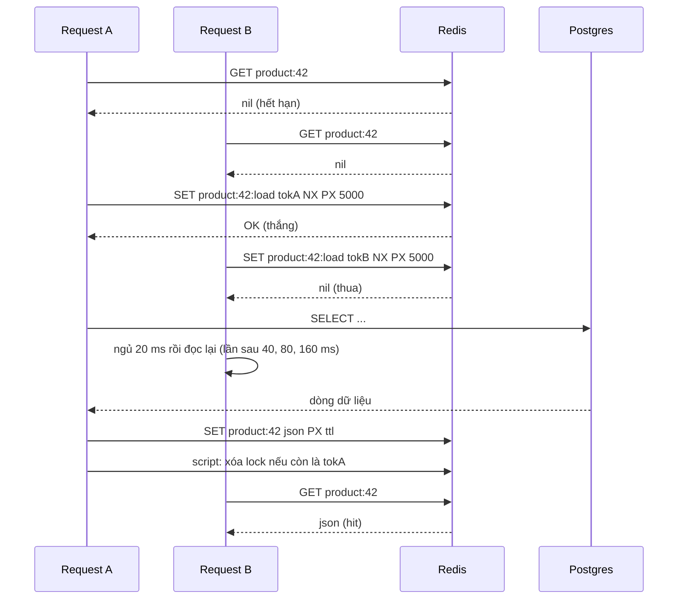
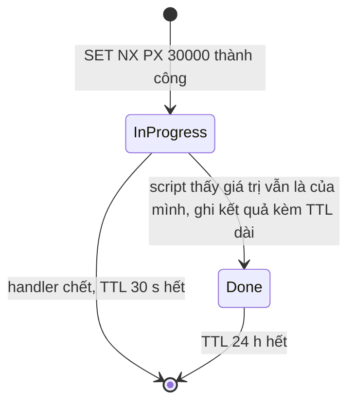
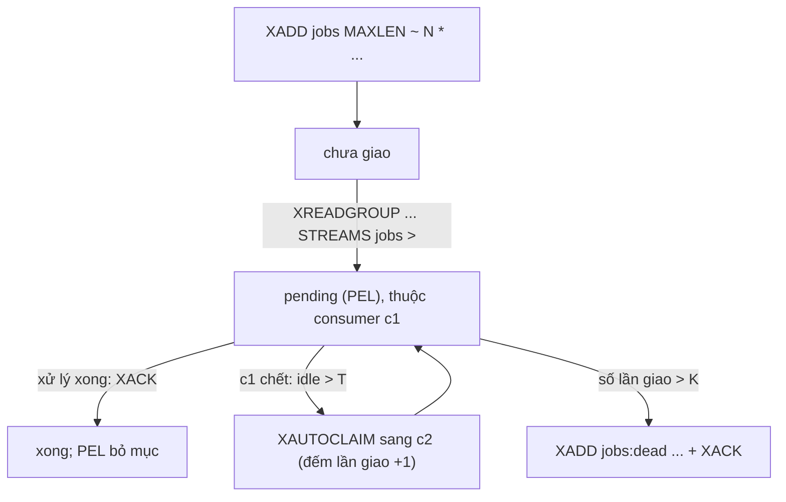
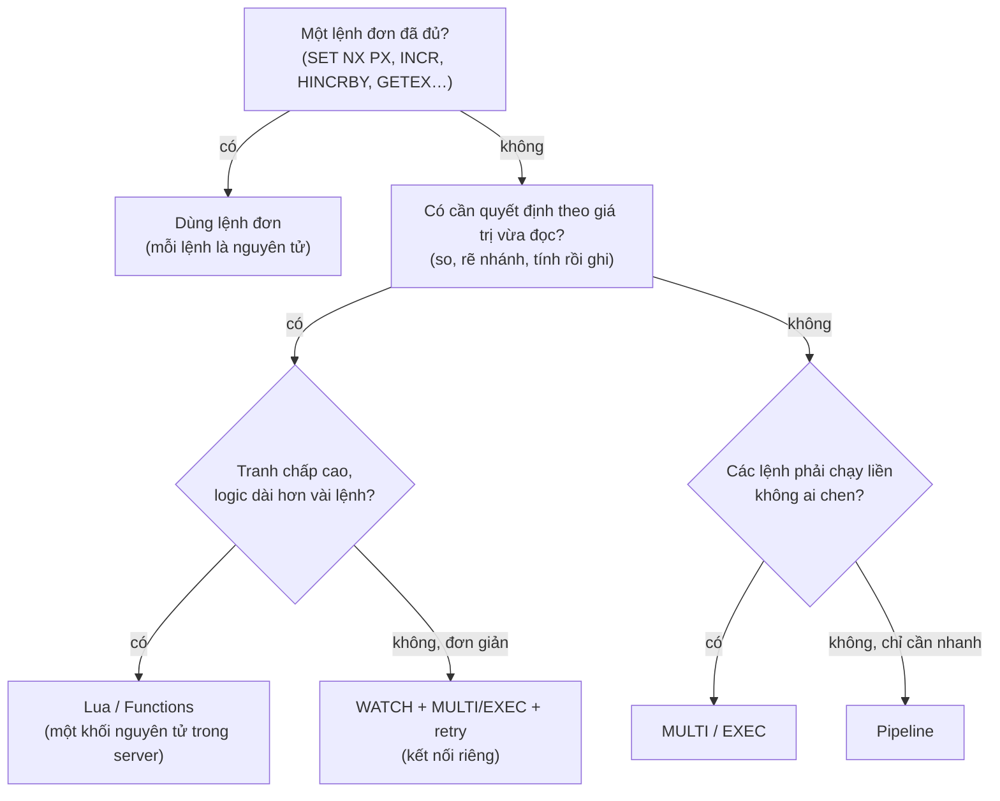

# P12 · Chương 17 — Redis trong thực chiến: kết hợp primitive thành pattern

> Chương 16 đã mở Redis ra từ bên trong (event loop, encoding, persistence, replication, cluster). Chương này làm việc ngược lại: lấy các *primitive* của Redis (một lệnh, một cấu trúc dữ liệu, một script) và **ghép** chúng thành pattern giải bài toán backend — cache, rate limiter, lock/idempotency, job queue, leaderboard, thống kê, session — rồi chỉ ra *chỗ mỗi pattern hỏng*. Quy ước nguồn giữ nguyên chương 16: **tài liệu** lấy từ repo `redis/redis-doc` ghim ở commit `1044224477fceacc5af56a636b0a7495d19e533c` (các trang `commands/*.md` có sẵn mục "Pattern"); **source code** là Redis **7.2.5**; client Rust là crate `redis` **1.7.1** trên docs.rs. Ví dụ code (Lua, Rust) *chỉ minh họa* — chương này không biên dịch, không chạy chúng và không khẳng định kết quả chạy. Những gì nguồn không nói (công thức, ngưỡng, lời khuyên thiết kế) được ghi rõ là nhận xét/suy luận của người soạn.

## Bạn sẽ hiểu được gì

- **Q1.** Cache bằng Redis: cache-aside, write-through, write-behind khác nhau thế nào và hỏng ở đâu; negative caching là gì; stampede xảy ra ra sao và ba cách chặn (single-flight bằng `SET NX`, TTL jitter, refresh sớm xác suất)? → mục 1
- **Q2.** Rate limiter: fixed window bằng `INCR`+`EXPIRE`, sliding window log bằng ZSET, token bucket bằng Lua — mỗi cái nguyên tử ở đâu, sai ở biên nào, tốn gì? → mục 2
- **Q3.** Lock và idempotency key: ghép `SET NX PX` + script so token + gia hạn thành khóa dùng được; vì sao *vẫn* cần fencing ở tài nguyên đích; và vì sao khóa idempotency key trong Redis không thay được ràng buộc duy nhất trong DB? → mục 3
- **Q4.** Job queue: List với `LMOVE`/`BLMOVE` (reliable queue) khác Stream + consumer group (`XREADGROUP`, `XACK`, `XAUTOCLAIM`, dead letter) ở đâu; khi nào nên dùng broker thật? → mục 4
- **Q5.** Leaderboard, ranking và phân trang bằng ZSET: `ZADD`/`ZINCRBY`/`ZRANGE … REV`/`ZRANK`, tie-break, giới hạn chính xác của score? → mục 5
- **Q6.** Đếm và thống kê: `INCR`/`HINCRBY`, HyperLogLog (sai số chuẩn 0,81%), bitmap (`SETBIT`/`BITCOUNT`) — chọn cái nào cho bài toán nào? → mục 6
- **Q7.** Session store, feature flag, và cách làm mất hiệu lực cache cục bộ: hash + TTL, pub/sub, `CLIENT TRACKING`? → mục 7
- **Q8.** Ghép cho đúng: pipeline vs `MULTI`/`EXEC` vs `WATCH` vs Lua/Functions; thiết kế key và hash tag; TTL hygiene; các anti-pattern (`KEYS`, big key, hot key, Redis làm source of truth không persistence)? → mục 8

## Kiến thức cần trước

- [P12 · Chương 16 — Redis bên trong](16-redis-ben-trong.md): chương này *dùng* kết luận của nó mà không chứng minh lại — một thread thực thi lệnh nên mỗi lệnh/script nguyên tử và lệnh chậm chặn tất cả (mục 1); encoding và eviction (mục 2–3); persistence (mục 4); replication bất đồng bộ (mục 5); Cluster và slot (mục 6); `MULTI`/`WATCH`/Lua/Streams (mục 7); khóa, cache, rate limiter ở mức cơ bản (mục 8). Chương này đào sâu *cách ghép*, không lặp phần cơ chế đó.
- [P12 · Chương 08 — Sự cố trong hệ phân tán](08-su-co-he-phan-tan.md) (mục 1 partial failure, mục 5 đồng hồ, mục 7 process pause, mục 8 lease và fencing token): nền cho mục 3.
- [P12 · Chương 07 — Transaction](07-transaction.md) (mục 5: `UPDATE` nguyên tử, compare-and-set) và [P12 · Chương 12 — Dữ liệu đúng đắn](12-dung-dan-va-tich-hop-du-lieu.md) (mục 1 dữ liệu dẫn xuất, mục 4–5 idempotency, mục 6 outbox).
- [P12 · Chương 11 — Stream processing](11-stream-processing.md) (mục 2 queue hay log, mục 4 ngữ nghĩa giao tin): nền cho mục 4.
- [P12 · Chương 15 — PostgreSQL bên trong](15-postgresql-ben-trong.md): phía DB của cache, lock và queue (mỗi connection là một process — mục 1–2 — nên stampede đổ xuống Postgres rất đắt).
- [P13 · Chương 09 — Mô hình hóa hệ backend](../13-tla-plus/09-mo-hinh-hoa-he-backend.md) (mục 2 lock + fencing, mục 4 cache-aside và cuộc đua stale): mô hình hình thức của hai pattern mà chương này dùng ở mức thực hành.

## 0. Khung chung: năm câu hỏi cho mọi pattern, và sáu cách hỏng lặp lại

Mỗi pattern trong chương đi qua cùng năm câu hỏi: **(1)** bài toán là gì; **(2)** ghép primitive nào; **(3)** *nguyên tử ở đâu* — tức bước nào là một lệnh/một script duy nhất, bước nào là hai round trip có thể bị chen; **(4)** hỏng ở đâu; **(5)** khi nào *không* nên dùng Redis. Câu (3) quan trọng nhất: Redis không có transaction kiểu DB quan hệ, nên "đúng" luôn quy về việc *chọn ranh giới nguyên tử* (nhận xét của người soạn; cơ chế nền ở [chương 16, mục 7](16-redis-ben-trong.md)).

Câu (4) có sáu đáp án lặp lại ở gần như mọi pattern. Gọi tên chúng một lần ở đây để các mục sau chỉ cần nhắc **F1…F6**.

**F1 — Mất write khi failover.** Replication của Redis mặc định bất đồng bộ[^repl-async]; `WAIT` làm giảm khả năng mất nhưng không biến Redis thành hệ CP — write đã ack vẫn có thể mất khi failover[^repl-wait-cp]. Redis Cluster tự mô tả đúng như vậy: thường có những cửa sổ nhỏ trong đó write đã ack có thể mất[^cl-ack-lost]. Hệ quả cho pattern: counter lùi lại và job biến mất (suy luận của người soạn), còn khóa có thể được cấp hai lần — tài liệu khóa của Redis mô tả đúng kịch bản (A lấy khóa, master chết trước khi key tới replica, B lấy khóa trên replica được thăng) và quy cho replication bất đồng bộ[^lk-replica-race]. Cơ chế đầy đủ: [chương 16, mục 5](16-redis-ben-trong.md).

**F2 — TTL không như bạn nghĩ.** Ba cái bẫy khác nhau. (a) `SET` thường *xóa* TTL đang có của key[^set-ttl-cleared] (muốn giữ phải dùng `KEEPTTL`[^set-keepttl]); ngược lại `INCR`, `LPUSH`, `HSET` để TTL nguyên vẹn[^expire-untouched] — nên key tạo bằng `INCR` không tự có TTL, bạn phải đặt (suy luận của người soạn). (b) TTL dựa vào *đồng hồ tường* của máy chạy Redis: chỉnh giờ máy tiến 2000 giây thì key có TTL 1000 giây hết hạn ngay[^expire-clock]; tài liệu khóa nhắc rõ Redis không dùng đồng hồ monotonic cho hết hạn nên bước nhảy đồng hồ có thể làm khóa bị nhiều process cùng giữ[^lk-disclaimer-clock]. (c) Key có thể *biến mất trước TTL* nếu `maxmemory` + policy eviction chọn trúng nó[^evict-policies] — nên lock, idempotency key hay job không nên sống chung instance với cache đang bật eviction (nhận xét của người soạn; mục 1.5 và mục 8).

**F3 — Đồng hồ của chính app.** Pattern nào lấy `now` từ đồng hồ của pod (window id của rate limiter, timestamp trong ZSET) thì lệch đồng hồ giữa các pod làm kết quả lệch; xem [chương 08, mục 5–6](08-su-co-he-phan-tan.md). Cách tránh trong chương này: hoặc để Redis cấp thời gian (`TIME` trong script — mục 2), hoặc dùng cửa sổ tính từ lúc key được tạo (TTL-based) để khỏi cần đồng hồ của pod (việc hết hạn vẫn dựa vào đồng hồ của máy chạy Redis — F2b).

**F4 — Cross-slot trong Cluster.** Lệnh nhiều key chỉ chạy được khi mọi key cùng slot[^cl-subset]; không thì server trả `CROSSSLOT`[^src-crossslot]. Với script, tài liệu yêu cầu khai báo *mọi* key script đụng tới trong `KEYS`[^sc-keys], và các key đã khai báo phải cùng slot (chú thích trong source 7.2.5: nếu script đã khai báo key trước thì lỗi cross-slot đã được ném sẵn[^script-crossslot]). Công cụ để ép cùng slot là *hash tag* `{...}`[^cl-hashtag] (cơ chế: [chương 16, mục 6](16-redis-ben-trong.md)). Hệ quả thiết kế: pattern nào cần nhiều key trong một thao tác nguyên tử (khóa + fence counter, queue + processing list, nhiều bitmap) phải đặt tên key có hash tag ngay từ đầu — mục 8 nói cách chọn tag. Đồng thời, đang resharding thủ công thì thao tác nhiều key có thể tạm không dùng được[^cl-resharding-multikey] (server trả `TRYAGAIN`[^src-tryagain]).

**F5 — Big key.** Mọi lệnh chạy trên thread chính nên một lệnh chậm làm mọi client khác chờ[^lat-slow]; `DEL` một key chứa list/set/zset/hash tốn O(M) theo số phần tử[^del-cx], nên xóa key khổng lồ là ví dụ điển hình của lệnh chậm (nhận xét của người soạn), còn `UNLINK` thu hồi bộ nhớ ở thread khác nên không chặn[^unlink-doc] (cơ chế và ngoại lệ: [chương 16, mục 1](16-redis-ben-trong.md)).

**F6 — Hot key.** Một key ánh xạ tới đúng một slot (`CRC16(key) mod 16384`[^cl-hashslot]), nên mọi lệnh ghi vào key đó dồn vào một master — thêm node không chia nhỏ được *một* key (suy luận của người soạn từ công thức slot); riêng tải đọc thì tài liệu Cluster nói replica của master đó dùng được để mở rộng khi chấp nhận dữ liệu cũ[^cl-replicas-read].

| | Hỏng thế nào | Pattern chịu ảnh hưởng nặng nhất (nhận xét của người soạn) |
|---|---|---|
| F1 | mất write đã ack | write-behind (1), rate limiter (2), lock (3), queue (4), counter (6) |
| F2 | TTL bị xóa/trôi/evict | cache (1), rate limiter (2), idempotency (3), session (7) |
| F3 | lệch đồng hồ | rate limiter (2), lock (3) |
| F4 | `CROSSSLOT` | rate limiter nhiều chiều (2), lock+fence (3), queue (4), bitmap/HLL nhiều key (6), Lua (8) |
| F5 | lệnh chậm do key lớn | cache value lớn (1), leaderboard (5), bitmap (6), stream (4) |
| F6 | một key quá nóng | cache (1), rate limiter (2), counter (6), flag (7) |

## 1. Cache: cache-aside, stampede, negative caching (Q1)

> **Trả lời ngắn.** Mẫu cache điển hình là *cache-aside*: app đọc cache trước; trượt thì đọc DB rồi nạp vào cache; khi ghi thì ghi DB rồi *xóa* key cache thay vì cập nhật nó[^fb-lookaside][^fb-delete]. Ba chỗ hỏng hay gặp: dữ liệu cũ do thứ tự đọc/ghi xen kẽ, *stampede* (một key nóng hết hạn và hàng loạt request cùng nạp lại nó[^xf-def]), và key "không tồn tại" bị hỏi đi hỏi lại — cách chữa lần lượt là xóa-sau-khi-commit kèm TTL làm lưới an toàn, single-flight bằng `SET NX PX` cộng TTL có jitter hoặc refresh sớm xác suất, và *negative caching* (cache cả câu trả lời "không có").

**Giải thích.**

Tình huống (nhận xét của người soạn): trang sản phẩm `GET /products/42` nhận hàng chục nghìn request/giây, 99% là đọc, dữ liệu nằm ở Postgres. Một ngày sản phẩm 42 lên báo; key cache của nó hết hạn đúng lúc đang nóng nhất, 3.000 request cùng thấy "trượt" và cùng gửi `SELECT` xuống DB; pool connection cạn ([chương 15, mục 2](15-postgresql-ben-trong.md)) và cả site chậm theo. Cache giúp nhanh, nhưng *chính cách cache hết hạn* có thể là nguồn sự cố.

### 1.1 Cache-aside: đọc và ghi

*Đọc.* `GET product:42`. Có → trả. Không có → đọc DB, rồi `SET product:42 <json> PX <ttl>`. Đây là mô hình cache "look-aside nạp theo nhu cầu" của Facebook: web server hỏi memcache, trượt thì lấy từ DB hoặc backend khác rồi nạp cặp key-value vào cache[^fb-lookaside]. Redis không tự nạp từ DB (nhiều hệ cache thương mại có sẵn read-through/write-through/write-behind[^az-rw]; với Redis lõi, app tự làm — suy luận của người soạn từ danh sách lệnh), nên "aside" nghĩa là *code ứng dụng* giữ logic nạp.

*Ghi.* Ghi DB trước (commit), *rồi* `DEL product:42`. Facebook chọn xóa thay vì cập nhật cache vì xóa là idempotent[^fb-delete] — retry `DEL` bao nhiêu lần cũng giống một lần, còn retry `SET` giá trị cũ có thể đè giá trị mới (nhận xét của người soạn). Thứ tự "DB trước, cache sau" quan trọng: tài liệu Azure nhấn mạnh cập nhật data store trước khi xóa mục cache[^az-order] — nếu xóa cache trước, reader chen vào giữa có thể nạp lại giá trị *cũ* từ DB vào cache. Dù đúng thứ tự, giữa lúc ghi và lúc đọc kế tiếp, reader vẫn có thể thấy trượt cache hoặc dữ liệu cũ trong chốc lát[^az-stale].

*Cuộc đua "stale set".* Reader đọc DB giá trị cũ; writer ghi DB và xóa cache; *rồi* reader mới nạp giá trị cũ vào cache (trình tự minh họa của người soạn). Facebook định nghĩa stale set là web server đặt vào cache một giá trị không phản ánh giá trị mới nhất, có thể xảy ra khi các cập nhật đồng thời bị đảo thứ tự[^fb-stale]; lời giải của họ là *lease token* — token gắn với key, client phải trả lại khi đặt giá trị, và memcached có thể từ chối nếu token đã bị vô hiệu vì key bị `delete` giữa chừng[^fb-lease]; mô hình TLA+ của cơ chế đó ở [P13 · Chương 09, mục 4](../13-tla-plus/09-mo-hinh-hoa-he-backend.md), tóm tắt ở [chương 16, mục 8.4](16-redis-ben-trong.md). Hai hàng rào thực tế khi chưa dùng lease: (a) TTL — giá trị cũ không sống mãi; Azure khuyên chọn chính sách hết hạn khớp với kiểu truy cập của dữ liệu[^az-ttl]; (b) với dữ liệu quan trọng, ghi cache *có phiên bản* bằng Lua — writer *ghi* phiên bản mới thay vì `DEL`; cách này chỉ chặn được ghi đảo thứ tự khi phiên bản còn nằm trong key (xem phần Đi sâu; nhận xét của người soạn).

### 1.2 Write-through và write-behind

*Write-through* là cập nhật data store và cache trong cùng một thao tác ghi, để reader thấy giá trị mới ngay sau khi ghi thành công — khác cache-aside vốn xóa rồi chờ lần đọc sau nạp lại[^az-wt]. Trên Redis, hai writer đồng thời `SET` cùng một key có thể đặt giá trị theo thứ tự ngược với thứ tự commit DB (đúng kiểu "cập nhật đồng thời bị đảo thứ tự" ở trên[^fb-stale]); vì vậy write-through trên Redis nên đi kèm so phiên bản (Lua, phần Đi sâu) — nhận xét của người soạn.

*Write-behind* — app ghi vào Redis, một tiến trình khác chép xuống DB sau — đổi độ bền lấy tốc độ ghi. Mất mát có thể xảy ra ở mọi bậc: chỉ RDB thì có thể mất vài phút gần nhất[^pers-rdb-lose]; AOF `everysec` thì tài liệu nói khoảng một giây[^aof-everysec] (source có ngoại lệ trì hoãn tới ~2 giây — [chương 16, mục 4](16-redis-ben-trong.md)); thêm vào đó failover mất write (F1). Dùng khi dữ liệu *chịu được mất* (số lượt xem); không dùng cho dữ liệu mà "đã ack cho user" có nghĩa là phải còn (đơn hàng, thanh toán) — khi đó DB là nơi ghi đầu tiên và Redis (nếu cần) là bản sao dẫn xuất (nhận xét của người soạn; khái niệm dữ liệu dẫn xuất: [chương 12, mục 1](12-dung-dan-va-tich-hop-du-lieu.md)). Nếu thật sự cần bộ đệm ghi bền hơn, hình dạng gần đúng nhất là Stream + AOF với `fsync` mạnh + consumer idempotent (mục 4) — vẫn chịu F1 — chứ không phải một key cache (nhận xét của người soạn).

### 1.3 Negative caching

*Negative caching* — lưu tri thức rằng "cái này không tồn tại" — có định nghĩa chuẩn trong DNS: RFC 2308 gọi nó là việc lưu tri thức rằng một thứ không tồn tại, không có hoặc không trả lời được[^rfc2308-def], và nó có ích vì giảm thời gian phản hồi cho các câu trả lời âm[^rfc2308-use]. Bài toán backend tương ứng: bot dò `GET /products/9999999` — id không tồn tại — mỗi lần đều trượt cache và gõ xuống DB.

Cách ghép trên Redis: khi DB trả "không có dòng", `SET product:9999999 "" PX 30000` (chuỗi rỗng làm dấu "đã biết là không có"; `GET` trả nil khi key không tồn tại[^get-nil], nên phân biệt được với chuỗi rỗng — suy luận của người soạn). Ba lưu ý (nhận xét của người soạn): TTL của bản ghi âm phải *ngắn* hơn nhiều TTL bản ghi dương; khi *tạo* dòng mới phải `DEL` key âm tương ứng, nếu không bản ghi "mới tạo" vẫn trả 404 tới khi TTL hết; và id do kẻ tấn công sinh ra tùy ý vẫn có thể làm đầy bộ nhớ bằng vô số key âm — nên đi cùng giới hạn tần suất (mục 2) hoặc Bloom filter ở lớp trước.

### 1.4 Stampede và ba cách chặn

Stampede (cũng gọi dog-piling, cache miss storm) xảy ra khi một mục cache phổ biến hết hạn và nhiều request cùng thấy trượt rồi cùng tính lại đúng mục đó[^xf-def]. Quy mô phụ thuộc cả tần suất request lẫn *thời gian tính lại*: paper VLDB 2015 cho ví dụ mục được đọc 10 lần/giây, tính lại mất 3 giây thì có 30 request cùng tính lại[^xf-size].



*Cách 1 — single-flight bằng `SET NX PX`.* Request nào thắng `SET key:load token NX PX 5000` thì đi nạp DB; người thua *ngủ ngắn rồi đọc lại cache* thay vì chạy tới DB. Facebook giảm nhẹ biến thể này trong memcached bằng cách điều tiết token: mặc định mỗi key chỉ cấp một token mỗi 10 giây[^fb-herd-rate]; request tới trong lúc đó nhận thông báo "chờ một chút" vì client giữ lease thường nạp xong trong vài mili giây[^fb-herd-wait]. Phiên bản Redis dùng đúng primitive của khóa ở mục 3: lấy bằng `SET … NX PX`, nhả bằng script so token. Điều đẹp là đây là loại khóa "vì hiệu quả" — Kleppmann khuyên khóa kiểu này chỉ cần thuật toán một node và nên ghi rõ trong code rằng khóa chỉ gần đúng, có thể thỉnh thoảng sai[^kb-efficiency]. Nếu khóa hết hạn trước khi người nạp xong (TTL 5 giây, truy vấn mất 8 giây) thì hai request cùng nạp và cùng `SET` giá trị — chỉ tốn thêm một lần nạp nếu dữ liệu không đổi, nhưng truy vấn chạy lâu cũng là cửa sổ cho cuộc đua "stale set" ở 1.1 (một writer chen vào giữa rồi `SET` trễ đè giá trị cũ); nên TTL của khóa phải lớn hơn thời gian nạp tệ nhất, và dữ liệu quan trọng thì ghi có phiên bản (phần Đi sâu) (nhận xét của người soạn). Người thua cần *giới hạn kiên nhẫn*: sau vài lần ngủ mà cache vẫn trống thì trả giá trị cũ (nếu có) hoặc lỗi nhanh, đừng chờ vô hạn; đọc thẳng DB chỉ hợp khi tổng thời gian đã chờ dài hơn thời gian nạp thông thường (ví dụ ở phần Đi sâu chờ tối đa khoảng 460 ms) — nếu không, mọi người thua cùng đổ xuống DB và stampede quay lại (nhận xét của người soạn).

*Cách 2 — TTL có jitter.* Nếu một lô key được nạp cùng lúc với cùng TTL (khởi động, deploy, warm-up) thì chúng hết hạn cùng lúc. Cộng thêm một số ngẫu nhiên (ví dụ 0–10% TTL) làm các key rải đều (nhận xét của người soạn; con số 0–10% chưa có nguồn ghim). Một lý do khác để rải: khi *rất nhiều* key cùng hết hạn, chu trình expire chủ động của Redis (cơ chế: [chương 16, mục 3](16-redis-ben-trong.md)) lặp lại khi tỷ lệ mẫu đã hết hạn vượt một ngưỡng — tài liệu EXPIRE ghi 25%[^expire-active], còn source 7.2.5 dùng `ACTIVE_EXPIRE_CYCLE_ACCEPTABLE_STALE` bằng 10[^expire-stale-src] — và tốn tới một phần CPU của thread chính[^expire-cpu] — hết hạn hàng loạt là một dạng lệnh chậm gián tiếp (suy luận của người soạn từ hai nguồn).

*Cách 3 — refresh sớm.* Thay vì chờ key hết hạn, để *một* request tính lại trước hạn. Paper VLDB mô tả *probabilistic early expiration*: mỗi request tự quyết định, độc lập và ngẫu nhiên, có tính lại mục trước khi hết hạn hay không, xác suất tăng dần khi gần hạn[^xf-early]; paper nhắm tới các hệ cache chỉ có thao tác `get`/`set` nguyên thủy, không có khóa hay cơ chế chống stampede[^xf-nolock]. Thuật toán `XFetch` của họ: lưu kèm mục hai số — thời gian tính lại lần trước `∆` và hạn `expiry` — rồi mỗi lần đọc kiểm tra điều kiện `Time() − ∆β log(rand()) ≥ expiry`[^xf-formula], trong đó `β` là tham số mặc định 1 — tăng `β` thì chặn stampede tốt hơn nhưng key bị làm mới sớm hơn[^xf-beta]; nếu điều kiện đúng thì tính lại. Với Redis: giữ `value`, `delta`, `expiry` trong một hash (hoặc nhúng vào JSON) với TTL vật lý dài hơn `expiry`; điều kiện tính ở client (nhận xét của người soạn). Biến thể "stale-while-revalidate" (nhận xét của người soạn): TTL vật lý = TTL logic + khoảng ân hạn; khi quá TTL logic, người thắng `SET NX` đi làm mới còn mọi người khác phục vụ giá trị cũ — tốt nhất cho p99, đổi lấy việc chấp nhận dữ liệu cũ trong khoảng ân hạn.

### 1.5 Cấu hình instance cache, hot key và khi nào KHÔNG cache

Instance cache nên đặt `maxmemory` và policy LRU/LFU: tài liệu khuyên `allkeys-lru` khi phân bố truy cập theo power law[^evict-rule-lru], còn `noeviction` thì từ chối ghi khi đầy[^conf-noevict] — không hợp với cache (các policy và cơ chế: [chương 16, mục 3](16-redis-ben-trong.md)). Đừng trộn cache với dữ liệu *không được mất* (lock, job, idempotency key) trong cùng instance bật eviction (nhận xét của người soạn): tài liệu nói `volatile-lru` và `volatile-random` hợp khi một instance vừa cache vừa giữ key bền, nhưng thường tốt hơn là chạy hai instance[^evict-volatile].

Key cực nóng (F6): một sản phẩm viral là *một* key trên *một* master. Hai hướng giảm tải (nhận xét của người soạn): giữ bản sao trong bộ nhớ process của app với TTL vài giây hoặc có invalidation (mục 7), hoặc nhân key thành `product:42#0…#7` và đọc ngẫu nhiên một bản (ghi phải cập nhật tất cả — chỉ hợp dữ liệu ít ghi).

**Khi nào KHÔNG dùng cache Redis** (nhận xét của người soạn): (1) dữ liệu cần *read-your-writes* tuyệt đối (số dư, tồn kho khi đặt hàng) — đọc primary DB; (2) truy vấn DB đã rẻ — Postgres tự có page cache ([chương 15, mục 3](15-postgresql-ben-trong.md)), thêm một lớp chỉ thêm chỗ để sai; (3) hit rate thấp hoặc value lớn (F5) — cache tốn bộ nhớ mà không giảm tải; (4) hệ thống *không sống nổi khi cache lạnh*: khi đó cache không còn là tối ưu mà là phụ thuộc cứng — hãy thử khởi động với cache trống trước khi tin nó.

<details><summary>Đi sâu: code Rust cho cache-aside + single-flight, Lua ghi có phiên bản, XFetch</summary>

Ba đoạn dưới đây *chỉ minh họa*, không được biên dịch trong chương này. Chúng giả định `redis` 1.7.1 với các feature `aio`, `tokio-comp` (hỗ trợ async trên runtime Tokio[^rs-feat-tokio]; thiếu cả `tokio-comp` lẫn `smol-comp` thì phần `aio` của crate không biên dịch được[^rs-feat-runtime]), `connection-manager` (kiểu `ConnectionManager` chỉ có khi bật cả `aio` lẫn `connection-manager`[^rs-cm-feature]) và `script` (trang `Script` ghi rõ nó chỉ có khi bật feature `script`[^rs-script-feature]; feature này nằm trong nhóm bật mặc định[^rs-feat-script-default]). Tên feature của từng kiểu khác nhau nên kiểm tra trên docs.rs trước khi dùng. `Db`, `Product`, `new_token()` và `with_jitter()` là kiểu/hàm giả định của ví dụ, không thuộc crate nào; ví dụ còn dùng các crate `tokio`, `anyhow`, `serde_json`, `rand` (chương này không đối chiếu phiên bản của chúng).

```rust
use redis::{aio::ConnectionManager, AsyncCommands, Script};
use std::{sync::LazyLock, time::Duration};

// Script là bất biến và dùng chung được; tạo một lần.
static UNLOCK: LazyLock<Script> = LazyLock::new(|| Script::new(r#"
  if redis.call("get", KEYS[1]) == ARGV[1] then return redis.call("del", KEYS[1]) else return 0 end
"#));

async fn get_product(conn: &mut ConnectionManager, db: &Db, id: u64) -> anyhow::Result<Option<Product>> {
    let key = format!("v1:product:{id}");           // "v1:" để đổi định dạng cache mà không xóa tay
    for attempt in 0..5u32 {
        // 1) cache. nil = chưa biết; "" = biết là không có (negative caching).
        if let Some(raw) = conn.get::<_, Option<String>>(&key).await? {
            return Ok(if raw.is_empty() { None } else { Some(serde_json::from_str(&raw)?) });
        }
        // 2) single-flight: ai thắng NX thì nạp.
        let lock = format!("{key}:load");
        let token = new_token();                       // >= 128 bit ngẫu nhiên
        let won: Option<String> = redis::cmd("SET").arg(&lock).arg(&token)
            .arg("NX").arg("PX").arg(5_000).query_async(conn).await?;
        if won.is_some() {
            let row = db.find_product(id).await?;      // đọc Postgres
            let (val, ttl_ms) = match &row {
                Some(p) => (serde_json::to_string(p)?, with_jitter(300_000)), // base + rand(0..10%)
                None => (String::new(), 30_000),       // âm: TTL ngắn
            };
            let _: () = redis::cmd("SET").arg(&key).arg(val).arg("PX").arg(ttl_ms).query_async(conn).await?;
            let _: i64 = UNLOCK.key(&lock).arg(&token).invoke_async(conn).await?;
            return Ok(row);
        }
        // 3) người thua: ngủ rồi đọc lại; giới hạn kiên nhẫn.
        tokio::time::sleep(Duration::from_millis(20 << attempt.min(3))).await;
    }
    Ok(db.find_product(id).await?)                     // hết kiên nhẫn: đọc thẳng DB
}
```

`.key(..)` thêm một phần tử vào `KEYS`[^rs-script-key] và `.arg(..)` thêm một phần tử vào `ARGV`[^rs-script-arg]; script cache của server là *không bền* — restart Redis xóa nó[^sc-cache-volatile] — nhưng đối tượng `Script` của crate lo việc upload và thực thi tự động[^rs-script]: nếu script chưa có trên server, `invoke_async` tự nạp rồi chạy lại[^rs-script-noscript], nên code không phải tự bắt `NOSCRIPT`.

Ghi cache có phiên bản (cho write-through; `ARGV[1]` là version tăng dần của dòng DB, ví dụ cột `version` được tăng trong cùng `UPDATE`, xem [chương 07, mục 5](07-transaction.md)). Script chạy nguyên tử vì chặn server[^sc-atomic], nên "so rồi ghi" không bị chen:

```lua
-- KEYS[1] = key cache; ARGV[1] = version mới; ARGV[2] = payload; ARGV[3] = ttl ms
local cur = redis.call('HGET', KEYS[1], 'v')
if cur == false or tonumber(cur) < tonumber(ARGV[1]) then
  redis.call('HSET', KEYS[1], 'v', ARGV[1], 'd', ARGV[2])
  redis.call('PEXPIRE', KEYS[1], ARGV[3])
  return 1
end
return 0
```

(Hash là kiểu "record" gồm các cặp field-value[^hash-def]. Lưu ý `HSET` không đụng TTL[^expire-untouched] nên script tự `PEXPIRE` mỗi lần ghi thành công.)

Hai lưu ý (suy luận của người soạn). (1) Script này lưu cache dạng *hash* (`v`, `d`), nên đường đọc phải là `HGET key d` hoặc `HMGET key v d`; `GET` ở ví dụ `get_product` phía trên chỉ xử lý chuỗi và trả lỗi với kiểu khác[^get-notstring] — đừng trộn hai dạng lưu trữ trên cùng một key. Trong Lua, `HGET` trả `false` khi field không có[^lua-nil-false], nên script so `cur == false`. (2) Phiên bản chỉ chặn được ghi đảo thứ tự chừng nào nó còn nằm trong key: nếu invalidation bằng `DEL` (hoặc TTL, eviction) xóa mất key thì một lần ghi trễ mang phiên bản cũ lại lọt vào. Vì vậy script này chỉ có nghĩa khi writer *ghi* phiên bản mới vào cache (write-through) thay vì `DEL`; ghép nó với `DEL` của cache-aside ở mục 1.1 thì không chặn được ghi trễ.

Quyết định `XFetch` ở client, với `delta_ms` đo lần tính lại trước và `beta` mặc định 1 như paper:

```rust
fn should_refresh(now_ms: f64, delta_ms: f64, expiry_ms: f64, beta: f64) -> bool {
    // rand::random::<f64>() thuộc [0,1); ln() <= 0 nên trừ nó là cộng một khoảng ngẫu nhiên dương.
    now_ms - delta_ms * beta * rand::random::<f64>().ln() >= expiry_ms
}
```

Nếu muốn tránh nhiều người cùng làm mới thì vẫn bọc lời gọi tính lại bằng `SET NX PX` như trên: `XFetch` giảm xác suất, lock đảm bảo thường chỉ một người đi tính (nhận xét của người soạn).

</details>

**Quay lại Q1:** cache-aside = đọc cache → trượt thì nạp từ DB; ghi thì commit DB rồi `DEL`, TTL là lưới an toàn; stampede chặn bằng single-flight (`SET NX PX`), TTL jitter và refresh sớm xác suất; key không tồn tại thì cache giá trị âm với TTL ngắn; và đừng cache thứ cần read-your-writes tuyệt đối.

## 2. Rate limiter: fixed window, sliding window log, token bucket (Q2)

> **Trả lời ngắn.** Rate limiter là một counter có hạn. *Fixed window* là `INCR` rồi đặt TTL một lần (`EXPIRE … NX`) trong `MULTI`/`EXEC` — đơn giản và rẻ nhất, nhưng cho phép dồn gấp đôi giới hạn ở biên cửa sổ. *Sliding window log* lưu từng request trong một ZSET (xóa mục cũ, đếm, thêm) và *token bucket* lưu số token + thời điểm nạp gần nhất trong một hash; cả hai cần một script Lua vì phải "đọc rồi quyết định rồi ghi" như một khối nguyên tử[^sc-atomic].

**Giải thích.**

Tình huống (nhận xét của người soạn): API công khai, mỗi API key được 100 request/phút, chạy trên 12 pod. Giới hạn *cục bộ* trong từng pod cho phép tổng tới 1.200 request/phút; muốn một số chung thì phải có trạng thái chung — Redis là nơi quen thuộc để đặt nó.

### 2.1 Fixed window

Tài liệu Redis mô tả rate limiter là một counter đặc biệt dùng để giới hạn tần suất một thao tác[^rl-pattern] và đưa hai phiên bản ([chương 16, mục 8.5](16-redis-ben-trong.md) chỉ nhắc ngắn phần này): mỗi cặp (IP, giây) một key, `INCR` và `EXPIRE` đặt trong `MULTI`/`EXEC` để chắc chắn vừa tăng vừa đặt hạn mỗi lần gọi[^rl-multi]; hoặc một counter duy nhất mà cửa sổ bắt đầu từ request đầu tiên của cửa sổ đó[^rl-window-survive].

Cải tiến cho Redis có option `NX` của `EXPIRE` ("chỉ đặt hạn khi key chưa có hạn"[^expire-nx]; option này có từ Redis 7.0[^expire-nx-since]):

```
MULTI
INCR   rl:{apikey}
EXPIRE rl:{apikey} 60 NX
EXEC
```

Vì sao đúng. `MULTI`/`EXEC` chạy các lệnh liên tục, không request của client khác chen giữa[^tx-serial], và nếu client mất kết nối trước `EXEC` thì không lệnh nào chạy[^tx-exec-all] — nên không còn cửa sổ "đã `INCR` mà chưa `EXPIRE`" khiến key rò rỉ như bản counter duy nhất (`INCR` rồi `EXPIRE` nếu giá trị bằng 1) trong tài liệu[^rl-race] (tài liệu sửa cái đó bằng Lua[^rl-lua]; `EXPIRE … NX` + `MULTI` cho cùng hiệu quả mà không cần script — nhận xét của người soạn). `NX` quan trọng: nếu mỗi lần đều `EXPIRE key 60` không điều kiện thì mỗi request đẩy hạn đi xa hơn, cửa sổ không bao giờ kết thúc dưới tải liên tục (suy luận của người soạn). `INCR` là phép tăng nguyên tử[^rl-incr] và giới hạn trong số nguyên 64-bit có dấu[^incr-int].

Phiên bản không có window id trong tên key (`rl:{apikey}`) *không dùng đồng hồ của pod* (F3): cửa sổ bắt đầu từ request đầu tiên và kéo dài đúng TTL. Phiên bản có window id (`rl:{apikey}:{floor(now/60)}`) cần `now` từ pod — lệch đồng hồ giữa pod làm các pod cộng dồn vào *hai key khác nhau* quanh biên phút (nhận xét của người soạn).

Chỗ hỏng: *biên cửa sổ*. Giới hạn 100/phút; một client gửi 100 request ở giây thứ 59 và 100 request ở giây thứ 1 của phút sau — 200 request trong khoảng hai giây mà cả hai cửa sổ đều "không vượt" (nhận xét của người soạn). Nếu 2× giới hạn trong chốc lát chấp nhận được thì fixed window là lựa chọn tốt nhất về giá/độ phức tạp.

### 2.2 Sliding window log (ZSET)

Ý tưởng: lưu *mỗi request được nhận* thành một phần tử của ZSET với score là thời điểm; cửa sổ trượt (`now − window`, `now`] chính là các phần tử có score trong khoảng đó. Ba bước: xóa phần tử cũ bằng `ZREMRANGEBYSCORE`[^zrem-doc], đếm bằng `ZCARD`, nếu còn chỗ thì `ZADD`. Ba lệnh này phải là *một* khối, nếu không hai request đồng thời cùng thấy 99 và cùng thêm — thành 101. Lua cho khối nguyên tử:

```lua
-- KEYS[1] = rl:{apikey}; ARGV[1] = window_ms; ARGV[2] = limit; ARGV[3] = id duy nhất của request
local t = redis.call('TIME')
local now = tonumber(t[1]) * 1000 + math.floor(tonumber(t[2]) / 1000)
local win, limit = tonumber(ARGV[1]), tonumber(ARGV[2])
redis.call('ZREMRANGEBYSCORE', KEYS[1], '-inf', now - win)
if redis.call('ZCARD', KEYS[1]) < limit then
  redis.call('ZADD', KEYS[1], now, now .. ':' .. ARGV[3])
  redis.call('PEXPIRE', KEYS[1], win)
  return {1, limit - redis.call('ZCARD', KEYS[1]), 0}
end
local oldest = redis.call('ZRANGE', KEYS[1], 0, 0, 'WITHSCORES')
return {0, 0, tonumber(oldest[2]) + win - now}   -- retry_after_ms
```

Vì sao đúng và vì sao viết thế:

- *Nguyên tử*: script chạy nguyên tử vì trong lúc chạy mọi hoạt động khác của server bị chặn[^sc-atomic].
- *Thời gian từ Redis (F3)*: `TIME` trả giờ server dưới dạng giây + micro giây[^time-cmd], nên mọi pod dùng *cùng một đồng hồ* thay vì đồng hồ của mình. Trong 7.2 script được replicate theo *effect* (các lệnh ghi đã gọi) chứ không phải nguyên văn script[^sc-effects], và tài liệu nói khi dùng effects replication thì các hạn chế về hàm không tất định bị bỏ — dùng `TIME` hay `SRANDMEMBER` trong script thoải mái ở bất kỳ chỗ nào[^sc-time-free]. Cờ `NOSCRIPT` nghĩa là lệnh không được gọi từ script hay function[^cmd-noscript] — trong source 7.2.5 `TIME` khai báo các cờ `LOADING`, `STALE`, `FAST` và không có `NOSCRIPT`[^time-noscript], còn `EVAL` thì có `NOSCRIPT`[^eval-noscript].
- *Phần tử phải duy nhất*: ZSET chỉ có phần tử duy nhất, `ZADD` với phần tử đã có chỉ cập nhật score[^zset-update]; nếu hai request cùng mili giây dùng cùng member thì chỉ tính một. Nên member nhúng id request (`ARGV[3]`).
- *Chi phí*: `ZREMRANGEBYSCORE` là O(log N + M) với M là số phần tử bị xóa[^zrem-cx]; bộ nhớ O(limit) mỗi key — giới hạn 10.000/phút nghĩa là mỗi API key đang hoạt động giữ tới 10.000 phần tử. Đó là giá của việc *chính xác tuyệt đối*; nếu xấp xỉ được, có biến thể "sliding window counter" (hai counter cố định liền kề, cộng có trọng số theo phần cửa sổ đã trôi — nhận xét của người soạn, không có nguồn ghim) dùng hai key và O(1) bộ nhớ.

### 2.3 Token bucket (hash + Lua)

Bucket có sức chứa `cap` token, nạp thêm `rate` token/giây; mỗi request lấy `cost` token; thiếu thì từ chối kèm thời gian chờ. Khác hai kiểu trên ở chỗ tách *kích thước burst* (`cap`) khỏi *tốc độ bền vững* (`rate`): client được dồn tới `cap` request liền rồi bị kéo về `rate` token/giây, và vì token nạp liên tục nên trong mọi khoảng thời gian dài `T` chỉ tiêu được tối đa `cap + rate·T` token (bằng số request khi `cost` = 1) — không có biên cửa sổ để lách — hợp API muốn cho client "dồn" vài request liền (suy luận của người soạn). Trạng thái: hash hai field `tokens`, `ts` (hash là tập các cặp field-value[^hash-def]).

```lua
-- KEYS[1] = bucket; ARGV[1] = cap; ARGV[2] = rate (token/giây); ARGV[3] = cost
local cap, rate, cost = tonumber(ARGV[1]), tonumber(ARGV[2]), tonumber(ARGV[3])
local t = redis.call('TIME')
local now = tonumber(t[1]) * 1000 + math.floor(tonumber(t[2]) / 1000)
local h = redis.call('HMGET', KEYS[1], 'tokens', 'ts')
local tokens, ts = tonumber(h[1]), tonumber(h[2])
if tokens == nil then tokens, ts = cap, now end
tokens = math.min(cap, tokens + math.max(0, now - ts) * rate / 1000)  -- nạp; max(0) phòng đồng hồ lùi
local allowed, retry = 0, 0
if tokens >= cost then tokens = tokens - cost; allowed = 1
else retry = math.ceil((cost - tokens) * 1000 / rate) end
redis.call('HSET', KEYS[1], 'tokens', tokens, 'ts', now)
redis.call('PEXPIRE', KEYS[1], math.ceil(cap * 1000 / rate) + 1000)
return {allowed, math.floor(tokens), retry}
```

Điểm thiết kế (nhận xét của người soạn): (a) bucket *lười* — không có tiến trình nạp token, chỉ tính phần bù khi có request; (b) TTL đặt bằng thời gian cần để nạp đầy từ rỗng, cộng một giây: sau chừng đó bucket chắc chắn đã đầy, nên key biến mất cũng *không đổi hành vi* và bộ nhớ chỉ tỷ lệ với số client đang hoạt động; (c) `math.max(0, now − ts)` phòng trường hợp sau failover master mới có đồng hồ chậm hơn master cũ (khi đó `ts` lưu từ đồng hồ cũ); (d) mỗi lần gọi đều `HSET` + `PEXPIRE`, kể cả khi từ chối — cho đơn giản chứ không bắt buộc: khi từ chối, giữ nguyên (`tokens`, `ts`) cũ cho cùng kết quả về sau vì phần nạp tính tuyến tính, nên bỏ ghi lúc từ chối giúp giảm ghi và nhân bản tới replica/AOF khi một client cứ gửi dồn dập.

### 2.4 Hỏng ở đâu, và khi nào không dùng Redis

- *F1.* Counter nằm trên master; failover mất write nên counter có thể lùi — limiter tạm "quên" một phần lượng đã dùng. Với rate limiter đó thường chấp nhận được (nó là van an toàn, không phải sổ cái), nhưng *đừng* dùng cho quota tính tiền (nhận xét của người soạn).
- *Redis không trả lời.* Quyết định *fail-open* (cho qua) hay *fail-closed* (chặn) là quyết định sản phẩm, không phải kỹ thuật; đặt timeout ngắn cho lời gọi limiter để Redis chậm không kéo cả API chậm theo (nhận xét của người soạn). Với Rust: timeout hủy *future* chứ không hủy lệnh đã gửi — xem mục "Liên hệ với Rust".
- *F6.* Một API key rất nóng = một key = một master; kết hợp limiter cục bộ trong pod (bucket nhỏ) với limiter toàn cục trong Redis để giảm số lời gọi (nhận xét của người soạn).
- *F4.* Giới hạn theo nhiều chiều (theo user *và* theo IP) tạo hai key — nếu muốn kiểm cả hai trong *một* script phải đặt hash tag chung, và hash tag chung nghĩa là cùng slot (mục 8). Cách đơn giản hơn: hai lời gọi riêng, chấp nhận không nguyên tử giữa chúng.
- *Mỗi request tốn một round trip*, và rate limiter nằm trên *đường nóng* của mọi request. Đây là chi phí cố định cần tính trước.

**Khi nào KHÔNG dùng Redis cho rate limiting** (nhận xét của người soạn): bảo vệ trước DDoS/L7 thì làm ở proxy/CDN trước khi tới app; quota *tính tiền* hoặc có hậu quả pháp lý thì ghi vào DB với giao dịch đúng nghĩa; ứng dụng một process thì limiter trong bộ nhớ là đủ và không có điểm chết mới.

<details><summary>Đi sâu: code Rust cho fixed window và token bucket</summary>

Minh họa, không biên dịch trong chương này.

```rust
use redis::{aio::ConnectionManager, Script};
use std::{sync::LazyLock, time::Duration};

static TOKEN_BUCKET: LazyLock<Script> =
    LazyLock::new(|| Script::new(include_str!("token_bucket.lua"))); // đoạn Lua ở mục 2.3

pub enum Verdict { Allow { remaining: i64 }, Deny { retry_after_ms: i64 } }

pub async fn check(conn: &mut ConnectionManager, api_key: &str) -> Verdict {
    // Giữ ScriptInvocation trong một biến: invoke_async mượn nó suốt đời của future `call`.
    let mut inv = TOKEN_BUCKET.prepare_invoke();
    inv.key(format!("rl:{{{api_key}}}"))   // {…}: hash tag, xem mục 8
        .arg(100).arg(100.0 / 60.0).arg(1); // cap, rate/giây, cost
    let call = inv.invoke_async::<(i64, i64, i64)>(conn);
    match tokio::time::timeout(Duration::from_millis(20), call).await {
        Ok(Ok((1, remaining, _))) => Verdict::Allow { remaining },
        Ok(Ok((_, _, retry))) => Verdict::Deny { retry_after_ms: retry },
        // Redis lỗi hoặc quá 20 ms: fail-open (quyết định sản phẩm, đổi được).
        _ => Verdict::Allow { remaining: -1 },
    }
}

// Fixed window: một round trip, nguyên tử nhờ MULTI/EXEC; EXPIRE ... NX chỉ đặt hạn khi chưa có.
pub async fn fixed_window(conn: &mut ConnectionManager, api_key: &str) -> redis::RedisResult<i64> {
    let (count,): (i64,) = redis::pipe().atomic()
        .cmd("INCR").arg(format!("rl:{{{api_key}}}"))
        .cmd("EXPIRE").arg(format!("rl:{{{api_key}}}")).arg(60).arg("NX").ignore()
        .query_async(conn).await?;
    Ok(count)
}
```

`Pipeline::atomic()` bọc cả pipeline trong `MULTI`/`EXEC`[^rs-atomic] — nên cũng *không rollback* ([chương 16, mục 7](16-redis-ben-trong.md)) — và `.ignore()` bỏ kết quả của lệnh đó khỏi tuple trả về[^rs-ignore-cmd]. Timeout bằng `tokio::time::timeout` hủy *future*[^tokio-timeout] chứ không hủy lệnh đã tới server (cơ chế và nguồn: mục "Liên hệ với Rust"), nên trong `check` một lời gọi hết giờ vẫn có thể đã chạy xong script ở server và đã trừ token — limiter có thể đếm nhỉnh hơn thực tế vài đơn vị (suy luận của người soạn); đặt timeout quanh `fixed_window` thì tương tự với `INCR`. Ví dụ `check` tạo future trước rồi mới đưa vào `timeout`, nên giữ `ScriptInvocation` trong một biến qua `prepare_invoke`[^rs-prepare] — viết liền chuỗi `.key(..).arg(..).invoke_async(..)` trong một câu lệnh `let` sẽ để future mượn một giá trị tạm đã bị hủy (suy luận của người soạn từ chữ ký `&self`/`&mut self` trên docs.rs).

</details>

**Quay lại Q2:** fixed window = `INCR` + `EXPIRE NX` trong `MULTI`/`EXEC` (rẻ, sai ở biên); sliding log = ZSET + Lua (chính xác, tốn O(limit) bộ nhớ); token bucket = hash + Lua (cho burst, TTL tự dọn); luôn chọn ranh giới nguyên tử, lấy giờ từ `TIME`, và quyết định trước fail-open hay fail-closed.

## 3. Lock và idempotency key (Q3)

> **Trả lời ngắn.** Khóa trên một instance Redis ghép từ ba lệnh: lấy bằng `SET key token NX PX ttl`, gia hạn và nhả bằng hai script *so token trước khi động vào key*[^lk-set][^lk-unlock][^lk-extend-script]. Ghép đúng thì đủ cho khóa "vì hiệu quả" (tránh hai nơi cùng làm một việc)[^kb-efficiency], nhưng *không* đủ cho khóa "vì đúng đắn": pause, TTL hết giữa chừng, failover và nhảy đồng hồ đều có thể làm hai bên cùng tin mình đang giữ khóa, nên tài nguyên đích phải kiểm *fencing token*[^lk-disclaimer-fence][^kb-conclusion]. Idempotency key cũng ghép từ `SET NX` (ai đến trước) nhưng Redis chỉ là đường tắt: bảo đảm "chỉ một lần" phải nằm ở ràng buộc duy nhất trong DB, cùng transaction với thay đổi nghiệp vụ (nhận xét của người soạn).

**Giải thích.**

Tình huống (nhận xét của người soạn): job đối soát cuối ngày chạy trên 3 pod, chỉ một pod được chạy; và `POST /payments` nhận header `Idempotency-Key` từ client hay retry. Hai bài toán trông giống nhau ("chỉ một bên được làm") nhưng *cái giá của việc làm trùng* khác hẳn: chạy đối soát hai lần thường chỉ tốn tài nguyên; trừ thẻ hai lần là sự cố.

### 3.1 Lắp khóa từ primitive

Phần cơ chế (`SET NX PX`, vì sao `DEL` trần không an toàn, replica và Redlock, tranh luận Kleppmann–antirez) đã ở [chương 16, mục 8.1–8.3](16-redis-ben-trong.md); ở đây chỉ phần *ghép*.

- *Lấy.* `SET lock:{recon} <token> NX PX 30000`: đặt chỉ khi chưa có và có hạn trong *một* lệnh; token phải duy nhất giữa mọi client và mọi lần xin khóa[^lk-set]. Dùng ≥ 128 bit ngẫu nhiên (nhận xét của người soạn).
- *Nhả.* Script "xóa nếu giá trị đúng là của tôi"[^lk-unlock], vì chỉ `DEL` thì một client có thể xóa khóa của client khác[^lk-del-unsafe] (ví dụ A chậm, khóa hết hạn, B lấy, rồi A `DEL` — xóa khóa của B).
- *Gia hạn.* Cùng khuôn: một script kiểm token rồi mới kéo dài TTL[^lk-extend-script]. Tài liệu nói *nên* giới hạn số lần gia hạn lại, nếu không thì một tính chất liveness bị vi phạm[^lk-extend] — liveness ở đây là "không deadlock": cuối cùng luôn có lúc lấy được khóa, kể cả khi client giữ khóa chết hay bị tách mạng[^lk-liveness]. (Tài liệu mô tả việc gia hạn trong bối cảnh Redlock nhiều instance; áp cho một instance là suy luận của người soạn.)

```lua
-- extend: KEYS[1] = khóa; ARGV[1] = token; ARGV[2] = ttl mới (ms)
if redis.call('GET', KEYS[1]) == ARGV[1] then
  return redis.call('PEXPIRE', KEYS[1], ARGV[2])
else
  return 0
end
```

- *Thử lại.* Khi không lấy được, thử lại sau một độ trễ *ngẫu nhiên* để các client khỏi đồng bộ nhịp nhau[^lk-retry].
- *Watchdog.* Việc làm lâu hơn TTL thì một task nền gia hạn mỗi TTL/3; nếu một lần gia hạn trả `0` (khóa đã mất) thì việc đang chạy phải *dừng*, coi đó như lỗi (nhận xét của người soạn). Gia hạn không cứu được process bị pause: GC dài, VM bị đóng băng hay SIGSTOP làm *cả watchdog* đứng, khóa vẫn hết hạn[^lk-no-assume-alive] (cơ chế: [chương 08, mục 7](08-su-co-he-phan-tan.md)).
- *Cluster (F4).* Khóa một key thì không vướng; nếu thêm key thứ hai (counter fencing, mục 3.2) thì hai key phải cùng hash tag.

### 3.2 Vì sao vẫn cần fencing

TTL vừa là thời gian tự giải phóng, vừa là khoảng client có để làm xong việc mà không vi phạm loại trừ tương hỗ[^lk-window]. Làm quá TTL — do pause, GC, mạng chậm — thì hai client cùng "giữ" khóa. Hai đường khác đưa tới cùng kết quả mà *không cần* client nào chậm: failover mất key (F1) và nhảy đồng hồ trên server (F2b: Redis không dùng đồng hồ monotonic cho TTL nên bước nhảy có thể làm khóa bị nhiều process giữ[^lk-disclaimer-clock]). Kịch bản failover từng bước và các giả định về thời gian mà Kleppmann chỉ ra ở Redlock nằm ở [chương 16, mục 8.2–8.3](16-redis-ben-trong.md); chương này chỉ dùng kết luận của chúng.

Fencing token là số tăng dần cấp mỗi lần cấp khóa, đi kèm *mọi* thao tác, và *tài nguyên đích* từ chối token nhỏ hơn token đã thấy[^kb-fencing-active] (cơ chế: [chương 08, mục 8](08-su-co-he-phan-tan.md); mô hình hóa bằng TLA+: [P13 · Chương 09, mục 2](../13-tla-plus/09-mo-hinh-hoa-he-backend.md)). Redlock không có cơ chế sinh token như vậy — không phát ra số nào bảo đảm tăng mỗi lần lấy khóa[^kb-fencing] — và chính tài liệu Redis khuyên cài fencing token, đặc biệt cho process có thể chạy lâu[^lk-disclaimer-fence] (tranh luận đầy đủ: [chương 16, mục 8.3](16-redis-ben-trong.md)). Ba cách có token, theo thứ tự đáng tin giảm dần (nhận xét của người soạn):

1. **Để chính DB làm fencing.** Nếu thứ khóa bảo vệ là dòng trong Postgres thì đừng cần token từ khóa: dùng compare-and-set ngay trong câu `UPDATE` ([chương 07, mục 5](07-transaction.md)), ví dụ `UPDATE accounts SET balance = balance - $1, version = version + 1 WHERE id = $2 AND version = $3` — nếu `0 rows affected` thì bạn đã mất quyền. Khi đó khóa Redis chỉ còn để *giảm tranh chấp*, không còn gánh tính đúng đắn.
2. **Token từ Redis, cấp nguyên tử cùng lúc lấy khóa.** Một script lấy khóa *và* `INCR` counter, hai key cùng hash tag:

```lua
-- KEYS[1] = lock:{order:42}; KEYS[2] = fence:{order:42}; ARGV[1] = token; ARGV[2] = ttl ms
if redis.call('SET', KEYS[1], ARGV[1], 'NX', 'PX', ARGV[2]) then
  return redis.call('INCR', KEYS[2])    -- fence >= 1
end
return 0                                  -- không lấy được
```

   Script nguyên tử vì chặn server khi chạy[^sc-atomic]; mọi key script chạm phải khai qua `KEYS`[^sc-keys], và cùng slot nhờ hash tag `{order:42}`[^cl-hashtag]. Điểm yếu cốt lõi: counter *nằm trên Redis* nên F1 làm nó lùi sau failover; Kleppmann nói đúng ý này — giữ counter trên một node Redis là chưa đủ vì node đó có thể hỏng[^kb-counter]. Token từ Redis *thu hẹp* cửa sổ lỗi chứ không đóng nó.
3. **Hệ đồng thuận** (ví dụ ZooKeeper — tên mà Kleppmann nêu; etcd cùng họ, nhận xét của người soạn) khi khóa là vì đúng đắn: Kleppmann khuyên dùng hệ đồng thuận thay vì Redlock — ít nhất là một database có bảo đảm transaction hợp lý — và buộc mọi truy cập tài nguyên dưới khóa kiểm fencing token[^kb-conclusion], tức tài nguyên đích vẫn phải kiểm token.

Còn khóa "vì hiệu quả" (chặn stampede ở mục 1, dedupe cron khi chạy trùng chỉ tốn tài nguyên) thì một node với `SET NX PX` là đủ — Kleppmann cũng khuyên thuật toán một node đơn giản và ghi rõ trong code rằng khóa chỉ gần đúng[^kb-efficiency].

### 3.3 Idempotency key bằng Redis

Phía HTTP — client gửi `Idempotency-Key`, vì sao `POST` cần nó, các điều khoản của bản thảo IETF (key duy nhất và không dùng lại với payload khác, fingerprint của payload, chính sách hết hạn), cách Stripe gắn key với trạng thái request và trả lại kết quả đã cache, cùng bốn tình huống server phải xử (lần đầu, retry sau khi xong, retry khi bản gốc còn chạy, key dùng lại với payload khác) — đã ở [chương 12, mục 4–5](12-dung-dan-va-tich-hop-du-lieu.md); chương này không lặp. Mục này chỉ làm phần *Redis*: dựng trạng thái "đang chạy"/"đã xong" bằng `SET NX` và chỉ ra chỗ nó hỏng.

Bản đồ trạng thái trên Redis, một key `idem:<tenant>:<key>` có hai dạng giá trị (`<…>` là chỗ điền, *không* phải hash tag — tag thô kiểu `{tenant}` dồn mọi key của một tenant vào một slot, xem mục 8.2):



Các bước (nhận xét của người soạn — không có "pattern idempotency" nào trong tài liệu Redis ghim):

1. *Nhận chỗ.* `SET idem:<t>:<k> "P|<fp>|<token>" NX PX 30000` (`fp` = fingerprint payload, `token` = ngẫu nhiên của lần xử lý này). `OK` → bạn là bên đầu tiên: chạy handler.
2. *Thua* (`nil`) → `GET`. Giá trị `P|fp2|…` (đang chạy) hoặc `D|fp2|resp` (đã xong): nếu `fp2 ≠ fp` → key bị dùng lại với payload khác (`422`); nếu bằng và là `P` → bản gốc đang chạy: trả `409`/chờ như quy ước ở chương 12; nếu bằng và là `D` → trả lại `resp`. Nếu `GET` trả `nil` (key hết hạn đúng giữa hai lệnh) thì quay lại bước 1. Từ Redis 7.0 có thể gộp bước 1–2 thành một lệnh `SET … NX PX 30000 GET`[^set-nx-get] — `nil` nghĩa là bạn đã giữ chỗ, còn trả về một chuỗi là trạng thái đang có, vì `GET` trả giá trị cũ hoặc `nil` nếu key chưa có[^set-get] (suy luận của người soạn khi ghép hai nguồn).
3. *Xong.* Script: nếu giá trị hiện tại *đúng bằng* `P|fp|token` của mình thì `SET` thành `D|fp|response` kèm TTL dài; không thì trả `0`:

```lua
-- KEYS[1] = idem key; ARGV[1] = "P|fp|token" (kỳ vọng); ARGV[2] = "D|fp|response"; ARGV[3] = ttl ms
if redis.call('GET', KEYS[1]) == ARGV[1] then
  redis.call('SET', KEYS[1], ARGV[2], 'PX', ARGV[3])
  return 1
end
return 0
```

Vì sao đúng *ở mức Redis*: `SET NX` là một lệnh nên "ai đến trước" được quyết định nguyên tử trên thread chính; script so-rồi-ghi chạy nguyên tử[^sc-atomic] nên không ghi đè lên key của lần xử lý khác.

**Hỏng ở đâu — chỗ quan trọng nhất của mục này.** Redis ở đây *không* ghi nhận việc side effect thật đã xảy ra:

- Handler gọi cổng thanh toán xong, rồi pod chết *trước* bước 3. Key `P|…` hết hạn sau 30 giây; client retry; lần này `SET NX` thắng và handler *chạy lại* — trừ tiền hai lần. TTL của `P` là con dao hai lưỡi: ngắn thì handler chậm bị chạy trùng, dài thì client phải chờ lâu khi pod đã chết.
- F1: failover mất cả `P` lẫn `D` → retry chạy lại. F2(c): key bị evict nếu instance bật eviction → cũng chạy lại.
- Dedup chỉ đáng tin khi trạng thái yêu cầu nằm ở *kho bền*: bài giảng của Kleppmann nói trong mô hình crash-recovery, khử trùng yêu cầu đòi hỏi lưu yêu cầu (hoặc metadata của nó) vào stable storage để phát hiện được bản trùng kể cả sau crash[^kleppmann-dedup]. Redis với replication bất đồng bộ không phải stable storage theo nghĩa đó (suy luận của người soạn từ F1).

Kết luận thiết kế (nhận xét của người soạn): ràng buộc "một lần" đặt trong DB — bảng/cột `UNIQUE (tenant_id, idempotency_key)` ghi *cùng transaction* với thay đổi nghiệp vụ (kèm outbox nếu cần gửi tin: [chương 12, mục 6](12-dung-dan-va-tich-hop-du-lieu.md)). Stripe nêu một trường hợp liên quan (và nói hành vi "phụ thuộc nhiều vào cách cài đặt"): nếu thao tác dở đã được rollback bằng một database ACID thì retry nguyên khối là an toàn, nếu không thì phải khôi phục trạng thái rồi làm tiếp[^stripe-acid]. Redis đóng vai *lớp chặn đầu*: lọc nhanh các request trùng đồng thời (không phải mở transaction DB cho mỗi bản trùng) và cache response đã hoàn tất; `INSERT … ON CONFLICT` của DB mới là trọng tài cuối. Với cổng thanh toán bên ngoài, truyền tiếp idempotency key cho họ để dedup ở đầu kia. Thứ tự trong handler (suy luận của người soạn): (1) `SET NX` ở Redis; (2) transaction DB gồm `INSERT … ON CONFLICT`, thay đổi nghiệp vụ và `COMMIT`; (3) *sau* `COMMIT` mới chạy script ghi `D` — ghi `D` trước `COMMIT` thì một transaction bị rollback vẫn để lại phản hồi "thành công" cho lần retry.

**Khi nào KHÔNG dùng Redis cho khóa/idempotency** (nhận xét của người soạn): thao tác tiền/đơn hàng/tồn kho — ràng buộc nằm trong DB; khóa bảo vệ tính đúng đắn mà tài nguyên đích *không* kiểm được fencing — dùng DB lock (`SELECT … FOR UPDATE`: [chương 15, mục 6](15-postgresql-ben-trong.md); advisory lock: [chương 15, mục 2d](15-postgresql-ben-trong.md)) hoặc hệ đồng thuận; khóa giữ rất lâu (giờ) — TTL + gia hạn liên tục là nhiều điểm hỏng hơn một lease trong hệ đồng thuận.

<details><summary>Đi sâu: code Rust cho <code>Lock</code> (không có <code>Drop</code> async), và dọn khóa sau timeout</summary>

Minh họa, không biên dịch trong chương này.

```rust
use redis::{aio::ConnectionManager, RedisResult, Script};
use std::sync::LazyLock;

static EXTEND: LazyLock<Script> = LazyLock::new(|| Script::new(r#"
  if redis.call('GET', KEYS[1]) == ARGV[1] then return redis.call('PEXPIRE', KEYS[1], ARGV[2]) else return 0 end
"#));
static UNLOCK: LazyLock<Script> = LazyLock::new(|| Script::new(r#"
  if redis.call('GET', KEYS[1]) == ARGV[1] then return redis.call('DEL', KEYS[1]) else return 0 end
"#));

pub struct Lock { key: String, token: String }

impl Lock {
    pub async fn acquire(conn: &mut ConnectionManager, resource: &str, ttl_ms: u64) -> RedisResult<Option<Lock>> {
        let key = format!("lock:{{{resource}}}");
        let token = new_token();                         // >= 128 bit ngẫu nhiên
        let ok: Option<String> = redis::cmd("SET").arg(&key).arg(&token)
            .arg("NX").arg("PX").arg(ttl_ms).query_async(conn).await?;
        Ok(ok.map(|_| Lock { key, token }))
    }
    pub async fn extend(&self, conn: &mut ConnectionManager, ttl_ms: u64) -> RedisResult<bool> {
        let n: i64 = EXTEND.key(&self.key).arg(&self.token).arg(ttl_ms).invoke_async(conn).await?;
        Ok(n == 1)                                       // false = đã mất khóa: dừng việc đang làm
    }
    pub async fn release(self, conn: &mut ConnectionManager) -> RedisResult<bool> {
        let n: i64 = UNLOCK.key(&self.key).arg(&self.token).invoke_async(conn).await?;
        Ok(n == 1)
    }
}
```

Hai điểm riêng của Rust (nhận xét của người soạn):

- `Drop::drop` là hàm *đồng bộ* (`fn drop(&mut self)`[^rs-drop-sync]), nên một `Lock` không thể tự `await` việc nhả khóa khi bị drop. Hãy gọi `release().await` tường minh trên mọi đường thoát (kể cả đường lỗi) và coi TTL là lưới an toàn cho đường bị bỏ sót (panic, task bị hủy). Làm trong `Drop` bằng `tokio::spawn` là khả thi nhưng `tokio::spawn` panic nếu gọi ngoài runtime Tokio[^tokio-spawn-panic] và task đã spawn không được bảo đảm chạy tới cùng khi runtime đang tắt[^tokio-rt-shutdown] — không nên coi đó là bảo đảm.
- `tokio::time::timeout` hết giờ thì *future* bị hủy[^tokio-timeout] (task bị `abort` cũng bị hủy — suy luận của người soạn), còn lệnh đã gửi vẫn chạy ở server: `ConnectionManager` bọc một multiplexed connection[^rs-cm-wraps], và connection đó "cancellation-safe" nhưng việc bỏ future không hủy request đã gửi[^rs-mux]. Một `SET NX PX` bị hủy giữa chừng có thể *đã lấy được khóa* mà code không biết. Vì token do chính bạn sinh ra, cách dọn là chạy `UNLOCK` với token đó (idempotent: không phải của mình thì trả `0`) trước khi thử lại (ma trận hậu quả cho mọi pattern: "Liên hệ với Rust" ở cuối chương).

Ràng buộc DB cho idempotency, phía Postgres (hành vi chờ unique index và giới hạn ở Read Committed: [chương 12, mục 4, phần Đi sâu](12-dung-dan-va-tich-hop-du-lieu.md)):

```sql
INSERT INTO payments (tenant_id, idempotency_key, amount, status)
VALUES ($1, $2, $3, 'created')
ON CONFLICT (tenant_id, idempotency_key) DO NOTHING
RETURNING id;   -- không có hàng trả về = key đã được xử lý: đọc lại kết quả cũ
```

</details>

**Quay lại Q3:** khóa Redis = `SET NX PX` + hai script so token (nhả, gia hạn) — đúng cho khóa vì hiệu quả; khi khóa là vì đúng đắn thì tài nguyên đích phải kiểm fencing token (tốt nhất là CAS ngay trong DB), còn idempotency key trong Redis chỉ là lớp chặn đầu: "chỉ một lần" phải được ràng buộc duy nhất trong DB giữ cùng transaction.

## 4. Job queue: List `BLMOVE` hay Stream consumer group (Q4)

> **Trả lời ngắn.** Queue tối giản bằng List (`LPUSH` + `BRPOP`) làm mất job nếu worker chết sau khi lấy[^lm-unreliable]; bản đáng tin dùng `BLMOVE` để *chuyển* job sang một list "đang xử lý" rồi `LREM` khi xong, kèm một tiến trình quét job kẹt[^lm-fetch][^lm-monitor]. Stream + consumer group làm sẵn phần khó: danh sách pending, `XACK`, claim job bị bỏ rơi (`XAUTOCLAIM`) và bộ đếm số lần giao để làm dead letter[^st-cg-pending][^st-dead-letter]. Cả hai vẫn là at-least-once trên một kho có thể mất write khi failover (F1), nên consumer phải idempotent và job không được mất thì phải ghi ở DB trước (nhận xét của người soạn).

**Giải thích.**

Tình huống (nhận xét của người soạn): API nhận yêu cầu "xuất báo cáo" rồi đẩy job cho worker. Yêu cầu tối thiểu: không mất job khi worker chết giữa chừng, job lỗi được thử lại có giới hạn, job độc không làm worker chết mãi, và thấy được hàng đợi đang kẹt ở đâu. Cấp độ cơ bản của Redis đã đủ cho phần đầu; hai phần sau là lúc Stream thắng.

### 4.1 Reliable queue bằng List

`LMOVE source destination <LEFT|RIGHT> <LEFT|RIGHT>` nguyên tử lấy một phần tử ở một đầu `source` và đẩy vào một đầu `destination`[^lm-atomic]; `BLMOVE` là biến thể chặn, khi `source` rỗng thì block connection cho tới khi có người đẩy hoặc hết timeout[^blmove-block]. Tài liệu `LMOVE` mô tả đúng pattern: queue đơn giản (producer đẩy giá trị vào list, consumer `RPOP`/`BRPOP`) *không* đáng tin vì tin có thể mất khi mạng lỗi hoặc consumer chết ngay sau khi nhận[^lm-unreliable]; `LMOVE` cho consumer lấy tin *đồng thời* đẩy nó sang list "processing", rồi dùng `LREM` xóa khỏi đó khi xử lý xong[^lm-fetch]; và một client khác giám sát list processing để đẩy lại những mục nằm đó quá lâu[^lm-monitor].

```
producer : LPUSH  queue:{reports} <job-json>
worker   : BLMOVE queue:{reports} processing:{reports}:w1 RIGHT LEFT 5   -- chờ tối đa 5 s
           ... xử lý ...
           LREM   processing:{reports}:w1 1 <job-json>                    -- xong
reaper   : thấy job nằm ở processing quá lâu → LMOVE ngược về queue
```

Các chỗ phải tự làm (nhận xét của người soạn — doc chỉ nói "một client khác giám sát"):

- *Biết job "nằm quá lâu" thế nào?* `LMOVE` không ghi thời điểm. Nhúng `enqueued_at`/`started_at` vào payload (và để worker ghi lại `started_at` khi nhận — nhưng sửa payload nghĩa là phần tử khác, `LREM` theo giá trị phải khớp bản sửa), hoặc giữ một ZSET phụ `deadline:{reports}` (score = hạn) — nhưng `LMOVE` rồi `ZADD` là *hai* lệnh không nguyên tử, phải gói trong Lua (script không block được[^lua-no-block], nên phần chờ `BLMOVE` vẫn ở ngoài).
- *Worker chết thì list `processing:…:w1` của nó thành mồ côi.* Mỗi worker một list riêng + một key sống `heartbeat:w1` có TTL; reaper thấy heartbeat mất thì dồn toàn bộ list đó về queue.
- *`LREM` là O(N+M)* với N là độ dài list[^lrem-cx], nên giữ list processing nhỏ (mỗi worker xử lý vài job một lúc) và đảm bảo job có id duy nhất trong payload — `LREM … 1` xóa phần tử *đầu tiên khớp giá trị* khi duyệt từ đầu list[^lrem-count], hai job payload giống hệt sẽ lẫn nhau.
- *Công bằng giữa worker:* khi nhiều client cùng block trên một list, client chờ lâu nhất được phục vụ trước[^list-fifo-block].
- *Block chiếm connection:* `BLMOVE` giữ connection tới khi có tin; đừng chạy nó trên connection multiplexed dùng chung (xem "Liên hệ với Rust" ở cuối chương).
- *Cluster (F4):* `queue` và `processing` là hai key trong *một* lệnh nên phải cùng slot — hash tag `{reports}` như trên.
- Không có đếm số lần thử, không có dead letter, không fan-out nhiều nhóm consumer, và sau khi `LREM` job biến mất khỏi mọi dấu vết — không xem lại lịch sử được.

### 4.2 Stream + consumer group

Stream là cấu trúc hoạt động như append-only log nhưng có thêm truy cập ngẫu nhiên O(1) và các kiểu tiêu thụ phức tạp như consumer group[^st-log] (cơ chế nền ở [chương 16, mục 7](16-redis-ben-trong.md); so sánh queue/log ở [chương 11, mục 2](11-stream-processing.md)). Vòng đời một job (PEL = *Pending Entries List*, danh sách các mục đã giao cho một consumer nhưng chưa `XACK`[^xack-pel]):



Các lệnh theo thứ tự dùng:

1. *Tạo nhóm một lần:* `XGROUP CREATE jobs workers $ MKSTREAM` — ID `$` nghĩa là nhóm chỉ nhận tin đến từ giờ; ID `0` nghĩa là nhóm đọc cả lịch sử từ đầu[^st-xgroup-start]; `MKSTREAM` tạo stream nếu chưa có[^st-mkstream].
2. *Gửi:* `XADD jobs MAXLEN ~ 100000 * type report user 42` (đoạn "giữ stream không phình" ở dưới).
3. *Nhận:* `XREADGROUP GROUP workers w1 COUNT 10 BLOCK 5000 STREAMS jobs >` — ID đặc biệt `>` chỉ trả tin *chưa giao cho ai*, và cập nhật "last ID" của nhóm; với một ID thật thì trả lịch sử pending của chính consumer đó, dùng để xử lý lại sau crash[^st-pending].
4. *Xác nhận:* `XACK jobs workers <id>` khi xử lý *thành công*; việc này bỏ mục khỏi PEL và giải phóng bộ nhớ[^xack-doc]. `XACK` chỉ gỡ mục khỏi PEL của consumer group[^xack-pel], không xóa entry khỏi stream — entry ở lại cho tới khi bị trim hoặc xóa (stream giữ tin vô thời hạn trừ khi bạn yêu cầu xóa[^st-vs]) (suy luận của người soạn từ hai câu).
5. *Cứu job của consumer chết:* `XAUTOCLAIM jobs workers w2 60000 0-0 COUNT 10` — chuyển quyền sở hữu những mục pending đã nhàn rỗi quá 60 giây sang `w2`[^xautoclaim-idle]. Đây là bản gói sẵn của quy trình `XPENDING` → `XCLAIM`[^xautoclaim-equiv]; `XCLAIM` có tham số *min-idle-time* để hai client cùng claim thì chỉ một người thành công, vì claim đặt lại idle time[^st-claim-idle]. Con trỏ trả về dùng cho lần gọi sau; trả `0-0` nghĩa là đã quét hết PEL — nhưng vẫn phải quay lại từ đầu định kỳ vì có thể có mục mới nhàn rỗi[^st-xautoclaim-cursor].
6. *Dead letter.* Bộ đếm số lần giao tăng khi mục được claim thành công hoặc khi `XREADGROUP` đọc lại lịch sử pending[^st-delivery-counter]; `XAUTOCLAIM` cũng tăng nó (trừ khi dùng `JUSTID`), nên job mà consumer nào xử lý cũng chết sẽ có số lần giao cao và theo dõi được[^xautoclaim-counter]. Khi bộ đếm vượt một ngưỡng bạn chọn thì đưa job sang stream khác và báo quản trị — tài liệu gọi đây là cách Redis Streams hiện thực khái niệm *dead letter*[^st-dead-letter]. `XPENDING jobs workers IDLE 60000 - + 100` (lọc theo idle time[^xpending-idle]) liệt kê id, consumer, thời gian từ lần giao gần nhất và số lần giao[^xpending-extended].

Đoạn Lua chuyển job quá hạn thử lại sang stream DLQ (gộp `XADD` + `XACK` vào một script để client khác không thấy trạng thái giữa chừng[^sc-atomic]; script nguyên tử nhưng *không rollback* — tài liệu nói ngắt script giữa chừng có thể để lại thay đổi ghi dở[^sc-halfwritten], và lỗi giữa chừng cũng vậy (suy luận của người soạn); `XDEL` tùy chọn). `XACK` chạy trước và chỉ khi nó trả `1` mới `XADD`, nên gọi lại script cho cùng một id (hai reaper cùng chạy, hoặc retry sau timeout) không tạo bản trùng trong DLQ:

```lua
-- KEYS[1] = jobs; KEYS[2] = jobs:dead; ARGV[1] = group; ARGV[2] = id
local acked = redis.call('XACK', KEYS[1], ARGV[1], ARGV[2])   -- 1 chỉ ở lần gọi đầu tiên
if acked == 1 then
  local e = redis.call('XRANGE', KEYS[1], ARGV[2], ARGV[2])
  if #e == 1 then
    redis.call('XADD', KEYS[2], '*', 'src_id', ARGV[2], unpack(e[1][2]))
  end
end
return acked
```

(Hai stream trong một script ⇒ cùng hash tag, ví dụ `{jobs}` và `{jobs}:dead`.)

*Retry có trì hoãn* (backoff 1 phút, 5 phút…): Stream không có "giao sau". Cách thường dùng (nhận xét của người soạn) là ZSET `jobs:delayed` với score = thời điểm chạy, cộng một script chuyển các mục tới hạn sang stream. Từ 6.2 `ZRANGE` thay được `ZRANGEBYSCORE`[^zrange-replaces], nên script có thể viết như sau.

```lua
-- KEYS[1] = {jobs}:delayed (score = run_at ms); KEYS[2] = {jobs}; ARGV[1] = now_ms; ARGV[2] = batch
local due = redis.call('ZRANGE', KEYS[1], '-inf', ARGV[1], 'BYSCORE', 'LIMIT', 0, ARGV[2])
for _, payload in ipairs(due) do
  redis.call('XADD', KEYS[2], '*', 'p', payload)
  redis.call('ZREM', KEYS[1], payload)
end
return #due
```

*Giữ stream không phình.* Tài liệu nói rõ stream giữ tin vô thời hạn trừ khi bạn xóa[^st-vs] và có `MAXLEN` trong `XADD`[^st-capped]; dạng `MAXLEN ~ 1000` chỉ cắt khi bỏ được cả một node nên hiệu quả hơn nhiều mà chấp nhận dư tối đa vài chục mục[^st-trim-approx][^xadd-tens]. **Cạm bẫy cần biết:** `MAXLEN` cắt *theo độ dài*: loại các entry cũ nhất cho tới khi stream không vượt ngưỡng[^xtrim-maxlen], và tài liệu không nhắc tới trạng thái consumer group (suy luận của người soạn: consumer tụt hậu quá `MAXLEN` thì entry chưa đọc *bị cắt mất*). Khi `XAUTOCLAIM` gặp mục pending mà entry đã bị trim hoặc `XDEL`, nó không claim mà *xóa mục đó khỏi PEL*[^st-xautoclaim-trimmed]. Từ Redis 7.0 các ID bị xóa này được trả về ở phần tử thứ ba của reply[^xautoclaim-deleted] — crate `redis` 1.7.1 phơi chúng ở `StreamAutoClaimReply::deleted_ids`[^rs-xautoclaim-deleted] — nên reaper có dấu vết nếu chịu đọc; nhưng payload đã mất cùng entry, chỉ còn ID để dựng lại job từ DB (suy luận của người soạn: đặt `MAXLEN` đủ lớn so với độ trễ tối đa của consumer, ghi log/báo động mọi `deleted_ids`, và cảnh báo trên độ dài hàng đợi/`XINFO GROUPS`).

*Dọn consumer.* Mỗi pod có tên consumer riêng; pod chết để lại consumer trong nhóm. `XGROUP DELCONSUMER` xóa nó nhưng các tin pending của consumer đó thành *không claim được*, nên phải claim/ack trước[^xgroup-delconsumer].

### 4.3 So sánh, hỏng ở đâu, khi nào đổi sang broker thật

| | List + `BLMOVE` | Stream + consumer group | Broker (SQS, RabbitMQ, Kafka…) |
|---|---|---|---|
| Không mất khi worker chết | processing list + reaper tự viết[^lm-fetch][^lm-monitor] | PEL + `XAUTOCLAIM`[^st-cg-pending][^st-claim] | có sẵn, bền hơn |
| Đếm số lần giao / dead letter | tự làm | bộ đếm giao có sẵn[^st-dead-letter] | thường có sẵn |
| Nhiều nhóm consumer đọc cùng dữ liệu | không | có (nhiều group)[^st-cg-groups] | tùy hệ |
| Xem lại lịch sử | không (xóa khi `LREM`) | có, tới khi bị trim[^st-vs] | tùy hệ (Kafka có) |
| Độ bền khi failover | F1 | F1: replicate bất đồng bộ, persist AOF/RDB[^st-persist] | thiết kế riêng |

(Cột "Broker" là nhận xét chung của người soạn về các hệ queue/log chuyên dụng, không có nguồn ghim trong chương này; so sánh queue với log: [chương 11, mục 2–3](11-stream-processing.md).)

Hỏng ở đâu (cả hai):

- *F1.* Stream replicate bất đồng bộ và persist như mọi cấu trúc khác[^st-persist]; tài liệu nói rõ sau failover có thể thiếu cả lệnh `XADD` lẫn thay đổi trạng thái consumer group[^st-xadd-lost]. AOF cần `fsync` mạnh, `WAIT` chỉ giảm khả năng mất và failover của Sentinel/Cluster chỉ kiểm tra *best-effort* — cơ chế và nguồn ở [chương 16, mục 7](16-redis-ben-trong.md). Job đã `XADD` thành công vẫn có thể biến mất.
- *Cluster (F4, F6).* Một stream là một key = một slot = một master; thông lượng một queue bị chặn bởi một master, và tài liệu nói rõ một stream Redis không tự được chia ra nhiều instance[^st-no-partition]. Muốn mở rộng thì chia thành nhiều stream `{jobs:0}`…`{jobs:7}` (chọn theo hash của khóa phân vùng) và mỗi worker chỉ đọc một số stream — mô hình "N stream, N consumer" mà tài liệu mô tả[^st-nstreams]; mất thứ tự toàn cục, giữ thứ tự trong từng stream (nhận xét của người soạn; khái niệm: [chương 06](06-partitioning.md)). Ngược lại, một stream với nhiều consumer trong cùng group chỉ *chia tải*: thông điệp về cùng một đối tượng có thể bị xử lý sai thứ tự[^st-order-n].
- *`XREADGROUP` là lệnh ghi* (nó đổi trạng thái nhóm) nên chỉ gọi được trên master[^st-write-cmd], tức không scale đọc bằng replica.
- *Bộ nhớ.* Hàng đợi sống trong RAM. Instance đầy với `noeviction` thì từ chối ghi — `XADD` lỗi[^conf-noevict]. Với policy `allkeys-*` key queue cũng có thể bị evict (F2c), còn `volatile-*` chỉ evict key có TTL[^evict-policies]; khi không còn key nào đủ điều kiện, lệnh ghi cần thêm bộ nhớ vẫn trả lỗi như `noeviction`[^conf-evict-none]. Đặt queue ở instance riêng, `noeviction`, có cảnh báo dung lượng.
- *At-least-once.* Một job có thể chạy nhiều lần (worker xử lý xong nhưng chết trước `XACK`; hoặc `XAUTOCLAIM` giật job còn đang chạy chậm). Tài liệu Stream tự nói không thể có exactly-once trong trường hợp tổng quát[^st-claim-idle]. Consumer phải idempotent — khuôn ở [chương 11, mục 4](11-stream-processing.md) và [chương 12, mục 5](12-dung-dan-va-tich-hop-du-lieu.md), mô hình hóa bằng TLA+ ở [P13 · Chương 09, mục 3](../13-tla-plus/09-mo-hinh-hoa-he-backend.md): thường là khóa dedup theo `job_id` trong DB cùng transaction với kết quả. Cũng đừng nhầm: consumer group của Redis không liên quan gì về cài đặt với consumer group của Kafka dù tương tự về chức năng[^st-kafka].
- *Pub/Sub không thay được queue:* tin mất vĩnh viễn nếu subscriber không xử lý được hoặc đứt mạng[^ps-lost].

**Khi nào KHÔNG dùng Redis làm queue** (nhận xét của người soạn): job *không được mất* (thanh toán, gửi hóa đơn) — ghi job vào Postgres cùng transaction với thay đổi nghiệp vụ (outbox, [chương 12, mục 6](12-dung-dan-va-tich-hop-du-lieu.md)) và để một relay đẩy sang Redis như *đường tăng tốc*, hoặc dùng broker có độ bền thiết kế riêng; hàng đợi có thể dài tới mức không vừa RAM; cần giữ log nhiều ngày để replay nhiều consumer độc lập ([chương 11, mục 3](11-stream-processing.md)); cần thứ tự toàn cục nghiêm ngặt trên thông lượng cao. Ngược lại, Redis Streams rất hợp: nhiệm vụ nền ngắn, chịu mất hiếm khi (cache warm-up, gửi thông báo không quan trọng), cần độ trễ thấp và hạ tầng đã có Redis.

<details><summary>Đi sâu: code Rust cho worker Stream, reaper và producer</summary>

Minh họa, không biên dịch trong chương này; giả định feature `streams` của crate `redis` (bật mặc định ở 1.7.1[^rs-default-features]; các kiểu `StreamReadReply`, `StreamPendingCountReply` ghi "available on crate feature `streams` only"[^rs-streams-feature]).

```rust
use redis::{aio::ConnectionManager, streams::{StreamReadOptions, StreamReadReply}, AsyncCommands};

// Kết nối RIÊNG cho vòng đọc có BLOCK, để lệnh block không giữ các lệnh khác trên cùng connection.
async fn worker(mut conn: ConnectionManager, me: &str) -> redis::RedisResult<()> {
    let opts = StreamReadOptions::default().group("workers", me).count(10).block(5_000);
    loop {
        let reply: Option<StreamReadReply> = conn.xread_options(&["jobs"], &[">"], &opts).await?;
        let Some(reply) = reply else { continue };   // BLOCK hết giờ: server trả nil (chưa kiểm cách StreamReadReply xử nil)
        for key in reply.keys {
            for entry in key.ids {                     // StreamId { id, map, .. }
                if handle(&entry.map).await.is_ok() {  // idempotent theo job_id
                    let _: i64 = conn.xack("jobs", "workers", &[&entry.id]).await?;
                }                                       // lỗi: KHÔNG ack → sẽ bị XAUTOCLAIM/đọc lại
            }
        }
    }
}

// Producer: MAXLEN ~ để cắt hiệu quả; cmd() tránh lệ thuộc chữ ký builder.
async fn enqueue(conn: &mut ConnectionManager, job_id: &str, payload: &str) -> redis::RedisResult<String> {
    redis::cmd("XADD").arg("jobs").arg("MAXLEN").arg("~").arg(100_000).arg("*")
        .arg("job_id").arg(job_id).arg("p").arg(payload).query_async(conn).await
}
```

`StreamReadOptions::group(group, consumer)` đặt nhóm và consumer cho lệnh đọc; `.block(ms)` đặt thời gian chặn, `.count(n)` giới hạn số mục (docs `StreamReadOptions`[^rs-read-group]). Reaper định kỳ: gọi `XPENDING … IDLE …` bằng `redis::cmd("XPENDING")` (người soạn không thấy hàm dựng sẵn cho tham số `IDLE` trong danh sách `AsyncCommands` ở docs.rs 1.7.1; kiểu trả `StreamPendingCountReply`, mỗi `StreamPendingId` có `times_delivered`[^rs-pending-times]), chuyển job có `times_delivered` quá ngưỡng sang DLQ bằng script ở trên, còn lại `XAUTOCLAIM` về cho consumer đang sống (`xautoclaim_options` trả `StreamAutoClaimReply`; nhớ đọc cả `deleted_ids`[^rs-xautoclaim-deleted]).

Vì một lệnh block trên connection dùng chung chặn các lệnh sau nó cùng connection (phần "Liên hệ với Rust" cuối chương), `worker` ở trên cần connection *riêng*: clone một `ConnectionManager` vẫn gửi request đồng thời trên *cùng một* connection bên dưới[^rs-cm-clone], nên với vòng `BLOCK` hãy dựng `ConnectionManager` riêng từ `Client`, hoặc lấy từ pool. Nên nới cả `response_timeout`: crate `redis` 1.x ghi "Async connections now have default timeouts" và dặn chỉnh timeout khi dùng lệnh block[^rs-default-timeouts]; `ConnectionManagerConfig::set_response_timeout` nhận `Option<Duration>` (`None` = không timeout)[^rs-cm-timeout] — trần này phải lớn hơn thời gian `BLOCK` (5 s ở ví dụ); giá trị mặc định người soạn chưa kiểm.

</details>

**Quay lại Q4:** List + `BLMOVE` + `LREM` + reaper là reliable queue tối thiểu (tự làm hạn xử lý, dọn worker chết, dead letter); Stream + consumer group có sẵn PEL, `XACK`, `XAUTOCLAIM` và bộ đếm số lần giao — nhưng cả hai là at-least-once trên kho có thể mất write khi failover, nên consumer phải idempotent và job không-được-mất thì ghi DB trước.

## 5. Leaderboard, ranking và phân trang bằng ZSET (Q5)

> **Trả lời ngắn.** Sorted set (ZSET) giữ các phần tử duy nhất sắp theo score; tài liệu Redis nêu ngay bảng xếp hạng game là một use case[^zset-lb]. Cập nhật điểm bằng `ZADD`/`ZINCRBY`, lấy top-N bằng `ZRANGE key 0 N-1 REV WITHSCORES`, hỏi hạng của một người bằng `ZREVRANK` — hầu hết thao tác là O(log N)[^zset-perf]. Hai chỗ phải tự thiết kế: *tie-break* (cùng điểm thì ai trên — mặc định là so chuỗi tên member[^zadd-lex], hiếm khi là điều nghiệp vụ muốn: nhận xét của người soạn) và *độ chính xác của score* (số thực 64-bit bảo đảm biểu diễn chính xác mọi số nguyên trong [−2^53, 2^53][^zadd-precision]).

**Giải thích.**

Tình huống (nhận xét của người soạn): game có sự kiện tuần với vài triệu người chơi. Màn hình cần hiển thị top 100, hạng của chính người chơi ("bạn đứng thứ 4.932"), và vài người quanh hạng đó; điểm cập nhật liên tục. Bài toán khó với SQL thuần: lấy top-N dễ (index + `LIMIT`), nhưng *hạng của một người bất kỳ* nghĩa là đếm số dòng có điểm cao hơn — với Postgres, đó là `count(*) WHERE score > $1`, phải duyệt các mục index trong khoảng đó tức O(số người đứng trên) (suy luận của người soạn). ZSET trả lời câu đó trong O(log N) vì cấu trúc skiplist + dict của nó (cơ chế: [chương 16, mục 2](16-redis-ben-trong.md); tóm tắt: ZSET dùng hai cấu trúc cho cùng các phần tử để có O(log N) cho chèn/xóa[^zset-dual]).

### 5.1 Primitive

| Việc | Lệnh | Ghi chú |
|---|---|---|
| Ghi điểm tuyệt đối | `ZADD lb 1500 user:42` | member đã có thì cập nhật score (và vị trí), O(log N)[^zset-update-cx] |
| Chỉ nâng điểm cao nhất (best score) | `ZADD lb GT CH 1500 user:42` | `GT` chỉ cập nhật khi điểm mới lớn hơn, vẫn thêm member mới[^zadd-gt] |
| Cộng điểm | `ZINCRBY lb 50 user:42` | chưa có thì tạo với score = giá trị tăng[^zincrby-new] |
| Top-N | `ZRANGE lb 0 99 REV WITHSCORES` | `REV` đảo thứ tự, chỉ số 0 là điểm cao nhất[^zrange-rev-index] |
| Hạng (0-based) | `ZREVRANK lb user:42` | hạng 0 là cao nhất khi xếp từ cao xuống thấp[^zrank-doc] |
| Quanh hạng r | `ZRANGE lb max(0,r-5) r+5 REV` | hai lệnh (`ZREVRANK` rồi `ZRANGE`) — không nguyên tử, chấp nhận được cho hiển thị; phải chặn `r-5` ở 0 vì chỉ số âm được hiểu là đếm từ cuối[^zrange-negative] |

`ZRANGE` theo chỉ số có độ phức tạp O(log N + M) với M là số phần tử trả về[^zrange-cx] nên "trang sâu" theo chỉ số vẫn rẻ. Cạm bẫy ngược lại: biến thể `BYSCORE … LIMIT offset count` với offset lớn phải duyệt qua `offset` phần tử trước khi lấy, có thể thành O(N)[^zrange-limit-on]. Phân trang theo trang số (`ZRANGE lb 20*p 20*p+19 REV`) có tật chung của offset-pagination: giữa hai lần gọi điểm thay đổi làm phần tử trượt giữa các trang (trùng hoặc sót) — chấp nhận được cho bảng xếp hạng, không chấp nhận được cho feed cần chính xác (nhận xét của người soạn). Muốn tránh offset: phân trang theo con trỏ score — `ZRANGE lb (<score_cuối_trang_trước> -inf BYSCORE REV LIMIT 0 20`, trong đó `(` mở khoảng, loại chính điểm cuối[^zrange-open]; `LIMIT` luôn bắt đầu từ 0 nên không phải duyệt qua offset lớn, và với score ghép của mục 5.2 hầu như không có hai phần tử trùng score nên ít bỏ sót (suy luận của người soạn).

### 5.2 Tie-break: cùng điểm thì ai đứng trên

Khi nhiều phần tử cùng score, Redis xếp chúng theo thứ tự từ điển của member[^zadd-lex], so sánh theo byte[^zadd-binary]; với `REV`, các điểm bằng nhau được giải quyết theo thứ tự từ điển *ngược*[^zrange-rev-ties]. Nghĩa là `user:9` đứng trên `user:10` (so byte `'9' > '1'`) — tùy tiện so với nghiệp vụ. Nghiệp vụ thường muốn: "cùng điểm thì ai *đạt trước* xếp trên". Cách làm (nhận xét của người soạn): *nhúng thời gian vào chính score*.

```
score = points × 2^20 + (2^20 − 1 − t)      t = giây kể từ đầu sự kiện, 0 ≤ t < 2^20 (≈ 12,1 ngày)
```

Cùng `points` thì `t` nhỏ (đạt sớm) cho phần thấp lớn hơn, nên đứng trên khi xếp `REV`. Ngân sách bit: score là số thực 64-bit biểu diễn *chính xác* mọi số nguyên trong [−2^53, 2^53][^zadd-precision]; 20 bit cho `t` thì còn 33 bit cho `points` (< 2^33 ≈ 8,6 tỷ). Ngoài khoảng đó, số nguyên lớn hoặc phân số được lưu dạng mũ nên *có thể* chỉ còn xấp xỉ[^zadd-precision-approx] — khi đó tie-break sai âm thầm (suy luận của người soạn); hãy kiểm tra tràn khi cộng điểm.

`ZINCRBY` không dùng được với score ghép (cộng vào score sẽ cộng cả phần thời gian). Dùng script: đọc điểm hiện có, cộng, ghi lại với `t` mới — nguyên tử vì script chặn server[^sc-atomic]:

```lua
-- KEYS[1] = lb:{game}:2026w41; ARGV[1] = member; ARGV[2] = điểm cộng; ARGV[3] = t (giây từ đầu sự kiện, 0 <= t < 2^20)
local S = 1048576                          -- 2^20
local d, t = tonumber(ARGV[2]), tonumber(ARGV[3])
if t < 0 or t >= S then return redis.error_reply('t out of range') end
local cur = redis.call('ZSCORE', KEYS[1], ARGV[1])
local pts = 0
if cur then pts = math.floor(tonumber(cur) / S) end
if d <= 0 then return pts end              -- điểm không đổi thì không làm mới t
pts = pts + d
if pts >= 8589934592 then return redis.error_reply('points overflow') end   -- 2^33
redis.call('ZADD', KEYS[1], pts * S + (S - 1 - t), ARGV[1])
return pts
```

Đọc ra thì giải mã `points = floor(score / 2^20)`. Script chỉ ghi khi điểm cộng > 0: nếu cập nhật mà điểm không đổi thì không được làm mới `t`, nếu không người chơi "lùi" hạng vì chính cập nhật đó. Nó cũng từ chối `t` ngoài [0, 2^20): `t` quá lớn làm phần thấp âm và hạ cả phần điểm khi giải mã.

### 5.3 Vòng đời bảng, lớn dần và nhiều bảng

- *Một key mỗi kỳ.* `lb:{game}:2026w41`; sau kỳ thì xuất kết quả sang DB rồi xóa key kỳ cũ bằng `UNLINK` (không chặn) thay vì `DEL` (chặn)[^unlink-doc] (F5). Đặt TTL cho key kỳ cũ cũng được, nhưng mặc định (`lazyfree-lazy-expire no`) Redis xóa key *hết hạn* theo kiểu chặn như `DEL`[^conf-lazyfree] — với bảng hàng triệu phần tử hãy tự `UNLINK` hoặc bật `lazyfree-lazy-expire yes` (cơ chế: [chương 16, mục 3](16-redis-ben-trong.md)).
- *Gộp các bảng.* Bảng tuần từ bảy bảng ngày bằng `ZUNIONSTORE` có độ phức tạp O(N) + O(M log M) với N là tổng kích thước đầu vào[^zunion-cx] — tức lệnh *chậm* chặn thread chính[^lat-slow]; chạy nó như job nền ngoài giờ cao điểm, hoặc cộng điểm vào bảng tuần ngay từ đầu (ghi hai nơi). Mọi key liên quan, cả nguồn *lẫn đích*, phải cùng slot[^cl-subset] (F4). **Đừng gộp bảng có score ghép của mục 5.2 bằng `ZUNIONSTORE` mặc định:** nó cộng score của cùng một member qua các bảng[^zunion-sum], tức cộng cả phần thời gian và có thể làm tràn phần thấp sang phần điểm, hỏng phép giải mã `floor(score / 2^20)` (suy luận của người soạn); gộp ở client/script từ điểm đã giải mã rồi `ZADD` lại với `t` thích hợp, hoặc giữ thêm một bảng chỉ có điểm thuần để gộp.
- *Bảng quá lớn / ghi quá nóng (F5, F6).* Một bảng toàn cầu là *một* key trên *một* master. Chia theo bucket, đặt `b = hash(user) mod 16` *vào trong* cặp `{}` để mỗi bucket có hash tag riêng: `lb:{game:2026w41:07}`. Viết `lb:{game}:w41:{b}` là sai: chỉ phần giữa `{` đầu tiên và `}` đầu tiên sau nó (`game`) được băm[^cl-hashtag-rule], cả 16 bucket rơi vào *cùng một slot* và việc chia vô nghĩa. Top-N toàn cục = gộp top-N của từng bucket ở client; hạng chính xác của một người = (số người đứng trên ở mọi bucket) + 1, mà "số người có score cao hơn x" ở một bucket là `ZCOUNT key (x +inf` với O(log N)[^zcount-cx] — cộng 16 lời gọi, mỗi lời gọi một key nên không dính F4 (nhận xét của người soạn; bỏ qua ties).
- *Bộ nhớ.* ZSET nhỏ dùng encoding gọn (listpack) và chỉ đổi sang skiplist + dict khi vượt `zset-max-listpack-entries`/`-value` (mặc định 128 phần tử, 64 byte)[^conf-zset]; bảng triệu phần tử nằm ở dạng skiplist + dict, tốn bộ nhớ hơn dạng gọn (suy luận của người soạn; cơ chế đổi encoding, nguồn và số liệu: [chương 16, mục 2](16-redis-ben-trong.md)).

### 5.4 Hỏng ở đâu, khi nào không dùng Redis

- *Redis là bản sao dẫn xuất, không phải nguồn sự thật.* Điểm phải có nguồn gốc trong DB (log sự kiện/bảng điểm); ZSET dựng lại được từ đó. F1: failover có thể mất các cập nhật đã ack nhưng chưa kịp sang replica[^cl-ack-lost] — bảng "lùi" một chút, chấp nhận được cho hiển thị. Nhưng *dual write* (ghi DB rồi `ZADD`, hoặc ngược lại) có thể lệch khi một trong hai thất bại — khuôn sửa ở [chương 12, mục 1 và 6](12-dung-dan-va-tich-hop-du-lieu.md) (CDC/outbox) hoặc đối soát định kỳ (nhận xét của người soạn).
- *Điểm số thực (float) tích lũy sai số* nếu dùng `ZINCRBY` với phần thập phân (phân số *có thể* chỉ được lưu xấp xỉ[^zadd-precision-approx]; suy luận của người soạn: cộng dồn làm sai số lớn dần); giữ điểm là số nguyên (đơn vị nhỏ nhất) trong ngưỡng 2^53.
- *Giải thưởng thật.* Nếu thứ hạng chốt kỳ quyết định tiền/hiện vật thì tính hạng chính thức từ DB lúc chốt; Redis chỉ phục vụ hiển thị trực tiếp (nhận xét của người soạn).
- *Truy vấn xếp hạng phức tạp* (lọc theo quốc gia + bạn bè + khoảng thời gian, nhiều cột sắp xếp) — để SQL với window function hoặc hệ tìm kiếm; ZSET chỉ sắp theo *một* khóa số (nhận xét của người soạn). Tài liệu sorted set của Redis cũng nêu: nếu cần lập chỉ mục và truy vấn dữ liệu thì xem kiểu JSON và tính năng Search and query[^zset-alt] — hai thứ này là module ngoài lõi (crate `redis` gọi chúng là "the JSON module" và "the Search module"[^rs-json-module]), không thuộc Redis 7.2.5 mà chương này mô tả (suy luận của người soạn).

<details><summary>Đi sâu: code Rust cho cập nhật điểm, top-N và hạng trong một pipeline</summary>

Minh họa, không biên dịch trong chương này.

```rust
use redis::{aio::ConnectionManager, Script};
use std::sync::LazyLock;

static ADD_POINTS: LazyLock<Script> = LazyLock::new(|| Script::new(include_str!("add_points.lua"))); // mục 5.2

pub async fn add_points(conn: &mut ConnectionManager, board: &str, user: &str, delta: u64, t_sec: u64) -> redis::RedisResult<u64> {
    ADD_POINTS.key(board).arg(user).arg(delta).arg(t_sec).invoke_async(conn).await
}

// Top 100 + hạng của mình trong MỘT round trip (pipeline không atomic: hai lệnh có thể thấy hai thời điểm khác nhau).
pub async fn view(conn: &mut ConnectionManager, board: &str, me: &str) -> redis::RedisResult<(Vec<(String, f64)>, Option<i64>)> {
    redis::pipe()
        .cmd("ZRANGE").arg(board).arg(0).arg(99).arg("REV").arg("WITHSCORES")
        .cmd("ZREVRANK").arg(board).arg(me)
        .query_async(conn).await
}

fn points_of(score: f64) -> u64 { (score as u64) >> 20 }   // giải mã phần điểm
```

`redis::pipe()` gửi nhiều lệnh một lượt[^rs-pipe]; không `.atomic()` nên không bọc `MULTI`/`EXEC`[^rs-atomic] — mỗi lệnh vẫn nguyên tử riêng, và các client khác có thể xen giữa hai lệnh (như mọi pipeline thường[^sc-pipe-order]). Kiểu trả `Vec<(String, f64)>` cho trả lời phẳng của `ZRANGE … WITHSCORES`: docs `FromRedisValue` chỉ nói trait được cài cho tuple tới 12 phần tử — người soạn chưa kiểm bằng nguồn cách nó ghép cặp, nên kiểm trước khi dùng.

</details>

**Quay lại Q5:** leaderboard = ZSET (`ZADD`/`ZINCRBY`, `ZRANGE … REV`, `ZREVRANK`, đều ~O(log N)); tie-break mặc định là so tên member nên muốn "đạt trước đứng trên" phải ghép thời gian vào score và giữ trong 2^53; ZSET là bản sao dẫn xuất của điểm trong DB, chia bucket khi một key quá nóng/lớn.

## 6. Đếm và thống kê: `INCR`, HyperLogLog, bitmap (Q6)

> **Trả lời ngắn.** Đếm *số lần* thì `INCR`/`HINCRBY` — nguyên tử, mỗi counter một key hoặc một field[^rl-incr]. Đếm *số phần tử phân biệt* (unique visitor) thì HyperLogLog: dùng tối đa 12 KB với sai số chuẩn 0,81%[^hll-12k], đổi lại không liệt kê hay xóa được từng phần tử. Muốn đếm *chính xác* tập id nguyên nhỏ (ai active hôm nay) thì bitmap: một bit mỗi id, `SETBIT` để ghi và `BITCOUNT` để đếm[^bm-def]. Chọn theo câu hỏi: đếm lần → counter; đếm phân biệt xấp xỉ → HLL; đếm/giao/hợp chính xác trên id dày → bitmap.

**Giải thích.**

Tình huống (nhận xét của người soạn): dashboard cần ba con số — lượt xem bài viết (đếm lần), số người đọc khác nhau trong ngày (đếm phân biệt), và số người dùng đã hoạt động cả 7 ngày liên tiếp (giao của 7 tập). Ba câu hỏi này trông như "đếm" nhưng cần ba cấu trúc khác nhau; chọn sai thì hoặc tốn bộ nhớ gấp nghìn lần, hoặc sai số không chấp nhận được.

### 6.1 Counter

Tài liệu mô tả pattern: gửi `INCR` mỗi khi sự kiện xảy ra; ví dụ đếm lượt xem trang của từng user mỗi ngày, tên key ghép user id với chuỗi ngày hiện tại[^incr-counter]. Biến thể: `INCR` + `EXPIRE` để counter chỉ đếm chuỗi các lượt xem mà hai lượt liền nhau cách nhau chưa tới số giây đã định, và `GETSET` để lấy giá trị hiện tại *và* đặt lại về 0 một cách nguyên tử[^incr-getset]. `GETSET` đã bị đánh dấu deprecated từ 6.2.0 và được thay bằng `SET` kèm `GET`[^getset-deprecated] — code mới nên dùng `SET … GET`; cả hai đều xóa TTL đang có của key[^expire-cleared-by], riêng `SET` giữ được hạn nếu kèm `KEEPTTL`[^set-keepttl]. Bẫy TTL (F2): `INCR` để TTL nguyên vẹn[^expire-untouched] nên key counter mới sinh không có TTL — đặt TTL ngay lúc tạo bằng `EXPIRE … NX` như mục 2.1, nếu không counter theo ngày sống mãi.

*Nhiều counter cho một đối tượng.* `HINCRBY stats:42 views 1` — hash gom các counter của một đối tượng; tài liệu dùng chính ví dụ này cho các số lần chạy/ngã/đổi chủ của một xe[^hash-counters], và hash nhỏ được mã hóa gọn nên rất tiết kiệm bộ nhớ[^hash-small]. Giới hạn: `EXPIRE` mô tả là đặt hạn cho một *key*[^expire-key], không cho từng field — nên "counter theo ngày" phải là một hash mỗi ngày, không phải một field mỗi ngày trong một hash vĩnh viễn.

*Chỗ hỏng.* (a) F1: counter nằm trên master, mất vài giây cuối khi failover — chấp nhận cho thống kê, không cho tiền. (b) F6: một bài viết viral là một key — mọi `INCR` dồn vào một slot, một master; gom cục bộ trong mỗi pod rồi `INCRBY` một lần mỗi giây thì số lệnh tới key đó giảm từ một lệnh mỗi lượt xem xuống còn bằng số pod mỗi giây (nhận xét của người soạn). (c) *Đẩy counter xuống DB.* "Đọc rồi xóa" (`GETDEL`, hoặc `SET … GET`) rồi cộng vào DB là hai bước không nguyên tử: crash giữa chừng thì mất hoặc đếm đôi. Cách chắc hơn: counter theo *bucket thời gian* (`views:42:2026101214` — theo giờ); khi bucket đã đóng, đọc nó và `INSERT … ON CONFLICT (post, hour) DO UPDATE SET views = EXCLUDED.views` — phép *gán* nên chạy lại bao nhiêu lần cũng ra cùng kết quả (idempotent), rồi mới cho key hết hạn (nhận xét của người soạn).

### 6.2 HyperLogLog

HyperLogLog là cấu trúc xác suất ước lượng *cardinality* (số phần tử phân biệt) của một tập[^hll-def]; bản Redis dùng tối đa 12 KB và có sai số chuẩn 0,81%[^hll-12k]. Điểm mấu chốt: đếm phân biệt chính xác thường cần bộ nhớ tỷ lệ với số phần tử đã thấy[^hll-memprop], còn HLL dùng lượng bộ nhớ *hằng số* — 12 KB trong trường hợp xấu nhất, ít hơn nhiều nếu mới thấy vài phần tử[^hll-const] (source 7.2.5: 16384 thanh ghi 6-bit, tổng 12 KB mỗi key[^hll-src], với biểu diễn "thưa" dùng nén run-length cho HLL còn ít phần tử[^hll-sparse]).

Ghép primitive: mỗi (bài viết, ngày) một HLL; mỗi lượt xem `PFADD uv:{post:42}:20261012 <user_id>`; đọc `PFCOUNT uv:{post:42}:20261012`. Gộp tuần: `PFMERGE uv:{post:42}:w41 uv:{post:42}:d1 … uv:{post:42}:d7` rồi `PFCOUNT` — hợp của các HLL cho xấp xỉ số phần tử phân biệt trên tất cả nguồn[^hll-merge]. HLL là một string trong Redis nên `GET`/`SET` được để sao lưu hay chuyển[^hll-string]. Use case chính thức trong tài liệu: lượt truy cập ẩn danh của trang, bài hát, video[^hll-use]. Cấu trúc chỉ giữ trạng thái chứ không giữ phần tử[^hll-no-elements], nên bản thân HLL không chứa danh sách định danh (suy luận của người soạn; việc có tuân thủ luật hay không còn tùy cách bạn xử lý định danh trước khi `PFADD`, và đây không phải tư vấn pháp lý); tài liệu lưu ý lưu địa chỉ IP hay bất kỳ định danh cá nhân nào là trái luật ở một số nước[^hll-privacy].

Sai số cần đọc đúng: 0,81% là *sai số chuẩn* — với 10 triệu phần tử phân biệt thì một độ lệch chuẩn ≈ 81.000 (nhận xét của người soạn: số học đơn giản; đừng đọc nó là "tối đa", đó không phải biên cứng). Hệ quả dùng: tốt cho "khoảng 10 triệu người", không tốt cho "đúng 9.999.998 người" hay quyết định tiền.

*Chỗ hỏng và chú ý vận hành.*
- `PFCOUNT` một key rất nhanh nhờ cache giá trị tính trước nằm trong 8 byte cuối — nên về kỹ thuật `PFCOUNT` *là lệnh ghi*[^pfcount-write]. Nhưng `PFCOUNT` nhiều key phải gộp tức thời, chậm (cỡ mili giây), không cache được và tài liệu dặn đừng lạm dụng[^pfcount-multi].
- Không liệt kê được phần tử, không xóa được một phần tử, không giao hai HLL trực tiếp — API chỉ cung cấp hợp (`PFMERGE`)[^hll-merge] (suy luận của người soạn: "chỉ có hợp" là từ danh sách lệnh).
- F4: tài liệu Cluster nói các lệnh nhiều key phức tạp như hợp/giao tập chỉ được hiện thực khi mọi key cùng slot[^cl-subset]; `PFCOUNT`/`PFMERGE` nhiều key cũng là lệnh nhiều key nên chịu quy tắc đó (suy luận của người soạn) — đặt hash tag theo đối tượng (`uv:{post:42}:d1`).
- Với tập nhỏ (vài nghìn phần tử) một `SET` (`SADD`/`SCARD`) cho kết quả chính xác với bộ nhớ nhỏ — HLL chỉ thắng khi số phần tử phân biệt đủ lớn để bộ nhớ của set đáng kể (nhận xét của người soạn).

### 6.3 Bitmap

Bitmap không phải kiểu dữ liệu riêng: đó là tập thao tác theo bit trên kiểu String, coi chuỗi là một vector bit[^bm-def]. String tối đa 512 MB nên bitmap có tới 2^32 bit[^bm-512]; với id người dùng tăng dần, nhớ một bit thông tin (ví dụ "có nhận bản tin không") cho 4 tỷ user chỉ tốn khoảng 512 MB[^bm-4b].

Ghép primitive cho "ai active hôm nay": `SETBIT active:20261012 <user_id> 1` mỗi khi user hoạt động; DAU = `BITCOUNT active:20261012`. `BITCOUNT` đếm số bit 1 (population count) và nhận khoảng byte `start end` để đếm từng phần[^bm-range]. Câu hỏi giao — "active cả 7 ngày": `BITOP AND dest active:d1 … active:d7` rồi `BITCOUNT dest`[^bitop-pattern]. Chuỗi ngắn hơn được coi như đệm thêm số 0 cho bằng chuỗi dài nhất[^bitop-pad], key không tồn tại coi như toàn số 0 — nên ngày chưa có ai active cho kết quả đúng. Bitmap *theo user, offset là ngày* cũng là pattern chính thức: mỗi lần user xem trang thì `SETBIT` bit của ngày hiện tại; số ngày user đã ghé là `BITCOUNT`[^bitcount-pattern]; ngay cả sau 10 năm thì chỉ 365×10 bit ≈ 456 byte mỗi user[^bitcount-456].

*Chỗ hỏng.*
- *Offset phải dày và nhỏ.* Bit số `user_id`; id tuần tự (bigserial) hợp, UUID thì không — phải có ánh xạ id → số nguyên liên tục (ví dụ `INCR` cấp số + hash `HSETNX`; nhận xét của người soạn). Offset phải nhỏ hơn 2^32[^setbit-limit]. Với id thưa (100.000 user active trong dải id tới 50 triệu) một bitmap ngày vẫn chiếm 50.000.000 / 8 ≈ 6,25 MB cố định, 365 ngày ≈ 2,3 GB (nhận xét của người soạn: số học) — so với 12 KB của HLL cho câu hỏi "bao nhiêu", bitmap chỉ đáng khi cần *giao/hợp chính xác* hoặc hỏi từng user.
- *F5: cấp phát lớn.* `SETBIT` ở offset rất cao trên key nhỏ phải cấp phát toàn bộ vùng trung gian và có thể chặn server một lúc[^setbit-alloc]; tài liệu ghi ví dụ khoảng 300 ms cho 512 MB trên MacBook Pro 2010[^setbit-warn] (con số lịch sử, chỉ để thấy bậc độ lớn). Sau lần cấp phát đầu, các lần `SETBIT` sau trên cùng key không còn chi phí cấp phát đó[^setbit-once].
- *F5: lệnh O(N).* `BITOP` chạy O(N)[^bitop-slow] với N là độ dài chuỗi dài nhất trong phép so[^bitop-n]; `BITCOUNT` mặc định duyệt mọi byte của chuỗi[^bitcount-all] — với bitmap lớn, đếm theo từng khoảng rồi cộng ở client hoặc giữ một counter riêng cập nhật bằng script nhỏ[^bitcount-big]; ngoài ra có thể *chia bitmap ra nhiều key* (`bit-number / M`, `bit-number mod M`) — tài liệu nêu việc chia này vừa để shard dữ liệu vừa vì nói chung nên tránh làm việc với key khổng lồ[^bm-split].
- F4: `BITOP` nhiều key ⇒ hash tag chung.
- F1 như mọi counter.

### 6.4 Bảng chọn

| Câu hỏi | Cấu trúc | Chính xác? | Bộ nhớ | Liệt kê phần tử? | Giao / hợp |
|---|---|---|---|---|---|
| Bao nhiêu lần | `INCR`/`HINCRBY` | có | `INCR` trên string: số nguyên lưu dạng số, không thêm chi phí biểu diễn chuỗi[^incr-int-rep]; `HINCRBY`: hash nhỏ được mã hóa gọn[^hash-small] | — | — |
| Bao nhiêu phần tử phân biệt (xấp xỉ) | HLL | sai số chuẩn 0,81%[^hll-12k] | ≤ 12 KB[^hll-const] | không | chỉ hợp[^hll-merge] |
| Tập id nguyên dày, cần chính xác | bitmap | có | 1 bit/id, theo *dải* id[^bm-4b] | quét bit | `BITOP AND/OR/XOR/NOT`[^bm-ops] |
| Tập nhỏ, cần chính xác và liệt kê | `SET` | có | tỷ lệ số phần tử | có[^set-def] | giao, hợp, hiệu bằng lệnh set (`SINTER`…)[^set-ops] |

**Khi nào KHÔNG dùng Redis để đếm** (nhận xét của người soạn): số liệu tính tiền, đối soát, hay có hậu quả pháp lý (F1 mất write); thống kê cần truy vấn linh hoạt theo nhiều chiều sau này (đẩy sự kiện thô vào kho phân tích — [chương 10](10-batch-processing.md), [chương 13](13-kien-truc-he-du-lieu.md)); số liệu cần xóa theo yêu cầu người dùng (HLL không xóa được từng phần tử).

<details><summary>Đi sâu: code Rust cho counter theo bucket, HLL và bitmap</summary>

Minh họa, không biên dịch trong chương này.

```rust
use redis::aio::ConnectionManager;

// Counter theo giờ: nguyên tử nhờ MULTI/EXEC; EXPIRE NX chỉ đặt hạn khi key chưa có hạn (key mới sinh).
async fn count_view(conn: &mut ConnectionManager, post: u64, hour: &str) -> redis::RedisResult<()> {
    let key = format!("views:{{post:{post}}}:{hour}");
    redis::pipe().atomic()
        .cmd("INCR").arg(&key).ignore()
        .cmd("EXPIRE").arg(&key).arg(3 * 24 * 3600).arg("NX").ignore()
        .exec_async(conn).await?;
    Ok(())
}

async fn unique_view(conn: &mut ConnectionManager, post: u64, day: &str, user: u64) -> redis::RedisResult<i64> {
    let key = format!("uv:{{post:{post}}}:{day}");
    let _: i64 = redis::cmd("PFADD").arg(&key).arg(user).query_async(conn).await?;
    redis::cmd("PFCOUNT").arg(&key).query_async(conn).await            // ước lượng
}

// Ghi: O(1). BITCOUNT là O(N) theo độ dài bitmap — gọi khi cần đọc, không gọi sau mỗi lần ghi.
async fn mark_active(conn: &mut ConnectionManager, day: &str, user_id: u64) -> redis::RedisResult<()> {
    redis::cmd("SETBIT").arg(format!("active:{{dau}}:{day}")).arg(user_id).arg(1).exec_async(conn).await
}

async fn daily_active(conn: &mut ConnectionManager, day: &str) -> redis::RedisResult<i64> {
    redis::cmd("BITCOUNT").arg(format!("active:{{dau}}:{day}")).query_async(conn).await
}
```

Hash tag `{dau}` đặt *mọi* bitmap ngày cùng slot để `BITOP` chạy được (F4) — đổi lại tất cả nằm trên một master: với bitmap lớn cân nhắc lại (mục 8.2).

</details>

**Quay lại Q6:** đếm lần = `INCR`/`HINCRBY` (nhớ TTL, F1, key nóng); đếm phân biệt xấp xỉ = HLL (≤ 12 KB, sai số chuẩn 0,81%, chỉ hợp); đếm/giao chính xác trên id dày = bitmap (cẩn thận offset dày, cấp phát lớn và lệnh O(N)).

## 7. Session store, feature flag, và làm mất hiệu lực cache cục bộ (Q7)

> **Trả lời ngắn.** Session là một key có TTL: `SET sess:<id> <blob> EX 1800` (hoặc một hash), mỗi request gia hạn TTL để có "idle timeout", còn "absolute timeout" phải tự lưu thời điểm tạo — Redis chỉ cho TTL, không cho hạn tuyệt đối khi gia hạn liên tục. Feature flag là một hash nhỏ + một key phiên bản để client biết khi nào tải lại; đọc flag không được gọi Redis từng request. Khi mỗi pod giữ bản sao cục bộ (của flag, của cache nóng), cách báo "bản sao đã cũ" có ba mức: chỉ TTL, Pub/Sub (mất tin khi đứt kết nối[^ps-lost]), hoặc `CLIENT TRACKING` do chính server theo dõi và đẩy thông báo invalidate[^cst-modes].

**Giải thích.**

Tình huống (nhận xét của người soạn): web app chạy 12 pod sau load balancer. Session phải truy cập được từ mọi pod (nên không thể nằm trong bộ nhớ một pod); cờ tính năng phải đổi trong vài giây trên mọi pod mà không deploy; và pod nào cũng muốn giữ bản sao cục bộ của dữ liệu nóng để khỏi gọi Redis mỗi request.

### 7.1 Session store

*Primitive.* `SET sess:<id> <blob> EX 1800` để tạo; đọc kèm gia hạn bằng `GETEX sess:<id> EX 1800` — `GETEX` giống `GET` nhưng là lệnh ghi có thêm tùy chọn đặt hạn[^getex-doc], nên "đọc và trượt hạn" là một lệnh. Tài liệu `EXPIRE` có chính pattern này dưới tên *Navigation session*: giữ N trang gần đây của một user mà hai lần xem liền nhau không cách quá 60 giây, bằng cách mỗi lần xem chạy `RPUSH` và `EXPIRE … 60` trong `MULTI`/`EXEC`[^nav-session]; user nghỉ quá 60 giây thì key bị xóa và chỉ các lượt xem sau đó (cách nhau dưới 60 giây) được ghi[^nav-idle]. Đó là *idle timeout* — hạn tính từ hoạt động cuối.

*Hai loại timeout.* Hướng dẫn quản lý session của OWASP khuyến nghị (*should*) mọi session có cả idle timeout lẫn absolute timeout (hạn tuyệt đối từ lúc tạo, bất kể hoạt động)[^owasp-idle][^owasp-abs], và đòi (*must*) việc hết hạn được thực thi ở phía server[^owasp-server]. TTL trượt của Redis chỉ cho loại đầu. Với loại thứ hai: lưu `created_at` trong session và kiểm ở app, hoặc đặt TTL mỗi lần gia hạn bằng `min(idle, abs_deadline − now)` (nhận xét của người soạn). `EXPIRE … GT` — chỉ đặt hạn khi hạn mới lớn hơn hạn hiện tại[^expire-gt] — hữu ích để gia hạn "chỉ tiến" mà không vô tình rút ngắn; nhưng key chưa có hạn được coi như có TTL vô hạn khi so với `GT`[^expire-gt-inf], nên `GT` không bao giờ đặt hạn lên key đang không có TTL — vẫn phải tạo session bằng `SET … EX`.

*Id và khóa lưu.* OWASP: tự sinh session id thì dùng CSPRNG, ≥ 128 bit, và đảm bảo duy nhất[^owasp-id]. Lưu token ngẫu nhiên nguyên văn có thể chấp nhận được trong kho session kiểm soát chặt, nhưng ai đọc được kho thì dùng lại được các token chưa hết hạn[^owasp-verbatim] — nên đặt khóa Redis theo *hash* của id (`sess:<sha256(id)>`) khi mô hình đe dọa gồm lộ nội dung Redis (nhận xét của người soạn từ lời khuyên OWASP). Đổi session id sau khi đổi quyền (đăng nhập, nâng quyền): `RENAME sess:<cũ> sess:<mới>` chuyển luôn dữ liệu *và* TTL sang tên mới[^rename-ttl], hoặc ghi key mới (kèm TTL) rồi `DEL` key cũ. Trong Cluster `RENAME` đòi hai key cùng slot[^rename-slot], nhưng với khóa `sess:<sha256(id)>` thì key cũ và key mới gần như chắc chắn khác slot (suy luận của người soạn từ công thức slot) — khi đó dùng cách ghi-rồi-xóa, hoặc đặt hash tag theo user (`sess:{u42}:<sha256(id)>`) để mọi session của một user cùng slot (mục 8.2).

*Một blob hay một hash?* Blob JSON đơn giản nhưng đọc-sửa-ghi: hai tab cùng session sửa đồng thời thì *last write wins* và mất cập nhật của bên kia (nhận xét của người soạn). Hash (`HSET sess:<id> cart_items 3`) cho phép sửa từng field nguyên tử (`HSET`, `HINCRBY`) mà không đọc-sửa-ghi; TTL vẫn là của cả key[^expire-key] và `HSET` để TTL nguyên vẹn[^expire-untouched], nên gia hạn phải làm tường minh (nhận xét của người soạn).

*Chỉ mục "mọi session của user".* Để "đăng xuất khỏi mọi thiết bị" cần chỉ mục `user:42:sessions`. Nếu là SET thì khi key session hết hạn, phần tử trong SET *không tự mất* (TTL là của key, không của phần tử) — SET tích mục mồ côi. Dùng ZSET với score = hạn (`ZADD user:42:sessions <expire_ms> <sid>`) và dọn bằng `ZREMRANGEBYSCORE … -inf now` mỗi lần đọc (nhận xét của người soạn).

*Hỏng ở đâu.* F1: failover mất session mới nhất — người dùng bị đăng xuất; thường chấp nhận được, hoặc chuyển sang token ký (stateless) nếu không chấp nhận. F2(c): session bị evict nếu instance dùng chung với cache có eviction — tài liệu khuyên hai instance[^evict-volatile]. *Revocation* của token ký: `SET revoked:<jti> 1 EX <thời gian còn lại của token>` — danh sách tự dọn vì key biến mất đúng lúc token hết hạn (nhận xét của người soạn). *Khi nào KHÔNG:* "remember me" dài hạn hay session cần kiểm toán — để DB; Redis là bản nhanh phía trước.

### 7.2 Feature flag

Cờ là dữ liệu nhỏ, đọc cực nhiều, ghi hiếm — đúng hình dạng cần *bản sao cục bộ*. Thiết kế (nhận xét của người soạn):

- *Lưu:* `HSET flags:prod new_checkout '{"on":true,"pct":20}'`, một field mỗi cờ trong một hash (hash là tập cặp field-value[^hash-def]). `HGETALL` O(N) với N là kích thước hash[^hgetall-cx] — với vài trăm cờ là rẻ.
- *Phiên bản:* mỗi lần ghi, `MULTI` { `HSET flags:prod …`; `INCR flags:version` } `EXEC` — các lệnh trong `MULTI` chạy liền nhau, không ai chen vào giữa[^tx-serial], nên client không bao giờ thấy phiên bản mới với dữ liệu cũ. Client mỗi pod *poll `GET flags:version`* mỗi 1–5 giây (rất rẻ) và chỉ khi số đổi mới `HGETALL`. Độ trễ lan truyền ≤ chu kỳ poll.
- *Đánh giá cờ không chạm Redis:* mọi `is_enabled("new_checkout", user)` đọc snapshot trong bộ nhớ process. Rollout phần trăm tính *ngay trong app* bằng hash ổn định (`hash(flag, user_id) mod 100 < pct`) nên cùng user luôn cùng nhánh mà không cần trạng thái ở Redis.
- *TTL đúng chỗ:* bản thân hash cờ không có TTL; công tắc khẩn cấp thì có: `SET flag:kill:new_checkout 1 EX 3600` — tự hết hạn sau một giờ, "quên tắt" không thành sự cố (nhận xét của người soạn).
- *Fail-static:* Redis không trả lời thì giữ snapshot cuối cùng, *đừng* chuyển về mặc định (mặc định có thể là hành vi cũ, không phải hành vi an toàn).
- *Khi nào KHÔNG:* cờ cần kiểm duyệt, lịch sử thay đổi, quy tắc nhắm đối tượng phức tạp → dịch vụ cờ riêng hoặc DB; Redis chỉ làm tầng phân phối.

### 7.3 Làm mất hiệu lực bản sao cục bộ: TTL, Pub/Sub, `CLIENT TRACKING`

Tài liệu client-side caching mô tả bài toán: ứng dụng giữ bản sao dữ liệu trong bộ nhớ của nó vì truy cập bộ nhớ cục bộ nhanh hơn truy cập một dịch vụ qua mạng như database cỡ nhiều bậc độ lớn[^cst-fast]; cái khó là biết khi nào bản sao cũ. Nếu ứng dụng chịu được thì chỉ cần một TTL tối đa cố định cho dữ liệu cache[^cst-ttl]; phức tạp hơn thì dùng Pub/Sub để gửi invalidation — cách này làm được nhưng khó làm đúng và tốn băng thông vì thường phải gửi tới mọi client kể cả client không có bản sao, và mỗi câu lệnh sửa dữ liệu còn phải `PUBLISH`, tốn thêm CPU của DB[^cst-pubsub].

*Mức 1 — chỉ TTL.* Bản sao cục bộ sống tối đa vài giây; rẻ, không có kênh nào để hỏng; chấp nhận dữ liệu cũ ≤ TTL. Đủ cho đa số cờ và cache đọc nhiều (nhận xét của người soạn).

*Mức 2 — Pub/Sub.* Writer sau khi commit DB thì `PUBLISH inval:product 42`; mỗi pod `SUBSCRIBE inval:product` và xóa mục 42 khỏi bản sao. Pub/Sub là at-most-once: tin gửi tối đa một lần[^ps-at-most-once], và nếu subscriber lỗi hoặc đứt mạng thì tin mất vĩnh viễn[^ps-lost]. Hệ quả thiết kế: (a) *luôn* giữ TTL trên bản sao cục bộ làm lưới an toàn; (b) khi subscriber đứt rồi nối lại thì *xóa sạch* bản sao — đúng khuyến nghị của tài liệu client-side caching: nếu mất connection nhận invalidation thì phải flush cache cục bộ, và nên `PING` định kỳ kênh invalidation để phát hiện connection hỏng[^cst-lost]. Trong Cluster, tin Pub/Sub lan thế nào và sharded Pub/Sub (7.0+) khác ra sao: xem [chương 16, mục 6–7](16-redis-ben-trong.md).

*Mức 3 — `CLIENT TRACKING` (Redis 6+[^cst-redis6]).* Server tự theo dõi và đẩy invalidate; hai chế độ[^cst-modes]:

- *Mặc định:* server nhớ mỗi client đã truy cập key nào và chỉ gửi invalidate cho các key đó — tốn bộ nhớ server.
- *`BCAST`:* server không nhớ gì; client đăng ký theo *tiền tố* (`PREFIX user:`) và nhận thông báo mỗi khi có key khớp tiền tố bị chạm — không tốn bộ nhớ server nhưng gửi nhiều thông báo hơn[^cst-bcast][^cst-bcast-more].

Server gửi invalidate khi key bị sửa, bị evict do hết hạn, hoặc bị evict do `maxmemory`[^cst-evict]. Để giới hạn bộ nhớ, server giữ một *invalidation table* có kích thước tối đa và khi đầy có thể "giả vờ" một key bị sửa để gửi invalidate sớm cho một mục cũ[^cst-table] — an toàn (client chỉ nạp lại thừa), không phải lỗi (suy luận của người soạn). Bộ nhớ server khi không dùng `BCAST` tỷ lệ với cả số key được theo dõi lẫn số client hỏi chúng[^cst-memory]. Hai tùy chọn: `OPTIN` — client chỉ cache một số key được chọn và báo tường minh cho server biết nó cache gì[^cst-optin]; `NOLOOP` — client không muốn nhận invalidate cho những key do chính nó sửa[^cst-noloop].

Hai cạm bẫy tài liệu nêu: (1) *race giữa invalidate và reply* — khi dùng hai connection (một cho dữ liệu, một cho invalidate), invalidate có thể tới *trước* reply của `GET` đang bay, khiến client lưu giá trị đã cũ; cách chữa là đặt trước một placeholder trong cache cục bộ lúc gửi lệnh, và chỉ ghi giá trị khi placeholder còn đó[^cst-race]; với một connection RESP3 duy nhất thì không có race này vì thứ tự thông điệp xác định[^cst-single] (RESP2/RESP3 là hai phiên bản giao thức client nói với Redis: từ Redis 6, RESP3 cho phép nhận thông điệp invalidate ngay trên connection dữ liệu[^cst-resp3-single], còn RESP2 không trộn được nhiều loại thông tin trên cùng một connection[^cst-resp2-lack]); (2) mất connection ⇒ flush cache cục bộ[^cst-lost]. Tài liệu cũng dặn: *đừng* cache các key đổi liên tục (ví dụ counter đang `INCR`), cũng đừng cache key hiếm khi được hỏi; hãy cache key được hỏi nhiều và đổi ở mức hợp lý[^cst-what], và luôn đặt TTL tối đa cho mọi mục để bảo vệ trước lỗi hay connection hỏng[^cst-maxttl].

| | Chỉ TTL | Pub/Sub | `CLIENT TRACKING` |
|---|---|---|---|
| Ai biết "mục nào cũ" | không ai (đợi hết hạn) | writer phải `PUBLISH` đúng | server tự theo dõi |
| Mất thông báo | không có thông báo | có, nếu đứt kết nối[^ps-lost] | phải flush khi mất connection[^cst-lost] |
| Chi phí | thấp nhất | CPU `PUBLISH` + băng thông[^cst-pubsub] | bộ nhớ server (trừ `BCAST`)[^cst-memory] |
| Độ cũ tối đa (nhận xét của người soạn) | TTL | gần như tức thì, trừ khi mất tin | gần như tức thì, trừ khi mất connection |

<details><summary>Đi sâu: code Rust cho subscriber invalidate và hỗ trợ client-side caching của crate</summary>

Minh họa, không biên dịch trong chương này.

```rust
use futures::StreamExt;
use std::time::Duration;

// Subscriber chạy trên connection pub/sub RIÊNG (`PubSub`: connection dành riêng cho message pubsub RESP2).
async fn run_invalidation(client: redis::Client, cache: LocalCache) {
    loop {
        cache.clear();                                   // khởi động hoặc vừa mất kết nối: không tin mục nào trong bản sao
        let Ok(mut ps) = client.get_async_pubsub().await else {
            tokio::time::sleep(Duration::from_secs(1)).await;   // Redis chưa nhận kết nối: thử lại
            continue;
        };
        if ps.subscribe("inval:product").await.is_err() { continue; }
        cache.clear();                                   // mục nạp trong lúc chưa subscribe có thể đã cũ
        let mut stream = ps.on_message();
        while let Some(msg) = stream.next().await {
            if let Ok(id) = msg.get_payload::<String>() {   // payload hỏng thì bỏ qua, không làm chết subscriber
                cache.invalidate(&id);
            }
        }
        // stream kết thúc = connection đứt: vòng ngoài xóa bản sao rồi nối lại.
        // Chưa có PING định kỳ: connection treo nửa chừng không làm stream kết thúc — TTL tối đa của mục cục bộ là lưới an toàn.
    }
}
```

`PubSub` được docs mô tả là connection dành riêng cho message pubsub RESP2; với server hỗ trợ RESP3, docs gợi ý dùng connection thường kèm `AsyncPushSender`[^rs-pubsub]. Crate còn có module `redis::caching` hỗ trợ *thử nghiệm* client-side caching do server hỗ trợ[^rs-caching-exp], bật bằng feature `cache-aio` (cho `MultiplexedConnection`, `ConnectionManager` và `ClusterConnection` async[^rs-feature-cache]), *chỉ chạy với RESP3*[^rs-caching-resp3]; docs lưu ý dùng `ClusterConnection` với Redis 6.x có thể cho kết quả cũ (stale) khi resharding nên khuyến nghị 7.x trở lên[^rs-caching-cluster]. Với RESP3, thư viện gửi push `Disconnection` tới `AsyncPushSender` khi connection đóng[^rs-pushkind-disc] — có thể dùng làm tín hiệu flush bản sao cục bộ (nhận xét của người soạn; chưa đối chiếu hành vi cụ thể), còn push `Invalidate` báo key đã đổi[^rs-pushkind-inval]. Vì là thử nghiệm, kiểm tra kỹ trước khi dựa vào nó cho dữ liệu quan trọng (nhận xét của người soạn).

Để thêm `PING` định kỳ theo khuyến nghị ở mục 7.3: `PubSub::split` tách `PubSubSink` (có `ping`) khỏi `PubSubStream`, để vừa chờ tin vừa gửi lệnh trên cùng connection[^rs-pubsub-split].

</details>

**Quay lại Q7:** session = key có TTL trượt (`GETEX`/`EXPIRE`) cộng absolute timeout tự quản; feature flag = hash nhỏ + key phiên bản, poll và đánh giá cục bộ; làm cũ bản sao cục bộ báo bằng TTL, Pub/Sub (có thể mất tin ⇒ phải flush khi nối lại) hoặc `CLIENT TRACKING` (server theo dõi; đổi lấy bộ nhớ hoặc băng thông).

## 8. Ghép cho đúng: công cụ nguyên tử, thiết kế key, TTL, anti-pattern (Q8)

> **Trả lời ngắn.** Chọn công cụ theo *nhu cầu nguyên tử*: chỉ muốn giảm round trip thì pipeline (không nguyên tử — lệnh client khác có thể xen giữa[^sc-pipe-order]); cần cả khối chạy liền thì `MULTI`/`EXEC` (không rollback[^tx-runtime-err] và không rẽ nhánh theo kết quả giữa chừng); cần "đọc rồi quyết định rồi ghi" thì Lua/Functions (nguyên tử vì chặn server[^sc-atomic]) hoặc `WATCH` + retry. Đặt tên key có cấu trúc, dùng hash tag nhỏ nhất đủ cho thao tác nhiều key, đặt TTL ngay lúc tạo, và tránh các anti-pattern ở mục 8.4 — nặng nhất là `KEYS`, big key, hot key, trộn dữ liệu bền với cache, và dùng Redis làm nguồn sự thật mà không có persistence tương xứng.

**Giải thích.**

Tình huống (nhận xét của người soạn): bạn xem lại một service có "Redis dùng khắp nơi" — cache, khóa, queue, counter trong *một* instance — sau sự cố: Redis đầy bộ nhớ, evict mất khóa và job, một `KEYS user:*` của script vận hành làm cả site đứng 2 giây. Mục này là danh sách kiểm cho đúng loại sự cố đó.

### 8.1 Chọn công cụ nguyên tử



| | Pipeline | `MULTI`/`EXEC` | `WATCH` + `MULTI`/`EXEC` | Lua / Functions |
|---|---|---|---|---|
| Mục đích | giảm round trip | chạy liền | CAS lạc quan | logic có điều kiện nguyên tử |
| Nguyên tử? | **không**: lệnh client khác có thể xen giữa[^sc-pipe-order] | các lệnh tuần tự hóa, không request khác xen giữa[^tx-serial] | như `MULTI`, hủy nếu key được `WATCH` bị đổi[^tx-watch] | nguyên tử vì mọi hoạt động server bị chặn khi chạy[^sc-atomic][^fn-atomic] |
| Rollback? | không | không: lệnh lỗi lúc chạy, các lệnh khác vẫn chạy[^tx-runtime-err] | không | không: Redis chỉ cho `SCRIPT KILL` dừng script chưa ghi, vì dừng script đã ghi sẽ phá bảo đảm nguyên tử của script[^sc-kill-doc] (suy luận của người soạn: không có cơ chế hoàn tác) |
| Rẽ nhánh theo kết quả | ở client (nhiều round trip) | **không**: lệnh chỉ được xếp hàng tới `EXEC`[^tx-usage] | ở client rồi retry | có, ngay trong script |
| Điểm yếu | tốn bộ nhớ trả lời nếu quá lớn[^pipe-mem] | không rẽ nhánh được | retry khi có tranh chấp; hết hạn/evict cũng làm hủy[^tx-watch-expire] | script chậm chặn cả server, `BUSY` sau ngưỡng[^sc-busy] |

*Pipeline.* Mục đích là giảm chi phí mỗi lệnh khi gửi nhiều lệnh liền nhau: docs nhấn mạnh pipeline không chỉ giảm độ trễ round trip mà còn tăng số thao tác mỗi giây mà server phục vụ được[^pipe-rtt] (cơ chế — RTT, `read`/`write` syscall — ở [chương 16, mục 1](16-redis-ben-trong.md)). Server phải xếp hàng các trả lời trong bộ nhớ, nên với lượng rất lớn hãy chia lô cỡ 10.000 lệnh rồi đọc trả lời[^pipe-mem]. Đừng dựa vào pipeline cho nguyên tử: các lệnh chạy theo thứ tự gửi nhưng lệnh của client khác có thể xen giữa[^sc-pipe-order].

*`MULTI`/`EXEC`.* Hai bảo đảm: tuần tự và liền nhau[^tx-serial]; nếu client mất kết nối trước `EXEC` thì không lệnh nào chạy, còn đã gọi `EXEC` thì chạy hết[^tx-exec-all]. Không rollback[^tx-no-rollback][^tx-runtime-err]. Hạn chế lớn khi *ghép pattern*: sau `MULTI` các lệnh chỉ được xếp hàng và thực thi khi `EXEC`[^tx-usage] nên không dùng kết quả của lệnh trước làm đối số cho lệnh sau (suy luận của người soạn) — đó là lý do mục 5 và mục 2 phải dùng Lua cho "đọc điểm rồi ghi" hay "đếm rồi quyết định".

*`WATCH`.* Trạng thái `WATCH` gắn với *một connection*: đóng connection là mọi key bị bỏ theo dõi[^tx-close-unwatch], nên crate `redis` cảnh báo rằng chạy đồng thời nhiều transaction trên các bản clone của cùng một connection multiplexed có thể làm `WATCH`/`MULTI`/`EXEC` của chúng xen kẽ nhau[^rs-tx-async-warn] (xem phần Rust). `WATCH` hủy transaction cả khi key được theo dõi bị Redis tự sửa như hết hạn hay evict[^tx-watch-expire]; retry là vòng lặp optimistic[^tx-watch-retry]; tranh chấp cao thì vòng này tốn round trip vô ích — khi đó Lua rẻ hơn (nhận xét của người soạn).

*Lua và Functions.* Cơ chế (nguyên tử vì chặn server; `BUSY` sau `busy-reply-threshold` và `SCRIPT KILL`; script cache không bền; Functions lưu cùng database) đã ở [chương 16, mục 7](16-redis-ben-trong.md). Điều cần nhớ khi ghép pattern: *mỗi giây script chạy là một giây Redis không phục vụ ai khác* nên giữ script ngắn và O(nhỏ)[^sc-atomic]; mọi key script truy cập phải khai qua `KEYS`, không tự sinh tên key trong script[^sc-keys] (và vì thế phải cùng slot); script cache của `EVAL` có thể mất khi restart hay failover[^sc-cache-volatile], nên thư viện `redis::Script` tự upload và thực thi để code không phải xử `NOSCRIPT`[^rs-script] — chỉ khi gọi `invoke`/`invoke_async`; trong pipeline phải `load_script` trước[^rs-invoke-script-pipe]. Functions (7.0+) hợp khi muốn script có phiên bản gắn với deploy[^fn-persist] — nạp bằng `FUNCTION LOAD REPLACE <mã thư viện>` lúc khởi động[^fn-load-syntax], gọi bằng `FCALL`; `EVAL` hợp khi script nằm cùng binary và đơn giản (nhận xét của người soạn). Source 7.2.5 có cờ cho script như `no-cluster` và `allow-cross-slot-keys`[^script-flags-src] — công cụ nâng cao, mặc định đừng dùng (nhận xét của người soạn).

### 8.2 Thiết kế key và hash tag

*Đặt tên.* Tài liệu khuyên bám theo một schema, ví dụ `object-type:id` như `user:1000`[^keyspace-schema]; key quá dài là không nên (memory *và* so sánh key khi tra cứu[^keyspace-long]), key quá ngắn khó đọc[^keyspace-short]. Quy ước thực dụng (nhận xét của người soạn): `<dịch-vụ>:<kiểu>:<id>[:<phần>]`; thêm tiền tố phiên bản (`v2:`) cho dữ liệu cache có thể đổi định dạng — đổi tiền tố là "xóa cache" không tốn lệnh nào; *tách môi trường bằng instance*, không bằng tiền tố (nhầm tiền tố sẽ ghi vào dữ liệu thật); với Cluster đừng dùng nhiều database vì Cluster chỉ có database 0 và không cho `SELECT`[^cl-db0].

*Hash tag.* Slot, quy tắc `{...}` và việc lệnh nhiều key chỉ chạy khi mọi key cùng slot đã ở [chương 06, mục 7](06-partitioning.md) và [chương 16, mục 6](16-redis-ben-trong.md); điều cần nhớ khi đặt tên: nếu key chứa `{...}` thì chỉ phần giữa `{` đầu tiên và `}` đầu tiên sau nó được băm để tìm slot[^cl-hashtag-rule]; ví dụ `{user1000}.following` và `{user1000}.followers` cùng slot[^cl-hashtag-ex]; còn `foo{}{bar}` — `{` theo sau ngay bởi `}` — thì băm nguyên cả key[^cl-hashtag-empty]. Hash tag tạo hai thứ cùng lúc: (a) cho phép lệnh/script nhiều key và `RENAME` (hai key phải cùng slot[^rename-slot]); (b) *gom* mọi key cùng tag vào một slot, một master. Quy tắc chọn (nhận xét của người soạn):

1. Tag = *thực thể nhỏ nhất cần thao tác nhiều key nguyên tử*: `lock:{order:42}` + `fence:{order:42}` (mục 3), `{reports}` cho một queue + list processing (mục 4), `{post:42}` cho các HLL/bitmap của một bài. Không dùng tag thô như `{tenant}` hay hằng `{app}`: một tenant lớn thành slot nóng (F6), và hằng số thì dồn *toàn bộ* dữ liệu vào một slot — xóa sạch lợi ích phân vùng ([chương 06, mục 2](06-partitioning.md)).
2. Đừng nội suy chuỗi do người dùng cung cấp vào *trong* hoặc *trước* phần `{}` nếu chưa lọc ký tự `{`/`}`: slot do `{` đầu tiên và `}` đầu tiên sau nó quyết định, nên chuỗi chứa `}` làm tag đổi nghĩa, còn chuỗi chứa `{…}` đứng trước tag đoạt luôn vai trò tag — vừa sai slot, vừa là cách kẻ tấn công cố ý dồn key vào một slot; chuỗi đứng *sau* tag thì không đổi slot (suy luận của người soạn từ quy tắc băm).
3. Gom việc xây key vào *một* hàm/kiểu (xem phần Rust), không rải `format!` khắp nơi.
4. Đang resharding thủ công thì thao tác nhiều key có thể tạm không dùng được dù đúng slot[^cl-resharding-multikey] (cũng đã nêu ở [chương 06, mục 7](06-partitioning.md)) — server trả `TRYAGAIN`[^src-tryagain], nên retry có giới hạn.

### 8.3 TTL hygiene

*Quy tắc:* mọi key không phải dữ liệu chính đều phải có TTL, *đặt trong cùng lệnh tạo nó*: `SET … EX`, hoặc `INCR` + `EXPIRE … NX` trong `MULTI`, hoặc script. Các lệnh "cập nhật nội dung" (`INCR`, `LPUSH`, `HSET`) để TTL nguyên vẹn[^expire-untouched]; ngược lại ghi đè bằng `SET`[^set-ttl-cleared] (trừ khi kèm `KEEPTTL`[^set-keepttl]) hoặc `DEL` xóa TTL[^expire-cleared-by] — một đoạn code "chỉ sửa giá trị" bằng `SET` biến key có TTL thành key sống mãi. `RENAME` chuyển TTL sang tên mới[^rename-ttl].

*Kiểm kê.* `INFO keyspace` báo số key và số key có hạn của từng database[^info-keyspace] (dạng `dbN:keys=…,expires=…`): hiệu `keys − expires` là số key *không* có hạn — nếu bạn tưởng cả instance là cache mà con số đó lớn thì có rò rỉ. Muốn biết key nào: `SCAN` kèm `TTL`, lệnh trả `-1` cho key tồn tại nhưng không có hạn[^ttl-minus1]. Chọn TTL theo *lớp dữ liệu* (nhận xét của người soạn): cache — phút đến giờ, có jitter (mục 1); khóa — dài hơn p99 thời gian của đoạn găng nhưng đủ ngắn để pod chết không kẹt lâu; idempotency key — dài hơn cửa sổ retry của client (thường nhiều giờ đến ngày); session — idle timeout; counter theo kỳ — bằng kỳ + thời gian đối soát.

*Hết hạn hàng loạt.* Cơ chế hết hạn của Redis (thụ động khi bị truy cập, chủ động theo chu trình lấy mẫu, trần CPU của chu trình, master phát `DEL` cho replica/AOF) đã ở [chương 16, mục 3](16-redis-ben-trong.md). Hệ quả cho pattern: gán cùng một TTL cho một lô lớn key tạo cùng lúc → hết hạn cùng lúc → thread chính bận xóa (suy luận của người soạn từ cơ chế đó); rải bằng jitter.

### 8.4 Anti-pattern

**1. `KEYS pattern` trên production.** Tài liệu cảnh báo nên dùng `KEYS` với sự cẩn trọng tối đa trong môi trường production[^keys-warn]; nó O(N) trên toàn keyspace trên thread chính nên chặn mọi client[^lat-slow]. Thay bằng `SCAN`: duyệt tăng dần, trả ít phần tử mỗi lần nên dùng được trên production mà không có nhược điểm của `KEYS`/`SMEMBERS` vốn có thể chặn server nhiều giây trên collection lớn[^scan-prod]. Cái giá là bảo đảm yếu hơn: một phần tử có thể được trả nhiều lần (app phải chịu được trùng)[^scan-dup], một lần gọi có thể trả 0 phần tử và chưa phải là hết (chỉ cursor `0` mới báo hết)[^scan-zero], và duyệt có thể không bao giờ kết thúc nếu collection cứ lớn mãi[^scan-term]. `redis-cli --scan` dùng chính `SCAN`[^cli-scan].

**2. Big key (F5).** Một hash/list/zset/bitmap/stream khổng lồ làm `DEL` chặn thread chính[^unlink-doc]; *tìm* chúng bằng `redis-cli --bigkeys` — công cụ dùng `SCAN` nên chạy được trên server bận (có thể giãn tốc độ bằng `-i`)[^bigkeys-doc] — và ước lượng bằng `MEMORY USAGE key` (lấy mẫu các giá trị lồng, mặc định 5 mẫu)[^memusage-doc]. Chữa: giới hạn kích thước ngay lúc ghi (list `LTRIM`: tài liệu gọi là collection có trần[^lists-capped]; stream `MAXLEN`; ZSET `ZREMRANGEBYRANK`), chia thành bucket (`bit-number / M` như bitmap[^bm-split]), TTL, và xóa bằng `UNLINK`. *Đừng* trộn mọi thứ vào một key "settings" khổng lồ.

**3. Hot key (F6).** Phát hiện: `OBJECT FREQ` trả bộ đếm tần suất truy cập logarit nhưng *chỉ dùng được khi* `maxmemory-policy` là một policy LFU[^objfreq]. Giảm: bản sao cục bộ/`CLIENT TRACKING` (mục 7.3), nhân key `#0…#N` và đọc ngẫu nhiên (mục 1.5), gom ghi cục bộ rồi đẩy lô (counter, mục 6.1), hoặc chuyển key nóng sang instance riêng.

**4. Dùng Redis làm nguồn sự thật mà không có persistence tương xứng.** Tài liệu persistence nêu dấu hiệu chung để dùng *cả hai* RDB và AOF là khi muốn mức an toàn dữ liệu tương đương PostgreSQL[^pers-both]; chỉ RDB có thể mất vài phút gần nhất[^pers-rdb-lose]; AOF `everysec` mất khoảng một giây[^aof-everysec] (ngoại lệ và chi tiết: [chương 16, mục 4](16-redis-ben-trong.md)); và replication bất đồng bộ (F1)[^repl-async]. Quy tắc (nhận xét của người soạn): Redis chỉ giữ (a) dữ liệu dẫn xuất dựng lại được từ DB — cache, leaderboard, counter xấp xỉ; hoặc (b) trạng thái điều phối ngắn hạn mà mất đi là chấp nhận được — rate limiter, khóa "vì hiệu quả". Phép thử: *nếu `FLUSHALL` chạy lúc này thì cái gì hỏng và mất bao lâu để dựng lại?* — nếu câu trả lời là "mất tiền" hoặc "không dựng lại được" thì dữ liệu đó thuộc về DB.

**5. Trộn lớp độ bền trong một instance.** Cache cần eviction; lock/job/idempotency cần *không* bị evict. Chi tiết các policy ở mục 1.5 và [chương 16, mục 3](16-redis-ben-trong.md); tài liệu khuyên chạy hai instance thay vì ép một instance làm cả hai[^evict-volatile]. Tách theo *lớp độ bền*: instance cache (eviction LRU/LFU, không cần persistence); instance trạng thái (`noeviction`, AOF) cho khóa/queue/session.

**6. Pub/Sub cho việc phải giao đủ.** Tin mất vĩnh viễn khi subscriber lỗi hay đứt mạng[^ps-lost] — dùng Stream (mục 4).

**7. Không giới hạn tăng trưởng.** List/stream/ZSET/hash không trần + không TTL sẽ chạm `maxmemory`: `noeviction` thì lỗi ghi, policy eviction thì mất key khác. Mỗi cấu trúc "chỉ thêm" phải có cách cắt (TTL, `LTRIM`, `MAXLEN ~`, `ZREMRANGEBYRANK`) (nhận xét của người soạn).

**8. Retry mù lệnh không idempotent.** Khi lệnh lỗi vì rớt kết nối, `ConnectionManager` trả lỗi cho người dùng *và* kích hoạt reconnect nền[^rs-cm] — nhưng lệnh có thể đã được server thực thi. `INCR` retry là đếm đôi. Hai lối thoát (nhận xét của người soạn): dùng dạng idempotent (`SET` thay vì `INCR` khi có thể), hoặc gắn *id yêu cầu* và dedup bằng script:

```lua
-- KEYS[1] = dedup:{post:42}:<req_id>; KEYS[2] = views:{post:42}   (cùng hash tag {post:42})
-- ARGV[1] = ttl giây của key dedup (dài hơn cửa sổ retry)
if redis.call('SET', KEYS[1], 1, 'NX', 'EX', ARGV[1]) then
  return redis.call('INCR', KEYS[2])
end
return tonumber(redis.call('GET', KEYS[2]))      -- bản retry: không đếm lại
```

(Hai key phải cùng hash tag — tag theo *counter*, không theo `req_id`; nếu không script bị `CROSSSLOT`[^src-crossslot].) Đây là phiên bản thu nhỏ của idempotency key ở mục 3.

**9. Một kết nối mỗi request, và không pipeline.** Mỗi kết nối mới tốn thêm bắt tay TCP (và TLS/xác thực nếu có) trước lệnh đầu tiên (nhận xét của người soạn); với async, docs crate nói một connection multiplexed rẻ để clone và dùng đồng thời nên không cần pool[^rs-no-pool] — giữ kết nối dài (`ConnectionManager`) và gom lệnh độc lập vào pipeline (mục 8.1; cơ chế ở [chương 16, mục 1](16-redis-ben-trong.md)).

### 8.5 Bảng rà soát trước khi đưa một pattern lên production

| Câu hỏi (danh sách kiểm — nhận xét của người soạn) | Nếu trả lời "không" |
|---|---|
| Mất toàn bộ dữ liệu pattern này trong 1 giây cuối (F1) thì chấp nhận được? | đưa trạng thái vào DB, Redis chỉ là đường tăng tốc |
| Mọi key có TTL ngay khi tạo, hoặc có trần kích thước? | thêm `EX`/`EXPIRE NX`/`LTRIM`/`MAXLEN` |
| Pattern nằm trên instance có eviction khác loại độ bền? | tách instance |
| Thao tác "đọc rồi quyết định rồi ghi" nằm trong *một* script/`MULTI` thích hợp? | gói vào Lua, đừng dựa pipeline |
| Mọi lệnh nhiều key có chung hash tag *nhỏ nhất đủ dùng* (F4)? | sửa tên key; tránh tag thô |
| Lệnh/script nào có thể O(N) hoặc chạy lâu (F5)? | `SCAN`, `UNLINK`, chia bucket, giới hạn script |
| Có key nóng đơn lẻ (F6)? | bản sao cục bộ, nhân key, gom ghi |
| Retry sau lỗi kết nối có làm đếm đôi/giữ khóa mồ côi? | dedup theo request id, hoặc TTL + token |
| Redis không trả lời thì hệ thống fail-open hay fail-closed, và đã quyết định có chủ đích? | ghi quyết định vào code + runbook |
| Sống được khi Redis khởi động lại với dữ liệu trống? | thử khởi động lạnh trước khi tin cậy |

<details><summary>Đi sâu: một vài chi tiết source 7.2.5 liên quan tới các lệnh nhiều key</summary>

- `CROSSSLOT` được sinh trong `clusterRedirectClient` khi `error_code` là `CLUSTER_REDIR_CROSS_SLOT`, với thông điệp "Keys in request don't hash to the same slot"[^src-crossslot].
- Trong `script.c` có `scriptVerifyClusterState`: khi script chạy trong cluster, các key được script *truy cập* mà không khai báo trước cũng bị kiểm slot — nếu khác slot thì script lỗi, trừ khi script không có `#!` (tài liệu nói script kiểu này đụng được key thuộc slot khác nhau[^sc-noshebang-slots]) hoặc có cờ cho phép cross-slot[^script-crossslot]; cờ `allow-cross-slot-keys` có trong bảng cờ script[^script-flags-src]. Đó là công cụ nâng cao, mặc định đừng dùng (nhận xét của người soạn).
- `RENAME` ghi đè key đích thực hiện một `DEL` ngầm, nên nếu key đích chứa giá trị rất lớn thì có thể gây độ trễ dù `RENAME` thường là hằng số[^rename-del]; và trong Cluster cả hai key phải cùng hash slot[^rename-slot].

</details>

**Quay lại Q8:** pipeline giảm round trip nhưng không nguyên tử; `MULTI`/`EXEC` liền khối nhưng không rollback và không rẽ nhánh; Lua/Functions cho "đọc-quyết định-ghi" nguyên tử với cái giá là chặn server; đặt tên key có cấu trúc và hash tag *nhỏ nhất đủ dùng*; TTL đặt ngay lúc tạo; và tránh `KEYS`, big/hot key, trộn lớp độ bền, hay dùng Redis làm nguồn sự thật mà không có persistence tương xứng.

## Liên hệ với Rust

Phần này tổng hợp những gì *chung* cho mọi pattern ở trên khi viết bằng Rust; code riêng từng pattern nằm trong các mục "Đi sâu" của mục 1–7. Dùng docs.rs ghim `redis` 1.7.1 (như chương 16). Ví dụ *chỉ minh họa*, chương này không biên dịch hay chạy.

*Feature của crate.* Nhiều kiểu chỉ có khi bật feature: `ConnectionManager` cần `aio` và `connection-manager`[^rs-cm-feature], và để chạy trên Tokio cần thêm `tokio-comp`[^rs-feat-tokio] (thiếu cả `tokio-comp` lẫn `smol-comp` thì phần `aio` không biên dịch được[^rs-feat-runtime]); `Script` cần `script`[^rs-script-feature]; các kiểu Stream cần `streams`[^rs-streams-feature]; module `redis::caching` cần `cache-aio`[^rs-caching-feature]; module `redis::cluster` cần `cluster`[^rs-cluster-feature]. Trong 1.7.1, `script` và `streams` là feature mặc định, còn runtime async (`tokio-comp`/`smol-comp`) là tùy chọn[^rs-feature-default] — nên khi tắt feature mặc định phải bật lại đúng tên. Kiểm tra tên feature trên docs.rs trước khi viết `Cargo.toml`.

*Topology kết nối — bốn loại, không dùng chung một cái cho mọi thứ.* (1) *Traffic thường:* một `ConnectionManager` clone cho mọi task — mọi bản clone gửi request đồng thời trên cùng một connection bên dưới[^rs-cm-clone] và tự nối lại khi rớt[^rs-cm] (chi tiết ở [chương 16, phần Liên hệ với Rust](16-redis-ben-trong.md)). (2) *Lệnh block* (`BLMOVE`, `XREADGROUP … BLOCK`): `processInputBuffer` dừng xử lý khi client đang bị chặn[^net-blocked] và lệnh trong pipeline chạy theo thứ tự gửi[^sc-pipe-order], nên lệnh block trên connection dùng chung giữ các lệnh sau của *mọi task chung connection* phía sau nó (suy luận của người soạn, như chương 16) — dùng `ConnectionManager` *riêng* cho từng vòng block, và đặt `response_timeout` của nó lớn hơn thời gian block (hoặc `None`): theo source 1.7.1 mặc định là 500 ms cho mọi lệnh, kể cả lệnh block[^rs-default-response-timeout] (suy luận của người soạn từ source; chưa chạy thử). (3) *`WATCH`/`MULTI` thủ công:* connection riêng (không phải clone của manager dùng chung): trạng thái `WATCH` gắn với một connection, và docs crate cảnh báo không chạy đồng thời nhiều transaction trên các clone của cùng một connection multiplexed vì `WATCH`/`MULTI`/`EXEC` của chúng có thể xen kẽ nhau[^rs-tx-async-warn]. Crate có sẵn vòng lặp tự `WATCH` rồi thử lại tới khi thành công: `redis::transaction` cho API đồng bộ[^rs-transaction] và `redis::aio::transaction_async` cho async[^rs-tx-async]; closure có thể chạy nhiều lần nên side effect trong đó phải idempotent[^rs-tx-closure]. Khi tranh chấp cao, Lua thường vẫn là lựa chọn dễ đúng hơn (nhận xét của người soạn). (4) *Pub/Sub:* `PubSub` là connection dành riêng cho message pubsub RESP2[^rs-pubsub]; một client RESP2 đang subscribe chỉ được chạy vài lệnh[^ps-resp2].

*Timeout và hủy — hai tầng.* `ConnectionManagerConfig` có `response_timeout` (connection mới sẽ timeout các thao tác sau khoảng này; đặt `None` để không timeout) và `connection_timeout` cho mỗi lần kết nối[^rs-cm-config]; đây là trần *toàn cục* để Redis chậm không treo task vô hạn. Theo source 1.7.1, giá trị mặc định là 500 ms cho phản hồi và 1 giây cho mỗi lần kết nối[^rs-default-response-timeout][^rs-default-connection-timeout] (chi tiết cài đặt, có thể đổi giữa các bản) — nên script chạy lâu hơn 500 ms, hay lệnh block lâu hơn, sẽ bị timeout ở phía client dù server vẫn xử lý (suy luận của người soạn từ source). Chính sách *theo lời gọi* (limiter fail-open sau 20 ms…) dùng `tokio::time::timeout`: hết giờ thì future bị hủy[^tokio-timeout] — nhưng lệnh đã gửi không bị hủy ở server: docs của `MultiplexedConnection` nói hủy future không có nghĩa là request đã gửi bị hủy[^rs-mux], và `ConnectionManager` là proxy bọc một multiplexed connection[^rs-cm-wraps] (suy luận của người soạn từ hai nguồn). Ma trận hệ quả (suy luận của người soạn):

| Pattern | Lệnh bị hủy nhưng đã chạy → hậu quả | Phòng |
|---|---|---|
| Rate limiter | đếm cao hơn thực tế vài đơn vị | chấp nhận |
| Lock `SET NX PX` | khóa có thể đã lấy mà code không biết | chạy `UNLOCK` theo token; TTL |
| `XACK` | không biết đã ack hay chưa; nếu chưa thì job bị giao lại | consumer idempotent |
| Idempotency `SET NX` | key `P` mồ côi tới hết TTL | TTL ngắn của `P`; DB là trọng tài |
| `INCR` counter | đếm đôi nếu retry | dedup theo request id (mục 8.4) |

*Lỗi và "kết quả không chắc".* `RedisError` có `is_timeout()` (lỗi do I/O time out; docs ghi rõ kết quả có thể không chính xác tùy nền tảng[^rs-err]) và `is_connection_dropped()` (lỗi do connection bị rớt[^rs-err-drop]). Quy ước dùng được (nhận xét của người soạn): hai loại lỗi này nghĩa là *kết quả không biết* — với lệnh không idempotent đừng retry mù; với lệnh idempotent (`SET`, `DEL`, script so token) retry an toàn.

*Script là tài nguyên dùng chung bất biến.* `Script` "có thể được chia sẻ và bất biến"[^rs-script-shared] — nên đặt trong `static` khởi tạo lười (`std::sync::LazyLock`: giá trị được khởi tạo ở lần truy cập đầu[^lazylock]) như ở các ví dụ trước, thay vì `Script::new` mỗi lời gọi (`Script::new` tính SHA1 của mã script[^rs-script-sha1]).

*Cluster và key.* Gom việc dựng key vào một kiểu để quy tắc hash tag nằm một chỗ:

```rust
// Minh họa, KHÔNG được biên dịch trong chương này.
pub struct OrderKeys(u64);
impl OrderKeys {
    pub fn lock(&self)  -> String { format!("lock:{{order:{}}}", self.0) }   // cùng tag {order:<id>}
    pub fn fence(&self) -> String { format!("fence:{{order:{}}}", self.0) }
}
// Chỉ id số (u64) nằm trong {…} nên không chuỗi người dùng nào đổi được slot. Cần nhúng chuỗi người dùng thì đặt SAU phần {…}
// và lọc '{' '}' nếu nó đứng trong hoặc trước phần {…} (mục 8.2).
```

Module `redis::cluster` (đồng bộ, cần feature `cluster`[^rs-cluster-feature]) định tuyến request theo slot và hỏi lại topology khi nhận chỉ báo cụm đã đổi[^rs-cluster], và pipeline đồng bộ trên Cluster dùng `cluster_pipe()`[^rs-cluster-pipe]; với async, docs của `redis::cluster_async` dùng `redis::pipe()` rồi `exec_async` trên `ClusterConnection`[^rs-cluster-async-pipe]. Kết hợp với F4: một pipeline hay script chứa key khác slot là lỗi *thiết kế key* chứ không phải lỗi thư viện.

*Kiểu của kết quả.* Pipeline trả tuple theo thứ tự lệnh, và `.ignore()` loại một lệnh khỏi tuple[^rs-ignore-cmd]; `.atomic()` và `ignore_errors()` đã ở [chương 16, phần Liên hệ với Rust](16-redis-ben-trong.md). Khi mọi lệnh đều `.ignore()`, `exec_async(conn)` gọn hơn `let _: () = … .query_async(conn)`[^rs-exec-async]. Với script trả mảng, đọc thẳng vào tuple (`(i64, i64, i64)` như ở mục 2).

## Tóm tắt

- Mỗi pattern phải trả lời năm câu: bài toán, primitive, *nguyên tử ở đâu*, hỏng ở đâu, khi nào không dùng Redis; sáu kiểu hỏng lặp lại: F1 mất write khi failover, F2 TTL trôi/bị xóa/evict, F3 lệch đồng hồ, F4 `CROSSSLOT`, F5 big key, F6 hot key.
- Cache-aside: đọc cache → trượt thì nạp DB; ghi thì commit DB *rồi* `DEL`. Stampede chặn bằng single-flight `SET NX PX`, TTL jitter, refresh sớm xác suất (`XFetch`); key không tồn tại thì cache giá trị âm TTL ngắn; write-behind chỉ cho dữ liệu chịu mất.
- Rate limiter: fixed window = `INCR` + `EXPIRE NX` trong `MULTI`/`EXEC` (sai ở biên); sliding log = ZSET + Lua (chính xác, O(limit) bộ nhớ); token bucket = hash + Lua; lấy giờ từ `TIME`; quyết định fail-open/closed có chủ đích.
- Khóa Redis (`SET NX PX` + script so token) đủ cho khóa vì hiệu quả; khóa vì đúng đắn cần fencing do tài nguyên đích kiểm (tốt nhất là CAS trong DB). Idempotency key trong Redis chỉ là lớp chặn đầu; ràng buộc duy nhất trong DB cùng transaction mới là trọng tài.
- Queue: List `BLMOVE` + `LREM` + reaper là reliable queue tối thiểu; Stream + consumer group có sẵn PEL, `XACK`, `XAUTOCLAIM`, bộ đếm số lần giao cho dead letter; cả hai at-least-once trên kho có thể mất write; `MAXLEN` có thể cắt mất job chưa xử lý.
- ZSET cho leaderboard: `ZADD`/`ZINCRBY`/`ZRANGE REV`/`ZREVRANK` ~O(log N); tie-break mặc định là so tên member, muốn "đạt trước đứng trên" phải ghép thời gian vào score trong giới hạn 2^53; ZSET là bản dẫn xuất của điểm trong DB.
- Đếm: `INCR`/`HINCRBY` cho số lần; HyperLogLog (≤ 12 KB, sai số chuẩn 0,81%, chỉ hợp) cho số phân biệt xấp xỉ; bitmap cho tập id nguyên dày cần chính xác, giao/hợp bằng `BITOP`.
- Session = key TTL trượt + absolute timeout tự quản; feature flag = hash + key phiên bản, đánh giá cục bộ; invalidation cục bộ bằng TTL, Pub/Sub (mất tin ⇒ flush khi nối lại) hoặc `CLIENT TRACKING`.
- Pipeline không nguyên tử; `MULTI`/`EXEC` liền khối nhưng không rollback/không rẽ nhánh; Lua/Functions cho đọc-quyết định-ghi nguyên tử nhưng chặn server; key có schema, hash tag nhỏ nhất đủ dùng, TTL ngay lúc tạo, và tránh `KEYS`, big/hot key, trộn lớp độ bền, Redis-làm-nguồn-sự-thật.
- Rust: `ConnectionManager` clone cho traffic thường, kết nối riêng cho lệnh block / `WATCH` / Pub/Sub; `Script` trong `LazyLock`; hủy future không hủy lệnh đã gửi nên timeout tạo "kết quả không biết" cần thiết kế idempotent.

## Câu hỏi tự kiểm tra

1. Vì sao cache-aside ghi DB *rồi* `DEL` cache, thay vì `DEL` rồi ghi DB, và vì sao dùng `DEL` thay vì `SET` giá trị mới?

   <details><summary>Đáp án</summary>

   Cập nhật data store trước rồi mới xóa mục cache; nếu xóa cache trước thì reader chen vào có thể nạp lại giá trị cũ từ DB vào cache[^az-order]. Facebook chọn xóa vì xóa là idempotent[^fb-delete]; hai writer đồng thời `SET` có thể đặt giá trị theo thứ tự ngược với commit — "stale set"[^fb-stale]. TTL là lưới an toàn nếu `DEL` thất bại.

   </details>

2. Stampede là gì và ba cách chặn nó trên Redis? Cách nào hợp với "chỉ có get/set"?

   <details><summary>Đáp án</summary>

   Một mục phổ biến hết hạn và nhiều request cùng trượt rồi cùng tính lại[^xf-def]. (1) Single-flight: `SET key:load token NX PX` — thắng thì nạp, thua thì chờ rồi đọc lại (khóa vì hiệu quả, đủ dùng[^kb-efficiency]); (2) TTL có jitter để các key hết hạn không cùng lúc; (3) refresh sớm xác suất như `XFetch`[^xf-early], thiết kế cho hệ chỉ có `get`/`set` không có khóa[^xf-nolock].

   </details>

3. Vì sao fixed window cần `EXPIRE … NX` thay vì `EXPIRE` thường, và nó sai ở đâu?

   <details><summary>Đáp án</summary>

   `MULTI`/`EXEC` làm `INCR` + `EXPIRE` liền nhau, tránh key rò rỉ[^rl-multi][^rl-race]; `NX` chỉ đặt hạn khi key chưa có hạn[^expire-nx] — nếu không, mỗi request đẩy hạn đi xa hơn và cửa sổ không bao giờ hết dưới tải liên tục (suy luận). Sai ở biên: 100 request cuối cửa sổ + 100 request đầu cửa sổ sau cho 2× giới hạn trong chốc lát (nhận xét của người soạn).

   </details>

4. Vì sao sliding window log và token bucket cần Lua, và lấy giờ từ đâu?

   <details><summary>Đáp án</summary>

   Cần khối "đọc rồi quyết định rồi ghi" nguyên tử; script chạy nguyên tử vì chặn mọi hoạt động server[^sc-atomic]. Giờ lấy từ `TIME` của server[^time-cmd] để các pod không phụ thuộc đồng hồ của mình (F3); `TIME` dùng được ngay trong script vì từ Redis 5.0 script mặc định replicate *effect* nên hạn chế về lệnh không tất định đã bỏ[^sc-time-free].

   </details>

5. Vì sao `SET NX PX` + script so token vẫn chưa đủ làm khóa "vì đúng đắn"? Fencing token lấy ở đâu là đáng tin nhất?

   <details><summary>Đáp án</summary>

   Khóa hết hạn khi client bị pause, GC hay mạng chậm quá TTL[^lk-window]; failover có thể mất key (replication bất đồng bộ)[^lk-race-steps]; nhảy đồng hồ làm hết hạn sớm[^lk-disclaimer-clock]; tài liệu Redis khuyên cài fencing token[^lk-disclaimer-fence]. Counter fence trên một node Redis chưa đủ vì node đó có thể hỏng[^kb-counter] (và với replication bất đồng bộ — F1 — counter có thể lùi sau failover; suy luận của người soạn); đáng tin nhất là để tài nguyên đích (DB) tự kiểm bằng CAS/version trong `UPDATE` (nhận xét của người soạn), hoặc dùng hệ đồng thuận[^kb-conclusion].

   </details>

6. Vì sao idempotency key chỉ trong Redis không đảm bảo "chỉ một lần"? Thiết kế đúng là gì?

   <details><summary>Đáp án</summary>

   Handler có thể đã thực hiện side effect rồi chết trước khi ghi `D`; `P` hết hạn và retry chạy lại; failover hoặc eviction cũng làm mất key. Dedup đòi trạng thái nằm ở kho bền[^kleppmann-dedup]. Đặt `UNIQUE (tenant, idempotency_key)` trong DB cùng transaction với thay đổi nghiệp vụ, còn Redis chỉ lọc nhanh và cache response (nhận xét của người soạn; Stripe nói retry nguyên khối là an toàn khi thao tác dở được rollback bằng một database ACID[^stripe-acid]).

   </details>

7. So `BLMOVE` reliable queue với Stream + consumer group: bên nào có sẵn gì, và `MAXLEN` gây hại thế nào?

   <details><summary>Đáp án</summary>

   List cần tự làm hạn xử lý/reaper/dead letter (doc chỉ nói "một client khác giám sát"[^lm-monitor]); Stream có PEL, `XACK`, `XAUTOCLAIM` và bộ đếm số lần giao cho dead letter[^st-cg-pending][^st-dead-letter]. `MAXLEN` cắt theo độ dài; mục pending mà entry đã bị trim thì `XAUTOCLAIM` không claim mà xóa khỏi PEL[^st-xautoclaim-trimmed], chỉ báo ID đó cho caller trong phần tử thứ ba của trả lời[^st-xautoclaim-reply] — job đã mất, và nếu code bỏ qua phần tử đó thì mất không dấu vết; cả hai vẫn at-least-once và chịu F1[^st-persist].

   </details>

8. Tie-break mặc định của ZSET là gì, và làm sao "đạt trước đứng trên"? Giới hạn ở đâu?

   <details><summary>Đáp án</summary>

   Cùng score thì theo thứ tự từ điển của member[^zadd-lex] (với `REV` thì ngược lại[^zrange-rev-ties]). Ghép `score = points·2^20 + (2^20−1−t)` để cùng điểm thì `t` nhỏ đứng trên; score là số thực 64-bit chỉ chính xác tới ±2^53[^zadd-precision], nên 20 bit cho `t` còn 33 bit cho `points`; vượt thì chỉ xấp xỉ[^zadd-precision-approx]. `ZINCRBY` không dùng được với score ghép, phải dùng script.

   </details>

9. HLL và bitmap khác nhau thế nào về độ chính xác, bộ nhớ và phép giao/hợp?

   <details><summary>Đáp án</summary>

   HLL: xấp xỉ, sai số chuẩn 0,81%, ≤ 12 KB[^hll-12k], không liệt kê, chỉ có hợp qua `PFMERGE`[^hll-merge]. Bitmap: chính xác, 1 bit/id theo dải id (tới 2^32 bit = 512 MB[^bm-512]), `BITOP AND/OR/XOR/NOT` giữa các chuỗi[^bm-ops], đắt khi id thưa; `BITOP` O(N)[^bitop-slow].

   </details>

10. Pub/Sub, `CLIENT TRACKING` và chỉ-TTL khác nhau thế nào khi làm mất hiệu lực bản sao cục bộ? Phải làm gì khi mất kết nối?

    <details><summary>Đáp án</summary>

    Pub/Sub at-most-once, mất tin khi đứt mạng[^ps-at-most-once][^ps-lost]; tracking do server theo dõi, hai chế độ (nhớ key, tốn bộ nhớ; hoặc `BCAST` theo tiền tố, nhiều thông báo hơn)[^cst-modes]. Mất connection nhận invalidation thì phải flush cache cục bộ[^cst-lost]; luôn đặt TTL tối đa[^cst-maxttl].

    </details>

11. Khi nào dùng pipeline, `MULTI`/`EXEC`, `WATCH`, Lua?

    <details><summary>Đáp án</summary>

    Pipeline chỉ giảm round trip, không nguyên tử[^sc-pipe-order]; `MULTI`/`EXEC` liền khối nhưng không rollback[^tx-runtime-err] và không rẽ nhánh theo kết quả giữa chừng[^tx-usage]; `WATCH` là CAS lạc quan, hủy cả khi key bị hết hạn/evict[^tx-watch-expire]; Lua/Functions cho đọc-quyết định-ghi nguyên tử nhờ chặn server[^sc-atomic], đổi lại script chậm là sự cố[^sc-busy].

    </details>

12. Hash tag nên chọn thế nào, và `foo{}{bar}` băm ra sao?

    <details><summary>Đáp án</summary>

    Chỉ phần giữa `{` đầu và `}` đầu sau nó được băm[^cl-hashtag-rule]; `foo{}{bar}` băm nguyên key vì `{` theo ngay bởi `}`[^cl-hashtag-empty]. Tag là thực thể nhỏ nhất cần thao tác nhiều key nguyên tử; tag thô hoặc hằng dồn dữ liệu vào một slot (F6); không nội suy chuỗi người dùng chưa lọc `{`/`}`.

    </details>

## Đọc thêm

- [P12 · Chương 16 — Redis bên trong](16-redis-ben-trong.md): cơ chế nền cho mọi pattern ở đây (event loop một thread, eviction, persistence, replication, Cluster, Lua/Streams).
- [P12 · Chương 08, mục 7–8](08-su-co-he-phan-tan.md) và [P13 · Chương 09, mục 2](../13-tla-plus/09-mo-hinh-hoa-he-backend.md): process pause, lease và fencing token (mục 3).
- [P13 · Chương 09, mục 4](../13-tla-plus/09-mo-hinh-hoa-he-backend.md): mô hình hóa cuộc đua stale của cache-aside (mục 1).
- [P12 · Chương 12, mục 4–6](12-dung-dan-va-tich-hop-du-lieu.md): `Idempotency-Key` phía HTTP, "exactly-once" = at-least-once + dedup, outbox (mục 3–4).
- [P12 · Chương 11, mục 2–4](11-stream-processing.md): queue hay log và ngữ nghĩa giao tin (mục 4).
- [P12 · Chương 07, mục 5](07-transaction.md): compare-and-set trong DB làm fencing và làm trọng tài idempotency.
- [P12 · Chương 06, mục 2 và 7](06-partitioning.md): skew/hot spot và thao tác nhiều khóa (hash slot, hash tag) — dùng ở mục 8.2 của chương này.
- [P12 · Chương 15](15-postgresql-ben-trong.md): phía DB của cache, lock và queue (connection, page cache, lock).
- Redis docs (pin ở redis-doc commit `1044224477fceacc5af56a636b0a7495d19e533c`): các mục *Pattern* trong trang lệnh `INCR`, `LMOVE`, `BITCOUNT`, `EXPIRE`, `SET`; "Redis Streams", "Client-side caching", "Redis Pub/Sub", "Distributed locks" — URL ở phần chú thích bên dưới.
- Kleppmann, "How to do distributed locking" và antirez, "Is Redlock safe?" — hai phía của tranh luận Redlock: <https://martin.kleppmann.com/2016/02/08/how-to-do-distributed-locking.html>, <http://antirez.com/news/101>.
- Vattani, Chierichetti, Lowenstein, "Optimal Probabilistic Cache Stampede Prevention" (VLDB 2015): <https://www.vldb.org/pvldb/vol8/p886-vattani.pdf> — nguồn của `XFetch` (mục 1.4).
- Nishtala et al., "Scaling Memcache at Facebook" (NSDI 2013): <https://www.usenix.org/system/files/conference/nsdi13/nsdi13-final170_update.pdf> — cache-aside, stale set, lease, thundering herd ở quy mô lớn.

[^repl-async]: Redis docs, Replication, Important facts about Redis replication — <https://raw.githubusercontent.com/redis/redis-doc/1044224477fceacc5af56a636b0a7495d19e533c/docs/management/replication.md> — "Redis uses asynchronous replication, with asynchronous replica-to-master acknowledges of the amount of data processed."
[^repl-wait-cp]: Redis docs, Replication — <https://raw.githubusercontent.com/redis/redis-doc/1044224477fceacc5af56a636b0a7495d19e533c/docs/management/replication.md> — "it does not turn a set of Redis instances into a CP system with strong consistency: acknowledged writes can still be lost during a failover, depending on the exact configuration of the Redis persistence."
[^cl-ack-lost]: Redis Cluster specification, Redis Cluster goals — <https://raw.githubusercontent.com/redis/redis-doc/1044224477fceacc5af56a636b0a7495d19e533c/docs/reference/cluster-spec.md> — "Usually there are small windows where acknowledged writes can be lost."
[^lk-replica-race]: Redis docs, Distributed locks with Redis, Why failover-based implementations are not enough — <https://raw.githubusercontent.com/redis/redis-doc/1044224477fceacc5af56a636b0a7495d19e533c/docs/manual/patterns/distributed-locks.md> — "By doing so we can’t implement our safety property of mutual exclusion, because Redis replication is asynchronous."
[^set-ttl-cleared]: Redis docs, SET command — <https://raw.githubusercontent.com/redis/redis-doc/1044224477fceacc5af56a636b0a7495d19e533c/commands/set.md> — "Any previous time to live associated with the key is discarded on successful SET operation."
[^set-keepttl]: Redis docs, SET command, Options — <https://raw.githubusercontent.com/redis/redis-doc/1044224477fceacc5af56a636b0a7495d19e533c/commands/set.md> — "KEEPTTL -- Retain the time to live associated with the key."
[^expire-untouched]: Redis docs, EXPIRE command — <https://raw.githubusercontent.com/redis/redis-doc/1044224477fceacc5af56a636b0a7495d19e533c/commands/expire.md> — "For instance, incrementing the value of a key with INCR, pushing a new value into a list with LPUSH, or altering the field value of a hash with HSET are all operations that will leave the timeout untouched."
[^expire-clock]: Redis docs, EXPIRE command, Expires and persistence — <https://raw.githubusercontent.com/redis/redis-doc/1044224477fceacc5af56a636b0a7495d19e533c/commands/expire.md> — "Even running instances will always check the computer clock, so for instance if you set a key with a time to live of 1000 seconds, and then set your computer time 2000 seconds in the future, the key will be expired immediately, instead of lasting for 1000 seconds."
[^lk-disclaimer-clock]: Redis docs, Distributed locks with Redis, Disclaimer about consistency — <https://raw.githubusercontent.com/redis/redis-doc/1044224477fceacc5af56a636b0a7495d19e533c/docs/manual/patterns/distributed-locks.md> — "Redis is not using monotonic clock for TTL expiration mechanism. That means that a wall-clock shift may result in a lock being acquired by more than one process."
[^evict-policies]: Redis 7.2.5, redis.conf, MEMORY MANAGEMENT — <https://raw.githubusercontent.com/redis/redis/7.2.5/redis.conf> — "volatile-lru -> Evict using approximated LRU, only keys with an expire set. allkeys-lru -> Evict any key using approximated LRU. volatile-lfu -> Evict using approximated LFU, only keys with an expire set. allkeys-lfu -> Evict any key using approximated LFU. volatile-random -> Remove a random key having an expire set. allkeys-random -> Remove a random key, any key."
[^cl-subset]: Redis Cluster specification, Implemented subset — <https://raw.githubusercontent.com/redis/redis-doc/1044224477fceacc5af56a636b0a7495d19e533c/docs/reference/cluster-spec.md> — "Commands performing complex multi-key operations like set unions and intersections are implemented for cases where all of the keys involved in the operation hash to the same slot."
[^src-crossslot]: Redis 7.2.5, src/cluster.c, clusterRedirectClient — <https://raw.githubusercontent.com/redis/redis/7.2.5/src/cluster.c> — "-CROSSSLOT Keys in request don't hash to the same slot"
[^cl-hashtag]: Redis Cluster specification, Hash tags — <https://raw.githubusercontent.com/redis/redis-doc/1044224477fceacc5af56a636b0a7495d19e533c/docs/reference/cluster-spec.md> — "Hash tags are a way to ensure that multiple keys are allocated in the same hash slot."
[^cl-resharding-multikey]: Redis Cluster specification, Implemented subset — <https://raw.githubusercontent.com/redis/redis-doc/1044224477fceacc5af56a636b0a7495d19e533c/docs/reference/cluster-spec.md> — "However, during manual resharding, multi-key operations may become unavailable for some time while single-key operations are always available."
[^lat-slow]: Redis docs, Latency diagnosis, Latency generated by slow commands — <https://raw.githubusercontent.com/redis/redis-doc/1044224477fceacc5af56a636b0a7495d19e533c/docs/management/optimization/latency.md> — "A consequence of being single thread is that when a request is slow to serve all the other clients will wait for this request to be served."
[^unlink-doc]: Redis docs, UNLINK command — <https://raw.githubusercontent.com/redis/redis-doc/1044224477fceacc5af56a636b0a7495d19e533c/commands/unlink.md> — "However the command performs the actual memory reclaiming in a different thread, so it is not blocking, while DEL is."
[^cl-hashslot]: Redis Cluster specification, Key distribution model — <https://raw.githubusercontent.com/redis/redis-doc/1044224477fceacc5af56a636b0a7495d19e533c/docs/reference/cluster-spec.md> — "HASH_SLOT = CRC16(key) mod 16384"
[^fb-lookaside]: Nishtala et al., Scaling Memcache at Facebook (NSDI 2013), mục 2 Overview — <https://www.usenix.org/system/files/conference/nsdi13/nsdi13-final170_update.pdf> — "If the item addressed by that key is not cached, the web server retrieves the data from the database or other backend service and populates the cache with the key-value pair."
[^fb-delete]: Nishtala et al., Scaling Memcache at Facebook (NSDI 2013), mục 2 Overview — <https://www.usenix.org/system/files/conference/nsdi13/nsdi13-final170_update.pdf> — "We choose to delete cached data instead of updating it because deletes are idempotent."
[^xf-def]: Vattani, Chierichetti, Lowenstein, Optimal Probabilistic Cache Stampede Prevention (VLDB 2015), mục 1 — <https://www.vldb.org/pvldb/vol8/p886-vattani.pdf> — "a situation that occurs when a popular cache item expires, leading to multiple requests seeing a cache miss and regenerating that same item at the same time."
[^az-rw]: Microsoft Azure Architecture Center, Cache-Aside pattern, Solution — <https://learn.microsoft.com/en-us/azure/architecture/patterns/cache-aside> — "Many commercial caching systems provide read-through and write-through or write-behind operations."
[^az-order]: Microsoft Azure Architecture Center, Cache-Aside pattern, Example (ghi chú sau UpdateEntityAsync) — <https://learn.microsoft.com/en-us/azure/architecture/patterns/cache-aside> — "The order of the steps is important. Update the data store before removing the item from the cache."
[^az-stale]: Microsoft Azure Architecture Center, Cache-Aside pattern, Problems and considerations — <https://learn.microsoft.com/en-us/azure/architecture/patterns/cache-aside> — "Between the write and the next read, a reader can experience a cache miss or briefly see stale data."
[^fb-stale]: Nishtala et al., Scaling Memcache at Facebook (NSDI 2013), mục 3.2.1 Leases — <https://www.usenix.org/system/files/conference/nsdi13/nsdi13-final170_update.pdf> — "A stale set occurs when a web server sets a value in memcache that does not reflect the latest value that should be cached. This can occur when concurrent updates to memcache get reordered."
[^az-ttl]: Microsoft Azure Architecture Center, Cache-Aside pattern, Problems and considerations — <https://learn.microsoft.com/en-us/azure/architecture/patterns/cache-aside> — "To make cache-aside effective, ensure that the expiration policy matches the pattern of access for applications that use the data."
[^az-wt]: Microsoft Azure Architecture Center, Cache-Aside pattern, Problems and considerations — <https://learn.microsoft.com/en-us/azure/architecture/patterns/cache-aside> — "which updates the data store and the cache in the same write operation so that readers see the new value immediately after a successful write."
[^pers-rdb-lose]: Redis docs, Redis persistence, RDB disadvantages — <https://raw.githubusercontent.com/redis/redis-doc/1044224477fceacc5af56a636b0a7495d19e533c/docs/management/persistence.md> — "so in case of Redis stopping working without a correct shutdown for any reason you should be prepared to lose the latest minutes of data."
[^aof-everysec]: Redis docs, Redis persistence, How durable is the append only file — <https://raw.githubusercontent.com/redis/redis-doc/1044224477fceacc5af56a636b0a7495d19e533c/docs/management/persistence.md> — "appendfsync everysec: fsync every second. Fast enough (since version 2.4 likely to be as fast as snapshotting), and you may lose 1 second of data if there is a disaster."
[^rfc2308-def]: RFC 2308, mục 1 — <https://www.rfc-editor.org/rfc/rfc2308.html> — "It is the storage of knowledge that something does not exist, cannot or does not give an answer that we call negative caching."
[^rfc2308-use]: RFC 2308, Abstract — <https://www.rfc-editor.org/rfc/rfc2308.html> — "Negative caching is useful as it reduces the response time for negative answers."
[^get-nil]: Redis docs, GET command — <https://raw.githubusercontent.com/redis/redis-doc/1044224477fceacc5af56a636b0a7495d19e533c/commands/get.md> — "If the key does not exist the special value nil is returned."
[^xf-size]: Vattani, Chierichetti, Lowenstein, Optimal Probabilistic Cache Stampede Prevention (VLDB 2015), mục 1 — <https://www.vldb.org/pvldb/vol8/p886-vattani.pdf> — "if the cache item is accessed 10 times per second, and the recomputation of the item takes 3 seconds, then 30 requests will recompute the item."
[^fb-herd-rate]: Nishtala et al., Scaling Memcache at Facebook (NSDI 2013), mục 3.2.1 Leases — <https://www.usenix.org/system/files/conference/nsdi13/nsdi13-final170_update.pdf> — "Each memcached server regulates the rate at which it returns tokens. By default, we configure these servers to return a token only once every 10 seconds per key."
[^fb-herd-wait]: Nishtala et al., Scaling Memcache at Facebook (NSDI 2013), mục 3.2.1 Leases — <https://www.usenix.org/system/files/conference/nsdi13/nsdi13-final170_update.pdf> — "Requests for a key’s value within 10 seconds of a token being issued results in a special notification telling the client to wait a short amount of time. Typically, the client with the lease will have successfully set the data within a few milliseconds."
[^kb-efficiency]: Kleppmann, "How to do distributed locking" (2016-02-08; trang blog, truy cập 2026-10-12) — <https://martin.kleppmann.com/2016/02/08/how-to-do-distributed-locking.html> — "I would recommend sticking with the straightforward single-node locking algorithm for Redis (conditional set-if-not-exists to obtain a lock, atomic delete-if-value-matches to release a lock), and documenting very clearly in your code that the locks are only approximate and may occasionally fail."
[^expire-active]: Redis docs, EXPIRE command, How Redis expires keys — <https://raw.githubusercontent.com/redis/redis-doc/1044224477fceacc5af56a636b0a7495d19e533c/commands/expire.md> — "Specifically this is what Redis does 10 times per second: 1. Test 20 random keys from the set of keys with an associated expire. 2. Delete all the keys found expired. 3. If more than 25% of keys were expired, start again from step 1."
[^expire-cpu]: Redis 7.2.5, src/expire.c — <https://raw.githubusercontent.com/redis/redis/7.2.5/src/expire.c> — "#define ACTIVE_EXPIRE_CYCLE_SLOW_TIME_PERC 25 /* Max % of CPU to use. */"
[^xf-early]: Vattani, Chierichetti, Lowenstein, Optimal Probabilistic Cache Stampede Prevention (VLDB 2015), mục 1 — <https://www.vldb.org/pvldb/vol8/p886-vattani.pdf> — "Probabilistic early expiration: Each individual request may regenerate the item in cache before its expiration by making an independent probabilistic decision."
[^xf-nolock]: Vattani, Chierichetti, Lowenstein, Optimal Probabilistic Cache Stampede Prevention (VLDB 2015), mục 1 — <https://www.vldb.org/pvldb/vol8/p886-vattani.pdf> — "primitive get/set operations, and which do not provide locking mechanisms, or protection against stampedes"
[^xf-formula]: Vattani, Chierichetti, Lowenstein, Optimal Probabilistic Cache Stampede Prevention (VLDB 2015), Figure 3 — <https://www.vldb.org/pvldb/vol8/p886-vattani.pdf> — "if !value or Time() − ∆β log(rand()) ≥ expiry then"
[^evict-rule-lru]: Redis docs, Key eviction — <https://raw.githubusercontent.com/redis/redis-doc/1044224477fceacc5af56a636b0a7495d19e533c/docs/reference/eviction/index.md> — "Use the allkeys-lru policy when you expect a power-law distribution in the popularity of your requests."
[^conf-noevict]: Redis 7.2.5, redis.conf, MEMORY MANAGEMENT — <https://raw.githubusercontent.com/redis/redis/7.2.5/redis.conf> — "noeviction -> Don't evict anything, just return an error on write operations."
[^evict-volatile]: Redis docs, Key eviction — <https://raw.githubusercontent.com/redis/redis-doc/1044224477fceacc5af56a636b0a7495d19e533c/docs/reference/eviction/index.md> — "The volatile-lru and volatile-random policies are mainly useful when you want to use a single instance for both caching and to have a set of persistent keys. However it is usually a better idea to run two Redis instances to solve such a problem."
[^rs-script-feature]: redis crate 1.7.1, struct redis::Script — <https://docs.rs/redis/1.7.1/redis/struct.Script.html> — "Available on crate feature script only."
[^rs-script-key]: redis crate 1.7.1, struct redis::ScriptInvocation, key — <https://docs.rs/redis/1.7.1/redis/struct.ScriptInvocation.html> — "Adds a key argument to the invocation. This ends up as KEYS[i] in the script."
[^sc-cache-volatile]: Redis docs, Scripting with Lua (eval-intro), Cache volatility — <https://raw.githubusercontent.com/redis/redis-doc/1044224477fceacc5af56a636b0a7495d19e533c/docs/interact/programmability/eval-intro.md> — "The Redis script cache is always volatile. It isn't considered as a part of the database and is not persisted. The cache may be cleared when the server restarts, during fail-over when a replica assumes the master role, or explicitly by SCRIPT FLUSH."
[^rs-script]: redis crate 1.7.1, struct redis::Script — <https://docs.rs/redis/1.7.1/redis/struct.Script.html> — "The object itself takes care of automatic uploading and execution."
[^sc-atomic]: Redis docs, Scripting with Lua (eval-intro) — <https://raw.githubusercontent.com/redis/redis-doc/1044224477fceacc5af56a636b0a7495d19e533c/docs/interact/programmability/eval-intro.md> — "Redis guarantees the script's atomic execution. While executing the script, all server activities are blocked during its entire runtime. These semantics mean that all of the script's effects either have yet to happen or had already happened."
[^hash-def]: Redis docs, Redis hashes — <https://raw.githubusercontent.com/redis/redis-doc/1044224477fceacc5af56a636b0a7495d19e533c/docs/data-types/hashes.md> — "Redis hashes are record types structured as collections of field-value pairs."
[^rl-pattern]: Redis docs, INCR command, Pattern: Rate limiter — <https://raw.githubusercontent.com/redis/redis-doc/1044224477fceacc5af56a636b0a7495d19e533c/commands/incr.md> — "The rate limiter pattern is a special counter that is used to limit the rate at which an operation can be performed."
[^rl-multi]: Redis docs, INCR command, Pattern: Rate limiter 1 — <https://raw.githubusercontent.com/redis/redis-doc/1044224477fceacc5af56a636b0a7495d19e533c/commands/incr.md> — "Note the used of MULTI and EXEC in order to make sure that we'll both increment and set the expire at every API call."
[^rl-window-survive]: Redis docs, INCR command, Pattern: Rate limiter 2 — <https://raw.githubusercontent.com/redis/redis-doc/1044224477fceacc5af56a636b0a7495d19e533c/commands/incr.md> — "The counter is created in a way that it only will survive one second, starting from the first request performed in the current second."
[^expire-nx]: Redis docs, EXPIRE command, Options — <https://raw.githubusercontent.com/redis/redis-doc/1044224477fceacc5af56a636b0a7495d19e533c/commands/expire.md> — "NX -- Set expiry only when the key has no expiry"
[^tx-serial]: Redis docs, Transactions — <https://raw.githubusercontent.com/redis/redis-doc/1044224477fceacc5af56a636b0a7495d19e533c/docs/interact/transactions.md> — "All the commands in a transaction are serialized and executed sequentially. A request sent by another client will never be served in the middle of the execution of a Redis Transaction."
[^tx-exec-all]: Redis docs, Transactions — <https://raw.githubusercontent.com/redis/redis-doc/1044224477fceacc5af56a636b0a7495d19e533c/docs/interact/transactions.md> — "if a client loses the connection to the server in the context of a transaction before calling the EXEC command none of the operations are performed, instead if the EXEC command is called, all the operations are performed."
[^rl-race]: Redis docs, INCR command, Pattern: Rate limiter 2 — <https://raw.githubusercontent.com/redis/redis-doc/1044224477fceacc5af56a636b0a7495d19e533c/commands/incr.md> — "If for some reason the client performs the INCR command but does not perform the EXPIRE the key will be leaked until we'll see the same IP address again."
[^rl-lua]: Redis docs, INCR command, Pattern: Rate limiter 2 — <https://raw.githubusercontent.com/redis/redis-doc/1044224477fceacc5af56a636b0a7495d19e533c/commands/incr.md> — "This can be fixed easily turning the INCR with optional EXPIRE into a Lua script that is send using the EVAL command"
[^rl-incr]: Redis docs, INCR command, Pattern: Counter — <https://raw.githubusercontent.com/redis/redis-doc/1044224477fceacc5af56a636b0a7495d19e533c/commands/incr.md> — "The counter pattern is the most obvious thing you can do with Redis atomic increment operations."
[^incr-int]: Redis docs, INCR command — <https://raw.githubusercontent.com/redis/redis-doc/1044224477fceacc5af56a636b0a7495d19e533c/commands/incr.md> — "This operation is limited to 64 bit signed integers."
[^zrem-doc]: Redis docs, ZREMRANGEBYSCORE command — <https://raw.githubusercontent.com/redis/redis-doc/1044224477fceacc5af56a636b0a7495d19e533c/commands/zremrangebyscore.md> — "Removes all elements in the sorted set stored at key with a score between min and max (inclusive)."
[^time-cmd]: Redis docs, TIME command — <https://raw.githubusercontent.com/redis/redis-doc/1044224477fceacc5af56a636b0a7495d19e533c/commands/time.md> — "The TIME command returns the current server time as a two items lists: a Unix timestamp and the amount of microseconds already elapsed in the current second."
[^sc-effects]: Redis docs, Scripting with Lua (eval-intro), Script replication — <https://raw.githubusercontent.com/redis/redis-doc/1044224477fceacc5af56a636b0a7495d19e533c/docs/interact/programmability/eval-intro.md> — "In Redis 5.0, effects replication became the default mode. As of Redis 7.0, verbatim replication is no longer supported."
[^time-noscript]: Redis 7.2.5, src/commands/time.json — <https://raw.githubusercontent.com/redis/redis/7.2.5/src/commands/time.json> — ""function": "timeCommand", "command_flags": [ "LOADING", "STALE", "FAST" ],"
[^eval-noscript]: Redis 7.2.5, src/commands/eval.json — <https://raw.githubusercontent.com/redis/redis/7.2.5/src/commands/eval.json> — ""command_flags": [ "NOSCRIPT", "SKIP_MONITOR", "MAY_REPLICATE", "NO_MANDATORY_KEYS", "STALE" ],"
[^zset-update]: Redis docs, Sorted sets, Basic commands — <https://raw.githubusercontent.com/redis/redis-doc/1044224477fceacc5af56a636b0a7495d19e533c/docs/data-types/sorted-sets.md> — "ZADD adds a new member and associated score to a sorted set. If the member already exists, the score is updated."
[^zrem-cx]: Redis 7.2.5, src/commands/zremrangebyscore.json — <https://raw.githubusercontent.com/redis/redis/7.2.5/src/commands/zremrangebyscore.json> — "O(log(N)+M) with N being the number of elements in the sorted set and M the number of elements removed by the operation."
[^rs-atomic]: redis crate 1.7.1, struct redis::Pipeline, atomic — <https://docs.rs/redis/1.7.1/redis/struct.Pipeline.html> — "In atomic mode the whole pipeline is enclosed in MULTI/EXEC."
[^rs-ignore-cmd]: redis crate 1.7.1, struct redis::Pipeline — <https://docs.rs/redis/1.7.1/redis/struct.Pipeline.html> — "By default each command produces a value but for some you can ignore them by calling ignore on the command."
[^rs-mux]: redis crate 1.7.1, struct redis::aio::MultiplexedConnection — <https://docs.rs/redis/1.7.1/redis/aio/struct.MultiplexedConnection.html> — "This connection object is cancellation-safe, and the user can drop request future without polling them to completion, but this doesn’t mean that the actual request sent to the server is cancelled."
[^lk-set]: Redis docs, Distributed locks with Redis, Correct implementation with a single instance — <https://raw.githubusercontent.com/redis/redis-doc/1044224477fceacc5af56a636b0a7495d19e533c/docs/manual/patterns/distributed-locks.md> — "The command will set the key only if it does not already exist (NX option), with an expire of 30000 milliseconds (PX option). The key is set to a value “my\_random\_value”. This value must be unique across all clients and all lock requests."
[^lk-unlock]: Redis docs, Distributed locks with Redis, Correct implementation with a single instance — <https://raw.githubusercontent.com/redis/redis-doc/1044224477fceacc5af56a636b0a7495d19e533c/docs/manual/patterns/distributed-locks.md> — "Basically the random value is used in order to release the lock in a safe way, with a script that tells Redis: remove the key only if it exists and the value stored at the key is exactly the one I expect to be."
[^lk-disclaimer-fence]: Redis docs, Distributed locks with Redis, Disclaimer about consistency — <https://raw.githubusercontent.com/redis/redis-doc/1044224477fceacc5af56a636b0a7495d19e533c/docs/manual/patterns/distributed-locks.md> — "You should implement fencing tokens. This is especially important for processes that can take significant time and applies to any distributed locking system."
[^lk-del-unsafe]: Redis docs, Distributed locks with Redis, Correct implementation with a single instance — <https://raw.githubusercontent.com/redis/redis-doc/1044224477fceacc5af56a636b0a7495d19e533c/docs/manual/patterns/distributed-locks.md> — "Using just DEL is not safe as a client may remove another client's lock."
[^lk-extend]: Redis docs, Distributed locks with Redis, Extending the lock — <https://raw.githubusercontent.com/redis/redis-doc/1044224477fceacc5af56a636b0a7495d19e533c/docs/manual/patterns/distributed-locks.md> — "However this does not technically change the algorithm, so the maximum number of lock reacquisition attempts should be limited, otherwise one of the liveness properties is violated."
[^lk-retry]: Redis docs, Distributed locks with Redis, Retry on failure — <https://raw.githubusercontent.com/redis/redis-doc/1044224477fceacc5af56a636b0a7495d19e533c/docs/manual/patterns/distributed-locks.md> — "When a client is unable to acquire the lock, it should try again after a random delay in order to try to desynchronize multiple clients trying to acquire the lock for the same resource at the same time"
[^lk-window]: Redis docs, Distributed locks with Redis, Correct implementation with a single instance — <https://raw.githubusercontent.com/redis/redis-doc/1044224477fceacc5af56a636b0a7495d19e533c/docs/manual/patterns/distributed-locks.md> — "It is both the auto release time, and the time the client has in order to perform the operation required before another client may be able to acquire the lock again, without technically violating the mutual exclusion guarantee"
[^lk-race-steps]: Redis docs, Distributed locks with Redis, Why failover-based implementations are not enough — <https://raw.githubusercontent.com/redis/redis-doc/1044224477fceacc5af56a636b0a7495d19e533c/docs/manual/patterns/distributed-locks.md> — "Client A acquires the lock in the master. 2. The master crashes before the write to the key is transmitted to the replica. 3. The replica gets promoted to master. 4. Client B acquires the lock to the same resource A already holds a lock for. SAFETY VIOLATION!"
[^kb-fencing]: Kleppmann, "How to do distributed locking" (2016-02-08; trang blog, truy cập 2026-10-12) — <https://martin.kleppmann.com/2016/02/08/how-to-do-distributed-locking.html> — "it does not have any facility for generating fencing tokens. The algorithm does not produce any number that is guaranteed to increase every time a client acquires a lock."
[^sc-keys]: Redis docs, Scripting with Lua (eval-intro) — <https://raw.githubusercontent.com/redis/redis-doc/1044224477fceacc5af56a636b0a7495d19e533c/docs/interact/programmability/eval-intro.md> — "to ensure the correct execution of scripts, both in standalone and clustered deployments, all names of keys that a script accesses must be explicitly provided as input key arguments."
[^kb-counter]: Kleppmann, "How to do distributed locking" (2016-02-08; trang blog, truy cập 2026-10-12) — <https://martin.kleppmann.com/2016/02/08/how-to-do-distributed-locking.html> — "Simply keeping a counter on one Redis node would not be sufficient, because that node may fail."
[^kb-conclusion]: Kleppmann, "How to do distributed locking" (2016-02-08; trang blog, truy cập 2026-10-12) — <https://martin.kleppmann.com/2016/02/08/how-to-do-distributed-locking.html> — "On the other hand, if you need locks for correctness, please don’t use Redlock. Instead, please use a proper consensus system such as ZooKeeper, probably via one of the Curator recipes that implements a lock. (At the very least, use a database with reasonable transactional guarantees.) And please enforce use of fencing tokens on all resource accesses under the lock."
[^kleppmann-dedup]: Kleppmann, Distributed Systems lecture notes (Cambridge, 2021–22), mục "Retrying state updates" — <https://www.cl.cam.ac.uk/teaching/2122/ConcDisSys/dist-sys-notes.pdf> — "One way of preventing an update from taking effect multiple times is to deduplicate requests. However, in a crash-recovery system model, this requires storing requests (or some metadata about requests, such as a vector clock) in stable storage, so that duplicates can be accurately detected even after a crash."
[^stripe-acid]: Stripe, Designing robust and predictable APIs with idempotency — <https://stripe.com/blog/idempotency> — "On a failure midway through an operation, the server picks up the work and carries it through. The exact behavior is heavily dependent on implementation, but if the previous operation was successfully rolled back by way of an ACID database, it’ll be safe to retry it wholesale. Otherwise, state is recovered and the call is continued."
[^tokio-timeout]: Tokio 1.53.2, fn time::timeout — <https://docs.rs/tokio/1.53.2/tokio/time/fn.timeout.html> — "If the future completes before the duration has elapsed, then the completed value is returned. Otherwise, an error is returned and the future is canceled."
[^lm-unreliable]: Redis docs, LMOVE command, Pattern: Reliable queue — <https://raw.githubusercontent.com/redis/redis-doc/1044224477fceacc5af56a636b0a7495d19e533c/commands/lmove.md> — "However in this context the obtained queue is not reliable as messages can be lost, for example in the case there is a network problem or if the consumer crashes just after the message is received but it is still to process."
[^lm-fetch]: Redis docs, LMOVE command, Pattern: Reliable queue — <https://raw.githubusercontent.com/redis/redis-doc/1044224477fceacc5af56a636b0a7495d19e533c/commands/lmove.md> — "the consumer fetches the message and at the same time pushes it into a processing list. It will use the LREM command in order to remove the message from the processing list once the message has been processed."
[^st-cg-pending]: Redis docs, Redis Streams, Consumer groups — <https://raw.githubusercontent.com/redis/redis-doc/1044224477fceacc5af56a636b0a7495d19e533c/docs/data-types/streams.md> — "A consumer group tracks all the messages that are currently pending, that is, messages that were delivered to some consumer of the consumer group, but are yet to be acknowledged as processed."
[^st-dead-letter]: Redis docs, Redis Streams, Claiming and the delivery counter — <https://raw.githubusercontent.com/redis/redis-doc/1044224477fceacc5af56a636b0a7495d19e533c/docs/data-types/streams.md> — "So once the deliveries counter reaches a given large number that you chose, it is probably wiser to put such messages in another stream and send a notification to the system administrator. This is basically the way that Redis Streams implements the dead letter concept."
[^lm-atomic]: Redis docs, LMOVE command — <https://raw.githubusercontent.com/redis/redis-doc/1044224477fceacc5af56a636b0a7495d19e533c/commands/lmove.md> — "Atomically returns and removes the first/last element (head/tail depending on the wherefrom argument) of the list stored at source, and pushes the element at the first/last element (head/tail depending on the whereto argument) of the list stored at destination."
[^blmove-block]: Redis docs, BLMOVE command — <https://raw.githubusercontent.com/redis/redis-doc/1044224477fceacc5af56a636b0a7495d19e533c/commands/blmove.md> — "When source is empty, Redis will block the connection until another client pushes to it or until timeout (a double value specifying the maximum number of seconds to block) is reached."
[^lm-monitor]: Redis docs, LMOVE command, Pattern: Reliable queue — <https://raw.githubusercontent.com/redis/redis-doc/1044224477fceacc5af56a636b0a7495d19e533c/commands/lmove.md> — "An additional client may monitor the processing list for items that remain there for too much time, and will push those timed out items into the queue again if needed."
[^lrem-cx]: Redis 7.2.5, src/commands/lrem.json — <https://raw.githubusercontent.com/redis/redis/7.2.5/src/commands/lrem.json> — "O(N+M) where N is the length of the list and M is the number of elements removed."
[^list-fifo-block]: Redis docs, Redis lists, Blocking operations on lists — <https://raw.githubusercontent.com/redis/redis-doc/1044224477fceacc5af56a636b0a7495d19e533c/docs/data-types/lists.md> — "Clients are served in an ordered way: the first client that blocked waiting for a list, is served first when an element is pushed by some other client, and so forth."
[^st-log]: Redis docs, Redis Streams — <https://raw.githubusercontent.com/redis/redis-doc/1044224477fceacc5af56a636b0a7495d19e533c/docs/data-types/streams.md> — "A Redis stream is a data structure that acts like an append-only log but also implements several operations to overcome some of the limits of a typical append-only log. These include random access in O(1) time and complex consumption strategies, such as consumer groups."
[^st-xgroup-start]: Redis docs, Redis Streams, Creating a consumer group — <https://raw.githubusercontent.com/redis/redis-doc/1044224477fceacc5af56a636b0a7495d19e533c/docs/data-types/streams.md> — "If we provide $ as we did, then only new messages arriving in the stream from now on will be provided to the consumers in the group. If we specify 0 instead the consumer group will consume all the messages in the stream history to start with."
[^st-pending]: Redis docs, Redis Streams, Creating a consumer group — <https://raw.githubusercontent.com/redis/redis-doc/1044224477fceacc5af56a636b0a7495d19e533c/docs/data-types/streams.md> — "If the ID is the special ID > then the command will return only new messages never delivered to other consumers so far, and as a side effect, will update the consumer group's last ID. * If the ID is any other valid numerical ID, then the command will let us access our history of pending messages."
[^xack-doc]: Redis docs, XACK command — <https://raw.githubusercontent.com/redis/redis-doc/1044224477fceacc5af56a636b0a7495d19e533c/commands/xack.md> — "Once a consumer successfully processes a message, it should call XACK so that such message does not get processed again, and as a side effect, the PEL entry about this message is also purged, releasing memory from the Redis server."
[^st-vs]: Redis docs, Redis Streams, Listening for new items with XREAD — <https://raw.githubusercontent.com/redis/redis-doc/1044224477fceacc5af56a636b0a7495d19e533c/docs/data-types/streams.md> — "All the messages are appended in the stream indefinitely (unless the user explicitly asks to delete entries): different consumers will know what is a new message from its point of view by remembering the ID of the last message received."
[^st-claim-idle]: Redis docs, Redis Streams, Recovering from permanent failures — <https://raw.githubusercontent.com/redis/redis-doc/1044224477fceacc5af56a636b0a7495d19e533c/docs/data-types/streams.md> — "However, as a side effect, claiming a message will reset its idle time and will increment its number of deliveries counter, so the second client will fail claiming it. In this way we avoid trivial re-processing of messages (even if in the general case you cannot obtain exactly once processing)."
[^st-xautoclaim-cursor]: Redis docs, Redis Streams, Automatic claiming — <https://raw.githubusercontent.com/redis/redis-doc/1044224477fceacc5af56a636b0a7495d19e533c/docs/data-types/streams.md> — "That doesn't mean that there are no new idle pending messages, so the process continues by calling XAUTOCLAIM from the beginning of the stream."
[^st-delivery-counter]: Redis docs, Redis Streams, Claiming and the delivery counter — <https://raw.githubusercontent.com/redis/redis-doc/1044224477fceacc5af56a636b0a7495d19e533c/docs/data-types/streams.md> — "The counter is incremented in two ways: when a message is successfully claimed via XCLAIM or when an XREADGROUP call is used in order to access the history of pending messages."
[^xautoclaim-counter]: Redis docs, XAUTOCLAIM command — <https://raw.githubusercontent.com/redis/redis-doc/1044224477fceacc5af56a636b0a7495d19e533c/commands/xautoclaim.md> — "Lastly, claiming a message with XAUTOCLAIM also increments the attempted deliveries count for that message, unless the JUSTID option has been specified (which only delivers the message ID, not the message itself). Messages that cannot be processed for some reason - for example, because consumers systematically crash when processing them - will exhibit high attempted delivery counts that can be detected by monitoring."
[^zrange-replaces]: Redis docs, ZRANGE command — <https://raw.githubusercontent.com/redis/redis-doc/1044224477fceacc5af56a636b0a7495d19e533c/commands/zrange.md> — "Starting with Redis 6.2.0, this command can replace the following commands: ZREVRANGE, ZRANGEBYSCORE, ZREVRANGEBYSCORE, ZRANGEBYLEX and ZREVRANGEBYLEX."
[^st-capped]: Redis docs, Redis Streams, Capped Streams — <https://raw.githubusercontent.com/redis/redis-doc/1044224477fceacc5af56a636b0a7495d19e533c/docs/data-types/streams.md> — "Redis streams have some support for this. One is the MAXLEN option of the XADD command."
[^st-trim-approx]: Redis docs, Redis Streams, Capped Streams — <https://raw.githubusercontent.com/redis/redis-doc/1044224477fceacc5af56a636b0a7495d19e533c/docs/data-types/streams.md> — "With this argument, the trimming is performed only when we can remove a whole node. This makes it much more efficient, and it is usually what you want."
[^st-xautoclaim-trimmed]: Redis docs, XAUTOCLAIM command — <https://raw.githubusercontent.com/redis/redis-doc/1044224477fceacc5af56a636b0a7495d19e533c/commands/xautoclaim.md> — "While iterating the PEL, if XAUTOCLAIM stumbles upon a message which doesn't exist in the stream anymore (either trimmed or deleted by XDEL) it does not claim it, and deletes it from the PEL in which it was found."
[^xgroup-delconsumer]: Redis docs, XGROUP DELCONSUMER command — <https://raw.githubusercontent.com/redis/redis-doc/1044224477fceacc5af56a636b0a7495d19e533c/commands/xgroup-delconsumer.md> — "Note, however, that any pending messages that the consumer had will become unclaimable after it was deleted."
[^st-claim]: Redis docs, Redis Streams, Recovering from permanent failures — <https://raw.githubusercontent.com/redis/redis-doc/1044224477fceacc5af56a636b0a7495d19e533c/docs/data-types/streams.md> — "Alice may decide that after 1 minute of not processing messages, Bob will probably not recover quickly, and it's time to claim such messages and resume the processing in place of Bob."
[^st-persist]: Redis docs, Redis Streams, Persistence, replication and message safety — <https://raw.githubusercontent.com/redis/redis-doc/1044224477fceacc5af56a636b0a7495d19e533c/docs/data-types/streams.md> — "A Stream, like any other Redis data structure, is asynchronously replicated to replicas and persisted into AOF and RDB files."
[^st-write-cmd]: Redis docs, Redis Streams, Creating a consumer group — <https://raw.githubusercontent.com/redis/redis-doc/1044224477fceacc5af56a636b0a7495d19e533c/docs/data-types/streams.md> — "XREADGROUP is a write command because even if it reads from the stream, the consumer group is modified as a side effect of reading, so it can only be called on master instances."
[^st-kafka]: Redis docs, Redis Streams, Consumer groups — <https://raw.githubusercontent.com/redis/redis-doc/1044224477fceacc5af56a636b0a7495d19e533c/docs/data-types/streams.md> — "It is very important to understand that Redis consumer groups have nothing to do, from an implementation standpoint, with Kafka (TM) consumer groups."
[^ps-lost]: Redis docs, Redis Pub/Sub, Delivery semantics — <https://raw.githubusercontent.com/redis/redis-doc/1044224477fceacc5af56a636b0a7495d19e533c/docs/interact/pubsub.md> — "If the subscriber is unable to handle the message (for example, due to an error or a network disconnect) the message is forever lost."
[^rs-streams-feature]: redis crate 1.7.1, struct redis::streams::StreamReadReply — <https://docs.rs/redis/1.7.1/redis/streams/struct.StreamReadReply.html> — "Available on crate feature streams only."
[^rs-read-group]: redis crate 1.7.1, struct redis::streams::StreamReadOptions — <https://docs.rs/redis/1.7.1/redis/streams/struct.StreamReadOptions.html> — "Sets the name of a consumer group associated to the stream."
[^rs-pending-times]: redis crate 1.7.1, struct redis::streams::StreamPendingId — <https://docs.rs/redis/1.7.1/redis/streams/struct.StreamPendingId.html> — "The number of times this message was delivered."
[^rs-cm-clone]: redis crate 1.7.1, struct redis::aio::ConnectionManager — <https://docs.rs/redis/1.7.1/redis/aio/struct.ConnectionManager.html> — "Like the MultiplexedConnection, this manager can be cloned, allowing requests to be sent concurrently on the same underlying connection (tcp/unix socket)."
[^zset-lb]: Redis docs, Redis sorted sets, Use cases — <https://raw.githubusercontent.com/redis/redis-doc/1044224477fceacc5af56a636b0a7495d19e533c/docs/data-types/sorted-sets.md> — "Leaderboards. For example, you can use sorted sets to easily maintain ordered lists of the highest scores in a massive online game."
[^zset-perf]: Redis docs, Redis sorted sets, Performance — <https://raw.githubusercontent.com/redis/redis-doc/1044224477fceacc5af56a636b0a7495d19e533c/docs/data-types/sorted-sets.md> — "Most sorted set operations are O(log(n)), where n is the number of members."
[^zadd-lex]: Redis docs, ZADD command, Elements with the same score — <https://raw.githubusercontent.com/redis/redis-doc/1044224477fceacc5af56a636b0a7495d19e533c/commands/zadd.md> — "When multiple elements have the same score, they are ordered lexicographically"
[^zadd-precision]: Redis docs, ZADD command, Range of integer scores that can be expressed precisely — <https://raw.githubusercontent.com/redis/redis-doc/1044224477fceacc5af56a636b0a7495d19e533c/commands/zadd.md> — "that is able to represent precisely integer numbers between -(2^53) and +(2^53) included."
[^zset-dual]: Redis 7.2.5, src/t_zset.c — <https://raw.githubusercontent.com/redis/redis/7.2.5/src/t_zset.c> — "ZSETs are ordered sets using two data structures to hold the same elements in order to get O(log(N)) INSERT and REMOVE operations into a sorted data structure."
[^zset-update-cx]: Redis docs, Redis sorted sets, Updating the score: leaderboards — <https://raw.githubusercontent.com/redis/redis-doc/1044224477fceacc5af56a636b0a7495d19e533c/docs/data-types/sorted-sets.md> — "Just calling ZADD against an element already included in the sorted set will update its score (and position) with O(log(N)) time complexity."
[^zadd-gt]: Redis docs, ZADD command — <https://raw.githubusercontent.com/redis/redis-doc/1044224477fceacc5af56a636b0a7495d19e533c/commands/zadd.md> — "GT: Only update existing elements if the new score is greater than the current score. This flag doesn't prevent adding new elements."
[^zincrby-new]: Redis docs, ZINCRBY command — <https://raw.githubusercontent.com/redis/redis-doc/1044224477fceacc5af56a636b0a7495d19e533c/commands/zincrby.md> — "If member does not exist in the sorted set, it is added with increment as its score (as if its previous score was 0.0)."
[^zrange-rev-index]: Redis docs, ZRANGE command, Reverse ranges — <https://raw.githubusercontent.com/redis/redis-doc/1044224477fceacc5af56a636b0a7495d19e533c/commands/zrange.md> — "Using the REV option reverses the sorted set, with index 0 as the element with the highest score."
[^zrank-doc]: Redis docs, ZREVRANK command — <https://raw.githubusercontent.com/redis/redis-doc/1044224477fceacc5af56a636b0a7495d19e533c/commands/zrevrank.md> — "The rank (or index) is 0-based, which means that the member with the highest score has rank 0."
[^zrange-cx]: Redis 7.2.5, src/commands/zrange.json — <https://raw.githubusercontent.com/redis/redis/7.2.5/src/commands/zrange.json> — "O(log(N)+M) with N being the number of elements in the sorted set and M the number of elements returned."
[^zrange-limit-on]: Redis docs, ZRANGE command — <https://raw.githubusercontent.com/redis/redis-doc/1044224477fceacc5af56a636b0a7495d19e533c/commands/zrange.md> — "Keep in mind that if offset is large, the sorted set needs to be traversed for offset elements before getting to the elements to return, which can add up to O(N) time complexity."
[^zadd-binary]: Redis docs, ZADD command, Elements with the same score — <https://raw.githubusercontent.com/redis/redis-doc/1044224477fceacc5af56a636b0a7495d19e533c/commands/zadd.md> — "The lexicographic ordering used is binary, it compares strings as array of bytes."
[^zrange-rev-ties]: Redis docs, ZRANGE command — <https://raw.githubusercontent.com/redis/redis-doc/1044224477fceacc5af56a636b0a7495d19e533c/commands/zrange.md> — "The optional REV argument reverses the ordering, so elements are ordered from highest to lowest score, and score ties are resolved by reverse lexicographical ordering."
[^zadd-precision-approx]: Redis docs, ZADD command, Range of integer scores that can be expressed precisely — <https://raw.githubusercontent.com/redis/redis-doc/1044224477fceacc5af56a636b0a7495d19e533c/commands/zadd.md> — "Larger integers, or fractions, are internally represented in exponential form, so it is possible that you get only an approximation of the decimal number, or of the very big integer, that you set as score."
[^zunion-cx]: Redis 7.2.5, src/commands/zunionstore.json — <https://raw.githubusercontent.com/redis/redis/7.2.5/src/commands/zunionstore.json> — "O(N)+O(M log(M)) with N being the sum of the sizes of the input sorted sets, and M being the number of elements in the resulting sorted set."
[^zcount-cx]: Redis 7.2.5, src/commands/zcount.json — <https://raw.githubusercontent.com/redis/redis/7.2.5/src/commands/zcount.json> — "O(log(N)) with N being the number of elements in the sorted set."
[^conf-zset]: Redis 7.2.5, redis.conf, ADVANCED CONFIG — <https://raw.githubusercontent.com/redis/redis/7.2.5/redis.conf> — "Similarly to hashes and lists, sorted sets are also specially encoded in order to save a lot of space. This encoding is only used when the length and elements of a sorted set are below the following limits: zset-max-listpack-entries 128 zset-max-listpack-value 64"
[^zset-alt]: Redis docs, Redis sorted sets, Alternatives — <https://raw.githubusercontent.com/redis/redis-doc/1044224477fceacc5af56a636b0a7495d19e533c/docs/data-types/sorted-sets.md> — "If you need to index and query your data, consider the \[JSON\]\(/docs/stack/json\) data type and the \[Search and query\]\(/docs/stack/search\) features."
[^rs-pipe]: redis crate 1.7.1, struct redis::Pipeline — <https://docs.rs/redis/1.7.1/redis/struct.Pipeline.html> — "A pipeline allows you to send multiple commands in one go to the redis server."
[^sc-pipe-order]: Redis docs, Scripting with Lua (eval-intro), EVALSHA in the context of pipelining — <https://raw.githubusercontent.com/redis/redis-doc/1044224477fceacc5af56a636b0a7495d19e533c/docs/interact/programmability/eval-intro.md> — "The commands in a pipelined request run in the order they are sent, but other clients' commands may be interleaved for execution between these."
[^hll-12k]: Redis docs, HyperLogLog — <https://raw.githubusercontent.com/redis/redis-doc/1044224477fceacc5af56a636b0a7495d19e533c/docs/data-types/probabilistic/hyperloglogs.md> — "The Redis HyperLogLog implementation uses up to 12 KB and provides a standard error of 0.81%."
[^bm-def]: Redis docs, Redis bitmaps — <https://raw.githubusercontent.com/redis/redis-doc/1044224477fceacc5af56a636b0a7495d19e533c/docs/data-types/bitmaps.md> — "Bitmaps are not an actual data type, but a set of bit-oriented operations defined on the String type which is treated like a bit vector."
[^incr-counter]: Redis docs, INCR command, Pattern: Counter — <https://raw.githubusercontent.com/redis/redis-doc/1044224477fceacc5af56a636b0a7495d19e533c/commands/incr.md> — "To do so the web application may simply increment a key every time the user performs a page view, creating the key name concatenating the User ID and a string representing the current date."
[^incr-getset]: Redis docs, INCR command, Pattern: Counter — <https://raw.githubusercontent.com/redis/redis-doc/1044224477fceacc5af56a636b0a7495d19e533c/commands/incr.md> — "It is possible to use INCR and EXPIRE together at every page view to have a counter counting only the latest N page views separated by less than the specified amount of seconds. A client may use GETSET in order to atomically get the current counter value and reset it to zero."
[^hash-counters]: Redis docs, Redis hashes, Examples — <https://raw.githubusercontent.com/redis/redis-doc/1044224477fceacc5af56a636b0a7495d19e533c/docs/data-types/hashes.md> — "Store counters for the number of times bike:1 has been ridden, has crashed, or has changed owners:"
[^hash-small]: Redis docs, Redis hashes — <https://raw.githubusercontent.com/redis/redis-doc/1044224477fceacc5af56a636b0a7495d19e533c/docs/data-types/hashes.md> — "It is worth noting that small hashes (i.e., a few elements with small values) are encoded in special way in memory that make them very memory efficient."
[^expire-key]: Redis docs, EXPIRE command — <https://raw.githubusercontent.com/redis/redis-doc/1044224477fceacc5af56a636b0a7495d19e533c/commands/expire.md> — "Set a timeout on key."
[^hll-def]: Redis docs, HyperLogLog — <https://raw.githubusercontent.com/redis/redis-doc/1044224477fceacc5af56a636b0a7495d19e533c/docs/data-types/probabilistic/hyperloglogs.md> — "HyperLogLog is a probabilistic data structure that estimates the cardinality of a set."
[^hll-memprop]: Redis docs, HyperLogLog — <https://raw.githubusercontent.com/redis/redis-doc/1044224477fceacc5af56a636b0a7495d19e533c/docs/data-types/probabilistic/hyperloglogs.md> — "Counting unique items usually requires an amount of memory proportional to the number of items you want to count, because you need to remember the elements you have already seen in the past in order to avoid counting them multiple times."
[^hll-const]: Redis docs, HyperLogLog — <https://raw.githubusercontent.com/redis/redis-doc/1044224477fceacc5af56a636b0a7495d19e533c/docs/data-types/probabilistic/hyperloglogs.md> — "The magic of this algorithm is that you no longer need to use an amount of memory proportional to the number of items counted, and instead can use a constant amount of memory; 12k bytes in the worst case, or a lot less if your HyperLogLog (We'll just call them HLL from now) has seen very few elements."
[^hll-src]: Redis 7.2.5, src/hyperloglog.c — <https://raw.githubusercontent.com/redis/redis/7.2.5/src/hyperloglog.c> — "The use of 16384 6-bit registers for a great level of accuracy, using a total of 12k per key."
[^hll-sparse]: Redis 7.2.5, src/hyperloglog.c — <https://raw.githubusercontent.com/redis/redis/7.2.5/src/hyperloglog.c> — "representation using run length compression suitable for representing HyperLogLogs with many registers set to 0 in a memory efficient way."
[^hll-merge]: Redis docs, HyperLogLog — <https://raw.githubusercontent.com/redis/redis-doc/1044224477fceacc5af56a636b0a7495d19e533c/docs/data-types/probabilistic/hyperloglogs.md> — "If you need to merge two different HLLs, the PFMERGE command is available. Since HLLs provide approximate counts of unique elements, the result of the merge will give you an approximation of the number of unique elements across both source HLLs."
[^hll-string]: Redis docs, HyperLogLog — <https://raw.githubusercontent.com/redis/redis-doc/1044224477fceacc5af56a636b0a7495d19e533c/docs/data-types/probabilistic/hyperloglogs.md> — "HLLs in Redis, while technically a different data structure, are encoded as a Redis string, so you can call GET to serialize a HLL, and SET to deserialize it back to the server."
[^hll-use]: Redis docs, HyperLogLog, Use cases — <https://raw.githubusercontent.com/redis/redis-doc/1044224477fceacc5af56a636b0a7495d19e533c/docs/data-types/probabilistic/hyperloglogs.md> — "One HyperLogLog is created per page (video/song) per period, and every IP/identifier is added to it on every visit."
[^hll-no-elements]: Redis docs, HyperLogLog — <https://raw.githubusercontent.com/redis/redis-doc/1044224477fceacc5af56a636b0a7495d19e533c/docs/data-types/probabilistic/hyperloglogs.md> — "because the data structure only contains a state that does not include actual elements"
[^hll-privacy]: Redis docs, HyperLogLog, Use cases — <https://raw.githubusercontent.com/redis/redis-doc/1044224477fceacc5af56a636b0a7495d19e533c/docs/data-types/probabilistic/hyperloglogs.md> — "Storing the IP address or any other kind of personal identifier is against the law in some countries, which makes it impossible to get unique visitor statistics on your website."
[^pfcount-write]: Redis docs, PFCOUNT command — <https://raw.githubusercontent.com/redis/redis-doc/1044224477fceacc5af56a636b0a7495d19e533c/commands/pfcount.md> — "Note: as a side effect of calling this function, it is possible that the HyperLogLog is modified, since the last 8 bytes encode the latest computed cardinality for caching purposes. So PFCOUNT is technically a write command."
[^pfcount-multi]: Redis docs, PFCOUNT command, Performances — <https://raw.githubusercontent.com/redis/redis-doc/1044224477fceacc5af56a636b0a7495d19e533c/commands/pfcount.md> — "When PFCOUNT is called with multiple keys, an on-the-fly merge of the HyperLogLogs is performed, which is slow, moreover the cardinality of the union can't be cached, so when used with multiple keys PFCOUNT may take a time in the order of magnitude of the millisecond, and should be not abused."
[^bm-512]: Redis docs, Redis bitmaps — <https://raw.githubusercontent.com/redis/redis-doc/1044224477fceacc5af56a636b0a7495d19e533c/docs/data-types/bitmaps.md> — "Since strings are binary safe blobs and their maximum length is 512 MB, they are suitable to set up to 2^32 different bits."
[^bm-4b]: Redis docs, Redis bitmaps, Bit Operations — <https://raw.githubusercontent.com/redis/redis-doc/1044224477fceacc5af56a636b0a7495d19e533c/docs/data-types/bitmaps.md> — "it is possible to remember a single bit information (for example, knowing whether a user wants to receive a newsletter) of 4 billion users using just 512 MB of memory."
[^bm-range]: Redis docs, Redis bitmaps, Bit Operations — <https://raw.githubusercontent.com/redis/redis-doc/1044224477fceacc5af56a636b0a7495d19e533c/docs/data-types/bitmaps.md> — "Both BITPOS and BITCOUNT are able to operate with byte ranges of the string, instead of running for the whole length of the string."
[^bitop-pad]: Redis docs, BITOP command, Handling of strings with different lengths — <https://raw.githubusercontent.com/redis/redis-doc/1044224477fceacc5af56a636b0a7495d19e533c/commands/bitop.md> — "all the strings shorter than the longest string in the set are treated as if they were zero-padded up to the length of the longest string. The same holds true for non-existent keys, that are considered as a stream of zero bytes up to the length of the longest string."
[^bitcount-pattern]: Redis docs, BITCOUNT command, Pattern: real-time metrics using bitmaps — <https://raw.githubusercontent.com/redis/redis-doc/1044224477fceacc5af56a636b0a7495d19e533c/commands/bitcount.md> — "Every time a user performs a page view, the application can register that in the current day the user visited the web site using the SETBIT command setting the bit corresponding to the current day. Later it will be trivial to know the number of single days the user visited the web site simply calling the BITCOUNT command against the bitmap."
[^bitcount-456]: Redis docs, BITCOUNT command, Performance considerations — <https://raw.githubusercontent.com/redis/redis-doc/1044224477fceacc5af56a636b0a7495d19e533c/commands/bitcount.md> — "In the above example of counting days, even after 10 years the application is online we still have just 365*10 bits of data per user, that is just 456 bytes per user."
[^setbit-limit]: Redis docs, SETBIT command — <https://raw.githubusercontent.com/redis/redis-doc/1044224477fceacc5af56a636b0a7495d19e533c/commands/setbit.md> — "The offset argument is required to be greater than or equal to 0, and smaller than 2^32 (this limits bitmaps to 512MB)."
[^setbit-alloc]: Redis docs, SETBIT command — <https://raw.githubusercontent.com/redis/redis-doc/1044224477fceacc5af56a636b0a7495d19e533c/commands/setbit.md> — "Redis needs to allocate all intermediate memory which can block the server for some time."
[^setbit-warn]: Redis docs, SETBIT command — <https://raw.githubusercontent.com/redis/redis-doc/1044224477fceacc5af56a636b0a7495d19e533c/commands/setbit.md> — "On a 2010 MacBook Pro, setting bit number 2^32 -1 (512MB allocation) takes ~300ms, setting bit number 2^30 -1 (128MB allocation) takes ~80ms"
[^bitop-slow]: Redis docs, BITOP command, Performance considerations — <https://raw.githubusercontent.com/redis/redis-doc/1044224477fceacc5af56a636b0a7495d19e533c/commands/bitop.md> — "BITOP is a potentially slow command as it runs in O(N) time."
[^bitcount-all]: Redis docs, BITCOUNT command — <https://raw.githubusercontent.com/redis/redis-doc/1044224477fceacc5af56a636b0a7495d19e533c/commands/bitcount.md> — "By default all the bytes contained in the string are examined."
[^bitcount-big]: Redis docs, BITCOUNT command, Performance considerations — <https://raw.githubusercontent.com/redis/redis-doc/1044224477fceacc5af56a636b0a7495d19e533c/commands/bitcount.md> — "When the bitmap is big, there are two alternatives: Taking a separated key that is incremented every time the bitmap is modified. This can be very efficient and atomic using a small Redis Lua script. Running the bitmap incrementally using the BITCOUNT start and end optional parameters, accumulating the results client-side, and optionally caching the result into a key."
[^bm-split]: Redis docs, Redis bitmaps, Bit Operations — <https://raw.githubusercontent.com/redis/redis-doc/1044224477fceacc5af56a636b0a7495d19e533c/docs/data-types/bitmaps.md> — "Bitmaps are trivial to split into multiple keys, for example for the sake of sharding the data set and because in general it is better to avoid working with huge keys."
[^incr-int-rep]: Redis docs, INCR command — <https://raw.githubusercontent.com/redis/redis-doc/1044224477fceacc5af56a636b0a7495d19e533c/commands/incr.md> — "Redis stores integers in their integer representation, so for string values that actually hold an integer, there is no overhead for storing the string representation of the integer."
[^bm-ops]: Redis docs, Redis bitmaps, Bit Operations — <https://raw.githubusercontent.com/redis/redis-doc/1044224477fceacc5af56a636b0a7495d19e533c/docs/data-types/bitmaps.md> — "BITOP performs bit-wise operations between different strings. The provided operations are AND, OR, XOR and NOT."
[^set-def]: Redis docs, Redis sets — <https://raw.githubusercontent.com/redis/redis-doc/1044224477fceacc5af56a636b0a7495d19e533c/docs/data-types/sets.md> — "A Redis set is an unordered collection of unique strings (members)."
[^set-ops]: Redis docs, Redis sets — <https://raw.githubusercontent.com/redis/redis-doc/1044224477fceacc5af56a636b0a7495d19e533c/docs/data-types/sets.md> — "Perform common set operations such as intersection, unions, and differences."
[^cst-modes]: Redis docs, Client-side caching in Redis, The Redis implementation of client-side caching — <https://raw.githubusercontent.com/redis/redis-doc/1044224477fceacc5af56a636b0a7495d19e533c/docs/manual/client-side-caching.md> — "In the default mode, the server remembers what keys a given client accessed, and sends invalidation messages when the same keys are modified. This costs memory in the server side, but sends invalidation messages only for the set of keys that the client might have in memory."
[^getex-doc]: Redis docs, GETEX command — <https://raw.githubusercontent.com/redis/redis-doc/1044224477fceacc5af56a636b0a7495d19e533c/commands/getex.md> — "Get the value of key and optionally set its expiration. GETEX is similar to GET, but is a write command with additional options."
[^nav-session]: Redis docs, EXPIRE command, Pattern: Navigation session — <https://raw.githubusercontent.com/redis/redis-doc/1044224477fceacc5af56a636b0a7495d19e533c/commands/expire.md> — "Imagine you have a web service and you are interested in the latest N pages recently visited by your users, such that each adjacent page view was not performed more than 60 seconds after the previous."
[^nav-idle]: Redis docs, EXPIRE command, Pattern: Navigation session — <https://raw.githubusercontent.com/redis/redis-doc/1044224477fceacc5af56a636b0a7495d19e533c/commands/expire.md> — "If the user will be idle more than 60 seconds, the key will be deleted and only subsequent page views that have less than 60 seconds of difference will be recorded."
[^owasp-idle]: OWASP, Session Management Cheat Sheet, Idle Timeout — <https://cheatsheetseries.owasp.org/cheatsheets/Session_Management_Cheat_Sheet.html> — "All sessions should implement an idle or inactivity timeout."
[^owasp-abs]: OWASP, Session Management Cheat Sheet, Absolute Timeout — <https://cheatsheetseries.owasp.org/cheatsheets/Session_Management_Cheat_Sheet.html> — "All sessions should implement an absolute timeout, regardless of session activity."
[^owasp-server]: OWASP, Session Management Cheat Sheet, Idle Timeout — <https://cheatsheetseries.owasp.org/cheatsheets/Session_Management_Cheat_Sheet.html> — "Session timeout management and expiration must be enforced server-side."
[^expire-gt]: Redis docs, EXPIRE command, Options — <https://raw.githubusercontent.com/redis/redis-doc/1044224477fceacc5af56a636b0a7495d19e533c/commands/expire.md> — "GT -- Set expiry only when the new expiry is greater than current one"
[^owasp-id]: OWASP, Session Management Cheat Sheet, Session ID Generation and Verification — <https://cheatsheetseries.owasp.org/cheatsheets/Session_Management_Cheat_Sheet.html> — "If you need to create your own sessionID, use a cryptographically secure pseudorandom number generator (CSPRNG) with a size of at least 128 bits and ensure that each sessionID is unique."
[^owasp-verbatim]: OWASP, Session Management Cheat Sheet, Session Management Implementation — <https://cheatsheetseries.owasp.org/cheatsheets/Session_Management_Cheat_Sheet.html> — "Storing random session tokens verbatim can be acceptable in a tightly controlled session store, but anyone who can read it can reuse unexpired tokens."
[^rename-ttl]: Redis docs, EXPIRE command — <https://raw.githubusercontent.com/redis/redis-doc/1044224477fceacc5af56a636b0a7495d19e533c/commands/expire.md> — "If a key is renamed with RENAME, the associated time to live is transferred to the new key name."
[^hgetall-cx]: Redis 7.2.5, src/commands/hgetall.json — <https://raw.githubusercontent.com/redis/redis/7.2.5/src/commands/hgetall.json> — "O(N) where N is the size of the hash."
[^cst-fast]: Redis docs, Client-side caching in Redis — <https://raw.githubusercontent.com/redis/redis-doc/1044224477fceacc5af56a636b0a7495d19e533c/docs/manual/client-side-caching.md> — "the time needed in order to access the local computer memory is orders of magnitude smaller compared to accessing a networked service like a database."
[^cst-ttl]: Redis docs, Client-side caching in Redis, There are two hard problems in computer science — <https://raw.githubusercontent.com/redis/redis-doc/1044224477fceacc5af56a636b0a7495d19e533c/docs/manual/client-side-caching.md> — "so the client will just use a fixed maximum "time to live" for the cached information."
[^cst-pubsub]: Redis docs, Client-side caching in Redis, There are two hard problems in computer science — <https://raw.githubusercontent.com/redis/redis-doc/1044224477fceacc5af56a636b0a7495d19e533c/docs/manual/client-side-caching.md> — "This can be made to work but is tricky and costly from the point of view of the bandwidth used, because often such patterns involve sending the invalidation messages to every client in the application, even if certain clients may not have any copy of the invalidated data. Moreover every application query altering the data requires to use the PUBLISH command, costing the database more CPU time to process this command."
[^ps-at-most-once]: Redis docs, Redis Pub/Sub, Delivery semantics — <https://raw.githubusercontent.com/redis/redis-doc/1044224477fceacc5af56a636b0a7495d19e533c/docs/interact/pubsub.md> — "Redis' Pub/Sub exhibits at-most-once message delivery semantics. As the name suggests, it means that a message will be delivered once if at all."
[^cst-lost]: Redis docs, Client-side caching in Redis, What to do when losing connection with the server — <https://raw.githubusercontent.com/redis/redis-doc/1044224477fceacc5af56a636b0a7495d19e533c/docs/manual/client-side-caching.md> — "1. Make sure that if the connection is lost, the local cache is flushed. 2. Both when using RESP2 with Pub/Sub, or RESP3, ping the invalidation channel periodically (you can send PING commands even when the connection is in Pub/Sub mode!)."
[^cst-bcast]: Redis docs, Client-side caching in Redis, The Redis implementation of client-side caching — <https://raw.githubusercontent.com/redis/redis-doc/1044224477fceacc5af56a636b0a7495d19e533c/docs/manual/client-side-caching.md> — "In the broadcasting mode, the server does not attempt to remember what keys a given client accessed, so this mode costs no memory at all in the server side. Instead clients subscribe to key prefixes such as object: or user:, and receive a notification message every time a key matching a subscribed prefix is touched."
[^cst-evict]: Redis docs, Client-side caching in Redis, The Redis implementation of client-side caching — <https://raw.githubusercontent.com/redis/redis-doc/1044224477fceacc5af56a636b0a7495d19e533c/docs/manual/client-side-caching.md> — "When a key is modified by some client, or is evicted because it has an associated expire time, or evicted because of a maxmemory policy, all the clients with tracking enabled that may have the key cached, are notified with an invalidation message."
[^cst-table]: Redis docs, Client-side caching in Redis, The Redis implementation of client-side caching — <https://raw.githubusercontent.com/redis/redis-doc/1044224477fceacc5af56a636b0a7495d19e533c/docs/manual/client-side-caching.md> — "If a new key is inserted, the server may evict an older entry by pretending that such key was modified (even if it was not), and sending an invalidation message to the clients."
[^cst-memory]: Redis docs, Client-side caching in Redis, Limiting the amount of memory used by Redis — <https://raw.githubusercontent.com/redis/redis-doc/1044224477fceacc5af56a636b0a7495d19e533c/docs/manual/client-side-caching.md> — "Note that the memory consumed by Redis when BCAST is not used, is proportional both to the number of keys tracked and the number of clients requesting such keys."
[^cst-optin]: Redis docs, Client-side caching in Redis, Opt-in caching — <https://raw.githubusercontent.com/redis/redis-doc/1044224477fceacc5af56a636b0a7495d19e533c/docs/manual/client-side-caching.md> — "Clients implementations may want to cache only selected keys, and communicate explicitly to the server what they'll cache and what they will not."
[^cst-noloop]: Redis docs, Client-side caching in Redis, The NOLOOP option — <https://raw.githubusercontent.com/redis/redis-doc/1044224477fceacc5af56a636b0a7495d19e533c/docs/manual/client-side-caching.md> — "Using this option, clients are able to tell the server they don't want to receive invalidation messages for keys that they modified."
[^cst-race]: Redis docs, Client-side caching in Redis, Avoiding race conditions — <https://raw.githubusercontent.com/redis/redis-doc/1044224477fceacc5af56a636b0a7495d19e533c/docs/manual/client-side-caching.md> — "because the reply to the GET was slower to reach the client, we received the invalidation message before the actual data that is already no longer valid. So we'll keep serving a stale version of the foo key. To avoid this problem, it is a good idea to populate the cache when we send the command with a placeholder"
[^cst-single]: Redis docs, Client-side caching in Redis, Avoiding race conditions — <https://raw.githubusercontent.com/redis/redis-doc/1044224477fceacc5af56a636b0a7495d19e533c/docs/manual/client-side-caching.md> — "Such a race condition is not possible when using a single connection for both data and invalidation messages, since the order of the messages is always known in that case."
[^cst-what]: Redis docs, Client-side caching in Redis, What to cache — <https://raw.githubusercontent.com/redis/redis-doc/1044224477fceacc5af56a636b0a7495d19e533c/docs/manual/client-side-caching.md> — "We don't want to cache many keys that change continuously. * We don't want to cache many keys that are requested very rarely. * We want to cache keys that are requested often and change at a reasonable rate."
[^cst-maxttl]: Redis docs, Client-side caching in Redis, Other hints for implementing client libraries — <https://raw.githubusercontent.com/redis/redis-doc/1044224477fceacc5af56a636b0a7495d19e533c/docs/manual/client-side-caching.md> — "Putting a max TTL on every key is a good idea, even if it has no TTL. This protects against bugs or connection issues that would make the client have old data in the local copy."
[^rs-pubsub]: redis crate 1.7.1, struct redis::aio::PubSub — <https://docs.rs/redis/1.7.1/redis/aio/struct.PubSub.html> — "A connection dedicated to RESP2 pubsub messages. If you’re using a DB that supports RESP3, consider using a regular connection and setting a crate::aio::AsyncPushSender on it using crate::client::AsyncConnectionConfig::set_push_sender."
[^rs-caching-exp]: redis crate 1.7.1, module redis::caching — <https://docs.rs/redis/1.7.1/redis/caching/index.html> — "This module provides experimental support for Server-assisted client-side caching in Redis."
[^rs-caching-resp3]: redis crate 1.7.1, module redis::caching — <https://docs.rs/redis/1.7.1/redis/caching/index.html> — "This implementation of Server-assisted client-side cache, only works with RESP3 connections."
[^rs-caching-cluster]: redis crate 1.7.1, module redis::caching — <https://docs.rs/redis/1.7.1/redis/caching/index.html> — "Note: ClusterConnection usage with Redis instances using 6.x version might give stale duration when resharding happens, therefore it's recommended to use version 7.x and above."
[^tx-runtime-err]: Redis docs, Transactions, Errors inside a transaction — <https://raw.githubusercontent.com/redis/redis-doc/1044224477fceacc5af56a636b0a7495d19e533c/docs/interact/transactions.md> — "Errors happening after EXEC instead are not handled in a special way: all the other commands will be executed even if some command fails during the transaction."
[^tx-watch]: Redis docs, Transactions, Optimistic locking using check-and-set — <https://raw.githubusercontent.com/redis/redis-doc/1044224477fceacc5af56a636b0a7495d19e533c/docs/interact/transactions.md> — "WATCH is used to provide a check-and-set (CAS) behavior to Redis transactions. WATCHed keys are monitored in order to detect changes against them. If at least one watched key is modified before the EXEC command, the whole transaction aborts"
[^tx-usage]: Redis docs, Transactions, Usage — <https://raw.githubusercontent.com/redis/redis-doc/1044224477fceacc5af56a636b0a7495d19e533c/docs/interact/transactions.md> — "Instead of executing these commands, Redis will queue them. All the commands are executed once EXEC is called."
[^pipe-mem]: Redis docs, Using pipelining to speedup Redis queries — <https://raw.githubusercontent.com/redis/redis-doc/1044224477fceacc5af56a636b0a7495d19e533c/docs/manual/pipelining/index.md> — "IMPORTANT NOTE: While the client sends commands using pipelining, the server will be forced to queue the replies, using memory. So if you need to send a lot of commands with pipelining, it is better to send them as batches each containing a reasonable number, for instance 10k commands, read the replies, and then send another 10k commands again, and so forth."
[^tx-watch-expire]: Redis docs, Transactions, WATCH explained — <https://raw.githubusercontent.com/redis/redis-doc/1044224477fceacc5af56a636b0a7495d19e533c/docs/interact/transactions.md> — "This includes modifications made by the client, like write commands, and by Redis itself, like expiration or eviction."
[^sc-busy]: Redis 7.2.5, redis.conf, NON-DETERMINISTIC LONG BLOCKING COMMANDS — <https://raw.githubusercontent.com/redis/redis/7.2.5/redis.conf> — "If the maximum execution time is reached Redis will start to reply to most commands with a BUSY error."
[^tx-watch-retry]: Redis docs, Transactions, Optimistic locking using check-and-set — <https://raw.githubusercontent.com/redis/redis-doc/1044224477fceacc5af56a636b0a7495d19e533c/docs/interact/transactions.md> — "We just have to repeat the operation hoping this time we'll not get a new race. This form of locking is called optimistic locking."
[^fn-persist]: Redis docs, Redis functions — <https://raw.githubusercontent.com/redis/redis-doc/1044224477fceacc5af56a636b0a7495d19e533c/docs/interact/programmability/functions-intro.md> — "Redis manages functions as an integral part of the database and ensures their availability via data persistence and replication."
[^script-flags-src]: Redis 7.2.5, src/script.c, scripts_flags_def — <https://raw.githubusercontent.com/redis/redis/7.2.5/src/script.c> — "{.flag = SCRIPT_FLAG_NO_CLUSTER, .str = "no-cluster"}, {.flag = SCRIPT_FLAG_ALLOW_CROSS_SLOT, .str = "allow-cross-slot-keys"},"
[^keyspace-schema]: Redis docs, Keyspace — <https://raw.githubusercontent.com/redis/redis-doc/1044224477fceacc5af56a636b0a7495d19e533c/docs/manual/keyspace.md> — "Try to stick with a schema. For instance "object-type:id" is a good idea, as in "user:1000"."
[^keyspace-long]: Redis docs, Keyspace — <https://raw.githubusercontent.com/redis/redis-doc/1044224477fceacc5af56a636b0a7495d19e533c/docs/manual/keyspace.md> — "Very long keys are not a good idea. For instance a key of 1024 bytes is a bad idea not only memory-wise, but also because the lookup of the key in the dataset may require several costly key-comparisons."
[^keyspace-short]: Redis docs, Keyspace — <https://raw.githubusercontent.com/redis/redis-doc/1044224477fceacc5af56a636b0a7495d19e533c/docs/manual/keyspace.md> — "Very short keys are often not a good idea."
[^cl-db0]: Redis Cluster specification, Implemented subset — <https://raw.githubusercontent.com/redis/redis-doc/1044224477fceacc5af56a636b0a7495d19e533c/docs/reference/cluster-spec.md> — "Redis Cluster does not support multiple databases like the standalone version of Redis. We only support database 0; the SELECT command is not allowed."
[^cl-hashtag-rule]: Redis Cluster specification, Hash tags — <https://raw.githubusercontent.com/redis/redis-doc/1044224477fceacc5af56a636b0a7495d19e533c/docs/reference/cluster-spec.md> — "Then instead of hashing the key, only what is between the first occurrence of { and the following first occurrence of } is hashed."
[^cl-hashtag-ex]: Redis Cluster specification, Hash tags — <https://raw.githubusercontent.com/redis/redis-doc/1044224477fceacc5af56a636b0a7495d19e533c/docs/reference/cluster-spec.md> — "The two keys {user1000}.following and {user1000}.followers will hash to the same hash slot since only the substring user1000 will be hashed in order to compute the hash slot."
[^cl-hashtag-empty]: Redis Cluster specification, Hash tags — <https://raw.githubusercontent.com/redis/redis-doc/1044224477fceacc5af56a636b0a7495d19e533c/docs/reference/cluster-spec.md> — "For the key foo{}{bar} the whole key will be hashed as usually since the first occurrence of { is followed by } on the right without characters in the middle."
[^rename-slot]: Redis docs, RENAME command — <https://raw.githubusercontent.com/redis/redis-doc/1044224477fceacc5af56a636b0a7495d19e533c/commands/rename.md> — "In Cluster mode, both key and newkey must be in the same hash slot, meaning that in practice only keys that have the same hash tag can be reliably renamed in cluster."
[^expire-cleared-by]: Redis docs, EXPIRE command — <https://raw.githubusercontent.com/redis/redis-doc/1044224477fceacc5af56a636b0a7495d19e533c/commands/expire.md> — "The timeout will only be cleared by commands that delete or overwrite the contents of the key, including DEL, SET, GETSET and all the *STORE commands."
[^info-keyspace]: Redis docs, INFO command, Keyspace — <https://raw.githubusercontent.com/redis/redis-doc/1044224477fceacc5af56a636b0a7495d19e533c/commands/info.md> — "The statistics are the number of keys, and the number of keys with an expiration."
[^ttl-minus1]: Redis docs, TTL command — <https://raw.githubusercontent.com/redis/redis-doc/1044224477fceacc5af56a636b0a7495d19e533c/commands/ttl.md> — "The command returns -1 if the key exists but has no associated expire."
[^keys-warn]: Redis docs, KEYS command — <https://raw.githubusercontent.com/redis/redis-doc/1044224477fceacc5af56a636b0a7495d19e533c/commands/keys.md> — "Warning: consider KEYS as a command that should only be used in production environments with extreme care."
[^scan-prod]: Redis docs, SCAN command — <https://raw.githubusercontent.com/redis/redis-doc/1044224477fceacc5af56a636b0a7495d19e533c/commands/scan.md> — "they can be used in production without the downside of commands like KEYS or SMEMBERS that may block the server for a long time (even several seconds) when called against big collections of keys or elements."
[^scan-dup]: Redis docs, SCAN command, Scan guarantees — <https://raw.githubusercontent.com/redis/redis-doc/1044224477fceacc5af56a636b0a7495d19e533c/commands/scan.md> — "A given element may be returned multiple times. It is up to the application to handle the case of duplicated elements, for example only using the returned elements in order to perform operations that are safe when re-applied multiple times."
[^scan-zero]: Redis docs, SCAN command, Number of elements returned at every SCAN call — <https://raw.githubusercontent.com/redis/redis-doc/1044224477fceacc5af56a636b0a7495d19e533c/commands/scan.md> — "The commands are also allowed to return zero elements, and the client should not consider the iteration complete as long as the returned cursor is not zero."
[^scan-term]: Redis docs, SCAN command, Guarantee of termination — <https://raw.githubusercontent.com/redis/redis-doc/1044224477fceacc5af56a636b0a7495d19e533c/commands/scan.md> — "The SCAN algorithm is guaranteed to terminate only if the size of the iterated collection remains bounded to a given maximum size, otherwise iterating a collection that always grows may result into SCAN to never terminate a full iteration."
[^cli-scan]: Redis docs, redis-cli, Getting a list of keys — <https://raw.githubusercontent.com/redis/redis-doc/1044224477fceacc5af56a636b0a7495d19e533c/docs/connect/cli.md> — "This mode, like the --bigkeys option, uses the SCAN command, so keys may be reported multiple times if the dataset is changing, but no key would ever be missing, if that key was present since the start of the iteration."
[^bigkeys-doc]: Redis docs, redis-cli, Scanning for big keys — <https://raw.githubusercontent.com/redis/redis-doc/1044224477fceacc5af56a636b0a7495d19e533c/docs/connect/cli.md> — "The program uses the SCAN command, so it can be executed against a busy server without impacting the operations, however the -i option can be used in order to throttle the scanning process of the specified fraction of second for each SCAN command."
[^memusage-doc]: Redis docs, MEMORY USAGE command — <https://raw.githubusercontent.com/redis/redis-doc/1044224477fceacc5af56a636b0a7495d19e533c/commands/memory-usage.md> — "For nested data types, the optional SAMPLES option can be provided, where count is the number of sampled nested values. The samples are averaged to estimate the total size. By default, this option is set to 5."
[^lists-capped]: Redis docs, Redis lists, Capped lists — <https://raw.githubusercontent.com/redis/redis-doc/1044224477fceacc5af56a636b0a7495d19e533c/docs/data-types/lists.md> — "Redis allows us to use lists as a capped collection, only remembering the latest N items and discarding all the oldest items using the LTRIM command."
[^objfreq]: Redis docs, OBJECT FREQ command — <https://raw.githubusercontent.com/redis/redis-doc/1044224477fceacc5af56a636b0a7495d19e533c/commands/object-freq.md> — "The command is only available when the maxmemory-policy configuration directive is set to one of the LFU policies."
[^pers-both]: Redis docs, Redis persistence, What should I use? — <https://raw.githubusercontent.com/redis/redis-doc/1044224477fceacc5af56a636b0a7495d19e533c/docs/management/persistence.md> — "The general indication you should use both persistence methods is if you want a degree of data safety comparable to what PostgreSQL can provide you."
[^rs-cm]: redis crate 1.7.1, struct redis::aio::ConnectionManager — <https://docs.rs/redis/1.7.1/redis/aio/struct.ConnectionManager.html> — "When a command sent to the server fails with an error that represents a “connection dropped” condition, that error will be passed on to the user, but it will trigger a reconnection in the background."
[^script-crossslot]: Redis 7.2.5, src/script.c, scriptVerifyClusterState — <https://raw.githubusercontent.com/redis/redis/7.2.5/src/script.c> — "If the script declared keys in advanced, the cross slot error would have already been thrown. This is only checking for cross slot keys being accessed that weren't pre-declared."
[^rename-del]: Redis docs, RENAME command — <https://raw.githubusercontent.com/redis/redis-doc/1044224477fceacc5af56a636b0a7495d19e533c/commands/rename.md> — "If newkey already exists it is overwritten, when this happens RENAME executes an implicit DEL operation, so if the deleted key contains a very big value it may cause high latency even if RENAME itself is usually a constant-time operation."
[^rs-cm-feature]: redis crate 1.7.1, struct redis::aio::ConnectionManager — <https://docs.rs/redis/1.7.1/redis/aio/struct.ConnectionManager.html> — "Available on crate features aio and connection-manager only."
[^rs-caching-feature]: redis crate 1.7.1, module redis::caching — <https://docs.rs/redis/1.7.1/redis/caching/index.html> — "Available on crate feature cache-aio only."
[^net-blocked]: Redis 7.2.5, src/networking.c, processInputBuffer — <https://raw.githubusercontent.com/redis/redis/7.2.5/src/networking.c> — "Immediately abort if the client is in the middle of something. */ if (c->flags & CLIENT_BLOCKED) break;"
[^rs-transaction]: redis crate 1.7.1, fn redis::transaction — <https://docs.rs/redis/1.7.1/redis/fn.transaction.html> — "What it does is automatically watching keys and then going into a transaction loop util it succeeds."
[^ps-resp2]: Redis docs, Redis Pub/Sub — <https://raw.githubusercontent.com/redis/redis-doc/1044224477fceacc5af56a636b0a7495d19e533c/docs/interact/pubsub.md> — "The commands that are allowed in the context of a subscribed RESP2 client are:"
[^rs-cm-config]: redis crate 1.7.1, struct redis::aio::ConnectionManagerConfig — <https://docs.rs/redis/1.7.1/redis/aio/struct.ConnectionManagerConfig.html> — "The new connection will time out operations after response_timeout has passed. Set None if you don’t want requests to time out."
[^rs-err]: redis crate 1.7.1, struct redis::RedisError, is_timeout — <https://docs.rs/redis/1.7.1/redis/struct.RedisError.html> — "Returns true if error was caused by I/O time out. Note that this may not be accurate depending on platform."
[^rs-err-drop]: redis crate 1.7.1, struct redis::RedisError, is_connection_dropped — <https://docs.rs/redis/1.7.1/redis/struct.RedisError.html> — "Returns true if error was caused by a dropped connection."
[^rs-script-shared]: redis crate 1.7.1, struct redis::Script — <https://docs.rs/redis/1.7.1/redis/struct.Script.html> — "The script object itself can be shared and is immutable."
[^lazylock]: Rust 1.95.0, std::sync::LazyLock — <https://doc.rust-lang.org/1.95.0/std/sync/struct.LazyLock.html> — "A value which is initialized on the first access."
[^rs-cluster]: redis crate 1.7.1, module redis::cluster — <https://docs.rs/redis/1.7.1/redis/cluster/index.html> — "In cases that the cluster connection receives indications that the cluster topology has changed, it will query nodes in order to find the current cluster topology. If it disconnects from some nodes, it will automatically reconnect to those nodes."
[^rs-cluster-pipe]: redis crate 1.7.1, module redis::cluster, Pipelining — <https://docs.rs/redis/1.7.1/redis/cluster/index.html> — "use redis::cluster::{cluster_pipe, ClusterClient};"
[^fb-lease]: Nishtala et al., Scaling Memcache at Facebook (NSDI 2013), mục 3.2.1 Leases — <https://www.usenix.org/system/files/conference/nsdi13/nsdi13-final170_update.pdf> — "The lease is a 64-bit token bound to the specific key the client originally requested. The client provides the lease token when setting the value in the cache. With the lease token, memcached can verify and determine whether the data should be stored and thus arbitrate concurrent writes. Verification can fail if memcached has invalidated the lease token due to receiving a delete request for that item."
[^xf-beta]: Vattani, Chierichetti, Lowenstein, Optimal Probabilistic Cache Stampede Prevention (VLDB 2015), Figure 3 — <https://www.vldb.org/pvldb/vol8/p886-vattani.pdf> — "The parameter β defaults to 1 and already provides effective prevention against cache stampedes. It can be increased for even better guarantees against stampedes, if earlier expirations are not a concern."
[^rs-script-arg]: redis crate 1.7.1, struct redis::ScriptInvocation, arg — <https://docs.rs/redis/1.7.1/redis/struct.ScriptInvocation.html> — "Adds a regular argument to the invocation. This ends up as ARGV[i] in the script."
[^rs-script-noscript]: redis crate 1.7.1, src/redis/script.rs, ScriptInvocation::invoke_async — <https://docs.rs/redis/1.7.1/src/redis/script.rs.html> — "Load the script into Redis if the script hash wasn't there already"
[^rs-prepare]: redis crate 1.7.1, struct redis::Script, prepare_invoke — <https://docs.rs/redis/1.7.1/redis/struct.Script.html> — "Returns an empty script invocation object. This is primarily useful for programmatically adding arguments and keys because the type will not change."
[^rs-feat-tokio]: redis crate 1.7.1, crate docs, Optional Features — <https://docs.rs/redis/1.7.1/redis/index.html> — "tokio-comp: enables support for async usage with the Tokio runtime (optional)"
[^rs-feat-runtime]: redis crate 1.7.1, src/redis/aio/runtime.rs, Runtime::locate — <https://docs.rs/redis/1.7.1/src/redis/aio/runtime.rs.html> — "tokio-comp or smol-comp features required for aio feature"
[^rs-feat-script-default]: redis crate 1.7.1, crate docs, Optional Features — <https://docs.rs/redis/1.7.1/redis/index.html> — "script: enables script support (enabled by default)"
[^sc-time-free]: Redis docs, Scripting with Lua (eval-intro), Replicating commands instead of scripts — <https://raw.githubusercontent.com/redis/redis-doc/1044224477fceacc5af56a636b0a7495d19e533c/docs/interact/programmability/eval-intro.md> — "When script effects replication is enabled, the restrictions on non-deterministic functions are removed. You can, for example, use the TIME or SRANDMEMBER commands inside your scripts freely at any place."
[^src-tryagain]: Redis 7.2.5, src/cluster.c, clusterRedirectClient — <https://raw.githubusercontent.com/redis/redis/7.2.5/src/cluster.c> — "-TRYAGAIN Multiple keys request during rehashing of slot"
[^del-cx]: Redis 7.2.5, src/commands/del.json — <https://raw.githubusercontent.com/redis/redis/7.2.5/src/commands/del.json> — "When a key to remove holds a value other than a string, the individual complexity for this key is O(M) where M is the number of elements in the list, set, sorted set or hash."
[^expire-nx-since]: Redis 7.2.5, src/commands/expire.json — <https://raw.githubusercontent.com/redis/redis/7.2.5/src/commands/expire.json> — "Added options: `NX`, `XX`, `GT` and `LT`."
[^cl-replicas-read]: Redis Cluster specification, Key distribution model — <https://raw.githubusercontent.com/redis/redis-doc/1044224477fceacc5af56a636b0a7495d19e533c/docs/reference/cluster-spec.md> — "and that can be used in order to scale read operations where reading stale data is acceptable"
[^get-notstring]: Redis docs, GET command — <https://raw.githubusercontent.com/redis/redis-doc/1044224477fceacc5af56a636b0a7495d19e533c/commands/get.md> — "An error is returned if the value stored at key is not a string, because GET only handles string values."
[^lua-nil-false]: Redis docs, Redis Lua API reference, RESP2 to Lua type conversion — <https://raw.githubusercontent.com/redis/redis-doc/1044224477fceacc5af56a636b0a7495d19e533c/docs/interact/programmability/lua-api.md> — "\[RESP2 null bulk reply\]\(/topics/protocol#null-elements-in-arrays\) and \[null multi bulk reply\]\(/topics/protocol#resp-arrays\) -> Lua false boolean type"
[^sc-noshebang-slots]: Redis docs, Scripting with Lua (eval-intro), Script flags — <https://raw.githubusercontent.com/redis/redis-doc/1044224477fceacc5af56a636b0a7495d19e533c/docs/interact/programmability/eval-intro.md> — "scripts without #! can run commands that access keys belonging to different cluster hash slots, but ones with #! inherit the default flags, so they cannot."
[^rs-cm-wraps]: redis crate 1.7.1, struct redis::aio::ConnectionManager — <https://docs.rs/redis/1.7.1/redis/aio/struct.ConnectionManager.html> — "A ConnectionManager is a proxy that wraps a multiplexed connection and automatically reconnects to the server when necessary."
[^lk-extend-script]: Redis docs, Distributed locks with Redis, Extending the lock — <https://raw.githubusercontent.com/redis/redis-doc/1044224477fceacc5af56a636b0a7495d19e533c/docs/manual/patterns/distributed-locks.md> — "may extend the lock by sending a Lua script to all the instances that extends the TTL of the key if the key exists and its value is still the random value the client assigned when the lock was acquired."
[^lk-liveness]: Redis docs, Distributed locks with Redis, Safety and Liveness Guarantees — <https://raw.githubusercontent.com/redis/redis-doc/1044224477fceacc5af56a636b0a7495d19e533c/docs/manual/patterns/distributed-locks.md> — "Liveness property A: Deadlock free. Eventually it is always possible to acquire a lock, even if the client that locked a resource crashes or gets partitioned."
[^lk-no-assume-alive]: Redis docs, Distributed locks with Redis, Disclaimer about consistency — <https://raw.githubusercontent.com/redis/redis-doc/1044224477fceacc5af56a636b0a7495d19e533c/docs/manual/patterns/distributed-locks.md> — "Extending locks' lifetime is also an option, but don´t assume that a lock is retained as long as the process that had acquired it is alive."
[^kb-fencing-active]: Kleppmann, "How to do distributed locking" (2016-02-08; trang blog, truy cập 2026-10-12) — <https://martin.kleppmann.com/2016/02/08/how-to-do-distributed-locking.html> — "Note this requires the storage server to take an active role in checking tokens, and rejecting any writes on which the token has gone backwards."
[^st-mkstream]: Redis docs, Redis Streams, Creating a consumer group — <https://raw.githubusercontent.com/redis/redis-doc/1044224477fceacc5af56a636b0a7495d19e533c/docs/data-types/streams.md> — "XGROUP CREATE also supports creating the stream automatically, if it doesn't exist, using the optional MKSTREAM subcommand as the last argument"
[^xautoclaim-equiv]: Redis docs, XAUTOCLAIM command — <https://raw.githubusercontent.com/redis/redis-doc/1044224477fceacc5af56a636b0a7495d19e533c/commands/xautoclaim.md> — "Conceptually, XAUTOCLAIM is equivalent to calling XPENDING and then XCLAIM, but provides a more straightforward way to deal with message delivery failures via SCAN-like semantics."
[^xautoclaim-deleted]: Redis 7.2.5, src/commands/xautoclaim.json, reply_schema — <https://raw.githubusercontent.com/redis/redis/7.2.5/src/commands/xautoclaim.json> — "Entry IDs which no longer exist in the stream, and were deleted from the PEL in which they were found."
[^rs-xautoclaim-deleted]: redis crate 1.7.1, struct redis::streams::StreamAutoClaimReply, deleted_ids — <https://docs.rs/redis/1.7.1/redis/streams/struct.StreamAutoClaimReply.html> — "The list of stream ids that were removed due to no longer being in the stream"
[^xpending-extended]: Redis docs, XPENDING command, Extended form of XPENDING — <https://raw.githubusercontent.com/redis/redis-doc/1044224477fceacc5af56a636b0a7495d19e533c/commands/xpending.md> — "1. The ID of the message. 2. The name of the consumer that fetched the message and has still to acknowledge it. We call it the current owner of the message. 3. The number of milliseconds that elapsed since the last time this message was delivered to this consumer. 4. The number of times this message was delivered."
[^xpending-idle]: Redis docs, XPENDING command, Idle time filter — <https://raw.githubusercontent.com/redis/redis-doc/1044224477fceacc5af56a636b0a7495d19e533c/commands/xpending.md> — "It is also possible to filter pending stream entries by their idle-time, given in milliseconds (useful for XCLAIMing entries that have not been processed for some time)"
[^st-cg-groups]: Redis docs, Redis Streams, Consumer groups — <https://raw.githubusercontent.com/redis/redis-doc/1044224477fceacc5af56a636b0a7495d19e533c/docs/data-types/streams.md> — "it is obvious that a single stream can have multiple consumer groups, that have a different set of consumers."
[^st-xadd-lost]: Redis docs, Redis Streams, Persistence, replication and message safety — <https://raw.githubusercontent.com/redis/redis-doc/1044224477fceacc5af56a636b0a7495d19e533c/docs/data-types/streams.md> — "By default the asynchronous replication will not guarantee that XADD commands or consumer groups state changes are replicated: after a failover something can be missing depending on the ability of replicas to receive the data from the master."
[^xtrim-maxlen]: Redis docs, XTRIM command — <https://raw.githubusercontent.com/redis/redis-doc/1044224477fceacc5af56a636b0a7495d19e533c/commands/xtrim.md> — "MAXLEN: Evicts entries as long as the stream's length exceeds the specified threshold, where threshold is a positive integer."
[^xadd-tens]: Redis docs, XADD command, Capped streams — <https://raw.githubusercontent.com/redis/redis-doc/1044224477fceacc5af56a636b0a7495d19e533c/commands/xadd.md> — "Will add a new entry but will also evict old entries so that the stream will contain only 1000 entries, or at most a few tens more."
[^lrem-count]: Redis docs, LREM command — <https://raw.githubusercontent.com/redis/redis-doc/1044224477fceacc5af56a636b0a7495d19e533c/commands/lrem.md> — "count > 0: Remove elements equal to element moving from head to tail."
[^lua-no-block]: Redis 7.2.5, src/eval.c, scriptingInit — <https://raw.githubusercontent.com/redis/redis/7.2.5/src/eval.c> — "We do not want to allow blocking commands inside Lua"
[^zunion-sum]: Redis docs, ZUNIONSTORE command — <https://raw.githubusercontent.com/redis/redis-doc/1044224477fceacc5af56a636b0a7495d19e533c/commands/zunionstore.md> — "By default, the resulting score of an element is the sum of its scores in the sorted sets where it exists."
[^zrange-negative]: Redis docs, ZRANGE command, Index ranges — <https://raw.githubusercontent.com/redis/redis-doc/1044224477fceacc5af56a636b0a7495d19e533c/commands/zrange.md> — "The indexes can also be negative numbers indicating offsets from the end of the sorted set, with -1 being the last element of the sorted set, -2 the penultimate element, and so on."
[^zrange-open]: Redis docs, ZRANGE command, Score ranges — <https://raw.githubusercontent.com/redis/redis-doc/1044224477fceacc5af56a636b0a7495d19e533c/commands/zrange.md> — "It is possible to specify an open interval (exclusive) by prefixing the score with the character (."
[^conf-lazyfree]: Redis 7.2.5, redis.conf, LAZY FREEING — <https://raw.githubusercontent.com/redis/redis/7.2.5/redis.conf> — "In all the above cases the default is to delete objects in a blocking way, like if DEL was called. However you can configure each case specifically in order to instead release memory in a non-blocking way like if UNLINK was called, using the following configuration directives. lazyfree-lazy-eviction no lazyfree-lazy-expire no lazyfree-lazy-server-del no replica-lazy-flush no"
[^tokio-spawn-panic]: Tokio 1.53.2, fn task::spawn, Panics — <https://docs.rs/tokio/1.53.2/tokio/task/fn.spawn.html> — "Panics if called from outside of the Tokio runtime."
[^tokio-rt-shutdown]: Tokio 1.53.2, struct runtime::Runtime, Shutdown — <https://docs.rs/tokio/1.53.2/tokio/runtime/struct.Runtime.html> — "Tasks spawned through Runtime::spawn keep running until they yield. Then they are dropped. They are not guaranteed to run to completion, but might do so if they do not yield until completion."
[^rs-drop-sync]: Rust std 1.95.0, trait std::ops::Drop — <https://doc.rust-lang.org/1.95.0/std/ops/trait.Drop.html> — "pub trait Drop { // Required method fn drop(&mut self); }"
[^set-get]: Redis docs, SET command, Options — <https://raw.githubusercontent.com/redis/redis-doc/1044224477fceacc5af56a636b0a7495d19e533c/commands/set.md> — "Return the old string stored at key, or nil if key did not exist. An error is returned and SET aborted if the value stored at key is not a string."
[^set-nx-get]: Redis 7.2.5, src/commands/set.json, history — <https://raw.githubusercontent.com/redis/redis/7.2.5/src/commands/set.json> — "Allowed the NX and GET options to be used together."
[^xack-pel]: Redis docs, XACK command — <https://raw.githubusercontent.com/redis/redis-doc/1044224477fceacc5af56a636b0a7495d19e533c/commands/xack.md> — "The XACK command removes one or multiple messages from the Pending Entries List (PEL) of a stream consumer group."
[^st-nstreams]: Redis docs, Redis Streams, Differences with Kafka (TM) partitions — <https://raw.githubusercontent.com/redis/redis-doc/1044224477fceacc5af56a636b0a7495d19e533c/docs/data-types/streams.md> — "If you use N streams with N consumers, so that only a given consumer hits a subset of the N streams, you can scale the above model of 1 stream -> 1 consumer."
[^st-no-partition]: Redis docs, Redis Streams, Differences with Kafka (TM) partitions — <https://raw.githubusercontent.com/redis/redis-doc/1044224477fceacc5af56a636b0a7495d19e533c/docs/data-types/streams.md> — "A single Redis stream is not automatically partitioned to multiple instances."
[^st-order-n]: Redis docs, Redis Streams, Differences with Kafka (TM) partitions — <https://raw.githubusercontent.com/redis/redis-doc/1044224477fceacc5af56a636b0a7495d19e533c/docs/data-types/streams.md> — "If you use 1 stream -> N consumers, you are load balancing to N consumers, however in that case, messages about the same logical item may be consumed out of order, because a given consumer may process message 3 faster than another consumer is processing message 4."
[^conf-evict-none]: Redis 7.2.5, redis.conf, MEMORY MANAGEMENT — <https://raw.githubusercontent.com/redis/redis/7.2.5/redis.conf> — "Note: with any of the above policies, when there are no suitable keys for eviction, Redis will return an error on write operations that require more memory."
[^sc-halfwritten]: Redis docs, Redis programmability, Maximum execution time — <https://raw.githubusercontent.com/redis/redis-doc/1044224477fceacc5af56a636b0a7495d19e533c/docs/interact/programmability/_index.md> — "Interrupting the execution of a script has the potential of leaving the dataset with half-written changes."
[^rs-default-timeouts]: redis crate 1.7.1, crate docs (ghi chú nâng cấp) — <https://docs.rs/redis/1.7.1/redis/index.html> — "Async connections now have default timeouts. If you’re using blocking commands or other potentially long running commands, you should adjust the timeouts accordingly."
[^rs-cm-timeout]: redis crate 1.7.1, struct redis::aio::ConnectionManagerConfig, set_response_timeout — <https://docs.rs/redis/1.7.1/redis/aio/struct.ConnectionManagerConfig.html> — "The new connection will time out operations after response_timeout has passed. Set None if you don’t want requests to time out."
[^rs-json-module]: redis crate 1.7.1, crate docs, Optional Features — <https://docs.rs/redis/1.7.1/redis/index.html> — "json: enables high-level interfaces for communication with the JSON module (optional) search_unfinished: enables high-level interfaces for communication with the Search module (optional)"
[^rs-default-features]: redis crate 1.7.1, crate docs, Optional Features — <https://docs.rs/redis/1.7.1/redis/index.html> — "script: enables script support (enabled by default) streams: enables high-level interface for interaction with Redis streams (enabled by default)"
[^xautoclaim-idle]: Redis docs, XAUTOCLAIM command — <https://raw.githubusercontent.com/redis/redis-doc/1044224477fceacc5af56a636b0a7495d19e533c/commands/xautoclaim.md> — "Note that only messages that are idle longer than min-idle-time are claimed, and claiming a message resets its idle time."
[^getset-deprecated]: Redis 7.2.5, src/commands/getset.json — <https://raw.githubusercontent.com/redis/redis/7.2.5/src/commands/getset.json> — ""deprecated_since": "6.2.0", "replaced_by": "`SET` with the `!GET` argument","
[^expire-gt-inf]: Redis docs, EXPIRE command, Options — <https://raw.githubusercontent.com/redis/redis-doc/1044224477fceacc5af56a636b0a7495d19e533c/commands/expire.md> — "A non-volatile key is treated as an infinite TTL for the purpose of GT and LT."
[^bitop-n]: Redis docs, Redis bitmaps, Performance — <https://raw.githubusercontent.com/redis/redis-doc/1044224477fceacc5af56a636b0a7495d19e533c/docs/data-types/bitmaps.md> — "BITOP is O(n), where n is the length of the longest string in the comparison."
[^bitop-pattern]: Redis docs, BITOP command, Pattern: real time metrics using bitmaps — <https://raw.githubusercontent.com/redis/redis-doc/1044224477fceacc5af56a636b0a7495d19e533c/commands/bitop.md> — "BITOP is a good complement to the pattern documented in the BITCOUNT command documentation. Different bitmaps can be combined in order to obtain a target bitmap where the population counting operation is performed."
[^setbit-once]: Redis docs, SETBIT command — <https://raw.githubusercontent.com/redis/redis-doc/1044224477fceacc5af56a636b0a7495d19e533c/commands/setbit.md> — "Note that once this first allocation is done, subsequent calls to SETBIT for the same key will not have the allocation overhead."
[^cst-resp3-single]: Redis docs, Client-side caching in Redis, Two connections mode — <https://raw.githubusercontent.com/redis/redis-doc/1044224477fceacc5af56a636b0a7495d19e533c/docs/manual/client-side-caching.md> — "Using the new version of the Redis protocol, RESP3, supported by Redis 6, it is possible to run the data queries and receive the invalidation messages in the same connection."
[^cst-redis6]: Redis docs, Client-side caching in Redis, There are two hard problems in computer science — <https://raw.githubusercontent.com/redis/redis-doc/1044224477fceacc5af56a636b0a7495d19e533c/docs/manual/client-side-caching.md> — "For this reason Redis 6 implements direct support for client-side caching, in order to make this pattern much simpler to implement, more accessible, reliable, and efficient."
[^cst-bcast-more]: Redis docs, Client-side caching in Redis, Broadcasting mode — <https://raw.githubusercontent.com/redis/redis-doc/1044224477fceacc5af56a636b0a7495d19e533c/docs/manual/client-side-caching.md> — "There is another one, called broadcasting, that sees the problem from the point of view of a different tradeoff, does not consume any memory on the server side, but instead sends more invalidation messages to clients."
[^fn-atomic]: Redis docs, Redis functions — <https://raw.githubusercontent.com/redis/redis-doc/1044224477fceacc5af56a636b0a7495d19e533c/docs/interact/programmability/functions-intro.md> — "Like all other operations in Redis, the execution of a function is atomic. A function's execution blocks all server activities during its entire time, similarly to the semantics of transactions."
[^sc-kill-doc]: Redis docs, Scripting with Lua (eval-intro), Script control commands — <https://raw.githubusercontent.com/redis/redis-doc/1044224477fceacc5af56a636b0a7495d19e533c/docs/interact/programmability/eval-intro.md> — "The SCRIPT KILL command can be used only with scripts that did not modify the dataset during their execution (since stopping a read-only script does not violate the scripting engine's guaranteed atomicity)."
[^tx-no-rollback]: Redis docs, Transactions, What about rollbacks? — <https://raw.githubusercontent.com/redis/redis-doc/1044224477fceacc5af56a636b0a7495d19e533c/docs/interact/transactions.md> — "Redis does not support rollbacks of transactions since supporting rollbacks would have a significant impact on the simplicity and performance of Redis."
[^tx-close-unwatch]: Redis docs, Transactions, WATCH explained — <https://raw.githubusercontent.com/redis/redis-doc/1044224477fceacc5af56a636b0a7495d19e533c/docs/interact/transactions.md> — "Also when a client connection is closed, everything gets UNWATCHed."
[^pipe-rtt]: Redis docs, Using pipelining to speedup Redis queries, It's not just a matter of RTT — <https://raw.githubusercontent.com/redis/redis-doc/1044224477fceacc5af56a636b0a7495d19e533c/docs/manual/pipelining/index.md> — "Pipelining is not just a way to reduce the latency cost associated with the round trip time, it actually greatly improves the number of operations you can perform per second in a given Redis server."
[^st-xautoclaim-reply]: Redis 7.2.5, src/commands/xautoclaim.json, reply_schema — <https://raw.githubusercontent.com/redis/redis/7.2.5/src/commands/xautoclaim.json> — "Entry IDs which no longer exist in the stream, and were deleted from the PEL in which they were found."
[^fn-load-syntax]: Redis 7.2.5, src/commands/function-load.json — <https://raw.githubusercontent.com/redis/redis/7.2.5/src/commands/function-load.json> — ""arguments": [ { "name": "replace", "type": "pure-token", "token": "REPLACE", "optional": true }, { "name": "function-code", "type": "string" } ],"
[^expire-stale-src]: Redis 7.2.5, src/expire.c — <https://raw.githubusercontent.com/redis/redis/7.2.5/src/expire.c> — "#define ACTIVE_EXPIRE_CYCLE_ACCEPTABLE_STALE 10 /* % of stale keys after which we do extra efforts. */"
[^rs-tx-async-warn]: redis crate 1.7.1, fn redis::aio::transaction_async, Warning: Concurrent Transactions on Multiplexed Connections — <https://docs.rs/redis/1.7.1/redis/aio/fn.transaction_async.html> — "When using a multiplexed connection (e.g. async connection types in this crate), cloning shares the underlying channel. Running concurrent transactions on clones of the same multiplexed connection could lead to unexpected behavior: the WATCH/MULTI/EXEC sequence from one transaction may interleave with commands from another. Ensure at most one transaction is active on a given multiplexed connection at a time."
[^rs-tx-async]: redis crate 1.7.1, fn redis::aio::transaction_async — <https://docs.rs/redis/1.7.1/redis/aio/fn.transaction_async.html> — "Executes a Redis transaction asynchronously by automatically watching keys and running a transaction loop until it succeeds. Similar to the synchronous transaction function but for async execution."
[^rs-tx-closure]: redis crate 1.7.1, fn redis::aio::transaction_async — <https://docs.rs/redis/1.7.1/redis/aio/fn.transaction_async.html> — "The provided closure may be executed multiple times if the transaction fails due to watched keys being modified between WATCH and EXEC. Any side effects in the closure should account for possible multiple executions."
[^rs-default-response-timeout]: redis crate 1.7.1, source client.rs, DEFAULT_RESPONSE_TIMEOUT — <https://docs.rs/redis/1.7.1/src/redis/client.rs.html> — "(crate) const DEFAULT_RESPONSE_TIMEOUT: Option\<Duration> = Some(Duration::from_millis(500));"
[^rs-default-connection-timeout]: redis crate 1.7.1, source client.rs, DEFAULT_CONNECTION_TIMEOUT — <https://docs.rs/redis/1.7.1/src/redis/client.rs.html> — "(crate) const DEFAULT_CONNECTION_TIMEOUT: Option\<Duration> = Some(Duration::from_secs(1));"
[^rs-invoke-script-pipe]: redis crate 1.7.1, struct redis::Pipeline, invoke_script — <https://docs.rs/redis/1.7.1/redis/struct.Pipeline.html> — "this function does not automatically load the script. If the invoked script did not get loaded beforehand, you need to manually load it (e.g.: using load_script or ScriptInvocation::load). Otherwise this command will fail."
[^rs-cluster-feature]: redis crate 1.7.1, module redis::cluster — <https://docs.rs/redis/1.7.1/redis/cluster/index.html> — "Available on crate feature cluster only."
[^rs-cluster-async-pipe]: redis crate 1.7.1, module redis::cluster_async, Pipelining — <https://docs.rs/redis/1.7.1/redis/cluster_async/index.html> — "redis::pipe() .rpush(key, "123").ignore() .ltrim(key, -10, -1).ignore() .expire(key, 60).ignore() .exec_async(&mut connection).await"
[^rs-feature-default]: redis crate 1.7.1, crate docs, Optional Features — <https://docs.rs/redis/1.7.1/redis/index.html> — "tokio-comp: enables support for async usage with the Tokio runtime (optional) smol-comp: enables support for async usage with the Smol runtime (optional) geospatial: enables geospatial support (enabled by default) script: enables script support (enabled by default) streams: enables high-level interface for interaction with Redis streams (enabled by default)"
[^rs-feature-cache]: redis crate 1.7.1, crate docs, Optional Features — <https://docs.rs/redis/1.7.1/redis/index.html> — "cache-aio: enables experimental client side caching for MultiplexedConnection, ConnectionManager and async ClusterConnection (optional)"
[^rs-no-pool]: redis crate 1.7.1, crate docs — <https://docs.rs/redis/1.7.1/redis/index.html> — "For async connections, connection pooling isn’t necessary. The MultiplexedConnection is cheap to clone and can be used safely concurrently from multiple threads, so a single connection can be easily reused."
[^rs-exec-async]: redis crate 1.7.1, struct redis::Pipeline, exec_async — <https://docs.rs/redis/1.7.1/redis/struct.Pipeline.html> — "This is an alternative to Self::query_async that can be used if you want to be able to handle a command’s success or failure but don’t care about the command’s response."
[^rs-pubsub-split]: redis crate 1.7.1, struct redis::aio::PubSub, split — <https://docs.rs/redis/1.7.1/redis/aio/struct.PubSub.html> — "Splits the PubSub into separate sink and stream components, so that subscriptions could be updated through the Sink while concurrently waiting for new messages on the Stream."
[^rs-pushkind-disc]: redis crate 1.7.1, enum redis::PushKind, Disconnection — <https://docs.rs/redis/1.7.1/redis/enum.PushKind.html> — "Disconnection is sent from the library when connection is closed."
[^rs-pushkind-inval]: redis crate 1.7.1, enum redis::PushKind, Invalidate — <https://docs.rs/redis/1.7.1/redis/enum.PushKind.html> — "invalidate is received when a key is changed/deleted."
[^rs-script-sha1]: redis crate 1.7.1, source script.rs, Script::new — <https://docs.rs/redis/1.7.1/src/redis/script.rs.html> — "let mut hash = Sha1::new();"
[^cst-resp2-lack]: Redis docs, Client-side caching in Redis, Two connections mode — <https://raw.githubusercontent.com/redis/redis-doc/1044224477fceacc5af56a636b0a7495d19e533c/docs/manual/client-side-caching.md> — "The two connections model is the only one that is also supported for RESP2 (which lacks the ability to multiplex different kind of information in the same connection)."
[^cmd-noscript]: Redis docs, COMMAND command, Flags — <https://raw.githubusercontent.com/redis/redis-doc/1044224477fceacc5af56a636b0a7495d19e533c/commands/command.md> — "**noscript:** the command can't be called from \[scripts\]\(/topics/eval-intro\) or \[functions\]\(/topics/functions-intro\)."
