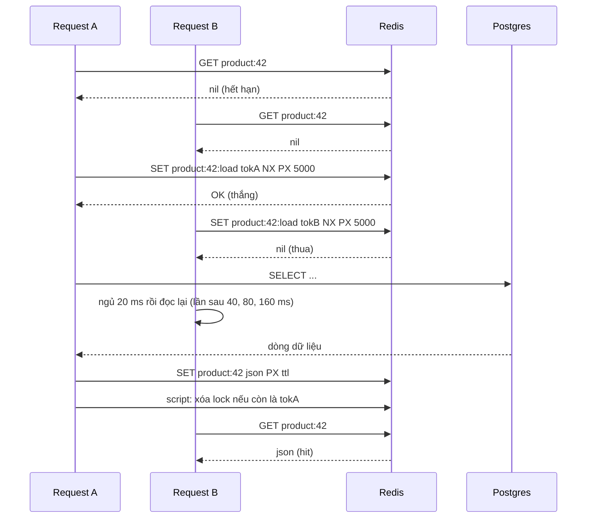
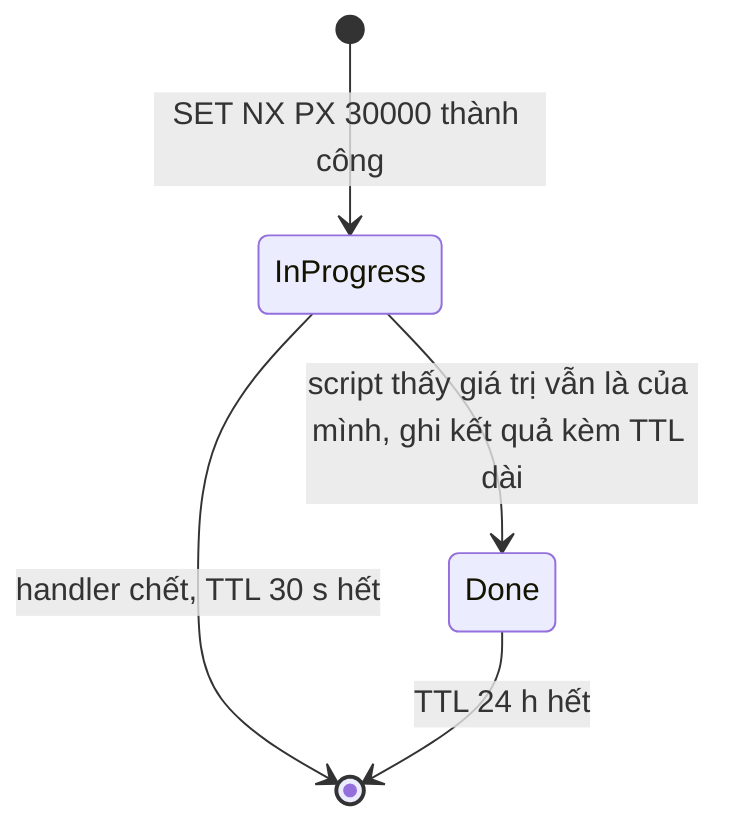
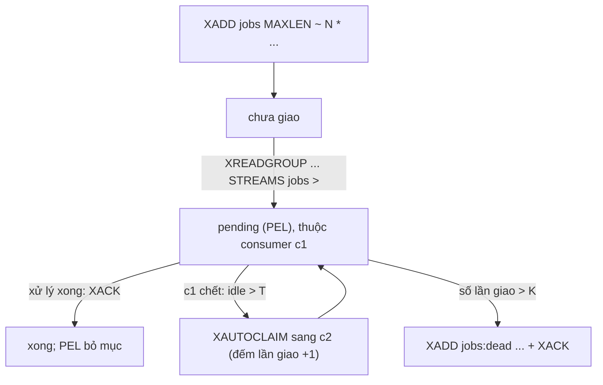
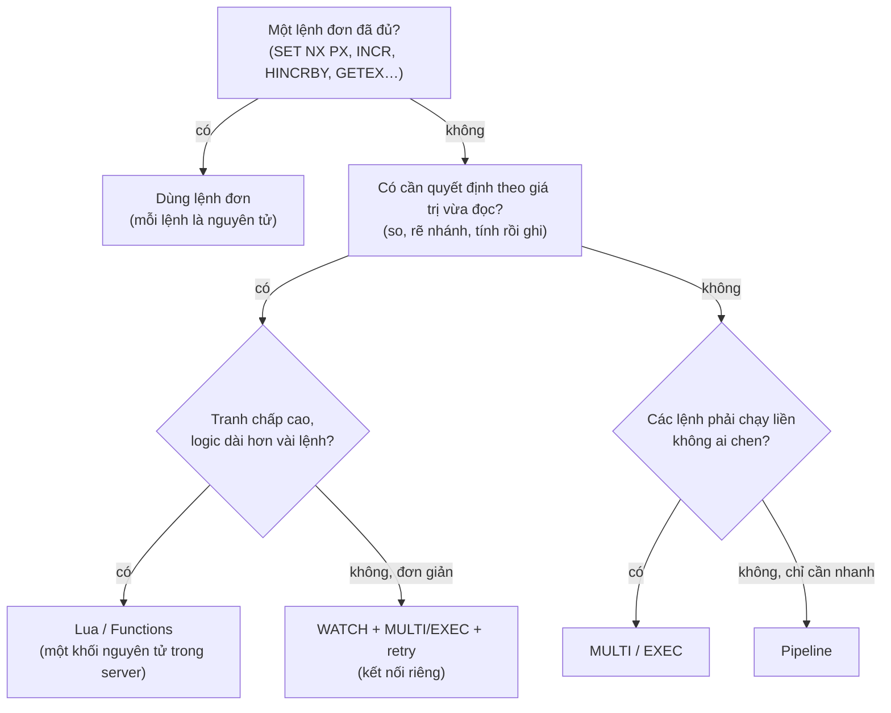

# P12 · Chương 17 — Redis trong thực chiến: kết hợp primitive thành pattern

> Phạm vi: chương 16 mở Redis từ bên trong; chương này làm ngược lại, lấy các *primitive* (một lệnh, một cấu trúc dữ liệu, một script) **ghép** thành pattern cho backend — cache, rate limiter, lock/idempotency, job queue, leaderboard, thống kê, session — rồi chỉ ra *chỗ mỗi pattern hỏng*. Nguồn ghim giống chương 16: **tài liệu** là repo `redis/redis-doc` ở commit `1044224477fceacc5af56a636b0a7495d19e533c` (các trang `commands/*.md` có mục "Pattern"), **source code** là Redis **7.2.5**, client Rust là crate `redis` **1.7.1** trên docs.rs. Ví dụ code (Lua, Rust) *chỉ để minh họa*: chương không biên dịch, không chạy và không khẳng định kết quả chạy chúng. Chỗ nào nguồn không nói (công thức, ngưỡng, lời khuyên thiết kế) đều ghi rõ là nhận xét hoặc suy luận của người soạn.

## Bạn sẽ hiểu được gì

- **Q1.** Cache bằng Redis: cache-aside, write-through, write-behind khác nhau thế nào và hỏng ở đâu; negative caching là gì; stampede xảy ra ra sao và ba cách chặn (single-flight bằng `SET NX`, TTL jitter, refresh sớm xác suất)? → mục 1
- **Q2.** Rate limiter: fixed window bằng `INCR`+`EXPIRE`, sliding window log bằng ZSET, token bucket bằng Lua — mỗi cái nguyên tử ở đâu, sai ở biên nào, tốn gì? → mục 2
- **Q3.** Lock và idempotency key: ghép `SET NX PX` + script so token + gia hạn thành khóa dùng được; vì sao *vẫn* cần fencing ở tài nguyên đích; và vì sao khóa idempotency key trong Redis không thay được ràng buộc duy nhất trong DB? → mục 3
- **Q4.** Job queue: List với `LMOVE`/`BLMOVE` (reliable queue) khác Stream + consumer group (`XREADGROUP`, `XACK`, `XAUTOCLAIM`, dead letter) ở đâu; khi nào nên dùng broker thật? → mục 4
- **Q5.** Leaderboard, ranking và phân trang bằng ZSET: `ZADD`/`ZINCRBY`/`ZRANGE … REV`/`ZRANK`, tie-break, giới hạn chính xác của score? → mục 5
- **Q6.** Đếm và thống kê: `INCR`/`HINCRBY`, HyperLogLog (sai số chuẩn 0,81%), bitmap (`SETBIT`/`BITCOUNT`) — chọn cái nào cho bài toán nào? → mục 6
- **Q7.** Session store, feature flag, và cách làm mất hiệu lực cache cục bộ: hash + TTL, pub/sub, `CLIENT TRACKING`? → mục 7
- **Q8.** Ghép cho đúng: pipeline vs `MULTI`/`EXEC` vs `WATCH` vs Lua/Functions; thiết kế key và hash tag; TTL hygiene; các anti-pattern (`KEYS`, big key, hot key, Redis làm source of truth không persistence)? → mục 8

## Kiến thức cần trước

- [P12 · Chương 16 — Redis bên trong](16-redis-ben-trong.md): chương này *dùng* kết luận của nó mà không chứng minh lại. Đó là: một thread thực thi lệnh, nên mỗi lệnh/script nguyên tử và một lệnh chậm chặn mọi client (mục 1); encoding và eviction (mục 2–3); persistence (mục 4); replication bất đồng bộ (mục 5); Cluster và slot (mục 6); `MULTI`/`WATCH`/Lua/Streams (mục 7); khóa, cache, rate limiter ở mức cơ bản (mục 8). Chương này đi sâu vào *cách ghép*, không nhắc lại cơ chế.
- [P12 · Chương 08 — Sự cố trong hệ phân tán](08-su-co-he-phan-tan.md) (mục 1 partial failure, mục 5 đồng hồ, mục 7 process pause, mục 8 lease và fencing token): nền cho mục 3.
- [P12 · Chương 07 — Transaction](07-transaction.md) (mục 5: `UPDATE` nguyên tử, compare-and-set) và [P12 · Chương 12 — Dữ liệu đúng đắn](12-dung-dan-va-tich-hop-du-lieu.md) (mục 1 dữ liệu dẫn xuất, mục 4–5 idempotency, mục 6 outbox).
- [P12 · Chương 11 — Stream processing](11-stream-processing.md) (mục 2 queue hay log, mục 4 ngữ nghĩa giao tin): nền cho mục 4.
- [P12 · Chương 15 — PostgreSQL bên trong](15-postgresql-ben-trong.md): phía DB của cache, lock và queue. Mỗi connection là một process (mục 1–2), nên một đợt stampede đổ xuống Postgres rất đắt.
- [P13 · Chương 09 — Mô hình hóa hệ backend](../13-tla-plus/09-mo-hinh-hoa-he-backend.md) (mục 2 lock + fencing, mục 4 cache-aside và cuộc đua stale): mô hình hình thức của hai pattern mà chương này làm ở mức thực hành.

## 0. Khung chung: năm câu hỏi cho mọi pattern, và sáu cách hỏng lặp lại

**Ví dụ chạy xuyên chương: `shop`.** Mọi mục sau đều bám theo `shop`, backend của một cửa hàng online: một service Rust (axum + tokio, crate `redis` 1.7.1) chạy thành 12 pod sau load balancer, dữ liệu chính nằm trong Postgres, và bên cạnh có Redis kèm một replica. Ở đầu chương ta cứ coi đó là một instance; mục 1.5 và mục 8 sẽ nói vì sao nên tách cache khỏi dữ liệu không được mất. Mỗi mục lấy một phần việc của `shop` làm đề bài: `GET /products/42` đọc rất nhiều nên cần cache (mục 1); API công khai dùng API key bị giới hạn 100 request/phút (mục 2); `POST /payments` mang header `Idempotency-Key`, cùng job đối soát cuối ngày mà chỉ một pod được chạy (mục 3); email xác nhận đơn và job xuất hóa đơn đi qua queue (mục 4); bảng xếp hạng sản phẩm bán chạy và khách hàng nhiều điểm thưởng nhất (mục 5); số lượt xem, số khách duy nhất và cờ "hôm nay có hoạt động" (mục 6); session đăng nhập, feature flag và cache cục bộ trong từng pod (mục 7). `shop` là ví dụ giả định (nhận xét của người soạn: ví dụ giả định, không phải code trong repo).

Mỗi pattern trong chương đi qua cùng năm câu hỏi:

1. Bài toán là gì?
2. Ghép primitive nào?
3. *Nguyên tử ở đâu*: bước nào là một lệnh hoặc một script duy nhất, bước nào là hai round trip mà request khác có thể chen vào?
4. Hỏng ở đâu?
5. Khi nào *không* nên dùng Redis?

Câu (3) quan trọng nhất. Redis không có transaction kiểu DB quan hệ, nên chuyện "đúng hay sai" luôn quy về việc *chọn ranh giới nguyên tử* (nhận xét của người soạn; cơ chế nền ở [chương 16, mục 7](16-redis-ben-trong.md)).

Câu (4) có sáu đáp án lặp lại ở gần như mọi pattern. Ta gọi tên chúng một lần ở đây, các mục sau chỉ cần nhắc **F1…F6**.

**F1 — Mất write khi failover.** Replication của Redis mặc định bất đồng bộ[^repl-async]. `WAIT` làm giảm khả năng mất write nhưng không biến Redis thành hệ CP: write đã ack vẫn có thể mất khi failover[^repl-wait-cp]. Redis Cluster cũng tự nhận như vậy: thường có những cửa sổ nhỏ mà write đã ack bị mất[^cl-ack-lost].

Với pattern, hậu quả có hai dạng. Counter có thể lùi lại và job có thể biến mất (suy luận của người soạn). Khóa thì có thể được cấp hai lần: A lấy khóa, master chết trước khi key kịp sang replica, rồi B lấy lại khóa trên replica vừa được thăng làm master. Tài liệu khóa của Redis mô tả đúng kịch bản này và quy nguyên nhân cho replication bất đồng bộ[^lk-replica-race]. Cơ chế đầy đủ nằm ở [chương 16, mục 5](16-redis-ben-trong.md).

**F2 — TTL không như bạn nghĩ.** Có ba cái bẫy khác nhau.

- **(a) Lệnh ghi có thể xóa TTL.** `SET` thường *xóa* TTL đang có của key[^set-ttl-cleared]; muốn giữ phải thêm `KEEPTTL`[^set-keepttl]. Ngược lại `INCR`, `LPUSH`, `HSET` không đụng tới TTL[^expire-untouched]. Vì vậy key mới tạo bằng `INCR` không tự có TTL và bạn phải tự đặt (suy luận của người soạn).
- **(b) TTL chạy theo đồng hồ tường của máy Redis.** Chỉnh giờ máy tiến 2000 giây thì key có TTL 1000 giây hết hạn ngay[^expire-clock]. Tài liệu khóa cũng nói Redis không dùng đồng hồ monotonic cho việc hết hạn, nên một bước nhảy đồng hồ có thể khiến nhiều process cùng giữ một khóa[^lk-disclaimer-clock].
- **(c) Key có thể biến mất trước TTL.** Khi `maxmemory` đầy, policy eviction có thể chọn trúng nó[^evict-policies]. Vì vậy lock, idempotency key và job không nên sống chung instance với một cache đang bật eviction (nhận xét của người soạn; mục 1.5 và mục 8).

**F3 — Đồng hồ của chính app.** Pattern nào lấy `now` từ đồng hồ của pod (window id của rate limiter, timestamp trong ZSET) thì lệch giờ giữa các pod sẽ làm kết quả lệch theo; xem [chương 08, mục 5–6](08-su-co-he-phan-tan.md). Chương này tránh bằng một trong hai cách. Cách thứ nhất là để Redis cấp thời gian, tức gọi `TIME` trong script (mục 2). Cách thứ hai là dùng cửa sổ tính từ lúc key được tạo (dựa vào TTL) để khỏi cần đồng hồ của pod; việc hết hạn lúc đó vẫn dựa vào đồng hồ của máy Redis, tức F2b.

**F4 — Cross-slot trong Cluster.** Lệnh nhiều key chỉ chạy được khi mọi key cùng slot[^cl-subset]. Nếu không, server trả `CROSSSLOT`[^src-crossslot]. Script cũng vậy: tài liệu yêu cầu khai báo *mọi* key script đụng tới trong `KEYS`[^sc-keys], và các key đó phải cùng slot.

Công cụ để ép nhiều key về cùng slot là *hash tag* `{...}`[^cl-hashtag] (cơ chế: [chương 16, mục 6](16-redis-ben-trong.md)). Hệ quả thiết kế: pattern nào cần nhiều key trong một thao tác nguyên tử (khóa + fence counter, queue + processing list, nhiều bitmap) phải đặt tên key có hash tag ngay từ đầu. Mục 8 nói cách chọn tag.

**F5 — Big key.** Mọi lệnh chạy trên thread chính, nên một lệnh chậm làm mọi client khác phải chờ[^lat-slow]. `DEL` một key chứa list/set/zset/hash tốn O(M) theo số phần tử[^del-cx], nên xóa một key khổng lồ là ví dụ điển hình của lệnh chậm (nhận xét của người soạn). `UNLINK` thu hồi bộ nhớ ở thread khác nên không chặn[^unlink-doc]. Cơ chế và ngoại lệ: [chương 16, mục 1](16-redis-ben-trong.md).

**F6 — Hot key.** Một key chỉ ánh xạ tới đúng một slot, `CRC16(key) mod 16384`[^cl-hashslot]. Vì vậy mọi lệnh ghi vào key đó dồn về một master, và thêm node không chia nhỏ được *một* key (suy luận của người soạn từ công thức slot). Tải đọc thì khác: tài liệu Cluster nói replica của master đó có thể gánh bớt khi chấp nhận dữ liệu cũ[^cl-replicas-read].

| | Hỏng thế nào | Pattern chịu ảnh hưởng nặng nhất (nhận xét của người soạn) |
|---|---|---|
| F1 | mất write đã ack | write-behind (1), rate limiter (2), lock (3), queue (4), counter (6) |
| F2 | TTL bị xóa/trôi/evict | cache (1), rate limiter (2), idempotency (3), session (7) |
| F3 | lệch đồng hồ | rate limiter (2), lock (3) |
| F4 | `CROSSSLOT` | rate limiter nhiều chiều (2), lock+fence (3), queue (4), bitmap/HLL nhiều key (6), Lua (8) |
| F5 | lệnh chậm do key lớn | cache value lớn (1), leaderboard (5), bitmap (6), stream (4) |
| F6 | một key quá nóng | cache (1), rate limiter (2), counter (6), flag (7) |

<details><summary>Đi sâu: hai chi tiết nhỏ của F4 (script và resharding)</summary>

Với script, chú thích trong source 7.2.5 cho biết: nếu script đã khai báo key trước thì lỗi cross-slot đã được ném sẵn[^script-crossslot].

Khi đang resharding thủ công, thao tác nhiều key có thể tạm không dùng được[^cl-resharding-multikey]. Lúc đó server trả `TRYAGAIN`[^src-tryagain].

</details>

## 1. Cache: cache-aside, stampede, negative caching (Q1)

> **Trả lời ngắn.** Cách dùng cache điển hình là *cache-aside*: app hỏi Redis trước; nếu key chưa có (trượt cache) thì đọc DB rồi nạp kết quả vào Redis[^fb-lookaside]. Khi dữ liệu đổi, app ghi DB rồi *xóa* key trong cache chứ không sửa nó[^fb-delete]. Cách này hay hỏng ở ba chỗ: cache giữ dữ liệu cũ vì đọc và ghi xen kẽ nhau; *stampede*, tức là khi một key nóng vừa hết hạn thì hàng loạt request cùng chạy xuống DB để nạp lại nó[^xf-def]; và những key "không tồn tại" bị hỏi đi hỏi lại. Ba cách chữa tương ứng là xóa key sau khi commit DB và lấy TTL (thời gian sống của key) làm lưới an toàn; chặn stampede bằng cách cho đúng một request đi nạp lại key (*single-flight*), cộng thêm một chút ngẫu nhiên vào TTL (*jitter*) hoặc làm mới key trước khi hết hạn; và cache luôn cả câu trả lời "không có" (*negative caching*).

**Giải thích.**

*Với `shop`.* Trang sản phẩm `GET /products/42` nhận hàng chục nghìn request mỗi giây, 99% là đọc, dữ liệu gốc nằm ở Postgres, nên `shop` cho Redis đứng trước làm cache. Một hôm sản phẩm 42 lên báo, đúng lúc nó nóng nhất thì key cache của nó hết hạn. 3.000 request cùng thấy "trượt" và cùng gửi `SELECT` xuống DB; pool connection cạn ([chương 15, mục 2](15-postgresql-ben-trong.md)) và cả site chậm theo. Cache làm `shop` nhanh, nhưng chính cách cache hết hạn lại thành nguồn sự cố. Câu hỏi của mục này: `shop` nên đọc và ghi cache thế nào để không giữ dữ liệu cũ, và làm sao để một key nóng hết hạn không kéo cả Postgres xuống?

### 1.1 Cache-aside: đọc và ghi

*Đọc.* Với mỗi request `GET /products/42`, app gọi `GET product:42` trên Redis. Có key thì trả luôn. Không có thì app đọc Postgres rồi `SET product:42 <json> PX <ttl>` (`PX` đặt TTL tính bằng mili giây), để những request sau không phải xuống DB nữa. Kiểu này gọi là *look-aside, nạp theo nhu cầu*: web server (ở đây là app của `shop`) hỏi cache trước, trượt thì tự lấy dữ liệu từ DB hoặc backend khác rồi nạp cặp key-value vào cache[^fb-lookaside].

Không phải hệ cache nào cũng bắt app tự nạp. Nhiều hệ cache thương mại có sẵn các chế độ read-through, write-through và write-behind[^az-rw], tức là tự đứng ra nạp từ DB và ghi xuống DB thay cho app. Redis lõi không tự làm những việc đó (suy luận của người soạn từ danh sách lệnh), nên chữ "aside" nghĩa là *code của app* giữ phần logic nạp.

*Ghi.* Khi `shop` sửa một sản phẩm, chẳng hạn đổi giá của sản phẩm 42, app ghi Postgres và commit trước, *rồi mới* `DEL product:42`. Hai chi tiết ở đây đáng giải thích: vì sao xóa key thay vì `SET` giá trị mới, và vì sao DB phải đi trước.

Ta xóa key thay vì cập nhật nó vì xóa là idempotent[^fb-delete]. Nói cách khác, retry `DEL` bao nhiêu lần cũng giống một lần, còn retry một lệnh `SET` mang giá trị cũ có thể đè lên giá trị mới hơn (nhận xét của người soạn).

Thứ tự "DB trước, cache sau" cũng quan trọng: phải cập nhật DB xong mới xóa key cache[^az-order]. Nếu xóa cache trước, một request đọc (reader) chen vào giữa sẽ thấy trượt, đọc DB lúc dòng dữ liệu còn mang giá trị *cũ*, rồi nạp chính giá trị cũ đó vào cache.

*Cuộc đua giữa reader và writer.* Làm đúng thứ tự cũng chưa hết chuyện. Từ lúc ghi tới lần đọc kế tiếp, reader vẫn có thể gặp trượt cache hoặc thấy dữ liệu cũ trong chốc lát[^az-stale]. Tệ hơn, giá trị cũ có thể nằm lại trong cache lâu hơn thế nếu một reader đang nạp cache bị một request ghi (writer) chen ngang:

1. Reader trượt cache, đọc Postgres và nhận giá trị cũ.
2. Writer ghi giá trị mới vào Postgres rồi `DEL product:42`.
3. Reader nạp giá trị cũ vừa đọc ở bước 1 vào cache.

Từ đó cache giữ giá trị cũ cho tới khi key hết hạn hoặc bị xóa lần sau (trình tự minh họa của người soạn).

Tình huống này có tên là *stale set*: web server đặt vào cache một giá trị không phản ánh giá trị mới nhất, và việc đó có thể xảy ra khi các cập nhật đồng thời bị đảo thứ tự[^fb-stale].

Lời giải của Facebook trong memcached là *lease token*: một token gắn với đúng key mà client đã hỏi, và client phải trả token đó lại khi đặt giá trị. Nếu giữa chừng key bị `delete` thì token bị vô hiệu, và memcached có thể từ chối lần đặt giá trị trễ ấy[^fb-lease]. Mô hình TLA+ của cơ chế này nằm ở [P13 · Chương 09, mục 4](../13-tla-plus/09-mo-hinh-hoa-he-backend.md), bản tóm tắt ở [chương 16, mục 8.4](16-redis-ben-trong.md).

Khi chưa dùng lease, `shop` có hai biện pháp thực tế:

- TTL: giá trị cũ không sống mãi. Nên chọn chính sách hết hạn khớp với kiểu truy cập của dữ liệu[^az-ttl].
- Với dữ liệu quan trọng, ghi cache *có phiên bản* bằng Lua: writer *ghi* phiên bản mới vào key thay vì `DEL`. Cách này chỉ chặn được ghi đảo thứ tự chừng nào phiên bản còn nằm trong key (xem phần Đi sâu; nhận xét của người soạn).

### 1.2 Write-through và write-behind

Cache-aside xóa key rồi chờ lần đọc sau nạp lại. *Write-through* đi theo hướng ngược lại: writer cập nhật DB (data store) và cache trong cùng một thao tác ghi, nên reader thấy giá trị mới ngay sau khi ghi thành công[^az-wt].

Trên Redis, cách này có một cái bẫy: hai writer đồng thời `SET` cùng một key có thể đặt giá trị theo thứ tự ngược với thứ tự commit trong DB, và đó chính là kiểu "cập nhật đồng thời bị đảo thứ tự" của stale set ở mục 1.1[^fb-stale]. Vì vậy write-through trên Redis nên đi kèm so phiên bản bằng Lua (xem phần Đi sâu; nhận xét của người soạn).

*Write-behind* đẩy việc ghi DB ra sau: app chỉ ghi vào Redis, rồi một tiến trình khác chép xuống DB sau. Nó đổi độ bền lấy tốc độ ghi, vì phần dữ liệu chưa kịp chép xuống DB có thể mất ở nhiều tầng:

- Nếu Redis chỉ bật RDB, có thể mất vài phút dữ liệu gần nhất[^pers-rdb-lose].
- Với AOF `everysec`, tài liệu nói có thể mất khoảng một giây[^aof-everysec] (riêng source có một ngoại lệ, xem phần Đi sâu).
- Ngoài ra, failover cũng có thể làm mất write (F1).

Vì vậy chỉ nên dùng write-behind cho dữ liệu *chịu được mất*, như số lượt xem của sản phẩm. Với dữ liệu mà "đã báo thành công cho user" nghĩa là nó phải còn, như đơn hàng hay thanh toán, thì không dùng: DB là nơi ghi đầu tiên, còn Redis (nếu cần) chỉ là bản sao dẫn xuất (nhận xét của người soạn; khái niệm dữ liệu dẫn xuất: [chương 12, mục 1](12-dung-dan-va-tich-hop-du-lieu.md)).

Nếu thật sự cần một bộ đệm ghi bền hơn, hình dạng gần đúng nhất là Stream kết hợp AOF với `fsync` mạnh và consumer idempotent (mục 4), chứ không phải một key cache. Nó vẫn chịu F1 (nhận xét của người soạn).

### 1.3 Negative caching

Cache-aside còn một chỗ yếu nữa. Một con bot dò `GET /products/9999999`, id không tồn tại, thì lần nào cũng trượt cache vì DB không có dòng nào để nạp vào, nên lần nào cũng gõ xuống DB.

Cách chữa là *negative caching*: lưu vào cache cả thông tin "cái này không tồn tại". Khái niệm này có định nghĩa chuẩn trong DNS (RFC 2308): việc lưu lại thông tin rằng một thứ không tồn tại, không có hoặc không trả lời được[^rfc2308-def]. Nó có ích vì giảm thời gian phản hồi cho các câu trả lời âm, tức loại "không có"[^rfc2308-use].

Trên Redis, khi DB trả "không có dòng" thì app `SET product:9999999 "" PX 30000`: chuỗi rỗng đóng vai dấu "đã biết là không có". `GET` trả nil khi key không tồn tại[^get-nil], nên nil và chuỗi rỗng là hai kết quả khác nhau, và app phân biệt được "chưa biết" với "biết là không có" (suy luận của người soạn).

Ba lưu ý khi dùng (nhận xét của người soạn):

- TTL của bản ghi âm (key "không có") phải *ngắn* hơn nhiều TTL của bản ghi dương (key có dữ liệu thật).
- Khi *tạo* dòng mới thì phải `DEL` key âm tương ứng; nếu không, bản ghi "mới tạo" vẫn trả 404 tới khi TTL hết.
- Id do kẻ tấn công sinh tùy ý vẫn có thể làm đầy bộ nhớ bằng vô số key âm, nên cần đi kèm giới hạn tần suất (mục 2) hoặc Bloom filter ở lớp trước, tức bộ lọc cho biết nhanh một id chắc chắn không có trong tập.

### 1.4 Stampede và ba cách chặn

Chuyện xảy ra với sản phẩm 42 ở đầu mục có tên là *stampede* (cũng gọi là dog-piling hoặc cache miss storm): một mục cache phổ biến hết hạn, nhiều request cùng thấy trượt rồi cùng tính lại đúng mục đó[^xf-def]. Số request cùng tính lại phụ thuộc vào cả tần suất request lẫn *thời gian tính lại*. Ví dụ: mục được đọc 10 lần/giây mà tính lại mất 3 giây thì có 30 request cùng tính lại[^xf-size].

Có ba cách chặn, mỗi cách nhắm vào một chỗ khác nhau: cách 1 cho đúng một request đi nạp lại key, cách 2 rải thời điểm hết hạn của các key ra, cách 3 làm mới key từ trước hạn. Sơ đồ dưới đây là cách 1 chạy với hai request A và B cùng thấy key `product:42` hết hạn.



*Cách 1 — single-flight bằng `SET NX PX`.* *Single-flight* nghĩa là mỗi lúc chỉ một request đi nạp lại key, các request khác chờ kết quả của nó. Với Redis, request nào thắng `SET product:42:load <token> NX PX 5000` thì xuống Postgres lấy dữ liệu (`NX`: chỉ đặt khi key chưa có; `PX 5000`: key tự hết hạn sau 5.000 ms, tức 5 giây). Request thua *ngủ ngắn rồi đọc lại cache* thay vì chạy tới DB, nên 3.000 truy vấn của `shop` thường chỉ còn một.

Khóa này dùng đúng primitive ở mục 3: lấy bằng `SET … NX PX`, nhả bằng một script so token. Nó thuộc loại khóa "vì hiệu quả", chỉ để khỏi nạp thừa. Với loại này, chỉ cần thuật toán khóa trên một node, và nên ghi rõ trong code rằng khóa chỉ gần đúng, thỉnh thoảng có thể sai[^kb-efficiency].

Cách này có hai cái bẫy. Cái bẫy đầu tiên là khóa hết hạn trước khi request đang nạp xong. Giả sử TTL của khóa là 5 giây mà truy vấn mất 8 giây: khóa tự mất giữa chừng, một request khác thắng khóa mới, và hai request cùng nạp rồi cùng `SET` giá trị. Nếu dữ liệu không đổi thì chỉ tốn thêm một lần nạp.

Nhưng truy vấn chạy lâu cũng là cửa sổ cho cuộc đua "stale set" ở mục 1.1: một writer chen vào giữa, rồi lần `SET` trễ của request đang nạp đè giá trị cũ lên cache. Vì vậy TTL của khóa phải lớn hơn thời gian nạp tệ nhất, và dữ liệu quan trọng thì nên ghi cache có phiên bản (xem phần Đi sâu; nhận xét của người soạn).

Cái bẫy thứ hai nằm ở request thua: nó cần *giới hạn kiên nhẫn*. Sau vài lần ngủ mà cache vẫn trống thì trả giá trị cũ (nếu có) hoặc báo lỗi nhanh, đừng chờ vô hạn. Chỉ đọc thẳng DB khi tổng thời gian đã chờ dài hơn thời gian nạp thông thường (ví dụ ở phần Đi sâu chờ tối đa khoảng 460 ms); nếu không, mọi request thua cùng đổ xuống DB và stampede quay lại (nhận xét của người soạn).

*Cách 2 — TTL có jitter.* Nếu một lô key được nạp cùng lúc với cùng TTL (lúc khởi động, sau deploy, khi warm-up) thì chúng cũng hết hạn cùng lúc. Cộng thêm một số ngẫu nhiên vào TTL của từng key, ví dụ 0–10% TTL, gọi là *jitter*: các key nhờ vậy rải đều ra (nhận xét của người soạn; con số 0–10% chưa có nguồn ghim).

Rải TTL còn có một lý do nữa, nằm ở chính Redis. Khi *rất nhiều* key cùng hết hạn, chu trình expire chủ động của Redis (cơ chế: [chương 16, mục 3](16-redis-ben-trong.md)) cứ lặp lại chừng nào tỷ lệ key hết hạn trong mẫu vừa kiểm tra còn vượt một ngưỡng[^expire-active]. Chu trình này dùng tới một phần CPU của thread chính[^expire-cpu]. Vì vậy hết hạn hàng loạt hoạt động như một lệnh chậm gián tiếp (suy luận của người soạn từ hai nguồn).

*Cách 3 — refresh sớm.* Cách này không chờ key hết hạn mà để *một* request tính lại nó từ trước hạn, trong lúc các request khác vẫn đọc được giá trị hiện có. Một paper VLDB 2015 về chống stampede biến ý này thành *probabilistic early expiration*: mỗi request tự quyết định, độc lập và ngẫu nhiên, xem có nên tính lại mục trước khi nó hết hạn hay không, với xác suất tăng dần khi mục gần hạn[^xf-early]. Cách đó nhắm tới các hệ cache chỉ có thao tác `get`/`set` cơ bản, không có khóa hay cơ chế chống stampede[^xf-nolock].

Thuật toán `XFetch` của paper cụ thể hóa ý đó. Mỗi mục lưu kèm hai số: thời gian tính lại lần trước `∆` và thời điểm hết hạn `expiry`. Mỗi lần đọc, request kiểm tra điều kiện `Time() − ∆β log(rand()) ≥ expiry`[^xf-formula]; nếu điều kiện đúng thì nó tính lại mục. Tham số `β` mặc định bằng 1; tăng `β` thì chặn stampede tốt hơn nhưng key bị làm mới sớm hơn[^xf-beta].

Với Redis, `shop` giữ `value`, `delta` và `expiry` trong một hash (hoặc nhúng vào JSON). `expiry` là thời điểm hết hạn *logic*; TTL vật lý, tức TTL thật mà Redis dùng để xóa key, phải dài hơn nó. Điều kiện `XFetch` thì tính ở phía client (nhận xét của người soạn).

Một biến thể là "stale-while-revalidate": TTL vật lý bằng TTL logic cộng thêm một khoảng ân hạn. Khi đã quá TTL logic, request nào thắng `SET NX` thì đi làm mới, còn mọi request khác phục vụ giá trị cũ. Cách này tốt nhất cho độ trễ p99 (mức mà 99% request nhanh hơn), đổi lại phải chấp nhận dữ liệu cũ trong khoảng ân hạn (nhận xét của người soạn).

### 1.5 Cấu hình instance cache, hot key và khi nào KHÔNG cache

Cuối cùng là chính instance Redis dùng làm cache. Nó nên đặt `maxmemory` và một policy eviction kiểu LRU/LFU, để khi bộ nhớ đầy Redis tự đuổi bớt key (các policy và cơ chế: [chương 16, mục 3](16-redis-ben-trong.md)). `allkeys-lru` hợp khi phân bố truy cập theo power law, tức một số ít key được hỏi nhiều hơn hẳn phần còn lại[^evict-rule-lru]. Còn `noeviction` thì từ chối ghi khi đầy[^conf-noevict], nên không hợp với cache.

Đừng để cache sống chung instance với dữ liệu *không được mất* khi instance đó bật eviction (nhận xét của người soạn). Với `shop`, loại dữ liệu này gồm khóa của job đối soát cuối ngày, idempotency key của `POST /payments` và job gửi email xác nhận đơn. Hai policy `volatile-lru` và `volatile-random` chủ yếu hợp với trường hợp một instance vừa làm cache vừa giữ một số key bền, nhưng thường chạy hai instance riêng vẫn tốt hơn[^evict-volatile].

Sản phẩm viral còn gây ra một vấn đề nữa là key cực nóng (F6): sản phẩm 42 vẫn chỉ là *một* key trên *một* master. Có hai hướng giảm tải (nhận xét của người soạn):

- Giữ một bản sao trong bộ nhớ của từng pod `shop`, với TTL vài giây hoặc có invalidation, tức báo cho pod bỏ bản sao khi dữ liệu đổi (mục 7).
- Nhân key thành `product:42#0…#7` rồi đọc ngẫu nhiên một bản. Ghi thì phải cập nhật tất cả các bản, nên cách này chỉ hợp dữ liệu ít ghi.

**Khi nào KHÔNG dùng cache Redis** (nhận xét của người soạn):

- Dữ liệu cần *read-your-writes* tuyệt đối, tức vừa ghi xong là phải đọc thấy ngay, như số dư hay tồn kho lúc đặt hàng: đọc thẳng DB chính (primary).
- Truy vấn DB vốn đã rẻ: Postgres tự có page cache ([chương 15, mục 3](15-postgresql-ben-trong.md)), thêm một lớp nữa chỉ thêm chỗ để sai.
- Hit rate thấp (tỷ lệ request tìm thấy key trong cache) hoặc value lớn (F5): cache tốn bộ nhớ mà không giảm được tải.
- Hệ thống *không sống nổi khi cache lạnh*: lúc đó cache không còn là một tối ưu hóa mà thành phụ thuộc cứng. Hãy thử khởi động với cache trống trước khi tin vào nó.

<details><summary>Đi sâu: code Rust cho cache-aside + single-flight, Lua ghi có phiên bản, XFetch, và vài chi tiết nguồn</summary>

Ba đoạn code dưới đây *chỉ minh họa*, chương này không biên dịch chúng. Chúng giả định `redis` 1.7.1 với các feature sau:

- `aio` và `tokio-comp`. `tokio-comp` bật hỗ trợ async trên runtime Tokio[^rs-feat-tokio]. Thiếu cả `tokio-comp` lẫn `smol-comp` thì phần `aio` của crate không biên dịch được[^rs-feat-runtime].
- `connection-manager`. Kiểu `ConnectionManager` chỉ có khi bật cả `aio` lẫn `connection-manager`[^rs-cm-feature].
- `script`. Trang tài liệu của `Script` ghi rõ nó chỉ có khi bật feature `script`[^rs-script-feature]. Feature này nằm trong nhóm bật mặc định[^rs-feat-script-default].

Tên feature của từng kiểu khác nhau, nên hãy kiểm tra trên docs.rs trước khi dùng. `Db`, `Product`, `new_token()` và `with_jitter()` là kiểu và hàm giả định của ví dụ, không thuộc crate nào. Ví dụ còn dùng các crate `tokio`, `anyhow`, `serde_json` và `rand` (chương này không đối chiếu phiên bản của chúng).

```rust
use redis::{aio::ConnectionManager, AsyncCommands, Script};
use std::{sync::LazyLock, time::Duration};

// Script là bất biến và dùng chung được; tạo một lần.
static UNLOCK: LazyLock<Script> = LazyLock::new(|| Script::new(r#"
  if redis.call("get", KEYS[1]) == ARGV[1] then return redis.call("del", KEYS[1]) else return 0 end
"#));

async fn get_product(conn: &mut ConnectionManager, db: &Db, id: u64) -> anyhow::Result<Option<Product>> {
    let key = format!("v1:product:{id}");           // "v1:" để đổi định dạng cache mà không xóa tay
    for attempt in 0..5u32 {
        // 1) cache. nil = chưa biết; "" = biết là không có (negative caching).
        if let Some(raw) = conn.get::<_, Option<String>>(&key).await? {
            return Ok(if raw.is_empty() { None } else { Some(serde_json::from_str(&raw)?) });
        }
        // 2) single-flight: ai thắng NX thì nạp.
        let lock = format!("{key}:load");
        let token = new_token();                       // >= 128 bit ngẫu nhiên
        let won: Option<String> = redis::cmd("SET").arg(&lock).arg(&token)
            .arg("NX").arg("PX").arg(5_000).query_async(conn).await?;
        if won.is_some() {
            let row = db.find_product(id).await?;      // đọc Postgres
            let (val, ttl_ms) = match &row {
                Some(p) => (serde_json::to_string(p)?, with_jitter(300_000)), // base + rand(0..10%)
                None => (String::new(), 30_000),       // âm: TTL ngắn
            };
            let _: () = redis::cmd("SET").arg(&key).arg(val).arg("PX").arg(ttl_ms).query_async(conn).await?;
            let _: i64 = UNLOCK.key(&lock).arg(&token).invoke_async(conn).await?;
            return Ok(row);
        }
        // 3) người thua: ngủ rồi đọc lại; giới hạn kiên nhẫn.
        tokio::time::sleep(Duration::from_millis(20 << attempt.min(3))).await;
    }
    Ok(db.find_product(id).await?)                     // hết kiên nhẫn: đọc thẳng DB
}
```

Ở dòng `UNLOCK.key(&lock).arg(&token)`, `.key(..)` thêm một phần tử vào `KEYS`[^rs-script-key]. `.arg(..)` thêm một phần tử vào `ARGV`[^rs-script-arg].

Script cache của server là *không bền*: restart Redis có thể xóa nó[^sc-cache-volatile]. Dù vậy code không phải lo chuyện đó, vì đối tượng `Script` của crate tự upload và thực thi script[^rs-script]. Nếu script chưa có trên server thì `invoke_async` tự nạp rồi chạy lại[^rs-script-noscript], nên code không phải tự bắt `NOSCRIPT`.

Đoạn Lua dưới đây ghi cache có phiên bản, dùng cho write-through. `ARGV[1]` là version tăng dần của dòng DB, ví dụ một cột `version` được tăng trong cùng câu `UPDATE` (xem [chương 07, mục 5](07-transaction.md)). Script chạy nguyên tử vì trong lúc nó chạy, mọi hoạt động khác của server đều bị chặn[^sc-atomic], nên bước "so rồi ghi" không bị chen:

```lua
-- KEYS[1] = key cache; ARGV[1] = version mới; ARGV[2] = payload; ARGV[3] = ttl ms
local cur = redis.call('HGET', KEYS[1], 'v')
if cur == false or tonumber(cur) < tonumber(ARGV[1]) then
  redis.call('HSET', KEYS[1], 'v', ARGV[1], 'd', ARGV[2])
  redis.call('PEXPIRE', KEYS[1], ARGV[3])
  return 1
end
return 0
```

Hash là kiểu "record" gồm các cặp field-value[^hash-def]. `HSET` không đụng tới TTL của key[^expire-untouched], nên script tự `PEXPIRE` mỗi lần ghi thành công.

Hai lưu ý về script này (suy luận của người soạn):

1. Script lưu cache dạng *hash* (`v`, `d`), nên đường đọc phải là `HGET key d` hoặc `HMGET key v d`. `GET` trong `get_product` ở trên chỉ xử lý chuỗi và trả lỗi với kiểu khác[^get-notstring], vì vậy đừng trộn hai dạng lưu trữ trên cùng một key. Trong Lua, `HGET` trả `false` khi field không có[^lua-nil-false], nên script so `cur == false`.
2. Phiên bản chỉ chặn được ghi đảo thứ tự chừng nào nó còn nằm trong key. Nếu invalidation bằng `DEL` (hoặc TTL, eviction) xóa mất key thì một lần ghi trễ mang phiên bản cũ lại lọt vào. Vì vậy script này chỉ có nghĩa khi writer *ghi* phiên bản mới vào cache (write-through) thay vì `DEL`; ghép nó với `DEL` của cache-aside ở mục 1.1 thì không chặn được ghi trễ.

Quyết định `XFetch` ở phía client, với `delta_ms` là thời gian đo được ở lần tính lại trước và `beta` mặc định bằng 1 như trong paper:

```rust
fn should_refresh(now_ms: f64, delta_ms: f64, expiry_ms: f64, beta: f64) -> bool {
    // rand::random::<f64>() thuộc [0,1); ln() <= 0 nên trừ nó là cộng một khoảng ngẫu nhiên dương.
    now_ms - delta_ms * beta * rand::random::<f64>().ln() >= expiry_ms
}
```

Nếu muốn tránh chuyện nhiều request cùng làm mới thì vẫn bọc lời gọi tính lại bằng `SET NX PX` như ở trên: `XFetch` chỉ giảm xác suất đó, còn khóa giúp thường chỉ có một request đi tính (nhận xét của người soạn).

**Chi tiết nguồn của phần Giải thích.**

- AOF `everysec` (mục 1.2): tài liệu nói có thể mất khoảng một giây[^aof-everysec], còn source có một ngoại lệ trì hoãn tới khoảng 2 giây, cơ chế ở [chương 16, mục 4](16-redis-ben-trong.md).
- Chu trình expire chủ động (mục 1.4, cách 2): tài liệu EXPIRE ghi ngưỡng 25%[^expire-active]. Source 7.2.5 thì dùng hằng `ACTIVE_EXPIRE_CYCLE_ACCEPTABLE_STALE` bằng 10[^expire-stale-src].
- Facebook giảm nhẹ vấn đề này ngay trong memcached bằng cách điều tiết token của lease (mục 1.4, cách 1): mặc định mỗi key chỉ cấp một token mỗi 10 giây[^fb-herd-rate]. Request tới trong lúc đó nhận thông báo "chờ một chút", vì client giữ lease thường nạp xong trong vài mili giây[^fb-herd-wait].

</details>

**Quay lại Q1:** `shop` đọc cache trước và nạp từ Postgres khi trượt, ghi DB xong thì `DEL` key và để TTL làm lưới an toàn; stampede thì chặn bằng single-flight (`SET NX PX`), TTL có jitter hoặc refresh sớm xác suất; key không tồn tại thì cache giá trị âm với TTL ngắn; còn dữ liệu cần read-your-writes tuyệt đối thì không cache.

## 2. Rate limiter: fixed window, sliding window log, token bucket (Q2)

> **Trả lời ngắn.** Rate limiter đếm số request mà mỗi API key đã gửi trong một khoảng thời gian và từ chối khi vượt giới hạn; để cả 12 pod của `shop` đếm chung, ta đặt bộ đếm trong Redis. Cách rẻ nhất là *fixed window* (cửa sổ cố định): mỗi phút một counter, tức biến đếm, tăng thêm 1 sau mỗi request, nhưng ở chỗ chuyển từ phút này sang phút sau, client vẫn có thể gửi dồn gấp đôi giới hạn trong chốc lát. Hai cách tránh được lỗ hổng ở biên đó là *sliding window log* (ghi từng request vào một ZSET, tức tập hợp có thứ tự của Redis, rồi đếm những request trong khoảng thời gian gần nhất) và *token bucket* (mỗi key có một số token, mỗi request lấy bớt token, và token nạp lại dần theo thời gian). Cả hai phải đọc, quyết định rồi ghi như một khối không ai chen vào được, nên chúng chạy trong một script Lua, tức đoạn code nhỏ do chính Redis thực thi[^sc-atomic].

**Giải thích.**

*Với `shop`.* `shop` mở một API công khai: mỗi API key được gọi tối đa 100 request/phút, còn bản thân `shop` chạy trên 12 pod. Nếu mỗi pod chỉ giới hạn *cục bộ*, tức tự đếm riêng, thì một key qua được 100 request/phút ở từng pod, tổng cộng tới 1.200 request/phút. Muốn có một con số chung thì cả 12 pod phải cùng đếm vào một chỗ, và Redis là nơi quen thuộc để đặt trạng thái chung đó (nhận xét của người soạn). Câu hỏi của mục này: đếm trong Redis thế nào để 12 pod đếm cùng lúc mà vẫn đúng, mỗi cách tốn gì, và hỏng ở đâu?

Ta đi qua ba cách đếm (2.1 đến 2.3), rồi xem chúng hỏng ở đâu và khi nào không nên dùng Redis (2.4).

### 2.1 Fixed window

Fixed window (cửa sổ cố định) là cách đếm đơn giản nhất. Mỗi API key có một counter cho cửa sổ hiện tại; mỗi request đến thì `INCR` tăng counter lên 1, và request nào làm counter vượt 100 thì bị từ chối cho tới khi sang cửa sổ mới. `INCR` là phép tăng nguyên tử[^rl-incr], nên khi nhiều pod cùng `INCR` một key thì không lần tăng nào bị mất. (Lệnh này chỉ làm việc với số nguyên 64-bit có dấu[^incr-int].) Để counter tự biến mất khi cửa sổ kết thúc, ta đặt cho nó TTL (thời gian sống của key).

Tài liệu Redis cũng mô tả rate limiter theo cách này: đó là một counter đặc biệt, dùng để giới hạn tần suất một thao tác[^rl-pattern]. Ở đó có hai cách làm. Cách thứ nhất dùng một key cho mỗi cặp (IP, giây), và đặt `INCR` cùng `EXPIRE` trong `MULTI`/`EXEC` (`MULTI` và `EXEC` bọc quanh các lệnh cần chạy liền nhau) để mỗi lần gọi chắc chắn vừa tăng counter vừa đặt hạn[^rl-multi]. Cách thứ hai chỉ dùng một counter duy nhất, và cửa sổ bắt đầu từ request đầu tiên của cửa sổ đó[^rl-window-survive]. [Chương 16, mục 8.5](16-redis-ben-trong.md) mới chỉ nhắc ngắn hai cách này.

Ta lấy cách thứ hai và cải tiến nó bằng option `NX` của `EXPIRE`, nghĩa là chỉ đặt hạn khi key chưa có hạn[^expire-nx]. Option này có từ Redis 7.0[^expire-nx-since]. Nhờ nó, chỉ cần bọc hai lệnh trong `MULTI`/`EXEC` là đủ; phần `{apikey}` trong tên key là hash tag, mục 8 sẽ nói tới:

```
MULTI
INCR   rl:{apikey}
EXPIRE rl:{apikey} 60 NX
EXEC
```

Cách này đúng nhờ hai chi tiết: `MULTI`/`EXEC` giữ cho `INCR` và `EXPIRE` đi cùng nhau, còn `NX` giữ cho cửa sổ có điểm kết thúc.

Trước hết, vì sao hai lệnh phải đi cùng nhau? Bản counter duy nhất trong tài liệu chạy `INCR`, rồi chỉ `EXPIRE` nếu giá trị trả về bằng 1. Nếu pod đã `INCR` mà chưa kịp `EXPIRE` thì key không có hạn và bị rò rỉ[^rl-race]. `MULTI`/`EXEC` bịt khoảng hở đó: Redis chạy liền các lệnh nằm giữa `MULTI` và `EXEC`, và không phục vụ request của client khác ở giữa chừng[^tx-serial]. Nếu pod mất kết nối trước khi gọi `EXEC` thì không lệnh nào chạy, còn đã gọi `EXEC` thì mọi lệnh đều chạy[^tx-exec-all].

Với bản counter duy nhất, cách vá trong tài liệu là một script Lua[^rl-lua]. Ở đây `EXPIRE … NX` kèm `MULTI` cho cùng hiệu quả mà không cần script (nhận xét của người soạn).

Còn `NX` thì không thể bỏ. Nếu mỗi request đều chạy `EXPIRE key 60` không điều kiện thì mỗi request lại đẩy hạn đi xa hơn, nên dưới tải liên tục cửa sổ không bao giờ kết thúc (suy luận của người soạn). Có `NX`, chỉ request đầu tiên của cửa sổ đặt hạn; các request sau giữ nguyên hạn đó.

Tên key cũng liên quan tới đồng hồ. Key `rl:{apikey}` không chứa số thứ tự cửa sổ (window id), nên pod không cần đọc đồng hồ của mình (F3, đồng hồ của chính app): cửa sổ mở ra từ request đầu tiên và kéo dài đúng TTL. Nếu thêm window id vào tên key, kiểu `rl:{apikey}:{floor(now/60)}`, thì pod phải tính `now` từ đồng hồ của nó. Khi đồng hồ giữa các pod lệch nhau, quanh biên phút sẽ có pod đã đếm vào key của phút mới trong khi pod khác còn đếm vào key của phút cũ, tức các pod cộng dồn vào *hai key khác nhau* (nhận xét của người soạn).

Nhược điểm của fixed window nằm ở *biên cửa sổ*. Với giới hạn 100/phút, một client của `shop` gửi 100 request ở giây thứ 59 của một phút, rồi 100 request nữa ở giây thứ 1 của phút sau. Chỉ trong khoảng hai giây đó `shop` nhận 200 request, vậy mà cả hai cửa sổ đều "không vượt" (nhận xét của người soạn). Nếu chịu được việc vượt gấp đôi giới hạn trong chốc lát thì fixed window là lựa chọn rẻ và đơn giản nhất.

### 2.2 Sliding window log (ZSET)

Sliding window log (log cửa sổ trượt) khắc phục điểm yếu ở biên cửa sổ: thay vì đếm trong một phút cố định, mỗi lần kiểm tra nó đếm những request trong 60 giây gần nhất. Muốn vậy, mỗi request mà limiter cho qua sẽ để lại một phần tử trong ZSET (sorted set: tập hợp mà mỗi phần tử kèm một `score`), với score là thời điểm request đến; request bị từ chối thì không để lại phần tử nào. Cửa sổ trượt (`now − window`, `now`] khi đó chính là các phần tử có score nằm trong khoảng ấy.

Mỗi lần kiểm tra gồm ba bước: xóa các phần tử cũ bằng `ZREMRANGEBYSCORE`[^zrem-doc], đếm số phần tử còn lại bằng `ZCARD`, và nếu còn chỗ thì `ZADD` request mới. Ba lệnh này phải chạy như *một* khối. Nếu không, hai request đồng thời của cùng một key có thể cùng thấy 99 phần tử rồi cùng thêm, và ZSET thành 101. Script Lua dưới đây gói cả ba bước thành một khối nguyên tử:

```lua
-- KEYS[1] = rl:{apikey}; ARGV[1] = window_ms; ARGV[2] = limit; ARGV[3] = id duy nhất của request
local t = redis.call('TIME')
local now = tonumber(t[1]) * 1000 + math.floor(tonumber(t[2]) / 1000)
local win, limit = tonumber(ARGV[1]), tonumber(ARGV[2])
redis.call('ZREMRANGEBYSCORE', KEYS[1], '-inf', now - win)
if redis.call('ZCARD', KEYS[1]) < limit then
  redis.call('ZADD', KEYS[1], now, now .. ':' .. ARGV[3])
  redis.call('PEXPIRE', KEYS[1], win)
  return {1, limit - redis.call('ZCARD', KEYS[1]), 0}
end
local oldest = redis.call('ZRANGE', KEYS[1], 0, 0, 'WITHSCORES')
return {0, 0, tonumber(oldest[2]) + win - now}   -- retry_after_ms
```

Script có vài điểm đáng giải thích.

- *Nguyên tử.* Redis chạy nguyên khối cả script: trong lúc nó chạy, mọi hoạt động khác của server bị chặn[^sc-atomic]. Vì vậy không request nào chen được vào giữa ba bước.
- *Giờ lấy từ Redis (F3).* Script không nhận `now` từ pod mà tự gọi `TIME`. Lệnh này trả giờ của server dưới dạng giây cộng micro giây[^time-cmd], nên cả 12 pod dùng chung *một đồng hồ*, thay vì mỗi pod một đồng hồ riêng.
- *Vì sao script gọi được `TIME`.* `TIME` là lệnh không tất định, tức mỗi lần gọi cho một kết quả khác nhau, nhưng vẫn dùng được trong script. Lý do là Redis 7.2 replicate script theo *effect* (các lệnh ghi script đã gọi) chứ không phải nguyên văn script[^sc-effects]. Khi dùng effects replication, các hạn chế về hàm không tất định bị bỏ, nên script dùng `TIME` hay `SRANDMEMBER` thoải mái ở bất kỳ chỗ nào[^sc-time-free]. Phần đối chiếu với source 7.2.5 nằm ở Đi sâu cuối mục.
- *Phần tử phải duy nhất.* ZSET không chứa hai phần tử trùng nhau: `ZADD` với một member đã có chỉ cập nhật score của nó[^zset-update]. Nếu member chỉ là mốc thời gian thì hai request đến cùng một mili giây sẽ trùng member và chỉ tính là một. Vì vậy member ghép thêm id duy nhất của request (`ARGV[3]`), đúng như `now .. ':' .. ARGV[3]` trong script.
- *Chi phí.* Lệnh `ZREMRANGEBYSCORE` tốn O(log N + M), với N là số phần tử của ZSET và M là số phần tử bị xóa[^zrem-cx]. Bộ nhớ thì tốn O(limit) cho mỗi key: nếu giới hạn là 10.000 request/phút thì mỗi API key đang hoạt động giữ tới 10.000 phần tử. Đó là cái giá của việc đếm *chính xác tuyệt đối*. Nếu chấp nhận xấp xỉ, có thể dùng biến thể *sliding window counter*: hai counter cố định liền kề, cộng lại có trọng số theo phần cửa sổ đã trôi qua, chỉ cần hai key và O(1) bộ nhớ (nhận xét của người soạn, không có nguồn ghim).

### 2.3 Token bucket (hash + Lua)

Token bucket đi theo hướng khác: thay vì đếm request trong một cửa sổ, nó đếm số *token* mà mỗi API key còn lại. Mỗi key có một bucket chứa tối đa `cap` token, và bucket được nạp thêm `rate` token mỗi giây. Mỗi request lấy đi `cost` token; thiếu token thì request bị từ chối, kèm thời gian phải chờ. Với `shop`, code Rust ở phần Đi sâu đặt `cap` = 100, `rate` = 100/60 token mỗi giây và `cost` = 1.

Khác hai kiểu trước, token bucket tách *kích thước burst* (`cap`, số request client được gửi dồn trong một đợt) khỏi *tốc độ bền vững* (`rate`). Client được dồn tới `cap` request liền nhau, sau đó chỉ còn `rate` token mỗi giây. Vì token nạp liên tục, trong mọi khoảng thời gian dài `T` client chỉ tiêu được tối đa `cap + rate·T` token (bằng số request khi `cost` = 1), và không có biên cửa sổ nào để lách. Vì vậy kiểu này hợp với API muốn cho client dồn vài request liền nhau (suy luận của người soạn).

Trạng thái của mỗi bucket nằm trong một hash (hash là tập các cặp field-value[^hash-def]) với hai field: `tokens` là số token còn lại, `ts` là thời điểm nạp gần nhất.

```lua
-- KEYS[1] = bucket; ARGV[1] = cap; ARGV[2] = rate (token/giây); ARGV[3] = cost
local cap, rate, cost = tonumber(ARGV[1]), tonumber(ARGV[2]), tonumber(ARGV[3])
local t = redis.call('TIME')
local now = tonumber(t[1]) * 1000 + math.floor(tonumber(t[2]) / 1000)
local h = redis.call('HMGET', KEYS[1], 'tokens', 'ts')
local tokens, ts = tonumber(h[1]), tonumber(h[2])
if tokens == nil then tokens, ts = cap, now end
tokens = math.min(cap, tokens + math.max(0, now - ts) * rate / 1000)  -- nạp; max(0) phòng đồng hồ lùi
local allowed, retry = 0, 0
if tokens >= cost then tokens = tokens - cost; allowed = 1
else retry = math.ceil((cost - tokens) * 1000 / rate) end
redis.call('HSET', KEYS[1], 'tokens', tokens, 'ts', now)
redis.call('PEXPIRE', KEYS[1], math.ceil(cap * 1000 / rate) + 1000)
return {allowed, math.floor(tokens), retry}
```

Script có bốn điểm thiết kế đáng nói (nhận xét của người soạn).

- *Nạp lazy.* Không có tiến trình nào chạy nền để nạp token. Khi có request, script mới tính xem từ lần trước tới giờ bucket được nạp thêm bao nhiêu.
- *TTL của key.* Key hết hạn sau thời gian cần để nạp đầy bucket từ rỗng, cộng thêm một giây. Chừng đó bucket chắc chắn đã đầy, nên key biến mất cũng *không đổi hành vi* của limiter, và bộ nhớ chỉ tỷ lệ với số client đang hoạt động.
- *`math.max(0, now − ts)`.* Biểu thức này phòng trường hợp `now` nhỏ hơn `ts`. Chuyện đó có thể xảy ra sau failover: master mới có đồng hồ chậm hơn master cũ, trong khi `ts` trong hash lại ghi theo đồng hồ cũ.
- *Ghi cả khi từ chối.* Script luôn `HSET` và `PEXPIRE`, kể cả khi từ chối, cho đơn giản chứ không bắt buộc. Khi từ chối, giữ nguyên (`tokens`, `ts`) cũ vẫn cho cùng kết quả về sau, vì phần nạp tính tuyến tính. Bỏ ghi lúc từ chối còn giảm số lần ghi, và số lần nhân bản tới replica/AOF, khi một client cứ gửi dồn dập.

### 2.4 Hỏng ở đâu, và khi nào không dùng Redis

Có năm chỗ cần tính tới khi đặt rate limiter của `shop` lên Redis.

- *F1, mất write khi failover.* Counter nằm trên master. Failover có thể làm mất write, nên counter có thể lùi: limiter tạm "quên" một phần số request đã đếm. Với rate limiter, chuyện đó thường chấp nhận được vì nó chỉ để chặn lạm dụng, không phải sổ cái ghi chính xác từng request. Nhưng *đừng* dùng cách đếm này cho quota tính tiền (nhận xét của người soạn).
- *Redis không trả lời.* Khi Redis chậm hoặc không trả lời, `shop` phải chọn giữa *fail-open* (cho request đi qua) và *fail-closed* (chặn request). Chọn bên nào là quyết định sản phẩm chứ không phải kỹ thuật; còn về kỹ thuật, nên đặt timeout ngắn cho lời gọi limiter để Redis chậm không kéo cả API chậm theo (nhận xét của người soạn). Với Rust, timeout chỉ hủy *future* chứ không hủy lệnh đã gửi; xem mục "Liên hệ với Rust".
- *F6, hot key.* Một API key rất nóng nghĩa là mọi request của key đó đều đụng tới cùng một key trong Redis, tức cùng một master. Để giảm số lời gọi tới Redis, có thể kết hợp limiter cục bộ trong pod (một bucket nhỏ) với limiter toàn cục trong Redis (nhận xét của người soạn).
- *F4, cross-slot.* Nếu `shop` giới hạn theo nhiều chiều, chẳng hạn theo user *và* theo IP, thì mỗi chiều là một key. Muốn kiểm cả hai trong *một* script thì hai key phải dùng chung hash tag, nghĩa là rơi vào cùng slot (cách chọn tag ở mục 8). Cách đơn giản hơn là hai lời gọi riêng, chấp nhận rằng giữa hai lời gọi đó không còn nguyên tử.
- *Mỗi request tốn một round trip.* Mỗi request vào API của `shop` phải đi một vòng tới Redis, và rate limiter nằm trên *đường nóng* (hot path), tức đoạn mà mọi request đều đi qua. Đây là chi phí cố định, cần tính trước.

**Khi nào KHÔNG dùng Redis cho rate limiting** (nhận xét của người soạn):

- Chặn DDoS hay tấn công ở tầng ứng dụng (L7) thì làm ở proxy/CDN, trước khi request tới app.
- Quota *tính tiền* hoặc có hậu quả pháp lý thì ghi vào DB với giao dịch đúng nghĩa.
- Ứng dụng chỉ chạy một process thì limiter trong bộ nhớ là đủ, và không thêm một điểm chết mới.

<details><summary>Đi sâu: kiểm lại lệnh TIME trong source Redis 7.2.5, và code Rust cho fixed window và token bucket</summary>

**Script gọi được `TIME`: đối chiếu với source 7.2.5.** Cờ `NOSCRIPT` của một lệnh nghĩa là lệnh đó không được gọi từ script hay function[^cmd-noscript]. Trong source 7.2.5, `TIME` khai báo các cờ `LOADING`, `STALE`, `FAST` và không có `NOSCRIPT`[^time-noscript], nên cờ này không chặn script gọi `TIME`. Ngược lại, `EVAL` có cờ `NOSCRIPT`[^eval-noscript].

**Code Rust cho `shop`.** Minh họa, không biên dịch trong chương này.

```rust
use redis::{aio::ConnectionManager, Script};
use std::{sync::LazyLock, time::Duration};

static TOKEN_BUCKET: LazyLock<Script> =
    LazyLock::new(|| Script::new(include_str!("token_bucket.lua"))); // đoạn Lua ở mục 2.3

pub enum Verdict { Allow { remaining: i64 }, Deny { retry_after_ms: i64 } }

pub async fn check(conn: &mut ConnectionManager, api_key: &str) -> Verdict {
    // Giữ ScriptInvocation trong một biến: invoke_async mượn nó suốt đời của future `call`.
    let mut inv = TOKEN_BUCKET.prepare_invoke();
    inv.key(format!("rl:{{{api_key}}}"))   // {…}: hash tag, xem mục 8
        .arg(100).arg(100.0 / 60.0).arg(1); // cap, rate/giây, cost
    let call = inv.invoke_async::<(i64, i64, i64)>(conn);
    match tokio::time::timeout(Duration::from_millis(20), call).await {
        Ok(Ok((1, remaining, _))) => Verdict::Allow { remaining },
        Ok(Ok((_, _, retry))) => Verdict::Deny { retry_after_ms: retry },
        // Redis lỗi hoặc quá 20 ms: fail-open (quyết định sản phẩm, đổi được).
        _ => Verdict::Allow { remaining: -1 },
    }
}

// Fixed window: một round trip, nguyên tử nhờ MULTI/EXEC; EXPIRE ... NX chỉ đặt hạn khi chưa có.
pub async fn fixed_window(conn: &mut ConnectionManager, api_key: &str) -> redis::RedisResult<i64> {
    let (count,): (i64,) = redis::pipe().atomic()
        .cmd("INCR").arg(format!("rl:{{{api_key}}}"))
        .cmd("EXPIRE").arg(format!("rl:{{{api_key}}}")).arg(60).arg("NX").ignore()
        .query_async(conn).await?;
    Ok(count)
}
```

`fixed_window` dùng `Pipeline::atomic()`, nghĩa là bọc cả pipeline trong `MULTI`/`EXEC`[^rs-atomic], nên cũng *không rollback* (xem [chương 16, mục 7](16-redis-ben-trong.md)). Còn `.ignore()` ở lệnh `EXPIRE` bỏ kết quả của lệnh đó khỏi tuple trả về[^rs-ignore-cmd], nên hàm chỉ nhận lại giá trị của `INCR`.

Về timeout: `tokio::time::timeout` hủy *future* của lời gọi[^tokio-timeout] chứ không hủy lệnh đã tới server (cơ chế và nguồn nằm ở mục "Liên hệ với Rust"). Vì thế trong `check`, một lời gọi hết 20 ms vẫn có thể đã chạy xong script ở server và đã trừ token, trong khi pod đã thôi chờ và cho request qua. Kết quả là limiter có thể đếm nhỉnh hơn thực tế vài đơn vị (suy luận của người soạn). Đặt timeout quanh `fixed_window` thì `INCR` cũng vậy.

Trong `check`, future được tạo trước rồi mới đưa vào `timeout`, nên `ScriptInvocation` phải nằm trong một biến, lấy bằng `prepare_invoke`[^rs-prepare]. Nếu viết liền chuỗi `.key(..).arg(..).invoke_async(..)` trong một câu lệnh `let`, future sẽ mượn một giá trị tạm đã bị hủy (suy luận của người soạn từ chữ ký `&self`/`&mut self` trên docs.rs).

</details>

**Quay lại Q2:** để 12 pod của `shop` dùng chung một giới hạn, fixed window (`INCR` cùng `EXPIRE … NX` trong `MULTI`/`EXEC`) rẻ nhất nhưng sai ở biên cửa sổ, sliding window log (ZSET cộng script Lua) đếm chính xác nhưng tốn bộ nhớ theo giới hạn, còn token bucket (hash cộng script Lua) cho phép dồn một đợt ngắn và tự dọn key nhờ TTL; kiểu nào cũng phải chọn đúng ranh giới nguyên tử, lấy giờ từ `TIME`, và quyết định trước khi Redis lỗi thì cho request qua hay chặn.

## 3. Lock và idempotency key (Q3)

> **Trả lời ngắn.** Khóa trên một instance Redis ghép từ ba lệnh: `SET key token NX PX ttl` để lấy khóa (chỉ đặt khi chưa ai giữ, và key tự hết hạn sau `ttl` mili giây), cùng hai script để gia hạn và nhả khóa; cả hai script đều so *token* (chuỗi ngẫu nhiên riêng của mỗi lần xin khóa) với giá trị đang lưu trong key, và chỉ động vào key khi hai giá trị khớp[^lk-unlock]. Ghép đúng thì đủ cho khóa "vì hiệu quả", tức khóa chỉ để hai nơi khỏi cùng làm một việc cho đỡ tốn tài nguyên[^kb-efficiency]. Nhưng như vậy chưa đủ cho khóa "vì đúng đắn", tức khóa mà làm trùng thì kết quả sai: pod đứng im một lúc (pause), khóa hết hạn giữa chừng, Redis failover (chuyển sang máy dự phòng) hay đồng hồ nhảy đều có thể khiến hai bên cùng tin mình đang giữ khóa, nên tài nguyên đích (nơi nhận lệnh ghi, như DB) phải kiểm *fencing token*, tức một số tăng dần sau mỗi lần cấp khóa, và từ chối số cũ[^kb-conclusion]. Idempotency key (mã client gắn vào request để server nhận ra bản gửi lại) cũng dùng `SET NX` để biết ai đến trước, nhưng Redis chỉ là đường tắt: bảo đảm "chỉ một lần" phải nằm ở ràng buộc duy nhất trong DB, cùng transaction với thay đổi nghiệp vụ (nhận xét của người soạn).

**Giải thích.**

*Với `shop`.* Job đối soát cuối ngày nằm trong code của mọi pod, nhưng một lúc chỉ một pod được chạy nó. Còn `POST /payments` nhận header `Idempotency-Key` từ những client hay retry, nên cùng một payment có thể đến server nhiều lần mà chỉ được xử lý một lần. Hai bài toán nghe giống nhau ("chỉ một bên được làm"), nhưng cái giá của việc làm trùng khác hẳn: đối soát chạy hai lần thường chỉ tốn tài nguyên, còn trừ thẻ hai lần là sự cố (nhận xét của người soạn). Câu hỏi của mục này: khóa ghép từ các lệnh Redis đáng tin tới đâu, và idempotency key lưu trong Redis có đủ để thẻ không bị trừ hai lần không?

### 3.1 Lắp khóa từ primitive

Cơ chế bên dưới (`SET NX PX`, vì sao `DEL` trần không an toàn, replica và Redlock, cuộc tranh luận Kleppmann–antirez) đã nằm ở [chương 16, mục 8.1–8.3](16-redis-ben-trong.md). Ở đây ta chỉ *ghép* chúng thành một khóa mà job đối soát của `shop` dùng được. Phần lõi là ba lệnh:

- *Lấy.* Pod muốn chạy job gửi `SET lock:{recon} <token> NX PX 30000`. Chỉ một lệnh này đã vừa đặt key khi nó chưa có (`NX`), vừa cho key hạn 30 giây (`PX 30000`). `<token>` là giá trị để sau này nhận ra khóa là của mình. Nó phải duy nhất giữa mọi client và mọi lần xin khóa[^lk-set], và ta nên dùng ít nhất 128 bit ngẫu nhiên (nhận xét của người soạn).
- *Nhả.* Job xong thì pod nhả khóa bằng một script chỉ làm một việc: xóa key nếu giá trị trong đó đúng là token của mình[^lk-unlock]. Chỉ `DEL` thì không an toàn, vì một client có thể xóa khóa của client khác[^lk-del-unsafe]. Chẳng hạn pod A chạy chậm, khóa hết hạn, pod B lấy khóa, rồi A xong việc và `DEL`: A xóa mất khóa của B.
- *Gia hạn.* Cùng khuôn với nhả: một script kiểm token rồi mới kéo dài TTL[^lk-extend-script].

```lua
-- extend: KEYS[1] = khóa; ARGV[1] = token; ARGV[2] = ttl mới (ms)
if redis.call('GET', KEYS[1]) == ARGV[1] then
  return redis.call('PEXPIRE', KEYS[1], ARGV[2])
else
  return 0
end
```

Gia hạn còn một lưu ý: số lần gia hạn lại *nên* có giới hạn, nếu không thì một tính chất liveness bị vi phạm[^lk-extend]. Liveness ở đây là "không deadlock": cuối cùng luôn có lúc lấy được khóa, kể cả khi client đang giữ khóa chết hay bị tách mạng[^lk-liveness]. Tài liệu nói điều này trong bối cảnh Redlock nhiều instance, còn áp vào một instance là suy luận của người soạn.

Quanh ba lệnh đó, ta còn phải lo ba chuyện nữa:

- *Thử lại.* Pod không lấy được khóa thì thử lại sau một khoảng chờ *ngẫu nhiên*, để nhiều client cùng chờ một khóa khỏi thử lại đúng cùng lúc[^lk-retry].
- *Watchdog.* Khi job có thể chạy lâu hơn TTL, pod chạy thêm một task nền gia hạn khóa mỗi TTL/3. Nếu một lần gia hạn trả `0`, tức khóa đã mất, thì việc đang chạy phải *dừng* và coi như đã lỗi (nhận xét của người soạn). Nhưng watchdog không cứu được process bị pause, tức bị đứng im một lúc rồi mới chạy tiếp: GC dài, VM bị đóng băng hay `SIGSTOP` làm đứng *cả watchdog*, và khóa vẫn hết hạn. Nói cách khác, đừng cho rằng cứ process giữ khóa còn sống thì khóa còn đó[^lk-no-assume-alive]. Cơ chế của process pause nằm ở [chương 08, mục 7](08-su-co-he-phan-tan.md).
- *Cluster (F4).* Với Redis Cluster, khóa một key thì không vướng gì. Nhưng nếu thêm key thứ hai, như counter fencing ở mục 3.2, thì hai key phải dùng chung hash tag để rơi vào cùng slot.

Khóa lắp xong như vậy dùng được đến đâu? Đó là chuyện của mục 3.2.

### 3.2 Vì sao vẫn cần fencing

Khóa ở mục 3.1 có TTL, và TTL đóng hai vai trò cùng lúc: vừa là thời gian khóa tự nhả, vừa là khoảng client có để làm xong việc trước khi client khác lấy được khóa, mà không phá bảo đảm loại trừ tương hỗ (mutual exclusion: một lúc chỉ một bên giữ khóa)[^lk-window]. Nếu việc làm quá TTL (do pause, GC hay mạng chậm) thì khóa hết hạn giữa chừng, và hai client cùng "giữ" khóa.

Có hai đường khác cũng dẫn tới hai client cùng giữ khóa, mà không cần client nào chậm. Đường thứ nhất: failover làm mất key khóa (F1). Đường thứ hai: đồng hồ của máy Redis nhảy (F2b). Redis không dùng đồng hồ monotonic (loại đồng hồ không nhảy khi ai đó chỉnh giờ máy) cho việc hết hạn TTL, nên một bước nhảy đồng hồ có thể khiến nhiều process cùng giữ một khóa[^lk-disclaimer-clock]. Kịch bản failover từng bước và các giả định về thời gian mà Kleppmann chỉ ra ở Redlock nằm ở [chương 16, mục 8.2–8.3](16-redis-ben-trong.md); ở đây ta chỉ dùng kết luận của chúng.

Hai bên cùng giữ khóa có nguy hiểm hay không còn tùy khóa đó dùng để làm gì. Khóa *vì hiệu quả* chỉ để hai nơi khỏi cùng làm một việc, chẳng hạn chặn một cron chạy trùng (job đối soát của `shop`) hoặc chặn stampede ở mục 1. Làm trùng ở đây chỉ tốn tài nguyên, nên một node Redis với `SET NX PX` là đủ. Kleppmann cũng khuyên giữ thuật toán một node đơn giản này, kèm ghi rõ trong code rằng khóa chỉ gần đúng[^kb-efficiency].

Khóa *vì đúng đắn* thì khác: hai bên cùng ghi nghĩa là dữ liệu sai, như hai pod cùng trừ thẻ cho một đơn. Khi đó ta cần *fencing token* để *tài nguyên đích*, tức nơi nhận lệnh ghi như Postgres, tự chặn thao tác của bên giữ khóa đã quá hạn. Đó là một số tăng dần: mỗi lần có bên lấy được khóa, bên đó nhận một số mới và đính nó vào *mọi* thao tác của mình, còn tài nguyên đích từ chối token nhỏ hơn token nó đã thấy[^kb-fencing-active]. Đừng nhầm nó với `<token>` ngẫu nhiên ở mục 3.1, vốn chỉ cho biết ai là chủ của khóa.

Chẳng hạn pod A giữ `lock:{order:42}` rồi bị pause lâu hơn TTL, pod B lấy khóa với token lớn hơn và ghi xong. Khi A chạy tiếp và ghi với token cũ, tài nguyên đích thấy token đã lùi nên từ chối A. Cơ chế fencing nằm ở [chương 08, mục 8](08-su-co-he-phan-tan.md); mô hình hóa bằng TLA+ nằm ở [P13 · Chương 09, mục 2](../13-tla-plus/09-mo-hinh-hoa-he-backend.md).

Vậy token lấy từ đâu? Redlock, thuật toán khóa trên nhiều instance Redis, không có cơ chế sinh token như vậy: nó không phát ra con số nào bảo đảm tăng mỗi lần có client lấy khóa[^kb-fencing]. Chính tài liệu Redis cũng khuyên nên cài fencing token, nhất là cho process có thể chạy lâu[^lk-disclaimer-fence]. Tranh luận đầy đủ nằm ở [chương 16, mục 8.3](16-redis-ben-trong.md).

Có ba cách để có token, xếp theo thứ tự đáng tin giảm dần (nhận xét của người soạn).

**Cách 1: để chính DB làm fencing.** Nếu thứ khóa bảo vệ là một dòng trong Postgres thì không cần lấy token từ khóa. Ta so-và-ghi (compare-and-set) ngay trong câu `UPDATE` ([chương 07, mục 5](07-transaction.md)), ví dụ `UPDATE accounts SET balance = balance - $1, version = version + 1 WHERE id = $2 AND version = $3`. Nếu câu lệnh báo `0 rows affected` thì pod đã mất quyền, vì `version` không còn như lúc pod đọc. Khi đó khóa Redis chỉ còn để *giảm tranh chấp*, không còn gánh tính đúng đắn.

**Cách 2: token từ Redis, cấp nguyên tử cùng lúc lấy khóa.** Một script vừa lấy khóa, vừa `INCR` một counter; hai key dùng chung hash tag:

```lua
-- KEYS[1] = lock:{order:42}; KEYS[2] = fence:{order:42}; ARGV[1] = token; ARGV[2] = ttl ms
if redis.call('SET', KEYS[1], ARGV[1], 'NX', 'PX', ARGV[2]) then
  return redis.call('INCR', KEYS[2])    -- fence >= 1
end
return 0                                  -- không lấy được
```

Script này đúng nhờ ba điều. Thứ nhất, nó chạy nguyên tử: trong lúc nó chạy, mọi hoạt động khác của server bị chặn[^sc-atomic], nên không có lệnh nào chen vào giữa `SET` và `INCR`. Thứ hai, nó khai mọi key mình chạm tới qua `KEYS`, như Redis yêu cầu[^sc-keys]. Thứ ba, hai key rơi vào cùng slot nhờ hash tag `{order:42}`[^cl-hashtag], nên script chạy được cả trên Cluster. Điểm yếu cốt lõi là counter *nằm trên Redis*, nên F1 có thể làm nó lùi sau failover. Kleppmann cũng chỉ ra đúng điểm này: chỉ giữ counter trên một node Redis là chưa đủ, vì node đó có thể hỏng[^kb-counter]. Vì vậy token từ Redis chỉ *thu hẹp* khoảng hở có thể sai, không bịt kín được nó.

**Cách 3: dùng hệ đồng thuận** (consensus system) khi khóa là vì đúng đắn. Kleppmann khuyên thay Redlock bằng một hệ đồng thuận như ZooKeeper (etcd cùng họ với nó, nhận xét của người soạn), hoặc ít nhất bằng một database có bảo đảm transaction hợp lý, và buộc mọi truy cập vào tài nguyên dưới khóa phải kiểm fencing token[^kb-conclusion]. Nói cách khác, dùng hệ đồng thuận cũng không miễn được việc tài nguyên đích kiểm token.

Còn `POST /payments`, nơi trừ thẻ hai lần là sự cố, thì idempotency key nên nằm ở đâu? Đó là chuyện của mục 3.3.

### 3.3 Idempotency key bằng Redis

Phía HTTP của `POST /payments` đã nằm ở [chương 12, mục 4–5](12-dung-dan-va-tich-hop-du-lieu.md), nên ta không lặp lại. Ở đó có bốn phần:

- client gửi `Idempotency-Key` ra sao và vì sao `POST` cần nó;
- các điều khoản của bản thảo IETF: key duy nhất và không dùng lại với payload khác, fingerprint của payload, chính sách hết hạn;
- cách Stripe gắn key với trạng thái request và trả lại kết quả đã cache;
- bốn tình huống server phải xử lý: lần đầu, retry sau khi xong, retry khi bản gốc còn chạy, key dùng lại với payload khác.

Mục này chỉ làm phần *Redis*: dựng trạng thái "đang chạy"/"đã xong" bằng `SET NX`, rồi chỉ ra chỗ nó hỏng.

Trên Redis, mỗi `Idempotency-Key` của `shop` ứng với một key `idem:<tenant>:<key>`, và giá trị của key có hai dạng: đang chạy hoặc đã xong. Dấu `<…>` chỉ là chỗ điền, *không* phải hash tag: một tag thô kiểu `{tenant}` sẽ dồn mọi key của một tenant vào cùng một slot (xem mục 8.2). Sơ đồ dưới cho thấy key đổi trạng thái thế nào:



Tài liệu Redis ghim trong chương không có pattern idempotency nào, nên các bước dưới đây là cách ghép của riêng ta (nhận xét của người soạn):

1. *Nhận chỗ.* Pod nhận request chạy `SET idem:<t>:<k> "P|<fp>|<token>" NX PX 30000`. Ở đây `P` đánh dấu trạng thái đang chạy, `fp` là fingerprint của payload, còn `token` là chuỗi ngẫu nhiên riêng của lần xử lý này. Redis trả `OK` nghĩa là pod là bên đến đầu tiên, nên pod chạy handler.
2. *Thua.* Nếu `SET` trả `nil` thì bên khác đã nhận chỗ trước, và pod chạy `GET` để xem trạng thái hiện có. Giá trị là `P|fp2|…` (đang chạy) hoặc `D|fp2|resp` (đã xong). Nếu `fp2 ≠ fp` thì key đã bị dùng lại với payload khác, và pod trả `422`. Nếu `fp2` bằng `fp` mà giá trị là `P` thì bản gốc còn đang chạy, và pod trả `409` hoặc chờ, như quy ước ở chương 12. Nếu `fp2` bằng `fp` và giá trị là `D` thì pod trả lại `resp`. Riêng khi `GET` trả `nil`, tức key hết hạn đúng giữa hai lệnh, pod quay lại bước 1.
3. *Xong.* Handler chạy xong thì pod gọi một script. Script so giá trị hiện tại của key với đúng `P|fp|token` của lần xử lý này: khớp thì `SET` key thành `D|fp|response` kèm TTL dài, không khớp thì trả `0`:

```lua
-- KEYS[1] = idem key; ARGV[1] = "P|fp|token" (kỳ vọng); ARGV[2] = "D|fp|response"; ARGV[3] = ttl ms
if redis.call('GET', KEYS[1]) == ARGV[1] then
  redis.call('SET', KEYS[1], ARGV[2], 'PX', ARGV[3])
  return 1
end
return 0
```

Cách này đúng *ở mức Redis* vì hai điều. `SET NX` là một lệnh, nên Redis phân xử "ai đến trước" một cách nguyên tử, trên thread chính. Script so-rồi-ghi cũng chạy nguyên tử[^sc-atomic], nên không ghi đè lên key của một lần xử lý khác.

**Hỏng ở đâu — chỗ quan trọng nhất của mục này.** Redis *không* ghi nhận việc side effect thật (ở đây là cổng thanh toán đã trừ tiền) đã xảy ra. Hệ quả có ba mặt:

- *Pod chết giữa chừng.* Handler gọi cổng thanh toán xong, rồi pod chết *trước* bước 3. Key `P|…` hết hạn sau 30 giây, client retry, và lần này `SET NX` thắng nên handler *chạy lại*: thẻ bị trừ hai lần. Vì vậy TTL của `P` là con dao hai lưỡi: ngắn thì handler chậm bị chạy trùng, dài thì client phải chờ lâu khi pod đã chết.
- *Redis mất key.* Failover có thể làm mất cả `P` lẫn `D` (F1), và nếu instance bật eviction thì key cũng có thể bị evict (F2(c)). Cả hai trường hợp đều khiến retry chạy lại handler.
- *Dedup cần kho bền.* Khử trùng request chỉ đáng tin khi trạng thái của request nằm ở một *kho bền* (stable storage). Trong mô hình crash-recovery, tức process có thể chết rồi chạy lại, khử trùng đòi hỏi lưu request (hoặc metadata của nó) vào stable storage, để nhận ra bản trùng kể cả sau một lần crash[^kleppmann-dedup]. Redis với replication bất đồng bộ không phải stable storage theo nghĩa đó (suy luận của người soạn từ F1).

Vì vậy, ràng buộc "một lần" nên đặt trong DB: một bảng hoặc cột `UNIQUE (tenant_id, idempotency_key)` ghi *cùng transaction* với thay đổi nghiệp vụ (nhận xét của người soạn). Nếu cần gửi tin đi thì kèm một outbox ([chương 12, mục 6](12-dung-dan-va-tich-hop-du-lieu.md)).

Stripe cũng nêu một trường hợp liên quan, và lưu ý hành vi chính xác phụ thuộc nhiều vào cách cài đặt. Nếu thao tác dở dang đã được rollback bằng một database ACID thì retry nguyên khối là an toàn; nếu không thì phải khôi phục trạng thái rồi làm tiếp[^stripe-acid].

Redis vẫn có chỗ đứng là *lớp chặn đầu*: nó lọc nhanh các request trùng đồng thời, để `shop` khỏi phải mở transaction DB cho từng bản trùng, và cache response đã hoàn tất (nhận xét của người soạn). Còn `INSERT … ON CONFLICT` của DB mới là trọng tài cuối. Với cổng thanh toán bên ngoài, ta truyền tiếp idempotency key cho họ để họ dedup ở đầu bên kia.

Trong handler, thứ tự nên như sau (suy luận của người soạn):

1. `SET NX` ở Redis.
2. Transaction DB gồm `INSERT … ON CONFLICT`, thay đổi nghiệp vụ và `COMMIT`.
3. *Sau* `COMMIT` mới chạy script ghi `D`.

Lý do là nếu ghi `D` trước `COMMIT` thì một transaction bị rollback vẫn để lại phản hồi "thành công" cho lần retry.

**Khi nào KHÔNG dùng Redis cho khóa/idempotency** (nhận xét của người soạn):

- Thao tác tiền, đơn hàng, tồn kho, như `POST /payments`: ràng buộc phải nằm trong DB.
- Khóa bảo vệ tính đúng đắn mà tài nguyên đích *không* kiểm được fencing: dùng DB lock (`SELECT … FOR UPDATE`: [chương 15, mục 6](15-postgresql-ben-trong.md); advisory lock: [chương 15, mục 2d](15-postgresql-ben-trong.md)) hoặc hệ đồng thuận.
- Khóa giữ rất lâu (cỡ giờ): TTL cùng việc gia hạn liên tục có nhiều điểm hỏng hơn một lease trong hệ đồng thuận.

<details><summary>Đi sâu: code Rust cho <code>Lock</code> (không có <code>Drop</code> async), dọn khóa sau timeout, và hai chi tiết của idempotency (gộp lệnh, ràng buộc SQL)</summary>

Minh họa, không biên dịch trong chương này.

```rust
use redis::{aio::ConnectionManager, RedisResult, Script};
use std::sync::LazyLock;

static EXTEND: LazyLock<Script> = LazyLock::new(|| Script::new(r#"
  if redis.call('GET', KEYS[1]) == ARGV[1] then return redis.call('PEXPIRE', KEYS[1], ARGV[2]) else return 0 end
"#));
static UNLOCK: LazyLock<Script> = LazyLock::new(|| Script::new(r#"
  if redis.call('GET', KEYS[1]) == ARGV[1] then return redis.call('DEL', KEYS[1]) else return 0 end
"#));

pub struct Lock { key: String, token: String }

impl Lock {
    pub async fn acquire(conn: &mut ConnectionManager, resource: &str, ttl_ms: u64) -> RedisResult<Option<Lock>> {
        let key = format!("lock:{{{resource}}}");
        let token = new_token();                         // >= 128 bit ngẫu nhiên
        let ok: Option<String> = redis::cmd("SET").arg(&key).arg(&token)
            .arg("NX").arg("PX").arg(ttl_ms).query_async(conn).await?;
        Ok(ok.map(|_| Lock { key, token }))
    }
    pub async fn extend(&self, conn: &mut ConnectionManager, ttl_ms: u64) -> RedisResult<bool> {
        let n: i64 = EXTEND.key(&self.key).arg(&self.token).arg(ttl_ms).invoke_async(conn).await?;
        Ok(n == 1)                                       // false = đã mất khóa: dừng việc đang làm
    }
    pub async fn release(self, conn: &mut ConnectionManager) -> RedisResult<bool> {
        let n: i64 = UNLOCK.key(&self.key).arg(&self.token).invoke_async(conn).await?;
        Ok(n == 1)
    }
}
```

Code trên có hai điểm riêng của Rust (nhận xét của người soạn):

- **`Drop` không `await` được.** `Drop::drop` là hàm *đồng bộ* (`fn drop(&mut self)`[^rs-drop-sync]), nên một `Lock` không thể tự `await` việc nhả khóa khi bị drop. Vì vậy hãy gọi `release().await` tường minh trên mọi đường thoát, kể cả đường lỗi, và coi TTL là lưới an toàn cho những đường bị bỏ sót (panic, task bị hủy). Trong `Drop` ta vẫn có thể `tokio::spawn` một task nhả khóa, nhưng không nên coi đó là bảo đảm. `tokio::spawn` panic nếu gọi ngoài runtime Tokio[^tokio-spawn-panic]. Task đã spawn cũng không chắc chạy tới cùng khi runtime đang tắt[^tokio-rt-shutdown].
- **Timeout không hủy lệnh đã gửi.** Khi `tokio::time::timeout` hết giờ, *future* bị hủy[^tokio-timeout] (task bị `abort` cũng bị hủy: suy luận của người soạn), nhưng lệnh đã gửi vẫn chạy ở server. Lý do là `ConnectionManager` bọc một multiplexed connection[^rs-cm-wraps]. Connection đó "cancellation-safe", nghĩa là ta có thể bỏ future mà không cần poll tới cùng, nhưng việc bỏ future không hủy request đã gửi[^rs-mux]. Vậy một `SET NX PX` bị hủy giữa chừng có thể *đã lấy được khóa* mà code không hay biết. Token do chính ta sinh ra, nên cách dọn là chạy `UNLOCK` với token đó trước khi thử lại. `UNLOCK` là lệnh idempotent: nếu khóa không phải của mình thì nó trả `0`, nên chạy thừa cũng không sao. Ma trận hậu quả cho mọi pattern nằm ở phần "Liên hệ với Rust" cuối chương.

Hai chi tiết còn lại thuộc phần idempotency. Ở phía Redis, hai bước *Nhận chỗ* và *Thua* của mục 3.3 gộp được thành một lệnh `SET … NX PX 30000 GET` từ Redis 7.0[^set-nx-get]. Khi đó kết quả `nil` nghĩa là pod đã giữ được chỗ, còn nếu trả về một chuỗi thì đó là trạng thái đang có, vì `GET` trả giá trị cũ hoặc `nil` nếu key chưa có[^set-get] (suy luận của người soạn khi ghép hai nguồn).

Ở phía Postgres, ràng buộc DB cho idempotency viết như sau (hành vi chờ unique index và giới hạn ở Read Committed nằm ở [chương 12, mục 4, phần Đi sâu](12-dung-dan-va-tich-hop-du-lieu.md)):

```sql
INSERT INTO payments (tenant_id, idempotency_key, amount, status)
VALUES ($1, $2, $3, 'created')
ON CONFLICT (tenant_id, idempotency_key) DO NOTHING
RETURNING id;   -- không có hàng trả về = key đã được xử lý: đọc lại kết quả cũ
```

</details>

**Quay lại Q3:** với `shop`, `SET NX PX` cộng hai script so token là đủ cho khóa vì hiệu quả như job đối soát; khi làm trùng là sai, như trừ thẻ hai lần, thì tài nguyên đích phải kiểm fencing token (tốt nhất là compare-and-set ngay trong DB), còn idempotency key trong Redis chỉ là lớp chặn đầu, vì ràng buộc "chỉ một lần" phải nằm trong DB, ghi cùng transaction với thay đổi nghiệp vụ.

## 4. Job queue: List `BLMOVE` hay Stream consumer group (Q4)

> **Trả lời ngắn.** Queue (hàng đợi job) làm bằng List ở dạng đơn giản nhất, `LPUSH` để thêm job và `BRPOP` để lấy job ra, sẽ làm mất job nếu worker chết ngay sau khi lấy[^lm-unreliable]. Bản đáng tin dùng `BLMOVE` để chuyển job sang một list "đang xử lý" thay vì lấy hẳn ra khỏi Redis, chỉ xóa nó bằng `LREM` khi xử lý xong, và nhờ một tiến trình riêng quét list đó để đẩy lại job nằm quá lâu[^lm-fetch]. Stream (cấu trúc dạng log của Redis) cùng consumer group làm sẵn những việc khó ấy: nhớ job nào đã giao mà chưa được xác nhận (`XACK`), giao lại job của worker đã chết (`XAUTOCLAIM`), và đếm số lần giao để đưa job hỏng mãi sang dead letter, tức một nơi riêng dành cho job thử mãi không xong[^st-cg-pending]. Cả hai cách chỉ bảo đảm job được giao ít nhất một lần (at-least-once) và vẫn có thể mất write khi replica lên thay master (failover, F1), nên consumer phải idempotent, nghĩa là chạy lại cùng một job không gây hại, còn job không được phép mất thì phải ghi vào DB trước (nhận xét của người soạn).

**Giải thích.**

*Với `shop`.* Khi khách đặt hàng xong, `shop` còn phải gửi email xác nhận và xuất hóa đơn. Hai việc này không nên làm ngay trong request, nên API chỉ đẩy một job vào hàng đợi cho các worker pod xử lý nền (nhận xét của người soạn). Hàng đợi ấy cần đáp ứng bốn yêu cầu tối thiểu: worker pod chết giữa chừng thì job không mất; job lỗi được thử lại nhưng không quá số lần cho phép; job độc (poison job), tức job làm worker nào nhận cũng chết, không được làm worker chết mãi; và nhìn được hàng đợi đang kẹt ở đâu. Với yêu cầu đầu, List của Redis ở cấp độ cơ bản đã đủ; các yêu cầu còn lại là chỗ Stream thắng (nhận xét của người soạn). Mục này trả lời: List và Stream mỗi bên làm được tới đâu cho `shop`, và khi nào nên chuyển hẳn sang một broker thật?

### 4.1 Reliable queue bằng List

Cách đơn giản nhất để làm queue bằng List là để API (producer, bên thêm job) `LPUSH` job vào một list, còn worker (consumer, bên lấy job ra xử lý) gọi `RPOP` hoặc `BRPOP` để lấy. Cách này không đáng tin: lệnh pop xóa job khỏi Redis ngay khi trả nó về, nên nếu mạng gặp sự cố hoặc worker chết ngay sau khi nhận, job mất luôn và đơn hàng đó không bao giờ có email xác nhận[^lm-unreliable].

Muốn vá chỗ hở đó, ta phải *chuyển* job sang một chỗ khác chứ không xóa nó. `LMOVE source destination <LEFT|RIGHT> <LEFT|RIGHT>` làm đúng việc này: lấy một phần tử ở một đầu list `source` rồi đẩy vào một đầu list `destination`, tất cả trong một lệnh nguyên tử[^lm-atomic]. `BLMOVE` là biến thể chặn (blocking): khi `source` rỗng, nó chặn connection cho tới khi có client khác đẩy job vào hoặc hết timeout[^blmove-block].

Với `BLMOVE`, worker lấy job và cất nó vào một list "processing" trong cùng một bước; chỉ khi xử lý xong nó mới xóa job khỏi list đó bằng `LREM`[^lm-fetch]. Nhờ vậy, nếu worker pod chết giữa chừng thì job vẫn còn nguyên trong list processing. Nhưng phải có người để mắt tới list này: một client khác giám sát nó và đẩy trở lại queue những job nằm đó quá lâu[^lm-monitor]. Ta gọi client ấy là *reaper* (tiến trình dọn job kẹt). Với job xuất hóa đơn của `shop`, ba vai làm việc như sau (queue tên `reports`, `w1` là tên một worker):

```
producer : LPUSH  queue:{reports} <job-json>
worker   : BLMOVE queue:{reports} processing:{reports}:w1 RIGHT LEFT 5   -- chờ tối đa 5 s
           ... xử lý ...
           LREM   processing:{reports}:w1 1 <job-json>                    -- xong
reaper   : thấy job nằm ở processing quá lâu → LMOVE ngược về queue
```

Tài liệu chỉ nói "một client khác giám sát", không nói giám sát bằng cách nào, nên có ba việc ta phải tự làm (nhận xét của người soạn):

- *Biết job "nằm quá lâu" từ lúc nào.* `LMOVE` không ghi lại thời điểm, nên phải tự thêm. Có hai cách:
  - Ghi `enqueued_at`/`started_at` vào payload. Nhưng nếu worker ghi lại `started_at` khi nhận thì payload đã đổi, tức đã thành một phần tử khác, và `LREM` theo giá trị phải khớp đúng bản đã sửa.
  - Giữ một ZSET phụ `deadline:{reports}` với score là hạn xử lý. Nhưng `LMOVE` rồi `ZADD` là *hai* lệnh, không nguyên tử, nên phải gói chúng trong một script Lua. Script không chứa được lệnh block[^lua-no-block], vì vậy phần chờ của `BLMOVE` vẫn nằm ngoài script.
- *Worker chết thì list processing của nó thành mồ côi.* Với list `processing:…:w1` riêng cho từng worker, ta thêm một key `heartbeat:w1` có TTL để báo worker còn sống (worker làm mới key này định kỳ). Reaper thấy heartbeat mất thì dồn toàn bộ list của worker đó về queue.
- *Giữ `LREM` nhanh và không xóa nhầm.* `LREM` có độ phức tạp O(N+M), với N là độ dài list và M là số phần tử bị xóa[^lrem-cx], nên hãy giữ list processing nhỏ: mỗi worker chỉ xử lý vài job một lúc. Mỗi job còn cần một id duy nhất trong payload, vì `LREM … 1` xóa phần tử *đầu tiên khớp giá trị* khi duyệt từ đầu list[^lrem-count], và hai job có payload giống hệt nhau sẽ bị lẫn.

Ngoài ra còn ba điều cần biết khi chạy queue này:

- *Công bằng giữa các worker.* Khi nhiều client cùng block trên một list, client chờ lâu nhất được phục vụ trước[^list-fifo-block].
- *Block giữ connection.* `BLMOVE` giữ connection cho tới khi có job, nên đừng chạy nó trên connection multiplexed, tức connection mà nhiều task dùng chung (xem phần "Liên hệ với Rust" ở cuối chương).
- *Cluster (F4).* `queue` và `processing` là hai key trong *một* lệnh nên phải cùng slot; hash tag `{reports}` như trong ví dụ trên bảo đảm điều đó.

Cuối cùng, List không có sẵn bộ đếm số lần thử, không có dead letter và không cho nhiều nhóm consumer cùng đọc một dữ liệu (fan-out). Sau `LREM`, job biến mất không để lại dấu vết, nên cũng không xem lại lịch sử được. Mục 4.2 cho thấy Stream xử lý các điểm này thế nào.

### 4.2 Stream + consumer group

Stream của Redis hoạt động như một append-only log (log chỉ ghi thêm vào cuối), nhưng có thêm truy cập ngẫu nhiên O(1) và các kiểu đọc phức tạp như consumer group[^st-log]. Consumer group là một nhóm worker cùng đọc một stream để chia tải. Cơ chế nền ở [chương 16, mục 7](16-redis-ben-trong.md); so sánh queue với log ở [chương 11, mục 2](11-stream-processing.md).

Mỗi job đi qua vòng đời dưới đây. PEL (*Pending Entries List*) là danh sách các mục đã giao cho một consumer nhưng chưa được `XACK`, tức chưa được xác nhận là xử lý xong[^xack-pel]:



Các lệnh tương ứng với sơ đồ, theo thứ tự dùng:

1. *Tạo group một lần:* `XGROUP CREATE jobs workers $ MKSTREAM`. ID `$` nghĩa là group chỉ nhận tin đến từ lúc này, còn ID `0` nghĩa là group đọc cả lịch sử của stream từ đầu[^st-xgroup-start]. `MKSTREAM` tạo luôn stream nếu stream chưa có[^st-mkstream].
2. *Gửi job:* `XADD jobs MAXLEN ~ 100000 * type report user 42` (phần `MAXLEN ~` xem ở đoạn "Giữ stream không phình" bên dưới).
3. *Nhận job:* `XREADGROUP GROUP workers w1 COUNT 10 BLOCK 5000 STREAMS jobs >`. ID đặc biệt `>` chỉ trả những tin *chưa giao cho ai*, và cập nhật "last ID" của group. Nếu thay `>` bằng một ID thật thì lệnh trả lịch sử pending của chính consumer đó, dùng để xử lý lại những job còn dở sau crash[^st-pending].
4. *Xác nhận:* `XACK jobs workers <id>` sau khi xử lý *thành công*, để job đó không bị xử lý lại. Lệnh này bỏ mục khỏi PEL và giải phóng bộ nhớ[^xack-doc]. Cần lưu ý là nó chỉ gỡ mục khỏi PEL của group[^xack-pel]. Còn stream giữ tin vô thời hạn trừ khi ta yêu cầu xóa[^st-vs]. Ghép hai điều này lại, `XACK` không xóa entry khỏi stream: entry của job đã xong vẫn nằm đó cho tới khi bị trim (cắt bớt entry cũ) hoặc bị xóa (suy luận của người soạn).
5. *Cứu job của consumer chết:* `XAUTOCLAIM jobs workers w2 60000 0-0 COUNT 10` chuyển quyền sở hữu những mục pending đã nhàn rỗi quá 60 giây sang `w2`[^xautoclaim-idle]. Idle time của một mục là thời gian kể từ lần giao gần nhất[^xpending-extended].
   - Lệnh này là bản gói sẵn của hai bước `XPENDING` rồi `XCLAIM`[^xautoclaim-equiv].
   - Nếu hai client cùng claim một mục thì chỉ một client thành công: `XCLAIM` có tham số *min-idle-time*, và mỗi lần claim đặt lại idle time của mục[^st-claim-idle].
   - Lệnh trả về một con trỏ để dùng cho lần gọi sau. Con trỏ `0-0` nghĩa là đã quét hết PEL, nhưng vẫn phải quay lại quét từ đầu theo định kỳ, vì có thể đã có mục mới nhàn rỗi[^st-xautoclaim-cursor].
6. *Đếm số lần giao và dead letter.* Dead letter là nơi dành cho những job thử mãi không xong.
   - Stream đếm số lần giao của từng mục. Bộ đếm tăng khi mục được claim thành công, hoặc khi `XREADGROUP` được dùng để đọc lại lịch sử pending[^st-delivery-counter].
   - `XAUTOCLAIM` cũng làm bộ đếm tăng (trừ khi dùng `JUSTID`), nên một job mà consumer nào xử lý cũng chết sẽ có số lần giao cao, và ta theo dõi được điều đó[^xautoclaim-counter].
   - Khi bộ đếm vượt một ngưỡng do ta chọn, hãy đưa job sang một stream khác và báo cho người quản trị. Đây là cách Redis Streams cài đặt khái niệm *dead letter*[^st-dead-letter].
   - Để xem job nào đang kẹt, dùng `XPENDING jobs workers IDLE 60000 - + 100`, trong đó `IDLE 60000` lọc theo idle time[^xpending-idle]. Mỗi dòng kết quả gồm id của mục, consumer đang giữ, thời gian từ lần giao gần nhất và số lần giao[^xpending-extended].

Khi một job đã quá giới hạn số lần thử, reaper chuyển nó sang stream DLQ (dead letter queue) bằng một script Lua. Script gộp `XADD` và `XACK` để client khác không thấy trạng thái nửa chừng[^sc-atomic]. Nhưng script chỉ nguyên tử chứ *không rollback*: ngắt script giữa chừng có thể để lại thay đổi ghi dở[^sc-halfwritten]. Một lỗi giữa chừng cũng có thể gây ra điều tương tự (suy luận của người soạn).

Thứ tự lệnh trong script cũng quan trọng: `XACK` chạy trước và chỉ khi nó trả `1` mới `XADD`, nên gọi lại script cho cùng một id (hai reaper cùng chạy, hoặc retry sau timeout) không tạo bản trùng trong DLQ. Script không `XDEL` entry khỏi stream gốc; muốn xóa thì thêm `XDEL`, việc này tùy chọn:

```lua
-- KEYS[1] = jobs; KEYS[2] = jobs:dead; ARGV[1] = group; ARGV[2] = id
local acked = redis.call('XACK', KEYS[1], ARGV[1], ARGV[2])   -- 1 chỉ ở lần gọi đầu tiên
if acked == 1 then
  local e = redis.call('XRANGE', KEYS[1], ARGV[2], ARGV[2])
  if #e == 1 then
    redis.call('XADD', KEYS[2], '*', 'src_id', ARGV[2], unpack(e[1][2]))
  end
end
return acked
```

Script đụng tới hai stream nên hai key phải có cùng hash tag, ví dụ `{jobs}` và `{jobs}:dead`.

*Retry có trì hoãn.* Muốn thử lại có backoff (chờ 1 phút, rồi 5 phút…) thì Stream không giúp được trực tiếp, vì nó không có khái niệm "giao sau". Cách thường dùng là giữ job chờ trong một ZSET `jobs:delayed` có score là thời điểm chạy, kèm một script chuyển các mục đã tới hạn sang stream (nhận xét của người soạn). Từ Redis 6.2, `ZRANGE` thay được `ZRANGEBYSCORE`[^zrange-replaces], nên script có thể viết như sau.

```lua
-- KEYS[1] = {jobs}:delayed (score = run_at ms); KEYS[2] = {jobs}; ARGV[1] = now_ms; ARGV[2] = batch
local due = redis.call('ZRANGE', KEYS[1], '-inf', ARGV[1], 'BYSCORE', 'LIMIT', 0, ARGV[2])
for _, payload in ipairs(due) do
  redis.call('XADD', KEYS[2], '*', 'p', payload)
  redis.call('ZREM', KEYS[1], payload)
end
return #due
```

*Giữ stream không phình.* Stream giữ tin vô thời hạn trừ khi ta xóa[^st-vs], nên phải tự giới hạn độ dài. `XADD` có tùy chọn `MAXLEN` để làm việc đó[^st-capped]. Dạng `MAXLEN ~ 1000` chỉ cắt khi bỏ được trọn một node, tức một khối entry bên trong stream ([chương 16, mục 2](16-redis-ben-trong.md)), nên hiệu quả hơn nhiều[^st-trim-approx]. Cái giá là stream có thể dư tối đa vài chục mục so với ngưỡng[^xadd-tens].

**Cạm bẫy:** `MAXLEN` cắt *theo độ dài*, tức bỏ các entry cũ nhất cho tới khi stream không còn vượt ngưỡng[^xtrim-maxlen]. Tài liệu của lệnh này không nhắc gì tới trạng thái của consumer group, nên nếu một consumer tụt hậu quá `MAXLEN` thì những entry nó chưa đọc sẽ *bị cắt mất* (suy luận của người soạn). Với `shop`, đó là những đơn hàng không bao giờ có email xác nhận hay hóa đơn.

`XAUTOCLAIM` cũng không cứu được những job này. Khi gặp một mục pending mà entry của nó đã bị trim hoặc `XDEL`, lệnh không claim mà *xóa mục đó khỏi PEL*[^st-xautoclaim-trimmed]. Từ Redis 7.0, những ID bị xóa kiểu này được trả về ở phần tử thứ ba của reply[^xautoclaim-deleted]. Nhờ vậy reaper vẫn có dấu vết, nếu nó chịu đọc phần tử đó (code Rust ở phần Đi sâu cuối mục). Nhưng payload đã mất cùng entry, nên chỉ còn ID để dựng lại job từ DB. Vì vậy nên đặt `MAXLEN` đủ lớn so với độ trễ tối đa của consumer, ghi log và báo động mọi ID bị xóa như thế, và đặt cảnh báo trên độ dài hàng đợi hoặc trên `XINFO GROUPS` (suy luận của người soạn).

*Dọn consumer.* Mỗi worker pod dùng một tên consumer riêng, nên khi pod chết, consumer của nó vẫn nằm lại trong group. `XGROUP DELCONSUMER` xóa được consumer đó, nhưng những tin pending nó đang giữ sẽ thành *không claim được*[^xgroup-delconsumer]. Vì vậy phải claim hoặc ack số tin đó trước khi xóa.

### 4.3 So sánh, hỏng ở đâu, khi nào đổi sang broker thật

Bảng dưới đặt hai cách làm bằng Redis cạnh nhau, kèm một cột cho broker chuyên dụng:

| | List + `BLMOVE` | Stream + consumer group | Broker (SQS, RabbitMQ, Kafka…) |
|---|---|---|---|
| Không mất khi worker chết | processing list[^lm-fetch] + reaper tự viết[^lm-monitor] | PEL[^st-cg-pending] + `XAUTOCLAIM`[^st-claim] | có sẵn, bền hơn |
| Đếm số lần giao / dead letter | tự làm | bộ đếm giao có sẵn[^st-dead-letter] | thường có sẵn |
| Nhiều nhóm consumer đọc cùng dữ liệu | không | có (nhiều group)[^st-cg-groups] | tùy hệ |
| Xem lại lịch sử | không (xóa khi `LREM`) | có, tới khi bị trim[^st-vs] | tùy hệ (Kafka có) |
| Độ bền khi failover | F1 | F1: replicate bất đồng bộ, persist AOF/RDB[^st-persist] | thiết kế riêng |

Cột "Broker" là nhận xét chung của người soạn về các hệ queue/log chuyên dụng; chương này không ghim nguồn cho cột đó. So sánh queue với log nằm ở [chương 11, mục 2–3](11-stream-processing.md).

Cả hai cách đều hỏng ở những chỗ sau:

- *F1 (mất write khi failover).* Redis replicate stream bất đồng bộ và persist nó như mọi cấu trúc khác[^st-persist]. Vì vậy sau failover, stream có thể thiếu cả lệnh `XADD` lẫn thay đổi trạng thái của consumer group[^st-xadd-lost], tức job đã `XADD` thành công vẫn có thể biến mất. Khi đánh giá rủi ro này cần nhớ ba điều: AOF cần `fsync` mạnh, `WAIT` chỉ giảm khả năng mất, và failover của Sentinel/Cluster chỉ kiểm tra *best-effort* (cơ chế và nguồn ở [chương 16, mục 7](16-redis-ben-trong.md)). Hệ quả là `BLMOVE` hay `XAUTOCLAIM` chỉ cứu được job khi *worker* chết, chứ không cứu được job khi *Redis* mất write (nhận xét của người soạn).
- *Cluster (F4, F6).* Một stream là một key, nên nằm trọn trong một slot và do một master giữ. Thông lượng của một queue vì vậy không vượt được sức của một master, và Redis không tự chia một stream ra nhiều instance[^st-no-partition]. Muốn mở rộng, ta chia công việc thành nhiều stream `{jobs:0}`…`{jobs:7}` (chọn stream theo hash của khóa phân vùng, ví dụ mã đơn hàng) và để mỗi worker chỉ đọc một số stream. Đó là mô hình "N stream, N consumer"[^st-nstreams]. Cái giá là mất thứ tự toàn cục, còn thứ tự trong từng stream vẫn giữ (nhận xét của người soạn; khái niệm phân vùng ở [chương 06](06-partitioning.md)). Ngược lại, nếu nhiều consumer trong cùng một group đọc *một* stream thì chúng chỉ *chia tải*, và các tin về cùng một đơn hàng có thể bị xử lý sai thứ tự[^st-order-n].
- *`XREADGROUP` là lệnh ghi.* Đọc bằng lệnh này làm đổi trạng thái của group, nên Redis coi nó là lệnh ghi và chỉ cho gọi trên master[^st-write-cmd]. Nói cách khác, ta không scale việc đọc queue bằng replica được.
- *Bộ nhớ.* Hàng đợi sống trong RAM. Khi instance đầy mà policy là `noeviction`, Redis từ chối ghi nên `XADD` báo lỗi[^conf-noevict]. Với policy `allkeys-*`, chính key queue cũng có thể bị evict (F2c), còn policy `volatile-*` chỉ evict key có TTL[^evict-policies]. Khi không còn key nào đủ điều kiện để evict, lệnh ghi cần thêm bộ nhớ vẫn trả lỗi như với `noeviction`[^conf-evict-none]. Vì vậy nên đặt queue ở một instance riêng, dùng `noeviction` và có cảnh báo dung lượng (nhận xét của người soạn).
- *At-least-once.* Một job có thể chạy nhiều lần, theo hai kịch bản: worker xử lý xong nhưng chết trước khi kịp `XACK`; hoặc `XAUTOCLAIM` lấy lại một job vẫn đang chạy chậm và giao cho worker khác. Chính tài liệu của Stream cũng nói không thể có exactly-once trong trường hợp tổng quát[^st-claim-idle]. Vì vậy consumer phải idempotent. Cách thường dùng là khóa dedup theo `job_id` trong DB, nằm cùng transaction với kết quả xử lý. Khuôn mẫu này ở [chương 11, mục 4](11-stream-processing.md) và [chương 12, mục 5](12-dung-dan-va-tich-hop-du-lieu.md), còn bản mô hình hóa bằng TLA+ ở [P13 · Chương 09, mục 3](../13-tla-plus/09-mo-hinh-hoa-he-backend.md).
- *Đừng nhầm với Kafka.* Consumer group của Redis giống consumer group của Kafka về chức năng, nhưng không liên quan gì về cài đặt[^st-kafka].
- *Pub/Sub không thay được queue.* Nếu subscriber không xử lý được tin hoặc bị đứt mạng thì tin mất vĩnh viễn[^ps-lost].

**Khi nào KHÔNG dùng Redis làm queue** (nhận xét của người soạn):

- Job *không được mất*, như thanh toán hay gửi hóa đơn (job xuất hóa đơn của `shop` thuộc loại này). Với loại job đó, hãy ghi job vào Postgres cùng transaction với thay đổi nghiệp vụ, tức cùng transaction lưu đơn hàng ở `shop`, theo mẫu *outbox* ([chương 12, mục 6](12-dung-dan-va-tich-hop-du-lieu.md)). Một relay, tức tiến trình đọc outbox rồi đẩy job sang Redis, biến Redis thành *đường tăng tốc*. Cách còn lại là dùng broker được thiết kế riêng cho độ bền.
- Hàng đợi có thể dài tới mức không vừa RAM.
- Cần giữ log nhiều ngày để nhiều consumer độc lập replay ([chương 11, mục 3](11-stream-processing.md)).
- Cần thứ tự toàn cục nghiêm ngặt trên thông lượng cao.

Ngược lại, Redis Streams rất hợp khi nhiệm vụ nền ngắn, thỉnh thoảng mất một job thì chấp nhận được (cache warm-up, gửi thông báo không quan trọng), cần độ trễ thấp, và hạ tầng đã có sẵn Redis.

<details><summary>Đi sâu: code Rust cho worker Stream, reaper và producer</summary>

Code dưới đây chỉ để minh họa, chương này không biên dịch nó. Nó dùng feature `streams` của crate `redis`, bật mặc định ở bản 1.7.1[^rs-default-features]. Các kiểu `StreamReadReply` và `StreamPendingCountReply` ghi rõ "available on crate feature `streams` only"[^rs-streams-feature].

```rust
use redis::{aio::ConnectionManager, streams::{StreamReadOptions, StreamReadReply}, AsyncCommands};

// Kết nối RIÊNG cho vòng đọc có BLOCK, để lệnh block không giữ các lệnh khác trên cùng connection.
async fn worker(mut conn: ConnectionManager, me: &str) -> redis::RedisResult<()> {
    let opts = StreamReadOptions::default().group("workers", me).count(10).block(5_000);
    loop {
        let reply: Option<StreamReadReply> = conn.xread_options(&["jobs"], &[">"], &opts).await?;
        let Some(reply) = reply else { continue };   // BLOCK hết giờ: server trả nil (chưa kiểm cách StreamReadReply xử nil)
        for key in reply.keys {
            for entry in key.ids {                     // StreamId { id, map, .. }
                if handle(&entry.map).await.is_ok() {  // idempotent theo job_id
                    let _: i64 = conn.xack("jobs", "workers", &[&entry.id]).await?;
                }                                       // lỗi: KHÔNG ack → sẽ bị XAUTOCLAIM/đọc lại
            }
        }
    }
}

// Producer: MAXLEN ~ để cắt hiệu quả; cmd() tránh lệ thuộc chữ ký builder.
async fn enqueue(conn: &mut ConnectionManager, job_id: &str, payload: &str) -> redis::RedisResult<String> {
    redis::cmd("XADD").arg("jobs").arg("MAXLEN").arg("~").arg(100_000).arg("*")
        .arg("job_id").arg(job_id).arg("p").arg(payload).query_async(conn).await
}
```

`StreamReadOptions::group(group, consumer)` đặt group và consumer cho lệnh đọc, `.block(ms)` đặt thời gian chặn, còn `.count(n)` giới hạn số mục[^rs-read-group].

Reaper chạy định kỳ và làm ba việc:

1. Liệt kê job kẹt bằng `XPENDING … IDLE …`, gọi qua `redis::cmd("XPENDING")`. Người soạn không thấy hàm dựng sẵn cho tham số `IDLE` trong danh sách `AsyncCommands` ở docs.rs 1.7.1. Kiểu trả về là `StreamPendingCountReply`, và mỗi `StreamPendingId` có trường `times_delivered`[^rs-pending-times].
2. Chuyển job có `times_delivered` quá ngưỡng sang DLQ bằng script Lua ở mục 4.2.
3. `XAUTOCLAIM` các job còn lại về cho consumer đang sống. `xautoclaim_options` trả `StreamAutoClaimReply`; ở crate `redis` 1.7.1, trường `deleted_ids` của nó chứa các ID không còn trong stream, nên reaper nhớ đọc cả trường này (xem đoạn "Giữ stream không phình" ở mục 4.2)[^rs-xautoclaim-deleted].

Một lệnh block trên connection dùng chung sẽ chặn các lệnh sau nó trên cùng connection (xem phần "Liên hệ với Rust" cuối chương). Vì vậy `worker` ở trên cần một connection *riêng*. Clone một `ConnectionManager` chưa đủ: mọi bản clone vẫn gửi request đồng thời trên *cùng một* connection bên dưới[^rs-cm-clone]. Với vòng `BLOCK`, hãy dựng một `ConnectionManager` riêng từ `Client`, hoặc lấy connection từ pool.

Nên nới cả `response_timeout`. Từ bản 1.x, async connection của crate `redis` có timeout mặc định, và ghi chú nâng cấp dặn chỉnh timeout khi dùng lệnh block ("Async connections now have default timeouts")[^rs-default-timeouts]. `ConnectionManagerConfig::set_response_timeout` nhận `Option<Duration>`, với `None` là không timeout[^rs-cm-timeout]. Trần này phải lớn hơn thời gian `BLOCK` (5 s ở ví dụ). Giá trị mặc định ghi ở phần "Liên hệ với Rust" cuối chương.

</details>

**Quay lại Q4:** List cùng `BLMOVE`, `LREM` và một reaper là reliable queue tối thiểu (phần hạn xử lý, dọn worker chết và dead letter phải tự làm), còn Stream cùng consumer group có sẵn PEL, `XACK`, `XAUTOCLAIM` và bộ đếm số lần giao; cả hai chỉ là at-least-once trên một kho có thể mất write khi failover, nên consumer phải idempotent, còn job không được mất, như job xuất hóa đơn của `shop`, thì phải ghi vào DB trước.

## 5. Leaderboard, ranking và phân trang bằng ZSET (Q5)

> **Trả lời ngắn.** Sorted set (ZSET) là kiểu dữ liệu của Redis giữ các phần tử không trùng nhau, mỗi phần tử (member) kèm một con số gọi là score và luôn được sắp theo score đó; tài liệu Redis liệt kê bảng xếp hạng (ví dụ ở đó là một game online lớn) trong các use case của nó[^zset-lb]. Bạn cập nhật điểm bằng `ZADD`/`ZINCRBY`, lấy top-N bằng `ZRANGE key 0 N-1 REV WITHSCORES`, hỏi hạng của một người bằng `ZREVRANK`; hầu hết các thao tác này có thời gian tăng rất chậm theo số phần tử (O(log N))[^zset-perf]. Có hai chỗ phải tự thiết kế. Một là *tie-break*, tức cùng điểm thì ai đứng trên: mặc định Redis so tên member[^zadd-lex], và hiếm khi đó là điều nghiệp vụ muốn (nhận xét của người soạn). Hai là độ chính xác của score: score là số thực 64-bit, biểu diễn chính xác được mọi số nguyên trong [−2^53, 2^53][^zadd-precision].

**Giải thích.**

*Với `shop`.* Tuần này `shop` chạy một đợt tích điểm thưởng, có vài triệu khách tham gia và điểm thay đổi liên tục (nhận xét của người soạn). Trang xếp hạng phải hiện top 100 khách, hạng của chính khách đang xem ("bạn đứng thứ 4.932") và vài người quanh hạng đó. Với SQL thuần, lấy top-N thì dễ (index + `LIMIT`), nhưng *hạng của một người bất kỳ* nghĩa là đếm số dòng có điểm cao hơn. Trên Postgres đó là `count(*) WHERE score > $1`, và nó phải duyệt các mục index trong khoảng đó, tức O(số người đứng trên) (suy luận của người soạn). Mục này trả lời hai câu: ZSET làm ba việc trên (top-N, hạng, người quanh hạng) ra sao, và `shop` phải tự lo những gì quanh nó?

ZSET trả lời câu hỏi về hạng trong O(log N) nhờ cấu trúc skiplist + dict của nó (cơ chế: [chương 16, mục 2](16-redis-ben-trong.md)). Nói tóm tắt, ZSET dùng hai cấu trúc cùng chứa các phần tử để chèn và xóa chỉ tốn O(log N)[^zset-dual].

### 5.1 Primitive

| Việc | Lệnh | Ghi chú |
|---|---|---|
| Ghi điểm tuyệt đối | `ZADD lb 1500 user:42` | member đã có thì cập nhật score (và vị trí), O(log N)[^zset-update-cx] |
| Chỉ nâng điểm cao nhất (best score) | `ZADD lb GT CH 1500 user:42` | `GT` chỉ cập nhật khi điểm mới lớn hơn, vẫn thêm member mới[^zadd-gt] |
| Cộng điểm | `ZINCRBY lb 50 user:42` | chưa có thì tạo với score = giá trị tăng[^zincrby-new] |
| Top-N | `ZRANGE lb 0 99 REV WITHSCORES` | `REV` đảo thứ tự, chỉ số 0 là điểm cao nhất[^zrange-rev-index] |
| Hạng (0-based) | `ZREVRANK lb user:42` | hạng 0 là cao nhất khi xếp từ cao xuống thấp[^zrank-doc] |
| Quanh hạng r | `ZRANGE lb max(0,r-5) r+5 REV` | cần hai lệnh (`ZREVRANK` rồi `ZRANGE`), không nguyên tử |

Hàng cuối của bảng cần hai lưu ý. Thứ nhất, hai lệnh nối nhau nên giữa chúng điểm có thể đổi; với trang hiển thị thì chấp nhận được. Thứ hai, phải chặn `r-5` ở 0, vì chỉ số âm được hiểu là đếm từ cuối sorted set[^zrange-negative].

Giờ đến phân trang. `ZRANGE` theo chỉ số tốn O(log N + M), với M là số phần tử trả về[^zrange-cx]; vì vậy lấy một trang sâu theo chỉ số vẫn rẻ. Biến thể `BYSCORE … LIMIT offset count` thì ngược lại: offset lớn buộc Redis duyệt qua `offset` phần tử trước khi lấy, nên có thể thành O(N)[^zrange-limit-on].

Phân trang theo số trang (`ZRANGE lb 20*p 20*p+19 REV`) mắc tật chung của offset-pagination: giữa hai lần gọi, điểm đổi làm phần tử trượt qua lại giữa các trang, nên có khi thấy trùng, có khi bị sót. Với trang xếp hạng của `shop` thì chấp nhận được; với feed cần chính xác thì không (nhận xét của người soạn).

Muốn tránh offset, hãy phân trang theo con trỏ score: `ZRANGE lb (<score_cuối_trang_trước> -inf BYSCORE REV LIMIT 0 20`. Dấu `(` mở khoảng, loại chính điểm cuối ra[^zrange-open]. `LIMIT` luôn bắt đầu từ 0 nên không phải duyệt qua offset lớn. Với score ghép của mục 5.2 hầu như không có hai phần tử trùng score, nên cách này ít bỏ sót (suy luận của người soạn).

### 5.2 Tie-break: cùng điểm thì ai đứng trên

Khi nhiều phần tử cùng score, Redis xếp chúng theo thứ tự từ điển của tên member[^zadd-lex]. Phép so sánh này tính theo byte[^zadd-binary]. Với `REV`, các điểm bằng nhau được giải quyết theo thứ tự từ điển *ngược*[^zrange-rev-ties]. Hậu quả là `user:9` đứng trên `user:10` (byte `'9'` lớn hơn `'1'`), một thứ tự chẳng liên quan gì tới nghiệp vụ.

Trên trang xếp hạng của `shop`, nghiệp vụ thường muốn: cùng điểm thì ai *đạt trước* xếp trên. Cách làm (nhận xét của người soạn) là *nhúng thời gian vào chính score*:

```
score = points × 2^20 + (2^20 − 1 − t)      t = giây kể từ đầu sự kiện, 0 ≤ t < 2^20 (≈ 12,1 ngày)
```

Cùng `points` thì `t` nhỏ (đạt sớm) cho phần thấp lớn hơn, nên đứng trên khi xếp `REV`.

Cách này tốn bit, nên phải tính ngân sách. Score là số thực 64-bit, biểu diễn *chính xác* mọi số nguyên trong [−2^53, 2^53][^zadd-precision]. Dành 20 bit cho `t` thì còn 33 bit cho `points` (< 2^33 ≈ 8,6 tỷ). Ngoài khoảng đó, số nguyên lớn hoặc phân số được lưu dạng mũ nên *có thể* chỉ còn xấp xỉ[^zadd-precision-approx]. Khi ấy tie-break sai mà không báo lỗi (suy luận của người soạn), vì vậy hãy kiểm tra tràn mỗi khi cộng điểm.

`ZINCRBY` không dùng được với score ghép, vì cộng vào score là cộng luôn cả phần thời gian. Thay vào đó dùng script Lua: đọc điểm hiện có, cộng thêm, rồi ghi lại với `t` mới. Script chạy nguyên tử vì trong lúc nó chạy, server bị chặn[^sc-atomic]:

```lua
-- KEYS[1] = lb:{game}:2026w41; ARGV[1] = member; ARGV[2] = điểm cộng; ARGV[3] = t (giây từ đầu sự kiện, 0 <= t < 2^20)
local S = 1048576                          -- 2^20
local d, t = tonumber(ARGV[2]), tonumber(ARGV[3])
if t < 0 or t >= S then return redis.error_reply('t out of range') end
local cur = redis.call('ZSCORE', KEYS[1], ARGV[1])
local pts = 0
if cur then pts = math.floor(tonumber(cur) / S) end
if d <= 0 then return pts end              -- điểm không đổi thì không làm mới t
pts = pts + d
if pts >= 8589934592 then return redis.error_reply('points overflow') end   -- 2^33
redis.call('ZADD', KEYS[1], pts * S + (S - 1 - t), ARGV[1])
return pts
```

Khi đọc ra, giải mã `points = floor(score / 2^20)`. Script có hai điểm cần để ý:

- Nó chỉ ghi khi điểm cộng > 0. Nếu cập nhật mà điểm không đổi lại làm mới `t`, khách sẽ "lùi" hạng chỉ vì chính cập nhật đó.
- Nó từ chối `t` ngoài [0, 2^20). `t` quá lớn làm phần thấp âm, và khi giải mã thì hạ luôn cả phần điểm.

### 5.3 Vòng đời bảng, lớn dần và nhiều bảng

- *Một key mỗi kỳ.* Mỗi kỳ dùng một key, ví dụ `lb:{game}:2026w41`. Hết kỳ thì xuất kết quả sang DB, rồi xóa key cũ bằng `UNLINK` (không chặn) thay vì `DEL` (chặn)[^unlink-doc] (F5).
  - Đặt TTL cho key kỳ cũ cũng được, nhưng với cấu hình mặc định (`lazyfree-lazy-expire no`), Redis xóa key *hết hạn* theo kiểu chặn như `DEL`[^conf-lazyfree].
  - Vì vậy với bảng hàng triệu phần tử, hãy tự `UNLINK` hoặc bật `lazyfree-lazy-expire yes` (cơ chế: [chương 16, mục 3](16-redis-ben-trong.md)).
- *Gộp các bảng.* Giả sử `shop` muốn bảng tuần từ bảy bảng ngày.
  - `ZUNIONSTORE` làm được việc đó, với độ phức tạp O(N) + O(M log M), N là tổng kích thước đầu vào[^zunion-cx]. Đây là lệnh *chậm*, mà lệnh chậm thì chặn thread chính[^lat-slow]. Vì vậy chạy nó như job nền ngoài giờ cao điểm, hoặc cộng điểm vào bảng tuần ngay từ đầu (ghi hai nơi).
  - Mọi key liên quan, cả nguồn *lẫn đích*, phải cùng slot[^cl-subset] (F4).
  - **Đừng gộp bảng có score ghép của mục 5.2 bằng `ZUNIONSTORE` mặc định:** nó cộng score của cùng một member qua các bảng[^zunion-sum]. Tức là cộng luôn phần thời gian, và có thể làm tràn phần thấp sang phần điểm, hỏng phép giải mã `floor(score / 2^20)` (suy luận của người soạn). Hãy gộp ở client hoặc script từ điểm đã giải mã rồi `ZADD` lại với `t` thích hợp, hoặc giữ thêm một bảng chỉ có điểm thuần để gộp.
- *Bảng quá lớn hoặc ghi quá nóng (F5, F6).* Một bảng toàn cầu là *một* key trên *một* master.
  - Cách chia: theo bucket. Đặt `b = hash(user) mod 16` *vào trong* cặp `{}` để mỗi bucket có hash tag riêng: `lb:{game:2026w41:07}`.
  - Viết `lb:{game}:w41:{b}` là sai. Chỉ phần giữa `{` đầu tiên và `}` đầu tiên sau nó (ở đây là `game`) được băm[^cl-hashtag-rule], nên cả 16 bucket rơi vào *cùng một slot* và việc chia vô nghĩa.
  - Top-N toàn cục là kết quả gộp top-N của từng bucket, làm ở client.
  - Hạng chính xác của một người bằng (số người đứng trên ở mọi bucket) + 1. Số người có score cao hơn x ở một bucket là `ZCOUNT key (x +inf`, tốn O(log N)[^zcount-cx]. Vậy ta cộng 16 lời gọi; mỗi lời gọi chỉ đụng một key nên không dính F4 (nhận xét của người soạn; bỏ qua ties).
- *Bộ nhớ.* ZSET nhỏ dùng encoding gọn (listpack), và chỉ đổi sang skiplist + dict khi vượt `zset-max-listpack-entries`/`-value` (mặc định 128 phần tử, 64 byte)[^conf-zset]. Bảng triệu phần tử nằm ở dạng skiplist + dict, tốn bộ nhớ hơn dạng gọn (suy luận của người soạn; cơ chế đổi encoding, nguồn và số liệu: [chương 16, mục 2](16-redis-ben-trong.md)).

### 5.4 Hỏng ở đâu, khi nào không dùng Redis

- *Redis chỉ là bản sao dẫn xuất, không phải nguồn sự thật.* Điểm phải có gốc trong DB (log sự kiện hoặc bảng điểm), để dựng lại ZSET từ đó khi cần.
  - F1: khi failover, các cập nhật đã ack nhưng chưa kịp sang replica có thể mất[^cl-ack-lost]. Bảng chỉ "lùi" một chút, chấp nhận được cho hiển thị.
  - Nguy hiểm hơn là *dual write*: ghi DB rồi `ZADD` (hoặc ngược lại) có thể lệch khi một trong hai bước thất bại. Khuôn sửa ở [chương 12, mục 1 và 6](12-dung-dan-va-tich-hop-du-lieu.md) (CDC/outbox), hoặc đối soát định kỳ (nhận xét của người soạn).
- *Điểm số thực (float) tích lũy sai số.* Với `ZINCRBY` có phần thập phân, phân số *có thể* chỉ được lưu xấp xỉ[^zadd-precision-approx], và cộng dồn làm sai số lớn dần (suy luận của người soạn). Hãy giữ điểm là số nguyên (đơn vị nhỏ nhất) trong ngưỡng 2^53.
- *Phần thưởng thật.* Nếu thứ hạng chốt kỳ quyết định tiền hoặc quà thật, hãy tính hạng chính thức từ DB lúc chốt; Redis chỉ phục vụ hiển thị trực tiếp (nhận xét của người soạn).
- *Truy vấn xếp hạng phức tạp* (lọc theo quốc gia + bạn bè + khoảng thời gian, nhiều cột sắp xếp) thì để SQL với window function hoặc hệ tìm kiếm; ZSET chỉ sắp theo *một* khóa số (nhận xét của người soạn).
  - Tài liệu sorted set của Redis cũng nêu hướng khác: nếu cần lập chỉ mục và truy vấn dữ liệu thì xem kiểu JSON và tính năng Search and query[^zset-alt].
  - Hai thứ này là module ngoài lõi (crate `redis` gọi chúng là "the JSON module" và "the Search module"[^rs-json-module]), nên không thuộc Redis 7.2.5 mà chương này mô tả (suy luận của người soạn).

<details><summary>Đi sâu: code Rust cho cập nhật điểm, top-N và hạng trong một pipeline</summary>

Minh họa, không biên dịch trong chương này.

```rust
use redis::{aio::ConnectionManager, Script};
use std::sync::LazyLock;

static ADD_POINTS: LazyLock<Script> = LazyLock::new(|| Script::new(include_str!("add_points.lua"))); // mục 5.2

pub async fn add_points(conn: &mut ConnectionManager, board: &str, user: &str, delta: u64, t_sec: u64) -> redis::RedisResult<u64> {
    ADD_POINTS.key(board).arg(user).arg(delta).arg(t_sec).invoke_async(conn).await
}

// Top 100 + hạng của mình trong MỘT round trip (pipeline không atomic: hai lệnh có thể thấy hai thời điểm khác nhau).
pub async fn view(conn: &mut ConnectionManager, board: &str, me: &str) -> redis::RedisResult<(Vec<(String, f64)>, Option<i64>)> {
    redis::pipe()
        .cmd("ZRANGE").arg(board).arg(0).arg(99).arg("REV").arg("WITHSCORES")
        .cmd("ZREVRANK").arg(board).arg(me)
        .query_async(conn).await
}

fn points_of(score: f64) -> u64 { (score as u64) >> 20 }   // giải mã phần điểm
```

`redis::pipe()` gửi nhiều lệnh một lượt[^rs-pipe]. Vì không có `.atomic()`, pipeline không bọc `MULTI`/`EXEC`[^rs-atomic]. Mỗi lệnh vẫn nguyên tử riêng, còn các client khác có thể xen vào giữa hai lệnh, như mọi pipeline thường[^sc-pipe-order].

Kiểu trả `Vec<(String, f64)>` dành cho trả lời phẳng của `ZRANGE … WITHSCORES`. Docs `FromRedisValue` chỉ nói trait được cài cho tuple tới 12 phần tử; người soạn chưa kiểm bằng nguồn cách nó ghép cặp, nên hãy kiểm trước khi dùng.

</details>

**Quay lại Q5:** với `shop`, bảng xếp hạng là một ZSET dựng bằng `ZADD`/`ZINCRBY`, `ZRANGE … REV` và `ZREVRANK` (đều cỡ O(log N)), nhưng ta phải tự ghép thời gian vào score (và giữ nó trong giới hạn 2^53) nếu muốn "đạt trước đứng trên", coi ZSET là bản sao dẫn xuất của điểm trong DB, và chia bucket khi một key quá nóng hay quá lớn.

## 6. Đếm và thống kê: `INCR`, HyperLogLog, bitmap (Q6)

> **Trả lời ngắn.** Muốn đếm *số lần* (ví dụ lượt xem) thì dùng `INCR`/`HINCRBY`: mỗi lần có sự kiện, Redis tăng một con số lên 1, và thao tác đó nguyên tử; mỗi counter là một key hoặc một field[^rl-incr]. Muốn đếm *số phần tử khác nhau* (ví dụ số khách duy nhất) thì dùng HyperLogLog, một cấu trúc ước lượng chỉ tốn tối đa 12 KB với sai số chuẩn 0,81%[^hll-12k]; đổi lại, bạn không liệt kê hay xóa được từng phần tử. Muốn đếm *chính xác* một tập id là số nguyên nhỏ (ví dụ hôm nay user nào đã hoạt động) thì dùng bitmap, mỗi id một bit: `SETBIT` để ghi và `BITCOUNT` để đếm[^bm-def]. Nói gọn: đếm lần thì counter, đếm phân biệt xấp xỉ thì HLL, đếm/giao/hợp chính xác trên id dày thì bitmap.

**Giải thích.**

*Với `shop`.* Dashboard của `shop` cần ba con số: lượt xem của từng sản phẩm (đếm lần), số khách khác nhau vào xem trong ngày (đếm phân biệt), và số user đã hoạt động cả 7 ngày liên tiếp (giao của 7 tập, mỗi tập là cờ "user hoạt động ngày X" của một ngày). Nhìn qua thì cả ba đều là "đếm", nhưng mỗi con số cần một cấu trúc khác nhau. Chọn sai thì hoặc tốn bộ nhớ gấp nghìn lần, hoặc sai số không chấp nhận được (nhận xét của người soạn). Mục này trả lời: con số nào nên dùng cấu trúc nào, và mỗi cấu trúc hỏng ở đâu?

### 6.1 Counter

Counter chỉ có một nguyên tắc: mỗi khi sự kiện xảy ra, gửi `INCR` vào một key. Ví dụ trong tài liệu Redis là đếm lượt xem trang của từng user mỗi ngày, với tên key ghép user id và chuỗi ngày hiện tại[^incr-counter]. `shop` đếm theo sản phẩm thì ghép id sản phẩm với ngày theo cùng cách.

Tài liệu còn nêu hai biến thể. Một là gọi `INCR` rồi `EXPIRE` ở mỗi lượt xem, để counter chỉ đếm chuỗi lượt xem gần nhất mà hai lượt kề nhau cách nhau chưa tới số giây đã định. Hai là dùng `GETSET` để lấy giá trị hiện tại *và* đặt lại về 0 trong một thao tác nguyên tử[^incr-getset].

`GETSET` đã bị đánh dấu deprecated từ 6.2.0 và được thay bằng `SET` kèm `GET`[^getset-deprecated], nên code mới dùng `SET … GET`. Cả `GETSET` lẫn `SET` đều xóa TTL đang có của key[^expire-cleared-by]; muốn giữ hạn thì thêm `KEEPTTL` vào `SET`[^set-keepttl].

Bẫy TTL (F2): `INCR` không đụng tới TTL của key[^expire-untouched], nên key counter mới tạo vẫn chưa có TTL. Phải đặt TTL ngay lúc tạo bằng `EXPIRE … NX`, như mục 2.1; nếu không, counter theo ngày sẽ sống mãi.

*Nhiều counter cho một đối tượng.* `HINCRBY stats:42 views 1` tăng một counter nằm trong hash `stats:42`. Hash gom các counter của cùng một đối tượng vào một key; tài liệu Redis minh họa bằng số lần một chiếc xe đã chạy, đã ngã, đã đổi chủ[^hash-counters]. Hash nhỏ (vài field, giá trị nhỏ) được mã hóa gọn trong bộ nhớ nên rất tiết kiệm[^hash-small].

Hash có một giới hạn: `EXPIRE` đặt hạn cho cả *key*[^expire-key], không đặt được cho từng field. Vì vậy "counter theo ngày" phải là mỗi ngày một hash, không phải mỗi ngày một field trong một hash sống vĩnh viễn.

*Chỗ hỏng.*

- F1: counter nằm trên master, nên khi failover có thể mất vài giây cuối. Thống kê chịu được chuyện đó, tiền thì không.
- F6: một sản phẩm đang hot là một key, nên mọi `INCR` dồn vào một slot, tức một master. Nếu mỗi pod gom lượt xem cục bộ rồi cứ mỗi giây gửi một `INCRBY`, số lệnh tới key đó giảm từ một lệnh mỗi lượt xem xuống còn bằng số pod mỗi giây, tức 12 lệnh mỗi giây (nhận xét của người soạn).
- *Đẩy counter xuống Postgres.* "Đọc rồi xóa" (`GETDEL`, hoặc `SET … GET`) rồi cộng vào Postgres là hai bước không nguyên tử: crash giữa chừng thì mất lượt xem hoặc đếm đôi. Cách chắc hơn là counter theo *bucket thời gian*, ví dụ `views:42:2026101214` cho bucket theo giờ. Khi bucket đã đóng, đọc nó rồi `INSERT … ON CONFLICT (product_id, hour) DO UPDATE SET views = EXCLUDED.views`. Câu lệnh này *gán* giá trị, nên chạy lại bao nhiêu lần cũng ra cùng kết quả (idempotent). Chỉ sau đó mới cho key hết hạn (nhận xét của người soạn).

### 6.2 HyperLogLog

HyperLogLog (viết tắt HLL) là cấu trúc xác suất ước lượng *cardinality*, tức số phần tử phân biệt của một tập[^hll-def]. Bản trong Redis dùng tối đa 12 KB và có sai số chuẩn 0,81%[^hll-12k].

Điểm đáng giá nằm ở bộ nhớ. Đếm chính xác số phần tử phân biệt thường cần bộ nhớ tỷ lệ với số phần tử, vì phải nhớ những phần tử đã thấy để khỏi đếm một phần tử hai lần[^hll-memprop]. HLL thì dùng bộ nhớ *hằng số*: 12 KB trong trường hợp xấu nhất, ít hơn nhiều nếu mới thấy vài phần tử[^hll-const].

Với `shop`, mỗi cặp (sản phẩm, ngày) có một HLL. Mỗi lượt xem gọi `PFADD uv:{product:42}:20261012 <user_id>`, và muốn đọc số khách duy nhất thì gọi `PFCOUNT uv:{product:42}:20261012`. Tài liệu Redis cũng mô tả use case này: mỗi trang (hoặc video, bài hát) trong mỗi khoảng thời gian có một HLL, và mọi IP hay định danh ghé qua đều được `PFADD` vào đó[^hll-use].

Muốn gộp theo tuần thì `PFMERGE uv:{product:42}:w41 uv:{product:42}:d1 … uv:{product:42}:d7`, rồi `PFCOUNT` key kết quả. Hợp các HLL cho ra xấp xỉ số phần tử phân biệt trên tất cả nguồn[^hll-merge]. Vì HLL được lưu như một string trong Redis, bạn có thể `GET` để lấy nó ra (sao lưu, chuyển đi) và `SET` để nạp lại[^hll-string].

HLL chỉ giữ một trạng thái tính toán, không giữ các phần tử đã thêm[^hll-no-elements], nên nó không chứa danh sách user hay IP (suy luận của người soạn). Điều này liên quan tới luật riêng tư: tài liệu Redis lưu ý rằng lưu địa chỉ IP hay bất kỳ định danh cá nhân nào là trái luật ở một số nước[^hll-privacy]. Có tuân thủ luật hay không còn tùy cách bạn xử lý định danh trước khi `PFADD`, và đây không phải tư vấn pháp lý (nhận xét của người soạn).

Cần đọc đúng sai số: 0,81% là *sai số chuẩn*. Với 10 triệu phần tử phân biệt thì một độ lệch chuẩn là khoảng 81.000 (nhận xét của người soạn: số học đơn giản). Đừng đọc nó là "tối đa": đó không phải biên cứng. Hệ quả khi dùng: HLL tốt cho "khoảng 10 triệu khách", không tốt cho "đúng 9.999.998 khách" hay quyết định liên quan tới tiền.

*Chỗ hỏng và chú ý vận hành.*

- `PFCOUNT` một key rất nhanh nhờ giá trị đã tính sẵn được cache trong 8 byte cuối của key. Vì thế về kỹ thuật, `PFCOUNT` *là lệnh ghi*[^pfcount-write]. `PFCOUNT` nhiều key thì khác: Redis phải gộp tức thời, nên chậm (cỡ mili giây) và không cache được, và tài liệu dặn đừng lạm dụng[^pfcount-multi].
- HLL không liệt kê được phần tử, không xóa được một phần tử, và không giao hai HLL trực tiếp. API chỉ cung cấp phép hợp (`PFMERGE`)[^hll-merge] (suy luận của người soạn: "chỉ có hợp" là rút ra từ danh sách lệnh).
- F4: Redis Cluster chỉ hiện thực các lệnh nhiều key phức tạp (như hợp, giao tập) cho trường hợp mọi key cùng slot[^cl-subset]. `PFCOUNT`/`PFMERGE` nhiều key cũng là lệnh nhiều key nên chịu quy tắc đó (suy luận của người soạn). Vì vậy hãy đặt hash tag theo đối tượng, như `uv:{product:42}:d1`.
- Với tập nhỏ (vài nghìn phần tử), một `SET` (`SADD`/`SCARD`) cho kết quả chính xác mà bộ nhớ vẫn nhỏ. HLL chỉ thắng khi số phần tử phân biệt đủ lớn để bộ nhớ của set đáng kể (nhận xét của người soạn).

### 6.3 Bitmap

Bitmap không phải một kiểu dữ liệu riêng. Đó là tập thao tác theo bit trên kiểu String, coi chuỗi như một vector bit[^bm-def]. String dài tối đa 512 MB nên bitmap chứa được tới 2^32 bit[^bm-512]. Nếu id user tăng dần, thì nhớ một bit thông tin cho mỗi user (ví dụ "có nhận bản tin không") với 4 tỷ user chỉ tốn khoảng 512 MB[^bm-4b].

Với bài "ai hoạt động hôm nay": mỗi khi user hoạt động, `shop` gọi `SETBIT active:20261012 <user_id> 1`. DAU (số user hoạt động mỗi ngày) là `BITCOUNT active:20261012`. `BITCOUNT` đếm số bit 1 (population count), và nhận khoảng byte `start end` nếu bạn chỉ muốn đếm một phần[^bm-range].

Câu hỏi giao, "user nào hoạt động cả 7 ngày", dùng `BITOP AND dest active:d1 … active:d7` rồi `BITCOUNT dest`[^bitop-pattern]. Khi các chuỗi dài ngắn khác nhau, chuỗi ngắn hơn được coi như đệm thêm số 0 cho bằng chuỗi dài nhất, và key không tồn tại được coi như toàn số 0[^bitop-pad]. Nhờ vậy ngày chưa có ai hoạt động vẫn cho kết quả đúng.

Cũng có thể đảo chiều: mỗi *user* một bitmap, *offset là ngày*. Mỗi lần user vào xem trang thì `SETBIT` bit của ngày hiện tại, và số ngày user đã ghé là `BITCOUNT` của bitmap đó[^bitcount-pattern]. Ngay cả sau 10 năm cũng chỉ có 365×10 bit ≈ 456 byte mỗi user[^bitcount-456].

*Chỗ hỏng.*

- *Offset phải dày và nhỏ.* Bit số `user_id`, nên id tuần tự (bigserial) hợp còn UUID thì không. Với UUID phải có ánh xạ id → số nguyên liên tục, ví dụ `INCR` cấp số kèm hash `HSETNX` (nhận xét của người soạn). Offset còn phải nhỏ hơn 2^32[^setbit-limit].
- *Id thưa thì tốn.* Giả sử 100.000 user hoạt động trong dải id tới 50 triệu. Một bitmap ngày vẫn chiếm 50.000.000 / 8 ≈ 6,25 MB cố định, 365 ngày ≈ 2,3 GB (nhận xét của người soạn: số học). Nếu chỉ hỏi "bao nhiêu", HLL tốn 12 KB; bitmap chỉ đáng khi cần *giao/hợp chính xác* hoặc hỏi từng user.
- *F5: cấp phát lớn.* `SETBIT` ở offset rất cao trên một key nhỏ phải cấp phát toàn bộ vùng trung gian, và có thể chặn server một lúc[^setbit-alloc]. Sau lần cấp phát đầu, các lần `SETBIT` sau trên cùng key không còn chi phí đó[^setbit-once].
- *F5: lệnh O(N).* `BITOP` chạy O(N) nên có thể chậm[^bitop-slow]; N là độ dài chuỗi dài nhất trong phép so[^bitop-n]. `BITCOUNT` mặc định duyệt mọi byte của chuỗi[^bitcount-all]. Với bitmap lớn có hai cách: đếm theo từng khoảng rồi cộng ở client, hoặc giữ một counter riêng và cập nhật bằng một script nhỏ[^bitcount-big]. Cách thứ ba là *chia bitmap ra nhiều key* (`bit-number / M`, `bit-number mod M`): tài liệu Redis nêu việc chia này vừa để shard dữ liệu, vừa vì nói chung nên tránh làm việc với key khổng lồ[^bm-split].
- F4: `BITOP` nhiều key nên cần hash tag chung.
- F1: như mọi counter, bitmap nằm trên master nên mất vài giây cuối khi failover.

### 6.4 Bảng chọn

| Câu hỏi | Cấu trúc | Chính xác? | Bộ nhớ | Liệt kê phần tử? | Giao / hợp |
|---|---|---|---|---|---|
| Bao nhiêu lần | `INCR`/`HINCRBY` | có | `INCR` trên string: số nguyên lưu dạng số, không thêm chi phí biểu diễn chuỗi[^incr-int-rep]; `HINCRBY`: hash nhỏ được mã hóa gọn (mục 6.1) | — | — |
| Bao nhiêu phần tử phân biệt (xấp xỉ) | HLL | sai số chuẩn 0,81%[^hll-12k] | ≤ 12 KB[^hll-const] | không | chỉ hợp[^hll-merge] |
| Tập id nguyên dày, cần chính xác | bitmap | có | 1 bit/id, theo *dải* id[^bm-4b] | quét bit | `BITOP AND/OR/XOR/NOT`[^bm-ops] |
| Tập nhỏ, cần chính xác và liệt kê | `SET` | có | tỷ lệ số phần tử | có[^set-def] | giao, hợp, hiệu bằng lệnh set (`SINTER`…)[^set-ops] |

**Khi nào KHÔNG dùng Redis để đếm** (nhận xét của người soạn):

- Số liệu tính tiền, đối soát, hay có hậu quả pháp lý, vì F1 có thể làm mất write.
- Thống kê cần truy vấn linh hoạt theo nhiều chiều về sau. Trường hợp này nên đẩy sự kiện thô vào kho phân tích ([chương 10](10-batch-processing.md), [chương 13](13-kien-truc-he-du-lieu.md)).
- Số liệu phải xóa theo yêu cầu người dùng, vì HLL không xóa được từng phần tử.

<details><summary>Đi sâu: chi tiết cài đặt HLL, con số lịch sử của SETBIT, và code Rust cho counter theo bucket, HLL và bitmap</summary>

**Chi tiết cài đặt HLL** (source Redis 7.2.5):

- HLL dùng 16384 thanh ghi 6-bit, tổng cộng 12 KB mỗi key[^hll-src].
- Khi HLL còn ít phần tử, Redis dùng biểu diễn "thưa" nén run-length, nên key nhỏ hơn nhiều[^hll-sparse].

**Con số lịch sử của `SETBIT`.** Tài liệu Redis ghi ví dụ về chi phí cấp phát: trên MacBook Pro 2010, đặt bit 2^32 − 1 (cấp phát 512 MB) mất khoảng 300 ms, còn đặt bit 2^30 − 1 (128 MB) mất khoảng 80 ms[^setbit-warn]. Đây là số của máy cũ, chỉ nên dùng để hình dung bậc độ lớn.

**Code Rust.** Minh họa, không biên dịch trong chương này. Tham số `post` trong code là id của đối tượng được đếm, tức id sản phẩm của `shop`.

```rust
use redis::aio::ConnectionManager;

// Counter theo giờ: nguyên tử nhờ MULTI/EXEC; EXPIRE NX chỉ đặt hạn khi key chưa có hạn (key mới sinh).
async fn count_view(conn: &mut ConnectionManager, post: u64, hour: &str) -> redis::RedisResult<()> {
    let key = format!("views:{{post:{post}}}:{hour}");
    redis::pipe().atomic()
        .cmd("INCR").arg(&key).ignore()
        .cmd("EXPIRE").arg(&key).arg(3 * 24 * 3600).arg("NX").ignore()
        .exec_async(conn).await?;
    Ok(())
}

async fn unique_view(conn: &mut ConnectionManager, post: u64, day: &str, user: u64) -> redis::RedisResult<i64> {
    let key = format!("uv:{{post:{post}}}:{day}");
    let _: i64 = redis::cmd("PFADD").arg(&key).arg(user).query_async(conn).await?;
    redis::cmd("PFCOUNT").arg(&key).query_async(conn).await            // ước lượng
}

// Ghi: O(1). BITCOUNT là O(N) theo độ dài bitmap — gọi khi cần đọc, không gọi sau mỗi lần ghi.
async fn mark_active(conn: &mut ConnectionManager, day: &str, user_id: u64) -> redis::RedisResult<()> {
    redis::cmd("SETBIT").arg(format!("active:{{dau}}:{day}")).arg(user_id).arg(1).exec_async(conn).await
}

async fn daily_active(conn: &mut ConnectionManager, day: &str) -> redis::RedisResult<i64> {
    redis::cmd("BITCOUNT").arg(format!("active:{{dau}}:{day}")).query_async(conn).await
}
```

Hash tag `{dau}` đặt *mọi* bitmap ngày vào cùng một slot để `BITOP` chạy được (F4). Đổi lại, tất cả nằm trên một master; với bitmap lớn thì nên cân nhắc lại (mục 8.2).

</details>

**Quay lại Q6:** đếm lần thì dùng `INCR`/`HINCRBY` (nhớ đặt TTL, nhớ F1 và key nóng); đếm phân biệt xấp xỉ thì dùng HLL (tối đa 12 KB, sai số chuẩn 0,81%, chỉ có phép hợp); đếm và giao chính xác trên id dày thì dùng bitmap (cẩn thận offset dày, cấp phát lớn và lệnh O(N)).

## 7. Session store, feature flag, và làm mất hiệu lực cache cục bộ (Q7)

> **Trả lời ngắn.** Session là một key có TTL (`SET sess:<id> <blob> EX 1800`, hoặc một hash); mỗi request gia hạn TTL để có "idle timeout" (user ngừng thao tác đủ lâu thì session hết hạn), còn "absolute timeout" (hạn tối đa kể từ lúc tạo) phải tự lưu thời điểm tạo, vì TTL của Redis không biết hạn tuyệt đối khi bị gia hạn liên tục. Feature flag là một hash nhỏ cộng một key phiên bản để pod biết khi nào cần tải lại, và request không được gọi Redis chỉ để đọc flag. Khi mỗi pod giữ bản sao cục bộ (của flag hay của cache nóng), có ba cách báo bản sao đã cũ: chỉ dựa vào TTL, dùng Pub/Sub, hoặc dùng `CLIENT TRACKING`, tính năng để chính server theo dõi và đẩy thông báo invalidate[^cst-modes]. Pub/Sub có thể mất tin khi đứt kết nối[^ps-lost], nên phải có TTL làm lưới an toàn.

**Giải thích.**

*Với `shop`.* `shop` chạy 12 pod sau load balancer, nên cả ba chuyện dưới đây đều xoay quanh việc nhiều pod phải thấy cùng một dữ liệu. Session đăng nhập phải truy cập được từ mọi pod, tức không thể nằm trong bộ nhớ của riêng một pod. Cờ tính năng phải đổi được trong vài giây trên cả 12 pod mà không cần deploy. Còn mỗi pod lại muốn giữ trong bộ nhớ một bản sao của dữ liệu nóng, chẳng hạn các sản phẩm được xem nhiều, để khỏi gọi Redis ở mỗi request. Mục này trả lời hai câu: Redis giữ session và cờ thế nào, và làm sao báo cho pod biết bản sao của nó đã cũ?

### 7.1 Session store

*Primitive.* Tạo session bằng `SET sess:<id> <blob> EX 1800`. Khi đọc, `GETEX sess:<id> EX 1800` lấy session và đặt lại hạn trong một lệnh: `GETEX` giống `GET` nhưng là lệnh ghi, có thêm tùy chọn đặt hạn[^getex-doc]. Hạn tính từ hoạt động cuối như vậy gọi là *idle timeout*.

Tài liệu `EXPIRE` có đúng pattern này, dưới tên *Navigation session*: giữ N trang user xem gần nhất, miễn là hai lần xem liền nhau không cách quá 60 giây. Mỗi lần xem, code chạy `RPUSH` và `EXPIRE … 60` trong `MULTI`/`EXEC`[^nav-session]. User nghỉ quá 60 giây thì key bị xóa, và chỉ những lượt xem sau đó (cách nhau dưới 60 giây) mới được ghi[^nav-idle].

*Hai loại timeout.* Session nên có cả hai. *Idle timeout* hết hạn khi user ngừng hoạt động; OWASP khuyến nghị (*should*) mọi session có loại này[^owasp-idle]. *Absolute timeout* là hạn tuyệt đối tính từ lúc tạo, bất kể user còn hoạt động hay không, và OWASP cũng khuyến nghị có[^owasp-abs]. OWASP còn đòi (*must*) việc hết hạn phải được thực thi ở phía server[^owasp-server].

TTL trượt của Redis chỉ làm được loại đầu. Với loại thứ hai có hai cách: lưu `created_at` trong session rồi kiểm ở app, hoặc mỗi lần gia hạn đặt TTL bằng `min(idle, abs_deadline − now)` (nhận xét của người soạn).

Nếu muốn gia hạn "chỉ tiến" mà không vô tình rút ngắn hạn, dùng `EXPIRE … GT`: lệnh này chỉ đặt hạn khi hạn mới lớn hơn hạn hiện tại[^expire-gt]. Nhưng key chưa có hạn được coi như TTL vô hạn khi so với `GT`[^expire-gt-inf], nên `GT` không bao giờ đặt hạn lên key đang không có TTL. Vì vậy session vẫn phải tạo bằng `SET … EX`.

*Id session.* Nếu `shop` tự sinh session id thì OWASP khuyên dùng CSPRNG (bộ sinh số ngẫu nhiên an toàn về mật mã), ít nhất 128 bit, và bảo đảm id duy nhất[^owasp-id].

*Khóa lưu.* Lưu token ngẫu nhiên nguyên văn có thể chấp nhận được trong kho session kiểm soát chặt, nhưng ai đọc được kho thì dùng lại được các token chưa hết hạn[^owasp-verbatim]. Vì vậy, nếu mô hình đe dọa gồm việc lộ nội dung Redis, nên đặt khóa Redis theo *hash* của id: `sess:<sha256(id)>` (nhận xét của người soạn, rút từ lời khuyên OWASP).

*Đổi id sau khi đổi quyền.* Sau khi đăng nhập hoặc nâng quyền thì phải đổi session id. Có hai cách: `RENAME sess:<cũ> sess:<mới>` chuyển cả dữ liệu *lẫn* TTL sang tên mới[^rename-ttl], hoặc ghi key mới (kèm TTL) rồi `DEL` key cũ.

Trong Cluster, `RENAME` đòi hai key cùng slot[^rename-slot]. Với khóa `sess:<sha256(id)>`, key cũ và key mới gần như chắc chắn khác slot (suy luận của người soạn, từ công thức tính slot). Khi đó dùng cách ghi-rồi-xóa, hoặc đặt hash tag theo user (`sess:{u42}:<sha256(id)>`) để mọi session của một user cùng slot (mục 8.2).

*Một blob hay một hash?* Blob JSON thì đơn giản, nhưng mỗi lần sửa là đọc-sửa-ghi. Nếu hai tab của cùng một user sửa session đồng thời, bên ghi sau thắng (*last write wins*) và cập nhật của bên kia mất (nhận xét của người soạn).

Hash (`HSET sess:<id> cart_items 3`) cho phép sửa từng field nguyên tử bằng `HSET` hay `HINCRBY` mà không cần đọc-sửa-ghi. Nhưng TTL là của cả key, không của từng field[^expire-key]. Hơn nữa `HSET` để nguyên TTL[^expire-untouched], nên gia hạn phải làm tường minh (nhận xét của người soạn).

*Chỉ mục "mọi session của user".* Muốn "đăng xuất khỏi mọi thiết bị" thì cần một chỉ mục `user:42:sessions`. Nếu chỉ mục là SET thì có vấn đề: khi key session hết hạn, phần tử trong SET *không tự mất*, vì TTL là của key chứ không của phần tử, nên SET tích dần các mục mồ côi. Cách tránh là dùng ZSET với score là thời điểm hết hạn (`ZADD user:42:sessions <expire_ms> <sid>`) và mỗi lần đọc dọn bằng `ZREMRANGEBYSCORE … -inf now` (nhận xét của người soạn).

*Hỏng ở đâu.*

- F1: failover làm mất session mới nhất, user bị đăng xuất. Thường chấp nhận được; nếu không thì chuyển sang token ký (stateless, server không phải lưu session).
- F2(c): session bị evict nếu dùng chung instance với cache có eviction. Tài liệu khuyên chạy hai instance[^evict-volatile].
- *Revocation* (thu hồi) token ký: `SET revoked:<jti> 1 EX <thời gian còn lại của token>`. Danh sách tự dọn vì key biến mất đúng lúc token hết hạn (nhận xét của người soạn).
- *Khi nào KHÔNG:* "remember me" dài hạn hay session cần kiểm toán thì để DB; Redis chỉ là bản nhanh phía trước.

### 7.2 Feature flag

Cờ của `shop` (ví dụ `new_checkout`) là dữ liệu nhỏ, đọc cực nhiều, ghi hiếm, đúng hình dạng cần *bản sao cục bộ*. Thiết kế (nhận xét của người soạn):

- *Lưu:* mỗi cờ là một field trong một hash, ví dụ `HSET flags:prod new_checkout '{"on":true,"pct":20}'` (hash là tập các cặp field-value[^hash-def]). `HGETALL` mất O(N), với N là kích thước hash[^hgetall-cx], nên với vài trăm cờ là rẻ.
- *Phiên bản:* mỗi lần ghi, chạy `MULTI` { `HSET flags:prod …`; `INCR flags:version` } `EXEC`. Các lệnh trong `MULTI` chạy liền nhau, không ai chen vào giữa[^tx-serial], nên client không bao giờ thấy phiên bản mới kèm dữ liệu cũ. Client của mỗi pod *poll `GET flags:version`* mỗi 1–5 giây (rất rẻ), và chỉ khi số đổi mới gọi `HGETALL`. Độ trễ lan truyền tối đa bằng chu kỳ poll.
- *Đánh giá cờ không chạm Redis:* mọi lệnh `is_enabled("new_checkout", user)` đọc snapshot trong bộ nhớ process. Rollout theo phần trăm (bật cờ cho 20% user) tính ngay trong app bằng hash ổn định: `hash(flag, user_id) mod 100 < pct`. Nhờ vậy cùng một user luôn vào cùng một nhánh, và Redis không phải giữ trạng thái nào.
- *TTL đúng chỗ:* bản thân hash cờ không có TTL, nhưng công tắc khẩn cấp thì có: `SET flag:kill:new_checkout 1 EX 3600`. Nó tự hết hạn sau một giờ, nên "quên tắt" không thành sự cố (nhận xét của người soạn).
- *Fail-static* (lỗi thì giữ nguyên trạng): Redis không trả lời thì giữ snapshot cuối cùng, *đừng* chuyển về mặc định, vì mặc định có thể là hành vi cũ chứ không phải hành vi an toàn.
- *Khi nào KHÔNG:* cờ cần kiểm duyệt, lịch sử thay đổi, hoặc quy tắc nhắm đối tượng phức tạp thì dùng dịch vụ cờ riêng hoặc DB; Redis chỉ làm tầng phân phối.

### 7.3 Làm mất hiệu lực bản sao cục bộ: TTL, Pub/Sub, `CLIENT TRACKING`

Ứng dụng giữ bản sao dữ liệu trong bộ nhớ của mình vì đọc bộ nhớ cục bộ nhanh hơn gọi một dịch vụ qua mạng (như database) nhiều bậc độ lớn[^cst-fast]. Cái khó là biết khi nào bản sao đã cũ. Với `shop`, đó là bản sao các sản phẩm nóng trong mỗi pod: giá sản phẩm 42 đổi ở một nơi thì cả 12 pod phải biết.

Cách đơn giản nhất, nếu ứng dụng chịu được dữ liệu cũ một lúc, là đặt một TTL tối đa cố định cho dữ liệu cache[^cst-ttl]. Nếu cần tươi hơn thì có thể dùng Pub/Sub để gửi invalidation. Cách này làm được nhưng khó làm đúng, và tốn băng thông vì thường phải gửi tới mọi client, kể cả client không có bản sao. Ngoài ra mỗi câu lệnh sửa dữ liệu còn phải `PUBLISH`, tốn thêm CPU của DB[^cst-pubsub]. Từ đó có ba mức.

*Mức 1 — chỉ TTL.* Bản sao cục bộ sống tối đa vài giây. Cách này rẻ, không có kênh nào để hỏng, nhưng chấp nhận dữ liệu cũ tối đa bằng TTL. Nó đủ cho đa số cờ và cache đọc nhiều (nhận xét của người soạn).

*Mức 2 — Pub/Sub.* Sau khi commit DB, writer `PUBLISH inval:product 42`; mỗi pod `SUBSCRIBE inval:product` và xóa mục 42 khỏi bản sao. Nhưng Pub/Sub là at-most-once, tức mỗi tin được gửi tối đa một lần[^ps-at-most-once]. Nếu subscriber lỗi hoặc đứt mạng thì tin mất vĩnh viễn[^ps-lost]. Từ đó rút ra hai điều khi thiết kế:

- Luôn giữ TTL trên bản sao cục bộ làm lưới an toàn.
- Khi subscriber đứt rồi nối lại thì *xóa sạch* bản sao. Tài liệu client-side caching cũng khuyến nghị vậy: mất connection nhận invalidation thì phải flush cache cục bộ, và nên `PING` định kỳ kênh invalidation để phát hiện connection hỏng[^cst-lost].

Trong Cluster, tin Pub/Sub lan thế nào và sharded Pub/Sub (7.0+) khác ra sao: xem [chương 16, mục 6–7](16-redis-ben-trong.md).

*Mức 3 — `CLIENT TRACKING`.* Từ Redis 6, server hỗ trợ trực tiếp client-side caching[^cst-redis6]: chính server theo dõi và đẩy invalidate. Có hai chế độ[^cst-modes]:

- *Mặc định:* server nhớ mỗi client đã truy cập key nào và chỉ gửi invalidate cho các key đó. Đổi lại, chế độ này tốn bộ nhớ của server.
- *`BCAST`:* server không nhớ gì. Client đăng ký theo *tiền tố* (`PREFIX user:`) và nhận thông báo mỗi khi có key khớp tiền tố bị chạm[^cst-bcast]. Chế độ này không tốn bộ nhớ server nhưng gửi nhiều thông báo hơn[^cst-bcast-more].

Server gửi invalidate khi key bị sửa, bị evict do hết hạn, hoặc bị evict do `maxmemory`[^cst-evict].

Để giới hạn bộ nhớ, server giữ một *invalidation table* có kích thước tối đa. Khi bảng đầy, server có thể "giả vờ" một key bị sửa để gửi invalidate sớm cho một mục cũ[^cst-table]. Việc này an toàn vì client chỉ phải nạp lại thừa, không phải lỗi (suy luận của người soạn). Khi không dùng `BCAST`, bộ nhớ server tỷ lệ với cả số key được theo dõi lẫn số client hỏi chúng[^cst-memory].

Ngoài ra có hai tùy chọn:

- `OPTIN`: client chỉ cache một số key chọn trước, và báo tường minh cho server biết nó cache gì[^cst-optin].
- `NOLOOP`: client không nhận invalidate cho những key do chính nó sửa[^cst-noloop].

Tài liệu nêu hai cạm bẫy.

*Cạm bẫy 1 — race giữa invalidate và reply.* Khi dùng hai connection (một cho dữ liệu, một cho invalidate), invalidate có thể tới *trước* reply của `GET` đang bay, và client lưu một giá trị đã cũ. Cách chữa là đặt trước một placeholder trong cache cục bộ lúc gửi lệnh, rồi chỉ ghi giá trị khi placeholder còn đó[^cst-race]. Với một connection RESP3 duy nhất thì không có race này, vì thứ tự thông điệp luôn xác định[^cst-single].

RESP2 và RESP3 là hai phiên bản giao thức client nói với Redis. Từ Redis 6, RESP3 cho phép nhận thông điệp invalidate ngay trên connection dữ liệu[^cst-resp3-single]. RESP2 không trộn được nhiều loại thông tin trên cùng một connection, nên với RESP2 chỉ có cách dùng hai connection[^cst-resp2-lack].

*Cạm bẫy 2 — mất connection.* Mất connection thì phải flush cache cục bộ[^cst-lost].

Tài liệu cũng dặn nên cache gì. Đừng cache các key đổi liên tục (ví dụ counter đang `INCR`), cũng đừng cache key hiếm khi được hỏi; hãy cache key được hỏi nhiều và đổi ở mức hợp lý[^cst-what]. Và nên đặt TTL tối đa cho mọi mục, để bảo vệ trước lỗi hay connection hỏng[^cst-maxttl].

| | Chỉ TTL | Pub/Sub | `CLIENT TRACKING` |
|---|---|---|---|
| Ai biết "mục nào cũ" | không ai (đợi hết hạn) | writer phải `PUBLISH` đúng | server tự theo dõi |
| Mất thông báo | không có thông báo | có, nếu đứt kết nối[^ps-lost] | phải flush khi mất connection[^cst-lost] |
| Chi phí | thấp nhất | CPU `PUBLISH` + băng thông[^cst-pubsub] | bộ nhớ server (trừ `BCAST`)[^cst-memory] |
| Độ cũ tối đa (nhận xét của người soạn) | TTL | gần như tức thì, trừ khi mất tin | gần như tức thì, trừ khi mất connection |

<details><summary>Đi sâu: code Rust cho subscriber invalidate và hỗ trợ client-side caching của crate</summary>

Minh họa, không biên dịch trong chương này.

```rust
use futures::StreamExt;
use std::time::Duration;

// Subscriber chạy trên connection pub/sub RIÊNG (`PubSub`: connection dành riêng cho message pubsub RESP2).
async fn run_invalidation(client: redis::Client, cache: LocalCache) {
    loop {
        cache.clear();                                   // khởi động hoặc vừa mất kết nối: không tin mục nào trong bản sao
        let Ok(mut ps) = client.get_async_pubsub().await else {
            tokio::time::sleep(Duration::from_secs(1)).await;   // Redis chưa nhận kết nối: thử lại
            continue;
        };
        if ps.subscribe("inval:product").await.is_err() { continue; }
        cache.clear();                                   // mục nạp trong lúc chưa subscribe có thể đã cũ
        let mut stream = ps.on_message();
        while let Some(msg) = stream.next().await {
            if let Ok(id) = msg.get_payload::<String>() {   // payload hỏng thì bỏ qua, không làm chết subscriber
                cache.invalidate(&id);
            }
        }
        // stream kết thúc = connection đứt: vòng ngoài xóa bản sao rồi nối lại.
        // Chưa có PING định kỳ: connection treo nửa chừng không làm stream kết thúc — TTL tối đa của mục cục bộ là lưới an toàn.
    }
}
```

Docs của crate mô tả `PubSub` là connection dành riêng cho message pubsub RESP2. Với server hỗ trợ RESP3, docs gợi ý dùng connection thường kèm `AsyncPushSender`[^rs-pubsub].

Crate còn có module `redis::caching`, hỗ trợ *thử nghiệm* client-side caching do server hỗ trợ[^rs-caching-exp]:

- Bật bằng feature `cache-aio`, dùng được cho `MultiplexedConnection`, `ConnectionManager` và `ClusterConnection` async[^rs-feature-cache].
- *Chỉ chạy với RESP3*[^rs-caching-resp3].
- Docs lưu ý `ClusterConnection` với Redis 6.x có thể trả kết quả cũ (stale) khi resharding, nên khuyến nghị 7.x trở lên[^rs-caching-cluster].

Với RESP3, thư viện gửi push `Disconnection` tới `AsyncPushSender` khi connection đóng[^rs-pushkind-disc]. Có thể dùng nó làm tín hiệu flush bản sao cục bộ (nhận xét của người soạn; chưa đối chiếu hành vi cụ thể). Còn push `Invalidate` báo key đã đổi[^rs-pushkind-inval]. Vì module còn thử nghiệm, hãy kiểm tra kỹ trước khi dựa vào nó cho dữ liệu quan trọng (nhận xét của người soạn).

Để thêm `PING` định kỳ theo khuyến nghị ở mục 7.3: `PubSub::split` tách `PubSubSink` (có `ping`) khỏi `PubSubStream`, để vừa chờ tin vừa gửi lệnh trên cùng connection[^rs-pubsub-split].

</details>

**Quay lại Q7:** session là key có TTL trượt (`GETEX`/`EXPIRE`) cộng một absolute timeout tự quản lý; feature flag là hash nhỏ cộng key phiên bản, pod poll phiên bản rồi đánh giá cờ ngay trong bộ nhớ. Bản sao cục bộ được báo cũ bằng TTL, Pub/Sub (có thể mất tin, nên phải flush khi nối lại) hoặc `CLIENT TRACKING` (server theo dõi, đổi lại tốn bộ nhớ hoặc băng thông).

## 8. Ghép cho đúng: công cụ nguyên tử, thiết kế key, TTL, anti-pattern (Q8)

> **Trả lời ngắn.** Chọn công cụ theo mức nguyên tử bạn cần, tức mức bảo đảm một nhóm lệnh chạy liền mà không client nào chen vào giữa: pipeline (gửi gộp nhiều lệnh một lượt) chỉ giúp bớt số lượt đi về giữa app và Redis chứ không nguyên tử[^sc-pipe-order]. Bao các lệnh trong `MULTI`/`EXEC` thì chúng chạy liền thành một khối, nhưng không rollback, tức không hoàn tác lệnh nào đã chạy[^tx-runtime-err], và không cho rẽ nhánh theo kết quả của lệnh trước. Việc kiểu "đọc, quyết định rồi mới ghi" thì dùng script Lua chạy ngay trong Redis, nguyên tử vì lúc script chạy server không làm việc nào khác[^sc-atomic], hoặc dùng `WATCH` kèm retry. Ngoài ra, hãy đặt tên key theo một cấu trúc rõ ràng, dùng hash tag (phần `{...}` trong tên key, ép nhiều key về cùng một slot của Cluster) nhỏ nhất đủ dùng, đặt TTL (thời hạn sống) ngay lúc tạo key, và tránh các anti-pattern ở mục 8.4, nặng nhất là lệnh `KEYS` trên production, key quá lớn hoặc quá nóng (big key, hot key), trộn dữ liệu bền với cache, và dùng Redis làm nguồn sự thật khi chưa có persistence (ghi xuống đĩa) đủ bền.

**Giải thích.**

*Với `shop`.* Đến đây `shop` đã đặt cache sản phẩm, rate limiter, khóa, queue, bảng xếp hạng, counter và session vào *cùng một* instance Redis. Giả sử một ngày Redis đầy bộ nhớ và evict mất cả khóa lẫn job, rồi một script vận hành chạy `KEYS user:*` làm cả site đứng 2 giây (nhận xét của người soạn: sự cố giả định). Mục này là danh sách kiểm để `shop` không rơi vào loại sự cố đó. Câu hỏi của nó: mỗi thao tác nên dùng pipeline, `MULTI`/`WATCH` hay Lua, đặt tên key và TTL ra sao, và phải tránh những gì?

### 8.1 Chọn công cụ nguyên tử

Với mỗi thao tác của `shop`, câu hỏi đầu tiên là nó cần nguyên tử đến đâu. Sơ đồ dưới đi qua vài câu hỏi nhỏ để chọn công cụ phù hợp; bảng tiếp theo so sánh bốn công cụ.



| | Pipeline | `MULTI`/`EXEC` | `WATCH` + `MULTI`/`EXEC` | Lua / Functions |
|---|---|---|---|---|
| Mục đích | giảm round trip | chạy liền | CAS lạc quan | logic có điều kiện nguyên tử |
| Nguyên tử? | **không**: lệnh của client khác có thể chen vào giữa[^sc-pipe-order] | có: các lệnh chạy tuần tự, không request nào khác chen vào giữa[^tx-serial] | như `MULTI`, nhưng hủy cả transaction nếu key đang `WATCH` bị đổi[^tx-watch] | có: lúc script chạy, mọi hoạt động của server bị chặn[^sc-atomic]. Functions cũng vậy[^fn-atomic] |
| Rollback? | không | không: lệnh nào lỗi lúc chạy thì các lệnh khác vẫn chạy[^tx-runtime-err] | không | không: `SCRIPT KILL` chỉ dừng được script chưa ghi gì vào dữ liệu, vì dừng script đã ghi sẽ phá tính nguyên tử của script[^sc-kill-doc]. Vì vậy không có cơ chế hoàn tác (suy luận của người soạn) |
| Rẽ nhánh theo kết quả | ở client (nhiều round trip) | **không**: lệnh chỉ xếp hàng, đến `EXEC` mới chạy[^tx-usage] | ở client rồi retry | có, ngay trong script |
| Điểm yếu | pipeline quá lớn thì server tốn RAM để xếp hàng trả lời[^pipe-mem] | không rẽ nhánh được | phải retry khi có tranh chấp; key hết hạn hoặc bị evict cũng làm hủy[^tx-watch-expire] | script chậm chặn cả server, và quá ngưỡng thời gian thì Redis bắt đầu trả `BUSY` cho hầu hết lệnh khác[^sc-busy] |

Dưới đây là điều cần biết về từng công cụ khi ghép pattern.

*Pipeline.* Khi `shop` có nhiều lệnh độc lập cần gửi liền nhau, chẳng hạn nạp cache cho nhiều sản phẩm cùng lúc, hãy gộp chúng vào một pipeline: client gửi hết lệnh rồi mới đọc trả lời. Lợi ích không chỉ là bớt độ trễ của mỗi lượt đi về (round trip), mà server còn phục vụ được nhiều thao tác hơn mỗi giây[^pipe-rtt] (cơ chế, gồm RTT và các syscall `read`/`write`, nằm ở [chương 16, mục 1](16-redis-ben-trong.md)). Cái giá là server phải xếp hàng các trả lời trong bộ nhớ, nên với lượng lệnh rất lớn hãy chia thành lô cỡ 10.000 lệnh: đọc hết trả lời của lô này rồi mới gửi lô tiếp[^pipe-mem]. Đừng trông vào pipeline để có tính nguyên tử. Các lệnh chạy đúng thứ tự gửi, nhưng lệnh của client khác vẫn có thể chen vào giữa[^sc-pipe-order].

*`MULTI`/`EXEC`.* Khối này cho hai bảo đảm. Một là các lệnh trong khối chạy tuần tự, và Redis không bao giờ phục vụ request của client khác giữa chừng[^tx-serial]. Hai là chuyện gì xảy ra khi mất kết nối: nếu client mất kết nối trước khi gọi `EXEC` thì không lệnh nào chạy, còn đã gọi `EXEC` thì chạy hết[^tx-exec-all].

Nhưng khối này có hai giới hạn. Thứ nhất, Redis không hỗ trợ rollback[^tx-no-rollback]. Lệnh nào lỗi lúc chạy thì các lệnh còn lại vẫn chạy[^tx-runtime-err]. Thứ hai, và là giới hạn lớn nhất khi ghép pattern: sau `MULTI`, Redis chỉ xếp lệnh vào hàng, đến `EXEC` mới chạy hết[^tx-usage]. Vì vậy ta không dùng được kết quả của lệnh trước làm đối số cho lệnh sau (suy luận của người soạn). Đó là lý do bảng xếp hạng ở mục 5 và rate limiter ở mục 2 phải dùng Lua cho những việc kiểu "đọc điểm rồi ghi" hay "đếm rồi quyết định".

*`WATCH`.* `WATCH` thêm cho `MULTI`/`EXEC` hành vi check-and-set (CAS): chỉ ghi nếu key chưa bị ai đổi từ lúc ta đọc. Đây là một kiểu khóa lạc quan (optimistic locking), tức không khóa trước mà kiểm tra sau. Client theo dõi vài key, đọc giá trị, tính toán rồi mới `MULTI`/`EXEC`; nếu có key bị sửa trước `EXEC` thì Redis hủy cả transaction[^tx-watch]. Khi đó client làm lại từ đầu, hy vọng lần này không gặp tranh chấp nữa[^tx-watch-retry]. Cần nhớ rằng "bị sửa" gồm cả những lần chính Redis sửa key, như hết hạn hay evict[^tx-watch-expire].

Cái bẫy còn lại là trạng thái theo dõi gắn với *một connection*: đóng connection thì mọi key bị bỏ theo dõi[^tx-close-unwatch]. Vì vậy crate `redis` cảnh báo rằng nếu nhiều transaction cùng chạy trên các bản clone của một connection multiplexed (nhiều task dùng chung một kênh bên dưới), thì `WATCH`/`MULTI`/`EXEC` của chúng có thể xen kẽ nhau[^rs-tx-async-warn]. Do đó nên dành cho `WATCH` một connection riêng, như trong sơ đồ trên (xem phần Rust). Còn khi tranh chấp cao, vòng retry tốn round trip vô ích và Lua rẻ hơn (nhận xét của người soạn).

*Lua và Functions.* Cơ chế của chúng đã nằm ở [chương 16, mục 7](16-redis-ben-trong.md): script nguyên tử vì chặn server, `BUSY` sau ngưỡng `busy-reply-threshold` cùng `SCRIPT KILL`, script cache không bền, Functions lưu cùng database. Khi ghép pattern, ta chỉ cần nhớ bốn điều:

- *Mỗi giây script chạy là một giây Redis không phục vụ ai khác*, nên giữ script ngắn và độ phức tạp nhỏ[^sc-atomic].
- Script phải khai mọi key nó truy cập qua `KEYS`, và không được tự sinh tên key[^sc-keys]. Vì vậy trên Cluster các key đó phải cùng slot (F4).
- Script cache của `EVAL` có thể mất khi Redis restart hay failover[^sc-cache-volatile]. `redis::Script` lo việc này bằng cách tự upload script rồi thực thi, nên code không phải xử lý lỗi `NOSCRIPT`[^rs-script], miễn là gọi qua `invoke` hoặc `invoke_async`. Trong pipeline thì không có chuyện đó: phải `load_script` trước[^rs-invoke-script-pipe].
- Redis quản lý Functions (từ 7.0) như một phần của database, nên chúng luôn sẵn có nhờ persistence và replication[^fn-persist]. Vì vậy nên chọn Functions khi muốn script có phiên bản gắn với mỗi lần deploy, còn `EVAL` khi script đơn giản và nằm ngay trong binary (nhận xét của người soạn). App nạp thư viện Functions lúc khởi động bằng `FUNCTION LOAD REPLACE <mã thư viện>`[^fn-load-syntax], rồi gọi hàm bằng `FCALL`.

### 8.2 Thiết kế key và hash tag

*Đặt tên.* Hãy bám theo một schema, ví dụ `object-type:id` như `user:1000`[^keyspace-schema]. Key quá dài là không nên: tốn bộ nhớ, và việc tra key trong dataset có thể phải so sánh key nhiều lần[^keyspace-long]. Key quá ngắn thì khó đọc[^keyspace-short]. Quy ước thực dụng (nhận xét của người soạn):

- Đặt key theo dạng `<dịch-vụ>:<kiểu>:<id>[:<phần>]`.
- Thêm tiền tố phiên bản cho dữ liệu cache có thể đổi định dạng, như `v1:product:42` của `GET /products/42` ở mục 1. Khi định dạng đổi, ta lên `v2:`; đổi tiền tố như vậy coi như "xóa cache" mà không tốn lệnh nào.
- *Tách môi trường bằng instance*, không bằng tiền tố, vì nhầm tiền tố là ghi vào dữ liệu thật.
- Với Cluster, đừng dùng nhiều database: Cluster chỉ có database 0 và không cho `SELECT`[^cl-db0].

*Hash tag.* Slot, quy tắc `{...}` và điều kiện "lệnh nhiều key chỉ chạy khi mọi key cùng slot" đã nằm ở [chương 06, mục 7](06-partitioning.md) và [chương 16, mục 6](16-redis-ben-trong.md). F4 ở mục 0 cũng đã nêu hệ quả thiết kế: pattern nào cần nhiều key trong một thao tác nguyên tử thì phải đặt tag ngay từ đầu. Ở đây chỉ nhắc điều cần nhớ khi đặt tên, rồi đến cách chọn tag. Nếu tên key có `{...}` thì Redis chỉ băm phần nằm giữa `{` đầu tiên và `}` đầu tiên sau nó để tìm slot[^cl-hashtag-rule]. Vì vậy `{user1000}.following` và `{user1000}.followers` rơi vào cùng một slot[^cl-hashtag-ex]. Riêng `foo{}{bar}` thì `{` đầu tiên đi liền với `}`, nên Redis băm nguyên cả key[^cl-hashtag-empty].

Hash tag làm hai việc cùng lúc, và phải tính cả hai khi chọn tag:

- Nó cho phép dùng lệnh và script nhiều key, kể cả `RENAME` (hai key của `RENAME` phải cùng slot[^rename-slot]).
- Nó *gom* mọi key cùng tag vào một slot, tức một master.

Vế thứ hai là lý do tag không nên to hơn mức cần thiết. Ba quy tắc chọn tag (nhận xét của người soạn):

1. **Tag là đối tượng nhỏ nhất cần thao tác nguyên tử trên nhiều key.** Ví dụ trong `shop`: khóa và fence token của một đơn hàng chung `{order:42}` (`lock:{order:42}` và `fence:{order:42}`, mục 3); queue và list đang xử lý chung `{reports}` (mục 4); các HLL và bitmap thống kê của một sản phẩm chung `{product:42}` (mục 6). Đừng dùng tag thô như `{tenant}`, vì một tenant lớn sẽ thành slot nóng (F6). Tệ hơn là tag hằng như `{app}`: nó dồn *toàn bộ* dữ liệu vào một slot, xóa sạch lợi ích của việc phân vùng ([chương 06, mục 2](06-partitioning.md)).
2. **Đừng nhét chuỗi do người dùng cung cấp vào *trong* hoặc *trước* phần `{...}` khi chưa lọc ký tự `{` và `}`.** Slot do `{` đầu tiên và `}` đầu tiên sau nó quyết định. Chuỗi chứa `}` nằm trong tag làm tag bị cắt ở chỗ khác; chuỗi chứa `{…}` đứng trước tag thì chiếm luôn vai trò tag. Cả hai trường hợp đều làm key rơi sai slot, và còn là cách để kẻ tấn công cố ý dồn key vào một slot. Chuỗi đứng *sau* tag thì không đổi được slot (suy luận của người soạn từ quy tắc băm).
3. **Dựng key ở *một* chỗ.** Gom việc xây key vào một hàm hoặc một kiểu (ví dụ ở phần Rust) để quy tắc hash tag nằm ở một nơi, thay vì rải `format!` khắp code.

### 8.3 TTL hygiene

*Quy tắc.* Mọi key không phải dữ liệu chính đều phải có TTL, và phải đặt TTL ngay trong lệnh tạo key: `SET … EX`, hoặc `INCR` kèm `EXPIRE … NX` trong `MULTI`, hoặc trong một script. Nhưng TTL còn có thể biến mất khi ta sửa key về sau, và ở đây có vài cái bẫy (F2):

- Lệnh xóa hoặc ghi đè nội dung key, như `DEL` và `SET`, thì xóa TTL[^expire-cleared-by]. Với `SET`, mỗi lần ghi thành công đều bỏ TTL cũ của key[^set-ttl-cleared]. Muốn giữ thì phải thêm `KEEPTTL`[^set-keepttl].
- Ngược lại, các lệnh "cập nhật nội dung" như `INCR`, `LPUSH`, `HSET` để nguyên TTL[^expire-untouched]. `RENAME` thì chuyển TTL sang tên mới[^rename-ttl].

Vì vậy một đoạn code tưởng là "chỉ sửa giá trị" mà dùng `SET`, chẳng hạn cập nhật lại một key cache của `shop`, sẽ biến key có TTL thành key sống mãi.

*Kiểm kê.* Để kiểm tra `shop` có key nào quên TTL không, chạy `INFO keyspace`: với từng database, lệnh báo số key và số key có hạn[^info-keyspace], dạng `dbN:keys=…,expires=…`. Hiệu `keys − expires` là số key *không* có hạn. Nếu bạn tưởng cả instance là cache mà số này lớn thì đang có rò rỉ. Muốn biết đó là key nào, duyệt bằng `SCAN` (không dùng `KEYS`, xem mục 8.4) rồi gọi `TTL` cho từng key: lệnh trả `-1` nếu key tồn tại nhưng không có hạn[^ttl-minus1].

*TTL theo lớp dữ liệu.* Mỗi lớp dữ liệu cần một TTL riêng (nhận xét của người soạn):

- Cache sản phẩm (mục 1): tính bằng phút đến giờ, có jitter.
- Khóa (mục 3): dài hơn p99 thời gian chạy của đoạn việc mà khóa bảo vệ, nhưng đủ ngắn để khi pod chết thì khóa không kẹt lâu.
- Idempotency key (mục 3): dài hơn cửa sổ retry của client, thường tính bằng giờ đến ngày.
- Session (mục 7): bằng idle timeout.
- Counter theo kỳ (mục 6): bằng độ dài kỳ cộng thời gian đối soát.

*Hết hạn hàng loạt.* Cơ chế hết hạn của Redis (thụ động khi key bị truy cập, chủ động theo một chu trình lấy mẫu có trần CPU, master phát `DEL` cho replica và AOF) đã nằm ở [chương 16, mục 3](16-redis-ben-trong.md). Hệ quả cho pattern: nếu một lô lớn key được tạo cùng lúc với cùng một TTL thì chúng cũng hết hạn cùng lúc, và thread chính phải bận xóa (suy luận của người soạn từ cơ chế đó). Cách tránh là rải thời điểm hết hạn bằng jitter, như đã làm với cache ở mục 1.

### 8.4 Anti-pattern

Chín anti-pattern dưới đây là những cách ghép sai mà `shop` cần tránh; mỗi mục nêu vì sao tệ và nên làm gì thay.

**1. `KEYS pattern` trên production.** `KEYS` duyệt toàn bộ keyspace, tức O(N), trên thread chính, nên mọi client khác phải đứng chờ[^lat-slow]. Vì vậy chỉ nên dùng nó với sự cẩn trọng tối đa trên production[^keys-warn]; sự cố `KEYS user:*` ở đầu mục là đúng loại này. Thay bằng `SCAN`: nó duyệt từng bước và mỗi lần chỉ trả ít phần tử, nên dùng được trên production mà không có nhược điểm của `KEYS` hay `SMEMBERS`, vốn có thể chặn server nhiều giây trên collection lớn[^scan-prod]. Đổi lại, `SCAN` có bảo đảm yếu hơn, và code gọi nó phải chịu được ba điều:

- `SCAN` có thể trả cùng một phần tử nhiều lần, nên app phải xử lý được kết quả trùng[^scan-dup].
- Một lần gọi có thể trả 0 phần tử mà vẫn chưa hết; chỉ khi cursor về `0` mới là hết[^scan-zero].
- Nếu collection cứ lớn mãi, vòng duyệt có thể không bao giờ kết thúc[^scan-term].

`redis-cli --scan` dùng chính `SCAN` nên có cùng các giới hạn trên[^cli-scan]; script vận hành muốn liệt kê key thì nên dùng nó thay cho `KEYS` (nhận xét của người soạn).

**2. Big key (F5).** Xóa một hash, list, zset, bitmap hay stream khổng lồ bằng `DEL` sẽ chặn thread chính[^unlink-doc]. Vì vậy cần *tìm* big key trước khi chúng gây sự cố, rồi giữ cho chúng không lớn mãi. Để tìm:

- `redis-cli --bigkeys` dùng `SCAN` nên chạy được trên server đang bận; có thể thêm `-i` để giãn tốc độ quét[^bigkeys-doc].
- `MEMORY USAGE key` ước lượng dung lượng một key; với giá trị lồng nhau, lệnh chỉ lấy mẫu, mặc định 5 mẫu[^memusage-doc].

Để chữa:

- Giới hạn kích thước ngay lúc ghi: list dùng `LTRIM` để chỉ giữ N phần tử mới nhất, tức collection có trần[^lists-capped]; stream dùng `MAXLEN`; ZSET dùng `ZREMRANGEBYRANK`.
- Chia thành nhiều bucket, ví dụ bitmap chia theo `bit-number / M`[^bm-split].
- Đặt TTL, và khi cần xóa thì dùng `UNLINK` thay cho `DEL`.
- *Đừng* gom mọi thứ vào một key "settings" khổng lồ.

**3. Hot key (F6).** Hot key là key bị truy cập dồn dập hơn hẳn phần còn lại. Muốn phát hiện, dùng `OBJECT FREQ`: nó trả bộ đếm logarit về tần suất truy cập, nhưng *chỉ dùng được khi* `maxmemory-policy` là một policy LFU[^objfreq]. Để giảm tải cho key nóng, có bốn hướng:

- Giữ bản sao cục bộ trong từng pod, kèm cách làm mất hiệu lực như `CLIENT TRACKING` (mục 7.3).
- Nhân key thành `#0…#N` (như `product:42#0…#7`) rồi mỗi lần đọc chọn ngẫu nhiên một bản (mục 1.5).
- Với counter, gom ghi cục bộ trong pod rồi đẩy lên Redis theo lô (mục 6.1).
- Hoặc chuyển key nóng sang một instance riêng.

**4. Dùng Redis làm nguồn sự thật mà không có persistence tương xứng.** Redis có hai cách ghi dữ liệu xuống đĩa: RDB (chụp snapshot theo định kỳ) và AOF (ghi lại từng lệnh ghi). Cách nào cũng có thể mất dữ liệu. Chỉ dùng RDB thì nếu Redis chết đột ngột, ta có thể mất vài phút dữ liệu gần nhất[^pers-rdb-lose]. AOF với `everysec` thì mất khoảng một giây dữ liệu[^aof-everysec] (ngoại lệ và chi tiết ở [chương 16, mục 4](16-redis-ben-trong.md)). Muốn mức an toàn dữ liệu tương đương PostgreSQL thì nên dùng *cả hai*[^pers-both]. Và dù đã ghi xuống đĩa, replication bất đồng bộ vẫn có thể làm mất write khi failover (F1)[^repl-async].

Quy tắc (nhận xét của người soạn): Redis chỉ nên giữ hai loại dữ liệu.

- (a) Dữ liệu dẫn xuất, dựng lại được từ DB: cache, bảng xếp hạng, counter xấp xỉ.
- (b) Trạng thái điều phối ngắn hạn mà mất đi cũng chấp nhận được: rate limiter, khóa "vì hiệu quả".

Phép thử: *nếu `FLUSHALL` chạy ngay lúc này thì cái gì hỏng, và mất bao lâu để dựng lại?* Nếu câu trả lời là "mất tiền" hoặc "không dựng lại được" thì dữ liệu đó thuộc về DB. Với `shop`, đơn hàng và thanh toán thuộc loại này, nên phải nằm trong Postgres chứ không chỉ trong Redis.

**5. Trộn lớp độ bền trong một instance.** Cache cần eviction: đầy bộ nhớ thì Redis phải bỏ bớt key. Ngược lại khóa, job và idempotency key không được bị evict. Việc evict mất khóa lẫn job chính là một nửa sự cố ở đầu mục. Chi tiết các policy ở mục 1.5 và [chương 16, mục 3](16-redis-ben-trong.md). Thường tốt hơn là chạy hai instance riêng, mỗi instance một lớp, thay vì ép một instance làm cả hai việc[^evict-volatile]. Với `shop`, nghĩa là tách theo *lớp độ bền* (nhận xét của người soạn):

- Instance cache: eviction LRU hoặc LFU, không cần persistence.
- Instance trạng thái: `noeviction` và AOF, chứa khóa, queue và session.

**6. Pub/Sub cho việc phải giao đủ.** Nếu subscriber không xử lý được tin, vì lỗi hay vì đứt mạng, thì tin mất vĩnh viễn[^ps-lost]. Vậy việc nào phải giao đủ, như gửi email xác nhận đơn của `shop`, thì dùng Stream (mục 4).

**7. Không giới hạn tăng trưởng.** Một list, stream, ZSET hay hash vừa không có trần kích thước vừa không có TTL thì sớm muộn cũng chạm `maxmemory`. Khi đó, nếu policy là `noeviction` thì các lệnh ghi bị lỗi; còn nếu là policy eviction thì Redis xóa mất key khác. Vì vậy mỗi cấu trúc "chỉ thêm" phải có cách cắt bớt: TTL, `LTRIM`, `MAXLEN ~` hoặc `ZREMRANGEBYRANK` (nhận xét của người soạn).

**8. Retry mù lệnh không idempotent.** Giả sử một lệnh của `shop` lỗi vì rớt kết nối. `ConnectionManager` trả lỗi đó cho code gọi và đồng thời kích hoạt reconnect ở nền[^rs-cm]. Nhưng lệnh vẫn có thể đã được server thực thi, nên nếu code retry mù thì một lệnh `INCR` sẽ bị đếm hai lần. Có hai lối thoát (nhận xét của người soạn): dùng dạng idempotent của lệnh (`SET` thay cho `INCR` khi làm được), hoặc gắn một *id yêu cầu* vào mỗi lần đếm rồi dedup (loại các lần trùng) bằng script:

```lua
-- KEYS[1] = dedup:{post:42}:<req_id>; KEYS[2] = views:{post:42}   (cùng hash tag {post:42})
-- ARGV[1] = ttl giây của key dedup (dài hơn cửa sổ retry)
if redis.call('SET', KEYS[1], 1, 'NX', 'EX', ARGV[1]) then
  return redis.call('INCR', KEYS[2])
end
return tonumber(redis.call('GET', KEYS[2]))      -- bản retry: không đếm lại
```

Trong script, `post:42` là id của đối tượng được đếm, như tham số `post` ở mục 6 (với `shop` đó là một sản phẩm). Hai key phải chung hash tag, và tag lấy theo *counter* (`{post:42}`) chứ không theo `req_id`; nếu không, script bị `CROSSSLOT`[^src-crossslot]. Nói gọn, đây là phiên bản thu nhỏ của cơ chế `Idempotency-Key` cho `POST /payments` ở mục 3.

**9. Một kết nối mỗi request, và không pipeline.** Mỗi kết nối mới tốn thêm một lần bắt tay TCP (cộng TLS và xác thực nếu có) trước khi gửi được lệnh đầu tiên (nhận xét của người soạn). Với async thì không cần mở kết nối mới cho mỗi request: một connection multiplexed rẻ để clone và dùng đồng thời an toàn, nên không cần cả connection pool[^rs-no-pool]. Vì vậy handler của `shop` nên giữ kết nối dài (`ConnectionManager`) và gom các lệnh độc lập vào pipeline (mục 8.1; cơ chế ở [chương 16, mục 1](16-redis-ben-trong.md)).

### 8.5 Bảng rà soát trước khi đưa một pattern lên production

Trước khi `shop` đưa thêm một pattern Redis lên production, hãy trả lời từng câu dưới đây; câu nào trả lời "không" thì làm theo cột bên phải.

| Câu hỏi (danh sách kiểm — nhận xét của người soạn) | Nếu trả lời "không" |
|---|---|
| Mất toàn bộ dữ liệu của pattern này trong 1 giây cuối (F1) thì có chấp nhận được không? | đưa trạng thái vào DB, Redis chỉ là đường tăng tốc |
| Mọi key có TTL ngay khi tạo, hoặc có trần kích thước? | thêm `EX`/`EXPIRE NX`/`LTRIM`/`MAXLEN` |
| Pattern có nằm trên instance mà chính sách eviction hợp với lớp độ bền của nó không? | tách instance |
| Thao tác "đọc, quyết định rồi ghi" có nằm gọn trong *một* script (hoặc một `MULTI` phù hợp) không? | gói vào Lua, đừng dựa vào pipeline |
| Mọi lệnh nhiều key có chung hash tag *nhỏ nhất đủ dùng* (F4)? | sửa tên key; tránh tag thô |
| Không lệnh hay script nào có thể O(N) hoặc chạy lâu (F5)? | `SCAN`, `UNLINK`, chia bucket, giới hạn script |
| Không có key nào nóng đơn lẻ (F6)? | bản sao cục bộ, nhân key, gom ghi |
| Retry sau lỗi kết nối có an toàn, không làm đếm đôi hay để lại khóa mồ côi? | dedup theo request id, hoặc TTL + token |
| Nếu Redis không trả lời, hệ thống fail-open hay fail-closed, và đó có phải quyết định có chủ đích không? | ghi quyết định vào code + runbook |
| Sống được khi Redis khởi động lại với dữ liệu trống? | thử khởi động lạnh trước khi tin cậy |

<details><summary>Đi sâu: một vài chi tiết source 7.2.5 liên quan tới các lệnh nhiều key</summary>

- Trong source, hàm `clusterRedirectClient` trả lỗi `CROSSSLOT` khi `error_code` là `CLUSTER_REDIR_CROSS_SLOT`, với thông điệp `Keys in request don't hash to the same slot`[^src-crossslot].
- Khi đang resharding thủ công, thao tác nhiều key có thể tạm không dùng được dù mọi key đã cùng slot[^cl-resharding-multikey] (cũng đã nêu ở [chương 06, mục 7](06-partitioning.md)). Lúc đó server trả `TRYAGAIN`[^src-tryagain], nên code cần retry, nhưng có giới hạn số lần (nhận xét của người soạn).
- Trong `script.c`, hàm `scriptVerifyClusterState` kiểm slot cả với những key mà script *truy cập* nhưng không khai báo trước, khi script chạy trong Cluster[^script-crossslot]. Nếu các key đó khác slot thì script lỗi, trừ khi script không có `#!` (script kiểu này đụng được key thuộc các slot khác nhau[^sc-noshebang-slots]) hoặc có cờ cho phép cross-slot. Cờ đó là `allow-cross-slot-keys`, nằm trong bảng cờ script của source cùng cờ `no-cluster`[^script-flags-src]. Đây là công cụ nâng cao, mặc định đừng dùng (nhận xét của người soạn).
- Nếu key đích của `RENAME` đã tồn tại, Redis ghi đè nó bằng một `DEL` ngầm, nên key đích chứa giá trị rất lớn có thể gây độ trễ dù `RENAME` thường chạy trong thời gian hằng số[^rename-del]. Trong Cluster, cả hai key còn phải cùng hash slot[^rename-slot].

</details>

**Quay lại Q8:** để các pattern của `shop` ghép với nhau đúng, ta chọn công cụ theo mức nguyên tử cần có (pipeline chỉ giảm round trip; `MULTI`/`EXEC` chạy liền nhưng không rollback và không rẽ nhánh; Lua/Functions cho việc "đọc, quyết định rồi ghi" nguyên tử, đổi lại chặn server), đặt tên key có cấu trúc với hash tag nhỏ nhất đủ dùng, đặt TTL ngay lúc tạo, và tránh `KEYS`, big key, hot key, việc trộn dữ liệu bền với cache, cũng như việc dùng Redis làm nguồn sự thật khi chưa có persistence tương xứng.

## Liên hệ với Rust

Các pod của `shop` là những service Rust gọi Redis qua crate `redis` 1.7.1, nên mọi pattern ở mục 1–7 đều đi qua cùng một lớp client. Vì vậy phần này gom những điều chung khi dùng crate trong `shop`: bật feature nào, mở những loại connection nào, timeout và việc hủy future để lại hậu quả gì, và lỗi nào nghĩa là "kết quả không biết".

Code riêng của từng pattern nằm trong các mục "Đi sâu" của mục 1–7. Tên kiểu và hàm ở đây lấy từ docs.rs bản 1.7.1 (như chương 16); các ví dụ chỉ để minh họa, chương này không biên dịch hay chạy chúng.

*Feature của crate.* Nhiều kiểu của crate chỉ có khi bật đúng feature trong `Cargo.toml`. Các kiểu hay gặp trong chương này và feature đi kèm:

- `ConnectionManager` cần cả `aio` lẫn `connection-manager`[^rs-cm-feature].
- `aio` cần thêm một runtime async: `shop` chạy trên Tokio nên bật `tokio-comp`[^rs-feat-tokio]. Nếu thiếu cả `tokio-comp` lẫn `smol-comp`, phần `aio` không biên dịch được[^rs-feat-runtime].
- `Script` cần feature `script`[^rs-script-feature].
- Các kiểu Stream (dùng cho queue ở mục 4) cần `streams`[^rs-streams-feature].
- Module `redis::caching` cần `cache-aio`[^rs-caching-feature].
- Module `redis::cluster` cần `cluster`[^rs-cluster-feature].

Về mặc định, ở bản 1.7.1 `script` và `streams` đã bật sẵn, còn runtime async (`tokio-comp`, `smol-comp`) là tùy chọn[^rs-feature-default]. Vì vậy khi tắt các feature mặc định, phải bật lại đúng tên những feature mình dùng, và nên đối chiếu tên trên docs.rs trước khi viết `Cargo.toml`.

*Topology kết nối: bốn loại, không dùng chung một connection cho mọi việc.* Bật xong feature, `shop` còn phải quyết định mở connection nào cho việc gì. Câu trả lời là bốn loại, mỗi loại cho một kiểu việc.

*(1) Traffic thường.* Mỗi pod tạo một `ConnectionManager` và đưa cho mỗi task một bản clone. Mọi bản clone gửi request đồng thời trên cùng một connection bên dưới[^rs-cm-clone]. Khi connection rớt, manager tự nối lại[^rs-cm]. Chi tiết nằm ở [chương 16, phần Liên hệ với Rust](16-redis-ben-trong.md).

*(2) Lệnh block.* Đó là các lệnh như `BLMOVE` và `XREADGROUP … BLOCK`, chẳng hạn vòng chờ job của worker ở mục 4. Có hai điều cần biết ở phía server. Thứ nhất, lệnh trong một pipeline chạy theo đúng thứ tự gửi[^sc-pipe-order]. Thứ hai, khi client đang bị chặn, Redis dừng xử lý phần lệnh còn lại của client đó; trong source Redis 7.2.5, hàm làm việc này là `processInputBuffer`[^net-blocked]. Lệnh của các task nối đuôi nhau trên cùng một connection, nên một lệnh block giữ lại mọi lệnh gửi sau nó, của *mọi* task dùng chung connection (suy luận của người soạn, như ở chương 16). Vì vậy mỗi vòng block cần một `ConnectionManager` *riêng*, và `response_timeout` của manager đó phải lớn hơn thời gian block hoặc đặt `None` (lý do ở phần timeout bên dưới).

*(3) `WATCH`/`MULTI` thủ công.* Phải dùng một connection riêng, không phải clone của manager dùng chung, vì trạng thái `WATCH` gắn với một connection. Cũng đừng chạy đồng thời nhiều transaction trên các clone của cùng một connection multiplexed (nhiều task cùng gửi lệnh trên đó, như `ConnectionManager`): `WATCH`/`MULTI`/`EXEC` của chúng có thể xen kẽ nhau, và docs của crate cảnh báo đúng điều đó[^rs-tx-async-warn].

Crate có sẵn vòng lặp tự `WATCH` rồi thử lại tới khi thành công, nên không cần tự viết: `redis::transaction` cho API đồng bộ[^rs-transaction]. Với async, dùng `redis::aio::transaction_async`[^rs-tx-async]. Closure truyền vào có thể chạy nhiều lần, nên side effect trong đó phải idempotent[^rs-tx-closure]. Khi tranh chấp cao, Lua thường vẫn là lựa chọn dễ đúng hơn (nhận xét của người soạn).

*(4) Pub/Sub.* `PubSub` là một connection dành riêng cho message pubsub RESP2[^rs-pubsub]. Cần tách riêng vì một client RESP2 đang subscribe chỉ được chạy vài lệnh[^ps-resp2]. Nếu `shop` dùng Pub/Sub để báo cache cục bộ đã cũ (mục 7), mỗi pod sẽ subscribe trên một connection như vậy, tách khỏi connection chạy lệnh thường.

*Timeout và hủy: hai tầng.* Connection nào cũng cần một trần thời gian chờ, và trần đó có hai tầng. Tầng thứ nhất là timeout *toàn cục* của connection, để Redis chậm không làm task treo vô hạn. Trong `ConnectionManagerConfig` (cấu hình dùng khi tạo `ConnectionManager`), `response_timeout` là khoảng chờ tối đa cho mỗi thao tác của connection mới; đặt `None` nếu không muốn timeout. Ngoài ra còn có `connection_timeout`, áp cho mỗi lần kết nối[^rs-cm-config].

Trong source 1.7.1, `response_timeout` mặc định là 500 ms[^rs-default-response-timeout]. `connection_timeout` mặc định là 1 giây[^rs-default-connection-timeout]. Cả hai là chi tiết cài đặt, có thể đổi giữa các bản. Hệ quả: script chạy lâu hơn 500 ms, hay lệnh block chờ lâu hơn thế, sẽ bị timeout ở phía client dù server vẫn xử lý (suy luận của người soạn từ source; chưa chạy thử). Đó là lý do manager riêng cho vòng block ở trên phải nới `response_timeout`.

Tầng thứ hai là chính sách *theo từng lời gọi*. Ví dụ limiter của `shop` cho request đi qua (fail-open) nếu Redis không trả lời trong 20 ms (mục 2). Chính sách này dùng `tokio::time::timeout`: hết giờ thì future bị hủy[^tokio-timeout].

Nhưng hủy future không hủy lệnh đã gửi. `MultiplexedConnection` cho phép bỏ future mà không cần poll tới khi xong; request đã gửi tới server thì không vì thế mà bị hủy[^rs-mux]. `ConnectionManager` là proxy bọc một multiplexed connection[^rs-cm-wraps], nên điều đó cũng đúng với nó (suy luận của người soạn từ hai nguồn). Với từng pattern của `shop`, một lệnh bị hủy mà vẫn chạy để lại hậu quả khác nhau (suy luận của người soạn):

| Pattern | Lệnh bị hủy nhưng đã chạy → hậu quả | Phòng |
|---|---|---|
| Rate limiter | đếm cao hơn thực tế vài đơn vị | chấp nhận |
| Lock `SET NX PX` | khóa có thể đã lấy mà code không biết | chạy `UNLOCK` theo token; TTL |
| `XACK` | không biết đã ack hay chưa; nếu chưa thì job bị giao lại | consumer idempotent |
| Idempotency `SET NX` | key `P` mồ côi tới hết TTL | TTL ngắn của `P`; DB là trọng tài |
| `INCR` counter | đếm đôi nếu retry | dedup theo request id (mục 8.4) |

*Lỗi và "kết quả không chắc".* `RedisError` có hai hàm để phân loại lỗi. `is_timeout()` trả `true` khi lỗi do I/O time out; docs ghi thêm rằng kết quả này có thể không chính xác tùy nền tảng[^rs-err]. `is_connection_dropped()` trả `true` khi lỗi do connection bị rớt[^rs-err-drop].

Quy ước dùng được: coi cả hai lỗi này là *kết quả không biết*, tức lệnh có thể đã chạy xong mà pod không biết (nhận xét của người soạn). Vì vậy lệnh idempotent (chạy thêm lần nữa vẫn cho cùng kết quả, như `SET`, `DEL`, script so token) thì retry an toàn, còn lệnh không idempotent thì đừng retry mù.

*Script là tài nguyên dùng chung, bất biến.* Đối tượng `Script` bất biến và có thể dùng chung[^rs-script-shared]. Vì vậy các script của `shop`, như script `UNLOCK` ở mục 3, nên nằm trong một `static` khởi tạo lười, như trong các ví dụ trước. `std::sync::LazyLock` làm việc đó: nó khởi tạo giá trị ở lần truy cập đầu tiên[^lazylock]. Nhờ vậy `Script::new`, vốn tính SHA1 của mã script[^rs-script-sha1], chỉ chạy một lần thay vì ở mỗi lời gọi.

*Cluster và key.* Trên Cluster, thao tác nhiều key chỉ chạy được khi mọi key cùng slot (F4), và hash tag `{…}` là cách ép chúng cùng slot. Vì vậy nên gom việc dựng key vào một kiểu, để quy tắc hash tag nằm đúng một chỗ. Ví dụ dưới dựng khóa và fence counter của một đơn hàng `shop`:

```rust
// Minh họa, KHÔNG được biên dịch trong chương này.
pub struct OrderKeys(u64);
impl OrderKeys {
    pub fn lock(&self)  -> String { format!("lock:{{order:{}}}", self.0) }   // cùng tag {order:<id>}
    pub fn fence(&self) -> String { format!("fence:{{order:{}}}", self.0) }
}
// Chỉ id số (u64) nằm trong {…} nên không chuỗi người dùng nào đổi được slot. Cần nhúng chuỗi người dùng thì đặt SAU phần {…}
// và lọc '{' '}' nếu nó đứng trong hoặc trước phần {…} (mục 8.2).
```

Phía client, module `redis::cluster` (bản đồng bộ, cần feature `cluster` như đã nêu ở trên) định tuyến request theo slot, và khi nhận dấu hiệu rằng topology của cụm đã đổi thì truy vấn các node để tìm topology hiện tại[^rs-cluster].

Với pipeline, bản đồng bộ trên Cluster dùng `cluster_pipe()`[^rs-cluster-pipe]. Còn với async, ví dụ trong docs của `redis::cluster_async` dùng `redis::pipe()` rồi gọi `exec_async` trên `ClusterConnection`[^rs-cluster-async-pipe].

Cần nhớ F4: một pipeline hay script chứa key khác slot là lỗi *thiết kế key*, không phải lỗi thư viện.

*Kiểu của kết quả.* Pipeline trả về một tuple theo thứ tự lệnh, và `.ignore()` bỏ một lệnh ra khỏi tuple[^rs-ignore-cmd]. `.atomic()` và `ignore_errors()` đã nói ở [chương 16, phần Liên hệ với Rust](16-redis-ben-trong.md). Khi mọi lệnh đều `.ignore()`, viết `exec_async(conn)` gọn hơn `let _: () = … .query_async(conn)`[^rs-exec-async]. Còn script trả về một mảng thì đọc thẳng vào tuple, như `(i64, i64, i64)` của script token bucket ở mục 2.

## Tóm tắt

- Mỗi pattern trong chương đều trả lời cùng năm câu hỏi: bài toán là gì, ghép primitive nào, *nguyên tử ở đâu*, hỏng ở đâu, và khi nào không nên dùng Redis. Câu về chỗ hỏng chỉ có sáu đáp án lặp lại: F1 mất write khi failover, F2 TTL bị xóa, bị trôi hoặc key bị evict, F3 lệch đồng hồ, F4 `CROSSSLOT`, F5 big key, F6 hot key.
- Cache cho `GET /products/42` theo kiểu cache-aside: đọc cache trước, trượt thì nạp từ Postgres; khi ghi thì commit vào DB *rồi* mới `DEL` key cache. Stampede có ba cách chặn: single-flight bằng `SET NX PX`, TTL có jitter, và refresh sớm theo xác suất (`XFetch`). Key không tồn tại thì cache một giá trị âm với TTL ngắn. Write-behind chỉ dùng cho dữ liệu mà mất cũng chấp nhận được.
- Rate limiter theo API key có ba kiểu. Fixed window dùng `INCR` cộng `EXPIRE NX` trong `MULTI`/`EXEC`, sai ở biên cửa sổ. Sliding log dùng ZSET cộng Lua, chính xác nhưng tốn bộ nhớ O(limit). Token bucket dùng hash cộng Lua. Thời gian nên lấy từ lệnh `TIME` của Redis, và khi Redis không trả lời thì fail-open (cho request qua) hay fail-closed (chặn) phải là quyết định có chủ đích.
- Khóa trong Redis (`SET NX PX` kèm script so token) đủ dùng khi khóa chỉ nhằm tránh làm việc thừa, như để chỉ một pod chạy job đối soát cuối ngày. Khi khóa phải bảo vệ tính đúng đắn thì cần thêm fencing token, và chính tài nguyên đích phải kiểm token đó (tốt nhất là compare-and-set trong DB). Với `POST /payments`, idempotency key trong Redis chỉ là lớp chặn đầu; ràng buộc duy nhất trong DB, chạy cùng transaction, mới là trọng tài.
- Queue gửi email xác nhận đơn có hai cách làm. Với List, `BLMOVE` kết hợp `LREM` và một reaper (tiến trình quét job bị kẹt) là reliable queue tối thiểu. Stream với consumer group có sẵn PEL (danh sách job đã giao mà chưa ack), `XACK`, `XAUTOCLAIM` và bộ đếm số lần giao để đưa job hỏng vào dead letter. Cả hai chỉ at-least-once, trên một kho có thể mất write; riêng Stream còn phải để ý `MAXLEN`, vì cắt theo độ dài có thể xóa mất job chưa xử lý.
- Bảng xếp hạng (leaderboard) khách hàng nhiều điểm thưởng nhất dùng ZSET: `ZADD`, `ZINCRBY`, `ZRANGE … REV` và `ZREVRANK` đều cỡ O(log N). Hai khách bằng điểm thì mặc định Redis so tên member; muốn "ai đạt điểm trước thì đứng trên" phải ghép thời gian vào score, và giá trị ghép vẫn phải nằm trong giới hạn 2^53. ZSET chỉ là bản dẫn xuất của điểm thật trong DB.
- Số lần xem của từng sản phẩm đếm bằng `INCR` hoặc `HINCRBY`. Số khách khác nhau trong ngày dùng HyperLogLog: tối đa 12 KB, sai số chuẩn 0,81%, nên chỉ hợp khi chấp nhận số xấp xỉ. Cần chính xác trên một tập id nguyên dày, ví dụ cờ "user hoạt động ngày X", thì dùng bitmap và lấy giao hoặc hợp bằng `BITOP`.
- Session đăng nhập là một key có TTL trượt (mỗi request gia hạn thêm), còn hạn tuyệt đối (absolute timeout) thì app phải tự quản. Feature flag là một hash cộng một key phiên bản, và pod đánh giá flag ngay trên bản sao cục bộ. Báo cho pod biết bản sao cục bộ đã cũ có ba mức: chỉ dựa vào TTL; Pub/Sub, nhưng tin có thể mất nên phải flush bản sao khi nối lại; hoặc `CLIENT TRACKING`.
- Pipeline không nguyên tử; `MULTI`/`EXEC` chạy liền một khối nhưng không rollback và không rẽ nhánh theo kết quả giữa chừng; muốn đọc, quyết định rồi ghi trong một bước nguyên tử thì dùng Lua hoặc Functions, với cái giá là chúng chặn server. Key cần có schema, hash tag nhỏ nhất đủ dùng và TTL đặt ngay lúc tạo; cần tránh `KEYS`, big key, hot key, trộn dữ liệu bền với cache, và dùng Redis làm nguồn sự thật mà không có persistence tương xứng.
- Trong Rust, mỗi pod của `shop` dùng bản clone của một `ConnectionManager` cho traffic thường, và connection riêng cho lệnh block, `WATCH` và Pub/Sub. `Script` nên nằm trong `LazyLock`. Hủy future không hủy lệnh đã gửi, nên timeout có thể để lại "kết quả không biết", và vì vậy cần thiết kế lệnh idempotent.

## Câu hỏi tự kiểm tra

1. Khi sản phẩm 42 của `shop` được sửa giá, vì sao phải ghi Postgres *rồi* mới `DEL` cache, chứ không `DEL` rồi mới ghi? Và vì sao `DEL` mà không `SET` luôn giá trị mới?

   <details><summary>Đáp án</summary>

   Phải cập nhật Postgres trước rồi mới xóa mục cache. Nếu xóa cache trước, một request đọc chen vào giữa sẽ nạp lại giá trị cũ từ DB vào cache[^az-order]. Chọn `DEL` thay vì `SET` vì xóa là thao tác idempotent, chạy lại bao nhiêu lần cũng cho cùng kết quả[^fb-delete]. Ngược lại, hai writer đồng thời `SET` có thể đặt giá trị theo thứ tự khác với thứ tự commit, tức là "stale set"[^fb-stale]. TTL vẫn là lưới an toàn cho trường hợp `DEL` thất bại.

   </details>

2. Cache stampede trên `GET /products/42` là gì, và Redis có ba cách chặn nào? Cách nào hợp với hệ chỉ có `get`/`set`?

   <details><summary>Đáp án</summary>

   Stampede xảy ra khi một mục phổ biến hết hạn: nhiều request cùng trượt cache rồi cùng chạy lại phép tính đắt[^xf-def]. Có ba cách chặn.

   1. Single-flight: `SET key:load token NX PX`. Pod thắng thì đi nạp, pod thua thì chờ rồi đọc lại. Đây là khóa vì hiệu quả, nên cách này đủ dùng[^kb-efficiency].
   2. TTL có jitter, để các key không hết hạn cùng một lúc.
   3. Refresh sớm theo xác suất, như `XFetch`[^xf-early]. Cách này sinh ra cho hệ chỉ có `get`/`set` và không có khóa[^xf-nolock].

   </details>

3. Với rate limiter fixed window của `shop`, vì sao phải `EXPIRE … NX` thay vì `EXPIRE` thường, và cách này sai ở đâu?

   <details><summary>Đáp án</summary>

   `MULTI`/`EXEC` cho `INCR` và `EXPIRE` chạy liền nhau, nên không còn key bị rò rỉ do `INCR` xong mà chưa kịp đặt hạn[^rl-multi]. Cuộc đua này có thật[^rl-race]. `NX` chỉ đặt hạn khi key chưa có hạn[^expire-nx]. Thiếu `NX`, mỗi request lại đẩy hạn đi xa hơn, và dưới tải liên tục cửa sổ không bao giờ hết (suy luận của người soạn). Điểm sai nằm ở biên cửa sổ: 100 request cuối cửa sổ này cộng 100 request đầu cửa sổ sau cho 2× giới hạn trong chốc lát (nhận xét của người soạn).

   </details>

4. Vì sao sliding window log và token bucket phải viết bằng Lua, và `shop` lấy giờ từ đâu?

   <details><summary>Đáp án</summary>

   Cả hai cần một khối "đọc, quyết định, rồi ghi" nguyên tử. Script Lua chạy nguyên tử vì trong lúc nó chạy, server chặn mọi hoạt động khác[^sc-atomic]. Giờ lấy từ lệnh `TIME` của server[^time-cmd], để 12 pod của `shop` không phụ thuộc vào đồng hồ của chính mình (F3). Gọi `TIME` ngay trong script được vì từ Redis 5.0, script mặc định replicate *effect* (các lệnh ghi nó sinh ra) chứ không replicate cả script, nên hạn chế về lệnh không tất định đã bỏ[^sc-time-free].

   </details>

5. Vì sao `SET NX PX` cùng script so token vẫn chưa đủ để khóa job đối soát cuối ngày của `shop` khi cần đúng đắn tuyệt đối? Fencing token lấy ở đâu thì đáng tin nhất?

   <details><summary>Đáp án</summary>

   Có bốn đường làm khóa hỏng.

   - Pod bị pause, bị GC hoặc mạng chậm quá TTL thì khóa hết hạn trong khi pod vẫn tưởng mình đang giữ[^lk-window].
   - Failover có thể làm mất key, vì replication bất đồng bộ[^lk-race-steps].
   - Đồng hồ nhảy có thể làm khóa hết hạn sớm[^lk-disclaimer-clock].
   - Vì vậy chính tài liệu Redis khuyên cài thêm fencing token[^lk-disclaimer-fence].

   Counter fence đặt trên một node Redis chưa đủ, vì node đó cũng có thể hỏng[^kb-counter]. Với replication bất đồng bộ (F1), counter còn có thể lùi sau failover (suy luận của người soạn). Đáng tin nhất là để tài nguyên đích, tức DB, tự kiểm bằng CAS hoặc cột version ngay trong câu `UPDATE` (nhận xét của người soạn). Cách còn lại là dùng một hệ đồng thuận[^kb-conclusion].

   </details>

6. Vì sao lưu `Idempotency-Key` của `POST /payments` chỉ trong Redis thì chưa đảm bảo "chỉ một lần"? Thiết kế đúng là gì?

   <details><summary>Đáp án</summary>

   Có ba cách để key trong Redis đánh lừa `shop`: handler đã thực hiện side effect rồi chết trước khi ghi `D`; `P` hết hạn và request retry chạy lại; failover hoặc eviction làm mất key. Khử trùng lặp chỉ đáng tin khi trạng thái nằm ở kho bền[^kleppmann-dedup]. Vì vậy hãy đặt `UNIQUE (tenant, idempotency_key)` trong Postgres, cùng transaction với thay đổi nghiệp vụ. Redis chỉ lọc nhanh và cache response (nhận xét của người soạn). Stripe cũng cho rằng retry nguyên khối an toàn khi thao tác dở được rollback bằng một database ACID[^stripe-acid].

   </details>

7. Hàng đợi email của `shop`: `BLMOVE` reliable queue và Stream + consumer group, bên nào có sẵn gì? Và `MAXLEN` gây hại thế nào?

   <details><summary>Đáp án</summary>

   Với List, bạn phải tự làm hạn xử lý, reaper và dead letter. Tài liệu chỉ nói rằng "một client khác giám sát" hàng đợi[^lm-monitor]. Stream có sẵn PEL (danh sách entry đã giao mà chưa `XACK`), `XACK` và `XAUTOCLAIM`[^st-cg-pending]. Nó còn có bộ đếm số lần giao để đưa job vào dead letter[^st-dead-letter].

   `MAXLEN` cắt Stream theo độ dài. Nếu một job đang pending mà entry của nó đã bị trim, `XAUTOCLAIM` không claim được mà xóa nó khỏi PEL[^st-xautoclaim-trimmed]. Nó chỉ báo ID đó cho caller ở phần tử thứ ba của trả lời[^st-xautoclaim-reply]. Tức là job đã mất, và nếu code bỏ qua phần tử đó thì mất không để lại dấu vết. Cả hai kiểu hàng đợi vẫn chỉ at-least-once và vẫn chịu F1[^st-persist].

   </details>

8. Bảng xếp hạng khách hàng theo điểm thưởng của `shop`: ZSET tie-break mặc định ra sao, làm thế nào để "đạt điểm trước thì đứng trên", và giới hạn của cách đó là gì?

   <details><summary>Đáp án</summary>

   Hai member cùng score thì xếp theo thứ tự từ điển của member[^zadd-lex]. Với `REV` thì thứ tự ngược lại[^zrange-rev-ties]. Để "đạt trước đứng trên", ghép `score = points·2^20 + (2^20−1−t)`: cùng điểm thì `t` nhỏ hơn có score lớn hơn. Score là số thực 64-bit, chỉ chính xác tới ±2^53[^zadd-precision]. Vì vậy 20 bit dành cho `t`, còn 33 bit cho `points`. Vượt quá thì score chỉ còn xấp xỉ[^zadd-precision-approx]. Cuối cùng, `ZINCRBY` không dùng được với score đã ghép, nên phải cộng điểm bằng script.

   </details>

9. HyperLogLog và bitmap khác nhau thế nào về độ chính xác, bộ nhớ và phép giao/hợp, khi `shop` đếm khách ghé thăm?

   <details><summary>Đáp án</summary>

   HyperLogLog là xấp xỉ, sai số chuẩn 0,81%, nặng tối đa 12 KB[^hll-12k]. Nó không liệt kê được các phần tử, và chỉ hợp được qua `PFMERGE`[^hll-merge].

   Bitmap thì chính xác, tốn 1 bit cho mỗi id trong dải id, tối đa 2^32 bit tức 512 MB[^bm-512]. Giữa các chuỗi bitmap dùng được `BITOP AND/OR/XOR/NOT`[^bm-ops]. Giá phải trả là bitmap đắt khi id thưa, và `BITOP` có độ phức tạp O(N)[^bitop-slow].

   </details>

10. Để làm mất hiệu lực cache cục bộ trong từng pod của `shop`, Pub/Sub, `CLIENT TRACKING` và chỉ dùng TTL khác nhau thế nào? Phải làm gì khi mất kết nối?

    <details><summary>Đáp án</summary>

    Pub/Sub chỉ giao at-most-once[^ps-at-most-once]. Đứt mạng là mất tin[^ps-lost]. `CLIENT TRACKING` thì do server theo dõi, có hai chế độ: nhớ từng key (tốn bộ nhớ server), hoặc `BCAST` theo tiền tố (nhiều thông báo hơn)[^cst-modes]. Khi connection nhận invalidation bị mất, pod phải flush toàn bộ cache cục bộ[^cst-lost]. Dù dùng cách nào, vẫn luôn đặt TTL tối đa làm chốt chặn cuối[^cst-maxttl].

    </details>

11. Khi nào `shop` nên dùng pipeline, `MULTI`/`EXEC`, `WATCH`, Lua?

    <details><summary>Đáp án</summary>

    - **Pipeline** chỉ giảm round trip, không nguyên tử[^sc-pipe-order].
    - **`MULTI`/`EXEC`** chạy các lệnh liền khối nhưng không rollback[^tx-runtime-err], và không rẽ nhánh theo kết quả giữa chừng[^tx-usage].
    - **`WATCH`** là CAS lạc quan. Nó hủy cả transaction khi key bị hết hạn hoặc bị evict[^tx-watch-expire].
    - **Lua/Functions** cho phép đọc, quyết định, ghi nguyên tử nhờ chặn server[^sc-atomic]. Đổi lại, một script chạy chậm là sự cố cho cả server[^sc-busy].

    </details>

12. Hash tag nên chọn thế nào, và `foo{}{bar}` được băm ra sao?

    <details><summary>Đáp án</summary>

    Chỉ phần nằm giữa `{` đầu tiên và `}` đầu tiên sau nó được băm[^cl-hashtag-rule]. Với `foo{}{bar}`, `{` được theo ngay bởi `}` nên Redis băm nguyên cả key[^cl-hashtag-empty]. Tag nên là thực thể nhỏ nhất cần thao tác nhiều key nguyên tử, ví dụ một đơn hàng. Tag quá thô, hoặc tag hằng, sẽ dồn dữ liệu vào một slot (F6). Cuối cùng, đừng nội suy chuỗi người dùng nhập mà chưa lọc `{` và `}`.

    </details>

## Đọc thêm

- [P12 · Chương 16 — Redis bên trong](16-redis-ben-trong.md): cơ chế nền của mọi pattern ở đây: event loop một thread, eviction, persistence, replication, Cluster, Lua và Streams.
- [P12 · Chương 08, mục 7–8](08-su-co-he-phan-tan.md) và [P13 · Chương 09, mục 2](../13-tla-plus/09-mo-hinh-hoa-he-backend.md): process pause, lease và fencing token, nền cho mục 3.
- [P13 · Chương 09, mục 4](../13-tla-plus/09-mo-hinh-hoa-he-backend.md): mô hình hóa cuộc đua stale của cache-aside (mục 1).
- [P12 · Chương 12, mục 4–6](12-dung-dan-va-tich-hop-du-lieu.md): `Idempotency-Key` phía HTTP, vì sao "exactly-once" thực chất là at-least-once cộng dedup, và outbox (mục 3–4).
- [P12 · Chương 11, mục 2–4](11-stream-processing.md): khi nào chọn queue, khi nào chọn log, và ngữ nghĩa giao tin (mục 4).
- [P12 · Chương 07, mục 5](07-transaction.md): compare-and-set trong DB, dùng làm fencing và làm trọng tài idempotency.
- [P12 · Chương 06, mục 2 và 7](06-partitioning.md): skew, hot spot và thao tác nhiều khóa (hash slot, hash tag), dùng ở mục 8.2 của chương này.
- [P12 · Chương 15](15-postgresql-ben-trong.md): phía DB của cache, lock và queue (connection, page cache, lock).
- Redis docs (pin ở redis-doc commit `1044224477fceacc5af56a636b0a7495d19e533c`): các mục *Pattern* trong trang lệnh `INCR`, `LMOVE`, `BITCOUNT`, `EXPIRE`, `SET`, cùng các trang "Redis Streams", "Client-side caching", "Redis Pub/Sub", "Distributed locks"; URL ở phần chú thích bên dưới.
- Kleppmann, "How to do distributed locking" và antirez, "Is Redlock safe?": hai phía của cuộc tranh luận về Redlock, <https://martin.kleppmann.com/2016/02/08/how-to-do-distributed-locking.html>, <http://antirez.com/news/101>.
- Vattani, Chierichetti, Lowenstein, "Optimal Probabilistic Cache Stampede Prevention" (VLDB 2015): <https://www.vldb.org/pvldb/vol8/p886-vattani.pdf>, nơi `XFetch` ra đời (mục 1.4).
- Nishtala et al., "Scaling Memcache at Facebook" (NSDI 2013): <https://www.usenix.org/system/files/conference/nsdi13/nsdi13-final170_update.pdf>, đọc để thấy cache-aside, stale set, lease và thundering herd ở quy mô lớn.

[^repl-async]: Redis docs, Replication, Important facts about Redis replication — <https://raw.githubusercontent.com/redis/redis-doc/1044224477fceacc5af56a636b0a7495d19e533c/docs/management/replication.md> — "Redis uses asynchronous replication, with asynchronous replica-to-master acknowledges of the amount of data processed."
[^repl-wait-cp]: Redis docs, Replication — <https://raw.githubusercontent.com/redis/redis-doc/1044224477fceacc5af56a636b0a7495d19e533c/docs/management/replication.md> — "it does not turn a set of Redis instances into a CP system with strong consistency: acknowledged writes can still be lost during a failover, depending on the exact configuration of the Redis persistence."
[^cl-ack-lost]: Redis Cluster specification, Redis Cluster goals — <https://raw.githubusercontent.com/redis/redis-doc/1044224477fceacc5af56a636b0a7495d19e533c/docs/reference/cluster-spec.md> — "Usually there are small windows where acknowledged writes can be lost."
[^lk-replica-race]: Redis docs, Distributed locks with Redis, Why failover-based implementations are not enough — <https://raw.githubusercontent.com/redis/redis-doc/1044224477fceacc5af56a636b0a7495d19e533c/docs/manual/patterns/distributed-locks.md> — "By doing so we can’t implement our safety property of mutual exclusion, because Redis replication is asynchronous."
[^set-ttl-cleared]: Redis docs, SET command — <https://raw.githubusercontent.com/redis/redis-doc/1044224477fceacc5af56a636b0a7495d19e533c/commands/set.md> — "Any previous time to live associated with the key is discarded on successful SET operation."
[^set-keepttl]: Redis docs, SET command, Options — <https://raw.githubusercontent.com/redis/redis-doc/1044224477fceacc5af56a636b0a7495d19e533c/commands/set.md> — "KEEPTTL -- Retain the time to live associated with the key."
[^expire-untouched]: Redis docs, EXPIRE command — <https://raw.githubusercontent.com/redis/redis-doc/1044224477fceacc5af56a636b0a7495d19e533c/commands/expire.md> — "For instance, incrementing the value of a key with INCR, pushing a new value into a list with LPUSH, or altering the field value of a hash with HSET are all operations that will leave the timeout untouched."
[^expire-clock]: Redis docs, EXPIRE command, Expires and persistence — <https://raw.githubusercontent.com/redis/redis-doc/1044224477fceacc5af56a636b0a7495d19e533c/commands/expire.md> — "Even running instances will always check the computer clock, so for instance if you set a key with a time to live of 1000 seconds, and then set your computer time 2000 seconds in the future, the key will be expired immediately, instead of lasting for 1000 seconds."
[^lk-disclaimer-clock]: Redis docs, Distributed locks with Redis, Disclaimer about consistency — <https://raw.githubusercontent.com/redis/redis-doc/1044224477fceacc5af56a636b0a7495d19e533c/docs/manual/patterns/distributed-locks.md> — "Redis is not using monotonic clock for TTL expiration mechanism. That means that a wall-clock shift may result in a lock being acquired by more than one process."
[^evict-policies]: Redis 7.2.5, redis.conf, MEMORY MANAGEMENT — <https://raw.githubusercontent.com/redis/redis/7.2.5/redis.conf> — "volatile-lru -> Evict using approximated LRU, only keys with an expire set. allkeys-lru -> Evict any key using approximated LRU. volatile-lfu -> Evict using approximated LFU, only keys with an expire set. allkeys-lfu -> Evict any key using approximated LFU. volatile-random -> Remove a random key having an expire set. allkeys-random -> Remove a random key, any key."
[^cl-subset]: Redis Cluster specification, Implemented subset — <https://raw.githubusercontent.com/redis/redis-doc/1044224477fceacc5af56a636b0a7495d19e533c/docs/reference/cluster-spec.md> — "Commands performing complex multi-key operations like set unions and intersections are implemented for cases where all of the keys involved in the operation hash to the same slot."
[^src-crossslot]: Redis 7.2.5, src/cluster.c, clusterRedirectClient — <https://raw.githubusercontent.com/redis/redis/7.2.5/src/cluster.c> — "-CROSSSLOT Keys in request don't hash to the same slot"
[^cl-hashtag]: Redis Cluster specification, Hash tags — <https://raw.githubusercontent.com/redis/redis-doc/1044224477fceacc5af56a636b0a7495d19e533c/docs/reference/cluster-spec.md> — "Hash tags are a way to ensure that multiple keys are allocated in the same hash slot."
[^cl-resharding-multikey]: Redis Cluster specification, Implemented subset — <https://raw.githubusercontent.com/redis/redis-doc/1044224477fceacc5af56a636b0a7495d19e533c/docs/reference/cluster-spec.md> — "However, during manual resharding, multi-key operations may become unavailable for some time while single-key operations are always available."
[^lat-slow]: Redis docs, Latency diagnosis, Latency generated by slow commands — <https://raw.githubusercontent.com/redis/redis-doc/1044224477fceacc5af56a636b0a7495d19e533c/docs/management/optimization/latency.md> — "A consequence of being single thread is that when a request is slow to serve all the other clients will wait for this request to be served."
[^unlink-doc]: Redis docs, UNLINK command — <https://raw.githubusercontent.com/redis/redis-doc/1044224477fceacc5af56a636b0a7495d19e533c/commands/unlink.md> — "However the command performs the actual memory reclaiming in a different thread, so it is not blocking, while DEL is."
[^cl-hashslot]: Redis Cluster specification, Key distribution model — <https://raw.githubusercontent.com/redis/redis-doc/1044224477fceacc5af56a636b0a7495d19e533c/docs/reference/cluster-spec.md> — "HASH_SLOT = CRC16(key) mod 16384"
[^fb-lookaside]: Nishtala et al., Scaling Memcache at Facebook (NSDI 2013), mục 2 Overview — <https://www.usenix.org/system/files/conference/nsdi13/nsdi13-final170_update.pdf> — "If the item addressed by that key is not cached, the web server retrieves the data from the database or other backend service and populates the cache with the key-value pair."
[^fb-delete]: Nishtala et al., Scaling Memcache at Facebook (NSDI 2013), mục 2 Overview — <https://www.usenix.org/system/files/conference/nsdi13/nsdi13-final170_update.pdf> — "We choose to delete cached data instead of updating it because deletes are idempotent."
[^xf-def]: Vattani, Chierichetti, Lowenstein, Optimal Probabilistic Cache Stampede Prevention (VLDB 2015), mục 1 — <https://www.vldb.org/pvldb/vol8/p886-vattani.pdf> — "a situation that occurs when a popular cache item expires, leading to multiple requests seeing a cache miss and regenerating that same item at the same time."
[^az-rw]: Microsoft Azure Architecture Center, Cache-Aside pattern, Solution — <https://learn.microsoft.com/en-us/azure/architecture/patterns/cache-aside> — "Many commercial caching systems provide read-through and write-through or write-behind operations."
[^az-order]: Microsoft Azure Architecture Center, Cache-Aside pattern, Example (ghi chú sau UpdateEntityAsync) — <https://learn.microsoft.com/en-us/azure/architecture/patterns/cache-aside> — "The order of the steps is important. Update the data store before removing the item from the cache."
[^az-stale]: Microsoft Azure Architecture Center, Cache-Aside pattern, Problems and considerations — <https://learn.microsoft.com/en-us/azure/architecture/patterns/cache-aside> — "Between the write and the next read, a reader can experience a cache miss or briefly see stale data."
[^fb-stale]: Nishtala et al., Scaling Memcache at Facebook (NSDI 2013), mục 3.2.1 Leases — <https://www.usenix.org/system/files/conference/nsdi13/nsdi13-final170_update.pdf> — "A stale set occurs when a web server sets a value in memcache that does not reflect the latest value that should be cached. This can occur when concurrent updates to memcache get reordered."
[^az-ttl]: Microsoft Azure Architecture Center, Cache-Aside pattern, Problems and considerations — <https://learn.microsoft.com/en-us/azure/architecture/patterns/cache-aside> — "To make cache-aside effective, ensure that the expiration policy matches the pattern of access for applications that use the data."
[^az-wt]: Microsoft Azure Architecture Center, Cache-Aside pattern, Problems and considerations — <https://learn.microsoft.com/en-us/azure/architecture/patterns/cache-aside> — "which updates the data store and the cache in the same write operation so that readers see the new value immediately after a successful write."
[^pers-rdb-lose]: Redis docs, Redis persistence, RDB disadvantages — <https://raw.githubusercontent.com/redis/redis-doc/1044224477fceacc5af56a636b0a7495d19e533c/docs/management/persistence.md> — "so in case of Redis stopping working without a correct shutdown for any reason you should be prepared to lose the latest minutes of data."
[^aof-everysec]: Redis docs, Redis persistence, How durable is the append only file — <https://raw.githubusercontent.com/redis/redis-doc/1044224477fceacc5af56a636b0a7495d19e533c/docs/management/persistence.md> — "appendfsync everysec: fsync every second. Fast enough (since version 2.4 likely to be as fast as snapshotting), and you may lose 1 second of data if there is a disaster."
[^rfc2308-def]: RFC 2308, mục 1 — <https://www.rfc-editor.org/rfc/rfc2308.html> — "It is the storage of knowledge that something does not exist, cannot or does not give an answer that we call negative caching."
[^rfc2308-use]: RFC 2308, Abstract — <https://www.rfc-editor.org/rfc/rfc2308.html> — "Negative caching is useful as it reduces the response time for negative answers."
[^get-nil]: Redis docs, GET command — <https://raw.githubusercontent.com/redis/redis-doc/1044224477fceacc5af56a636b0a7495d19e533c/commands/get.md> — "If the key does not exist the special value nil is returned."
[^xf-size]: Vattani, Chierichetti, Lowenstein, Optimal Probabilistic Cache Stampede Prevention (VLDB 2015), mục 1 — <https://www.vldb.org/pvldb/vol8/p886-vattani.pdf> — "if the cache item is accessed 10 times per second, and the recomputation of the item takes 3 seconds, then 30 requests will recompute the item."
[^fb-herd-rate]: Nishtala et al., Scaling Memcache at Facebook (NSDI 2013), mục 3.2.1 Leases — <https://www.usenix.org/system/files/conference/nsdi13/nsdi13-final170_update.pdf> — "Each memcached server regulates the rate at which it returns tokens. By default, we configure these servers to return a token only once every 10 seconds per key."
[^fb-herd-wait]: Nishtala et al., Scaling Memcache at Facebook (NSDI 2013), mục 3.2.1 Leases — <https://www.usenix.org/system/files/conference/nsdi13/nsdi13-final170_update.pdf> — "Requests for a key’s value within 10 seconds of a token being issued results in a special notification telling the client to wait a short amount of time. Typically, the client with the lease will have successfully set the data within a few milliseconds."
[^kb-efficiency]: Kleppmann, "How to do distributed locking" (2016-02-08; trang blog, truy cập 2026-10-12) — <https://martin.kleppmann.com/2016/02/08/how-to-do-distributed-locking.html> — "I would recommend sticking with the straightforward single-node locking algorithm for Redis (conditional set-if-not-exists to obtain a lock, atomic delete-if-value-matches to release a lock), and documenting very clearly in your code that the locks are only approximate and may occasionally fail."
[^expire-active]: Redis docs, EXPIRE command, How Redis expires keys — <https://raw.githubusercontent.com/redis/redis-doc/1044224477fceacc5af56a636b0a7495d19e533c/commands/expire.md> — "Specifically this is what Redis does 10 times per second: 1. Test 20 random keys from the set of keys with an associated expire. 2. Delete all the keys found expired. 3. If more than 25% of keys were expired, start again from step 1."
[^expire-cpu]: Redis 7.2.5, src/expire.c — <https://raw.githubusercontent.com/redis/redis/7.2.5/src/expire.c> — "#define ACTIVE_EXPIRE_CYCLE_SLOW_TIME_PERC 25 /* Max % of CPU to use. */"
[^xf-early]: Vattani, Chierichetti, Lowenstein, Optimal Probabilistic Cache Stampede Prevention (VLDB 2015), mục 1 — <https://www.vldb.org/pvldb/vol8/p886-vattani.pdf> — "Probabilistic early expiration: Each individual request may regenerate the item in cache before its expiration by making an independent probabilistic decision."
[^xf-nolock]: Vattani, Chierichetti, Lowenstein, Optimal Probabilistic Cache Stampede Prevention (VLDB 2015), mục 1 — <https://www.vldb.org/pvldb/vol8/p886-vattani.pdf> — "primitive get/set operations, and which do not provide locking mechanisms, or protection against stampedes"
[^xf-formula]: Vattani, Chierichetti, Lowenstein, Optimal Probabilistic Cache Stampede Prevention (VLDB 2015), Figure 3 — <https://www.vldb.org/pvldb/vol8/p886-vattani.pdf> — "if !value or Time() − ∆β log(rand()) ≥ expiry then"
[^evict-rule-lru]: Redis docs, Key eviction — <https://raw.githubusercontent.com/redis/redis-doc/1044224477fceacc5af56a636b0a7495d19e533c/docs/reference/eviction/index.md> — "Use the allkeys-lru policy when you expect a power-law distribution in the popularity of your requests."
[^conf-noevict]: Redis 7.2.5, redis.conf, MEMORY MANAGEMENT — <https://raw.githubusercontent.com/redis/redis/7.2.5/redis.conf> — "noeviction -> Don't evict anything, just return an error on write operations."
[^evict-volatile]: Redis docs, Key eviction — <https://raw.githubusercontent.com/redis/redis-doc/1044224477fceacc5af56a636b0a7495d19e533c/docs/reference/eviction/index.md> — "The volatile-lru and volatile-random policies are mainly useful when you want to use a single instance for both caching and to have a set of persistent keys. However it is usually a better idea to run two Redis instances to solve such a problem."
[^rs-script-feature]: redis crate 1.7.1, struct redis::Script — <https://docs.rs/redis/1.7.1/redis/struct.Script.html> — "Available on crate feature script only."
[^rs-script-key]: redis crate 1.7.1, struct redis::ScriptInvocation, key — <https://docs.rs/redis/1.7.1/redis/struct.ScriptInvocation.html> — "Adds a key argument to the invocation. This ends up as KEYS[i] in the script."
[^sc-cache-volatile]: Redis docs, Scripting with Lua (eval-intro), Cache volatility — <https://raw.githubusercontent.com/redis/redis-doc/1044224477fceacc5af56a636b0a7495d19e533c/docs/interact/programmability/eval-intro.md> — "The Redis script cache is always volatile. It isn't considered as a part of the database and is not persisted. The cache may be cleared when the server restarts, during fail-over when a replica assumes the master role, or explicitly by SCRIPT FLUSH."
[^rs-script]: redis crate 1.7.1, struct redis::Script — <https://docs.rs/redis/1.7.1/redis/struct.Script.html> — "The object itself takes care of automatic uploading and execution."
[^sc-atomic]: Redis docs, Scripting with Lua (eval-intro) — <https://raw.githubusercontent.com/redis/redis-doc/1044224477fceacc5af56a636b0a7495d19e533c/docs/interact/programmability/eval-intro.md> — "Redis guarantees the script's atomic execution. While executing the script, all server activities are blocked during its entire runtime. These semantics mean that all of the script's effects either have yet to happen or had already happened."
[^hash-def]: Redis docs, Redis hashes — <https://raw.githubusercontent.com/redis/redis-doc/1044224477fceacc5af56a636b0a7495d19e533c/docs/data-types/hashes.md> — "Redis hashes are record types structured as collections of field-value pairs."
[^rl-pattern]: Redis docs, INCR command, Pattern: Rate limiter — <https://raw.githubusercontent.com/redis/redis-doc/1044224477fceacc5af56a636b0a7495d19e533c/commands/incr.md> — "The rate limiter pattern is a special counter that is used to limit the rate at which an operation can be performed."
[^rl-multi]: Redis docs, INCR command, Pattern: Rate limiter 1 — <https://raw.githubusercontent.com/redis/redis-doc/1044224477fceacc5af56a636b0a7495d19e533c/commands/incr.md> — "Note the used of MULTI and EXEC in order to make sure that we'll both increment and set the expire at every API call."
[^rl-window-survive]: Redis docs, INCR command, Pattern: Rate limiter 2 — <https://raw.githubusercontent.com/redis/redis-doc/1044224477fceacc5af56a636b0a7495d19e533c/commands/incr.md> — "The counter is created in a way that it only will survive one second, starting from the first request performed in the current second."
[^expire-nx]: Redis docs, EXPIRE command, Options — <https://raw.githubusercontent.com/redis/redis-doc/1044224477fceacc5af56a636b0a7495d19e533c/commands/expire.md> — "NX -- Set expiry only when the key has no expiry"
[^tx-serial]: Redis docs, Transactions — <https://raw.githubusercontent.com/redis/redis-doc/1044224477fceacc5af56a636b0a7495d19e533c/docs/interact/transactions.md> — "All the commands in a transaction are serialized and executed sequentially. A request sent by another client will never be served in the middle of the execution of a Redis Transaction."
[^tx-exec-all]: Redis docs, Transactions — <https://raw.githubusercontent.com/redis/redis-doc/1044224477fceacc5af56a636b0a7495d19e533c/docs/interact/transactions.md> — "if a client loses the connection to the server in the context of a transaction before calling the EXEC command none of the operations are performed, instead if the EXEC command is called, all the operations are performed."
[^rl-race]: Redis docs, INCR command, Pattern: Rate limiter 2 — <https://raw.githubusercontent.com/redis/redis-doc/1044224477fceacc5af56a636b0a7495d19e533c/commands/incr.md> — "If for some reason the client performs the INCR command but does not perform the EXPIRE the key will be leaked until we'll see the same IP address again."
[^rl-lua]: Redis docs, INCR command, Pattern: Rate limiter 2 — <https://raw.githubusercontent.com/redis/redis-doc/1044224477fceacc5af56a636b0a7495d19e533c/commands/incr.md> — "This can be fixed easily turning the INCR with optional EXPIRE into a Lua script that is send using the EVAL command"
[^rl-incr]: Redis docs, INCR command, Pattern: Counter — <https://raw.githubusercontent.com/redis/redis-doc/1044224477fceacc5af56a636b0a7495d19e533c/commands/incr.md> — "The counter pattern is the most obvious thing you can do with Redis atomic increment operations."
[^incr-int]: Redis docs, INCR command — <https://raw.githubusercontent.com/redis/redis-doc/1044224477fceacc5af56a636b0a7495d19e533c/commands/incr.md> — "This operation is limited to 64 bit signed integers."
[^zrem-doc]: Redis docs, ZREMRANGEBYSCORE command — <https://raw.githubusercontent.com/redis/redis-doc/1044224477fceacc5af56a636b0a7495d19e533c/commands/zremrangebyscore.md> — "Removes all elements in the sorted set stored at key with a score between min and max (inclusive)."
[^time-cmd]: Redis docs, TIME command — <https://raw.githubusercontent.com/redis/redis-doc/1044224477fceacc5af56a636b0a7495d19e533c/commands/time.md> — "The TIME command returns the current server time as a two items lists: a Unix timestamp and the amount of microseconds already elapsed in the current second."
[^sc-effects]: Redis docs, Scripting with Lua (eval-intro), Script replication — <https://raw.githubusercontent.com/redis/redis-doc/1044224477fceacc5af56a636b0a7495d19e533c/docs/interact/programmability/eval-intro.md> — "In Redis 5.0, effects replication became the default mode. As of Redis 7.0, verbatim replication is no longer supported."
[^time-noscript]: Redis 7.2.5, src/commands/time.json — <https://raw.githubusercontent.com/redis/redis/7.2.5/src/commands/time.json> — ""function": "timeCommand", "command_flags": [ "LOADING", "STALE", "FAST" ],"
[^eval-noscript]: Redis 7.2.5, src/commands/eval.json — <https://raw.githubusercontent.com/redis/redis/7.2.5/src/commands/eval.json> — ""command_flags": [ "NOSCRIPT", "SKIP_MONITOR", "MAY_REPLICATE", "NO_MANDATORY_KEYS", "STALE" ],"
[^zset-update]: Redis docs, Sorted sets, Basic commands — <https://raw.githubusercontent.com/redis/redis-doc/1044224477fceacc5af56a636b0a7495d19e533c/docs/data-types/sorted-sets.md> — "ZADD adds a new member and associated score to a sorted set. If the member already exists, the score is updated."
[^zrem-cx]: Redis 7.2.5, src/commands/zremrangebyscore.json — <https://raw.githubusercontent.com/redis/redis/7.2.5/src/commands/zremrangebyscore.json> — "O(log(N)+M) with N being the number of elements in the sorted set and M the number of elements removed by the operation."
[^rs-atomic]: redis crate 1.7.1, struct redis::Pipeline, atomic — <https://docs.rs/redis/1.7.1/redis/struct.Pipeline.html> — "In atomic mode the whole pipeline is enclosed in MULTI/EXEC."
[^rs-ignore-cmd]: redis crate 1.7.1, struct redis::Pipeline — <https://docs.rs/redis/1.7.1/redis/struct.Pipeline.html> — "By default each command produces a value but for some you can ignore them by calling ignore on the command."
[^rs-mux]: redis crate 1.7.1, struct redis::aio::MultiplexedConnection — <https://docs.rs/redis/1.7.1/redis/aio/struct.MultiplexedConnection.html> — "This connection object is cancellation-safe, and the user can drop request future without polling them to completion, but this doesn’t mean that the actual request sent to the server is cancelled."
[^lk-set]: Redis docs, Distributed locks with Redis, Correct implementation with a single instance — <https://raw.githubusercontent.com/redis/redis-doc/1044224477fceacc5af56a636b0a7495d19e533c/docs/manual/patterns/distributed-locks.md> — "The command will set the key only if it does not already exist (NX option), with an expire of 30000 milliseconds (PX option). The key is set to a value “my\_random\_value”. This value must be unique across all clients and all lock requests."
[^lk-unlock]: Redis docs, Distributed locks with Redis, Correct implementation with a single instance — <https://raw.githubusercontent.com/redis/redis-doc/1044224477fceacc5af56a636b0a7495d19e533c/docs/manual/patterns/distributed-locks.md> — "Basically the random value is used in order to release the lock in a safe way, with a script that tells Redis: remove the key only if it exists and the value stored at the key is exactly the one I expect to be."
[^lk-disclaimer-fence]: Redis docs, Distributed locks with Redis, Disclaimer about consistency — <https://raw.githubusercontent.com/redis/redis-doc/1044224477fceacc5af56a636b0a7495d19e533c/docs/manual/patterns/distributed-locks.md> — "You should implement fencing tokens. This is especially important for processes that can take significant time and applies to any distributed locking system."
[^lk-del-unsafe]: Redis docs, Distributed locks with Redis, Correct implementation with a single instance — <https://raw.githubusercontent.com/redis/redis-doc/1044224477fceacc5af56a636b0a7495d19e533c/docs/manual/patterns/distributed-locks.md> — "Using just DEL is not safe as a client may remove another client's lock."
[^lk-extend]: Redis docs, Distributed locks with Redis, Extending the lock — <https://raw.githubusercontent.com/redis/redis-doc/1044224477fceacc5af56a636b0a7495d19e533c/docs/manual/patterns/distributed-locks.md> — "However this does not technically change the algorithm, so the maximum number of lock reacquisition attempts should be limited, otherwise one of the liveness properties is violated."
[^lk-retry]: Redis docs, Distributed locks with Redis, Retry on failure — <https://raw.githubusercontent.com/redis/redis-doc/1044224477fceacc5af56a636b0a7495d19e533c/docs/manual/patterns/distributed-locks.md> — "When a client is unable to acquire the lock, it should try again after a random delay in order to try to desynchronize multiple clients trying to acquire the lock for the same resource at the same time"
[^lk-window]: Redis docs, Distributed locks with Redis, Correct implementation with a single instance — <https://raw.githubusercontent.com/redis/redis-doc/1044224477fceacc5af56a636b0a7495d19e533c/docs/manual/patterns/distributed-locks.md> — "It is both the auto release time, and the time the client has in order to perform the operation required before another client may be able to acquire the lock again, without technically violating the mutual exclusion guarantee"
[^lk-race-steps]: Redis docs, Distributed locks with Redis, Why failover-based implementations are not enough — <https://raw.githubusercontent.com/redis/redis-doc/1044224477fceacc5af56a636b0a7495d19e533c/docs/manual/patterns/distributed-locks.md> — "Client A acquires the lock in the master. 2. The master crashes before the write to the key is transmitted to the replica. 3. The replica gets promoted to master. 4. Client B acquires the lock to the same resource A already holds a lock for. SAFETY VIOLATION!"
[^kb-fencing]: Kleppmann, "How to do distributed locking" (2016-02-08; trang blog, truy cập 2026-10-12) — <https://martin.kleppmann.com/2016/02/08/how-to-do-distributed-locking.html> — "it does not have any facility for generating fencing tokens. The algorithm does not produce any number that is guaranteed to increase every time a client acquires a lock."
[^sc-keys]: Redis docs, Scripting with Lua (eval-intro) — <https://raw.githubusercontent.com/redis/redis-doc/1044224477fceacc5af56a636b0a7495d19e533c/docs/interact/programmability/eval-intro.md> — "to ensure the correct execution of scripts, both in standalone and clustered deployments, all names of keys that a script accesses must be explicitly provided as input key arguments."
[^kb-counter]: Kleppmann, "How to do distributed locking" (2016-02-08; trang blog, truy cập 2026-10-12) — <https://martin.kleppmann.com/2016/02/08/how-to-do-distributed-locking.html> — "Simply keeping a counter on one Redis node would not be sufficient, because that node may fail."
[^kb-conclusion]: Kleppmann, "How to do distributed locking" (2016-02-08; trang blog, truy cập 2026-10-12) — <https://martin.kleppmann.com/2016/02/08/how-to-do-distributed-locking.html> — "On the other hand, if you need locks for correctness, please don’t use Redlock. Instead, please use a proper consensus system such as ZooKeeper, probably via one of the Curator recipes that implements a lock. (At the very least, use a database with reasonable transactional guarantees.) And please enforce use of fencing tokens on all resource accesses under the lock."
[^kleppmann-dedup]: Kleppmann, Distributed Systems lecture notes (Cambridge, 2021–22), mục "Retrying state updates" — <https://www.cl.cam.ac.uk/teaching/2122/ConcDisSys/dist-sys-notes.pdf> — "One way of preventing an update from taking effect multiple times is to deduplicate requests. However, in a crash-recovery system model, this requires storing requests (or some metadata about requests, such as a vector clock) in stable storage, so that duplicates can be accurately detected even after a crash."
[^stripe-acid]: Stripe, Designing robust and predictable APIs with idempotency — <https://stripe.com/blog/idempotency> — "On a failure midway through an operation, the server picks up the work and carries it through. The exact behavior is heavily dependent on implementation, but if the previous operation was successfully rolled back by way of an ACID database, it’ll be safe to retry it wholesale. Otherwise, state is recovered and the call is continued."
[^tokio-timeout]: Tokio 1.53.2, fn time::timeout — <https://docs.rs/tokio/1.53.2/tokio/time/fn.timeout.html> — "If the future completes before the duration has elapsed, then the completed value is returned. Otherwise, an error is returned and the future is canceled."
[^lm-unreliable]: Redis docs, LMOVE command, Pattern: Reliable queue — <https://raw.githubusercontent.com/redis/redis-doc/1044224477fceacc5af56a636b0a7495d19e533c/commands/lmove.md> — "However in this context the obtained queue is not reliable as messages can be lost, for example in the case there is a network problem or if the consumer crashes just after the message is received but it is still to process."
[^lm-fetch]: Redis docs, LMOVE command, Pattern: Reliable queue — <https://raw.githubusercontent.com/redis/redis-doc/1044224477fceacc5af56a636b0a7495d19e533c/commands/lmove.md> — "the consumer fetches the message and at the same time pushes it into a processing list. It will use the LREM command in order to remove the message from the processing list once the message has been processed."
[^st-cg-pending]: Redis docs, Redis Streams, Consumer groups — <https://raw.githubusercontent.com/redis/redis-doc/1044224477fceacc5af56a636b0a7495d19e533c/docs/data-types/streams.md> — "A consumer group tracks all the messages that are currently pending, that is, messages that were delivered to some consumer of the consumer group, but are yet to be acknowledged as processed."
[^st-dead-letter]: Redis docs, Redis Streams, Claiming and the delivery counter — <https://raw.githubusercontent.com/redis/redis-doc/1044224477fceacc5af56a636b0a7495d19e533c/docs/data-types/streams.md> — "So once the deliveries counter reaches a given large number that you chose, it is probably wiser to put such messages in another stream and send a notification to the system administrator. This is basically the way that Redis Streams implements the dead letter concept."
[^lm-atomic]: Redis docs, LMOVE command — <https://raw.githubusercontent.com/redis/redis-doc/1044224477fceacc5af56a636b0a7495d19e533c/commands/lmove.md> — "Atomically returns and removes the first/last element (head/tail depending on the wherefrom argument) of the list stored at source, and pushes the element at the first/last element (head/tail depending on the whereto argument) of the list stored at destination."
[^blmove-block]: Redis docs, BLMOVE command — <https://raw.githubusercontent.com/redis/redis-doc/1044224477fceacc5af56a636b0a7495d19e533c/commands/blmove.md> — "When source is empty, Redis will block the connection until another client pushes to it or until timeout (a double value specifying the maximum number of seconds to block) is reached."
[^lm-monitor]: Redis docs, LMOVE command, Pattern: Reliable queue — <https://raw.githubusercontent.com/redis/redis-doc/1044224477fceacc5af56a636b0a7495d19e533c/commands/lmove.md> — "An additional client may monitor the processing list for items that remain there for too much time, and will push those timed out items into the queue again if needed."
[^lrem-cx]: Redis 7.2.5, src/commands/lrem.json — <https://raw.githubusercontent.com/redis/redis/7.2.5/src/commands/lrem.json> — "O(N+M) where N is the length of the list and M is the number of elements removed."
[^list-fifo-block]: Redis docs, Redis lists, Blocking operations on lists — <https://raw.githubusercontent.com/redis/redis-doc/1044224477fceacc5af56a636b0a7495d19e533c/docs/data-types/lists.md> — "Clients are served in an ordered way: the first client that blocked waiting for a list, is served first when an element is pushed by some other client, and so forth."
[^st-log]: Redis docs, Redis Streams — <https://raw.githubusercontent.com/redis/redis-doc/1044224477fceacc5af56a636b0a7495d19e533c/docs/data-types/streams.md> — "A Redis stream is a data structure that acts like an append-only log but also implements several operations to overcome some of the limits of a typical append-only log. These include random access in O(1) time and complex consumption strategies, such as consumer groups."
[^st-xgroup-start]: Redis docs, Redis Streams, Creating a consumer group — <https://raw.githubusercontent.com/redis/redis-doc/1044224477fceacc5af56a636b0a7495d19e533c/docs/data-types/streams.md> — "If we provide $ as we did, then only new messages arriving in the stream from now on will be provided to the consumers in the group. If we specify 0 instead the consumer group will consume all the messages in the stream history to start with."
[^st-pending]: Redis docs, Redis Streams, Creating a consumer group — <https://raw.githubusercontent.com/redis/redis-doc/1044224477fceacc5af56a636b0a7495d19e533c/docs/data-types/streams.md> — "If the ID is the special ID > then the command will return only new messages never delivered to other consumers so far, and as a side effect, will update the consumer group's last ID. * If the ID is any other valid numerical ID, then the command will let us access our history of pending messages."
[^xack-doc]: Redis docs, XACK command — <https://raw.githubusercontent.com/redis/redis-doc/1044224477fceacc5af56a636b0a7495d19e533c/commands/xack.md> — "Once a consumer successfully processes a message, it should call XACK so that such message does not get processed again, and as a side effect, the PEL entry about this message is also purged, releasing memory from the Redis server."
[^st-vs]: Redis docs, Redis Streams, Listening for new items with XREAD — <https://raw.githubusercontent.com/redis/redis-doc/1044224477fceacc5af56a636b0a7495d19e533c/docs/data-types/streams.md> — "All the messages are appended in the stream indefinitely (unless the user explicitly asks to delete entries): different consumers will know what is a new message from its point of view by remembering the ID of the last message received."
[^st-claim-idle]: Redis docs, Redis Streams, Recovering from permanent failures — <https://raw.githubusercontent.com/redis/redis-doc/1044224477fceacc5af56a636b0a7495d19e533c/docs/data-types/streams.md> — "However, as a side effect, claiming a message will reset its idle time and will increment its number of deliveries counter, so the second client will fail claiming it. In this way we avoid trivial re-processing of messages (even if in the general case you cannot obtain exactly once processing)."
[^st-xautoclaim-cursor]: Redis docs, Redis Streams, Automatic claiming — <https://raw.githubusercontent.com/redis/redis-doc/1044224477fceacc5af56a636b0a7495d19e533c/docs/data-types/streams.md> — "That doesn't mean that there are no new idle pending messages, so the process continues by calling XAUTOCLAIM from the beginning of the stream."
[^st-delivery-counter]: Redis docs, Redis Streams, Claiming and the delivery counter — <https://raw.githubusercontent.com/redis/redis-doc/1044224477fceacc5af56a636b0a7495d19e533c/docs/data-types/streams.md> — "The counter is incremented in two ways: when a message is successfully claimed via XCLAIM or when an XREADGROUP call is used in order to access the history of pending messages."
[^xautoclaim-counter]: Redis docs, XAUTOCLAIM command — <https://raw.githubusercontent.com/redis/redis-doc/1044224477fceacc5af56a636b0a7495d19e533c/commands/xautoclaim.md> — "Lastly, claiming a message with XAUTOCLAIM also increments the attempted deliveries count for that message, unless the JUSTID option has been specified (which only delivers the message ID, not the message itself). Messages that cannot be processed for some reason - for example, because consumers systematically crash when processing them - will exhibit high attempted delivery counts that can be detected by monitoring."
[^zrange-replaces]: Redis docs, ZRANGE command — <https://raw.githubusercontent.com/redis/redis-doc/1044224477fceacc5af56a636b0a7495d19e533c/commands/zrange.md> — "Starting with Redis 6.2.0, this command can replace the following commands: ZREVRANGE, ZRANGEBYSCORE, ZREVRANGEBYSCORE, ZRANGEBYLEX and ZREVRANGEBYLEX."
[^st-capped]: Redis docs, Redis Streams, Capped Streams — <https://raw.githubusercontent.com/redis/redis-doc/1044224477fceacc5af56a636b0a7495d19e533c/docs/data-types/streams.md> — "Redis streams have some support for this. One is the MAXLEN option of the XADD command."
[^st-trim-approx]: Redis docs, Redis Streams, Capped Streams — <https://raw.githubusercontent.com/redis/redis-doc/1044224477fceacc5af56a636b0a7495d19e533c/docs/data-types/streams.md> — "With this argument, the trimming is performed only when we can remove a whole node. This makes it much more efficient, and it is usually what you want."
[^st-xautoclaim-trimmed]: Redis docs, XAUTOCLAIM command — <https://raw.githubusercontent.com/redis/redis-doc/1044224477fceacc5af56a636b0a7495d19e533c/commands/xautoclaim.md> — "While iterating the PEL, if XAUTOCLAIM stumbles upon a message which doesn't exist in the stream anymore (either trimmed or deleted by XDEL) it does not claim it, and deletes it from the PEL in which it was found."
[^xgroup-delconsumer]: Redis docs, XGROUP DELCONSUMER command — <https://raw.githubusercontent.com/redis/redis-doc/1044224477fceacc5af56a636b0a7495d19e533c/commands/xgroup-delconsumer.md> — "Note, however, that any pending messages that the consumer had will become unclaimable after it was deleted."
[^st-claim]: Redis docs, Redis Streams, Recovering from permanent failures — <https://raw.githubusercontent.com/redis/redis-doc/1044224477fceacc5af56a636b0a7495d19e533c/docs/data-types/streams.md> — "Alice may decide that after 1 minute of not processing messages, Bob will probably not recover quickly, and it's time to claim such messages and resume the processing in place of Bob."
[^st-persist]: Redis docs, Redis Streams, Persistence, replication and message safety — <https://raw.githubusercontent.com/redis/redis-doc/1044224477fceacc5af56a636b0a7495d19e533c/docs/data-types/streams.md> — "A Stream, like any other Redis data structure, is asynchronously replicated to replicas and persisted into AOF and RDB files."
[^st-write-cmd]: Redis docs, Redis Streams, Creating a consumer group — <https://raw.githubusercontent.com/redis/redis-doc/1044224477fceacc5af56a636b0a7495d19e533c/docs/data-types/streams.md> — "XREADGROUP is a write command because even if it reads from the stream, the consumer group is modified as a side effect of reading, so it can only be called on master instances."
[^st-kafka]: Redis docs, Redis Streams, Consumer groups — <https://raw.githubusercontent.com/redis/redis-doc/1044224477fceacc5af56a636b0a7495d19e533c/docs/data-types/streams.md> — "It is very important to understand that Redis consumer groups have nothing to do, from an implementation standpoint, with Kafka (TM) consumer groups."
[^ps-lost]: Redis docs, Redis Pub/Sub, Delivery semantics — <https://raw.githubusercontent.com/redis/redis-doc/1044224477fceacc5af56a636b0a7495d19e533c/docs/interact/pubsub.md> — "If the subscriber is unable to handle the message (for example, due to an error or a network disconnect) the message is forever lost."
[^rs-streams-feature]: redis crate 1.7.1, struct redis::streams::StreamReadReply — <https://docs.rs/redis/1.7.1/redis/streams/struct.StreamReadReply.html> — "Available on crate feature streams only."
[^rs-read-group]: redis crate 1.7.1, struct redis::streams::StreamReadOptions — <https://docs.rs/redis/1.7.1/redis/streams/struct.StreamReadOptions.html> — "Sets the name of a consumer group associated to the stream."
[^rs-pending-times]: redis crate 1.7.1, struct redis::streams::StreamPendingId — <https://docs.rs/redis/1.7.1/redis/streams/struct.StreamPendingId.html> — "The number of times this message was delivered."
[^rs-cm-clone]: redis crate 1.7.1, struct redis::aio::ConnectionManager — <https://docs.rs/redis/1.7.1/redis/aio/struct.ConnectionManager.html> — "Like the MultiplexedConnection, this manager can be cloned, allowing requests to be sent concurrently on the same underlying connection (tcp/unix socket)."
[^zset-lb]: Redis docs, Redis sorted sets, Use cases — <https://raw.githubusercontent.com/redis/redis-doc/1044224477fceacc5af56a636b0a7495d19e533c/docs/data-types/sorted-sets.md> — "Leaderboards. For example, you can use sorted sets to easily maintain ordered lists of the highest scores in a massive online game."
[^zset-perf]: Redis docs, Redis sorted sets, Performance — <https://raw.githubusercontent.com/redis/redis-doc/1044224477fceacc5af56a636b0a7495d19e533c/docs/data-types/sorted-sets.md> — "Most sorted set operations are O(log(n)), where n is the number of members."
[^zadd-lex]: Redis docs, ZADD command, Elements with the same score — <https://raw.githubusercontent.com/redis/redis-doc/1044224477fceacc5af56a636b0a7495d19e533c/commands/zadd.md> — "When multiple elements have the same score, they are ordered lexicographically"
[^zadd-precision]: Redis docs, ZADD command, Range of integer scores that can be expressed precisely — <https://raw.githubusercontent.com/redis/redis-doc/1044224477fceacc5af56a636b0a7495d19e533c/commands/zadd.md> — "that is able to represent precisely integer numbers between -(2^53) and +(2^53) included."
[^zset-dual]: Redis 7.2.5, src/t_zset.c — <https://raw.githubusercontent.com/redis/redis/7.2.5/src/t_zset.c> — "ZSETs are ordered sets using two data structures to hold the same elements in order to get O(log(N)) INSERT and REMOVE operations into a sorted data structure."
[^zset-update-cx]: Redis docs, Redis sorted sets, Updating the score: leaderboards — <https://raw.githubusercontent.com/redis/redis-doc/1044224477fceacc5af56a636b0a7495d19e533c/docs/data-types/sorted-sets.md> — "Just calling ZADD against an element already included in the sorted set will update its score (and position) with O(log(N)) time complexity."
[^zadd-gt]: Redis docs, ZADD command — <https://raw.githubusercontent.com/redis/redis-doc/1044224477fceacc5af56a636b0a7495d19e533c/commands/zadd.md> — "GT: Only update existing elements if the new score is greater than the current score. This flag doesn't prevent adding new elements."
[^zincrby-new]: Redis docs, ZINCRBY command — <https://raw.githubusercontent.com/redis/redis-doc/1044224477fceacc5af56a636b0a7495d19e533c/commands/zincrby.md> — "If member does not exist in the sorted set, it is added with increment as its score (as if its previous score was 0.0)."
[^zrange-rev-index]: Redis docs, ZRANGE command, Reverse ranges — <https://raw.githubusercontent.com/redis/redis-doc/1044224477fceacc5af56a636b0a7495d19e533c/commands/zrange.md> — "Using the REV option reverses the sorted set, with index 0 as the element with the highest score."
[^zrank-doc]: Redis docs, ZREVRANK command — <https://raw.githubusercontent.com/redis/redis-doc/1044224477fceacc5af56a636b0a7495d19e533c/commands/zrevrank.md> — "The rank (or index) is 0-based, which means that the member with the highest score has rank 0."
[^zrange-cx]: Redis 7.2.5, src/commands/zrange.json — <https://raw.githubusercontent.com/redis/redis/7.2.5/src/commands/zrange.json> — "O(log(N)+M) with N being the number of elements in the sorted set and M the number of elements returned."
[^zrange-limit-on]: Redis docs, ZRANGE command — <https://raw.githubusercontent.com/redis/redis-doc/1044224477fceacc5af56a636b0a7495d19e533c/commands/zrange.md> — "Keep in mind that if offset is large, the sorted set needs to be traversed for offset elements before getting to the elements to return, which can add up to O(N) time complexity."
[^zadd-binary]: Redis docs, ZADD command, Elements with the same score — <https://raw.githubusercontent.com/redis/redis-doc/1044224477fceacc5af56a636b0a7495d19e533c/commands/zadd.md> — "The lexicographic ordering used is binary, it compares strings as array of bytes."
[^zrange-rev-ties]: Redis docs, ZRANGE command — <https://raw.githubusercontent.com/redis/redis-doc/1044224477fceacc5af56a636b0a7495d19e533c/commands/zrange.md> — "The optional REV argument reverses the ordering, so elements are ordered from highest to lowest score, and score ties are resolved by reverse lexicographical ordering."
[^zadd-precision-approx]: Redis docs, ZADD command, Range of integer scores that can be expressed precisely — <https://raw.githubusercontent.com/redis/redis-doc/1044224477fceacc5af56a636b0a7495d19e533c/commands/zadd.md> — "Larger integers, or fractions, are internally represented in exponential form, so it is possible that you get only an approximation of the decimal number, or of the very big integer, that you set as score."
[^zunion-cx]: Redis 7.2.5, src/commands/zunionstore.json — <https://raw.githubusercontent.com/redis/redis/7.2.5/src/commands/zunionstore.json> — "O(N)+O(M log(M)) with N being the sum of the sizes of the input sorted sets, and M being the number of elements in the resulting sorted set."
[^zcount-cx]: Redis 7.2.5, src/commands/zcount.json — <https://raw.githubusercontent.com/redis/redis/7.2.5/src/commands/zcount.json> — "O(log(N)) with N being the number of elements in the sorted set."
[^conf-zset]: Redis 7.2.5, redis.conf, ADVANCED CONFIG — <https://raw.githubusercontent.com/redis/redis/7.2.5/redis.conf> — "Similarly to hashes and lists, sorted sets are also specially encoded in order to save a lot of space. This encoding is only used when the length and elements of a sorted set are below the following limits: zset-max-listpack-entries 128 zset-max-listpack-value 64"
[^zset-alt]: Redis docs, Redis sorted sets, Alternatives — <https://raw.githubusercontent.com/redis/redis-doc/1044224477fceacc5af56a636b0a7495d19e533c/docs/data-types/sorted-sets.md> — "If you need to index and query your data, consider the \[JSON\]\(/docs/stack/json\) data type and the \[Search and query\]\(/docs/stack/search\) features."
[^rs-pipe]: redis crate 1.7.1, struct redis::Pipeline — <https://docs.rs/redis/1.7.1/redis/struct.Pipeline.html> — "A pipeline allows you to send multiple commands in one go to the redis server."
[^sc-pipe-order]: Redis docs, Scripting with Lua (eval-intro), EVALSHA in the context of pipelining — <https://raw.githubusercontent.com/redis/redis-doc/1044224477fceacc5af56a636b0a7495d19e533c/docs/interact/programmability/eval-intro.md> — "The commands in a pipelined request run in the order they are sent, but other clients' commands may be interleaved for execution between these."
[^hll-12k]: Redis docs, HyperLogLog — <https://raw.githubusercontent.com/redis/redis-doc/1044224477fceacc5af56a636b0a7495d19e533c/docs/data-types/probabilistic/hyperloglogs.md> — "The Redis HyperLogLog implementation uses up to 12 KB and provides a standard error of 0.81%."
[^bm-def]: Redis docs, Redis bitmaps — <https://raw.githubusercontent.com/redis/redis-doc/1044224477fceacc5af56a636b0a7495d19e533c/docs/data-types/bitmaps.md> — "Bitmaps are not an actual data type, but a set of bit-oriented operations defined on the String type which is treated like a bit vector."
[^incr-counter]: Redis docs, INCR command, Pattern: Counter — <https://raw.githubusercontent.com/redis/redis-doc/1044224477fceacc5af56a636b0a7495d19e533c/commands/incr.md> — "To do so the web application may simply increment a key every time the user performs a page view, creating the key name concatenating the User ID and a string representing the current date."
[^incr-getset]: Redis docs, INCR command, Pattern: Counter — <https://raw.githubusercontent.com/redis/redis-doc/1044224477fceacc5af56a636b0a7495d19e533c/commands/incr.md> — "It is possible to use INCR and EXPIRE together at every page view to have a counter counting only the latest N page views separated by less than the specified amount of seconds. A client may use GETSET in order to atomically get the current counter value and reset it to zero."
[^hash-counters]: Redis docs, Redis hashes, Examples — <https://raw.githubusercontent.com/redis/redis-doc/1044224477fceacc5af56a636b0a7495d19e533c/docs/data-types/hashes.md> — "Store counters for the number of times bike:1 has been ridden, has crashed, or has changed owners:"
[^hash-small]: Redis docs, Redis hashes — <https://raw.githubusercontent.com/redis/redis-doc/1044224477fceacc5af56a636b0a7495d19e533c/docs/data-types/hashes.md> — "It is worth noting that small hashes (i.e., a few elements with small values) are encoded in special way in memory that make them very memory efficient."
[^expire-key]: Redis docs, EXPIRE command — <https://raw.githubusercontent.com/redis/redis-doc/1044224477fceacc5af56a636b0a7495d19e533c/commands/expire.md> — "Set a timeout on key."
[^hll-def]: Redis docs, HyperLogLog — <https://raw.githubusercontent.com/redis/redis-doc/1044224477fceacc5af56a636b0a7495d19e533c/docs/data-types/probabilistic/hyperloglogs.md> — "HyperLogLog is a probabilistic data structure that estimates the cardinality of a set."
[^hll-memprop]: Redis docs, HyperLogLog — <https://raw.githubusercontent.com/redis/redis-doc/1044224477fceacc5af56a636b0a7495d19e533c/docs/data-types/probabilistic/hyperloglogs.md> — "Counting unique items usually requires an amount of memory proportional to the number of items you want to count, because you need to remember the elements you have already seen in the past in order to avoid counting them multiple times."
[^hll-const]: Redis docs, HyperLogLog — <https://raw.githubusercontent.com/redis/redis-doc/1044224477fceacc5af56a636b0a7495d19e533c/docs/data-types/probabilistic/hyperloglogs.md> — "The magic of this algorithm is that you no longer need to use an amount of memory proportional to the number of items counted, and instead can use a constant amount of memory; 12k bytes in the worst case, or a lot less if your HyperLogLog (We'll just call them HLL from now) has seen very few elements."
[^hll-src]: Redis 7.2.5, src/hyperloglog.c — <https://raw.githubusercontent.com/redis/redis/7.2.5/src/hyperloglog.c> — "The use of 16384 6-bit registers for a great level of accuracy, using a total of 12k per key."
[^hll-sparse]: Redis 7.2.5, src/hyperloglog.c — <https://raw.githubusercontent.com/redis/redis/7.2.5/src/hyperloglog.c> — "representation using run length compression suitable for representing HyperLogLogs with many registers set to 0 in a memory efficient way."
[^hll-merge]: Redis docs, HyperLogLog — <https://raw.githubusercontent.com/redis/redis-doc/1044224477fceacc5af56a636b0a7495d19e533c/docs/data-types/probabilistic/hyperloglogs.md> — "If you need to merge two different HLLs, the PFMERGE command is available. Since HLLs provide approximate counts of unique elements, the result of the merge will give you an approximation of the number of unique elements across both source HLLs."
[^hll-string]: Redis docs, HyperLogLog — <https://raw.githubusercontent.com/redis/redis-doc/1044224477fceacc5af56a636b0a7495d19e533c/docs/data-types/probabilistic/hyperloglogs.md> — "HLLs in Redis, while technically a different data structure, are encoded as a Redis string, so you can call GET to serialize a HLL, and SET to deserialize it back to the server."
[^hll-use]: Redis docs, HyperLogLog, Use cases — <https://raw.githubusercontent.com/redis/redis-doc/1044224477fceacc5af56a636b0a7495d19e533c/docs/data-types/probabilistic/hyperloglogs.md> — "One HyperLogLog is created per page (video/song) per period, and every IP/identifier is added to it on every visit."
[^hll-no-elements]: Redis docs, HyperLogLog — <https://raw.githubusercontent.com/redis/redis-doc/1044224477fceacc5af56a636b0a7495d19e533c/docs/data-types/probabilistic/hyperloglogs.md> — "because the data structure only contains a state that does not include actual elements"
[^hll-privacy]: Redis docs, HyperLogLog, Use cases — <https://raw.githubusercontent.com/redis/redis-doc/1044224477fceacc5af56a636b0a7495d19e533c/docs/data-types/probabilistic/hyperloglogs.md> — "Storing the IP address or any other kind of personal identifier is against the law in some countries, which makes it impossible to get unique visitor statistics on your website."
[^pfcount-write]: Redis docs, PFCOUNT command — <https://raw.githubusercontent.com/redis/redis-doc/1044224477fceacc5af56a636b0a7495d19e533c/commands/pfcount.md> — "Note: as a side effect of calling this function, it is possible that the HyperLogLog is modified, since the last 8 bytes encode the latest computed cardinality for caching purposes. So PFCOUNT is technically a write command."
[^pfcount-multi]: Redis docs, PFCOUNT command, Performances — <https://raw.githubusercontent.com/redis/redis-doc/1044224477fceacc5af56a636b0a7495d19e533c/commands/pfcount.md> — "When PFCOUNT is called with multiple keys, an on-the-fly merge of the HyperLogLogs is performed, which is slow, moreover the cardinality of the union can't be cached, so when used with multiple keys PFCOUNT may take a time in the order of magnitude of the millisecond, and should be not abused."
[^bm-512]: Redis docs, Redis bitmaps — <https://raw.githubusercontent.com/redis/redis-doc/1044224477fceacc5af56a636b0a7495d19e533c/docs/data-types/bitmaps.md> — "Since strings are binary safe blobs and their maximum length is 512 MB, they are suitable to set up to 2^32 different bits."
[^bm-4b]: Redis docs, Redis bitmaps, Bit Operations — <https://raw.githubusercontent.com/redis/redis-doc/1044224477fceacc5af56a636b0a7495d19e533c/docs/data-types/bitmaps.md> — "it is possible to remember a single bit information (for example, knowing whether a user wants to receive a newsletter) of 4 billion users using just 512 MB of memory."
[^bm-range]: Redis docs, Redis bitmaps, Bit Operations — <https://raw.githubusercontent.com/redis/redis-doc/1044224477fceacc5af56a636b0a7495d19e533c/docs/data-types/bitmaps.md> — "Both BITPOS and BITCOUNT are able to operate with byte ranges of the string, instead of running for the whole length of the string."
[^bitop-pad]: Redis docs, BITOP command, Handling of strings with different lengths — <https://raw.githubusercontent.com/redis/redis-doc/1044224477fceacc5af56a636b0a7495d19e533c/commands/bitop.md> — "all the strings shorter than the longest string in the set are treated as if they were zero-padded up to the length of the longest string. The same holds true for non-existent keys, that are considered as a stream of zero bytes up to the length of the longest string."
[^bitcount-pattern]: Redis docs, BITCOUNT command, Pattern: real-time metrics using bitmaps — <https://raw.githubusercontent.com/redis/redis-doc/1044224477fceacc5af56a636b0a7495d19e533c/commands/bitcount.md> — "Every time a user performs a page view, the application can register that in the current day the user visited the web site using the SETBIT command setting the bit corresponding to the current day. Later it will be trivial to know the number of single days the user visited the web site simply calling the BITCOUNT command against the bitmap."
[^bitcount-456]: Redis docs, BITCOUNT command, Performance considerations — <https://raw.githubusercontent.com/redis/redis-doc/1044224477fceacc5af56a636b0a7495d19e533c/commands/bitcount.md> — "In the above example of counting days, even after 10 years the application is online we still have just 365*10 bits of data per user, that is just 456 bytes per user."
[^setbit-limit]: Redis docs, SETBIT command — <https://raw.githubusercontent.com/redis/redis-doc/1044224477fceacc5af56a636b0a7495d19e533c/commands/setbit.md> — "The offset argument is required to be greater than or equal to 0, and smaller than 2^32 (this limits bitmaps to 512MB)."
[^setbit-alloc]: Redis docs, SETBIT command — <https://raw.githubusercontent.com/redis/redis-doc/1044224477fceacc5af56a636b0a7495d19e533c/commands/setbit.md> — "Redis needs to allocate all intermediate memory which can block the server for some time."
[^setbit-warn]: Redis docs, SETBIT command — <https://raw.githubusercontent.com/redis/redis-doc/1044224477fceacc5af56a636b0a7495d19e533c/commands/setbit.md> — "On a 2010 MacBook Pro, setting bit number 2^32 -1 (512MB allocation) takes ~300ms, setting bit number 2^30 -1 (128MB allocation) takes ~80ms"
[^bitop-slow]: Redis docs, BITOP command, Performance considerations — <https://raw.githubusercontent.com/redis/redis-doc/1044224477fceacc5af56a636b0a7495d19e533c/commands/bitop.md> — "BITOP is a potentially slow command as it runs in O(N) time."
[^bitcount-all]: Redis docs, BITCOUNT command — <https://raw.githubusercontent.com/redis/redis-doc/1044224477fceacc5af56a636b0a7495d19e533c/commands/bitcount.md> — "By default all the bytes contained in the string are examined."
[^bitcount-big]: Redis docs, BITCOUNT command, Performance considerations — <https://raw.githubusercontent.com/redis/redis-doc/1044224477fceacc5af56a636b0a7495d19e533c/commands/bitcount.md> — "When the bitmap is big, there are two alternatives: Taking a separated key that is incremented every time the bitmap is modified. This can be very efficient and atomic using a small Redis Lua script. Running the bitmap incrementally using the BITCOUNT start and end optional parameters, accumulating the results client-side, and optionally caching the result into a key."
[^bm-split]: Redis docs, Redis bitmaps, Bit Operations — <https://raw.githubusercontent.com/redis/redis-doc/1044224477fceacc5af56a636b0a7495d19e533c/docs/data-types/bitmaps.md> — "Bitmaps are trivial to split into multiple keys, for example for the sake of sharding the data set and because in general it is better to avoid working with huge keys."
[^incr-int-rep]: Redis docs, INCR command — <https://raw.githubusercontent.com/redis/redis-doc/1044224477fceacc5af56a636b0a7495d19e533c/commands/incr.md> — "Redis stores integers in their integer representation, so for string values that actually hold an integer, there is no overhead for storing the string representation of the integer."
[^bm-ops]: Redis docs, Redis bitmaps, Bit Operations — <https://raw.githubusercontent.com/redis/redis-doc/1044224477fceacc5af56a636b0a7495d19e533c/docs/data-types/bitmaps.md> — "BITOP performs bit-wise operations between different strings. The provided operations are AND, OR, XOR and NOT."
[^set-def]: Redis docs, Redis sets — <https://raw.githubusercontent.com/redis/redis-doc/1044224477fceacc5af56a636b0a7495d19e533c/docs/data-types/sets.md> — "A Redis set is an unordered collection of unique strings (members)."
[^set-ops]: Redis docs, Redis sets — <https://raw.githubusercontent.com/redis/redis-doc/1044224477fceacc5af56a636b0a7495d19e533c/docs/data-types/sets.md> — "Perform common set operations such as intersection, unions, and differences."
[^cst-modes]: Redis docs, Client-side caching in Redis, The Redis implementation of client-side caching — <https://raw.githubusercontent.com/redis/redis-doc/1044224477fceacc5af56a636b0a7495d19e533c/docs/manual/client-side-caching.md> — "In the default mode, the server remembers what keys a given client accessed, and sends invalidation messages when the same keys are modified. This costs memory in the server side, but sends invalidation messages only for the set of keys that the client might have in memory."
[^getex-doc]: Redis docs, GETEX command — <https://raw.githubusercontent.com/redis/redis-doc/1044224477fceacc5af56a636b0a7495d19e533c/commands/getex.md> — "Get the value of key and optionally set its expiration. GETEX is similar to GET, but is a write command with additional options."
[^nav-session]: Redis docs, EXPIRE command, Pattern: Navigation session — <https://raw.githubusercontent.com/redis/redis-doc/1044224477fceacc5af56a636b0a7495d19e533c/commands/expire.md> — "Imagine you have a web service and you are interested in the latest N pages recently visited by your users, such that each adjacent page view was not performed more than 60 seconds after the previous."
[^nav-idle]: Redis docs, EXPIRE command, Pattern: Navigation session — <https://raw.githubusercontent.com/redis/redis-doc/1044224477fceacc5af56a636b0a7495d19e533c/commands/expire.md> — "If the user will be idle more than 60 seconds, the key will be deleted and only subsequent page views that have less than 60 seconds of difference will be recorded."
[^owasp-idle]: OWASP, Session Management Cheat Sheet, Idle Timeout — <https://cheatsheetseries.owasp.org/cheatsheets/Session_Management_Cheat_Sheet.html> — "All sessions should implement an idle or inactivity timeout."
[^owasp-abs]: OWASP, Session Management Cheat Sheet, Absolute Timeout — <https://cheatsheetseries.owasp.org/cheatsheets/Session_Management_Cheat_Sheet.html> — "All sessions should implement an absolute timeout, regardless of session activity."
[^owasp-server]: OWASP, Session Management Cheat Sheet, Idle Timeout — <https://cheatsheetseries.owasp.org/cheatsheets/Session_Management_Cheat_Sheet.html> — "Session timeout management and expiration must be enforced server-side."
[^expire-gt]: Redis docs, EXPIRE command, Options — <https://raw.githubusercontent.com/redis/redis-doc/1044224477fceacc5af56a636b0a7495d19e533c/commands/expire.md> — "GT -- Set expiry only when the new expiry is greater than current one"
[^owasp-id]: OWASP, Session Management Cheat Sheet, Session ID Generation and Verification — <https://cheatsheetseries.owasp.org/cheatsheets/Session_Management_Cheat_Sheet.html> — "If you need to create your own sessionID, use a cryptographically secure pseudorandom number generator (CSPRNG) with a size of at least 128 bits and ensure that each sessionID is unique."
[^owasp-verbatim]: OWASP, Session Management Cheat Sheet, Session Management Implementation — <https://cheatsheetseries.owasp.org/cheatsheets/Session_Management_Cheat_Sheet.html> — "Storing random session tokens verbatim can be acceptable in a tightly controlled session store, but anyone who can read it can reuse unexpired tokens."
[^rename-ttl]: Redis docs, EXPIRE command — <https://raw.githubusercontent.com/redis/redis-doc/1044224477fceacc5af56a636b0a7495d19e533c/commands/expire.md> — "If a key is renamed with RENAME, the associated time to live is transferred to the new key name."
[^hgetall-cx]: Redis 7.2.5, src/commands/hgetall.json — <https://raw.githubusercontent.com/redis/redis/7.2.5/src/commands/hgetall.json> — "O(N) where N is the size of the hash."
[^cst-fast]: Redis docs, Client-side caching in Redis — <https://raw.githubusercontent.com/redis/redis-doc/1044224477fceacc5af56a636b0a7495d19e533c/docs/manual/client-side-caching.md> — "the time needed in order to access the local computer memory is orders of magnitude smaller compared to accessing a networked service like a database."
[^cst-ttl]: Redis docs, Client-side caching in Redis, There are two hard problems in computer science — <https://raw.githubusercontent.com/redis/redis-doc/1044224477fceacc5af56a636b0a7495d19e533c/docs/manual/client-side-caching.md> — "so the client will just use a fixed maximum "time to live" for the cached information."
[^cst-pubsub]: Redis docs, Client-side caching in Redis, There are two hard problems in computer science — <https://raw.githubusercontent.com/redis/redis-doc/1044224477fceacc5af56a636b0a7495d19e533c/docs/manual/client-side-caching.md> — "This can be made to work but is tricky and costly from the point of view of the bandwidth used, because often such patterns involve sending the invalidation messages to every client in the application, even if certain clients may not have any copy of the invalidated data. Moreover every application query altering the data requires to use the PUBLISH command, costing the database more CPU time to process this command."
[^ps-at-most-once]: Redis docs, Redis Pub/Sub, Delivery semantics — <https://raw.githubusercontent.com/redis/redis-doc/1044224477fceacc5af56a636b0a7495d19e533c/docs/interact/pubsub.md> — "Redis' Pub/Sub exhibits at-most-once message delivery semantics. As the name suggests, it means that a message will be delivered once if at all."
[^cst-lost]: Redis docs, Client-side caching in Redis, What to do when losing connection with the server — <https://raw.githubusercontent.com/redis/redis-doc/1044224477fceacc5af56a636b0a7495d19e533c/docs/manual/client-side-caching.md> — "1. Make sure that if the connection is lost, the local cache is flushed. 2. Both when using RESP2 with Pub/Sub, or RESP3, ping the invalidation channel periodically (you can send PING commands even when the connection is in Pub/Sub mode!)."
[^cst-bcast]: Redis docs, Client-side caching in Redis, The Redis implementation of client-side caching — <https://raw.githubusercontent.com/redis/redis-doc/1044224477fceacc5af56a636b0a7495d19e533c/docs/manual/client-side-caching.md> — "In the broadcasting mode, the server does not attempt to remember what keys a given client accessed, so this mode costs no memory at all in the server side. Instead clients subscribe to key prefixes such as object: or user:, and receive a notification message every time a key matching a subscribed prefix is touched."
[^cst-evict]: Redis docs, Client-side caching in Redis, The Redis implementation of client-side caching — <https://raw.githubusercontent.com/redis/redis-doc/1044224477fceacc5af56a636b0a7495d19e533c/docs/manual/client-side-caching.md> — "When a key is modified by some client, or is evicted because it has an associated expire time, or evicted because of a maxmemory policy, all the clients with tracking enabled that may have the key cached, are notified with an invalidation message."
[^cst-table]: Redis docs, Client-side caching in Redis, The Redis implementation of client-side caching — <https://raw.githubusercontent.com/redis/redis-doc/1044224477fceacc5af56a636b0a7495d19e533c/docs/manual/client-side-caching.md> — "If a new key is inserted, the server may evict an older entry by pretending that such key was modified (even if it was not), and sending an invalidation message to the clients."
[^cst-memory]: Redis docs, Client-side caching in Redis, Limiting the amount of memory used by Redis — <https://raw.githubusercontent.com/redis/redis-doc/1044224477fceacc5af56a636b0a7495d19e533c/docs/manual/client-side-caching.md> — "Note that the memory consumed by Redis when BCAST is not used, is proportional both to the number of keys tracked and the number of clients requesting such keys."
[^cst-optin]: Redis docs, Client-side caching in Redis, Opt-in caching — <https://raw.githubusercontent.com/redis/redis-doc/1044224477fceacc5af56a636b0a7495d19e533c/docs/manual/client-side-caching.md> — "Clients implementations may want to cache only selected keys, and communicate explicitly to the server what they'll cache and what they will not."
[^cst-noloop]: Redis docs, Client-side caching in Redis, The NOLOOP option — <https://raw.githubusercontent.com/redis/redis-doc/1044224477fceacc5af56a636b0a7495d19e533c/docs/manual/client-side-caching.md> — "Using this option, clients are able to tell the server they don't want to receive invalidation messages for keys that they modified."
[^cst-race]: Redis docs, Client-side caching in Redis, Avoiding race conditions — <https://raw.githubusercontent.com/redis/redis-doc/1044224477fceacc5af56a636b0a7495d19e533c/docs/manual/client-side-caching.md> — "because the reply to the GET was slower to reach the client, we received the invalidation message before the actual data that is already no longer valid. So we'll keep serving a stale version of the foo key. To avoid this problem, it is a good idea to populate the cache when we send the command with a placeholder"
[^cst-single]: Redis docs, Client-side caching in Redis, Avoiding race conditions — <https://raw.githubusercontent.com/redis/redis-doc/1044224477fceacc5af56a636b0a7495d19e533c/docs/manual/client-side-caching.md> — "Such a race condition is not possible when using a single connection for both data and invalidation messages, since the order of the messages is always known in that case."
[^cst-what]: Redis docs, Client-side caching in Redis, What to cache — <https://raw.githubusercontent.com/redis/redis-doc/1044224477fceacc5af56a636b0a7495d19e533c/docs/manual/client-side-caching.md> — "We don't want to cache many keys that change continuously. * We don't want to cache many keys that are requested very rarely. * We want to cache keys that are requested often and change at a reasonable rate."
[^cst-maxttl]: Redis docs, Client-side caching in Redis, Other hints for implementing client libraries — <https://raw.githubusercontent.com/redis/redis-doc/1044224477fceacc5af56a636b0a7495d19e533c/docs/manual/client-side-caching.md> — "Putting a max TTL on every key is a good idea, even if it has no TTL. This protects against bugs or connection issues that would make the client have old data in the local copy."
[^rs-pubsub]: redis crate 1.7.1, struct redis::aio::PubSub — <https://docs.rs/redis/1.7.1/redis/aio/struct.PubSub.html> — "A connection dedicated to RESP2 pubsub messages. If you’re using a DB that supports RESP3, consider using a regular connection and setting a crate::aio::AsyncPushSender on it using crate::client::AsyncConnectionConfig::set_push_sender."
[^rs-caching-exp]: redis crate 1.7.1, module redis::caching — <https://docs.rs/redis/1.7.1/redis/caching/index.html> — "This module provides experimental support for Server-assisted client-side caching in Redis."
[^rs-caching-resp3]: redis crate 1.7.1, module redis::caching — <https://docs.rs/redis/1.7.1/redis/caching/index.html> — "This implementation of Server-assisted client-side cache, only works with RESP3 connections."
[^rs-caching-cluster]: redis crate 1.7.1, module redis::caching — <https://docs.rs/redis/1.7.1/redis/caching/index.html> — "Note: ClusterConnection usage with Redis instances using 6.x version might give stale duration when resharding happens, therefore it's recommended to use version 7.x and above."
[^tx-runtime-err]: Redis docs, Transactions, Errors inside a transaction — <https://raw.githubusercontent.com/redis/redis-doc/1044224477fceacc5af56a636b0a7495d19e533c/docs/interact/transactions.md> — "Errors happening after EXEC instead are not handled in a special way: all the other commands will be executed even if some command fails during the transaction."
[^tx-watch]: Redis docs, Transactions, Optimistic locking using check-and-set — <https://raw.githubusercontent.com/redis/redis-doc/1044224477fceacc5af56a636b0a7495d19e533c/docs/interact/transactions.md> — "WATCH is used to provide a check-and-set (CAS) behavior to Redis transactions. WATCHed keys are monitored in order to detect changes against them. If at least one watched key is modified before the EXEC command, the whole transaction aborts"
[^tx-usage]: Redis docs, Transactions, Usage — <https://raw.githubusercontent.com/redis/redis-doc/1044224477fceacc5af56a636b0a7495d19e533c/docs/interact/transactions.md> — "Instead of executing these commands, Redis will queue them. All the commands are executed once EXEC is called."
[^pipe-mem]: Redis docs, Using pipelining to speedup Redis queries — <https://raw.githubusercontent.com/redis/redis-doc/1044224477fceacc5af56a636b0a7495d19e533c/docs/manual/pipelining/index.md> — "IMPORTANT NOTE: While the client sends commands using pipelining, the server will be forced to queue the replies, using memory. So if you need to send a lot of commands with pipelining, it is better to send them as batches each containing a reasonable number, for instance 10k commands, read the replies, and then send another 10k commands again, and so forth."
[^tx-watch-expire]: Redis docs, Transactions, WATCH explained — <https://raw.githubusercontent.com/redis/redis-doc/1044224477fceacc5af56a636b0a7495d19e533c/docs/interact/transactions.md> — "This includes modifications made by the client, like write commands, and by Redis itself, like expiration or eviction."
[^sc-busy]: Redis 7.2.5, redis.conf, NON-DETERMINISTIC LONG BLOCKING COMMANDS — <https://raw.githubusercontent.com/redis/redis/7.2.5/redis.conf> — "If the maximum execution time is reached Redis will start to reply to most commands with a BUSY error."
[^tx-watch-retry]: Redis docs, Transactions, Optimistic locking using check-and-set — <https://raw.githubusercontent.com/redis/redis-doc/1044224477fceacc5af56a636b0a7495d19e533c/docs/interact/transactions.md> — "We just have to repeat the operation hoping this time we'll not get a new race. This form of locking is called optimistic locking."
[^fn-persist]: Redis docs, Redis functions — <https://raw.githubusercontent.com/redis/redis-doc/1044224477fceacc5af56a636b0a7495d19e533c/docs/interact/programmability/functions-intro.md> — "Redis manages functions as an integral part of the database and ensures their availability via data persistence and replication."
[^script-flags-src]: Redis 7.2.5, src/script.c, scripts_flags_def — <https://raw.githubusercontent.com/redis/redis/7.2.5/src/script.c> — "{.flag = SCRIPT_FLAG_NO_CLUSTER, .str = "no-cluster"}, {.flag = SCRIPT_FLAG_ALLOW_CROSS_SLOT, .str = "allow-cross-slot-keys"},"
[^keyspace-schema]: Redis docs, Keyspace — <https://raw.githubusercontent.com/redis/redis-doc/1044224477fceacc5af56a636b0a7495d19e533c/docs/manual/keyspace.md> — "Try to stick with a schema. For instance "object-type:id" is a good idea, as in "user:1000"."
[^keyspace-long]: Redis docs, Keyspace — <https://raw.githubusercontent.com/redis/redis-doc/1044224477fceacc5af56a636b0a7495d19e533c/docs/manual/keyspace.md> — "Very long keys are not a good idea. For instance a key of 1024 bytes is a bad idea not only memory-wise, but also because the lookup of the key in the dataset may require several costly key-comparisons."
[^keyspace-short]: Redis docs, Keyspace — <https://raw.githubusercontent.com/redis/redis-doc/1044224477fceacc5af56a636b0a7495d19e533c/docs/manual/keyspace.md> — "Very short keys are often not a good idea."
[^cl-db0]: Redis Cluster specification, Implemented subset — <https://raw.githubusercontent.com/redis/redis-doc/1044224477fceacc5af56a636b0a7495d19e533c/docs/reference/cluster-spec.md> — "Redis Cluster does not support multiple databases like the standalone version of Redis. We only support database 0; the SELECT command is not allowed."
[^cl-hashtag-rule]: Redis Cluster specification, Hash tags — <https://raw.githubusercontent.com/redis/redis-doc/1044224477fceacc5af56a636b0a7495d19e533c/docs/reference/cluster-spec.md> — "Then instead of hashing the key, only what is between the first occurrence of { and the following first occurrence of } is hashed."
[^cl-hashtag-ex]: Redis Cluster specification, Hash tags — <https://raw.githubusercontent.com/redis/redis-doc/1044224477fceacc5af56a636b0a7495d19e533c/docs/reference/cluster-spec.md> — "The two keys {user1000}.following and {user1000}.followers will hash to the same hash slot since only the substring user1000 will be hashed in order to compute the hash slot."
[^cl-hashtag-empty]: Redis Cluster specification, Hash tags — <https://raw.githubusercontent.com/redis/redis-doc/1044224477fceacc5af56a636b0a7495d19e533c/docs/reference/cluster-spec.md> — "For the key foo{}{bar} the whole key will be hashed as usually since the first occurrence of { is followed by } on the right without characters in the middle."
[^rename-slot]: Redis docs, RENAME command — <https://raw.githubusercontent.com/redis/redis-doc/1044224477fceacc5af56a636b0a7495d19e533c/commands/rename.md> — "In Cluster mode, both key and newkey must be in the same hash slot, meaning that in practice only keys that have the same hash tag can be reliably renamed in cluster."
[^expire-cleared-by]: Redis docs, EXPIRE command — <https://raw.githubusercontent.com/redis/redis-doc/1044224477fceacc5af56a636b0a7495d19e533c/commands/expire.md> — "The timeout will only be cleared by commands that delete or overwrite the contents of the key, including DEL, SET, GETSET and all the *STORE commands."
[^info-keyspace]: Redis docs, INFO command, Keyspace — <https://raw.githubusercontent.com/redis/redis-doc/1044224477fceacc5af56a636b0a7495d19e533c/commands/info.md> — "The statistics are the number of keys, and the number of keys with an expiration."
[^ttl-minus1]: Redis docs, TTL command — <https://raw.githubusercontent.com/redis/redis-doc/1044224477fceacc5af56a636b0a7495d19e533c/commands/ttl.md> — "The command returns -1 if the key exists but has no associated expire."
[^keys-warn]: Redis docs, KEYS command — <https://raw.githubusercontent.com/redis/redis-doc/1044224477fceacc5af56a636b0a7495d19e533c/commands/keys.md> — "Warning: consider KEYS as a command that should only be used in production environments with extreme care."
[^scan-prod]: Redis docs, SCAN command — <https://raw.githubusercontent.com/redis/redis-doc/1044224477fceacc5af56a636b0a7495d19e533c/commands/scan.md> — "they can be used in production without the downside of commands like KEYS or SMEMBERS that may block the server for a long time (even several seconds) when called against big collections of keys or elements."
[^scan-dup]: Redis docs, SCAN command, Scan guarantees — <https://raw.githubusercontent.com/redis/redis-doc/1044224477fceacc5af56a636b0a7495d19e533c/commands/scan.md> — "A given element may be returned multiple times. It is up to the application to handle the case of duplicated elements, for example only using the returned elements in order to perform operations that are safe when re-applied multiple times."
[^scan-zero]: Redis docs, SCAN command, Number of elements returned at every SCAN call — <https://raw.githubusercontent.com/redis/redis-doc/1044224477fceacc5af56a636b0a7495d19e533c/commands/scan.md> — "The commands are also allowed to return zero elements, and the client should not consider the iteration complete as long as the returned cursor is not zero."
[^scan-term]: Redis docs, SCAN command, Guarantee of termination — <https://raw.githubusercontent.com/redis/redis-doc/1044224477fceacc5af56a636b0a7495d19e533c/commands/scan.md> — "The SCAN algorithm is guaranteed to terminate only if the size of the iterated collection remains bounded to a given maximum size, otherwise iterating a collection that always grows may result into SCAN to never terminate a full iteration."
[^cli-scan]: Redis docs, redis-cli, Getting a list of keys — <https://raw.githubusercontent.com/redis/redis-doc/1044224477fceacc5af56a636b0a7495d19e533c/docs/connect/cli.md> — "This mode, like the --bigkeys option, uses the SCAN command, so keys may be reported multiple times if the dataset is changing, but no key would ever be missing, if that key was present since the start of the iteration."
[^bigkeys-doc]: Redis docs, redis-cli, Scanning for big keys — <https://raw.githubusercontent.com/redis/redis-doc/1044224477fceacc5af56a636b0a7495d19e533c/docs/connect/cli.md> — "The program uses the SCAN command, so it can be executed against a busy server without impacting the operations, however the -i option can be used in order to throttle the scanning process of the specified fraction of second for each SCAN command."
[^memusage-doc]: Redis docs, MEMORY USAGE command — <https://raw.githubusercontent.com/redis/redis-doc/1044224477fceacc5af56a636b0a7495d19e533c/commands/memory-usage.md> — "For nested data types, the optional SAMPLES option can be provided, where count is the number of sampled nested values. The samples are averaged to estimate the total size. By default, this option is set to 5."
[^lists-capped]: Redis docs, Redis lists, Capped lists — <https://raw.githubusercontent.com/redis/redis-doc/1044224477fceacc5af56a636b0a7495d19e533c/docs/data-types/lists.md> — "Redis allows us to use lists as a capped collection, only remembering the latest N items and discarding all the oldest items using the LTRIM command."
[^objfreq]: Redis docs, OBJECT FREQ command — <https://raw.githubusercontent.com/redis/redis-doc/1044224477fceacc5af56a636b0a7495d19e533c/commands/object-freq.md> — "The command is only available when the maxmemory-policy configuration directive is set to one of the LFU policies."
[^pers-both]: Redis docs, Redis persistence, What should I use? — <https://raw.githubusercontent.com/redis/redis-doc/1044224477fceacc5af56a636b0a7495d19e533c/docs/management/persistence.md> — "The general indication you should use both persistence methods is if you want a degree of data safety comparable to what PostgreSQL can provide you."
[^rs-cm]: redis crate 1.7.1, struct redis::aio::ConnectionManager — <https://docs.rs/redis/1.7.1/redis/aio/struct.ConnectionManager.html> — "When a command sent to the server fails with an error that represents a “connection dropped” condition, that error will be passed on to the user, but it will trigger a reconnection in the background."
[^script-crossslot]: Redis 7.2.5, src/script.c, scriptVerifyClusterState — <https://raw.githubusercontent.com/redis/redis/7.2.5/src/script.c> — "If the script declared keys in advanced, the cross slot error would have already been thrown. This is only checking for cross slot keys being accessed that weren't pre-declared."
[^rename-del]: Redis docs, RENAME command — <https://raw.githubusercontent.com/redis/redis-doc/1044224477fceacc5af56a636b0a7495d19e533c/commands/rename.md> — "If newkey already exists it is overwritten, when this happens RENAME executes an implicit DEL operation, so if the deleted key contains a very big value it may cause high latency even if RENAME itself is usually a constant-time operation."
[^rs-cm-feature]: redis crate 1.7.1, struct redis::aio::ConnectionManager — <https://docs.rs/redis/1.7.1/redis/aio/struct.ConnectionManager.html> — "Available on crate features aio and connection-manager only."
[^rs-caching-feature]: redis crate 1.7.1, module redis::caching — <https://docs.rs/redis/1.7.1/redis/caching/index.html> — "Available on crate feature cache-aio only."
[^net-blocked]: Redis 7.2.5, src/networking.c, processInputBuffer — <https://raw.githubusercontent.com/redis/redis/7.2.5/src/networking.c> — "Immediately abort if the client is in the middle of something. */ if (c->flags & CLIENT_BLOCKED) break;"
[^rs-transaction]: redis crate 1.7.1, fn redis::transaction — <https://docs.rs/redis/1.7.1/redis/fn.transaction.html> — "What it does is automatically watching keys and then going into a transaction loop util it succeeds."
[^ps-resp2]: Redis docs, Redis Pub/Sub — <https://raw.githubusercontent.com/redis/redis-doc/1044224477fceacc5af56a636b0a7495d19e533c/docs/interact/pubsub.md> — "The commands that are allowed in the context of a subscribed RESP2 client are:"
[^rs-cm-config]: redis crate 1.7.1, struct redis::aio::ConnectionManagerConfig — <https://docs.rs/redis/1.7.1/redis/aio/struct.ConnectionManagerConfig.html> — "The new connection will time out operations after response_timeout has passed. Set None if you don’t want requests to time out."
[^rs-err]: redis crate 1.7.1, struct redis::RedisError, is_timeout — <https://docs.rs/redis/1.7.1/redis/struct.RedisError.html> — "Returns true if error was caused by I/O time out. Note that this may not be accurate depending on platform."
[^rs-err-drop]: redis crate 1.7.1, struct redis::RedisError, is_connection_dropped — <https://docs.rs/redis/1.7.1/redis/struct.RedisError.html> — "Returns true if error was caused by a dropped connection."
[^rs-script-shared]: redis crate 1.7.1, struct redis::Script — <https://docs.rs/redis/1.7.1/redis/struct.Script.html> — "The script object itself can be shared and is immutable."
[^lazylock]: Rust 1.95.0, std::sync::LazyLock — <https://doc.rust-lang.org/1.95.0/std/sync/struct.LazyLock.html> — "A value which is initialized on the first access."
[^rs-cluster]: redis crate 1.7.1, module redis::cluster — <https://docs.rs/redis/1.7.1/redis/cluster/index.html> — "In cases that the cluster connection receives indications that the cluster topology has changed, it will query nodes in order to find the current cluster topology. If it disconnects from some nodes, it will automatically reconnect to those nodes."
[^rs-cluster-pipe]: redis crate 1.7.1, module redis::cluster, Pipelining — <https://docs.rs/redis/1.7.1/redis/cluster/index.html> — "use redis::cluster::{cluster_pipe, ClusterClient};"
[^fb-lease]: Nishtala et al., Scaling Memcache at Facebook (NSDI 2013), mục 3.2.1 Leases — <https://www.usenix.org/system/files/conference/nsdi13/nsdi13-final170_update.pdf> — "The lease is a 64-bit token bound to the specific key the client originally requested. The client provides the lease token when setting the value in the cache. With the lease token, memcached can verify and determine whether the data should be stored and thus arbitrate concurrent writes. Verification can fail if memcached has invalidated the lease token due to receiving a delete request for that item."
[^xf-beta]: Vattani, Chierichetti, Lowenstein, Optimal Probabilistic Cache Stampede Prevention (VLDB 2015), Figure 3 — <https://www.vldb.org/pvldb/vol8/p886-vattani.pdf> — "The parameter β defaults to 1 and already provides effective prevention against cache stampedes. It can be increased for even better guarantees against stampedes, if earlier expirations are not a concern."
[^rs-script-arg]: redis crate 1.7.1, struct redis::ScriptInvocation, arg — <https://docs.rs/redis/1.7.1/redis/struct.ScriptInvocation.html> — "Adds a regular argument to the invocation. This ends up as ARGV[i] in the script."
[^rs-script-noscript]: redis crate 1.7.1, src/redis/script.rs, ScriptInvocation::invoke_async — <https://docs.rs/redis/1.7.1/src/redis/script.rs.html> — "Load the script into Redis if the script hash wasn't there already"
[^rs-prepare]: redis crate 1.7.1, struct redis::Script, prepare_invoke — <https://docs.rs/redis/1.7.1/redis/struct.Script.html> — "Returns an empty script invocation object. This is primarily useful for programmatically adding arguments and keys because the type will not change."
[^rs-feat-tokio]: redis crate 1.7.1, crate docs, Optional Features — <https://docs.rs/redis/1.7.1/redis/index.html> — "tokio-comp: enables support for async usage with the Tokio runtime (optional)"
[^rs-feat-runtime]: redis crate 1.7.1, src/redis/aio/runtime.rs, Runtime::locate — <https://docs.rs/redis/1.7.1/src/redis/aio/runtime.rs.html> — "tokio-comp or smol-comp features required for aio feature"
[^rs-feat-script-default]: redis crate 1.7.1, crate docs, Optional Features — <https://docs.rs/redis/1.7.1/redis/index.html> — "script: enables script support (enabled by default)"
[^sc-time-free]: Redis docs, Scripting with Lua (eval-intro), Replicating commands instead of scripts — <https://raw.githubusercontent.com/redis/redis-doc/1044224477fceacc5af56a636b0a7495d19e533c/docs/interact/programmability/eval-intro.md> — "When script effects replication is enabled, the restrictions on non-deterministic functions are removed. You can, for example, use the TIME or SRANDMEMBER commands inside your scripts freely at any place."
[^src-tryagain]: Redis 7.2.5, src/cluster.c, clusterRedirectClient — <https://raw.githubusercontent.com/redis/redis/7.2.5/src/cluster.c> — "-TRYAGAIN Multiple keys request during rehashing of slot"
[^del-cx]: Redis 7.2.5, src/commands/del.json — <https://raw.githubusercontent.com/redis/redis/7.2.5/src/commands/del.json> — "When a key to remove holds a value other than a string, the individual complexity for this key is O(M) where M is the number of elements in the list, set, sorted set or hash."
[^expire-nx-since]: Redis 7.2.5, src/commands/expire.json — <https://raw.githubusercontent.com/redis/redis/7.2.5/src/commands/expire.json> — "Added options: `NX`, `XX`, `GT` and `LT`."
[^cl-replicas-read]: Redis Cluster specification, Key distribution model — <https://raw.githubusercontent.com/redis/redis-doc/1044224477fceacc5af56a636b0a7495d19e533c/docs/reference/cluster-spec.md> — "and that can be used in order to scale read operations where reading stale data is acceptable"
[^get-notstring]: Redis docs, GET command — <https://raw.githubusercontent.com/redis/redis-doc/1044224477fceacc5af56a636b0a7495d19e533c/commands/get.md> — "An error is returned if the value stored at key is not a string, because GET only handles string values."
[^lua-nil-false]: Redis docs, Redis Lua API reference, RESP2 to Lua type conversion — <https://raw.githubusercontent.com/redis/redis-doc/1044224477fceacc5af56a636b0a7495d19e533c/docs/interact/programmability/lua-api.md> — "\[RESP2 null bulk reply\]\(/topics/protocol#null-elements-in-arrays\) and \[null multi bulk reply\]\(/topics/protocol#resp-arrays\) -> Lua false boolean type"
[^sc-noshebang-slots]: Redis docs, Scripting with Lua (eval-intro), Script flags — <https://raw.githubusercontent.com/redis/redis-doc/1044224477fceacc5af56a636b0a7495d19e533c/docs/interact/programmability/eval-intro.md> — "scripts without #! can run commands that access keys belonging to different cluster hash slots, but ones with #! inherit the default flags, so they cannot."
[^rs-cm-wraps]: redis crate 1.7.1, struct redis::aio::ConnectionManager — <https://docs.rs/redis/1.7.1/redis/aio/struct.ConnectionManager.html> — "A ConnectionManager is a proxy that wraps a multiplexed connection and automatically reconnects to the server when necessary."
[^lk-extend-script]: Redis docs, Distributed locks with Redis, Extending the lock — <https://raw.githubusercontent.com/redis/redis-doc/1044224477fceacc5af56a636b0a7495d19e533c/docs/manual/patterns/distributed-locks.md> — "may extend the lock by sending a Lua script to all the instances that extends the TTL of the key if the key exists and its value is still the random value the client assigned when the lock was acquired."
[^lk-liveness]: Redis docs, Distributed locks with Redis, Safety and Liveness Guarantees — <https://raw.githubusercontent.com/redis/redis-doc/1044224477fceacc5af56a636b0a7495d19e533c/docs/manual/patterns/distributed-locks.md> — "Liveness property A: Deadlock free. Eventually it is always possible to acquire a lock, even if the client that locked a resource crashes or gets partitioned."
[^lk-no-assume-alive]: Redis docs, Distributed locks with Redis, Disclaimer about consistency — <https://raw.githubusercontent.com/redis/redis-doc/1044224477fceacc5af56a636b0a7495d19e533c/docs/manual/patterns/distributed-locks.md> — "Extending locks' lifetime is also an option, but don´t assume that a lock is retained as long as the process that had acquired it is alive."
[^kb-fencing-active]: Kleppmann, "How to do distributed locking" (2016-02-08; trang blog, truy cập 2026-10-12) — <https://martin.kleppmann.com/2016/02/08/how-to-do-distributed-locking.html> — "Note this requires the storage server to take an active role in checking tokens, and rejecting any writes on which the token has gone backwards."
[^st-mkstream]: Redis docs, Redis Streams, Creating a consumer group — <https://raw.githubusercontent.com/redis/redis-doc/1044224477fceacc5af56a636b0a7495d19e533c/docs/data-types/streams.md> — "XGROUP CREATE also supports creating the stream automatically, if it doesn't exist, using the optional MKSTREAM subcommand as the last argument"
[^xautoclaim-equiv]: Redis docs, XAUTOCLAIM command — <https://raw.githubusercontent.com/redis/redis-doc/1044224477fceacc5af56a636b0a7495d19e533c/commands/xautoclaim.md> — "Conceptually, XAUTOCLAIM is equivalent to calling XPENDING and then XCLAIM, but provides a more straightforward way to deal with message delivery failures via SCAN-like semantics."
[^xautoclaim-deleted]: Redis 7.2.5, src/commands/xautoclaim.json, reply_schema — <https://raw.githubusercontent.com/redis/redis/7.2.5/src/commands/xautoclaim.json> — "Entry IDs which no longer exist in the stream, and were deleted from the PEL in which they were found."
[^rs-xautoclaim-deleted]: redis crate 1.7.1, struct redis::streams::StreamAutoClaimReply, deleted_ids — <https://docs.rs/redis/1.7.1/redis/streams/struct.StreamAutoClaimReply.html> — "The list of stream ids that were removed due to no longer being in the stream"
[^xpending-extended]: Redis docs, XPENDING command, Extended form of XPENDING — <https://raw.githubusercontent.com/redis/redis-doc/1044224477fceacc5af56a636b0a7495d19e533c/commands/xpending.md> — "1. The ID of the message. 2. The name of the consumer that fetched the message and has still to acknowledge it. We call it the current owner of the message. 3. The number of milliseconds that elapsed since the last time this message was delivered to this consumer. 4. The number of times this message was delivered."
[^xpending-idle]: Redis docs, XPENDING command, Idle time filter — <https://raw.githubusercontent.com/redis/redis-doc/1044224477fceacc5af56a636b0a7495d19e533c/commands/xpending.md> — "It is also possible to filter pending stream entries by their idle-time, given in milliseconds (useful for XCLAIMing entries that have not been processed for some time)"
[^st-cg-groups]: Redis docs, Redis Streams, Consumer groups — <https://raw.githubusercontent.com/redis/redis-doc/1044224477fceacc5af56a636b0a7495d19e533c/docs/data-types/streams.md> — "it is obvious that a single stream can have multiple consumer groups, that have a different set of consumers."
[^st-xadd-lost]: Redis docs, Redis Streams, Persistence, replication and message safety — <https://raw.githubusercontent.com/redis/redis-doc/1044224477fceacc5af56a636b0a7495d19e533c/docs/data-types/streams.md> — "By default the asynchronous replication will not guarantee that XADD commands or consumer groups state changes are replicated: after a failover something can be missing depending on the ability of replicas to receive the data from the master."
[^xtrim-maxlen]: Redis docs, XTRIM command — <https://raw.githubusercontent.com/redis/redis-doc/1044224477fceacc5af56a636b0a7495d19e533c/commands/xtrim.md> — "MAXLEN: Evicts entries as long as the stream's length exceeds the specified threshold, where threshold is a positive integer."
[^xadd-tens]: Redis docs, XADD command, Capped streams — <https://raw.githubusercontent.com/redis/redis-doc/1044224477fceacc5af56a636b0a7495d19e533c/commands/xadd.md> — "Will add a new entry but will also evict old entries so that the stream will contain only 1000 entries, or at most a few tens more."
[^lrem-count]: Redis docs, LREM command — <https://raw.githubusercontent.com/redis/redis-doc/1044224477fceacc5af56a636b0a7495d19e533c/commands/lrem.md> — "count > 0: Remove elements equal to element moving from head to tail."
[^lua-no-block]: Redis 7.2.5, src/eval.c, scriptingInit — <https://raw.githubusercontent.com/redis/redis/7.2.5/src/eval.c> — "We do not want to allow blocking commands inside Lua"
[^zunion-sum]: Redis docs, ZUNIONSTORE command — <https://raw.githubusercontent.com/redis/redis-doc/1044224477fceacc5af56a636b0a7495d19e533c/commands/zunionstore.md> — "By default, the resulting score of an element is the sum of its scores in the sorted sets where it exists."
[^zrange-negative]: Redis docs, ZRANGE command, Index ranges — <https://raw.githubusercontent.com/redis/redis-doc/1044224477fceacc5af56a636b0a7495d19e533c/commands/zrange.md> — "The indexes can also be negative numbers indicating offsets from the end of the sorted set, with -1 being the last element of the sorted set, -2 the penultimate element, and so on."
[^zrange-open]: Redis docs, ZRANGE command, Score ranges — <https://raw.githubusercontent.com/redis/redis-doc/1044224477fceacc5af56a636b0a7495d19e533c/commands/zrange.md> — "It is possible to specify an open interval (exclusive) by prefixing the score with the character (."
[^conf-lazyfree]: Redis 7.2.5, redis.conf, LAZY FREEING — <https://raw.githubusercontent.com/redis/redis/7.2.5/redis.conf> — "In all the above cases the default is to delete objects in a blocking way, like if DEL was called. However you can configure each case specifically in order to instead release memory in a non-blocking way like if UNLINK was called, using the following configuration directives. lazyfree-lazy-eviction no lazyfree-lazy-expire no lazyfree-lazy-server-del no replica-lazy-flush no"
[^tokio-spawn-panic]: Tokio 1.53.2, fn task::spawn, Panics — <https://docs.rs/tokio/1.53.2/tokio/task/fn.spawn.html> — "Panics if called from outside of the Tokio runtime."
[^tokio-rt-shutdown]: Tokio 1.53.2, struct runtime::Runtime, Shutdown — <https://docs.rs/tokio/1.53.2/tokio/runtime/struct.Runtime.html> — "Tasks spawned through Runtime::spawn keep running until they yield. Then they are dropped. They are not guaranteed to run to completion, but might do so if they do not yield until completion."
[^rs-drop-sync]: Rust std 1.95.0, trait std::ops::Drop — <https://doc.rust-lang.org/1.95.0/std/ops/trait.Drop.html> — "pub trait Drop { // Required method fn drop(&mut self); }"
[^set-get]: Redis docs, SET command, Options — <https://raw.githubusercontent.com/redis/redis-doc/1044224477fceacc5af56a636b0a7495d19e533c/commands/set.md> — "Return the old string stored at key, or nil if key did not exist. An error is returned and SET aborted if the value stored at key is not a string."
[^set-nx-get]: Redis 7.2.5, src/commands/set.json, history — <https://raw.githubusercontent.com/redis/redis/7.2.5/src/commands/set.json> — "Allowed the NX and GET options to be used together."
[^xack-pel]: Redis docs, XACK command — <https://raw.githubusercontent.com/redis/redis-doc/1044224477fceacc5af56a636b0a7495d19e533c/commands/xack.md> — "The XACK command removes one or multiple messages from the Pending Entries List (PEL) of a stream consumer group."
[^st-nstreams]: Redis docs, Redis Streams, Differences with Kafka (TM) partitions — <https://raw.githubusercontent.com/redis/redis-doc/1044224477fceacc5af56a636b0a7495d19e533c/docs/data-types/streams.md> — "If you use N streams with N consumers, so that only a given consumer hits a subset of the N streams, you can scale the above model of 1 stream -> 1 consumer."
[^st-no-partition]: Redis docs, Redis Streams, Differences with Kafka (TM) partitions — <https://raw.githubusercontent.com/redis/redis-doc/1044224477fceacc5af56a636b0a7495d19e533c/docs/data-types/streams.md> — "A single Redis stream is not automatically partitioned to multiple instances."
[^st-order-n]: Redis docs, Redis Streams, Differences with Kafka (TM) partitions — <https://raw.githubusercontent.com/redis/redis-doc/1044224477fceacc5af56a636b0a7495d19e533c/docs/data-types/streams.md> — "If you use 1 stream -> N consumers, you are load balancing to N consumers, however in that case, messages about the same logical item may be consumed out of order, because a given consumer may process message 3 faster than another consumer is processing message 4."
[^conf-evict-none]: Redis 7.2.5, redis.conf, MEMORY MANAGEMENT — <https://raw.githubusercontent.com/redis/redis/7.2.5/redis.conf> — "Note: with any of the above policies, when there are no suitable keys for eviction, Redis will return an error on write operations that require more memory."
[^sc-halfwritten]: Redis docs, Redis programmability, Maximum execution time — <https://raw.githubusercontent.com/redis/redis-doc/1044224477fceacc5af56a636b0a7495d19e533c/docs/interact/programmability/_index.md> — "Interrupting the execution of a script has the potential of leaving the dataset with half-written changes."
[^rs-default-timeouts]: redis crate 1.7.1, crate docs (ghi chú nâng cấp) — <https://docs.rs/redis/1.7.1/redis/index.html> — "Async connections now have default timeouts. If you’re using blocking commands or other potentially long running commands, you should adjust the timeouts accordingly."
[^rs-cm-timeout]: redis crate 1.7.1, struct redis::aio::ConnectionManagerConfig, set_response_timeout — <https://docs.rs/redis/1.7.1/redis/aio/struct.ConnectionManagerConfig.html> — "The new connection will time out operations after response_timeout has passed. Set None if you don’t want requests to time out."
[^rs-json-module]: redis crate 1.7.1, crate docs, Optional Features — <https://docs.rs/redis/1.7.1/redis/index.html> — "json: enables high-level interfaces for communication with the JSON module (optional) search_unfinished: enables high-level interfaces for communication with the Search module (optional)"
[^rs-default-features]: redis crate 1.7.1, crate docs, Optional Features — <https://docs.rs/redis/1.7.1/redis/index.html> — "script: enables script support (enabled by default) streams: enables high-level interface for interaction with Redis streams (enabled by default)"
[^xautoclaim-idle]: Redis docs, XAUTOCLAIM command — <https://raw.githubusercontent.com/redis/redis-doc/1044224477fceacc5af56a636b0a7495d19e533c/commands/xautoclaim.md> — "Note that only messages that are idle longer than min-idle-time are claimed, and claiming a message resets its idle time."
[^getset-deprecated]: Redis 7.2.5, src/commands/getset.json — <https://raw.githubusercontent.com/redis/redis/7.2.5/src/commands/getset.json> — ""deprecated_since": "6.2.0", "replaced_by": "`SET` with the `!GET` argument","
[^expire-gt-inf]: Redis docs, EXPIRE command, Options — <https://raw.githubusercontent.com/redis/redis-doc/1044224477fceacc5af56a636b0a7495d19e533c/commands/expire.md> — "A non-volatile key is treated as an infinite TTL for the purpose of GT and LT."
[^bitop-n]: Redis docs, Redis bitmaps, Performance — <https://raw.githubusercontent.com/redis/redis-doc/1044224477fceacc5af56a636b0a7495d19e533c/docs/data-types/bitmaps.md> — "BITOP is O(n), where n is the length of the longest string in the comparison."
[^bitop-pattern]: Redis docs, BITOP command, Pattern: real time metrics using bitmaps — <https://raw.githubusercontent.com/redis/redis-doc/1044224477fceacc5af56a636b0a7495d19e533c/commands/bitop.md> — "BITOP is a good complement to the pattern documented in the BITCOUNT command documentation. Different bitmaps can be combined in order to obtain a target bitmap where the population counting operation is performed."
[^setbit-once]: Redis docs, SETBIT command — <https://raw.githubusercontent.com/redis/redis-doc/1044224477fceacc5af56a636b0a7495d19e533c/commands/setbit.md> — "Note that once this first allocation is done, subsequent calls to SETBIT for the same key will not have the allocation overhead."
[^cst-resp3-single]: Redis docs, Client-side caching in Redis, Two connections mode — <https://raw.githubusercontent.com/redis/redis-doc/1044224477fceacc5af56a636b0a7495d19e533c/docs/manual/client-side-caching.md> — "Using the new version of the Redis protocol, RESP3, supported by Redis 6, it is possible to run the data queries and receive the invalidation messages in the same connection."
[^cst-redis6]: Redis docs, Client-side caching in Redis, There are two hard problems in computer science — <https://raw.githubusercontent.com/redis/redis-doc/1044224477fceacc5af56a636b0a7495d19e533c/docs/manual/client-side-caching.md> — "For this reason Redis 6 implements direct support for client-side caching, in order to make this pattern much simpler to implement, more accessible, reliable, and efficient."
[^cst-bcast-more]: Redis docs, Client-side caching in Redis, Broadcasting mode — <https://raw.githubusercontent.com/redis/redis-doc/1044224477fceacc5af56a636b0a7495d19e533c/docs/manual/client-side-caching.md> — "There is another one, called broadcasting, that sees the problem from the point of view of a different tradeoff, does not consume any memory on the server side, but instead sends more invalidation messages to clients."
[^fn-atomic]: Redis docs, Redis functions — <https://raw.githubusercontent.com/redis/redis-doc/1044224477fceacc5af56a636b0a7495d19e533c/docs/interact/programmability/functions-intro.md> — "Like all other operations in Redis, the execution of a function is atomic. A function's execution blocks all server activities during its entire time, similarly to the semantics of transactions."
[^sc-kill-doc]: Redis docs, Scripting with Lua (eval-intro), Script control commands — <https://raw.githubusercontent.com/redis/redis-doc/1044224477fceacc5af56a636b0a7495d19e533c/docs/interact/programmability/eval-intro.md> — "The SCRIPT KILL command can be used only with scripts that did not modify the dataset during their execution (since stopping a read-only script does not violate the scripting engine's guaranteed atomicity)."
[^tx-no-rollback]: Redis docs, Transactions, What about rollbacks? — <https://raw.githubusercontent.com/redis/redis-doc/1044224477fceacc5af56a636b0a7495d19e533c/docs/interact/transactions.md> — "Redis does not support rollbacks of transactions since supporting rollbacks would have a significant impact on the simplicity and performance of Redis."
[^tx-close-unwatch]: Redis docs, Transactions, WATCH explained — <https://raw.githubusercontent.com/redis/redis-doc/1044224477fceacc5af56a636b0a7495d19e533c/docs/interact/transactions.md> — "Also when a client connection is closed, everything gets UNWATCHed."
[^pipe-rtt]: Redis docs, Using pipelining to speedup Redis queries, It's not just a matter of RTT — <https://raw.githubusercontent.com/redis/redis-doc/1044224477fceacc5af56a636b0a7495d19e533c/docs/manual/pipelining/index.md> — "Pipelining is not just a way to reduce the latency cost associated with the round trip time, it actually greatly improves the number of operations you can perform per second in a given Redis server."
[^st-xautoclaim-reply]: Redis 7.2.5, src/commands/xautoclaim.json, reply_schema — <https://raw.githubusercontent.com/redis/redis/7.2.5/src/commands/xautoclaim.json> — "Entry IDs which no longer exist in the stream, and were deleted from the PEL in which they were found."
[^fn-load-syntax]: Redis 7.2.5, src/commands/function-load.json — <https://raw.githubusercontent.com/redis/redis/7.2.5/src/commands/function-load.json> — ""arguments": [ { "name": "replace", "type": "pure-token", "token": "REPLACE", "optional": true }, { "name": "function-code", "type": "string" } ],"
[^expire-stale-src]: Redis 7.2.5, src/expire.c — <https://raw.githubusercontent.com/redis/redis/7.2.5/src/expire.c> — "#define ACTIVE_EXPIRE_CYCLE_ACCEPTABLE_STALE 10 /* % of stale keys after which we do extra efforts. */"
[^rs-tx-async-warn]: redis crate 1.7.1, fn redis::aio::transaction_async, Warning: Concurrent Transactions on Multiplexed Connections — <https://docs.rs/redis/1.7.1/redis/aio/fn.transaction_async.html> — "When using a multiplexed connection (e.g. async connection types in this crate), cloning shares the underlying channel. Running concurrent transactions on clones of the same multiplexed connection could lead to unexpected behavior: the WATCH/MULTI/EXEC sequence from one transaction may interleave with commands from another. Ensure at most one transaction is active on a given multiplexed connection at a time."
[^rs-tx-async]: redis crate 1.7.1, fn redis::aio::transaction_async — <https://docs.rs/redis/1.7.1/redis/aio/fn.transaction_async.html> — "Executes a Redis transaction asynchronously by automatically watching keys and running a transaction loop until it succeeds. Similar to the synchronous transaction function but for async execution."
[^rs-tx-closure]: redis crate 1.7.1, fn redis::aio::transaction_async — <https://docs.rs/redis/1.7.1/redis/aio/fn.transaction_async.html> — "The provided closure may be executed multiple times if the transaction fails due to watched keys being modified between WATCH and EXEC. Any side effects in the closure should account for possible multiple executions."
[^rs-default-response-timeout]: redis crate 1.7.1, source client.rs, DEFAULT_RESPONSE_TIMEOUT — <https://docs.rs/redis/1.7.1/src/redis/client.rs.html> — "(crate) const DEFAULT_RESPONSE_TIMEOUT: Option\<Duration> = Some(Duration::from_millis(500));"
[^rs-default-connection-timeout]: redis crate 1.7.1, source client.rs, DEFAULT_CONNECTION_TIMEOUT — <https://docs.rs/redis/1.7.1/src/redis/client.rs.html> — "(crate) const DEFAULT_CONNECTION_TIMEOUT: Option\<Duration> = Some(Duration::from_secs(1));"
[^rs-invoke-script-pipe]: redis crate 1.7.1, struct redis::Pipeline, invoke_script — <https://docs.rs/redis/1.7.1/redis/struct.Pipeline.html> — "this function does not automatically load the script. If the invoked script did not get loaded beforehand, you need to manually load it (e.g.: using load_script or ScriptInvocation::load). Otherwise this command will fail."
[^rs-cluster-feature]: redis crate 1.7.1, module redis::cluster — <https://docs.rs/redis/1.7.1/redis/cluster/index.html> — "Available on crate feature cluster only."
[^rs-cluster-async-pipe]: redis crate 1.7.1, module redis::cluster_async, Pipelining — <https://docs.rs/redis/1.7.1/redis/cluster_async/index.html> — "redis::pipe() .rpush(key, "123").ignore() .ltrim(key, -10, -1).ignore() .expire(key, 60).ignore() .exec_async(&mut connection).await"
[^rs-feature-default]: redis crate 1.7.1, crate docs, Optional Features — <https://docs.rs/redis/1.7.1/redis/index.html> — "tokio-comp: enables support for async usage with the Tokio runtime (optional) smol-comp: enables support for async usage with the Smol runtime (optional) geospatial: enables geospatial support (enabled by default) script: enables script support (enabled by default) streams: enables high-level interface for interaction with Redis streams (enabled by default)"
[^rs-feature-cache]: redis crate 1.7.1, crate docs, Optional Features — <https://docs.rs/redis/1.7.1/redis/index.html> — "cache-aio: enables experimental client side caching for MultiplexedConnection, ConnectionManager and async ClusterConnection (optional)"
[^rs-no-pool]: redis crate 1.7.1, crate docs — <https://docs.rs/redis/1.7.1/redis/index.html> — "For async connections, connection pooling isn’t necessary. The MultiplexedConnection is cheap to clone and can be used safely concurrently from multiple threads, so a single connection can be easily reused."
[^rs-exec-async]: redis crate 1.7.1, struct redis::Pipeline, exec_async — <https://docs.rs/redis/1.7.1/redis/struct.Pipeline.html> — "This is an alternative to Self::query_async that can be used if you want to be able to handle a command’s success or failure but don’t care about the command’s response."
[^rs-pubsub-split]: redis crate 1.7.1, struct redis::aio::PubSub, split — <https://docs.rs/redis/1.7.1/redis/aio/struct.PubSub.html> — "Splits the PubSub into separate sink and stream components, so that subscriptions could be updated through the Sink while concurrently waiting for new messages on the Stream."
[^rs-pushkind-disc]: redis crate 1.7.1, enum redis::PushKind, Disconnection — <https://docs.rs/redis/1.7.1/redis/enum.PushKind.html> — "Disconnection is sent from the library when connection is closed."
[^rs-pushkind-inval]: redis crate 1.7.1, enum redis::PushKind, Invalidate — <https://docs.rs/redis/1.7.1/redis/enum.PushKind.html> — "invalidate is received when a key is changed/deleted."
[^rs-script-sha1]: redis crate 1.7.1, source script.rs, Script::new — <https://docs.rs/redis/1.7.1/src/redis/script.rs.html> — "let mut hash = Sha1::new();"
[^cst-resp2-lack]: Redis docs, Client-side caching in Redis, Two connections mode — <https://raw.githubusercontent.com/redis/redis-doc/1044224477fceacc5af56a636b0a7495d19e533c/docs/manual/client-side-caching.md> — "The two connections model is the only one that is also supported for RESP2 (which lacks the ability to multiplex different kind of information in the same connection)."
[^cmd-noscript]: Redis docs, COMMAND command, Flags — <https://raw.githubusercontent.com/redis/redis-doc/1044224477fceacc5af56a636b0a7495d19e533c/commands/command.md> — "**noscript:** the command can't be called from \[scripts\]\(/topics/eval-intro\) or \[functions\]\(/topics/functions-intro\)."
