# P12 · Chương 18 — Thuật toán đồng thuận: chứng minh, biến thể và vận hành

[Chương 09](09-consistency-va-consensus.md) đã cho bạn bức tranh chung về consensus: bài toán là gì, Paxos và Raft chạy ra sao, etcd và ZooKeeper bảo đảm những gì. Chương này đi tiếp, trả lời những câu mà người vận hành một hệ dùng consensus sớm muộn cũng gặp (nhận xét của người soạn). Vì sao thuật toán an toàn, và một vết chạy cụ thể trông thế nào? Hệ thật khác thuật toán trên giấy ở chỗ nào? Các biến thể khác nhau ra sao? Một lần commit tốn gì? Và consensus hỏng ra sao ngoài đời?

Để câu trả lời nào cũng có chỗ bám, cả chương dùng một ví dụ giả định là `kvmeta`, một cụm 5 node giữ feature flag và khóa leader cho các service backend. Mục 1 giới thiệu nó.

## Bạn sẽ hiểu được gì

1. **Q1.** Consensus đòi những tính chất gì? Vì sao cần ít nhất 2f+1 node để chịu f node hỏng kiểu dừng, và 3f+1 node để chịu f node Byzantine? Quorum thật sự phải giao nhau ở đâu (Flexible Paxos)? → mục 1
2. **Q2.** Vì sao Paxos đơn quyết định an toàn? Chuỗi điều kiện P2 → P2c (cùng P1 và P1a) dẫn tới đâu, chứng minh quy nạp đi thế nào, và chuyện gì xảy ra khi hai proposer tranh nhau hoặc khi một acceptor quên trạng thái? → mục 2
3. **Q3.** Multi-Paxos khác Paxos đơn ở đâu (slot, leader ổn định, lấp lỗ bằng no-op, lease)? Paxos Made Live cho thấy khoảng cách nào giữa thuật toán trên giấy và hệ thống thật? → mục 3
4. **Q4.** Vì sao Raft an toàn? Chứng minh Leader Completeness đi từng bước ra sao, Hình 8 diễn ra thế nào, và vì sao `currentTerm`, `votedFor`, `log` phải được ghi bền? → mục 4
5. **Q5.** Raft xử lý thế nào những việc ngoài lõi: nén log bằng snapshot, thay đổi thành viên (kể cả lỗi năm 2015 của thuật toán đổi từng server) và chuyển giao leader? → mục 5
6. **Q6.** Khi mạng chỉ hỏng một phần, điều gì làm Raft mất tính sống, PreVote và CheckQuorum chặn nó ra sao, và đọc linearizable an toàn (ReadIndex, lease, đọc ở follower) hoạt động thế nào? → mục 6
7. **Q7.** Raft và Paxos có những họ hàng nào (Viewstamped Replication, Zab, EPaxos, PBFT), chúng giống và khác nhau ở đâu, và khi nào đáng quan tâm? → mục 7
8. **Q8.** Một lần commit tốn những gì, batching và pipelining giúp gì, và cỡ cụm cùng cụm nhiều vùng ảnh hưởng thế nào tới độ trễ và khả năng chịu lỗi? → mục 8
9. **Q9.** Hệ đồng thuận đã hỏng ngoài đời ở những chỗ nào, và kiểm thử, vận hành thế nào để bắt các lỗi đó? → mục 9

## Kiến thức cần trước

Chương này không giảng lại phần nền ở chương 09 và các chương liền trước, nên bạn nên đọc chúng trước:

- [Chương 09 — Consistency và consensus](09-consistency-va-consensus.md): mục 4 (total order broadcast, state machine replication), mục 6 (Paxos, FLP), mục 7 (Raft) và mục 8 (etcd, ZooKeeper).
- [Chương 08 — Sự cố của hệ phân tán](08-su-co-he-phan-tan.md): mạng không tin cậy, đồng hồ lệch, process pause, lease và fencing token.
- [Chương 05 — Replication](05-replication.md): leader/follower, quorum đọc ghi.
- [P5 · Chương 06 — Durability trong thực tế](../05-storage/06-durability-trong-thuc-te.md): `fsync` và cái giá của ghi bền. Mọi thuật toán trong chương này đều đòi ghi bền trước khi trả lời.
- Không bắt buộc: [P13 · Chương 08 — Đặc tả giao thức phân tán](../13-tla-plus/08-dac-ta-giao-thuc-phan-tan.md), nếu bạn muốn xem Paxos và Raft dưới dạng đặc tả TLA+.

## 1. Bài toán và quorum: vì sao 2f+1, vì sao 3f+1, và quorum thật sự cần giao nhau ở đâu (Q1)

> **Trả lời ngắn.** Consensus đòi các node không hỏng cùng đi đến một quyết định chung mà không ai rút lại được[^a-ct-def]. Muốn chịu f node hỏng kiểu dừng thì cần ít nhất 2f+1 node[^a-dls-iff], vì hai nhóm n − f node mà leader dám chờ chỉ chắc chắn có node chung khi n ≥ 2f+1 (suy luận của người soạn, trình bày bên dưới). Nếu node có thể nói dối (Byzantine) thì node chung đó còn phải là node trung thực, và con số thành 3f+1[^a-pbft-optimal]. Thật ra chỉ quorum của pha 1 (tìm lại giá trị đã chốt) với quorum của pha 2 (chốt giá trị mới) mới cần giao nhau[^a-fpx-abstract], nên ta có thể thu nhỏ quorum chép log, đổi lại bắt quorum bầu leader lớn hơn.

**Giải thích.**

*Với cụm `kvmeta`.* Giả sử công ty bạn có `kvmeta`, một kho key-value nhỏ chạy trên 5 máy `N1`…`N5`, mỗi máy là một process với đĩa riêng. Các service backend lưu feature flag và khóa leader vào đó (nhận xét của người soạn: ví dụ giả định, không phải code trong repo). Khi `put("flags/checkout", "on")` trả về ok, `kvmeta` đã hứa giá trị đó không mất, kể cả khi leader (node điều phối việc ghi) chết ngay sau đó. Muốn giữ lời hứa ấy, leader phải chờ một nhóm node xác nhận rồi mới trả ok. Nhóm node tối thiểu phải phản hồi để một yêu cầu thành công gọi là quorum[^a-kl-quorum-def].

*Bài toán nói cho chính xác.* [Chương 09, mục 6](09-consistency-va-consensus.md) chỉ mô tả consensus bằng lời; để lập luận về quorum ta cần phát biểu nó chặt hơn. Mỗi process đúng đề xuất một giá trị, và cả nhóm phải đi đến một quyết định chung mà không ai rút lại được[^a-ct-def]. Với `kvmeta`, "quyết định" là một ô (slot) của log mang giá trị `flags/checkout = on`. Yêu cầu đó thành bốn tính chất: ba tính chất đầu thuộc loại an toàn (safety: không bao giờ có chuyện xấu), tính chất cuối thuộc loại sống (liveness: rồi sẽ có chuyện tốt):

| Tính chất | Nội dung | Loại |
|---|---|---|
| **Validity** | nếu một process quyết định v thì v do một process nào đó đề xuất[^a-ct-valid] | an toàn (safety) |
| **Agreement** | không có hai process đúng quyết định khác nhau[^a-ct-agree] | an toàn |
| **Integrity** | mỗi process quyết định tối đa một lần[^a-ct-integ] | an toàn |
| **Termination** | mọi process đúng cuối cùng đều quyết định một giá trị[^a-ct-term] | sống (liveness) |

Dwork, Lynch và Stockmeyer cũng tách điều kiện đúng đắn của consensus theo cách này: an toàn là không hai processor đúng nào bất đồng và không quyết định nào trái điều kiện hợp lệ, còn kết thúc (termination) là mỗi processor đúng cuối cùng phải quyết định[^a-dls-safety]. Riêng việc xếp Integrity vào loại an toàn là nhận xét của người soạn. Với `kvmeta`, an toàn nghĩa là không bao giờ có hai giá trị khác nhau cho cùng một ô, còn sống nghĩa là `put` rồi cũng có lúc được ack.

*Số node tối thiểu còn tùy node hỏng thì làm gì.* Có ba mô hình lỗi, xếp từ dễ đến khó ([chương 08, mục 4](08-su-co-he-phan-tan.md) mô tả đầy đủ). Ở mô hình *crash-stop*, node hỏng là dừng hẳn và không chạy lại nữa[^a-kl-crash-stop]. Ở *crash-recovery*, node có thể sập bất cứ lúc nào và mất sạch nội dung RAM, rồi chạy lại về sau với dữ liệu trên đĩa còn nguyên[^a-kl-crash-rec]. Một node `kvmeta` bị restart rơi vào trường hợp này (nhận xét của người soạn). Còn ở *Byzantine*, node hỏng là node đi chệch khỏi thuật toán và có thể làm bất cứ điều gì, từ dừng hẳn đến cố tình phá[^a-kl-byz]. Về thời gian, Paxos và Raft giả định hệ đồng bộ một phần và crash-recovery[^a-kl-model]. Đồng bộ một phần nghĩa là có những khoảng thời gian hữu hạn, không biết trước, trong đó hệ bất đồng bộ; ngoài các khoảng ấy thì hệ đồng bộ[^a-kl-partial-sync].

*Vì sao lỗi dừng cần n ≥ 2f+1.* Trước hết, Paxos chia consensus thành ba vai do ba loại agent đảm nhận: proposer, acceptor và learner[^a-pms-roles]. Proposer đưa ra đề xuất, acceptor bỏ phiếu chấp nhận hoặc từ chối, learner học kết quả. Ở `kvmeta`, leader là proposer, còn mỗi node vừa là acceptor vừa là learner. Lập luận cho lỗi dừng đi qua ba bước (phần số học là của người soạn; câu nào có chú thích là điều nguồn nói):

1. **Leader chỉ chờ được n − f node.** Cụm có n node, trong đó tối đa f node có thể hỏng. Leader không phân biệt được node hỏng với node chỉ đang chậm (xem [chương 08, mục 1](08-su-co-he-phan-tan.md)), nên nếu chờ cả n node thì chỉ một node hỏng cũng làm nó đứng mãi. Vì vậy nó chỉ dám chờ n − f phản hồi. PBFT, thuật toán chịu Byzantine của Castro và Liskov, lập luận y như vậy với n = 3f+1 (lúc đó n − f = 2f+1): phải tiến hành được sau khi nghe 2f+1 replica, vì f replica còn lại có thể đã hỏng và không trả lời[^a-pbft-wait]. Lập luận này không phụ thuộc loại lỗi (suy luận của người soạn).
2. **Hai nhóm n − f node phải có node chung.** Giả sử nhóm A gồm n − f node đã xác nhận một quyết định. Về sau leader mới hỏi lại để tìm quyết định ấy, và nó cũng chỉ chờ được n − f node: gọi đó là nhóm B. Hai nhóm n − f node trong n node chung nhau ít nhất 2(n − f) − n = n − 2f node. Để chắc chắn có ít nhất một node chung, ta cần n − 2f ≥ 1, nghĩa là n ≥ 2f+1. Paxos dùng đúng tính chất này: hai đa số bất kỳ luôn có ít nhất một acceptor chung[^a-pms-majority].
3. **Một node chung là đủ.** Với lỗi dừng, node chung chỉ có thể im lặng hoặc đã dừng, chứ không thể khai sai điều mình đã xác nhận, vì theo định nghĩa crash-stop node chỉ hỏng bằng cách dừng[^a-kl-crash-stop] (suy luận của người soạn). Vậy chỉ cần nó *nhớ*, nó sẽ báo lại quyết định cũ cho bên hỏi.

Với `kvmeta`, n = 5 và f = 2: leader chỉ cần chờ n − f = 3 node, và hai nhóm 3 node trong 5 node luôn chung nhau ít nhất n − 2f = 1 node.

Con số 2f+1 còn là cận dưới thật chứ không phải thói quen. Ngay cả khi dùng failure detector (bộ phát hiện node hỏng) loại cuối cùng đúng (eventually perfect; timeout trong thực tế chỉ xấp xỉ loại này, nhận xét của người soạn, xem [chương 08, mục 4](08-su-co-he-phan-tan.md)), giải consensus trong hệ bất đồng bộ vẫn đòi đa số process đúng, và đòi hỏi đó là cần thiết[^a-ct-majority]. Khi liên lạc đồng bộ một phần, kết quả tương ứng là: với lỗi dừng hoặc bỏ sót (omission), consensus chịu được t lỗi là khả thi khi và chỉ khi N ≥ 2t+1, với N là số processor[^a-dls-iff]. Hệ thật cũng thế: ZooKeeper (qua Zab) chỉ chạy được khi đa số server còn đúng, nghĩa là cụm 2f+1 server chịu được f lỗi[^a-zk-2f1]. Chứng minh phân hoạch cho trường hợp n ≤ 2f nằm ở phần Đi sâu.

Từ n ≥ 2f+1 và n ≥ 3f+1 ta tính được bảng dưới (người soạn tính; quorum đa số là ⌊n/2⌋+1):

| n | f tối đa, lỗi dừng (n ≥ 2f+1) | quorum đa số | f tối đa, Byzantine (n ≥ 3f+1) |
|---|---|---|---|
| 3 | 1 | 2 | 0 |
| 4 | 1 | 3 | 1 |
| 5 | 2 | 3 | 1 |
| 6 | 2 | 4 | 1 |
| 7 | 3 | 4 | 2 |

Bảng cho thấy hai điều. Thứ nhất, thêm một node vào cụm lẻ không mua thêm khả năng chịu lỗi: 4 node chịu 1 node hỏng như 3 node, 6 node chịu 2 như 5 node, mà quorum lại lớn hơn. etcd cũng ghi rõ điều này: cụm lẻ chịu được số lỗi bằng cụm chẵn nhưng dùng ít node hơn[^a-etcd-odd]. Vì thế `kvmeta` dùng 5 node chứ không dùng 6. Thứ hai, chịu f node Byzantine tốn nhiều node hơn chịu f node dừng: 4 node cho f = 1, 7 node cho f = 2[^a-kl-byz-examples]. Muốn chịu 2 node nói dối thì `kvmeta` phải lên 7 node; với 5 node nó chỉ chịu được 1.

*Vì sao Byzantine cần 3f+1.* Với lỗi dừng, node chung của hai nhóm chỉ cần còn sống và còn nhớ. Với node có thể nói dối thì thế chưa đủ, vì chính node chung đó có thể là một trong f node nói dối. Giả sử `N3` là node duy nhất nằm trong cả nhóm A (đã ack) lẫn nhóm B (được leader mới hỏi lại), và `N3` khai rằng nó chưa từng nhận bản ghi: leader mới không còn cách nào biết giá trị đã được ack. Số node cần có suy ra từ lập luận của PBFT, phát biểu lại theo `kvmeta`: leader vẫn chỉ chờ được n − f phản hồi, vì f node im lặng có thể thực ra là node đúng[^a-pbft-silent]. Nghĩa là cả f node hỏng có thể nằm trong n − f phản hồi nhận được, nên phản hồi của node đúng phải *nhiều hơn* phản hồi của node hỏng, tức n − 2f > f, suy ra n > 3f[^a-pbft-outnumber]. Các tác giả PBFT tuyên bố đây là cận tối ưu: 3f+1 là số replica tối thiểu để một hệ bất đồng bộ có đủ cả an toàn lẫn tính sống khi f replica hỏng[^a-pbft-optimal].

Ý tưởng giao nhau vẫn vậy, chỉ khác là giao điểm phải chứa một node *đúng*. Khi n = 3f+1, quorum có cỡ n − f = 2f+1, và hai quorum như vậy chung nhau ít nhất 2(2f+1) − (3f+1) = f+1 node (người soạn tính). Mà tối đa chỉ f node hỏng, nên trong số node chung luôn có ít nhất một node đúng. Chứng minh an toàn của PBFT cũng dựa vào đúng điều này, cho hai tập replica của nó (phần Đi sâu nói đó là hai tập nào): do tổng số là 3f+1 replica, hai tập phải có chung ít nhất một replica không hỏng[^a-pbft-intersect]. Đổi lại, thuật toán chịu Byzantine phức tạp và kém hiệu quả hơn hẳn loại không-Byzantine[^a-kl-byz-cost].

*Giao nhau là cơ chế an toàn, và giao điểm phải nhớ.* An toàn và cả tính sống của Paxos đều dựa trên một bảo đảm: hai quorum bất kỳ phải giao nhau[^a-fpx-intro]. Raft cũng dựa vào ý đó: chứng minh Leader Completeness (mục 4) lấy một server nằm trong cả đa số đã chép entry (một bản ghi của log) lẫn đa số đã bỏ phiếu cho leader mới, và luận án gọi server này là *the voter*[^a-th-voter]. Với `kvmeta`, nếu `N3` nằm trong nhóm đã ack `put("flags/checkout", "on")` rồi lại nằm trong nhóm bầu leader mới sau khi leader cũ chết, nó sẽ kể cho leader mới về giá trị đó, nên leader mới không thể bỏ sót.

Nhưng giao điểm chỉ có ích khi node nằm ở đó còn nhớ điều nó đã xác nhận. Mọi agent đều có thể hỏng sau khi một giá trị được chọn rồi khởi động lại, nên bài toán vô nghiệm trừ khi agent đã hỏng và khởi động lại vẫn nhớ được một số thông tin[^a-pms-stable]. Giả sử `N3` đã ack rồi restart với đĩa trống: nó không còn là node dừng rồi quay lại nữa, vì nó có thể trả lời trái điều mình đã hứa, tức về mặt giao thức nó cư xử như một node Byzantine một lần (nhận xét của người soạn). Kiểu hỏng này nằm trong những điều PBFT nói một replica hỏng có thể làm: cư xử tùy ý, chẳng hạn *phá hủy trạng thái của chính nó*[^a-pbft-destroy]. Mục 2 dựng vết chạy cụ thể.

*Flexible Paxos: chỉ cần giao nhau giữa hai pha.* Paxos chạy hai pha (mục 2 giải thích đầy đủ): ở pha 1 proposer xin các acceptor một lời hứa, ở pha 2 nó xin họ chấp nhận một giá trị. Ta gọi quorum dùng ở pha 1 là Q1 và quorum dùng ở pha 2 là Q2[^a-fpx-q1q2]. Trong Multi-Paxos, pha 1 là lúc xác lập một leader, còn pha 2 là mỗi lần chép một giá trị[^a-fpx-multi].

Flexible Paxos (Howard, Malkhi và Spiegelman) xuất phát từ một quan sát: quorum đa số không bắt buộc, vì hai quorum cùng một pha có thể không giao nhau, miễn là quorum của hai pha khác nhau giao nhau[^a-fpx-abstract]. Nói cách khác, chỉ cần mọi Q1 giao mọi Q2, và chứng minh an toàn của bài báo dựa đúng vào điều kiện đó[^a-fpx-eq3].

Với quorum đơn giản, nơi mỗi acceptor đếm như nhau, điều kiện đó thành |Q1| + |Q2| > N[^a-fpx-simple]. Cho trước |Q2|, Q1 nhỏ nhất có cỡ N − |Q2| + 1[^a-fpx-minq1]. Pha 2 (chép giá trị) chạy thường xuyên hơn pha 1 (bầu leader) rất nhiều[^a-fpx-freq]. Vì vậy cách dùng thẳng nhất là thu nhỏ Q2 và chấp nhận Q1 lớn hơn[^a-fpx-tradeoff]. Ví dụ của chính bài báo: cụm 10 node chỉ cần 3 node tham gia chép là đủ, với điều kiện khi phục hồi sau leader chết phải có 8 node tham gia[^a-fpx-10]. Với `kvmeta` N = 5, chọn |Q2| = 2 thì |Q1| nhỏ nhất là 5 − 2 + 1 = 4: `put` chỉ phải chờ 2 node, còn bầu leader mới thì chỉ chịu được 1 node chết (người soạn tính).

Một trường hợp thu nhỏ Q2 mà không phải đánh đổi availability là khi số acceptor chẵn[^a-fpx-nocompromise]. Khi đó Paxos đa số dùng quorum n/2+1 cho cả hai pha, còn Flexible Paxos giảm được Q2 xuống n/2 và giữ nguyên Q1[^a-fpx-even]. Nếu có tối đa n/2 − 1 node hỏng, hệ vẫn chắc chắn tiến triển được như Paxos thường[^a-fpx-even-guarantee]. Còn nếu đúng n/2 node hỏng mà leader vẫn sống thì hệ vẫn chép tiếp được, không mất availability[^a-fpx-even-avail].

Bảng dưới áp dụng các công thức trên cho N = 6 (người soạn tính). Ở cột "chép tiếp", ta giả định leader vẫn sống và đã xong pha 1:

| cỡ Q1 | cỡ Q2 | tổng (phải > 6) | chép tiếp được khi tối đa … node hỏng (N − cỡ Q2) | bầu leader mới được khi tối đa … node hỏng (N − cỡ Q1) | nhận xét |
|---|---|---|---|---|---|
| 4 | 4 | 8 | 2 | 2 | Paxos đa số |
| 4 | 3 | 7 | 3 | 2 | chẵn: giảm Q2 một đơn vị, chép chịu thêm 1 node hỏng, bầu giữ nguyên |
| 5 | 2 | 7 | 4 | 1 | chép chỉ chờ 2 node; nhưng chỉ cần 2 node hỏng là không bầu được leader mới |
| 6 | 1 | 7 | 5 | 0 | cực đoan: một node đủ để chép, mọi node phải sống mới bầu được[^a-fpx-extreme] |
| 3 | 4 | 7 | 2 | 3 | hợp lệ về an toàn nhưng ngược đời: pha thường xuyên lại đắt hơn pha hiếm |

Ba hàng (4, 3), (5, 2), (6, 1) có cỡ Q2 ≤ N/2 và cỡ Q1 đúng bằng mức nhỏ nhất N − cỡ Q2 + 1. Với ba hàng này, cột "chép tiếp" khớp với mô tả của bài báo: hệ luôn chịu được tối đa |Q2| − 1 lỗi, và nếu số lỗi nằm từ |Q2| đến N − |Q2| thì vẫn chép tiếp được cho tới lúc cần leader mới[^a-fpx-failures]. Hai hàng còn lại nằm ngoài mô tả đó: hàng Paxos đa số có Q1 chưa nhỏ nhất, còn hàng (3, 4) có Q2 lớn hơn N/2 nên pha chép chỉ chịu được 2 lỗi, ít hơn |Q2| − 1 = 3 (phép tính của người soạn).

Vết chạy dưới đây (người soạn dựng từ điều kiện |Q1| + |Q2| > N của bài báo, không phải hình trong bài báo) cho thấy *vì sao* Q1 phải lớn khi N = 6, cỡ Q1 = 5 và cỡ Q2 = 2. Ở đây proposer và acceptor là các node riêng: proposer là L1, L2; acceptor là A1…A6.

1. Proposer L1 (số đề xuất 1) xong pha 1 với 5 acceptor A1…A5; không acceptor nào báo đã chấp nhận giá trị nào trước đó.
2. L1 gửi `accept(1, a)` tới Q2 = {A1, A2}. Cả hai chấp nhận, nên a *đã được chọn* (cỡ Q2 = 2).
3. L1 sập, và A1 cũng sập. Còn 5 acceptor sống: A2…A6.
4. Proposer L2 (số 2) cần một Q1 gồm 5 acceptor, nên nó chỉ có thể hỏi đúng {A2…A6}. A2 báo `(1, a)`, và L2 buộc phải đề xuất a. L2 không có cách nào tránh nghe thấy a: bỏ đi một node trong 6 thì 5 node còn lại vẫn chứa A1 hoặc A2.
5. Giờ xét cái giá. Nếu cả A1 *và* A2 sập (đúng toàn bộ Q2 của L1) thì chỉ còn 4 acceptor sống, ít hơn cỡ Q1 = 5. L2 không hoàn tất được pha 1 và hệ dừng, dù 4/6 là đa số. Dừng như vậy là đúng: L2 không thể loại trừ khả năng a đã được chọn trên hai node đã chết, và nếu để L2 đi tiếp với 4 node thì khi A1, A2 sống lại, hai giá trị khác nhau có thể cùng được chọn. Bài báo nêu đúng cái giá này: nếu lỗi nhiều đến mức không lập được Q1 thì không tiến triển được cho tới khi một số acceptor hồi phục[^a-fpx-price].

*FLP nằm ở đâu.* Quorum cho ta an toàn và cho biết cần chờ ai là đủ, nhưng không né được FLP (nhận xét của người soạn). FLP phát biểu rằng trong hệ bất đồng bộ, consensus không giải được dù chỉ một node có thể hỏng[^a-ct-flp]. Nói chặt hơn, không thuật toán tất định nào bảo đảm kết thúc trong hệ bất đồng bộ[^rv-kl-flp] (xem [chương 09, mục 6](09-consistency-va-consensus.md)). Các thuật toán sống chung với giới hạn đó bằng cách tách hai tính chất: an toàn, dựa vào việc quorum giao nhau, phải đúng bất kể thời gian, còn tính sống mới phụ thuộc đồng hồ và timeout[^a-kl-safety-live]. Với `kvmeta`, điều đó nghĩa là khi mất đa số, `put` có thể bị treo, nhưng cụm không bao giờ ack hai giá trị khác nhau cho cùng một ô.

<details><summary>Đi sâu: các cách phát biểu khác, ghi chú về mô hình và Byzantine, quorum đọc/ghi, chứng minh phân hoạch cho n ≤ 2f, Q2 không cần giao nhau (kiểm bằng tay), quorum lưới, số đo và cái giá của bài báo</summary>

- *Các cách phát biểu khác và dạng agreement mạnh hơn.* Về an toàn, *Paxos Made Simple* đòi ba điều: chỉ giá trị đã được đề xuất mới có thể được chọn, chỉ một giá trị được chọn, và một process không bao giờ "học" rằng một giá trị đã được chọn nếu thực tế chưa[^a-pms-safety]. Về tính sống, Lamport không cố đặc tả chính xác mà chỉ nêu mục tiêu: cuối cùng một giá trị được đề xuất sẽ được chọn, và nếu đã có giá trị được chọn thì một process cuối cùng học được nó[^a-pms-liveness]. Chandra và Toueg nói thuật toán của họ còn đạt dạng agreement mạnh hơn, gọi là uniform agreement: không hai process nào, *dù đúng hay sai*, quyết định khác nhau[^a-ct-uniform]. Với node có thể sập rồi chạy lại, dạng mạnh này mới là thứ ta cần, vì node vừa quyết định xong rồi sập vẫn bị ràng buộc bởi quyết định đó (nhận xét của người soạn).
- *Hai cách nói về mô hình thời gian.* Ở phần chính ta nói Paxos và Raft giả định đồng bộ một phần, còn Lamport viết rằng *Paxos Made Simple* dùng mô hình bất đồng bộ, không-Byzantine thông thường[^a-pms-model]. Hai câu này không mâu thuẫn (suy luận của người soạn): an toàn của Paxos đặt trên mô hình bất đồng bộ, còn tính sống cần thêm giả định về thời gian, vì muốn bầu được một proposer đặc biệt một cách đáng tin thì phải dùng ngẫu nhiên hoặc đồng hồ thực, chẳng hạn timeout, trong khi an toàn vẫn giữ nguyên dù cuộc bầu thành công hay thất bại[^a-pms-election].
- *Byzantine: vài ghi chú.* Bài giảng Cambridge nêu cùng ngưỡng 3f+1 cho bài toán các tướng Byzantine: khi có tướng ác ý và độ trễ liên lạc không đoán trước được, bài toán chỉ giải được nếu *dưới một phần ba* số tướng là ác ý[^a-kl-byz-third]. Trong chứng minh an toàn của PBFT, R1 là tập có ít nhất f+1 replica đúng đã ở trạng thái *prepared*, còn R2 là tập 2f+1 replica gửi view-change. Vì có 3f+1 replica nên R1 và R2 giao nhau ở ít nhất một replica không hỏng[^a-pbft-intersect]. Thêm replica quá 3f+1 chỉ làm hệ chậm đi mà không tăng khả năng chịu lỗi[^a-pbft-more].
- *Quorum đọc/ghi.* Với đọc/ghi trên bản sao (không phải consensus), điều kiện tương ứng là quorum ghi và quorum đọc phải giao nhau, để đọc thấy ghi trước đó (read-after-write)[^a-kl-quorum]. Với n replica, quorum đọc cỡ r và quorum ghi cỡ w giao nhau chắc chắn khi r + w > n, cùng số học với |Q1| + |Q2| > N ở trên (nhận xét của người soạn).
- *Phân hoạch: vì sao n ≤ 2f là bất khả.* Đây là phác thảo theo chứng minh Định lý 6.3.1 của Chandra và Toueg (người soạn diễn đạt lại). Định lý nói rằng nếu f ≥ ⌈n/2⌉ thì không giải được consensus bằng failure detector eventually perfect (◇P) trong hệ bất đồng bộ. Chứng minh của bài báo dùng kỹ thuật phân hoạch quen thuộc[^a-ct-partition]. Ta giả sử có một thuật toán dùng ◇P vẫn giải được consensus khi f ≥ n/2 node hỏng, rồi chỉ ra rằng nó vi phạm agreement. Chia các node làm hai nửa: Π0 có ⌈n/2⌉ node, Π1 là phần còn lại. Dựng ba lần chạy:
  1. **R0.** Mọi node đề xuất 0. Các node của Π1 hỏng ngay từ đầu (được phép vì f ≥ cỡ Π1), còn mỗi node của Π0 luôn nghi mọi node của Π1. Đặc tả buộc Π0 phải quyết định 0; gọi t0 là lúc nó quyết định.
  2. **R1.** Đối xứng với R0: mọi node đề xuất 1, các node của Π0 hỏng ngay từ đầu, và Π1 quyết định 1 vào lúc t1.
  3. **RA.** Không node nào hỏng; Π0 đề xuất 0, Π1 đề xuất 1. Mọi tin giữa hai nửa bị trễ cho tới lúc max(t0, t1). Tới lúc đó mỗi nửa nghi nửa kia đã chết, nhưng từ đó về sau không node nào nghi node nào nữa, nên lịch sử nghi ngờ vẫn hợp lệ với ◇P. Trong suốt thời gian ấy mỗi nửa thấy y hệt những gì nó thấy ở lần chạy của mình (R0 hoặc R1), nên không phân biệt được RA với lần chạy đó.

  Vậy trong RA, Π0 quyết định 0 còn Π1 quyết định 1: vi phạm agreement[^a-ct-violates]. Đây chính là chuyện hai nửa mạng mất liên lạc nhau, viết lại cho chặt. Nó cũng cho thấy vì sao một cặp 2 node không thể tự failover an toàn chỉ vì hai bên không liên lạc được với nhau (nhận xét của người soạn).
- *Q2 không cần giao nhau: kiểm bằng tay (người soạn).* Lấy N = 6, cỡ Q1 = 5, cỡ Q2 = 2, và cho hai leader L1 (số 1) và L2 (số 2) cùng xong pha 1. L1 gửi `accept(1, a)` tới {A1, A2}, L2 gửi `accept(2, b)` tới {A3, A4}, nên hai Q2 này rời nhau. Liệu a và b có thể cùng được chọn không? Gọi I là phần chung của Q1 của L2 (5 acceptor) với {A1, A2}; vì 5 + 2 > 6 nên I không rỗng. Xét hai khả năng:
  1. Có một acceptor trong I đã chấp nhận `(1, a)` *trước* khi nhận `prepare(2)`. Nó báo `(1, a)` cho L2, nên L2 buộc phải đề xuất a thay vì b, và chỉ a có thể được chọn.
  2. Không acceptor nào trong I đã chấp nhận `(1, a)` trước khi nhận `prepare(2)`. Chúng đã hứa số 2 nên từ chối `accept(1, a)` (hoặc chưa từng nhận nó). Vậy a không thể có đủ cả A1 lẫn A2 chấp nhận, và chỉ b có thể được chọn.

  Vậy trong cả hai khả năng, a và b không thể cùng được chọn. Bài báo minh họa đúng hiện tượng này với bốn acceptor, cỡ Q1 = 3 và cỡ Q2 = 2[^a-fpx-fig2-4]. Ở đó chỉ một trong hai proposer thành công, còn bên thất bại thử lại với số cao hơn và học giá trị đã chọn[^a-fpx-fig2b-retry].
- *Quorum lưới.* Xếp các acceptor thành lưới N1 cột × N2 hàng. Bài báo dùng một hàng (cỡ N1) làm Q1 và một cột (cỡ N2) làm Q2[^a-fpx-grid]. Một hàng và một cột luôn giao nhau ở đúng một ô (suy ra từ định nghĩa lưới), còn hai quorum cùng pha thì không bao giờ giao nhau[^a-fpx-grid-same]. Hình 3 của bài báo là lưới 5 × 4 cho 20 acceptor[^a-fpx-5x4]; mỗi pha khi đó chỉ cần 4 hoặc 5 node thay vì 11 của đa số (suy luận của người soạn từ định nghĩa trên). Cái giá là khi dùng lưới, *node nào* hỏng mới quan trọng chứ không chỉ *bao nhiêu* node hỏng[^a-fpx-grid-which].
- *Cực đoan: cỡ Q2 = 1, và chiều ngược lại.* Trong thí nghiệm tưởng tượng của bài báo, mọi acceptor đều tham gia Q1 còn một acceptor đã đủ cho Q2. Khi đó giá trị đã chốt tới được mọi acceptor chỉ sau một bước truyền, nhưng nếu leader hỏng thì cụm không phục hồi được cho đến khi mọi acceptor đều sống lại[^a-fpx-extreme]. Ở chiều ngược lại, Q1 chỉ cần một acceptor còn Q2 cần mọi acceptor[^a-fpx-q1-one]. Bài báo nhắc lại một quan sát đã có từ trước: cách dựng này cho phép chịu f lỗi chỉ với f+1 acceptor thay vì 2f+1[^a-fpx-f1]. (Nhận xét của người soạn: "chịu" ở đây là học lại được quá khứ qua Q1 rồi chuyển sang tái cấu hình; chép tiếp vẫn đòi mọi acceptor của cấu hình hiện tại cùng sống.)
- *Số đo của chính bài báo (không phải bảo đảm).* Các tác giả dựng bản thử nghiệm bằng cách sửa LibPaxos3, một bản Multi-Paxos thường được dùng làm chuẩn so sánh, để tổng quát hóa cỡ Q1 và Q2[^a-fpx-proto]. Khác LibPaxos3 gốc, bản sửa chỉ gửi thông điệp tới một quorum thay vì mọi replica, và bài báo lưu ý riêng rằng điều này đã cho hiệu năng tốt hơn ngay cả khi cỡ quorum bằng nhau[^a-fpx-send-quorum]. Với hệ 8 replica và Q2 cỡ 4, Flexible Paxos chịu được nhiều lỗi hơn Paxos, đồng thời giảm độ trễ từ 42 ms xuống 37 ms và tăng thông lượng từ 198 lên 264 request/giây[^a-fpx-measure]. Thí nghiệm chạy trong một máy ảo Linux một lõi, 1 GB RAM[^a-fpx-setup]. Mạng được mô phỏng ở 10 Mbps với RTT 20 ms[^a-fpx-net]. Vì vậy chỉ nên đọc các số này như một hướng, không phải con số để mang về cụm thật (nhận xét của người soạn).
- *Đổi quorum lúc chạy.* Bài báo nêu một hướng mở rộng là cho leader tự chọn và công bố quorum riêng, nhưng để an toàn thì cơ chế công bố ấy phải được đan cẩn thận vào giao thức bầu leader[^a-fpx-weave]. Cách làm này gần với việc tái cấu hình Paxos theo Vertical Paxos[^a-fpx-reconf]. Đừng tự chế (nhận xét của người soạn): chỉ cần Q1 và Q2 cấu hình lệch nhau giữa hai node là có thể mất bảo đảm giao nhau.

</details>

**Quay lại Q1:** an toàn của consensus đến từ việc quorum dùng để tìm lại một quyết định luôn giao với quorum đã chốt nó ở một node đáng tin và còn nhớ, nên cần n ≥ 2f+1 với lỗi dừng và n ≥ 3f+1 với lỗi Byzantine, còn theo Flexible Paxos thì chỉ quorum của hai pha khác nhau mới phải giao nhau. Với `kvmeta` 5 node, mỗi `put` cần 3 node xác nhận, cụm chịu được 2 node chết, và muốn chịu 2 node nói dối thì phải lên 7 node.

## 2. Vì sao Paxos đơn quyết định an toàn: chứng minh từng bước và một vết chạy tranh chấp (Q2)

> **Trả lời ngắn.** Paxos an toàn vì proposer (node đưa đề xuất) chỉ được phát đề xuất số n khi thỏa quy tắc P2c: nó phải hỏi một đa số acceptor (node bỏ phiếu); nếu họ đã chấp nhận đề xuất nào số nhỏ hơn n thì nó phải đề xuất lại giá trị của đề xuất có số cao nhất, còn nếu chưa ai chấp nhận gì thì nó được tự chọn[^a-pms-p2c]. Pha 1 giúp làm được việc đó: proposer hỏi đa số acceptor đã chấp nhận gì và xin họ hứa từ nay không chấp nhận đề xuất số nhỏ hơn n[^a-pms-promise]. Chứng minh đi bằng quy nạp theo số đề xuất[^a-pms-proof-setup], và chỗ then chốt là hai đa số bất kỳ luôn có acceptor chung. Lời hứa chỉ có nghĩa khi acceptor còn nhớ nó, nên acceptor phải giữ trạng thái cả khi sập rồi khởi động lại[^a-pms-persist]; phản ví dụ ở cuối mục cho thấy chỉ cần một acceptor quên là hai giá trị khác nhau có thể cùng được chọn.

**Giải thích.**

*Với cụm `kvmeta`.* Giả sử hai service backend cùng giành khóa `lock/billing-cron`, và hai lệnh `put` của chúng rơi vào hai node khác nhau. Mỗi node đóng vai proposer, bên đưa đề xuất, và muốn chốt lệnh của mình vào cùng một ô (slot) trong log; các node còn lại là acceptor, bên bỏ phiếu chấp nhận hay từ chối. Cụm chỉ được chốt đúng một lệnh cho ô đó. Nếu một lệnh đã được chốt thì node đến sau phải nhận ra nó rồi đề xuất lại đúng lệnh ấy, vì chốt lệnh khác vào cùng ô là làm biến mất một `put` có thể đã được ack, tức vỡ lời hứa của `kvmeta`. Đó là Paxos đơn quyết định (single-decree Paxos): một ô, nhiều đề xuất, đúng một giá trị. Mục này chứng minh quy tắc hai pha giữ được điều đó, chạy thử với hai proposer tranh nhau, rồi cho thấy điều gì hỏng khi một acceptor quên trạng thái.

Nếu bạn đã gặp fencing token ([chương 08, mục 8](08-su-co-he-phan-tan.md)) thì số đề xuất n đóng đúng vai đó: nó cho acceptor biết đâu là đời mới hơn, để từ chối thông điệp của đời cũ[^a-pml-ordering]. Proposer xin số n và đọc xem các acceptor đã nhận gì (pha *prepare*), rồi mới được ghi kèm số n (pha *accept*); còn acceptor từ chối mọi lần ghi mang số thấp hơn số cao nhất nó từng hứa. Điểm khác fencing token là proposer đến sau không được ghi giá trị mình thích: nếu lúc đọc đã thấy một giá trị được ghi, nó *buộc* phải ghi lại đúng giá trị đó. Đây là hồn của Paxos, và phần còn lại của mục này chứng minh vì sao quy tắc ấy đủ (nhận xét của người soạn).

*Ký hiệu.* Một *đề xuất* (proposal) là cặp (n, v) gồm số n và giá trị v[^rv-pms-proposal]. Hai đề xuất khác nhau luôn có số khác nhau: mỗi proposer lấy số từ một tập riêng, không trùng với proposer nào khác, và mỗi lần bắt đầu pha 1 lại dùng số cao hơn mọi số nó đã dùng[^a-pms-unique]. Proposer *phát ra* (issue) một đề xuất khi nó gửi cho một số acceptor yêu cầu chấp nhận đề xuất đó[^a-pms-issued]. Một giá trị *đã được chọn* (chosen) khi một đề xuất mang giá trị ấy đã được một đa số acceptor, tức quá nửa số acceptor, chấp nhận[^a-pms-chosen]. Nhiều đề xuất được phép cùng được chọn, miễn là tất cả mang cùng một giá trị[^a-pms-same-value].

*Chuỗi gia cố: P2 → P2a → P2b → P2c, cùng P1 và P1a.* Ta không đưa thuật toán ra trước mà suy nó ra, vì nó gần như là hệ quả tất yếu của những tính chất ta muốn nó thỏa[^a-pms-unavoidable]. Cách làm là bắt đầu từ yêu cầu an toàn rồi siết dần từng bước, cho tới khi gặp một điều kiện mà proposer tự bảo đảm được; mỗi điều kiện trong chuỗi mạnh hơn điều kiện đứng trước, nghĩa là suy ra được nó. Bảng dưới đi qua từng bước (điều kiện nguyên văn nằm trong chú thích):

| Điều kiện | Nội dung | Vì sao có mặt, và suy ra gì |
|---|---|---|
| P1 | Acceptor phải chấp nhận đề xuất đầu tiên nó nhận[^a-pms-p1] | Để khi không có lỗi hay mất tin, dù chỉ một proposer đề xuất một giá trị thì giá trị ấy vẫn được chọn[^rv-pms-p1-why]. Nhưng nhiều đề xuất đến cùng lúc có thể chia phiếu: mọi acceptor đều đã nhận một giá trị mà không giá trị nào đủ đa số[^a-pms-p1-problem]. Vì vậy acceptor phải được phép chấp nhận nhiều đề xuất[^a-pms-p1-multi], và mỗi đề xuất mang một số riêng để phân biệt |
| P2 | Nếu đề xuất giá trị v đã được chọn thì mọi đề xuất số cao hơn mà *được chọn* cũng mang giá trị v[^a-pms-p2] | Đủ cho yêu cầu "chỉ một giá trị được chọn", vì ta quy nạp được theo số đề xuất[^a-pms-induct-p2] |
| P2a | Nếu đề xuất giá trị v đã được chọn thì mọi đề xuất số cao hơn mà *bất kỳ acceptor nào chấp nhận* đều mang giá trị v[^a-pms-p2a] | Mạnh hơn P2 nên đủ để thỏa P2: một đề xuất muốn được chọn thì ít nhất một acceptor phải chấp nhận nó[^a-pms-p2a-why] |
| (xung đột) | P1 và P2a xung đột nếu proposer mới được tự do đề xuất giá trị khác | Vì truyền thông bất đồng bộ, một đề xuất có thể được chọn khi acceptor c chưa nhận đề xuất nào. Rồi một proposer mới "thức dậy" và phát đề xuất số cao hơn mang giá trị khác; P1 buộc c chấp nhận nó, và P2a bị vi phạm. Muốn giữ cả P1 lẫn P2a thì phải siết P2a thành P2b[^a-pms-p2a-fail] |
| P2b | Nếu đề xuất giá trị v đã được chọn thì mọi đề xuất số cao hơn mà *bất kỳ proposer nào phát ra* đều mang giá trị v[^a-pms-p2b] | Chuyển ràng buộc từ acceptor sang proposer. Đề xuất phải được phát ra trước khi được chấp nhận, nên P2b ⇒ P2a ⇒ P2[^a-pms-p2b-implies] |
| P2c | Với mọi n và v mà đề xuất (n, v) được phát ra, có một đa số S sao cho (a) không acceptor nào trong S đã chấp nhận đề xuất số < n, hoặc (b) v là giá trị của đề xuất số cao nhất trong các đề xuất số < n mà acceptor trong S đã chấp nhận[^a-pms-p2c] | Proposer giữ được điều kiện này bằng cách hỏi một đa số acceptor và xin lời hứa[^a-pms-promise]. Giữ bất biến P2c là đủ để thỏa P2b[^a-pms-p2c-satisfy] |
| P1a | Acceptor được chấp nhận đề xuất số n khi và chỉ khi nó chưa trả lời `prepare` nào có số lớn hơn n[^a-pms-p1a] | Thay cho P1, vì P1a bao hàm P1[^a-pms-subsumes] |

*Vì sao chuỗi dừng ở P2c.* P2, P2a và P2b đều mở đầu bằng "nếu một đề xuất đã được chọn", điều mà proposer không có cách nào biết thẳng. P2c thì nói về thứ proposer kiểm được ngay trước khi phát đề xuất, tức một đa số S mà nó hỏi được (nhận xét của người soạn). Để giữ P2c, proposer phải biết đề xuất số cao nhất < n mà mỗi acceptor trong S đã chấp nhận hoặc sẽ chấp nhận. Cái đã chấp nhận thì hỏi là biết; cái sẽ chấp nhận thì không đoán trước được, nên proposer không đoán mà *điều khiển* tương lai, bằng cách xin acceptor hứa sẽ không chấp nhận gì nhỏ hơn n nữa[^a-pms-promise].

*Chứng minh quy nạp: P2c ⇒ P2b.* Ta cần chỉ ra rằng nếu mọi đề xuất đều thỏa P2c thì P2b đúng. Giả sử đề xuất (m, v) đã được chọn; ta phải chứng minh mọi đề xuất phát ra với số n > m đều mang v, và làm việc đó bằng quy nạp theo n[^a-pms-proof-setup]. Bài báo chỉ phác thảo chứng minh này; bản đầy đủ dưới đây là người soạn triển khai, trong đó bước 1–3 bám theo các câu của bài báo còn bước 4–5 do người soạn viết thêm cho đủ.

*Định lý.* Giả sử mọi đề xuất được phát ra đều thỏa P2c, và (m, v) đã được chọn. Khi đó mọi đề xuất (n, v′) phát ra với n > m đều có v′ = v.

*Ý của chứng minh.* Vì (m, v) đã được chọn nên có một đa số C đã chấp nhận nó, và đa số S mà đề xuất số n dựa vào luôn có chung với C ít nhất một acceptor. Acceptor chung ấy đã chấp nhận số m nên đề xuất cao nhất (số < n) mà S đã chấp nhận không thể thấp hơn m; theo giả thiết quy nạp nó mang v, và P2c buộc đề xuất mới lấy đúng giá trị đó.

*Chứng minh.* Ta quy nạp mạnh theo n > m: giả sử mọi đề xuất phát ra với số trong [m, n − 1] đều mang v, ta chứng minh đề xuất số n cũng mang v. Giả thiết ấy đúng ngay khi n = m + 1, vì khoảng [m, n − 1] chỉ có số m và đề xuất mang số m chính là (m, v) (số đề xuất là duy nhất). Với n bất kỳ, chứng minh đi qua năm bước sau:

1. *Giả thiết quy nạp.* Mọi đề xuất phát ra với số k trong [m, n − 1] đều mang v. Một đề xuất phải được phát ra rồi mới có acceptor chấp nhận nó, nên mọi đề xuất có số trong khoảng đó mà *bất kỳ acceptor nào* đã chấp nhận cũng mang v[^a-pms-proof-hyp].
2. *Đa số C.* (m, v) đã được chọn, nên có một đa số C mà mọi acceptor trong C đã chấp nhận nó[^a-pms-proof-C].
3. *Acceptor chung.* Đề xuất (n, v′) thỏa P2c, nên có một đa số S mà (a) hoặc (b) đúng. C và S đều là đa số nên luôn có acceptor chung[^a-pms-proof-S]; lấy một acceptor a thuộc cả C lẫn S.
4. *Loại nhánh (a).* Acceptor a thuộc S và đã chấp nhận (m, v) với m < n, nên nhánh (a) không thể đúng. Vậy nhánh (b) đúng: v′ là giá trị của đề xuất số cao nhất, trong các đề xuất số < n mà acceptor thuộc S đã chấp nhận. Gọi đề xuất đó là (k, v′).
5. *Kết luận.* Vì a ∈ S đã chấp nhận đề xuất số m, đề xuất cao nhất kia không thể thấp hơn m, tức k ≥ m. Mặt khác (b) chỉ xét số < n nên k < n. Vậy k thuộc [m, n − 1], và (k, v′) có một acceptor chấp nhận, nên theo bước 1 ta có v′ = v. ∎

*Pha 1 giữ P2c như thế nào.* Chứng minh trên chỉ cho thấy P2c đủ dùng, chưa nói làm sao có được P2c. Việc đó do hai pha của thuật toán đảm nhiệm: pha 1 xin lời hứa, pha 2 xin chấp nhận. Chỉ cần ba quy tắc sau là giữ được P2c:

- **Pha 1b, acceptor trả lời `prepare(n)`.** Nó chỉ trả lời khi n lớn hơn mọi `prepare` nó đã trả lời. Câu trả lời là lời hứa không chấp nhận đề xuất số nhỏ hơn n nữa, kèm đề xuất số cao nhất nó đã chấp nhận, nếu có[^a-pms-phase1b]. Nó bỏ qua `prepare` mang số thấp hơn số đã hứa, vì dù sao cũng sẽ không chấp nhận đề xuất số n mà proposer định phát[^a-pms-ignore-prepare].
- **Pha 2a, proposer chọn giá trị.** Proposer lấy v là giá trị của đề xuất số cao nhất trong các câu trả lời. Nếu không ai báo đề xuất nào thì nó tự chọn v tùy ý[^a-pms-phase2a].
- **Pha 2b, acceptor chấp nhận.** Nó chấp nhận đề xuất trừ khi đã trả lời một `prepare` có số lớn hơn n[^a-pms-phase2b].

Vì sao ba quy tắc ấy làm P2c đúng? Gọi S là đa số đã trả lời `prepare(n)`; có hai trường hợp (người soạn triển khai):

- **Không ai trong S báo đề xuất nào.** Lúc trả lời, mỗi acceptor trong S chưa chấp nhận gì, và vì đã hứa nên từ đó nó không bao giờ chấp nhận số < n. Vậy không acceptor nào trong S từng chấp nhận đề xuất số < n, tức nhánh (a).
- **Có người báo.** Mỗi acceptor trong S báo đề xuất số cao nhất nó đã chấp nhận (số này < n, xem phần Đi sâu về `promised`) và hứa không chấp nhận thêm số < n. Nghĩa là trong các đề xuất số < n mà S đã hoặc sẽ chấp nhận, đề xuất cao nhất chính là đề xuất cao nhất trong các báo cáo. Pha 2a lấy giá trị của nó, tức nhánh (b).

*Acceptor phải nhớ gì.* Để các quy tắc trên chạy đúng, acceptor chỉ cần nhớ hai thứ: số `prepare` cao nhất nó đã trả lời và đề xuất số cao nhất nó đã chấp nhận. P2c phải luôn đúng, kể cả khi có lỗi, nên hai thứ này phải còn nguyên sau mỗi lần acceptor sập rồi khởi động lại[^a-pms-persist]. Vì vậy acceptor ghi phản hồi định gửi vào stable storage (nơi lưu mà sập máy không làm mất) *trước khi gửi*[^a-pms-stable-write].

*Vết chạy: hai proposer tranh nhau, một acceptor sập rồi chạy lại.* P và Q là hai node đang tranh một ô của log `kvmeta`, còn X và Y là hai lệnh `put` chúng muốn ghi vào đó. Để dễ theo dõi, ta thu cụm về ba acceptor A1, A2, A3, nên đa số là 2. P muốn chọn X và dùng các số 1, 3, …; Q muốn chọn Y và dùng các số 2, 4, … (hai tập số rời nhau). Mạng có thể trễ hoặc mất tin. Ta viết ⟨p, a⟩ cho trạng thái của một acceptor: p là số `prepare` cao nhất nó đã trả lời, a là đề xuất (n, v) cao nhất nó đã chấp nhận, hoặc – nếu chưa có.

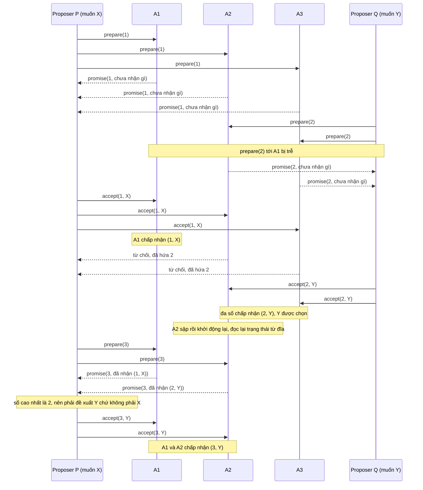

| Bước | Sự kiện | A1 | A2 | A3 | Ghi chú |
|---|---|---|---|---|---|
| 0 | khởi đầu | ⟨0, –⟩ | ⟨0, –⟩ | ⟨0, –⟩ | |
| 1 | P gửi `prepare(1)` tới cả ba; cả ba hứa | ⟨1, –⟩ | ⟨1, –⟩ | ⟨1, –⟩ | P nhận ba lời hứa mà không ai báo gì, nên P được tự chọn giá trị: X |
| 2 | Q gửi `prepare(2)` tới A2, A3 (tới A1 bị trễ); cả hai hứa | ⟨1, –⟩ | ⟨2, –⟩ | ⟨2, –⟩ | Q nhận hai lời hứa, đã đủ đa số, và không ai báo gì, nên Q tự chọn Y |
| 3 | P gửi `accept(1, X)` tới cả ba | ⟨1, (1,X)⟩ | ⟨2, –⟩ từ chối | ⟨2, –⟩ từ chối | Chỉ A1 nhận, vì A2 và A3 đã hứa số 2: X mới được một acceptor chấp nhận, chưa được chọn |
| 4 | Q gửi `accept(2, Y)` tới A2, A3 | ⟨1, (1,X)⟩ | ⟨2, (2,Y)⟩ | ⟨2, (2,Y)⟩ | Đa số {A2, A3} đã chấp nhận (2, Y): Y đã được chọn |
| 5 | A2 sập rồi khởi động lại, đọc lại từ đĩa | ⟨1, (1,X)⟩ | ⟨2, (2,Y)⟩ | ⟨2, (2,Y)⟩ | Trạng thái giữ nguyên vì đã ghi bền |
| 6 | P gửi `prepare(3)` tới A1, A2; cả hai hứa và báo đề xuất đã nhận | ⟨3, (1,X)⟩ | ⟨3, (2,Y)⟩ | ⟨2, (2,Y)⟩ | A1 báo (1, X), A2 báo (2, Y): số cao nhất là 2, nên P phải đề xuất Y |
| 7 | P gửi `accept(3, Y)` tới A1, A2 | ⟨3, (3,Y)⟩ | ⟨3, (3,Y)⟩ | ⟨2, (2,Y)⟩ | Mọi đề xuất hiện đang được chấp nhận đều mang Y |

Sơ đồ và bảng là do người soạn dựng theo quy tắc hai pha ở trên, không phải hình của bài báo. Trạng thái trong bảng đã được kiểm bằng test ở phần Đi sâu.

Đọc vết chạy, ta thấy năm điều:

1. **Chấp nhận chưa phải là chọn.** Ở bước 3–4, A1 chấp nhận (1, X) nhưng chỉ một mình nó, chưa đủ đa số, nên (1, X) chưa được chọn; và vì Y đã được chọn ở bước 4, X sẽ không bao giờ được chọn.
2. **Giá trị đã chọn có thể chưa ai ngoài acceptor biết.** Y đã được chọn từ bước 4, nhưng nếu các tin báo chấp nhận bị mất thì có thể chưa learner nào biết điều đó (learner là bên cần biết giá trị đã chốt)[^a-pms-learn-loss].
3. **P không biết Y đã được chọn, nhưng không thể bỏ sót nó.** Ở bước 6, P chỉ biết qua lời khai của acceptor. Cụm ba chỉ có ba đa số: {A1, A2}, {A1, A3}, {A2, A3}, và nhóm nào cũng có ít nhất một acceptor đã chấp nhận (2, Y) (A2, A3, hoặc cả hai). Vì vậy P hỏi nhóm nào cũng nghe thấy Y.
4. **Vì sao phải lấy đề xuất có *số cao nhất*.** A1 báo (1, X), một đề xuất cũ chưa từng được chọn, còn A2 báo (2, Y). Chọn theo số cao nhất thì ra Y, đúng. Nếu chọn theo "báo cáo đến trước" thì có thể ra X, sai. Ví dụ năm acceptor ở phần Đi sâu cho thấy ngay cả chọn "giá trị xuất hiện nhiều nhất" cũng sai.
5. **P phải bỏ ý định của mình.** P muốn X nhưng bị buộc đề xuất Y. Trong Multi-Paxos, lệnh `put` của client đang chờ ở P sẽ phải thử lại ở một slot sau (mục 3; suy luận của người soạn).

Còn một kịch bản xấu nữa. Nếu `prepare(3)` của P tới A2, A3 *trước* `accept(2, Y)` của Q thì hai acceptor ấy đã hứa số 3 nên bỏ qua `accept` số 2, và Q phải bắt đầu lại pha 1 với số 4. Chuyện này có thể lặp đi lặp lại: hai proposer cứ lần lượt phát đề xuất với số tăng dần mà không đề xuất nào được chọn, và kịch bản đó dễ dựng[^a-pms-livelock]. Người ta gọi kiểu kẹt này là livelock ([chương 09, mục 6](09-consistency-va-consensus.md)).

*Khi một acceptor quên.* Giữ nguyên vết chạy, chỉ đổi bước 5: lần này A2 khởi động lại mà mất sạch ⟨p, a⟩. Chuyện đó xảy ra theo hai cách: đĩa hỏng, hoặc A2 đã trả lời trước khi kịp ghi bền. Quy tắc ghi stable storage trước khi gửi[^a-pms-stable-write] nhằm chặn cách thứ hai (suy luận của người soạn); còn đĩa hỏng thật thì nằm ngoài giả định stable storage của Lamport và thuộc về Paxos Made Live (mục 3).

| Bước | Sự kiện | A1 | A2 | A3 | Ghi chú |
|---|---|---|---|---|---|
| 5′ | A2 khởi động lại và mất sạch trạng thái | ⟨1, (1,X)⟩ | ⟨0, –⟩ | ⟨2, (2,Y)⟩ | Đa số {A2, A3} đã chấp nhận (2, Y) ở bước 4, nên Y vẫn là giá trị đã chọn |
| 6′ | P gửi `prepare(3)` tới A1, A2 | ⟨3, (1,X)⟩ | ⟨3, –⟩ | ⟨2, (2,Y)⟩ | A1 báo (1, X), còn A2 báo "chưa nhận gì": P chỉ nghe thấy X |
| 7′ | P gửi `accept(3, X)` tới A1, A2 | ⟨3, (3,X)⟩ | ⟨3, (3,X)⟩ | ⟨2, (2,Y)⟩ | {A1, A2} chấp nhận (3, X) nên X được chọn, trong khi {A2, A3} đã chọn (2, Y) từ trước |

Phản ví dụ này do người soạn dựng từ vết chạy trên; trạng thái ở các hàng này cũng được kiểm trong test `amnesiac_acceptor_lets_two_values_be_chosen`.

Kết quả là hai giá trị khác nhau cùng được chọn, trái với yêu cầu "chỉ một giá trị được chọn"[^a-pms-safety]. Xét theo P2c: P đã phát (3, X) với S = {A1, A2}. Nhánh (b) đòi X là giá trị của đề xuất số cao nhất < 3 mà acceptor trong S đã chấp nhận, tức (2, Y) ở A2; nhưng A2 khai "chưa nhận gì", nên P2c bị phá. Giao điểm {A2} của hai đa số vẫn còn trên giấy nhưng đã hết tác dụng: sau khi quên, A2 xử sự như một acceptor mới tinh.

Chỉ quên lời hứa cũng đủ hỏng (người soạn dựng, kiểm bằng test `forgetting_only_the_promise_is_also_fatal`). P xong pha 1 với số 1. Q xong pha 1 với số 2 tại A2, A3, và cả hai chưa báo gì. Rồi A2 khởi động lại và mất lời hứa số 2. Lúc này `accept(1, X)` bị trễ của P mới tới A1 và A2: cả hai chấp nhận (A2 không còn lời hứa nào ngăn nó), nên X được chọn. Q thì vẫn tin rằng A2 và A3 sẽ không chấp nhận số < 2, nên cứ gửi `accept(2, Y)` tới A2, A3: cả hai chấp nhận, và Y cũng được chọn. Vậy `promised` cũng phải bền như `accepted`.

Lỗi quên này còn phụ thuộc lịch trình: nếu ở bước 6′ P hỏi {A1, A3} thay vì {A1, A2} thì A3 vẫn khai (2, Y) và mọi thứ vẫn đúng. Vì vậy nó rất khó bắt bằng test thông thường (nhận xét của người soạn); mục 3 kể Google đã đi tìm loại lỗi này bằng test ngẫu nhiên có seed.

Hệ quả này còn được hai nguồn độc lập nêu ra. Ở Paxos Made Live, replica (node giữ một bản sao) mất trạng thái bền có thể phản bội lời hứa đã đưa ra, tức vi phạm một giả định then chốt của Paxos[^a-pml-corrupt]. Cách xử lý của họ là cho replica đó chạy như thành viên *không bỏ phiếu* cho tới khi quan sát được một instance Paxos hoàn chỉnh bắt đầu sau lúc nó bắt đầu dựng lại trạng thái (chi tiết ở mục 3)[^a-pml-nonvoting]. Còn trong Raft, server mất bất kỳ phần trạng thái bền nào thì không thể vào lại cụm một cách an toàn với danh tính cũ; thường có thể thêm nó lại như server mới qua thay đổi thành viên[^a-th-state].

Cả hai là cùng một nguyên tắc: node chưa chứng minh được là còn nhớ thì không được bỏ phiếu trong quorum (nhận xét của người soạn). Với `kvmeta`, một node mất đĩa không được quay lại bằng cái tên cũ, chẳng hạn `N2`, rồi bỏ phiếu ngay.

<details><summary>Đi sâu: acceptor bằng Rust và test của vết chạy; vì sao "số cao nhất" chứ không phải "giá trị phổ biến nhất"; proposer cũng phải nhớ</summary>

*Acceptor bằng Rust.* Hai khối mã dưới là hai nửa của cùng một file `acceptor.rs`. Nửa đầu là máy trạng thái của *một* acceptor cùng hàm chọn giá trị của proposer, không có mạng và không có đĩa thật; nửa sau là các test. Người soạn đã ghép hai nửa lại, biên dịch bằng rustc 1.95.0 và chạy. Sau đó người review thêm assert trạng thái cho các bước 5, 5′ và 7′ cùng kết quả pha 1 của test thứ ba, biên dịch lại bằng `rustc --edition 2024 --test -D warnings acceptor.rs` rồi chạy: cả 4 test qua (`durable_acceptor_forces_second_proposer_to_adopt_y`, `amnesiac_acceptor_lets_two_values_be_chosen`, `forgetting_only_the_promise_is_also_fatal`, `highest_number_wins_not_most_frequent_value`), không có cảnh báo biên dịch. Các test khẳng định trạng thái từng acceptor sau mọi bước của hai bảng ở trên, nên bảng khớp với những gì mã làm.

```rust
//! Acceptor của single-decree Paxos (Paxos Made Simple, §2.2 và §2.5).
//! Chỉ là máy trạng thái của MỘT acceptor: không có mạng, không có đĩa thật.

/// Số đề xuất. Các proposer lấy số từ những tập rời nhau (P: lẻ, Q: chẵn);
/// số bắt đầu từ 1, nên 0 nghĩa là "chưa hứa gì".
pub type N = u32;
/// Giá trị đề xuất (chỉ để minh họa).
pub type V = &'static str;

/// Hai thứ PHẢI nằm trên stable storage: số `prepare` cao nhất đã trả lời
/// và đề xuất số cao nhất đã chấp nhận.
#[derive(Clone, Debug, Default, PartialEq, Eq)]
pub struct Acceptor {
    promised: N,
    accepted: Option<(N, V)>,
}

/// Trả lời pha 1b.
#[derive(Debug, PartialEq, Eq)]
pub enum Reply {
    /// Lời hứa không chấp nhận số nhỏ hơn n, kèm đề xuất số cao nhất đã nhận (nếu có).
    Promise(Option<(N, V)>),
    /// Bỏ qua yêu cầu; báo lại cho proposer chỉ là tối ưu hiệu năng (§2.2).
    Nack,
}

impl Acceptor {
    pub fn state(&self) -> (N, Option<(N, V)>) {
        (self.promised, self.accepted)
    }

    /// Pha 1b: chỉ trả lời khi n lớn hơn mọi `prepare` đã trả lời.
    pub fn on_prepare(&mut self, n: N) -> Reply {
        if n > self.promised {
            self.promised = n; // hệ thật: ghi bền (fsync) TRƯỚC khi trả lời
            Reply::Promise(self.accepted)
        } else {
            Reply::Nack
        }
    }

    /// Pha 2b: chấp nhận trừ khi đã trả lời một `prepare` có số lớn hơn n (P1a).
    pub fn on_accept(&mut self, n: N, v: V) -> bool {
        if n >= self.promised {
            // Nâng `promised` lên n để luôn có accepted.n <= promised: nhờ vậy
            // một `prepare(k)` được trả lời luôn có k > accepted.n.
            self.promised = n;
            self.accepted = Some((n, v)); // hệ thật: ghi bền TRƯỚC khi trả lời
            true
        } else {
            false
        }
    }
}

/// Pha 2a của proposer (điều kiện P2c): giá trị của đề xuất có SỐ cao nhất trong
/// các lời hứa của một đa số; nếu không ai báo đề xuất nào thì tự chọn `own`.
pub fn choose_value(promises: &[Option<(N, V)>], own: V) -> V {
    promises
        .iter()
        .flatten()
        .max_by_key(|(n, _)| *n)
        .map_or(own, |&(_, v)| v)
}
```

```rust
#[cfg(test)]
mod tests {
    use super::*;
    use std::collections::{BTreeMap, BTreeSet};

    /// Ba acceptor A1..A3 (chỉ số 0..2) cộng một "biến ma" ghi lại mọi lần accept
    /// thành công, để biết đề xuất nào đã được một đa số chấp nhận (= được chọn).
    /// Biến ma không thuộc thuật toán; nó chỉ để test quan sát.
    struct Cluster {
        acc: Vec<Acceptor>,
        accepts: BTreeMap<(N, V), BTreeSet<usize>>,
    }

    impl Cluster {
        fn new(n: usize) -> Self {
            Cluster { acc: vec![Acceptor::default(); n], accepts: BTreeMap::new() }
        }
        fn prepare(&mut self, i: usize, n: N) -> Reply {
            self.acc[i].on_prepare(n)
        }
        fn accept(&mut self, i: usize, n: N, v: V) -> bool {
            let ok = self.acc[i].on_accept(n, v);
            if ok {
                self.accepts.entry((n, v)).or_default().insert(i);
            }
            ok
        }
        fn chosen(&self) -> BTreeSet<V> {
            self.accepts
                .iter()
                .filter(|(_, who)| who.len() * 2 > self.acc.len())
                .map(|(&(_, v), _)| v)
                .collect()
        }
        fn states(&self) -> Vec<(N, Option<(N, V)>)> {
            self.acc.iter().map(Acceptor::state).collect()
        }
    }

    fn reports(rs: &[Reply]) -> Vec<Option<(N, V)>> {
        rs.iter()
            .map(|r| match r {
                Reply::Promise(a) => *a,
                Reply::Nack => panic!("không đủ lời hứa"),
            })
            .collect()
    }

    /// Vết chạy ở mục 2. `a2_keeps_state = false` mô phỏng A2 mất sạch trạng thái
    /// khi khởi động lại (đĩa hỏng, hoặc trả lời trước khi ghi bền).
    /// Trả về (cụm, giá trị P đề xuất ở n = 3).
    fn run_trace(a2_keeps_state: bool) -> (Cluster, V) {
        let (x, y) = ("X", "Y"); // giá trị mà client của P và của Q muốn
        let mut c = Cluster::new(3);
        assert_eq!(c.states(), [(0, None), (0, None), (0, None)]); // bước 0

        // Bước 1: P chạy pha 1 với n = 1 trên cả ba acceptor.
        for i in 0..3 {
            assert_eq!(c.prepare(i, 1), Reply::Promise(None));
        }
        assert_eq!(c.states(), [(1, None), (1, None), (1, None)]);

        // Bước 2: Q chạy pha 1 với n = 2; thông điệp tới A1 bị trễ.
        assert_eq!(c.prepare(1, 2), Reply::Promise(None));
        assert_eq!(c.prepare(2, 2), Reply::Promise(None));
        assert_eq!(c.states(), [(1, None), (2, None), (2, None)]);

        // Bước 3: P gửi accept(1, X) tới cả ba: chỉ A1 chấp nhận.
        assert!(c.accept(0, 1, x));
        assert!(!c.accept(1, 1, x));
        assert!(!c.accept(2, 1, x));
        assert_eq!(c.states(), [(1, Some((1, x))), (2, None), (2, None)]);
        assert!(c.chosen().is_empty()); // X được A1 chấp nhận nhưng chưa được chọn

        // Bước 4: Q gửi accept(2, Y) tới A2, A3: Y được chọn.
        assert!(c.accept(1, 2, y));
        assert!(c.accept(2, 2, y));
        assert_eq!(c.states(), [(1, Some((1, x))), (2, Some((2, y))), (2, Some((2, y)))]);
        assert_eq!(c.chosen(), BTreeSet::from([y]));

        // Bước 5: A2 khởi động lại.
        if !a2_keeps_state {
            c.acc[1] = Acceptor::default();
        }
        let a2_restarted = if a2_keeps_state { (2, Some((2, y))) } else { (0, None) };
        assert_eq!(c.states(), [(1, Some((1, x))), a2_restarted, (2, Some((2, y)))]);

        // Bước 6: P không biết Y đã được chọn, thử lại với n = 3 tới A1 và A2.
        let rs = [c.prepare(0, 3), c.prepare(1, 3)];
        let a2_report = if a2_keeps_state { Some((2, y)) } else { None };
        assert_eq!(rs, [Reply::Promise(Some((1, x))), Reply::Promise(a2_report)]);
        assert_eq!(
            c.states(),
            [(3, Some((1, x))), (3, a2_report), (2, Some((2, y)))]
        );
        let v = choose_value(&reports(&rs), x);

        // Bước 7: P gửi accept(3, v) tới A1 và A2.
        assert!(c.accept(0, 3, v));
        assert!(c.accept(1, 3, v));
        (c, v)
    }

    #[test]
    fn durable_acceptor_forces_second_proposer_to_adopt_y() {
        let (c, v) = run_trace(true);
        assert_eq!(v, "Y"); // P muốn X nhưng bị buộc đề xuất Y
        assert_eq!(
            c.states(),
            [(3, Some((3, "Y"))), (3, Some((3, "Y"))), (2, Some((2, "Y")))]
        );
        assert_eq!(c.chosen(), BTreeSet::from(["Y"])); // vẫn chỉ một giá trị
    }

    #[test]
    fn amnesiac_acceptor_lets_two_values_be_chosen() {
        let (c, v) = run_trace(false);
        assert_eq!(v, "X"); // P chỉ nghe thấy (1, X) từ A1; A2 "quên" (2, Y)
        assert_eq!(
            c.states(),
            [(3, Some((3, "X"))), (3, Some((3, "X"))), (2, Some((2, "Y")))]
        );
        assert_eq!(c.chosen(), BTreeSet::from(["X", "Y"])); // vi phạm Agreement
    }

    #[test]
    fn forgetting_only_the_promise_is_also_fatal() {
        let (x, y) = ("X", "Y");
        let mut c = Cluster::new(3);
        for i in 0..3 {
            assert_eq!(c.prepare(i, 1), Reply::Promise(None)); // P: pha 1 với n = 1
        }
        // Q: pha 1 với n = 2 tới A2, A3 (cả hai chưa báo gì).
        assert_eq!(c.prepare(1, 2), Reply::Promise(None));
        assert_eq!(c.prepare(2, 2), Reply::Promise(None));
        assert_eq!(c.states(), [(1, None), (2, None), (2, None)]);
        // A2 khởi động lại và mất lời hứa (đã trả lời mà chưa kịp ghi bền).
        c.acc[1] = Acceptor::default();
        // accept(1, X) trễ của P tới A1 và A2: cả hai chấp nhận -> X được chọn.
        assert!(c.accept(0, 1, x));
        assert!(c.accept(1, 1, x));
        assert_eq!(c.chosen(), BTreeSet::from(["X"]));
        // Q, tin rằng A2 và A3 sẽ không chấp nhận số < 2, gửi accept(2, Y).
        assert!(c.accept(1, 2, y));
        assert!(c.accept(2, 2, y));
        assert_eq!(c.chosen(), BTreeSet::from(["X", "Y"]));
    }

    #[test]
    fn highest_number_wins_not_most_frequent_value() {
        // Năm acceptor: (1, X) nằm ở hai acceptor nhưng chưa được chọn;
        // (2, Y) nằm ở một acceptor trong số ba acceptor đã chọn Y.
        let reports = [Some((1, "X")), Some((1, "X")), Some((2, "Y"))];
        assert_eq!(choose_value(&reports, "own"), "Y");
        assert_eq!(choose_value(&[None, None], "own"), "own");
    }
}
```

Ba điểm đáng chú ý trong mã:

1. **`on_accept` đồng thời đặt `promised = n`.** Lamport chỉ đòi acceptor chấp nhận trừ khi nó đã trả lời `prepare` có số lớn hơn n[^a-pms-phase2b]. Việc nâng `promised` là lựa chọn của người soạn, để luôn có `accepted.n <= promised`: nhờ vậy mọi `prepare(k)` được trả lời đều có k lớn hơn số của đề xuất đã chấp nhận, đúng như pha 1b ngầm giả định, và acceptor chỉ cần giữ *một* đề xuất (số cao nhất). Nếu proposer chỉ gửi `accept` tới những acceptor đã trả lời `prepare` của mình[^a-pms-accept-each] thì dòng này là no-op, tức không đổi gì. Nhưng bài báo cho phép tập nhận `accept` khác tập đã trả lời `prepare`[^a-pms-accept-set], và khi đó dòng này mới có tác dụng, ở một acceptor chưa từng nghe `prepare(n)` (suy luận của người soạn).
2. **Ghi bền trước khi trả lời.** Các chú thích "ghi bền TRƯỚC khi trả lời" trong mã đánh dấu chỗ `fsync` (lệnh ép dữ liệu xuống đĩa) thật sự nằm; cái giá của nó xem [P5 · Chương 06](../05-storage/06-durability-trong-thuc-te.md).
3. **`Reply::Nack` có mặt chỉ để test viết cho rõ.** Acceptor được phép bỏ qua mọi yêu cầu mà không ảnh hưởng an toàn[^a-pms-ignore]. Còn báo lại cho proposer chỉ là tối ưu hiệu năng, không ảnh hưởng tính đúng[^a-pms-inform].

*Vì sao "số cao nhất" mà không phải "giá trị phổ biến nhất" (người soạn dựng).* Xét năm acceptor A1…A5 và ba proposer:

1. P xong pha 1 với số 1, nhưng `accept(1, X)` chỉ tới A1 và A2 (tới A3–A5 bị mất). Hai trong năm chưa phải đa số, nên X *chưa* được chọn.
2. Q xong pha 1 với số 2 tại {A3, A4, A5}; A1 và A2 chưa nghe `prepare(2)`. Không ai báo gì, nên Q tự chọn Y, và cả ba acceptor chấp nhận `accept(2, Y)`: Y đã được chọn. Lúc này A1 và A2 ở trạng thái ⟨1, (1,X)⟩, còn A3, A4, A5 ở ⟨2, (2,Y)⟩.
3. Proposer thứ ba R chạy pha 1 với số 3 tại {A1, A2, A3} và nhận ba báo cáo: (1, X), (1, X), (2, Y).

Đến đây cách R chọn giá trị quyết định tất cả. Nếu R chọn "giá trị xuất hiện nhiều nhất" thì nó chọn X (hai phiếu so với một), gửi `accept(3, X)`, và cả ba acceptor chấp nhận vì đều đã hứa số 3. Vậy X được chọn sau khi Y đã được chọn: hai giá trị. Chọn theo số cao nhất thì ra Y, đúng. Test `highest_number_wins_not_most_frequent_value` kiểm đúng ba báo cáo này cho hàm `choose_value`; kịch bản năm acceptor chỉ được dựng bằng lời, không có test mô phỏng. Cốt lõi là chỉ đề xuất số cao nhất trong các báo cáo mới chắc chắn mang giá trị đã chọn (bước 5 của chứng minh), còn đề xuất số thấp hơn có thể mang giá trị chưa từng được chọn.

*Proposer cũng phải nhớ.* Mỗi proposer lấy số từ một tập riêng, ghi số cao nhất đã dùng vào stable storage, rồi bắt đầu pha 1 với số cao hơn mọi số đã dùng[^a-pms-unique]. Paxos Made Live có một cách chia tập số cụ thể: gán mỗi replica một id i từ 0 đến n − 1[^a-pml-fn1]. Sau đó mỗi replica chọn số s nhỏ nhất lớn hơn mọi số nó đã thấy mà thỏa s mod n = i[^a-pml-fn1b]. Nếu một proposer quên và dùng lại số n cho một giá trị khác, chứng minh ở trên mất giả thiết "số đề xuất là duy nhất" (nhận xét của người soạn).

</details>

**Quay lại Q2:** Pha 1 buộc mọi đề xuất mới thỏa P2c, và nhờ hai đa số luôn giao nhau, phép quy nạp theo số đề xuất biến P2c thành "chỉ một giá trị được chọn", với điều kiện mỗi acceptor nhớ cả lời hứa lẫn đề xuất đã chấp nhận qua mọi lần khởi động lại; với `kvmeta`, mỗi node vì thế phải ghi bền hai thứ đó trước khi trả lời.

## 3. Multi-Paxos và từ thuật toán ra hệ thống: Paxos Made Live (Q3)

> **Trả lời ngắn.** Multi-Paxos chạy một lần Paxos riêng (một instance) cho mỗi ô (slot) của log, và một leader ổn định chạy pha 1 một lần cho mọi ô về sau, nên mỗi lệnh chỉ còn tốn pha 2[^a-pms-inf-phase1]. Khi đổi leader, leader mới lấp những ô còn trống bằng lệnh no-op, tức lệnh không làm đổi trạng thái[^a-pms-noop]. Leader còn trả lời đọc cục bộ được nhờ lease (quyền leader có hạn dùng), đổi lại phải giả định độ trôi đồng hồ giữa các server có một cận trên[^a-th-lease-assume]. Còn để thành hệ thống thật, các tác giả của Paxos Made Live (bài báo của Google về cơ sở dữ liệu nhân bản cho Chubby) kết luận rằng bản mô tả thuật toán và nhu cầu của hệ thật cách nhau một khoảng đáng kể[^a-pml-gap].

**Giải thích.**

*Với cụm `kvmeta`.* Mục 2 chốt xong một giá trị. Còn log của `kvmeta` (5 node `N1`…`N5`, giữ feature flag và khóa leader cho các service backend) là cả một dãy lệnh `put`, mỗi lệnh chiếm một ô đánh số. Nếu mỗi `put` đều chạy đủ hai pha thì mỗi lần ghi tốn hai vòng tin nhắn, nên `kvmeta` cần một leader ổn định, giả sử `N1`, xin quyền một lần cho mọi ô chưa dùng. `N1` có thể đặt trước nhiều ô liền nhau, nên nếu nó chết giữa chừng thì leader kế nhiệm phải dọn các ô dở dang trước rồi mới áp dụng được các ô phía sau. Còn lúc `N1` khỏe, các `get` đọc thẳng từ `N1` nhờ lease. Nửa sau của mục kể Google đã phải thêm gì để lõi ấy chạy được ngoài đời, và `kvmeta` sẽ phải thêm gì tương tự.

*Ô (slot) và instance.* Mỗi vị trí đánh số trong log là một *ô* (slot), và ô thứ i do instance Paxos thứ i quyết định[^a-fpx-slots]. Giá trị instance ấy chọn chính là lệnh thứ i của state machine ([chương 09, mục 4](09-consistency-va-consensus.md) nói về state machine replication)[^a-pms-seq].

Nếu hai node cùng tưởng mình là leader, chẳng hạn `N1` và `N2` sau một đợt mạng chập chờn, cả hai có thể đề xuất ở cùng một instance, và khi đó có thể không giá trị nào được chọn. An toàn vẫn giữ: không hai server nào bất đồng về giá trị của lệnh thứ i. Cụm chỉ cần bầu một leader duy nhất để tiến triển được[^a-pms-multi-leaders].

*Leader ổn định chạy pha 1 một lần cho mọi ô.* Pha 1 không cần biết sẽ đề xuất gì, vì proposer chỉ chọn giá trị để đề xuất khi vào pha 2[^a-pms-key-eff]. Nhờ vậy `N1` vừa lên leader chạy pha 1 cho *vô hạn* instance bằng một thông điệp ngắn, vì mọi instance dùng chung một số đề xuất[^a-pms-inf-phase1]. Acceptor cũng trả lời gọn: chỉ ở những instance đã nhận thông điệp pha 2 của một proposer nào đó thì nó mới trả lời nhiều hơn một OK đơn giản[^a-pms-short-reply].

Lamport kỳ vọng việc leader hỏng và bầu leader mới là chuyện hiếm, nên chi phí hiệu dụng của một lệnh chỉ là chi phí của pha 2[^a-pms-cost]. Với `kvmeta`, sau khi `N1` chạy pha 1, mỗi `put` chỉ là một vòng `accept` tới các node còn lại: khi đa số đã chấp nhận thì ô được chọn, `N1` áp dụng lệnh rồi ack cho client, đúng như sơ đồ dưới.

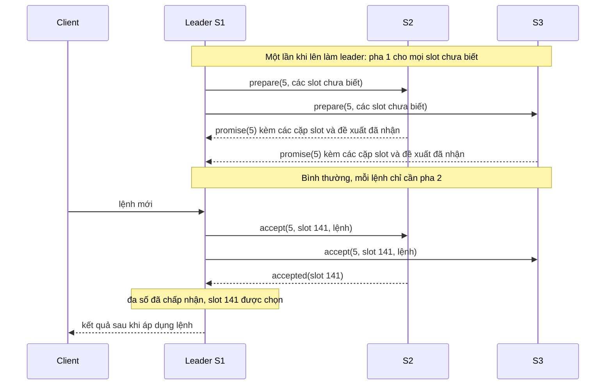

(Sơ đồ do người soạn dựng từ mô tả pha 1 và pha 2 của Lamport[^a-pms-inf-phase1]. Số 5 và ô 141 lấy từ ví dụ ở bảng bên dưới.)

Google áp dụng đúng ý này trong Paxos Made Live (PML), bài báo về cơ sở dữ liệu nhân bản cho Chubby, dịch vụ khóa phân tán của Google, nơi cũng lưu các file nhỏ[^a-pml-chubby]. Họ gọi leader ổn định là *master*, tức một coordinator (replica đứng ra đề xuất lệnh) được chọn để giữ lâu dài và cố không để đổi[^a-pml-master]. Pha 1 của họ gồm thông điệp `propose` và các trả lời `promise`[^a-pml-propose-promise]. Khi coordinator không đổi giữa các instance thì bỏ được `propose`, và làm vậy không phá các tính chất của Paxos, vì bất cứ lúc nào replica nào cũng vẫn có thể thử làm coordinator bằng một `propose` mang số cao hơn[^a-pml-omit-propose].

Về đĩa, Paxos như mô tả đến đây (chưa tối ưu) buộc mọi bên *ghi trạng thái xuống đĩa trước khi gửi tin*, nên mỗi instance có một chuỗi năm lần ghi nằm ngay trên đường găng[^a-pml-five-writes]. Mỗi lần ghi phải flush (ép dữ liệu xuống đĩa) xong thì hệ mới đi tiếp được, nên khi các replica ở gần nhau, thời gian flush có thể chi phối cả độ trễ[^a-pml-flush]. Với tối ưu master ổn định, mỗi replica chỉ còn một lần ghi đĩa cho mỗi instance, và các replica ghi song song[^a-pml-one-write]. Mỗi lần ghi còn lại vẫn phải bền thật, như mục 2 đã chỉ ra (nhận xét của người soạn).

*Khi leader đổi: pha 1 cho cả đoạn đuôi, rồi nối tiếp hoặc lấp no-op.* Với `kvmeta`, đó là lúc `N1` chết và một node khác lên thay. Ví dụ dưới đây theo kịch bản của Lamport, rút gọn còn ba server S1, S2, S3, trong đó S1 là leader mới. Leader mới vốn là learner của mọi instance (learner là bên chỉ học xem giá trị nào đã được chọn), nên nó thường đã biết hầu hết các lệnh được chọn[^a-pms-learner-all]. Giả sử nó biết các lệnh 1–134, 138 và 139[^a-pms-known].

Lỗ như 135–137 sinh ra khi leader cũ đề xuất trước nhiều lệnh liền nhau mà chưa biết lệnh trước đã được chọn hay chưa, rồi chết giữa chừng. Nếu leader được phép đi trước α lệnh thì lỗ dài nhất là α − 1 lệnh[^a-pms-alpha]. Việc đầu tiên của leader mới là chạy pha 1 cho các instance 135–137 và cho mọi instance sau 139[^a-pms-gap-phase1]. Giả sử kết quả buộc giá trị ở instance 135 và 140, còn các instance khác thì để tự do. Khi đó leader chạy pha 2 cho 135 và 140, và hai lệnh ấy được chọn[^a-pms-gap-outcome].

Đến đây leader đã biết cả lệnh 138–140 nhưng chưa thực thi được, vì lệnh 136 và 137 vẫn chưa được chọn[^a-pms-cannot-exec]. Nó không chờ, mà lấp ngay hai lỗ bằng lệnh `noop`, một lệnh không làm đổi trạng thái[^a-pms-noop]. Mỗi `noop` được chọn bằng pha 2 của instance tương ứng, tức 136 và 137[^a-pms-noop-phase2]. Lệnh client kế tiếp nhận số 141[^a-pms-141]. Bảng dưới gom cả vết chạy:

| Ô (slot) | 135 | 136 | 137 | 138 | 139 | 140 | 141 |
|---|---|---|---|---|---|---|---|
| S1 (leader mới), trước khi lên | – | – | – | (4, v138), đã biết là đã chọn | (4, v139), đã biết là đã chọn | – | – |
| S2 | (4, v135) | – | – | (4, v138) | (4, v139) | (4, v140) | – |
| S3 | – | – | – | (4, v138) | (4, v139) | – | – |
| Pha 1 của số 5 (đa số {S1, S2}) báo | ràng buộc: v135 | không ràng buộc | không ràng buộc | đã biết | đã biết | ràng buộc: v140 | không ràng buộc |
| S1 gửi pha 2 (số 5) | `accept(5, v135)` | `accept(5, noop)` | `accept(5, noop)` | không cần | không cần | `accept(5, v140)` | `accept(5, lệnh client mới)` |

(Bảng do người soạn dựng để minh họa kịch bản của Lamport. Lamport chỉ nêu S1 biết gì và ô nào bị ràng buộc; S2 và S3 giữ gì, số 4 của leader cũ và số 5 của leader mới là giả định của người soạn. Ký hiệu (4, v135) là đề xuất số 4 mang giá trị v135.)

Điều cần nhớ: no-op chỉ lấp được ô mà pha 1 *không ràng buộc*, như 136 và 137. Giả sử một acceptor trong đa số đã báo một giá trị ở ô 136. Khi đó giá trị ấy có thể đã được chọn, nên leader phải đề xuất lại đúng nó theo luật P2c ở mục 2, chứ không được tự ý thay bằng no-op (nhận xét của người soạn).

Từ phía Raft, luận án của Ongaro mô tả cùng bước này: leader mới của Paxos chạy hai pha cho từng entry chưa commit mà nó tìm thấy, viết lại và đánh số lại tất cả bằng số đề xuất hiện tại, rồi hoặc commit giá trị của mình hoặc phát hiện một giá trị đã commit từ trước[^a-th-paxos-newleader]. Ông nhận xét Multi-Paxos để log có quá nhiều chỗ không xác định mà quá ít cấu trúc, chẳng hạn log có thể có lỗ[^a-th-holes]. Raft thì không cho log có lỗ, và hạn chế những cách log của các server có thể lệch nhau[^a-th-noholes].

*Đọc cục bộ nhờ lease.* Đọc thường chiếm tỉ lệ lớn trong các thao tác, nên bắt mỗi `get` của `kvmeta` đi qua một instance Paxos là quá đắt. Còn nếu `N1` trả thẳng từ bản sao của nó thì có nguy cơ trả dữ liệu cũ: các replica khác có thể đã bầu leader mới và ghi tiếp mà không báo cho `N1`[^a-pml-read-stale].

Google giải bài toán này bằng *master lease*: chừng nào master còn lease, tức còn trong hạn dùng, thì các replica khác chắc chắn không nộp thành công được giá trị nào vào Paxos, nên bản sao của master vẫn mới nhất và master phục vụ đọc hoàn toàn cục bộ được[^a-pml-lease-sem]. Để làm vậy, mọi replica ngầm cấp lease cho master của instance Paxos trước đó và từ chối xử lý thông điệp Paxos của replica khác trong lúc lease còn hiệu lực. Master đặt timeout lease ngắn hơn timeout của replica để chịu được lệch đồng hồ, và định kỳ nộp một giá trị heartbeat giả vào Paxos để gia hạn lease[^a-pml-lease-impl].

Điều kiện của lease là độ trôi đồng hồ giữa các server có một cận trên; luận án Raft của Ongaro nêu đúng điều kiện này khi mô tả cách đọc dựa trên lease cho Raft. Giữ cận trên đó khi vận hành có thể khó, chẳng hạn vì tạm dừng do lập lịch hoặc GC, di chuyển VM, hay chỉnh tốc độ đồng hồ khi đồng bộ thời gian, và nếu giả định bị vi phạm thì hệ có thể trả thông tin cũ tùy ý[^a-th-lease-assume]. Cách thay thế không dựa vào đồng hồ là ReadIndex: trao đổi heartbeat với đa số *trước khi* đọc ([chương 09, mục 7](09-consistency-va-consensus.md); chi tiết ở mục 6.4).

Về bản chất, lease đổi cách bảo đảm: thay vì hỏi đa số trước mỗi lần đọc, cụm dựa vào thời gian, vì trong hạn lease các replica đã *hứa* không nhận thông điệp Paxos của ai khác. Đây là chỗ duy nhất ở mục này mà tính đúng của việc đọc phụ thuộc đồng hồ (nhận xét của người soạn); phần còn lại của Paxos giữ an toàn bất kể thời gian, chỉ tính sống mới cần tới đồng hồ[^a-kl-safety-live]. Kịch bản xấu với `kvmeta` là `N1` bị treo lâu hơn hạn lease (vì GC hay VM bị tạm dừng chẳng hạn) rồi tỉnh dậy trả lời `get` như thể vẫn còn lease. Đó là kịch bản kinh điển của [chương 08](08-su-co-he-phan-tan.md), còn phía ghi đã có epoch number, ở bên dưới.

*Từ thuật toán ra hệ thống.* Paxos mô tả được trong một trang mã giả, nhưng bản cài đặt đầy đủ của Google dài vài nghìn dòng C++[^a-pml-thousands]. Phần mở đầu bài báo nêu vài khó khăn, trong đó có hai điều đáng nhớ. Một là giới nghiên cứu thuật toán chịu lỗi quen chứng minh các thuật toán ngắn cỡ một trang mã giả, và cách đó không scale tới hệ thống hàng nghìn dòng[^a-pml-proofs-scale]. Hai là thuật toán chịu lỗi chỉ chịu một tập lỗi hạn chế, được chọn kỹ[^a-pml-limited-faults]. Ngoài đời, phần mềm gặp nhiều kiểu lỗi hơn thế, kể cả lỗi trong chính thuật toán[^a-pml-realworld].

**Đĩa hỏng và lời hứa bị quên.** Giả sử đĩa của `N3` hỏng và nó khởi động lại với đĩa trống. Một replica mất trạng thái bền như vậy có thể phản bội lời hứa đã đưa cho replica khác, vi phạm một giả định then chốt của Paxos[^a-pml-corrupt], và đó chính là tình huống của phản ví dụ ở mục 2.

Đĩa hỏng có hai kiểu: file bị đổi nội dung, hoặc file không truy cập được. Với kiểu đầu, Google lưu checksum của nội dung từng file để phát hiện[^a-pml-checksum]. Kiểu sau khó phân biệt với một replica mới có đĩa trống, nên mỗi replica mới ghi một marker lên GFS (hệ file phân tán của Google) sau khi khởi động. Về sau nếu nó khởi động lại với đĩa trống thì nó thấy marker còn đó và biết đĩa mình đã hỏng[^a-pml-marker].

Replica có đĩa hỏng dựng lại trạng thái như một *thành viên không bỏ phiếu*: nó vẫn dùng cơ chế catch-up để bắt kịp log, nhưng không trả lời `promise` hay acknowledgment. Nó ở trạng thái đó cho tới khi quan sát thấy trọn một instance Paxos bắt đầu sau lúc nó bắt đầu dựng lại. Chờ thêm một instance như vậy bảo đảm nó không thể đã phản bội lời hứa cũ[^a-pml-nonvoting]. Với `kvmeta`, trong thời gian đó `N3` vẫn nhận log mới nhưng không góp vào đa số nào.

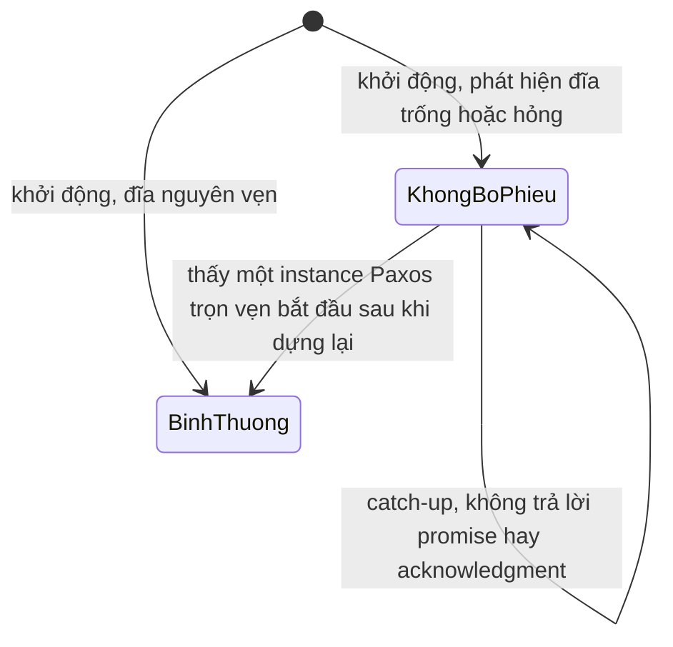

(Sơ đồ do người soạn vẽ lại từ mô tả của PML về replica đĩa hỏng[^a-pml-nonvoting].)

Cách này có một giới hạn mà chính họ nêu: nó *không* phát hiện được file bị lùi về trạng thái cũ. Họ tin đó là kịch bản hiếm nên không xử lý rõ ràng, nhưng cho rằng cơ chế checksum phân tán mô tả ở phần sau của bài báo có thể phát hiện kiểu lỗi này[^a-pml-rollback]. File lùi về bản cũ chính là kiểu quên một phần ở mục 2, và restore một bản backup cũ vào replica đang chạy là kịch bản vận hành tương ứng của `kvmeta` (nhận xét của người soạn).

**Master hay đổi tay (churn).** Tối ưu master ổn định có một điểm yếu khi mạng chập chờn. Giả sử `N1` đang là master rồi bị ngắt mạng. Cụm bầu `N2` làm master mới, và `N2` giữ một số thứ tự cố định qua các instance. Trong lúc đó `N1` vẫn thử chạy Paxos, và hễ nối được với một replica nào thì số thứ tự của nó có thể tăng[^a-pml-churn0]. Khi mạng nối lại, số của `N1` có thể cao hơn số của `N2` nên `N1` thay lại được `N2`, rồi `N1` lại bị ngắt và vòng lặp lặp lại[^a-pml-churn]. Cách chữa của họ là cho master định kỳ nâng số thứ tự của mình bằng một vòng Paxos đầy đủ[^a-pml-boost]. Nâng với tần suất phù hợp thì tránh được phần lớn churn[^a-pml-boost2]. Có lẽ ý của cách chữa này là giữ số của master hiện tại đủ cao để một master cũ bị cô lập khó vượt lên khi quay lại (suy luận của người soạn).

**Epoch number.** Chubby đòi hủy một yêu cầu nếu quyền master bị mất, hoặc mất rồi giành lại, trong lúc yêu cầu đang được xử lý. Vì thế cần một cơ chế đáng tin để phát hiện master đổi tay và hủy thao tác khi cần[^a-pml-epoch-need]. Với `kvmeta`, đó là chuyện một `put` giành khóa `lock/billing-cron` đang chờ ack mà leader đổi tay giữa chừng: nếu `kvmeta` đặt yêu cầu giống Chubby thì `put` ấy phải bị hủy, không được âm thầm thành công.

Giải pháp của họ là một *epoch number* toàn cục: hai lần hỏi epoch ở master cho cùng một giá trị khi và chỉ khi replica đó là master liên tục trong khoảng giữa hai lần hỏi. Epoch được lưu thành một entry trong database, và mọi thao tác database đều có điều kiện theo giá trị epoch[^a-pml-epoch-def]. Họ cài điều kiện đó bằng `MultiOp`, một primitive của database: nó được áp dụng nguyên tử, và thành phần đầu tiên là danh sách các phép kiểm tra gọi là *guard*[^a-pml-multiop]. Sau khi đưa epoch vào database như một entry, họ sửa mọi lời gọi database trước đó để thêm một guard kiểm epoch[^a-pml-epoch-guard]. Đây là một biến thể của fencing token ([chương 08, mục 8](08-su-co-he-phan-tan.md)): token là epoch, và việc kiểm token nằm *bên trong* state machine được nhân bản, nên nó nguyên tử với thao tác ghi (nhận xét của người soạn).

Epoch đến khá muộn: họ nhận ra mình cần nó sau khi đã cài xong database và `MultiOp`[^a-pml-epoch-late]. Mục sự cố của bài báo còn kể một lần ngữ nghĩa của database lệch với điều Chubby mong đợi: Chubby mong thao tác sẽ hỏng nếu database mất vai master[^a-pml-epoch-surprise]. Nhưng hệ của họ có thể cài lại một replica làm master ngay giữa thao tác, và thao tác vẫn thành công; cách sửa là làm lại đáng kể tầng tích hợp giữa Chubby và framework, trong đó phải cài epoch number[^a-pml-epoch-rework].

**Thành viên nhóm.** Muốn thay `N5` đã chết bằng một node mới thì tập server phải đổi được ngay lúc cụm đang chạy. Cách của Lamport là đặt tập server vào chính *trạng thái của state machine* và đổi nó bằng các lệnh thường[^a-pms-config]. Để leader đi trước được α lệnh, tập server chạy instance i + α là tập do trạng thái sau lệnh thứ i quyết định[^a-pms-config-alpha].

Với core Paxos, đổi thành viên khá thẳng, nhưng khi thêm Multi-Paxos, đĩa hỏng và các thứ tương tự thì chi tiết không còn tầm thường. Các tài liệu không nói rõ chuyện này, cũng không chứng minh tính đúng đắn của các thuật toán đổi thành viên bằng Paxos, nên Google phải tự điền khoảng trống[^a-pml-member].

Một quyết định thiết kế của họ về sau bị đảo ngược. Ban đầu một replica đại khái đi qua ba trạng thái (chờ vào nhóm, trong nhóm, rời nhóm), và đã rời thì không được vào lại[^a-pml-member-3states]. Nhưng lỗi chập chờn hóa ra phổ biến hơn dự kiến, vì replica bình thường cũng thỉnh thoảng chập chờn[^a-pml-member-change]. Vì vậy họ đổi sang hai trạng thái: replica hoặc ở trong nhóm hoặc ở ngoài, và có thể chuyển qua lại giữa hai trạng thái đó nhiều lần trong vòng đời hệ thống[^a-pml-member-2states].

**Snapshot.** Log nhân bản chỉ ngày càng dài. Giữ nguyên thì cần đĩa không giới hạn, và có lẽ tệ hơn, thời gian phục hồi cũng không giới hạn, vì replica phục hồi phải replay một log có thể rất dài mới theo kịp các replica khác[^a-pml-snap-need]. Với `kvmeta`, nếu không có snapshot thì node thay `N5` phải replay cả log từ đầu (suy luận của người soạn).

Lối ra là snapshot, tức bản chụp trạng thái của ứng dụng tại một điểm của log. Framework Paxos chỉ lo tính nhất quán của log và không biết gì về cấu trúc dữ liệu đang được nhân bản, nên *ứng dụng* phải tự chụp snapshot[^a-pml-snap-app]. Mỗi replica tự quyết định lúc nào chụp, không đồng bộ với replica khác[^a-pml-snap-indep]. Snapshot đi kèm một *snapshot handle*, chứa số instance Paxos tương ứng và thành viên nhóm tại thời điểm đó[^a-pml-snap-handle].

Khi được báo có snapshot, framework cắt các entry của log đứng trước nó[^a-pml-snap-trunc]. Nhưng nó chỉ cắt khi đã được báo snapshot và đã nhận handle tương ứng[^a-pml-snap-fail]. Nhờ vậy ứng dụng có dịp kiểm tra tính toàn vẹn của snapshot và bỏ nó nếu cần[^a-pml-snap-verify]. Còn replica tụt hậu mà không replica nào có sẵn log đủ cũ thì được bảo đi lấy snapshot từ một replica khác[^a-pml-snap-catchup].

**Kiểm thử.** Với trình độ kỹ thuật lúc bài báo ra đời (2007), các tác giả coi việc chứng minh một hệ thật như hệ của họ là phi thực tế. Cách thực tế nhất, cùng kỹ thuật phần mềm cẩn thận, là kiểm thử kỹ[^a-pml-unrealistic].

Một trong hai bộ test của họ mô phỏng một cụm có số replica ngẫu nhiên, rồi cho log chịu lỗi trải qua một chuỗi ngẫu nhiên các sự cố: mất mạng, trễ tin, timeout, process sập rồi chạy lại, file hỏng, đan xen lịch chạy[^a-pml-test-sim]. Lịch lỗi do một bộ sinh số ngẫu nhiên có seed quyết định[^a-pml-test-seed]. Test chạy đơn luồng để hai lần chạy cùng seed giống hệt nhau[^a-pml-test-single].

Cả hai bộ test đều có hai chế độ. Chế độ *safety* chỉ kiểm tra hệ nhất quán, không đòi hệ phải tiến triển[^a-pml-safety-mode]. Test bắt đầu ở chế độ safety và tiêm lỗi ngẫu nhiên; sau một khoảng thời gian định trước thì ngừng tiêm lỗi, cho hệ thời gian phục hồi hẳn, rồi chuyển sang chế độ *liveness*, nơi hệ còn phải tiến triển được[^a-pml-test-start]. Test mô phỏng log chịu lỗi tìm được các lỗi giao thức tinh vi, trong đó có lỗi ở phần cài thành viên nhóm và ở phần sửa cho đĩa hỏng[^a-pml-test-found].

Đặc tả hình thức như [Paxos.tla ở P13 · Chương 08](../13-tla-plus/08-dac-ta-giao-thuc-phan-tan.md) kiểm *thuật toán*, còn kiểu test ngẫu nhiên có seed này kiểm *cài đặt*; hai việc bổ sung nhau chứ không thay nhau (nhận xét của người soạn). Phần việc tương đương với `kvmeta` là một bộ test tiêm lỗi vào cụm 5 node, ví dụ kiểu Jepsen; mục 9.3 so sánh các cách kiểm thử.

**Sự cố thật.** Trong hơn 100 machine-year chạy sản xuất, nhóm Google gặp những sự cố bất ngờ[^a-pml-100my]. Bản phát hành đầu có số worker thread gấp mười lần Chubby gốc[^a-pml-threads]. Dưới tải, các thread đó làm đói những thread quan trọng khác nên hệ timeout liên tục[^a-pml-starve]. Timeout kéo theo master failover dồn dập, rồi hàng loạt client dồn sang master mới làm nó quá tải, rồi lại failover tiếp[^a-pml-failover-storm]. Để thận trọng, họ rollback một data center về phiên bản Chubby cũ[^a-pml-rollback-3db]. Trong lần rollback đó, một snapshot cũ bị dùng nhầm: họ mất 15 giờ dữ liệu và một số dataset quan trọng phải dựng lại[^a-pml-oldsnap].

Một bẫy khác: hệ chịu lỗi vốn tìm cách che giấu vấn đề, nên có thể che luôn bug và lỗi cấu hình trong khi âm thầm làm giảm khả năng chịu lỗi của chính nó[^a-pml-mask]. Họ từng khởi động một hệ năm replica nhưng đánh sai tên một replica trong nhóm ban đầu, và hệ trông vẫn chạy đúng[^a-pml-misspell]. Vậy mà với cấu hình đó hệ chỉ chịu được một replica hỏng, thay vì hai như kỳ vọng[^a-pml-one-of-two]. Nếu `kvmeta` bị sai tên `N5` như vậy thì cụm 5 node vẫn trả lời bình thường, nhưng chỉ chịu được 1 node chết thay vì 2, và ta chỉ biết điều đó khi cụm mất đa số.

*Khoảng cách giữa thuật toán và hệ thống.* Kết luận của chính các tác giả: muốn xây một hệ thật, người có chuyên môn phải gom nhiều ý tưởng rải rác trong tài liệu và thêm vài mở rộng nhỏ cho giao thức; công sức cộng dồn là đáng kể, và hệ cuối cùng dựa trên một giao thức chưa được chứng minh[^a-pml-gap].

Luận án Raft của Ongaro cũng trích lại câu đầu tiên đó[^a-th-quotes-pml]. Ongaro nêu thêm một lý do: chưa có thuật toán Multi-Paxos nào được thừa nhận rộng rãi[^a-th-nobody-agreed]. Theo luận án, hệ thật ít giống Paxos: mỗi cài đặt bắt đầu từ Paxos, gặp khó khăn rồi phát triển ra một kiến trúc khác hẳn[^a-th-little-resemblance]. Một lập trình viên Spanner, được luận án dẫn lại, cho biết cài đặt Paxos của họ gần Raft hơn là gần bài báo Paxos[^a-th-spanner]. Bài học thực hành: đừng coi Paxos hay Raft như một thư viện đóng gói sẵn, vì phần đĩa, lease, thành viên, snapshot và kiểm thử mới quyết định hệ thống có an toàn khi vận hành (nhận xét của người soạn).

<details><summary>Đi sâu: vì sao lease và epoch là hai việc khác nhau, kiểm tra lúc chạy, hạn chế của chính bài báo, và vài thuật ngữ, con số lẻ</summary>

- *Lease và epoch lo hai phía khác nhau.* Lease cho master đọc cục bộ mà không phải hỏi ai[^a-pml-lease-sem]. Epoch thì làm mọi thao tác database có điều kiện theo giá trị epoch[^a-pml-epoch-def]. Vì vậy một *ghi* mà quyền master đã đổi tay giữa lúc nhận và lúc áp dụng sẽ bị từ chối, còn nếu chỉ có lease thì master vẫn đọc đúng nhưng một ghi dở dang qua một lần mất rồi giành lại quyền master vẫn có thể thành công (suy luận của người soạn). Đó chính là lỗi ngữ nghĩa đã kể ở đoạn Epoch number phía trên[^a-pml-epoch-surprise].
- *Kiểm tra lúc chạy.* Master định kỳ gửi một yêu cầu checksum vào log của database[^a-pml-checksum-req]. Log Paxos tuần tự hóa mọi thao tác như nhau trên mọi replica, nên họ kỳ vọng mọi replica tính ra cùng một checksum[^a-pml-checksum-db]. Dùng chính log đã đồng thuận làm điểm so sánh như vậy là một mẫu đáng cân nhắc cho mọi hệ state machine replication (nhận xét của người soạn). Họ báo ba lần thấy một replica database lệch khỏi các replica còn lại trong cùng một cell (cụm) Chubby[^a-pml-incidents-three].
- *Cách dựng và hạn chế của test có seed.* Thuật toán lõi được viết thành hai máy trạng thái tường minh bằng một ngôn ngữ đặc tả riêng, rồi một trình biên dịch dịch sang C++[^a-pml-dsl]. Chạy trên một dàn vài trăm máy thì test tìm thêm lỗi, có lỗi cần hàng tuần thời gian mô phỏng ở tỉ lệ lỗi cực cao mới lộ ra[^a-pml-test-farm]. Về hạn chế, khi sản phẩm lớn lên, nhiều hệ con phải chạy đồng thời hơn dự định và họ phải hy sinh tính lặp lại[^a-pml-concurrency]. Chubby đa luồng ở lõi nên không chạy được test lặp lại trên toàn hệ thống[^a-pml-chubby-mt].
- *Chuyện flush ra đĩa.* Trên Linux 2.4 của họ, lời gọi flush một file nhỏ có thể treo rất lâu nếu có nhiều ghi đệm sang file khác[^a-pml-linux-hang]. Cách né là ghi file lớn thành từng khúc nhỏ và flush sau mỗi khúc[^a-pml-linux-fix]. Họ cũng đã cân nhắc nhưng chưa cài đặt việc bỏ bớt flush, vì hệ giờ đã chịu được đĩa hỏng đôi khi[^a-pml-noflush]. Chú thích của bài báo nêu một hoàn cảnh cho phép làm vậy: nếu hệ điều hành và phần cứng của mỗi replica hiếm hỏng và các replica hỏng độc lập với nhau thì có thể sửa hệ thống để không cần flush[^a-pml-noflush-fn]. Cả hai chuyện cùng chỉ một hướng: đường ghi log là đường găng của cả hệ, nên đừng để một việc ghi lớn không liên quan chen vào cùng đĩa (nhận xét của người soạn, xem [P5 · Chương 06](../05-storage/06-durability-trong-thuc-te.md)).
- *Thuật ngữ.* Nói gọn, Paxos nguyên bản chỉ cho consensus trên một giá trị, còn Multi-Paxos là tổng quát hóa của nó cho total order broadcast FIFO[^a-kl-multipaxos]. PML cũng gọi mỗi lần chạy Paxos là một instance[^a-pml-instance]. Multi-Paxos truyền thống còn cho chấp nhận và commit theo thứ tự bất kỳ, nhưng lệnh vẫn phải áp dụng theo thứ tự nên lợi thế hiệu năng không đáng kể, như Ongaro nhận xét[^a-th-order]. Phiên bản đầu của Chubby dựa trên một cơ sở dữ liệu chịu lỗi thương mại của bên thứ ba mà bài báo gọi là 3DB[^a-pml-3db], tức bản Chubby cũ mà họ rollback về trong mục Sự cố thật.
- *Con số và những thứ chưa cài.* Với hệ của họ, master giữ được lease nhiều ngày liền[^a-pml-lease-days]. Trong hệ có tải, dưới một phần trăm instance chạy Paxos đầy đủ[^a-pml-1pct]. Họ cũng xét lease cho mọi replica nhưng chưa cài đặt[^a-pml-replica-lease]. Đổi thuật toán thành viên mất khoảng một giờ, còn sửa test cho khớp mất ba ngày[^a-pml-member-cost].

</details>

**Quay lại Q3:** Multi-Paxos là một chuỗi instance Paxos với một leader ổn định chạy pha 1 một lần cho mọi ô tương lai và lấp ô trống bằng no-op, còn muốn thành hệ thống thật thì phải xử lý thêm đĩa hỏng, lease và epoch, thành viên nhóm, snapshot và kiểm thử, vì với `kvmeta` đó là phần quyết định `put` đã ack có giữ được khi vận hành hay không.

## 4. Vì sao Raft an toàn: chứng minh Leader Completeness, Hình 8 từng bước và ba biến phải bền (Q4)

> **Trả lời ngắn.** Raft bảo đảm rằng entry (bản ghi trong log) đã committed, tức đã chốt, ở term T (nhiệm kỳ của một leader) sẽ có mặt trong log của mọi leader ở các term sau đó; tính chất này tên là Leader Completeness[^b-lc-def]. Lý do là ứng viên phải xin phiếu của một đa số, mà mọi entry đã committed đều nằm trên ít nhất một server trong đa số ấy, nên luật bầu cử (so log khi bỏ phiếu) không cho ứng viên thiếu entry thắng cử[^rv-vote-restr]. Nhưng "nằm trên đa số" chưa đủ để coi là committed: Hình 8 cho thấy entry của term cũ nằm trên đa số vẫn có thể bị ghi đè, nên Raft chỉ commit bằng cách đếm bản sao của entry thuộc term hiện tại[^rv-fig37]. Cuối cùng, lập luận chỉ đúng khi mỗi server còn nhớ `currentTerm`, `votedFor` và `log` sau khi khởi động lại, nên ba biến này phải được ghi bền[^b-persist-why].

**Giải thích.**

*Với cụm `kvmeta`.* Giả sử cụm 5 node `N1`…`N5` của `kvmeta` chạy Raft. Một service gọi `put("lock/billing-cron", "worker-3")` và nhận ok; ngay sau đó leader chết và cụm bầu leader mới, có thể còn đổi leader thêm vài lần. Lần nào `get` cũng phải thấy khóa vẫn thuộc về worker-3, vì nếu một lần đổi leader làm mất `put` đó thì worker khác sẽ giành được khóa mà worker-3 đang giữ. Mục này trả lời ba câu để lời hứa "đã ack thì không mất" đứng vững: vì sao leader mới không thể thiếu entry đã ack, khi nào một entry thật sự được tính là committed (Hình 8 là phản ví dụ cho cách hiểu ngây thơ), và mỗi node phải ghi bền những biến nào.

*Những mảnh đã có.* Chứng minh chỉ dùng những thứ đã có từ trước: ba trong năm tính chất của Raft mà [chương 09, mục 7](09-consistency-va-consensus.md) đã giới thiệu, cộng với luật bầu cử.

- **Election Safety.** Trong một term, mỗi server bỏ phiếu cho tối đa một ứng viên[^b-vote-once]. Thắng cử lại cần đa số phiếu, nên mỗi term có nhiều nhất một leader[^b-majority-rule].
- **Leader Append-Only.** Leader không bao giờ ghi đè hay xóa entry nào trong log của chính nó[^b-append-only].
- **Log Matching.** Nếu hai log có một entry cùng index và cùng term thì mọi entry đứng trước nó trong hai log cũng giống hệt nhau[^b-logmatch].
- **Luật bầu cử** (không nằm trong năm tính chất). Server được xin phiếu (voter) từ chối nếu log của nó mới hơn log của ứng viên[^b-restr]. Log nào có entry cuối thuộc term lớn hơn thì mới hơn, còn nếu hai log kết thúc ở cùng một term thì log dài hơn là log mới hơn[^b-uptodate].

*Chứng minh từng bước.* Ta chứng minh bằng phản chứng. Giả sử tính chất này bị phá: leader của term T (gọi là leaderT) commit entry e của term mình (ví dụ `put` của worker-3 đã được ack), vậy mà về sau có leader của một term không lưu e. Trong các term như vậy ta lấy term *nhỏ nhất*, gọi là U, và gọi leader của nó là leaderU[^b-proof-setup]. Chín bước dưới đây dẫn giả sử đó tới mâu thuẫn (theo lập luận ở mục 3.6.3 của luận án và mục 5.4.3 của bài báo):

1. Lúc đắc cử, log của leaderU chưa có e, vì leader không bao giờ xóa hay ghi đè entry: nếu e đã nằm trong log lúc đó thì leaderU còn giữ nó mãi, trái với giả sử[^b-step1].
2. Ta xét hai đa số: nhóm server mà leaderT đã chép e tới và nhóm server đã bầu leaderU. Hai đa số luôn chung nhau ít nhất một server, nên có một server vừa nhận e từ leaderT vừa bỏ phiếu cho leaderU. Ta gọi server đó là *cử tri* (voter); mọi thứ còn lại của chứng minh xoay quanh nó[^b-step2]. Với `kvmeta`, đa số là 3 trong 5 node, và hai nhóm 3 node luôn chung nhau ít nhất một node vì 3 + 3 > 5.
3. Cử tri phải nhận e *trước* khi bỏ phiếu cho leaderU. Nếu bỏ phiếu trước thì term hiện tại của nó đã lớn hơn T, nên nó đã từ chối `AppendEntries` của leaderT, và như vậy nó không thể nhận e từ leaderT[^b-step3].
4. Lúc bỏ phiếu, cử tri vẫn còn giữ e. Mọi leader ở các term giữa T và U đều chứa e, vì U là term nhỏ nhất mà leader thiếu e. Leader không xóa entry, còn follower chỉ xóa entry khi nó xung đột với leader, nên không leader nào có thể buộc cử tri bỏ e[^b-step4].
5. Cử tri đã cho phiếu leaderU, nên log của leaderU phải đủ mới so với log của cử tri. Từ đó chỉ còn hai khả năng, và cả hai đều dẫn tới mâu thuẫn[^b-step5].
6. Khả năng thứ nhất: hai log kết thúc ở cùng một term. Khi đó log của leaderU phải dài ít nhất bằng log của cử tri, nên chứa mọi entry của cử tri, kể cả e, và điều này mâu thuẫn với giả sử rằng leaderU không có e[^b-step6]. Chỗ "log dài chứa trọn log ngắn" dựa vào Log Matching: entry của một term chỉ do một leader tạo ra, nên hai log cùng kết thúc ở term ấy thì log ngắn là tiền tố của log dài (suy luận của người soạn).
7. Khả năng thứ hai: term cuối của leaderU lớn hơn term cuối của cử tri. Term cuối của cử tri ít nhất bằng T, vì log của nó chứa e mà e thuộc term T, nên term cuối của leaderU cũng lớn hơn T. Gọi V là term cuối ấy của leaderU, tức term của leader đã tạo entry cuối đó. Ta có T < V, và V < U vì entry đó đã có trước khi leaderU đắc cử (vế V < U là suy luận của người soạn). Vì U là term nhỏ nhất mà leader thiếu e, log của leader term V chứa e[^b-step7]. Entry cuối của leaderU cũng nằm trong log của leader ấy, cùng index và cùng term, nên theo Log Matching, log của leaderU cũng chứa e, và ta lại gặp mâu thuẫn[^b-step7b].
8. Cả hai khả năng đều mâu thuẫn, nên không thể có term U như giả sử. Vậy leader của mọi term lớn hơn T đều chứa mọi entry của term T đã được commit trong term T[^b-step8].
9. Bước 8 chỉ nói về entry của term T được commit ngay trong term T. Entry commit *gián tiếp*, tức entry nằm trước một entry vừa commit (ví dụ index 2 ở Hình 3.7(d2) của luận án; chú thích hình này trùng lời với nhánh (e) của Hình 8 bên dưới), cũng có mặt ở các leader sau nhờ Log Matching[^b-step9].

Còn một chỗ cần hỏi ở bước 5: vì sao chỉ có hai khả năng? Khả năng thứ ba là log của leaderU có term cuối *nhỏ hơn* term cuối của cử tri, nhưng luật bỏ phiếu đã loại sẵn khả năng này: log như vậy cũ hơn log của cử tri, nên cử tri đã không cho phiếu (suy luận của người soạn).

Từ Leader Completeness, chỉ cần thêm vài dòng là ra State Machine Safety (hai server không bao giờ áp hai lệnh khác nhau ở cùng một index). Xét term thấp nhất mà có server áp một index nào đó: leader của mọi term cao hơn đều lưu đúng entry ấy, nên server nào áp index đó ở các term sau cũng áp cùng một giá trị[^b-sms].

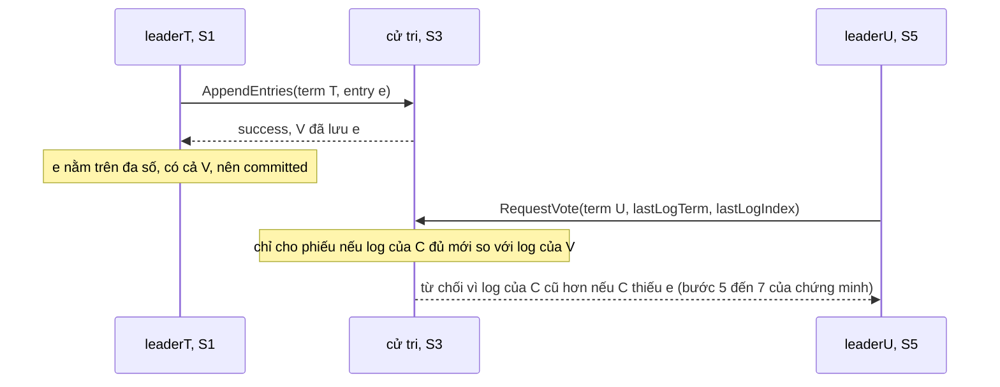

(Người soạn vẽ sơ đồ này theo Hình 9 của bài báo: S1 là leader của term T, S3 là cử tri, S5 là leader của term U[^b-fig9].)

*Hình 8: nằm trên đa số chưa đủ.* Leader Completeness chỉ nói về entry đã committed, nên ta còn phải biết "committed" nghĩa là gì. Cách hiểu ngây thơ là "entry nằm trên đa số server thì committed". Cách hiểu này sai với entry của term cũ, và phản ví dụ chính là Hình 8 của bài báo. Với `kvmeta`, sai ở đây nghĩa là một `put` đã trả ok vẫn có thể biến mất.

Bảng dưới dựng lại năm trạng thái (a) đến (e) của hình: mỗi cột S1 đến S5 là một server, và mỗi số trong ô là term của entry ở index 1, 2, 3, đọc từ trái sang phải. Các số này đọc trực tiếp từ hình, vì chú thích của hình không liệt kê nội dung log. (d) và (e) là hai nhánh thay thế nhau, cùng xuất phát từ (c). Riêng term 5 của S5 ở (d) do người soạn đặt (nó phải lớn hơn mọi term đã dùng); bài báo chỉ nói S5 được bầu.

| Bước | Leader (term) | S1 | S2 | S3 | S4 | S5 |
|---|---|---|---|---|---|---|
| (a) | S1 (2) | `1 2` | `1 2` | `1` | `1` | `1` |
| (b) | S5 (3) | `1 2` | `1 2` | `1` | `1` | `1 3` |
| (c) | S1 (4) | `1 2 4` | `1 2` | `1 2` | `1` | `1 3` |
| (d) nhánh S1 sập | S5 (5) | `1 3` | `1 3` | `1 3` | `1 3` | `1 3` |
| (e) nhánh S1 chép kịp | S1 (4) | `1 2 4` | `1 2 4` | `1 2 4` | `1` | `1 3` |

(Người soạn dựng bảng từ hình và chú thích của Hình 8. Ở (d), hình chỉ vẽ trạng thái sau khi S5 đã chép log của nó xuống S1 đến S4; lúc S1 sập, log của S1 vẫn là `1 2 4`.)

Từng trạng thái diễn ra như sau.

- **(a)** Cả năm server đã có entry index 1 từ term 1. Sang term 2, S1 làm leader và ghi một lệnh vào index 2, nhưng mới chép được sang S2 thì dừng[^b-fig8-a]. Entry mới chỉ nằm trên 2/5 server, chưa tới đa số.
- **(b)** S1 sập. S5 hết giờ chờ leader, ra ứng cử và thắng ở term 3 với phiếu của S3, S4 và chính nó. Log của ba server này đều là `1`, ngang nhau, nên không ai có lý do từ chối. S5 nhận một lệnh khác và ghi vào index 2 với term 3, chỉ trong log của riêng nó[^b-fig8-b]. Giờ index 2 có hai entry khác nhau trong hai log, nhưng chúng thuộc hai term khác nhau nên Log Matching không bị vi phạm, vì tính chất này chỉ đòi hai entry cùng index *và* cùng term mới phải giống nhau.
- **(c)** S5 sập, S1 khởi động lại và thắng cử ở term 4, rồi chép tiếp. Entry (index 2, term 2) giờ nằm trên S1, S2, S3, tức một đa số, vậy mà bài báo nói rõ nó chưa committed[^b-fig8-c]. S1 còn thêm entry index 3, term 4 vào log của mình. Nếu luật commit là "nằm trên đa số thì committed", S1 sẽ thực thi lệnh ở index 2 và có thể đã trả lời client.
- **(d)** Nhánh xấu: S1 sập lần nữa và S5 sống lại. Log `1 3` của S5 có term cuối 3, lớn hơn term cuối 2 của S2, S3 và term cuối 1 của S4, nên cả ba coi log của S5 là đủ mới và có thể cho phiếu. Nếu S5 thắng cử, nó chép log của mình xuống, và entry (2, term 3) ghi đè entry (2, term 2) dù entry này từng nằm trên đa số[^b-fig8-d]. Nếu lệnh ở index 2 đã được thực thi và đã trả lời client, hai state machine có thể đã chạy hai lệnh khác nhau ở cùng index, tức State Machine Safety vỡ.
- **(e)** Nhánh đúng: S1 chưa sập ngay mà kịp chép entry index 3 của *term hiện tại* (term 4) lên S2 và S3. Entry này committed, kéo theo index 2 nằm trước nó cũng committed (gián tiếp), và S5 không còn thắng cử được nữa[^b-fig8-e]. Lý do là log `1 3` của S5 có term cuối 3, trong khi S2 và S3 (cả S1 nữa, nếu còn sống) có term cuối 4, nên các server này từ chối. S5 chỉ còn phiếu của S4 và của chính nó, tức 2/5.

*Luật commit của Raft sửa Hình 8 thế nào.* Luật nằm ở Hình 2 của bài báo, viết cho leader: leader đặt `commitIndex = N` khi N > `commitIndex`, đa số server có `matchIndex[i] ≥ N`, *và* `log[N].term == currentTerm`[^b-commit-rule]. Trong đó `matchIndex[i]` là index cao nhất mà leader biết đã được chép lên server i[^b-matchindex]. Điều kiện cuối bắt leader chỉ commit bằng cách đếm bản sao cho entry thuộc term của chính nó, còn các entry cũ hơn chỉ committed gián tiếp, nhờ Log Matching[^b-prior-rule]. Áp luật vào hình (suy luận của người soạn): ở (c), N = 2 có đa số (S1, S2, S3) nhưng `log[2].term` là 2, khác term hiện tại 4, nên bị loại, còn N = 3 mới chỉ nằm trên S1. Ở (e), N = 3 có đa số và `log[3].term` là 4, đúng bằng term hiện tại, nên `commitIndex` nhảy lên 3 và index 2 committed theo.

*Vì sao luật đó đủ (suy luận của người soạn).* Đây là chỗ Hình 8 gặp chứng minh. Ở (e), entry (index 3, term 4) nằm trên S1, S2, S3, nên ứng viên nào muốn thắng cũng phải xin được phiếu của ít nhất một trong ba server đó, vì đa số nào cũng giao với nhóm này. Server ấy chính là "cử tri" của bước 2. Cử tri này có term cuối 4, nên chỉ cho phiếu ứng viên có term cuối từ 4 trở lên. Nếu log của ứng viên kết thúc ở term 4 thì theo bước 6 nó chứa mọi entry của cử tri, kể cả entry index 3; nếu nó kết thúc ở một term sau 4 thì theo bước 7 nó cũng chứa entry ấy.

Ở (c) thì không có cử tri nào chặn được S5: term cuối 3 của S5 lớn hơn term cuối 2 của S2, S3 và term cuối 1 của S4, nên cả ba cho phiếu, dù S5 thiếu entry (index 2, term 2). Nói gọn lại: một entry của term hiện tại t đã nằm trên đa số thì loại khỏi cuộc bầu mọi log có term cuối nhỏ hơn t, còn một entry của term cũ s < t vẫn có thể bị một log có term cuối nằm giữa s và t qua mặt. Bạn có thể xem luật commit này dưới dạng đặc tả TLA+ ở [P13 · Chương 08](../13-tla-plus/08-dac-ta-giao-thuc-phan-tan.md).

*Ba biến phải bền.* Hình 2 của bài báo chia trạng thái của server thành nhóm bền và nhóm không bền, và đặt `currentTerm`, `votedFor`, `log[]` vào nhóm bền: ba biến này phải được cập nhật vào stable storage *trước khi server trả lời RPC*[^b-persist-fig2]. Stable storage là chỗ lưu dữ liệu còn nguyên sau khi khởi động lại; trên máy thật đó là đĩa, sau `fsync` (nhận xét của người soạn). Với `kvmeta`, `N2` phải ghi phiếu xong rồi mới được trả lời `RequestVote`, và phải `fsync` bản ghi mới nhận từ leader rồi mới được báo là đã nhận. Luận án giải thích lý do ở hai vế. Thứ nhất, server ghi bền term và phiếu để không bỏ phiếu hai lần trong cùng một term, và để entry của leader mới không bị thay bằng entry của leader đã bị phế. Thứ hai, nó ghi bền entry trước khi entry được tính vào commit, để entry committed không mất hay "hết committed" sau khi server khởi động lại[^b-persist-why]. Bảng dưới gom hậu quả khi mất từng biến, kèm bước nào của chứng minh dựa vào biến đó (người soạn tổng hợp từ luận án, các luật ở Hình 2 và chín bước ở trên):

| Biến | Dùng ở đâu | Nếu mất sau khi khởi động lại |
|---|---|---|
| `currentTerm` | từ chối RPC mang term thấp hơn term hiện tại[^b-ae-term] (chỗ dựa của bước 3); nâng term khi thấy RPC mang term cao hơn[^b-term-rules] | nhận lại lệnh từ leader đã bị phế: leader cũ vẫn commit được, hoặc entry của leader mới bị ghi đè (trace ở phần Đi sâu) |
| `votedFor` | luật "mỗi term một phiếu"[^b-vote-rule], nền của Election Safety (mỗi term một leader) | bỏ phiếu hai lần trong một term, nên có hai leader cùng term và Log Matching vỡ (trace ngay dưới) |
| `log[]` | entry được tính để commit, và so log khi bỏ phiếu (bước 4 đến 7) | entry đã được tính vào đa số biến mất, entry committed bị "hết committed"[^b-persist-why] |

*Trace: mất `votedFor` thì hai leader cùng một term.* Cách thấy rõ nhất vì sao phải ghi bền là xem chuyện gì xảy ra khi một server bỏ qua nó. Kịch bản dưới đây do người soạn dựng từ luật bỏ phiếu và luật `AppendEntries` ở Hình 2, bài báo không có ví dụ này. Cụm ba server S1, S2, S3 đang ở term 6, log của cả ba giống nhau và kết thúc ở index 5, term 6. Cài đặt của S2 có lỗi: nó ghi `votedFor` vào RAM nhưng chưa ghi xuống đĩa đã trả lời, tức vi phạm quy tắc "cập nhật stable storage trước khi trả lời RPC".

1. S1 và S3 hết giờ cùng lúc, cả hai thành ứng viên của term 7 và tự bỏ phiếu cho mình.
2. S1 gửi `RequestVote(term 7)` tới S2. S2 nâng term từ 6 lên 7, thấy `votedFor` còn rỗng và log của S1 không cũ hơn log của mình, nên cho phiếu và đặt `votedFor = S1` trong RAM. S1 có 2/3 phiếu và thành leader của term 7.
3. S2 sập rồi khởi động lại. Nó nạp lại được `currentTerm = 7` vì biến này đã được ghi, còn `votedFor` thì rỗng vì chưa được ghi.
4. S3 gửi `RequestVote(term 7)` tới S2. Term này bằng term hiện tại của S2, `votedFor` rỗng và log của S3 không cũ hơn, nên S2 cho phiếu lần thứ hai. S3 cũng có 2/3 phiếu và thành leader của term 7.

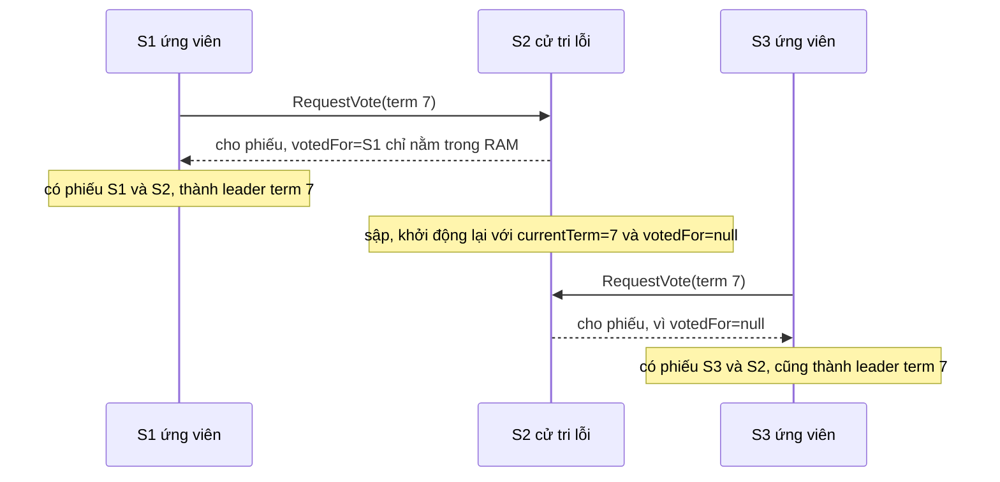

(Người soạn vẽ sơ đồ này theo trace ở trên.)

Hậu quả đầu tiên là term 7 có hai leader, tức Election Safety vỡ. Tính chất này dựa vào việc mỗi server chỉ bỏ phiếu một lần trong một term, vì có vậy luật đa số mới chặn được hai ứng viên cùng thắng[^b-majority-rule]. S1 nhận lệnh `x=1` và ghi vào index 6 với term 7, còn S3 nhận lệnh `x=2` và cũng ghi vào index 6 với term 7. Vậy tính chất đầu của Log Matching, "cùng index và term thì cùng lệnh", bị phá, vì nó dựa vào việc mỗi leader chỉ tạo tối đa một entry cho mỗi index trong mỗi term[^b-logmatch-first].

Rồi hai entry gặp nhau ở S2. S1 chép `x=1` sang S2 và S2 nhận. Khi S3 chép `x=2` (index 6, term 7) sang S2, phép kiểm tra entry ngay trước (`prevLogIndex`, `prevLogTerm`) vẫn đạt. Entry sẵn có ở index 6 có *cùng term* 7 với entry mới, nên S2 không coi đó là xung đột và không xóa nó[^b-ae-conflict]. Luật "chỉ thêm entry chưa có trong log" lại khiến S2 giữ `x=1` và trả lời thành công[^b-ae-append]. S3 đếm S2 vào đa số và commit `x=2`, còn S1 cũng nhờ S2 mà commit `x=1`: hai lệnh khác nhau cùng được "committed" ở index 6. Với `kvmeta`, đó là hai service cùng nhận ok cho hai giá trị trái nhau của cùng một slot.

Thư viện Raft thật chặn lỗi này bằng một hợp đồng với phần ứng dụng bên trên. `etcd/raft` đòi ứng dụng lưu `HardState` xuống đĩa *trước* khi gửi message đi[^b-etcd-ready-hs]. `HardState` có các trường `Term`, `Vote` và `Commit`[^b-etcd-hs-fields]. Nếu bật chế độ ghi bất đồng bộ thì mọi thao tác ghi liên quan tới phiếu bầu, thay đổi term và commit index vẫn phải bền xong trước khi message trả lời được giao đi[^b-etcd-storage-append]. Phiếu S2 trả lời ở bước 2 chính là loại message đó, nên theo hợp đồng này S2 phải ghi `Vote` xuống đĩa trước khi gửi nó.

<details><summary>Đi sâu: chương trình Rust kiểm Hình 8, trace mất <code>currentTerm</code>, lỗi có thật, biến nào thực sự phải bền</summary>

- *Kiểm Hình 8 bằng chương trình.* Để thử lại Hình 8, người soạn viết một chương trình Rust nhỏ (biên dịch và chạy bằng rustc 1.95.0). Mỗi log trong chương trình là một danh sách term. Chương trình dùng luật "log đủ mới" để tính xem khi S1 sập thì ứng viên nào gom được đa số phiếu, rồi so luật commit ngây thơ với luật của Raft. Nó bỏ qua số term và các phiếu đã bỏ, tức coi như ứng viên luôn dùng term đủ lớn và voter chưa bỏ phiếu ở term đó. Như vậy đủ để kiểm "ai có thể thắng cử", nhưng không phải mô phỏng đầy đủ Raft.

```rust
// Kiểm tra Hình 8 của paper Raft bằng luật bầu cử và luật commit.
// Log = danh sách term của entry ở index 1, 2, 3, ...
type Log = Vec<u32>;

/// Log `a` có "đủ mới" so với `b` không? (so term cuối, hòa thì so độ dài)
fn up_to_date(a: &Log, b: &Log) -> bool {
    let (ta, tb) = (a.last().copied().unwrap_or(0), b.last().copied().unwrap_or(0));
    ta > tb || (ta == tb && a.len() >= b.len())
}

/// Ứng viên c có thể gom đa số phiếu không, nếu mọi server còn sống đều cho phiếu
/// mỗi khi log của c đủ mới so với log của mình? (bỏ qua chuyện term và phiếu cũ)
fn can_win(c: usize, logs: &[Log], alive: &[bool]) -> bool {
    let votes = (0..logs.len()).filter(|&v| alive[v] && up_to_date(&logs[c], &logs[v])).count();
    alive[c] && votes > logs.len() / 2
}

fn show(name: &str, logs: &[Log], alive: &[bool], leader_term: u32, entry: (usize, u32)) {
    let (idx, term) = entry;
    let holders = logs.iter().filter(|l| l.get(idx - 1) == Some(&term)).count();
    println!("{name}");
    println!("  entry (index {idx}, term {term}) có trên {holders}/5 server");
    println!("  luật ngây thơ (đa số là commit)      : {}", holders > 2);
    println!("  luật Raft (đa số VÀ term = {leader_term})      : {}", holders > 2 && term == leader_term);
    let winners: Vec<String> = (0..5).filter(|&c| can_win(c, logs, alive)).map(|c| format!("S{}", c + 1)).collect();
    let missing: Vec<String> = (0..5)
        .filter(|&c| can_win(c, logs, alive) && logs[c].get(idx - 1) != Some(&term))
        .map(|c| format!("S{}", c + 1)).collect();
    println!("  server có thể thắng cử (S1 sập)       : {winners:?}");
    println!("  trong đó thiếu entry này              : {missing:?}");
}

fn main() {
    let s1_down = [false, true, true, true, true];
    // (c): S1 là leader term 4, đã chép entry (2, term 2) sang S3
    let c = vec![vec![1, 2, 4], vec![1, 2], vec![1, 2], vec![1], vec![1, 3]];
    show("(c)", &c, &s1_down, 4, (2, 2));
    // (e): S1 chép được entry (3, term 4) lên S2 và S3 rồi mới sập
    let e = vec![vec![1, 2, 4], vec![1, 2, 4], vec![1, 2, 4], vec![1], vec![1, 3]];
    show("(e)", &e, &s1_down, 4, (3, 4));
    println!("(e) entry (2, term 2) nằm trong log của mọi server có thể thắng cử: {}",
        (0..5).filter(|&x| can_win(x, &e, &s1_down)).all(|x| e[x].get(1) == Some(&2)));
}
```

  Kết quả chạy:

```text
(c)
  entry (index 2, term 2) có trên 3/5 server
  luật ngây thơ (đa số là commit)      : true
  luật Raft (đa số VÀ term = 4)      : false
  server có thể thắng cử (S1 sập)       : ["S2", "S3", "S5"]
  trong đó thiếu entry này              : ["S5"]
(e)
  entry (index 3, term 4) có trên 3/5 server
  luật ngây thơ (đa số là commit)      : true
  luật Raft (đa số VÀ term = 4)      : true
  server có thể thắng cử (S1 sập)       : ["S2", "S3"]
  trong đó thiếu entry này              : []
(e) entry (2, term 2) nằm trong log của mọi server có thể thắng cử: true
```

  Đọc kết quả: ở (c), S5 vẫn thắng cử được dù thiếu entry (2, term 2), nên nếu entry đó được coi là committed thì Leader Completeness sai. Ở (e), khi S1 sập thì chỉ S2 và S3 thắng cử được, và cả hai đều có cả entry (3, term 4) lẫn entry (2, term 2).

- *Mất `currentTerm`: leader đã bị phế vẫn commit được.* Kịch bản này do người soạn dựng. S1 là leader term 5, bị cô lập sau khi ghi `e` vào index 6 (term 5) trong log của riêng nó. S2 và S3 bầu S2 làm leader term 6, và S3 đã bỏ phiếu cho S2 ở term 6. Rồi S3 sập và khởi động lại, nhưng vì `currentTerm` không được ghi bền nên nó quay về 0. Khi S1 nối lại được với S3 và gửi `AppendEntries(term 5, e)`, S3 không còn lý do để từ chối theo luật "term thấp hơn thì từ chối"[^b-ae-term]. S3 nhận `e`, S1 có 2/3 nên commit `e` và trả lời client. Sau đó S2 (term 6) chép entry index 6 của mình sang S3. S3 thấy entry sẵn có ở index 6 khác term nên xóa nó[^b-ae-conflict], rồi nhận entry của S2, và S2 cũng có 2/3 nên commit. Kết quả là hai entry khác nhau cùng được committed ở index 6. Chỗ hỏng là S3 nhận `AppendEntries` của một leader đã bị phế trong khi nó đã theo term 6, đúng loại nguy cơ mà luận án nêu khi đòi ghi bền term[^b-persist-why].
- *Hình 8 là lỗi có thật.* Một bản đầu của Raft từng có luật commit không tính tới kịch bản như Hình 3.7 của luận án (chú thích hình này trùng lời với Hình 8 của bài báo), và model checker Murphi (công cụ duyệt hết các trạng thái của một mô hình để tìm lỗi) đã bỏ sót lỗi này[^b-murphi]. Nhiều khả năng Murphi bỏ sót vì kích thước mô hình bị giới hạn[^s2-murphi-size]. Câu chuyện này cũng được kể ở [P13 · Chương 08](../13-tla-plus/08-dac-ta-giao-thuc-phan-tan.md). Luận án kể rằng tác giả đã dùng hệ chứng minh TLA để chứng minh bằng máy tính chất Leader Completeness, nhưng chứng minh ấy dựa trên các invariant (điều kiện luôn đúng ở mọi trạng thái) chưa được kiểm máy[^b-tlaps]. Tác giả cũng thừa nhận chứng minh an toàn của mình "có thể có lỗi"[^b-proof-bugs]. Về sau, nhóm Verdi của Đại học Washington hoàn thành một chứng minh an toàn kiểm máy bằng Coq cho thuật toán Raft cơ bản[^b-coq].
- *Vì sao entry giữ nguyên term khi chép lại.* Luật commit phức tạp là vì entry giữ nguyên term gốc khi leader chép lại entry của term cũ[^b-retain-term]. Cái lợi là entry giữ cùng một term theo thời gian và giữa các log, nên dễ suy luận hơn; các thuật toán khác thì buộc leader mới đánh lại số entry bằng term của mình khi chép lại[^b-renumber]. Luật cũng còn thận trọng hơn mức cần: đôi khi leader có thể kết luận an toàn rằng một entry cũ đã committed (ví dụ entry đã nằm trên mọi server), nhưng Raft chọn luật bảo thủ cho đơn giản[^b-conservative].
- *Biến nào thực sự phải bền.* Ngoài ba biến trên, Hình 2 xếp `commitIndex` và `lastApplied` vào trạng thái *volatile*[^b-volatile-fig2]. Luận án nói các biến còn lại an toàn khi mất lúc khởi động lại vì dựng lại được, ví dụ điển hình là commit index, có thể khởi tạo lại bằng 0[^b-commit-volatile]. Riêng `lastApplied` thì phần errata sửa lại: nó phải bền *tương ứng với state machine*, nghĩa là state machine bền thì `lastApplied` cũng phải bền[^b-erratum-lastapplied]. Bài giảng Cambridge lại liệt kê `commitLength` thành biến thứ tư cần lưu bền[^b-cam-stable]. `HardState` của `etcd/raft` cũng có trường `Commit`[^b-etcd-hs-fields]. Việc lưu thêm là lựa chọn của từng cài đặt, không mâu thuẫn với luận án, vì lưu thêm một biến chỉ làm khởi động lại nhanh hơn chứ không đổi an toàn (suy luận của người soạn).
- *Mất trạng thái bền thì sao.* Một server đã mất bất kỳ trạng thái bền nào thì không thể gia nhập lại cụm với danh tính cũ một cách an toàn, và thường vẫn có thể thêm lại nó với danh tính mới bằng thay đổi thành viên[^b-lose-identity]. Nếu cả một đa số mất trạng thái bền thì entry có thể mất và thay đổi thành viên không còn tiến triển được[^b-lose-majority]. Muốn đi tiếp, quản trị viên phải chấp nhận khả năng mất dữ liệu[^s2-lose-admit]. Thư viện `etcd/raft` có một quy ước cùng tinh thần (suy luận của người soạn): một ID chỉ dùng cho một node trong mọi thời gian, kể cả khi node cũ đã bị gỡ[^b-etcd-id].

</details>

**Quay lại Q4:** lời hứa "đã ack thì không mất" của `kvmeta` đứng được nhờ ba điều: hai đa số luôn có cử tri chung cùng luật log đủ mới, luật chỉ đếm bản sao cho entry của term hiện tại, và ba biến `currentTerm`, `votedFor`, `log` được `fsync` trước khi trả lời.

## 5. Raft ngoài lõi: snapshot, thay đổi thành viên và chuyển giao leader (Q5)

> **Trả lời ngắn.** Log không thể dài mãi, nên mỗi server tự chụp một "ảnh" (snapshot) của trạng thái rồi bỏ phần log cũ, và follower nào tụt quá xa thì được leader gửi nguyên snapshot thay cho các entry đã bỏ[^b-p-snap-trigger]. Đổi thành viên chỉ an toàn nếu không lúc nào hai nhóm đa số rời nhau cùng ra quyết định, và đổi đúng một server mỗi lần bảo đảm điều đó vì đa số cũ và đa số mới khi ấy luôn giao nhau[^b-overlap]. Cách này từng có một lỗi, do Ongaro công bố năm 2015, và bản vá chỉ là một điều kiện: leader phải commit một entry của term hiện tại rồi mới được thêm entry cấu hình mới[^b-bug-fix]. Cuối cùng, leader có thể chủ động nhường quyền: nó chép cho server đích những entry còn thiếu rồi gửi `TimeoutNow` để server đó bầu cử ngay[^b-lt-steps].

**Giải thích.**

*Với cụm `kvmeta`.* Mỗi `put` của `kvmeta` (5 node `N1`…`N5`) thêm một entry vào log, nên chạy càng lâu thì log của cả năm node càng dài. Một ngày ổ đĩa của `N5` hỏng hẳn, ta phải thay nó bằng một máy mới, mà trong lúc đổi, cụm không được tách thành hai nhóm tự bầu leader riêng. Một hôm khác ta cần bảo trì chính máy đang là leader và muốn nhường quyền trước, để các `put` đang chờ ack khỏi đợi một cuộc bầu cử. Ba việc đó (nén log, đổi thành viên, chuyển giao leader) nằm ngoài lõi bầu leader và chép log của Raft; mục này đi qua từng việc ở 5.1 đến 5.4.

### 5.1. Nén log bằng snapshot và `InstallSnapshot`

*Vì sao phải nén.* Log càng dài thì càng tốn đĩa và càng lâu để phát lại. Nếu không có cách bỏ bớt phần cũ thì sớm muộn cụm sẽ gặp vấn đề về sẵn sàng[^b-p-snap-why]. Với state machine nằm trong bộ nhớ, cách đơn giản nhất về mặt khái niệm là snapshot: ghi toàn bộ trạng thái hiện tại ra nơi lưu bền (stable storage), rồi bỏ cả phần log tới điểm đó[^rv-snap-def]. State machine của `kvmeta` là một bảng key-value, giả sử nằm trong bộ nhớ, nên snapshot của nó là một bản chụp cả bảng. Mỗi server tự chụp, không cần hỏi leader, và bản chụp chỉ phủ các entry đã committed trong log của chính nó[^b-p-snap-indep].

*Snapshot chứa gì.* Phần lớn việc tạo snapshot là state machine ghi trạng thái hiện tại của nó ra. Raft thêm một chút siêu dữ liệu gồm hai số: *last included index* là index của entry cuối mà snapshot thay thế (cũng là entry cuối state machine đã áp), còn *last included term* là term của entry đó[^b-p-snap-meta]. Hai số này để làm gì? Khi leader chép entry đầu tiên sau snapshot, `AppendEntries` phải kèm index và term của entry đứng ngay trước nó để kiểm tra khớp log, mà entry đó đã bị nén mất. Hai số này đứng thay chỗ nó: chúng "neo" phần log còn lại vào đúng vị trí, nên phép kiểm tra vẫn chạy được[^b-snap-anchor]. Cấu hình cụm nằm ngay trong log (mục 5.2), vì vậy snapshot cũng chứa cấu hình mới nhất tính đến last included index, để việc đổi thành viên làm được[^b-p-snap-meta2]. Khi state machine ghi xong snapshot, Raft lưu trước những gì cần để khởi động lại (hai số trên và cấu hình), rồi mới bỏ phần đầu của log[^b-snap-restart-state].

*Ví dụ bằng số.* Bảng dưới là log trước và sau khi nén (người soạn vẽ lại từ Hình 12 của bài báo và Hình 5.2 của luận án, số liệu lấy từ hình). Snapshot thay các entry 1 đến 5 nên ghi last included index = 5 và term = 3[^b-snap-fig52].

| | index 1 | 2 | 3 | 4 | 5 | 6 | 7 |
|---|---|---|---|---|---|---|---|
| Term | 1 | 1 | 1 | 2 | 3 | 3 | 3 |
| Lệnh | `x←3` | `y←1` | `y←9` | `x←2` | `x←0` | `y←7` | `x←5` |
| Sau khi nén | gộp vào snapshot `{x=0, y=9}`, last included index 5, term 3, kèm cấu hình | | | | | giữ | giữ |

Giờ leader chép entry 6 cho một follower: `AppendEntries` phải mang `prevLogIndex = 5` và `prevLogTerm = 3`, tức index và term của entry 5. Entry 5 không còn trong log, nhưng snapshot đã giữ cặp (5, 3) nên leader vẫn có đủ dữ kiện để kiểm tra.

*Khi nào phải gửi snapshot.* Có một vướng mắc: không thể hoãn nén log cho tới khi mọi server đã nhận đủ entry. Một thiểu số follower chậm không được phép làm cụm mất sẵn sàng, mà server mới lại có thể được thêm vào bất cứ lúc nào[^b-snap-slow]. Vì vậy có lúc leader phải gửi snapshot cho follower tụt lại phía sau[^b-p-snap-trigger]. Với `kvmeta`, node mới thay `N5` là một ví dụ: nó bắt đầu với log rỗng, trong khi leader đã bỏ phần log cũ (nhận xét của người soạn). Leader nhận ra lúc phải gửi khi entry kế tiếp mà `AppendEntries` cần gửi đã bị loại khỏi log của chính nó[^b-snap-trigger2]. Khi đó nó dùng RPC `InstallSnapshot`: snapshot được chia thành các chunk (đoạn nhỏ), và mỗi chunk đến nơi cũng là một "dấu hiệu sống" để follower đặt lại election timer[^b-p-installsnap-chunks].

Sơ đồ dưới theo dõi một lần như vậy: leader đã nén log tới index 5, còn follower mới có log tới index 3.

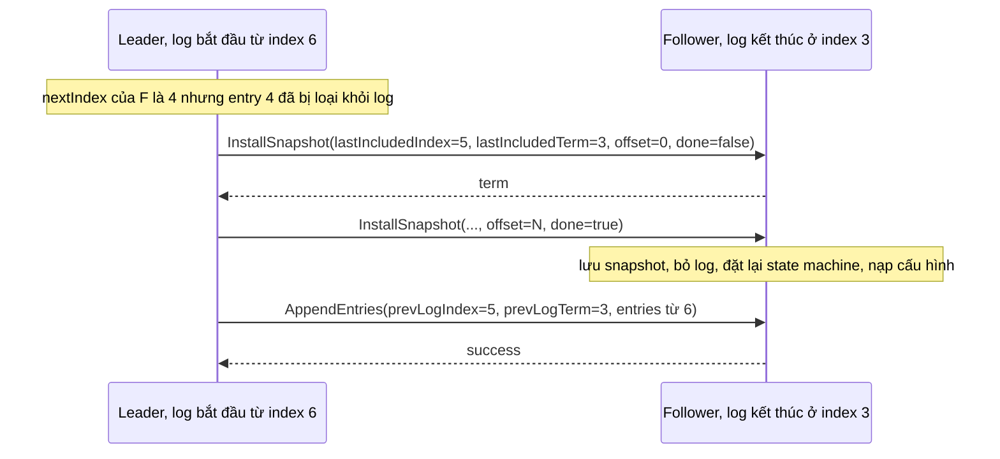

(Người soạn vẽ sơ đồ theo Hình 13 của bài báo và mô tả ở mục 5.1 của luận án; các con số chỉ là ví dụ.)

*Follower làm gì khi nhận.* Quy tắc ngắn gọn: nếu log của follower có entry cùng index và term với entry cuối mà snapshot bao phủ thì giữ phần log phía sau entry đó, nếu không thì bỏ toàn bộ log; xong thì đặt lại state machine bằng nội dung snapshot và nạp cấu hình đi kèm[^b-p-installsnap-rules]. Nhánh "bỏ toàn bộ log" là nhánh thường gặp, vì snapshot thường chứa thông tin mà log của follower chưa có, và kể cả những entry chưa committed mà xung đột với snapshot cũng bị bỏ theo[^b-p-snap-discard]. Nhánh giữ lại xảy ra khi snapshot gửi lặp hoặc gửi nhầm, tức chỉ mô tả một đoạn đầu của log mà follower đã có[^b-p-snap-prefix].

*Một ngoại lệ có chủ ý.* Snapshot trái với thiết kế gốc của Raft ở một điểm: follower tự chụp mà không hỏi leader, trong khi Raft theo nguyên tắc strong leader. Bài báo cho rằng lệch như vậy là chính đáng: leader có ích ở chỗ giúp tránh quyết định xung đột khi đang đạt đồng thuận, còn lúc chụp snapshot thì đồng thuận đã đạt rồi, nên không còn quyết định nào để xung đột[^b-p-snap-strong-leader].

### 5.2. Đổi thành viên: vì sao không đổi thẳng, và vì sao đổi từng server thì an toàn

*Vì sao không đổi thẳng.* Cấu hình cụm là danh sách các server tham gia đồng thuận, và danh sách này phải đổi được khi cụm đang chạy: để thay máy hỏng như `N5`, hoặc để tăng giảm số bản sao[^b-p6-why]. Cách trực tiếp là báo cho mọi server chuyển thẳng sang cấu hình mới, nhưng cách nào chuyển thẳng cũng không an toàn. Ta không thể đổi cùng một lúc ở mọi server, nên trong lúc chuyển có server còn theo cấu hình cũ, có server đã theo cấu hình mới, và cụm có thể tách thành hai đa số độc lập[^b-direct-unsafe]. Hình 10 của bài báo minh họa bằng cụm lớn từ ba lên năm server, số liệu dưới đây do người soạn điền: cấu hình cũ {S1, S2, S3} cần 2 phiếu, cấu hình mới {S1, ..., S5} cần 3 phiếu. Lúc S1 và S2 còn dùng cấu hình cũ, còn S3, S4, S5 đã dùng cấu hình mới, {S1, S2} là một đa số của cấu hình cũ và {S3, S4, S5} là một đa số của cấu hình mới. Hai nhóm này không có server chung, nên mỗi nhóm bầu được một leader riêng và cụm có thể có hai leader trong cùng một term[^b-fig10].

*Đổi từng server một.* Luận án hạn chế mỗi lần chỉ thêm hoặc bớt đúng một server, còn thay đổi lớn hơn thì chia thành một chuỗi các bước như vậy[^b-single]. Với `kvmeta`, thay `N5` hỏng bằng một node mới là hai bước: thêm node mới và bớt `N5` (làm bước nào trước thì xem phần Đi sâu). Lý do là khi chỉ thêm hoặc bớt một server, mọi đa số của cấu hình cũ đều giao nhau với mọi đa số của cấu hình mới. Sự giao nhau đó chặn cụm tách thành hai đa số độc lập, và cũng bảo đảm "cử tri" (server vừa nhận entry từ leader cũ, vừa bỏ phiếu cho leader mới) trong chứng minh ở mục 4 luôn tồn tại[^b-overlap].

Ta kiểm lại bằng phép đếm (suy luận của người soạn). Cụm n server có đa số cỡ ⌊n/2⌋ + 1. Thêm một server thì cụm mới có n + 1 server, đa số cỡ ⌊(n+1)/2⌋ + 1. Tổng hai cỡ đa số luôn bằng n + 2, trong khi hợp của hai cấu hình chỉ có n + 1 server, nên hai tập con cỡ ấy trong hợp đó buộc phải chung ít nhất một server. Bớt một server thì lập luận đối xứng. Với thay đổi hai server, phép đếm có thể hụt: từ 3 lên 5 server thì đa số cũ cỡ 2 và đa số mới cỡ 3 cộng lại chỉ bằng 5, đúng bằng số server của hợp, nên hai đa số có thể rời nhau, như ví dụ Hình 10 ở trên. Phần Đi sâu có một chương trình Rust vét cạn kiểm lại bằng máy cho n = 2 đến 8.

*Cơ chế chạy.* Cấu hình được lưu và truyền đi bằng những entry đặc biệt trong log[^b-config-log]. Khác với entry thường, entry cấu hình có hiệu lực ở mỗi server ngay khi được thêm vào log của server đó, không đợi tới lúc committed, và mỗi server luôn dùng cấu hình mới nhất có trong log của mình[^b-config-takes]. Có ba điều đi kèm. Thứ nhất, khi đổi leader, entry cấu hình có thể bị xóa khỏi log, nên server phải sẵn sàng quay về cấu hình trước đó[^b-fallback]. Thứ hai, server xử lý RPC mà không tra cấu hình hiện tại của mình[^b-rpc-noconfig]. Cụ thể, nó vẫn nhận `AppendEntries` từ một leader chưa nằm trong cấu hình của nó, vì nếu không thì server mới không bao giờ vào được cụm[^b-rpc-accept]. Thứ ba, leader chỉ được bắt đầu thay đổi kế tiếp khi entry cấu hình trước đã committed, vì các thay đổi chồng lên nhau có thể dẫn tới tình huống không an toàn, như Hình 4.2 của luận án[^b-one-at-a-time].

*Bắt kịp trước khi bỏ phiếu.* Node mới thay `N5` có log rỗng. Nếu ta thêm nó thẳng vào cấu hình như một thành viên đầy đủ thì cụm dễ mất sẵn sàng. Hình 4.4(a) của luận án minh họa: cụm ba server, thêm S4, rồi S3 hỏng; muốn commit cần 3 trong 4 server, nhưng S3 đã hỏng và log của S4 vẫn quá xa để nhận entry mới[^b-fig44]. Cách chữa là thêm một pha trước khi đổi cấu hình, trong đó server mới tham gia như thành viên *không bỏ phiếu*: leader chép log cho nó nhưng chưa tính nó vào đa số khi bầu cử hay commit[^b-catchup]. Leader cũng nên hủy thay đổi nếu server mới không khả dụng, hoặc chậm đến mức sẽ không bao giờ bắt kịp[^b-abort]. Cách đo "bắt kịp" nằm ở phần Đi sâu.

Trong etcd, thành viên không bỏ phiếu này gọi là *learner* (trùng tên nhưng khác nghĩa với learner của Paxos ở [chương 09](09-consistency-va-consensus.md), nơi đó là tiến trình học giá trị đã được chọn): nó vào cụm mà không bỏ phiếu cho tới khi bắt kịp log của leader[^b-learner-def]. Ta thêm nó bằng `etcdctl member add --learner`[^b-learner-add]. Lệnh `member promote` biến nó thành voter (thành viên có quyền bỏ phiếu) chỉ thành công khi log của nó đã bắt kịp leader[^b-learner-promote].

*Joint consensus.* Khi cần đổi nhiều server cùng lúc, chẳng hạn thêm hai node vào `kvmeta`, Raft có cách thứ hai: đi qua một cấu hình chuyển tiếp `C_old,new`. Leader ghi entry cấu hình chung và commit nó, và chỉ sau đó mới ghi entry `C_new`[^b-joint-def]. Trong cấu hình chung, mọi quyết định (cả bầu cử lẫn commit) cần đa số *riêng rẽ* của cả cấu hình cũ lẫn cấu hình mới. Chẳng hạn đổi từ 3 server sang 9 server thì cần 2 trong 3 server cũ và 5 trong 9 server mới[^b-joint-agree]. Nhờ vậy không có lúc nào `C_old` và `C_new` ra quyết định độc lập với nhau[^b-joint-fig]. Luận án vẫn khuyên dùng đổi từng server vì đơn giản hơn: xử lý thay đổi tùy ý đòi thêm độ phức tạp[^b-joint-recommend].

### 5.3. Lỗi năm 2015 của thuật toán đổi từng server, và bản vá

Lập luận giao nhau ở mục 5.2 nghe rất chắc, nhưng thuật toán đổi từng server từng bị phát hiện có lỗi. Ngày 10/7/2015, Ongaro đăng lên danh sách raft-dev để báo lỗi này trong luận án của ông[^b-bug-date]. Ông gọi lỗi là "có thể nghiêm trọng" nhưng cách sửa dễ cài[^b-bug-announce]. Phần errata của luận án cũng ghi lại điều này[^b-erratum-bug].

*Lỗi nằm ở đâu.* Luận án lập luận rằng hai cấu hình khác nhau tối đa một server thì đa số của chúng giao nhau, và trong một term, một leader dễ bảo đảm cấu hình kế tiếp chỉ khác cấu hình trước một server[^b-bug-term]. Lỗi nằm ở chỗ khác, ở ranh giới giữa các term: hai thay đổi cạnh tranh nhau có thể có các đa số không giao nhau, và an toàn bị phá (split brain)[^b-bug-cause]. Hai thay đổi cạnh tranh ấy tạo ra hai cấu hình *anh em*, tức hai cấu hình cùng xuất phát từ một cấu hình, mỗi bên một thay đổi. Mỗi anh em chỉ khác cấu hình gốc một server, nhưng hai anh em có thể khác nhau tới hai server, nên lập luận ở trên không còn áp dụng được (suy luận của người soạn, xem bảng dưới).

*Khi nào lỗi xảy ra.* Lỗi xuất hiện khi cả ba điều kiện cùng xảy ra với thuật toán đổi từng server: cụm xuất phát có số server chẵn, nhiều thay đổi khác nhau được yêu cầu đồng thời, và leader bị mất. Khi đó dữ liệu có thể mất và split brain có thể kéo dài vĩnh viễn[^b-bug-scope]. Còn nếu cụm dùng joint consensus thì không dính lỗi này[^b-bug-joint]. Cụm `kvmeta` 5 node có số node lẻ nên chưa thỏa điều kiện đầu, nhưng nếu ta bớt `N5` hỏng mà chưa kịp thêm node thay thì cụm chỉ còn 4 node, đúng loại cụm chẵn mà lỗi nhắm tới (nhận xét của người soạn).

*Dựng lại một phản ví dụ.* Bài đăng đưa ra ba phản ví dụ. Cái gọn nhất, theo đếm của người soạn, chỉ có bốn server, sáu bước và không server mới nào phải bắt kịp: hai yêu cầu *bớt* hai server khác nhau khỏi cùng một cụm 4 server[^b-bug3-intro]. Bảng dưới dựng lại nó, với C = {S1, S2, S3, S4} là cấu hình xuất phát, D = {S1, S2, S3} là cấu hình bớt S4, và E = {S1, S2, S4} là cấu hình bớt S3. Mỗi ô là log của một server (L là leader, F là follower, số đi sau là term); cột cuối là cách đọc của người soạn.

| Bước | S1 | S2 | S3 | S4 | Điều xảy ra |
|---|---|---|---|---|---|
| 0 | L1 `[C]` | F1 `[C]` | F1 `[C]` | F1 `[C]` | trạng thái đầu |
| 1 | L1 `[C, D]`, mất liên lạc | F1 `[C]` | F1 `[C]` | F1 `[C]` | S1 thêm D vào log rồi mất liên lạc[^b-bug3-s1] |
| 2 | mất liên lạc | L2 `[C]` | F2 `[C]` | F2 `[C]` | S2 thắng cử term 2 nhờ {S2, S3, S4}, đủ 3/4 của C |
| 3 | mất liên lạc | L2 `[C, E]` | F2 `[C]` | F2 `[C]` | S2 thêm E |
| 4 | mất liên lạc | L2 `[C, E]` | F2 `[C]` | F2 `[C, E]` | S2 chép E sang S4 và coi là committed: 2/3 của E[^b-bug3-s4] |
| 5 | L3 `[C, D]` | L2 `[C, E]` | F3 `[C]` | F2 `[C, E]` | S1 sống lại, thắng cử term 3 nhờ {S1, S3}, đủ 2/3 của D, dù không có entry E đã committed[^b-bug3-s5] |
| 6 | L3 `[C, D]` | `[C, D]` | `[C, D]` | `[C, D]` | S1 chép D đè lên E đã committed[^b-bug3-s6] |

(Người soạn dựng lại bảng từ phản ví dụ 3 của bài đăng: các bước và tập phiếu lấy từ bài đăng, cách trình bày là của người soạn.) D và E cùng sinh ra từ C bằng hai thay đổi khác nhau, nên là anh em chứ không phải cha con (cha-con là hai cấu hình nối tiếp nhau). Đa số của D ({S1, S3}) và đa số của E ({S2, S4}) không có server chung.

*Bản vá.* Cách vá chỉ thêm một điều kiện: leader không được thêm entry cấu hình mới vào log cho tới khi nó đã commit một entry của term hiện tại[^b-bug-fix]. Thường thì leader thêm một entry no-op ngay khi đắc cử, nên điều kiện này nghĩa là hoãn hoặc từ chối yêu cầu đổi thành viên cho tới khi entry no-op đó được commit[^b-bug-noop]. Lý do Ongaro đưa ra: khi đã commit một entry của term hiện tại, leader biết mình có cấu hình committed mới nhất, và không cấu hình chưa committed nào từ các term trước còn có thể được commit nữa, vì các server đã lưu entry của leader hiện tại sẽ không bỏ phiếu cho server giữ cấu hình chưa committed ấy[^b-bug-why].

Thử áp bản vá vào bảng trên (suy luận của người soạn từ bản vá và luật bầu cử). Ở bước 3, trước khi thêm E, S2 phải commit một no-op term 2. Vì S1 đang mất liên lạc, no-op cần đủ 3/4 của C, tức cả S3 và S4 đều phải lưu no-op. Đến bước 5, log của S1 kết thúc ở term 1, nên S3 (đã có entry term 2) từ chối cho phiếu, S2 cũng vậy. Do đó S1 không gom nổi 2/3 của D, không thắng cử được, và E không bị ghi đè. Ongaro cũng nói thẳng rằng lúc đó chưa có chứng minh an toàn hình thức cho đổi thành viên, ở cả hai kiểu[^b-bug-noproof].

Bản vá này cùng một mẹo với luật commit ở Hình 8 (mục 4) và bước 1 của ReadIndex (mục 6): leader mới phải tự commit một entry của term mình trước đã (nhận xét của người soạn).

### 5.4. Gỡ chính leader và chuyển giao leader

*Gỡ chính leader.* Nếu node bị gỡ lại chính là leader của `kvmeta` thì sao? Cách trực tiếp là để leader vẫn dẫn cụm trong lúc commit `C_new`, dù cấu hình đó không còn nó: nó chép entry như thường nhưng không tính mình vào đa số, và chỉ xuống làm follower khi `C_new` đã committed[^b-remove-leader]. Luận án còn nêu một cách đơn giản khác: cho leader nhường quyền trước, để server khác làm việc đổi thành viên như bình thường[^b-remove-leader-transfer].

*Chuyển giao leader (leadership transfer).* Đó là leader chủ động trao quyền cho một server khác trước khi tự rời, và luận án nêu hai tình huống cần đến nó. Thứ nhất, leader phải dừng, chẳng hạn phải khởi động lại để bảo trì hoặc bị gỡ khỏi cụm. Nếu nó cứ thế dừng thì cụm "ngủ" chừng một election timeout, cho tới khi có server khác hết giờ và thắng cử; nhường quyền trước thì tránh được khoảng ngủ đó[^rv-lt-purpose]. Với `kvmeta`, đó là lúc các `put` đang chờ ack phải đứng đợi (nhận xét của người soạn). Thứ hai, có server hợp làm leader hơn server hiện tại: server tải cao thì không nên làm leader, còn khi triển khai trải nhiều vùng (WAN) thì server ở trung tâm dữ liệu chính nên được ưu tiên để giảm độ trễ giữa client và leader[^rv-lt-suitable]. Khi đó leader có thể định kỳ kiểm tra xem có follower nào phù hợp hơn không rồi nhường quyền cho nó[^b-lt-prefer].

Giả sử `N1` đang là leader của `kvmeta` và cần bảo trì, còn `N2` là server đích. Nhường quyền gồm ba bước[^b-lt-steps].

1. `N1` ngừng nhận yêu cầu mới của client.
2. `N1` chép cho `N2` những entry còn thiếu, bằng cơ chế chép log thường, cho tới khi log của `N2` khớp log của mình.
3. `N1` gửi `TimeoutNow`. Thông điệp này có tác dụng như election timer của `N2` vừa nổ, nên `N2` bắt đầu bầu cử ngay (tăng term, thành candidate).

`N2` gửi tin kế tiếp tới `N1` kèm term mới, nên `N1` thấy term cao hơn và xuống làm follower; việc chuyển giao hoàn tất[^b-lt-done]. Chuyển giao cũng có thể không xong: nếu sau chừng một election timeout vẫn chưa thấy kết quả, leader cũ bỏ cuộc và quay lại nhận yêu cầu của client[^b-lt-abort]. Nếu leader cũ bỏ cuộc nhầm, vì server đích thực ra vẫn hoạt động, thì xấu nhất cũng chỉ là thêm một cuộc bầu cử, sau đó client làm việc lại bình thường[^b-lt-mistake]. Cách này an toàn vì server đích nhận `TimeoutNow` cũng giống như đồng hồ của nó nhảy tiến nhanh, và Raft chịu được điều đó[^b-lt-safe].

Sơ đồ dưới vẽ cả quá trình, với Leader cũ là `N1` và Server đích là `N2`:

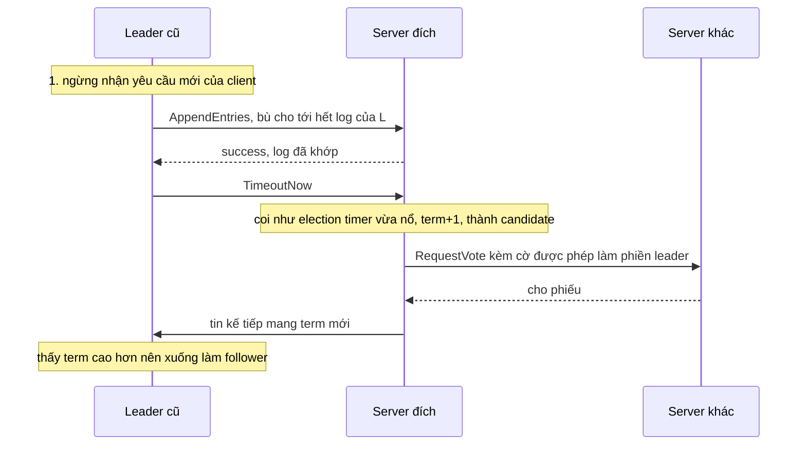

(Người soạn vẽ sơ đồ theo mô tả ở mục 3.10 và 4.2.3 của luận án.)

<details><summary>Đi sâu: chương trình Rust vét cạn việc giao nhau của đa số, chính sách snapshot, ghi snapshot an toàn, va chạm giữa chuyển giao leader và luật bỏ qua RequestVote, và chi tiết cài đặt trong etcd</summary>

- *Vét cạn: đa số của hai cấu hình có giao nhau không?* Chương trình dưới (người soạn viết, biên dịch và chạy bằng rustc 1.95.0) biểu diễn mỗi cấu hình bằng một bitmask server, liệt kê mọi đa số của hai cấu hình rồi hỏi có cặp nào rời nhau không. Nó chỉ kiểm tính chất giao nhau của đa số, không kiểm toàn bộ thuật toán.

```rust
// Vét cạn: đa số của hai cấu hình có luôn giao nhau không?
// Cấu hình = bitmask các id server (bit i = server i).

/// Mọi tập con của `cfg` có ít nhất một nửa + 1 phần tử.
fn majorities(cfg: u32) -> Vec<u32> {
    let need = cfg.count_ones() / 2 + 1;
    (0u32..1 << 12)
        .filter(|s| s & !cfg == 0 && s.count_ones() >= need)
        .collect()
}

/// Có đa số A của `x` và đa số B của `y` mà A và B rời nhau không?
fn can_be_disjoint(x: u32, y: u32) -> bool {
    let my = majorities(y);
    majorities(x).iter().any(|a| my.iter().any(|b| a & b == 0))
}

fn yn(b: bool) -> &'static str { if b { "có" } else { "không" } }

fn main() {
    println!(" n | cha-con rời nhau? | +2 server rời nhau? | anh em (+,+) | (+,-) | (-,-)");
    for n in 2..=8u32 {
        let c: u32 = (1 << n) - 1; // cấu hình cha {0..n-1}
        let add = |x: u32| c | 1 << x; // thêm server x
        let rem = |x: u32| c & !(1 << x); // bỏ server x
        // cha-con: một thay đổi một server
        let parent_child = (n..=n + 1).any(|x| can_be_disjoint(c, add(x)))
            || (0..n).any(|x| can_be_disjoint(c, rem(x)));
        // thêm hai server cùng lúc
        let plus2 = can_be_disjoint(c, c | 1 << n | 1 << (n + 1));
        // anh em: hai thay đổi khác nhau, mỗi thay đổi một server, cùng xuất phát từ c
        let aa = can_be_disjoint(add(n), add(n + 1));
        let ar = (0..n).any(|x| can_be_disjoint(add(n), rem(x)));
        let rr = (0..n).any(|x| (x + 1..n).any(|y| can_be_disjoint(rem(x), rem(y))));
        println!(
            "{n:>2} | {:<17} | {:<19} | {:<12} | {:<5} | {}",
            yn(parent_child), yn(plus2), yn(aa), yn(ar), yn(rr)
        );
    }
}
```

  Kết quả chạy:

```text
 n | cha-con rời nhau? | +2 server rời nhau? | anh em (+,+) | (+,-) | (-,-)
 2 | không             | không               | có           | có    | có
 3 | không             | có                  | không        | không | không
 4 | không             | không               | có           | có    | có
 5 | không             | có                  | không        | không | không
 6 | không             | không               | có           | có    | có
 7 | không             | có                  | không        | không | không
 8 | không             | không               | có           | có    | có
```

  Cách đọc bảng kết quả: cột "cha-con" xét hai cấu hình nối tiếp nhau (một thay đổi một server). Cột "+2 server" xét thêm hai server cùng lúc. Ba cột "anh em" xét hai thay đổi khác nhau, mỗi thay đổi một server, cùng xuất phát từ cấu hình hiện tại, theo ba dạng thêm-thêm, thêm-bớt, bớt-bớt. Trong khoảng n = 2…8, cha-con không bao giờ rời nhau, thêm hai server cùng lúc có thể rời nhau khi n lẻ (3 → 5 là ví dụ ở Hình 10), còn anh em rời nhau được khi và chỉ khi n chẵn, khớp với điều kiện "cụm có số server chẵn" trong phạm vi lỗi của bài đăng (suy luận của người soạn từ kết quả chạy). Vậy giao nhau giữa cha và con là chưa đủ: lỗi 2015 đến từ cặp anh em, và bản vá nhắm đúng chỗ đó. Sau khi leader mới commit một entry của term mình, cấu hình chưa committed của term trước không thể được commit nữa[^b-bug-why]; vì vậy hai cấu hình anh em không thể cùng được commit (suy luận của người soạn).
- *Đo "bắt kịp" theo vòng.* Luận án đề nghị chia việc chép log cho server mới thành từng vòng, mỗi vòng chép toàn bộ entry mà leader có lúc đầu vòng[^rv-rounds-def]. Leader chờ một số vòng cố định (ví dụ 10): nếu vòng cuối ngắn hơn một election timeout thì nó thêm server vào cụm, với giả định là lúc đó còn ít entry chưa chép nên không tạo khoảng gián đoạn đáng kể[^b-rounds]. Nếu không thì nó hủy thay đổi và báo lỗi[^rv-rounds-abort].
- *Chính sách snapshot.* Một chiến lược đơn giản là chụp khi log đạt một cỡ byte cố định[^b-p-snap-fixed]. Luận án đề nghị tính theo cỡ snapshot trước: chụp khi log lớn hơn snapshot trước nhân với một hệ số giãn nở cấu hình được[^b-snap-factor1]. Ví dụ hệ số giãn nở 4 làm khoảng 20% băng thông đĩa đi vào snapshot (mỗi byte snapshot kéo theo 4 byte log), và đòi dung lượng đĩa gấp khoảng 6 lần một bản trạng thái (gồm snapshot cũ, log lớn gấp 4 lần và snapshot đang ghi)[^rv-snap-factor]. etcd chọn cách khác, đếm số transaction đã committed: cờ `--snapshot-count`, mặc định 100000, là ngưỡng để kích hoạt một snapshot xuống đĩa[^b-cfg-snapshot].
- *Chụp mà không dừng cụm.* Muốn vẫn nhận cập nhật mới trong lúc đang ghi snapshot thì dùng copy-on-write, để cập nhật mới không ảnh hưởng bản đang ghi[^b-snap-cow]. Trên Linux, state machine nằm trong bộ nhớ có thể `fork`: tiến trình con có bản sao toàn bộ không gian địa chỉ, ghi trạng thái ra rồi thoát, trong khi tiến trình cha vẫn phục vụ[^b-snap-fork]. LogCabin dùng cách này, và luận án thừa nhận `fork` tương tác kém với thread và destructor của C++ nên làm cho đúng khá vất vả[^b-snap-fork-threads]. Nếu process Rust của bạn đa luồng thì đây là điều đáng nghĩ tới (nhận xét của người soạn).
- *Ghi snapshot cho bền.* LogCabin ghi mỗi snapshot vào một file tạm trước, và chỉ đổi tên file khi đã ghi xong và flush xuống đĩa; nhờ vậy khi khởi động, không server nào nạp phải một snapshot ghi dở[^b-snap-rename]. Đây là mẫu hình ghi-rồi-đổi-tên quen thuộc ở [P5 · Chương 06](../05-storage/06-durability-trong-thuc-te.md) (nhận xét của người soạn).
- *State machine nằm trên đĩa.* Nếu state machine vốn đã giữ một bản trạng thái gần đây trên đĩa trong lúc chạy bình thường, thì log bỏ được ngay khi state machine đã phản ánh các ghi xuống đĩa, và snapshot chỉ còn dùng để gửi một ảnh đĩa nhất quán cho server khác[^b-snap-disk].
- *`etcd/raft` v3.6.0 lệch luận án thế nào (chi tiết cài đặt, có thể đổi).* Luận án cho cấu hình có hiệu lực ngay khi vào log (mục 5.2), còn `etcd/raft` làm khác: cấu hình có hiệu lực khi entry được *áp dụng*, không phải khi được thêm vào log, nên entry cấu hình được commit theo cấu hình cũ chứ không phải cấu hình mới. README nói cách này vẫn an toàn tương đương vì cấu hình cũ và mới đảm bảo giao nhau[^b-etcd-membership]. Ngoài ra, thư viện không nhận đề nghị đổi thành viên mới khi trong log của leader còn một thay đổi chưa committed[^b-etcd-one-pending]. Mỗi khi một node lên làm leader, nó đặt `pendingConfIndex` bằng index cuối của log theo kiểu bảo thủ (có thể chưa có thay đổi nào đang treo, nhưng chờ cho chắc), và hoãn mọi đề nghị đổi cấu hình cho tới khi các entry đang treo đó được commit[^b-etcd-pending]. Về tinh thần, cơ chế này giống bản vá của Ongaro ở chỗ cũng chặn việc tạo cấu hình mới khi còn entry cấu hình chưa chốt từ term trước, nhưng hai cơ chế chưa chắc tương đương (suy luận của người soạn). Thư viện hỗ trợ cả đổi từng server lẫn joint consensus qua `ConfChangeV2`[^b-etcd-confv2]. Một hạn chế đã biết: cụm hai server mà bớt một thành viên, rồi một trong hai chết trước khi bên kia nhận được commit của entry đổi cấu hình, thì cụm không còn tiến triển được và thành viên đó không bớt được nữa; README vì vậy khuyên dùng từ ba node trở lên[^b-etcd-2member]. Tài liệu vận hành của etcd cũng nhắc rằng bớt một thành viên khỏi cụm hai member là không an toàn[^b-rc-2member].
- *Joint consensus có chỗ đứng trong thực tế.* `etcd/raft` nêu ví dụ cụm chạy trên ba availability zone (vùng hạ tầng tách biệt) với hệ số sao chép ba: nếu không dùng joint consensus thì không thể thay một voter mà không đi qua một cấu hình trung gian không chịu nổi sự cố của một zone[^b-etcd-az].
- *Thêm trước hay bớt trước?* Khi thay một server bằng chuỗi các bước đổi một server, luận án khuyên thêm server trước rồi mới bớt: ở cụm ba server, cách đó giúp cụm chịu được một lỗi trong suốt quá trình, còn bớt trước thì có lúc cụm không che được lỗi nào[^rv-add-first]. Tài liệu etcd lại khuyên ngược: khi thay một node đã hỏng thì *bớt trước*, vì thêm member làm đổi cỡ quorum[^b-remove-first]. Máy hỏng mà chưa được gỡ vẫn kéo giảm khả năng chịu thêm lỗi của cụm[^b-rc-failed]. Hai lời khuyên không mâu thuẫn (suy luận của người soạn): cái đầu nói về lúc mọi server còn khỏe, cái sau nói về lúc đã có một server hỏng, như `N5` của `kvmeta` và như tình huống ở Hình 4.4(a). Với learner thì bẫy đổi cỡ quorum không xảy ra lúc thêm, vì quorum chỉ tính tới nó sau khi nó được promote[^b-learner-quorum]. Nhưng learner không giúp gì cho bước gỡ máy hỏng (suy luận của người soạn). Ngoài ra etcd có cờ `--strict-reconfig-check` (mặc định bật) để từ chối mọi yêu cầu đổi cấu hình sẽ làm mất quorum[^b-cfg-strict].
- *Vì sao etcd có learner.* Member mới bắt đầu với dữ liệu rỗng nên đòi leader gửi nhiều cập nhật, mạng của leader có thể nghẽn và làm rớt heartbeat, khiến follower hết giờ và bắt đầu một cuộc bầu cử mới[^b-learner-why]. Ngoài ra không thể chuyển giao leader cho một learner[^b-learner-noleader].
- *Luận án về vận hành.* Tự động gỡ server hỏng có thể nguy hiểm: cụm có thể còn quá ít bản sao so với yêu cầu về độ bền và khả năng chịu lỗi[^b-auto-remove]. Khi tạo cụm lần đầu, luận án đề nghị khởi tạo một server với một entry cấu hình làm entry đầu tiên trong log[^b-bootstrap]. Các server còn lại khởi tạo với log rỗng, rồi được thêm vào cụm bằng cơ chế đổi thành viên[^rv-bootstrap-rest]. Với joint consensus, mọi quyết định bầu cử và commit phải kiểm đa số của cả cấu hình cũ lẫn mới; luận án cho biết phần này đòi tìm và sửa khoảng sáu phép so sánh trong code Raft của tác giả[^rv-joint-cost].
- *Va chạm giữa chuyển giao leader và luật "bỏ qua `RequestVote`".* Ở mục 6.2 có luật này: server nhận `RequestVote` trong vòng election timeout tối thiểu kể từ lần nghe leader thì không cập nhật term và không bỏ phiếu. Cuộc bầu cử của chuyển giao lại diễn ra khi leader cũ vừa liên lạc và vẫn còn sống, nên luật đó chặn chính cuộc bầu cử này. Luận án gỡ vướng bằng một cờ đặc biệt trong `RequestVote`: server thấy cờ thì vẫn xử lý yêu cầu, dù nó tin rằng cụm đang có leader[^b-lt-flag]. `etcd/raft` nhận ra yêu cầu bỏ phiếu của một lần chuyển giao nhờ ngữ cảnh `campaignTransfer`[^b-etcd-force]; mục 6.3 cho thấy luật bỏ qua chừa riêng loại yêu cầu này. Chuyển giao cũng không đi qua PreVote (vòng hỏi thử trước khi tăng term, mục 6.2), vì theo comment trong code, đây không phải trường hợp hồi phục sau partition nên khỏi tốn thêm một vòng[^b-etcd-lt-nopre].
- *Chuyển giao trong `etcd/raft` v3.6.0 (chi tiết cài đặt, có thể đổi).* Khi chuyển giao, leader gửi `MsgTimeoutNow` ngay nếu log của server đích đã khớp[^b-etcd-lt-immediate]. Proposal mới đến trong lúc đang chuyển giao thì bị bỏ[^b-etcd-lt-drop]. Nếu quá một `electionTimeout` mà chưa xong, leader trở lại làm leader bình thường[^b-etcd-lt-abort]. README của thư viện liệt kê chuyển giao leader cùng bầu leader, chép log, nén log và đổi thành viên trong các tính năng[^b-etcd-features].

</details>

**Quay lại Q5:** snapshot cho phép bỏ log cũ mà vẫn kiểm tra khớp log được, đổi thành viên an toàn nhờ đa số cũ và mới luôn giao nhau (mỗi lần một server kèm bản vá 2015, hoặc qua joint consensus), và `TimeoutNow` giúp nhường leader mà cụm không phải "ngủ" một election timeout.

## 6. Tính sống của Raft khi mạng hỏng một phần: PreVote, CheckQuorum và đọc an toàn (Q6)

> **Trả lời ngắn.** Khi mạng chỉ đứt một phần, luật "term lớn hơn luôn thắng" làm Raft mất tính sống: một server ngoài lề, cứ hết giờ là tăng term, sẽ buộc leader đang khỏe phải xuống khi term đó lan tới nó[^b-rejoin-b]. Hai cơ chế lo hai phía của chuyện này, và `etcd/raft` cho bật từng cơ chế bằng một cờ: PreVote ngăn server vừa bị cô lập phá cụm khi nối lại, còn CheckQuorum cho leader tự xuống khi quorum không hoạt động[^rv-pv-cq-cfg]. Để đọc linearizable mà không ghi log, leader dùng ReadIndex: gửi một vòng heartbeat tới đa số để chắc mình chưa bị thay rồi mới trả lời[^b-ri-3a]. Lease bỏ vòng heartbeat đó nhưng chỉ đúng khi độ lệch đồng hồ giữa các server có chặn trên[^b-lease-assume].

**Giải thích.**

*Với cụm `kvmeta`.* Trong `kvmeta` (5 node `N1`…`N5`), `N1` đang là leader. Một hôm đường mạng giữa `N5` và `N1` đứt, còn `N5` vẫn nói chuyện bình thường với `N2`, `N3` và `N4`. Không nghe được heartbeat, `N5` hết giờ là tăng term rồi đi xin phiếu; vì `N2`…`N4` nghe được cả hai phía, term cao ấy có thể lan sang `N1` và hạ một leader vẫn đang khỏe. Cùng lúc đó, một service gọi `get("flags/checkout")` và cần kết quả không bao giờ cũ hơn một `put` đã ack, tức cần `get` linearizable. Mục này trả lời hai câu hỏi: làm sao để `N5` không phá được cụm, và làm sao để `get` vẫn linearizable mà không phải ghi log cho mỗi lần đọc.

### 6.1. Term lớn hơn luôn thắng: server ngoài lề và partition một phần

*Vì sao một server ngoài lề phá được cụm.* Gốc của chuyện này là một luật rất ngắn ở Hình 2 của bài báo Raft: server nào nhận một RPC (yêu cầu hay trả lời đều tính) mang term T lớn hơn `currentTerm` của mình thì đặt `currentTerm = T` và chuyển thành follower[^b-term-rules]. Luật này cần cho an toàn (nó nằm sau bước 3 của chứng minh ở mục 4), nhưng cái giá là chỉ cần *một* server tăng term vô ích cũng đủ buộc một leader khỏe mạnh phải xuống.

Ví dụ dễ thấy nhất là cô lập hẳn một server, như `N5` mất liên lạc với cả bốn node kia. Không nhận được heartbeat, `N5` hết election timeout (thời gian follower chịu chờ heartbeat) và tăng term để mở bầu cử, dù không gom đủ phiếu để thắng[^b-rejoin-a]. Khi mạng nối lại, term lớn của nó lan ra cả cụm, qua `RequestVote` nó gửi hoặc qua câu trả lời `AppendEntries` của nó; leader phải xuống và cụm phải bầu lại[^b-rejoin-b].

Ongaro, tác giả Raft, nhận xét trong luận án tiến sĩ của ông rằng chuyện này nhiều khả năng hiếm, và mỗi lần chỉ làm một leader xuống[^b-rare]. Luận án xếp PreVote vào loại phần mở rộng, khuyên dùng ở nơi cần thêm độ bền[^b-prevote-reco], chứ không coi nó là điều kiện của thuật toán. Nhưng hiếm không có nghĩa là rẻ: khi leader mất, cụm không khả dụng chừng một election timeout[^b-timing-leader-crash], và một leader bị lật cũng đẩy cụm qua một cuộc bầu cử, nên nếu mạng của `kvmeta` hay chập chờn thì các khoảng gián đoạn đó cộng dồn (nhận xét của người soạn).

*Partition một phần (partial partition).* Ngoài cô lập hoàn toàn còn có một dạng khó chịu hơn: mạng chỉ đứt giữa một vài cặp node, nên hai nhóm server không nói chuyện được với nhau, còn nhóm thứ ba vẫn nối được với cả hai[^b-partial-fig]. Với `kvmeta`, đó là cảnh mở đầu: `N1` và `N5` không tới được nhau, còn `N2`…`N4` nối được cả hai.

Khảo sát OSDI 2020 của Alfatafta và cộng sự gọi kiểu lỗi này là partial network partition: mạng làm đứt liên lạc giữa một số node chứ không phải giữa mọi node trong cụm[^b-partial-def]. Khảo sát này cũng ghi nhận bầu cử leader là cơ chế dễ tổn thương nhất trước loại lỗi này[^b-partial-vuln]. Bỏ phiếu theo đa số một mình không cứu được, vì có thể tồn tại nhiều nhóm liên thông hoàn toàn mà nhóm nào cũng nối được tới một đa số; hệ quả là leader election thrashing (leader bị đổi liên tục) và cụm mất sẵn sàng[^b-partial-majority].

Chuyện tương tự đã xảy ra thật: lỗi etcd của Cloudflare bắt đầu ngày 2020-11-02[^b-cf-date]. Một switch hỏng nửa vời khiến các node etcd mà bài viết gọi là node 1, node 2 và node 3 rơi vào đúng kiểu topo trên: lưu lượng giữa node 1 và leader (node 3) đi qua switch đang ở trạng thái suy giảm, lưu lượng giữa node 1 và node 2 đi qua switch còn lại, còn node 2 và node 3 nói chuyện bình thường[^b-cf-topology]. Kết quả là node 1 liên tục mở bầu cử và bỏ phiếu cho chính nó, còn node 2 liên tục bầu cho node 3 vì vẫn nối được node 3[^b-cf-elections]. Cloudflare cho biết bầu cử leader gây gián đoạn và chặn mọi ghi cho tới khi xong, nên cụm chỉ còn đọc được cho tới khi switch hồi phục[^b-cf-readonly].

Cloudflare gọi đây là lỗi Byzantine, nhưng phần hậu ký của chính bài viết ghi nhận cộng đồng cho rằng đúng hơn đây là omission fault, loại lỗi hẹp hơn nhiều và chịu được mà không cần giao thức BFT[^rv-cf-omission]. Theo mô hình lỗi của chương này, nó là một partition không bắc cầu: node 1 nối được node 2, node 2 nối được node 3, nhưng node 1 không nối được node 3 (nhận xét của người soạn). Bài viết không nói cụm có bao nhiêu node, cũng không nói họ cấu hình PreVote hay CheckQuorum ra sao, nên ta không kết luận gì về hai thứ đó.

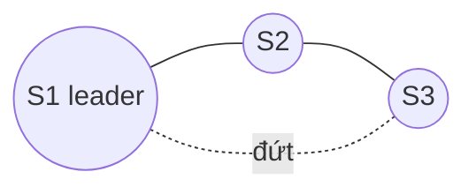

(Sơ đồ do người soạn vẽ theo mô tả topo của Cloudflare và Hình 1 của khảo sát OSDI.)

Giờ ta dựng lại topo đó với Raft thuần, chưa có biện pháp nào ở các mục sau. Bảng này gói kịch bản vào ba server: S1 là leader term 5 (vai `N1`), S3 mất đường tới S1 (vai `N5`), còn S2 nối được cả hai; số term chọn tùy ý, và người soạn dựng bảng từ các luật ở Hình 2. Giả định (suy luận của người soạn): cụm đang rảnh, không có entry mới nào được ghi, kể cả no-op, nên log của ba server luôn giống nhau và luật "log đủ mới" không chặn ai.

| Bước | Điều xảy ra | S1 | S2 | S3 |
|---|---|---|---|---|
| 0 | Cụm ổn định | leader, term 5 | follower, term 5 | follower, term 5 |
| 1 | S3 không nghe được S1 nên hết election timeout; `RequestVote` gửi tới S1 thì mất, tới S2 thì đến nơi | leader, term 5 | follower, term 5 | candidate, term 6 |
| 2 | S2 thấy term 6 lớn hơn nên nâng term theo[^b-term-rules]; log của S3 không cũ hơn log của S2 nên S2 cho phiếu[^b-vote-rule] | leader, term 5 | follower, term 6, đã bầu S3 | leader, term 6 (2/3 phiếu) |
| 3 | Heartbeat term 5 của S1 gửi tới S2 bị từ chối, kèm term 6[^b-ae-term]; S1 thấy term cao hơn nên xuống | follower, term 6 | follower, term 6 | leader, term 6 |
| 4 | S1 không nghe được S3 (S2 không phát heartbeat) nên hết giờ, thành candidate term 7; S2 nâng term và cho phiếu | leader, term 7 | follower, term 7, đã bầu S1 | follower, term 7, bị phế khi S2 từ chối heartbeat term 6 và trả về term 7 |
| 5... | S3 lại không nghe được S1, hết giờ và lặp lại bước 1 với term cao hơn | | | |

Với giả định đó, quyền leader cứ nhảy qua lại giữa S1 và S3, mỗi lần một bên hết election timeout, dù S2 nối được cả hai và cả ba server đều khỏe. Thử bỏ giả định cụm rảnh: khi có entry mới được ghi, chỉ S2 và leader hiện tại có entry đó. Ứng viên bên kia có log cũ hơn nên S2 không cho phiếu; nhưng S2 vẫn nâng term khi thấy term cao hơn, nên leader hiện tại vẫn bị hạ và cụm vẫn phải bầu lại. Quyền leader không sang tay ứng viên có log cũ, nhưng cụm vẫn gián đoạn lặp đi lặp lại (suy luận của người soạn từ Hình 2).

### 6.2. Ba lớp phòng thủ: bỏ qua RequestVote, PreVote, CheckQuorum

Raft thuần không tự thoát được cảnh ở mục 6.1, nên cần ba lớp phòng thủ. Ta xem từng lớp ở đây; chúng phụ thuộc nhau ra sao thì mục 6.3 sẽ nói.

*Lớp 1: bỏ qua `RequestVote` khi vừa nghe leader.* Đây là lớp đơn giản nhất, và bài báo Raft đã có sẵn: server nhận `RequestVote` trong vòng election timeout tối thiểu kể từ lần nghe leader hiện tại thì không cập nhật term và không bỏ phiếu[^b-paper-disregard]. Nó có thể bỏ qua yêu cầu, từ chối hoặc hoãn lại; kết quả gần như nhau[^b-ignore-rv]. Lý do: trong Raft, leader còn duy trì được heartbeat tới follower thì coi như đang hoạt động (nếu không, một server khác sẽ mở bầu cử), nên không ai được lật nó chỉ bằng một term lớn hơn[^b-leader-active].

Áp vào bảng ở mục 6.1: S2 vẫn đều đặn nghe S1 nên bỏ qua `RequestVote` của S3. S1 vẫn là leader term 5 cùng S2, còn S3 không thắng được mà chỉ tự tăng term một mình: 6, 7, 8, ... Cụm vẫn chạy, nhưng mất một nút dự phòng: nếu S2 hỏng thì cụm mất quorum dù S3 còn sống, vì S3 không nối được S1 (suy luận của người soạn).

*Lớp 2: PreVote, và vì sao nó có hai phiên bản.* Ý tưởng "hỏi trước rồi mới tăng term" xuất hiện hai lần trong luận án, với hai kết cục khác nhau, nên rất dễ lẫn.

Lần đầu là ở mục 4.2.3 của luận án, khi tác giả tìm cách ngăn server đã bị gỡ khỏi cụm gây rối. Ý tưởng khi đó là thêm một pha Pre-Vote vào bầu cử: trước khi tăng term, ứng viên hỏi các server xem log của nó có đủ mới để được họ bầu không, tức là kiểm tra mình có cơ hội thắng không[^b-prevote-first]. Cách này *không* đủ: có những tình huống server gây rối vẫn có log đủ mới, mà cuộc bầu cử của nó vẫn gây rối[^b-prevote-fails]. Vì vậy tác giả kết luận rằng không giải pháp nào chỉ dựa vào so sánh log là đủ để biết một cuộc bầu cử có gây rối hay không[^b-logs-alone].

Lần thứ hai là ở mục 9.6, cho bài toán server bị partition quay lại; lần này PreVote được dựng lại và *thêm* một điều kiện về heartbeat. Ứng viên chỉ tăng term khi biết từ một đa số rằng họ sẵn sàng bỏ phiếu cho nó, tức là log của ứng viên đủ mới *và* các voter không nhận heartbeat từ một leader hợp lệ trong ít nhất một election timeout nền[^b-prevote-def]. Với `N5` bị cô lập hẳn, điều đó có nghĩa là nó không tăng được term, vì không xin được phép từ đa số[^b-prevote-solves-a]. Khi nối lại, nó vẫn không tăng được vì các node khác đang nhận heartbeat đều đặn của leader, và ngay khi nghe heartbeat của chính leader, nó quay về làm follower trong cùng term[^b-prevote-solves-b]. Cả `etcd/raft` lẫn `raft-rs` đều có cờ cho thuật toán này. Docs của cờ `PreVote` trong `etcd/raft` nói nó bật thuật toán ở mục 9.6 của luận án[^b-etcd-pv-cfg]. Cờ `pre_vote` trong `raft-rs` có cùng mô tả[^b-raftrs-pv].

*Lớp 3: CheckQuorum.* PreVote bảo vệ leader khỏi server ngoài lề, còn CheckQuorum bảo vệ client khỏi một leader ngoài lề. Giả sử lần này chính `N1`, leader, bị cô lập khỏi cả cụm, nhưng một service vẫn gọi `put` tới được nó. `N1` không chép được entry nào cho ai, nên nếu không có cơ chế gì thêm thì yêu cầu đó có thể bị trì hoãn mãi[^b-stale-leader-delay]. Raft ngăn chuyện này bằng cách bắt leader tự xuống nếu một election timeout trôi qua mà không có vòng heartbeat nào thành công tới đa số, để client thử lại ở server khác[^b-stepdown].

Tên `CheckQuorum` không có trong luận án (người soạn đã tìm trong toàn văn): luận án chỉ mô tả hành vi. `etcd/raft` gọi nó là `CheckQuorum` và mô tả cờ này là leader tự xuống khi quorum không hoạt động trong một `electionTimeout`[^b-etcd-cq-cfg]. `raft-rs` dùng cùng tên và cùng mô tả[^b-raftrs-cq].

CheckQuorum không làm việc *ghi* an toàn hơn, vì an toàn của Raft vốn không phụ thuộc thời gian[^b-timing-safety]. Cái nó cải thiện là tính sống: client không còn kẹt ở một leader chẳng commit được gì. Ngoài ra `etcd/raft` còn đòi bật nó khi dùng lease read (mục 6.4).

### 6.3. Chúng đan vào nhau thế nào (đọc mã `etcd/raft` v3.6.0)

Ba lớp ở mục 6.2 không độc lập với nhau: trong `etcd/raft`, có lớp chỉ hoạt động khi lớp khác được bật. Phần này là suy luận của người soạn khi đọc mã `etcd/raft` ở tag v3.6.0; đó là chi tiết cài đặt, có thể đổi giữa các phiên bản, và người soạn không chạy thử. Mọi thứ nằm ở hai chỗ trong hàm `Step`:

1. Luật bỏ qua `RequestVote` của Lớp 1 được cài thành biến `inLease`. Biến này đúng khi `checkQuorum` bật, node đang biết một leader và chưa quá election timeout kể từ lần nghe leader[^b-etcd-inlease]. Nghĩa là tắt `checkQuorum` thì luật bỏ qua cũng tắt theo. Khi `inLease` đúng, node bỏ qua cả `MsgVote` lẫn `MsgPreVote`, trừ yêu cầu xuất phát từ chuyển giao leader[^rv-lease-block]. Comment trong khối mã đó gần như chép lại câu của bài báo[^b-etcd-inlease-comment].
2. Khi nhận `MsgPreVote` cho một term tương lai, node có thể cho phiếu nếu log của ứng viên đủ mới và `inLease` không chặn trước (điểm 1), *kể cả khi nó đang biết một leader*: điều kiện `canVote` có một nhánh riêng cho "PreVote cho term tương lai"[^b-etcd-canvote]. Ngoài ra, nhận PreVote không bao giờ làm đổi term của người nhận[^b-etcd-prevote-recv].

Áp hai điều này vào topo ở mục 6.1, tùy bật cờ nào, ta được bảng sau:

| Cấu hình | S3 có thắng và lật S1? | S3 có tăng term khi đường đứt? | Khi đường nối lại |
|---|---|---|---|
| Không PreVote, không CheckQuorum | Có: S2 cho phiếu như bảng ở mục 6.1 | Có | Cụm đã "rung" từ trước |
| Chỉ CheckQuorum | Không: S2 đang trong lease nên bỏ qua `RequestVote` | Có | Heartbeat term 5 của S1 tới S3; S3 trả lời kèm term cao hơn của nó và S1 phải xuống |
| Chỉ PreVote | Có thể: S2 không trong lease nên vẫn cho pre-vote, rồi S3 thành candidate thật và S2 cho phiếu | Không tăng trước khi được pre-vote | (Nếu S3 đã thắng thì giống dòng đầu) |
| Cả hai | Không: S2 bỏ qua cả pre-vote | Không | S3 nhận heartbeat term 5 của S1 và trở lại làm follower |

Dòng "chỉ CheckQuorum" chính là tình huống mà comment của mã gọi là "node kẹt" (stuck node): server bị cô lập có term cao hơn leader, và khi nối lại, câu trả lời `MsgAppResp` mang term cao của nó buộc leader xuống. Comment ghi rằng sự phá rối này là không thể tránh nếu muốn giải phóng node kẹt bằng một cuộc bầu cử mới, nhưng có thể ngăn bằng pha Pre-Vote[^b-etcd-stuck].

Dòng đáng nhớ nhất là "chỉ PreVote". Điều kiện "voter chưa nghe heartbeat từ leader hợp lệ" của luận án nằm ở `inLease` chứ không nằm trong bản thân nhánh PreVote, mà `inLease` thì cần CheckQuorum. Vì vậy trong cài đặt này, bật mỗi PreVote không tái hiện được thuật toán của luận án: S2 vẫn cho pre-vote và S3 vẫn thắng. Chỉ dòng cuối, bật cả hai, mới chạy đúng ý luận án.

Cách etcd server tự cấu hình hai cờ cũng khớp với điều đó: bản v3.5.17 đặt cố định `CheckQuorum: true`, còn `PreVote` lấy từ cấu hình[^b-etcd-server-cq]. Tài liệu v3.5 cũng ghi cờ `--pre-vote` mặc định là `true`[^b-cfg-prevote]. (Bản raft trong server v3.5.17 không phải `etcd-io/raft` v3.6.0 mà ta đang đọc; chi tiết ở phần Đi sâu.) Nếu bạn dựng `kvmeta` trên một thư viện kiểu này, hãy bật cả hai cờ chứ đừng bật một (nhận xét của người soạn).

### 6.4. Đọc an toàn: ReadIndex, follower đọc và lease

Hai mục trước nói về bầu cử; mục này quay sang `get`: làm sao để một lần đọc không bao giờ cũ hơn một `put` đã ack mà không phải ghi log cho nó? [Chương 09, mục 7 (phần Đi sâu)](09-consistency-va-consensus.md) đã nêu hai biện pháp (commit một entry no-op đầu term, trao đổi heartbeat với đa số trước khi đọc) cùng lease. Ở đây ta đi từng bước: mỗi bước làm gì, vì sao cần, và các thư viện cài ra sao.

*Vì sao không đọc thẳng từ leader.* Cách đơn giản nhất là hỏi leader và để nó trả lời từ state machine của nó, không hỏi ai. Cách này hỏng khi leader đã bị thay mà chưa biết. Trong `kvmeta`, giả sử `N1` bị partition, bốn node còn lại bầu `N2` làm leader mới và commit những entry mới. Nếu service vẫn hỏi `N1` và `N1` trả lời mà không hỏi ai, nó trả dữ liệu cũ, tức không linearizable[^b-read-why]. Tác giả luận án cho biết lỗi này đã từng bị phát hiện trong hai bản cài đặt Raft của bên thứ ba, nên cần xem xét cẩn thận[^b-read-3rd].

*ReadIndex: leader xác nhận mình còn là leader rồi mới đọc.* Luận án đưa ra năm bước:

1. **Chờ commit được một entry của term hiện tại.** Leader Completeness (mục 4) bảo đảm leader mới có mọi entry đã committed, nhưng ngay đầu term nó chưa biết đó là những entry nào; muốn biết, nó phải tự commit một entry của term mình[^b-ri-1]. Vì vậy mỗi leader commit một entry no-op (entry rỗng) ngay đầu term, và từ lúc no-op đó committed, commit index của leader không nhỏ hơn commit index của bất kỳ server nào trong term ấy[^b-ri-1b].
2. **Ghi nhớ `readIndex`.** Leader lấy commit index hiện tại làm `readIndex`, lưu vào một biến cục bộ. Đó là cận dưới cho phiên bản trạng thái mà truy vấn đọc sẽ chạy trên[^b-ri-2].
3. **Xác nhận mình còn là leader.** Leader gửi một vòng heartbeat mới và chờ đa số trả lời, để chắc rằng không có leader mới nào đã thay mình mà mình không hay[^b-ri-3a]. Khi đủ xác nhận, nó biết rằng vào lúc gửi heartbeat không thể có leader nào mang term cao hơn; vì vậy `readIndex` khi ấy là commit index lớn nhất mà bất kỳ server nào trong cụm từng thấy[^b-ri-3b].
4. **Chờ state machine theo kịp.** Leader đợi state machine của mình áp ít nhất tới `readIndex`; trạng thái ở mốc đó đã đủ mới để thỏa linearizability[^b-ri-4].
5. **Đọc và trả lời.** Cuối cùng leader chạy truy vấn trên state machine và gửi kết quả cho client[^b-ri-5].

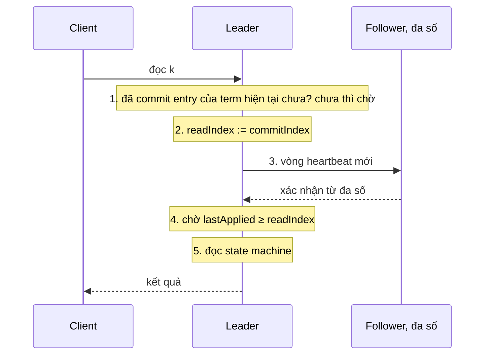

(Sơ đồ do người soạn vẽ theo năm bước ở mục 6.4 của luận án.)

*Vì sao cần từng bước (hai vết chạy do người soạn dựng).* Bắt đầu với bước 1. Leader cũ S1 đã commit index 7 và vừa trả "ok" cho client về lệnh ở index 7, rồi sập trước khi kịp báo commit index mới cho follower. S2 thắng cử term 4. Log của S2 có index 7 nhờ Leader Completeness, nhưng commit index của S2 mới là 5. Nếu S2 trả lời đọc ngay với `readIndex = 5`, client vừa nhận "ok" cho lệnh 7 sẽ không thấy nó, và linearizability bị vi phạm. Bước 1 chặn chuyện đó: S2 phải chờ no-op của term 4 được commit, giả sử ở index 8. Lúc ấy commit index của S2 không nhỏ hơn 8, tức không nhỏ hơn 7.

Bước 3 cần một cụm khác, độc lập với vết chạy vừa rồi. S1 là leader term 4 với commit index 7 và `x=1`. S1 bị partition; S3 thắng cử term 5, commit no-op ở index 8 rồi commit `x=2` ở index 9; client vẫn gửi đọc tới S1. Nếu S1 trả lời ngay với `readIndex = 7` thì nó trả `x=1`, một giá trị đã cũ. Bước 3 chặn chuyện đó: S1 phải gom xác nhận từ một đa số, mà nó không gom được (hoặc nhận về câu trả lời mang term cao hơn), nên nó không trả lời.

*Chi phí.* Mỗi lô đọc tốn một vòng heartbeat tới đa số, nên truy vấn chịu thêm độ trễ của vòng đó[^b-ri-cost]. Đổi lại, ReadIndex không phải ghi đĩa đồng bộ, nên rẻ hơn việc commit truy vấn đọc như một entry của log[^b-ri-nodisk]. Và leader không cần một vòng riêng cho mỗi lần đọc: nó dồn mọi truy vấn đang chờ vào cùng một vòng heartbeat[^b-ri-amort].

*Follower đọc.* Nếu mọi `get` đều chạy ở leader thì leader phải gánh cả đọc lẫn ghi. Cho follower phục vụ đọc thì thông lượng đọc tăng và leader nhẹ tải, rảnh tay hơn cho các `put`[^b-fr-why]. Nhưng follower không được đọc thẳng từ state machine của mình: follower bị partition có thể rất lâu không nhận entry mới, và kể cả khi vừa nhận heartbeat, leader gửi heartbeat đó có thể đã bị thay mà chưa biết[^b-fr-hazard]. Cách an toàn là follower xin leader một `readIndex` hiện tại (leader chạy bước 1 đến 3), rồi tự chạy bước 4 và 5 trên state machine của mình, cho cả loạt truy vấn đã gom được[^b-fr-proto]. README của `etcd/raft` liệt kê đúng mẫu này cho cả leader lẫn follower[^b-etcd-readme-reads]. So với đọc ở leader, chi phí là thêm một lượt đi về giữa follower và leader, cộng thời gian chờ follower áp tới `readIndex` (suy luận của người soạn).

*Lease read: bớt một vòng heartbeat, đổi lại bằng giả định về đồng hồ.* ReadIndex vẫn tốn một vòng heartbeat cho mỗi lô đọc. Lease bỏ vòng đó đi: khi một vòng heartbeat được đa số xác nhận, leader cho rằng chừng một election timeout nữa sẽ không server nào khác lên làm leader, nên trong khoảng đó nó đọc cục bộ mà không cần liên lạc với ai[^b-lease-def]. Chú thích Hình 6.3 của luận án viết hạn lease là `start + election timeout / chặn trên độ lệch đồng hồ` (một phân số), với `start` là lúc leader gửi đợt heartbeat (đánh dấu trên hình). Lớp chữ của PDF làm vỡ phân số này nên không trích nguyên văn được; người soạn đọc công thức từ ảnh trang, còn câu trích lấy phần chú thích đọc được[^b-lease-fig].

Điều kiện then chốt là giữa các server phải có một chặn trên cho độ lệch đồng hồ: trong một khoảng thời gian bất kỳ, không đồng hồ nào chạy nhanh hơn đồng hồ khác quá chặn đó. Luận án cảnh báo rằng giữ được chặn này trong vận hành có thể khó (vì pause do scheduler hoặc GC, di chuyển máy ảo, chỉnh tốc độ đồng hồ khi đồng bộ giờ), và nếu giả định sai thì hệ có thể trả dữ liệu cũ tùy ý[^b-lease-assume]. Luận án cũng không khuyên dùng lease trừ khi cần đạt yêu cầu hiệu năng[^b-lease-notreco].

Thử tính cho `kvmeta` nếu bật lease read (người soạn tính theo công thức của Hình 6.3). Lấy election timeout E = 1000 ms, mặc định của etcd[^b-cfg-hb], và giả định chặn trên độ lệch đồng hồ là 1,01. Lease khi đó dài 1000 / 1,01, khoảng 990 ms kể từ lúc leader gửi heartbeat. Bây giờ giả sử giả định sai: đồng hồ của một follower chạy nhanh gấp 1,5 lần đồng hồ của leader. Timer 1000 ms của follower nổ sau chỉ 1000 / 1,5, khoảng 667 ms thời gian thật. Từ mốc 667 ms đến mốc 990 ms (đã làm tròn), follower đã có thể bắt đầu bầu cử và, nếu thắng, commit những ghi mới, trong khi leader cũ vẫn đọc cục bộ nhờ lease. Cửa sổ đọc dữ liệu cũ vì vậy dài tối đa cỡ 320 ms, trừ thời gian bầu cử và commit.

Dùng lease thì cần nhớ hai điều. Điều thứ nhất liên quan đến chuyển giao leader: vì chuyển giao cho phép thay leader trước hạn, nên leader phải để lease hết hạn rồi mới chuyển giao[^b-lease-transfer]. Điều thứ hai là các thư viện đòi bật CheckQuorum. `etcd/raft` có hai chế độ đọc. `ReadOnlySafe` hỏi quorum, là chế độ mặc định và cũng là chế độ được khuyên dùng[^b-etcd-ro-safe]. `ReadOnlyLeaseBased` dựa vào lease nên chịu ảnh hưởng của độ lệch đồng hồ, và nếu độ lệch không có chặn thì leader có thể giữ lease lâu hơn mức cần[^b-etcd-ro-lease]. Mã ghi rõ phải bật CheckQuorum khi dùng chế độ sau[^b-etcd-lease-cq]; `raft-rs` đặt cùng ràng buộc (xem phần Đi sâu).

Vì sao lại đòi CheckQuorum? Người soạn thấy hai lý do trong mã `etcd/raft` (suy luận của người soạn). Một là lease chỉ đúng nếu không có leader khác xuất hiện trong thời hạn lease, mà việc follower từ chối bầu khi đang "trong lease" (`inLease`, mục 6.3) chỉ bật cùng CheckQuorum. Hai là ở chế độ `ReadOnlyLeaseBased`, leader trả lời yêu cầu `ReadIndex` ngay bằng commit index hiện tại, không có vòng heartbeat nào như ở chế độ an toàn[^rv-lease-case]; nên chỉ khi leader mất quorum mà tự xuống (nhờ CheckQuorum) thì nó mới thôi phục vụ đọc.

<details><summary>Đi sâu: cài đặt PreVote trong etcd/raft, ReadIndex của etcd server, thời gian và cờ cấu hình</summary>

- *Nguồn gốc của PreVote, và một kỹ thuật tương tự trong khảo sát OSDI.* Tác giả luận án nói PreVote lấy cảm hứng từ thuật toán của ZooKeeper: ở đó một server phải nhận đa số phiếu rồi mới tính epoch mới[^b-prevote-zk]. Khảo sát OSDI mô tả một kỹ thuật gần giống Lớp 1: khi nhận lời kêu gọi bầu cử, node kiểm tra trước xem leader hiện tại có liên lạc được không, và chỉ tham gia bầu nếu không liên lạc được[^b-partial-verif]. Khảo sát nói MongoDB và LogCabin dùng cách này trong giao thức bầu leader[^b-partial-verif-used]. LogCabin chính là bản cài đặt gốc của Raft[^b-partial-logcabin]. Cái giá của cách này, cũng theo khảo sát, là nhiều node bị loại khỏi hoạt động[^b-partial-verif-cost].
- *Pre-candidate không đổi gì ngoài trạng thái (chi tiết cài đặt ở `etcd/raft` v3.6.0, có thể đổi).* Pre-candidate là trạng thái của node đang ở pha PreVote. Khi chuyển sang trạng thái này, node không tăng `Term` và không đổi `Vote`[^b-etcd-prevote-noterm]. `MsgPreVote` mang term kế tiếp và được gửi đi trước khi `Term` của chính node được tăng[^b-etcd-prevote-term]. Khi trả lời `MsgVote` hoặc `MsgPreVote`, node ghi term *của message* chứ không phải term cục bộ[^b-etcd-prevote-resp-term]. Comment trong mã giải thích lý do: một node từng bị partition có term cục bộ đã cũ, và nếu trả lời bằng term đó thì bên ứng cử sẽ coi câu trả lời là lỗi thời và bỏ qua[^rv-resp-term-why].
- *Bật PreVote trên cụm đang chạy.* Mã có hẳn một nhánh cho tình huống nâng cấp: trước khi bật PreVote, cụm có thể có ứng viên mang term cao hơn nhưng log ngắn hơn; sau khi bật, nếu node loại bỏ các message có term thấp hơn thì cụm có thể deadlock[^b-etcd-upgrade]. Nếu bạn định bật PreVote trên một cụm đang chạy, hãy đọc kỹ ghi chú nâng cấp của phiên bản mình dùng (nhận xét của người soạn).
- *Server bị gỡ khỏi cụm.* Các cơ chế trên cộng lại làm giảm gây rối của node đã bị gỡ khỏi cấu hình. Node đó vẫn gửi `MsgVote` hoặc `MsgPreVote` nhưng bị bỏ qua, và vì không còn nhận `MsgApp` hay `MsgHeartbeat` nên nó không có dịp báo cho leader rằng mình còn "hoạt động" để làm term tăng gây rối[^b-etcd-removed]. Đây là bản cài đặt của vấn đề mà luận án nêu ở mục 4.2.3.
- *CheckQuorum trong `etcd/raft` v3.6.0 (chi tiết cài đặt, có thể đổi).* Khi `checkQuorum` bật, mỗi lần bộ đếm `electionElapsed` của leader chạm `electionTimeout`, leader tự gửi cho mình một message kiểm tra quorum[^rv-cq-tick]. Nếu đa số không hoạt động gần đây thì nó quay về follower và ghi một dòng log báo mình xuống vì quorum không hoạt động[^b-etcd-cq-log]. Sau mỗi lượt kiểm, nó đánh dấu mọi server khác là chưa hoạt động, để lượt sau đếm lại từ đầu[^b-etcd-cq-code].
- *Bản raft trong etcd server v3.5.17.* Server v3.5.17 dùng bản raft nằm ngay trong repo etcd (module `go.etcd.io/etcd/raft/v3`[^b-etcd35-import]), không phải `etcd-io/raft` v3.6.0 mà mục 6.3 đọc. Người soạn chỉ đối chiếu đoạn xử lý term của `Step` ở bản đó và thấy cùng dòng `inLease`[^b-etcd35-inlease].
- *Tham số thời gian.* Mặc định của etcd v3.5 là heartbeat 100 ms và election timeout 1000 ms[^b-cfg-hb]. Tài liệu tuning dặn hai giá trị này phải giống nhau ở mọi member của cụm, vì đặt khác nhau có thể làm cụm mất ổn định[^b-tuning-same]. Với lease thì đây không phải chuyện thẩm mỹ, vì hạn lease tính từ chính election timeout (nhận xét của người soạn). `etcd/raft` gợi ý `ElectionTick` bằng 10 lần `HeartbeatTick` để tránh đổi leader không cần thiết[^b-etcd-electiontick]. Đồng hồ cho lease còn phải là đồng hồ đơn điệu: trong Rust là `Instant`, không phải `SystemTime` (xem phần "Liên hệ với Rust" của [chương 09](09-consistency-va-consensus.md); nhận xét của người soạn).
- *Đọc linearizable trong etcd server.* Vòng `linearizableReadLoop` của etcd v3.5.17 gọi `ReadIndex` của Raft[^b-etcd-ri-call]. Nếu applied index còn thấp hơn index vừa xác nhận thì nó chờ cho tới khi đủ, rồi mới mở khóa các lần đọc đã xin trước mốc đó[^rv-etcd-ri-wait]. Một vòng lặp mở khóa được nhiều lần đọc cùng lúc[^b-etcd-ri-loop], đúng ý "gom nhiều truy vấn vào một vòng". Mã còn xử lý trường hợp bước 1 chưa xong: khi có commit đầu tiên trong term hiện tại, nó gửi lại yêu cầu `ReadIndex`[^b-etcd-ri-firstcommit]. Đọc `serializable` ở [chương 09](09-consistency-va-consensus.md) là đường bỏ qua cả chuỗi này (nhận xét của người soạn).
- *Thứ tự heartbeat và yêu cầu đọc (chi tiết cài đặt ở `etcd/raft` v3.6.0, có thể đổi).* Luận án nói leader biết không có leader term cao hơn "tại thời điểm nó gửi heartbeat", nên vòng heartbeat phải được gửi *sau khi* yêu cầu đọc tới, vì vòng gửi từ trước thì không nói gì về lúc này (suy luận của người soạn). Mã `etcd/raft` làm đúng như vậy: ở chế độ an toàn, nó đăng ký yêu cầu đọc rồi mới phát một đợt heartbeat mới[^b-etcd-ri-bcast]. Nó cũng hoãn yêu cầu đọc nếu leader chưa commit entry nào ở term của mình, tức là bước 1[^b-etcd-ri-postpone].
- *Giữ sequential consistency khi đồng hồ sai.* Luận án nêu một mở rộng để, kể cả khi đồng hồ chạy sai, mỗi client vẫn thấy state machine tiến lên chứ không lùi (sequential consistency)[^rv-seq-cons]. Cách làm: mỗi phản hồi, server kèm index của trạng thái state machine; client nhớ index lớn nhất đã thấy và gửi kèm mỗi request; server nào chưa áp tới index đó thì chưa phục vụ[^b-lease-seq]. Mức này yếu hơn linearizable (nhận xét của người soạn).
- *README của `etcd/raft` và cờ trong Rust.* README liệt kê "tự xuống khi leader mất quorum" như một tính năng[^b-etcd-readme-stepdown]. Với lease read, README nói thẳng cách này dựa vào đồng hồ của mọi máy trong nhóm[^b-etcd-readme-lease]. Trong `raft-rs` 0.7.0, CheckQuorum là `Config::check_quorum`[^b-raftrs-cq]. PreVote là `Config::pre_vote`[^b-raftrs-pv]. Chế độ đọc chọn bằng `Config::read_only_option`, và đặt `LeaseBased` thì đòi `check_quorum = true`[^b-raftrs-ro]. Cách nhúng crate này (bạn tự lo vòng lặp, mạng và lưu trữ) đã nêu ở phần "Liên hệ với Rust" của [chương 09](09-consistency-va-consensus.md).

</details>

**Quay lại Q6:** khi mạng chỉ hỏng một phần, luật "term lớn hơn thắng" để một node ngoài lề hạ được leader đang khỏe; muốn chặn đủ, `etcd/raft` cần bật cả PreVote lẫn CheckQuorum. Còn `get` linearizable đi qua ReadIndex năm bước (ở leader hoặc ở follower), hoặc qua lease nếu bạn chấp nhận giả định chặn trên độ lệch đồng hồ.

## 7. Họ hàng của Raft và Paxos: Viewstamped Replication, Zab, EPaxos, PBFT (Q7)

> **Trả lời ngắn.** VR (Viewstamped Replication) và Zab (giao thức nhân bản của ZooKeeper) cùng họ với Raft: đều có leader, đều cần đa số xác nhận (chú thích ở mục 7.1 và 7.2), và đều đánh số các đời leader bằng một số tăng dần (view ở VR, epoch ở Zab) để server từ chối leader mang số cũ[^c-th-terms]. Chúng khác nhau ở cách chọn leader[^c-th-select], cách leader mới bắt kịp log và những gì phải ghi xuống đĩa (Bảng 7.1). EPaxos bỏ hẳn leader cố định nên client gửi lệnh cho replica nào cũng được; đổi lại, hai lệnh không giao hoán (đổi thứ tự thì kết quả khác) mà đến cùng lúc thì tốn thêm một vòng liên lạc, và thuật toán phức tạp hơn Paxos nhiều[^c-raft-epaxos2]. PBFT chịu được cả replica nói dối[^rv-pbft-byz], nhưng giao thức nặng hơn và cần 3f+1 replica thay vì 2f+1 (mục 7.4).

**Giải thích.**

*Với cụm `kvmeta`.* Giả sử `kvmeta`, kho key-value 5 node `N1`…`N5` giữ feature flag và khóa leader cho các service backend, không chạy Raft hay Multi-Paxos mà chạy một thuật toán họ hàng của chúng (đây chỉ là giả định để so sánh). Nếu đó là VR hay Zab thì mỗi `put` vẫn đi qua một leader và vẫn cần đa số xác nhận; vậy cụm khác Raft ở đâu? Nếu rải `N1`…`N5` ra ba vùng địa lý, có nên bỏ leader như EPaxos để service ở vùng nào cũng gửi `put` cho node gần nhất? Còn nếu có node không chỉ chết mà còn nói dối, PBFT bắt ta trả giá gì?

*Bản đồ thuật ngữ.* Bốn thuật toán dùng bốn từ cho cùng một ý: số của đời leader hiện tại, một số tăng dần mà server đã thấy số lớn hơn thì ngừng nghe leader cũ. Raft gọi nó là *term*, Paxos gọi là *proposal number*, VR gọi là *view*, Zab gọi là *epoch*[^c-th-terms]. Bảng 7.1 đặt chúng cạnh nhau ở những chỗ khác nhau thật sự: ai cấp số, ai được làm leader, leader mới bắt kịp log ra sao và trạng thái nào phải nằm trên bộ nhớ bền. Người soạn tổng hợp bảng từ các nguồn ghi ở từng ô; riêng cột Raft lấy từ [chương 09, mục 7](09-consistency-va-consensus.md) và luận án Raft.

| | Raft | Multi-Paxos | VR Revisited | Zab |
|---|---|---|---|---|
| Tên số của đời leader | `term` | proposal number (ballot) | `view-number` | `epoch` (ZooKeeper đặt nó ở 32 bit cao của `zxid` 64 bit)[^c-zk-zxid] |
| Cấp số bằng cách nào | bỏ phiếu: ai gom được đa số phiếu thì độc quyền term đó[^c-th-assign] | mỗi proposer lấy số từ một tập riêng, không giao với tập của proposer khác, nên không bao giờ có hai proposer dùng cùng một số[^c-ps-disjoint] | chia không gian số cho các server, ví dụ theo vòng tròn, nên không ai tranh một số[^c-th-assign] | bỏ phiếu như Raft[^c-th-assign] |
| Ai được làm leader | chỉ ứng viên có log đủ mới (so log lúc bỏ phiếu)[^c-th-raft-catchup] | bất kỳ server[^c-th-select] | chỉ server `i` thỏa `i = v mod n`, với v là view hiện tại[^c-th-vrr] | bất kỳ server[^c-th-select]. ZooKeeper còn đòi leader đã thấy `zxid` cao nhất của mọi follower[^c-zk-activation2] |
| Leader mới bắt kịp log thế nào | không phải chuyển entry nào, vì luật bỏ phiếu đã bảo đảm leader mới có đủ mọi entry đã commit[^c-th-raft-catchup] | thường chạy hai pha Paxos cho từng entry mà nó chưa biết giá trị đã commit[^c-th-paxos-catchup] | thu log của f+1 replica, lấy log có `v'` lớn nhất, hòa thì lấy `n` lớn nhất[^c-vr-select] | pha Discovery: chọn history của follower có epoch hiện tại lớn nhất, hòa thì `zxid` lớn nhất, làm history khởi đầu[^rv-zab-pickcrit] |
| Trạng thái phải nằm trên bộ nhớ bền | `currentTerm`, `votedFor`, `log[]`[^c-raft-persist] | acceptor nhớ đề xuất cao nhất đã chấp nhận và số `prepare` cao nhất đã trả lời[^rv-ps-acceptor] | không đòi đĩa: dùng trạng thái nhân bản để giữ dữ liệu bền[^c-vr-nodisk-intro]. Replica hỏng lấy lại trạng thái từ các replica khác bằng giao thức recovery[^c-vr-nodisk-why] | `f.p` (đề xuất epoch mới đã xác nhận), `f.a` (đề xuất leader mới đã xác nhận), history và `zxid` cuối trong history[^c-zab-persist] |

Hàng "bắt kịp log" có một điểm dễ bỏ qua: VR Revisited và Zab được mô tả như thể mọi server gửi *toàn bộ log* cho leader mới, rồi leader chọn log mới nhất. Mô hình đó gọn nhưng không thực tế khi log lớn; cả hai paper gợi ý gửi bớt entry nhưng không nêu chi tiết[^c-th-vr-zab-whole]. Raft tránh chuyện này nhờ luật bỏ phiếu: ứng viên có log cũ không được phiếu, nên leader mới đã có đủ mọi entry đã commit và không phải nhận log của ai[^c-th-raft-catchup].

### 7.1. Viewstamped Replication Revisited

*Vị trí.* VR ra đời từ thập niên 1980, cùng thời với Paxos nhưng không biết gì về công trình đó. Nó là một giao thức *replication*: consensus (với một giao thức rất giống Paxos) chỉ là một phần bên trong để chạy máy trạng thái nhân bản, chứ VR không phải giao thức consensus thuần[^c-vr-1980s]. Chính các tác giả Raft cũng thừa nhận VR là thuật toán có sẵn mà Raft giống nhất[^c-raft-vr].

*Lúc bình thường.* Giả sử `kvmeta` chạy VR. Node nào là primary (leader) không được lưu ở đâu cả mà được *tính* ra từ `view-number` và cấu hình cụm, lần lượt theo vòng tròn[^c-vr-primary]. Khi một `put` đến, primary gán cho nó một `op-number` rồi gửi `PREPARE` cho các backup[^rv-vr-prepare]. Backup xử lý `PREPARE` theo đúng thứ tự: chỉ nhận số n khi log của nó đã có đủ mọi entry trước đó[^c-vr-inorder]. Primary chờ đủ f lời `PREPAREOK` từ các backup khác nhau, tức là f+1 replica kể cả nó, rồi mới coi thao tác này và mọi thao tác trước nó là committed[^c-vr-commit]. Nhóm VR có 2f+1 replica nên quorum nhỏ nhất là f+1[^rv-vr-2f1]; với `kvmeta`, n = 5 nên f = 2: primary chờ 2 lời `PREPAREOK`, cùng nó là 3 node trong 5 (người soạn tính). Điểm khác Raft đầu tiên nằm ngay ở bước này: backup thêm thao tác vào log mà *không cần ghi đĩa*[^c-vr-nodisk-normal].

*Đổi view.* Các backup luôn theo dõi primary; thấy nó có vẻ hỏng thì cùng chạy thủ tục *đổi view* để chọn primary mới[^c-vr-views]. Thủ tục này phải giữ một điều kiện: mọi thao tác đã được thực thi ở một replica phải còn nguyên trong view mới, theo đúng thứ tự cũ[^c-vr-vc-cond]. Với `kvmeta`, điều đó nghĩa là `put` đã được ack thì không được biến mất khi primary chết (nhận xét của người soạn). Quorum bảo đảm điều kiện ấy: thao tác committed nằm trong log của ít nhất f+1 replica (primary cũ và f backup đã gửi `PREPAREOK`), nên primary mới chỉ cần lấy log của f+1 replica là chắc chắn gặp nó, vì hai quorum luôn giao nhau[^c-vr-vc-quorum]. Các bước dưới đây bỏ qua chi tiết gửi lại tin bị mất:

1. Khi một replica thấy cần đổi view, nó tăng `view-number`, chuyển sang trạng thái view-change và gửi `StartViewChange` cho các replica còn lại[^s2-vr-vc-step1]. Nó thấy cần đổi view theo timer của chính nó, hoặc khi nhận `StartViewChange` hay `DoViewChange` mang view lớn hơn `view-number` hiện tại của nó[^c-vr-vc-notice].
2. Khi đã nhận `StartViewChange` từ f replica khác, replica gửi `DoViewChange` cho primary của view mới. Thông điệp này mang log của replica, `v'` (view gần nhất mà nó ở trạng thái normal), `op-number` và `commit-number`[^c-vr-vprime].
3. Primary mới đợi f+1 `DoViewChange` (kể cả của chính nó), rồi chọn log trong thông điệp có `v'` lớn nhất; nếu hòa thì chọn log có `n` lớn nhất[^c-vr-select]. Sau đó nó gửi `StartView` kèm log đó cho các replica khác[^c-vr-newview-log].
4. Nhận `StartView`, mỗi replica đổi sang log trong thông điệp, lấy `view-number` của thông điệp làm `view-number` của mình và trở về trạng thái normal[^c-vr-startview].

Vì sao chọn theo `v'` *trước*, rồi mới tới độ dài? Vì khi có đổi view, hai thao tác khác nhau có thể cùng nhận một `op-number`, và khi đó thao tác được gán số ở view muộn hơn mới là thao tác thắng[^c-vr-samenum]. Bảng 7.2 dựng một kịch bản cụ thể (người soạn dựng, theo các luật ở §4.2 của paper VR): ba replica r0, r1, r2 nên f = 1, primary của view v là r(v mod 3) theo công thức ở luận án[^c-th-vrr], còn A, B, C, X là các lệnh. Với 5 node của `kvmeta` thì f = 2, primary mới đợi 3 `DoViewChange` thay vì 2, còn luật chọn log không đổi.

| Bước | r0 | r1 | r2 |
|---|---|---|---|
| (1) View 0, primary r0. X chỉ tới được r0 rồi r0 bị cô lập | A B X (view 0) | A B | A B |
| (2) r1, r2 đổi sang view 1, primary r1. C nhận `op-number` 3 và được cả r1, r2 ghi: committed | A B X (vẫn tin mình ở view 0) | A B C (view 1) | A B C (view 1) |
| (3) r1 chết, r0 nối lại được với r2; r2 khởi động view 2 (primary r2) | gửi `DoViewChange`: log A B X, `v'`=0, `n`=3 | (chết) | tự gửi cho mình: log A B C, `v'`=1, `n`=3 |
| (4) r2 chọn `v'` lớn nhất → log A B C, gửi `StartView` | A B C (X bị bỏ) | (chết) | A B C |

Ở bước (3), hai log có cùng độ dài (`n` = 3), nên chọn theo độ dài thì không phân định được, và chọn nhầm log của r0 là mất C, một lệnh đã committed và đã trả lời client (suy luận của người soạn từ kịch bản trên). Luật `v'` giải quyết gọn chuyện đó: log của r2 thuộc view 1, muộn hơn view 0 của log r0, nên r2 giữ log của mình[^c-vr-select].

Hình 7.1 (người soạn vẽ) cho các thông điệp của bước (3) và (4); `k` là commit-number, và r2 chưa biết C đã commit nên `k` = 2. Nhận `StartView` xong, replica nào còn thao tác chưa commit trong log thì gửi `PrepareOK` cho primary[^c-vr-prepareok-after], vì thế C được commit lại ở view 2.

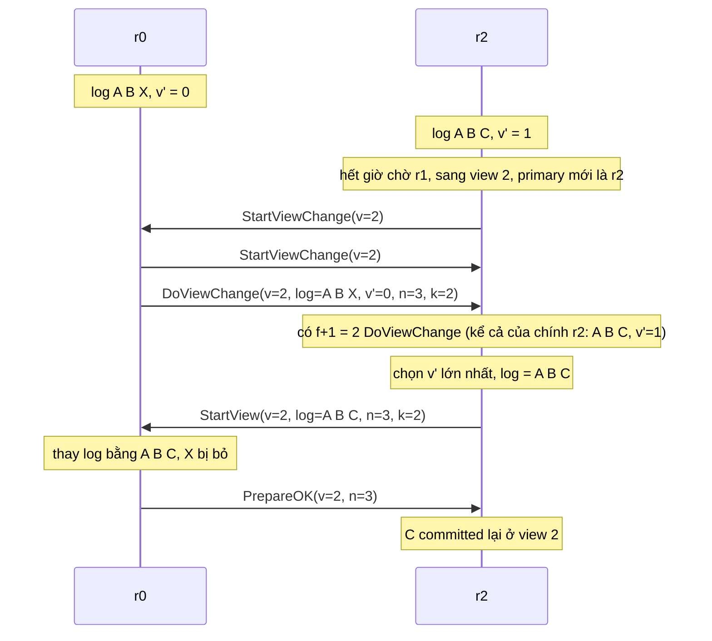

So với Raft, log ở VR chảy theo hướng khác. Ở Raft, log chỉ chảy một chiều, từ leader ra follower trong `AppendEntries`; ở VR, primary mới còn *nhận* log từ các replica ngay trong lúc đổi view, nên entry chảy theo cả hai chiều, và các tác giả Raft cho rằng điều đó kéo theo thêm cơ chế và độ phức tạp[^c-raft-oneway].

*Khôi phục không cần đĩa.* VR không ghi đĩa nên một replica chết có thể mất hết trạng thái; nó lấy lại từ các replica khác bằng giao thức recovery[^c-vr-nodisk-why]. Replica vừa khởi động lại ở trạng thái *recovering*, nghĩa là chưa được tham gia xử lý request hay đổi view[^c-vr-recovering]. Lý do là nó có thể đã quên mình từng prepare một thao tác: nếu cho tham gia sớm, thao tác đó có thể chỉ còn nằm ở ít hơn một quorum dù đã commit, rồi bị quên ở lần đổi view sau[^c-vr-recov-why]. Để lấy lại trạng thái, replica gửi `Recovery` kèm một nonce (số dùng một lần), rồi đợi ít nhất f+1 phản hồi chứa đúng nonce đó, trong đó phải có phản hồi của primary của view mới nhất mà nó biết qua các phản hồi; sau đó nó cập nhật trạng thái từ primary và chuyển sang normal[^c-vr-recov-done].

Cái giá là một giả định: các replica phải *hỏng độc lập*, tức rất khó hỏng cùng lúc. Nếu cả cụm sập một lúc thì trạng thái sẽ mất, trừ khi thông tin trên đĩa còn mới[^c-vr-failind]. Các tác giả Raft nêu cùng rủi ro: nếu đa số cụm cùng khởi động lại thì cụm có thể đã mất entry và không lập nổi view mới; theo họ, Raft cũng mở rộng được để chạy không đĩa, nhưng rủi ro mất tính sẵn sàng hoặc mất dữ liệu thường lớn hơn lợi ích[^c-th-vr-nodisk2]. Với `kvmeta`, bỏ đĩa kiểu VR chỉ đáng nếu ta tin rằng không bao giờ có 3 trong 5 node sập cùng lúc, chẳng hạn vì mất điện chung (nhận xét của người soạn). Mục 9 có hai ví dụ liên quan: NATS, một hệ thật đã trả giá vì ghi đĩa trễ, và kịch bản xóa dữ liệu một node (mục 9.2).

### 7.2. Zab

*Vì sao có Zab.* ZooKeeper là hệ primary-backup: primary thực thi thao tác của client, rồi dùng Zab để truyền cho backup các *thay đổi trạng thái tăng dần* do thao tác đó sinh ra[^c-zab-abs]. Mỗi thay đổi dựa trên trạng thái mà các thay đổi trước đã tạo nên, nên Zab phải bảo đảm: nếu một thay đổi được giao (deliver) thì mọi thay đổi mà nó phụ thuộc đã được giao trước[^c-zab-depend]. Với `kvmeta`, thay đổi "A nhả khóa `lock/billing-cron`" chỉ có nghĩa nếu được áp sau thay đổi "khóa thuộc A" (nhận xét của người soạn).

Giao thức máy trạng thái nhân bản kiểu Paxos không cho sẵn tính chất này: nếu primary đề xuất từng giao dịch riêng lẻ thì thứ tự mà các replica học được có thể vi phạm các phụ thuộc[^c-zab-paxos-limit]. Cách chữa đã biết là gộp nhiều giao dịch vào một đề xuất Paxos và chỉ cho một đề xuất chưa hoàn tất tại một thời điểm, nhưng thiết kế đó ảnh hưởng xấu tới thông lượng hoặc độ trễ, tùy cỡ batch[^c-zab-batch-sol].

Van Renesse và cộng sự có một ví dụ nhỏ cho thấy vấn đề. Một biến nguyên đang có giá trị 3; một client muốn cộng 1, client kia muốn nhân đôi. Một primary nhận cộng 1 rồi nhân đôi nên đề xuất các cập nhật *trạng thái* 4 rồi 8; một primary khác nhận hai thao tác theo thứ tự ngược lại nên đề xuất 6 rồi 7. Nếu hai chuỗi đề xuất tranh nhau mà không có *prefix order*, các replica có thể chốt "4 rồi 7", một dãy trạng thái không khớp với cách chạy tuần tự nào của hai thao tác[^c-vive-ex].

Tính chất cần có là *primary order* (hay prefix order): mỗi bản cập nhật phải được áp lên đúng trạng thái mà primary đã dùng để tính ra nó[^c-vive-order]. Zab nói cùng ý theo cách khác: thay đổi nào bị bỏ qua thì các thay đổi phụ thuộc vào nó cũng phải bị bỏ qua; paper gọi đó là primary order và tách làm hai phần[^c-zab-po]. *Local primary order* tương ứng với thứ tự FIFO trong một primary, còn *global primary order* chặn những lần chạy như Hình 1 của paper[^c-zab-po2]. Hình 1 là một lần chạy Paxos chọn C ở vị trí 27 rồi B ở vị trí 28, trong khi B là thay đổi dựa trên A chứ không dựa trên C, nên C không được chọn trước B[^rv-zab-fig1]. Cuối cùng, để các cập nhật của primary mới nhất quán, Zab đòi primary mới phải giao hết giao dịch của các epoch trước rồi mới được broadcast[^c-zab-pi].

*zxid và epoch.* `zxid` là mã của một giao dịch, gồm epoch và một bộ đếm; ZooKeeper dùng số 64 bit, 32 bit cao là epoch, 32 bit thấp là bộ đếm[^c-zk-zxid]. Leader mới nào lên cũng mang một epoch riêng, nên epoch đổi mỗi lần đổi leader[^c-zk-epoch]. Mã giao dịch của Zab là một cặp (đời primary, vị trí trong dãy mà primary đó broadcast)[^c-zab-txid]. Nhờ vậy primary mới chỉ cần thu `zxid` cao nhất từ mỗi process trong một quorum là biết phải khôi phục giao dịch nào và lấy từ process nào[^c-zab-recover].

*Ba pha.* Zab gồm ba pha: discovery, synchronization và broadcast[^c-zab-phases]. Hình 7.2 vẽ lại một vòng với hai follower (người soạn vẽ theo §IV của paper).

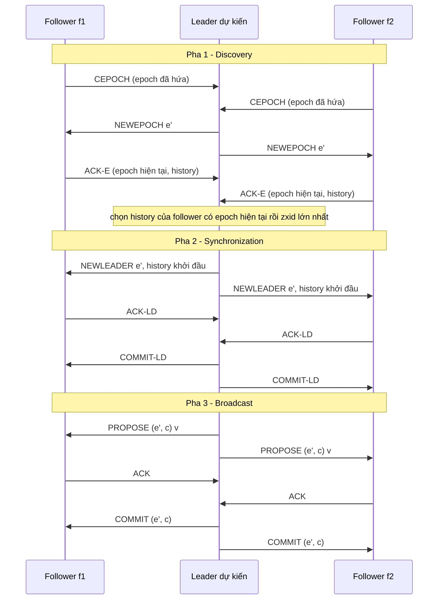

Pha 1 (discovery) chọn epoch mới và history khởi đầu. Leader dự kiến chọn epoch mới e' lớn hơn mọi epoch nhận được trong các `CEPOCH`[^c-zab-newepoch]. Rồi nó lấy history của follower có epoch hiện tại lớn nhất, hòa thì `zxid` lớn nhất, làm history khởi đầu[^rv-zab-pickcrit].

Pha 2 (synchronization) biến leader dự kiến thành leader thật. Nó gửi history đó cho các follower trong `NEWLEADER`; khi một quorum xác nhận bằng `ACK-LD`, nó gửi `COMMIT-LD` và xong pha 2[^c-zab-sync]. Được "bộ chọn leader" (leader oracle) chọn ra thì chưa đủ để làm leader: phải qua pha 2 mới thành leader thật[^c-zab-establish]. Ngoài ra, leader mới tìm `zxid` cao nhất mà nó từng thấy, lấy epoch e của `zxid` đó và bắt đầu đánh số các đề xuất mới từ `(e+1, 0)`[^c-zk-newleader].

Pha 3 (broadcast) là đường chạy bình thường. Leader gửi đề xuất cho các follower theo cùng một thứ tự, qua kênh FIFO[^c-zk-fifo]. Nó commit ngay khi một quorum follower đã ACK[^c-zk-commit]. ACK ở đây nghĩa là follower đã ghi đề xuất xuống bộ nhớ bền[^c-zk-ack]. Tài liệu ZooKeeper nhấn mạnh thứ tự FIFO: nếu không giữ nghiêm thứ tự FIFO của mọi gói tin thì cả giao thức đổ vỡ[^c-zk-fifo-needed].

*So với Paxos và Raft.* Tài liệu ZooKeeper tự hỏi "đây có phải Multi-Paxos không?" và trả lời là không: Multi-Paxos cần một cách bảo đảm rằng chỉ có một coordinator, còn Zab không dựa vào bảo đảm đó mà dùng bước kích hoạt leader để xử lý chuyện đổi đời leader, hoặc leader cũ vẫn tưởng mình còn tại vị[^c-zk-notmp]. Luận án Raft ghi nhận một điểm Zab mạnh hơn Raft một chút: *FIFO client order*, nghĩa là client gửi nhiều request liên tiếp (pipelining) thì chúng commit theo đúng thứ tự gửi, nếu có commit[^c-th-fifo].

### 7.3. EPaxos: bỏ leader

*Vấn đề.* Giả sử `kvmeta` đặt ở ba vùng và có một leader ổn định. Leader phải xử lý nhiều thông điệp hơn các replica khác, còn client ở xa leader thì chịu thêm độ trễ khi sao chép địa lý[^c-ep-problem]. Một service ở vùng xa leader sẽ thấy mỗi `put` của mình phải đi tới vùng của leader rồi mới có ack (nhận xét của người soạn). Ngoài ra, leader chết thì cụm không phục vụ được cho tới khi bầu xong leader mới[^c-ep-stall].

*Ý tưởng.* EPaxos không chỉ định leader: client gửi lệnh cho replica nào cũng được, và thường thì lệnh commit mà không vướng các lệnh đồng thời khác[^c-ep-noleader]. Replica nhận lệnh đóng vai *command leader*, nhưng chỉ cho riêng lệnh đó, nên đừng lẫn nó với stable leader của Multi-Paxos[^c-ep-cmdleader]. Cụm có N = 2F+1 replica, với F là số lỗi chịu được, và mỗi replica "sở hữu" một dãy instance riêng R.1, R.2, R.3, ...[^c-ep-model]. Không có leader thì cũng không có một log chung đánh số sẵn, nên thứ tự phải được tính ra. Khi bỏ phiếu cho một lệnh, mỗi bên gắn thêm *ràng buộc thứ tự* vào lệnh đó. Mọi replica không hỏng đều commit cùng lệnh với cùng ràng buộc, nên mỗi replica tự suy ra được cùng một thứ tự mà không cần hỏi ai[^c-ep-order].

*Xung đột và ràng buộc.* Hai lệnh γ và δ *xung đột* (interfere) nếu có một dãy lệnh Σ mà chạy Σ rồi γ, δ không tương đương với chạy Σ rồi δ, γ[^c-ep-interfere]. Nói đơn giản: đổi thứ tự hai lệnh đó thì kết quả có thể khác. Với `kvmeta`, hai `put` giá trị khác nhau lên cùng một key xung đột, và hai service cùng giành `lock/billing-cron` là ví dụ điển hình; còn hai `put` lên hai flag khác nhau thì không (nhận xét của người soạn). Ràng buộc thứ tự gồm hai thuộc tính: `deps`, danh sách các instance chứa lệnh xung đột với lệnh này (chưa chắc đã commit), và `seq`, số thứ tự dùng để phá vòng phụ thuộc lúc thực thi[^c-ep-attr].

*Fast path và slow path.* Hình 7.3 là sơ đồ quy trình commit của EPaxos (người soạn vẽ theo §2.2 và §4.3 của paper). Command leader gửi `PreAccept`, kèm `deps` và `seq` mà nó dự kiến, cho một *fast-path quorum*; nếu đủ replica trả lời và mọi thuộc tính cập nhật đều giống nhau thì nó commit ngay[^c-ep-fast]. Đường đó gọi là *fast path*, chỉ gồm pha 1 rồi Commit[^rv-ep-phases]. Giao thức cơ bản (§4.3, phần mà Hình 7.3 vẽ theo) dùng fast-path quorum cỡ 2F[^c-ep-fastq-basic], tức 4 replica với `kvmeta` (N = 5, F = 2; người soạn tính). Bản tối ưu (§4.4) giảm quorum này xuống F + ⌊(F+1)/2⌋ replica, kể cả command leader[^c-ep-fastq]. Với cụm năm replica như `kvmeta`, quorum ấy là ba replica[^c-ep-fastq-opt]. Nếu các trả lời khác nhau thì cần vòng thứ hai, gọi là *slow path*, hỏi một quorum thường gồm F+1 replica kể cả command leader[^c-ep-slow]. Vòng thêm này là cái giá khi hai lệnh không giao hoán được đề xuất đồng thời[^c-th-egal2].

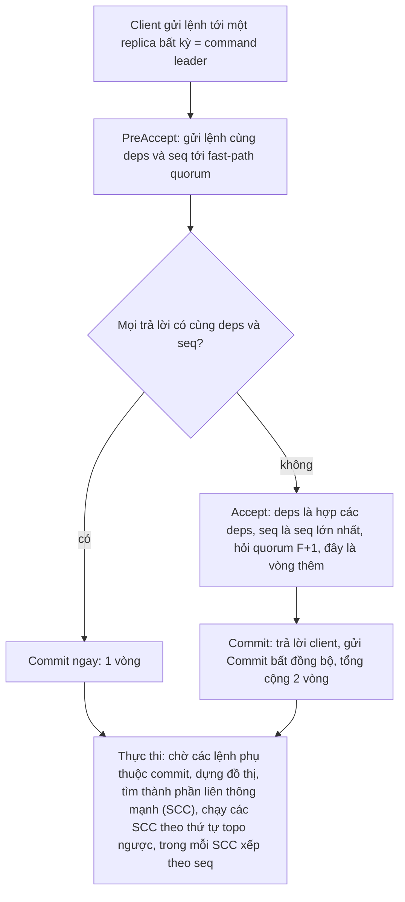

*Commit khác thực thi.* Hai việc này tách rời nhau, và thứ tự commit không nhất thiết trùng thứ tự thực thi[^c-ep-commitexec]. Để thực thi, replica dựng đồ thị phụ thuộc giữa các lệnh, tìm các thành phần liên thông mạnh (SCC), thực thi chúng theo thứ tự topo ngược, và trong mỗi SCC thì xếp các lệnh theo `seq`[^c-ep-exec].

*Khi nào có lợi (và khi nào không).* EPaxos có lợi nhất ở mạng diện rộng (nhận xét của người soạn). Với ba replica, một replica luôn commit được sau một vòng đi-về tới replica gần nhất của nó, kể cả khi lệnh xung đột với lệnh khác[^c-ep-3rep]. Multi-Paxos thì khác: replica nhận lệnh phải chuyển nó tới stable leader, nên độ trễ cao hơn[^c-ep-mpaxos-wan]. Với năm replica, như cụm `kvmeta`, EPaxos tránh được hai replica xa nhất[^c-ep-5rep].

Nhưng lợi ích đó phụ thuộc vào tỷ lệ xung đột giữa các lệnh. Các tác giả EPaxos tin rằng tỷ lệ xung đột (command interference rate) 0% và 2% là thực tế nhất[^c-ep-realistic]. Với `kvmeta`, đó là tỷ lệ `put` đụng nhau trên cùng một key: nếu flag ít khi bị ghi cùng lúc thì tỷ lệ thấp, còn khóa như `lock/billing-cron` thì bản chất là có người tranh (nhận xét của người soạn).

Nhóm của Tollman, Park và Ousterhout đánh giá lại: họ xác nhận độ trễ commit trung vị của EPaxos là tối ưu ở WAN, nhưng độ trễ đuôi tệ hơn nhiều so với báo cáo trước (hơn 4 lần so với Multi-Paxos) và rất nhạy với workload[^c-epr-abs]. Họ giải thích vì sao lợi thế giảm ở WAN: mạng càng chậm thì khoảng thời gian hai lệnh có thể xung đột càng dài, nên càng ít lệnh xong trong một RTT[^c-epr-wan]. Vậy đừng chọn EPaxos chỉ vì nghe nói "không có leader": trước hết hãy đo tỷ lệ xung đột và RTT giữa các vùng của chính bạn (nhận xét của người soạn).

### 7.4. PBFT: khi node có thể nói dối

PBFT chịu lỗi Byzantine, tức chịu cả replica hành xử tùy ý, kể cả nói dối[^rv-pbft-byz]. Lý do cần 3f+1 replica nằm ở mục 1; ở đây ta chỉ nhắc lại rằng 3f+1 là số tối thiểu để một hệ bất đồng bộ bảo đảm được cả an toàn lẫn tính sống khi có tối đa f replica hỏng[^c-pbft-opt]. Với `kvmeta`: muốn chịu 1 node nói dối thì cần 4 node, muốn chịu 2 thì cần 7, nên 5 node hiện có chỉ chịu được 1 (người soạn tính từ 3f+1).

Giống VR, các replica đi qua một dãy *view* đánh số liên tiếp; mỗi view có một primary, các replica còn lại là backup[^c-pbft-views]. View v có primary là replica p = v mod |R|[^c-pbft-primary-formula]. Chính paper PBFT cũng ghi nhận rằng VR và Paxos dùng view với primary và backup để chịu lỗi lành tính (benign)[^c-pbft-vr].

Khi primary nhận một request, nó khởi động một giao thức ba pha[^c-pbft-start3]. Ở pha **pre-prepare**, primary gán số thứ tự cho request rồi multicast cho các backup[^rv-pbft-pp]. Ở pha **prepare**, mỗi backup chấp nhận pre-prepare thì multicast `PREPARE` tới mọi replica khác[^c-pbft-prepare-bcast]. Pha cuối là **commit**.

Vì sao cần cả ba pha? Pre-prepare cùng prepare sắp thứ tự request trong một view, kể cả khi primary là kẻ xấu; prepare cùng commit bảo đảm request đã commit giữ nguyên thứ tự qua các view[^c-pbft-phases]. Replica gọi một request là *prepared* khi log của nó đã có pre-prepare của request đó cùng 2f `PREPARE` khớp từ các backup khác nhau, và "khớp" nghĩa là trùng view, số thứ tự và digest[^rv-pbft-prepared]. Commit cũng phải khớp pre-prepare theo đúng ba trường ấy[^c-pbft-commitmatch]. Hình 7.4 (người soạn vẽ theo §4.2 và Hình 1 của paper, nơi replica 0 là primary và replica 3 là replica lỗi[^rv-pbft-fig1]) cho bốn replica chạy một request; trong hình R3 nhận tin nhưng không gửi gì.

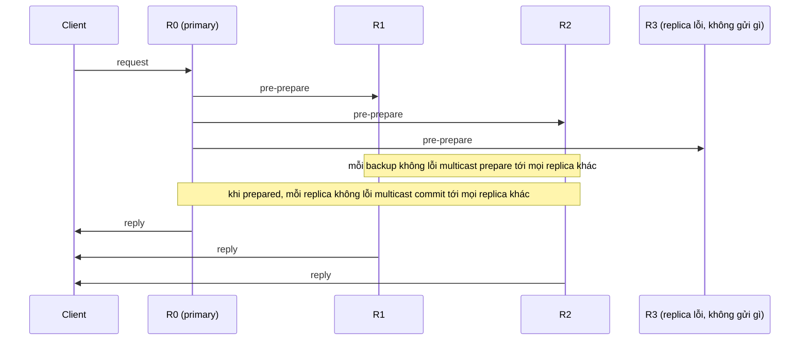

Còn hai điều cần nhớ về PBFT. Điều thứ nhất là giả định thời gian. PBFT không dựa vào đồng bộ để giữ an toàn, nhưng phải dựa vào đồng bộ để có tính sống; nếu không, nó đã giải được consensus trong hệ bất đồng bộ, điều mà FLP cấm[^c-pbft-sync]. Giả định đó khá yếu: paper cho rằng nó nhiều khả năng đúng ở mọi hệ thật, miễn là lỗi mạng cuối cùng được sửa[^rv-pbft-weaksync].

Điều thứ hai là chi phí. Luận án Raft nhận xét các thuật toán Byzantine phức tạp hơn và có hiệu năng thấp hơn các thuật toán fail-stop[^c-th-byz]. Một nguyên nhân dễ thấy ở Hình 7.4: ở pha prepare và commit, replica nào cũng multicast cho mọi replica khác, nên số thông điệp cho mỗi request tăng theo bình phương số replica (suy luận của người soạn từ mô tả multicast ở trên). PBFT cũng có một tối ưu gom lô khi tải nặng, xem mục 8.2.

Nếu `kvmeta` chạy trong trung tâm dữ liệu của chính bạn, mô hình lỗi dừng của Raft, Paxos, VR và Zab thường đủ (nhận xét của người soạn, cùng ý với chương 09, mục 6, phần Đi sâu).

<details><summary>Đi sâu: vì sao VR đổi view cần hai vòng, primary-copy khác RSM, và đếm loại thông điệp</summary>

- *Hai vòng trong đổi view.* Paper VR nói rõ hai lượt trao đổi (`StartViewChange` rồi `DoViewChange`) là *cần thiết*, không thừa[^c-vr-tworounds]. Thử bỏ vòng `StartViewChange`: paper dựng kịch bản với ba replica r1, r2, r3, primary của view v là r1. r3 đã quyết định đổi view và gửi `DoViewChange` cho r2, primary của view v+1, nhưng tin bị trễ trên mạng; r3 chết rồi khôi phục ở view v nhờ phản hồi `RecoveryResponse` của r1 và r2[^rv-vr-sc1]. Sau đó r3 trả `PrepareOK` cho các `PREPARE` của r1 (r2 không nhận được các `PREPARE` ấy); `DoViewChange` trễ rồi tới r2, và r2 mở view v+1 với log thiếu những thao tác đã commit sau khi r3 khôi phục[^rv-vr-scenario]. Vòng `StartViewChange` chặn kịch bản này, vì nó bảo đảm khi đổi view thì f+1 replica đã *biết* việc đổi view đang diễn ra, nên replica khôi phục chắc chắn trở lại ở view đó hoặc muộn hơn[^c-vr-fplus1know]. Cũng quan trọng không kém: replica phải ngừng nhận `PREPARE` của view cũ ngay khi bắt đầu đổi view, nếu không thì có thể có hai primary hoạt động cùng lúc, là primary cũ (chỉ chậm hoặc nối mạng kém, chưa hỏng) và primary mới[^c-vr-stop].
- *Primary-copy và replicated state machine.* VR gốc của Oki và Liskov, cùng ZooKeeper, theo kiến trúc *primary-copy*, hơi khác máy trạng thái nhân bản (RSM) truyền thống[^c-th-primarycopy]. Ở primary-copy, state machine của primary chạy request ngay khi nó đến mà không chờ commit; consensus nhân bản *trạng thái kết quả* chứ không phải request gốc[^c-th-primarycopy2]. Van Renesse và cộng sự xếp VR và Zab vào passive replication, còn Paxos vào active replication[^c-vive-passive]. Vì thế primary cứ việc xử lý request theo ý nó, kể cả không tất định, miễn là *thay đổi trạng thái* nó tạo ra là tất định[^c-th-nondeterm].
- *Số loại thông điệp.* Luận án Raft đếm số loại thông điệp mà mỗi thuật toán dùng cho consensus cơ bản và đổi thành viên (không tính nén log và tương tác với client): VR Revisited và Zab mỗi bên định nghĩa 10 loại, còn Raft chỉ có 4 (hai RPC và hai phản hồi)[^rv-th-msgtypes]. Con số này minh họa lập luận rằng Raft có ít cơ chế hơn; nó không phải số đo hiệu năng (nhận xét của người soạn).
- *Reconfiguration của VR và chữ epoch.* Muốn đổi nhóm replica, VR dùng một request đặc biệt chạy qua giao thức bình thường của nhóm cũ; khi request đó commit, hệ chuyển sang một *epoch* mới và nhóm mới nhận việc xử lý request của client[^c-vr-epoch]. Vậy epoch của VR đánh số *cấu hình thành viên*, khác với epoch của Zab là số đời leader[^c-zk-epoch]. Trong lúc chuyển epoch, hệ *không nhận request mới*[^c-vr-reconf-stall]. Raft thì đổi thành viên mà vẫn xử lý request thường[^c-raft-joint-vs-vr]. Mục 5 so sánh kỹ hơn với cách Raft đổi thành viên.
- *Đọc ở VR.* Để primary không trả về dữ liệu cũ, Harp dùng lease: primary chỉ tự xử lý đọc khi giữ lease hợp lệ từ f replica, và view mới chỉ bắt đầu sau khi lease hết hạn ở f+1 replica tham gia đổi view; cách này giả định tốc độ đồng hồ các replica xấp xỉ nhau[^rv-vr-harp]. Cách đọc bằng lease của Raft nằm ở mục 6.4.
- *Recovery của VR cần f+2 replica.* Giao thức recovery đòi phải có f+2 replica liên lạc được với nhau, tức replica đang khôi phục cộng f+1 replica trả lời (người soạn giải thích cách đếm); dù vậy giao thức vẫn sống, miễn là không quá f replica hỏng cùng lúc[^c-vr-f2].
- *Số đo trong paper EPaxos và EPaxos Revisited.* Các thí nghiệm WAN của paper EPaxos đặt replica ở các trung tâm dữ liệu Amazon EC2 (California, Virginia, Ireland, thêm Oregon và Nhật khi chạy năm replica)[^c-ep-ec2]. Nhóm đánh giá lại thấy tỷ lệ thao tác xong trong một RTT thay đổi mạnh theo workload, và trong một thí nghiệm chỉ còn 65%[^c-epr-65]. Khi workload lệch, chuỗi phụ thuộc của EPaxos gốc có thể phình ra không giới hạn, đẩy độ trễ đuôi lên trên 5 giây hoặc gây livelock; nhóm này tìm ra một sửa đổi đơn giản để chặn việc đó[^c-epr-chains].

</details>

**Quay lại Q7:** VR, Zab, Raft và Multi-Paxos cùng một họ "leader + đa số + số của đời leader", chỉ khác nhau ở cách chọn leader, cách leader mới bắt kịp log và những gì phải ghi bền (VR có thể bỏ đĩa, đổi lại phải giả định replica hỏng độc lập). EPaxos bỏ leader để đổi lấy sự phụ thuộc giữa các lệnh, PBFT thêm ba pha và 3f+1 replica để chịu node nói dối; với `kvmeta` trong một trung tâm dữ liệu của chính bạn thì Raft, VR hay Zab đã đủ, EPaxos chỉ đáng đo khi cụm trải nhiều vùng và ít `put` đụng nhau, còn PBFT chỉ khi có node có thể nói dối.

## 8. Hiệu năng và vận hành: một commit tốn gì, batching, pipelining, cụm nhiều vùng (Q8)

> **Trả lời ngắn.** Khi leader đã vững, mỗi lần commit của Raft tốn một vòng đi-về từ leader tới một nửa cụm, tức đủ node để thành đa số[^c-th-perf1]. Ngoài mạng còn có đĩa: etcd nói gọn là thời gian tối thiểu của một request bằng RTT (round-trip time, thời gian đi-về qua mạng) giữa các member cộng thời gian `fdatasync`, lệnh ép dữ liệu xuống lưu trữ bền[^c-etcd-perf-min]. Gộp nhiều lệnh vào một lần gửi và ghi (batching) tăng thông lượng khi tải nặng, còn cho entry sau bắt đầu xử lý khi entry trước còn đang chạy (pipelining) giảm độ trễ khi tải vừa[^rv-th-batchpipe]. Cụm lớn hơn chịu lỗi tốt hơn nhưng ghi chậm hơn vì dữ liệu phải chép tới nhiều máy hơn[^c-etcd-faq-size], và trải cụm ra nhiều vùng cũng đánh đổi tương tự: chịu hỏng tốt hơn, nhưng mỗi yêu cầu consensus chậm hơn vì phải băng qua ranh giới datacenter (mục 8.5).

**Giải thích.**

*Với cụm `kvmeta`.* Cụm 5 node `N1`…`N5` của `kvmeta` (kho key-value giữ feature flag và khóa leader) chỉ trả ok cho `put("flags/checkout", "on")` sau khi giá trị đã nằm an toàn trên đa số node, tức 3 trong 5. Người vận hành sẽ hỏi: một `put` mất bao lâu, mất ở đâu và chỉnh được gì; chạy 3, 5 hay 7 node thì `put` nhanh hay chậm hơn; và nếu rải `N1`…`N5` ra ba vùng thì độ trễ đổi ra sao. Mục này đi theo thứ tự đó: chi phí của một commit (8.1), batching và pipelining (8.2), lý do etcd/raft tách lõi thuật toán khỏi đĩa và mạng (8.3), cỡ cụm (8.4), rồi cụm nhiều vùng (8.5).

### 8.1. Một lần commit tốn gì

Hình 8.1 vẽ đường đi của một `put` trong `kvmeta` khi mọi thứ bình thường, rút gọn còn một leader và hai follower (người soạn vẽ theo Hình 10.2 của luận án Raft). Hai dòng cuối là phần người soạn thêm: leader đưa commit index, tức chỉ số entry cao nhất mà nó biết là đã commit, vào các `AppendEntries` gửi sau đó, kể cả heartbeat, để các server khác rồi cũng biết[^c-th-commit-learn].

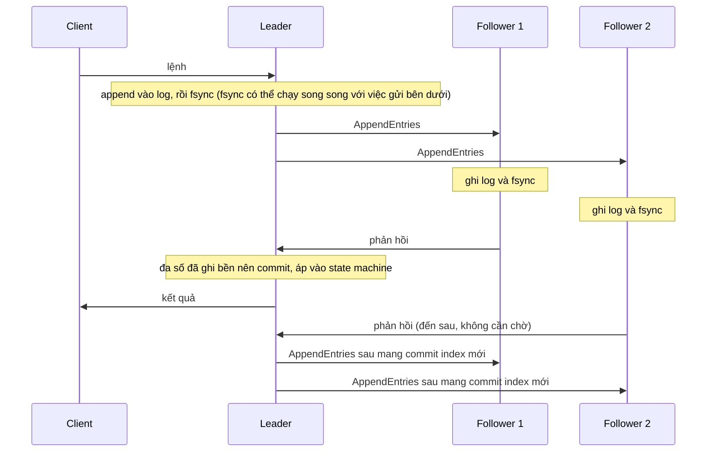

Ở bản Raft chưa tối ưu (Hình 10.2a của luận án), các bước đi tuần tự như sau. Giả sử `N1` là leader. Nhận `put`, `N1` append vào log của mình, flush xuống đĩa rồi mới gửi `AppendEntries`. Mỗi follower cũng append và flush vào đĩa của nó. Khi `N1` nhận được phản hồi tích cực từ một nửa số follower, nó đánh dấu entry là committed, áp vào state machine và trả lời client[^c-th-fig102]. Với `kvmeta`, một nửa số follower là 2 trong 4 follower; cộng thêm `N1` là đủ 3 node, đúng đa số.

Trong chuỗi bước đó, hai bước thường tốn thời gian nhất là ghi entry xuống đĩa và sao chép nó qua mạng[^c-th-diskvsnet]. Trong các thí nghiệm trên mạng LAN của luận án, bên chi phối lúc là đĩa, lúc là mạng, tùy mẫu SSD dùng[^c-th-lan]. Vậy không bên nào luôn là nút cổ chai, và với `kvmeta` đặt cả 5 node trong một datacenter thì đĩa là chỗ cần để mắt (suy luận của người soạn).

*Tối ưu đầu tiên: leader ghi đĩa song song với sao chép.* Về phía đĩa, bản ngây thơ ở trên bắt leader ghi log xong mới được gửi, nên trên đường đi có hai lần ghi đĩa nối tiếp nhau, của leader rồi của follower[^c-th-naive]. Thực ra leader không cần chờ: nó gửi `AppendEntries` ngay và tự ghi đĩa trong lúc các follower nhận và ghi (Hình 10.2b). Để xử lý việc này cho gọn, leader coi mình như một follower khác. Nó dùng `matchIndex` của chính mình (chỉ số entry cao nhất đã lưu ở server đó) để ghi nhận entry mới nhất đã nằm bền trên đĩa, và khi một entry của term hiện tại đã nằm trong `matchIndex` của đa số server thì nó tăng commit index[^c-th-parallel]. Thậm chí leader còn commit được entry trước khi ghi xong đĩa của chính mình, miễn là đa số follower đã ghi; luận án nói như vậy vẫn an toàn[^c-th-before-own-disk]. "Ghi đĩa của leader song song" cũng nằm trong danh sách tối ưu tùy chọn của etcd/raft[^c-er-features].

*Công thức thô.* Từ các bước trên ta ước lượng được độ trễ commit. Giả sử leader gửi `AppendEntries` ngay và ghi đĩa song song, như Hình 10.2b. Gọi `t_leader` là thời gian leader ghi đĩa, `t_i` là thời gian follower i ghi đĩa, `RTT_i` là RTT từ leader tới follower i. Khi đó leader xong sau `t_leader`, còn follower i xong sau `RTT_i + t_i`. Commit xảy ra ngay khi đa số replica đã ghi bền xong, nên nó nằm ở mốc nhỏ thứ ⌊n/2⌋+1 trong các mốc ấy (leader chỉ được tính khi đã ghi xong phần của mình), rồi còn thêm thời gian đưa kết quả về client. Đây là suy luận của người soạn từ Hình 8.1 và luận án; công thức còn thô vì bỏ qua hàng đợi và CPU. Với bản chưa tối ưu ở Hình 10.2a, leader ghi xong mới gửi, nên mọi mốc của follower bị cộng thêm `t_leader`.

Cụm 3 node thì mốc quyết định là của follower nhanh nhất; cụm 5 node như `kvmeta` thì là của follower nhanh *thứ hai*. Lý do là leader tự tính một phiếu, nên cụm 3 node cần thêm một follower còn cụm 5 node cần thêm hai (cả hai trường hợp đều giả sử leader ghi xong không muộn hơn follower đó). Cận dưới này cùng hướng với cách etcd tóm tắt: thời gian tối thiểu của một request là RTT giữa các member cộng thời gian `fdatasync`[^c-etcd-perf-min] (nhận xét của người soạn).

Bảng 8.1 gom các con số mà các nguồn nêu. Khoảng giá trị và con số "điển hình" chỉ là ước lượng của nguồn; dòng LogCabin và các dòng etcd là số do chính họ công bố cho phần cứng của họ. Không con số nào là cam kết hiệu năng, và luận án gọi số đo LogCabin là kết quả sơ bộ[^c-th-prelim].

| Đại lượng | Số nguồn nêu | Nguồn |
|---|---|---|
| Ghi đĩa | từ 100 µs (SSD nhanh) đến 10 ms (đĩa từ chậm) | luận án Raft[^c-th-diskvsnet] |
| `fdatasync` | khoảng 10 ms với đĩa quay, thường dưới 1 ms với SSD | tài liệu etcd[^c-etcd-perf-nums] |
| RTT mạng | từ 5 µs (mạng trung tâm dữ liệu tối ưu hết cỡ) đến 400 ms (mạng vòng quanh địa cầu) | luận án Raft[^c-th-diskvsnet] |
| RTT mạng | trong một datacenter có thể dài tới vài trăm µs; điển hình khoảng 50 ms trong nước Mỹ; có thể chậm tới 400 ms giữa các châu lục | tài liệu etcd[^c-etcd-perf-nums] |
| Ghi 1 KB trên LogCabin, một thread client (SSD, 1 GbE) | khoảng 1,0 ms với cụm 2 đến 5 server, 0,7 ms với một server[^c-th-lat]; trong đó phần ghi bền 1 KB, đo riêng bằng microbenchmark, khoảng 0,25 ms[^c-th-lat2] | luận án Raft, phần cứng ở Bảng 10.1[^c-th-setup] |
| Thông lượng LogCabin | khoảng 19.500 ghi 1 KB mỗi giây, cụm 3 server, 100 thread client | luận án Raft[^c-th-tput] |
| etcd, 3 member trên môi trường cloud phổ biến (máy `standard n-4` của GCE hoặc loại tương đương trên AWS) | dưới 1 ms mỗi request khi tải nhẹ; hơn 30.000 request/s khi tải nặng | tài liệu etcd[^rv-etcd-light-env] |

Để có cảm giác về thang đo, hãy đặt cạnh nhau hai hàng trong bảng benchmark của etcd (3.2.0, ba máy GCE 8 vCPU có SSD[^c-etcd-bench-hw]). Một client dùng một connection ghi thẳng vào leader được 583 ghi/s với độ trễ trung bình 1,6 ms; 1000 client (100 connection) được 44.341 ghi/s với độ trễ trung bình 22 ms[^c-etcd-bench]. Chia hai hàng cho nhau thì thông lượng tăng khoảng 76 lần còn độ trễ mỗi request tăng khoảng 14 lần (người soạn tính). Tài liệu etcd cũng nói độ trễ trung bình thường tăng theo thông lượng khi có nhiều client đồng thời[^c-etcd-lat-tput]. Hai hàng này cùng chiều với nhận định đó, nhưng chúng khác nhau cả tổng số key (10.000 và 100.000) và bảng không tách riêng tác dụng của batching và pipelining, nên chỉ nên đọc chúng như một minh họa cho đánh đổi giữa thông lượng và độ trễ ở mục 8.2 (suy luận của người soạn).

### 8.2. Batching và pipelining

Nếu leader làm từng `put` một thì mỗi `put` tốn trọn một vòng mạng và một lần ghi đĩa. Batching và pipelining cắt bớt cái giá đó, mỗi kỹ thuật theo một cách.

*Batching* gom nhiều request vào một lô để chia nhỏ chi phí: gửi hai entry trong một gói tin, hay ghi hai entry xuống đĩa một lần, rẻ hơn nhiều so với gửi và ghi riêng từng entry. Vì vậy lô lớn tối ưu *thông lượng* và có ích khi tải nặng[^c-th-batch]. *Pipelining* thì tối ưu *độ trễ* khi tải vừa, bằng cách cho entry sau bắt đầu được xử lý khi entry trước còn đang chạy. Chẳng hạn leader gửi entry kế tiếp cho follower trong lúc follower còn đang ghi entry trước xuống đĩa[^c-th-pipe]. Ngay cả khi tải cao, một mức pipeline nhất định vẫn có thể tăng thông lượng vì dùng tài nguyên hiệu quả hơn: follower phải nhận entry qua mạng rồi mới ghi được xuống đĩa, nên gom lô cỡ nào cũng không dùng được mạng và đĩa cùng lúc, còn pipelining thì làm được. Nhưng ở một mức độ, pipelining lại đi ngược với batching[^c-th-pipe2].

Raft hỗ trợ cả hai khá tự nhiên. Về batching, một RPC `AppendEntries` gửi được nhiều entry liên tiếp[^c-th-batch-natural]. Về pipelining, kiểm tra nhất quán của `AppendEntries` bảo đảm việc gửi tiếp mà không chờ ack là an toàn. Để làm vậy, leader coi `nextIndex` của mỗi follower (chỉ số entry kế tiếp sẽ gửi cho follower đó) một cách lạc quan: nó tăng `nextIndex` ngay sau khi gửi, không chờ ack của entry trước[^c-th-pipe-safe].

Chọn cỡ lô là bài toán cân bằng. Gom quá ít thì lúc tải nặng cụm xử lý kém hiệu quả, thông lượng thấp và độ trễ cao. Gom quá nhiều thì request đến sớm phải chờ request đến sau cho đủ lô, nên độ trễ tăng vô ích[^c-th-sched]. LogCabin gửi cho follower mọi entry đang có từ `nextIndex` của nó tới cuối log, tối đa một megabyte mỗi RPC[^c-th-1mb].

Các hệ thật xử lý bài toán đó theo cách riêng. VR Revisited nói rằng có thể chỉ gom lô khi primary (tên VR gọi leader) đang bận nặng, để ít ảnh hưởng độ trễ; lúc rảnh, primary xử lý request ngay khi nó tới[^c-vr-batching]. PBFT làm tương tự: primary bắt đầu giao thức ngay, trừ khi số thông điệp đang chạy giao thức vượt một ngưỡng nào đó. Khi vượt, nó xếp request vào hàng đợi, rồi về sau multicast cả nhóm một lần để giảm lưu lượng thông điệp và chi phí CPU lúc tải nặng; paper so tối ưu này với group commit trong các hệ giao dịch[^c-pbft-groupcommit]. etcd gộp nhiều request lại rồi mới giao cho Raft, để tăng thông lượng[^c-etcd-batch].

ZooKeeper đi hướng khác: ứng dụng của nó đòi hiệu năng cao, nên Zab đặt mục tiêu cho phép nhiều thao tác của client cùng đang bay, tức đã gửi đi mà chưa xong[^c-zab-multi]. Vì vậy cách gộp lô kèm một đề xuất đang bay không hợp với họ (mục 7.2).

Với `kvmeta`, nếu các service backend đẩy flag dồn dập thì leader nên gộp những `put` đến cùng lúc vào một lần ghi đĩa, còn khi `put` hiếm thì gửi ngay để khỏi chờ vô ích; hai núm hay gặp ở kiểu chính sách này, quen từ connection pool và group commit của database, là kích thước lô tối đa và thời gian chờ tối đa (nhận xét của người soạn).

README của etcd/raft liệt kê bốn tối ưu tùy chọn thuộc nhóm này: pipelining lạc quan, kiểm soát luồng (flow control), gộp thông điệp để giảm lời gọi mạng đồng bộ, và gộp entry để giảm I/O đĩa đồng bộ[^c-er-features]. Còn `Config` của raft-rs có `max_size_per_msg` và `max_inflight_msgs`[^c-rr-config-list1], mà mục "Liên hệ với Rust" chạy thử như hai núm kích thước lô và số message đang bay. Danh sách trường của `Config` còn có `batch_append`, `skip_bcast_commit` và vài trường khác, nhưng không có trường nào đặt thời gian chờ gom lô (người soạn đọc từ danh sách trường[^c-rr-config-list2]).

### 8.3. Vì sao etcd/raft tách lõi khỏi lưu trữ và mạng

Nếu bạn dựng `kvmeta` bằng thư viện etcd/raft, bạn sẽ thấy nó cố ý không tự ghi đĩa và không tự mở kết nối mạng. README của nó giải thích: đa số cài đặt Raft có thiết kế nguyên khối, ôm cả việc lưu trữ, tuần tự hóa thông điệp và truyền tải qua mạng, còn etcd/raft đi theo triết lý tối giản, chỉ cài *lõi thuật toán*, và sự tối giản đó "mua" được tính linh hoạt, tính tất định và hiệu năng[^c-er-minimal]. Vì vậy mạng và đĩa là việc của người dùng: bạn tự cài lớp truyền tải để các peer gửi thông điệp cho nhau, và lớp lưu trữ để giữ log và trạng thái của Raft[^c-er-io].

Để dễ kiểm thử, hành vi của thư viện phải tất định. Vì vậy etcd/raft coi Raft là một state machine, mỗi lần nhận một `Message` làm đầu vào: có thể là cập nhật đồng hồ cục bộ, có thể là tin gửi từ một peer ở xa[^c-er-det]. Cùng trạng thái mà cùng đầu vào thì luôn cho cùng đầu ra[^c-er-det2]. Thời gian trong lõi cũng chỉ là "tick" trừu tượng[^c-er-tick]; nhờ vậy cùng lõi đó chạy được trong mô phỏng tất định (suy luận của người soạn, xem mục 9). Hình 8.2 vẽ ranh giới này (người soạn vẽ theo README).

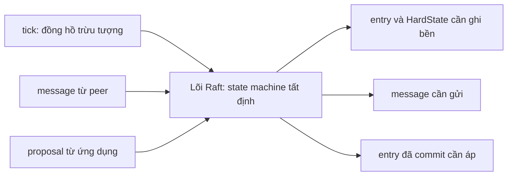

Cái lợi thực dụng cho `kvmeta`: bạn tự quyết định *khi nào* fsync, gộp bao nhiêu entry mỗi lần ghi và dùng giao thức truyền tải nào (nhận xét của người soạn). Đổi lại, quy tắc an toàn ở biên cũng thành việc của bạn: lõi giao việc theo từng lô `Ready`, và README đòi không được gửi message nào trước khi `HardState` mới nhất (phần trạng thái Raft phải ghi bền) và các entry của những lô `Ready` trước đã nằm trên đĩa[^c-er-order].

raft-rs, crate `raft` của TiKV, đi cùng hướng: README ghi crate chỉ gồm consensus module, còn log, state machine và transport là phần bạn tự dựng[^c-rr-readme].

### 8.4. Cỡ cụm: chịu lỗi, độ trễ, thông lượng

Câu hỏi 3, 5 hay 7 node cho `kvmeta` bắt đầu từ Bảng 8.2, bảng đa số và số node hỏng chịu được mà etcd đưa ra cho vài cỡ cụm[^c-etcd-faq-table].

| Số node n | Đa số (quorum) | Số node hỏng chịu được |
|---|---|---|
| 3 | 2 | 1 |
| 4 | 3 | 1 |
| 5 | 3 | 2 |
| 7 | 4 | 3 |

Với `kvmeta`, bảng cho thấy 5 node cần đa số 3 và chịu được 2 node hỏng; lên 7 node thì đa số là 4 và chịu được 3. Bảng cũng cho thấy 3 node và 4 node đều chịu được 1 node hỏng, nên cụm lẻ chịu cùng số lỗi với cụm chẵn lớn hơn nó một máy mà dùng ít máy hơn[^c-etcd-faq-odd].

Cái giá của khả năng chịu lỗi là tốc độ ghi: cụm lớn hơn chịu lỗi tốt hơn, nhưng dữ liệu phải sao chép tới nhiều máy hơn nên mỗi lần ghi chậm hơn[^c-etcd-faq-size]. Tài liệu etcd cũng nói điều đó theo chiều ngược lại: thu nhỏ cụm có thể cải thiện hiệu năng ghi, đổi lại giảm khả năng chịu lỗi, vì đa số nhỏ đi nên mỗi lần ghi commit nhanh hơn[^c-etcd-runtime-size]. Số đo của LogCabin cũng cùng xu hướng: cụm lớn hơn thì hiệu năng giảm, vì leader phải gửi mỗi entry cho nhiều follower hơn[^c-th-tput].

Cụm lớn còn vướng một cận lý thuyết. Mọi thao tác đều phải có hơn một nửa số server tham gia, nên hiệu năng của một nhóm consensus bị giới hạn từ gốc: thông lượng tốt nhất không thể vượt quá hai lần thông lượng của một server đơn, vì mỗi server phải xử lý một đa số các lệnh. Cách duy nhất để mở rộng lên cụm lớn là dùng nhiều nhóm consensus độc lập[^c-th-group].

Ở các thuật toán có leader, yếu tố thường giới hạn thông lượng là băng thông gửi ra của leader[^c-th-outbound]. TigerBeetle, dựa trên VR[^c-jep-tb-vsr], cho một ví dụ thật về cái giá của việc giảm tải băng thông đó. Jepsen mô tả: các node được sắp thành vòng, primary chỉ gửi một `prepare` cho node kế tiếp, node đó chuyển tiếp cho node sau nữa, cứ thế tới khi mọi node đều nhận được, còn ack thì gửi thẳng về primary[^c-jep-tb-ring0]. Cách này giảm băng thông mà từng node phải gánh, nhưng tạo ra một điểm yếu: nếu primary cần f ack để commit thì chỉ cần một trong f node kế tiếp trên vòng hỏng là việc commit bị chặn hẳn[^c-jep-tb-ring]. Jepsen thường thấy độ trễ phía client tăng ba đến năm bậc độ lớn khi một node hỏng[^c-jep-tb-lat]. VR gốc và VR Revisited làm khác: primary gửi `prepare` cho mọi secondary (follower), các secondary gửi ack thẳng về primary, và primary commit khi đủ f ack[^rv-jep-tb-vrnormal]. Nhờ vậy một node hỏng chỉ làm mất một ack, không ảnh hưởng node khác, và cả hệ tương đối không nhạy với lỗi một node[^c-jep-tb-vrnormal]. Sau đợt cộng tác với Jepsen, TigerBeetle thêm một loạt kiểm tra hiệu năng tất định vào bộ mô phỏng, và từ bản 0.16.43 các node sao chép theo cả hai chiều quanh vòng, còn thứ tự node trên vòng được chỉnh liên tục theo tình trạng mạng và lỗi để giảm độ trễ[^c-jep-tb-fixed].

Còn một cách khác để giảm chi phí mà không đổi topology: nới yêu cầu quorum. Flexible Paxos chỉ đòi quorum của *hai pha khác nhau* giao nhau, không đòi mọi quorum giao nhau[^c-fp-abs] (xem mục 1). Tác giả cho ví dụ: cụm 10 node chỉ cần 3 node tham gia sao chép, với điều kiện khi phục hồi từ leader chết phải có 8 node tham gia[^c-fp-example]. Cái giá là tính sẵn sàng lúc phục hồi giảm: cụm chịu được ít lỗi hơn đúng lúc đang phục hồi sau khi leader hỏng[^c-fp-price].

*Vận hành cụm.* Có hai bẫy hay bị bỏ quên. Bẫy thứ nhất: một máy đã hỏng mà chưa bị gỡ khỏi cấu hình vẫn làm quorum yếu đi và giảm số lỗi cụm còn chịu thêm được[^c-etcd-runtime-failed]. Với `kvmeta`, nếu `N5` đã chết mà vẫn nằm trong cấu hình thì cụm 5 node chỉ còn chịu thêm được 1 node hỏng thay vì 2 (suy luận của người soạn từ Bảng 8.2). Bẫy thứ hai: khả năng chịu lỗi có thể che lỗi cấu hình. Nhóm Paxos Made Live từng khởi động một hệ năm replica mà gõ sai tên một replica trong nhóm ban đầu[^c-pml-misspell]. Hệ vẫn chạy "đúng", nhưng chỉ chịu được một replica hỏng thay vì hai[^c-pml-onefaulty]. Các tác giả nhận xét rằng hệ chịu lỗi vốn dĩ cố che vấn đề, nên có thể che cả bug lẫn lỗi cấu hình trong khi âm thầm hạ chính khả năng chịu lỗi của mình[^c-pml-mask]. Với `kvmeta`, nên giám sát *số replica thực sự khỏe* chứ không chỉ xem dịch vụ còn trả lời hay không (nhận xét của người soạn).

### 8.5. Cụm nhiều vùng

Giả sử công ty muốn `kvmeta` sống sót cả khi mất một vùng, nên cân nhắc đặt 5 node ở 3 vùng. Đặt member ở nhiều vùng thì cụm chịu hỏng tốt hơn, vì các member nằm ở những miền hỏng (failure domain) khác nhau. Đổi lại, mỗi yêu cầu consensus phải băng qua ranh giới datacenter nên độ trễ cao hơn, và vì ít nhất đa số member phải trả lời nên chênh lệch đó khá rõ[^c-etcd-faq-region]. Khi độ trễ dài, cấu hình mặc định của etcd còn có thể gây bầu cử và timeout heartbeat liên tục[^c-etcd-faq-region2]. Vì vậy khuyến nghị chung của etcd là đặt member trong một datacenter nếu được, để khỏi tốn thêm độ trễ và bớt khả năng xảy ra partition; nếu cần một miền hỏng ở datacenter khác thì chọn datacenter gần hơn[^c-etcd-hw-dc].

*Độ trễ.* Giả sử leader ở vùng L và service gọi `put` ở vùng C. Mỗi lần ghi đi hai chặng: từ C tới leader ở L, rồi từ leader tới nửa gần nhất của các server còn lại[^c-th-geo]. Nếu client sao chép thẳng tới đa số gần nó nhất thì bỏ được chặng đi qua leader; mức cải thiện tùy vị trí địa lý của client và các server, và trường hợp xấu nhất của kiểu có leader có thể giảm từ hai vòng quanh địa cầu mỗi request xuống một vòng[^c-th-geo]. EPaxos và Generalized Paxos thì không phải đưa leader vào đường đi: chúng đạt độ trễ ở WAN (mạng diện rộng) thấp hơn Raft vì chỉ cần các server gần client nhất[^c-th-egal-wan] (xem mục 7).

*Đặt leader ở đâu.* Hệ quả cho vận hành là nên đặt leader gần nơi sinh ra phần lớn `put` (nhận xét của người soạn). Muốn vậy thì thuật toán phải cho phép chọn leader. Paxos và Zab cho phép ưu tiên một server làm leader ngay lúc bầu cử[^c-th-pref]. VR, VR Revisited và Raft (theo bảng so sánh của luận án) thì cần một cơ chế chuyển leader riêng để thực hiện sở thích đó[^c-th-leadership-transfer], nên `kvmeta` chạy Raft thuộc nhóm sau.

*Timeout theo RTT.* Khi cụm trải ra nhiều vùng, hai timeout của Raft phải chỉnh theo RTT thật giữa các member. Heartbeat interval là tần suất leader báo cho follower rằng nó vẫn là leader; etcd mặc định 100 ms[^rv-etcd-tune-hbdef]. Election timeout là thời gian follower chờ không nghe heartbeat thì tự ra ứng cử; etcd mặc định 1000 ms[^rv-etcd-tune-eldef]. Tài liệu etcd khuyến nghị đặt heartbeat interval vào khoảng RTT trung bình lớn nhất giữa các member, thường bằng 0,5 đến 1,5 lần RTT[^c-etcd-tune-hb]. Election timeout thì phải ít nhất 10 lần RTT để chịu được dao động của mạng[^c-etcd-tune-elect]. Cũng theo tài liệu đó, RTT trong lục địa Mỹ vào khoảng 130 ms, còn Mỹ–Nhật khoảng 350–400 ms[^c-etcd-tune-us]. Với RTT cỡ đó, cụm trải rộng phải chỉnh lại timeout: 10 lần 130 ms đã là 1,3 giây, vượt mặc định 1000 ms (suy luận của người soạn). Cuối cùng, hai giá trị này nên đặt giống nhau ở mọi member trong cụm; đặt lệch nhau có thể làm cụm mất ổn định[^c-etcd-tune-same].

*Chọn cách chia node.* Bảng 8.3 so vài cách chia node giữa các vùng: mỗi cách mất được gì, và leader phải chờ ai. Đây là suy luận của người soạn thuần từ luật đa số, không có số đo.

| Cách đặt node | Mất được | Ghi chú về độ trễ commit tại leader |
|---|---|---|
| 3 node ở 2 vùng (2+1) | chỉ mất được vùng có 1 node; mất vùng có 2 node thì mất đa số | nhanh vì chỉ cần 1 phản hồi, thường từ node cùng vùng; nhưng cái nhanh đó đi kèm việc không chịu được mất vùng 2 node |
| 3 node ở 3 vùng (1+1+1) | mất được 1 vùng bất kỳ | chờ vùng *gần nhất* trong hai vùng còn lại |
| 5 node ở 3 vùng (2+2+1) | mất được 1 vùng bất kỳ (vẫn còn ít nhất 3 node) | leader ở vùng có 2 node: cần 2 phản hồi khác, một từ node cùng vùng và một từ vùng gần nhất trong hai vùng còn lại |
| 5 node ở 5 vùng | mất được 2 vùng | chờ vùng gần *thứ hai* |

Ngoài cách chia node ở Bảng 8.3, còn hai công cụ nữa. Công cụ thứ nhất là *learner*, member không bỏ phiếu và cũng không được tính vào quorum[^c-etcd-learner-def]. Vì vậy đặt learner ở vùng xa thì có thêm một bản sao mà không cộng thêm độ trễ commit, nhưng cũng không giúp cụm chịu thêm lỗi (nhận xét của người soạn). Cần lưu ý tài liệu etcd mô tả learner trước hết như bước đệm khi thêm member, được promote thành member bỏ phiếu khi đã đuổi kịp leader[^c-etcd-learner-promote]; còn việc để learner ở lại lâu dài tại vùng xa là suy luận của người soạn (xem mục 5 và 9.2). Công cụ thứ hai là một nhận xét của Flexible Paxos trong phần quorum dạng lưới: ngoài đời các lỗi không độc lập với nhau, nên có thể rải acceptor qua máy, rack, thậm chí datacenter để giảm khả năng chúng hỏng cùng lúc[^c-fp-dc].

<details><summary>Đi sâu: đĩa là một phần của "sức sống" leader, fsync bị nghẽn bởi tiến trình khác</summary>

- *Đĩa chậm thành mất leader.* FAQ của etcd coi độ trễ đĩa là một phần của "sức sống" leader (leader liveness). Ví dụ: leader mất một phút để fsync một bản cập nhật log trong khi election timeout là một giây. Dù trong khoảng đó nó vẫn xử lý được thông điệp mạng, chẳng hạn gửi heartbeat, thực chất nó không khả dụng vì không commit được đề xuất nào: nó đang chờ cái đĩa chậm[^c-etcd-faq-disk-leader]. Với `kvmeta`, một leader như vậy vẫn gửi heartbeat đều nhưng mọi `put` đều treo (suy luận của người soạn). Tài liệu tuning nói cụ thể hơn: hoạt động đĩa của tiến trình khác có thể làm fsync chậm, khiến etcd lỡ heartbeat, request timeout và tạm mất leader[^c-etcd-tune-disk].
- *Multi-Paxos cũng phải cắt đường ghi đĩa.* Paxos, như paper Paxos Made Live mô tả tới đó, bắt mọi bên gửi thông điệp phải ghi log trạng thái của mình trước khi gửi. Vì vậy trên đường găng (critical path: chuỗi bước nối tiếp quyết định độ trễ của một lần đồng thuận) có tới năm lần ghi xuống đĩa, ứng với năm loại thông điệp propose, promise, accept, acknowledgment và commit, và mỗi lần ghi phải flush ngay trước khi hệ đi tiếp[^c-pml-5writes]. Khi chọn một master ổn định trong thời gian dài, mỗi instance Paxos chỉ còn một lần ghi trên mỗi replica, và các lần ghi đó chạy song song[^c-pml-1write].
- *Một kỷ niệm của Chubby.* Với nhân Linux 2.4 của họ, gọi flush một file nhỏ có thể treo rất lâu khi đang có nhiều ghi đệm sang các file khác, và chuyện đó xảy ra ngay sau khi ghi snapshot[^rv-pml-flush]. Họ né bằng cách ghi mọi file lớn thành từng mảnh nhỏ, flush xuống đĩa sau mỗi mảnh[^c-pml-flush2]. Đó là phiên bản nhân của Paxos Made Live (2007); đừng suy ra cho nhân hiện nay.
- *Đừng bỏ fsync để nhanh.* VR được phép bỏ ghi đĩa vì đã bù bằng giao thức recovery và giả định lỗi độc lập (mục 7). Còn nếu chỉ bỏ fsync mà vẫn giữ giao thức kiểu Raft thì bạn mất bảo đảm; ví dụ NATS ở mục 9 (nhận xét của người soạn).

</details>

**Quay lại Q8:** một `put` của `kvmeta` tốn một vòng RTT tới (quorum − 1) replica nhanh nhất cộng một lần fsync, và leader có thể vừa ghi đĩa vừa sao chép để rút ngắn đường đi. Batching đổi độ trễ lấy thông lượng, pipelining giảm độ trễ khi tải vừa, còn thêm node hay trải ra nhiều vùng là mua khả năng chịu hỏng bằng độ trễ và băng thông.

## 9. Khi đồng thuận hỏng ngoài đời: lỗi đã được tìm ra và cách kiểm thử (Q9)

> **Trả lời ngắn.** Ở các lỗi thật trong Bảng 9.1 (mẫu người soạn chọn, không đại diện), chứng minh của thuật toán hiếm khi là chỗ sai: lỗi nằm ở những phần bài báo để ngỏ cho người cài đặt hoặc nơi cài đặt đi lệch bài báo, gồm đường đọc, đổi thành viên, snapshot, khôi phục từ đĩa, chính sách ghi bền, và lớp ứng dụng xếp trên log như khóa hay bước apply (tổng hợp của người soạn từ bảng). Jepsen, đơn vị chuyên tiêm lỗi vào hệ thật để kiểm thử, không thấy etcd 3.4.3 vi phạm strict serializability (giao dịch như chạy tuần tự, đúng thứ tự thời gian thực) ở các thao tác key-value, dù có pause, crash, lệch đồng hồ, partition và đổi thành viên[^c-jep-etcd-kv]. Có bốn cách bắt lỗi kiểu này: mô phỏng tất định có seed, tiêm lỗi vào hệ thật, model checking (duyệt mọi trạng thái của một đặc tả nhỏ), và tiêm lỗi đĩa cùng so băm replica; mỗi cách bắt một loại lỗi riêng, không cách nào thay được cách khác (nhận xét của người soạn, xem Bảng 9.3).

**Giải thích.**

*Với cụm `kvmeta`.* Bạn đang vận hành `kvmeta`, kho key-value 5 node `N1`…`N5` giữ feature flag và khóa leader cho các service backend. Mỗi lần `put` trả ok, cụm hứa giá trị đó không mất, kể cả khi leader chết ngay sau đó. Mục này hỏi ngược lại: ngoài đời, lời hứa ấy đã bị phá ở đâu, để bạn biết cần canh chỗ nào ở `kvmeta`? Ta đi từ bản đồ các lỗi đã ghi nhận (9.1), qua một thao tác nghe vô hại là xóa đĩa của một node cho nó tự đồng bộ lại (9.2), rồi bốn cách kiểm thử (9.3) và checklist vận hành (9.4).

### 9.1. Bản đồ các lỗi đã được ghi nhận

Bảng 9.1 gom những lỗi có nguồn công khai mà người soạn đã đọc; cột cuối là nhận xét của người soạn về *tầng* bị lỗi. Với `kvmeta`, mỗi tầng là một chỗ cần soi, vì `kvmeta` cũng có đường đọc, bước apply (áp entry đã commit vào state machine) và chính sách ghi bền của riêng nó.

| Hệ thống, nguồn | Điều đã được ghi nhận | Tầng |
|---|---|---|
| etcd 0.4.1 (Jepsen 2014, kể lại trong báo cáo 2020) | Mặc định trả về dữ liệu cũ vì một tối ưu hóa[^c-jep-etcd-014]. etcd đọc cục bộ trên bất kỳ leader nào, không kiểm tra có leader mới hơn nắm dữ liệu mới hơn hay không. Sau đó etcd thêm cờ quorum tùy chọn, rồi từ API v3.0 đặt linearizability làm mặc định cho mọi thao tác trừ watch[^c-jep-etcd-014b]. | đường đọc |
| etcd 3.4.3 (Jepsen 2020) | Thao tác KV có vẻ là strict serializable, watch giao mọi thay đổi của một key theo đúng thứ tự[^c-jep-etcd-sum]. Nhưng khóa của etcd không bảo đảm loại trừ tương hỗ, kể cả trong cụm khỏe: nhiều client có thể cùng giữ một khóa[^c-jep-etcd-lock]. Ngoài ra còn một lỗi: server không kiểm lại lease sau khi client chờ khóa[^c-jep-etcd-leasebug]. Với lease 2 giây, năm tiến trình đồng thời và một lần pause (do Jepsen gây ra) mỗi năm giây, khoảng 18% update đã ack bị mất trong thử nghiệm dùng khóa để bảo vệ một tập[^c-jep-etcd-18]. | lớp điều phối trên Raft |
| etcd từ 3.5.0 đến bản sửa 3.5.3 (hậu kiểm của chính etcd, 2022) | Sau một đợt refactor ở v3.5.0, consistent index (chỉ số các entry đã áp vào database) không còn được lưu nguyên tử, nên một lần crash độc lập có thể khiến giao dịch đã commit không được phản ánh trên mọi member[^c-pm-summary]. Bản sửa là v3.5.3[^c-pm-fix]. | apply / state machine |
| Redis-Raft (Jepsen 2020, bản phát triển chưa phát hành, chưa có người dùng production[^c-jep-rr-nouse]) | Jepsen tìm ra 21 vấn đề trong các bản phát triển[^c-jep-rr-sum]; sau đây là vài vấn đề tiêu biểu. Thư viện Raft đi kèm thiếu no-op, entry rỗng mà leader mới ghi để xác lập trạng thái đã committed[^c-jep-rr-noop]. Có bản đọc cũ ngay khi vận hành bình thường, không cần tiêm lỗi nào[^c-jep-rr-stale]. Đó là lỗi #19, cũng quy về việc leader không ghi no-op khi lên nắm quyền[^c-jep-rr-noop19]. Một leader tự đổi thành viên mà không cần node nào xác nhận: khi bị cô lập (do partition, pause hay crash), nó gỡ hết các node khác, tự nhận là leader của cụm một node rồi thực thi thao tác tùy ý[^c-jep-rr-member]. Nguyên nhân là thư viện bỏ sót một kiểu log entry xóa node khỏi tập thay đổi cấu hình bỏ phiếu[^c-jep-rr-member2]. Một lần split-brain nữa (#44, tức cụm tách thành hai phần cùng nhận ghi) có vẻ bắt nguồn từ lỗi nạp snapshot lúc node khởi động[^c-jep-rr-snap]. Cuối cùng, sau bầu cử có node kẹt vì chặn đầu hàng đợi (head-of-line blocking), khi lệnh follower chuyển (proxy) tới leader mới làm trễ message Raft. Timeout mặc định quá hung hăng làm nặng thêm, vì bầu cử xảy ra thường xuyên cả trong cụm vốn khỏe[^c-jep-rr-timeouts]. | Thư viện Raft: no-op, thành viên. Redis-Raft: timeout mặc định, proxy lệnh. Nạp snapshot: nguồn không nêu lớp |
| NATS JetStream 2.12.1 (Jepsen 2025) | Mặc định chỉ fsync mỗi hai phút nhưng ack ngay[^c-jep-nats-fsync]. Mất điện đồng loạt, hoặc một lần OS crash ở một node cộng với trễ mạng hay tạm dừng tiến trình, có thể làm mất ghi đã commit và gây split-brain kéo dài. Jepsen cho nguyên nhân, ít nhất một phần, là việc flush mỗi hai phút thay vì trước khi ack[^c-jep-nats-sum]. | chính sách ghi bền |
| Chubby (Paxos Made Live, 2007) | Dưới tải, các worker thread làm đói một số thread then chốt khác nên hệ timeout liên tục. Master failover dồn dập, rồi hàng loạt client dồn sang master mới làm nó quá tải, kéo theo failover tiếp, cứ thế lặp lại[^c-pml-storm]. Một lần rollback dùng nhầm snapshot cũ làm mất 15 giờ dữ liệu[^c-pml-rollback]. | vận hành, tích hợp |
| EPaxos (Sutra 2019) | Cả đặc tả TLA+ lẫn cài đặt đều dính một lỗi, có thể khiến replica phân kỳ và phá linearizability[^c-sut-abs]. | đặc tả TLA+ và cài đặt |
| ZooKeeper, LogCabin (Alagappan và cộng sự, FAST 2018) | Khi xử lý lỗi đĩa bằng cách cắt bỏ phần log hỏng (Truncate), node đó cùng các node tụt hậu có thể lập thành đa số và làm mất âm thầm dữ liệu đã commit[^c-par-truncate2]. | khôi phục sau lỗi đĩa |
| TigerBeetle (Jepsen 2025, dựa trên VR) | Phần lớn phát hiện của Jepsen là crash hoặc hiệu năng suy giảm, không phải lỗi an toàn[^c-jep-tb-concl]. | topology, hiệu năng |

Cột "tầng" gần như không có dòng nào ghi "chứng minh sai": chỗ hỏng là khoảng cách giữa bài báo và hệ thật, khi cài đặt đi lệch bài báo hoặc bài báo không đi tới chi tiết đó (nhận xét của người soạn). Paxos Made Live cũng thấy vậy: thuật toán lõi được mô tả kỹ, nhưng dựng một log chịu lỗi trên nó vẫn không đơn giản[^c-pml-nontrivial]. Cũng cần đọc đúng những dòng "sạch". Báo cáo Jepsen về etcd tự nhắc rằng họ chứng minh được *có* lỗi, không chứng minh được *không có*[^c-jep-etcd-prove], nên "etcd sạch" chỉ nghĩa là sạch trong những thử nghiệm đã chạy (nhận xét của người soạn).

Bảng cố ý không lặp lại hai loại lỗi đã có chỗ khác: lỗi đổi thành viên *ở cấp thuật toán*, không chỉ ở cài đặt, nằm ở mục 5.3, còn các lỗi TLA+ tìm ra được tổng hợp ở [P13 · Chương 08](../13-tla-plus/08-dac-ta-giao-thuc-phan-tan.md).

### 9.2. Một kịch bản cụ thể: xóa dữ liệu một node rồi cho nó "tự đồng bộ lại"

Giả sử đĩa của `N3` hỏng. Cách quen tay là xóa thư mục dữ liệu của `N3`, cho nó khởi động lại để leader chép log về. Nghe vô hại, nhưng FAQ của openraft cảnh báo: dù log đã nhân bản trên nhiều node, xóa dữ liệu một node rồi khởi động lại vẫn có thể gây mất dữ liệu[^c-or-wipe]. Nhóm Alagappan gọi cách làm này là DeleteRebuild và chỉ ra nó có thể phá an toàn: node vừa bị xóa vẫn có thể cùng các node đang tụt hậu lập thành đa số, và dữ liệu mất mà không ai hay[^c-par-delete].

Bảng 9.2 vẽ lại kịch bản năm node của FAQ ấy[^c-or-wipe2], cùng cỡ với `kvmeta` (hãy đọc `a` là một `put` đã ack). `Lj` và `Fj` là leader và follower ở term j (theo FAQ), `a` là một entry, `n₂` là entry no-op mà leader term 2 ghi đầu tiên. Bảng do người soạn vẽ lại, riêng `n₂` là minh họa theo Raft chuẩn mà FAQ không nhắc tới.

| Thời điểm | N1 | N2 | N3 | N4 | N5 |
|---|---|---|---|---|---|
| t0: `a` đã được chép lên N1, N2, N3 (đa số 3/5) nên đã committed | L1: [a] | F1: [a] | F1: [a] | F1: [ ] | F1: [ ] |
| t1: N3 bị thay bằng một node rỗng, rồi N1 chết ngay sau đó | chết, [a] | F1: [a] | rỗng: [ ] | F1: [ ] | F1: [ ] |
| t2: N5 hết giờ chờ, thành candidate ở term 2 và được N3, N4 cấp phiếu[^c-or-wipe2]. Cộng với phiếu của chính nó, N5 có 3/5 phiếu (suy luận của người soạn: N3 và N4 cấp phiếu vì log của N5 không cũ hơn log rỗng của họ) | chết, [a] | F1: [a] | F2: [ ] | F2: [ ] | L2: [ ] |
| t3 (suy luận của người soạn từ Raft chuẩn, FAQ không mô tả bước này): N1 khởi động lại; N1 và N2 nhận `AppendEntries` của leader term 2 nên log `[a]` của hai node bị ghi đè | F2: [n₂] | F2: [n₂] | F2: [n₂] | F2: [n₂] | L2: [n₂] |

Luật nào đã bị phá? Raft đòi `currentTerm`, `votedFor` và `log[]` nằm trên bộ nhớ bền, cập nhật trước khi trả lời RPC[^c-raft-persist]. Node đã cấp phiếu hay nhận entry là đã hứa điều đó với cả cụm, nên xóa thư mục dữ liệu là rút lại lời hứa (suy luận của người soạn). Paxos Made Live nói đúng về tình huống này: đĩa có thể hỏng do lỗi phương tiện hoặc do người vận hành vô tình xóa dữ liệu quan trọng, và replica mất trạng thái bền như vậy có thể nuốt lời những gì đã hứa với replica khác, vi phạm một giả định cốt lõi của Paxos[^rv-pml-reneg]. Vì vậy ở t2, N3 với log rỗng không có lý do từ chối N5: luật "log đủ mới" chỉ so sánh log mà N3 *còn nhớ*. Hai đa số {N1, N2, N3} và {N3, N4, N5} chỉ chung đúng N3, nên khi N3 quên thì giao điểm không còn mang `a` (suy luận của người soạn từ luật bỏ phiếu ở [chương 09, mục 7](09-consistency-va-consensus.md) và từ mục 1).

*Chữa thế nào.* Có hai hướng: sửa giao thức, hoặc giữ kỷ luật khi vận hành.

Về giao thức, VR đã có sẵn lời giải cho đúng tình huống này (suy luận của người soạn): replica mất trạng thái chỉ được tham gia lại sau khi lấy lại trạng thái ít nhất mới bằng lúc nó hỏng, vì nếu nó quên mình đã prepare gì thì thao tác đã commit có thể chỉ còn ở ít hơn một quorum, rồi bị quên khi đổi view[^c-vr-recov-why] (chi tiết ở mục 7.1). Paxos Made Live đi cách khác: replica để lại một marker ngoài đĩa của nó (trên GFS), nên nếu khởi động lại với đĩa rỗng thì phát hiện được mình đã mất dữ liệu[^rv-pml-marker]. Khi đó nó chỉ catch up mà không bỏ phiếu, cho tới khi quan sát trọn một instance Paxos bắt đầu sau lúc nó dựng lại trạng thái, để chắc chắn nó không thể nuốt lời hứa cũ[^rv-pml-nonvoting]. Nhóm Alagappan mô tả một cách rất giống thế, gọi là MarkNonVoting (người soạn đối chiếu hai mô tả), và cho rằng đôi khi nó vẫn vi phạm an toàn: node hỏng xóa luôn những lời hứa đã đưa cho leader mới nên về sau có thể nhận entry của leader cũ[^rv-par-promises].

Về vận hành, nếu `kvmeta` chạy Raft thường thì với đĩa `N3` hỏng, hãy gỡ `N3` khỏi cấu hình bằng `change_membership` rồi mới xóa dữ liệu của nó. openraft viết hoa lời dặn: KHÔNG sửa hay xóa dữ liệu của node còn thuộc cụm, trừ khi bạn biết rõ mình đang làm gì[^c-or-remove]. Node thay thế nên vào như learner, tức node chép log nhưng chưa có phiếu. openraft đòi gọi `add_learner()` trước khi đổi membership[^c-or-dm-learner]. Còn etcd cho promote learner thành member có phiếu, tính vào quorum, khi nó đã đuổi kịp tiến độ của leader[^c-etcd-learner-promote].

### 9.3. Kiểm thử: bốn cách, mỗi cách bắt một loại lỗi

Bảng 9.3 tóm tắt bốn cách; các ô là nhận xét của người soạn, rút từ những nguồn đã dẫn trong mục này.

| Cách | Bắt tốt | Dễ bỏ sót | Ví dụ trong nguồn |
|---|---|---|---|
| Mô phỏng tất định có seed | lỗi cài đặt giao thức khi lịch chạy lạ; tái hiện lại được nhờ seed | mọi lỗi nằm ngoài *mô hình lỗi* của mô phỏng | Paxos Made Live, FoundationDB, TigerBeetle VOPR, Lab (f) |
| Tiêm lỗi vào hệ thật (Jepsen) | lỗi tích hợp, cấu hình, giá trị mặc định, tài liệu sai | không tái hiện tất định được; không chứng minh được là hết lỗi | etcd 3.4.3, Redis-Raft, NATS |
| Model checking, chứng minh | lỗi thiết kế nằm trong biên của mô hình | khoảng cách giữa đặc tả và code; mô hình quá nhỏ | EPaxos (Sutra); P13 |
| Tiêm lỗi đĩa, so băm replica, bất biến khi chạy | dữ liệu hỏng âm thầm, lỗi khôi phục | lỗi chỉ lộ ra trong một mô hình lỗi hẹp | FAST 2018, hậu kiểm etcd 3.5 |

*Mô phỏng tất định có seed.* Với `kvmeta`, bạn dựng cả 5 node trong một tiến trình rồi để một bộ sinh số ngẫu nhiên có seed quyết định lúc nào mạng đứt, tin trễ, node chết; test hỏng thì chạy lại đúng seed ấy là thấy lại đúng lỗi ấy. Jepsen định nghĩa kỹ thuật này gọn: property-based testing (sinh đầu vào ngẫu nhiên rồi kiểm một tính chất) cộng cách biến hệ không tất định thành tất định, tức kiểm soát đồng hồ, trạng thái đĩa, bộ lập lịch, việc giao mạng và dịch vụ ngoài để tái hiện được[^c-jep-tb-dst].

Paxos Made Live (2007) mô tả một bộ test đúng kiểu này. Các tác giả cho rằng chứng minh một hệ thật là không thực tế, nên cách thực dụng, bên cạnh kỹ thuật phần mềm cẩn thận, là kiểm thử kỹ[^c-pml-unprovable]. Test của họ mô phỏng một hệ phân tán có số replica ngẫu nhiên và đưa log chịu lỗi qua chuỗi ngẫu nhiên các sự cố: mạng đứt, tin trễ, timeout, process crash và recovery, file hỏng, lịch chạy đan xen[^a-pml-test-sim]. Bộ sinh số ngẫu nhiên có seed quyết định lịch lỗi, và test chạy một luồng nên hai lần chạy cùng seed giống hệt nhau[^c-pml-seed]. Test có hai chế độ. Chế độ *safety* chỉ kiểm hệ còn nhất quán, không đòi tiến triển[^c-pml-modes]. Chế độ *liveness* kiểm hệ vừa nhất quán vừa tiến triển[^c-pml-liveness].

Test tìm ra nhiều lỗi giao thức tinh vi, gồm lỗi ở cài đặt thành viên nhóm và ở các sửa đổi xử lý đĩa hỏng[^c-pml-found]. Để đo sức mạnh của test, nhóm cố ý để lại một số lỗi giao thức đã tìm thấy lúc review rồi kiểm xem test có bắt được không[^c-pml-mutants]. Cờ `Mutant` trong [Lab (f)](../labs/12b-du-lieu-phan-tan-lab.md) cùng ý đó: bật các biến thể sai cố ý để chứng tỏ checker thật sự bắt được lỗi.

FoundationDB làm cùng ý ở quy mô cả cụm: mô phỏng tất định một cụm trong một tiến trình đơn luồng, nên một lần chạy lặp lại được hoàn hảo[^c-fdb-det]. TigerBeetle (dựa trên VR) kiểm an toàn dưới lỗi bằng kiểm thử tất định[^c-jep-tb-vopr]. Bộ test VOPR của họ mô phỏng cả cụm gồm đồng hồ, đĩa và mạng, làm lệch đồng hồ, làm hỏng đọc ghi, làm mất và đảo thứ tự tin[^c-jep-tb-vopr2].

Nhưng mô phỏng chỉ tốt bằng mô hình lỗi của nó (nhận xét của người soạn). Jepsen kể một lỗi mà VOPR đã bỏ sót. VOPR làm hỏng *cả sector* chứ không hỏng từng bit, nên checksum báo sai và kích hoạt quá trình sửa chữa, còn assertion kiểm tra phần đệm toàn số 0 không bao giờ được chạm tới[^c-jep-tb-sector]. [Lab (f)](../labs/12b-du-lieu-phan-tan-lab.md) của giáo trình này cùng họ và tự ghi những gì nó bỏ qua: snapshot, đổi thành viên, pre-vote, đọc linearizable, giá của `fsync`. Vì vậy nó không bắt được các lỗi ở hàng Redis-Raft hay NATS của Bảng 9.1 (suy luận của người soạn).

Nếu nhúng một thư viện Raft, lõi của nó phải tất định thì mới thử theo cách này được (nhận xét của người soạn). etcd/raft mô hình Raft như một state machine nhận message làm đầu vào để dễ kiểm thử[^c-er-det]. openraft có cờ `enable_tick`: tắt tick thì follower không tự thành candidate và leader không gửi heartbeat, và docs nói cờ này chủ yếu để test hoặc dựng hệ không phụ thuộc đồng hồ thực (wall clock)[^c-or-tick].

*Tiêm lỗi vào hệ thật, kiểu Jepsen.* Với `kvmeta`, cách này là chạy chính binary trên cụm thật rồi phá nó. Jepsen gọi đó là kiểm thử opaque-box (hộp đục): chạy binary thật trên cụm thật[^c-jep-tech]. Đổi lại, kiểm thử không tất định và chỉ tìm được lỗi chứ không chứng minh được hệ đúng[^c-jep-tech2]. Quy trình là sinh thao tác ngẫu nhiên, ghi lại lịch sử đồng thời của kết quả và kiểm lịch sử đó với một mô hình[^c-jep-tech3].

Với etcd 3.4.3, họ chạy cụm năm node, cùng cỡ với `kvmeta`[^c-jep-etcd-5]. Họ tiêm partition cô lập từng node, partition chia cụm thành phần đa số và phần thiểu số, partition không bắc cầu với các đa số chồng lên nhau, cùng crash và pause ngẫu nhiên, có cả nhắm riêng vào leader[^c-jep-etcd-faults]. Họ còn làm lệch đồng hồ tới hàng trăm giây, và vì etcd hỗ trợ đổi thành viên động nên cũng thêm bớt node ngẫu nhiên khi test[^c-jep-etcd-skew].

Phần kiểm lịch sử có hai kiểu. Với thao tác trên register, họ dùng Knossos, checker linearizability, với mô hình là một register compare-and-set kèm thông tin phiên bản[^c-jep-etcd-knossos]. Với transaction, họ dựng đồ thị phụ thuộc giữa các transaction theo thứ tự thời gian thực và quan hệ đọc/append, rồi tìm chu trình trong đồ thị để kết luận lịch sử có strict serializable hay không[^c-jep-etcd-graph].

Để mô phỏng mất điện ở NATS 2.12.1, họ dùng LazyFS, hệ tệp cho phép Jepsen bỏ mọi ghi chưa flush xuống đĩa (ví dụ bằng `fsync`)[^c-jep-nats-lazyfs]. Lỗi hiếm thì cần thời gian: một lỗi của Redis-Raft phải tiêm lỗi ngẫu nhiên vài giờ mới lộ ra, và hơn năm phút mới tái hiện được dù đã nhắm đúng lỗi[^c-jep-rr-hours].

*Model checking và chứng minh.* [P13 · Chương 08](../13-tla-plus/08-dac-ta-giao-thuc-phan-tan.md) đã trình bày TLA+ cho Paxos và Raft cùng những lỗi thật TLA+ từng tìm ra, nên ở đây chỉ thêm một cảnh báo: *đặc tả cũng có thể sai*. Sutra tìm thấy một vấn đề trong cả đặc tả TLA+ lẫn bản cài đặt Go của EPaxos: cả hai chỉ dùng một biến ở mỗi replica để theo dõi tiến trình qua các ballot, và thế là không đủ[^c-sut-single]. Cách thông thường trong tài liệu giữ ở mỗi process ba biến: `bal` (ballot đã tham gia gần nhất), `vbal` (ballot gần nhất đã bỏ phiếu cho một giá trị) và `vval` (giá trị đã bỏ phiếu)[^c-sut-three]. EPaxos chỉ dùng `bal`, tức thiếu biến ballot thứ hai[^c-sut-four]. Model checker lại kiểm *đặc tả*, không kiểm *code*: đặc tả TLA+ của `kvmeta` có chạy sạch cũng chưa nói gì về code của `kvmeta` (nhận xét của người soạn).

*Tiêm lỗi đĩa, so băm replica, bất biến khi chạy.* Cách này nhắm vào đĩa và trạng thái đã lưu, đúng chỗ mà tình huống `N3` ở mục 9.2 làm hỏng. Nhóm Alagappan phân tích ZooKeeper, LogCabin, etcd và một hệ dựa trên Paxos bằng khung tiêm lỗi riêng[^c-par-systems]. Kết luận của họ: phần lớn cách xử lý lỗi đĩa ở các hệ đang triển khai không dùng hiểu biết nào ở mức giao thức, nên dẫn tới mất dữ liệu hoặc mất sẵn sàng[^c-par-most]. Chubby thì dựa vào bất biến lúc chạy: hệ định kỳ lấy checksum của mọi replica rồi so sánh với nhau, và nhờ vậy ba lần phát hiện một replica của cơ sở dữ liệu khác các replica còn lại[^rv-pml-checksum3].

Hậu kiểm etcd 3.5 cho thấy khâu phát hiện cũng có lỗ hổng: tính năng phát hiện hỏng dữ liệu vẫn là thử nghiệm nên không ai bật[^c-pm-nocheck]. Các test chức năng có sẵn thì không được bảo trì, chập chờn và thiếu kịch bản quan trọng[^c-pm-tests]. Bảng Action items (bản tag v3.6.0) có một hành động ở trạng thái DONE: "etcd được kiểm định liên tục bằng tiêm lỗi"[^c-pm-inject].

### 9.4. Checklist cho backend engineer khi chọn và vận hành hệ đồng thuận

Mười mục dưới đây là lời khuyên của người soạn; căn cứ nào có nguồn thì có chú thích kèm theo.

1. **Dùng dịch vụ, đừng tự viết lõi; nếu nhúng thư viện, hãy coi phần *bạn* cài là nơi lỗi nằm.** Ở Bảng 9.1, lỗi của Redis-Raft nằm ở thư viện Raft đóng gói kèm, lớp thành viên và snapshot, còn lỗi của etcd 3.5 nằm ở bước apply; phần lớn không phải ở luật bầu cử của thuật toán (nhận xét của người soạn). Ở etcd 3.5, nếu cập nhật database và consistent index chỉ xong một phần thì database và WAL không còn khớp, và một số entry bị bỏ qua hoặc chạy hai lần[^c-pm-partial]. Vì vậy phần bạn tự cài (lưu trữ, mạng, apply) nên ghi bền *nguyên tử* cùng chỉ số đã áp (nhận xét của người soạn).
2. **Ghi bền trước khi ack, và đừng tin giá trị mặc định khi chưa hiểu nó đánh đổi gì.** Nhiều hệ nhân bản (MongoDB, etcd, TigerBeetle, ZooKeeper, Redpanda, TiDB) sync xuống đĩa trước khi coi một thao tác là committed[^c-jep-nats-others]. NATS thì mặc định chỉ fsync mỗi hai phút mà vẫn ack ngay[^c-jep-nats-fsync]. Trong một lần chạy có mô phỏng mất điện, Jepsen ghi nhận NATS mất 131.418 trong 930.005 tin[^c-jep-nats-loss]. Tài liệu của NATS (qua trích dẫn của Jepsen) nói `always` làm thông lượng tụt xuống còn vài trăm msg/s[^c-jep-nats-docs]. Jepsen khuyên NATS đổi mặc định sang `always`[^c-jep-nats-rec]. Người soạn cho rằng mặc định ấy là một đánh đổi có chủ ý của NATS; với `kvmeta`, ack của `put` là lời hứa không mất, nên hãy chọn đánh đổi ấy có ý thức.
3. **Chọn cỡ cụm lẻ, thường 3 hoặc 5, và giám sát số replica *khỏe thật sự*.** Cụm lẻ chịu được số node hỏng bằng cụm chẵn mà dùng ít node hơn[^c-etcd-faq-odd], nên người soạn khuyên cỡ lẻ. Máy hỏng mà chưa gỡ vẫn kéo quorum xuống và giảm số lỗi chịu thêm được[^c-etcd-runtime-failed], còn hệ chịu lỗi vốn che sự cố nên chỉ xem dịch vụ còn trả lời là chưa đủ (mục 8.4). Với `kvmeta`, nếu `N5` chết mà không ai gỡ, cụm chỉ còn chịu thêm được 1 node chết nữa (người soạn tính).
4. **Timeout đo bằng RTT và đĩa của bạn.** etcd khuyến nghị heartbeat khoảng RTT trung bình lớn nhất giữa các member[^c-etcd-tune-hb]. Election timeout thì ít nhất 10 lần RTT, ví dụ RTT 10 ms thì ít nhất 100 ms[^c-etcd-tune-elect]. Hãy đo cả độ trễ `fsync`, vì đĩa bận có thể làm etcd lỡ heartbeat, request timeout và tạm mất leader[^c-etcd-tune-disk]. Chiều ngược lại cũng nguy hiểm: timeout mặc định quá hung hăng từng làm sự cố ở Redis-Raft nặng thêm, vì bầu cử xảy ra thường xuyên trong cụm vốn khỏe[^c-jep-rr-timeouts].
5. **Đổi thành viên từng bước một, và khi thay node hỏng thì gỡ trước, thêm sau.** etcd đòi mọi thay đổi của cụm phải làm tuần tự[^c-etcd-runtime-seq]. Khi thay node, etcd dặn gỡ member cũ rồi mới thêm member mới[^c-etcd-faq-removefirst]. Lý do là thêm một member vào cụm 3 node nâng quorum lên 3, vì đa số của 4 node cần 3 phiếu[^c-etcd-faq-quorum4]. Nếu lúc đó cụm đã có một follower mất kết nối do phân vùng thì chỉ còn 2 trong 4 node hoạt động, không đủ quorum 3, và cụm mất quorum[^c-etcd-learner-partition]. etcd bật `strict-reconfig-check` để từ chối yêu cầu đổi cấu hình gây mất quorum[^c-etcd-faq-strict]. Node mới nên vào bằng learner trước rồi mới promote (mục 9.2).
6. **Không sửa hay xóa dữ liệu của một node còn thuộc cụm, trừ khi bạn biết rõ mình đang làm gì.** Đây là lời dặn của openraft[^c-or-remove], và mục 9.2 cho thấy vì sao. Với `kvmeta`, đĩa `N3` hỏng thì gỡ `N3` khỏi cấu hình trước, đừng xóa thư mục dữ liệu rồi restart.
7. **Sao lưu, và diễn tập khôi phục.** etcd dặn luôn sao lưu để chuẩn bị cho các lỗi hiếm hoặc không phục hồi được[^c-etcd-fail-backup]. Mất vĩnh viễn quá (N−1)/2 member là mất quorum không đảo ngược[^c-etcd-rec-quorum], tức với `kvmeta` (N = 5) là mất 3 node (người soạn tính). Chubby từng mất 15 giờ dữ liệu vì rollback dùng nhầm snapshot cũ[^c-pml-rollback]. Sau đó nhóm làm Chubby chuyển sang script viết cẩn thận và đã kiểm thử để tự động hóa việc triển khai bản mới và giảm sự can thiệp của người vận hành[^c-pml-scripts].
8. **Chuẩn bị cho failover storm và cho "kết quả không rõ".** Chubby từng gặp vòng xoáy failover: timeout liên tục làm master đổi tay dồn dập, hàng loạt client dồn sang master mới làm nó quá tải, rồi lại failover[^c-pml-storm]. Client của `kvmeta` nên backoff có jitter để không dồn sang cùng lúc (nhận xét của người soạn). Khi leader hỏng, etcd cần cỡ một election timeout để bầu leader mới, và trong lúc bầu cử cụm không xử lý được ghi[^c-etcd-fail-leader]. Ghi đã gửi tới leader cũ mà chưa commit có thể mất, còn ghi đã commit thì không bao giờ mất[^c-etcd-fail-leader2]. Hệ quả: nếu một `put` bị timeout đúng lúc leader chết thì client rơi vào tình huống "kết quả không rõ", vì không biết ghi đã commit hay chưa. Vì vậy thao tác của client phải idempotent (làm lại nhiều lần vẫn cho cùng kết quả) hoặc đọc lại để kiểm (nhận xét của người soạn; xem [chương 09, mục 7 và 8](09-consistency-va-consensus.md)).
9. **Đừng dùng khóa hay lease để loại trừ tương hỗ nếu thiếu fencing.** Jepsen chỉ ra rằng khóa của etcd có thể bị nhiều client giữ cùng lúc, kể cả trong cụm khỏe[^c-jep-etcd-lock] (xem [chương 08, mục 8](08-su-co-he-phan-tan.md) và [chương 09, mục 8](09-consistency-va-consensus.md)). Với `kvmeta`, điều này đáng nhớ nếu các service tranh nhau khóa `lock/billing-cron`: cần fencing, tức gắn một token tăng dần vào mỗi thao tác của bên giữ khóa để hệ lưu trữ từ chối thao tác của chủ khóa cũ.
10. **Tự kiểm thử phần tích hợp của bạn.** Tối thiểu nên có kill, pause, partition (kể cả không bắc cầu), lệch đồng hồ và một checker lịch sử; danh sách này lấy theo những gì Jepsen đã tiêm và dùng khi kiểm etcd (nhận xét của người soạn, xem mục 9.3). Hãy chạy đủ lâu, vì có lỗi cần vài giờ tiêm lỗi ngẫu nhiên mới lộ[^c-jep-rr-hours]. Nếu tự viết state machine, hãy đưa nó vào mô phỏng tất định có seed như mục 9.3, và nếu có thể thì so băm giữa các replica để phát hiện phân kỳ, như Chubby đã làm[^rv-pml-checksum3].

<details><summary>Đi sâu: những chi tiết của từng vụ, và vì sao đừng suy rộng</summary>

- *Redis-Raft: thư viện giả định "demote rồi mới remove".* Redis Labs truy lần split-brain thứ hai (#28) về hệ thống thành viên của cụm: thư viện Raft giả định node được hạ cấp (demote) rồi mới gỡ (remove) chứ không gỡ thẳng, và node bị gỡ chỉ dừng lại, để nguyên file dữ liệu, nên cho nó tham gia lại cụm có thể phá bất biến an toàn[^c-jep-rr-demote]. Đó là loại "giả định của thư viện không khớp cách vận hành" mà Bảng 9.1 khái quát (nhận xét của người soạn).
- *etcd 3.5: không phải lỗi của Raft.* Raft bảo đảm mọi member có cùng *log*; việc áp log vào state machine một cách nguyên tử thì Raft không lo (nhận xét của người soạn). Hậu kiểm ghi rằng không người dùng nào báo lỗi trong production vì muốn kích hoạt phải crash thường xuyên, nhưng lỗi đủ nghiêm trọng để ra thông báo công khai[^c-pm-impact].
- *NATS: con số và giới hạn.* 131.418 trên 930.005 tin là kết quả của *một lần chạy có mô phỏng mất điện*, được Jepsen nêu làm ví dụ ngay sau khi mô tả chính sách fsync mặc định mỗi hai phút[^c-jep-nats-loss]; đừng suy ra tỷ lệ mất cho hệ khác. Jepsen cũng kể VR Revisited vào nhóm hệ chấp nhận không fsync đồng bộ: nó giả định replica "hiếm khi hỏng cùng lúc" nhưng thừa nhận nếu hỏng đồng thời thì mất trạng thái[^c-jep-nats-vr]. Đó là cùng kiểu đánh đổi đã nói ở mục 7 (suy luận của người soạn).
- *TigerBeetle: phát hiện chủ yếu là crash và hiệu năng.* Jepsen ghi rằng độ vững của hệ phần lớn nhờ toàn bộ các bài test mô phỏng, tích hợp và property-based của TigerBeetle, không riêng VOPR[^c-jep-tb-credit].
- *Mô phỏng tất định ở quy mô lớn.* Nhóm Paxos Made Live chạy test trên một trang trại vài trăm máy của Google cùng lúc và tìm thêm lỗi, có lỗi cần hàng tuần thời gian chạy mô phỏng ở tỷ lệ lỗi cực cao mới lộ ra[^c-pml-farm]. FoundationDB chạy hàng chục nghìn mô phỏng mỗi đêm, mỗi mô phỏng gồm rất nhiều lỗi thành phần[^c-fdb-nightly]. Một kịch bản của họ là "swizzle-clog": chọn ngẫu nhiên một tập node, chặn (dừng) từng kết nối mạng của chúng lần lượt trong vài giây, rồi mở lại theo thứ tự ngẫu nhiên cho tới khi thông hết[^c-fdb-swizzle].
- *Bảng 9.1 không phải bảng xếp hạng chất lượng.* Mỗi dòng là một hệ, một phiên bản, một nhóm kiểm thử và một mô hình lỗi, được công bố chính vì đã tìm ra lỗi. Hệ nào không bị kiểm thử công khai thì không có mặt (nhận xét của người soạn).

</details>

**Quay lại Q9:** ngoài đời, lỗi nằm ở những phần bài báo để ngỏ (đường đọc, thành viên, snapshot, khôi phục, ghi bền, apply, vận hành) hơn là ở chứng minh, và mỗi cách kiểm thử chỉ bắt được một loại. Với `kvmeta`, nghĩa là `put` chỉ ack sau khi đã ghi bền, node thêm hay gỡ từng bước một, có bản sao lưu đã diễn tập khôi phục, và không ai xóa hay sửa dữ liệu của node còn thuộc cụm khi chưa biết rõ mình đang làm gì.

## Liên hệ với Rust

*Với cụm `kvmeta`.* Giả sử bạn viết `kvmeta` bằng Rust và không tự cài Raft mà nhúng một thư viện có sẵn: `raft` (raft-rs) 0.7.0 hoặc `openraft` 0.9.21. Khi đó lý thuyết ở mục 1–9 trở thành những lựa chọn bạn phải tự quyết, phần lớn dưới dạng *núm cấu hình*: election timeout đặt bao nhiêu, có bật Pre-Vote không, `get` đọc bằng ReadIndex hay bằng lease, `put` được gom thành lô (batching) ra sao, khi nào nén log, và thay `N5` thì làm theo thứ tự nào. Mục này đặt từng núm cạnh phần lý thuyết mà nó điều khiển, dựa vào docs.rs và source ở đúng phiên bản đã ghim, rồi chạy hai chương trình nhỏ để thấy giá trị mặc định và tác dụng của vài núm. API của hai crate (cùng `etcd-client`) đã có ở [chương 09, mục "Liên hệ với Rust"](09-consistency-va-consensus.md), nên ta không lặp lại.

**Bảng R.1 — lý thuyết ↔ núm cấu hình.** (Người soạn tổng hợp bảng từ docs.rs và source đã ghim; chỗ nào không có chú thích là nhận xét của người soạn.) Mỗi hàng là một khái niệm ở mục 1–9, kèm núm tương ứng của hai crate và điều docs ghi về chúng.

| Khái niệm | `raft` 0.7.0 (các núm nằm trong struct `Config`, trừ hàng thành viên và hàng term dùng kiểu `eraftpb`, hàng kiểm thử dùng `RawNode`) | `openraft` 0.9.21 | Docs nói gì |
|---|---|---|---|
| Heartbeat và election timeout ([ch09 mục 7](09-consistency-va-consensus.md); mục 8.5) | `heartbeat_tick`, `election_tick` (tính bằng tick), `min_election_tick`/`max_election_tick` để đặt khoảng ngẫu nhiên | `heartbeat_interval`, `election_timeout_min`/`election_timeout_max` (ms) | raft-rs: `election_tick` phải lớn hơn `heartbeat_tick`, và docs gợi ý đặt gấp 10 lần để khỏi đổi leader không cần thiết[^c-rr-election]. `heartbeat_tick` là số lần `tick` giữa hai heartbeat của leader[^c-rr-heartbeat]. Timeout ngẫu nhiên luôn rơi vào `[min_election_tick, max_election_tick)`[^c-rr-minmax]. openraft nhắc lại bất đẳng thức broadcastTime ≪ electionTimeout ≪ MTBF (thời gian trung bình giữa hai lần hỏng)[^c-or-ineq] |
| Pre-Vote (`mục 6.2`; mục 7.2; luận án §9.6) | `pre_vote` bật thuật toán Pre-Vote[^c-rr-prevote] | `Config` có 15 trường và không trường nào dành cho pre-vote: bảy trường đầu không có[^c-or-config-list1]; tám trường sau cũng không[^c-or-config-list2]. Docs có khái niệm *leader lease*: trong thời hạn lease, follower không tự khởi động bầu cử[^c-or-lease]. (Nhận xét của người soạn: docs không gọi lease là Pre-Vote, đừng coi hai thứ là một.) | raft-rs: Pre-Vote ngăn node bị cô lập phá cụm khi nối lại[^c-rr-prevote] |
| Leader tự rút lui khi mất quorum (`mục 6.2`) | `check_quorum`: leader tự rút lui (step down) khi quorum không hoạt động suốt một election timeout[^c-rr-checkq] | không có trường tương ứng trong danh sách 15 trường ở hàng trên | etcd/raft cũng liệt kê việc leader tự bước xuống khi mất quorum trong các tính năng tùy chọn[^c-er-features] |
| Đọc linearizable: ReadIndex hay lease (`mục 6.4`; [ch09 mục 7](09-consistency-va-consensus.md)) | `read_only_option` chọn `Safe` hoặc `LeaseBased`; `LeaseBased` đòi `check_quorum = true`[^c-rr-readonly] | `Raft::ensure_linearizable` (ch09) | `Safe` hỏi quorum để bảo đảm linearizable, là mặc định và được docs gợi ý[^c-rr-safe]. `LeaseBased` dựa vào lease của leader nên có thể bị ảnh hưởng bởi trôi đồng hồ[^c-rr-lease] |
| Batching, pipelining, back-pressure (mục 8.2) | `max_size_per_msg`: cỡ tối đa của mỗi message append[^c-rr-maxsize]; `max_inflight_msgs`: số message append tối đa đang bay trong giai đoạn nhân bản lạc quan[^c-rr-inflight]; `batch_append`: gộp mọi message append nếu đã có sẵn một message append[^c-rr-batchappend]; `skip_bcast_commit`: không broadcast entry rỗng chỉ để báo follower commit[^c-rr-skip]; `max_uncommitted_size`: trần dung lượng entry chưa commit[^c-rr-uncommitted] | `max_payload_entries`: số entry tối đa trong một payload khi nhân bản[^c-or-payload] | `max_size_per_msg = 0` nghĩa là tối đa một entry mỗi message[^c-rr-maxsize]. Khi chạm `max_uncommitted_size`, mọi proposal ghi thêm log đều bị bỏ, theo docs[^c-rr-uncommitted] |
| Snapshot và nén log (`mục 5.1`) | `Config` có 16 trường và không trường nào nói về snapshot: tám trường đầu không có[^c-rr-config-list1]; tám trường sau cũng không[^c-rr-config-list2]. Snapshot đi qua `Ready` (ch09) | `snapshot_policy`: `LogsSinceLast(n)` tạo snapshot khi log dài thêm n entry kể từ snapshot trước[^c-or-snap]; `Never` thì không bao giờ tạo[^c-or-snap-never]. `replication_lag_threshold`: follower tụt quá ngưỡng này thì được chép bằng snapshot, theo docs[^c-or-lag] | Docs của `SnapshotPolicy` nói chính sách này cũng chi phối điều kiện để leader gửi `InstallSnapshot` theo độ trễ sao chép[^c-or-snap-gov]. Nhưng trong source 0.9.21 (chi tiết cài đặt, có thể đổi), ngưỡng `replication_lag_threshold` được dùng để xét một node đã bắt kịp chưa[^c-or-src-lag]. Còn leader chuyển sang chép bằng snapshot khi log mà follower cần đã bị purge (xóa khỏi log)[^c-or-src-snap]. (Nhận xét của người soạn: docs và source lệch nhau, hãy dựa vào source và phép thử của bạn.) |
| Thành viên (`mục 5.2` đến `5.4`; mục 8.4, 9.4) | `ConfChangeType::{AddNode, RemoveNode, AddLearnerNode}` là ba loại thay đổi[^c-rr-learner]; `ConfChangeTransition` có ba chế độ, trong đó `Auto` dùng giao thức đơn giản nếu được, không thì quay về `Implicit`[^c-rr-trans-auto]; `Implicit` luôn dùng joint consensus và tự thoát khỏi joint bằng một thay đổi cấu hình rỗng[^c-rr-trans-impl]; `Explicit` dùng joint consensus và ở lại joint cho tới khi ứng dụng đề xuất một thay đổi cấu hình no-op[^c-rr-trans-expl]; `ConfState.voters_outgoing` không rỗng nghĩa là node đang ở joint consensus[^c-rr-confstate] | openraft coi mọi membership là joint; config thường chỉ là trường hợp riêng, joint của đúng một config[^c-or-dm-joint]; docs khuyên luôn gọi `add_learner` trước `change_membership`, vì `change_membership` lỗi nếu membership đề xuất có node chưa là learner[^c-or-dm-learner]; cách đổi từng node một (single step) của Raft nguyên bản không được hỗ trợ, chỉ có joint[^c-or-faq-diff] | `change_membership` đề xuất config joint, rồi khi config joint commit thì đề xuất config thường[^c-or-cm]. Nếu leader mất quyền hoặc chết trước khi commit config thường thì cụm bị để lại ở config joint[^c-or-cm2] |
| Số của đời leader (mục 7) | `HardState { term, vote, commit }`[^c-rr-hardstate] | `Vote` giống khái niệm ballot (rnd) của Paxos[^c-or-vote]; mặc định, một term *có thể có nhiều hơn một leader*, còn chế độ Raft chuẩn (mỗi term một leader) bật bằng feature `single-term-leader`[^c-or-modes] | Khác với Election Safety ở ch09 ("tối đa một leader mỗi term"), nên đừng mặc định mỗi term chỉ có một leader khi chưa đọc kỹ docs |
| Kiểm thử tất định (mục 9.3) | tự gọi `tick()`, `campaign()`, `step()` từ bên ngoài (khung mô phỏng bên dưới) | `enable_tick`/`enable_heartbeat`/`enable_elect`[^c-or-config-list2]; `Raft::trigger()` kích hoạt thủ công các hành động như bầu cử hay dựng snapshot[^c-or-trigger] | Tắt tick thì mọi sự kiện theo timeout đều tắt (follower không tự thành candidate, leader không gửi heartbeat); cờ này chủ yếu dùng để test[^c-or-tick] |

**Chạy thử luật `validate()`.** Bảng R.1 chỉ cho biết docs ghi gì. Mặc định thật của mỗi crate, và những cấu hình mà nó từ chối, thì phải chạy mới thấy; trước khi đưa `kvmeta` lên cụm thật, ta nên biết cả hai. Hai chương trình ở mục này dựng với `raft = { version = "=0.7.0", default-features = false, features = ["prost-codec", "default-logger"] }`, `openraft = "=0.9.21"` và `slog = "2"`. Lý do chọn `prost-codec`: `raft` 0.7.0 với feature mặc định (`protobuf-codec`) không biên dịch được trên máy người soạn (macOS arm64, `protoc` 34.1), vì build script của `raft-proto` không tìm thấy `protoc` phù hợp. Đây là quan sát của người soạn, không phải bảo đảm của crate.

Chương trình đầu tiên in giá trị mặc định rồi thử vài cấu hình sai. Người soạn đã biên dịch và chạy nó với rustc 1.95.0 trên macOS arm64, `raft` 0.7.0 và `openraft` 0.9.21:

```rust
use openraft::Config as OConfig;
use raft::{Config as RConfig, ReadOnlyOption};

fn rcheck(label: &str, c: &RConfig) {
    match c.validate() {
        Ok(()) => println!("raft-rs   | {label}: hợp lệ"),
        Err(e) => println!("raft-rs   | {label}: {e}"),
    }
}

fn ocheck(label: &str, c: OConfig) {
    match c.validate() {
        Ok(_) => println!("openraft  | {label}: hợp lệ"),
        Err(e) => println!("openraft  | {label}: {e}"),
    }
}

fn main() {
    // ---- raft-rs 0.7.0: giá trị mặc định và luật validate ----
    let d = RConfig::new(1);
    println!(
        "raft-rs   | mặc định: election_tick={} heartbeat_tick={} check_quorum={} pre_vote={} read_only_option={:?} max_inflight_msgs={} max_size_per_msg={} batch_append={}",
        d.election_tick, d.heartbeat_tick, d.check_quorum, d.pre_vote,
        d.read_only_option, d.max_inflight_msgs, d.max_size_per_msg, d.batch_append
    );
    println!(
        "raft-rs   | khoảng timeout ngẫu nhiên mặc định (tick): [{}, {})",
        d.min_election_tick(), d.max_election_tick()
    );
    rcheck("mặc định", &d);

    let mut c = RConfig::new(1);
    c.read_only_option = ReadOnlyOption::LeaseBased;
    rcheck("LeaseBased, check_quorum=false", &c);
    c.check_quorum = true;
    rcheck("LeaseBased, check_quorum=true", &c);

    let mut c = RConfig::new(1);
    c.election_tick = c.heartbeat_tick;
    rcheck("election_tick == heartbeat_tick", &c);

    let mut c = RConfig::new(1);
    c.max_size_per_msg = 1 << 20;
    c.max_uncommitted_size = 1 << 10;
    rcheck("max_uncommitted_size < max_size_per_msg", &c);

    // ---- openraft 0.9.21 ----
    let o = OConfig::default();
    println!(
        "openraft  | mặc định: election_timeout={}..{} ms heartbeat_interval={} ms snapshot_policy={:?} max_payload_entries={} replication_lag_threshold={} purge_batch_size={}",
        o.election_timeout_min, o.election_timeout_max, o.heartbeat_interval,
        o.snapshot_policy, o.max_payload_entries, o.replication_lag_threshold, o.purge_batch_size
    );
    ocheck("mặc định", o.clone());
    ocheck(
        "election_timeout_min <= heartbeat_interval",
        OConfig { election_timeout_min: 50, ..OConfig::default() },
    );
    ocheck(
        "election_timeout_min >= election_timeout_max",
        OConfig { election_timeout_min: 300, election_timeout_max: 300, ..OConfig::default() },
    );
    ocheck(
        "max_payload_entries = 0",
        OConfig { max_payload_entries: 0, ..OConfig::default() },
    );
}
```

Kết quả:

```text
raft-rs   | mặc định: election_tick=20 heartbeat_tick=2 check_quorum=false pre_vote=false read_only_option=Safe max_inflight_msgs=256 max_size_per_msg=0 batch_append=false
raft-rs   | khoảng timeout ngẫu nhiên mặc định (tick): [20, 40)
raft-rs   | mặc định: hợp lệ
raft-rs   | LeaseBased, check_quorum=false: read_only_option == LeaseBased requires check_quorum == true
raft-rs   | LeaseBased, check_quorum=true: hợp lệ
raft-rs   | election_tick == heartbeat_tick: election tick must be greater than heartbeat tick
raft-rs   | max_uncommitted_size < max_size_per_msg: max uncommitted size should greater than max_size_per_msg
openraft  | mặc định: election_timeout=150..300 ms heartbeat_interval=50 ms snapshot_policy=LogsSinceLast(5000) max_payload_entries=300 replication_lag_threshold=5000 purge_batch_size=1
openraft  | mặc định: hợp lệ
openraft  | election_timeout_min <= heartbeat_interval: election_timeout_min(50) must be > heartbeat_interval(50)
openraft  | election_timeout_min >= election_timeout_max: election timeout: min(300) must be < max(300)
openraft  | max_payload_entries = 0: max_payload_entries must be > 0
```

Ba điều đáng đọc ra từ output này.

**`validate()` không bảo đảm timeout hợp lý.** raft-rs đặt sẵn `election_tick = 20`, đúng gấp mười lần `heartbeat_tick = 2` và khớp với gợi ý trong docs[^c-rr-election]. openraft đặt election timeout từ 150 đến 300 ms với heartbeat 50 ms, tức gấp ba đến sáu lần. Còn `validate()` của nó không buộc tỷ lệ nào: nó chỉ chặn ba điều kiện số học, `min > heartbeat`, `min < max` và `max_payload_entries > 0`[^c-or-validate-src]. Trong khi đó etcd hướng dẫn đặt election timeout ít nhất gấp 10 lần RTT giữa các member, để bù cho độ dao động của mạng[^c-etcd-tune-elect]. Vì vậy một cấu hình qua được `validate()` vẫn chưa chắc đã hợp lý (nhận xét của người soạn).

**Cả `check_quorum` lẫn `pre_vote` đều tắt theo mặc định của raft-rs** (dòng đầu của output). Pre-Vote (xem `mục 6.2`) giải quyết đúng chuyện một server bị cô lập làm xáo trộn cụm khi nối lại[^c-th-prevote2]. Với `kvmeta`, chuyện `N5` mất mạng rồi quay lại hoàn toàn có thể xảy ra, nên đáng cân nhắc bật nó (nhận xét của người soạn).

**raft-rs còn có một luật bắt hai núm đi cùng nhau.** Đọc bằng lease mà không bật `check_quorum` thì `validate()` từ chối[^c-rr-validate]. Docs của raft-rs ghi rằng `LeaseBased` có thể bị ảnh hưởng bởi trôi đồng hồ[^c-rr-lease]. Còn vì sao nó bắt buộc đi kèm `check_quorum` thì docs không nêu; có lẽ vì leader phải tự rút lui khi mất quorum thì lease của nó mới còn nghĩa (suy luận của người soạn).

**Khung mô phỏng trong bộ nhớ: một commit tốn mấy bước truyền?** `validate()` chỉ cho biết một cấu hình có hợp lệ hay không, chứ không cho biết một `put` tốn bao nhiêu message. Để thấy các núm ở mục 8.2 tác động thế nào lên một `put` của `kvmeta`, người soạn viết một khung đồng bộ chạy trong bộ nhớ cho raft-rs (code ở phần Đi sâu, đã biên dịch và chạy). Khung dựng ba hoặc năm `RawNode` trên `MemStorage`; mạng chỉ là một hàng đợi, và *một "bước truyền"* là một lượt chuyển hết các message đang bay. `Ready` được xử lý theo mẫu của `examples/five_mem_node`. Khung không có đồng hồ hay đĩa thật, nên nó chỉ đếm *cấu trúc giao thức* chứ không đo hiệu năng.

```text
sau bầu cử: term=1 last_index=1 committed=1; entry[1]: term=1 data_len=0
A mặc định      : n=3 entry=1 cô lập=[] -> commit=có sau 2 bước truyền; MsgAppend=4 (số message theo số entry/message: {0: 2, 1: 2}); MsgAppendResponse=2
B mặc định      : n=3 entry=10 cô lập=[] -> commit=có sau 2 bước truyền; MsgAppend=40 (số message theo số entry/message: {0: 20, 1: 20}); MsgAppendResponse=20
C max_size lớn  : n=3 entry=10 cô lập=[] -> commit=có sau 2 bước truyền; MsgAppend=40 (số message theo số entry/message: {0: 20, 1: 20}); MsgAppendResponse=20
D + batch_append: n=3 entry=10 cô lập=[] -> commit=có sau 2 bước truyền; MsgAppend=4 (số message theo số entry/message: {0: 2, 10: 2}); MsgAppendResponse=2
E 5 node        : n=5 entry=1 cô lập=[] -> commit=có sau 2 bước truyền; MsgAppend=8 (số message theo số entry/message: {0: 4, 1: 4}); MsgAppendResponse=4
F 5 node, mất 2 : n=5 entry=1 cô lập=[4, 5] -> commit=có sau 2 bước truyền; MsgAppend=4 (số message theo số entry/message: {0: 2, 1: 2}); MsgAppendResponse=2
G 5 node, mất 3 : n=5 entry=1 cô lập=[3, 4, 5] -> commit=KHÔNG sau 6 bước truyền; MsgAppend=1 (số message theo số entry/message: {1: 1}); MsgAppendResponse=1
```

Quan sát của người soạn trên khung này (raft-rs 0.7.0), từng ý một:

- **Entry rỗng sau bầu cử.** Dòng đầu của output cho thấy log của leader mới chỉ có một entry: term 1, dài 0 byte, và đã commit. Đó là entry no-op (không chứa lệnh nào) của term mới. Ví dụ chính thức của raft-rs cũng ghi chú rằng peer vừa lên leader sẽ gửi một entry rỗng[^c-rr-emptyentry]. Entry này có việc để làm: leader mới nên gửi một entry no-op cho follower để xác định trạng thái nào đã commit, nhưng thư viện Raft đóng gói trong Redis-Raft đã thiếu hành vi đó[^c-jep-rr-noop]. Jepsen ghi lại hai lỗi của Redis-Raft bắt nguồn từ chỗ thiếu ấy. Lỗi #18 làm node vừa khởi động lại tạm thời trả về trạng thái rỗng thay vì dữ liệu đã commit[^s2-jep-rr-empty]. Lỗi #19 là đọc cũ (stale read; với `kvmeta`, đó là `get` không thấy một `put` đã ack trước đó) xảy ra ngay khi cụm hoạt động bình thường, không cần lỗi nào được tiêm vào[^c-jep-rr-stale]. Cả hai có chung một gốc: leader không phát entry no-op khi lên nắm quyền[^c-jep-rr-noop19].
- **Một vòng đi-về.** Ở dòng A, một entry trên cụm 3 node commit sau 2 bước truyền: leader gửi đi, follower trả lời, tức đúng một vòng đi-về. Đó cũng là mức luận án Raft nêu cho trường hợp leader đã ổn định đang chép entry mới: số message tối thiểu, một vòng đi-về từ leader tới một nửa cụm[^c-th-perf1]. Trong bốn `MsgAppend` của dòng A, hai cái mang entry và hai cái rỗng. Nhiều khả năng hai cái rỗng là leader báo commit index mới cho follower (suy luận của người soạn từ số entry mỗi message; khung chưa chạy với `skip_bcast_commit = true` để kiểm). Docs của raft-rs ghi rằng bật `skip_bcast_commit` thì leader không broadcast entry rỗng để báo follower commit, đổi lại follower có thể chờ lâu hơn mới áp entry[^c-rr-skip].
- **Batching và pipelining.** Dòng B (mười entry, cấu hình mặc định) cho 40 `MsgAppend`: 20 message mang đúng một entry và 20 message rỗng. Khớp với docs: `max_size_per_msg = 0` nghĩa là tối đa một entry mỗi message[^c-rr-maxsize]. Mười message của mỗi follower được phát đi *trước khi* có bất kỳ phản hồi nào về: leader gửi tiếp mà không chờ trả lời, tức pipelining lạc quan, và `max_inflight_msgs` giới hạn số message đang bay của nó[^c-rr-inflight]. Dòng C chỉ nâng `max_size_per_msg` lên 1 MiB mà khung vẫn chưa gộp được gì. Dòng D thêm `batch_append = true` thì còn 4 message, hai message mang 10 entry mỗi cái, đúng với việc `batch_append` gộp message append theo docs[^c-rr-batchappend]. Số message khi dùng thật còn tùy cách bạn đưa proposal vào và xử lý `Ready` (nhận xét của người soạn).
- **Quorum.** Ở các dòng E–G, cụm 5 node vẫn commit sau cùng 2 bước truyền khi hai follower bị cô lập (F), nhưng không commit được trong giới hạn 6 bước truyền của khung khi ba follower bị cô lập (G). Đó đúng là luật đa số 3/5 ở Bảng 8.2. Với `kvmeta`, F là lúc `N4` và `N5` cùng mất liên lạc mà `put` vẫn commit; G là lúc mất thêm `N3`, và `put` không commit nổi.

<details><summary>Đi sâu: mã nguồn của khung mô phỏng</summary>

```rust
//! Khung mô phỏng đồng bộ trong bộ nhớ cho raft-rs 0.7.0.
//! Mỗi `deliver` = một bước truyền một chiều; không có đồng hồ, không có đĩa thật.
use std::collections::{BTreeMap, BTreeSet};

use raft::eraftpb::{ConfState, Message, MessageType};
use raft::prelude::*;
use raft::storage::MemStorage;
use slog::{o, Discard, Logger};

struct Net {
    nodes: BTreeMap<u64, RawNode<MemStorage>>,
    inflight: Vec<Message>,
    cut: BTreeSet<u64>,                 // node bị cô lập (không gửi/nhận được)
    sent: BTreeMap<&'static str, usize>, // đếm message theo loại
    append_sizes: Vec<usize>,           // số entry của từng MsgAppend (từ leader)
}

fn kind(t: MessageType) -> &'static str {
    match t {
        MessageType::MsgAppend => "MsgAppend",
        MessageType::MsgAppendResponse => "MsgAppendResponse",
        MessageType::MsgRequestVote => "MsgRequestVote",
        MessageType::MsgRequestVoteResponse => "MsgRequestVoteResponse",
        MessageType::MsgHeartbeat => "MsgHeartbeat",
        MessageType::MsgHeartbeatResponse => "MsgHeartbeatResponse",
        _ => "other",
    }
}

impl Net {
    fn new(n: u64, mk: impl Fn(u64) -> Config) -> Net {
        let voters: Vec<u64> = (1..=n).collect();
        let logger = Logger::root(Discard, o!());
        let mut nodes = BTreeMap::new();
        for id in 1..=n {
            let store = MemStorage::new_with_conf_state(ConfState::from((voters.clone(), vec![])));
            nodes.insert(id, RawNode::new(&mk(id), store, &logger).unwrap());
        }
        Net { nodes, inflight: vec![], cut: BTreeSet::new(), sent: BTreeMap::new(), append_sizes: vec![] }
    }

    fn route(&mut self, msgs: Vec<Message>) {
        for m in msgs {
            if self.cut.contains(&m.from) || self.cut.contains(&m.to) {
                continue; // mất gói
            }
            *self.sent.entry(kind(m.msg_type())).or_default() += 1;
            if m.msg_type() == MessageType::MsgAppend {
                self.append_sizes.push(m.entries.len());
            }
            self.inflight.push(m);
        }
    }

    /// Xử lý Ready của mọi node (theo mẫu examples/five_mem_node); trả về true nếu có việc.
    fn pump(&mut self) -> bool {
        let mut any = false;
        let ids: Vec<u64> = self.nodes.keys().copied().collect();
        for id in ids {
            let mut out = vec![];
            {
                let rn = self.nodes.get_mut(&id).unwrap();
                if !rn.has_ready() {
                    continue;
                }
                any = true;
                let store = rn.raft.raft_log.store.clone();
                let mut rd = rn.ready();
                out.extend(rd.take_messages());
                store.wl().append(rd.entries()).unwrap();
                if let Some(hs) = rd.hs() {
                    store.wl().set_hardstate(hs.clone());
                }
                out.extend(rd.take_persisted_messages());
                let mut light = rn.advance(rd);
                if let Some(c) = light.commit_index() {
                    store.wl().mut_hard_state().set_commit(c);
                }
                out.extend(light.take_messages());
                let _ = light.take_committed_entries();
                rn.advance_apply();
            }
            self.route(out);
        }
        any
    }

    fn settle(&mut self) {
        while self.pump() || !self.inflight.is_empty() {
            self.deliver();
        }
    }

    fn deliver(&mut self) {
        let batch = std::mem::take(&mut self.inflight);
        for m in batch {
            let to = m.to;
            let _ = self.nodes.get_mut(&to).unwrap().step(m);
        }
        self.pump();
    }

    fn committed(&self, id: u64) -> u64 {
        self.nodes[&id].raft.raft_log.committed
    }
}

fn run(label: &str, n: u64, cfg: impl Fn(u64) -> Config, cut: &[u64], entries: usize) {
    let mut net = Net::new(n, cfg);
    net.nodes.get_mut(&1).unwrap().campaign().unwrap();
    net.settle();
    let base = net.committed(1);
    net.sent.clear();
    net.append_sizes.clear();
    for id in cut {
        net.cut.insert(*id);
    }
    let target = base + entries as u64;
    for i in 0..entries {
        net.nodes.get_mut(&1).unwrap().propose(vec![], vec![i as u8]).unwrap();
    }
    net.pump();
    let mut hops = 0;
    while net.committed(1) < target && hops < 6 {
        net.deliver();
        hops += 1;
    }
    let ok = net.committed(1) >= target;
    let mut hist: BTreeMap<usize, usize> = BTreeMap::new();
    for k in &net.append_sizes {
        *hist.entry(*k).or_default() += 1;
    }
    println!(
        "{label}: n={n} entry={entries} cô lập={cut:?} -> commit={} sau {hops} bước truyền; MsgAppend={} (số message theo số entry/message: {:?}); MsgAppendResponse={}",
        if ok { "có" } else { "KHÔNG" },
        net.sent.get("MsgAppend").copied().unwrap_or(0),
        hist,
        net.sent.get("MsgAppendResponse").copied().unwrap_or(0),
    );
}

fn main() {
    let dflt = |id| Config::new(id);
    let big = |id| Config { max_size_per_msg: 1 << 20, ..Config::new(id) };
    let batch = |id| Config { max_size_per_msg: 1 << 20, batch_append: true, ..Config::new(id) };

    // log của leader ngay sau bầu cử: entry đầu tiên là entry rỗng của term mới
    {
        let mut net = Net::new(3, dflt);
        net.nodes.get_mut(&1).unwrap().campaign().unwrap();
        net.settle();
        let l = &net.nodes[&1].raft.raft_log;
        let e = l.entries(1, None, raft::GetEntriesContext::empty(false)).unwrap();
        println!(
            "sau bầu cử: term={} last_index={} committed={}; entry[1]: term={} data_len={}",
            net.nodes[&1].raft.term, l.last_index(), l.committed, e[0].term, e[0].data.len()
        );
    }

    run("A mặc định      ", 3, dflt, &[], 1);
    run("B mặc định      ", 3, dflt, &[], 10);
    run("C max_size lớn  ", 3, big, &[], 10);
    run("D + batch_append", 3, batch, &[], 10);
    run("E 5 node        ", 5, dflt, &[], 1);
    run("F 5 node, mất 2 ", 5, dflt, &[4, 5], 1);
    run("G 5 node, mất 3 ", 5, dflt, &[3, 4, 5], 1);
}
```

</details>

**Cấu hình dễ sai (nhận xét của người soạn, bám output và docs ở trên).**

1. **Đừng coi mặc định là "an toàn cho cụm của bạn".** Output ở trên cho thấy raft-rs mặc định tắt `pre_vote` và `check_quorum`, còn openraft mặc định election timeout 150 đến 300 ms. Docs của openraft cho rằng giá trị mặc định nhìn chung hợp với cụm nhiều availability zone có độ trễ thấp giữa các zone[^c-or-config]. Nếu `kvmeta` chạy liên vùng thì nên đặt lại timeout theo RTT giữa các vùng (mục 8.5; nhận xét của người soạn).
2. **Hai giới hạn mặc định của raft-rs.** `max_size_per_msg` mặc định là 0 (dòng đầu của output), nghĩa là tối đa một entry mỗi message[^c-rr-maxsize]. Còn `max_uncommitted_size` mặc định không giới hạn: trong source nó là `NO_LIMIT`[^c-rr-default-nolimit], nên thư viện không từ chối proposal vì entry chưa commit đã quá nhiều (suy luận của người soạn). Nếu bạn tự đặt giới hạn, docs ghi rằng khi chạm giới hạn thì mọi proposal ghi thêm log bị bỏ[^c-rr-uncommitted], nên ứng dụng phải tự xử lý những proposal bị bỏ đó (với `kvmeta`, đó là một `put` chưa vào log).
3. **Địa chỉ và dữ liệu của node trong openraft.** Docs cảnh báo dùng `SetNodes` để đổi địa chỉ node có thể gây split-brain[^rv-or-setnodes]. Cập nhật nhầm địa chỉ một node thì hai nhóm node khác nhau cùng lập được quorum và bầu leader[^c-or-dm-setnodes]. Đừng xóa dữ liệu của một node còn thuộc cụm (mục 9.2): muốn xóa dữ liệu `N5` của `kvmeta`, hãy đưa `N5` ra khỏi cụm bằng `change_membership` trước[^c-or-remove]. Còn việc bảo đảm kết nối tới đúng node, docs giao cho `RaftNetworkFactory` và `RaftNetwork` mà bạn cài; kết nối nhầm node có thể dẫn tới dữ liệu không nhất quán, thậm chí mất dữ liệu[^c-or-dm-net].
4. **Đổi thành viên phải theo đúng thứ tự:** thêm learner, chờ nó đuổi kịp, rồi mới `change_membership`; với `kvmeta`, đó là cách thay `N5` bằng một máy mới. `change_membership` lỗi nếu membership đề xuất có node chưa là learner, nên ứng dụng luôn phải gọi `add_learner` trước[^c-or-dm-learner]. Ở chế độ `blocking`, `add_learner` chờ tới khi leader thấy log của node mới đã bắt kịp[^c-or-addlearner].

**Liên hệ với lab.** [Lab (f) `raft_election`](../labs/12b-du-lieu-phan-tan-lab.md) là bản mô phỏng tất định *thuần std* của mục 9.3, không dùng hai crate trên: thời gian ảo, RNG có seed, checker kiểm năm tính chất sau mỗi sự kiện và một bộ mutant. Các bài tập mở rộng 16 đến 19 của lab thêm pre-vote/leader stickiness, đọc linearizable, dedup lệnh và mutant mới. Khung ở trên bổ sung một góc nhìn khác: nó chạy *lõi của một thư viện thật* trong cùng kiểu mô phỏng, để đếm message và thấy từng núm làm gì.

## Tóm tắt

- **Quorum (mục 1).** Consensus đòi các node đúng cùng chốt một giá trị mà không ai rút lại được[^a-ct-def]; phát biểu chặt hơn, đó là ba tính chất an toàn (validity, agreement, integrity) và một tính chất sống (termination). Với lỗi dừng cần n ≥ 2f+1, vì hai nhóm n − f node khi đó chắc chắn có node chung[^a-pms-majority], nên 5 node của `kvmeta` chịu được 2 node chết; cận dưới này, cho failure detector ◇P trong hệ bất đồng bộ, được chứng minh bằng kỹ thuật phân hoạch[^a-ct-partition]. Với node nói dối cần n ≥ 3f+1[^a-pbft-optimal], tức `kvmeta` phải lên 7 node mới chịu được 2 node nói dối (người soạn tính). Flexible Paxos chỉ đòi quorum pha 1 giao quorum pha 2, tức |Q1| + |Q2| > N với quorum đơn giản[^a-fpx-simple]; vì pha chép chạy thường xuyên hơn pha bầu leader[^a-fpx-freq], có thể thu nhỏ Q2 và đổi lại bắt Q1 lớn hơn.
- **Paxos đơn (mục 2).** Mọi đề xuất được phát ra phải thỏa P2c[^a-pms-p2c]. Pha 1 giữ P2c bằng lời hứa không chấp nhận số nhỏ hơn[^a-pms-promise], còn proposer đến sau phải đề xuất lại giá trị của đề xuất có số cao nhất trong các báo cáo[^a-pms-phase2a]. Acceptor phải nhớ cả số đã hứa lẫn đề xuất đã chấp nhận, kể cả sau khi khởi động lại[^a-pms-persist], nên nó ghi bền trước khi trả lời[^a-pms-stable-write]; acceptor nào quên thì hai giá trị khác nhau có thể cùng được chọn (phản ví dụ ở mục 2, người soạn dựng).
- **Multi-Paxos và hệ thật (mục 3).** Mỗi slot của log `kvmeta` là một instance Paxos[^a-pms-seq]. Leader ổn định chạy pha 1 một lần cho mọi slot tương lai[^a-pms-inf-phase1], nên mỗi lệnh chỉ tốn pha 2[^a-pms-cost]; leader mới đề xuất lại giá trị của slot bị ràng buộc[^a-pms-gap-outcome] và lấp slot trống bằng no-op[^a-pms-noop]. Lease cho master đọc cục bộ[^a-pml-lease-sem], đổi lại phải giả định độ trôi đồng hồ có chặn trên[^a-th-lease-assume]. Paxos Made Live cho thấy khoảng cách giữa thuật toán và hệ thật[^a-pml-gap]; mục 3 điểm lại những chỗ đó, từ replica mất đĩa, epoch number, đổi thành viên, snapshot đến test ngẫu nhiên có seed.
- **Raft an toàn (mục 4).** Leader Completeness nói entry đã committed ở term T thì có trong log của leader ở mọi term sau T[^b-lc-def]. Chứng minh đi bằng phản chứng quanh một "cử tri" vừa lưu entry vừa bỏ phiếu cho leader mới[^b-step2]; luật chỉ cho phiếu ứng viên có log đủ mới[^b-vote-rule] khiến cử tri đó không thể bầu một ứng viên thiếu entry. Hình 8 buộc Raft chỉ commit bằng cách đếm bản sao với entry của term hiện tại[^b-prior-rule]. `currentTerm`, `votedFor` và `log` phải ghi bền trước khi trả lời RPC[^b-persist-fig2]; mất `votedFor` thì một node có thể bỏ phiếu hai lần trong một term[^b-persist-why], và khi đó có thể có hai leader cùng term (vết chạy ở mục 4 do người soạn dựng).
- **Snapshot, đổi thành viên, chuyển giao leader (mục 5).** Snapshot giữ last included index và term để phép kiểm tra khớp log vẫn chạy được với entry đứng ngay sau nó, kèm cấu hình mới nhất để đổi thành viên vẫn làm được[^b-p-snap-meta2]; follower tụt xa tới mức leader đã bỏ entry cần gửi thì nhận nguyên snapshot[^b-p-snap-trigger]. Đổi từng server thì đa số cũ và đa số mới luôn giao nhau[^b-overlap]; đổi nhiều server cùng lúc phải đi qua joint consensus[^b-joint-def]; server mới vào ở dạng không bỏ phiếu cho tới khi bắt kịp[^b-catchup]. Thuật toán đổi từng server từng có lỗi (Ongaro, 2015): hai thay đổi cạnh tranh qua ranh giới term có thể có các đa số không giao nhau[^b-bug-cause], và bản vá bắt leader commit một entry của term mình rồi mới thêm entry cấu hình mới[^b-bug-fix]. Khi chuyển giao leader, leader cũ chép nốt log cho server đích rồi gửi `TimeoutNow`[^b-lt-steps].
- **Tính sống và đọc an toàn (mục 6).** Term lớn hơn luôn thắng[^b-term-rules], nên một server bị cô lập khi nối lại có thể buộc leader đang khỏe phải xuống[^b-rejoin-b] (với `kvmeta`, đó là chuyện `N5` mất liên lạc rồi nối lại); partition một phần còn làm leader đổi liên tục[^b-partial-majority]. Có ba lớp chống đỡ: bỏ qua `RequestVote` khi vừa nghe leader[^b-ignore-rv], PreVote[^b-prevote-def] và CheckQuorum[^b-stepdown]; trong `etcd/raft`, luật bỏ qua chỉ có hiệu lực khi `checkQuorum` bật[^b-etcd-inlease] (suy luận của người soạn từ mã v3.6.0). Đọc an toàn là ReadIndex (mục 6.4) hoặc lease; lease chỉ đúng nếu độ lệch đồng hồ có chặn trên[^b-lease-assume], và `etcd/raft` đòi bật CheckQuorum khi dùng lease[^b-etcd-lease-cq].
- **Họ hàng của Raft và Paxos (mục 7).** VR, Zab, Raft và Multi-Paxos đều dùng một số tăng dần để vô hiệu hóa leader cũ[^c-th-terms]; chúng khác nhau ở cách chọn leader, cách leader mới bắt kịp log và thứ phải ghi bền (Bảng 7.1, người soạn tổng hợp). VR tính primary theo vòng tròn từ `view-number`[^c-vr-primary] và không đòi dùng đĩa[^c-vr-nodisk-intro]. Zab có ba pha discovery, synchronization và broadcast[^c-zab-phases], và đòi primary order[^c-zab-po]. EPaxos bỏ leader cố định[^c-ep-noleader], nhưng đánh giá lại ở WAN cho thấy độ trễ đuôi tệ hơn nhiều và rất nhạy với workload[^c-epr-abs], nên chỉ đáng cân nhắc khi xung đột thấp (nhận xét của người soạn). PBFT chịu cả node nói dối, với ba pha pre-prepare, prepare và commit[^c-pbft-phases], và cần 3f+1 replica[^c-pbft-opt].
- **Hiệu năng và vận hành (mục 8).** Khi leader đã ổn định, Raft commit với số thông điệp tối thiểu, một vòng đi-về từ leader tới một nửa cụm[^c-th-perf1]; thêm vào đó là một lần ghi bền, nên mức tối thiểu của một request etcd là RTT giữa các member cộng thời gian `fdatasync`[^c-etcd-perf-min]. Leader có thể ghi đĩa song song với việc sao chép[^c-th-parallel]. Batching tăng thông lượng khi tải nặng[^c-th-batch], pipelining giảm độ trễ khi tải vừa[^c-th-pipe]. Cụm lớn hơn chịu hỏng tốt hơn nhưng ghi chậm hơn[^c-etcd-faq-size], và cụm trải nhiều vùng cũng đổi độ trễ lấy khả năng chịu hỏng[^c-etcd-faq-region]. `etcd/raft` để mạng và đĩa cho người dùng[^c-er-io], còn lõi được mô hình như state machine tất định để dễ kiểm thử[^c-er-det].
- **Lỗi ngoài đời và kiểm thử (mục 9).** Trong các ca đã đọc, lỗi nằm ở đường đọc, đổi thành viên, snapshot, khôi phục, ghi bền và lớp apply nhiều hơn là ở chứng minh (nhận xét của người soạn). Jepsen thấy ở các bản phát triển của Redis-Raft cả đọc cũ lẫn mất toàn bộ dữ liệu khi failover[^c-jep-rr-sum]; ở etcd v3.5.0, consistent index không được lưu nguyên tử nên một crash độc lập có thể để giao dịch đã commit không có mặt trên mọi member[^c-pm-summary]. Xóa dữ liệu một node rồi cho nó tự đồng bộ lại vẫn có thể gây mất dữ liệu, dù log đã nhân bản ra nhiều node[^c-or-wipe] (ca cụ thể ở câu 12). Về kiểm thử, mô phỏng tất định có seed, tiêm lỗi kiểu Jepsen, model checking và so băm replica mỗi cách bắt một loại lỗi (nhận xét của người soạn, Bảng 9.3); Google chạy test ngẫu nhiên theo một seed cho trước để lặp lại được lỗi[^c-pml-seed].
- **Rust.** `Config` của `raft` 0.7.0 có các núm của mục 6 và 8: `pre_vote` bật PreVote[^c-rr-prevote], `check_quorum` bắt leader tự xuống khi quorum không còn hoạt động[^c-rr-checkq], `read_only_option` chọn chế độ đọc[^c-rr-readonly], `max_size_per_msg` giới hạn cỡ mỗi message append[^c-rr-maxsize] và `batch_append` gộp các message append[^c-rr-batchappend]. Với `openraft` 0.9.21, phải gọi `add_learner` trước `change_membership`, vì `change_membership` lỗi nếu cấu hình có node chưa là learner[^c-or-dm-learner]. Docs của `openraft` chỉ nói giá trị mặc định hợp với cụm nhiều availability zone độ trễ thấp[^c-or-config], nên với cụm khác đừng coi mặc định là an toàn (nhận xét của người soạn); `validate()` của `raft` chặn tổ hợp đọc dựa lease mà không bật `check_quorum`[^c-rr-validate], nhưng chỉ một số tổ hợp sai (nhận xét của người soạn).

## Câu hỏi tự kiểm tra

1. Giả sử `kvmeta` lên 6 node và dùng Flexible Paxos với |Q2| = 2. Cỡ Q1 nhỏ nhất là bao nhiêu? Cụm chép tiếp được khi tối đa bao nhiêu node hỏng (leader còn sống), và bầu được leader mới khi tối đa bao nhiêu? So với Paxos đa số thì được gì, mất gì? Còn nếu node có thể nói dối, vì sao cần 3f+1 chứ không phải 2f+1?

<details><summary>Đáp án</summary>

Cỡ Q1 nhỏ nhất là N − |Q2| + 1 = 6 − 2 + 1 = 5[^a-fpx-minq1]. Chép một entry chỉ cần 2 node, nên khi leader còn sống, cụm chép tiếp được miễn là còn ít nhất 2 node sống, tức chịu tối đa 4 node hỏng; còn bầu leader mới cần 5 node sống, tức chỉ chịu tối đa 1 node hỏng (người soạn tính từ công thức). Kết quả này khớp với bài báo Flexible Paxos: cụm vẫn chép tiếp được cho tới lúc cần một leader mới[^a-fpx-failures].

Cái được: pha chép chạy thường xuyên hơn pha bầu leader rất nhiều[^a-fpx-freq], nên thu nhỏ nó có lợi nhất. Chỉ phải chờ 2 node thì độ trễ ở trường hợp thường giảm, và có thể dùng các tập acceptor rời nhau để tăng thông lượng[^a-fpx-latency]. Cái mất: chỉ cần 2 node hỏng thì không còn lập được Q1 (người soạn tính), và cụm không bầu được leader mới cho tới khi có node hồi phục[^a-fpx-price]. Paxos đa số, với cỡ 4 cho cả hai pha, thì chịu được 2 node hỏng ở cả hai pha (người soạn tính).

Với node nói dối, leader vẫn chỉ chờ được n − f phản hồi, trong đó có thể có f phản hồi từ node hỏng. Phản hồi từ node đúng khi ấy chỉ còn n − 2f, và phải nhiều hơn f thì mới thắng được: n − 2f > f, tức n > 3f[^a-pbft-outnumber]. Với n = 2f+1 thì n − 2f chỉ bằng 1, không lớn hơn f khi f ≥ 1 (người soạn tính). Nói cách khác, hai quorum cỡ 2f+1 phải chung nhau một replica không hỏng (người soạn tính ở mục 1); PBFT nêu đúng điều đó cho hai tập R1 và R2 trong chứng minh an toàn[^a-pbft-intersect].

</details>

2. Acceptor A của `kvmeta` đang ở trạng thái ⟨đã hứa 4, đã chấp nhận (4, X)⟩. Lần lượt nó nhận `prepare(3)`, `prepare(5)`, rồi một bản sao `accept(4, X)` đến muộn. Ở mỗi bước A trả lời gì, và trạng thái cuối là gì? Vì sao A phải ghi bền trước khi trả lời?

<details><summary>Đáp án</summary>

Với `prepare(3)`, A bỏ qua vì 3 không lớn hơn số của mọi `prepare` nó đã trả lời (là 4)[^a-pms-ignore-prepare]. Với `prepare(5)`, 5 lớn hơn nên A hứa không chấp nhận số nhỏ hơn 5 nữa, kèm đề xuất cao nhất nó đã chấp nhận là (4, X); số đã hứa thành 5[^a-pms-phase1b]. Với `accept(4, X)` đến muộn, A từ chối vì đã trả lời một `prepare` số 5, lớn hơn 4[^a-pms-phase2b]. Trạng thái cuối là ⟨5, (4, X)⟩.

A phải ghi bền trước khi trả lời[^a-pms-stable-write]. Lý do (suy luận của người soạn): proposer dựa vào lời hứa của A để chọn giá trị, nên nếu A hứa rồi sập và quên, nó có thể chấp nhận lại số thấp hơn và hai giá trị cùng được chọn (vết chạy ở mục 2 do người soạn dựng). Google cũng nêu nguy cơ tương tự: replica mất trạng thái bền vì đĩa hỏng có thể phản bội lời đã hứa[^a-pml-corrupt].

</details>

3. Leader Multi-Paxos mới của `kvmeta` biết kết quả của slot 1–50 và 53. Nó chạy pha 1 cho slot 51, 52 và mọi slot từ 54; đa số báo rằng chỉ slot 52 có một đề xuất đã được chấp nhận, còn lại không ai báo gì. Leader phải đề xuất gì ở slot 51, 52, 53? Vì sao không được đặt no-op ở slot 52?

<details><summary>Đáp án</summary>

Slot 53 leader đã biết kết quả, nên không cần đề xuất lại. Slot 52 thì kết quả pha 1 đã ràng buộc giá trị[^a-pms-gap-outcome]. Vì vậy leader phải đề xuất lại đúng giá trị mà pha 1 báo, theo luật lấy giá trị của đề xuất có số cao nhất[^a-pms-phase2a]. Nó không được thay bằng no-op, vì giá trị đó có thể đã được chọn rồi; điều này suy ra từ P2c[^a-pms-p2c].

Slot 51 không bị ràng buộc, nên leader lấp bằng no-op, một lệnh không đổi trạng thái[^a-pms-noop]. Dù đã biết lệnh ở slot 53, leader chưa thể thực thi nó cho tới khi slot 51 và 52 được chọn[^a-pms-cannot-exec].

</details>

4. Giả sử `kvmeta` cho master đọc cục bộ bằng master lease như trong Paxos Made Live. Cách đó dựa vào giả định nào? Nếu master bị tạm dừng (ví dụ do GC) lâu hơn thời hạn lease rồi mới trả lời `get`, chuyện gì có thể xảy ra, và epoch number giúp phía ghi ra sao?

<details><summary>Đáp án</summary>

Lease có hiệu lực vì mọi replica ngầm cấp lease cho master và từ chối xử lý thông điệp Paxos của replica khác trong lúc lease còn hạn; master còn đặt timeout ngắn hơn replica để chống lệch đồng hồ[^a-pml-lease-impl]. Vậy giả định nằm ở đồng hồ: độ trôi phải có chặn trên (suy luận của người soạn: bài báo của Google chỉ nói timeout ngắn hơn của master bảo vệ trước lệch đồng hồ, còn luận án Raft nêu rõ điều kiện này cho cách đọc dựa trên lease). Giữ chặn trên đó không dễ: tạm dừng do lập lịch hay GC nằm trong các khó khăn vận hành mà luận án liệt kê, và nếu giả định bị phá thì hệ có thể trả thông tin cũ tùy ý[^a-th-lease-assume].

Vậy master bị tạm dừng quá hạn lease rồi trả lời `get` có thể trả dữ liệu cũ (suy luận của người soạn từ hai nguồn trên). Muốn khỏi phụ thuộc đồng hồ thì dùng cách đọc không dựa vào lease (ReadIndex, mục 6.4), cách mà luận án ghi là linearizable ngay cả trong mô hình bất đồng bộ[^a-th-async-read].

Epoch number lo phía ghi. Hai lần xin epoch cho cùng một giá trị khi và chỉ khi replica đó làm master liên tục giữa hai lần, và mọi thao tác database đều có điều kiện theo giá trị epoch[^a-pml-epoch-def]. Từ đó suy ra (suy luận của người soạn) một ghi dở dang từ lần làm master trước, khi master đã mất rồi giành lại mastership, sẽ bị từ chối; còn chuyện đọc dữ liệu cũ bằng lease thì epoch không sửa được.

</details>

5. Trong chứng minh Leader Completeness, nếu một node `kvmeta` quên `currentTerm` sau khi khởi động lại thì bước nào của chứng minh bị phá, và hậu quả cụ thể là gì?

<details><summary>Đáp án</summary>

Bước 3 bị phá. Bước này cần cử tri nhận entry e *trước* khi bỏ phiếu cho leaderU: nếu bỏ phiếu trước thì term hiện tại của nó đã lớn hơn T, và nó đã từ chối `AppendEntries` của leaderT rồi[^b-step3]. Quên term thì cử tri có thể đã bỏ phiếu cho leaderU mà vẫn nhận entry từ leader đã bị phế. Leader đó đếm cử tri vào đa số và commit một entry mà leaderU không có (vết chạy ở phần Đi sâu của mục 4, suy luận của người soạn). Vì thế luận án đòi ghi bền term và phiếu: để node không bỏ phiếu hai lần trong một term, và không thay entry của leader mới bằng entry của leader đã bị phế[^b-persist-why].

</details>

6. Hình 8(c) có entry (index 2, term 2) nằm trên S1, S2 và S3. Vì sao S1, leader của term 4, vẫn chưa được coi entry đó là committed? Ở (e) có gì khác?

<details><summary>Đáp án</summary>

Luật commit ở Hình 2 đòi cả hai điều kiện: entry nằm trên đa số `matchIndex` *và* `log[N].term == currentTerm`[^b-commit-rule]. Ở (c), entry mang term 2 trong khi term hiện tại là 4, nên điều kiện thứ hai không thỏa. Mà nếu S1 sập như ở (d), S5 vẫn có thể thắng cử với phiếu của S2, S3, S4 rồi ghi đè entry đó bằng entry term 3 của nó[^b-fig8-d].

Ở (e), S1 đã chép một entry của term hiện tại lên đa số trước khi sập: entry đó committed, và S5 không thể thắng cử[^b-fig8-e]. Các entry đứng trước nó cũng committed, gián tiếp nhờ Log Matching[^b-prior-rule].

</details>

7. Cụm 4 server nhận cùng lúc hai yêu cầu: thêm S5 và bớt S1. Vì sao thuật toán đổi từng server trong luận án có thể làm mất dữ liệu ở đây, bản vá là gì, và vì sao cụm 3 server ít bị hơn?

<details><summary>Đáp án</summary>

Mỗi yêu cầu cho ra một cấu hình riêng từ cấu hình hiện tại: thêm S5 thì được {S1, S2, S3, S4, S5}, bớt S1 thì được {S2, S3, S4}. Đa số của hai cấu hình này có thể rời nhau, chẳng hạn {S1, S4, S5} và {S2, S3} (người soạn tính). Qua ranh giới term, hai thay đổi cạnh tranh như vậy có thể có các đa số không giao nhau, dẫn tới vi phạm an toàn (split brain)[^b-bug-cause]. Hậu quả cụ thể (suy luận của người soạn từ phản ví dụ ở mục 5.3): một leader commit cấu hình này, rồi một leader khác thắng cử với cấu hình kia (chưa committed) bằng một đa số rời nhau và ghi đè.

Lỗi chỉ xảy ra khi cụm có số server chẵn, nhiều thay đổi khác nhau được yêu cầu đồng thời và leader bị mất[^b-bug-scope]. Bản vá: leader không được thêm entry cấu hình mới cho tới khi đã commit một entry của term hiện tại[^b-bug-fix]. Cụm 3 server ít bị hơn vì số server lẻ: hai cấu hình sinh từ cùng một cấu hình bằng hai thay đổi khác nhau (mục 5 gọi là hai cấu hình "anh em") luôn có đa số giao nhau. Chương trình vét cạn ở mục 5 cho kết quả đó với mọi n từ 2 đến 8: hai cấu hình anh em rời nhau được khi và chỉ khi n chẵn, khớp điều kiện "cụm chẵn" của bài đăng (suy luận của người soạn từ kết quả chạy).

</details>

8. Một `kvmeta` thu nhỏ còn ba server S1, S2, S3, S1 là leader. Đường từ S1 tới S3 bị đứt, S2 vẫn nối được cả hai. Raft thuần diễn ra thế nào, cần bật gì để S1 không bị lật, và vì sao lease read đòi CheckQuorum?

<details><summary>Đáp án</summary>

Với Raft thuần, S3 không nghe heartbeat của S1 nên hết giờ, tăng term rồi xin phiếu của S2. S2 nâng term và cho phiếu (khi log của ba server bằng nhau), nên S3 thành leader và S1 phải xuống. Sau đó S1 làm đúng như vậy với S3, và leader cứ đổi qua đổi lại (leader election thrashing; diễn biến này do người soạn suy ra từ luật term của Raft), kiểu hỏng mà khảo sát OSDI về partition một phần mô tả[^b-partial-majority]. Sự cố etcd của Cloudflare có hình dạng tương tự: node 1 liên tục khởi động bầu cử, còn node 2 liên tục bầu cho node 3[^b-cf-elections].

Để S1 không bị lật, cần hai thứ. Thứ nhất là luật bỏ qua `RequestVote` khi vừa nghe leader[^b-ignore-rv]. Thứ hai là PreVote: candidate chỉ tăng term sau khi đa số cho biết họ sẵn sàng bỏ phiếu cho nó[^b-prevote-def]. Trong `etcd/raft`, luật bỏ qua (`inLease`) chỉ bật khi `checkQuorum` bật[^b-etcd-inlease], nên thực tế phải bật cả CheckQuorum lẫn PreVote (suy luận của người soạn từ bảng ở mục 6.3).

Lease read dựa vào việc không server nào khác thành leader trong chừng một election timeout sau vòng heartbeat được đa số xác nhận, nên leader đọc mà không cần liên lạc thêm[^b-lease-def]. Điều đó chỉ đứng nếu độ lệch đồng hồ có chặn trên; vi phạm thì hệ có thể trả thông tin cũ tùy ý[^b-lease-assume]. Thư viện `etcd/raft` ghi rõ phải bật CheckQuorum khi dùng lease[^b-etcd-lease-cq]; lý do (suy luận của người soạn) là leader mất quorum phải tự xuống thì mới thôi phục vụ đọc từ lease.

</details>

9. Ở Bảng 7.2 (VR Revisited, ba replica), hai log ở bước (3) đều dài 3. Vì sao primary mới phải chọn log theo `v'` trước, rồi mới xét độ dài? Nếu nó chọn log của r0 thì mất gì?

<details><summary>Đáp án</summary>

Primary mới chọn log trong thông điệp có `v'` lớn nhất, nếu hòa thì chọn `n` lớn nhất[^c-vr-select]. Ở đây `v'` là view gần nhất mà replica gửi thông điệp đó còn ở trạng thái normal[^c-vr-vprime]. Chọn theo `v'` trước vì khi có đổi view, hai thao tác có thể cùng nhận một `op-number`, và thao tác được gán số ở view muộn hơn thắng[^c-vr-samenum].

Ở bước (3), hai log cùng dài 3 nên độ dài không phân định được. Log của r2 thuộc view 1, muộn hơn view 0 của log r0, nên chọn log của r2 thì giữ lại được C. Chọn log của r0 thì mất C, lệnh đã committed và đã trả lời client (suy luận của người soạn từ kịch bản).

</details>

10. Zab cần "primary order", thứ Paxos nguyên bản không tự có. Hãy cho ví dụ bằng một biến nguyên khởi đầu bằng 3: một client muốn tăng nó thêm 1, một client muốn nhân đôi nó.

<details><summary>Đáp án</summary>

Primary P nhận "tăng 1" trước rồi "nhân đôi", nên đề xuất các cập nhật trạng thái 4 rồi 8. Primary Q nhận hai thao tác theo thứ tự ngược lại, nên đề xuất 6 rồi 7. Nếu không có prefix order thì cụm có thể quyết định "4 rồi 7", không khớp với lịch tuần tự nào của hai thao tác[^c-vive-ex].

Primary order chặn đúng trường hợp đó: nó đòi mỗi bản cập nhật chỉ được áp lên trạng thái mà primary đã dùng để tính ra nó[^c-vive-order]. Zab cần tính chất này vì mỗi thay đổi trạng thái tăng dần phụ thuộc vào chuỗi thay đổi trước đó, nên Zab chỉ được giao một thay đổi sau khi đã giao mọi thay đổi mà nó phụ thuộc[^c-zab-depend]. Zab chia primary order thành local và global primary order[^c-zab-po2].

</details>

11. Một cụm Raft 3 node của `kvmeta` nằm trong cùng một datacenter. Độ trễ commit do hai thành phần nào quyết định, và leader bỏ một lần ghi đĩa khỏi đường găng bằng cách nào?

<details><summary>Đáp án</summary>

Hai thành phần là RTT mạng giữa các member và thời gian `fdatasync` để ghi bền dữ liệu[^c-etcd-perf-min]. Nếu leader ghi đĩa xong rồi mới chép cho follower, và follower lại ghi đĩa, thì mỗi request có hai lần ghi đĩa nối tiếp nhau[^c-th-naive].

Leader tránh được chuyện đó bằng cách ghi đĩa song song với việc sao chép. Nó dùng `matchIndex` của chính mình để đánh dấu entry đã ghi bền, và khi một entry của term hiện tại được đa số `matchIndex` phủ tới thì nó tăng commit index[^c-th-parallel]. Thậm chí leader có thể commit một entry trước khi tự ghi xong, nếu đa số follower đã ghi nó xuống đĩa[^c-th-before-own-disk].

</details>

12. `kvmeta` chạy Raft trên 5 node N1…N5. Đĩa của N3 hỏng, một đồng nghiệp xóa thư mục dữ liệu rồi khởi động lại N3 "cho nó tự đồng bộ", và ngay sau đó leader N1 chết. Vì sao có thể mất entry đã commit, và quy trình đúng là gì?

<details><summary>Đáp án</summary>

Entry `a` đã commit khi N1 chép được nó sang N2 và N3 (3/5 node). Giờ N3 rỗng, nên nó cùng N4 có thể cấp phiếu cho N5, và N5 thắng cử mà không có `a`[^c-or-wipe2]. Các node còn `a` sau đó bị ghi đè theo log của N5 (suy luận của người soạn). Nhóm nghiên cứu khôi phục đĩa gọi cách làm này là DeleteRebuild, và chỉ ra nó có thể vi phạm an toàn vì node bị xóa có thể tạo thành đa số cùng các node tụt hậu[^c-par-delete].

Quy trình đúng: gỡ node khỏi cấu hình bằng `change_membership` rồi mới xóa dữ liệu; docs của openraft dặn không bao giờ sửa hay xóa dữ liệu của node còn thuộc cụm, trừ khi biết rõ mình đang làm gì[^c-or-remove]. Sau đó thêm lại bằng `add_learner` trước, vì `change_membership` báo lỗi nếu có node chưa là learner[^c-or-dm-learner]. Learner bắt kịp leader thì mới được nâng thành voting member, với etcd là lệnh promote[^c-etcd-learner-promote].

Một hướng khác là recovery kiểu VR: replica đang khôi phục chờ nhận ít nhất f+1 phản hồi từ các replica khác, trong đó có phản hồi của primary ở view mới nhất nó biết, rồi mới cập nhật trạng thái từ primary và chuyển về trạng thái normal[^c-vr-recov-done].

</details>

## Đọc thêm

- Ongaro & Ousterhout, *In Search of an Understandable Consensus Algorithm* (bài báo Raft) — <https://raft.github.io/raft.pdf> — Hình 2 (luật commit, trạng thái bền, luật bỏ phiếu), Hình 3 (năm tính chất an toàn), Hình 8 (vì sao không commit entry term cũ bằng đếm bản sao) và §7 (snapshot); nền cho các mục 4 và 5.
- Lamport, *Paxos Made Simple* — <https://lamport.azurewebsites.net/pubs/paxos-simple.pdf> — §2.2 cho chuỗi P2 → P2c cùng P1/P1a và phác thảo chứng minh quy nạp (bản đầy đủ ở mục 2 của chương này); §3 cho Multi-Paxos, no-op, cửa sổ α và cách đổi thành viên qua chính state machine.
- Howard, Malkhi & Spiegelman, *Flexible Paxos: Quorum intersection revisited* — <https://arxiv.org/pdf/1608.06696> — §3 là quan sát gốc (hai pha không cần quorum giao nhau trong cùng pha), §4 quorum đa số, quorum đơn giản và quorum dạng lưới, §5 chứng minh an toàn, §7 cách chọn quorum động.
- Chandra & Toueg, *Unreliable Failure Detectors for Reliable Distributed Systems* — <https://www.cs.utexas.edu/~lorenzo/corsi/cs380d/papers/p225-chandra.pdf> — §6.3 cho cận dưới về số process đúng cần có, chứng minh bằng kỹ thuật phân hoạch (nền của mục 1).
- Castro & Liskov, *Practical Byzantine Fault Tolerance* (OSDI 1999) — <https://www.usenix.org/legacy/publications/library/proceedings/osdi99/full_papers/castro/castro_html/node3.html> — §3 lập luận vì sao cần 3f+1 replica; §4.2 ba pha pre-prepare, prepare, commit ở bản PDF <https://css.csail.mit.edu/6.824/2014/papers/castro-practicalbft.pdf>.
- Chandra, Griesemer & Redstone, *Paxos Made Live* — <https://static.googleusercontent.com/media/research.google.com/en//archive/paxos_made_live.pdf> — §5.1 đến §5.5 kể chuyện đĩa hỏng, master lease, epoch, đổi thành viên và snapshot; §6.3 là phần kiểm thử; §7 là những sự cố ngoài dự kiến; §9 nói về khoảng cách giữa mô tả thuật toán và hệ thật.
- Ongaro, *Consensus: Bridging Theory and Practice* (luận án Stanford, 2014) — <https://web.stanford.edu/~ouster/cgi-bin/papers/OngaroPhD.pdf> — nguồn chính của các mục 4 đến 8: §3.6 (chứng minh an toàn), §3.8 (trạng thái bền), §3.10 (chuyển giao leader), chương 4 (đổi thành viên, joint consensus), chương 5 (snapshot), §6.2 (leader tự xuống khi mất đa số), §6.4 (ReadIndex và lease), §9.6 (PreVote), chương 10 (ghi đĩa song song, batching, pipelining, số đo LogCabin) và chương 11 (so sánh Raft với Paxos, VR, Zab, EPaxos).
- Ongaro, *bug in single-server membership changes* (raft-dev, 10/7/2015) — <https://groups.google.com/g/raft-dev/c/t4xj6dJTP6E> — ba phản ví dụ, phạm vi lỗi và cách sửa. Cuối bài có liên kết tới bản *safety argument* của bản vá <https://gist.github.com/ongardie/a11f32b70581e20d6bcd>; tác giả nói thêm rằng, theo hiểu biết của ông, khi đổi thành viên chỉ bước 2 của chứng minh ở mục 4 (sự tồn tại của cử tri) cần lập luận lại.
- Alfatafta và cộng sự, *Toward a Generic Fault Tolerance Technique for Partial Network Partitioning* (OSDI 2020) — <https://www.usenix.org/system/files/osdi20-alfatafta.pdf> — §4.3 là các phát hiện từ khảo sát sự cố ở 12 hệ thống, trong đó bầu leader là cơ chế dễ tổn thương nhất; §5 xem xét các kỹ thuật chịu lỗi hiện có, gồm cả việc bầu leader chỉ bằng đa số (nền của mục 6).
- etcd-io/raft v3.6.0, README — <https://raw.githubusercontent.com/etcd-io/raft/v3.6.0/README.md> — cách một thư viện production đặt `PreVote`, `CheckQuorum`, `ReadOnlyOption` và chuyển giao leader.
- etcd-io/raft v3.6.0, `raft.go` — <https://raw.githubusercontent.com/etcd-io/raft/v3.6.0/raft.go> — đọc hàm `Step` để thấy sự tương tác giữa luật bỏ qua `RequestVote` và `checkQuorum` mà mục 6.3 mô tả.
- Liskov & Cowling, *Viewstamped Replication Revisited* — <https://courses.cs.washington.edu/courses/cse550/20au/papers/liskov-vr.pdf> — §4.2 đổi view, §4.3 recovery không cần đĩa, §8.2 tính đúng đắn của recovery; đây là bản TR MIT-CSAIL-TR-2012-021 do UW lưu.
- Junqueira, Reed & Serafini, *Zab* — <https://classpages.cselabs.umn.edu/Fall-2017/csci8211/Papers/Distributed%20Systems%20Zab-%20High-performance%20broadcast%20for%20primary-backup%20systems.pdf> — §III-A primary order (local và global), §IV ba pha của Zab.
- van Renesse, Schiper & Schneider, *Vive La Différence* — <https://arxiv.org/pdf/1309.5671> — §2.2 (ví dụ biến nguyên và primary order), Bảng 2 (khác biệt giữa Paxos, VR và Zab) và §5 (thảo luận).
- Moraru, Andersen & Kaminsky, *EPaxos* — <https://www.cs.cmu.edu/~dga/papers/epaxos-sosp2013.pdf> — §4.3 giao thức cơ bản (commit và thực thi), §4.4 bản tối ưu, §7.2 độ trễ ở mạng diện rộng.
- Tollman, Park & Ousterhout, *EPaxos Revisited* — <https://www.usenix.org/system/files/nsdi21-tollman.pdf> — đánh giá lại EPaxos ở WAN: độ trễ đuôi và độ nhạy với workload.
- Sutra, *On the correctness of Egalitarian Paxos* — <https://arxiv.org/pdf/1906.10917> — lỗi trong đặc tả TLA+ và cài đặt EPaxos, liên quan tới cách replica chuyển ballot khi tính dependency của lệnh.
- Jepsen — bốn báo cáo có trong Bảng 9.1: etcd 3.4.3 <https://jepsen.io/analyses/etcd-3.4.3>, Redis-Raft <https://jepsen.io/analyses/redis-raft-1b3fbf6>, NATS 2.12.1 <https://jepsen.io/analyses/nats-2.12.1> và TigerBeetle 0.16.11 <https://jepsen.io/analyses/tigerbeetle-0.16.11>.
- Alagappan và cộng sự, *Protocol-Aware Recovery for Consensus-Based Storage* (FAST 2018) — <https://www.usenix.org/system/files/conference/fast18/fast18-alagappan.pdf> — §2.3: bảng phân loại cách xử lý lỗi đĩa, gồm cả DeleteRebuild ở câu 12.
- Hậu kiểm "v3.5 data inconsistency" của etcd — <https://raw.githubusercontent.com/etcd-io/etcd/v3.6.0/Documentation/postmortems/v3.5-data-inconsistency.md> — ca consistent index không được lưu nguyên tử ở v3.5.0.
- docs.rs `raft` 0.7.0, `Config` — <https://docs.rs/raft/0.7.0/raft/struct.Config.html> — mô tả từng núm của raft-rs trong Bảng R.1; còn `openraft` 0.9.21 có `Config` ở <https://docs.rs/openraft/0.9.21/openraft/struct.Config.html>, hướng dẫn đổi thành viên ở <https://docs.rs/openraft/0.9.21/openraft/docs/cluster_control/dynamic_membership/index.html> và các câu hỏi vận hành ở <https://docs.rs/openraft/0.9.21/openraft/docs/faq/index.html>.

[^a-ct-def]: Chandra & Toueg, Unreliable Failure Detectors for Reliable Distributed Systems (JACM 1996), §5 — <https://www.cs.utexas.edu/~lorenzo/corsi/cs380d/papers/p225-chandra.pdf> — "In the Consensus problem, all correct processes propose a value and must reach a unanimous and irrevocable decision on some value that is related to the proposed values"
[^a-pbft-wait]: Castro & Liskov, Practical Byzantine Fault Tolerance (OSDI 1999), §3 — <https://www.usenix.org/legacy/publications/library/proceedings/osdi99/full_papers/castro/castro_html/node3.html> — "This many replicas are needed because it must be possible to proceed after communicating with 2f+1 replicas, since f replicas might be faulty and not responding."
[^a-pms-majority]: Lamport, Paxos Made Simple, §2.2 — <https://lamport.azurewebsites.net/pubs/paxos-simple.pdf> — "Because any two majorities have at least one acceptor in common, this works if an acceptor can accept at most one value."
[^a-pms-roles]: Lamport, Paxos Made Simple, §2.1 — <https://lamport.azurewebsites.net/pubs/paxos-simple.pdf> — "We let the three roles in the consensus algorithm be performed by three classes of agents: proposers, acceptors, and learners."
[^a-zk-2f1]: Hunt et al., ZooKeeper, §4.2 — <https://www.usenix.org/legacy/event/atc10/tech/full_papers/Hunt.pdf> — "Zab uses by default simple majority quorums to decide on a proposal, so Zab and thus ZooKeeper can only work if a majority of servers are correct (i.e., with 2f + 1 server we can tolerate f failures)."
[^a-pbft-optimal]: Castro & Liskov, Practical Byzantine Fault Tolerance (OSDI 1999), §3 — <https://www.usenix.org/legacy/publications/library/proceedings/osdi99/full_papers/castro/castro_html/node3.html> — "The resiliency of our algorithm is optimal: 3f+1 is the minimum number of replicas that allow an asynchronous system to provide the safety and liveness properties"
[^a-fpx-abstract]: Howard, Malkhi & Spiegelman, Flexible Paxos, Abstract — <https://arxiv.org/pdf/1608.06696> — "we observe that each of the phases of Paxos may use non-intersecting quorums. Majority quorums are not necessary as intersection is required only across phases."
[^a-fpx-tradeoff]: Howard, Malkhi & Spiegelman, Flexible Paxos, §3 — <https://arxiv.org/pdf/1608.06696> — "In its most straight-forward application, we can simply decrease the size of Q2 at the cost of increasing the size of Q1 quorums."
[^a-ct-valid]: Chandra & Toueg, Unreliable Failure Detectors for Reliable Distributed Systems (JACM 1996), §5 — <https://www.cs.utexas.edu/~lorenzo/corsi/cs380d/papers/p225-chandra.pdf> — "If a process decides v, then v was proposed by some process"
[^a-ct-agree]: Chandra & Toueg, Unreliable Failure Detectors for Reliable Distributed Systems (JACM 1996), §5 — <https://www.cs.utexas.edu/~lorenzo/corsi/cs380d/papers/p225-chandra.pdf> — "No two correct processes decide differently."
[^a-ct-integ]: Chandra & Toueg, Unreliable Failure Detectors for Reliable Distributed Systems (JACM 1996), §5 — <https://www.cs.utexas.edu/~lorenzo/corsi/cs380d/papers/p225-chandra.pdf> — "Every process decides at most once."
[^a-ct-term]: Chandra & Toueg, Unreliable Failure Detectors for Reliable Distributed Systems (JACM 1996), §5 — <https://www.cs.utexas.edu/~lorenzo/corsi/cs380d/papers/p225-chandra.pdf> — "Every correct process eventually decides some value."
[^a-dls-safety]: Dwork, Lynch & Stockmeyer, Consensus in the Presence of Partial Synchrony (JACM 1988), §1.2 — <https://groups.csail.mit.edu/tds/papers/Lynch/jacm88.pdf> — "The safety conditions are that no two correct processors should ever reach disagreement, and that no correct processor should ever make a decision that is contrary to the specified validity conditions. The termination property is just that each correct processor should eventually make a decision."
[^a-pms-safety]: Lamport, Paxos Made Simple, §2.1 — <https://lamport.azurewebsites.net/pubs/paxos-simple.pdf> — "Only a value that has been proposed may be chosen, Only a single value is chosen, and A process never learns that a value has been chosen unless it actually has been."
[^a-pms-liveness]: Lamport, Paxos Made Simple, §2.1 — <https://lamport.azurewebsites.net/pubs/paxos-simple.pdf> — "We won’t try to specify precise liveness requirements. However, the goal is to ensure that some proposed value is eventually chosen and, if a value has been chosen, then a process can eventually learn the value."
[^a-ct-uniform]: Chandra & Toueg, Unreliable Failure Detectors for Reliable Distributed Systems (JACM 1996), §6 — <https://www.cs.utexas.edu/~lorenzo/corsi/cs380d/papers/p225-chandra.pdf> — "They ensure that no two processes, whether correct or faulty, decide differently—a property called uniform agreement"
[^a-kl-safety-live]: Kleppmann, Distributed Systems (Cambridge 2021–22), §6.1 — <https://www.cl.cam.ac.uk/teaching/2122/ConcDisSys/dist-sys-notes.pdf> — "consensus algorithms need to guarantee their safety properties (namely, that each node decides on the same messages in the same order) regardless of the timing in the system, even if messages are arbitrarily delayed. Only the liveness (namely, that a message is eventually delivered) depends on clocks and timing."
[^a-kl-crash-stop]: Kleppmann, Distributed Systems (Cambridge 2021–22), §2.3 — <https://www.cl.cam.ac.uk/teaching/2122/ConcDisSys/dist-sys-notes.pdf> — "A node is faulty if it crashes (at any moment). After crashing, it stops executing forever."
[^a-kl-crash-rec]: Kleppmann, Distributed Systems (Cambridge 2021–22), §2.3 — <https://www.cl.cam.ac.uk/teaching/2122/ConcDisSys/dist-sys-notes.pdf> — "A node may crash at any moment, losing its in-memory state. It may resume executing sometime later. Data stored on disk survives the crash."
[^a-kl-byz]: Kleppmann, Distributed Systems (Cambridge 2021–22), §2.3 — <https://www.cl.cam.ac.uk/teaching/2122/ConcDisSys/dist-sys-notes.pdf> — "A node is faulty if it deviates from the algorithm. Faulty nodes may do anything, including crashing or malicious behaviour."
[^a-kl-model]: Kleppmann, Distributed Systems (Cambridge 2021–22), §6.1 — <https://www.cl.cam.ac.uk/teaching/2122/ConcDisSys/dist-sys-notes.pdf> — "Paxos, Raft, etc. assume a partially synchronous, crash-recovery system model."
[^a-pms-model]: Lamport, Paxos Made Simple, §2.1 — <https://lamport.azurewebsites.net/pubs/paxos-simple.pdf> — "We use the customary asynchronous, non-Byzantine model, in which:"
[^a-kl-partial-sync]: Kleppmann, Distributed Systems (Cambridge 2021–22), §2.3 — <https://www.cl.cam.ac.uk/teaching/2122/ConcDisSys/dist-sys-notes.pdf> — "The system is asynchronous for some finite (but unknown) periods of time, synchronous otherwise."
[^a-pms-election]: Lamport, Paxos Made Simple, §2.4 — <https://lamport.azurewebsites.net/pubs/paxos-simple.pdf> — "The famous result of Fischer, Lynch, and Patterson [1] implies that a reliable algorithm for electing a proposer must use either randomness or real time—for example, by using timeouts. However, safety is ensured regardless of the success or failure of the election."
[^a-ct-majority]: Chandra & Toueg, Unreliable Failure Detectors for Reliable Distributed Systems (JACM 1996), §6 — <https://www.cs.utexas.edu/~lorenzo/corsi/cs380d/papers/p225-chandra.pdf> — "requires a majority of correct processes. We show that to solve Consensus this requirement is necessary"
[^a-ct-partition]: Chandra & Toueg, Unreliable Failure Detectors for Reliable Distributed Systems (JACM 1996), §6.3 — <https://www.cs.utexas.edu/~lorenzo/corsi/cs380d/papers/p225-chandra.pdf> — "The proof of this result (Theorem 6.3.1) uses standard “partitioning” techniques (e.g., Ben-Or [1983] and Bracha and Toueg [1985])."
[^a-dls-iff]: Dwork, Lynch & Stockmeyer, Consensus in the Presence of Partial Synchrony (JACM 1988), §1.2 (bản PDF quét: OCR chép ký hiệu ≥ thành chữ số 2, nên N ≥ 2t + 1 hiện ra là N 2 2t + 1) — <https://groups.csail.mit.edu/tds/papers/Lynch/jacm88.pdf> — "Our results determine precisely, for four interesting fault models, the maximum resiliency possible in cases where communication is partially synchronous. For fail-stop or omission faults we show that t-resilient consensus is possible iff N 2 2t + 1."
[^a-ct-flp]: Chandra & Toueg, Unreliable Failure Detectors for Reliable Distributed Systems (JACM 1996), §5 — <https://www.cs.utexas.edu/~lorenzo/corsi/cs380d/papers/p225-chandra.pdf> — "It is well-known that Consensus cannot be solved in asynchronous systems that are subject to even a single crash failure"
[^a-etcd-odd]: etcd v3.5, FAQ, mục "What is failure tolerance?" — <https://etcd.io/docs/v3.5/faq/> — "An odd-size cluster tolerates the same number of failures as an even-size cluster but with fewer nodes."
[^a-kl-byz-examples]: Kleppmann, Distributed Systems (Cambridge 2021–22), §2.2 — <https://www.cl.cam.ac.uk/teaching/2122/ConcDisSys/dist-sys-notes.pdf> — "For example, a system with 4 generals can tolerate f = 1 malicious general, and a system with 7 generals can tolerate f = 2."
[^a-pbft-silent]: Castro & Liskov, Practical Byzantine Fault Tolerance (OSDI 1999), §3 — <https://www.usenix.org/legacy/publications/library/proceedings/osdi99/full_papers/castro/castro_html/node3.html> — "However, it is possible that the f replicas that did not respond are not faulty"
[^a-pbft-outnumber]: Castro & Liskov, Practical Byzantine Fault Tolerance (OSDI 1999), §3 — <https://www.usenix.org/legacy/publications/library/proceedings/osdi99/full_papers/castro/castro_html/node3.html> — "those that responded might be faulty. Even so, there must still be enough responses that those from non-faulty replicas outnumber those from faulty ones, i.e., n-2f > f. Therefore n > 3f."
[^a-kl-byz-third]: Kleppmann, Distributed Systems (Cambridge 2021–22), §2.2 — <https://www.cl.cam.ac.uk/teaching/2122/ConcDisSys/dist-sys-notes.pdf> — "in a system with malicious generals and unpredictable communication delays, it can be proved that the Byzantine generals problem can be solved only if strictly fewer than one third of the generals are malicious"
[^a-pbft-intersect]: Castro & Liskov, Practical Byzantine Fault Tolerance (OSDI 1999), §4.5.1 — <https://www.usenix.org/legacy/publications/library/proceedings/osdi99/full_papers/castro/castro_html/node4.html> — "Since there are 3f+1 replicas, R1 and R2 must intersect in at least one replica k that is not faulty."
[^a-pbft-more]: Castro & Liskov, Practical Byzantine Fault Tolerance (OSDI 1999), §4 — <https://www.usenix.org/legacy/publications/library/proceedings/osdi99/full_papers/castro/castro_html/node4.html> — "although there could be more than 3f+1 replicas, the additional replicas degrade performance (since more and bigger messages are being exchanged) without providing improved resiliency"
[^a-kl-byz-cost]: Kleppmann, Distributed Systems (Cambridge 2021–22), §6.1 — <https://www.cl.cam.ac.uk/teaching/2122/ConcDisSys/dist-sys-notes.pdf> — "Byzantine fault-tolerant consensus algorithms are significantly more complicated and less efficient than non-Byzantine ones."
[^a-kl-quorum-def]: Kleppmann, Distributed Systems (Cambridge 2021–22), §5.2 — <https://www.cl.cam.ac.uk/teaching/2122/ConcDisSys/dist-sys-notes.pdf> — "In general, a quorum is a minimum set of nodes that must respond to some request for it to be successful."
[^a-fpx-intro]: Howard, Malkhi & Spiegelman, Flexible Paxos, §1 — <https://arxiv.org/pdf/1608.06696> — "The safety and liveness of Paxos is based on the guarantee that any two quorums will intersect."
[^a-th-voter]: Ongaro, Consensus: Bridging Theory and Practice (luận án, Stanford 2014), §3.6.3 — <https://web.stanford.edu/~ouster/cgi-bin/papers/OngaroPhD.pdf> — "leaderT replicated the entry on a majority of the cluster, and leaderU received votes from a majority of the cluster. Thus, at least one server (“the voter”) both accepted the entry from leaderT and voted for leaderU"
[^a-kl-quorum]: Kleppmann, Distributed Systems (Cambridge 2021–22), §5.2 — <https://www.cl.cam.ac.uk/teaching/2122/ConcDisSys/dist-sys-notes.pdf> — "In order to ensure read-after-write consistency, the quorum for the write and the quorum for the read must have a non-empty intersection"
[^a-pms-stable]: Lamport, Paxos Made Simple, §2.1 — <https://lamport.azurewebsites.net/pubs/paxos-simple.pdf> — "Since all agents may fail after a value is chosen and then restart, a solution is impossible unless some information can be remembered by an agent that has failed and restarted."
[^a-pbft-destroy]: Castro & Liskov, Practical Byzantine Fault Tolerance (OSDI 1999), §3 — <https://www.usenix.org/legacy/publications/library/proceedings/osdi99/full_papers/castro/castro_html/node3.html> — "Safety requires the bound on the number of faulty replicas because a faulty replica can behave arbitrarily, e.g., it can destroy its state."
[^a-fpx-multi]: Howard, Malkhi & Spiegelman, Flexible Paxos, §1 — <https://arxiv.org/pdf/1608.06696> — "We use the first phase of Paxos to establish one participant as a leader and the second phase of Paxos to propose a series of values."
[^a-fpx-q1q2]: Howard, Malkhi & Spiegelman, Flexible Paxos, §3 — <https://arxiv.org/pdf/1608.06696> — "we will differentiate between the quorum used by the first phase of Paxos, which we will refer to as Q1 and the quorum for second phase, referred to as Q2."
[^a-fpx-eq3]: Howard, Malkhi & Spiegelman, Flexible Paxos, §5 — <https://arxiv.org/pdf/1608.06696> — "Equation 3 specifies that all possible combinations consisting of a phase 1 and a phase 2 quorum will intersect in at least one acceptor."
[^a-fpx-simple]: Howard, Malkhi & Spiegelman, Flexible Paxos, §4.2 — <https://arxiv.org/pdf/1608.06696> — "FPaxos with simple quorums must require that |Q1| + |Q2| > N"
[^a-fpx-minq1]: Howard, Malkhi & Spiegelman, Flexible Paxos, §4.2 — <https://arxiv.org/pdf/1608.06696> — "For a given size of Q2 and number of acceptors N, then minimum size of our first phase quorum is |Q1| = N − |Q2| + 1."
[^a-fpx-freq]: Howard, Malkhi & Spiegelman, Flexible Paxos, §1 — <https://arxiv.org/pdf/1608.06696> — "Since the second phase of Paxos (replication) is far more common than the first phase (leader election), we can use FPaxos to reduce the size of commonly used second phase quorums."
[^a-fpx-latency]: Howard, Malkhi & Spiegelman, Flexible Paxos, §3 — <https://arxiv.org/pdf/1608.06696> — "Therefore, reducing the size of Q2 decreases latency in the common case by reducing the number of acceptors required to participate in replication, improves system tolerance to slow acceptors and allows us to use disjoint sets of acceptors for higher throughput."
[^a-fpx-10]: Howard, Malkhi & Spiegelman, Flexible Paxos, §1 — <https://arxiv.org/pdf/1608.06696> — "For example, in a system of 10 nodes, we can safely allow only 3 nodes to participate in replication, provided that we require 8 nodes to participate when recovering from leader failure."
[^a-fpx-nocompromise]: Howard, Malkhi & Spiegelman, Flexible Paxos, §1 — <https://arxiv.org/pdf/1608.06696> — "it is not always necessary to compromise availability for steady state performance. Examples include reducing the size of second phase quorums by one when the number of acceptors is even"
[^a-fpx-even]: Howard, Malkhi & Spiegelman, Flexible Paxos, §4.1 — <https://arxiv.org/pdf/1608.06696> — "Using our observation, we can safely reduce the size of Q2 by one from n/2 + 1 to n/2 and keep Q1 the same."
[^a-fpx-even-guarantee]: Howard, Malkhi & Spiegelman, Flexible Paxos, §4.1 — <https://arxiv.org/pdf/1608.06696> — "As with Paxos, if at most n/2 − 1 failures occur then we are guaranteed to be able to make progress."
[^a-fpx-even-avail]: Howard, Malkhi & Spiegelman, Flexible Paxos, §4.1 — <https://arxiv.org/pdf/1608.06696> — "if exactly n/2 acceptors fail and the leader is still up then we are able to continue to make progress and suffer no loss of availability."
[^a-fpx-extreme]: Howard, Malkhi & Spiegelman, Flexible Paxos, §4.3 — <https://arxiv.org/pdf/1608.06696> — "Any single acceptor will be sufficient to form a Q2, however every acceptor must participate in Q1. In practice, this would allow all acceptors to learn the decided value in a single hop, however we would be unable to recover from leader failure until every acceptor is up."
[^a-fpx-failures]: Howard, Malkhi & Spiegelman, Flexible Paxos, §4.2 — <https://arxiv.org/pdf/1608.06696> — "FPaxos will always be able to handle up to |Q2| − 1 failures. However, if between |Q2| to N − |Q2| failures occur, we can continue replication until a new leader is required."
[^a-fpx-price]: Howard, Malkhi & Spiegelman, Flexible Paxos, §3 — <https://arxiv.org/pdf/1608.06696> — "if sufficient failures occur that we cannot form a Q1 quorum, then we cannot make progress until some of the acceptors recover."
[^a-ct-violates]: Chandra & Toueg, Unreliable Failure Detectors for Reliable Distributed Systems (JACM 1996), §6.3 — <https://www.cs.utexas.edu/~lorenzo/corsi/cs380d/papers/p225-chandra.pdf> — "This violates the agreement property of Consensus."
[^a-fpx-fig2-4]: Howard, Malkhi & Spiegelman, Flexible Paxos, §4.1 — <https://arxiv.org/pdf/1608.06696> — "As the system is comprised of four acceptors, FPaxos uses a majority (3 acceptors) for Q1 but requires only two acceptors for Q2."
[^a-fpx-fig2b-retry]: Howard, Malkhi & Spiegelman, Flexible Paxos, §4.1 — <https://arxiv.org/pdf/1608.06696> — "so only one of them will be successful. The unsuccessful proposer can retry with a higher proposal number and learn the chosen value."
[^a-fpx-grid]: Howard, Malkhi & Spiegelman, Flexible Paxos, §4.3 — <https://arxiv.org/pdf/1608.06696> — "In FPaxos, we can safely reduce our quorums to one row of size N1 for Q1 and one column of size N2 for Q2, examples are shown in Figure 3b."
[^a-fpx-5x4]: Howard, Malkhi & Spiegelman, Flexible Paxos, Hình 3 (§4.3) — <https://arxiv.org/pdf/1608.06696> — "Example of using a 5 by 4 grid to form quorums for a system of 20 acceptors"
[^a-fpx-grid-same]: Howard, Malkhi & Spiegelman, Flexible Paxos, §4.3 — <https://arxiv.org/pdf/1608.06696> — "This construction is interesting as quorums from the same phase will never intersect"
[^a-fpx-grid-which]: Howard, Malkhi & Spiegelman, Flexible Paxos, §4.3 — <https://arxiv.org/pdf/1608.06696> — "we are no longer treating all failures equally, it matters which of the acceptors have failed, not just how many have failed."
[^a-fpx-q1-one]: Howard, Malkhi & Spiegelman, Flexible Paxos, §4.3 — <https://arxiv.org/pdf/1608.06696> — "This would require every acceptor to participate in Q2 but only a single acceptor is needed for Q1."
[^a-fpx-f1]: Howard, Malkhi & Spiegelman, Flexible Paxos, §4.3 — <https://arxiv.org/pdf/1608.06696> — "such a construction allows us to tolerate f failures with only f + 1 acceptors instead of 2f + 1."
[^a-fpx-proto]: Howard, Malkhi & Spiegelman, Flexible Paxos, §6 — <https://arxiv.org/pdf/1608.06696> — "a commonly benchmarked Multi-Paxos implementation. Our modification simply generalized over the size of Q1 and Q2."
[^a-fpx-send-quorum]: Howard, Malkhi & Spiegelman, Flexible Paxos, §6 — <https://arxiv.org/pdf/1608.06696> — "FPaxos outperforms vanilla LibPaxos even with identical quorum sizes, because FPaxos sends messages only to a quorum of replicas unlike LibPaxos3 which sends messages to all replicas."
[^a-fpx-measure]: Howard, Malkhi & Spiegelman, Flexible Paxos, §6 — <https://arxiv.org/pdf/1608.06696> — "in a system of 8 replicas, FPaxos with Q2 of size 4 handles more failures than Paxos, decreases latency (from 42ms to 37 ms) and increases throughput (from 198 to 264 reqs/sec)"
[^a-fpx-setup]: Howard, Malkhi & Spiegelman, Flexible Paxos, §6 — <https://arxiv.org/pdf/1608.06696> — "Our experiments were ran within a single linux VM with a single core and 1GB of RAM"
[^a-fpx-net]: Howard, Malkhi & Spiegelman, Flexible Paxos, §6 — <https://arxiv.org/pdf/1608.06696> — "to simulate a 10 Mbps network with 20 ms round trip time"
[^a-fpx-weave]: Howard, Malkhi & Spiegelman, Flexible Paxos, §7 — <https://arxiv.org/pdf/1608.06696> — "but for safety the mechanism for a leader to make its quorum selection known must be weaved carefully into the leader election protocol."
[^a-fpx-reconf]: Howard, Malkhi & Spiegelman, Flexible Paxos, §7 — <https://arxiv.org/pdf/1608.06696> — "Briefly, it would be akin to Paxos reconfiguration and achieved by adopting the principles of Vertical Paxos"
[^a-pms-p2c]: Lamport, Paxos Made Simple, §2.2 — <https://lamport.azurewebsites.net/pubs/paxos-simple.pdf> — "For any v and n, if a proposal with value v and number n is issued, then there is a set S consisting of a majority of acceptors such that either (a) no acceptor in S has accepted any proposal numbered less than n, or (b) v is the value of the highest-numbered proposal among all proposals numbered less than n accepted by the acceptors in S"
[^a-pms-promise]: Lamport, Paxos Made Simple, §2.2 — <https://lamport.azurewebsites.net/pubs/paxos-simple.pdf> — "a proposer that wants to issue a proposal numbered n must learn the highest-numbered proposal with number less than n, if any, that has been or will be accepted by each acceptor in some majority of acceptors. Learning about proposals already accepted is easy enough; predicting future acceptances is hard. Instead of trying to predict the future, the proposer controls it by extracting a promise that there won’t be any such acceptances."
[^a-pms-proof-S]: Lamport, Paxos Made Simple, §2.2 — <https://lamport.azurewebsites.net/pubs/paxos-simple.pdf> — "Since any set S consisting of a majority of acceptors contains at least one member of C , we can conclude that a proposal numbered n has value v by ensuring that the following invariant is maintained:"
[^a-pms-persist]: Lamport, Paxos Made Simple, §2.2 — <https://lamport.azurewebsites.net/pubs/paxos-simple.pdf> — "With this optimization, an acceptor needs to remember only the highestnumbered proposal that it has ever accepted and the number of the highestnumbered prepare request to which it has responded. Because P2c must be kept invariant regardless of failures, an acceptor must remember this information even if it fails and then restarts."
[^a-pml-ordering]: Chandra, Griesemer & Redstone, Paxos Made Live, §4.1 — <https://static.googleusercontent.com/media/research.google.com/en//archive/paxos_made_live.pdf> — "Ordering the coordinators allows each replica to distinguish between the current coordinator and previous coordinators. In this way, replicas can reject messages from old coordinators and prevent them from disrupting consensus once it is reached."
[^a-pms-unique]: Lamport, Paxos Made Simple, §2.5 — <https://lamport.azurewebsites.net/pubs/paxos-simple.pdf> — "Different proposers choose their numbers from disjoint sets of numbers, so two different proposers never issue a proposal with the same number. Each proposer remembers (in stable storage) the highest-numbered proposal it has tried to issue, and begins phase 1 with a higher proposal number than any it has already used."
[^a-pms-unavoidable]: Lamport, Paxos Made Simple, §1 — <https://lamport.azurewebsites.net/pubs/paxos-simple.pdf> — "The next section shows that this consensus algorithm follows almost unavoidably from the properties we want it to satisfy."
[^a-pms-chosen]: Lamport, Paxos Made Simple, §2.2 — <https://lamport.azurewebsites.net/pubs/paxos-simple.pdf> — "A value is chosen when a single proposal with that value has been accepted by a majority of the acceptors."
[^a-pms-issued]: Lamport, Paxos Made Simple, §2.2 — <https://lamport.azurewebsites.net/pubs/paxos-simple.pdf> — "A proposer issues a proposal by sending, to some set of acceptors, a request that the proposal be accepted."
[^a-pms-same-value]: Lamport, Paxos Made Simple, §2.2 — <https://lamport.azurewebsites.net/pubs/paxos-simple.pdf> — "We can allow multiple proposals to be chosen, but we must guarantee that all chosen proposals have the same value."
[^a-pms-p1]: Lamport, Paxos Made Simple, §2.2 — <https://lamport.azurewebsites.net/pubs/paxos-simple.pdf> — "An acceptor must accept the first proposal that it receives."
[^a-pms-p1-problem]: Lamport, Paxos Made Simple, §2.2 — <https://lamport.azurewebsites.net/pubs/paxos-simple.pdf> — "every acceptor has accepted a value, but no single value is accepted by a majority of them."
[^a-pms-p1-multi]: Lamport, Paxos Made Simple, §2.2 — <https://lamport.azurewebsites.net/pubs/paxos-simple.pdf> — "P1 and the requirement that a value is chosen only when it is accepted by a majority of acceptors imply that an acceptor must be allowed to accept more than one proposal."
[^a-pms-p2]: Lamport, Paxos Made Simple, §2.2 — <https://lamport.azurewebsites.net/pubs/paxos-simple.pdf> — "If a proposal with value v is chosen, then every higher-numbered proposal that is chosen has value v"
[^a-pms-induct-p2]: Lamport, Paxos Made Simple, §2.2 — <https://lamport.azurewebsites.net/pubs/paxos-simple.pdf> — "By induction on the proposal number, it suffices to guarantee:"
[^a-pms-p2a]: Lamport, Paxos Made Simple, §2.2 — <https://lamport.azurewebsites.net/pubs/paxos-simple.pdf> — "If a proposal with value v is chosen, then every higher-numbered proposal accepted by any acceptor has value v"
[^a-pms-p2a-why]: Lamport, Paxos Made Simple, §2.2 — <https://lamport.azurewebsites.net/pubs/paxos-simple.pdf> — "To be chosen, a proposal must be accepted by at least one acceptor. So, we can satisfy P2 by satisfying:"
[^a-pms-p2a-fail]: Lamport, Paxos Made Simple, §2.2 — <https://lamport.azurewebsites.net/pubs/paxos-simple.pdf> — "Because communication is asynchronous, a proposal could be chosen with some particular acceptor c never having received any proposal. Suppose a new proposer “wakes up” and issues a higher-numbered proposal with a different value. P1 requires c to accept this proposal, violating P2a . Maintaining both P1 and P2a requires strengthening P2a to:"
[^a-pms-p2b]: Lamport, Paxos Made Simple, §2.2 — <https://lamport.azurewebsites.net/pubs/paxos-simple.pdf> — "If a proposal with value v is chosen, then every higher-numbered proposal issued by any proposer has value v"
[^a-pms-p2b-implies]: Lamport, Paxos Made Simple, §2.2 — <https://lamport.azurewebsites.net/pubs/paxos-simple.pdf> — "Since a proposal must be issued by a proposer before it can be accepted by an acceptor, P2b implies P2a , which in turn implies P 2."
[^a-pms-p2c-satisfy]: Lamport, Paxos Made Simple, §2.2 — <https://lamport.azurewebsites.net/pubs/paxos-simple.pdf> — "We can therefore satisfy P2b by maintaining the invariance of P2c."
[^a-pms-p1a]: Lamport, Paxos Made Simple, §2.2 — <https://lamport.azurewebsites.net/pubs/paxos-simple.pdf> — "An acceptor can accept a proposal numbered n iff it has not responded to a prepare request having a number greater than n."
[^a-pms-subsumes]: Lamport, Paxos Made Simple, §2.2 — <https://lamport.azurewebsites.net/pubs/paxos-simple.pdf> — "Observe that P1a subsumes P1."
[^a-pms-proof-setup]: Lamport, Paxos Made Simple, §2.2 — <https://lamport.azurewebsites.net/pubs/paxos-simple.pdf> — "We would assume that some proposal with number m and value v is chosen and show that any proposal issued with number n > m also has value v . We would make the proof easier by using induction on n"
[^a-pms-proof-hyp]: Lamport, Paxos Made Simple, §2.2 — <https://lamport.azurewebsites.net/pubs/paxos-simple.pdf> — "Every acceptor in C has accepted a proposal with number in m . . (n − 1), and every proposal with number in m . . (n − 1) accepted by any acceptor has value v ."
[^a-pms-proof-C]: Lamport, Paxos Made Simple, §2.2 — <https://lamport.azurewebsites.net/pubs/paxos-simple.pdf> — "For the proposal numbered m to be chosen, there must be some set C consisting of a majority of acceptors such that every acceptor in C accepted it."
[^a-pms-phase1b]: Lamport, Paxos Made Simple, §2.2 — <https://lamport.azurewebsites.net/pubs/paxos-simple.pdf> — "If an acceptor receives a prepare request with number n greater than that of any prepare request to which it has already responded, then it responds to the request with a promise not to accept any more proposals numbered less than n and with the highest-numbered proposal (if any) that it has accepted."
[^a-pms-phase2a]: Lamport, Paxos Made Simple, §2.2 — <https://lamport.azurewebsites.net/pubs/paxos-simple.pdf> — "where v is the value of the highest-numbered proposal among the responses, or is any value if the responses reported no proposals."
[^a-pms-phase2b]: Lamport, Paxos Made Simple, §2.2 — <https://lamport.azurewebsites.net/pubs/paxos-simple.pdf> — "it accepts the proposal unless it has already responded to a prepare request having a number greater than n."
[^a-pms-accept-set]: Lamport, Paxos Made Simple, §2.2 — <https://lamport.azurewebsites.net/pubs/paxos-simple.pdf> — "(This need not be the same set of acceptors that responded to the initial requests.)"
[^a-pms-stable-write]: Lamport, Paxos Made Simple, §2.5 — <https://lamport.azurewebsites.net/pubs/paxos-simple.pdf> — "An acceptor records its intended response in stable storage before actually sending the response."
[^a-pms-ignore]: Lamport, Paxos Made Simple, §2.2 — <https://lamport.azurewebsites.net/pubs/paxos-simple.pdf> — "An acceptor can ignore any request without compromising safety."
[^a-pms-ignore-prepare]: Lamport, Paxos Made Simple, §2.2 — <https://lamport.azurewebsites.net/pubs/paxos-simple.pdf> — "There is then no reason for the acceptor to respond to the new prepare request, since it will not accept the proposal numbered n that the proposer wants to issue. So we have the acceptor ignore such a prepare request."
[^a-pms-inform]: Lamport, Paxos Made Simple, §2.2 — <https://lamport.azurewebsites.net/pubs/paxos-simple.pdf> — "Therefore, if an acceptor ignores a prepare or accept request because it has already received a prepare request with a higher number, then it should probably inform the proposer, who should then abandon its proposal. This is a performance optimization that does not affect correctness."
[^a-pms-learn-loss]: Lamport, Paxos Made Simple, §2.3 — <https://lamport.azurewebsites.net/pubs/paxos-simple.pdf> — "Because of message loss, a value could be chosen with no learner ever finding out."
[^a-pms-livelock]: Lamport, Paxos Made Simple, §2.4 — <https://lamport.azurewebsites.net/pubs/paxos-simple.pdf> — "It’s easy to construct a scenario in which two proposers each keep issuing a sequence of proposals with increasing numbers, none of which are ever chosen."
[^a-pml-corrupt]: Chandra, Griesemer & Redstone, Paxos Made Live, §5.1 — <https://static.googleusercontent.com/media/research.google.com/en//archive/paxos_made_live.pdf> — "When a replica’s disk is corrupted and it loses its persistent state, it may renege on promises it has made to other replicas in the past. This violates a key assumption in the Paxos algorithm."
[^a-pml-nonvoting]: Chandra, Griesemer & Redstone, Paxos Made Live, §5.1 — <https://static.googleusercontent.com/media/research.google.com/en//archive/paxos_made_live.pdf> — "It participates in Paxos as a non-voting member; meaning that it uses the catch-up mechanism to catch up but does not respond with promise or acknowledgment messages. It remains in this state until it observes one complete instance of Paxos that was started after the replica started rebuilding its state. By waiting for the extra instance of Paxos, we ensure that this replica could not have reneged on an earlier promise."
[^a-th-state]: Ongaro, Consensus: Bridging Theory and Practice (luận án, Stanford 2014), §3.8 — <https://web.stanford.edu/~ouster/cgi-bin/papers/OngaroPhD.pdf> — "If a server loses any of its persistent state, it cannot safely rejoin the cluster with its prior identity. Such a server can usually be added back into the cluster with a new identity by invoking a cluster membership change"
[^a-pms-accept-each]: Lamport, Paxos Made Simple, §2.2 — <https://lamport.azurewebsites.net/pubs/paxos-simple.pdf> — "then it sends an accept request to each of those acceptors for a proposal numbered n with a value"
[^a-pml-fn1]: Chandra, Griesemer & Redstone, Paxos Made Live, §4.1, chú thích 1 — <https://static.googleusercontent.com/media/research.google.com/en//archive/paxos_made_live.pdf> — "in a system with n replicas, assign each replica r a unique id i between 0 and n − 1"
[^a-pml-fn1b]: Chandra, Griesemer & Redstone, Paxos Made Live, §4.1, chú thích 1 — <https://static.googleusercontent.com/media/research.google.com/en//archive/paxos_made_live.pdf> — "smallest sequence number s larger than any it has seen such that s mod n = ir"
[^a-pms-seq]: Lamport, Paxos Made Simple, §3 — <https://lamport.azurewebsites.net/pubs/paxos-simple.pdf> — "we implement a sequence of separate instances of the Paxos consensus algorithm, the value chosen by the i th instance being the i th state machine command in the sequence."
[^a-pms-cost]: Lamport, Paxos Made Simple, §3 — <https://lamport.azurewebsites.net/pubs/paxos-simple.pdf> — "Since failure of the leader and election of a new one should be rare events, the effective cost of executing a state machine command—that is, of achieving consensus on the command/value—is the cost of executing only phase 2 of the consensus algorithm."
[^a-pms-noop]: Lamport, Paxos Made Simple, §3 — <https://lamport.azurewebsites.net/pubs/paxos-simple.pdf> — "Instead, we let it fill the gap immediately by proposing, as commands 136 and 137, a special “noop” command that leaves the state unchanged."
[^a-pml-lease-sem]: Chandra, Griesemer & Redstone, Paxos Made Live, §5.2 — <https://static.googleusercontent.com/media/research.google.com/en//archive/paxos_made_live.pdf> — "as long as the master has the lease, it is guaranteed that other replicas cannot successfully submit values to Paxos. Thus a master with the lease has up-to-date information in its local data structure which can be used to serve a read operation purely locally."
[^a-th-lease-assume]: Ongaro, Consensus: Bridging Theory and Practice (luận án, Stanford 2014), §6.4.1 — <https://web.stanford.edu/~ouster/cgi-bin/papers/OngaroPhD.pdf> — "The lease approach assumes a bound on clock drift across servers (over a given time period, no server’s clock increases more than this bound times any other). Discovering and maintaining this bound might present operational challenges (e.g., due to scheduling and garbage collection pauses, virtual machine migrations, or clock rate adjustments for time synchronization). If the assumptions are violated, the system could return arbitrarily stale information."
[^a-pml-gap]: Chandra, Griesemer & Redstone, Paxos Made Live, §9 — <https://static.googleusercontent.com/media/research.google.com/en//archive/paxos_made_live.pdf> — "There are significant gaps between the description of the Paxos algorithm and the needs of a real-world system. In order to build a real-world system, an expert needs to use numerous ideas scattered in the literature and make several relatively small protocol extensions. The cumulative effort will be substantial and the final system will be based on an unproven protocol."
[^a-pml-instance]: Chandra, Griesemer & Redstone, Paxos Made Live, §4.2 — <https://static.googleusercontent.com/media/research.google.com/en//archive/paxos_made_live.pdf> — "We term each execution an instance of Paxos."
[^a-pml-chubby]: Chandra, Griesemer & Redstone, Paxos Made Live, §2 — <https://static.googleusercontent.com/media/research.google.com/en//archive/paxos_made_live.pdf> — "is a fault-tolerant system at Google that provides a distributed locking mechanism and stores small files."
[^a-pml-3db]: Chandra, Griesemer & Redstone, Paxos Made Live, §2 — <https://static.googleusercontent.com/media/research.google.com/en//archive/paxos_made_live.pdf> — "The first version of Chubby was based on a commercial, third-party, fault-tolerant database; we will refer to this database as “3DB” for the rest of this paper."
[^a-fpx-slots]: Howard, Malkhi & Spiegelman, Flexible Paxos, §2 — <https://arxiv.org/pdf/1608.06696> — "Usually, we wish to reach agreement over a sequence of values, which we will refer to as slots. We could use distinct instances of Paxos to decide each value in the sequence i.e. the ith slot is decided by the ith instance of Paxos."
[^a-pms-multi-leaders]: Lamport, Paxos Made Simple, §3 — <https://lamport.azurewebsites.net/pubs/paxos-simple.pdf> — "they can all propose values in the same instance of the consensus algorithm, which could prevent any value from being chosen. However, safety is preserved—two different servers will never disagree on the value chosen as the i th state machine command. Election of a single leader is needed only to ensure progress."
[^a-kl-multipaxos]: Kleppmann, Distributed Systems (Cambridge 2021–22), §6.1 — <https://www.cl.cam.ac.uk/teaching/2122/ConcDisSys/dist-sys-notes.pdf> — "In its original formulation, Paxos provides only consensus on a single value, and the MultiPaxos algorithm is a generalisation of Paxos that provides FIFO-total order broadcast."
[^a-pms-key-eff]: Lamport, Paxos Made Simple, §3 — <https://lamport.azurewebsites.net/pubs/paxos-simple.pdf> — "Key to the efficiency of this approach is that, in the Paxos consensus algorithm, the value to be proposed is not chosen until phase 2."
[^a-pms-inf-phase1]: Lamport, Paxos Made Simple, §3 — <https://lamport.azurewebsites.net/pubs/paxos-simple.pdf> — "A newly chosen leader executes phase 1 for infinitely many instances of the consensus algorithm—in the scenario above, for instances 135–137 and all instances greater than 139. Using the same proposal number for all instances, it can do this by sending a single reasonably short message to the other servers."
[^a-pms-short-reply]: Lamport, Paxos Made Simple, §3 — <https://lamport.azurewebsites.net/pubs/paxos-simple.pdf> — "In phase 1, an acceptor responds with more than a simple OK only if it has already received a phase 2 message from some proposer."
[^a-pms-141]: Lamport, Paxos Made Simple, §3 — <https://lamport.azurewebsites.net/pubs/paxos-simple.pdf> — "It assigns command number 141 to the next command requested by a client, proposing it as the value in phase 2 of instance 141 of the consensus algorithm."
[^a-pml-propose-promise]: Chandra, Griesemer & Redstone, Paxos Made Live, §4.1 — <https://static.googleusercontent.com/media/research.google.com/en//archive/paxos_made_live.pdf> — "and broadcasts it to all replicas in a propose message. If a majority of replicas reply and indicate they have not seen a higher sequence number, then the replica acts as a coordinator. These replies are called promise messages since replicas promise henceforth to reject messages from old coordinators."
[^a-pml-omit-propose]: Chandra, Griesemer & Redstone, Paxos Made Live, §4.2 — <https://static.googleusercontent.com/media/research.google.com/en//archive/paxos_made_live.pdf> — "Propose messages may be omitted if the coordinator identity does not change between instances. This does not interfere with the properties of Paxos because any replica at any time can still try to become coordinator by broadcasting a propose message with a higher sequence number."
[^a-pml-master]: Chandra, Griesemer & Redstone, Paxos Made Live, §4.2 — <https://static.googleusercontent.com/media/research.google.com/en//archive/paxos_made_live.pdf> — "In order to avail itself of this optimization, a Multi-Paxos algorithm may be designed to pick a coordinator for long periods of time, trying not to let the coordinator change. We refer to this coordinator as the master."
[^a-pml-five-writes]: Chandra, Griesemer & Redstone, Paxos Made Live, §4.2 — <https://static.googleusercontent.com/media/research.google.com/en//archive/paxos_made_live.pdf> — "The Paxos algorithm as described thus far requires all message senders to log their state before sending messages – thus the algorithm requires a sequence of five writes (for each of the propose, promise, accept, acknowledgment, and commit messages) to disk on its critical path."
[^a-pml-flush]: Chandra, Griesemer & Redstone, Paxos Made Live, §4.2 — <https://static.googleusercontent.com/media/research.google.com/en//archive/paxos_made_live.pdf> — "Note that all writes have to be flushed to disk immediately before the system can proceed any further. In a system where replicas are in close network proximity, disk flush time can dominate the overall latency of the implementation."
[^a-pml-one-write]: Chandra, Griesemer & Redstone, Paxos Made Live, §4.2 — <https://static.googleusercontent.com/media/research.google.com/en//archive/paxos_made_live.pdf> — "With this optimization, the Paxos algorithm only requires a single write to disk per Paxos instance on each replica, executed in parallel with each other."
[^a-pml-1pct]: Chandra, Griesemer & Redstone, Paxos Made Live, §5.2, chú thích 4 — <https://static.googleusercontent.com/media/research.google.com/en//archive/paxos_made_live.pdf> — "In a loaded system, under one percent of the Paxos instances run the full Paxos algorithm."
[^a-pms-learner-all]: Lamport, Paxos Made Simple, §3 — <https://lamport.azurewebsites.net/pubs/paxos-simple.pdf> — "The new leader, being a learner in all instances of the consensus algorithm, should know most of the commands that have already been chosen."
[^a-pms-known]: Lamport, Paxos Made Simple, §3 — <https://lamport.azurewebsites.net/pubs/paxos-simple.pdf> — "Suppose it knows commands 1–134, 138, and 139—that is, the values chosen in instances 1–134, 138, and 139 of the consensus algorithm."
[^a-pms-alpha]: Lamport, Paxos Made Simple, §3 — <https://lamport.azurewebsites.net/pubs/paxos-simple.pdf> — "In general, suppose a leader can get α commands ahead—that is, it can propose commands i + 1 through i +α after commands 1 through i are chosen. A gap of up to α−1 commands could then arise."
[^a-pms-gap-phase1]: Lamport, Paxos Made Simple, §3 — <https://lamport.azurewebsites.net/pubs/paxos-simple.pdf> — "It then executes phase 1 of instances 135–137 and of all instances greater than 139."
[^a-pms-gap-outcome]: Lamport, Paxos Made Simple, §3 — <https://lamport.azurewebsites.net/pubs/paxos-simple.pdf> — "Suppose that the outcome of these executions determine the value to be proposed in instances 135 and 140, but leaves the proposed value unconstrained in all other instances. The leader then executes phase 2 for instances 135 and 140, thereby choosing commands 135 and 140."
[^a-pms-cannot-exec]: Lamport, Paxos Made Simple, §3 — <https://lamport.azurewebsites.net/pubs/paxos-simple.pdf> — "However, it can’t execute commands 138–140, which it also knows, because commands 136 and 137 have yet to be chosen."
[^a-pms-noop-phase2]: Lamport, Paxos Made Simple, §3 — <https://lamport.azurewebsites.net/pubs/paxos-simple.pdf> — "(It does this by executing phase 2 of instances 136 and 137 of the consensus algorithm.)"
[^a-th-paxos-newleader]: Ongaro, Consensus: Bridging Theory and Practice (luận án, Stanford 2014), §11.3 — <https://web.stanford.edu/~ouster/cgi-bin/papers/OngaroPhD.pdf> — "In Paxos, a new leader goes through the two phases of single-decree Paxos for each uncommitted entry it finds, rewriting and renumbering them all with its current proposal number. This either commits the local value or discovers an existing committed value."
[^a-th-order]: Ongaro, Consensus: Bridging Theory and Practice (luận án, Stanford 2014), §11.3 — <https://web.stanford.edu/~ouster/cgi-bin/papers/OngaroPhD.pdf> — "Traditionally, Multi-Paxos allows servers to accept and commit values for entries in any order. This does not offer Paxos a significant performance advantage, however, since commands must still be applied to the state machines in order."
[^a-th-holes]: Ongaro, Consensus: Bridging Theory and Practice (luận án, Stanford 2014), §11.1.1 — <https://web.stanford.edu/~ouster/cgi-bin/papers/OngaroPhD.pdf> — "Multi-Paxos leaves the log with too much nondeterminism and too little structure (e.g., it can have holes)."
[^a-th-noholes]: Ongaro, Consensus: Bridging Theory and Practice (luận án, Stanford 2014), §3.1 — <https://web.stanford.edu/~ouster/cgi-bin/papers/OngaroPhD.pdf> — "Specifically, logs are not allowed to have holes, and Raft limits the ways in which logs can become inconsistent with each other."
[^a-pml-read-stale]: Chandra, Griesemer & Redstone, Paxos Made Live, §5.2 — <https://static.googleusercontent.com/media/research.google.com/en//archive/paxos_made_live.pdf> — "read operations cannot be served out of the master’s copy of the data structure because it is possible that other replicas have elected another master and modified the data structure without notifying the old master. In this case, the read operation at the master runs the risk of returning stale data. Since read operations usually comprise a large fraction of all operations, serializing reads through Paxos is expensive."
[^a-pml-lease-impl]: Chandra, Griesemer & Redstone, Paxos Made Live, §5.2 — <https://static.googleusercontent.com/media/research.google.com/en//archive/paxos_made_live.pdf> — "In our implementation, all replicas implicitly grant a lease to the master of the previous Paxos instance and refuse to process Paxos messages from any other replica while the lease is held. The master maintains a shorter timeout for the lease than the replicas – this protects the system against clock drift. The master periodically submits a dummy “heartbeat” value to Paxos to refresh its lease."
[^a-pml-lease-days]: Chandra, Griesemer & Redstone, Paxos Made Live, §5.2 — <https://static.googleusercontent.com/media/research.google.com/en//archive/paxos_made_live.pdf> — "With our system, masters successfully maintain leases for several days at a time."
[^a-th-async-read]: Ongaro, Consensus: Bridging Theory and Practice (luận án, Stanford 2014), §6.4.1 — <https://web.stanford.edu/~ouster/cgi-bin/papers/OngaroPhD.pdf> — "Up until now, the approach to read-only queries presented has provided linearizability in an asynchronous model (where clocks, processors, and messages can all operate at arbitrary speeds)."
[^a-pml-thousands]: Chandra, Griesemer & Redstone, Paxos Made Live, §1 — <https://static.googleusercontent.com/media/research.google.com/en//archive/paxos_made_live.pdf> — "While Paxos can be described with a page of pseudo-code, our complete implementation contains several thousand lines of C++ code."
[^a-pml-proofs-scale]: Chandra, Griesemer & Redstone, Paxos Made Live, §1 — <https://static.googleusercontent.com/media/research.google.com/en//archive/paxos_made_live.pdf> — "The fault-tolerant algorithms community is accustomed to proving short algorithms (one page of pseudo code) correct. This approach does not scale to a system with thousands of lines of code."
[^a-pml-limited-faults]: Chandra, Griesemer & Redstone, Paxos Made Live, §1 — <https://static.googleusercontent.com/media/research.google.com/en//archive/paxos_made_live.pdf> — "Fault-tolerant algorithms tolerate a limited set of carefully selected faults."
[^a-pml-realworld]: Chandra, Griesemer & Redstone, Paxos Made Live, §1 — <https://static.googleusercontent.com/media/research.google.com/en//archive/paxos_made_live.pdf> — "the real world exposes software to a wide variety of failure modes, including errors in the algorithm"
[^a-pml-checksum]: Chandra, Griesemer & Redstone, Paxos Made Live, §5.1 — <https://static.googleusercontent.com/media/research.google.com/en//archive/paxos_made_live.pdf> — "Either file(s) contents may change or file(s) may become inaccessible. To detect the former, we store the checksum of the contents of each file"
[^a-pml-marker]: Chandra, Griesemer & Redstone, Paxos Made Live, §5.1 — <https://static.googleusercontent.com/media/research.google.com/en//archive/paxos_made_live.pdf> — "we detect this case by having a new replica leave a marker in GFS after start-up. If this replica ever starts again with an empty disk, it will discover the GFS marker and indicate that it has a corrupted disk."
[^a-pml-rollback]: Chandra, Griesemer & Redstone, Paxos Made Live, §5.1, chú thích 2 — <https://static.googleusercontent.com/media/research.google.com/en//archive/paxos_made_live.pdf> — "This mechanism will not detect files that roll back to an old state. We believe this is an unlikely scenario and chose not to handle it explicitly. Our distributed checksum mechanism, described later, may detect this type of problem."
[^a-pml-noflush]: Chandra, Griesemer & Redstone, Paxos Made Live, §5.1 — <https://static.googleusercontent.com/media/research.google.com/en//archive/paxos_made_live.pdf> — "While we have considered schemes to exploit this observation, we have not implemented them yet."
[^a-pml-noflush-fn]: Chandra, Griesemer & Redstone, Paxos Made Live, §5.1, chú thích 3 — <https://static.googleusercontent.com/media/research.google.com/en//archive/paxos_made_live.pdf> — "if the operating system and the hardware underlying each replica rarely fail and failures at different replicas are independent of each other, it is possible to modify our system so it does not need to flush writes to disk."
[^a-pml-churn0]: Chandra, Griesemer & Redstone, Paxos Made Live, §5.2 — <https://static.googleusercontent.com/media/research.google.com/en//archive/paxos_made_live.pdf> — "The Multi-Paxos optimization exhibits the following stability problem when there are intermittent network outages. When a master temporarily disconnects, Paxos will elect a new master. The new master will maintain a fixed sequence number across instances of Paxos. In the mean time, when the disconnected old master tries to run the Paxos algorithm, if it manages to connect with another replica, it may increase its sequence number."
[^a-pml-churn]: Chandra, Griesemer & Redstone, Paxos Made Live, §5.2 — <https://static.googleusercontent.com/media/research.google.com/en//archive/paxos_made_live.pdf> — "When it reconnects, it may have a higher sequence number than the new master and be able to replace the new master. Later it may disconnect again, and the cycle can repeat itself."
[^a-pml-boost]: Chandra, Griesemer & Redstone, Paxos Made Live, §5.2 — <https://static.googleusercontent.com/media/research.google.com/en//archive/paxos_made_live.pdf> — "In our implementation the master periodically boosts its sequence number by running a full round of the Paxos algorithm"
[^a-pml-boost2]: Chandra, Griesemer & Redstone, Paxos Made Live, §5.2 — <https://static.googleusercontent.com/media/research.google.com/en//archive/paxos_made_live.pdf> — "Boosting with the right frequency avoids this type of master churn in most cases."
[^a-pml-replica-lease]: Chandra, Griesemer & Redstone, Paxos Made Live, §5.2 — <https://static.googleusercontent.com/media/research.google.com/en//archive/paxos_made_live.pdf> — "We have examined algorithms for replica leases, but have not implemented them yet."
[^a-pml-epoch-need]: Chandra, Griesemer & Redstone, Paxos Made Live, §5.3 — <https://static.googleusercontent.com/media/research.google.com/en//archive/paxos_made_live.pdf> — "Chubby requires an incoming request to be aborted if mastership is lost and/or re-acquired during the handling of the request. We needed a mechanism to reliably detect master turnover and abort operations if necessary."
[^a-pml-epoch-def]: Chandra, Griesemer & Redstone, Paxos Made Live, §5.3 — <https://static.googleusercontent.com/media/research.google.com/en//archive/paxos_made_live.pdf> — "We solved this problem by introducing a global epoch number with the following semantics. Two requests for the epoch number at the master replica receive the same value iff that replica was master continuously for the time interval between the two requests. The epoch number is stored as an entry in the database, and all database operations are made conditional on the value of the epoch number."
[^a-pml-multiop]: Chandra, Griesemer & Redstone, Paxos Made Live, §5.6 — <https://static.googleusercontent.com/media/research.google.com/en//archive/paxos_made_live.pdf> — "A MultiOp is applied atomically and consists of three components: 1. A list of tests called guard. Each test in guard checks a single entry in the database."
[^a-pml-epoch-guard]: Chandra, Griesemer & Redstone, Paxos Made Live, §5.6 — <https://static.googleusercontent.com/media/research.google.com/en//archive/paxos_made_live.pdf> — "MultiOp proved useful in accomodating this new requirement. After we incorporated the Paxos epoch as a database entry, we were able to modify all previous calls to our database to include an additional guard to check for the epoch number."
[^a-pml-epoch-late]: Chandra, Griesemer & Redstone, Paxos Made Live, §5.6 — <https://static.googleusercontent.com/media/research.google.com/en//archive/paxos_made_live.pdf> — "Late in our development (and after we had implemented the database and MultiOp), we realized that we also needed epoch numbers to implement database operations for Chubby."
[^a-pml-epoch-surprise]: Chandra, Griesemer & Redstone, Paxos Made Live, §7 — <https://static.googleusercontent.com/media/research.google.com/en//archive/paxos_made_live.pdf> — "If Chubby submitted an operation to the database, and the database lost its master status, Chubby expected the operation to fail."
[^a-pml-epoch-rework]: Chandra, Griesemer & Redstone, Paxos Made Live, §7 — <https://static.googleusercontent.com/media/research.google.com/en//archive/paxos_made_live.pdf> — "could be re-installed as master during the database operation and the operation could succeed. The fix required a substantial rework of the integration layer between Chubby and our framework (we needed to implement epoch numbers)."
[^a-pms-config]: Lamport, Paxos Made Simple, §3 — <https://lamport.azurewebsites.net/pubs/paxos-simple.pdf> — "The easiest way to do this is through the state machine itself. The current set of servers can be made part of the state and can be changed with ordinary state-machine commands."
[^a-pms-config-alpha]: Lamport, Paxos Made Simple, §3 — <https://lamport.azurewebsites.net/pubs/paxos-simple.pdf> — "We can allow a leader to get α commands ahead by letting the set of servers that execute instance i + α of the consensus algorithm be specified by the state after execution of the i th state machine command."
[^a-pml-member]: Chandra, Griesemer & Redstone, Paxos Made Live, §5.4 — <https://static.googleusercontent.com/media/research.google.com/en//archive/paxos_made_live.pdf> — "While group membership with the core Paxos algorithm is straightforward, the exact details are non-trivial when we introduce Multi-Paxos, disk corruptions, etc. Unfortunately the literature does not spell this out, nor does it contain a proof of correctness for algorithms related to group membership changes using Paxos. We had to fill in these gaps to make group membership work in our system."
[^a-pml-member-3states]: Chandra, Griesemer & Redstone, Paxos Made Live, §6.1 — <https://static.googleusercontent.com/media/research.google.com/en//archive/paxos_made_live.pdf> — "Prior to this change, a replica roughly went through three states. Initially it waited to join the group, then it joined the group, and finally it left the group. Once a replica left the group, it was not allowed to rejoin the group."
[^a-pml-member-change]: Chandra, Griesemer & Redstone, Paxos Made Live, §6.1 — <https://static.googleusercontent.com/media/research.google.com/en//archive/paxos_made_live.pdf> — "Intermittent failure turned out to be more common than originally anticipated because normal replicas exhibit intermittent failures from time to time."
[^a-pml-member-2states]: Chandra, Griesemer & Redstone, Paxos Made Live, §6.1 — <https://static.googleusercontent.com/media/research.google.com/en//archive/paxos_made_live.pdf> — "Either a replica was in the group or it was out. A replica could switch between these two states often during the lifetime of the system."
[^a-pml-member-cost]: Chandra, Griesemer & Redstone, Paxos Made Live, §6.1 — <https://static.googleusercontent.com/media/research.google.com/en//archive/paxos_made_live.pdf> — "It took us about one hour to make this change and three days to modify our tests accordingly."
[^a-pml-snap-need]: Chandra, Griesemer & Redstone, Paxos Made Live, §5.5 — <https://static.googleusercontent.com/media/research.google.com/en//archive/paxos_made_live.pdf> — "it requires unbounded amounts of disk space; and perhaps worse, it may result in unbounded recovery time since a recovering replica has to replay a potentially long log before it has fully caught up with other replicas."
[^a-pml-snap-app]: Chandra, Griesemer & Redstone, Paxos Made Live, §5.5 — <https://static.googleusercontent.com/media/research.google.com/en//archive/paxos_made_live.pdf> — "By itself, the Paxos framework does not know anything about the data structure we are trying to replicate; its only concern is the consistency of the replicated log. It is the particular application using the Paxos framework that has all the knowledge about the replicated data structure. Thus the application must be responsible for taking snapshots."
[^a-pml-snap-trunc]: Chandra, Griesemer & Redstone, Paxos Made Live, §5.5 — <https://static.googleusercontent.com/media/research.google.com/en//archive/paxos_made_live.pdf> — "When the Paxos framework is informed about a snapshot, it will truncate its log by deleting log entries that precede the snapshot."
[^a-pml-snap-indep]: Chandra, Griesemer & Redstone, Paxos Made Live, §5.5 — <https://static.googleusercontent.com/media/research.google.com/en//archive/paxos_made_live.pdf> — "Snapshots are not synchronized across replicas; each replica independently decides when to create a snapshot."
[^a-pml-snap-handle]: Chandra, Griesemer & Redstone, Paxos Made Live, §5.5 — <https://static.googleusercontent.com/media/research.google.com/en//archive/paxos_made_live.pdf> — "In our system, it contains the Paxos instance number corresponding to the (log) snapshot and the group membership at that point."
[^a-pml-snap-fail]: Chandra, Griesemer & Redstone, Paxos Made Live, §5.5 — <https://static.googleusercontent.com/media/research.google.com/en//archive/paxos_made_live.pdf> — "Our framework only truncates the log when it is informed that a snapshot has been taken and has received the corresponding snapshot handle."
[^a-pml-snap-verify]: Chandra, Griesemer & Redstone, Paxos Made Live, §5.5 — <https://static.googleusercontent.com/media/research.google.com/en//archive/paxos_made_live.pdf> — "This allows the client application to verify a snapshot’s integrity and discard it if necessary."
[^a-pml-snap-catchup]: Chandra, Griesemer & Redstone, Paxos Made Live, §5.5 — <https://static.googleusercontent.com/media/research.google.com/en//archive/paxos_made_live.pdf> — "If it cannot obtain them (because no replica has old-enough log entries readily available), the replica will be told to obtain a snapshot from another replica."
[^a-pml-unrealistic]: Chandra, Griesemer & Redstone, Paxos Made Live, §6.3 — <https://static.googleusercontent.com/media/research.google.com/en//archive/paxos_made_live.pdf> — "Given the current state of the art, it is unrealistic to prove a real system such as ours correct. To achieve robustness, the best practical solution in addition to meticulous software engineering is to test a system thoroughly."
[^a-pml-dsl]: Chandra, Griesemer & Redstone, Paxos Made Live, §6.1 — <https://static.googleusercontent.com/media/research.google.com/en//archive/paxos_made_live.pdf> — "We addressed this problem by coding the core algorithm as two explicit state machines. For that purpose, we designed a simple state machine specification language and built a compiler to translate such specifications into C++."
[^a-pml-test-sim]: Chandra, Griesemer & Redstone, Paxos Made Live, §6.3 — <https://static.googleusercontent.com/media/research.google.com/en//archive/paxos_made_live.pdf> — "It simulates a distributed system consisting of a random number of replicas and takes our fault-tolerant log through a random sequence of network outages, message delays, timeouts, process crashes and recoveries, file corruptions, schedule interleavings, etc."
[^a-pml-test-seed]: Chandra, Griesemer & Redstone, Paxos Made Live, §6.3 — <https://static.googleusercontent.com/media/research.google.com/en//archive/paxos_made_live.pdf> — "To this end, we use a random number generator to determine the schedule of failures. The seed for the random number generator is given at the beginning of the test run."
[^a-pml-test-single]: Chandra, Griesemer & Redstone, Paxos Made Live, §6.3 — <https://static.googleusercontent.com/media/research.google.com/en//archive/paxos_made_live.pdf> — "We ensure that two test runs with the same random number seed are identical by running the test in a single thread to remove unwanted non-determinism from multi-threading."
[^a-pml-safety-mode]: Chandra, Griesemer & Redstone, Paxos Made Live, §6.3 — <https://static.googleusercontent.com/media/research.google.com/en//archive/paxos_made_live.pdf> — "Safety mode. In this mode, the test verifies that the system is consistent. However, the system is not required to make any progress."
[^a-pml-test-start]: Chandra, Griesemer & Redstone, Paxos Made Live, §6.3 — <https://static.googleusercontent.com/media/research.google.com/en//archive/paxos_made_live.pdf> — "Our tests start in safety mode and inject random failures into the system. After running for a predetermined period of time, we stop injecting failures and give the system time to fully recover. Then we switch the test to liveness mode."
[^a-pml-test-found]: Chandra, Griesemer & Redstone, Paxos Made Live, §6.3 — <https://static.googleusercontent.com/media/research.google.com/en//archive/paxos_made_live.pdf> — "This test proved useful in finding various subtle protocol errors, including errors in our group membership implementation, and our modifications to deal with corrupted disks."
[^a-pml-test-farm]: Chandra, Griesemer & Redstone, Paxos Made Live, §6.3 — <https://static.googleusercontent.com/media/research.google.com/en//archive/paxos_made_live.pdf> — "In order to improve its bug yield, we started running this test on a farm of several hundred Google machines at a time. We found additional bugs, some of which took weeks of simulated execution time (at extremely high failure rates) to find."
[^a-pml-100my]: Chandra, Griesemer & Redstone, Paxos Made Live, §7 — <https://static.googleusercontent.com/media/research.google.com/en//archive/paxos_made_live.pdf> — "So far, our system has logged well over 100 machine years of execution in production."
[^a-pml-threads]: Chandra, Griesemer & Redstone, Paxos Made Live, §7 — <https://static.googleusercontent.com/media/research.google.com/en//archive/paxos_made_live.pdf> — "Our first release shipped with ten times the number of worker threads as the original Chubby system."
[^a-pml-starve]: Chandra, Griesemer & Redstone, Paxos Made Live, §7 — <https://static.googleusercontent.com/media/research.google.com/en//archive/paxos_made_live.pdf> — "Unfortunately, under load, the worker threads ended up starving some other key threads and caused our system to time out frequently."
[^a-pml-failover-storm]: Chandra, Griesemer & Redstone, Paxos Made Live, §7 — <https://static.googleusercontent.com/media/research.google.com/en//archive/paxos_made_live.pdf> — "This resulted in rapid master failover, followed by en-masse migrations of large numbers of clients to the new master which caused the new master to be overwhelmed, followed by additional master failovers, and so on."
[^a-pml-rollback-3db]: Chandra, Griesemer & Redstone, Paxos Made Live, §7 — <https://static.googleusercontent.com/media/research.google.com/en//archive/paxos_made_live.pdf> — "We decided to err on the side of caution and to rollback our system to the old version of Chubby (based on 3DB) in one of our data centers."
[^a-pml-linux-hang]: Chandra, Griesemer & Redstone, Paxos Made Live, §7 — <https://static.googleusercontent.com/media/research.google.com/en//archive/paxos_made_live.pdf> — "For example in our version of the Linux 2.4 kernel, when we try to flush a small file to disk, the call can hang for a long time if there are a lot of buffered writes to other files."
[^a-pml-linux-fix]: Chandra, Griesemer & Redstone, Paxos Made Live, §7 — <https://static.googleusercontent.com/media/research.google.com/en//archive/paxos_made_live.pdf> — "Our workaround is to write all large files in small chunks, with a flush to disk after each small chunk."
[^a-pml-oldsnap]: Chandra, Griesemer & Redstone, Paxos Made Live, §7 — <https://static.googleusercontent.com/media/research.google.com/en//archive/paxos_made_live.pdf> — "As a result, an old snapshot was accidentally used for the rollback. By the time we discovered the error, we had lost 15 hours of data and several key datasets had to be rebuilt."
[^a-pml-checksum-req]: Chandra, Griesemer & Redstone, Paxos Made Live, §6.2 — <https://static.googleusercontent.com/media/research.google.com/en//archive/paxos_made_live.pdf> — "The master periodically submits a checksum request to the database log."
[^a-pml-checksum-db]: Chandra, Griesemer & Redstone, Paxos Made Live, §6.2 — <https://static.googleusercontent.com/media/research.google.com/en//archive/paxos_made_live.pdf> — "Since the Paxos log serializes all operations identically on all replicas, we expect all replicas to compute the same checksum."
[^a-pml-mask]: Chandra, Griesemer & Redstone, Paxos Made Live, §6.3 — <https://static.googleusercontent.com/media/research.google.com/en//archive/paxos_made_live.pdf> — "By their very nature, fault-tolerant systems try to mask problems. Thus they can mask bugs or configuration problems while insidiously lowering their own fault-tolerance."
[^a-pml-misspell]: Chandra, Griesemer & Redstone, Paxos Made Live, §6.3 — <https://static.googleusercontent.com/media/research.google.com/en//archive/paxos_made_live.pdf> — "We once started a system with five replicas, but misspelled the name of one of the replicas in the initial group. The system appeared to run correctly"
[^a-pml-one-of-two]: Chandra, Griesemer & Redstone, Paxos Made Live, §6.3 — <https://static.googleusercontent.com/media/research.google.com/en//archive/paxos_made_live.pdf> — "However in this configuration the system only tolerates one faulty replica instead of the expected two."
[^a-th-quotes-pml]: Ongaro, Consensus: Bridging Theory and Practice (luận án, Stanford 2014), §2.3 — <https://web.stanford.edu/~ouster/cgi-bin/papers/OngaroPhD.pdf> — "There are significant gaps between the description of the Paxos algorithm and the needs of a real-world system."
[^a-th-nobody-agreed]: Ongaro, Consensus: Bridging Theory and Practice (luận án, Stanford 2014), §2.3 — <https://web.stanford.edu/~ouster/cgi-bin/papers/OngaroPhD.pdf> — "One reason is that there is no widely agreed-upon algorithm for Multi-Paxos."
[^a-th-little-resemblance]: Ongaro, Consensus: Bridging Theory and Practice (luận án, Stanford 2014), §2.3 — <https://web.stanford.edu/~ouster/cgi-bin/papers/OngaroPhD.pdf> — "As a result, practical systems bear little resemblance to Paxos. Each implementation begins with Paxos, discovers the difficulties in implementing it, and then develops a significantly different architecture."
[^a-th-spanner]: Ongaro, Consensus: Bridging Theory and Practice (luận án, Stanford 2014), §11.1.1 — <https://web.stanford.edu/~ouster/cgi-bin/papers/OngaroPhD.pdf> — "Our Paxos implementation is actually closer to the Raft algorithm than to what you read in the Paxos paper."
[^a-pml-incidents-three]: Chandra, Griesemer & Redstone, Paxos Made Live, §7 — <https://static.googleusercontent.com/media/research.google.com/en//archive/paxos_made_live.pdf> — "As mentioned before, on three occasions we discovered that one of the database replicas was different from the others in that Chubby cell."
[^a-pml-concurrency]: Chandra, Griesemer & Redstone, Paxos Made Live, §6.4 — <https://static.googleusercontent.com/media/research.google.com/en//archive/paxos_made_live.pdf> — "As the project progressed, we had to make several subsystems more concurrent than we had intended and sacrifice repeatability."
[^a-pml-chubby-mt]: Chandra, Griesemer & Redstone, Paxos Made Live, §6.4 — <https://static.googleusercontent.com/media/research.google.com/en//archive/paxos_made_live.pdf> — "Chubby is multi-threaded at its core, thus we cannot run repeatable tests against the complete system."
[^b-lc-def]: Ongaro & Ousterhout, Raft, Hình 3 — <https://raft.github.io/raft.pdf> — "Leader Completeness: if a log entry is committed in a given term, then that entry will be present in the logs of the leaders for all higher-numbered terms."
[^b-vote-rule]: Ongaro & Ousterhout, Raft, Hình 2 — <https://raft.github.io/raft.pdf> — "If votedFor is null or candidateId, and candidate’s log is at least as up-to-date as receiver’s log, grant vote"
[^b-vote-once]: Ongaro & Ousterhout, Raft, §5.2 — <https://raft.github.io/raft.pdf> — "Each server will vote for at most one candidate in a given term, on a first-come-first-served basis"
[^b-majority-rule]: Ongaro & Ousterhout, Raft, §5.2 — <https://raft.github.io/raft.pdf> — "The majority rule ensures that at most one candidate can win the election for a particular term"
[^b-append-only]: Ongaro & Ousterhout, Raft, §5.3 — <https://raft.github.io/raft.pdf> — "A leader never overwrites or deletes entries in its own log"
[^b-logmatch]: Ongaro & Ousterhout, Raft, §5.3 — <https://raft.github.io/raft.pdf> — "If two entries in different logs have the same index and term, then the logs are identical in all preceding entries."
[^b-logmatch-first]: Ongaro & Ousterhout, Raft, §5.3 — <https://raft.github.io/raft.pdf> — "The first property follows from the fact that a leader creates at most one entry with a given log index in a given term, and log entries never change their position in the log."
[^b-restr]: Ongaro & Ousterhout, Raft, §5.4.1 — <https://raft.github.io/raft.pdf> — "The RequestVote RPC implements this restriction: the RPC includes information about the candidate’s log, and the voter denies its vote if its own log is more up-to-date than that of the candidate."
[^b-uptodate]: Ongaro & Ousterhout, Raft, §5.4.1 — <https://raft.github.io/raft.pdf> — "If the logs have last entries with different terms, then the log with the later term is more up-to-date. If the logs end with the same term, then whichever log is longer is more up-to-date."
[^b-proof-setup]: Ongaro, Consensus: Bridging Theory and Practice (luận án 2014), §3.6.3 — <https://web.stanford.edu/~ouster/cgi-bin/papers/OngaroPhD.pdf> — "Suppose the leader for term T (leaderT ) commits a log entry from its term, but that log entry is not stored by the leader of some future term. Consider the smallest term U > T whose leader (leaderU ) does not store the entry."
[^b-step1]: Ongaro & Ousterhout, Raft, §5.4.3 — <https://raft.github.io/raft.pdf> — "The committed entry must have been absent from leaderU ’s log at the time of its election (leaders never delete or overwrite entries)."
[^b-step2]: Ongaro, Consensus: Bridging Theory and Practice (luận án 2014), §3.6.3 — <https://web.stanford.edu/~ouster/cgi-bin/papers/OngaroPhD.pdf> — "leaderT replicated the entry on a majority of the cluster, and leaderU received votes from a majority of the cluster. Thus, at least one server (“the voter”) both accepted the entry from leaderT and voted for leaderU , as shown in Figure 3.8. The voter is key to reaching a contradiction."
[^b-fig9]: Ongaro & Ousterhout, Raft, Hình 9 — <https://raft.github.io/raft.pdf> — "If S1 (leader for term T) commits a new log entry from its term, and S5 is elected leader for a later term U, then there must be at least one server (S3) that accepted the log entry and also voted for S5."
[^b-step3]: Ongaro, Consensus: Bridging Theory and Practice (luận án 2014), §3.6.3 — <https://web.stanford.edu/~ouster/cgi-bin/papers/OngaroPhD.pdf> — "The voter must have accepted the committed entry from leaderT before voting for leaderU ; otherwise it would have rejected the AppendEntries request from leaderT (its current term would have been higher than T)."
[^b-step4]: Ongaro, Consensus: Bridging Theory and Practice (luận án 2014), §3.6.3 — <https://web.stanford.edu/~ouster/cgi-bin/papers/OngaroPhD.pdf> — "The voter still stored the entry when it voted for leaderU , since every intervening leader contained the entry (by assumption), leaders never remove entries, and followers only remove entries if they conflict with the leader."
[^b-step5]: Ongaro, Consensus: Bridging Theory and Practice (luận án 2014), §3.6.3 — <https://web.stanford.edu/~ouster/cgi-bin/papers/OngaroPhD.pdf> — "The voter granted its vote to leaderU , so leaderU ’s log must have been as up-to-date as the voter’s. This leads to one of two contradictions."
[^b-step6]: Ongaro, Consensus: Bridging Theory and Practice (luận án 2014), §3.6.3 — <https://web.stanford.edu/~ouster/cgi-bin/papers/OngaroPhD.pdf> — "First, if the voter and leaderU shared the same last log term, then leaderU ’s log must have been at least as long as the voter’s, so its log contained every entry in the voter’s log."
[^b-step7]: Ongaro & Ousterhout, Raft, §5.4.3 — <https://raft.github.io/raft.pdf> — "Otherwise, leaderU ’s last log term must have been larger than the voter’s. Moreover, it was larger than T, since the voter’s last log term was at least T (it contains the committed entry from term T). The earlier leader that created leaderU ’s last log entry must have contained the committed entry in its log (by assumption)."
[^b-step7b]: Ongaro & Ousterhout, Raft, §5.4.3 — <https://raft.github.io/raft.pdf> — "Then, by the Log Matching Property, leaderU ’s log must also contain the committed entry, which is a contradiction."
[^b-step8]: Ongaro, Consensus: Bridging Theory and Practice (luận án 2014), §3.6.3 — <https://web.stanford.edu/~ouster/cgi-bin/papers/OngaroPhD.pdf> — "This completes the contradiction. Thus, the leaders of all terms greater than T must contain all entries from term T that are committed in term T."
[^b-step9]: Ongaro, Consensus: Bridging Theory and Practice (luận án 2014), §3.6.3 — <https://web.stanford.edu/~ouster/cgi-bin/papers/OngaroPhD.pdf> — "The Log Matching Property guarantees that future leaders will also contain entries that are committed indirectly, such as index 2 in Figure 3.7(d2)."
[^b-sms]: Ongaro, Consensus: Bridging Theory and Practice (luận án 2014), §3.6.3 — <https://web.stanford.edu/~ouster/cgi-bin/papers/OngaroPhD.pdf> — "Now consider the lowest term in which any server applies a given log index; the Leader Completeness Property guarantees that the leaders for all higher terms will store that same log entry, so servers that apply the index in later terms will apply the same value."
[^b-prior-rule]: Ongaro, Consensus: Bridging Theory and Practice (luận án 2014), §3.6.2 — <https://web.stanford.edu/~ouster/cgi-bin/papers/OngaroPhD.pdf> — "Raft never commits log entries from previous terms by counting replicas. Only log entries from the leader’s current term are committed by counting replicas; once an entry from the current term has been committed in this way, then all prior entries are committed indirectly because of the Log Matching Property."
[^b-conservative]: Ongaro, Consensus: Bridging Theory and Practice (luận án 2014), §3.6.2 — <https://web.stanford.edu/~ouster/cgi-bin/papers/OngaroPhD.pdf> — "There are some situations where a leader could safely conclude that an older log entry is committed (for example, if that entry is stored on every server), but Raft takes a more conservative approach for simplicity."
[^b-retain-term]: Ongaro, Consensus: Bridging Theory and Practice (luận án 2014), §3.6.2 — <https://web.stanford.edu/~ouster/cgi-bin/papers/OngaroPhD.pdf> — "Raft incurs this extra complexity in the commitment rules because log entries retain their original term numbers when a leader replicates entries from previous terms."
[^b-commit-rule]: Ongaro & Ousterhout, Raft, Hình 2 — <https://raft.github.io/raft.pdf> — "If there exists an N such that N > commitIndex, a majority of matchIndex[i] ≥ N, and log[N].term == currentTerm: set commitIndex = N"
[^b-fig8-a]: Ongaro & Ousterhout, Raft, Hình 8 — <https://raft.github.io/raft.pdf> — "In (a) S1 is leader and partially replicates the log entry at index 2."
[^b-fig8-b]: Ongaro & Ousterhout, Raft, Hình 8 — <https://raft.github.io/raft.pdf> — "In (b) S1 crashes; S5 is elected leader for term 3 with votes from S3, S4, and itself, and accepts a different entry at log index 2."
[^b-fig8-c]: Ongaro & Ousterhout, Raft, Hình 8 — <https://raft.github.io/raft.pdf> — "In (c) S5 crashes; S1 restarts, is elected leader, and continues replication. At this point, the log entry from term 2 has been replicated on a majority of the servers, but it is not committed."
[^b-fig8-d]: Ongaro & Ousterhout, Raft, Hình 8 — <https://raft.github.io/raft.pdf> — "If S1 crashes as in (d), S5 could be elected leader (with votes from S2, S3, and S4) and overwrite the entry with its own entry from term 3."
[^b-fig8-e]: Ongaro & Ousterhout, Raft, Hình 8 — <https://raft.github.io/raft.pdf> — "However, if S1 replicates an entry from its current term on a majority of the servers before crashing, as in (e), then this entry is committed (S5 cannot win an election). At this point all preceding entries in the log are committed as well."
[^b-persist-fig2]: Ongaro & Ousterhout, Raft, Hình 2 — <https://raft.github.io/raft.pdf> — "Persistent state on all servers: (Updated on stable storage before responding to RPCs) currentTerm latest term server has seen (initialized to 0 on first boot, increases monotonically) votedFor candidateId that received vote in current term (or null if none) log[] log entries; each entry contains command for state machine, and term when entry was received by leader (first index is 1)"
[^b-persist-why]: Ongaro, Consensus: Bridging Theory and Practice (luận án 2014), §3.8 — <https://web.stanford.edu/~ouster/cgi-bin/papers/OngaroPhD.pdf> — "In particular, each server persists its current term and vote; this is necessary to prevent the server from voting twice in the same term or replacing log entries from a newer leader with those from a deposed leader. Each server also persists new log entries before they are counted towards the entries’ commitment; this prevents committed entries from being lost or “uncommitted” when servers restart."
[^b-commit-volatile]: Ongaro, Consensus: Bridging Theory and Practice (luận án 2014), §3.8 — <https://web.stanford.edu/~ouster/cgi-bin/papers/OngaroPhD.pdf> — "Other state variables are safe to lose on a restart, as they can all be recreated. The most interesting example is the commit index, which can safely be reinitialized to zero on a restart."
[^b-lose-identity]: Ongaro, Consensus: Bridging Theory and Practice (luận án 2014), §3.8 — <https://web.stanford.edu/~ouster/cgi-bin/papers/OngaroPhD.pdf> — "If a server loses any of its persistent state, it cannot safely rejoin the cluster with its prior identity. Such a server can usually be added back into the cluster with a new identity by invoking a cluster membership change"
[^b-lose-majority]: Ongaro, Consensus: Bridging Theory and Practice (luận án 2014), §3.8 — <https://web.stanford.edu/~ouster/cgi-bin/papers/OngaroPhD.pdf> — "If a majority of the cluster loses its persistent state, however, log entries may be lost and progress on cluster membership changes will not be possible"
[^b-term-rules]: Ongaro & Ousterhout, Raft, Hình 2 — <https://raft.github.io/raft.pdf> — "If RPC request or response contains term T > currentTerm: set currentTerm = T, convert to follower"
[^b-ae-term]: Ongaro & Ousterhout, Raft, Hình 2 — <https://raft.github.io/raft.pdf> — "Reply false if term < currentTerm (§5.1)"
[^b-ae-conflict]: Ongaro & Ousterhout, Raft, Hình 2 — <https://raft.github.io/raft.pdf> — "If an existing entry conflicts with a new one (same index but different terms), delete the existing entry and all that follow it (§5.3)"
[^b-ae-append]: Ongaro & Ousterhout, Raft, Hình 2 — <https://raft.github.io/raft.pdf> — "Append any new entries not already in the log"
[^b-volatile-fig2]: Ongaro & Ousterhout, Raft, Hình 2 — <https://raft.github.io/raft.pdf> — "Volatile state on all servers: commitIndex index of highest log entry known to be committed (initialized to 0, increases monotonically) lastApplied index of highest log entry applied to state machine (initialized to 0, increases monotonically)"
[^b-erratum-lastapplied]: ongardie/dissertation @ 0c10ea1, README (errata) — <https://raw.githubusercontent.com/ongardie/dissertation/0c10ea1b53d73bf6d163bdde8e4141a1cbd8f36a/README.md> — "Although lastApplied is listed as volatile state, it should be as volatile as the state machine. If the state machine is volatile, lastApplied should be volatile. If the state machine is persistent, lastApplied should be just as persistent."
[^b-cam-stable]: Kleppmann, Distributed Systems, §6.2 — <https://www.cl.cam.ac.uk/teaching/2122/ConcDisSys/dist-sys-notes.pdf> — "Four of the variables (currentTerm, votedFor , log, and commitLength) need to be maintained in stable storage (e.g. on disk), since their values must not be lost in the case of a crash."
[^b-etcd-storage-append]: etcd-io/raft v3.6.0, raft.go (Config.AsyncStorageWrites) — <https://raw.githubusercontent.com/etcd-io/raft/v3.6.0/raft.go> — "MsgStorageAppend carries Raft log entries to append, election votes / term changes / updated commit indexes to persist, and snapshots to apply. All writes performed in service of a MsgStorageAppend must be durable before response messages are delivered."
[^b-etcd-ready-hs]: etcd-io/raft v3.6.0, node.go (Ready) — <https://raw.githubusercontent.com/etcd-io/raft/v3.6.0/node.go> — "The current state of a Node to be saved to stable storage BEFORE Messages are sent."
[^b-etcd-hs-fields]: etcd-io/raft v3.6.0, node.go (isHardStateEqual) — <https://raw.githubusercontent.com/etcd-io/raft/v3.6.0/node.go> — "return a.Term == b.Term && a.Vote == b.Vote && a.Commit == b.Commit"
[^b-murphi]: Ongaro, Consensus: Bridging Theory and Practice (luận án 2014), §8.2 — <https://web.stanford.edu/~ouster/cgi-bin/papers/OngaroPhD.pdf> — "It also missed an important bug in an early version of Raft, where the commitment rule did not account for scenarios like that of Figure 3.7."
[^b-proof-bugs]: Ongaro, Consensus: Bridging Theory and Practice (luận án 2014), §8.2 — <https://web.stanford.edu/~ouster/cgi-bin/papers/OngaroPhD.pdf> — "The end result has helped build our confidence in Raft’s safety, but the proof might have bugs."
[^b-tlaps]: Ongaro, Consensus: Bridging Theory and Practice (luận án 2014), §8.2 — <https://web.stanford.edu/~ouster/cgi-bin/papers/OngaroPhD.pdf> — "We mechanically proved the Leader Completeness Property using the TLA proof system, but this proof relied on invariants that have not been mechanically checked"
[^b-coq]: ongardie/dissertation @ 0c10ea1, README (errata) — <https://raw.githubusercontent.com/ongardie/dissertation/0c10ea1b53d73bf6d163bdde8e4141a1cbd8f36a/README.md> — "The Verdi team at the University of Washington has completed a machine-checked proof of safety for the basic Raft algorithm in Coq."
[^b-etcd-id]: etcd-io/raft v3.6.0, README — <https://raw.githubusercontent.com/etcd-io/raft/v3.6.0/README.md> — "An ID represents a unique node in a cluster for all time. A given ID MUST be used only once even if the old node has been removed."
[^b-renumber]: Ongaro, Consensus: Bridging Theory and Practice (luận án 2014), §3.6.2 — <https://web.stanford.edu/~ouster/cgi-bin/papers/OngaroPhD.pdf> — "In other consensus algorithms, if a new leader re-replicates entries from prior “terms,” it must do so with its new “term number.” Raft’s approach makes it easier to reason about log entries, since they maintain the same term number over time and across logs."
[^b-p-snap-why]: Ongaro & Ousterhout, Raft, §7 — <https://raft.github.io/raft.pdf> — "As the log grows longer, it occupies more space and takes more time to replay. This will eventually cause availability problems without some mechanism to discard obsolete information that has accumulated in the log."
[^b-p-snap-indep]: Ongaro & Ousterhout, Raft, §7 — <https://raft.github.io/raft.pdf> — "Each server takes snapshots independently, covering just the committed entries in its log."
[^b-p-snap-meta]: Ongaro & Ousterhout, Raft, §7 — <https://raft.github.io/raft.pdf> — "Most of the work consists of the state machine writing its current state to the snapshot. Raft also includes a small amount of metadata in the snapshot: the last included index is the index of the last entry in the log that the snapshot replaces (the last entry the state machine had applied), and the last included term is the term of this entry."
[^b-p-snap-meta2]: Ongaro & Ousterhout, Raft, §7 — <https://raft.github.io/raft.pdf> — "These are preserved to support the AppendEntries consistency check for the first log entry following the snapshot, since that entry needs a previous log index and term. To enable cluster membership changes (Section 6), the snapshot also includes the latest configuration in the log as of last included index."
[^b-snap-restart-state]: Ongaro, Consensus: Bridging Theory and Practice (luận án 2014), §5.1 — <https://web.stanford.edu/~ouster/cgi-bin/papers/OngaroPhD.pdf> — "Raft first stores the state it needs for a restart: the index and term of the last entry included in the snapshot and the latest configuration as of that index. Then it discards the prefix of its log up through that index."
[^b-snap-anchor]: Ongaro, Consensus: Bridging Theory and Practice (luận án 2014), ch. 5 — <https://web.stanford.edu/~ouster/cgi-bin/papers/OngaroPhD.pdf> — "Specifically, Raft retains the index and term of the last entry it discarded; this anchors the rest of the log in place after the state machine’s state and allows the AppendEntries consistency check to continue to work (it needs the index and term for the entry preceding the first entry in the log)."
[^b-snap-fig52]: Ongaro, Consensus: Bridging Theory and Practice (luận án 2014), Hình 5.2 — <https://web.stanford.edu/~ouster/cgi-bin/papers/OngaroPhD.pdf> — "Before discarding entries 1 though 5, Raft saves the snapshot’s last included index (5) and term (3) to position the snapshot in the log preceding entry 6."
[^b-snap-slow]: Ongaro, Consensus: Bridging Theory and Practice (luận án 2014), ch. 5 — <https://web.stanford.edu/~ouster/cgi-bin/papers/OngaroPhD.pdf> — "It is not feasible to defer compaction until log entries have been “fully replicated” to every member in the cluster, since a minority of slow followers must not keep the cluster from being fully available, and new servers can be added to the cluster at any time."
[^b-snap-trigger2]: Ongaro, Consensus: Bridging Theory and Practice (luận án 2014), ch. 5 — <https://web.stanford.edu/~ouster/cgi-bin/papers/OngaroPhD.pdf> — "Raft detects this when the next entry needed in AppendEntries has already been discarded in the leader’s log."
[^b-p-snap-trigger]: Ongaro & Ousterhout, Raft, §7 — <https://raft.github.io/raft.pdf> — "Although servers normally take snapshots independently, the leader must occasionally send snapshots to followers that lag behind. This happens when the leader has already discarded the next log entry that it needs to send to a follower."
[^b-p-installsnap-chunks]: Ongaro & Ousterhout, Raft, Hình 13 — <https://raft.github.io/raft.pdf> — "Snapshots are split into chunks for transmission; this gives the follower a sign of life with each chunk, so it can reset its election timer."
[^b-p-installsnap-rules]: Ongaro & Ousterhout, Raft, Hình 13 — <https://raft.github.io/raft.pdf> — "Save snapshot file, discard any existing or partial snapshot with a smaller index 6. If existing log entry has same index and term as snapshot’s last included entry, retain log entries following it and reply 7. Discard the entire log 8. Reset state machine using snapshot contents (and load snapshot’s cluster configuration)"
[^b-p-snap-discard]: Ongaro & Ousterhout, Raft, §7 — <https://raft.github.io/raft.pdf> — "Usually the snapshot will contain new information not already in the recipient’s log. In this case, the follower discards its entire log; it is all superseded by the snapshot and may possibly have uncommitted entries that conflict with the snapshot."
[^b-p-snap-prefix]: Ongaro & Ousterhout, Raft, §7 — <https://raft.github.io/raft.pdf> — "If instead the follower receives a snapshot that describes a prefix of its log (due to retransmission or by mistake), then log entries covered by the snapshot are deleted but entries following the snapshot are still valid and must be retained."
[^b-p-snap-strong-leader]: Ongaro & Ousterhout, Raft, §7 — <https://raft.github.io/raft.pdf> — "This snapshotting approach departs from Raft’s strong leader principle, since followers can take snapshots without the knowledge of the leader. However, we think this departure is justified. While having a leader helps avoid conflicting decisions in reaching consensus, consensus has already been reached when snapshotting, so no decisions conflict."
[^b-snap-factor1]: Ongaro, Consensus: Bridging Theory and Practice (luận án 2014), §5.1.2 — <https://web.stanford.edu/~ouster/cgi-bin/papers/OngaroPhD.pdf> — "Servers take a snapshot once the size of the log exceeds the size of the previous snapshot times a configurable expansion factor."
[^b-p-snap-fixed]: Ongaro & Ousterhout, Raft, §7 — <https://raft.github.io/raft.pdf> — "One simple strategy is to take a snapshot when the log reaches a fixed size in bytes."
[^b-cfg-snapshot]: etcd v3.5, configuration flags — <https://etcd.io/docs/v3.5/op-guide/configuration/> — "--snapshot-count '100000' Number of committed transactions to trigger a snapshot to disk."
[^b-snap-cow]: Ongaro & Ousterhout, Raft, §7 — <https://raft.github.io/raft.pdf> — "The solution is to use copy-on-write techniques so that new updates can be accepted without impacting the snapshot being written."
[^b-snap-fork]: Ongaro, Consensus: Bridging Theory and Practice (luận án 2014), §5.1.1 — <https://web.stanford.edu/~ouster/cgi-bin/papers/OngaroPhD.pdf> — "On Linux for example, in-memory state machines can use fork to make a copy of the server’s entire address space. Then, the child process can write out the state machine’s state and exit, all while the parent process continues servicing requests."
[^b-snap-fork-threads]: Ongaro, Consensus: Bridging Theory and Practice (luận án 2014), §5.1.3 — <https://web.stanford.edu/~ouster/cgi-bin/papers/OngaroPhD.pdf> — "LogCabin currently uses fork, which interacts poorly with threads and C++ destructors; getting this to work correctly presented some difficulty."
[^b-snap-rename]: Ongaro, Consensus: Bridging Theory and Practice (luận án 2014), §5.1.3 — <https://web.stanford.edu/~ouster/cgi-bin/papers/OngaroPhD.pdf> — "LogCabin writes each snapshot to a temporary file first, then renames the file when writing is complete and has been flushed to disk; this ensures that no server loads a partially written snapshot on startup."
[^b-snap-disk]: Ongaro, Consensus: Bridging Theory and Practice (luận án 2014), ch. 5 — <https://web.stanford.edu/~ouster/cgi-bin/papers/OngaroPhD.pdf> — "With disk-based state machines, a recent copy of the system state is maintained on disk as part of normal operation. Thus, the Raft log can be discarded as soon as the state machine reflects writes to disk, and snapshotting is used only when sending consistent disk images to other servers"
[^b-p6-why]: Ongaro & Ousterhout, Raft, §6 — <https://raft.github.io/raft.pdf> — "In practice, it will occasionally be necessary to change the configuration, for example to replace servers when they fail or to change the degree of replication."
[^b-direct-unsafe]: Ongaro & Ousterhout, Raft, §6 — <https://raft.github.io/raft.pdf> — "any approach where servers switch directly from the old configuration to the new configuration is unsafe. It isn’t possible to atomically switch all of the servers at once, so the cluster can potentially split into two independent majorities during the transition"
[^b-fig10]: Ongaro & Ousterhout, Raft, Hình 10 — <https://raft.github.io/raft.pdf> — "In this example, the cluster grows from three servers to five. Unfortunately, there is a point in time where two different leaders can be elected for the same term, one with a majority of the old configuration (Cold ) and another with a majority of the new configuration (Cnew )."
[^b-single]: Ongaro, Consensus: Bridging Theory and Practice (luận án 2014), §4.1 — <https://web.stanford.edu/~ouster/cgi-bin/papers/OngaroPhD.pdf> — "Thus, Raft restricts the types of changes that are allowed: only one server can be added or removed from the cluster at a time. More complex changes in membership are implemented as a series of single-server changes."
[^b-overlap]: Ongaro, Consensus: Bridging Theory and Practice (luận án 2014), §4.1 — <https://web.stanford.edu/~ouster/cgi-bin/papers/OngaroPhD.pdf> — "When adding a single server to a cluster or removing a single server from a cluster, any majority of the old cluster overlaps with any majority of the new cluster; see Figure 4.3. This overlap prevents the cluster from splitting into two independent majorities; in terms of the safety argument of Section 3.6.3, it guarantees the existence of “the voter”."
[^b-config-log]: Ongaro, Consensus: Bridging Theory and Practice (luận án 2014), §4.1 — <https://web.stanford.edu/~ouster/cgi-bin/papers/OngaroPhD.pdf> — "Cluster configurations are stored and communicated using special entries in the replicated log."
[^b-config-takes]: Ongaro, Consensus: Bridging Theory and Practice (luận án 2014), §4.1 — <https://web.stanford.edu/~ouster/cgi-bin/papers/OngaroPhD.pdf> — "The new configuration takes effect on each server as soon as it is added to that server’s log: the Cnew entry is replicated to the Cnew servers, and a majority of the new configuration is used to determine the Cnew entry’s commitment. This means that servers do not wait for configuration entries to be committed, and each server always uses the latest configuration found in its log."
[^b-one-at-a-time]: Ongaro, Consensus: Bridging Theory and Practice (luận án 2014), §4.1 — <https://web.stanford.edu/~ouster/cgi-bin/papers/OngaroPhD.pdf> — "Further configuration changes can be started. Before this point, overlapped configuration changes could degrade to unsafe situations like the one in Figure 4.2."
[^b-fallback]: Ongaro, Consensus: Bridging Theory and Practice (luận án 2014), §4.1 — <https://web.stanford.edu/~ouster/cgi-bin/papers/OngaroPhD.pdf> — "Unfortunately, this decision does imply that a log entry for a configuration change can be removed (if leadership changes); in this case, a server must be prepared to fall back to the previous configuration in its log."
[^b-rpc-accept]: Ongaro, Consensus: Bridging Theory and Practice (luận án 2014), §4.1 — <https://web.stanford.edu/~ouster/cgi-bin/papers/OngaroPhD.pdf> — "A server accepts AppendEntries requests from a leader that is not part of the server’s latest configuration. Otherwise, a new server could never be added to the cluster (it would never accept any log entries preceding the configuration entry that adds the server)."
[^b-rpc-noconfig]: Ongaro, Consensus: Bridging Theory and Practice (luận án 2014), §4.1 — <https://web.stanford.edu/~ouster/cgi-bin/papers/OngaroPhD.pdf> — "Thus, servers process incoming RPC requests without consulting their current configurations."
[^b-fig44]: Ongaro, Consensus: Bridging Theory and Practice (luận án 2014), Hình 4.4 — <https://web.stanford.edu/~ouster/cgi-bin/papers/OngaroPhD.pdf> — "In (a), S4 is added, then S3 fails. The cluster should be able to operate normally after one failure, but it loses availability: it needs three of the four servers to commit a new entry, but S3 has failed and S4’s log is too far behind to append new entries."
[^b-catchup]: Ongaro, Consensus: Bridging Theory and Practice (luận án 2014), §4.2.1 — <https://web.stanford.edu/~ouster/cgi-bin/papers/OngaroPhD.pdf> — "In order to avoid availability gaps, Raft introduces an additional phase before the configuration change, in which a new server joins the cluster as a non-voting member. The leader replicates log entries to it, but it is not yet counted towards majorities for voting or commitment purposes."
[^b-rounds]: Ongaro, Consensus: Bridging Theory and Practice (luận án 2014), §4.2.1 — <https://web.stanford.edu/~ouster/cgi-bin/papers/OngaroPhD.pdf> — "The algorithm waits a fixed number of rounds (such as 10). If the last round lasts less than an election timeout, then the leader adds the new server to the cluster, under the assumption that there are not enough unreplicated entries to create a significant availability gap."
[^b-abort]: Ongaro, Consensus: Bridging Theory and Practice (luận án 2014), §4.2.1 — <https://web.stanford.edu/~ouster/cgi-bin/papers/OngaroPhD.pdf> — "The leader should also abort the change if the new server is unavailable or is so slow that it will never catch up."
[^b-learner-why]: etcd v3.5, learner design — <https://etcd.io/docs/v3.5/learning/design-learner/> — "A newly joined etcd member starts with no data, thus demanding more updates from leader until it catches up with leader’s logs. Then leader’s network is more likely to be overloaded, blocking or dropping leader heartbeats to followers. In such case, a follower may election-timeout to start a new leader election."
[^b-learner-def]: etcd v3.5, learner design — <https://etcd.io/docs/v3.5/learning/design-learner/> — "Raft §4.2.1 introduces a new node state “Learner”, which joins the cluster as a non-voting member until it catches up to leader’s logs."
[^b-learner-promote]: etcd v3.5, runtime reconfiguration — <https://etcd.io/docs/v3.5/op-guide/runtime-configuration/> — "Only after its raft log has caught up to leader’s can learner be promoted to a voting member. If a learner member has not caught up to leader’s raft log, member promote request will fail"
[^b-learner-noleader]: etcd v3.5, learner design — <https://etcd.io/docs/v3.5/learning/design-learner/> — "Leadership cannot be transferred to learner."
[^b-learner-add]: etcd v3.5, runtime reconfiguration — <https://etcd.io/docs/v3.5/op-guide/runtime-configuration/> — "Add the new member as learner via gRPC members API or the etcdctl member add --learner command."
[^b-remove-first]: etcd v3.5, learner design — <https://etcd.io/docs/v3.5/learning/design-learner/> — "Since member add operation can change the size of quorum, it is always recommended to “member remove” first to replace an unhealthy node."
[^b-joint-def]: Ongaro, Consensus: Bridging Theory and Practice (luận án 2014), §4.3 — <https://web.stanford.edu/~ouster/cgi-bin/papers/OngaroPhD.pdf> — "To ensure safety across arbitrary configuration changes, the cluster first switches to a transitional configuration we call joint consensus; once the joint consensus has been committed, the system then transitions to the new configuration."
[^b-joint-agree]: Ongaro, Consensus: Bridging Theory and Practice (luận án 2014), §4.3 — <https://web.stanford.edu/~ouster/cgi-bin/papers/OngaroPhD.pdf> — "Agreement (for elections and entry commitment) requires separate majorities from both the old and new configurations. For example, when changing from a cluster of 3 servers to a different cluster of 9 servers, agreement requires both 2 of the 3 servers in the old configuration and 5 of the 9 servers in the new configuration."
[^b-joint-fig]: Ongaro, Consensus: Bridging Theory and Practice (luận án 2014), Hình 4.8 — <https://web.stanford.edu/~ouster/cgi-bin/papers/OngaroPhD.pdf> — "There is no point in time in which Cold and Cnew can both make decisions independently."
[^b-joint-recommend]: Ongaro, Consensus: Bridging Theory and Practice (luận án 2014), §4.3 — <https://web.stanford.edu/~ouster/cgi-bin/papers/OngaroPhD.pdf> — "Now that we know about the simpler single-server approach, we recommend that one instead, since handling arbitrary changes requires extra complexity."
[^b-etcd-az]: etcd-io/raft v3.6.0, raftpb/raft.proto (ConfChangeV2) — <https://raw.githubusercontent.com/etcd-io/raft/v3.6.0/raftpb/raft.proto> — "Joint Consensus avoids entering fragile intermediate configurations that could compromise survivability. For example, without the use of Joint Consensus and running across three availability zones with a replication factor of three, it is not possible to replace a voter without entering an intermediate configuration that does not survive the outage of one availability zone."
[^b-etcd-confv2]: etcd-io/raft v3.6.0, raftpb/raft.proto (ConfChangeV2) — <https://raw.githubusercontent.com/etcd-io/raft/v3.6.0/raftpb/raft.proto> — "They support both the simple "one at a time" membership change protocol and full Joint Consensus allowing for arbitrary changes in membership."
[^b-bug-announce]: Ongaro, raft-dev, "bug in single-server membership changes" (10/7/2015) — <https://groups.google.com/g/raft-dev/c/t4xj6dJTP6E> — "Unfortunately, I need to announce a bug in the dissertation version of membership changes (the single-server changes, not joint consensus). The bug is potentially severe, but the fix I'm proposing is easy to implement."
[^b-erratum-bug]: ongardie/dissertation @ 0c10ea1, README (errata) — <https://raw.githubusercontent.com/ongardie/dissertation/0c10ea1b53d73bf6d163bdde8e4141a1cbd8f36a/README.md> — "There's an important bug in single-server changes, fortunately with an easy fix."
[^b-bug-term]: Ongaro, raft-dev, "bug in single-server membership changes" (10/7/2015) — <https://groups.google.com/g/raft-dev/c/t4xj6dJTP6E> — "My dissertation shows how if two configurations differ by at most one server, a majority from the first and a majority from the second will have at least one server in common. Within a single term, a single leader can easily ensure that one configuration and the next differ by at most one server. This bug shows up across term boundaries."
[^b-bug-cause]: Ongaro, raft-dev, "bug in single-server membership changes" (10/7/2015) — <https://groups.google.com/g/raft-dev/c/t4xj6dJTP6E> — "It's possible for two concurrent, competing changes across term boundaries to have quorums that don't overlap with each other, causing a safety violation (split brain)."
[^b-bug-scope]: Ongaro, raft-dev, "bug in single-server membership changes" (10/7/2015) — <https://groups.google.com/g/raft-dev/c/t4xj6dJTP6E> — "This affects Raft implementations that use single-server membership changes when: 1. Starting from an even-sized cluster, 2. Multiple different changes are requested concurrently, and 3. Leadership is lost. In this event, data loss and permanent split brain could occur."
[^b-bug-joint]: Ongaro, raft-dev, "bug in single-server membership changes" (10/7/2015) — <https://groups.google.com/g/raft-dev/c/t4xj6dJTP6E> — "This does not affect Raft implementations that use joint consensus, since:"
[^b-bug-fix]: Ongaro, raft-dev, "bug in single-server membership changes" (10/7/2015) — <https://groups.google.com/g/raft-dev/c/t4xj6dJTP6E> — "The solution I'm proposing is exactly like the dissertation describes except that a leader may not append a new configuration entry until it has committed an entry from its current term."
[^b-bug-noop]: Ongaro, raft-dev, "bug in single-server membership changes" (10/7/2015) — <https://groups.google.com/g/raft-dev/c/t4xj6dJTP6E> — "In a typical Raft implementation, a leader appends a no-op entry to the log when it is elected. This change would mean rejecting or delaying membership change requests until the no-op entry is committed."
[^b-bug-why]: Ongaro, raft-dev, "bug in single-server membership changes" (10/7/2015) — <https://groups.google.com/g/raft-dev/c/t4xj6dJTP6E> — "Once a leader has committed an entry in its current term, it knows it has the latest committed configuration, and no existing uncommitted configurations from prior terms can be committed anymore (the servers that store the current leader's entry won't vote for the servers that have the uncommitted configuration)."
[^b-bug-noproof]: Ongaro, raft-dev, "bug in single-server membership changes" (10/7/2015) — <https://groups.google.com/g/raft-dev/c/t4xj6dJTP6E> — "We don't yet have a formal safety proof for the correctness of membership changes (of either type) in Raft."
[^b-bug3-intro]: Ongaro, raft-dev, "bug in single-server membership changes" (10/7/2015) — <https://groups.google.com/g/raft-dev/c/t4xj6dJTP6E> — "This involves an attempt to remove a server from a 4-server cluster and a concurrent attempt to remove a different server from the same 4-server cluster."
[^b-bug3-s1]: Ongaro, raft-dev, "bug in single-server membership changes" (10/7/2015) — <https://groups.google.com/g/raft-dev/c/t4xj6dJTP6E> — "S1 appends configuration D to its log and goes offline for a while"
[^b-bug3-s4]: Ongaro, raft-dev, "bug in single-server membership changes" (10/7/2015) — <https://groups.google.com/g/raft-dev/c/t4xj6dJTP6E> — "S2 replicates E to S4, and marks it committed"
[^b-bug3-s5]: Ongaro, raft-dev, "bug in single-server membership changes" (10/7/2015) — <https://groups.google.com/g/raft-dev/c/t4xj6dJTP6E> — "S1 starts an election and becomes leader in term 3 with votes from {S1, S3}"
[^b-bug3-s6]: Ongaro, raft-dev, "bug in single-server membership changes" (10/7/2015) — <https://groups.google.com/g/raft-dev/c/t4xj6dJTP6E> — "S1 replicates D to everyone else, overwriting the committed entry E"
[^b-remove-leader]: Ongaro & Ousterhout, Raft, §6 — <https://raft.github.io/raft.pdf> — "In this case, the leader steps down (returns to follower state) once it has committed the Cnew log entry. This means that there will be a period of time (while it is committing Cnew ) when the leader is managing a cluster that does not include itself; it replicates log entries but does not count itself in majorities."
[^b-remove-leader-transfer]: Ongaro, Consensus: Bridging Theory and Practice (luận án 2014), §4.2.2 — <https://web.stanford.edu/~ouster/cgi-bin/papers/OngaroPhD.pdf> — "One straightforward approach is to use the leadership transfer extension described in Chapter 3: a leader that is asked to remove itself would transfer its leadership to another server, which would then carry out the membership change normally."
[^b-auto-remove]: Ongaro, Consensus: Bridging Theory and Practice (luận án 2014), §4.4 — <https://web.stanford.edu/~ouster/cgi-bin/papers/OngaroPhD.pdf> — "it can be dangerous for the cluster to automatically remove failed servers, as it could then be left with too few replicas to satisfy the intended durability and fault-tolerance requirements."
[^b-bootstrap]: Ongaro, Consensus: Bridging Theory and Practice (luận án 2014), §4.4 — <https://web.stanford.edu/~ouster/cgi-bin/papers/OngaroPhD.pdf> — "we recommend that the very first time a cluster is created, one server is initialized with a configuration entry as the first entry in its log."
[^b-etcd-membership]: etcd-io/raft v3.6.0, README (Implementation notes) — <https://raw.githubusercontent.com/etcd-io/raft/v3.6.0/README.md> — "in our implementation the membership change takes effect when its entry is applied, not when it is added to the log (so the entry is committed under the old membership instead of the new). This is equivalent in terms of safety, since the old and new configurations are guaranteed to overlap."
[^b-etcd-one-pending]: etcd-io/raft v3.6.0, README (Implementation notes) — <https://raw.githubusercontent.com/etcd-io/raft/v3.6.0/README.md> — "any proposed membership change is simply disallowed while any uncommitted change appears in the leader's log."
[^b-etcd-2member]: etcd-io/raft v3.6.0, README (Implementation notes) — <https://raw.githubusercontent.com/etcd-io/raft/v3.6.0/README.md> — "If one of the members dies before the other one receives the commit of the confchange entry, then the member cannot be removed any more since the cluster cannot make progress. For this reason it is highly recommended to use three or more nodes in every cluster."
[^b-etcd-pending]: etcd-io/raft v3.6.0, raft.go (becomeLeader) — <https://raw.githubusercontent.com/etcd-io/raft/v3.6.0/raft.go> — "Conservatively set the pendingConfIndex to the last index in the log. There may or may not be a pending config change, but it's safe to delay any future proposals until we commit all our pending log entries"
[^b-rc-2member]: etcd v3.5, runtime reconfiguration — <https://etcd.io/docs/v3.5/op-guide/runtime-configuration/> — "It is unsafe to remove a member from a two member cluster. The majority of a two member cluster is also two. If there is a failure during the removal process, the cluster might not be able to make progress and need to restart from majority failure."
[^b-rc-failed]: etcd v3.5, runtime reconfiguration — <https://etcd.io/docs/v3.5/op-guide/runtime-configuration/> — "Machines that have failed but haven’t been removed adversely affect the quorum and reduce the tolerance for an additional failure."
[^b-cfg-strict]: etcd v3.5, configuration flags — <https://etcd.io/docs/v3.5/op-guide/configuration/> — "--strict-reconfig-check 'true' Reject reconfiguration requests that would cause quorum loss."
[^b-lt-prefer]: Ongaro, Consensus: Bridging Theory and Practice (luận án 2014), §3.10 — <https://web.stanford.edu/~ouster/cgi-bin/papers/OngaroPhD.pdf> — "Instead, a leader in Raft can periodically check to see whether one of its available followers would be more suitable, and if so, transfer its leadership to that server."
[^b-lt-steps]: Ongaro, Consensus: Bridging Theory and Practice (luận án 2014), §3.10 — <https://web.stanford.edu/~ouster/cgi-bin/papers/OngaroPhD.pdf> — "The prior leader stops accepting new client requests. 2. The prior leader fully updates the target server’s log to match its own, using the normal log replication mechanism described in Section 3.5. 3. The prior leader sends a TimeoutNow request to the target server. This request has the same effect as the target server’s election timer firing: the target server starts a new election (incrementing its term and becoming a candidate)."
[^b-lt-done]: Ongaro, Consensus: Bridging Theory and Practice (luận án 2014), §3.10 — <https://web.stanford.edu/~ouster/cgi-bin/papers/OngaroPhD.pdf> — "Its next message to the prior leader will include its new term number, causing the prior leader to step down. At this point, leadership transfer is complete."
[^b-lt-abort]: Ongaro, Consensus: Bridging Theory and Practice (luận án 2014), §3.10 — <https://web.stanford.edu/~ouster/cgi-bin/papers/OngaroPhD.pdf> — "If leadership transfer does not complete after about an election timeout, the prior leader aborts the transfer and resumes accepting client requests."
[^b-lt-safe]: Ongaro, Consensus: Bridging Theory and Practice (luận án 2014), §3.10 — <https://web.stanford.edu/~ouster/cgi-bin/papers/OngaroPhD.pdf> — "when the target server receives a TimeoutNow request, it is equivalent to the target server’s clock jumping forwards quickly, which is safe."
[^b-lt-flag]: Ongaro, Consensus: Bridging Theory and Practice (luận án 2014), §4.2.3 — <https://web.stanford.edu/~ouster/cgi-bin/papers/OngaroPhD.pdf> — "In that case, RequestVote messages should be processed by other servers even when they believe a current cluster leader exists. Those RequestVote requests can include a special flag to indicate this behavior"
[^b-etcd-force]: etcd-io/raft v3.6.0, raft.go (Step) — <https://raw.githubusercontent.com/etcd-io/raft/v3.6.0/raft.go> — "force := bytes.Equal(m.Context, []byte(campaignTransfer))"
[^b-etcd-lt-nopre]: etcd-io/raft v3.6.0, raft.go (stepFollower) — <https://raw.githubusercontent.com/etcd-io/raft/v3.6.0/raft.go> — "Leadership transfers never use pre-vote even if r.preVote is true; we know we are not recovering from a partition so there is no need for the extra round trip."
[^b-etcd-lt-abort]: etcd-io/raft v3.6.0, raft.go (tickHeartbeat) — <https://raw.githubusercontent.com/etcd-io/raft/v3.6.0/raft.go> — "If current leader cannot transfer leadership in electionTimeout, it becomes leader again."
[^b-etcd-lt-drop]: etcd-io/raft v3.6.0, raft.go (stepLeader) — <https://raw.githubusercontent.com/etcd-io/raft/v3.6.0/raft.go> — "transfer leadership to %x is in progress; dropping proposal"
[^b-etcd-lt-immediate]: etcd-io/raft v3.6.0, raft.go (stepLeader) — <https://raw.githubusercontent.com/etcd-io/raft/v3.6.0/raft.go> — "sends MsgTimeoutNow to %x immediately as %x already has up-to-date log"
[^b-etcd-features]: etcd-io/raft v3.6.0, README — <https://raw.githubusercontent.com/etcd-io/raft/v3.6.0/README.md> — "Leader election - Log replication - Log compaction - Membership changes - Leadership transfer extension"
[^b-bug-date]: Ongaro, raft-dev, "bug in single-server membership changes" (10/7/2015) — <https://groups.google.com/g/raft-dev/c/t4xj6dJTP6E> — "Diego Ongaro unread, Jul 10, 2015, 11:58:53"
[^b-lt-mistake]: Ongaro, Consensus: Bridging Theory and Practice (luận án 2014), §3.10 — <https://web.stanford.edu/~ouster/cgi-bin/papers/OngaroPhD.pdf> — "If the prior leader was mistaken and the target server is actually operational, then at worst this mistake will result in an extra election, after which client operations will be restored."
[^b-rejoin-a]: Ongaro, Consensus: Bridging Theory and Practice (luận án 2014), §9.6 — <https://web.stanford.edu/~ouster/cgi-bin/papers/OngaroPhD.pdf> — "When a server is partitioned, it will not receive heartbeats. It will soon increment its term to start an election, although it won’t be able to collect enough votes to become leader."
[^b-rejoin-b]: Ongaro, Consensus: Bridging Theory and Practice (luận án 2014), §9.6 — <https://web.stanford.edu/~ouster/cgi-bin/papers/OngaroPhD.pdf> — "its larger term number will propagate to the rest of the cluster (either through the server’s RequestVote requests or through its AppendEntries response). This will force the cluster leader to step down, and a new election will have to take place to select a new leader."
[^b-rare]: Ongaro, Consensus: Bridging Theory and Practice (luận án 2014), §9.6 — <https://web.stanford.edu/~ouster/cgi-bin/papers/OngaroPhD.pdf> — "Fortunately, such events are likely to be rare, and each will only cause one leader to step down."
[^b-prevote-def]: Ongaro, Consensus: Bridging Theory and Practice (luận án 2014), §9.6 — <https://web.stanford.edu/~ouster/cgi-bin/papers/OngaroPhD.pdf> — "In the Pre-Vote algorithm, a candidate only increments its term if it first learns from a majority of the cluster that they would be willing to grant the candidate their votes (if the candidate’s log is sufficiently up-to-date, and the voters have not received heartbeats from a valid leader for at least a baseline election timeout)."
[^b-prevote-solves-a]: Ongaro, Consensus: Bridging Theory and Practice (luận án 2014), §9.6 — <https://web.stanford.edu/~ouster/cgi-bin/papers/OngaroPhD.pdf> — "The Pre-Vote algorithm solves the issue of a partitioned server disrupting the cluster when it rejoins. While a server is partitioned, it won’t be able to increment its term, since it can’t receive permission from a majority of the cluster."
[^b-prevote-solves-b]: Ongaro, Consensus: Bridging Theory and Practice (luận án 2014), §9.6 — <https://web.stanford.edu/~ouster/cgi-bin/papers/OngaroPhD.pdf> — "Then, when it rejoins the cluster, it still won’t be able to increment its term, since the other servers will have been receiving regular heartbeats from the leader. Once the server receives a heartbeat from the leader itself, it will return to the follower state (in the same term)."
[^b-prevote-reco]: Ongaro, Consensus: Bridging Theory and Practice (luận án 2014), §9.6 — <https://web.stanford.edu/~ouster/cgi-bin/papers/OngaroPhD.pdf> — "We recommend the Pre-Vote extension in deployments that would benefit from additional robustness."
[^b-prevote-zk]: Ongaro, Consensus: Bridging Theory and Practice (luận án 2014), §9.6 — <https://web.stanford.edu/~ouster/cgi-bin/papers/OngaroPhD.pdf> — "This was inspired by ZooKeeper’s algorithm [42], in which a server must receive a majority of votes before it calculates a new epoch and sends NewEpoch messages"
[^b-prevote-first]: Ongaro, Consensus: Bridging Theory and Practice (luận án 2014), §4.2.3 — <https://web.stanford.edu/~ouster/cgi-bin/papers/OngaroPhD.pdf> — "Our first idea for eliminating disruptions was that, if a server is going to start an election, it would first check that it wouldn’t be wasting everyone’s time—that it had a chance to win the election. This introduced a new phase to elections, called the Pre-Vote phase. A candidate would first ask other servers whether its log was up-to-date enough to get their vote."
[^b-prevote-fails]: Ongaro, Consensus: Bridging Theory and Practice (luận án 2014), §4.2.3 — <https://web.stanford.edu/~ouster/cgi-bin/papers/OngaroPhD.pdf> — "Unfortunately, the Pre-Vote phase does not solve the problem of disruptive servers: there are situations where the disruptive server’s log is sufficiently up-to-date, but starting an election would still be disruptive."
[^b-logs-alone]: Ongaro, Consensus: Bridging Theory and Practice (luận án 2014), §4.2.3 — <https://web.stanford.edu/~ouster/cgi-bin/papers/OngaroPhD.pdf> — "Because of this scenario, we now believe that no solution based on comparing logs alone (such as the Pre-Vote check) will be sufficient to tell if an election will be disruptive."
[^b-ignore-rv]: Ongaro, Consensus: Bridging Theory and Practice (luận án 2014), §4.2.3 — <https://web.stanford.edu/~ouster/cgi-bin/papers/OngaroPhD.pdf> — "if a server receives a RequestVote request within the minimum election timeout of hearing from a current leader, it does not update its term or grant its vote. It can either drop the request, reply with a vote denial, or delay the request; the result is essentially the same."
[^b-leader-active]: Ongaro, Consensus: Bridging Theory and Practice (luận án 2014), §4.2.3 — <https://web.stanford.edu/~ouster/cgi-bin/papers/OngaroPhD.pdf> — "Raft’s solution uses heartbeats to determine when a valid leader exists. In Raft, a leader is considered active if it is able to maintain heartbeats to its followers (otherwise, another server will start an election)."
[^b-stale-leader-delay]: Ongaro, Consensus: Bridging Theory and Practice (luận án 2014), §6.2 — <https://web.stanford.edu/~ouster/cgi-bin/papers/OngaroPhD.pdf> — "suppose a leader is partitioned from the rest of the cluster, but it can still communicate with a particular client. Without additional mechanism, it could delay a request from that client forever, being unable to replicate a log entry to any other servers."
[^b-stepdown]: Ongaro, Consensus: Bridging Theory and Practice (luận án 2014), §6.2 — <https://web.stanford.edu/~ouster/cgi-bin/papers/OngaroPhD.pdf> — "Thus, a leader in Raft steps down if an election timeout elapses without a successful round of heartbeats to a majority of its cluster; this allows clients to retry their requests with another server."
[^b-timing-leader-crash]: Ongaro & Ousterhout, Raft, §5.6 — <https://raft.github.io/raft.pdf> — "When the leader crashes, the system will be unavailable for roughly the election timeout"
[^b-timing-safety]: Ongaro & Ousterhout, Raft, §5.6 — <https://raft.github.io/raft.pdf> — "One of our requirements for Raft is that safety must not depend on timing"
[^b-partial-def]: Alfatafta và cộng sự, Partial Network Partitioning (OSDI 2020) — <https://www.usenix.org/system/files/osdi20-alfatafta.pdf> — "Partial network partitions disrupt the communication between some but not all nodes in a cluster."
[^b-partial-fig]: Alfatafta và cộng sự, Partial Network Partitioning (OSDI 2020), Hình 1 — <https://www.usenix.org/system/files/osdi20-alfatafta.pdf> — "Groups 1 and 2 are disconnected, while Group 3 can reach both sides of the partition."
[^b-partial-vuln]: Alfatafta và cộng sự, Partial Network Partitioning (OSDI 2020), Finding 3 — <https://www.usenix.org/system/files/osdi20-alfatafta.pdf> — "Leader election is the mechanism most vulnerable to partial network partitions"
[^b-partial-majority]: Alfatafta và cộng sự, Partial Network Partitioning (OSDI 2020) — <https://www.usenix.org/system/files/osdi20-alfatafta.pdf> — "This approach alone is not effective in handling partial partitions, as there could be multiple completely connected subgroups with each connecting a majority of nodes. Section 5 shows how using only majority voting can lead to leader election thrashing and system unavailability."
[^b-partial-verif]: Alfatafta và cộng sự, Partial Network Partitioning (OSDI 2020), §5.3 — <https://www.usenix.org/system/files/osdi20-alfatafta.pdf> — "To avoid unnecessary elections, when a node receives a call for election, it first verifies that the current leader is unreachable. A node participates in an election only if it cannot reach the current leader, else it will ignore the failure report."
[^b-partial-verif-used]: Alfatafta và cộng sự, Partial Network Partitioning (OSDI 2020), §5.3 — <https://www.usenix.org/system/files/osdi20-alfatafta.pdf> — "This approach is used in the leader election protocols of MongoDB [33] and LogCabin [56]."
[^b-partial-logcabin]: Alfatafta và cộng sự, Partial Network Partitioning (OSDI 2020) — <https://www.usenix.org/system/files/osdi20-alfatafta.pdf> — "VoltDB [19, 55] and LogCabin [56] (the original implementation of the Raft [14] consensus protocol), implement fault tolerance techniques for partial partitions."
[^b-partial-verif-cost]: Alfatafta và cộng sự, Partial Network Partitioning (OSDI 2020), §5.3 — <https://www.usenix.org/system/files/osdi20-alfatafta.pdf> — "First, it leads to the unavailability of a large number of nodes."
[^b-cf-date]: Cloudflare, A Byzantine failure in the real world (2020) — <https://blog.cloudflare.com/a-byzantine-failure-in-the-real-world/> — "2020-11-02 14:44 UTC: etcd Errors begin"
[^b-cf-topology]: Cloudflare, A Byzantine failure in the real world (2020) — <https://blog.cloudflare.com/a-byzantine-failure-in-the-real-world/> — "Network traffic between node 1 (in the affected rack) and node 3 (the leader) was being sent through the switch in the degraded state, Network traffic between node 1 and node 2 were going through its working peer, and Network traffic between node 2 and node 3 was unaffected."
[^b-cf-elections]: Cloudflare, A Byzantine failure in the real world (2020) — <https://blog.cloudflare.com/a-byzantine-failure-in-the-real-world/> — "node 1 repeatedly initiated leader elections, voting for itself, while node 2 repeatedly voted for node 3, which it could still connect to."
[^b-cf-readonly]: Cloudflare, A Byzantine failure in the real world (2020) — <https://blog.cloudflare.com/a-byzantine-failure-in-the-real-world/> — "RAFT leader elections are disruptive, blocking all writes until they're resolved, so this made the cluster read-only until the faulty switch recovered and node 1 could once again reach node 3."
[^b-etcd-cq-cfg]: etcd-io/raft v3.6.0, raft.go (Config) — <https://raw.githubusercontent.com/etcd-io/raft/v3.6.0/raft.go> — "CheckQuorum specifies if the leader should check quorum activity. Leader steps down when quorum is not active for an electionTimeout."
[^b-etcd-pv-cfg]: etcd-io/raft v3.6.0, raft.go (Config) — <https://raw.githubusercontent.com/etcd-io/raft/v3.6.0/raft.go> — "PreVote enables the Pre-Vote algorithm described in raft thesis section 9.6. This prevents disruption when a node that has been partitioned away rejoins the cluster."
[^b-raftrs-cq]: raft 0.7.0 (docs.rs), Config — <https://docs.rs/raft/0.7.0/raft/struct.Config.html> — "Specify if the leader should check quorum activity. Leader steps down when quorum is not active for an electionTimeout."
[^b-raftrs-pv]: raft 0.7.0 (docs.rs), Config — <https://docs.rs/raft/0.7.0/raft/struct.Config.html> — "Enables the Pre-Vote algorithm described in raft thesis section 9.6. This prevents disruption when a node that has been partitioned away rejoins the cluster."
[^b-raftrs-ro]: raft 0.7.0 (docs.rs), Config — <https://docs.rs/raft/0.7.0/raft/struct.Config.html> — "Choose the linearizability mode or the lease mode to read data. If you don’t care about the read consistency and want a higher read performance, you can use the lease mode. Setting this to LeaseBased requires check_quorum = true."
[^b-etcd-readme-stepdown]: etcd-io/raft v3.6.0, README — <https://raw.githubusercontent.com/etcd-io/raft/v3.6.0/README.md> — "Automatic stepping down when the leader loses quorum"
[^b-etcd-cq-code]: etcd-io/raft v3.6.0, raft.go (stepLeader) — <https://raw.githubusercontent.com/etcd-io/raft/v3.6.0/raft.go> — "Mark everyone (but ourselves) as inactive in preparation for the next CheckQuorum."
[^b-etcd-cq-log]: etcd-io/raft v3.6.0, raft.go (stepLeader) — <https://raw.githubusercontent.com/etcd-io/raft/v3.6.0/raft.go> — "stepped down to follower since quorum is not active"
[^b-etcd-inlease-comment]: etcd-io/raft v3.6.0, raft.go (Step) — <https://raw.githubusercontent.com/etcd-io/raft/v3.6.0/raft.go> — "If a server receives a RequestVote request within the minimum election timeout of hearing from a current leader, it does not update its term or grant its vote"
[^b-etcd-inlease]: etcd-io/raft v3.6.0, raft.go (Step) — <https://raw.githubusercontent.com/etcd-io/raft/v3.6.0/raft.go> — "inLease := r.checkQuorum && r.lead != None && r.electionElapsed < r.electionTimeout"
[^b-etcd-canvote]: etcd-io/raft v3.6.0, raft.go (Step) — <https://raw.githubusercontent.com/etcd-io/raft/v3.6.0/raft.go> — "(r.Vote == None && r.lead == None) || // ...or this is a PreVote for a future term... (m.Type == pb.MsgPreVote && m.Term > r.Term)"
[^b-etcd-stuck]: etcd-io/raft v3.6.0, raft.go (Step) — <https://raw.githubusercontent.com/etcd-io/raft/v3.6.0/raft.go> — "When follower gets isolated, it soon starts an election ending up with a higher term than leader, although it won't receive enough votes to win the election. When it regains connectivity, this response with pb.MsgAppResp of higher term would force leader to step down. However, this disruption is inevitable to free this stuck node with fresh election. This can be prevented with Pre-Vote phase."
[^b-etcd-removed]: etcd-io/raft v3.6.0, raft.go (Step) — <https://raw.githubusercontent.com/etcd-io/raft/v3.6.0/raft.go> — "a removed node will send MsgVotes (or MsgPreVotes) which will be ignored, but it will not receive MsgApp or MsgHeartbeat, so it will not create disruptive term increases, by notifying leader of this node's activeness."
[^b-etcd-prevote-noterm]: etcd-io/raft v3.6.0, raft.go (becomePreCandidate) — <https://raw.githubusercontent.com/etcd-io/raft/v3.6.0/raft.go> — "Becoming a pre-candidate changes our step functions and state, but doesn't change anything else. In particular it does not increase r.Term or change r.Vote."
[^b-etcd-prevote-term]: etcd-io/raft v3.6.0, raft.go (campaign) — <https://raw.githubusercontent.com/etcd-io/raft/v3.6.0/raft.go> — "PreVote RPCs are sent for the next term before we've incremented r.Term."
[^b-etcd-prevote-resp-term]: etcd-io/raft v3.6.0, raft.go (Step) — <https://raw.githubusercontent.com/etcd-io/raft/v3.6.0/raft.go> — "When responding to Msg{Pre,}Vote messages we include the term from the message, not the local term."
[^b-etcd-upgrade]: etcd-io/raft v3.6.0, raft.go (Step) — <https://raw.githubusercontent.com/etcd-io/raft/v3.6.0/raft.go> — "Before Pre-Vote enable, there may have candidate with higher term, but less log. After update to Pre-Vote, the cluster may deadlock if we drop messages with a lower term."
[^b-etcd-server-cq]: etcd v3.5.17, server/etcdserver/raft.go — <https://raw.githubusercontent.com/etcd-io/etcd/v3.5.17/server/etcdserver/raft.go> — "MaxSizePerMsg: maxSizePerMsg, MaxInflightMsgs: maxInflightMsgs, CheckQuorum: true, PreVote: cfg.PreVote,"
[^b-cfg-prevote]: etcd v3.5, configuration flags — <https://etcd.io/docs/v3.5/op-guide/configuration/> — "--pre-vote 'true' Enable the raft Pre-Vote algorithm to prevent disruption when a node that has been partitioned away rejoins the cluster."
[^b-cfg-hb]: etcd v3.5, configuration flags — <https://etcd.io/docs/v3.5/op-guide/configuration/> — "--heartbeat-interval '100' Time (in milliseconds) of a heartbeat interval. --election-timeout '1000' Time (in milliseconds) for an election to timeout."
[^b-tuning-same]: etcd v3.5, tuning — <https://etcd.io/docs/v3.5/tuning/> — "The heartbeat interval and election timeout value should be the same for all members in one cluster. Setting different values for etcd members may disrupt cluster stability."
[^b-etcd-electiontick]: etcd-io/raft v3.6.0, raft.go (Config) — <https://raw.githubusercontent.com/etcd-io/raft/v3.6.0/raft.go> — "We suggest ElectionTick = 10 * HeartbeatTick to avoid unnecessary leader switching."
[^b-read-why]: Ongaro, Consensus: Bridging Theory and Practice (luận án 2014), §6.4 — <https://web.stanford.edu/~ouster/cgi-bin/papers/OngaroPhD.pdf> — "For example, a leader might be partitioned from the rest of the cluster, and the rest of the cluster might have elected a new leader and committed new entries to the Raft log. If the partitioned leader responded to a read-only query without consulting the other servers, it would return stale results, which are not linearizable."
[^b-read-3rd]: Ongaro, Consensus: Bridging Theory and Practice (luận án 2014), §6.4 — <https://web.stanford.edu/~ouster/cgi-bin/papers/OngaroPhD.pdf> — "Problems due to stale reads have already been discovered in two third-party Raft implementations [45], so this issue deserves careful attention."
[^b-ri-1]: Ongaro, Consensus: Bridging Theory and Practice (luận án 2014), §6.4 — <https://web.stanford.edu/~ouster/cgi-bin/papers/OngaroPhD.pdf> — "If the leader has not yet marked an entry from its current term committed, it waits until it has done so. The Leader Completeness Property guarantees that a leader has all committed entries, but at the start of its term, it may not know which those are. To find out, it needs to commit an entry from its term."
[^b-ri-1b]: Ongaro, Consensus: Bridging Theory and Practice (luận án 2014), §6.4 — <https://web.stanford.edu/~ouster/cgi-bin/papers/OngaroPhD.pdf> — "Raft handles this by having each leader commit a blank no-op entry into the log at the start of its term. As soon as this no-op entry is committed, the leader’s commit index will be at least as large as any other servers’ during its term."
[^b-ri-2]: Ongaro, Consensus: Bridging Theory and Practice (luận án 2014), §6.4 — <https://web.stanford.edu/~ouster/cgi-bin/papers/OngaroPhD.pdf> — "The leader saves its current commit index in a local variable readIndex. This will be used as a lower bound for the version of the state that the query operates against."
[^b-ri-3a]: Ongaro, Consensus: Bridging Theory and Practice (luận án 2014), §6.4 — <https://web.stanford.edu/~ouster/cgi-bin/papers/OngaroPhD.pdf> — "The leader needs to make sure it hasn’t been superseded by a newer leader of which it is unaware. It issues a new round of heartbeats and waits for their acknowledgments from a majority of the cluster."
[^b-ri-3b]: Ongaro, Consensus: Bridging Theory and Practice (luận án 2014), §6.4 — <https://web.stanford.edu/~ouster/cgi-bin/papers/OngaroPhD.pdf> — "Once these acknowledgments are received, the leader knows that there could not have existed a leader for a greater term at the moment it sent the heartbeats. Thus, the readIndex was, at the time, the largest commit index ever seen by any server in the cluster."
[^b-ri-4]: Ongaro, Consensus: Bridging Theory and Practice (luận án 2014), §6.4 — <https://web.stanford.edu/~ouster/cgi-bin/papers/OngaroPhD.pdf> — "The leader waits for its state machine to advance at least as far as the readIndex; this is current enough to satisfy linearizability."
[^b-ri-5]: Ongaro, Consensus: Bridging Theory and Practice (luận án 2014), §6.4 — <https://web.stanford.edu/~ouster/cgi-bin/papers/OngaroPhD.pdf> — "Finally, the leader issues the query against its state machine and replies to the client with the results."
[^b-ri-amort]: Ongaro, Consensus: Bridging Theory and Practice (luận án 2014), §6.4 — <https://web.stanford.edu/~ouster/cgi-bin/papers/OngaroPhD.pdf> — "To improve efficiency further, the leader can amortize the cost of confirming its leadership: it can use a single round of heartbeats for any number of read-only queries that it has accumulated."
[^b-ri-nodisk]: Ongaro, Consensus: Bridging Theory and Practice (luận án 2014), §6.4 — <https://web.stanford.edu/~ouster/cgi-bin/papers/OngaroPhD.pdf> — "This approach is more efficient than committing read-only queries as new entries in the log, since it avoids synchronous disk writes."
[^b-fr-hazard]: Ongaro, Consensus: Bridging Theory and Practice (luận án 2014), §6.4 — <https://web.stanford.edu/~ouster/cgi-bin/papers/OngaroPhD.pdf> — "However, these reads would also run the risk of returning stale data without additional precautions. For example, a partitioned follower might not receive any new log entries from the leader for long periods of time, or even if a follower received a heartbeat from a leader, that leader might itself be deposed and not yet know it."
[^b-fr-proto]: Ongaro, Consensus: Bridging Theory and Practice (luận án 2014), §6.4 — <https://web.stanford.edu/~ouster/cgi-bin/papers/OngaroPhD.pdf> — "To serve reads safely, the follower could issue a request to the leader that just asked for a current readIndex (the leader would execute steps 1–3 above); the follower could then execute steps 4 and 5 on its own state machine for any number of accumulated read-only queries."
[^b-lease-def]: Ongaro, Consensus: Bridging Theory and Practice (luận án 2014), §6.4.1 — <https://web.stanford.edu/~ouster/cgi-bin/papers/OngaroPhD.pdf> — "Once the leader’s heartbeats were acknowledged by a majority of the cluster, the leader would assume that no other server will become leader for about an election timeout, and it could extend its lease accordingly (see Figure 6.3). The leader would then reply to read-only queries during that period without any additional communication."
[^b-lease-fig]: Ongaro, Consensus: Bridging Theory and Practice (luận án 2014), Hình 6.3 — <https://web.stanford.edu/~ouster/cgi-bin/papers/OngaroPhD.pdf> — "While the leader held its lease, it would service read-only queries without communication."
[^b-lease-assume]: Ongaro, Consensus: Bridging Theory and Practice (luận án 2014), §6.4.1 — <https://web.stanford.edu/~ouster/cgi-bin/papers/OngaroPhD.pdf> — "The lease approach assumes a bound on clock drift across servers (over a given time period, no server’s clock increases more than this bound times any other). Discovering and maintaining this bound might present operational challenges (e.g., due to scheduling and garbage collection pauses, virtual machine migrations, or clock rate adjustments for time synchronization). If the assumptions are violated, the system could return arbitrarily stale information."
[^b-lease-notreco]: Ongaro, Consensus: Bridging Theory and Practice (luận án 2014), §6.4.1 — <https://web.stanford.edu/~ouster/cgi-bin/papers/OngaroPhD.pdf> — "LogCabin does not currently implement this alternative, and we do not recommend using it unless necessary to meet performance requirements."
[^b-lease-transfer]: Ongaro, Consensus: Bridging Theory and Practice (luận án 2014), §6.4.1 — <https://web.stanford.edu/~ouster/cgi-bin/papers/OngaroPhD.pdf> — "The leadership transfer mechanism presented in Chapter 3 allows the leader to be replaced early; a leader would need to expire its lease before transferring leadership."
[^b-lease-seq]: Ongaro, Consensus: Bridging Theory and Practice (luận án 2014), §6.4.1 — <https://web.stanford.edu/~ouster/cgi-bin/papers/OngaroPhD.pdf> — "To implement this guarantee, servers would include the index corresponding to the state machine state with each reply to clients. Clients would track the latest index corresponding to results they had seen, and they would provide this information to servers on each request. If a server received a request for a client that had seen an index greater than the server’s last applied log index, it would not service the request (yet)."
[^b-etcd-ro-safe]: etcd-io/raft v3.6.0, raft.go (ReadOnlyOption) — <https://raw.githubusercontent.com/etcd-io/raft/v3.6.0/raft.go> — "ReadOnlySafe guarantees the linearizability of the read only request by communicating with the quorum. It is the default and suggested option."
[^b-etcd-ro-lease]: etcd-io/raft v3.6.0, raft.go (ReadOnlyOption) — <https://raw.githubusercontent.com/etcd-io/raft/v3.6.0/raft.go> — "ReadOnlyLeaseBased ensures linearizability of the read only request by relying on the leader lease. It can be affected by clock drift. If the clock drift is unbounded, leader might keep the lease longer than it should (clock can move backward/pause without any bound)."
[^b-etcd-lease-cq]: etcd-io/raft v3.6.0, raft.go (Config) — <https://raw.githubusercontent.com/etcd-io/raft/v3.6.0/raft.go> — "CheckQuorum MUST be enabled if ReadOnlyOption is ReadOnlyLeaseBased."
[^b-etcd-readme-reads]: etcd-io/raft v3.6.0, README — <https://raw.githubusercontent.com/etcd-io/raft/v3.6.0/README.md> — "Efficient linearizable read-only queries served by both the leader and followers - leader checks with quorum and bypasses Raft log before processing read-only queries - followers asks leader to get a safe read index before processing read-only queries"
[^b-etcd-readme-lease]: etcd-io/raft v3.6.0, README — <https://raw.githubusercontent.com/etcd-io/raft/v3.6.0/README.md> — "More efficient lease-based linearizable read-only queries served by both the leader and followers - leader bypasses Raft log and processing read-only queries locally - followers asks leader to get a safe read index before processing read-only queries - this approach relies on the clock of the all the machines in raft group"
[^b-etcd-ri-postpone]: etcd-io/raft v3.6.0, raft.go (stepLeader) — <https://raw.githubusercontent.com/etcd-io/raft/v3.6.0/raft.go> — "Postpone read only request when this leader has not committed any log entry at its term."
[^b-etcd-ri-bcast]: etcd-io/raft v3.6.0, raft.go (sendMsgReadIndexResponse) — <https://raw.githubusercontent.com/etcd-io/raft/v3.6.0/raft.go> — "r.readOnly.addRequest(r.raftLog.committed, m) // The local node automatically acks the request. r.readOnly.recvAck(r.id, m.Entries[0].Data) r.bcastHeartbeatWithCtx(m.Entries[0].Data)"
[^b-etcd-ri-call]: etcd v3.5.17, server/etcdserver/v3_server.go — <https://raw.githubusercontent.com/etcd-io/etcd/v3.5.17/server/etcdserver/v3_server.go> — "err := s.r.ReadIndex(cctx, ctxToSend)"
[^b-etcd-ri-loop]: etcd v3.5.17, server/etcdserver/v3_server.go — <https://raw.githubusercontent.com/etcd-io/etcd/v3.5.17/server/etcdserver/v3_server.go> — "as a single loop is can unlock multiple reads, it is not very useful to propagate the trace from Txn or Range."
[^b-etcd-ri-firstcommit]: etcd v3.5.17, server/etcdserver/v3_server.go — <https://raw.githubusercontent.com/etcd-io/etcd/v3.5.17/server/etcdserver/v3_server.go> — "first commit in current term: resending ReadIndex request"
[^b-paper-disregard]: Ongaro & Ousterhout, Raft, §6 — <https://raft.github.io/raft.pdf> — "if a server receives a RequestVote RPC within the minimum election timeout of hearing from a current leader, it does not update its term or grant its vote."
[^b-fr-why]: Ongaro, Consensus: Bridging Theory and Practice (luận án 2014), §6.4 — <https://web.stanford.edu/~ouster/cgi-bin/papers/OngaroPhD.pdf> — "Followers could also help offload the processing of read-only queries. This would improve the system’s read throughput, and it would also divert load away from the leader, allowing the leader to process more read-write requests."
[^b-matchindex]: Ongaro & Ousterhout, Raft, Hình 2 — <https://raft.github.io/raft.pdf> — "matchIndex[] for each server, index of highest log entry known to be replicated on server (initialized to 0, increases monotonically)"
[^b-etcd-prevote-recv]: etcd-io/raft v3.6.0, raft.go (Step) — <https://raw.githubusercontent.com/etcd-io/raft/v3.6.0/raft.go> — "Never change our term in response to a PreVote"
[^b-ri-cost]: Ongaro, Consensus: Bridging Theory and Practice (luận án 2014), §6.4.1 — <https://web.stanford.edu/~ouster/cgi-bin/papers/OngaroPhD.pdf> — "it requires a round of heartbeats to half the cluster for each batch of read-only queries, which adds latency to the queries"
[^b-learner-quorum]: etcd v3.5, learner design — <https://etcd.io/docs/v3.5/learning/design-learner/> — "the learner can be promoted to a voting member using member promote API, which then counts towards the quorum"
[^b-etcd35-import]: etcd v3.5.17, server/etcdserver/raft.go — <https://raw.githubusercontent.com/etcd-io/etcd/v3.5.17/server/etcdserver/raft.go> — "go.etcd.io/etcd/raft/v3"
[^b-etcd35-inlease]: etcd v3.5.17, raft/raft.go (Step) — <https://raw.githubusercontent.com/etcd-io/etcd/v3.5.17/raft/raft.go> — "inLease := r.checkQuorum && r.lead != None && r.electionElapsed < r.electionTimeout"
[^c-th-terms]: Ongaro, luận án tiến sĩ (Stanford 2014), §11.2.1 — <https://web.stanford.edu/~ouster/cgi-bin/papers/OngaroPhD.pdf> — "The various consensus algorithms handle this similarly using a monotonically increasing number (called a term in Raft, a proposal number in Paxos, a view in Viewstamped Replication, or an epoch in Zab). Once a server has seen a larger number, it will no longer accept requests from a leader with a smaller number."
[^c-th-select]: Ongaro, luận án tiến sĩ (Stanford 2014), §11.2.2 — <https://web.stanford.edu/~ouster/cgi-bin/papers/OngaroPhD.pdf> — "Algorithms differ in which server they select as leader, as summarized in Table 11.1. Paxos and Zab choose any server as leader, while the other algorithms restrict which server can become leader."
[^c-ep-noleader]: Moraru, Andersen & Kaminsky, EPaxos (SOSP 2013), §1 — <https://www.cs.cmu.edu/~dga/papers/epaxos-sosp2013.pdf> — "Egalitarian Paxos (EPaxos) has no designated leader process. Instead, clients can choose at every step which replica to submit a command to, and in most cases the command is committed without interfering with other concurrent commands."
[^c-th-egal2]: Ongaro, luận án tiến sĩ (Stanford 2014), §11.7.1 — <https://web.stanford.edu/~ouster/cgi-bin/papers/OngaroPhD.pdf> — "When conflicts do not occur, the processing is quite efficient, but if commands that are proposed concurrently do not commute with each other, the algorithms require an additional round of communication."
[^c-raft-epaxos2]: Ongaro & Ousterhout, Raft (USENIX ATC 2014), §11 — <https://raft.github.io/raft.pdf> — "However, if commands that are proposed concurrently do not commute with each other, EPaxos requires an additional round of communication. Because any server may commit commands, EPaxos balances load well between servers and is able to achieve lower latency than Raft in WAN settings. However, it adds significant complexity to Paxos."
[^c-pbft-phases]: Castro & Liskov, PBFT (OSDI 1999), §4.2 — <https://css.csail.mit.edu/6.824/2014/papers/castro-practicalbft.pdf> — "The three phases are pre-prepare, prepare, and commit. The pre-prepare and prepare phases are used to totally order requests sent in the same view even when the primary, which proposes the ordering of requests, is faulty. The prepare and commit phases are used to ensure that requests that commit are totally ordered across views."
[^c-pbft-opt]: Castro & Liskov, PBFT (OSDI 1999), §3 (bản 3f+1 là tối ưu) — <https://css.csail.mit.edu/6.824/2014/papers/castro-practicalbft.pdf> — "minimum number of replicas that allow an asynchronous system to provide the safety and liveness properties"
[^c-zk-zxid]: Apache ZooKeeper 3.9.2, ZooKeeper Internals — <https://zookeeper.apache.org/doc/r3.9.2/zookeeperInternals.html> — "The zxid has two parts: the epoch and a counter. In our implementation the zxid is a 64-bit number. We use the high order 32-bits for the epoch and the low order 32-bits for the counter."
[^c-th-assign]: Ongaro, luận án tiến sĩ (Stanford 2014), §11.2.1 — <https://web.stanford.edu/~ouster/cgi-bin/papers/OngaroPhD.pdf> — "Zab and Raft use voting to ensure there is at most one leader per term: if a server is able to collect a majority of votes, it has exclusive use of that term number for replicating log entries. Paxos and Viewstamped Replication divide the space of numbers so that servers do not compete for particular numbers (e.g., by allocating numbers to servers in a round-robin fashion)."
[^c-ps-disjoint]: Lamport, Paxos Made Simple, §2.5 — <https://lamport.azurewebsites.net/pubs/paxos-simple.pdf> — "Different proposers choose their numbers from disjoint sets of numbers, so two different proposers never issue a proposal with the same number. Each proposer remembers (in stable storage) the highest-numbered proposal it has tried to issue"
[^c-th-raft-catchup]: Ongaro, luận án tiến sĩ (Stanford 2014), §11.2 — <https://web.stanford.edu/~ouster/cgi-bin/papers/OngaroPhD.pdf> — "In Raft, the log comparison check during voting ensures that a new leader already has all committed entries; no log entries are transferred."
[^c-th-vrr]: Ongaro, luận án tiến sĩ (Stanford 2014), §11.2.2 — <https://web.stanford.edu/~ouster/cgi-bin/papers/OngaroPhD.pdf> — "Viewstamped Replication Revisited uses a different round-robin approach for choosing which server becomes leader. The leader is a function of the view (term) number: in an n-server cluster, a server i is the leader for view v if v % n = i."
[^c-zk-activation2]: Apache ZooKeeper 3.9.2, ZooKeeper Internals — <https://zookeeper.apache.org/doc/r3.9.2/zookeeperInternals.html> — "The leader has seen the highest zxid of all the followers."
[^c-th-paxos-catchup]: Ongaro, luận án tiến sĩ (Stanford 2014), §11.2.2 — <https://web.stanford.edu/~ouster/cgi-bin/papers/OngaroPhD.pdf> — "In Paxos, the leader typically runs both phases of single-decree Paxos for each log entry in which it does not know the committed value, until it reaches a log index for which no available server has seen any more proposals."
[^c-vr-select]: Liskov & Cowling, Viewstamped Replication Revisited (MIT-CSAIL-TR-2012-021), §4.2 (bước 3) — <https://courses.cs.washington.edu/courses/cse550/20au/papers/liskov-vr.pdf> — "When the new primary receives f + 1 D OV IEW C HANGE messages from different replicas (including itself), it sets its view-number to that in the messages and selects as the new log the one contained in the message with the largest v 0 ; if several messages have the same v 0 it selects the one among them with the largest n."
[^c-raft-persist]: Ongaro & Ousterhout, Raft (USENIX ATC 2014), Hình 2 — <https://raft.github.io/raft.pdf> — "Persistent state on all servers: (Updated on stable storage before responding to RPCs) currentTerm latest term server has seen (initialized to 0 on first boot, increases monotonically) votedFor candidateId that received vote in current"
[^c-vr-nodisk-intro]: Liskov & Cowling, Viewstamped Replication Revisited (MIT-CSAIL-TR-2012-021), §1 — <https://courses.cs.washington.edu/courses/cse550/20au/papers/liskov-vr.pdf> — "The protocol does not require any use of disk; instead it uses replicated state to provide persistence."
[^c-zab-persist]: Junqueira, Reed & Serafini, Zab (DSN 2011), §IV, Bảng I (các biến bền: f.p, f.a, h_f, f.zxid) — <https://classpages.cselabs.umn.edu/Fall-2017/csci8211/Papers/Distributed%20Systems%20Zab-%20High-performance%20broadcast%20for%20primary-backup%20systems.pdf> — "Last new epoch proposal follower f acknowledged, initially ⊥ Last new leader proposal follower f acknowledged, initially ⊥ History of follower f , initially hi Last accepted transaction identifier in hf"
[^c-th-vr-zab-whole]: Ongaro, luận án tiến sĩ (Stanford 2014), §11.2.2 — <https://web.stanford.edu/~ouster/cgi-bin/papers/OngaroPhD.pdf> — "Viewstamped Replication Revisited and Zab are described as if servers send their entire logs to the new leader and the new leader adopts the most up-to-date one. This is a nice model but is impractical for large logs; both papers suggest optimizing this by sending fewer entries but do not spell out the details."
[^c-zk-epoch]: Apache ZooKeeper 3.9.2, ZooKeeper Internals — <https://zookeeper.apache.org/doc/r3.9.2/zookeeperInternals.html> — "The epoch number represents a change in leadership. Each time a new leader comes into power it will have its own epoch number."
[^c-vr-epoch]: Liskov & Cowling, Viewstamped Replication Revisited (MIT-CSAIL-TR-2012-021), §7 — <https://courses.cs.washington.edu/courses/cse550/20au/papers/liskov-vr.pdf> — "A reconfiguration is triggered by a special client request. This request is run through the normal case protocol by the old group. When the request commits, the system moves to a new epoch, in which responsibility for processing client requests shifts to the new group."
[^c-vr-1980s]: Liskov & Cowling, Viewstamped Replication Revisited (MIT-CSAIL-TR-2012-021), §1 — <https://courses.cs.washington.edu/courses/cse550/20au/papers/liskov-vr.pdf> — "VR was originally developed in the 1980s, at about the same time as Paxos [5, 6], but without knowledge of that work. It differs from Paxos in that it is a replication protocol rather than a consensus protocol: it uses consensus, with a protocol very similar to Paxos, as part of supporting a replicated state machine."
[^c-raft-vr]: Ongaro & Ousterhout, Raft (USENIX ATC 2014), §1 — <https://raft.github.io/raft.pdf> — "Raft is similar in many ways to existing consensus algorithms (most notably, Oki and Liskov’s Viewstamped Replication [29, 22]), but it has several novel features:"
[^c-vr-primary]: Liskov & Cowling, Viewstamped Replication Revisited (MIT-CSAIL-TR-2012-021), §4 — <https://courses.cs.washington.edu/courses/cse550/20au/papers/liskov-vr.pdf> — "The identity of the primary isn’t recorded in the state but rather is computed from the view-number and the configuration. The replicas are numbered based on their IP addresses: the replica with the smallest IP address is replica 1. The primary is chosen round-robin, starting with replica 1, as the system moves to new views."
[^c-vr-inorder]: Liskov & Cowling, Viewstamped Replication Revisited (MIT-CSAIL-TR-2012-021), §4.1 — <https://courses.cs.washington.edu/courses/cse550/20au/papers/liskov-vr.pdf> — "a backup won’t accept a prepare with op-number n until it has entries for all earlier requests in its log."
[^c-vr-commit]: Liskov & Cowling, Viewstamped Replication Revisited (MIT-CSAIL-TR-2012-021), §4.1 (bước 5) — <https://courses.cs.washington.edu/courses/cse550/20au/papers/liskov-vr.pdf> — "The primary waits for f P REPARE O K messages from different backups; at this point it considers the operation (and all earlier ones) to be committed."
[^c-vr-nodisk-normal]: Liskov & Cowling, Viewstamped Replication Revisited (MIT-CSAIL-TR-2012-021), §4.1 — <https://courses.cs.washington.edu/courses/cse550/20au/papers/liskov-vr.pdf> — "The protocol does not require any writing to disk. For example, replicas do not need to write the log to disk when they add the operation to the log."
[^c-vr-views]: Liskov & Cowling, Viewstamped Replication Revisited (MIT-CSAIL-TR-2012-021), §3 — <https://courses.cs.washington.edu/courses/cse550/20au/papers/liskov-vr.pdf> — "The system moves through a sequence of views. In each view one of the replicas is selected to be the primary. The backups monitor the primary, and if it appears to be faulty, they carry out a view change protocol to select a new primary."
[^c-vr-vc-cond]: Liskov & Cowling, Viewstamped Replication Revisited (MIT-CSAIL-TR-2012-021), §4.2 — <https://courses.cs.washington.edu/courses/cse550/20au/papers/liskov-vr.pdf> — "The correctness condition for view changes is that every operation that has been executed by means of an upcall to the service code at one of the replicas must survive into the new view in the same order selected for it at the time it was executed."
[^c-vr-vc-quorum]: Liskov & Cowling, Viewstamped Replication Revisited (MIT-CSAIL-TR-2012-021), §4.2 — <https://courses.cs.washington.edu/courses/cse550/20au/papers/liskov-vr.pdf> — "implies that the operation is recorded in the logs of at least f + 1 replicas (the old primary and the f backups that sent the P REPARE O K messages). Therefore the view change protocol obtains information from the logs of at least f + 1 replicas. This is sufficient to ensure that all committed operations will be known, since each must be recorded in at least one of these logs; here we are relying on the quorum intersection property."
[^c-vr-vprime]: Liskov & Cowling, Viewstamped Replication Revisited (MIT-CSAIL-TR-2012-021), §4.2 (bước 2) — <https://courses.cs.washington.edu/courses/cse550/20au/papers/liskov-vr.pdf> — "receives S TART V IEW C HANGE messages for its view-number from f other replicas, it sends a hD OV IEW C HANGE v, l, v’, n, k, ii message to the node that will be the primary in the new view. Here v is its view-number, l is its log, v 0 is the view number of the latest view in which its status was normal, n is the op-number, and k is the commitnumber."
[^c-vr-newview-log]: Liskov & Cowling, Viewstamped Replication Revisited (MIT-CSAIL-TR-2012-021), §4.2 (bước 3) — <https://courses.cs.washington.edu/courses/cse550/20au/papers/liskov-vr.pdf> — "sets its commit-number to the largest such number it received in the D OV IEW C HANGE messages, changes its status to normal, and informs the other replicas of the completion of the view change by sending hS TART V IEW v, l, n, ki messages to the other replicas, where l is the new log, n is the op-number, and k is the commit-number."
[^c-vr-startview]: Liskov & Cowling, Viewstamped Replication Revisited (MIT-CSAIL-TR-2012-021), §4.2 (bước 5) — <https://courses.cs.washington.edu/courses/cse550/20au/papers/liskov-vr.pdf> — "they replace their log with the one in the message, set their op-number to that of the latest entry in the log, set their view-number to the view number in the message, change their status to normal"
[^c-vr-samenum]: Liskov & Cowling, Viewstamped Replication Revisited (MIT-CSAIL-TR-2012-021), §4.2 — <https://courses.cs.washington.edu/courses/cse550/20au/papers/liskov-vr.pdf> — "two operations can be assigned the same number only when there has been a view change and in this case the one assigned a number in the later view prevails."
[^c-vr-prepareok-after]: Liskov & Cowling, Viewstamped Replication Revisited (MIT-CSAIL-TR-2012-021), §4.2 (bước 5) — <https://courses.cs.washington.edu/courses/cse550/20au/papers/liskov-vr.pdf> — "If there are non-committed operations in the log, they send a hP REPARE O K v, n, ii message to the primary; here n is the op-number."
[^c-raft-oneway]: Ongaro & Ousterhout, Raft (USENIX ATC 2014), §10 — <https://raft.github.io/raft.pdf> — "For example, log entries in Raft flow in only one direction: outward from the leader in AppendEntries RPCs. In VR log entries flow in both directions (leaders can receive log entries during the election process); this results in additional mechanism and complexity."
[^c-vr-recovering]: Liskov & Cowling, Viewstamped Replication Revisited (MIT-CSAIL-TR-2012-021), §4.3 — <https://courses.cs.washington.edu/courses/cse550/20au/papers/liskov-vr.pdf> — "While a replica’s status is recovering it does not participate in either the request processing protocol or the view change protocol."
[^c-vr-recov-why]: Liskov & Cowling, Viewstamped Replication Revisited (MIT-CSAIL-TR-2012-021), §4.3 — <https://courses.cs.washington.edu/courses/cse550/20au/papers/liskov-vr.pdf> — "When a replica recovers after a crash it cannot participate in request processing and view changes until it has a state at least as recent as when it failed. If it could participate sooner than this, the system can fail. For example, if it forgets that it prepared some operation, this operation might then be known to fewer than a quorum of replicas even though it committed, which could cause the operation to be forgotten in a view change."
[^c-vr-recov-done]: Liskov & Cowling, Viewstamped Replication Revisited (MIT-CSAIL-TR-2012-021), §4.3 (bước 3) — <https://courses.cs.washington.edu/courses/cse550/20au/papers/liskov-vr.pdf> — "The recovering replica waits to receive at least f + 1 R ECOVERY R ESPONSE messages from different replicas, all containing the nonce it sent in its R E COVERY message, including one from the primary of the latest view it learns of in these messages. Then it updates its state using the information from the primary, changes its status to normal, and the recovery protocol is complete."
[^c-vr-f2]: Liskov & Cowling, Viewstamped Replication Revisited (MIT-CSAIL-TR-2012-021), §8.2 — <https://courses.cs.washington.edu/courses/cse550/20au/papers/liskov-vr.pdf> — "It’s interesting to note that the recovery protocol requires f + 2 replicas to communicate! Nevertheless the protocol is live, assuming no more that f replicas fail simultaneously."
[^c-vr-failind]: Liskov & Cowling, Viewstamped Replication Revisited (MIT-CSAIL-TR-2012-021), §4.3 — <https://courses.cs.washington.edu/courses/cse550/20au/papers/liskov-vr.pdf> — "Retrieving state will be successful provided replicas are failure independent, i.e., highly unlikely to fail at the same time. If all replicas were to fail simultaneously, state will be lost if the information on disk isn’t up to date; with failure independence a simultaneous failure is unlikely."
[^c-th-vr-nodisk2]: Ongaro, luận án tiến sĩ (Stanford 2014), §11.7.3 — <https://web.stanford.edu/~ouster/cgi-bin/papers/OngaroPhD.pdf> — "The trade-off is that data loss is possible in catastrophic events. For example, if a majority of the cluster were to restart simultaneously, the cluster would have potentially lost entries and would not be able to form a new view. Raft could be extended in similar ways to support disk-less operation, but we think the risk of availability or data loss usually outweighs the benefits."
[^c-zab-abs]: Junqueira, Reed & Serafini, Zab (DSN 2011), Abstract — <https://classpages.cselabs.umn.edu/Fall-2017/csci8211/Papers/Distributed%20Systems%20Zab-%20High-performance%20broadcast%20for%20primary-backup%20systems.pdf> — "Zab is a crash-recovery atomic broadcast algorithm we designed for the ZooKeeper coordination service. ZooKeeper implements a primary-backup scheme in which a primary process executes clients operations and uses Zab to propagate the corresponding incremental state changes to"
[^c-zab-depend]: Junqueira, Reed & Serafini, Zab (DSN 2011), Abstract — <https://classpages.cselabs.umn.edu/Fall-2017/csci8211/Papers/Distributed%20Systems%20Zab-%20High-performance%20broadcast%20for%20primary-backup%20systems.pdf> — "Due the dependence of an incremental state change on the sequence of changes previously generated, Zab must guarantee that if it delivers a given state change, then all other changes it depends upon must be delivered first."
[^c-zab-paxos-limit]: Junqueira, Reed & Serafini, Zab (DSN 2011), §I — <https://classpages.cselabs.umn.edu/Fall-2017/csci8211/Papers/Distributed%20Systems%20Zab-%20High-performance%20broadcast%20for%20primary-backup%20systems.pdf> — "Traditional protocols to implement replicated state machines, like Paxos [2], do not enable such a feature directly, however. If primaries propose transactions individually, then the order of learned transactions might not satisfy the order dependencies and consequently the sequence of learned transactions cannot be used unmodified."
[^c-zab-batch-sol]: Junqueira, Reed & Serafini, Zab (DSN 2011), §I — <https://classpages.cselabs.umn.edu/Fall-2017/csci8211/Papers/Distributed%20Systems%20Zab-%20High-performance%20broadcast%20for%20primary-backup%20systems.pdf> — "One known solution to this problem is batching multiple transactions into a single Paxos proposal and having at most one outstanding proposal at a time. Such a design affects either throughput or latency adversely depending on the choice of the batch size."
[^c-vive-ex]: van Renesse, Schiper & Schneider, Vive La Différence (arXiv 1309.5671), §2.2 — <https://arxiv.org/pdf/1309.5671> — "For example, consider a replicated integer variable with initial value 3. One client wants to increment the variable, while the other wants to double it. One primary receives both operations and submits state updates 4 followed by 8. Another primary receives the operations in the opposite order and submits updates 6 followed by 7. Without prefix ordering, it may happen that the decided states are 4 followed by 7, not corresponding to any sequential history of the two operations."
[^c-vive-order]: van Renesse, Schiper & Schneider, Vive La Différence (arXiv 1309.5671), §2.2 — <https://arxiv.org/pdf/1309.5671> — "Because two primaries may be competing to have their state updates applied at the backups, it is important that replicas apply a state update u on the same state used by the primary to compute u. This is sometimes called the prefix order or primary order property [12, 13]."
[^c-zab-po]: Junqueira, Reed & Serafini, Zab (DSN 2011), §III-A — <https://classpages.cselabs.umn.edu/Fall-2017/csci8211/Papers/Distributed%20Systems%20Zab-%20High-performance%20broadcast%20for%20primary-backup%20systems.pdf> — "Since each state change is based on a previous state if the change for that previous state is skipped, the dependent changes must also be skipped. We call this property primary order, and we split it into two parts:"
[^c-zab-po2]: Junqueira, Reed & Serafini, Zab (DSN 2011), §III-A — <https://classpages.cselabs.umn.edu/Fall-2017/csci8211/Papers/Distributed%20Systems%20Zab-%20High-performance%20broadcast%20for%20primary-backup%20systems.pdf> — "Note that local primary order corresponds to FIFO order for a single primary instance, and that global primary order prevents runs such as the one described in Figure 1."
[^c-zab-pi]: Junqueira, Reed & Serafini, Zab (DSN 2011), §III-A — <https://classpages.cselabs.umn.edu/Fall-2017/csci8211/Papers/Distributed%20Systems%20Zab-%20High-performance%20broadcast%20for%20primary-backup%20systems.pdf> — "A primary consequently can only start broadcasting in an epoch once it has delivered the transactions of previous epochs."
[^c-zab-txid]: Junqueira, Reed & Serafini, Zab (DSN 2011), §I — <https://classpages.cselabs.umn.edu/Fall-2017/csci8211/Papers/Distributed%20Systems%20Zab-%20High-performance%20broadcast%20for%20primary-backup%20systems.pdf> — "In our scheme, transaction identifiers are pairs of values: an instance value and the position of a given transaction in the sequence broadcast by the primary process for that instance."
[^c-zab-recover]: Junqueira, Reed & Serafini, Zab (DSN 2011), §I — <https://classpages.cselabs.umn.edu/Fall-2017/csci8211/Papers/Distributed%20Systems%20Zab-%20High-performance%20broadcast%20for%20primary-backup%20systems.pdf> — "This observation implies that a new primary is able to decide which transactions to recover and from which process simply by collecting the highest transaction identifier from each process in a quorum."
[^c-zab-phases]: Junqueira, Reed & Serafini, Zab (DSN 2011), §IV — <https://classpages.cselabs.umn.edu/Fall-2017/csci8211/Papers/Distributed%20Systems%20Zab-%20High-performance%20broadcast%20for%20primary-backup%20systems.pdf> — "Zab has three phases: discovery, synchronization, and broadcast."
[^c-zab-newepoch]: Junqueira, Reed & Serafini, Zab (DSN 2011), §IV, pha 1 — <https://classpages.cselabs.umn.edu/Fall-2017/csci8211/Papers/Distributed%20Systems%20Zab-%20High-performance%20broadcast%20for%20primary-backup%20systems.pdf> — "Epoch number e0 is such that it is later than any e received in a CEPOCH(e) message."
[^c-zab-sync]: Junqueira, Reed & Serafini, Zab (DSN 2011), §IV, pha 2 — <https://classpages.cselabs.umn.edu/Fall-2017/csci8211/Papers/Distributed%20Systems%20Zab-%20High-performance%20broadcast%20for%20primary-backup%20systems.pdf> — "Upon receiving acknowledgements to the NEWLEADER(e0 , Ie0 ) from a quorum of followers, the leader sends a commit message to all followers and completes Phase 2."
[^c-zab-establish]: Junqueira, Reed & Serafini, Zab (DSN 2011), §IV — <https://classpages.cselabs.umn.edu/Fall-2017/csci8211/Papers/Distributed%20Systems%20Zab-%20High-performance%20broadcast%20for%20primary-backup%20systems.pdf> — "Being selected the leader according to its oracle, however, is not sufficient to establish its leadership. To establish leadership, a process needs to complete the synchronization phase (Phase 2)."
[^c-zk-newleader]: Apache ZooKeeper 3.9.2, ZooKeeper Internals — <https://zookeeper.apache.org/doc/r3.9.2/zookeeperInternals.html> — "A new leader establishes a zxid to start using for new proposals by getting the epoch, e, of the highest zxid it has seen and setting the next zxid to use to be (e+1, 0), after the leader syncs with a follower, it will propose a NEW_LEADER proposal. Once the NEW_LEADER proposal has been committed, the leader will activate and start receiving and issuing proposals."
[^c-zk-fifo]: Apache ZooKeeper 3.9.2, ZooKeeper Internals — <https://zookeeper.apache.org/doc/r3.9.2/zookeeperInternals.html> — "The leader sends proposals to all followers using the same order. Moreover, this order follows the order in which requests have been received. Because we use FIFO channels this means that followers also receive proposals in order."
[^c-zk-commit]: Apache ZooKeeper 3.9.2, ZooKeeper Internals — <https://zookeeper.apache.org/doc/r3.9.2/zookeeperInternals.html> — "The leader will issue a COMMIT to all followers as soon as a quorum of followers have ACKed a message."
[^c-zk-ack]: Apache ZooKeeper 3.9.2, ZooKeeper Internals — <https://zookeeper.apache.org/doc/r3.9.2/zookeeperInternals.html> — "Acknowledgement means the server has recorded the proposal to persistent storage."
[^c-zk-fifo-needed]: Apache ZooKeeper 3.9.2, ZooKeeper Internals — <https://zookeeper.apache.org/doc/r3.9.2/zookeeperInternals.html> — "If we do not maintain strict FIFO ordering of all packets, it all falls apart."
[^c-zk-notmp]: Apache ZooKeeper 3.9.2, ZooKeeper Internals — <https://zookeeper.apache.org/doc/r3.9.2/zookeeperInternals.html> — "Isn't this just Multi-Paxos? No, Multi-Paxos requires some way of assuring that there is only a single coordinator. We do not count on such assurances. Instead we use the leader activation to recover from leadership change or old leaders believing they are still active."
[^c-th-fifo]: Ongaro, luận án tiến sĩ (Stanford 2014), §11.1.2 — <https://web.stanford.edu/~ouster/cgi-bin/papers/OngaroPhD.pdf> — "Zab presents a slightly stronger guarantee than Raft for clients issuing concurrent requests. If a client pipelines multiple requests, Zab guarantees that they are committed in order (if at all); this property is called FIFO client order."
[^c-ep-problem]: Moraru, Andersen & Kaminsky, EPaxos (SOSP 2013), §1 — <https://www.cs.cmu.edu/~dga/papers/epaxos-sosp2013.pdf> — "First, it impairs scalability by placing a disproportionately high load on the master, which must process more messages than the other replicas [23]. Second, when performing geo-replication, clients incur additional latency for communicating with a remote master."
[^c-ep-stall]: Moraru, Andersen & Kaminsky, EPaxos (SOSP 2013), §1 — <https://www.cs.cmu.edu/~dga/papers/epaxos-sosp2013.pdf> — "Finally, this single-master optimization can harm availability: if the master fails, the system cannot service requests until a new master is elected."
[^c-ep-model]: Moraru, Andersen & Kaminsky, EPaxos (SOSP 2013), §4.1 — <https://www.cs.cmu.edu/~dga/papers/epaxos-sosp2013.pdf> — "The replicated state machine comprises N = 2F + 1 replicas, where F is the maximum number of tolerated failures. For every replica R there is an unbounded sequence of numbered instances R.1, R.2, R.3, ... that replica R is said to own."
[^c-ep-order]: Moraru, Andersen & Kaminsky, EPaxos (SOSP 2013), §2.2 — <https://www.cs.cmu.edu/~dga/papers/epaxos-sosp2013.pdf> — "EPaxos orders the instances dynamically and in a decentralized fashion: in the process of choosing (i.e., voting) a command in an instance, each participant attaches ordering constraints to that command. EPaxos guarantees that all non-faulty replicas will commit the same command with the same constraints, so every replica can use these constraints to independently reach the same ordering."
[^c-ep-interfere]: Moraru, Andersen & Kaminsky, EPaxos (SOSP 2013), §4.1 — <https://www.cs.cmu.edu/~dga/papers/epaxos-sosp2013.pdf> — "Two commands γ and δ interfere if there exists a sequence of commands Σ such that the serial execution Σ, γ, δ is not equivalent to Σ, δ, γ"
[^c-ep-attr]: Moraru, Andersen & Kaminsky, EPaxos (SOSP 2013), §4.3.1 — <https://www.cs.cmu.edu/~dga/papers/epaxos-sosp2013.pdf> — "deps is the list of all instances that contain commands (not necessarily committed) that interfere with γ; we say that γ depends on those instances and their corresponding commands; seq is a sequence number used to break dependency cycles during the execution algorithm"
[^c-ep-fast]: Moraru, Andersen & Kaminsky, EPaxos (SOSP 2013), §4.3.1 — <https://www.cs.cmu.edu/~dga/papers/epaxos-sosp2013.pdf> — "If the command leader receives replies from enough replicas to constitute a fast-path quorum, and all the updated attributes are the same, it commits the command."
[^c-ep-fastq]: Moraru, Andersen & Kaminsky, EPaxos (SOSP 2013), §2.2 (công thức trong PDF: F + ⌊(F+1)/2⌋) — <https://www.cs.cmu.edu/~dga/papers/epaxos-sosp2013.pdf> — "a fast-path quorum of peers—F + F+1 2 replicas in total, including the command leader, where F is the number of tolerated failures"
[^c-ep-slow]: Moraru, Andersen & Kaminsky, EPaxos (SOSP 2013), §2.2 — <https://www.cs.cmu.edu/~dga/papers/epaxos-sosp2013.pdf> — "To ensure that every replica commits the same attributes even if there are failures, a second round of communication between the command leader and a classic quorum of peers—F + 1 replicas including the command leader—may be required"
[^c-ep-commitexec]: Moraru, Andersen & Kaminsky, EPaxos (SOSP 2013), §4.1 — <https://www.cs.cmu.edu/~dga/papers/epaxos-sosp2013.pdf> — "It is important to understand that committing and executing commands are different actions, and that the commit and execution orders are not necessarily the same."
[^c-ep-exec]: Moraru, Andersen & Kaminsky, EPaxos (SOSP 2013), §4.3.2 — <https://www.cs.cmu.edu/~dga/papers/epaxos-sosp2013.pdf> — "Find the strongly connected components, sort them topologically; 4. In inverse topological order, for each strongly connected component, do: 4.1 Sort all commands in the strongly connected component by their sequence number;"
[^c-ep-3rep]: Moraru, Andersen & Kaminsky, EPaxos (SOSP 2013), §7.2 — <https://www.cs.cmu.edu/~dga/papers/epaxos-sosp2013.pdf> — "With three replicas, an EPaxos replica can always commit after one round trip to its nearest peer even if that command interferes with other concurrent commands."
[^c-ep-mpaxos-wan]: Moraru, Andersen & Kaminsky, EPaxos (SOSP 2013), §7.2 — <https://www.cs.cmu.edu/~dga/papers/epaxos-sosp2013.pdf> — "Multi-Paxos has high latency because the local replica must forward all commands to the stable leader."
[^c-ep-5rep]: Moraru, Andersen & Kaminsky, EPaxos (SOSP 2013), §7.2 — <https://www.cs.cmu.edu/~dga/papers/epaxos-sosp2013.pdf> — "With five replicas, EPaxos avoids the two most distant replicas, while Generalized Paxos avoids only the most distant one."
[^c-ep-ec2]: Moraru, Andersen & Kaminsky, EPaxos (SOSP 2013), §7.2 — <https://www.cs.cmu.edu/~dga/papers/epaxos-sosp2013.pdf> — "The replicas are located in Amazon EC2 datacenters in California (CA), Virginia (VA) and Ireland (EU), plus Oregon (OR) and Japan (JP) for the five-replica experiment."
[^c-ep-realistic]: Moraru, Andersen & Kaminsky, EPaxos (SOSP 2013), §7.1 — <https://www.cs.cmu.edu/~dga/papers/epaxos-sosp2013.pdf> — "From the available evidence, we believe that 0% and 2% command interference rates are the most realistic."
[^c-epr-abs]: Tollman, Park & Ousterhout, EPaxos Revisited (NSDI 2021), Abstract — <https://www.usenix.org/system/files/nsdi21-tollman.pdf> — "Our re-evaluation confirms the original claim that EPaxos provides optimal median commit latency in a WAN, but it shows much worse tail latency than previously reported (more than 4x worse than Multi-Paxos). Furthermore, performance is highly sensitive to application workloads, particularly at the tail."
[^c-epr-wan]: Tollman, Park & Ousterhout, EPaxos Revisited (NSDI 2021), §1 — <https://www.usenix.org/system/files/nsdi21-tollman.pdf> — "High network delays in a wide-area network (WAN) make it more difficult to exploit commutativity because they increase the window of time during which operations can conflict. As conflicts increase, fewer operations can complete in 1 RTT, which reduces the latency benefit of the protocol."
[^c-epr-65]: Tollman, Park & Ousterhout, EPaxos Revisited (NSDI 2021), §1 — <https://www.usenix.org/system/files/nsdi21-tollman.pdf> — "We agree that many operations can achieve this optimal latency, but we show that the percentage of operations completing in 1 RTT varies greatly depending on the workload. In one of our experiments, this percentage was as low as 65%."
[^c-epr-chains]: Tollman, Park & Ousterhout, EPaxos Revisited (NSDI 2021), §1 — <https://www.usenix.org/system/files/nsdi21-tollman.pdf> — "When EPaxos runs on highly skewed workloads, dependency chains can grow without bound, resulting in tail latencies above 5 seconds or even livelock. We found a simple modification to EPaxos that prevents unbounded dependency growth and ensures a tight upper bound on latency."
[^c-sut-abs]: Sutra, On the correctness of Egalitarian Paxos (arXiv 1906.10917), Abstract — <https://arxiv.org/pdf/1906.10917> — "This paper identifies a problem in both the TLA+ specification and the implementation of the Egalitarian Paxos protocol. It is related to how replicas switch from one ballot to another when computing the dependencies of a command. The problem may lead replicas to diverge and break the linearizability of the replicated service."
[^c-pbft-views]: Castro & Liskov, PBFT (OSDI 1999), §4 — <https://css.csail.mit.edu/6.824/2014/papers/castro-practicalbft.pdf> — "The replicas move through a succession of configurations called views. In a view one replica is the primary and the others are backups. Views are numbered consecutively."
[^c-pbft-primary-formula]: Castro & Liskov, PBFT (OSDI 1999), §4 — <https://css.csail.mit.edu/6.824/2014/papers/castro-practicalbft.pdf> — "The primary of a view is replica such that mod , where is the view number."
[^c-pbft-vr]: Castro & Liskov, PBFT (OSDI 1999), §8 — <https://css.csail.mit.edu/6.824/2014/papers/castro-practicalbft.pdf> — "Viewstamped replication [26] and Paxos [18] use views with a primary and backups to tolerate benign faults in an asynchronous system."
[^c-pbft-start3]: Castro & Liskov, PBFT (OSDI 1999), §4.2 — <https://css.csail.mit.edu/6.824/2014/papers/castro-practicalbft.pdf> — "it starts a three-phase protocol to atomically multicast the request to the replicas."
[^c-pbft-prepare-bcast]: Castro & Liskov, PBFT (OSDI 1999), §4.2 — <https://css.csail.mit.edu/6.824/2014/papers/castro-practicalbft.pdf> — "it enters the prepare phase by multicasting a PREPARE message to all other replicas and adds both messages to its log."
[^c-pbft-commitmatch]: Castro & Liskov, PBFT (OSDI 1999), §4.2 — <https://css.csail.mit.edu/6.824/2014/papers/castro-practicalbft.pdf> — "a commit matches a pre-prepare if they have the same view, sequence number, and digest."
[^c-pbft-sync]: Castro & Liskov, PBFT (OSDI 1999), §3 — <https://css.csail.mit.edu/6.824/2014/papers/castro-practicalbft.pdf> — "The algorithm does not rely on synchrony to provide safety. Therefore, it must rely on synchrony to provide liveness; otherwise it could be used to implement consensus in an asynchronous system, which is not possible [9]."
[^c-th-byz]: Ongaro, luận án tiến sĩ (Stanford 2014), §11.1 — <https://web.stanford.edu/~ouster/cgi-bin/papers/OngaroPhD.pdf> — "Notably, some algorithms address Byzantine consensus, where arbitrary failures and misbehaviors are possible [13, 65, 76]; these are more complex and lower in performance than algorithms under the fail-stop model."
[^c-pbft-groupcommit]: Castro & Liskov, PBFT (OSDI 1999), §4.2 — <https://css.csail.mit.edu/6.824/2014/papers/castro-practicalbft.pdf> — "The primary starts the protocol immediately unless the number of messages for which the protocol is in progress exceeds a given maximum. In this case, it buffers the request. Buffered requests are multicast later as a group to cut down on message traffic and CPU overheads under heavy load; this optimization is similar to a group commit in transactional systems [11]."
[^c-vr-tworounds]: Liskov & Cowling, Viewstamped Replication Revisited (MIT-CSAIL-TR-2012-021), §8.2 — <https://courses.cs.washington.edu/courses/cse550/20au/papers/liskov-vr.pdf> — "It’s worth noting that having two message exchanges is necessary."
[^c-vr-fplus1know]: Liskov & Cowling, Viewstamped Replication Revisited (MIT-CSAIL-TR-2012-021), §8.2 — <https://courses.cs.washington.edu/courses/cse550/20au/papers/liskov-vr.pdf> — "In particular the view change protocol has two message exchanges (for the S TART V IEW C HANGE and D OV IEW C HANGE messages). These ensure that when a view change happens, at least f + 1 replicas already know that the view change is in progress. Therefore if a view change was in progress when the replica failed, it is certain to recover in that view or a later one."
[^c-vr-stop]: Liskov & Cowling, Viewstamped Replication Revisited (MIT-CSAIL-TR-2012-021), §8.1 — <https://courses.cs.washington.edu/courses/cse550/20au/papers/liskov-vr.pdf> — "It’s worth noting that it is crucial that replicas stop accepting P REPARE messages from earlier views once they start the view change protocol (this happens because they change their status as soon as they learn about the view change). Without this constraint the system could get into a state in which there are two active primaries: the old one, which hasn’t failed but is merely slow or not well connected to the network, and the new one."
[^c-th-primarycopy]: Ongaro, luận án tiến sĩ (Stanford 2014), §11.6 — <https://web.stanford.edu/~ouster/cgi-bin/papers/OngaroPhD.pdf> — "The original Viewstamped Replication paper and ZooKeeper operate slightly differently from traditional replicated state machines, using a primary copy architecture instead."
[^c-vive-passive]: van Renesse, Schiper & Schneider, Vive La Différence (arXiv 1309.5671), §2.2 — <https://arxiv.org/pdf/1309.5671> — "VSR and Zab employ passive replication; Paxos employs active replication."
[^c-th-nondeterm]: Ongaro, luận án tiến sĩ (Stanford 2014), §11.6 — <https://web.stanford.edu/~ouster/cgi-bin/papers/OngaroPhD.pdf> — "In the primary copy approach, however, the primary’s state machine need not be deterministic; it may do anything it likes with the request, as long as the state change it produces is deterministic."
[^c-vr-reconf-stall]: Liskov & Cowling, Viewstamped Replication Revisited (MIT-CSAIL-TR-2012-021), §7.5 — <https://courses.cs.washington.edu/courses/cse550/20au/papers/liskov-vr.pdf> — "while the system is moving from one epoch to the next it does not accept any new client requests."
[^c-raft-joint-vs-vr]: Ongaro & Ousterhout, Raft (USENIX ATC 2014), §10 — <https://raft.github.io/raft.pdf> — "In comparison to VR and SMART, Raft’s reconfiguration algorithm has the advantage that membership changes can occur without limiting the processing of normal requests; in contrast, VR stops all normal processing during configuration changes"
[^c-th-perf1]: Ongaro, luận án tiến sĩ (Stanford 2014), §10.2 — <https://web.stanford.edu/~ouster/cgi-bin/papers/OngaroPhD.pdf> — "Raft's performance is similar to other consensus algorithms such as Multi-Paxos. The most important case for performance is when an established leader is replicating new log entries. Raft achieves this using the minimal number of messages (a single round-trip from the leader to half the cluster)."
[^c-etcd-perf-min]: etcd v3.5, Performance — <https://etcd.io/docs/v3.5/op-guide/performance/> — "Consensus performance, especially commit latency, is limited by two physical constraints: network IO latency and disk IO latency. The minimum time to finish an etcd request is the network Round Trip Time (RTT) between members, plus the time fdatasync requires to commit the data to permanent storage."
[^c-th-batch]: Ongaro, luận án tiến sĩ (Stanford 2014), §10.2.2 — <https://web.stanford.edu/~ouster/cgi-bin/papers/OngaroPhD.pdf> — "Many of the costs of request processing are amortized when multiple requests are collected into a batch. For example, it is much faster to send two entries over the network in one packet than in two separate packets, or to write two entries to disk at once. Thus, large batches optimize throughput and are useful when the system is under heavy load."
[^c-th-pipe]: Ongaro, luận án tiến sĩ (Stanford 2014), §10.2.2 — <https://web.stanford.edu/~ouster/cgi-bin/papers/OngaroPhD.pdf> — "Pipelining, on the other hand, optimizes latency under moderate load by allowing one entry to start to be processed when another is in progress. For example, while a follower is writing the previous entry to disk, pipelining allows the leader to replicate the next entry over the network to that follower."
[^c-th-tput]: Ongaro, luận án tiến sĩ (Stanford 2014), §10.3 — <https://web.stanford.edu/~ouster/cgi-bin/papers/OngaroPhD.pdf> — "Using a multi-threaded client with 100 threads, a three-server cluster sustains about 19,500 kilobyte-sized writes per second. As expected, performance degrades when using larger clusters, since the leader has to send each entry to a larger number of followers."
[^c-etcd-faq-region]: etcd v3.5, FAQ — <https://etcd.io/docs/v3.5/faq/> — "Deploying etcd across regions improves etcd’s fault tolerance since members are in separate failure domains. The cost is higher consensus request latency from crossing data center boundaries. Since etcd relies on a member quorum for consensus, the latency from crossing data centers will be somewhat pronounced because at least a majority of cluster members must respond to consensus requests."
[^c-th-naive]: Ongaro, luận án tiến sĩ (Stanford 2014), §10.2.1 — <https://web.stanford.edu/~ouster/cgi-bin/papers/OngaroPhD.pdf> — "the leader writes the new log entry to disk before replicating the entry to its followers. Then, the followers write the entry to their disks. This results in two sequential disk writes on the path to process a request, contributing significant latency for deployments where disk writes are a dominant factor."
[^c-th-parallel]: Ongaro, luận án tiến sĩ (Stanford 2014), §10.2.1 — <https://web.stanford.edu/~ouster/cgi-bin/papers/OngaroPhD.pdf> — "Fortunately, the leader can write to its disk in parallel with replicating to the followers and them writing to their disks; see Figure 10.2(b). To handle this simply, the leader uses its own match index to indicate the latest entry to have been durably written to its disk. Once an entry in the leader's current term is covered by a majority of match indexes, the leader can advance its commit index."
[^c-th-fig102]: Ongaro, luận án tiến sĩ (Stanford 2014), Hình 10.2 — <https://web.stanford.edu/~ouster/cgi-bin/papers/OngaroPhD.pdf> — "unoptimized implementation of Raft, the leader takes the following steps, shown in (a): it receives the client’s request, appends it to its local log, flushes the log entry to disk, and sends out AppendEntries requests. Then, the followers append the entry to their logs and flush it to their disks. Once the leader receives positive AppendEntries responses from half of its followers, it marks the entry committed, applies the entry to its state machine, and replies to the client."
[^c-th-diskvsnet]: Ongaro, luận án tiến sĩ (Stanford 2014), §10.2 — <https://web.stanford.edu/~ouster/cgi-bin/papers/OngaroPhD.pdf> — "Typically, the most time-consuming steps are writing the new log entry to disk and replicating it across the network. Writing to disk can take anywhere from 100 µs for a fast solid state disk to 10 ms for a slow magnetic disk, while the latencies of today’s networks can vary from 5 µs round trip times in highly optimized datacenter networks to 400 ms round trip times for networks that span the globe."
[^c-th-before-own-disk]: Ongaro, luận án tiến sĩ (Stanford 2014), §10.2.1 — <https://web.stanford.edu/~ouster/cgi-bin/papers/OngaroPhD.pdf> — "The leader may even commit an entry before it has been written to its own disk, if a majority of followers have written it to their disks; this is still safe."
[^c-er-features]: etcd-io/raft v3.6.0, README — <https://raw.githubusercontent.com/etcd-io/raft/v3.6.0/README.md> — "This raft implementation also includes a few optional enhancements: Optimistic pipelining to reduce log replication latency Flow control for log replication Batching Raft messages to reduce synchronized network I/O calls Batching log entries to reduce disk synchronized I/O Writing to leader's disk in parallel Internal proposal redirection from followers to leader Automatic stepping down when the leader loses quorum Protection against unbounded log growth when quorum is lost"
[^c-pml-5writes]: Chandra, Griesemer & Redstone, Paxos Made Live (PODC 2007), §4.2 (Multi-Paxos) — <https://static.googleusercontent.com/media/research.google.com/en//archive/paxos_made_live.pdf> — "The Paxos algorithm as described thus far requires all message senders to log their state before sending messages – thus the algorithm requires a sequence of five writes (for each of the propose, promise, accept, acknowledgment, and commit messages) to disk on its critical path. Note that all writes have to be flushed to disk immediately before the system can proceed any further."
[^c-pml-1write]: Chandra, Griesemer & Redstone, Paxos Made Live (PODC 2007), §4.2 (Multi-Paxos) — <https://static.googleusercontent.com/media/research.google.com/en//archive/paxos_made_live.pdf> — "In order to avail itself of this optimization, a Multi-Paxos algorithm may be designed to pick a coordinator for long periods of time, trying not to let the coordinator change. We refer to this coordinator as the master. With this optimization, the Paxos algorithm only requires a single write to disk per Paxos instance on each replica, executed in parallel with each other."
[^c-etcd-perf-nums]: etcd v3.5, Performance — <https://etcd.io/docs/v3.5/op-guide/performance/> — "The RTT within a datacenter may be as long as several hundred microseconds. A typical RTT within the United States is around 50ms, and can be as slow as 400ms between continents. The typical fdatasync latency for a spinning disk is about 10ms. For SSDs, the latency is often lower than 1ms."
[^c-th-lat]: Ongaro, luận án tiến sĩ (Stanford 2014), §10.3 — <https://web.stanford.edu/~ouster/cgi-bin/papers/OngaroPhD.pdf> — "The latency for a kilobyte-sized write is about 0.7 ms for a single-server cluster and about 1.0 ms for two- to five-server clusters."
[^c-th-lat2]: Ongaro, luận án tiến sĩ (Stanford 2014), §10.3 — <https://web.stanford.edu/~ouster/cgi-bin/papers/OngaroPhD.pdf> — "includes the time to write one kilobyte durably to disk, which we measured in a microbenchmark to be about 0.25 ms."
[^c-th-setup]: Ongaro, luận án tiến sĩ (Stanford 2014), Bảng 10.1 — <https://web.stanford.edu/~ouster/cgi-bin/papers/OngaroPhD.pdf> — "LogCabin [86], written in C++11 x86-64 RHEL6 (Linux 2.6.32) Xeon X3470 (4 cores, 8 hyperthreads) ext4 file system on Intel DC S3500 SSDs (1 SSD per server; write caching off) Protocol Buffers [111] over TCP/IP over 1 gigabit Ethernet in-memory state machine, no log compaction"
[^c-th-lan]: Ongaro, luận án tiến sĩ (Stanford 2014), §10.2 — <https://web.stanford.edu/~ouster/cgi-bin/papers/OngaroPhD.pdf> — "In our experiments on a local area network, either the disk or the network dominated, depending on which model of solid state disk we used."
[^c-etcd-bench-hw]: etcd v3.5, Performance, phần cấu hình benchmark — <https://etcd.io/docs/v3.5/op-guide/performance/> — "Google Cloud Compute Engine 3 machines of 8 vCPUs + 16GB Memory + 50GB SSD 1 machine(client) of 16 vCPUs + 30GB Memory + 50GB SSD Ubuntu 17.04 etcd 3.2.0, go 1.8.3"
[^c-etcd-bench]: etcd v3.5, Performance, bảng Benchmarks (cột: số key, cỡ key, cỡ value, số connection, số client, target, QPS ghi TB, độ trễ TB, RSS TB; etcd 3.2.0 trên GCE) — <https://etcd.io/docs/v3.5/op-guide/performance/> — "10,000 8 256 1 1 leader only 583 1.6ms 48 MB 100,000 8 256 100 1000 leader only 44,341 22ms 124MB"
[^c-th-pipe2]: Ongaro, luận án tiến sĩ (Stanford 2014), §10.2.2 — <https://web.stanford.edu/~ouster/cgi-bin/papers/OngaroPhD.pdf> — "Even at high load, some amount of pipelining can increase throughput by utilizing resources more efficiently. For example, a follower needs to receive entries over the network before it can write them to disk; no amount of batching can use both of these resources at once, but pipelining can. Pipelining also works against batching to some degree."
[^c-th-pipe-safe]: Ongaro, luận án tiến sĩ (Stanford 2014), §10.2.2 — <https://web.stanford.edu/~ouster/cgi-bin/papers/OngaroPhD.pdf> — "Pipelining is also well-supported by Raft. The AppendEntries consistency check guarantees that pipelining is safe; in fact, the leader can safely send entries in any order. To support pipelining, the leader treats the next index for each follower optimistically; it updates the next index to send immediately after sending the previous entry, rather than waiting for the previous entry's acknowledgment."
[^c-th-1mb]: Ongaro, luận án tiến sĩ (Stanford 2014), §10.2.2 — <https://web.stanford.edu/~ouster/cgi-bin/papers/OngaroPhD.pdf> — "Leaders in LogCabin send as many entries as are available between the follower's next index and the end of the log, up to one megabyte in size."
[^c-th-sched]: Ongaro, luận án tiến sĩ (Stanford 2014), §10.2.2 — <https://web.stanford.edu/~ouster/cgi-bin/papers/OngaroPhD.pdf> — "If not enough requests are accumulated in one batch under high load, overall processing will be inefficient, leading to low throughput and high latency. On the other hand, if too many requests are accumulated in one batch, latency will be needlessly high, as early requests wait for later requests to arrive."
[^c-vr-batching]: Liskov & Cowling, Viewstamped Replication Revisited (MIT-CSAIL-TR-2012-021), §6.2 — <https://courses.cs.washington.edu/courses/cse550/20au/papers/liskov-vr.pdf> — "Rather than running the protocol each time a request arrives, the primary collects a bunch of requests and then runs the protocol for all of them at once. The use of batching can be limited to when the primary is heavily loaded. This way it has little impact on latency. When the primary isn’t busy it processes requests as soon as they arrive."
[^c-etcd-batch]: etcd v3.5, Performance — <https://etcd.io/docs/v3.5/op-guide/performance/> — "To increase throughput, etcd batches multiple requests together and submits them to Raft. This batching policy lets etcd attain high throughput despite heavy load."
[^c-zab-multi]: Junqueira, Reed & Serafini, Zab (DSN 2011), Abstract — <https://classpages.cselabs.umn.edu/Fall-2017/csci8211/Papers/Distributed%20Systems%20Zab-%20High-performance%20broadcast%20for%20primary-backup%20systems.pdf> — "Applications using ZooKeeper demand high-performance from the service, and consequently, one important goal is the ability of having multiple outstanding client operations at a time."
[^c-er-minimal]: etcd-io/raft v3.6.0, README — <https://raw.githubusercontent.com/etcd-io/raft/v3.6.0/README.md> — "Most Raft implementations have a monolithic design, including storage handling, messaging serialization, and network transport. This library instead follows a minimalistic design philosophy by only implementing the core raft algorithm. This minimalism buys flexibility, determinism, and performance."
[^c-er-io]: etcd-io/raft v3.6.0, README — <https://raw.githubusercontent.com/etcd-io/raft/v3.6.0/README.md> — "the library only implements the Raft algorithm; both network and disk IO are left to the user. Library users must implement their own transportation layer for message passing between Raft peers over the wire. Similarly, users must implement their own storage layer to persist the Raft log and state."
[^c-er-det]: etcd-io/raft v3.6.0, README — <https://raw.githubusercontent.com/etcd-io/raft/v3.6.0/README.md> — "In order to easily test the Raft library, its behavior should be deterministic. To achieve this determinism, the library models Raft as a state machine. The state machine takes a `Message` as input. A message can either be a local timer update or a network message sent from a remote peer."
[^c-er-det2]: etcd-io/raft v3.6.0, README — <https://raw.githubusercontent.com/etcd-io/raft/v3.6.0/README.md> — "For state machines with the same state, the same state machine input should always generate the same state machine output."
[^c-er-order]: etcd-io/raft v3.6.0, README — <https://raw.githubusercontent.com/etcd-io/raft/v3.6.0/README.md> — "It is important that no messages be sent until the latest HardState has been persisted to disk, and all Entries written by any previous Ready batch (Messages may be sent while entries from the same batch are being persisted). To reduce the I/O latency, an optimization can be applied to make leader write to disk in parallel with its followers (as explained at section 10.2.1 in Raft thesis)."
[^c-er-tick]: etcd-io/raft v3.6.0, README — <https://raw.githubusercontent.com/etcd-io/raft/v3.6.0/README.md> — "Raft has two important timeouts: heartbeat and the election timeout. However, internally to the raft package time is represented by an abstract "tick"."
[^c-rr-readme]: tikv/raft-rs v0.7.0, README — <https://raw.githubusercontent.com/tikv/raft-rs/v0.7.0/README.md> — "Note: This Raft implementation in Rust includes the core Consensus Module only, not the other parts. The core Consensus Module in the Raft crate is customizable, flexible, and resilient. You can directly use the Raft crate, but you will need to build your own Log, State Machine and Transport components."
[^c-etcd-faq-table]: etcd v3.5, FAQ, bảng Cluster Size / Majority / Failure Tolerance — <https://etcd.io/docs/v3.5/faq/> — "Cluster Size Majority Failure Tolerance 1 1 0 2 2 0 3 2 1 4 3 1 5 3 2 6 4 2 7 4 3 8 5 3 9 5 4"
[^c-etcd-faq-odd]: etcd v3.5, FAQ — <https://etcd.io/docs/v3.5/faq/> — "An odd-size cluster tolerates the same number of failures as an even-size cluster but with fewer nodes."
[^c-etcd-faq-size]: etcd v3.5, FAQ — <https://etcd.io/docs/v3.5/faq/> — "Although larger clusters provide better fault tolerance, the write performance suffers because data must be replicated across more machines."
[^c-etcd-runtime-size]: etcd v3.5, Runtime reconfiguration — <https://etcd.io/docs/v3.5/op-guide/runtime-configuration/> — "Decreasing the cluster size can improve the write performance of a cluster, with a trade-off of decreased resilience. Writes into the cluster are replicated to a majority of members of the cluster before considered committed. Decreasing the cluster size lowers the majority, and each write is committed more quickly."
[^c-th-group]: Ongaro, luận án tiến sĩ (Stanford 2014), §11.7 — <https://web.stanford.edu/~ouster/cgi-bin/papers/OngaroPhD.pdf> — "Second, the performance of a single consensus group is fundamentally limited, since each operation must involve more than half of the servers in the cluster. The best case throughput for a consensus group cannot exceed twice that of a single server, since each server needs to process a majority of commands. The only way to scale consensus to large clusters is to use more independent consensus groups"
[^c-th-outbound]: Ongaro, luận án tiến sĩ (Stanford 2014), §11.7 — <https://web.stanford.edu/~ouster/cgi-bin/papers/OngaroPhD.pdf> — "The leader's outbound network usage, which is typically the limiting factor in throughput for leader-based algorithms, can also be reduced without fundamentally changing the algorithm."
[^c-jep-tb-vsr]: Jepsen, TigerBeetle 0.16.11 (2025), §1 — <https://jepsen.io/analyses/tigerbeetle-0.16.11> — "It builds on the Viewstamped Replication (VR) consensus protocol to offer Strong Serializable consistency."
[^c-jep-tb-ring0]: Jepsen, TigerBeetle 0.16.11, §3.4 — <https://jepsen.io/analyses/tigerbeetle-0.16.11> — "Nodes are arranged in a ring, and the primary sends a single prepare message to the next secondary in the ring. That secondary sends a prepare to the following secondary, and so on, until all nodes have received the message. Acknowledgements are sent directly to the primary."
[^c-jep-tb-ring]: Jepsen, TigerBeetle 0.16.11, §3.4 — <https://jepsen.io/analyses/tigerbeetle-0.16.11> — "This approach reduces the bandwidth requirements for any single node, but creates a weakness: if the primary must receive f acknowledgements to commit, the failure of any one of the next f replicas in the ring will prevent commit entirely."
[^c-jep-tb-lat]: Jepsen, TigerBeetle 0.16.11, §3.4 — <https://jepsen.io/analyses/tigerbeetle-0.16.11> — "When a single node failed, we often saw client latencies jump by three to five orders of magnitude."
[^c-jep-tb-vrnormal]: Jepsen, TigerBeetle 0.16.11, §3.4 — <https://jepsen.io/analyses/tigerbeetle-0.16.11> — "a primary sends a prepare message to every secondary when it wants to perform an operation. The secondaries send acknowledgements back to the primary, which can commit once f replicas have acknowledged. The failure of any single node (shown in red) causes a single acknowledgement to be lost, but does not affect any of the other nodes or their acknowledgements. The system as a whole is relatively insensitive to single-node failures."
[^c-jep-tb-fixed]: Jepsen, TigerBeetle 0.16.11, §3.4 — <https://jepsen.io/analyses/tigerbeetle-0.16.11> — "After our collaboration, TigerBeetle continued work on single-node fault tolerance, adding a new series of deterministic performance tests to their simulation framework. As of version 0.16.43, TigerBeetle includes a host of performance improvements. Nodes replicate in both directions around the ring, which reduces latencies and the impact of single failures. The ring topology is now dynamic: and the cluster continually adjusts the order of nodes to minimize latency based on network conditions and faults."
[^c-fp-abs]: Howard, Malkhi & Spiegelman, Flexible Paxos (arXiv 1608.06696), Abstract — <https://arxiv.org/pdf/1608.06696> — "Specifically, we observe that each of the phases of Paxos may use non-intersecting quorums. Majority quorums are not necessary as intersection is required only across phases."
[^c-fp-example]: Howard, Malkhi & Spiegelman, Flexible Paxos (arXiv 1608.06696), §1 — <https://arxiv.org/pdf/1608.06696> — "For example, in a system of 10 nodes, we can safely allow only 3 nodes to participate in replication, provided that we require 8 nodes to participate when recovering from leader failure."
[^c-fp-price]: Howard, Malkhi & Spiegelman, Flexible Paxos (arXiv 1608.06696), §1 — <https://arxiv.org/pdf/1608.06696> — "The simple quorum system reduces latency, as leaders will no longer be required to wait for a majority of participants to accept proposals. Likewise, it improves steady state throughput as disjoint sets of participants can now accept proposals, enabling better utilization of participants and decreased network load. The price we pay for this is reduced availability as the system can tolerate fewer failures whilst recovering from leader failure."
[^c-etcd-runtime-failed]: etcd v3.5, Runtime reconfiguration — <https://etcd.io/docs/v3.5/op-guide/runtime-configuration/> — "Machines that have failed but haven’t been removed adversely affect the quorum and reduce the tolerance for an additional failure."
[^c-pml-misspell]: Chandra, Griesemer & Redstone, Paxos Made Live (PODC 2007), §6.3 — <https://static.googleusercontent.com/media/research.google.com/en//archive/paxos_made_live.pdf> — "We once started a system with five replicas, but misspelled the name of one of the replicas in the initial group."
[^c-pml-onefaulty]: Chandra, Griesemer & Redstone, Paxos Made Live (PODC 2007), §6.3 — <https://static.googleusercontent.com/media/research.google.com/en//archive/paxos_made_live.pdf> — "However in this configuration the system only tolerates one faulty replica instead of the expected two."
[^c-pml-mask]: Chandra, Griesemer & Redstone, Paxos Made Live (PODC 2007), §6.3 — <https://static.googleusercontent.com/media/research.google.com/en//archive/paxos_made_live.pdf> — "By their very nature, fault-tolerant systems try to mask problems. Thus they can mask bugs or configuration problems while insidiously lowering their own fault-tolerance."
[^c-etcd-faq-region2]: etcd v3.5, FAQ — <https://etcd.io/docs/v3.5/faq/> — "With longer latencies, the default etcd configuration may cause frequent elections or heartbeat timeouts."
[^c-etcd-hw-dc]: etcd v3.5, Hardware recommendations — <https://etcd.io/docs/v3.5/op-guide/hardware/> — "Deploy etcd members within a single data center when possible to avoid latency overheads and lessen the possibility of partitioning events. If a failure domain in another data center is required, choose a data center closer to the existing one."
[^c-th-geo]: Ongaro, luận án tiến sĩ (Stanford 2014), §11.7 — <https://web.stanford.edu/~ouster/cgi-bin/papers/OngaroPhD.pdf> — "The best case for latency is replicating directly from the client to the majority of the cluster nearest the client, whereas in leader-based algorithms, the client replicates to the leader, then the leader replicates to the nearest half of the other servers in the cluster. The possible improvement thus depends on the geographical layout of the client and servers; the worst case latency can improve from circling the globe twice per request to circling it just once."
[^c-th-pref]: Ongaro, luận án tiến sĩ (Stanford 2014), §11.2.2 — <https://web.stanford.edu/~ouster/cgi-bin/papers/OngaroPhD.pdf> — "One advantage of Paxos and Zab's approach is that they can accommodate preferences about which server should be leader during leader election."
[^c-th-leadership-transfer]: Ongaro, luận án tiến sĩ (Stanford 2014), §11.2.2 — <https://web.stanford.edu/~ouster/cgi-bin/papers/OngaroPhD.pdf> — "they need a separate leadership transfer mechanism (as described in Chapter 3 for Raft) to accommodate such preferences."
[^c-etcd-tune-hb]: etcd v3.5, Tuning — <https://etcd.io/docs/v3.5/tuning/> — "The value of heartbeat interval is recommended to be around the maximum of average round-trip time (RTT) between members, normally around 0.5-1.5x the round-trip time."
[^c-etcd-tune-elect]: etcd v3.5, Tuning — <https://etcd.io/docs/v3.5/tuning/> — "Election timeouts must be at least 10 times the round-trip time so it can account for variance in the network. For example, if the round-trip time between members is 10ms then the election timeout should be at least 100ms."
[^c-etcd-tune-us]: etcd v3.5, Tuning — <https://etcd.io/docs/v3.5/tuning/> — "A reasonable round-trip time for the continental United States is 130ms, and the time between US and Japan is around 350-400ms."
[^c-etcd-tune-same]: etcd v3.5, Tuning — <https://etcd.io/docs/v3.5/tuning/> — "The heartbeat interval and election timeout value should be the same for all members in one cluster. Setting different values for etcd members may disrupt cluster stability."
[^c-etcd-learner-def]: etcd v3.5, etcd learner design — <https://etcd.io/docs/v3.5/learning/design-learner/> — "This learner node can neither vote nor count as quorum."
[^c-fp-dc]: Howard, Malkhi & Spiegelman, Flexible Paxos (arXiv 1608.06696), §4 — <https://arxiv.org/pdf/1608.06696> — "In practice, failures are not independent and so we can distribute acceptors across the machines, racks or even data centers to minimize the likelihood of simultaneous failure."
[^c-etcd-faq-disk-leader]: etcd v3.5, FAQ — <https://etcd.io/docs/v3.5/faq/> — "This is intentional; disk latency is part of leader liveness. Suppose the cluster leader takes a minute to fsync a raft log update to disk, but the etcd cluster has a one second election timeout. Even though the leader can process network messages within the election interval (e.g., send heartbeats), it’s effectively unavailable because it can’t commit any new proposals; it’s waiting on the slow disk."
[^c-etcd-tune-disk]: etcd v3.5, Tuning — <https://etcd.io/docs/v3.5/tuning/> — "An etcd cluster is very sensitive to disk latencies. Since etcd must persist proposals to its log, disk activity from other processes may cause long fsync latencies. The upshot is etcd may miss heartbeats, causing request timeouts and temporary leader loss."
[^c-pml-flush2]: Chandra, Griesemer & Redstone, Paxos Made Live (PODC 2007), §7 — <https://static.googleusercontent.com/media/research.google.com/en//archive/paxos_made_live.pdf> — "Our workaround is to write all large files in small chunks, with a flush to disk after each small chunk."
[^c-jep-etcd-kv]: Jepsen, etcd 3.4.3, §4 — <https://jepsen.io/analyses/etcd-3.4.3> — "In our tests, etcd 3.4.3 lived up to its claims for key-value operations: we observed nothing but strict-serializable consistency for reads, writes, and even multi-key transactions, during process pauses, crashes, clock skew, network partitions, and membership changes."
[^c-jep-rr-sum]: Jepsen, Redis-Raft 1b3fbf6 (2020), tóm tắt — <https://jepsen.io/analyses/redis-raft-1b3fbf6> — "We found twenty-one issues in development builds of Redis-Raft, including partial unavailability in healthy clusters, crashes, infinite loops on any request, stale reads, aborted reads, split-brain leading to lost updates, and total data loss on any failover."
[^c-jep-etcd-014]: Jepsen, etcd 3.4.3, §1 — <https://jepsen.io/analyses/etcd-3.4.3> — "When we evaluated etcd 0.4.1 in 2014, we found that it exhibited stale reads by default due to an optimization."
[^c-jep-etcd-014b]: Jepsen, etcd 3.4.3, §1 — <https://jepsen.io/analyses/etcd-3.4.3> — "etcd performed reads on any leader, locally, without checking to see whether a newer leader could have more recent state. The etcd team implemented an optional quorum flag, and in version 3.0 of the etcd API, made linearizability the default for all operations except for watches."
[^c-jep-etcd-sum]: Jepsen, etcd 3.4.3 (2020), tóm tắt — <https://jepsen.io/analyses/etcd-3.4.3> — "We found that key-value operations appear to be strict serializable, and that watches deliver every change to a key in order. However, etcd locks are fundamentally unsafe, and those risks were exacerbated by a bug which failed to check lease validity after waiting for a lock."
[^c-jep-etcd-lock]: Jepsen, etcd 3.4.3, §3.2 — <https://jepsen.io/analyses/etcd-3.4.3> — "Unfortunately, this is unsafe, because multiple clients may hold the same etcd lock simultaneously. While this problem is exacerbated by process pauses, crashes, or network partitions, it can also occur in healthy clusters, without any external faults."
[^c-jep-etcd-leasebug]: Jepsen, etcd 3.4.3, §3.2 — <https://jepsen.io/analyses/etcd-3.4.3> — "If a client waited for another client to release a lock, lost its lease, and then the lock was released, the server would not re-check to make sure the lease was still valid before informing the client that they now held the lock."
[^c-jep-etcd-18]: Jepsen, etcd 3.4.3, §3.2 — <https://jepsen.io/analyses/etcd-3.4.3> — "With two-second leases TTLs, five concurrent processes, and process pauses every five seconds, we could reliably induce the loss of ~18% of acknowledged updates."
[^c-pm-summary]: etcd, hậu kiểm "v3.5 data inconsistency postmortem" (tag v3.6.0) — <https://raw.githubusercontent.com/etcd-io/etcd/v3.6.0/Documentation/postmortems/v3.5-data-inconsistency.md> — "Code refactor in v3.5.0 resulted in consistent index not being saved atomically. Independent crash could lead to committed transactions are not reflected on all the members."
[^c-jep-rr-noop]: Jepsen, Redis-Raft, §3.4 — <https://jepsen.io/analyses/redis-raft-1b3fbf6> — "Whenever a new leader is elected, that leader should issue a no-op log entry to its followers, in order to establish what current state is committed. This behavior was missing from the Raft library packaged with Redis-Raft."
[^c-jep-rr-stale]: Jepsen, Redis-Raft, §3.5 — <https://jepsen.io/analyses/redis-raft-1b3fbf6> — "Versions d589127 and 8da0c77 also exhibited stale reads in normal operation, without any faults."
[^c-jep-rr-member]: Jepsen, Redis-Raft, §3.3 — <https://jepsen.io/analyses/redis-raft-1b3fbf6> — "Leaders could execute membership changes independently, without getting confirmation from any other node. A leader could be isolated by a network partition, process pause, or crash, successfully remove every other node in the cluster, declare itself the sole leader of the resulting single-node cluster, and proceed to execute arbitrary operations on its own."
[^c-jep-rr-member2]: Jepsen, Redis-Raft, §3.3 — <https://jepsen.io/analyses/redis-raft-1b3fbf6> — "This issue (#17) was caused by a bug in the underlying Raft library: RAFT_LOGTYPE_REMOVE_NODE was left out of the set of log entry types which counted as voting configuration changes."
[^c-jep-rr-snap]: Jepsen, Redis-Raft, §3.14 — <https://jepsen.io/analyses/redis-raft-1b3fbf6> — "This behavior (#44) appears to stem from a bug in the snapshot loading process on node startup: the loader failed to mark the loading process as complete, and did not update the snapshot metadata in memory."
[^c-jep-rr-timeouts]: Jepsen, Redis-Raft, §3.6 — <https://jepsen.io/analyses/redis-raft-1b3fbf6> — "Redis Labs traced this problem (#21 to a head-of-line blocking problem where when a new node became a leader, proxied commands from followers could delay (possibly indefinitely) Raft messages, which caused Raft operations to stall on some nodes following an election. This problem was exacerbated by aggressive default timeouts, which caused elections to occur frequently in otherwise healthy clusters."
[^c-jep-nats-fsync]: Jepsen, NATS 2.12.1, §3.4 — <https://jepsen.io/analyses/nats-2.12.1> — "By default, NATS calls fsync to flush data to disk only once every two minutes, but acknowledges messages immediately."
[^c-jep-nats-sum]: Jepsen, NATS 2.12.1 (2025), tóm tắt — <https://jepsen.io/analyses/nats-2.12.1> — "We also found that coordinated power failures, or an OS crash on a single node combined with network delays or process pauses, can cause the loss of committed writes and persistent split-brain. This data loss was caused (at least in part) by choosing to flush writes to disk every two minutes, rather than before acknowledging them."
[^c-pml-storm]: Chandra, Griesemer & Redstone, Paxos Made Live (PODC 2007), §7 — <https://static.googleusercontent.com/media/research.google.com/en//archive/paxos_made_live.pdf> — "Unfortunately, under load, the worker threads ended up starving some other key threads and caused our system to time out frequently. This resulted in rapid master failover, followed by en-masse migrations of large numbers of clients to the new master which caused the new master to be overwhelmed, followed by additional master failovers, and so on."
[^c-pml-rollback]: Chandra, Griesemer & Redstone, Paxos Made Live (PODC 2007), §7 — <https://static.googleusercontent.com/media/research.google.com/en//archive/paxos_made_live.pdf> — "As a result, an old snapshot was accidentally used for the rollback. By the time we discovered the error, we had lost 15 hours of data and several key datasets had to be rebuilt."
[^c-par-truncate2]: Alagappan và cộng sự, Protocol-Aware Recovery for Consensus-Based Storage (FAST 2018), §2 — <https://www.usenix.org/system/files/conference/fast18/fast18-alagappan.pdf> — "When this node forms a majority along with other nodes that are lagging, data is silently lost, violating safety. We find this safety violation in ZooKeeper and LogCabin."
[^c-par-delete]: Alagappan và cộng sự, Protocol-Aware Recovery for Consensus-Based Storage (FAST 2018), §2 — <https://www.usenix.org/system/files/conference/fast18/fast18-alagappan.pdf> — "Another commonly employed action is to manually delete all data on the faulty node and restart the node. Unfortunately, similar to Truncate, DeleteRebuild can violate safety; specifically, a node whose data is deleted could form a majority along with the lagging nodes, leading to a silent data loss."
[^c-jep-tb-concl]: Jepsen, TigerBeetle 0.16.11, §4 — <https://jepsen.io/analyses/tigerbeetle-0.16.11> — "Most of our findings involved crashes or performance degradation, rather than safety errors."
[^c-pml-nontrivial]: Chandra, Griesemer & Redstone, Paxos Made Live (PODC 2007), §5 — <https://static.googleusercontent.com/media/research.google.com/en//archive/paxos_made_live.pdf> — "While the core Paxos algorithm is well-described, implementing a fault-tolerant log based on it is a non-trivial endeavor."
[^c-jep-etcd-prove]: Jepsen, etcd 3.4.3, §4 — <https://jepsen.io/analyses/etcd-3.4.3> — "we can prove the presence of bugs, but not their absence."
[^c-or-wipe]: openraft 0.9.21, docs.rs, docs::faq — <https://docs.rs/openraft/0.9.21/openraft/docs/faq/index.html> — "In a raft cluster, although logs are replicated to multiple nodes, wiping out a node and restarting it is still possible to cause data loss."
[^c-or-wipe2]: openraft 0.9.21, docs.rs, docs::faq — <https://docs.rs/openraft/0.9.21/openraft/docs/faq/index.html> — "A log(a) that is replicated by N1 to N2, N3 is considered committed. At this point, if N3 is replaced with an empty node, and at once the leader N1 is crashed. Then N5 may elected as a new leader with granted vote by N3, N4; Then the new leader N5 will not have log a."
[^c-or-remove]: openraft 0.9.21, docs.rs, docs::faq — <https://docs.rs/openraft/0.9.21/openraft/docs/faq/index.html> — "Call Raft::change_membership(btreeset!{1, 3}) to exclude node-2 from the cluster. Then wipe out node-2 data. NEVER modify/erase the data of any node that is still in a raft cluster, unless you know what you are doing."
[^c-or-dm-learner]: openraft 0.9.21, docs.rs, docs::cluster_control::dynamic_membership — <https://docs.rs/openraft/0.9.21/openraft/docs/cluster_control/dynamic_membership/index.html> — "If there are nodes in the given membership that are not Learners, this method will fail. Therefore, the application should always call Raft::add_learner() first."
[^c-etcd-learner-promote]: etcd v3.5, etcd learner design — <https://etcd.io/docs/v3.5/learning/design-learner/> — "When a learner has caught up with leader’s progress, the learner can be promoted to a voting member using member promote API, which then counts towards the quorum"
[^c-pml-unprovable]: Chandra, Griesemer & Redstone, Paxos Made Live (PODC 2007), §6.3 — <https://static.googleusercontent.com/media/research.google.com/en//archive/paxos_made_live.pdf> — "Given the current state of the art, it is unrealistic to prove a real system such as ours correct. To achieve robustness, the best practical solution in addition to meticulous software engineering is to test a system thoroughly."
[^c-pml-seed]: Chandra, Griesemer & Redstone, Paxos Made Live (PODC 2007), §6.3 — <https://static.googleusercontent.com/media/research.google.com/en//archive/paxos_made_live.pdf> — "We wanted this test to be repeatable to aid in debugging. To this end, we use a random number generator to determine the schedule of failures. The seed for the random number generator is given at the beginning of the test run. We ensure that two test runs with the same random number seed are identical by running the test in a single thread to remove unwanted non-determinism from multi-threading."
[^c-pml-modes]: Chandra, Griesemer & Redstone, Paxos Made Live (PODC 2007), §6.3 — <https://static.googleusercontent.com/media/research.google.com/en//archive/paxos_made_live.pdf> — "Safety mode. In this mode, the test verifies that the system is consistent. However, the system is not required to make any progress."
[^c-pml-liveness]: Chandra, Griesemer & Redstone, Paxos Made Live (PODC 2007), §6.3 — <https://static.googleusercontent.com/media/research.google.com/en//archive/paxos_made_live.pdf> — "Liveness mode. In this mode, the test verifies that the system is consistent and is making progress."
[^c-pml-found]: Chandra, Griesemer & Redstone, Paxos Made Live (PODC 2007), §6.3 — <https://static.googleusercontent.com/media/research.google.com/en//archive/paxos_made_live.pdf> — "This test proved useful in finding various subtle protocol errors, including errors in our group membership implementation, and our modifications to deal with corrupted disks."
[^c-pml-mutants]: Chandra, Griesemer & Redstone, Paxos Made Live (PODC 2007), §6.3 — <https://static.googleusercontent.com/media/research.google.com/en//archive/paxos_made_live.pdf> — "In order to measure the strength of this test, we left some protocol bugs found during code and design reviews in the system, and verified that our test system detected these bugs."
[^c-pml-farm]: Chandra, Griesemer & Redstone, Paxos Made Live (PODC 2007), §6.3 — <https://static.googleusercontent.com/media/research.google.com/en//archive/paxos_made_live.pdf> — "In order to improve its bug yield, we started running this test on a farm of several hundred Google machines at a time. We found additional bugs, some of which took weeks of simulated execution time (at extremely high failure rates) to find."
[^c-fdb-det]: FoundationDB 7.3.43, Simulation and Testing — <https://raw.githubusercontent.com/apple/foundationdb/7.3.43/documentation/sphinx/source/testing.rst> — "Simulation is able to conduct a deterministic simulation of an entire FoundationDB cluster within a single-threaded process. Determinism is crucial in that it allows perfect repeatability of a simulated run, facilitating controlled experiments to home in on issues."
[^c-fdb-nightly]: FoundationDB 7.3.43, Simulation and Testing — <https://raw.githubusercontent.com/apple/foundationdb/7.3.43/documentation/sphinx/source/testing.rst> — "Simulation runs tens of thousands of simulations every night, each one simulating large numbers of component failures."
[^c-fdb-swizzle]: FoundationDB 7.3.43, Simulation and Testing — <https://raw.githubusercontent.com/apple/foundationdb/7.3.43/documentation/sphinx/source/testing.rst> — "To swizzle-clog, you first pick a random subset of nodes in the cluster. Then, you “clog” (stop) each of their network connections one by one over a few seconds. Finally, you unclog them in a random order, again one by one, until they are all up."
[^c-jep-tb-dst]: Jepsen, TigerBeetle 0.16.11, chú thích về DST — <https://jepsen.io/analyses/tigerbeetle-0.16.11> — "Deterministic simulation testing is essentially property-based testing with techniques to turn non-deterministic systems into deterministic ones. The clock, disk state, scheduler, network delivery, external services, and so on are controlled to ensure reproducibility."
[^c-jep-tb-vopr]: Jepsen, TigerBeetle 0.16.11, §1 — <https://jepsen.io/analyses/tigerbeetle-0.16.11> — "To test safety under faults, TigerBeetle employs deterministic simulation testing: tests which perform reproducible, pseudo-random operations against the system and ensure that some property holds."
[^c-jep-tb-vopr2]: Jepsen, TigerBeetle 0.16.11, §1 — <https://jepsen.io/analyses/tigerbeetle-0.16.11> — "The Viewstamped Operation Replicator (VOPR) test simulates an entire TigerBeetle cluster, including clock, disk, and network interfaces. It simulates clock skew, corrupts reads and writes, loses and reorders network messages, and so on."
[^c-jep-tb-credit]: Jepsen, TigerBeetle 0.16.11, §4 — <https://jepsen.io/analyses/tigerbeetle-0.16.11> — "We attribute this robustness in large part to TigerBeetle’s extensive simulation, integration, and property-based tests, which caught a broad range of safety bugs both before and during our engagement."
[^c-jep-tb-sector]: Jepsen, TigerBeetle 0.16.11, §3.7 — <https://jepsen.io/analyses/tigerbeetle-0.16.11> — "TigerBeetle’s internal testing with the VOPR did not discover this bug because it corrupted entire sectors, rather than single bits. Corrupting a sector caused the checksum to fail and triggered the repair process. The zero-padding assertion was never reached!"
[^c-or-tick]: openraft 0.9.21, docs.rs, Config::enable_tick — <https://docs.rs/openraft/0.9.21/openraft/struct.Config.html> — "If ticking is disabled, timeout based events are all disabled: a follower won’t wake up to enter candidate state, and a leader won’t send heartbeat. This flag is mainly used for test, or to build a consensus system that does not depend on wall clock."
[^c-jep-tech]: Jepsen, Analyses, mục Techniques — <https://jepsen.io/analyses> — "Opaque-box systems testing: we evaluate real binaries running on real clusters."
[^c-jep-tech2]: Jepsen, Analyses, mục Techniques — <https://jepsen.io/analyses> — "However, we sacrifice some of the strengths of formal methods: tests are nondeterministic, and we cannot prove correctness, only find errors."
[^c-jep-tech3]: Jepsen, Analyses, mục Techniques — <https://jepsen.io/analyses> — "Generative testing: we construct random operations, apply them to the system, and construct a concurrent history of their results. That history is checked against a model to establish its correctness."
[^c-jep-etcd-5]: Jepsen, etcd 3.4.3, §2 — <https://jepsen.io/analyses/etcd-3.4.3> — "We evaluated etcd version 3.4.3 (the latest release as of October 2019) running on five-node Debian Stretch clusters."
[^c-jep-etcd-faults]: Jepsen, etcd 3.4.3, §2 — <https://jepsen.io/analyses/etcd-3.4.3> — "We introduced a number of faults into these clusters, including network partitions isolating single nodes, separating the cluster into majority and minority components, and non-transitive partitions with overlapping majorities. We crashed and paused random subsets of nodes, as well as specifically targeting leaders for failure."
[^c-jep-etcd-skew]: Jepsen, etcd 3.4.3, §2 — <https://jepsen.io/analyses/etcd-3.4.3> — "We also introduced clock skew up to hundreds of seconds, both for multi-second intervals, and strobing rapidly over milliseconds. Since etcd supports dynamic membership changes, we randomly added and removed nodes during testing."
[^c-jep-etcd-knossos]: Jepsen, etcd 3.4.3, §2.1 — <https://jepsen.io/analyses/etcd-3.4.3> — "We evaluated those histories with the Knossos linearizability checker, using a model of a compare-and-set register, plus versioning information."
[^c-jep-etcd-graph]: Jepsen, etcd 3.4.3, §2.3 — <https://jepsen.io/analyses/etcd-3.4.3> — "At the end of the test, we constructed a dependency graph between transactions on the basis of real-time precedence, and the relationships between reads and appends. Checking that graph for cycles allowed us to determine whether the history was strict serializable."
[^c-jep-nats-lazyfs]: Jepsen, NATS 2.12.1, §2 — <https://jepsen.io/analyses/nats-2.12.1> — "also simulated power failure—a crash with partial amnesia—using the LazyFS filesystem. LazyFS allows Jepsen to drop any writes which have not yet been flushed using a call to (e.g.) fsync."
[^c-jep-rr-hours]: Jepsen, Redis-Raft, §3.11 — <https://jepsen.io/analyses/redis-raft-1b3fbf6> — "This problem was relatively infrequent—it required several hours of randomized fault injection to discover, and upwards of five minutes to reproduce with targeted faults."
[^c-sut-single]: Sutra, On the correctness of Egalitarian Paxos (arXiv 1906.10917), §1 — <https://arxiv.org/pdf/1906.10917> — "Surprisingly, the TLA+ specification and the Golang implementation of EPaxos use a single variable at each replica to track progress across ballots. This paper shows that this is not sufficient."
[^c-sut-three]: Sutra, On the correctness of Egalitarian Paxos (arXiv 1906.10917), §2 — <https://arxiv.org/pdf/1906.10917> — "The first one, denoted hereafter bal , is the last ballot joined so far by a process. The second variable vbal is the last ballot at which the process voted for some value. Variable vval contains the value that was voted at ballot vbal ."
[^c-par-systems]: Alagappan và cộng sự, Protocol-Aware Recovery for Consensus-Based Storage (FAST 2018), §2.3 — <https://www.usenix.org/system/files/conference/fast18/fast18-alagappan.pdf> — "first, we analyze practical systems including ZooKeeper, LogCabin, etcd [25], and a Paxos-based system [24] using a fault-injection framework we developed"
[^c-par-most]: Alagappan và cộng sự, Protocol-Aware Recovery for Consensus-Based Storage (FAST 2018), §1 — <https://www.usenix.org/system/files/conference/fast18/fast18-alagappan.pdf> — "Our analyses show that most approaches employed by currently deployed systems do not use any protocol-level knowledge to perform recovery, leading to disastrous outcomes such as data loss and unavailability."
[^c-pm-nocheck]: etcd, hậu kiểm v3.5 data inconsistency, mục Lessons learned — <https://raw.githubusercontent.com/etcd-io/etcd/v3.6.0/Documentation/postmortems/v3.5-data-inconsistency.md> — "No users enable data corruption detection as it is still an experimental feature introduced in v3.3."
[^c-pm-tests]: etcd, hậu kiểm v3.5 data inconsistency, mục Lessons learned — <https://raw.githubusercontent.com/etcd-io/etcd/v3.6.0/Documentation/postmortems/v3.5-data-inconsistency.md> — "etcd has functional tests designed to detect such problems, however they are unmaintained, flaky and are missing crucial scenarios."
[^c-pm-inject]: etcd, hậu kiểm v3.5 data inconsistency, bảng Action items — <https://raw.githubusercontent.com/etcd-io/etcd/v3.6.0/Documentation/postmortems/v3.5-data-inconsistency.md> — "etcd is continuously qualified with failure injection | Prevent | P1 | https://github.com/etcd-io/etcd/pull/14911 | DONE"
[^c-pm-partial]: etcd, hậu kiểm v3.5 data inconsistency, mục Background — <https://raw.githubusercontent.com/etcd-io/etcd/v3.6.0/Documentation/postmortems/v3.5-data-inconsistency.md> — "This operation is required to be \[atomic\]\(https://en.wikipedia.org/wiki/Atomic_commit\). A partial fail would mean that database and WAL would no longer match, so some entries would be either skipped (if only CI is updated) or executed twice (if only changes are applied)."
[^c-jep-nats-others]: Jepsen, NATS 2.12.1, §3.4 — <https://jepsen.io/analyses/nats-2.12.1> — "For similar reasons, replicated systems like MongoDB, etcd, TigerBeetle, Zookeeper, Redpanda, and TiDB sync data to disk before acknowledging an operation as committed."
[^c-jep-nats-docs]: Jepsen, NATS 2.12.1, §3.4 (trích tài liệu cấu hình NATS) — <https://jepsen.io/analyses/nats-2.12.1> — "You can force an fsync after each messsage [sic] with always, this will slow down the throughput to a few hundred msg/s."
[^c-jep-nats-loss]: Jepsen, NATS 2.12.1, §3.4 — <https://jepsen.io/analyses/nats-2.12.1> — "simulated power failures in this test run caused NATS to lose roughly thirty seconds of writes: 131,418 out of 930,005 messages."
[^c-jep-nats-rec]: Jepsen, NATS 2.12.1, §3.4 — <https://jepsen.io/analyses/nats-2.12.1> — "Jepsen suggests that NATS change the default value for fsync to always, rather than every two minutes."
[^c-etcd-runtime-seq]: etcd v3.5, Runtime reconfiguration — <https://etcd.io/docs/v3.5/op-guide/runtime-configuration/> — "All changes to the cluster must be done sequentially:"
[^c-etcd-faq-removefirst]: etcd v3.5, FAQ — <https://etcd.io/docs/v3.5/faq/> — "When replacing an etcd node, it’s important to remove the member first and then add its replacement."
[^c-etcd-faq-quorum4]: etcd v3.5, FAQ — <https://etcd.io/docs/v3.5/faq/> — "However, adding a new member to a 3-member cluster will increase the quorum to 3 because 3 votes are required for a majority of 4 members."
[^c-etcd-learner-partition]: etcd v3.5, etcd learner design — <https://etcd.io/docs/v3.5/learning/design-learner/> — "A partitioned 3-node cluster already has one disconnected follower. When a new member is added, the quorum changes from 2 to 3. Now, this cluster has only 2 active nodes out 4, thus losing quorum and starting a new leadership election"
[^c-etcd-faq-strict]: etcd v3.5, FAQ — <https://etcd.io/docs/v3.5/faq/> — "etcd sets strict-reconfig-check in order to reject reconfiguration requests that would cause quorum loss."
[^c-or-dm-setnodes]: openraft 0.9.21, docs.rs, docs::cluster_control::dynamic_membership — <https://docs.rs/openraft/0.9.21/openraft/docs/cluster_control/dynamic_membership/index.html> — "Mistakenly updating b’s address from y to w would enable both x, y and z, w to form quorums and elect leaders:"
[^c-etcd-fail-backup]: etcd v3.5, Failure modes — <https://etcd.io/docs/v3.5/op-guide/failures/> — "To prepare for rare or unrecoverable failures, always back up the etcd cluster."
[^c-etcd-rec-quorum]: etcd v3.5, Disaster recovery — <https://etcd.io/docs/v3.5/op-guide/recovery/> — "If the cluster permanently loses more than (N-1)/2 members then it disastrously fails, irrevocably losing quorum."
[^c-pml-scripts]: Chandra, Griesemer & Redstone, Paxos Made Live (PODC 2007), §7 — <https://static.googleusercontent.com/media/research.google.com/en//archive/paxos_made_live.pdf> — "We now rely on carefully written and well-tested scripts to automate rollout and minimize operator involvement."
[^c-etcd-fail-leader]: etcd v3.5, Failure modes — <https://etcd.io/docs/v3.5/op-guide/failures/> — "It takes about an election timeout to elect a new leader since the failure detection model is timeout based. During the leader election the cluster cannot process any writes."
[^c-etcd-fail-leader2]: etcd v3.5, Failure modes — <https://etcd.io/docs/v3.5/op-guide/failures/> — "Writes already sent to the old leader but not yet committed may be lost. The new leader has the power to rewrite any uncommitted entries from the previous leader. From the user perspective, some write requests might time out after a new leader election. However, no committed writes are ever lost."
[^c-jep-rr-demote]: Jepsen, Redis-Raft, §3.10 — <https://jepsen.io/analyses/redis-raft-1b3fbf6> — "Redis Labs traced this issue (#28) to the cluster membership system. The underlying Raft library assumed that nodes would be demoted then removed from the cluster, rather than removed directly. There was also an issue in which nodes simply stepped down after being removed from the cluster, leaving their data files in place. Re-joining a removed node to the cluster could cause it to violate safety invariants."
[^c-pm-impact]: etcd, hậu kiểm v3.5 data inconsistency, mục Summary — <https://raw.githubusercontent.com/etcd-io/etcd/v3.6.0/Documentation/postmortems/v3.5-data-inconsistency.md> — "No user reported problems in production as triggering the issue required frequent crashes, however issue was critical enough to motivate a public statement."
[^c-jep-nats-vr]: Jepsen, NATS 2.12.1, §3.4 — <https://jepsen.io/analyses/nats-2.12.1> — "Liskov and Cowling’s Viewstamped Replication Revisited assumes replicas are “highly unlikely to fail at the same time”—but acknowledges that if they were to fail simultaneously, state would be lost."
[^c-rr-validate]: tikv/raft-rs v0.7.0, src/config.rs, Config::validate — <https://raw.githubusercontent.com/tikv/raft-rs/v0.7.0/src/config.rs> — "read_only_option == LeaseBased requires check_quorum == true"
[^c-or-config]: openraft 0.9.21, docs.rs, struct Config — <https://docs.rs/openraft/0.9.21/openraft/struct.Config.html> — "The default values used by this type should generally work well for Raft clusters which will be running with nodes in multiple datacenter availability zones with low latency between zones."
[^c-rr-election]: raft (raft-rs) 0.7.0, docs.rs, Config::election_tick — <https://docs.rs/raft/0.7.0/raft/struct.Config.html> — "if a follower does not receive any message from the leader of current term before ElectionTick has elapsed, it will become candidate and start an election. election_tick must be greater than HeartbeatTick. We suggest election_tick = 10 * HeartbeatTick to avoid unnecessary leader switching"
[^c-rr-heartbeat]: raft (raft-rs) 0.7.0, docs.rs, Config::heartbeat_tick — <https://docs.rs/raft/0.7.0/raft/struct.Config.html> — "HeartbeatTick is the number of node.tick invocations that must pass between heartbeats. That is, a leader sends heartbeat messages to maintain its leadership every heartbeat ticks."
[^c-rr-minmax]: raft (raft-rs) 0.7.0, docs.rs, Config::min_election_tick — <https://docs.rs/raft/0.7.0/raft/struct.Config.html> — "This configuration ensures that the randomized election_timeout will always be suit in [min_election_tick, max_election_tick). If it is 0, then election_tick will be chosen."
[^c-or-ineq]: openraft 0.9.21, docs.rs, struct Config — <https://docs.rs/openraft/0.9.21/openraft/struct.Config.html> — "When building the Raft configuration for your application, remember this inequality from the Raft spec: broadcastTime ≪ electionTimeout ≪ MTBF."
[^c-rr-prevote]: raft (raft-rs) 0.7.0, docs.rs, Config::pre_vote — <https://docs.rs/raft/0.7.0/raft/struct.Config.html> — "Enables the Pre-Vote algorithm described in raft thesis section 9.6. This prevents disruption when a node that has been partitioned away rejoins the cluster."
[^c-or-config-list1]: openraft 0.9.21, docs.rs, struct Config (danh sách 15 trường, nửa đầu) — <https://docs.rs/openraft/0.9.21/openraft/struct.Config.html> — "pub struct Config {Show 15 fields pub cluster_name: String, pub election_timeout_min: u64, pub election_timeout_max: u64, pub heartbeat_interval: u64, pub install_snapshot_timeout: u64, pub send_snapshot_timeout: u64, pub max_payload_entries: u64,"
[^c-or-config-list2]: openraft 0.9.21, docs.rs, struct Config (danh sách 15 trường, nửa sau) — <https://docs.rs/openraft/0.9.21/openraft/struct.Config.html> — "pub replication_lag_threshold: u64, pub snapshot_policy: SnapshotPolicy, pub snapshot_max_chunk_size: u64, pub max_in_snapshot_log_to_keep: u64, pub purge_batch_size: u64, pub enable_tick: bool, pub enable_heartbeat: bool, pub enable_elect: bool, }"
[^c-or-lease]: openraft 0.9.21, docs.rs, docs::data::leader_lease — <https://docs.rs/openraft/0.9.21/openraft/docs/data/leader_lease/index.html> — "During the valid period of the Leader lease, Follower nodes will not initiate a new Leader election."
[^c-rr-checkq]: raft (raft-rs) 0.7.0, docs.rs, Config::check_quorum — <https://docs.rs/raft/0.7.0/raft/struct.Config.html> — "Specify if the leader should check quorum activity. Leader steps down when quorum is not active for an electionTimeout."
[^c-rr-readonly]: raft (raft-rs) 0.7.0, docs.rs, Config::read_only_option — <https://docs.rs/raft/0.7.0/raft/struct.Config.html> — "Choose the linearizability mode or the lease mode to read data. If you don’t care about the read consistency and want a higher read performance, you can use the lease mode. Setting this to LeaseBased requires check_quorum = true."
[^c-rr-safe]: raft (raft-rs) 0.7.0, docs.rs, ReadOnlyOption::Safe — <https://docs.rs/raft/0.7.0/raft/enum.ReadOnlyOption.html> — "Safe guarantees the linearizability of the read only request by communicating with the quorum. It is the default and suggested option."
[^c-rr-lease]: raft (raft-rs) 0.7.0, docs.rs, ReadOnlyOption::LeaseBased — <https://docs.rs/raft/0.7.0/raft/enum.ReadOnlyOption.html> — "LeaseBased ensures linearizability of the read only request by relying on the leader lease. It can be affected by clock drift. If the clock drift is unbounded, leader might keep the lease longer than it should (clock can move backward/pause without any bound)."
[^c-rr-maxsize]: raft (raft-rs) 0.7.0, docs.rs, Config::max_size_per_msg — <https://docs.rs/raft/0.7.0/raft/struct.Config.html> — "Limit the max size of each append message. Smaller value lowers the raft recovery cost(initial probing and message lost during normal operation). On the other side, it might affect the throughput during normal replication. Note: math.MaxUusize64 for unlimited, 0 for at most one entry per message."
[^c-rr-inflight]: raft (raft-rs) 0.7.0, docs.rs, Config::max_inflight_msgs — <https://docs.rs/raft/0.7.0/raft/struct.Config.html> — "Limit the max number of in-flight append messages during optimistic replication phase. The application transportation layer usually has its own sending buffer over TCP/UDP. Set to avoid overflowing that sending buffer."
[^c-rr-batchappend]: raft (raft-rs) 0.7.0, docs.rs, Config::batch_append — <https://docs.rs/raft/0.7.0/raft/struct.Config.html> — "Batches every append msg if any append msg already exists"
[^c-rr-skip]: raft (raft-rs) 0.7.0, docs.rs, Config::skip_bcast_commit — <https://docs.rs/raft/0.7.0/raft/struct.Config.html> — "Don’t broadcast an empty raft entry to notify follower to commit an entry. This may make follower wait a longer time to apply an entry."
[^c-rr-uncommitted]: raft (raft-rs) 0.7.0, docs.rs, Config::max_uncommitted_size — <https://docs.rs/raft/0.7.0/raft/struct.Config.html> — "Specify maximum of uncommitted entry size. When this limit is reached, all proposals to append new log will be dropped"
[^c-or-payload]: openraft 0.9.21, docs.rs, Config::max_payload_entries — <https://docs.rs/openraft/0.9.21/openraft/struct.Config.html> — "The maximum number of entries per payload allowed to be transmitted during replication If this is too low, it will take longer for the nodes to be brought up to consistency with the rest of the cluster."
[^c-rr-config-list1]: raft (raft-rs) 0.7.0, docs.rs, struct Config (danh sách 16 trường, nửa đầu) — <https://docs.rs/raft/0.7.0/raft/struct.Config.html> — "pub struct Config {Show 16 fields pub id: u64, pub election_tick: usize, pub heartbeat_tick: usize, pub applied: u64, pub max_size_per_msg: u64, pub max_inflight_msgs: usize, pub check_quorum: bool, pub pre_vote: bool,"
[^c-rr-config-list2]: raft (raft-rs) 0.7.0, docs.rs, struct Config (danh sách 16 trường, nửa sau) — <https://docs.rs/raft/0.7.0/raft/struct.Config.html> — "pub min_election_tick: usize, pub max_election_tick: usize, pub read_only_option: ReadOnlyOption, pub skip_bcast_commit: bool, pub batch_append: bool, pub priority: i64, pub max_uncommitted_size: u64, pub max_committed_size_per_ready: u64, }"
[^c-or-snap]: openraft 0.9.21, docs.rs, SnapshotPolicy — <https://docs.rs/openraft/0.9.21/openraft/enum.SnapshotPolicy.html> — "A snapshot will be generated once the log has grown the specified number of logs since the last snapshot."
[^c-or-snap-never]: openraft 0.9.21, docs.rs, SnapshotPolicy::Never — <https://docs.rs/openraft/0.9.21/openraft/enum.SnapshotPolicy.html> — "Openraft will never trigger a snapshot building."
[^c-or-lag]: openraft 0.9.21, docs.rs, Config::replication_lag_threshold — <https://docs.rs/openraft/0.9.21/openraft/struct.Config.html> — "A follower falls behind this index are replicated with snapshot. A follower falls within this index are replicated with log entries."
[^c-or-snap-gov]: openraft 0.9.21, docs.rs, SnapshotPolicy — <https://docs.rs/openraft/0.9.21/openraft/enum.SnapshotPolicy.html> — "This governs when periodic snapshots will be taken, and also governs the conditions which would cause a leader to send an InstallSnapshot RPC to a follower based on replication lag."
[^c-rr-learner]: tikv/raft-rs v0.7.0, proto/eraftpb.proto, ConfChangeType — <https://raw.githubusercontent.com/tikv/raft-rs/v0.7.0/proto/proto/eraftpb.proto> — "enum ConfChangeType { AddNode = 0; RemoveNode = 1; AddLearnerNode = 2; }"
[^c-rr-trans-auto]: tikv/raft-rs v0.7.0, proto/eraftpb.proto, ConfChangeTransition — <https://raw.githubusercontent.com/tikv/raft-rs/v0.7.0/proto/proto/eraftpb.proto> — "Automatically use the simple protocol if possible, otherwise fall back to ConfChangeType::Implicit. Most applications will want to use this."
[^c-rr-trans-impl]: tikv/raft-rs v0.7.0, proto/eraftpb.proto, ConfChangeTransition — <https://raw.githubusercontent.com/tikv/raft-rs/v0.7.0/proto/proto/eraftpb.proto> — "Use joint consensus unconditionally, and transition out of them automatically (by proposing a zero configuration change)."
[^c-rr-trans-expl]: tikv/raft-rs v0.7.0, proto/eraftpb.proto, ConfChangeTransition — <https://raw.githubusercontent.com/tikv/raft-rs/v0.7.0/proto/proto/eraftpb.proto> — "Use joint consensus and remain in the joint configuration until the application proposes a no-op configuration change."
[^c-rr-confstate]: tikv/raft-rs v0.7.0, proto/eraftpb.proto, ConfState — <https://raw.githubusercontent.com/tikv/raft-rs/v0.7.0/proto/proto/eraftpb.proto> — "The voters in the outgoing config. If not empty the node is in joint consensus."
[^c-or-dm-joint]: openraft 0.9.21, docs.rs, docs::cluster_control::dynamic_membership — <https://docs.rs/openraft/0.9.21/openraft/docs/cluster_control/dynamic_membership/index.html> — "In contrast to the original raft, openraft considers all memberships as joint memberships. A uniform config is simply a specific case of joint: the combination of only one config."
[^c-or-faq-diff]: openraft 0.9.21, docs.rs, docs::faq — <https://docs.rs/openraft/0.9.21/openraft/docs/faq/index.html> — "Does not support single step membership change. Only joint is supported."
[^c-or-cm]: openraft 0.9.21, docs.rs, Raft::change_membership — <https://docs.rs/openraft/0.9.21/openraft/raft/struct.Raft.html> — "It proposes a joint config. When the joint config is committed, it proposes a uniform config."
[^c-or-cm2]: openraft 0.9.21, docs.rs, Raft::change_membership — <https://docs.rs/openraft/0.9.21/openraft/raft/struct.Raft.html> — "If it loses leadership or crashed before committing the second uniform config log, the cluster is left in the joint config."
[^c-rr-hardstate]: tikv/raft-rs v0.7.0, proto/eraftpb.proto — <https://raw.githubusercontent.com/tikv/raft-rs/v0.7.0/proto/proto/eraftpb.proto> — "message HardState { uint64 term = 1; uint64 vote = 2; uint64 commit = 3; }"
[^c-or-vote]: openraft 0.9.21, docs.rs, docs::data::vote — <https://docs.rs/openraft/0.9.21/openraft/docs/data/vote/index.html> — "Essentially, each vote represents a distinct time point, similar to the concept of rnd or ballot-number in Paxos. In a standard Raft, the corresponding concept is (term, voted_for: Option\<NodeId>)."
[^c-or-modes]: openraft 0.9.21, docs.rs, docs::data::vote — <https://docs.rs/openraft/0.9.21/openraft/docs/data/vote/index.html> — "the default mode: every term may have more than one leader. and the standard Raft mode: every term has only one leader(enabled by single-term-leader),"
[^c-or-trigger]: openraft 0.9.21, docs.rs, Raft::trigger — <https://docs.rs/openraft/0.9.21/openraft/raft/struct.Raft.html> — "Return a handle to manually trigger raft actions, such as elect or build snapshot."
[^c-th-prevote2]: Ongaro, luận án tiến sĩ (Stanford 2014), §9.6 — <https://web.stanford.edu/~ouster/cgi-bin/papers/OngaroPhD.pdf> — "The Pre-Vote algorithm solves the issue of a partitioned server disrupting the cluster when it rejoins."
[^c-rr-emptyentry]: tikv/raft-rs v0.7.0, examples/single_mem_node/main.rs — <https://raw.githubusercontent.com/tikv/raft-rs/v0.7.0/examples/single_mem_node/main.rs> — "Emtpy entry, when the peer becomes Leader it will send an empty entry."
[^c-rr-default-nolimit]: tikv/raft-rs v0.7.0, src/config.rs, Config::default — <https://raw.githubusercontent.com/tikv/raft-rs/v0.7.0/src/config.rs> — "priority: 0, max_uncommitted_size: NO_LIMIT, max_committed_size_per_ready: NO_LIMIT,"
[^c-or-dm-net]: openraft 0.9.21, docs.rs, docs::cluster_control::dynamic_membership — <https://docs.rs/openraft/0.9.21/openraft/docs/cluster_control/dynamic_membership/index.html> — "Ensure that a connection to the right node is the responsibility of the RaftNetworkFactory and the RaftNetwork implementation. Connecting to a wrong node can lead to data inconsistency and even data loss."
[^c-vr-nodisk-why]: Liskov & Cowling, Viewstamped Replication Revisited (MIT-CSAIL-TR-2012-021), §4.3 — <https://courses.cs.washington.edu/courses/cse550/20au/papers/liskov-vr.pdf> — "Furthermore, it is unnecessary to do the disk write because the state is also stored at the other replicas and can be retrieved from them, using a recovery protocol."
[^c-vr-vc-notice]: Liskov & Cowling, Viewstamped Replication Revisited (MIT-CSAIL-TR-2012-021), §4.2 (bước 1) — <https://courses.cs.washington.edu/courses/cse550/20au/papers/liskov-vr.pdf> — "A replica notices the need for a view change either based on its own timer, or because it receives a S TART V IEW C HANGE or D OV IEW C HANGE message for a view with a larger number than its own view-number."
[^c-ep-cmdleader]: Moraru, Andersen & Kaminsky, EPaxos (SOSP 2013), §2.2 — <https://www.cs.cmu.edu/~dga/papers/epaxos-sosp2013.pdf> — "Commands can be sent by clients to any replica—we call this replica the command leader for that command, not to be confused with the stable leader in Multi-Paxos."
[^c-ep-fastq-opt]: Moraru, Andersen & Kaminsky, EPaxos (SOSP 2013), §4.4 — <https://www.cs.cmu.edu/~dga/papers/epaxos-sosp2013.pdf> — "For three and five replicas, this fast path quorum is optimal (two and three replicas respectively)."
[^c-th-commit-learn]: Ongaro, luận án tiến sĩ (Stanford 2014), §3.5 — <https://web.stanford.edu/~ouster/cgi-bin/papers/OngaroPhD.pdf> — "The leader keeps track of the highest index it knows to be committed, and it includes that index in future AppendEntries RPCs (including heartbeats) so that the other servers eventually find out."
[^c-th-prelim]: Ongaro, luận án tiến sĩ (Stanford 2014), §10.3 — <https://web.stanford.edu/~ouster/cgi-bin/papers/OngaroPhD.pdf> — "We have not yet analyzed the performance of LogCabin in depth, but we have taken some initial measurements."
[^c-th-batch-natural]: Ongaro, luận án tiến sĩ (Stanford 2014), §10.2.2 — <https://web.stanford.edu/~ouster/cgi-bin/papers/OngaroPhD.pdf> — "Batching is very natural to implement in Raft, since AppendEntries supports sending multiple consecutive entries in one RPC."
[^c-etcd-lat-tput]: etcd v3.5, Performance — <https://etcd.io/docs/v3.5/op-guide/performance/> — "Usually average latency increases as the overall throughput increases when etcd accepts concurrent client requests."
[^c-th-egal-wan]: Ongaro, luận án tiến sĩ (Stanford 2014), §11.7.1 — <https://web.stanford.edu/~ouster/cgi-bin/papers/OngaroPhD.pdf> — "They are also able to achieve lower latency than Raft in WAN settings, since they do not need to include the leader (they can involve only the closest servers to the client)."
[^c-th-primarycopy2]: Ongaro, luận án tiến sĩ (Stanford 2014), §11.6 — <https://web.stanford.edu/~ouster/cgi-bin/papers/OngaroPhD.pdf> — "However, the primary’s (leader’s) state machine processes requests as soon as they arrive from clients, instead of waiting for them to be committed. It then computes the state resulting from each request, and the final state, rather than the original requests, is replicated in the log using consensus."
[^c-pm-fix]: etcd, hậu kiểm v3.5 data inconsistency, mục Timeline — <https://raw.githubusercontent.com/etcd-io/etcd/v3.6.0/Documentation/postmortems/v3.5-data-inconsistency.md> — "Release v3.5.3 with fix was published"
[^c-jep-rr-nouse]: Jepsen, Redis-Raft, §4 — <https://jepsen.io/analyses/redis-raft-1b3fbf6> — "We emphasize, again, that these are all internal development builds: Redis-Raft has no production users, so the real-world impact of these issues is negligible."
[^c-jep-rr-noop19]: Jepsen, Redis-Raft, §3.5 — <https://jepsen.io/analyses/redis-raft-1b3fbf6> — "Like #18, this issue (#19) hinged on the failure of leaders to issue a no-op operation upon coming to power; it was also fixed in dfd91d4."
[^c-sut-four]: Sutra, On the correctness of Egalitarian Paxos (arXiv 1906.10917), §4 — <https://arxiv.org/pdf/1906.10917> — "consensus algorithms commonly employ two ballot variables at a process. These variables track the last joined ballot (bal ) and the last ballot at which a value was voted (vbal ). However, both the TLA+ specification of EPaxos [8, pages 109–123] and its implementation [9] use only bal"
[^c-or-addlearner]: openraft 0.9.21, docs.rs, Raft::add_learner — <https://docs.rs/openraft/0.9.21/openraft/raft/struct.Raft.html> — "If blocking is true, this function blocks until the leader believes the logs on the new node is up to date, i.e., ready to join the cluster, as a voter, by calling change_membership."
[^c-or-src-lag]: openraft 0.9.21, src/raft/mod.rs (tag v0.9.21), Raft::check_replication_upto_date — <https://raw.githubusercontent.com/databendlabs/openraft/v0.9.21/openraft/src/raft/mod.rs> — "let distance = replication_lag(&matched.index(), &metrics.last_log_index); if distance <= self.inner.config.replication_lag_threshold { // replication became up to date."
[^c-or-src-snap]: openraft 0.9.21, src/progress/entry/mod.rs (tag v0.9.21), ProgressEntry::next_send — <https://raw.githubusercontent.com/databendlabs/openraft/v0.9.21/openraft/src/progress/entry/mod.rs> — "The log the follower needs is purged. Replicate by snapshot."
[^c-ep-fastq-basic]: Moraru, Andersen & Kaminsky, EPaxos (SOSP 2013), §4.3 — <https://www.cs.cmu.edu/~dga/papers/epaxos-sosp2013.pdf> — "its fast-path quorum3 is 2F (out of the total of N = 2F + 1 replicas). The fully optimized EPaxos reduces this quorum to only F + F+1 replicas."
[^c-or-validate-src]: openraft 0.9.21, src/config/config.rs (tag v0.9.21), Config::validate — <https://raw.githubusercontent.com/databendlabs/openraft/v0.9.21/openraft/src/config/config.rs> — "if self.election_timeout_min >= self.election_timeout_max { return Err(ConfigError::ElectionTimeout { min: self.election_timeout_min, max: self.election_timeout_max, }); } if self.election_timeout_min <= self.heartbeat_interval { return Err(ConfigError::ElectionTimeoutLTHeartBeat { election_timeout_min: self.election_timeout_min, heartbeat_interval: self.heartbeat_interval, }); } if self.max_payload_entries == 0 { return Err(ConfigError::MaxPayloadIs0); } Ok(self)"
[^s2-murphi-size]: Ongaro, Consensus: Bridging Theory and Practice (luận án 2014), §8.2 — <https://web.stanford.edu/~ouster/cgi-bin/papers/OngaroPhD.pdf> — "Murphi most likely missed this bug because of the constrained model size"
[^s2-lose-admit]: Ongaro, Consensus: Bridging Theory and Practice (luận án 2014), §3.8 — <https://web.stanford.edu/~ouster/cgi-bin/papers/OngaroPhD.pdf> — "to proceed, a system administrator would need to admit the possibility of data loss"
[^s2-vr-vc-step1]: Liskov & Cowling, Viewstamped Replication Revisited (MIT-CSAIL-TR-2012-021), §4.2 (bước 1) — <https://courses.cs.washington.edu/courses/cse550/20au/papers/liskov-vr.pdf> — "A replica i that notices the need for a view change advances its view-number, sets its status to viewchange, and sends a hS TART V IEW C HANGE v, ii message to the all other replicas, where v identifies the new view."
[^s2-jep-rr-empty]: Jepsen, Redis-Raft, §3.4 — <https://jepsen.io/analyses/redis-raft-1b3fbf6> — "In version d589127, we found that killing and restarting nodes led to a short window of time following node startup where that node could return the empty state for a read, rather than committed state."
[^rv-kl-flp]: Kleppmann, Distributed Systems (Cambridge 2021–22), §6.1 — <https://www.cl.cam.ac.uk/teaching/2122/ConcDisSys/dist-sys-notes.pdf> — "it has been proved that no deterministic, asynchronous algorithm can solve the consensus problem with guaranteed termination. This fact is known as the FLP result"
[^rv-pms-proposal]: Lamport, Paxos Made Simple, §2.2 — <https://lamport.azurewebsites.net/pubs/paxos-simple.pdf> — "We keep track of the different proposals that an acceptor may accept by assigning a (natural) number to each proposal, so a proposal consists of a proposal number and a value."
[^rv-pms-p1-why]: Lamport, Paxos Made Simple, §2.2 — <https://lamport.azurewebsites.net/pubs/paxos-simple.pdf> — "In the absence of failure or message loss, we want a value to be chosen even if only one value is proposed by a single proposer."
[^rv-vote-restr]: Ongaro & Ousterhout, Raft, §5.4.1 — <https://raft.github.io/raft.pdf> — "Raft uses the voting process to prevent a candidate from winning an election unless its log contains all committed entries. A candidate must contact a majority of the cluster in order to be elected, which means that every committed entry must be present in at least one of those servers."
[^rv-fig37]: Ongaro, Consensus: Bridging Theory and Practice (luận án 2014), §3.6.2 — <https://web.stanford.edu/~ouster/cgi-bin/papers/OngaroPhD.pdf> — "Figure 3.7 illustrates a situation where an old log entry is stored on a majority of servers, yet can still be overwritten by a future leader. To eliminate problems like the one in Figure 3.7, Raft never commits log entries from previous terms by counting replicas."
[^rv-snap-def]: Ongaro, Consensus: Bridging Theory and Practice (luận án 2014), ch. 5 — <https://web.stanford.edu/~ouster/cgi-bin/papers/OngaroPhD.pdf> — "Snapshotting for memory-based state machines is conceptually the simplest approach. In snapshotting, the entire current system state is written to a snapshot on stable storage, then the entire log up to that point is discarded."
[^rv-snap-factor]: Ongaro, Consensus: Bridging Theory and Practice (luận án 2014), §5.1.2 — <https://web.stanford.edu/~ouster/cgi-bin/papers/OngaroPhD.pdf> — "For example, an expansion factor of 4 results in about 20% of the disk’s bandwidth being used towards snapshotting (for every 1 byte of snapshot, 4 bytes of log entries will be written), and requires about 6 times the disk capacity as that needed to store a single copy of the state (the old snapshot, a log 4 times bigger than that, and the new snapshot being written)."
[^rv-add-first]: Ongaro, Consensus: Bridging Theory and Practice (luận án 2014), §4.4 — <https://web.stanford.edu/~ouster/cgi-bin/papers/OngaroPhD.pdf> — "it is preferable to add servers before removing servers. For example, to replace a server in a three-server cluster, adding one server and then removing the other allows the system to handle one server failure at all times throughout the process. However, if one server was first removed before the other was added, the system would temporarily not be able to mask any failures"
[^rv-bootstrap-rest]: Ongaro, Consensus: Bridging Theory and Practice (luận án 2014), §4.4 — <https://web.stanford.edu/~ouster/cgi-bin/papers/OngaroPhD.pdf> — "Other servers from then on should be initialized with empty logs; they are added to the cluster and learn of the current configuration through the membership change mechanism."
[^rv-joint-cost]: Ongaro, Consensus: Bridging Theory and Practice (luận án 2014), §4.3 — <https://web.stanford.edu/~ouster/cgi-bin/papers/OngaroPhD.pdf> — "Joint configurations also require changes to how all voting and commitment decisions are made; instead of simply counting servers, the leader must check if the servers form a majority of the old cluster and also form a majority of the new cluster. Implementing this required finding and changing about six comparisons in our Raft implementation"
[^rv-rounds-def]: Ongaro, Consensus: Bridging Theory and Practice (luận án 2014), §4.2.1 — <https://web.stanford.edu/~ouster/cgi-bin/papers/OngaroPhD.pdf> — "The replication of entries to the new server is split into rounds, as shown in Figure 4.5. Each round replicates all the log entries present in the leader’s log at the start of the round to the new server’s log."
[^rv-rounds-abort]: Ongaro, Consensus: Bridging Theory and Practice (luận án 2014), §4.2.1 — <https://web.stanford.edu/~ouster/cgi-bin/papers/OngaroPhD.pdf> — "Otherwise, the leader aborts the configuration change with an error."
[^rv-lt-purpose]: Ongaro, Consensus: Bridging Theory and Practice (luận án 2014), §3.10 — <https://web.stanford.edu/~ouster/cgi-bin/papers/OngaroPhD.pdf> — "Sometimes the leader must step down. For example, it may need to reboot for maintenance, or it may be removed from the cluster (see Chapter 4). When it steps down, the cluster will be idle for an election timeout until another server times out and wins an election. This brief unavailability can be avoided by having the leader transfer its leadership to another server before it steps down."
[^rv-lt-suitable]: Ongaro, Consensus: Bridging Theory and Practice (luận án 2014), §3.10 — <https://web.stanford.edu/~ouster/cgi-bin/papers/OngaroPhD.pdf> — "In some cases, one or more servers may be more suitable to lead the cluster than others. For example, a server with high load would not make a good leader, or in a WAN deployment, servers in a primary datacenter may be preferred in order to minimize the latency between clients and the leader."
[^rv-seq-cons]: Ongaro, Consensus: Bridging Theory and Practice (luận án 2014), §6.4.1 — <https://web.stanford.edu/~ouster/cgi-bin/papers/OngaroPhD.pdf> — "state machine progress monotonically (sequential consistency). For example, a client would not see the state as of log index n, then change to a different server and see only the state as of log index n − 1."
[^rv-cf-omission]: Cloudflare, A Byzantine failure in the real world (2020), Postscript — <https://blog.cloudflare.com/a-byzantine-failure-in-the-real-world/> — "The distributed systems community has pointed out that the failure we've encountered would be better characterized as an omission fault rather than a Byzantine fault. Omission faults are much more specific and can be tolerated without BFT protocols."
[^rv-pv-cq-cfg]: etcd-io/raft v3.6.0, raft.go (Config) — <https://raw.githubusercontent.com/etcd-io/raft/v3.6.0/raft.go> — "CheckQuorum specifies if the leader should check quorum activity. Leader steps down when quorum is not active for an electionTimeout. CheckQuorum bool PreVote enables the Pre-Vote algorithm described in raft thesis section 9.6. This prevents disruption when a node that has been partitioned away rejoins the cluster."
[^rv-lease-block]: etcd-io/raft v3.6.0, raft.go (Step) — <https://raw.githubusercontent.com/etcd-io/raft/v3.6.0/raft.go> — "if m.Type == pb.MsgVote || m.Type == pb.MsgPreVote { force := bytes.Equal(m.Context, []byte(campaignTransfer)) inLease := r.checkQuorum && r.lead != None && r.electionElapsed < r.electionTimeout if !force && inLease {"
[^rv-resp-term-why]: etcd-io/raft v3.6.0, raft.go (Step) — <https://raw.githubusercontent.com/etcd-io/raft/v3.6.0/raft.go> — "To see why, consider the case where a single node was previously partitioned away and it's local term is now out of date. If we include the local term (recall that for pre-votes we don't update the local term), the (pre-)campaigning node on the other end will proceed to ignore the message (it ignores all out of date messages)."
[^rv-cq-tick]: etcd-io/raft v3.6.0, raft.go (tickHeartbeat) — <https://raw.githubusercontent.com/etcd-io/raft/v3.6.0/raft.go> — "if r.electionElapsed >= r.electionTimeout { r.electionElapsed = 0 if r.checkQuorum { if err := r.Step(pb.Message{From: r.id, Type: pb.MsgCheckQuorum}); err != nil {"
[^rv-lease-case]: etcd-io/raft v3.6.0, raft.go (sendMsgReadIndexResponse) — <https://raw.githubusercontent.com/etcd-io/raft/v3.6.0/raft.go> — "case ReadOnlyLeaseBased: if resp := r.responseToReadIndexReq(m, r.raftLog.committed); resp.To != None { r.send(resp) }"
[^rv-etcd-ri-wait]: etcd v3.5.17, server/etcdserver/v3_server.go (linearizableReadLoop) — <https://raw.githubusercontent.com/etcd-io/etcd/v3.5.17/server/etcdserver/v3_server.go> — "if appliedIndex < confirmedIndex { select { case <-s.applyWait.Wait(confirmedIndex): case <-s.stopping: return } } // unblock all l-reads requested at indices before confirmedIndex"
[^rv-ps-acceptor]: Lamport, Paxos Made Simple, §2.2 — <https://lamport.azurewebsites.net/pubs/paxos-simple.pdf> — "With this optimization, an acceptor needs to remember only the highestnumbered proposal that it has ever accepted and the number of the highestnumbered prepare request to which it has responded. Because P2c must be kept invariant regardless of failures, an acceptor must remember this information even if it fails and then restarts."
[^rv-zab-pickcrit]: Junqueira, Reed & Serafini, Zab (DSN 2011), §IV, pha 1, bước ℓ.1.2 (điều kiện chọn: f′.a nhỏ hơn f.a, hoặc f′.a bằng f.a và f′.zxid không lớn hơn f.zxid; ký hiệu so sánh zxid rơi khi trích PDF) — <https://classpages.cselabs.umn.edu/Fall-2017/csci8211/Papers/Distributed%20Systems%20Zab-%20High-performance%20broadcast%20for%20primary-backup%20systems.pdf> — "Once it receives a confirmation from each follower in Q, it selects the history of one follower f in Q to be the initial history Ie0 . Follower f is such that for every follower f 0 in Q, f 0 .a < f.a or (f 0 .a = f.a)∧(f 0 .zxid z f.zxid)."
[^rv-zab-fig1]: Junqueira, Reed & Serafini, Zab (DSN 2011), §I, mô tả Hình 1 — <https://classpages.cselabs.umn.edu/Fall-2017/csci8211/Papers/Distributed%20Systems%20Zab-%20High-performance%20broadcast%20for%20primary-backup%20systems.pdf> — "C for sequence number 27, B for sequence number 28, and D for 29. Such a run is not acceptable because the state change represented by B causally depends upon A, and not C. Consequently, B can only be chosen for sequence number i+1 if A has been chosen for sequence number i, and C cannot be chosen before B, since the state change that B represents cannot commute with C and can only be applied after A."
[^rv-th-msgtypes]: Ongaro, luận án tiến sĩ (Stanford 2014), §11.1.2 — <https://web.stanford.edu/~ouster/cgi-bin/papers/OngaroPhD.pdf> — "we counted the message types Viewstamped Replication Revisited and Zab use for basic consensus and membership changes (excluding log compaction and client interaction, as these are nearly independent of the algorithms). Viewstamped Replication Revisited and Zab each define 10 different message types, while Raft has only 4 message types (two RPC requests and their responses)."
[^rv-th-batchpipe]: Ongaro, luận án tiến sĩ (Stanford 2014), §10.2.2 — <https://web.stanford.edu/~ouster/cgi-bin/papers/OngaroPhD.pdf> — "Thus, large batches optimize throughput and are useful when the system is under heavy load. Pipelining, on the other hand, optimizes latency under moderate load by allowing one entry to start to be processed when another is in progress."
[^rv-pbft-byz]: Castro & Liskov, PBFT (OSDI 1999), §2 — <https://css.csail.mit.edu/6.824/2014/papers/castro-practicalbft.pdf> — "We use a Byzantine failure model, i.e., faulty nodes may behave arbitrarily, subject only to the restriction mentioned below."
[^rv-pbft-weaksync]: Castro & Liskov, PBFT (OSDI 1999), §2 — <https://css.csail.mit.edu/6.824/2014/papers/castro-practicalbft.pdf> — "This is a rather weak synchrony assumption that is likely to be true in any real system provided network faults are eventually repaired, yet it enables us to circumvent the impossibility result in [9]."
[^rv-pbft-pp]: Castro & Liskov, PBFT (OSDI 1999), §4.2 — <https://css.csail.mit.edu/6.824/2014/papers/castro-practicalbft.pdf> — "In the pre-prepare phase, the primary assigns a sequence number, , to the request, multicasts a preprepare message with piggybacked to all the backups, and appends the message to its log."
[^rv-pbft-prepared]: Castro & Liskov, PBFT (OSDI 1999), §4.2 (trong PDF mất ký tự f: "2f prepares") — <https://css.csail.mit.edu/6.824/2014/papers/castro-practicalbft.pdf> — "We define the predicate prepared to be true if and only if replica has inserted in its log: the request , a pre-prepare for in view with sequence number , and 2 prepares from different backups that match the pre-prepare."
[^rv-pbft-fig1]: Castro & Liskov, PBFT (OSDI 1999), §4.2, lời dẫn Hình 1 — <https://css.csail.mit.edu/6.824/2014/papers/castro-practicalbft.pdf> — "Figure 1 shows the operation of the algorithm in the normal case of no primary faults. Replica 0 is the primary, replica 3 is faulty, and is the client."
[^rv-vr-prepare]: Liskov & Cowling, Viewstamped Replication Revisited (MIT-CSAIL-TR-2012-021), §4.1 (bước 3) — <https://courses.cs.washington.edu/courses/cse550/20au/papers/liskov-vr.pdf> — "Then it sends a hP REPARE v, m, n, ki message to the other replicas, where v is the current view-number, m is the message it received from the client, n is the op-number it assigned to the request, and k is the commit-number."
[^rv-vr-2f1]: Liskov & Cowling, Viewstamped Replication Revisited (MIT-CSAIL-TR-2012-021), §2 — <https://courses.cs.washington.edu/courses/cse550/20au/papers/liskov-vr.pdf> — "In a group of 2f + 1 replicas, f + 1 is the smallest quorum size that will work."
[^rv-vr-harp]: Liskov & Cowling, Viewstamped Replication Revisited (MIT-CSAIL-TR-2012-021), §6.1 — <https://courses.cs.washington.edu/courses/cse550/20au/papers/liskov-vr.pdf> — "To prevent a primary returning results based on stale data, Harp used leases [3]. The primary processes reads unilaterally only if it holds valid leases from f other replicas, and a new view will start only after leases at f + 1 participants in the view change protocol expire. This ensures that the new view starts after the old primary has stopped replying to read requests, assuming clocks rates are loosely synchronized."
[^rv-vr-sc1]: Liskov & Cowling, Viewstamped Replication Revisited (MIT-CSAIL-TR-2012-021), §8.2, bước 1 và câu đầu của bước 2 trong kịch bản — <https://courses.cs.washington.edu/courses/cse550/20au/papers/liskov-vr.pdf> — "Before it failed the recovering replica, r3, had decided to start a view change and had sent a D OV IEW C HANGE message to r2, which will be the primary of view v +1, but this message has been delayed in the network. 2. Replica r3 recovers in view v after receiving R E COVERY R ESPONSE messages from both r1 and r2."
[^rv-vr-scenario]: Liskov & Cowling, Viewstamped Replication Revisited (MIT-CSAIL-TR-2012-021), §8.2, phần còn lại của bước 2 và bước 3 — <https://courses.cs.washington.edu/courses/cse550/20au/papers/liskov-vr.pdf> — "Then it starts sending P REPARE O K messages to r1 in response to r1’s P REPARE messages, but these P REPARE messages do not arrive at r2. 3. Replica r3’s D OV IEW C HANGE message arrives at r2, which starts view v + 1. Step 3 is erroneous because the requests that committed after r3 recovered are not included in the log for view v +1."
[^rv-pml-flush]: Chandra, Griesemer & Redstone, Paxos Made Live (PODC 2007), §7 — <https://static.googleusercontent.com/media/research.google.com/en//archive/paxos_made_live.pdf> — "For example in our version of the Linux 2.4 kernel, when we try to flush a small file to disk, the call can hang for a long time if there are a lot of buffered writes to other files. This happens immediately after we write a database snapshot to disk."
[^rv-pml-checksum3]: Chandra, Griesemer & Redstone, Paxos Made Live (PODC 2007), §7 — <https://static.googleusercontent.com/media/research.google.com/en//archive/paxos_made_live.pdf> — "As mentioned before, on three occasions we discovered that one of the database replicas was different from the others in that Chubby cell. We found this problem because our system periodically takes checksums of all replicas and then compares them."
[^rv-pml-reneg]: Chandra, Griesemer & Redstone, Paxos Made Live (PODC 2007), §5.1 — <https://static.googleusercontent.com/media/research.google.com/en//archive/paxos_made_live.pdf> — "A disk may be corrupted due to a media failure or due to an operator error (an operator may accidentally erase critical data). When a replica’s disk is corrupted and it loses its persistent state, it may renege on promises it has made to other replicas in the past. This violates a key assumption in the Paxos algorithm."
[^rv-pml-marker]: Chandra, Griesemer & Redstone, Paxos Made Live (PODC 2007), §5.1 — <https://static.googleusercontent.com/media/research.google.com/en//archive/paxos_made_live.pdf> — "The latter may be indistinguishable from a new replica with an empty disk – we detect this case by having a new replica leave a marker in GFS after start-up. If this replica ever starts again with an empty disk, it will discover the GFS marker and indicate that it has a corrupted disk."
[^rv-pml-nonvoting]: Chandra, Griesemer & Redstone, Paxos Made Live (PODC 2007), §5.1 — <https://static.googleusercontent.com/media/research.google.com/en//archive/paxos_made_live.pdf> — "It participates in Paxos as a non-voting member; meaning that it uses the catch-up mechanism to catch up but does not respond with promise or acknowledgment messages. It remains in this state until it observes one complete instance of Paxos that was started after the replica started rebuilding its state. By waiting for the extra instance of Paxos, we ensure that this replica could not have reneged on an earlier promise."
[^rv-par-promises]: Alagappan và cộng sự, Protocol-Aware Recovery for Consensus-Based Storage (FAST 2018), §2 — <https://www.usenix.org/system/files/conference/fast18/fast18-alagappan.pdf> — "However, MarkNonVoting can sometimes violate safety as noted by prior work [70]. The underlying reason for unsafety is that a corrupted node deletes all its state including the promises† given to leaders. Once a faulty node has lost its promise given to a new leader, it could accept an entry from an old leader (after observing a round of consensus on an earlier entry)."
[^rv-ep-phases]: Moraru, Andersen & Kaminsky, EPaxos (SOSP 2013), §4.3.1 — <https://www.cs.cmu.edu/~dga/papers/epaxos-sosp2013.pdf> — "Not all phases are executed for every command: a command committed after Phase 1 and Commit was committed on the fast path. The slow path involves the additional Phase 2 (the Paxos-Accept phase)."
[^rv-etcd-light-env]: etcd v3.5, Performance — <https://etcd.io/docs/v3.5/op-guide/performance/> — "In common cloud environments, like a standard n-4 on Google Compute Engine (GCE) or a comparable machine type on AWS, a three member etcd cluster finishes a request in less than one millisecond under light load, and can complete more than 30,000 requests per second under heavy load."
[^rv-etcd-tune-hbdef]: etcd v3.5, Tuning — <https://etcd.io/docs/v3.5/tuning/> — "This is the frequency with which the leader will notify followers that it is still the leader. For best practices, the parameter should be set around round-trip time between members. By default, etcd uses a 100ms heartbeat interval."
[^rv-etcd-tune-eldef]: etcd v3.5, Tuning — <https://etcd.io/docs/v3.5/tuning/> — "The second parameter is the Election Timeout. This timeout is how long a follower node will go without hearing a heartbeat before attempting to become leader itself. By default, etcd uses a 1000ms election timeout."
[^rv-jep-tb-vrnormal]: Jepsen, TigerBeetle 0.16.11, §3.4 — <https://jepsen.io/analyses/tigerbeetle-0.16.11> — "In the original Viewstamped Replication and Viewstamped Replication Revisited, a primary sends a prepare message to every secondary when it wants to perform an operation. The secondaries send acknowledgements back to the primary, which can commit once f replicas have acknowledged."
[^rv-or-setnodes]: openraft 0.9.21, docs.rs, docs::cluster_control::dynamic_membership — <https://docs.rs/openraft/0.9.21/openraft/docs/cluster_control/dynamic_membership/index.html> — "Warning: Misusing SetNodes could lead to a split-brain situation:"
