# P12 · Chương 18 — Thuật toán đồng thuận: chứng minh, biến thể và vận hành

Chương này là phần đi sâu của [chương 09](09-consistency-va-consensus.md). Chương 09 nói consensus là gì, Paxos và Raft chạy thế nào, etcd và ZooKeeper bảo đảm gì. Chương này trả lời các câu tiếp theo mà người vận hành một hệ dùng consensus sẽ gặp: vì sao thuật toán an toàn (chứng minh và vết chạy cụ thể), hệ thật khác thuật toán trên giấy ở đâu, các biến thể khác nhau ra sao, một lần commit tốn gì, và consensus hỏng thế nào ngoài đời (nhận xét của người soạn).

## Bạn sẽ hiểu được gì

- **Q1.** Consensus đòi những tính chất nào, vì sao cần ít nhất 2f+1 node với lỗi dừng và 3f+1 với lỗi Byzantine, và quorum thật sự cần giao nhau ở đâu (Flexible Paxos)? (→ mục 1)
- **Q2.** Vì sao Paxos đơn quyết định an toàn: chuỗi gia cố P2 → P2c (cùng P1/P1a), chứng minh quy nạp, và điều gì xảy ra trong một vết chạy tranh chấp hoặc khi một acceptor quên trạng thái? (→ mục 2)
- **Q3.** Multi-Paxos (slot, leader ổn định, lấp lỗ bằng no-op, lease) khác Paxos đơn ở đâu, và Paxos Made Live cho thấy khoảng cách nào giữa thuật toán và hệ thống thật? (→ mục 3)

- **Q4.** Vì sao Raft an toàn: chứng minh Leader Completeness đi từng bước ra sao, Hình 8 diễn ra thế nào, và vì sao `currentTerm`, `votedFor`, `log` phải bền? (→ mục 4)
- **Q5.** Raft xử lý thế nào những việc ngoài lõi: nén log bằng snapshot, thay đổi thành viên (kể cả lỗi năm 2015 của thuật toán đổi từng server) và chuyển giao leader? (→ mục 5)
- **Q6.** Khi mạng chỉ hỏng một phần, điều gì làm Raft mất tính sống, PreVote và CheckQuorum chặn nó ra sao, và đọc linearizable an toàn (ReadIndex, lease, đọc ở follower) hoạt động thế nào? (→ mục 6)

- **Q7.** Raft và Paxos có những "họ hàng" nào (Viewstamped Replication, Zab, EPaxos, PBFT), chúng giống và khác nhau ở đâu, và khi nào đáng quan tâm? (→ mục 7)
- **Q8.** Một lần commit tốn những gì, batching và pipelining giúp gì, và cỡ cụm, cụm nhiều vùng ảnh hưởng độ trễ và khả năng chịu lỗi ra sao? (→ mục 8)
- **Q9.** Hệ thống đồng thuận đã hỏng ngoài đời ở những chỗ nào, và kiểm thử, vận hành thế nào để bắt các lỗi đó? (→ mục 9)

## Kiến thức cần trước

- [Chương 09 — Consistency và consensus](09-consistency-va-consensus.md), mục 4 (total order broadcast, state machine replication), mục 6 (Paxos, FLP), mục 7 (Raft) và mục 8 (etcd, ZooKeeper). Chương này không giảng lại các mục đó.
- [Chương 08 — Sự cố của hệ phân tán](08-su-co-he-phan-tan.md): mạng không tin cậy, đồng hồ lệch, process pause, lease và fencing token.
- [Chương 05 — Replication](05-replication.md): leader/follower, quorum đọc ghi.
- [P5 · Chương 06 — Durability trong thực tế](../05-storage/06-durability-trong-thuc-te.md): `fsync` và cái giá của ghi bền, vì mọi thuật toán ở đây đều đòi ghi bền trước khi trả lời.
- Không bắt buộc: [P13 · Chương 08 — Đặc tả giao thức phân tán](../13-tla-plus/08-dac-ta-giao-thuc-phan-tan.md) nếu bạn muốn xem Paxos và Raft dưới dạng đặc tả TLA+.

## 1. Bài toán và quorum: vì sao 2f+1, vì sao 3f+1, và quorum thật sự cần giao nhau ở đâu (Q1)

> **Trả lời ngắn.** Consensus đòi các node không hỏng cùng chốt một giá trị do ai đó đề xuất, đã chốt thì không đổi, và thuật toán phải kết thúc[^a-ct-def][^a-ct-valid][^a-ct-term]. Trong mô hình đồng bộ một phần mà Paxos và Raft dùng[^a-kl-model], để chịu được f node hỏng kiểu dừng cần ít nhất 2f+1 node[^a-zk-2f1], vì quyết định phải được một nhóm (quorum) xác nhận mà ta không thể chờ quá n − f node (PBFT viết lập luận này cho trường hợp Byzantine n = 3f+1[^a-pbft-wait]), và hai nhóm như vậy phải có node chung[^a-pms-majority]; nếu node có thể nói dối (Byzantine) thì node chung phải là node *trung thực*, nên cần 3f+1[^a-pbft-optimal]. Điều thật sự phải giao nhau chỉ là quorum của pha 1 (tìm lại giá trị đã chốt) với quorum của pha 2 (chốt giá trị); hai quorum cùng pha không cần giao nhau[^a-fpx-abstract], nên có thể thu nhỏ quorum chép log, đổi lại (ở cách đơn giản nhất) quorum bầu leader phải lớn hơn[^a-fpx-tradeoff].

**Giải thích.**

Hình dung (nhận xét của người soạn): cụm 5 replica giống năm người giữ sổ cái. Một khoản chỉ được coi là "đã chốt" khi đủ nhiều người đã ghi vào sổ của mình. Về sau, mỗi lần đổi người điều hành, người mới hỏi một nhóm người giữ sổ xem "đã chốt những gì". Chỉ cần bảo đảm một điều: nhóm đã ghi và nhóm được hỏi luôn có ít nhất một người chung, và người chung ấy *nhớ* mình đã ghi gì. Mọi con số trong mục này (2f+1, 3f+1, quorum linh hoạt) chỉ là cách chọn kích thước các nhóm để điều đó luôn đúng mà không phải chờ những người đã vắng mặt.

*Bốn tính chất của consensus.* [Chương 09, mục 6](09-consistency-va-consensus.md) đã mô tả bài toán bằng lời; để lập luận về quorum ta cần dạng chính xác. Chandra và Toueg đặc tả: mọi process đúng đều đề xuất một giá trị và phải đạt một quyết định thống nhất, không thể đảo ngược, trên giá trị liên quan tới các giá trị đã đề xuất[^a-ct-def]. Cụ thể có bốn tính chất:

| Tính chất | Nội dung | Loại |
|---|---|---|
| **Validity** | nếu một process quyết định v thì v do một process nào đó đề xuất[^a-ct-valid] | an toàn (safety) |
| **Agreement** | không có hai process đúng quyết định khác nhau[^a-ct-agree] | an toàn |
| **Integrity** | mỗi process quyết định tối đa một lần[^a-ct-integ] | an toàn |
| **Termination** | mọi process đúng cuối cùng đều quyết định một giá trị[^a-ct-term] | sống (liveness) |

Phân loại an toàn/sống ở cột cuối theo cách Dwork–Lynch–Stockmeyer xếp: không hai processor đúng bất đồng và không quyết định trái điều kiện hợp lệ là an toàn, còn mỗi processor đúng cuối cùng phải quyết định là tính sống[^a-dls-safety]; riêng Integrity do người soạn xếp vào an toàn (nhận xét của người soạn).

*Paxos Made Simple* cắt bài toán hơi khác: ba yêu cầu an toàn là chỉ giá trị đã được đề xuất mới có thể được chọn, chỉ một giá trị được chọn, và một process không bao giờ "học" rằng một giá trị đã được chọn nếu thực tế chưa[^a-pms-safety]; phần tính sống Lamport cố ý không đặc tả chính xác, chỉ nêu mục tiêu là cuối cùng một giá trị đề xuất được chọn và có thể được học[^a-pms-liveness]. Hai ghi chú nhỏ. Thứ nhất, Chandra–Toueg nói thuật toán của họ còn đạt dạng mạnh hơn: không hai process, *dù đúng hay sai*, quyết định khác nhau (uniform agreement)[^a-ct-uniform]; (nhận xét của người soạn) với một node có thể sập rồi chạy lại thì dạng mạnh này mới là thứ ta cần, vì node vừa quyết định rồi sập vẫn bị ràng buộc bởi quyết định ấy. Thứ hai, các tính chất an toàn của consensus phải đúng bất kể thời gian, còn chỉ tính sống mới phụ thuộc đồng hồ và timeout[^a-kl-safety-live].

*Mô hình lỗi quyết định con số.* Số node tối thiểu phụ thuộc vào việc node hỏng *làm gì* ([chương 08, mục 4](08-su-co-he-phan-tan.md) mô tả đầy đủ các mô hình hệ thống). Bài giảng Cambridge phân biệt ba mô hình lỗi. Crash-stop: node hỏng là dừng vĩnh viễn[^a-kl-crash-stop]. Crash-recovery: node có thể hỏng bất cứ lúc nào, mất bộ nhớ RAM, có thể chạy lại về sau, và dữ liệu trên đĩa còn nguyên[^a-kl-crash-rec]. Byzantine: node hỏng là node đi chệch khỏi thuật toán, có thể làm bất cứ điều gì, kể cả dừng hay hành xử ác ý[^a-kl-byz]. Về thời gian, đồng bộ một phần (partially synchronous) nghĩa là hệ thống có những khoảng thời gian hữu hạn nhưng không biết trước mà nó bất đồng bộ, ngoài ra thì đồng bộ[^a-kl-partial-sync]. Paxos và Raft giả định đồng bộ một phần và crash-recovery[^a-kl-model]; còn *Paxos Made Simple* nói mô hình của nó là bất đồng bộ, không-Byzantine[^a-pms-model]. Hai mô tả không mâu thuẫn (suy luận của người soạn): Lamport đặt an toàn lên mô hình bất đồng bộ, còn tính sống cần thêm giả định thời gian, vì bầu được proposer đặc biệt phải dùng ngẫu nhiên hoặc đồng hồ thực như timeout, trong khi an toàn giữ nguyên dù cuộc bầu thành công hay thất bại[^a-pms-election]. Trong thực tế, bài giảng tạm tập trung vào thuật toán crash-recovery với liên kết fair-loss, loại hữu ích ở nhiều bối cảnh thực tế như trung tâm dữ liệu có mạng riêng đáng tin[^a-kl-crash-focus].

*Vì sao lỗi dừng cần n ≥ 2f+1.* Lập luận gồm ba bước (phần số học là của người soạn; các bước có chú thích là điều nguồn nói).

1. **Chỉ chờ được n − f node.** Giả sử cụm có n node và tối đa f node có thể hỏng. Bên đang cố tiến hành (proposer, leader; Lamport chia consensus thành ba vai: proposer đưa đề xuất, acceptor bỏ phiếu chấp nhận hoặc từ chối, learner học kết quả[^a-pms-roles]) không phân biệt được node hỏng với node chỉ chậm (xem [chương 08, mục 1](08-su-co-he-phan-tan.md)), nên nó chỉ có thể chờ n − f phản hồi; chờ nhiều hơn thì f node hỏng làm nó đứng mãi. PBFT (Practical Byzantine Fault Tolerance, thuật toán chịu Byzantine của Castro và Liskov) viết đúng lập luận này cho n = 3f+1 (khi đó n − f = 2f+1): phải tiến hành được sau khi liên lạc với 2f+1 replica, vì f replica có thể hỏng và không trả lời[^a-pbft-wait]. Lập luận chỉ chờ được n − f không phụ thuộc loại lỗi (suy luận của người soạn).
2. **Hai nhóm n − f phải giao nhau.** Một quyết định đã được nhóm A (|A| = n − f) xác nhận; về sau nhóm B (|B| = n − f) được hỏi để tìm lại quyết định ấy. Hai tập con cỡ n − f của một tập n phần tử giao nhau ít nhất 2(n − f) − n = n − 2f phần tử. Muốn chắc chắn có ít nhất một node chung thì n − 2f ≥ 1, tức n ≥ 2f+1. Đó chính là tính chất mà Lamport dùng: hai đa số bất kỳ có ít nhất một acceptor chung[^a-pms-majority].
3. **Một node chung là đủ.** Với lỗi dừng, node chung chỉ có thể im lặng hoặc đã dừng, không thể khai sai điều nó đã xác nhận (suy ra từ định nghĩa crash-stop ở trên, theo đó node chỉ hỏng khi dừng[^a-kl-crash-stop]); miễn nó *nhớ*, nó báo lại quyết định cũ cho bên hỏi. Miễn nó nhớ là điều kiện bị bỏ qua dễ nhất, mục 2 sẽ dựng vết chạy cho thấy hậu quả.

Con số này là cận dưới thật chứ không phải thói quen. Chandra–Toueg chứng minh rằng với failure detector cuối cùng đúng (eventually perfect; nhận xét của người soạn: đó là loại mà timeout trong thực tế xấp xỉ, xem [chương 08, mục 4](08-su-co-he-phan-tan.md)), giải consensus trong hệ bất đồng bộ đòi đa số process đúng, và yêu cầu ấy là cần thiết[^a-ct-majority], bằng kỹ thuật phân hoạch (partitioning) quen thuộc[^a-ct-partition] (phác thảo ở phần Đi sâu). Dwork–Lynch–Stockmeyer cho kết quả tương ứng khi liên lạc đồng bộ một phần: với lỗi dừng hoặc bỏ sót (omission), t-resilient consensus khả thi khi và chỉ khi N ≥ 2t+1, với N là số processor[^a-dls-iff]. Ở mức hệ thống: ZooKeeper (qua Zab) chỉ chạy được nếu đa số server đúng, nghĩa là 2f+1 server chịu được f lỗi[^a-zk-2f1].

Bảng dưới là số học thuần túy rút ra từ n ≥ 2f+1 và n ≥ 3f+1 (người soạn tính; quorum đa số là ⌊n/2⌋+1):

| n | f tối đa, lỗi dừng (n ≥ 2f+1) | quorum đa số | f tối đa, Byzantine (n ≥ 3f+1) |
|---|---|---|---|
| 3 | 1 | 2 | 0 |
| 4 | 1 | 3 | 1 |
| 5 | 2 | 3 | 1 |
| 6 | 2 | 4 | 1 |
| 7 | 3 | 4 | 2 |

Hai điều đọc được từ bảng. Cụm chẵn không chịu được thêm node hỏng nào so với cụm lẻ nhỏ hơn một node (4 như 3, 6 như 5) mà còn đòi quorum lớn hơn; etcd khuyến nghị số thành viên lẻ với đúng lý do đó[^a-etcd-odd] (xem thêm [chương 09, mục 8](09-consistency-va-consensus.md)); riêng Flexible Paxos cho cụm chẵn một lợi thế khác, ở dưới. Và chịu f lỗi Byzantine tốn nhiều node hơn chịu f lỗi dừng: 4 node cho f = 1, 7 node cho f = 2, theo ví dụ của Kleppmann cho bài toán các tướng Byzantine[^a-kl-byz-examples].

*Vì sao Byzantine cần 3f+1.* Với node có thể nói dối, node chung của hai nhóm không còn đáng tin chỉ vì nó "còn sống": nó có thể là một trong f node nói dối. PBFT lập luận từng bước: vẫn chỉ chờ được n − f phản hồi; nhưng f node im lặng có thể thực ra là node đúng[^a-pbft-silent], nên trong số n − f phản hồi có thể có tới f phản hồi từ node hỏng; khi ấy phản hồi từ node đúng phải *nhiều hơn* phản hồi từ node hỏng, tức n − 2f > f, suy ra n > 3f[^a-pbft-outnumber]. Tác giả tuyên bố đây là cận tối ưu: 3f+1 là số replica tối thiểu để một hệ bất đồng bộ đạt được cả an toàn lẫn tính sống khi có f replica hỏng[^a-pbft-optimal]. Bài giảng Cambridge nêu cùng ngưỡng cho bài toán các tướng Byzantine: trong hệ có tướng ác ý và độ trễ liên lạc không đoán trước được, bài toán chỉ giải được khi *dưới một phần ba* số tướng là ác ý[^a-kl-byz-third].

Ý tưởng giao nhau vẫn thế, nhưng giao điểm phải chứa một node *đúng*. Trong chứng minh an toàn của PBFT, tập R1 có ít nhất f+1 replica đúng (đã ở trạng thái *prepared*) và tập R2 gồm 2f+1 replica gửi view-change; vì có 3f+1 replica nên R1 và R2 giao nhau ở ít nhất một replica không hỏng[^a-pbft-intersect]. Phép tính (người soạn): hai quorum cỡ 2f+1 trong 3f+1 giao nhau ít nhất 2(2f+1) − (3f+1) = f+1 node, mà tối đa f node hỏng, nên ít nhất một node chung là node đúng. Cái giá: thêm replica quá 3f+1 chỉ làm chậm mà không tăng khả năng chịu lỗi[^a-pbft-more], và thuật toán chịu Byzantine phức tạp và kém hiệu quả hơn hẳn loại không-Byzantine[^a-kl-byz-cost]. PBFT cũng không thoát khỏi FLP: nó không dựa vào đồng bộ để giữ an toàn nên *phải* dựa vào đồng bộ để có tính sống, nếu không nó đã giải được consensus ở hệ bất đồng bộ, điều bất khả[^a-pbft-sync]; chi tiết FLP ở [chương 09, mục 6](09-consistency-va-consensus.md).

*Giao nhau của quorum là cơ chế an toàn, và giao điểm phải nhớ.* Quorum là tập node tối thiểu phải phản hồi để một yêu cầu thành công[^a-kl-quorum-def]. Paxos dựa vào việc hai quorum bất kỳ giao nhau: bài báo Flexible Paxos viết rằng an toàn và tính sống của Paxos đều đặt trên bảo đảm này[^a-fpx-intro], và ghi nhận rằng Paxos tổng quát hóa được cho mọi hệ quorum mà hai quorum bất kỳ có giao khác rỗng[^a-fpx-gen]. Raft dùng cùng khung: trong chứng minh Leader Completeness, nhóm đã chép entry và nhóm đã bỏ phiếu cho leader mới đều là đa số, nên có ít nhất một server (luận án gọi là *the voter*) vừa chấp nhận entry vừa bỏ phiếu cho leader mới[^a-th-voter]. Với đọc/ghi trên bản sao (không phải consensus), điều kiện tương ứng là quorum đọc và quorum ghi phải giao nhau để đọc thấy ghi trước đó (read-after-write)[^a-kl-quorum]; (nhận xét của người soạn) với n replica, quorum đọc cỡ r và quorum ghi cỡ w giao nhau chắc chắn khi r + w > n, cùng số học với |Q1| + |Q2| > N ở dưới.

Nhưng giao điểm chỉ có ích nếu node trong đó nhớ điều nó đã xác nhận. Lamport viết: vì mọi agent đều có thể hỏng sau khi một giá trị được chọn rồi khởi động lại, giải pháp bất khả nếu agent hỏng-rồi-khởi-động-lại không nhớ được thông tin nào[^a-pms-stable]. (Nhận xét của người soạn) Về mặt giao thức, một acceptor mất sạch đĩa không còn là dừng rồi quay lại: nó hành xử như node Byzantine một lần, vì trả lời trái điều đã hứa; PBFT nêu ví dụ replica hỏng có thể hành xử tùy ý, chẳng hạn *phá hủy trạng thái của chính nó*[^a-pbft-destroy]. Mục 2 dựng vết chạy cụ thể và mục 3 cho thấy hệ thật xử lý thế nào.

*Flexible Paxos: chỉ cần giao nhau giữa hai pha.* Gọi Q1 là quorum dùng ở pha 1 (xin lời hứa; hai pha được giải thích đầy đủ ở mục 2) và Q2 là quorum dùng ở pha 2 (chấp nhận giá trị), theo ký hiệu của bài báo Flexible Paxos[^a-fpx-q1q2]. Trong Multi-Paxos, pha 1 là lúc xác lập một leader và pha 2 là mỗi lần chép một giá trị[^a-fpx-multi]. Howard, Malkhi và Spiegelman quan sát rằng mỗi pha của Paxos có thể dùng quorum không giao nhau, và giao nhau chỉ cần *giữa các pha*[^a-fpx-abstract]; nói cách khác, chỉ cần mọi Q1 giao mọi Q2[^a-fpx-only]. Phần chứng minh an toàn của họ dựa trên đúng điều kiện đó: mọi tổ hợp một quorum pha 1 với một quorum pha 2 đều giao nhau ở ít nhất một acceptor[^a-fpx-eq3]; bài báo nhận xét rằng chứng minh an toàn của Lamport cho Paxos (xem mục 2 của chương này) không dùng hết sức mạnh của giả thiết mọi quorum giao nhau[^a-fpx-lamport-proof].

Với quorum đơn giản (mỗi acceptor đếm như nhau), điều kiện thành |Q1| + |Q2| > N[^a-fpx-simple]; cho trước |Q2|, cỡ nhỏ nhất của Q1 là N − |Q2| + 1[^a-fpx-minq1]. Vì pha 2 (chép) diễn ra thường xuyên hơn pha 1 (bầu leader) rất nhiều[^a-fpx-freq], ta thu nhỏ Q2 và phóng to Q1. Ví dụ của chính bài báo: cụm 10 node, chỉ cần 3 node tham gia chép, miễn là cần 8 node khi phục hồi sau leader chết[^a-fpx-10]. Với số node chẵn có một cải tiến không phải đánh đổi availability[^a-fpx-nocompromise]; Paxos với quorum đa số thông thường đòi quorum n/2+1 cho cả hai pha, còn với FPaxos có thể giảm Q2 xuống n/2 và giữ nguyên Q1[^a-fpx-even]; khả năng tiến triển khi có tối đa n/2 − 1 node hỏng giữ nguyên[^a-fpx-even-guarantee], và nếu đúng n/2 node hỏng mà leader còn sống thì hệ vẫn chép tiếp được[^a-fpx-even-avail].

Ví dụ số với N = 6 (người soạn áp dụng các công thức trên; "chép tiếp" giả định leader còn sống và đã xong pha 1):

| cỡ Q1 | cỡ Q2 | tổng (phải > 6) | chép tiếp được khi tối đa … node hỏng (N − cỡ Q2) | bầu leader mới được khi tối đa … node hỏng (N − cỡ Q1) | nhận xét |
|---|---|---|---|---|---|
| 4 | 4 | 8 | 2 | 2 | Paxos đa số |
| 4 | 3 | 7 | 3 | 2 | chẵn: giảm Q2 một đơn vị, chép chịu thêm 1 node hỏng, bầu giữ nguyên |
| 5 | 2 | 7 | 4 | 1 | chép chỉ chờ 2 node; nhưng chỉ cần 2 node hỏng là không bầu được leader mới |
| 6 | 1 | 7 | 5 | 0 | cực đoan: một node đủ để chép, mọi node phải sống mới bầu được[^a-fpx-extreme] |
| 3 | 4 | 7 | 2 | 3 | hợp lệ về an toàn nhưng ngược đời: pha thường xuyên lại đắt hơn pha hiếm |

Với ba hàng (4, 3), (5, 2), (6, 1), tức các hàng có cỡ Q2 ≤ N/2 và cỡ Q1 = N − cỡ Q2 + 1 (nhỏ nhất theo công thức), cột chép tiếp khớp mô tả của bài báo: hệ luôn xử lý được tối đa |Q2| − 1 lỗi, và nếu có từ |Q2| đến N − |Q2| lỗi thì vẫn chép tiếp được cho tới khi cần leader mới[^a-fpx-failures]. Hai hàng còn lại nằm ngoài phạm vi mô tả ấy: hàng Paxos đa số có Q1 chưa nhỏ nhất, còn hàng (3, 4) có Q2 lớn hơn N/2 nên chỉ chịu được 2 lỗi cho pha chép, ít hơn |Q2| − 1 = 3 (phép tính của người soạn).

Vết chạy sau (người soạn dựng, dựa trên điều kiện |Q1| + |Q2| > N của bài báo; không phải hình của bài báo) cho thấy *vì sao* Q1 phải lớn với N = 6, cỡ Q1 = 5, cỡ Q2 = 2. Proposer và acceptor tách vai; acceptor là A1…A6.

1. Proposer L1 (số 1) xong pha 1 với 5 acceptor A1…A5, không ai báo gì.
2. L1 gửi `accept(1, a)` tới Q2 = {A1, A2}; cả hai chấp nhận, nên a *đã được chọn* (cỡ Q2 = 2).
3. L1 sập, và A1 cũng sập. Còn 5 acceptor sống: A2…A6.
4. Proposer L2 (số 2) cần Q1 gồm 5 acceptor: hỏi đúng {A2…A6}. A2 báo `(1, a)`, nên L2 buộc phải đề xuất a. Bất kỳ 5 trong 6 acceptor đều chứa A1 hoặc A2 (bỏ đi một node thì còn ít nhất một trong hai), nên L2 không thể tránh nghe thấy a.
5. Cái giá: nếu cả A1 *và* A2 sập (đúng toàn bộ Q2 của L1), chỉ còn 4 acceptor sống, ít hơn cỡ Q1 = 5, nên L2 không hoàn tất được pha 1 và hệ dừng, dù 4/6 là đa số. Dừng là đúng: L2 không thể loại trừ khả năng a đã được chọn trên hai node đã chết, và nếu để L2 đi tiếp với 4 node thì hai giá trị có thể được chọn khi A1, A2 sống lại. Bài báo nói đúng cái giá này: nếu lỗi nhiều tới mức không lập được Q1 thì không tiến triển được cho tới khi một số acceptor hồi phục[^a-fpx-price].

*FLP nằm ở đâu.* FLP cấm một thứ khác: consensus không giải được trong hệ bất đồng bộ dù chỉ một node có thể hỏng[^a-ct-flp] (chính xác hơn, không thuật toán tất định nào bảo đảm kết thúc; xem [chương 09, mục 6](09-consistency-va-consensus.md)). (Nhận xét của người soạn) Quorum không chống lại FLP; quorum bảo đảm an toàn và quyết định chờ ai là đủ. Cách sống chung: an toàn dựa vào giao nhau của quorum[^a-fpx-intro] và không phụ thuộc thời gian, còn tính sống dựa vào timeout[^a-kl-safety-live]. Con số 2f+1 cho lỗi dừng là điều kiện cần và đủ khi liên lạc đồng bộ một phần[^a-dls-iff], không phải trong mô hình bất đồng bộ thuần, nơi không thuật toán tất định nào bảo đảm kết thúc.

<details><summary>Đi sâu: chứng minh phân hoạch cho n ≤ 2f, Q2 không cần giao nhau (kiểm bằng tay), quorum lưới, số đo và cái giá của bài báo</summary>

- *Phân hoạch: vì sao n ≤ 2f là bất khả.* Phác thảo theo chứng minh Định lý 6.3.1 của Chandra–Toueg, vốn nói consensus không giải được bằng failure detector eventually perfect (◇P) trong hệ bất đồng bộ khi f ≥ ⌈n/2⌉ (người soạn diễn đạt lại; bài báo dùng kỹ thuật phân hoạch[^a-ct-partition]). Giả sử một thuật toán dùng ◇P giải được consensus dù f ≥ n/2 node hỏng. Chia các node thành hai nửa Π0 (cỡ ⌈n/2⌉) và Π1 (phần còn lại). Chạy R0: mọi node đề xuất 0; các node của Π1 hỏng ngay từ đầu (được phép vì f ≥ cỡ Π1) và mỗi node của Π0 luôn nghi mọi node của Π1; theo đặc tả, Π0 phải quyết định 0. Chạy R1: đối xứng, Π1 quyết định 1. Chạy RA: không node nào hỏng, nửa Π0 đề xuất 0 và nửa Π1 đề xuất 1; mọi tin giữa hai nửa bị trễ cho tới thời điểm max(t0, t1), là lúc hai nửa sẽ quyết định như trong R0 và R1; tới lúc đó mỗi nửa nghi nửa kia đã chết, và sau đó không node nào nghi node nào nữa (nên lịch sử nghi ngờ vẫn hợp lệ với ◇P). Mỗi nửa không phân biệt RA với run của mình (R0 hoặc R1) nên Π0 quyết định 0 còn Π1 quyết định 1 trong cùng một lần chạy: vi phạm agreement[^a-ct-violates]. Đó là lập luận hai nửa mạng mất liên lạc ở dạng chặt chẽ; (nhận xét của người soạn) nó cũng cho thấy vì sao một cặp 2 node không thể tự động failover an toàn chỉ dựa vào việc hai bên không liên lạc được với nhau.
- *Q2 không cần giao nhau: kiểm bằng tay (người soạn).* Với N = 6, cỡ Q1 = 5, cỡ Q2 = 2: hai leader L1 (số 1) và L2 (số 2) cùng xong pha 1; L1 gửi `accept(1, a)` tới {A1, A2}, L2 gửi `accept(2, b)` tới {A3, A4}: hai Q2 rời nhau. Gọi I là phần giao của Q1 của L2 (5 acceptor) với {A1, A2}; I khác rỗng vì 5 + 2 > 6. Có hai khả năng. (i) Có một acceptor trong I đã chấp nhận `(1, a)` *trước* khi nhận `prepare(2)`: nó báo `(1, a)` cho L2, nên L2 buộc phải đề xuất a thay vì b, và chỉ a có thể được chọn. (ii) Không acceptor nào trong I đã chấp nhận `(1, a)` trước khi nhận `prepare(2)`: từ lúc đã hứa số 2 chúng từ chối `accept(1, a)` (hoặc chưa từng nhận nó), nên a không thể có đủ cả A1 lẫn A2 chấp nhận, và chỉ b có thể được chọn. Cả hai khả năng đều không cho hai giá trị cùng được chọn. Bài báo minh họa đúng hiện tượng này với bốn acceptor, cỡ Q1 = 3 và cỡ Q2 = 2[^a-fpx-fig2-4], trong đó hai proposer cùng xong pha 1 rồi đồng thời gửi hai giá trị xung đột tới các tập acceptor rời nhau[^a-fpx-fig2b]; chỉ một bên thành công, bên thất bại thử lại với số cao hơn và học giá trị đã chọn[^a-fpx-fig2b-retry].
- *Quorum lưới.* Với lưới N1 cột × N2 hàng, bài báo dùng một hàng (cỡ N1) làm Q1 và một cột (cỡ N2) làm Q2[^a-fpx-grid]; một hàng và một cột luôn giao nhau ở đúng một ô (suy ra từ định nghĩa lưới). Hình 3 của bài báo là lưới 5 × 4 cho 20 acceptor[^a-fpx-5x4]; (suy luận của người soạn từ định nghĩa trên) mỗi pha chỉ cần 4 hoặc 5 node thay vì 11 của đa số. Các quorum cùng pha không bao giờ giao nhau[^a-fpx-grid-same]. Cái giá: khi dùng lưới, *node nào* hỏng quan trọng chứ không chỉ *bao nhiêu* node hỏng[^a-fpx-grid-which].
- *Cực đoan: cỡ Q2 = 1.* Thí nghiệm tưởng tượng của bài báo: mọi acceptor tham gia Q1 và một acceptor đủ cho Q2; mọi acceptor học giá trị chỉ sau một bước, nhưng không phục hồi được sau khi leader hỏng cho tới khi mọi acceptor sống lại[^a-fpx-extreme]. Chiều ngược lại (Q1 một node, Q2 mọi node): mọi acceptor phải tham gia Q2, còn Q1 chỉ cần một acceptor[^a-fpx-q1-one]; bài báo dẫn lại một quan sát có từ trước rằng cách dựng này cho phép chịu f lỗi chỉ với f+1 acceptor thay vì 2f+1[^a-fpx-f1]. (Nhận xét của người soạn: chịu ở đây là học lại được quá khứ qua Q1 rồi chuyển sang tái cấu hình; chép tiếp vẫn đòi mọi acceptor của cấu hình hiện tại cùng sống, nên sau khi mất acceptor phải tái cấu hình mới chép tiếp được.)
- *Số đo của chính bài báo (không phải bảo đảm).* Bản thử nghiệm của tác giả được dựng bằng cách sửa LibPaxos3, một bản Multi-Paxos thường dùng làm chuẩn so sánh, để tổng quát hóa cỡ Q1 và Q2[^a-fpx-proto]; khác LibPaxos3 gốc, nó chỉ gửi thông điệp tới một quorum thay vì mọi replica, và bài báo lưu ý riêng rằng điều này đã cho hiệu năng tốt hơn ngay cả khi cỡ quorum bằng nhau[^a-fpx-send-quorum]. Theo cỡ quorum, hệ 8 replica dùng Q2 cỡ 4 xử lý được nhiều lỗi hơn Paxos; còn số đo là độ trễ giảm từ 42 ms xuống 37 ms và thông lượng tăng từ 198 lên 264 request/giây so với bản gốc[^a-fpx-measure]; thí nghiệm chạy trong một máy ảo Linux một lõi, 1 GB RAM[^a-fpx-setup] với mạng mô phỏng 10 Mbps, RTT 20 ms[^a-fpx-net], nên (nhận xét của người soạn) chỉ nên đọc như hướng chứ không phải con số để mang về cụm thật.
- *Đổi quorum lúc chạy.* Cho phép leader chọn và công bố quorum riêng là hướng mở rộng bài báo nêu; nó phải được dệt cẩn thận vào giao thức bầu leader[^a-fpx-weave] và gần với cách tái cấu hình Paxos theo Vertical Paxos[^a-fpx-reconf]. Đừng tự chế (nhận xét của người soạn): chỉ cần Q1 và Q2 cấu hình lệch nhau giữa hai node là có thể mất bảo đảm giao nhau.

</details>

**Quay lại Q1:** consensus an toàn khi mọi quyết định nằm trên một quorum giao, ở một node đáng tin và còn nhớ, với mọi quorum dùng để tìm lại quyết định đó; điều ấy cần n ≥ 2f+1 với lỗi dừng và n ≥ 3f+1 với lỗi Byzantine, còn theo Flexible Paxos chỉ quorum của hai pha khác nhau mới cần giao nhau, nên với quorum đơn giản |Q1| + |Q2| > N là đủ.

## 2. Vì sao Paxos đơn quyết định an toàn: chứng minh từng bước và một vết chạy tranh chấp (Q2)

> **Trả lời ngắn.** Paxos an toàn nhờ một chuỗi điều kiện mạnh dần mà Lamport suy ra từ yêu cầu "chỉ một giá trị được chọn", kết thúc ở điều kiện P2c: với mỗi đề xuất mới số n, phải có một đa số acceptor S sao cho hoặc không acceptor nào trong S từng chấp nhận đề xuất số nhỏ hơn n, hoặc đề xuất mới mang giá trị của đề xuất số cao nhất (trong các đề xuất số nhỏ hơn n) mà acceptor trong S đã chấp nhận[^a-pms-p2c]. Pha 1 đạt được điều đó vì lời hứa của acceptor chặn trước mọi lần chấp nhận số nhỏ hơn n về sau[^a-pms-promise], còn chứng minh là quy nạp theo số đề xuất[^a-pms-proof-setup], dựa vào việc hai đa số luôn giao nhau[^a-pms-proof-S]. Vết chạy với hai proposer tranh nhau cho thấy proposer đến sau *buộc* phải đề xuất lại giá trị đã được chấp nhận; Lamport nói acceptor phải nhớ trạng thái cả khi khởi động lại[^a-pms-persist], và phản ví dụ do người soạn dựng cho thấy nếu một acceptor quên thì hai giá trị khác nhau có thể cùng được chọn.

**Giải thích.**

Hình dung (nhận xét của người soạn): số đề xuất n đóng vai fencing token (xem [chương 08, mục 8](08-su-co-he-phan-tan.md)). Proposer xin token n và đọc bản ghi mới nhất (prepare), chỉ sau đó mới được ghi kèm token (accept); mỗi acceptor là một kho từ chối mọi ghi mang token thấp hơn token cao nhất nó từng cấp. Paxos Made Live mô tả đúng vai trò này: đánh số các coordinator để replica từ chối thông điệp của coordinator cũ[^a-pml-ordering]. Điểm khác fencing token thông thường: người xin token mới không được tự ý ghi giá trị mình thích; nếu lúc đọc thấy đã có một giá trị được ghi thì họ *buộc* phải ghi lại giá trị đó. Đó là hồn của Paxos; phần còn lại là chứng minh vì sao quy tắc ấy đủ.

*Ký hiệu.* Một *đề xuất* (proposal) là cặp (n, v) gồm số n và giá trị v; hai đề xuất khác nhau phải có số khác nhau, và Lamport bảo đảm điều đó bằng hai việc: các proposer lấy số từ những tập rời nhau, và mỗi proposer nhớ (trong stable storage) số cao nhất đã dùng rồi bắt đầu pha 1 với số cao hơn[^a-pms-unique]. Một giá trị được *chọn* (chosen) khi một đề xuất mang giá trị ấy được một đa số acceptor chấp nhận[^a-pms-chosen]. Một đề xuất được *phát ra* (issued) khi một proposer gửi nó đi để nhờ các acceptor chấp nhận[^a-pms-issued]. Cần chứng minh: mọi đề xuất được chọn có cùng giá trị[^a-pms-same-value].

*Chuỗi gia cố: P2 → P2a → P2b → P2c, cùng P1 và P1a.* Lamport không đưa thuật toán ra trước: ông viết rằng thuật toán đồng thuận gần như tất yếu suy ra từ các tính chất ta muốn có[^a-pms-unavoidable]. Ông bắt đầu từ yêu cầu an toàn rồi gia cố dần cho tới khi được một điều kiện mà proposer tự bảo đảm được. Bảng dưới diễn đạt lại từng bước (điều kiện nguyên văn nằm ở chú thích):

| Điều kiện | Nội dung | Vì sao có mặt, và suy ra gì |
|---|---|---|
| P1 | acceptor phải chấp nhận đề xuất đầu tiên nó nhận[^a-pms-p1] | để khi không có lỗi hay mất tin và chỉ một giá trị được một proposer đề xuất thì giá trị vẫn được chọn; nhưng nhiều đề xuất đồng thời có thể chia phiếu: mọi acceptor đã nhận một giá trị mà không giá trị nào đủ đa số[^a-pms-p1-problem], nên acceptor phải được phép chấp nhận nhiều đề xuất, phân biệt bằng số[^a-pms-p1-multi] |
| P2 | nếu đề xuất giá trị v đã được chọn thì mọi đề xuất số cao hơn *được chọn* cũng mang giá trị v[^a-pms-p2] | đủ cho "chỉ một giá trị được chọn", vì có thể quy nạp theo số đề xuất[^a-pms-induct-p2] |
| P2a | nếu đề xuất giá trị v đã được chọn thì mọi đề xuất số cao hơn mà *bất kỳ acceptor nào chấp nhận* đều mang giá trị v[^a-pms-p2a] | mạnh hơn P2, vì đề xuất muốn được chọn phải được ít nhất một acceptor chấp nhận[^a-pms-p2a-why] |
| (xung đột) | P1 và P2a xung đột nếu proposer mới được tự do đề xuất giá trị khác | một đề xuất đã được chọn trong khi acceptor c chưa nhận đề xuất nào (truyền thông bất đồng bộ); proposer mới "thức dậy" phát đề xuất số cao hơn với giá trị khác; P1 buộc c chấp nhận, vi phạm P2a; muốn giữ cả P1 lẫn P2a phải gia cố P2a thành P2b[^a-pms-p2a-fail] |
| P2b | nếu đề xuất giá trị v đã được chọn thì mọi đề xuất số cao hơn được *phát ra* bởi bất kỳ proposer nào đều mang giá trị v[^a-pms-p2b] | chuyển ràng buộc từ acceptor sang proposer; đề xuất phải được phát ra trước khi được chấp nhận nên P2b ⇒ P2a ⇒ P2[^a-pms-p2b-implies] |
| P2c | với mọi n và v mà đề xuất (n, v) được phát ra, có một đa số S sao cho (a) không acceptor nào trong S đã chấp nhận đề xuất số < n, hoặc (b) v là giá trị của đề xuất số cao nhất trong các đề xuất số < n mà acceptor trong S đã chấp nhận[^a-pms-p2c] | điều kiện mà proposer duy trì được nhờ hỏi một đa số và xin lời hứa[^a-pms-promise]; duy trì bất biến P2c là đủ để thỏa P2b[^a-pms-p2c-satisfy] |
| P1a | acceptor được phép chấp nhận đề xuất số n khi và chỉ khi nó chưa trả lời `prepare` nào có số lớn hơn n[^a-pms-p1a] | thay cho P1 (P1a bao hàm P1[^a-pms-subsumes]) |

*Vì sao dừng ở P2c.* (Nhận xét của người soạn) P2c khác P2, P2a, P2b ở chỗ nó nói về thứ proposer *kiểm được* trước khi phát đề xuất: một đa số S mà nó hỏi được. Để duy trì P2c, proposer phải biết đề xuất số cao nhất < n mà mỗi acceptor trong S *đã hoặc sẽ* chấp nhận. Biết cái đã chấp nhận thì dễ, đoán cái sẽ chấp nhận thì khó, nên proposer *điều khiển* tương lai: nó xin acceptor hứa sẽ không chấp nhận gì nhỏ hơn n nữa[^a-pms-promise].

*Chứng minh quy nạp: P2c ⇒ P2b.* Bài báo chỉ phác thảo: giả sử đề xuất (m, v) được chọn, ta chứng minh mọi đề xuất phát ra với số n > m đều mang v, bằng quy nạp theo n[^a-pms-proof-setup]. Dưới đây là bản đầy đủ (người soạn triển khai từ phác thảo đó; bước 1–3 bám các câu của bài báo, bước 4–5 do người soạn viết thêm cho đủ).

*Định lý.* Nếu mọi đề xuất được phát ra đều thỏa P2c và (m, v) đã được chọn thì mọi đề xuất (n, v′) được phát ra với n > m đều có v′ = v.

*Chứng minh.* Quy nạp mạnh theo n; cơ sở là n = m + 1, khi đó khoảng số [m, n − 1] chỉ gồm chính m.

1. *Giả thiết quy nạp:* mọi đề xuất phát ra có số k ∈ [m, n − 1] đều mang v (với k = m đó là chính (m, v)). Vì một đề xuất phải được phát ra trước khi được chấp nhận, mọi đề xuất có số trong [m, n − 1] mà *bất kỳ acceptor nào chấp nhận* cũng mang v[^a-pms-proof-hyp].
2. (m, v) được chọn nên có một đa số C mà mọi acceptor trong C đã chấp nhận nó[^a-pms-proof-C].
3. Đề xuất (n, v′) thỏa P2c nên có một đa số S thỏa (a) hoặc (b). Hai đa số luôn giao nhau[^a-pms-proof-S]; lấy một acceptor a ∈ C ∩ S.
4. Acceptor a thuộc S đã chấp nhận (m, v) với m < n, nên nhánh (a) sai. Vậy nhánh (b) đúng: v′ là giá trị của đề xuất số cao nhất trong các đề xuất số < n mà acceptor thuộc S đã chấp nhận; gọi đề xuất đó là (k, v′).
5. Vì a ∈ S đã chấp nhận (m, v) nên k ≥ m; theo (b) thì k < n. Vậy k ∈ [m, n − 1], và (k, v′) được một acceptor chấp nhận, nên theo giả thiết quy nạp v′ = v. ∎

*Pha 1 duy trì P2c ra sao.* Paxos Made Simple phát biểu hai pha. Ở pha 1b, acceptor chỉ trả lời `prepare(n)` khi n lớn hơn mọi `prepare` nó đã trả lời; câu trả lời là lời hứa không chấp nhận đề xuất số nhỏ hơn n, kèm đề xuất số cao nhất nó đã chấp nhận (nếu có)[^a-pms-phase1b]; nếu không thì nó bỏ qua yêu cầu[^a-pms-ignore-prepare]. Ở pha 2a, proposer đặt v là giá trị của đề xuất số cao nhất trong các trả lời, hoặc giá trị tùy ý nếu không ai báo đề xuất nào[^a-pms-phase2a]. Ở pha 2b, acceptor chấp nhận trừ khi nó đã trả lời một `prepare` có số lớn hơn n[^a-pms-phase2b]. Phần tóm tắt hai pha của bài báo gửi `accept` tới chính các acceptor đã trả lời `prepare`[^a-pms-accept-each], còn đoạn mô tả proposer nói tập nhận `accept` không nhất thiết là tập đó[^a-pms-accept-set]. Vì sao P2c đúng (người soạn triển khai): gọi S là đa số đã trả lời `prepare(n)`.

- Nếu không ai trong S báo đề xuất nào: lúc trả lời, mỗi acceptor trong S chưa chấp nhận gì, và từ đó nó không bao giờ chấp nhận số < n nữa vì đã hứa; vậy không acceptor nào trong S từng chấp nhận đề xuất số < n, tức nhánh (a).
- Nếu có người báo: mỗi acceptor trong S báo đề xuất số cao nhất nó đã chấp nhận (số này < n, xem phần Đi sâu về `promised`) và sẽ không chấp nhận thêm số < n; vậy đề xuất số cao nhất trong các đề xuất số < n mà S đã/sẽ chấp nhận chính là đề xuất cao nhất trong các báo cáo, và pha 2a lấy giá trị của nó, tức nhánh (b).

*Acceptor phải nhớ gì.* Lamport nêu đúng hai thứ acceptor phải nhớ, là số `prepare` cao nhất đã trả lời và đề xuất số cao nhất đã chấp nhận, và nói chúng phải được nhớ cả khi hỏng rồi khởi động lại, vì P2c phải đúng bất chấp lỗi[^a-pms-persist]; nó ghi phản hồi dự định vào stable storage *trước khi gửi*[^a-pms-stable-write]. Acceptor cũng được bỏ qua mọi yêu cầu mà không ảnh hưởng an toàn[^a-pms-ignore]; (suy luận của người soạn) chỉ tính sống mới cần nó trả lời.

*Vết chạy: hai proposer tranh nhau, một acceptor sập rồi chạy lại.* Cụm có ba acceptor A1, A2, A3 (đa số = 2). Hai proposer: P muốn chọn X, dùng số 1, 3, …; Q muốn chọn Y, dùng số 2, 4, … (hai tập số rời nhau). Mạng có thể trễ hoặc mất tin. Ký hiệu ⟨p, a⟩ là trạng thái của một acceptor: p là số `prepare` cao nhất đã trả lời, a là đề xuất (n, v) cao nhất đã chấp nhận, hoặc – nếu chưa có.

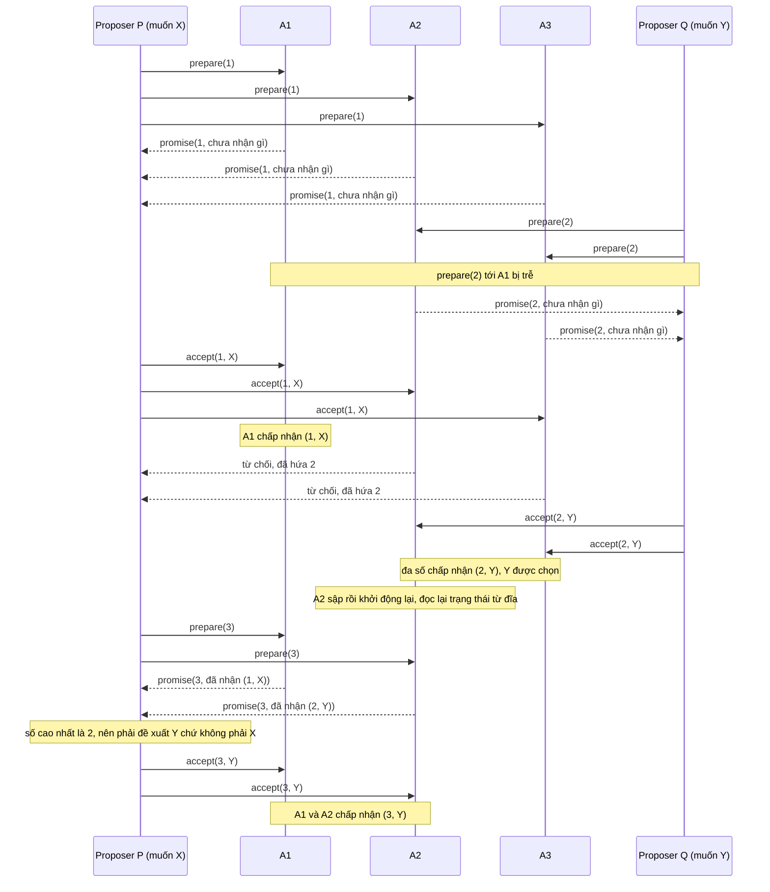

| Bước | Sự kiện | A1 | A2 | A3 | Ghi chú |
|---|---|---|---|---|---|
| 0 | khởi đầu | ⟨0, –⟩ | ⟨0, –⟩ | ⟨0, –⟩ | |
| 1 | P gửi `prepare(1)` tới cả ba; cả ba hứa | ⟨1, –⟩ | ⟨1, –⟩ | ⟨1, –⟩ | P có 3 lời hứa mà không ai báo gì, nên được tự chọn giá trị: X |
| 2 | Q gửi `prepare(2)` tới A2, A3 (tới A1 bị trễ); cả hai hứa | ⟨1, –⟩ | ⟨2, –⟩ | ⟨2, –⟩ | Q có 2 lời hứa, đủ đa số, không ai báo gì, nên tự chọn Y |
| 3 | P gửi `accept(1, X)` tới cả ba | ⟨1, (1,X)⟩ | ⟨2, –⟩ từ chối | ⟨2, –⟩ từ chối | chỉ A1 nhận: X được chấp nhận nhưng chưa được chọn |
| 4 | Q gửi `accept(2, Y)` tới A2, A3 | ⟨1, (1,X)⟩ | ⟨2, (2,Y)⟩ | ⟨2, (2,Y)⟩ | đa số {A2, A3} đã chấp nhận (2, Y): Y đã được chọn |
| 5 | A2 sập rồi khởi động lại, đọc lại từ đĩa | ⟨1, (1,X)⟩ | ⟨2, (2,Y)⟩ | ⟨2, (2,Y)⟩ | trạng thái giữ nguyên vì đã ghi bền |
| 6 | P gửi `prepare(3)` tới A1, A2; cả hai hứa và báo đề xuất đã nhận | ⟨3, (1,X)⟩ | ⟨3, (2,Y)⟩ | ⟨2, (2,Y)⟩ | A1 báo (1, X), A2 báo (2, Y): số cao nhất là 2, nên P phải đề xuất Y |
| 7 | P gửi `accept(3, Y)` tới A1, A2 | ⟨3, (3,Y)⟩ | ⟨3, (3,Y)⟩ | ⟨2, (2,Y)⟩ | mọi đề xuất đang được chấp nhận đều mang Y |

(Sơ đồ và bảng do người soạn dựng, bám theo quy tắc hai pha của Paxos Made Simple[^a-pms-phase1b][^a-pms-phase2a][^a-pms-phase2b]; không phải hình của bài báo. Trạng thái trong bảng được kiểm bằng test ở phần Đi sâu.)

Đọc vết chạy. Thứ nhất, ở bước 3–4, X được A1 chấp nhận nhưng *không bao giờ được chọn*: chấp nhận khác chọn. Thứ hai, Y được chọn ở bước 4 và, nếu các tin báo chấp nhận bị mất, có thể chưa ai ngoài các acceptor biết; Lamport nói rõ vì mất tin một giá trị có thể được chọn mà không learner nào hay[^a-pms-learn-loss]. Thứ ba, ở bước 6, P *không biết* Y đã được chọn; nó chỉ biết qua lời khai của acceptor. Trong cụm ba chỉ có ba đa số: {A1, A2}, {A1, A3}, {A2, A3}, và mỗi nhóm đều chứa ít nhất một acceptor đã chấp nhận (2, Y) (A2, A3, hoặc cả hai); nên dù P hỏi nhóm nào nó cũng không thể tránh nghe thấy Y. Thứ tư, đây là lý do lấy giá trị của đề xuất có *số cao nhất*: A1 báo (1, X), một đề xuất cũ chưa từng được chọn, còn A2 báo (2, Y). Chọn theo số cao nhất cho Y (đúng); chọn "báo cáo đến trước" có thể cho X (sai). Ví dụ năm acceptor ở phần Đi sâu cho thấy ngay cả "giá trị xuất hiện nhiều nhất" cũng sai. Cuối cùng, P muốn X nhưng bị buộc đề xuất Y; (suy luận của người soạn) trong Multi-Paxos, lệnh của client P sẽ phải thử lại ở một slot sau (mục 3).

Nếu `prepare(3)` của P tới A2, A3 *trước* `accept(2, Y)` của Q, hai acceptor đã hứa số 3 và bỏ qua `accept` số 2; Q lại phải bắt đầu pha 1 với số 4 và cứ thế: cùng kiểu kịch bản mà Lamport mô tả (người ta gọi là livelock)[^a-pms-livelock] ([chương 09, mục 6](09-consistency-va-consensus.md)).

*Khi một acceptor quên.* Giữ nguyên vết chạy, chỉ đổi bước 5: A2 khởi động lại nhưng đã mất sạch ⟨p, a⟩, vì đĩa hỏng hoặc vì nó trả lời trước khi ghi bền. Quy tắc ghi stable storage trước khi gửi[^a-pms-stable-write] nhằm ngăn trường hợp thứ hai (suy luận của người soạn); đĩa hỏng thật nằm ngoài giả định stable storage của Lamport và là chuyện của Paxos Made Live (mục 3).

| Bước | Sự kiện | A1 | A2 | A3 | Ghi chú |
|---|---|---|---|---|---|
| 5′ | A2 khởi động lại và mất sạch trạng thái | ⟨1, (1,X)⟩ | ⟨0, –⟩ | ⟨2, (2,Y)⟩ | Y vẫn đã được chọn bởi {A2, A3} |
| 6′ | P gửi `prepare(3)` tới A1, A2 | ⟨3, (1,X)⟩ | ⟨3, –⟩ | ⟨2, (2,Y)⟩ | A1 báo (1, X); A2 báo "chưa nhận gì"; P chỉ thấy X |
| 7′ | P gửi `accept(3, X)` tới A1, A2 | ⟨3, (3,X)⟩ | ⟨3, (3,X)⟩ | ⟨2, (2,Y)⟩ | {A1, A2} chấp nhận (3, X): X được chọn, trong khi {A2, A3} đã chọn (2, Y) |

(Phản ví dụ do người soạn dựng từ vết chạy trên; trạng thái ở các hàng này cũng được kiểm trong test `amnesiac_acceptor_lets_two_values_be_chosen`.)

Hai giá trị khác nhau cùng được chọn: vi phạm yêu cầu "chỉ một giá trị được chọn"[^a-pms-safety]. Theo ngôn ngữ của P2c, P đã phát (3, X) với S = {A1, A2}; P2c(b) đòi X là giá trị của đề xuất số cao nhất < 3 mà acceptor trong S đã chấp nhận, tức (2, Y) ở A2; nhưng A2 khai "chưa nhận gì" nên P2c bị phá. Giao điểm {A2} của hai đa số vẫn còn trên giấy, nhưng không còn hiệu lực: A2 sau khi quên hành xử như một acceptor mới tinh.

Quên riêng lời hứa cũng chết (người soạn dựng, kiểm bằng test `forgetting_only_the_promise_is_also_fatal`). P xong pha 1 với số 1; Q xong pha 1 với số 2 tại A2, A3 (cả hai chưa báo gì); rồi A2 khởi động lại và mất lời hứa số 2. `accept(1, X)` bị trễ của P tới A1 và A2: cả hai chấp nhận (A2 không còn lời hứa nào ngăn), nên X được chọn. Q, vốn tin rằng A2 và A3 sẽ không chấp nhận số < 2, tự do gửi `accept(2, Y)` tới A2, A3: cả hai chấp nhận, Y cũng được chọn. Vậy cả `promised` lẫn `accepted` đều phải bền.

(Nhận xét của người soạn) Lỗi này phụ thuộc lịch trình: nếu ở bước 6′ P hỏi {A1, A3} thay vì {A1, A2} thì A3 vẫn khai (2, Y) và mọi thứ vẫn đúng. Một lỗi chỉ lộ ra với một số lịch trình như vậy rất khó bắt bằng test thông thường; mục 3 cho thấy Google dùng test ngẫu nhiên có seed để đi tìm loại lỗi tinh vi như vậy, kể cả lỗi ở phần sửa cho đĩa hỏng.

Hệ quả vận hành, từ hai nguồn độc lập. Paxos Made Live: replica mất trạng thái bền có thể phản bội lời hứa đã đưa ra, và đó là vi phạm một giả định then chốt của Paxos[^a-pml-corrupt]; cách xử lý của họ là cho replica chạy như thành viên *không bỏ phiếu* cho tới khi quan sát được một instance Paxos hoàn chỉnh bắt đầu sau khi nó bắt đầu dựng lại trạng thái[^a-pml-nonvoting] (chi tiết ở mục 3). Luận án Raft: một server mất bất kỳ phần trạng thái bền nào không thể vào lại cụm một cách an toàn với danh tính cũ; thường có thể thêm lại như server mới qua thay đổi thành viên[^a-th-state]. (Nhận xét của người soạn) Cả hai là cùng một nguyên tắc: node chưa chứng minh được là còn nhớ thì không được tính vào quorum.

<details><summary>Đi sâu: acceptor bằng Rust và test của vết chạy; vì sao "số cao nhất" chứ không phải "giá trị phổ biến nhất"; proposer cũng phải nhớ</summary>

*Acceptor bằng Rust.* Mã dưới là máy trạng thái của *một* acceptor và hàm chọn giá trị của proposer (không có mạng và không có đĩa thật). Hai khối mã là hai nửa của cùng một file `acceptor.rs`. Người soạn đã ghép lại, biên dịch bằng rustc 1.95.0 và chạy; người review bổ sung assert trạng thái cho các bước 5, 5′ và 7′ cùng kết quả pha 1 của test thứ ba, rồi biên dịch lại bằng `rustc --edition 2024 --test -D warnings acceptor.rs` và chạy: cả 4 test qua (`durable_acceptor_forces_second_proposer_to_adopt_y`, `amnesiac_acceptor_lets_two_values_be_chosen`, `forgetting_only_the_promise_is_also_fatal`, `highest_number_wins_not_most_frequent_value`), không có cảnh báo biên dịch. Test khẳng định trạng thái từng acceptor sau mọi bước của hai bảng ở trên, nên bảng khớp với những gì mã làm.

```rust
//! Acceptor của single-decree Paxos (Paxos Made Simple, §2.2 và §2.5).
//! Chỉ là máy trạng thái của MỘT acceptor: không có mạng, không có đĩa thật.

/// Số đề xuất. Các proposer lấy số từ những tập rời nhau (P: lẻ, Q: chẵn);
/// số bắt đầu từ 1, nên 0 nghĩa là "chưa hứa gì".
pub type N = u32;
/// Giá trị đề xuất (chỉ để minh họa).
pub type V = &'static str;

/// Hai thứ PHẢI nằm trên stable storage: số `prepare` cao nhất đã trả lời
/// và đề xuất số cao nhất đã chấp nhận.
#[derive(Clone, Debug, Default, PartialEq, Eq)]
pub struct Acceptor {
    promised: N,
    accepted: Option<(N, V)>,
}

/// Trả lời pha 1b.
#[derive(Debug, PartialEq, Eq)]
pub enum Reply {
    /// Lời hứa không chấp nhận số nhỏ hơn n, kèm đề xuất số cao nhất đã nhận (nếu có).
    Promise(Option<(N, V)>),
    /// Bỏ qua yêu cầu; báo lại cho proposer chỉ là tối ưu hiệu năng (§2.2).
    Nack,
}

impl Acceptor {
    pub fn state(&self) -> (N, Option<(N, V)>) {
        (self.promised, self.accepted)
    }

    /// Pha 1b: chỉ trả lời khi n lớn hơn mọi `prepare` đã trả lời.
    pub fn on_prepare(&mut self, n: N) -> Reply {
        if n > self.promised {
            self.promised = n; // hệ thật: ghi bền (fsync) TRƯỚC khi trả lời
            Reply::Promise(self.accepted)
        } else {
            Reply::Nack
        }
    }

    /// Pha 2b: chấp nhận trừ khi đã trả lời một `prepare` có số lớn hơn n (P1a).
    pub fn on_accept(&mut self, n: N, v: V) -> bool {
        if n >= self.promised {
            // Nâng `promised` lên n để luôn có accepted.n <= promised: nhờ vậy
            // một `prepare(k)` được trả lời luôn có k > accepted.n.
            self.promised = n;
            self.accepted = Some((n, v)); // hệ thật: ghi bền TRƯỚC khi trả lời
            true
        } else {
            false
        }
    }
}

/// Pha 2a của proposer (điều kiện P2c): giá trị của đề xuất có SỐ cao nhất trong
/// các lời hứa của một đa số; nếu không ai báo đề xuất nào thì tự chọn `own`.
pub fn choose_value(promises: &[Option<(N, V)>], own: V) -> V {
    promises
        .iter()
        .flatten()
        .max_by_key(|(n, _)| *n)
        .map_or(own, |&(_, v)| v)
}
```

```rust
#[cfg(test)]
mod tests {
    use super::*;
    use std::collections::{BTreeMap, BTreeSet};

    /// Ba acceptor A1..A3 (chỉ số 0..2) cộng một "biến ma" ghi lại mọi lần accept
    /// thành công, để biết đề xuất nào đã được một đa số chấp nhận (= được chọn).
    /// Biến ma không thuộc thuật toán; nó chỉ để test quan sát.
    struct Cluster {
        acc: Vec<Acceptor>,
        accepts: BTreeMap<(N, V), BTreeSet<usize>>,
    }

    impl Cluster {
        fn new(n: usize) -> Self {
            Cluster { acc: vec![Acceptor::default(); n], accepts: BTreeMap::new() }
        }
        fn prepare(&mut self, i: usize, n: N) -> Reply {
            self.acc[i].on_prepare(n)
        }
        fn accept(&mut self, i: usize, n: N, v: V) -> bool {
            let ok = self.acc[i].on_accept(n, v);
            if ok {
                self.accepts.entry((n, v)).or_default().insert(i);
            }
            ok
        }
        fn chosen(&self) -> BTreeSet<V> {
            self.accepts
                .iter()
                .filter(|(_, who)| who.len() * 2 > self.acc.len())
                .map(|(&(_, v), _)| v)
                .collect()
        }
        fn states(&self) -> Vec<(N, Option<(N, V)>)> {
            self.acc.iter().map(Acceptor::state).collect()
        }
    }

    fn reports(rs: &[Reply]) -> Vec<Option<(N, V)>> {
        rs.iter()
            .map(|r| match r {
                Reply::Promise(a) => *a,
                Reply::Nack => panic!("không đủ lời hứa"),
            })
            .collect()
    }

    /// Vết chạy ở mục 2. `a2_keeps_state = false` mô phỏng A2 mất sạch trạng thái
    /// khi khởi động lại (đĩa hỏng, hoặc trả lời trước khi ghi bền).
    /// Trả về (cụm, giá trị P đề xuất ở n = 3).
    fn run_trace(a2_keeps_state: bool) -> (Cluster, V) {
        let (x, y) = ("X", "Y"); // giá trị mà client của P và của Q muốn
        let mut c = Cluster::new(3);
        assert_eq!(c.states(), [(0, None), (0, None), (0, None)]); // bước 0

        // Bước 1: P chạy pha 1 với n = 1 trên cả ba acceptor.
        for i in 0..3 {
            assert_eq!(c.prepare(i, 1), Reply::Promise(None));
        }
        assert_eq!(c.states(), [(1, None), (1, None), (1, None)]);

        // Bước 2: Q chạy pha 1 với n = 2; thông điệp tới A1 bị trễ.
        assert_eq!(c.prepare(1, 2), Reply::Promise(None));
        assert_eq!(c.prepare(2, 2), Reply::Promise(None));
        assert_eq!(c.states(), [(1, None), (2, None), (2, None)]);

        // Bước 3: P gửi accept(1, X) tới cả ba: chỉ A1 chấp nhận.
        assert!(c.accept(0, 1, x));
        assert!(!c.accept(1, 1, x));
        assert!(!c.accept(2, 1, x));
        assert_eq!(c.states(), [(1, Some((1, x))), (2, None), (2, None)]);
        assert!(c.chosen().is_empty()); // X được A1 chấp nhận nhưng chưa được chọn

        // Bước 4: Q gửi accept(2, Y) tới A2, A3: Y được chọn.
        assert!(c.accept(1, 2, y));
        assert!(c.accept(2, 2, y));
        assert_eq!(c.states(), [(1, Some((1, x))), (2, Some((2, y))), (2, Some((2, y)))]);
        assert_eq!(c.chosen(), BTreeSet::from([y]));

        // Bước 5: A2 khởi động lại.
        if !a2_keeps_state {
            c.acc[1] = Acceptor::default();
        }
        let a2_restarted = if a2_keeps_state { (2, Some((2, y))) } else { (0, None) };
        assert_eq!(c.states(), [(1, Some((1, x))), a2_restarted, (2, Some((2, y)))]);

        // Bước 6: P không biết Y đã được chọn, thử lại với n = 3 tới A1 và A2.
        let rs = [c.prepare(0, 3), c.prepare(1, 3)];
        let a2_report = if a2_keeps_state { Some((2, y)) } else { None };
        assert_eq!(rs, [Reply::Promise(Some((1, x))), Reply::Promise(a2_report)]);
        assert_eq!(
            c.states(),
            [(3, Some((1, x))), (3, a2_report), (2, Some((2, y)))]
        );
        let v = choose_value(&reports(&rs), x);

        // Bước 7: P gửi accept(3, v) tới A1 và A2.
        assert!(c.accept(0, 3, v));
        assert!(c.accept(1, 3, v));
        (c, v)
    }

    #[test]
    fn durable_acceptor_forces_second_proposer_to_adopt_y() {
        let (c, v) = run_trace(true);
        assert_eq!(v, "Y"); // P muốn X nhưng bị buộc đề xuất Y
        assert_eq!(
            c.states(),
            [(3, Some((3, "Y"))), (3, Some((3, "Y"))), (2, Some((2, "Y")))]
        );
        assert_eq!(c.chosen(), BTreeSet::from(["Y"])); // vẫn chỉ một giá trị
    }

    #[test]
    fn amnesiac_acceptor_lets_two_values_be_chosen() {
        let (c, v) = run_trace(false);
        assert_eq!(v, "X"); // P chỉ nghe thấy (1, X) từ A1; A2 "quên" (2, Y)
        assert_eq!(
            c.states(),
            [(3, Some((3, "X"))), (3, Some((3, "X"))), (2, Some((2, "Y")))]
        );
        assert_eq!(c.chosen(), BTreeSet::from(["X", "Y"])); // vi phạm Agreement
    }

    #[test]
    fn forgetting_only_the_promise_is_also_fatal() {
        let (x, y) = ("X", "Y");
        let mut c = Cluster::new(3);
        for i in 0..3 {
            assert_eq!(c.prepare(i, 1), Reply::Promise(None)); // P: pha 1 với n = 1
        }
        // Q: pha 1 với n = 2 tới A2, A3 (cả hai chưa báo gì).
        assert_eq!(c.prepare(1, 2), Reply::Promise(None));
        assert_eq!(c.prepare(2, 2), Reply::Promise(None));
        assert_eq!(c.states(), [(1, None), (2, None), (2, None)]);
        // A2 khởi động lại và mất lời hứa (đã trả lời mà chưa kịp ghi bền).
        c.acc[1] = Acceptor::default();
        // accept(1, X) trễ của P tới A1 và A2: cả hai chấp nhận -> X được chọn.
        assert!(c.accept(0, 1, x));
        assert!(c.accept(1, 1, x));
        assert_eq!(c.chosen(), BTreeSet::from(["X"]));
        // Q, tin rằng A2 và A3 sẽ không chấp nhận số < 2, gửi accept(2, Y).
        assert!(c.accept(1, 2, y));
        assert!(c.accept(2, 2, y));
        assert_eq!(c.chosen(), BTreeSet::from(["X", "Y"]));
    }

    #[test]
    fn highest_number_wins_not_most_frequent_value() {
        // Năm acceptor: (1, X) nằm ở hai acceptor nhưng chưa được chọn;
        // (2, Y) nằm ở một acceptor trong số ba acceptor đã chọn Y.
        let reports = [Some((1, "X")), Some((1, "X")), Some((2, "Y"))];
        assert_eq!(choose_value(&reports, "own"), "Y");
        assert_eq!(choose_value(&[None, None], "own"), "own");
    }
}
```

Ba điểm về mã. (1) `on_accept` đồng thời đặt `promised = n`. Lamport chỉ đòi acceptor chấp nhận trừ khi nó đã trả lời `prepare` có số lớn hơn n[^a-pms-phase2b]; việc nâng `promised` là lựa chọn của người soạn để luôn có `accepted.n <= promised`: nhờ vậy acceptor chỉ cần giữ *một* đề xuất (số cao nhất) mà mọi `prepare(k)` được trả lời đều có k lớn hơn số của đề xuất đó, đúng như pha 1b ngầm giả định. Nếu proposer chỉ gửi `accept` tới acceptor đã trả lời `prepare` của mình[^a-pms-accept-each] thì dòng này là no-op; nó chỉ có tác dụng khi `accept` tới một acceptor chưa từng nghe `prepare(n)` (suy luận của người soạn, ví dụ leader gửi `accept` cho cả những acceptor chưa trả lời pha 1). (2) Chú thích ghi bền trước khi trả lời trong mã là chỗ `fsync` thật sự nằm; cái giá của nó xem [P5 · Chương 06](../05-storage/06-durability-trong-thuc-te.md). (3) `Reply::Nack` chỉ để test rõ ràng; bài báo nói acceptor có thể bỏ qua mọi yêu cầu mà không ảnh hưởng an toàn[^a-pms-ignore], còn việc báo lại cho proposer là tối ưu hiệu năng, không ảnh hưởng tính đúng[^a-pms-inform].

*Vì sao "số cao nhất" mà không phải "giá trị phổ biến nhất" (người soạn dựng).* Năm acceptor A1…A5. P xong pha 1 với số 1 nhưng `accept(1, X)` chỉ tới A1 và A2 (tới A3–A5 bị mất): 2/5 không phải đa số nên X *chưa* được chọn. Q xong pha 1 với số 2 tại {A3, A4, A5} (A1, A2 chưa nghe `prepare(2)`): không ai báo gì nên Q tự chọn Y và `accept(2, Y)` được cả ba chấp nhận: Y đã được chọn. Trạng thái bây giờ: A1 và A2 là ⟨1, (1,X)⟩; A3, A4, A5 là ⟨2, (2,Y)⟩. Một proposer thứ ba R chạy pha 1 với số 3 tại {A1, A2, A3} và nhận báo cáo (1, X), (1, X), (2, Y). Nếu R chọn "giá trị xuất hiện nhiều nhất" thì chọn X (hai phiếu so với một), gửi `accept(3, X)` và cả ba acceptor chấp nhận (vì đã hứa số 3): X được chọn sau khi Y đã được chọn, hai giá trị. Chọn theo số cao nhất cho Y, đúng. Test `highest_number_wins_not_most_frequent_value` kiểm đúng ba báo cáo này cho hàm `choose_value` (kịch bản năm acceptor dựng bằng lời, không được test mô phỏng). Cốt lõi: chỉ đề xuất số cao nhất trong các báo cáo mới được bảo đảm mang giá trị đã chọn (bước 5 của chứng minh); đề xuất số thấp hơn có thể mang giá trị chưa từng được chọn.

*Proposer cũng phải nhớ.* Điều kiện hai đề xuất khác nhau có số khác nhau do proposer giữ: mỗi proposer lấy số từ một tập riêng và nhớ (trong stable storage) số cao nhất đã dùng, rồi bắt đầu pha 1 với số cao hơn mọi số đã dùng[^a-pms-unique]. Một cách chia tập số trong Paxos Made Live: gán mỗi replica một id i từ 0 đến n − 1[^a-pml-fn1], rồi mỗi replica chọn số s nhỏ nhất lớn hơn mọi số đã thấy sao cho s mod n = i[^a-pml-fn1b]. (Nhận xét của người soạn) Nếu proposer quên và dùng lại số n cho một giá trị khác thì chứng minh ở trên mất giả thiết số duy nhất; trong vết chạy này P dùng số lẻ, Q dùng số chẵn.

</details>

**Quay lại Q2:** Paxos an toàn vì pha 1 buộc mỗi đề xuất mới thỏa P2c (hoặc không acceptor nào trong một đa số S từng chấp nhận đề xuất số nhỏ hơn n, hoặc đề xuất mang giá trị của đề xuất số cao nhất mà acceptor trong S đã chấp nhận), và quy nạp theo số đề xuất cùng giao nhau của hai đa số biến điều đó thành "chỉ một giá trị được chọn"; điều kiện này chỉ đúng khi mỗi acceptor nhớ cả lời hứa lẫn đề xuất đã nhận qua mọi lần khởi động lại.

## 3. Multi-Paxos và từ thuật toán ra hệ thống: Paxos Made Live (Q3)

> **Trả lời ngắn.** Multi-Paxos chạy một lần Paxos riêng cho mỗi ô (slot) của log[^a-pms-seq]; nhờ một leader ổn định chạy pha 1 một lần cho mọi ô tương lai[^a-pms-inf-phase1], chi phí hiệu dụng của mỗi lệnh chỉ là pha 2[^a-pms-cost], còn leader mới lấp các lỗ hổng trong log bằng lệnh no-op[^a-pms-noop]. Leader có thể đọc cục bộ nhờ lease[^a-pml-lease-sem], đổi lại phải giả định độ trôi đồng hồ có chặn (theo luận án Raft, cho cách đọc dựa trên lease)[^a-th-lease-assume]. Nhưng đưa thuật toán thành hệ thống thật (cơ sở dữ liệu nhân bản cho Chubby, dịch vụ khóa phân tán của Google[^a-pml-chubby]) cần thêm nhiều việc mà mô tả thuật toán không bao quát; chính các tác giả kết luận có khoảng cách đáng kể giữa mô tả thuật toán Paxos và nhu cầu của hệ thống thật[^a-pml-gap].

**Giải thích.**

Hình dung (nhận xét của người soạn): một cuốn sổ đánh số dòng, mỗi dòng cần một cuộc biểu quyết riêng (một instance Paxos). Có một thư ký duy nhất được phép đề xuất nội dung các dòng; thư ký xin quyền một lần cho *mọi dòng chưa viết*, rồi mỗi dòng chỉ cần một vòng "chốt". Thư ký có thể đặt trước nhiều dòng liền nhau mà chưa biết dòng trước đã chốt chưa; nếu thư ký đột tử giữa chừng sẽ còn những dòng đặt trước dở dang. Người kế nhiệm phải chốt từng dòng dở dang ấy (đúng nội dung nếu đã có người ghi, hoặc điền "bỏ trống") rồi mới đọc và áp dụng được các dòng sau.

*Ô (slot) và instance.* Multi-Paxos là một chuỗi các instance Paxos riêng biệt, giá trị được chọn ở instance thứ i là lệnh thứ i của state machine ([chương 09, mục 4](09-consistency-va-consensus.md) nói về state machine replication)[^a-pms-seq]. Paxos Made Live cũng gọi mỗi lần chạy là một instance[^a-pml-instance]; Flexible Paxos gọi mỗi giá trị trong chuỗi cần đồng thuận là một slot, và slot thứ i do instance Paxos thứ i quyết định[^a-fpx-slots]. Nếu nhiều server cùng tưởng mình là leader, họ có thể cùng đề xuất ở một instance và làm không giá trị nào được chọn, nhưng an toàn vẫn giữ: không hai server nào bất đồng về giá trị của lệnh thứ i, và bầu một leader chỉ cần cho tiến triển[^a-pms-multi-leaders]. Bài giảng Cambridge nói gọn: Paxos nguyên bản chỉ cho consensus một giá trị, Multi-Paxos là tổng quát hóa cho total order broadcast FIFO[^a-kl-multipaxos].

*Leader ổn định chạy pha 1 một lần cho mọi slot.* Chìa khóa hiệu quả: giá trị đề xuất chưa được chọn cho tới pha 2[^a-pms-key-eff]; pha 1 độc lập với giá trị nên chạy trước được và gộp được cho nhiều slot[^a-fpx-phase1-agg]. Leader mới chạy pha 1 cho *vô hạn* instance bằng một thông điệp ngắn dùng cùng một số đề xuất[^a-pms-inf-phase1]; ở pha 1, acceptor chỉ trả lời nhiều hơn một xác nhận đơn giản (OK) nếu nó đã nhận thông điệp pha 2 của một proposer nào đó[^a-pms-short-reply]. Lamport kỳ vọng việc leader hỏng và bầu leader mới là hiếm, nên chi phí hiệu dụng của một lệnh chỉ là pha 2[^a-pms-cost]. (Suy luận của người soạn: về dữ liệu, acceptor chỉ cần *một* số `promised` chung cho mọi slot cộng một bảng `accepted` theo từng slot; đó là hệ quả của việc dùng cùng một số đề xuất cho mọi instance.)

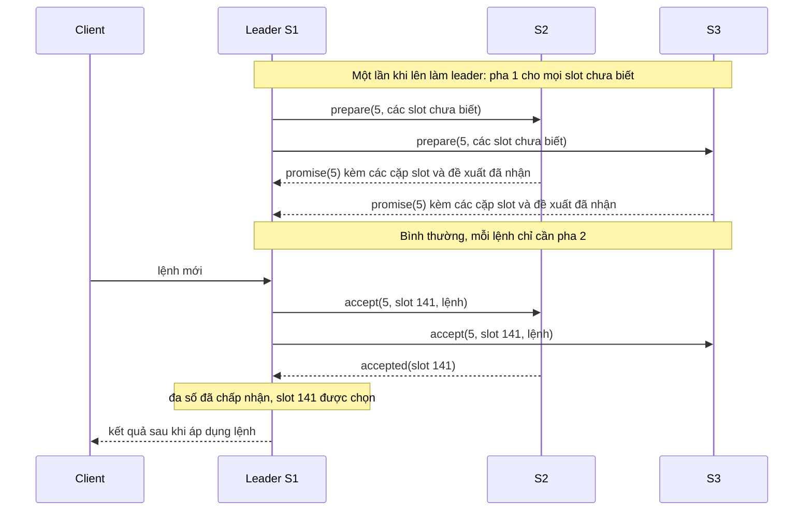

(Sơ đồ do người soạn dựng từ mô tả của Paxos Made Simple §3[^a-pms-inf-phase1][^a-pms-141]; số 5 và slot 135, 141 lấy từ ví dụ ở bảng dưới.)

Paxos Made Live nói cùng điều bằng thuật ngữ của họ, trong đó yêu cầu pha 1 gọi là `propose` và câu trả lời là `promise`[^a-pml-propose-promise]; thông điệp `propose` có thể bỏ qua nếu danh tính coordinator không đổi giữa các instance, không phá tính chất Paxos vì bất kỳ replica nào vẫn có thể thử làm coordinator bằng thông điệp mang số cao hơn[^a-pml-omit-propose]. Họ gọi coordinator được giữ lâu dài là *master*[^a-pml-master]. Về đĩa, Paxos như bài báo mô tả đến đây (chưa tối ưu) đòi mọi bên gửi *ghi trạng thái trước khi gửi tin*, tức năm lần ghi (propose, promise, accept, acknowledgment, commit) nằm trên đường găng[^a-pml-five-writes], mỗi lần phải flush ngay, nên thời gian flush có thể thống trị độ trễ khi các replica ở gần nhau[^a-pml-flush]; với tối ưu này chỉ còn một lần ghi đĩa cho mỗi instance trên mỗi replica, chạy song song[^a-pml-one-write]. Trong hệ có tải, dưới một phần trăm instance chạy Paxos đầy đủ[^a-pml-1pct]. (Nhận xét của người soạn) Cái giá về an toàn nằm ở chỗ khác: mỗi lần ghi đó vẫn phải bền thật, như mục 2 đã chỉ ra.

*Đổi leader: pha 1 cho cả đoạn đuôi, rồi nối tiếp hoặc no-op.* Kịch bản của Lamport: leader cũ vừa hỏng, leader mới được chọn. Leader mới, vốn là learner của mọi instance, nên biết hầu hết các lệnh đã chọn[^a-pms-learner-all]; giả sử nó biết các lệnh 1–134, 138 và 139[^a-pms-known]. Khoảng trống như 135–137 xuất hiện khi leader đề xuất trước nhiều lệnh mà chưa biết lệnh trước đã được chọn, rồi hỏng giữa chừng; leader có thể đề xuất trước α lệnh nên khoảng trống tối đa là α − 1[^a-pms-alpha]. Leader mới chạy pha 1 cho các instance 135–137 và mọi instance sau 139[^a-pms-gap-phase1]. Giả sử kết quả buộc giá trị ở instance 135 và 140 nhưng để tự do mọi instance còn lại; leader chạy pha 2 cho 135 và 140, thế là chọn được hai lệnh đó[^a-pms-gap-outcome]. Leader không thể thực thi lệnh 138–140 dù biết chúng, vì lệnh 136 và 137 chưa được chọn[^a-pms-cannot-exec]; nên nó lấp lỗ ngay bằng lệnh `noop` không đổi trạng thái[^a-pms-noop], bằng pha 2 của instance 136 và 137[^a-pms-noop-phase2]. Lệnh client kế tiếp được gán số 141[^a-pms-141].

| Slot | 135 | 136 | 137 | 138 | 139 | 140 | 141 |
|---|---|---|---|---|---|---|---|
| S1 (leader mới), trước khi lên | – | – | – | (4, v138), đã biết là đã chọn | (4, v139), đã biết là đã chọn | – | – |
| S2 | (4, v135) | – | – | (4, v138) | (4, v139) | (4, v140) | – |
| S3 | – | – | – | (4, v138) | (4, v139) | – | – |
| Pha 1 của số 5 (đa số {S1, S2}) báo | ràng buộc: v135 | trống | trống | đã biết | đã biết | ràng buộc: v140 | trống |
| S1 gửi pha 2 (số 5) | `accept(5, v135)` | `accept(5, noop)` | `accept(5, noop)` | không cần | không cần | `accept(5, v140)` | `accept(5, lệnh client mới)` |

(Bảng log-state do người soạn dựng để minh họa kịch bản của Lamport; Lamport chỉ nêu S1 biết gì và slot nào bị ràng buộc, nên cột nào S2, S3 giữ gì, số 4 của leader cũ và số 5 của leader mới là giả định của người soạn. Ký hiệu (4, v135) là đề xuất số 4 mang giá trị v135.)

Điều đáng nhớ (người soạn): no-op chỉ được đặt ở slot mà pha 1 *không ràng buộc* (136, 137). Nếu một acceptor trong đa số đã báo giá trị ở slot 136 thì leader phải đề xuất lại đúng giá trị đó, theo luật P2c ở mục 2, vì giá trị ấy có thể đã được chọn; leader không được tự ý thay bằng no-op.

Luận án Raft đặt cùng hành vi cạnh Raft: leader mới của Paxos chạy hai pha của single-decree Paxos cho từng entry chưa commit mà nó thấy, đánh số lại bằng số đề xuất hiện tại; việc này hoặc commit giá trị cục bộ hoặc phát hiện giá trị đã commit[^a-th-paxos-newleader]. Multi-Paxos truyền thống cho phép chấp nhận và commit theo thứ tự bất kỳ nhưng vẫn phải áp dụng theo thứ tự, nên lợi thế hiệu năng không đáng kể[^a-th-order]. Luận án coi log có "lỗ" là thiếu cấu trúc[^a-th-holes], còn Raft được thiết kế để cấm lỗ[^a-th-noholes].

*Đọc cục bộ nhờ lease.* Nếu mọi lần đọc đều chạy một instance Paxos thì đắt; nhưng đọc thẳng từ bản sao của master thì có nguy cơ trả dữ liệu cũ, vì replica khác có thể đã bầu master mới và sửa dữ liệu mà không báo cho master cũ[^a-pml-read-stale]. Cách của Google là *master lease* với ngữ nghĩa: khi master còn lease thì replica khác không thể nộp giá trị thành công vào Paxos, nên master phục vụ đọc hoàn toàn cục bộ được[^a-pml-lease-sem]. Cài đặt: mọi replica ngầm cấp lease cho master của instance Paxos trước đó và từ chối xử lý thông điệp Paxos của replica khác trong lúc lease còn hiệu lực; master dùng timeout lease ngắn hơn replica để chống lệch đồng hồ; master định kỳ nộp một giá trị heartbeat giả vào Paxos để gia hạn[^a-pml-lease-impl]. Kết quả họ ghi nhận: master giữ lease vài ngày liền[^a-pml-lease-days], và đọc được xử lý hoàn toàn trên master (thường đang giữ lease), không đụng tới thuật toán Paxos[^a-pml-reads-nopaxos].

Luận án Raft mô tả cùng ý cho leader Raft: khi heartbeat được đa số xác nhận, leader cho rằng không server nào khác thành leader trong khoảng một election timeout và trả lời đọc mà không cần liên lạc thêm[^a-th-lease]. Điều kiện: có một chặn trên về độ trôi đồng hồ giữa các server; duy trì chặn này có thể khó vận hành (tạm dừng do lập lịch hoặc GC, di chuyển VM, chỉnh tốc độ đồng hồ khi đồng bộ thời gian), và nếu giả định bị vi phạm thì hệ có thể trả thông tin cũ tùy ý[^a-th-lease-assume]. Đây là phương án thiết kế trong luận án: LogCabin không cài đặt nó và tác giả không khuyến nghị dùng trừ khi cần để đạt yêu cầu hiệu năng[^a-th-lease-norec]; cách trao đổi heartbeat trước khi đọc (ReadIndex, [chương 09, mục 7](09-consistency-va-consensus.md)) giữ linearizability trong mô hình bất đồng bộ, nơi đồng hồ, bộ xử lý và tin nhắn chạy với tốc độ tùy ý[^a-th-async-read].

(Nhận xét của người soạn) Lease đổi giao-nhau-theo-thông-điệp ("hỏi đa số trước khi đọc") lấy giao-nhau-theo-thời-gian: trong khoảng lease, các replica đã *hứa* không xử lý thông điệp Paxos của ai khác, giống lời hứa ở pha 1 nhưng có hạn dùng. Đây là chỗ duy nhất ở mục này mà an toàn phụ thuộc đồng hồ, khác với phần còn lại của Paxos vốn giữ an toàn bất kể thời gian[^a-kl-safety-live]. Master bị tạm dừng lâu hơn lease rồi đọc tiếp là kịch bản kinh điển của [chương 08](08-su-co-he-phan-tan.md); biện pháp phía ghi là epoch number ở dưới.

*Từ thuật toán ra hệ thống.* Paxos có thể mô tả bằng một trang mã giả, nhưng cài đặt hoàn chỉnh của Google gồm vài nghìn dòng C++[^a-pml-thousands]. Cộng đồng thuật toán chịu lỗi quen chứng minh các thuật toán ngắn, cách đó không scale tới hệ thống hàng nghìn dòng[^a-pml-proofs-scale]; thuật toán chịu một tập lỗi hạn chế được chọn kỹ[^a-pml-limited-faults], còn thế giới thật phơi phần mềm ra nhiều kiểu lỗi hơn, kể cả lỗi thuật toán[^a-pml-realworld]. Chubby là dịch vụ khóa phân tán của Google, lưu các file nhỏ[^a-pml-chubby]; phiên bản đầu của nó dựa trên một cơ sở dữ liệu chịu lỗi thương mại của bên thứ ba mà bài báo gọi là 3DB[^a-pml-3db]. Các mảng việc dưới đây là những thứ họ nêu riêng.

**Đĩa hỏng và lời hứa bị quên.** Replica mất trạng thái bền có thể phản bội lời hứa đã đưa ra, vi phạm giả định then chốt của Paxos[^a-pml-corrupt]; đó chính là phản ví dụ ở mục 2. Google phát hiện đĩa hỏng bằng hai cách: lưu checksum nội dung mỗi file để phát hiện file đổi nội dung[^a-pml-checksum], và để một replica mới ghi một marker lên GFS sau khi khởi động, nên replica khởi động lại với đĩa trống sẽ thấy marker và biết đĩa mình đã hỏng[^a-pml-marker]. Replica đĩa hỏng dựng lại trạng thái như một *thành viên không bỏ phiếu*: dùng cơ chế catch-up nhưng không trả lời promise hay acknowledgment, cho tới khi quan sát được một instance Paxos hoàn chỉnh bắt đầu sau khi nó bắt đầu dựng lại, để chắc chắn nó không thể đã phản bội lời hứa cũ[^a-pml-nonvoting].

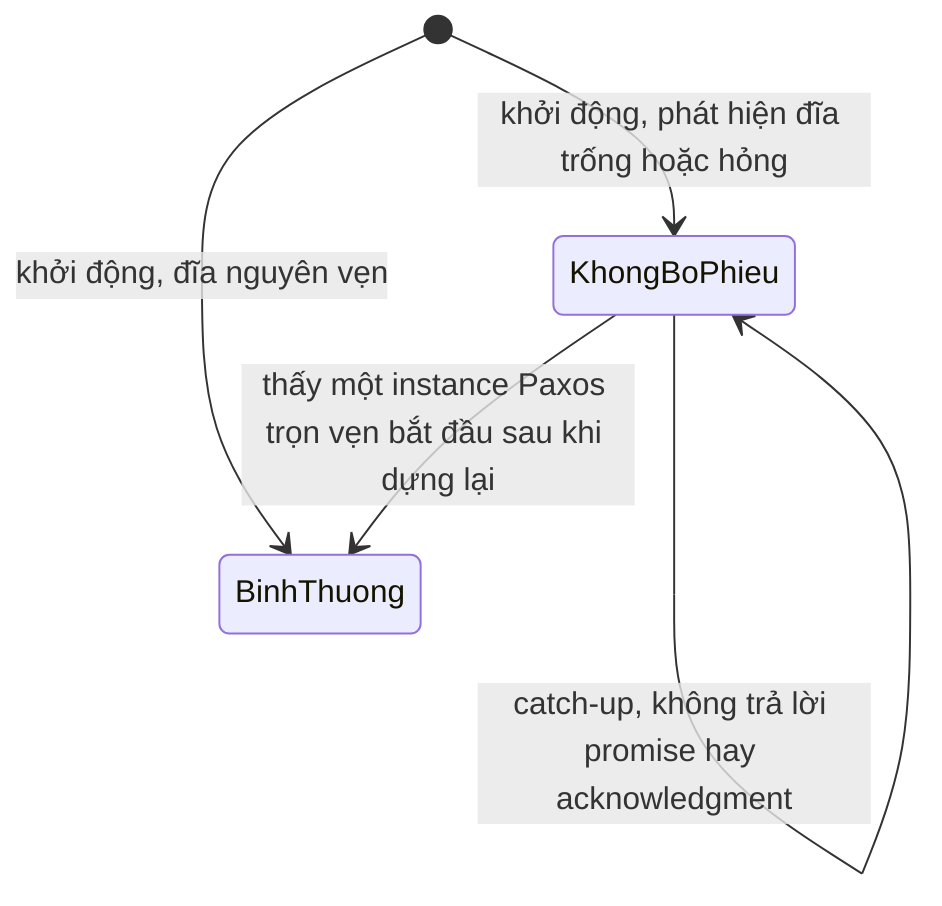

(Sơ đồ do người soạn vẽ lại từ mô tả ở Paxos Made Live §5.1[^a-pml-nonvoting].) Họ nêu giới hạn của chính mình: cơ chế *không* phát hiện được file bị lùi về trạng thái cũ, và họ tin đó là kịch bản hiếm nên không xử lý rõ ràng, nhưng cho rằng cơ chế checksum phân tán mô tả ở phần sau có thể phát hiện kiểu lỗi này[^a-pml-rollback]. (Nhận xét của người soạn) File lùi về bản cũ chính là kiểu quên một phần ở mục 2, và restore một bản backup cũ vào replica đang chạy là kịch bản vận hành tương ứng. Họ cũng cân nhắc nhưng *chưa cài đặt* việc bỏ bớt flush ra đĩa nhờ chịu được đĩa hỏng đôi khi[^a-pml-noflush]; chú thích của bài báo nêu một ví dụ về hoàn cảnh cho phép làm vậy: nếu hệ điều hành và phần cứng của mỗi replica hiếm hỏng và các replica hỏng độc lập với nhau thì có thể sửa hệ thống để không cần flush ra đĩa[^a-pml-noflush-fn].

**Master lease và churn.** Tối ưu "master ổn định" có một vấn đề ổn định khi mạng chập chờn. Master cũ bị ngắt mạng, nếu nối được với một replica khác thì có thể tăng số thứ tự của nó[^a-pml-churn0]; khi nối lại, nó có thể có số cao hơn master mới và thay thế được master mới; rồi lại ngắt, vòng lặp lặp lại[^a-pml-churn]. Cách chữa của họ: master định kỳ nâng số của mình bằng một vòng Paxos đầy đủ[^a-pml-boost]; nâng với tần suất phù hợp tránh được phần lớn churn[^a-pml-boost2]. Họ cũng xét lease cho mọi replica nhưng chưa cài đặt[^a-pml-replica-lease].

**Epoch number.** Chubby đòi một yêu cầu phải bị hủy nếu mastership bị mất và/hoặc giành lại trong lúc xử lý; cần một cơ chế phát hiện master đổi tay một cách đáng tin[^a-pml-epoch-need]. Giải pháp là một *epoch number* toàn cục: hai lần hỏi epoch tại master cho cùng một giá trị khi và chỉ khi replica đó là master liên tục trong khoảng giữa hai lần hỏi; epoch được lưu như một entry trong database và mọi thao tác database đều có điều kiện theo giá trị epoch[^a-pml-epoch-def]. Họ cài điều kiện này bằng primitive `MultiOp` của database, một thao tác được áp dụng nguyên tử và có thành phần đầu tiên là danh sách phép kiểm tra gọi là guard[^a-pml-multiop]; sau khi đưa epoch vào database như một entry, họ sửa mọi lời gọi database trước đó để thêm một guard kiểm epoch[^a-pml-epoch-guard]. Đây là một biến thể của fencing token (nhận xét của người soạn, xem [chương 08, mục 8](08-su-co-he-phan-tan.md)): token là epoch, và việc kiểm token nằm *bên trong* state machine được sao chép nên nguyên tử với thao tác ghi. Nó được thêm muộn: họ nhận ra mình cần epoch khi đã cài xong database và `MultiOp`[^a-pml-epoch-late]. Mục sự cố của bài báo kể một lần ngữ nghĩa database lệch với điều Chubby mong đợi: Chubby mong thao tác phải hỏng nếu database mất vai master[^a-pml-epoch-surprise], trong khi hệ của họ có thể cài lại một replica làm master giữa chừng và thao tác vẫn thành công; cách sửa là làm lại đáng kể tầng tích hợp, trong đó phải cài epoch number[^a-pml-epoch-rework].

**Thành viên nhóm.** Lamport đặt tập server trong chính *trạng thái của state machine* và đổi bằng lệnh thường[^a-pms-config]; cho leader đi trước α lệnh bằng cách để tập server chạy instance i + α do trạng thái sau lệnh thứ i quyết định[^a-pms-config-alpha]. Google viết rằng với core Paxos thì đơn giản, nhưng chi tiết không tầm thường khi thêm Multi-Paxos và đĩa hỏng, và tài liệu không chứng minh tính đúng đắn của thay đổi thành viên bằng Paxos, nên họ phải tự điền khoảng trống[^a-pml-member]. Một quyết định thiết kế bị đảo: ban đầu replica đại khái đi qua ba trạng thái (chờ vào nhóm, trong nhóm, rời nhóm) và đã rời thì không được vào lại[^a-pml-member-3states], vì họ nghĩ replica chập chờn không nên làm phiền nhóm lâu[^a-pml-member-reason]; nhưng lỗi chập chờn hóa ra phổ biến hơn dự kiến[^a-pml-member-change], nên đổi sang hai trạng thái: replica hoặc ở trong nhóm hoặc ở ngoài, và có thể chuyển qua lại giữa hai trạng thái đó nhiều lần trong vòng đời hệ thống[^a-pml-member-2states]. Đổi thuật toán mất khoảng một giờ nhưng sửa test mất ba ngày[^a-pml-member-cost].

**Snapshot.** Log sao chép sẽ ngày càng lớn: cần dung lượng đĩa không có giới hạn và, có lẽ tệ hơn, có thể dẫn đến thời gian phục hồi không có giới hạn vì replica phục hồi phải replay một log có thể rất dài[^a-pml-snap-need]. Framework Paxos không biết gì về cấu trúc dữ liệu cần sao chép nên *ứng dụng* chịu trách nhiệm snapshot[^a-pml-snap-app]; khi được báo có snapshot, framework cắt các entry của log đứng trước nó[^a-pml-snap-trunc]. Snapshot không đồng bộ giữa các replica, mỗi replica tự quyết định[^a-pml-snap-indep]. Một *snapshot handle* chứa số instance Paxos tương ứng và thành viên nhóm tại thời điểm đó[^a-pml-snap-handle]; framework chỉ cắt log khi đã được báo snapshot và nhận handle[^a-pml-snap-fail], nên ứng dụng có thể kiểm tra tính toàn vẹn rồi bỏ snapshot hỏng[^a-pml-snap-verify]. Replica tụt hậu mà không replica nào có sẵn log đủ cũ thì được bảo lấy snapshot từ replica khác[^a-pml-snap-catchup].

**Kiểm thử.** Với trình độ kỹ thuật thời bài báo (2007), họ coi việc chứng minh tính đúng đắn của một hệ thống thật như hệ của họ là phi thực tế; giải pháp thực tế tốt nhất, cùng kỹ thuật phần mềm cẩn thận, là kiểm thử kỹ[^a-pml-unrealistic]. Thuật toán lõi được viết thành hai máy trạng thái tường minh bằng một ngôn ngữ đặc tả riêng, có trình biên dịch sang C++[^a-pml-dsl]. Một trong hai test của họ mô phỏng một cụm replica trải qua chuỗi lỗi ngẫu nhiên[^a-pml-test-sim]; lịch lỗi do một bộ sinh số ngẫu nhiên có seed quyết định[^a-pml-test-seed], và test chạy đơn luồng để hai lần chạy cùng seed giống hệt nhau[^a-pml-test-single]. Cả hai test có hai chế độ: *safety* (chỉ cần nhất quán, không cần tiến triển)[^a-pml-safety-mode]; chạy safety có tiêm lỗi một lúc, rồi ngừng tiêm, cho hệ phục hồi và chuyển sang *liveness*[^a-pml-test-start]. Test mô phỏng log chịu lỗi tìm được các lỗi giao thức tinh vi, gồm cả lỗi ở cài đặt thành viên nhóm và ở phần sửa cho đĩa hỏng[^a-pml-test-found]; chạy trên hàng trăm máy tìm thêm lỗi, có lỗi cần hàng tuần thời gian mô phỏng ở tỉ lệ lỗi cực cao[^a-pml-test-farm]. (Nhận xét của người soạn) Đặc tả hình thức như [Paxos.tla ở P13 · Chương 08](../13-tla-plus/08-dac-ta-giao-thuc-phan-tan.md) kiểm *thuật toán*, còn kiểu test ngẫu nhiên có seed này kiểm *cài đặt*; hai việc bổ sung nhau chứ không thay nhau.

**Sự cố thật.** Bài báo ghi lại những sự cố bất ngờ trong hơn 100 machine-year chạy thật[^a-pml-100my]. Bản phát hành đầu có số worker thread gấp mười lần Chubby gốc[^a-pml-threads]; dưới tải, các thread đó làm đói thread quan trọng khác và hệ timeout thường xuyên[^a-pml-starve], gây master failover nhanh, rồi hàng loạt client dồn sang master mới làm nó quá tải, rồi failover tiếp[^a-pml-failover-storm]. Để đề phòng, họ rollback một data center về phiên bản Chubby cũ[^a-pml-rollback-3db]; trong lần rollback đó một snapshot cũ bị dùng nhầm: mất 15 giờ dữ liệu và một số dataset quan trọng phải dựng lại[^a-pml-oldsnap]. Trên Linux 2.4 của họ, việc flush một file nhỏ có thể treo lâu nếu có nhiều ghi đệm sang file khác[^a-pml-linux-hang]; cách né là ghi file lớn theo từng khúc nhỏ, flush sau mỗi khúc[^a-pml-linux-fix]. Về kiểm tra lúc chạy: master định kỳ gửi yêu cầu checksum vào log database[^a-pml-checksum-req], và vì log Paxos tuần tự hóa mọi thao tác như nhau trên mọi replica nên họ kỳ vọng mọi replica tính ra cùng checksum[^a-pml-checksum-db]. (Nhận xét của người soạn) Mẫu này, dùng chính log đã đồng thuận làm điểm so sánh, đáng cân nhắc cho mọi hệ state machine replication. Một bẫy khác: hệ chịu lỗi vốn tìm cách che giấu vấn đề, nên có thể che giấu cả bug lẫn lỗi cấu hình trong lúc âm thầm giảm khả năng chịu lỗi của chính nó[^a-pml-mask]. Họ từng khởi động hệ năm replica nhưng đánh sai tên một replica trong nhóm ban đầu, và hệ trông vẫn chạy đúng[^a-pml-misspell]; nhưng với cấu hình đó chỉ chịu được một replica hỏng chứ không phải hai[^a-pml-one-of-two].

*Khoảng cách giữa thuật toán và hệ thống.* Kết luận của chính tác giả: có khoảng cách đáng kể giữa mô tả thuật toán Paxos và nhu cầu của một hệ thống thật; muốn xây phải dùng nhiều ý tưởng rải rác trong tài liệu và thêm vài mở rộng giao thức nhỏ, nỗ lực cộng dồn là đáng kể và hệ thống cuối cùng dựa trên một giao thức chưa được chứng minh[^a-pml-gap]. Luận án Raft trích lại câu đầu của đoạn này[^a-th-quotes-pml], nói thêm rằng chưa có thuật toán Multi-Paxos nào được thừa nhận rộng rãi[^a-th-nobody-agreed], và hệ thống thật ít giống Paxos: mỗi cài đặt bắt đầu từ Paxos, gặp khó khăn rồi phát triển một kiến trúc khác hẳn[^a-th-little-resemblance]; luận án dẫn lời một lập trình viên Spanner rằng cài đặt Paxos của họ gần Raft hơn gần bài báo Paxos[^a-th-spanner]. (Nhận xét của người soạn) Bài học thực hành: đừng coi Paxos hay Raft là một thư viện đóng gói sẵn; phần đĩa, lease, thành viên, snapshot và kiểm thử mới là phần quyết định hệ thống có an toàn trong vận hành.

<details><summary>Đi sâu: vì sao lease và epoch là hai việc khác nhau, kiểm tra lúc chạy, và hạn chế của chính bài báo</summary>

- *Lease và epoch xử lý hai phía khác nhau.* Lease cho phép master đọc cục bộ mà không hỏi ai; epoch cho phép state machine từ chối một *ghi* nếu mastership đã đổi tay giữa lúc nhận và lúc áp dụng (người soạn tách ý từ §5.2 và §5.3[^a-pml-lease-sem][^a-pml-epoch-def]). (Suy luận của người soạn) Master chỉ có lease thì đọc đúng, nhưng một ghi dở dang qua một lần mất rồi giành lại master vẫn có thể thành công; đó đúng là lỗi ngữ nghĩa họ gặp ở mục Sự cố thật[^a-pml-epoch-surprise].
- *Ba sự cố nhất quán database.* Họ báo ba sự cố trong đó một replica khác các replica còn lại[^a-pml-incidents-three]. Sự cố đầu do lỗi vận hành[^a-pml-incident1]; sự cố thứ hai chưa tìm ra lời giải thích, replay log của replica lỗi thì thấy nó nhất quán với các replica khác, nên có thể do hỏng bộ nhớ phần cứng ngẫu nhiên[^a-pml-incident2]; sự cố thứ ba được nghi là do truy cập bộ nhớ bất hợp lệ từ mã chạy sai trong codebase được kèm theo, vốn khá lớn[^a-pml-incident3]. Với sự cố do hỏng bộ nhớ, nhờ hệ ghi log và giữ log cùng snapshot của nhiều ngày, họ replay được database tới đúng điểm lỗi xuất hiện[^a-pml-replay].
- *Hạn chế của kiểm thử có seed.* Họ ghi nhận chính mình: khi sản phẩm lớn, nhiều hệ con phải đồng thời hơn dự định và họ phải hy sinh tính lặp lại[^a-pml-concurrency]; Chubby đa luồng ở lõi nên không chạy được test lặp lại trên toàn hệ thống[^a-pml-chubby-mt]. Họ cũng cài các hook để mô phỏng replica sập, ngắt kết nối hoặc giả vờ không còn là master[^a-pml-hooks].
- *Ghi chú về flush ra đĩa.* Cách né của họ, ghi file lớn theo từng khúc nhỏ rồi flush sau mỗi khúc[^a-pml-linux-fix], và việc chưa cài tối ưu bỏ flush[^a-pml-noflush] cùng chỉ một hướng: đường ghi log là đường găng của cả hệ (nhận xét của người soạn, xem [P5 · Chương 06](../05-storage/06-durability-trong-thuc-te.md)); đừng để một việc ghi lớn không liên quan chen vào cùng đĩa (nhận xét của người soạn).

</details>

**Quay lại Q3:** Multi-Paxos là chuỗi các instance Paxos, trong đó một leader ổn định chạy pha 1 một lần cho mọi slot tương lai và leader mới lấp lỗ hổng bằng no-op ở các slot mà pha 1 không ràng buộc; còn muốn thành hệ thống thật thì phải thêm xử lý đĩa hỏng, lease và epoch cho đọc/ghi đúng, thành viên, snapshot và một chế độ kiểm thử đủ mạnh, vì phần đó mới là chỗ khoảng cách giữa bài báo thuật toán và vận hành lộ ra.

## 4. Vì sao Raft an toàn: chứng minh Leader Completeness, Hình 8 từng bước và ba biến phải bền (Q4)

> **Trả lời ngắn.** Raft bảo đảm rằng entry nào đã committed ở term T thì có mặt trong log của leader ở mọi term sau T (Leader Completeness)[^b-lc-def]. Chứng minh là một phản chứng xoay quanh một "cử tri" vừa lưu entry ấy vừa bỏ phiếu cho leader mới: luật chỉ bầu ứng viên có log đủ mới khiến cử tri này không thể bầu một ứng viên thiếu entry[^b-step2][^b-vote-rule]. Hình 8 cho thấy "nằm trên đa số" chưa đủ để coi một entry của term cũ là committed, nên Raft chỉ commit bằng cách đếm bản sao với entry thuộc term hiện tại[^b-prior-rule]; và cả lập luận chỉ đứng vững nếu mỗi server nhớ được `currentTerm`, `votedFor`, `log` qua lần khởi động lại[^b-persist-why].

**Giải thích.**

Hình dung (nhận xét của người soạn): một hội đồng chỉ coi nghị quyết là "đã chốt" khi quá nửa thành viên đã ghi nó vào sổ, và chủ tịch nhiệm kỳ sau cũng phải được quá nửa thành viên bầu. Hai nhóm "quá nửa" luôn có ít nhất một người chung; người ấy vừa có nghị quyết trong sổ, vừa là người đi bỏ phiếu, và nếu quy ước "không bầu người có sổ cũ hơn sổ của mình" được giữ thì người ấy không bao giờ bầu một ứng viên thiếu nghị quyết. Chứng minh dưới đây chỉ là cách viết chặt ý đó.

*Những mảnh đã có.* [Chương 09, mục 7](09-consistency-va-consensus.md) đã giới thiệu năm tính chất của Raft; chứng minh dưới đây dùng ba trong số đó cùng một luật bầu cử. (1) Election Safety: mỗi server bỏ phiếu tối đa một lần trong một term[^b-vote-once], nên theo luật đa số mỗi term có tối đa một leader[^b-majority-rule]. (2) Leader Append-Only: leader không bao giờ ghi đè hay xóa entry trong log của chính nó[^b-append-only]. (3) Log Matching: hai log có entry cùng index và term thì giống hệt nhau ở mọi entry đứng trước[^b-logmatch]. (4) Luật bầu cử (không nằm trong năm tính chất): voter từ chối nếu log của mình mới hơn log của ứng viên[^b-restr], trong đó "mới hơn" nghĩa là term của entry cuối lớn hơn, hoặc cùng term thì log dài hơn[^b-uptodate].

*Chứng minh từng bước.* Bài báo và luận án chứng minh bằng phản chứng. Giả sử leader của term T (gọi là leaderT) commit một entry e thuộc term của nó, nhưng e không có trong log của leader ở một term sau nào đó; gọi U là term *nhỏ nhất* lớn hơn T mà leader của nó (leaderU) không lưu e[^b-proof-setup]. Chín bước sau diễn đạt lại lập luận của luận án (mục 3.6.3) và bài báo (mục 5.4.3):

1. Lúc đắc cử, log của leaderU không có e, vì leader không bao giờ xóa hay ghi đè entry[^b-step1].
2. leaderT đã chép e lên một đa số, leaderU đã nhận phiếu của một đa số. Hai đa số giao nhau nên có ít nhất một server, gọi là *cử tri* (voter), vừa nhận e từ leaderT vừa bỏ phiếu cho leaderU; cử tri là chìa khóa của chứng minh[^b-step2].
3. Cử tri phải nhận e *trước* khi bỏ phiếu cho leaderU, vì nếu bỏ phiếu trước thì term hiện tại của nó đã lớn hơn T và nó đã từ chối `AppendEntries` của leaderT[^b-step3].
4. Lúc bỏ phiếu cử tri vẫn còn e: mọi leader ở giữa T và U đều chứa e (vì U là nhỏ nhất), leader không xóa entry, và follower chỉ xóa entry khi nó xung đột với leader[^b-step4].
5. Cử tri đã cho phiếu nên log của leaderU phải "đủ mới" so với log của cử tri; từ đây chỉ còn hai khả năng và cả hai dẫn tới mâu thuẫn[^b-step5].
6. Cùng term cuối: log của leaderU dài ít nhất bằng log của cử tri nên chứa mọi entry của cử tri, gồm cả e; mâu thuẫn với giả thiết leaderU không có e[^b-step6]. (Suy luận của người soạn về lý do: entry của một term chỉ do đúng một leader của term đó tạo ra, nên hai log cùng kết thúc ở term ấy thì log ngắn hơn là tiền tố của log dài hơn theo Log Matching.)
7. Term cuối của leaderU lớn hơn term cuối của cử tri, mà term cuối của cử tri ít nhất bằng T vì nó chứa e. Leader đã tạo ra entry cuối của leaderU thuộc một term V với T < V < U nên, do U nhỏ nhất, log của leader ấy chứa e[^b-step7]; theo Log Matching log của leaderU cũng chứa e, lại mâu thuẫn[^b-step7b].
8. Kết luận: leader của mọi term lớn hơn T đều chứa mọi entry của term T đã được commit trong term T[^b-step8].
9. Các entry commit *gián tiếp* (entry nằm trước entry vừa commit, chẳng hạn index 2 ở Hình 3.7(d2) của luận án, tức nhánh (e) của Hình 8 bên dưới) cũng được Log Matching bảo đảm có mặt ở các leader sau[^b-step9].

Ở bước 5 chỉ có hai khả năng vì khả năng thứ ba, log của leaderU có term cuối *nhỏ hơn*, đã bị chính luật bỏ phiếu loại: khi đó cử tri đã không cho phiếu (suy luận của người soạn). Từ Leader Completeness luận án suy ra State Machine Safety trong vài dòng: xét term thấp nhất mà một server áp một index; leader của mọi term cao hơn đều lưu cùng entry ấy nên server nào áp index đó về sau cũng áp cùng giá trị[^b-sms].

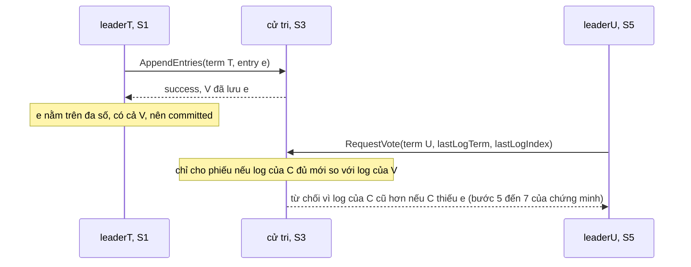

(Sơ đồ do người soạn vẽ theo Hình 9 của bài báo, trong đó S1 là leader của term T, S3 là cử tri và S5 là leader của term U[^b-fig9].)

Mỗi bước của chứng minh dựa vào một cơ chế cụ thể của Raft, và ba trạng thái trong các cơ chế đó (`votedFor`, `currentTerm`, `log`) phải nằm trên đĩa. Bảng dưới là tổng hợp của người soạn (suy luận của người soạn từ các bước trên và từ mục 3.8 của luận án), không phải bảng trong nguồn:

| Chỗ trong chứng minh | Cơ chế được dùng | Biến phải bền | Nếu thiếu thì |
|---|---|---|---|
| "Leader của term T" là xác định | mỗi server một phiếu mỗi term | `votedFor` | hai leader cùng term; "leaderT" không còn là một server cụ thể, Log Matching vỡ (trace bên dưới) |
| Bước 1 | leader chỉ append, không xóa hay ghi đè | không có (luật hành vi của leader, không phải biến bền) | leaderU có thể tự xóa entry đã committed khỏi log của chính nó |
| Bước 2 | hai đa số giao nhau | (cấu hình cụm cố định; mục 5 nói cách giữ điều này khi đổi thành viên) | không có cử tri |
| Bước 3 | từ chối RPC mang term cũ | `currentTerm` | cử tri nhận entry từ leader đã bị phế sau khi đã bỏ phiếu cho term mới |
| Bước 4 | entry lưu bền trước khi được tính vào commit | `log` | entry biến mất khỏi cử tri |
| Bước 5 đến 7 | so log khi bỏ phiếu và Log Matching | `log` | ứng viên thiếu entry vẫn thắng cử |

*Hình 8: nằm trên đa số chưa đủ.* Leader Completeness chỉ nói về entry đã committed, nên câu hỏi là "committed" nghĩa là gì. Định nghĩa ngây thơ, "entry nằm trên đa số server là committed", sai với entry của term cũ; Hình 8 của bài báo là phản ví dụ. Bảng dưới dựng lại năm trạng thái (a) đến (e) của hình cho S1 đến S5. Mỗi số là term của entry ở index 1, 2, 3 (từ trái sang phải). Nội dung log đọc trực tiếp từ hình vì chú thích của hình không liệt kê chúng; ở (d) và (e) hai nhánh xảy ra thay thế cho nhau từ cùng một trạng thái (c). Số term 5 của S5 ở (d) do người soạn đặt (suy ra: phải lớn hơn mọi term đã dùng), bài báo chỉ nói S5 được bầu.

| Bước | Leader (term) | S1 | S2 | S3 | S4 | S5 |
|---|---|---|---|---|---|---|
| (a) | S1 (2) | `1 2` | `1 2` | `1` | `1` | `1` |
| (b) | S5 (3) | `1 2` | `1 2` | `1` | `1` | `1 3` |
| (c) | S1 (4) | `1 2 4` | `1 2` | `1 2` | `1` | `1 3` |
| (d) nhánh S1 sập | S5 (5) | `1 3` | `1 3` | `1 3` | `1 3` | `1 3` |
| (e) nhánh S1 chép kịp | S1 (4) | `1 2 4` | `1 2 4` | `1 2 4` | `1` | `1 3` |

(Bảng do người soạn dựng lại từ hình và chú thích của Hình 8. Ở (d) hình vẽ trạng thái sau khi S5 đã chép log của nó xuống S1 đến S4; lúc S1 sập, log của S1 vẫn là `1 2 4`.)

- **(a)** Term 1 đã đưa entry index 1 lên cả năm server. Ở term 2, S1 là leader, ghi một lệnh vào index 2 và chép được sang S2 thì dừng[^b-fig8-a]. Lúc này entry mới nằm trên 2/5 server, chưa phải đa số.
- **(b)** S1 sập. S5 hết giờ, thắng cử ở term 3 nhờ phiếu của S3, S4 và chính nó; log `1` của ba server này ngang nhau nên không ai có lý do từ chối. S5 nhận một lệnh khác và ghi vào index 2 với term 3 trong log của riêng nó[^b-fig8-b]. Hai entry khác nhau cùng index 2 nhưng khác term thì không vi phạm Log Matching, vốn chỉ đòi cùng index *và* cùng term.
- **(c)** S5 sập; S1 khởi động lại, thắng cử ở term 4 rồi chép tiếp: entry (index 2, term 2) giờ nằm trên S1, S2, S3, một đa số, nhưng bài báo nói rõ nó chưa committed[^b-fig8-c]. S1 cũng đã thêm entry index 3 term 4 vào log của mình. Nếu luật commit là "nằm trên đa số thì committed", S1 sẽ thực thi lệnh ở index 2 và có thể đã trả lời client.
- **(d)** Nhánh xấu: S1 sập lần nữa, S5 sống lại. Log `1 3` của S5 có term cuối 3, lớn hơn term cuối 2 của S2, S3 và term cuối 1 của S4, nên cả ba cho phiếu và S5 thắng cử; nó chép log của mình xuống, entry (2, term 3) ghi đè entry (2, term 2) vốn từng nằm trên đa số[^b-fig8-d]. Nếu lệnh ở index 2 đã được thực thi và trả lời client, hai state machine có thể đã chạy hai lệnh khác nhau ở cùng index: State Machine Safety vỡ.
- **(e)** Nhánh đúng: thay vì sập sớm, S1 chép kịp entry index 3 của *term hiện tại* (term 4) lên S2 và S3. Entry này committed, kéo theo index 2 committed gián tiếp. S5 không thể thắng nữa: log `1 3` có term cuối 3, trong khi S2 và S3 (và cả S1, nếu còn sống) có term cuối 4 nên từ chối; S5 chỉ còn phiếu của S4 và của chính nó, 2/5[^b-fig8-e].

*Luật commit của Raft sửa Hình 8 thế nào.* Hình 2 của bài báo viết luật cho leader: đặt `commitIndex = N` nếu có N > `commitIndex` sao cho đa số `matchIndex[i] ≥ N` (`matchIndex[i]` là index cao nhất mà leader biết đã được chép lên server i[^b-matchindex]) *và* `log[N].term == currentTerm`[^b-commit-rule]. Áp vào hình (suy luận của người soạn): ở (c), N = 2 có đa số (S1, S2, S3) nhưng `log[2].term` là 2, khác term hiện tại 4, nên bị loại; N = 3 mới chỉ có S1. Ở (e), N = 3 có đa số và `log[3].term` là 4, bằng term hiện tại, nên `commitIndex` nhảy lên 3 và các entry trước đó committed gián tiếp nhờ Log Matching[^b-prior-rule]. Luận án nói thêm rằng đôi khi leader có thể kết luận an toàn về entry cũ (ví dụ entry đã nằm trên mọi server) nhưng Raft chọn luật bảo thủ cho đơn giản[^b-conservative].

*Vì sao luật đó đủ.* Đây là chỗ Hình 8 gặp chứng minh (suy luận của người soạn). Ở (e), entry (3, term 4) nằm trên S1, S2, S3; bất kỳ ứng viên nào muốn thắng phải xin phiếu của ít nhất một server trong ba server đó, chính là "cử tri" ở bước 2. Cử tri này có term cuối 4 nên chỉ cho phiếu ứng viên có term cuối từ 4 trở lên; ứng viên như vậy hoặc có log kết thúc ở term 4 (nên chứa entry index 3 do leader term 4 tạo, theo Log Matching), hoặc đến từ một term sau mà theo bước 7 cũng chứa entry đó. Ở (c) thì không có cử tri như vậy đối với entry (2, term 2): S5 có term cuối 3, lớn hơn 2, nên S2, S3 và S4 đều thấy S5 "đủ mới" và cho phiếu dù S5 thiếu entry. Nói gọn: entry của term hiện tại t trên một đa số loại khỏi cuộc bầu mọi log có term cuối nhỏ hơn t, còn entry của term cũ s < t thì vẫn có thể bị một log có term cuối trong khoảng (s, t] vượt mặt. Luật commit này viết thành TLA+ ở [P13 · Chương 08](../13-tla-plus/08-dac-ta-giao-thuc-phan-tan.md).

*Ba biến phải bền.* Hình 2 ghi `currentTerm`, `votedFor` và `log[]` là trạng thái bền, phải được cập nhật vào stable storage (lưu trữ còn nguyên sau khi khởi động lại; trên máy thật là đĩa sau `fsync`, nhận xét của người soạn) *trước khi trả lời RPC*[^b-persist-fig2]. Luận án giải thích lý do: persist term và phiếu để một server không bỏ phiếu hai lần trong cùng một term và không để entry của leader mới bị thay bằng entry của leader đã bị phế; persist entry trước khi chúng được tính vào commit để entry committed không bị mất hay "hết committed" khi server khởi động lại[^b-persist-why]. Hệ quả cụ thể khi mất từng biến (tổng hợp của người soạn từ luận án và các luật ở Hình 2):

| Biến | Dùng ở đâu | Nếu mất sau khi khởi động lại |
|---|---|---|
| `currentTerm` | từ chối RPC mang term thấp hơn[^b-ae-term]; nâng term khi thấy term cao hơn[^b-term-rules] | nhận lại lệnh từ leader đã bị phế: leader cũ commit được, hoặc entry của leader mới bị ghi đè (trace trong phần Đi sâu) |
| `votedFor` | luật "mỗi term một phiếu"[^b-vote-rule] | bỏ phiếu hai lần trong một term, hai leader cùng term (trace ngay dưới) |
| `log[]` | entry được tính để commit; so log khi bỏ phiếu | entry đã được tính vào đa số biến mất, entry committed bị "hết committed"[^b-persist-why] |

*Trace: mất `votedFor` thì hai leader cùng một term.* Kịch bản sau do người soạn dựng từ luật bỏ phiếu và luật `AppendEntries` ở Hình 2; nó không phải ví dụ của bài báo. Cụm ba server S1, S2, S3 đang ở term 6, log của cả ba giống nhau và kết thúc ở index 5, term 6. Giả sử cài đặt của S2 ghi `votedFor` vào bộ nhớ nhưng chưa ghi xuống đĩa trước khi trả lời, tức vi phạm quy tắc "cập nhật stable storage trước khi trả lời RPC".

1. S1 và S3 cùng hết giờ, cùng thành ứng viên của term 7 và mỗi bên bỏ phiếu cho chính mình.
2. S1 gửi `RequestVote(term 7)` tới S2. S2 (term 6 lên 7, `votedFor` rỗng, log của S1 không cũ hơn) cho phiếu và đặt `votedFor = S1` trong RAM. S1 có 2/3 phiếu và thành leader của term 7.
3. S2 sập rồi khởi động lại; nó nạp lại `currentTerm = 7` (đã ghi) nhưng `votedFor` là rỗng (chưa ghi).
4. S3 gửi `RequestVote(term 7)` tới S2. Term bằng term hiện tại, `votedFor` rỗng, log không cũ hơn: S2 cho phiếu lần thứ hai. S3 có 2/3 phiếu và cũng thành leader của term 7.

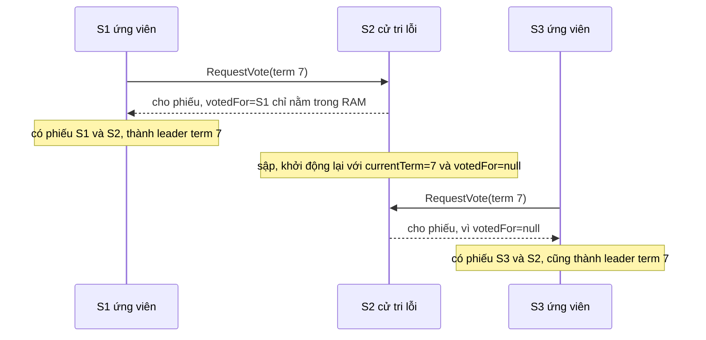

(Sơ đồ do người soạn vẽ theo trace trên.)

Hậu quả: hai leader cùng term 7, vi phạm Election Safety vốn dựa vào việc mỗi server chỉ một phiếu mỗi term[^b-majority-rule]. S1 nhận lệnh `x=1` và ghi vào index 6 với term 7; S3 nhận lệnh `x=2` và cũng ghi vào index 6 với term 7. Tính chất đầu của Log Matching, "cùng index và term thì cùng lệnh", dựa vào việc một leader tạo tối đa một entry cho mỗi index trong mỗi term[^b-logmatch-first]; giờ nó bị phá. S1 chép `x=1` sang S2 và S2 nhận. Khi S3 chép `x=2` (index 6, term 7) sang S2, phép kiểm tra khớp entry ngay trước (`prevLogIndex`, `prevLogTerm`) đạt; entry sẵn có ở index 6 có *cùng term* nên không bị coi là xung đột[^b-ae-conflict], và luật "chỉ thêm entry chưa có trong log" khiến S2 giữ `x=1` và trả lời thành công[^b-ae-append]. S3 đếm S2 vào đa số và commit `x=2`, trong khi S1 commit `x=1` cũng nhờ S2: hai lệnh khác nhau cùng được "committed" ở index 6.

Thư viện thật xử lý đúng chỗ này bằng một hợp đồng với ứng dụng: `etcd/raft` yêu cầu `HardState` (gồm `Term`, `Vote`, `Commit`[^b-etcd-hs-fields]) được lưu xuống đĩa *trước* khi gửi message[^b-etcd-ready-hs], và với chế độ ghi bất đồng bộ thì mọi ghi liên quan tới phiếu bầu, thay đổi term và commit index phải bền trước khi các message trả lời được giao đi[^b-etcd-storage-append]. Phiếu trả lời của S2 ở bước 2 chính là loại message đó.

<details><summary>Đi sâu: chương trình Rust kiểm Hình 8, trace mất <code>currentTerm</code>, lỗi có thật, biến nào thực sự phải bền</summary>

- *Kiểm Hình 8 bằng chương trình.* Chương trình dưới (người soạn viết, biên dịch và chạy bằng rustc 1.95.0) biểu diễn log là danh sách term, áp luật "log đủ mới" để tính ứng viên nào có thể gom đa số phiếu khi S1 sập, và so luật commit ngây thơ với luật của Raft. Nó bỏ qua số term và phiếu đã bỏ, tức giả sử ứng viên dùng term đủ lớn và các voter chưa bỏ phiếu ở term đó; đủ để kiểm tính chất "ai có thể thắng", không phải mô phỏng đầy đủ Raft.

```rust
// Kiểm tra Hình 8 của paper Raft bằng luật bầu cử và luật commit.
// Log = danh sách term của entry ở index 1, 2, 3, ...
type Log = Vec<u32>;

/// Log `a` có "đủ mới" so với `b` không? (so term cuối, hòa thì so độ dài)
fn up_to_date(a: &Log, b: &Log) -> bool {
    let (ta, tb) = (a.last().copied().unwrap_or(0), b.last().copied().unwrap_or(0));
    ta > tb || (ta == tb && a.len() >= b.len())
}

/// Ứng viên c có thể gom đa số phiếu không, nếu mọi server còn sống đều cho phiếu
/// mỗi khi log của c đủ mới so với log của mình? (bỏ qua chuyện term và phiếu cũ)
fn can_win(c: usize, logs: &[Log], alive: &[bool]) -> bool {
    let votes = (0..logs.len()).filter(|&v| alive[v] && up_to_date(&logs[c], &logs[v])).count();
    alive[c] && votes > logs.len() / 2
}

fn show(name: &str, logs: &[Log], alive: &[bool], leader_term: u32, entry: (usize, u32)) {
    let (idx, term) = entry;
    let holders = logs.iter().filter(|l| l.get(idx - 1) == Some(&term)).count();
    println!("{name}");
    println!("  entry (index {idx}, term {term}) có trên {holders}/5 server");
    println!("  luật ngây thơ (đa số là commit)      : {}", holders > 2);
    println!("  luật Raft (đa số VÀ term = {leader_term})      : {}", holders > 2 && term == leader_term);
    let winners: Vec<String> = (0..5).filter(|&c| can_win(c, logs, alive)).map(|c| format!("S{}", c + 1)).collect();
    let missing: Vec<String> = (0..5)
        .filter(|&c| can_win(c, logs, alive) && logs[c].get(idx - 1) != Some(&term))
        .map(|c| format!("S{}", c + 1)).collect();
    println!("  server có thể thắng cử (S1 sập)       : {winners:?}");
    println!("  trong đó thiếu entry này              : {missing:?}");
}

fn main() {
    let s1_down = [false, true, true, true, true];
    // (c): S1 là leader term 4, đã chép entry (2, term 2) sang S3
    let c = vec![vec![1, 2, 4], vec![1, 2], vec![1, 2], vec![1], vec![1, 3]];
    show("(c)", &c, &s1_down, 4, (2, 2));
    // (e): S1 chép được entry (3, term 4) lên S2 và S3 rồi mới sập
    let e = vec![vec![1, 2, 4], vec![1, 2, 4], vec![1, 2, 4], vec![1], vec![1, 3]];
    show("(e)", &e, &s1_down, 4, (3, 4));
    println!("(e) entry (2, term 2) nằm trong log của mọi server có thể thắng cử: {}",
        (0..5).filter(|&x| can_win(x, &e, &s1_down)).all(|x| e[x].get(1) == Some(&2)));
}
```

  Kết quả chạy:

```text
(c)
  entry (index 2, term 2) có trên 3/5 server
  luật ngây thơ (đa số là commit)      : true
  luật Raft (đa số VÀ term = 4)      : false
  server có thể thắng cử (S1 sập)       : ["S2", "S3", "S5"]
  trong đó thiếu entry này              : ["S5"]
(e)
  entry (index 3, term 4) có trên 3/5 server
  luật ngây thơ (đa số là commit)      : true
  luật Raft (đa số VÀ term = 4)      : true
  server có thể thắng cử (S1 sập)       : ["S2", "S3"]
  trong đó thiếu entry này              : []
(e) entry (2, term 2) nằm trong log của mọi server có thể thắng cử: true
```

  Ở (c), S5 có thể thắng cử mà không có entry (2, term 2), nên nếu entry đó bị coi là committed thì Leader Completeness sai; ở (e), mọi server có thể thắng cử (S2, S3 khi S1 sập) đều có cả entry (3, term 4) lẫn entry (2, term 2).
- *Mất `currentTerm`: leader đã bị phế commit được.* Trace do người soạn dựng. S1 là leader term 5, bị cô lập sau khi ghi `e` vào index 6 (term 5) trong log của riêng nó. S2 và S3 bầu S2 làm leader term 6; S3 đã bỏ phiếu cho S2 ở term 6. S3 sập và khởi động lại, nhưng `currentTerm` không được nạp lại (về 0). S1 nối lại được với S3 và gửi `AppendEntries(term 5, e)`: S3 không còn lý do từ chối theo luật term thấp hơn[^b-ae-term], nhận `e`, S1 có 2/3 và commit `e`, rồi trả lời client. Sau đó S2 (term 6) chép entry index 6 của mình sang S3; S3 thấy entry sẵn có ở index 6 khác term nên xóa nó[^b-ae-conflict] và nhận entry của S2; S2 cũng có 2/3 và commit. Hai entry khác nhau cùng được committed ở index 6. Chỗ hỏng là S3 nhận `AppendEntries` của leader đã bị phế sau khi đã theo term 6, đúng loại nguy cơ mà luận án nêu khi đòi persist term: server bị thay entry của leader mới bằng entry của leader đã bị phế[^b-persist-why]. (Trace trên chọn thứ tự khiến entry của leader đã bị phế được commit trước rồi mới bị thay; nếu S2 chép entry của nó sang S3 trước khi S3 sập thì ngược lại, `e` của S1 xóa mất entry đã committed của S2, đúng như câu của luận án; suy luận của người soạn.)
- *Hình 8 là lỗi có thật.* Luận án kể rằng một bản đầu của Raft có luật commit không tính tới kịch bản như Hình 3.7 (Hình 8 của bài báo), và model checker Murphi bỏ sót nó, nhiều khả năng vì mô hình bị chặn nhỏ[^b-murphi]; câu chuyện này cũng được kể ở [P13 · Chương 08](../13-tla-plus/08-dac-ta-giao-thuc-phan-tan.md). Chính tác giả cũng viết rằng chứng minh an toàn của họ "có thể có lỗi"[^b-proof-bugs]; họ đã dùng hệ chứng minh TLA để chứng minh bằng máy tính chất Leader Completeness, nhưng chứng minh ấy dựa trên các invariant chưa được kiểm máy[^b-tlaps]. Sau đó nhóm Verdi của Đại học Washington hoàn thành một chứng minh an toàn kiểm máy bằng Coq cho thuật toán Raft cơ bản[^b-coq].
- *Vì sao entry giữ nguyên term khi chép lại.* Luật commit phức tạp vì entry giữ nguyên term gốc khi leader chép lại entry của term cũ[^b-retain-term]. Đổi lại, luận án nói các thuật toán khác buộc leader mới đánh số lại entry bằng term của mình khi chép lại, còn cách của Raft làm entry giữ cùng term theo thời gian và giữa các log nên dễ suy luận hơn[^b-renumber].
- *Biến nào thực sự phải bền.* Hình 2 liệt kê `commitIndex`, `lastApplied` là trạng thái *volatile*[^b-volatile-fig2]; luận án nói các biến còn lại an toàn khi mất lúc khởi động lại vì dựng lại được, ví dụ điển hình là commit index, có thể khởi tạo lại bằng 0[^b-commit-volatile]; và phần errata cho biết `lastApplied` phải bền *tương ứng với state machine*: nếu state machine bền thì `lastApplied` cũng phải bền[^b-erratum-lastapplied]. Bài giảng Cambridge liệt kê `commitLength` thành biến thứ tư cần lưu bền[^b-cam-stable], và `HardState` của `etcd/raft` cũng có trường `Commit`[^b-etcd-hs-fields]. Việc lưu thêm là lựa chọn của từng cài đặt, không mâu thuẫn với luận án (suy luận của người soạn: lưu thêm một biến chỉ làm khởi động lại nhanh hơn, không đổi an toàn).
- *Mất trạng thái bền thì sao.* Một server mất bất kỳ trạng thái bền nào không thể gia nhập lại cụm với danh tính cũ; thường có thể thêm lại nó với danh tính mới bằng thay đổi thành viên[^b-lose-identity]. Nếu cả một đa số mất trạng thái bền thì entry có thể mất và thay đổi thành viên không còn tiến triển được; muốn đi tiếp, quản trị viên phải chấp nhận khả năng mất dữ liệu[^b-lose-majority]. Thư viện `etcd/raft` có một quy ước cùng tinh thần (suy luận của người soạn): một ID chỉ dùng cho một node trong mọi thời gian, kể cả khi node cũ đã bị gỡ[^b-etcd-id].

</details>

**Quay lại Q4:** Leader Completeness đúng vì luôn có một cử tri vừa giữ entry committed vừa nằm trong đa số bầu leader mới, và luật log đủ mới cấm cử tri đó bầu ứng viên thiếu entry; Hình 8 buộc ta chỉ tính một entry của term cũ là committed khi một entry của term hiện tại nằm trên đa số sau nó; và cả hai điều chỉ đúng khi `currentTerm`, `votedFor`, `log` được ghi bền trước khi trả lời.

## 5. Raft ngoài lõi: snapshot, thay đổi thành viên và chuyển giao leader (Q5)

> **Trả lời ngắn.** Log không thể dài mãi, nên mỗi server tự chụp một "ảnh" (snapshot) trạng thái đã committed rồi bỏ phần log cũ, chỉ giữ lại index và term của entry cuối cùng bị nén cùng cấu hình cụm để các phép kiểm tra khớp log vẫn chạy; follower tụt quá xa thì được leader gửi nguyên snapshot[^b-p-snap-meta2][^b-p-snap-trigger]. Đổi thành viên cụm chỉ an toàn nếu không có lúc nào hai nhóm "đa số" rời nhau cùng ra quyết định: thêm hoặc bớt đúng một server mỗi lần thì đa số cũ và đa số mới luôn giao nhau, còn đổi nhiều server cùng lúc phải đi qua một cấu hình chuyển tiếp (joint consensus)[^b-single][^b-overlap][^b-joint-def]. Server mới phải bắt kịp log khi chưa có quyền bỏ phiếu[^b-catchup]; thuật toán đổi từng server của luận án từng có một lỗi (Ongaro công bố năm 2015) mà cách sửa là một điều kiện đơn giản[^b-bug-fix]; và leader có thể chủ động nhường quyền cho server khác bằng message `TimeoutNow`[^b-lt-steps].

**Giải thích.**

Hình dung (nhận xét của người soạn): log giống sổ ghi từng giao dịch ngân hàng, còn snapshot giống bản sao kê chốt số dư "tính đến giao dịch số N của kỳ T". Có bản sao kê thì giữ từng giao dịch cũ là thừa, nhưng phải ghi rõ N và T để giao dịch kế tiếp còn nối đúng vào. Đổi thành viên thì giống thay ghế trong hội đồng: mỗi lần thay một ghế thì mọi nhóm "quá nửa" trước và sau luôn có chung ít nhất một người.

### 5.1. Nén log bằng snapshot và `InstallSnapshot`

*Vì sao phải nén.* Log càng dài càng tốn chỗ và càng lâu để phát lại, cuối cùng gây vấn đề về sẵn sàng[^b-p-snap-why]. Cách đơn giản nhất là snapshot: ghi toàn bộ trạng thái hiện tại của state machine ra stable storage rồi bỏ phần log tới điểm đó[^b-snap-def]. Mỗi server tự chụp, độc lập với leader, và chỉ phủ các entry đã committed trong log của nó[^b-p-snap-indep].

*Snapshot chứa gì.* Phần lớn công việc là state machine ghi trạng thái hiện tại của nó vào snapshot. Raft thêm một ít siêu dữ liệu: *last included index* (index của entry cuối mà snapshot thay thế, cũng là entry cuối state machine đã áp) và *last included term* (term của entry đó)[^b-p-snap-meta]. Hai số này được giữ để phép kiểm tra nhất quán của `AppendEntries` vẫn làm được với entry đầu tiên sau snapshot, vì entry đó cần index và term của entry đứng ngay trước nó; snapshot còn mang cấu hình mới nhất tính đến last included index để đổi thành viên vẫn đúng sau khi log bị cắt[^b-p-snap-meta2]. Luận án nói thêm: sau khi state machine ghi xong snapshot, Raft lưu hai số trên cùng cấu hình (đủ để khởi động lại) rồi mới bỏ phần đầu của log[^b-snap-restart-state]; các số này "neo" phần log còn lại vào đúng chỗ[^b-snap-anchor].

Ví dụ dựng lại từ Hình 12 của bài báo và Hình 5.2 của luận án (bảng do người soạn vẽ lại, số liệu lấy từ hình), trong đó snapshot thay các entry 1 đến 5 và ghi last included index = 5, term = 3[^b-snap-fig52]. Bảng dưới là log trước và sau khi nén:

| | index 1 | 2 | 3 | 4 | 5 | 6 | 7 |
|---|---|---|---|---|---|---|---|
| Term | 1 | 1 | 1 | 2 | 3 | 3 | 3 |
| Lệnh | `x←3` | `y←1` | `y←9` | `x←2` | `x←0` | `y←7` | `x←5` |
| Sau khi nén | gộp vào snapshot `{x=0, y=9}`, last included index 5, term 3, kèm cấu hình | | | | | giữ | giữ |

Khi leader chép entry 6 cho một follower, nó cần `prevLogIndex = 5` và `prevLogTerm = 3`. Entry 5 đã bị loại khỏi log, nhưng cặp (5, 3) nằm trong siêu dữ liệu của snapshot nên phép kiểm tra vẫn làm được.

*Khi nào phải gửi snapshot.* Luận án nhấn mạnh rằng không thể hoãn nén log cho tới khi mọi thành viên đều đã có entry, vì một thiểu số follower chậm không được phép làm cụm mất sẵn sàng và server mới có thể được thêm bất cứ lúc nào; nên follower chậm hoặc server mới đôi khi phải nhận trạng thái ban đầu qua mạng[^b-snap-slow]. Leader phát hiện việc này khi entry kế tiếp mà `AppendEntries` cần đã bị loại khỏi log của nó[^b-snap-trigger2]. Khi đó nó dùng RPC `InstallSnapshot`: snapshot được chia thành các chunk gửi theo thứ tự, và mỗi chunk còn là "dấu hiệu sống" để follower đặt lại election timer[^b-p-installsnap-chunks].

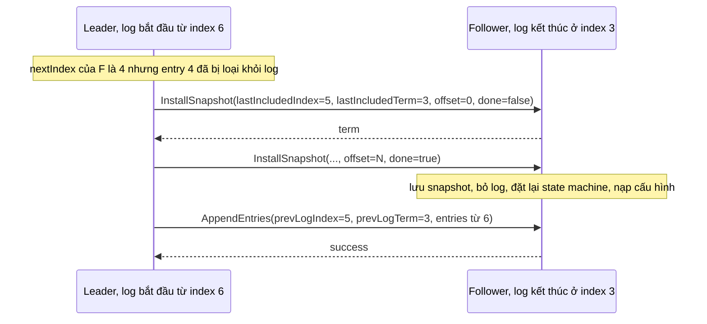

(Sơ đồ do người soạn vẽ theo Hình 13 của bài báo và mô tả ở mục 5.1 của luận án; các con số là ví dụ.)

*Follower làm gì khi nhận.* Theo Hình 13: nếu log của follower có entry cùng index và term với entry cuối mà snapshot bao phủ thì giữ phần log phía sau; ngược lại bỏ toàn bộ log; cuối cùng đặt lại state machine bằng nội dung snapshot và nạp cấu hình trong snapshot[^b-p-installsnap-rules]. Thường snapshot chứa thông tin mới nên follower bỏ cả log, kể cả những entry chưa committed xung đột với snapshot[^b-p-snap-discard]; nếu snapshot chỉ mô tả một đoạn đầu của log (do gửi lại hay nhầm) thì chỉ xóa phần được bao phủ và giữ các entry phía sau[^b-p-snap-prefix].

*Một ngoại lệ có chủ ý.* Follower tự chụp snapshot mà không hỏi leader là lệch khỏi nguyên tắc strong leader của Raft, nhưng bài báo cho là hợp lý vì đồng thuận đã đạt nên không còn quyết định nào xung đột[^b-p-snap-strong-leader].

### 5.2. Đổi thành viên: vì sao không đổi thẳng, và vì sao đổi từng server thì an toàn

*Vì sao không đổi thẳng.* Cấu hình cụm, tức tập server tham gia đồng thuận, phải đổi được khi vận hành, ví dụ để thay máy hỏng hay đổi số bản sao[^b-p6-why]. Nhưng mọi cách chuyển thẳng từ cấu hình cũ sang mới đều không an toàn: không thể đổi cùng lúc ở mọi server, nên trong lúc chuyển cụm có thể tách thành hai đa số độc lập[^b-direct-unsafe]. Ví dụ số (người soạn điền số theo Hình 10 của bài báo, cụm lớn từ ba lên năm server[^b-fig10]): cấu hình cũ {S1, S2, S3} cần 2 phiếu, cấu hình mới {S1, ..., S5} cần 3 phiếu. Lúc S1 và S2 còn dùng cấu hình cũ còn S3, S4, S5 đã dùng cấu hình mới, {S1, S2} là một đa số của cấu hình cũ và {S3, S4, S5} là một đa số của cấu hình mới. Hai nhóm rời nhau nên có thể bầu hai leader khác nhau trong cùng một term.

*Đổi từng server một.* Luận án chọn cách đơn giản hơn joint consensus: chỉ cho thêm hoặc bớt đúng một server mỗi lần, và thay đổi lớn hơn thực hiện bằng một chuỗi thay đổi một server[^b-single]. Lý do là khi thêm một server hay bớt một server, mọi đa số của cấu hình cũ giao nhau với mọi đa số của cấu hình mới; chính sự giao nhau này bảo đảm tồn tại "cử tri" của chứng minh ở mục 4[^b-overlap]. Phép đếm (suy luận của người soạn): cụm n server có đa số cỡ ⌊n/2⌋ + 1; khi thêm một server, cụm mới n + 1 server có đa số cỡ ⌊(n+1)/2⌋ + 1; tổng hai cỡ đa số luôn bằng n + 2, lớn hơn số server của hợp hai cấu hình (n + 1), nên hai tập con cỡ ấy trong hợp đó buộc phải chung ít nhất một server. Bớt một server thì làm đối xứng. Với thay đổi hai server thì phép đếm có thể hụt, như bảng sau cho thấy:

| Thay đổi | Cỡ đa số cũ | Cỡ đa số mới | Tổng | Số server của hợp | Hai đa số có thể rời nhau? |
|---|---|---|---|---|---|
| 3 → 4 | 2 | 3 | 5 | 4 | không, giao ít nhất 1 |
| 4 → 5 | 3 | 3 | 6 | 5 | không |
| 5 → 4 | 3 | 3 | 6 | 5 | không |
| 3 → 5 | 2 | 3 | 5 | 5 | có (đúng ví dụ Hình 10 ở trên) |

(Bảng do người soạn tính; phần Đi sâu có một chương trình Rust vét cạn kiểm lại bằng máy cho n = 2 đến 8.)

*Cơ chế chạy.* Cấu hình được lưu và truyền bằng entry đặc biệt trong log[^b-config-log]. Khác mọi entry thường, cấu hình mới có hiệu lực ở mỗi server ngay khi *được thêm vào log của server đó*, không đợi committed; mỗi server luôn dùng cấu hình mới nhất trong log của nó[^b-config-takes]. Leader chỉ được bắt đầu thay đổi tiếp theo sau khi entry cấu hình trước đã committed, nếu không các thay đổi chồng nhau có thể rơi vào tình huống không an toàn như Hình 4.2 của luận án[^b-one-at-a-time]. Hai hệ quả đi kèm. Một, entry cấu hình có thể bị xóa khi đổi leader nên server phải sẵn sàng quay về cấu hình trước đó trong log[^b-fallback]. Hai, server xử lý RPC mà không tra cấu hình hiện tại của mình: nó nhận `AppendEntries` từ leader chưa nằm trong cấu hình của nó, vì nếu không server mới không bao giờ gia nhập được[^b-rpc-accept][^b-rpc-noconfig].

*Bắt kịp trước khi bỏ phiếu.* Server mới thường có log rỗng; thêm nó thẳng vào cấu hình làm cụm dễ mất sẵn sàng. Hình 4.4(a) của luận án: cụm ba server, thêm S4, rồi S3 hỏng; cần 3 trong 4 server để commit nhưng S3 đã hỏng còn log của S4 còn quá xa[^b-fig44]. Cách chữa là thêm một pha trước khi đổi cấu hình, trong đó server mới tham gia như thành viên *không bỏ phiếu*: leader chép log cho nó nhưng chưa tính nó vào đa số khi bầu hay commit; khi nó đã bắt kịp mới tiến hành đổi cấu hình[^b-catchup]. Luận án đề nghị đo "bắt kịp" theo từng vòng, mỗi vòng chép toàn bộ log mà leader có lúc đầu vòng; sau một số vòng cố định (ví dụ 10), nếu vòng cuối ngắn hơn một election timeout thì thêm server vào cụm, nếu không thì hủy thay đổi và báo lỗi[^b-rounds]. Leader cũng nên hủy nếu server mới không khả dụng hoặc chậm đến mức sẽ không bao giờ bắt kịp[^b-abort].

etcd gọi thành viên không bỏ phiếu này là *learner*, một nghĩa khác với learner của Paxos ở [chương 09](09-consistency-va-consensus.md) (ở đó là tiến trình học giá trị đã được chọn)[^b-learner-def]. `etcdctl member add --learner` thêm nó[^b-learner-add], và `member promote` chỉ thành công khi log của nó đã bắt kịp leader[^b-learner-promote]. Tài liệu thiết kế giải thích động cơ: member mới bắt đầu với dữ liệu rỗng nên đè nặng leader, mạng của leader có thể nghẽn và làm rớt heartbeat, khiến follower hết giờ và gây bầu cử[^b-learner-why]. Learner không được nhận quyền leader[^b-learner-noleader].

*Joint consensus.* Khi cần đổi nhiều server cùng lúc, Raft đi qua cấu hình chuyển tiếp `C_old,new`: leader ghi entry cấu hình chung và commit nó; chỉ khi đó mới ghi entry `C_new`[^b-joint-def]. Trong cấu hình chung, quyết định (cả bầu cử lẫn commit) cần đa số *riêng rẽ* của cả cũ lẫn mới; ví dụ đổi từ 3 server sang 9 server cần 2 trong 3 của cấu hình cũ và 5 trong 9 của cấu hình mới[^b-joint-agree]. Nhờ vậy không có lúc nào `C_old` và `C_new` cùng ra quyết định độc lập[^b-joint-fig]. Luận án khuyên dùng đổi từng server vì đơn giản hơn[^b-joint-recommend]. Joint consensus vẫn đáng có trong thực tế: tài liệu của `etcd/raft` nêu rằng nếu không dùng joint consensus và chạy trên ba availability zone với hệ số sao chép ba thì không thể thay một voter mà không đi qua một cấu hình trung gian không chịu nổi sự cố của một zone[^b-etcd-az]; thư viện này hỗ trợ cả đổi từng server lẫn joint consensus qua `ConfChangeV2`[^b-etcd-confv2].

### 5.3. Lỗi năm 2015 của thuật toán đổi từng server, và bản vá

Thuật toán đổi từng server trong luận án có một lỗi quan trọng, do Ongaro công bố trên danh sách raft-dev ngày 10/7/2015[^b-bug-date]. Chính bài đăng nói lỗi "có thể nghiêm trọng" nhưng cách sửa dễ cài[^b-bug-announce], và phần errata của luận án cũng ghi lại điều này[^b-erratum-bug]. Lập luận của luận án là hai cấu hình khác nhau tối đa một server thì đa số của chúng giao nhau; trong một term, một leader dễ bảo đảm cấu hình kế tiếp chỉ khác một server[^b-bug-term]. Lỗi nằm ở chỗ khác: qua ranh giới term, hai thay đổi cạnh tranh nhau có thể có các đa số không giao nhau và gây vi phạm an toàn (split brain)[^b-bug-cause]. Hai thay đổi cạnh tranh ấy sinh ra hai cấu hình *anh em* (cùng xuất phát từ một cấu hình, mỗi bên một thay đổi), và hai anh em có thể khác nhau tới hai server nên lập luận trên không còn áp dụng (suy luận của người soạn từ bảng dưới). Phạm vi theo chính bài đăng: thuật toán đổi từng server khi xuất phát từ cụm có số server chẵn, nhiều thay đổi khác nhau được yêu cầu đồng thời, và leader bị mất; khi đó có thể mất dữ liệu và split brain vĩnh viễn[^b-bug-scope]. Joint consensus không bị ảnh hưởng[^b-bug-joint].

Phản ví dụ gọn nhất trong ba phản ví dụ của bài đăng (chỉ bốn server, sáu bước và không có server mới nào phải bắt kịp; theo đếm của người soạn) là hai lần *bớt* server khác nhau khỏi cụm 4 server[^b-bug3-intro]. Bảng dưới dựng lại nó. C = {S1, S2, S3, S4}; D = {S1, S2, S3} (bớt S4); E = {S1, S2, S4} (bớt S3). Mỗi ô là log của server (L là leader, F là follower, số sau là term); cột cuối là cách đọc của người soạn.

| Bước | S1 | S2 | S3 | S4 | Điều xảy ra |
|---|---|---|---|---|---|
| 0 | L1 `[C]` | F1 `[C]` | F1 `[C]` | F1 `[C]` | trạng thái đầu |
| 1 | L1 `[C, D]`, mất liên lạc | F1 `[C]` | F1 `[C]` | F1 `[C]` | S1 thêm D vào log rồi mất liên lạc[^b-bug3-s1] |
| 2 | mất liên lạc | L2 `[C]` | F2 `[C]` | F2 `[C]` | S2 thắng cử term 2 nhờ {S2, S3, S4}, đủ 3/4 của C |
| 3 | mất liên lạc | L2 `[C, E]` | F2 `[C]` | F2 `[C]` | S2 thêm E |
| 4 | mất liên lạc | L2 `[C, E]` | F2 `[C]` | F2 `[C, E]` | S2 chép E sang S4 và coi là committed: 2/3 của E[^b-bug3-s4] |
| 5 | L3 `[C, D]` | L2 `[C, E]` | F3 `[C]` | F2 `[C, E]` | S1 sống lại, thắng cử term 3 nhờ {S1, S3}, đủ 2/3 của D, dù không có entry E đã committed[^b-bug3-s5] |
| 6 | L3 `[C, D]` | `[C, D]` | `[C, D]` | `[C, D]` | S1 chép D đè lên E đã committed[^b-bug3-s6] |

(Bảng do người soạn dựng lại từ phản ví dụ 3 của bài đăng; các bước và tập phiếu lấy từ bài đăng, cách trình bày là của người soạn.) D và E cùng sinh từ C bằng hai thay đổi khác nhau, "anh em" chứ không phải cha con: đa số của D ({S1, S3}) và đa số của E ({S2, S4}) rời nhau.

Bản vá: một leader không được thêm entry cấu hình mới vào log cho tới khi nó đã commit một entry thuộc term hiện tại[^b-bug-fix]. Thông thường leader thêm một entry no-op khi đắc cử, nên điều này nghĩa là hoãn hoặc từ chối yêu cầu đổi thành viên cho tới khi no-op được commit[^b-bug-noop]. Lý do theo Ongaro: khi đã commit một entry của term hiện tại, leader biết nó có cấu hình committed mới nhất, và không cấu hình chưa committed nào từ các term trước còn có thể được commit nữa, vì các server lưu entry của leader hiện tại sẽ không bỏ phiếu cho server giữ cấu hình chưa committed ấy[^b-bug-why]. Áp vào bảng trên (suy luận của người soạn từ bản vá và luật bầu cử): ở bước 3, S2 phải commit một no-op term 2 trước khi thêm E; vì S1 đang mất liên lạc, no-op cần đủ 3/4 của C, tức cả S3 và S4 đều lưu no-op. Ở bước 5, S1 có log kết thúc ở term 1 nên S3 (đã có entry term 2) từ chối cho phiếu, S2 cũng vậy; S1 không gom nổi 2/3 của D nên không thắng cử và E không bị ghi đè. Chính tác giả bài đăng nói rõ rằng vào thời điểm đó chưa có chứng minh an toàn hình thức cho đổi thành viên, ở cả hai kiểu[^b-bug-noproof].

Nhận xét của người soạn: "trước hết hãy commit một entry của term mình" là một mẫu hình lặp lại ba lần trong chương này, với cùng một lý do. Leader mới biết mình có mọi entry đã committed nhờ Leader Completeness, nhưng chưa biết entry nào đã committed cho tới khi tự commit được một entry trong term của mình. Ba chỗ dùng mẹo này là luật commit ở Hình 8 (mục 4), bản vá năm 2015 ở đây, và bước 1 của ReadIndex ở mục 6.

### 5.4. Gỡ chính leader và chuyển giao leader

*Gỡ chính leader.* Nếu leader bị yêu cầu gỡ chính nó khỏi cụm, nó vẫn quản lý cụm *không có mình* trong lúc commit `C_new` (chép entry nhưng không tính mình vào đa số), và chỉ xuống làm follower khi `C_new` đã committed[^b-remove-leader]. Luận án cũng nêu cách khác: dùng chuyển giao leader trước, để server khác thực hiện việc đổi thành viên như bình thường[^b-remove-leader-transfer].

*Chuyển giao leader (leadership transfer).* Hai tình huống cần đến nó. Một là leader phải dừng (bảo trì, bị gỡ): nếu nó cứ thế dừng thì cụm "ngủ" chừng một election timeout cho tới khi có server khác hết giờ và thắng cử, và có thể tránh khoảng ngủ đó bằng cách nhường quyền trước[^b-lt-purpose]. Hai là có server phù hợp làm leader hơn server hiện tại, ví dụ ở trung tâm dữ liệu chính, và leader có thể định kỳ kiểm tra rồi nhường[^b-lt-prefer]. Luận án mô tả ba bước: leader cũ ngừng nhận yêu cầu mới của client; cập nhật log của server đích cho khớp log của mình bằng cơ chế chép log thường; rồi gửi `TimeoutNow`, có tác dụng như election timer của server đích vừa nổ, tức nó bắt đầu bầu cử ngay (tăng term, thành candidate)[^b-lt-steps]. Server đích gửi tin kế tiếp tới leader cũ kèm term mới nên leader cũ xuống làm follower, và việc chuyển giao hoàn tất[^b-lt-done]. Nếu sau chừng một election timeout mà chuyển giao chưa xong, leader cũ hủy nó và nhận lại yêu cầu của client[^b-lt-abort]; nếu leader cũ nhầm và server đích thực ra vẫn chạy thì xấu nhất chỉ là thêm một cuộc bầu cử[^b-lt-mistake]. Cách này an toàn vì nó chỉ dùng các chuyển trạng thái bình thường của Raft: nhận `TimeoutNow` tương đương đồng hồ của server đích nhảy tiến nhanh, điều mà Raft vốn chịu được[^b-lt-safe].

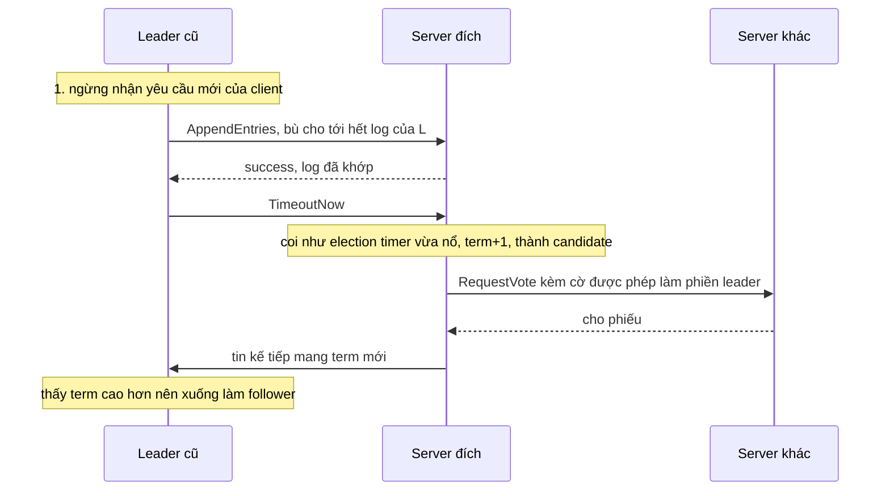

(Sơ đồ do người soạn vẽ theo mô tả ở mục 3.10 và 4.2.3 của luận án.)

*Va chạm với luật "bỏ qua RequestVote".* Mục 6 mô tả luật: server nhận `RequestVote` trong vòng election timeout tối thiểu kể từ lần nghe leader thì không cập nhật term và không bỏ phiếu. Luật này chặn đúng cuộc bầu cử có chủ ý của chuyển giao; luận án giải quyết bằng một cờ trong `RequestVote` để các server vẫn xử lý yêu cầu ngay cả khi tin rằng đang có leader[^b-lt-flag]. `etcd/raft` làm tương tự: nó nhận biết yêu cầu bỏ phiếu sinh ra từ chuyển giao bằng ngữ cảnh `campaignTransfer`[^b-etcd-force], và chuyển giao không đi qua PreVote vì "không phải đang hồi phục từ partition nên khỏi tốn thêm một vòng"[^b-etcd-lt-nopre].

<details><summary>Đi sâu: chương trình Rust vét cạn việc giao nhau của đa số, chính sách snapshot, ghi snapshot an toàn, và chi tiết cài đặt trong etcd</summary>

- *Vét cạn: đa số của hai cấu hình có giao nhau không?* Chương trình dưới (người soạn viết, biên dịch và chạy bằng rustc 1.95.0) biểu diễn cấu hình là bitmask server, liệt kê mọi đa số của hai cấu hình và hỏi có cặp nào rời nhau không. Nó chỉ kiểm tính chất giao nhau của đa số, không phải toàn bộ thuật toán.

```rust
// Vét cạn: đa số của hai cấu hình có luôn giao nhau không?
// Cấu hình = bitmask các id server (bit i = server i).

/// Mọi tập con của `cfg` có ít nhất một nửa + 1 phần tử.
fn majorities(cfg: u32) -> Vec<u32> {
    let need = cfg.count_ones() / 2 + 1;
    (0u32..1 << 12)
        .filter(|s| s & !cfg == 0 && s.count_ones() >= need)
        .collect()
}

/// Có đa số A của `x` và đa số B của `y` mà A và B rời nhau không?
fn can_be_disjoint(x: u32, y: u32) -> bool {
    let my = majorities(y);
    majorities(x).iter().any(|a| my.iter().any(|b| a & b == 0))
}

fn yn(b: bool) -> &'static str { if b { "có" } else { "không" } }

fn main() {
    println!(" n | cha-con rời nhau? | +2 server rời nhau? | anh em (+,+) | (+,-) | (-,-)");
    for n in 2..=8u32 {
        let c: u32 = (1 << n) - 1; // cấu hình cha {0..n-1}
        let add = |x: u32| c | 1 << x; // thêm server x
        let rem = |x: u32| c & !(1 << x); // bỏ server x
        // cha-con: một thay đổi một server
        let parent_child = (n..=n + 1).any(|x| can_be_disjoint(c, add(x)))
            || (0..n).any(|x| can_be_disjoint(c, rem(x)));
        // thêm hai server cùng lúc
        let plus2 = can_be_disjoint(c, c | 1 << n | 1 << (n + 1));
        // anh em: hai thay đổi khác nhau, mỗi thay đổi một server, cùng xuất phát từ c
        let aa = can_be_disjoint(add(n), add(n + 1));
        let ar = (0..n).any(|x| can_be_disjoint(add(n), rem(x)));
        let rr = (0..n).any(|x| (x + 1..n).any(|y| can_be_disjoint(rem(x), rem(y))));
        println!(
            "{n:>2} | {:<17} | {:<19} | {:<12} | {:<5} | {}",
            yn(parent_child), yn(plus2), yn(aa), yn(ar), yn(rr)
        );
    }
}
```

  Kết quả chạy:

```text
 n | cha-con rời nhau? | +2 server rời nhau? | anh em (+,+) | (+,-) | (-,-)
 2 | không             | không               | có           | có    | có
 3 | không             | có                  | không        | không | không
 4 | không             | không               | có           | có    | có
 5 | không             | có                  | không        | không | không
 6 | không             | không               | có           | có    | có
 7 | không             | có                  | không        | không | không
 8 | không             | không               | có           | có    | có
```

  Cách đọc: "cha-con" là hai cấu hình liên tiếp (một thay đổi một server); "+2 server" là thêm hai server cùng lúc; "anh em" là hai thay đổi khác nhau, mỗi thay đổi một server, cùng xuất phát từ cấu hình hiện tại, theo ba dạng thêm-thêm, thêm-bớt, bớt-bớt. Với n từ 2 đến 8, cha-con không bao giờ rời nhau; thêm hai server cùng lúc có thể rời nhau khi n lẻ (3 → 5 là ví dụ Hình 10); còn anh em có thể rời nhau khi và chỉ khi n chẵn, khớp với điều kiện "cụm có số server chẵn" trong phạm vi lỗi của bài đăng (suy luận của người soạn từ kết quả chạy). Giao nhau giữa cha và con không đủ: lỗi 2015 đến từ cặp anh em, nên bản vá nhắm đúng chỗ đó: sau khi leader mới commit một entry của term mình, cấu hình chưa committed của term trước không còn được commit nữa, nên hai cấu hình anh em không thể cùng được commit[^b-bug-why] (tóm tắt của người soạn).
- *Chính sách snapshot.* Chiến lược đơn giản là chụp khi log đạt một cỡ byte cố định[^b-p-snap-fixed]. Luận án đề nghị so với cỡ snapshot trước: chụp khi log vượt cỡ snapshot trước nhân với một hệ số giãn nở có thể cấu hình[^b-snap-factor1]. Với hệ số 4, khoảng 20% băng thông đĩa dành cho snapshot và cần khoảng 6 lần dung lượng đĩa so với một bản trạng thái (snapshot cũ, log gấp 4 lần, và snapshot đang ghi)[^b-snap-factor2]. etcd chọn đếm số transaction đã committed: cờ `--snapshot-count` mặc định 100000 là ngưỡng để kích hoạt một snapshot xuống đĩa[^b-cfg-snapshot].
- *Chụp mà không dừng cụm.* Muốn vẫn nhận cập nhật mới trong lúc đang ghi snapshot thì dùng kỹ thuật copy-on-write[^b-snap-cow]. Trên Linux, state machine trong bộ nhớ có thể `fork` để có bản sao toàn bộ không gian địa chỉ, tiến trình con ghi trạng thái ra rồi thoát trong lúc tiến trình cha vẫn phục vụ[^b-snap-fork]. Chính luận án thừa nhận `fork` tương tác kém với thread (và với destructor C++)[^b-snap-fork-threads]. (Nhận xét của người soạn: đó là điều đáng nghĩ tới nếu process Rust của bạn đa luồng.)
- *Ghi snapshot cho bền.* LogCabin ghi snapshot vào file tạm, chỉ đổi tên sau khi ghi xong và đã flush xuống đĩa, để không server nào nạp phải snapshot ghi dở khi khởi động[^b-snap-rename]; cùng mẫu hình ghi-rồi-đổi-tên của [P5 · Chương 06](../05-storage/06-durability-trong-thuc-te.md) (nhận xét của người soạn).
- *State machine nằm trên đĩa.* Khi state machine luôn có bản trạng thái trên đĩa, log có thể bị bỏ ngay khi state machine đã phản ánh các ghi xuống đĩa, và snapshot chỉ dùng khi cần gửi ảnh đĩa nhất quán cho server khác[^b-snap-disk].
- *`etcd/raft` v3.6.0 lệch luận án thế nào (chi tiết cài đặt, có thể đổi).* Thư viện nói nó cập nhật theo luận án cuối cùng, nhưng cấu hình có hiệu lực khi entry được *áp dụng* chứ không phải khi được thêm vào log, và vẫn an toàn vì cấu hình cũ và mới đảm bảo giao nhau[^b-etcd-membership]; nó cũng từ chối đề nghị đổi thành viên khi còn một thay đổi chưa committed trong log của leader[^b-etcd-one-pending]. Khi một node thành leader, nó đặt `pendingConfIndex` bảo thủ bằng index cuối của log, và trì hoãn các đề nghị đổi cấu hình cho tới khi mọi entry đang treo ấy được xử lý[^b-etcd-pending]. (Suy luận của người soạn: về tinh thần, cơ chế này cũng chặn việc tạo cấu hình mới khi còn entry cấu hình chưa chốt từ term trước, giống bản vá của Ongaro; người soạn không khẳng định chúng tương đương.) Một hạn chế đã biết: bớt một thành viên khỏi cụm hai server rồi một trong hai chết trước khi bên kia nhận được commit của entry thì cụm không còn tiến triển được; vì vậy README khuyên dùng từ ba node trở lên[^b-etcd-2member], và tài liệu vận hành nhắc rằng bớt một thành viên khỏi cụm hai server là không an toàn[^b-rc-2member].
- *Thêm trước hay bớt trước?* Khi thay server bằng một chuỗi các bước đổi một server, luận án khuyên thêm server trước khi bớt, để cụm chịu được một lỗi suốt quá trình[^b-add-first]; còn tài liệu etcd khuyên *bớt trước* khi thay một node đã hỏng, vì thêm member làm đổi cỡ quorum[^b-remove-first] và máy hỏng chưa được gỡ vẫn kéo giảm khả năng chịu lỗi của cụm[^b-rc-failed]. Hai lời khuyên không mâu thuẫn (suy luận của người soạn): cái đầu nói về lúc mọi server còn khỏe, cái sau nói về lúc đã có một server hỏng, đúng tình huống Hình 4.4(a). Learner tránh được bẫy đổi cỡ quorum ngay lúc thêm, vì nó chỉ được tính vào quorum sau khi được promote[^b-learner-quorum]; còn việc gỡ máy hỏng thì learner không thay thế được (suy luận của người soạn). etcd còn có cờ `--strict-reconfig-check` mặc định bật, từ chối yêu cầu đổi cấu hình sẽ làm mất quorum[^b-cfg-strict].
- *Luận án về vận hành.* Gỡ server hỏng một cách tự động có thể nguy hiểm vì cụm có thể còn quá ít bản sao so với yêu cầu về độ bền[^b-auto-remove]. Khi khởi tạo cụm lần đầu, luận án đề nghị một server có entry cấu hình đầu tiên trong log, các server khác khởi tạo với log rỗng rồi được thêm vào[^b-bootstrap]. Chi phí cài đặt joint consensus theo luận án là phải sửa khoảng sáu phép so sánh trong code của tác giả[^b-joint-cost].
- *Chuyển giao trong `etcd/raft` v3.6.0 (chi tiết cài đặt, có thể đổi).* Leader giữ server đích trong `leadTransferee` và gửi `MsgTimeoutNow` ngay nếu log của đích đã khớp[^b-etcd-lt-immediate]; trong lúc chuyển giao nó bỏ các proposal mới[^b-etcd-lt-drop]; nếu không xong trong một `electionTimeout` thì nó trở lại làm leader bình thường[^b-etcd-lt-abort]. README liệt kê đủ các tính năng: bầu leader, chép log, nén log, đổi thành viên, chuyển giao leader[^b-etcd-features].

</details>

**Quay lại Q5:** log được nén bằng snapshot kèm (last included index, term, cấu hình) và follower tụt xa được gửi snapshot bằng `InstallSnapshot`; đổi thành viên an toàn khi mọi đa số cũ và mới giao nhau, nên chỉ đổi một server mỗi lần (kèm bản vá năm 2015: commit một entry của term mình trước khi tạo entry cấu hình mới) hoặc đi qua joint consensus; server mới vào bằng chế độ không bỏ phiếu cho tới khi bắt kịp; và chuyển giao leader bằng `TimeoutNow` cho phép đổi leader mà không để cụm "ngủ" một election timeout.

## 6. Tính sống của Raft khi mạng hỏng một phần: PreVote, CheckQuorum và đọc an toàn (Q6)

> **Trả lời ngắn.** Trong Raft, term lớn hơn luôn thắng: server nào thấy term cao hơn term của mình thì cập nhật theo và, nếu đang là leader, xuống làm follower[^b-term-rules]. Vì vậy một server bị cô lập cứ hết giờ là tăng term, và khi liên lạc lại thì term lớn đó có thể lật đổ một leader đang khỏe[^b-rejoin-a][^b-rejoin-b]; partition một phần còn có thể làm leader đổi liên tục[^b-partial-majority]. PreVote bắt ứng viên hỏi đa số trước khi tăng term, còn CheckQuorum bắt leader tự xuống nếu không còn liên lạc được với đa số[^b-prevote-def][^b-stepdown]. Với việc đọc, để trả lời linearizable mà không ghi log, leader dùng ReadIndex (commit một entry đầu term, ghi nhớ commit index, xác nhận bằng một vòng heartbeat tới đa số, chờ state machine áp tới đó)[^b-ri-1][^b-ri-3a], hoặc dùng lease dựa trên đồng hồ: nhanh hơn nhưng chỉ đúng nếu độ lệch đồng hồ giữa các server có chặn trên[^b-lease-assume].

**Giải thích.**

Hình dung (nhận xét của người soạn): một nhân viên bị mất liên lạc nội bộ, mỗi lần hết kiên nhẫn lại tự nâng "số khóa họp" lên một bậc để đòi họp bầu lại. Khi nối mạng trở lại, con số lớn của anh ta buộc trưởng nhóm đang làm tốt phải hạ xuống để bầu lại, dù chẳng ai muốn đổi. Phần đọc thì giống việc hỏi "số dư hiện tại": bạn muốn chắc người trả lời không phải một thủ quỹ đã bị thay mà chưa biết.

### 6.1. Term lớn hơn luôn thắng: server ngoài lề và partition một phần

*Vì sao một server ngoài lề phá được cụm.* Luật ở Hình 2 của bài báo: server nào thấy RPC (yêu cầu hay trả lời) mang term T lớn hơn `currentTerm` thì đặt `currentTerm = T` và chuyển thành follower[^b-term-rules]. Luật này giữ an toàn, nhưng cũng nghĩa là *một* server tăng term vô ích đủ buộc một leader khỏe mạnh phải xuống. Luận án (mục 9.6) mô tả đúng kịch bản: server bị partition không nhận heartbeat, chẳng bao lâu tăng term để bầu cử dù không đủ phiếu thắng[^b-rejoin-a]; khi liên lạc lại, term lớn của nó lan ra cả cụm, qua `RequestVote` của nó hoặc qua trả lời `AppendEntries`, buộc leader xuống và phải bầu lại[^b-rejoin-b]. Luận án cho rằng sự kiện như vậy hiếm và mỗi lần chỉ làm một leader xuống[^b-rare]; vì thế PreVote là phần mở rộng "nên có nếu cần thêm độ bền"[^b-prevote-reco], không phải điều kiện của thuật toán. Khi leader mất, cụm không khả dụng chừng một election timeout[^b-timing-leader-crash]; một leader bị lật cũng buộc cụm đi qua một cuộc bầu cử, nên với một cụm hay bị "rung" vì mạng, các khoảng đó cộng dồn lại (nhận xét của người soạn).

*Partition một phần (partial partition).* Ngoài cô lập hoàn toàn còn một dạng khó chịu hơn: hai nhóm server không nói chuyện được với nhau nhưng một nhóm thứ ba nói chuyện được với cả hai[^b-partial-fig]. Khảo sát OSDI 2020 của Alfatafta và cộng sự định nghĩa đây là lỗi làm gián đoạn liên lạc giữa một số nhưng không phải mọi node trong cụm[^b-partial-def]; cụm vẫn liên thông nhưng không phải ai cũng nói được với ai[^b-partial-notall]. Họ ghi nhận bầu cử leader là cơ chế dễ tổn thương nhất bởi loại lỗi này[^b-partial-vuln], và chỉ ra rằng bầu bằng đa số một mình không chống nổi, vì có thể có nhiều nhóm liên thông hoàn toàn, mỗi nhóm nối được với một đa số, dẫn tới leader election thrashing (leader liên tục đổi) và mất sẵn sàng[^b-partial-majority].

Ví dụ thật: Cloudflare kể về sự cố ngày 2020-11-02[^b-cf-date]. Một switch hỏng nửa vời khiến ba node etcd mà bài viết gọi là node 1, node 2 và node 3 có đúng topo trên: node 1 không nối được với leader (node 3) qua switch lỗi, nhưng nối được với node 2, và node 2 nối bình thường với node 3[^b-cf-topology]. Kết quả là node 1 liên tục khởi động bầu cử còn node 2 liên tục bầu cho node 3[^b-cf-elections]; theo Cloudflare, bầu cử leader gây gián đoạn nên cụm chỉ còn đọc được (không ghi được) cho tới khi switch hồi phục[^b-cf-readonly]. (Cloudflare gọi đó là lỗi Byzantine; theo mô hình của chương này nó là một partition không bắc cầu, nhận xét của người soạn. Bài viết không nói cụm có bao nhiêu node, cũng không nói cấu hình PreVote hay CheckQuorum của họ, nên ta không kết luận gì về chúng.)

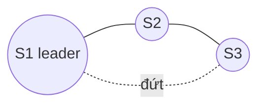

(Sơ đồ do người soạn vẽ theo mô tả topo của Cloudflare và Hình 1 của khảo sát OSDI.)

Dựng lại topo đó với Raft thuần (không có biện pháp nào ở các mục sau); bảng do người soạn dựng từ các luật ở Hình 2, số term tùy ý, S1 là leader term 5 và đường S1 đến S3 đứt. Giả định (suy luận của người soạn): cụm rảnh, không có entry mới nào được ghi (kể cả no-op), nên log của ba server luôn bằng nhau và luật log đủ mới không chặn ai:

| Bước | Điều xảy ra | S1 | S2 | S3 |
|---|---|---|---|---|
| 0 | ổn định | leader, term 5 | follower, term 5 | follower, term 5 |
| 1 | S3 không nghe được S1, hết election timeout; `RequestVote` tới S1 bị mất, tới S2 thì đến | leader, term 5 | follower, term 5 | candidate, term 6 |
| 2 | S2 thấy term 6 lớn hơn nên nâng term[^b-term-rules]; log của S3 không cũ hơn nên S2 cho phiếu[^b-vote-rule] | leader, term 5 | follower, term 6, đã bầu S3 | leader, term 6 (2/3 phiếu) |
| 3 | heartbeat term 5 của S1 tới S2 bị từ chối kèm term 6[^b-ae-term]; S1 thấy term cao hơn nên xuống | follower, term 6 | follower, term 6 | leader, term 6 |
| 4 | S1 không nghe được S3 (S2 không phát heartbeat), hết giờ, thành candidate term 7; S2 nâng term và cho phiếu | leader, term 7 | follower, term 7, đã bầu S1 | follower, term 7, bị phế khi S2 từ chối heartbeat term 6 kèm term 7 |
| 5... | S3 lại không nghe được S1, hết giờ và lặp lại bước 1 với term cao hơn | | | |

Với giả định đó, quyền leader cứ đổi qua lại giữa S1 và S3 mỗi lần một bên hết election timeout, dù S2 nối được với cả hai và cả ba server đều khỏe. Nếu có entry mới được ghi thì chỉ S2 và leader hiện tại có entry đó; ứng viên bên kia có log cũ hơn nên S2 không cho phiếu, nhưng S2 vẫn nâng term khi thấy term cao hơn nên leader hiện tại vẫn bị phế rồi phải bầu lại: quyền leader không đổi chủ nhưng cụm vẫn bị gián đoạn lặp đi lặp lại (suy luận của người soạn từ Hình 2).

### 6.2. Ba lớp phòng thủ: bỏ qua RequestVote, PreVote, CheckQuorum

*Lớp 1: bỏ qua `RequestVote` khi vừa nghe leader.* Bài báo (mục 6) và luận án (mục 4.2.3) đưa ra luật này để chặn server bị gỡ khỏi cụm[^b-paper-disregard]. Nội dung luật: server nhận `RequestVote` trong vòng election timeout tối thiểu kể từ lần nghe leader hiện tại thì không cập nhật term và không bỏ phiếu; nó có thể bỏ qua, từ chối hoặc trì hoãn yêu cầu, kết quả gần như nhau[^b-ignore-rv]. Lý do: leader được coi là còn hoạt động nếu duy trì được heartbeat tới follower, nên các server không được phép lật một leader đang nhận heartbeat bằng số term lớn hơn[^b-leader-active]. Khảo sát OSDI mô tả một cách tương tự (một node chỉ tham gia bầu nếu không liên lạc được với leader hiện tại) và nói LogCabin, bản cài đặt gốc của Raft[^b-partial-logcabin], dùng nó[^b-partial-verif][^b-partial-verif-used]; cái giá của cách này theo khảo sát là nhiều node bị loại khỏi hoạt động[^b-partial-verif-cost]. Áp vào bảng trên (suy luận của người soạn): S2 nghe S1 đều đặn nên bỏ qua `RequestVote` của S3; S1 vẫn là leader term 5 cùng S2; S3 không thắng được mà chỉ tự tăng term một mình, 6, 7, 8, ... Cụm vẫn chạy nhưng hết một nút: nếu S2 hỏng thì mất quorum dù S3 còn sống, vì S3 không nối được S1.

*Lớp 2: PreVote, hai phiên bản.* Ý tưởng "hỏi trước khi tăng term" xuất hiện hai lần trong luận án, với hai kết cục khác nhau; dễ nhầm. Ở mục 4.2.3 (server bị gỡ khỏi cụm), ý tưởng đầu tiên là ứng viên hỏi các server xem log của nó có đủ mới để được bầu không, chỉ khi tin chắc mới tăng term[^b-prevote-first]. Luận án kết luận cách đó *không* giải quyết được: có tình huống server gây rối có log đủ mới nhưng bầu cử vẫn gây rối[^b-prevote-fails], và không giải pháp nào chỉ dựa vào so sánh log là đủ để biết một cuộc bầu cử có gây rối hay không[^b-logs-alone]. Ở mục 9.6 (server bị partition quay lại), PreVote được dựng lại với *thêm* điều kiện về heartbeat: ứng viên chỉ tăng term nếu biết từ một đa số rằng họ sẵn sàng bỏ phiếu cho nó, tức log của ứng viên đủ mới *và* các voter không nhận heartbeat từ leader hợp lệ trong ít nhất một election timeout nền[^b-prevote-def]. Với điều kiện đó, server bị cô lập không tăng term được vì không xin được phép từ đa số[^b-prevote-solves-a]; khi nối lại, nó vẫn không tăng được vì các server khác đang nhận heartbeat đều đặn, và khi nhận heartbeat của leader nó trở lại làm follower trong cùng term[^b-prevote-solves-b]. Luận án nói PreVote lấy cảm hứng từ thuật toán của ZooKeeper, nơi một server phải nhận đa số phiếu trước khi tính epoch mới[^b-prevote-zk]. Docs của cờ `PreVote` trong `etcd/raft` (và `pre_vote` trong `raft-rs`) nói rằng nó bật đúng thuật toán ở mục 9.6 này[^b-etcd-pv-cfg][^b-raftrs-pv].

*Lớp 3: CheckQuorum.* Nếu PreVote bảo vệ leader khỏi server ngoài lề thì CheckQuorum bảo vệ client khỏi leader ngoài lề. Luận án (mục 6.2): một leader bị partition khỏi cụm nhưng vẫn nói chuyện được với một client có thể làm chậm yêu cầu của client đó mãi mãi vì không chép được entry nào cho ai[^b-stale-leader-delay]; nên leader Raft tự xuống nếu một election timeout trôi qua mà không có vòng heartbeat nào thành công tới đa số, để client thử server khác[^b-stepdown]. Luận án không đặt tên cho hành vi này; `etcd/raft` và `raft-rs` gọi nó là `CheckQuorum`: leader tự xuống khi quorum không hoạt động trong một `electionTimeout`[^b-etcd-cq-cfg][^b-raftrs-cq]; README của `etcd/raft` liệt kê "tự xuống khi leader mất quorum" là một tính năng[^b-etcd-readme-stepdown]. Cài đặt: cứ mỗi `electionTimeout` leader kiểm tra xem đa số có hoạt động gần đây không, nếu không thì trở về follower[^b-etcd-cq-log], rồi đánh dấu mọi server (trừ chính nó) là chưa hoạt động để chuẩn bị cho lần kiểm tiếp[^b-etcd-cq-code]. CheckQuorum không làm *ghi* an toàn hơn, vì an toàn vốn không phụ thuộc thời gian[^b-timing-safety]; nó cải thiện tính sống (client không bị kẹt ở một leader không commit được gì) và là điều kiện của lease read ở mục 6.4.

### 6.3. Chúng đan vào nhau thế nào (đọc mã `etcd/raft` v3.6.0)

Đoạn này là suy luận của người soạn từ việc đọc mã `etcd/raft` ở tag v3.6.0; đó là chi tiết cài đặt, có thể đổi giữa các phiên bản, và người soạn không chạy thử. Hai chỗ trong hàm `Step` quyết định mọi thứ:

1. Luật "bỏ qua `RequestVote` khi vừa nghe leader" được cài thành biến `inLease`, và nó chỉ bật khi `checkQuorum` bật: `inLease` đúng khi `checkQuorum` bật, node đang biết một leader, và chưa quá election timeout kể từ lần nghe[^b-etcd-inlease]. Nó áp dụng cho cả `MsgVote` lẫn `MsgPreVote`, trừ khi yêu cầu sinh ra từ chuyển giao leader[^b-etcd-force]; comment của mã gần như chép lại câu của bài báo[^b-etcd-inlease-comment].
2. Khi nhận `MsgPreVote` cho một term tương lai, server có thể cho phiếu nếu log của ứng viên đủ mới và `inLease` không chặn trước (điểm 1), *kể cả khi nó đang biết một leader*, vì điều kiện `canVote` có nhánh "hoặc đây là PreVote cho term tương lai"[^b-etcd-canvote]. Cũng ở đó, nhận PreVote không làm đổi term của người nhận[^b-etcd-prevote-recv].

Bảng dưới áp hai điều trên vào topo ở mục 6.1:

| Cấu hình | S3 có thắng và lật S1? | S3 có tăng term khi đường đứt? | Khi đường nối lại |
|---|---|---|---|
| Không PreVote, không CheckQuorum | có: S2 cho phiếu như bảng 6.1 | có | cụm đã "rung" từ trước |
| Chỉ CheckQuorum | không: S2 đang trong lease nên bỏ qua `RequestVote` | có | heartbeat term 5 của S1 gặp term cao của S3; S3 trả lời kèm term cao và S1 phải xuống |
| Chỉ PreVote | có thể: S2 không trong lease nên vẫn cho pre-vote, rồi S3 thành candidate thật và S2 cho phiếu | không tăng trước khi được pre-vote | (nếu S3 đã thắng thì như dòng đầu) |
| Cả hai | không: S2 bỏ qua cả pre-vote | không | S3 nhận heartbeat term 5 của S1 và trở lại làm follower |

Dòng "chỉ CheckQuorum" là tình huống mà comment của mã gọi là "node kẹt": server bị cô lập có term cao hơn leader; khi liên lạc lại, trả lời bằng `MsgAppResp` mang term cao sẽ buộc leader xuống; sự phá rối này "không thể tránh để giải phóng node kẹt bằng một cuộc bầu cử mới, và có thể được ngăn bằng pha Pre-Vote"[^b-etcd-stuck]. Dòng "chỉ PreVote" là điểm đáng nhớ: với cài đặt này, PreVote một mình *không* tái hiện điều kiện "voter chưa nghe heartbeat từ leader hợp lệ" của luận án; điều kiện đó nằm ở lease, vốn cần CheckQuorum. Dòng cuối là cấu hình chạy đúng ý luận án. Điều này khớp với cách etcd server cấu hình hai cờ: v3.5.17 đặt `CheckQuorum: true` cố định còn `PreVote` lấy từ cấu hình[^b-etcd-server-cq], và tài liệu v3.5 liệt kê cờ `--pre-vote` với giá trị mặc định `true`[^b-cfg-prevote]. Server v3.5.17 dùng bản raft nằm trong repo etcd (module `go.etcd.io/etcd/raft/v3`[^b-etcd35-import]), không phải `etcd-io/raft` v3.6.0 mà mục này đọc; người soạn chỉ đối chiếu đoạn xử lý term của `Step` ở đó và thấy cùng dòng `inLease`[^b-etcd35-inlease]. `raft-rs` 0.7.0 có các cờ `check_quorum` và `pre_vote` với cùng mô tả[^b-raftrs-cq][^b-raftrs-pv].

Có thêm một lý do để CheckQuorum đi cùng luật "bỏ qua `RequestVote`" (suy luận của người soạn): nếu leader chỉ *gửi* được mà không *nhận* được (đường một chiều), nó cứ gửi heartbeat khiến follower yên tâm và không bầu cử, trong khi không ack nào về nên không commit được gì. Không có CheckQuorum thì cụm kẹt vô hạn; có CheckQuorum, leader tự xuống sau một election timeout, rồi các follower mới hết giờ và bầu leader khác.

### 6.4. Đọc an toàn: ReadIndex, follower đọc và lease

[Chương 09, mục 7 (phần Đi sâu)](09-consistency-va-consensus.md) đã nêu hai biện pháp và lease; dưới đây là từng bước, lý do từng bước, và cách các thư viện đặt chúng.

*Vì sao không đọc thẳng từ leader.* Một leader bị partition có thể không biết mình đã bị thay: phần còn lại của cụm đã bầu leader mới và commit entry mới; nếu leader cũ trả lời đọc mà không hỏi ai, nó trả dữ liệu cũ, không linearizable[^b-read-why]. Luận án cho biết vấn đề này đã bị phát hiện trong hai bản cài đặt Raft của bên thứ ba[^b-read-3rd].

*ReadIndex, năm bước theo luận án (mục 6.4).*

1. Nếu leader chưa commit entry nào của term hiện tại thì chờ cho tới khi có. Leader Completeness bảo đảm leader có mọi entry committed, nhưng đầu term nó chưa biết đó là những entry nào; muốn biết, nó phải commit một entry của term mình[^b-ri-1]. Vì vậy mỗi leader commit một entry no-op đầu term; ngay khi no-op này committed, commit index của leader chắc chắn không nhỏ hơn của bất kỳ server nào trong term của nó[^b-ri-1b].
2. Leader lưu commit index hiện tại vào biến `readIndex`, làm cận dưới cho phiên bản trạng thái mà truy vấn đọc[^b-ri-2].
3. Leader gửi một vòng heartbeat mới và chờ đa số xác nhận, để chắc rằng nó chưa bị một leader mới thay mà không hay[^b-ri-3a]. Khi đủ xác nhận, leader biết tại thời điểm nó gửi heartbeat không thể tồn tại leader term cao hơn, nên `readIndex` khi đó là commit index lớn nhất mà bất kỳ server nào từng thấy[^b-ri-3b].
4. Leader chờ state machine của nó áp tới ít nhất `readIndex`; như vậy là đủ mới để thỏa linearizability[^b-ri-4].
5. Leader chạy truy vấn trên state machine và trả kết quả cho client[^b-ri-5].

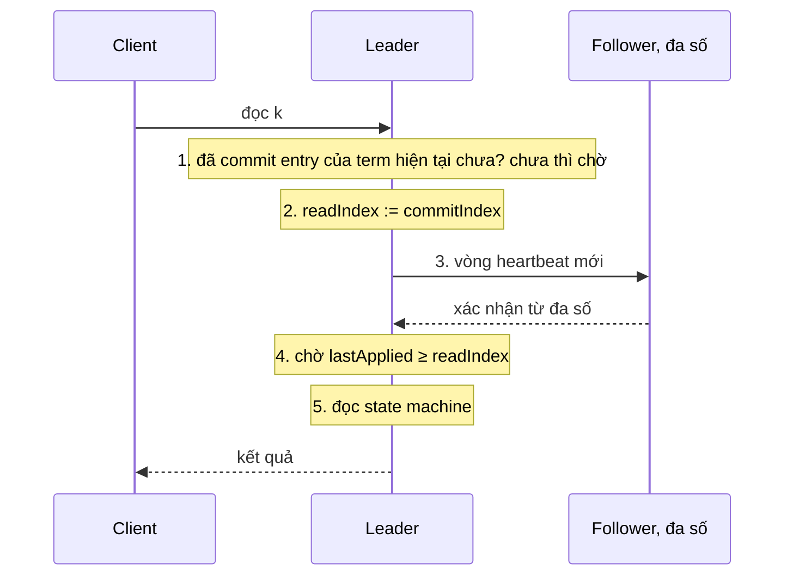

(Sơ đồ do người soạn vẽ theo năm bước ở mục 6.4 của luận án.)

*Vì sao cần từng bước (hai trace do người soạn dựng).* Bước 1: leader cũ S1 đã commit index 7 và trả lời client "ok" cho lệnh ở index 7, rồi sập trước khi báo commit index mới cho follower. S2 thắng cử term 4; log của S2 có index 7 nhờ Leader Completeness nhưng commit index của S2 mới là 5. Nếu S2 trả lời đọc ngay với `readIndex = 5`, client vừa nhận "ok" cho lệnh 7 sẽ không thấy nó, vi phạm linearizability. Với bước 1, S2 chờ no-op của term 4, giả sử ở index 8, được commit; lúc đó commit index của nó không nhỏ hơn 8, tức không nhỏ hơn 7. Bước 3 (một cụm khác, độc lập với trace trên): S1 là leader term 4 với commit index 7 và `x=1`; S1 bị partition, S3 thắng cử term 5 và commit `x=2` ở index 8; client vẫn gửi đọc tới S1. Nếu S1 trả lời ngay với `readIndex = 7` thì nó trả `x=1`, cũ. Bước 3 buộc S1 gom xác nhận từ đa số; nó không gom được (hoặc nhận trả lời mang term cao hơn) nên không trả lời. Câu của luận án, "tại thời điểm nó gửi heartbeat", còn cho thấy vòng heartbeat phải được gửi *sau khi* yêu cầu đọc tới (suy luận của người soạn); mã `etcd/raft` làm đúng thế, với chế độ an toàn nó đăng ký yêu cầu đọc rồi phát một đợt heartbeat mới[^b-etcd-ri-bcast], và hoãn yêu cầu đọc nếu leader chưa commit entry nào ở term của mình[^b-etcd-ri-postpone].

*Chi phí.* Mỗi lô đọc cần một vòng heartbeat tới đa số, nghĩa là thêm độ trễ cho truy vấn[^b-ri-cost], nhưng không ghi đĩa đồng bộ[^b-ri-nodisk]; leader gộp được nhiều truy vấn đang chờ vào một vòng heartbeat[^b-ri-amort].

*Follower đọc.* Cho follower phục vụ đọc giúp tăng thông lượng đọc và giảm tải cho leader[^b-fr-why], nhưng nếu follower đọc thẳng thì có nguy cơ trả dữ liệu cũ: follower bị partition có thể lâu không nhận entry mới, và ngay cả khi vừa nhận heartbeat thì leader đó có thể đã bị thay mà chưa biết[^b-fr-hazard]. Cách an toàn: follower hỏi leader một `readIndex` hiện tại (leader chạy các bước 1 đến 3), rồi tự chạy bước 4 và 5 trên state machine của mình cho nhiều truy vấn gom lại[^b-fr-proto]. `etcd/raft` cung cấp đúng mẫu này cho cả leader lẫn follower[^b-etcd-readme-reads]. Chi phí so với đọc ở leader là thêm một lượt follower tới leader và quay lại, cộng thời gian chờ follower áp tới `readIndex` (suy luận của người soạn).

*Lease read: bớt một vòng heartbeat, đổi lấy giả định đồng hồ.* Thay vì hỏi đa số cho mỗi lô đọc, leader có thể dùng heartbeat như một lease: khi một vòng heartbeat được đa số xác nhận, nó cho rằng không server nào khác thành leader trong chừng một election timeout, và đọc cục bộ không cần liên lạc trong thời gian đó[^b-lease-def]. Hình 6.3 của luận án vẽ hạn lease là `start + election timeout / chặn trên độ lệch đồng hồ`, với `start` là lúc leader gửi đợt heartbeat; công thức nằm trong hình vẽ, còn lớp văn bản của chú thích bị tách dòng nên không trích nguyên văn được[^b-lease-fig]. Giả định then chốt: có một chặn trên cho độ lệch đồng hồ giữa các server, nghĩa là trong một khoảng thời gian, không đồng hồ nào chạy nhanh hơn đồng hồ khác quá chặn đó. Luận án cảnh báo duy trì chặn này trong vận hành có thể khó (GC, di chuyển máy ảo, chỉnh tốc độ đồng hồ khi đồng bộ), và nếu giả định bị vi phạm hệ có thể trả dữ liệu cũ tùy ý[^b-lease-assume]. Luận án không khuyên dùng trừ khi cần đạt yêu cầu hiệu năng[^b-lease-notreco].

Ví dụ số (người soạn tính theo công thức của Hình 6.3): election timeout E = 1000 ms (mặc định của etcd[^b-cfg-hb]) và chặn trên độ lệch giả định 1,01, nên lease dài 1000 / 1,01, khoảng 990 ms tính từ lúc gửi heartbeat. Nếu thực tế đồng hồ của một follower chạy nhanh gấp 1,5 lần đồng hồ của leader, timer 1000 ms của follower nổ sau chỉ 1000 / 1,5, khoảng 667 ms thời gian thật. Trong khoảng từ 667 ms tới 990 ms (đã làm tròn), follower đã có thể bắt đầu bầu cử và, nếu thắng, commit ghi mới trong lúc leader cũ vẫn phục vụ đọc bằng lease: cửa sổ đọc cũ tối đa cỡ 320 ms, trừ thời gian bầu cử và commit. Đồng hồ dùng cho lease phải là đồng hồ đơn điệu, tương ứng `Instant` chứ không phải `SystemTime` (xem phần "Liên hệ với Rust" của [chương 09](09-consistency-va-consensus.md); nhận xét của người soạn).

Hai điều cần nhớ khi dùng lease. Một, leader phải để lease hết hạn trước khi chuyển giao leader, vì chuyển giao cho phép thay leader sớm[^b-lease-transfer]. Hai, thư viện đòi CheckQuorum: `etcd/raft` có hai chế độ đọc, `ReadOnlySafe` (liên lạc với quorum, là mặc định và được khuyên dùng)[^b-etcd-ro-safe] và `ReadOnlyLeaseBased` (dựa vào lease, bị ảnh hưởng bởi độ lệch đồng hồ; nếu độ lệch không có chặn thì leader có thể giữ lease lâu hơn mức cần)[^b-etcd-ro-lease], và ghi rõ CheckQuorum phải bật khi dùng chế độ sau[^b-etcd-lease-cq]; README cũng nhấn mạnh cách này dựa vào đồng hồ của mọi máy trong nhóm[^b-etcd-readme-lease]. `raft-rs` 0.7.0 cũng vậy: `read_only_option` có `LeaseBased` đòi `check_quorum = true`[^b-raftrs-ro]. Lý do (suy luận của người soạn từ mã ở mục 6.3): lease chỉ đúng nếu không có leader khác xuất hiện trong thời hạn lease, mà việc follower từ chối bầu khi đang trong lease chỉ bật cùng CheckQuorum; và một leader mất quorum phải tự xuống thì mới thôi phục vụ đọc từ lease.

Luận án nêu một cách giữ được sequential consistency ngay cả khi đồng hồ sai: server trả kèm index của trạng thái trong mỗi phản hồi, client nhớ index lớn nhất đã thấy và gửi kèm mỗi request, server nào chưa áp tới index đó thì chưa phục vụ[^b-lease-seq]. (Đây là mức yếu hơn linearizable.)

<details><summary>Đi sâu: cài đặt PreVote trong etcd/raft, ReadIndex của etcd server, thời gian và cờ cấu hình</summary>

- *Pre-candidate không đổi gì ngoài trạng thái (chi tiết cài đặt ở `etcd/raft` v3.6.0, có thể đổi).* Khi thành pre-candidate (trạng thái của node đang ở pha PreVote), node không tăng `Term` và không đổi `Vote`[^b-etcd-prevote-noterm]; `MsgPreVote` được gửi cho term kế tiếp trước khi `Term` của node được tăng[^b-etcd-prevote-term]. Khi trả lời `MsgVote` hoặc `MsgPreVote`, node ghi term *của message*, không phải term cục bộ; comment giải thích lý do: một node từng bị partition có term cục bộ đã cũ, nếu trả lời bằng term cục bộ thì bên ứng cử sẽ bỏ qua trả lời vì coi là lỗi thời[^b-etcd-prevote-resp-term].
- *Bật PreVote trên cụm đang chạy.* Mã có một nhánh riêng cho tình huống nâng cấp: trước khi bật PreVote có thể có ứng viên với term cao hơn nhưng log ít hơn, và sau khi bật PreVote cụm có thể deadlock nếu bỏ rơi các message có term thấp hơn[^b-etcd-upgrade]. (Nhận xét của người soạn: nếu bạn bật PreVote trên cụm đã chạy, hãy đọc kỹ ghi chú nâng cấp của phiên bản mình dùng.)
- *Server bị gỡ khỏi cụm.* Hai cơ chế cùng nhau giảm gây rối: node bị gỡ gửi `MsgVote` hoặc `MsgPreVote` thì bị bỏ qua, nhưng nó cũng không nhận được `MsgApp` hay `MsgHeartbeat` nên không có cơ hội làm term tăng bằng cách báo cho leader rằng nó còn "hoạt động"[^b-etcd-removed]. Đây là phiên bản cài đặt của vấn đề mà luận án nêu ở mục 4.2.3.
- *Tham số thời gian.* Mặc định của etcd v3.5: heartbeat 100 ms, election timeout 1000 ms[^b-cfg-hb]. Tài liệu tuning nói hai giá trị này phải giống nhau ở mọi member của cụm, vì khác nhau có thể làm cụm mất ổn định[^b-tuning-same] (nhận xét của người soạn: luật lease ở trên dựa chính vào election timeout, nên đây không phải chuyện thẩm mỹ). `etcd/raft` gợi ý `ElectionTick` bằng 10 lần `HeartbeatTick` để tránh đổi leader không cần thiết[^b-etcd-electiontick].
- *Đọc linearizable trong etcd server.* Vòng `linearizableReadLoop` của etcd v3.5.17 gọi `ReadIndex` của Raft[^b-etcd-ri-call], rồi nếu applied index còn thấp hơn index đã xác nhận thì chờ cho tới khi đủ, và chỉ khi đó mới mở khóa các lần đọc đã yêu cầu trước mốc đó[^b-etcd-ri-wait]; một vòng lặp mở khóa được nhiều lần đọc cùng lúc[^b-etcd-ri-loop], đúng ý "gộp nhiều truy vấn vào một vòng". Mã còn ghi nhận trường hợp bước 1 chưa xong: khi có commit đầu tiên trong term hiện tại, nó gửi lại yêu cầu `ReadIndex`[^b-etcd-ri-firstcommit]. Đọc `serializable` ở [chương 09](09-consistency-va-consensus.md) là đường bỏ qua chuỗi này (nhận xét của người soạn).
- *Cờ trong Rust.* Trong `raft-rs` 0.7.0 các tùy chọn tương ứng là `Config::check_quorum`, `Config::pre_vote` và `Config::read_only_option`[^b-raftrs-cq][^b-raftrs-pv][^b-raftrs-ro]; cách nhúng crate này (bạn tự lo vòng lặp, mạng, lưu trữ) đã nêu ở phần "Liên hệ với Rust" của [chương 09](09-consistency-va-consensus.md).

</details>

**Quay lại Q6:** khi mạng hỏng một phần, luật "term lớn hơn thắng" cho phép server ngoài lề lật leader khỏe; luật bỏ qua `RequestVote` khi vừa nghe leader, PreVote (ứng viên hỏi trước khi tăng term) và CheckQuorum (leader tự xuống khi mất đa số) chặn từng phần của hiện tượng đó và trong `etcd/raft` phải dùng cùng nhau; còn đọc an toàn là ReadIndex năm bước (hoặc lease, đổi một vòng heartbeat lấy giả định chặn trên độ lệch đồng hồ và CheckQuorum).

## 7. Họ hàng của Raft và Paxos: Viewstamped Replication, Zab, EPaxos, PBFT (Q7)

> **Trả lời ngắn.** Viewstamped Replication (VR) và Zab là hai thuật toán cùng họ với Raft: một leader sắp xếp log, thời gian chia thành các nhiệm kỳ đánh số (view, epoch) và mọi quyết định cần đa số; chúng khác Raft ở chỗ ai được làm leader và leader mới nhặt lại log của người đi trước bằng cách nào[^c-th-terms][^c-th-select]. EPaxos bỏ hẳn leader cố định: client chọn replica nào gửi lệnh cũng được[^c-ep-noleader], replica nhận lệnh làm "command leader" riêng cho lệnh đó[^c-ep-cmdleader]; lệnh commit sau một vòng trong trường hợp thường và cần thêm một vòng khi có lệnh không giao hoán được đề xuất đồng thời[^c-th-egal2], nên hợp với các cụm trải rộng địa lý[^c-raft-epaxos2]. PBFT thuộc họ chịu cả node nói dối: ba pha và 3f+1 replica[^c-pbft-phases][^c-pbft-opt].

**Giải thích.**

Hình dung (nhận xét của người soạn): bốn nhà hàng cùng dùng công thức "một bếp trưởng ghi sổ, quá nửa tổ bếp ký xác nhận", nhưng mỗi nơi gọi "nhiệm kỳ bếp trưởng" một tên, chọn bếp trưởng mới theo một kiểu và bàn giao sổ theo một thủ tục khác. EPaxos là nhà hàng không có bếp trưởng cố định: ai nhận khách thì tự lo món của khách đó, vẫn phải hỏi nhanh một nhóm bạn bếp một lượt, và chỉ mất thêm một lượt hỏi nữa khi hai món đụng cùng một nguyên liệu. PBFT là nhà hàng phải đề phòng cả nhân viên cố tình nấu sai.

*Bản đồ thuật ngữ.* Cùng một ý — "số của đời leader hiện tại; thấy số lớn hơn thì ngừng nghe leader cũ" — mang bốn tên: *term* ở Raft, *proposal number* ở Paxos, *view* ở VR, *epoch* ở Zab[^c-th-terms]. Bài so sánh hình thức của van Renesse, Schiper và Schneider có hẳn một bảng dịch thuật ngữ[^c-vive-table-intro]; theo bảng đó, khái niệm chung "round" được Paxos gọi là ballot, VR gọi là view, Zab gọi là epoch[^c-vive-t-ours][^c-vive-t-paxos][^c-vive-t-vsr][^c-vive-t-zab]. Bảng 7.1 mở rộng bản đồ đó sang các chỗ khác nhau thật sự (bảng do người soạn tổng hợp từ các nguồn trong chú thích ở từng ô; mục "Raft" lấy từ [chương 09, mục 7](09-consistency-va-consensus.md) và luận án Raft).

| | Raft | Multi-Paxos | VR Revisited | Zab |
|---|---|---|---|---|
| Tên số của đời leader | `term` | proposal number (ballot) | `view-number` | `epoch`, là nửa cao của `zxid`[^c-zk-zxid] |
| Cấp số bằng cách nào | bỏ phiếu: ai gom đa số thì độc quyền term đó[^c-th-assign] | chia không gian số cho các proposer, mỗi người một tập rời nhau[^c-ps-disjoint][^c-th-assign] | chia không gian số cho các server, ví dụ theo vòng tròn (view v thuộc server v mod n), nên không tranh nhau một số[^c-th-assign][^c-th-vrr] | bỏ phiếu[^c-th-assign] |
| Ai được làm leader | ứng viên có log đủ mới[^c-th-raft-catchup] | bất kỳ server[^c-th-select] | server `i = v mod n`[^c-th-vrr] | bất kỳ server[^c-th-select]; ZooKeeper đòi leader đã thấy `zxid` cao nhất[^c-zk-activation2] |
| Leader mới bắt kịp log thế nào | không cần chuyển entry vì đã đủ[^c-th-raft-catchup] | thường chạy hai pha Paxos cho từng entry mà nó chưa biết giá trị đã commit[^c-th-paxos-catchup] | thu log của f+1 replica, lấy log có `v'` lớn nhất rồi `n` lớn nhất[^c-vr-select] | pha Discovery: lấy history của follower có epoch/zxid lớn nhất trong một quorum[^c-zab-pickhist] |
| Trạng thái phải nằm trên bộ nhớ bền | `currentTerm`, `votedFor`, `log[]`[^c-raft-persist] | acceptor nhớ đề xuất cao nhất đã chấp nhận và số `prepare` cao nhất đã trả lời[^c-ps-acceptor] | không đòi đĩa: dùng trạng thái nhân bản để giữ dữ liệu bền[^c-vr-nodisk-intro]; replica hỏng lấy lại trạng thái từ các replica khác bằng giao thức recovery[^c-vr-nodisk-why] | `f.p` (đề xuất epoch mới đã xác nhận), `f.a` (đề xuất leader mới đã xác nhận), history[^c-zab-persist] |

Hai chi tiết dễ nhầm. Thứ nhất, luận án Raft nhận xét rằng VR và Zab được mô tả như thể server gửi *toàn bộ log* cho leader mới để leader chọn log mới nhất, một mô hình đẹp nhưng không thực tế với log lớn[^c-th-vr-zab-whole]; Raft thì tránh việc đó nhờ luật bỏ phiếu[^c-th-raft-catchup]. Thứ hai, chữ "epoch" bị dùng cho hai thứ khác nhau: ở Zab nó là số đời leader[^c-zk-epoch], còn ở VR nó đánh số *cấu hình thành viên*: đổi nhóm replica thì hệ sang epoch mới[^c-vr-epoch], và primary được tính từ cấu hình của epoch cùng `view-number` hiện tại[^c-vr-epoch-config], nên đổi leader trong cùng một nhóm thì chỉ tăng view (suy luận của người soạn).

### 7.1. Viewstamped Replication Revisited

*Vị trí.* VR ra đời trong thập niên 1980, cùng thời Paxos nhưng độc lập; nó là giao thức *replication* dùng consensus (rất giống Paxos) làm một phần bên trong, chứ không phải giao thức consensus thuần[^c-vr-1980s]. Paper Raft nêu VR là thuật toán có sẵn mà Raft giống một cách đáng chú ý nhất[^c-raft-vr].

*Bình thường.* Primary (leader) không được lưu trong trạng thái mà được *tính* từ `view-number` và cấu hình, theo vòng tròn[^c-vr-primary]. Primary gán `op-number` cho request, gửi `PREPARE`; backup ghi theo đúng thứ tự (thiếu entry trước thì chưa nhận)[^c-vr-inorder]; khi primary nhận đủ f lời `PREPAREOK`, tức f+1 replica kể cả nó, thì coi thao tác (và mọi thao tác trước) là committed[^c-vr-commit][^c-vr-quorums]. Điểm khác Raft đầu tiên: bước này *không đòi ghi đĩa*[^c-vr-nodisk-normal].

*Đổi view.* Backup theo dõi primary, thấy có vẻ hỏng thì cùng chạy thủ tục đổi view để chọn primary mới[^c-vr-views]. Điều kiện đúng đắn: mọi thao tác đã được thực thi ở một replica phải sống sót sang view mới với đúng thứ tự cũ[^c-vr-vc-cond]. Vì thao tác committed nằm trên ít nhất f+1 replica, chỉ cần lấy thông tin từ log của f+1 replica là chắc chắn gặp nó nhờ giao nhau của các quorum[^c-vr-vc-quorum]. Các bước (bỏ qua chi tiết gửi lại tin):

1. Replica nào nhận ra cần đổi view thì tăng `view-number`, chuyển sang trạng thái view-change và gửi `StartViewChange` cho mọi replica khác[^c-vr-views]; replica cũng làm vậy khi hết giờ chờ primary, hoặc khi nhận `StartViewChange` hay `DoViewChange` của một view có số lớn hơn `view-number` của nó[^c-vr-vc-notice].
2. Khi nhận `StartViewChange` từ f replica khác, nó gửi `DoViewChange` tới primary của view mới, kèm log của mình, `v'` (view gần nhất mà nó ở trạng thái normal), `op-number` và `commit-number`[^c-vr-vprime].
3. Primary mới đợi f+1 `DoViewChange` (kể cả của chính nó), chọn log trong thông điệp có `v'` lớn nhất, nếu hòa thì chọn `n` lớn nhất[^c-vr-select], rồi gửi `StartView` kèm log đó cho các replica khác[^c-vr-newview-log].
4. Các replica thay log bằng log trong `StartView`, cập nhật `view-number` và chuyển về trạng thái normal[^c-vr-startview].

Vì sao chọn theo `v'` *trước*, độ dài sau? Paper giải thích: hai thao tác có thể cùng nhận một `op-number` khi có đổi view, và khi đó thao tác được gán số ở view muộn hơn thắng[^c-vr-samenum]. Bảng 7.2 dựng một kịch bản cụ thể (người soạn dựng theo các luật ở §4.2 của paper[^c-vr-select][^c-vr-samenum]; ba replica r0, r1, r2, f = 1, primary của view v là r(v mod 3) theo công thức ở luận án[^c-th-vrr]; A, B, C, X là các lệnh):

| Bước | r0 | r1 | r2 |
|---|---|---|---|
| (1) View 0, primary r0. X chỉ tới được r0 rồi r0 bị cô lập | A B X (view 0) | A B | A B |
| (2) r1, r2 đổi sang view 1, primary r1. C nhận `op-number` 3 và được cả r1, r2 ghi: committed | A B X (vẫn tin mình ở view 0) | A B C (view 1) | A B C (view 1) |
| (3) r1 chết, r0 nối lại được với r2; r2 khởi động view 2 (primary r2) | gửi `DoViewChange`: log A B X, `v'`=0, `n`=3 | (chết) | tự gửi cho mình: log A B C, `v'`=1, `n`=3 |
| (4) r2 chọn `v'` lớn nhất → log A B C, gửi `StartView` | A B C (X bị bỏ) | (chết) | A B C |

Hai log ở bước (3) dài bằng nhau (`n`=3); nếu chọn theo độ dài thì không phân định được, và chọn nhầm log của r0 sẽ làm mất C, lệnh đã committed và đã trả lời client (suy luận của người soạn từ kịch bản trên). Luật `v'` giải quyết gọn: log của r2 thuộc view 1 muộn hơn view 0 của log r0[^c-vr-select]. Hình 7.1 vẽ các thông điệp của bước (3)–(4) (hình do người soạn vẽ, `k` = commit-number; r2 chưa biết C đã commit nên `k`=2; sau `StartView`, replica có thao tác chưa commit trong log gửi `PrepareOK` cho primary[^c-vr-prepareok-after], nên C được commit lại ở view 2).

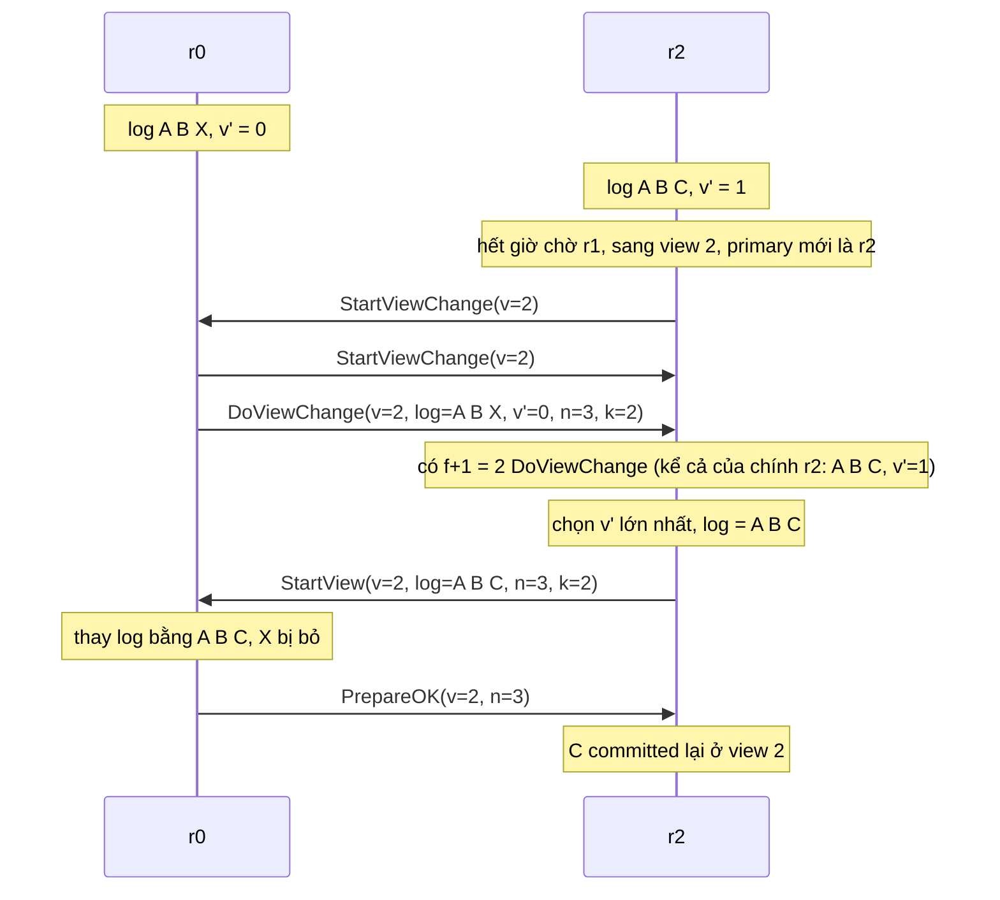

So với Raft: ở Raft, *người bỏ phiếu* từ chối ứng viên có log cũ nên leader mới không cần nhận log của ai[^c-th-raft-catchup]; ở VR primary mới *nhận* log từ các replica trong lúc đổi view, tức entry chảy theo cả hai chiều, và paper Raft nhận xét điều đó kéo theo thêm cơ chế và độ phức tạp so với thiết kế một chiều của Raft[^c-raft-oneway]. Luận án còn nêu một phương án thay cho cách commit của Raft: thêm một "term của log" giống VR Revisited; term này thường trùng term của entry cuối và chỉ tạm vượt lên khi leader mới đang đưa follower bắt kịp[^c-th-vrlogterm] (việc `v'` của VR đóng vai trò "term của log" là suy luận của người soạn).

*Khôi phục không cần đĩa.* VR cho phép replica mất hết trạng thái khi chết. Replica khởi động lại ở trạng thái recovering, không tham gia xử lý request hay đổi view[^c-vr-recovering]; lý do: nếu nó quên rằng mình đã prepare một thao tác, thao tác đó có thể chỉ còn nằm ở ít hơn một quorum dù đã commit[^c-vr-recov-why]. Nó gửi `Recovery` kèm một nonce (số dùng một lần) tới mọi replica, đợi ít nhất f+1 phản hồi, trong đó phải có phản hồi của primary của view mới nhất, rồi cập nhật trạng thái từ primary và chuyển sang normal[^c-vr-recov-done]. Paper tóm gọn: giao thức dùng trạng thái *tạm thời* của f+1 replica làm trạng thái bền[^c-vr-volatile], và phải có f+2 replica liên lạc được với nhau[^c-vr-f2]. Cái giá là giả định các replica "độc lập hỏng": nếu tất cả cùng hỏng một lúc thì trạng thái mất[^c-vr-failind]. Luận án Raft cũng nêu đúng điểm này: nếu đa số cụm cùng khởi động lại thì cụm có thể đã mất entry và không lập nổi view mới, và tác giả cho rằng rủi ro thường lớn hơn lợi ích nên Raft không theo hướng này[^c-th-vr-nodisk][^c-th-vr-nodisk2]. Mục 9 sẽ cho thấy một hệ thật đã trả giá vì ghi đĩa trễ (NATS), và một kịch bản "xóa dữ liệu một node" mà giao thức recovery kiểu VR chặn được còn Raft thì không (suy luận của người soạn, xem mục 9.2).

### 7.2. Zab

*Vì sao có Zab.* ZooKeeper là hệ primary-backup: primary thực thi thao tác rồi dùng Zab để truyền các *thay đổi trạng thái tăng dần* cho backup[^c-zab-abs]. Vì mỗi thay đổi dựa trên trạng thái do thay đổi trước tạo ra, Zab phải bảo đảm: giao một thay đổi thì mọi thay đổi nó phụ thuộc phải được giao trước[^c-zab-depend]. Các giao thức replicated state machine kiểu Paxos không cho tính chất này một cách trực tiếp khi primary có nhiều đề xuất đang bay cùng lúc: nếu primary đề xuất từng giao dịch riêng lẻ thì thứ tự học được có thể vi phạm các phụ thuộc[^c-zab-paxos-limit]. Cách chữa quen thuộc là gộp vào một đề xuất Paxos và chỉ cho một đề xuất đang bay, nhưng làm vậy hại thông lượng hoặc độ trễ[^c-zab-batch-sol].

Ví dụ trong paper van Renesse và cộng sự giúp thấy cái hại. Biến nguyên có giá trị ban đầu 3; một client muốn tăng 1, client kia muốn nhân đôi. Primary P nhận hai thao tác và đề xuất các cập nhật *trạng thái* "4 rồi 8"; primary Q nhận hai thao tác theo thứ tự ngược và đề xuất "6 rồi 7". Nếu không có *prefix order*, các trạng thái được quyết có thể là "4 rồi 7", không khớp với bất kỳ lịch tuần tự nào của hai thao tác[^c-vive-ex]. Tính chất này được gọi là *primary order*: mỗi bản cập nhật phải được áp trên đúng trạng thái primary đã dùng để tính ra nó[^c-vive-order]. Zab tách thành *local primary order* (FIFO trong một primary) và *global primary order* (không đảo thứ tự giữa các primary kế tiếp)[^c-zab-po][^c-zab-po2], và đòi primary mới phải giao hết giao dịch của các epoch trước rồi mới được broadcast[^c-zab-pi].

*zxid và epoch.* Mỗi giao dịch có một `zxid` gồm epoch và bộ đếm; trong ZooKeeper `zxid` là số 64 bit, 32 bit cao là epoch và 32 bit thấp là bộ đếm[^c-zk-zxid]. Epoch đổi mỗi khi có leader mới[^c-zk-epoch]. Paper Zab nhấn mạnh lợi ích: mã giao dịch là cặp (đời primary, vị trí trong dãy của primary đó)[^c-zab-txid], nên primary mới chỉ cần thu `zxid` cao nhất từ mỗi process trong một quorum là biết cần khôi phục giao dịch nào và từ ai[^c-zab-recover]; ZooKeeper còn nói epoch cho phép bỏ qua cả khối đề xuất chưa commit mà không lo trùng `zxid`[^c-zk-epochs-skip].

*Ba pha.* Zab có ba pha: discovery, synchronization và broadcast[^c-zab-phases]. Hình 7.2 vẽ lại (người soạn vẽ theo §IV của paper) một vòng với hai follower.

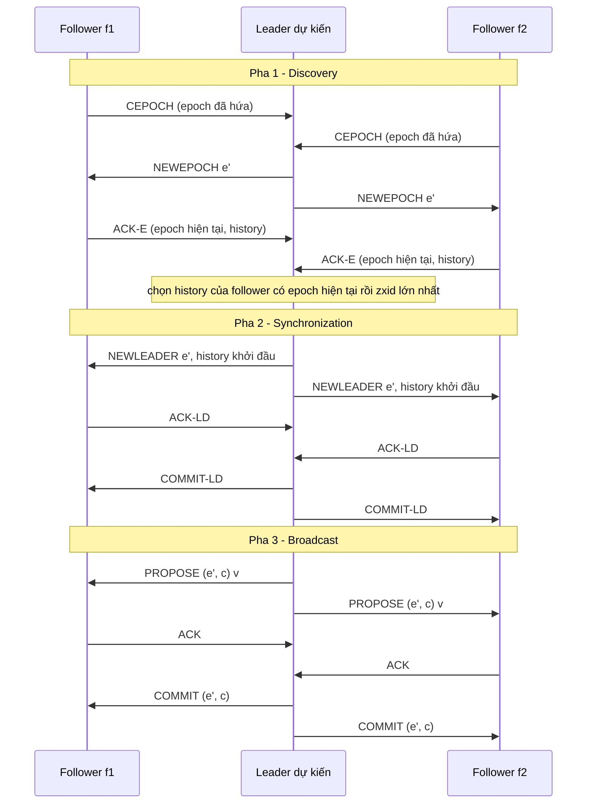

Ở pha 1, leader dự kiến chọn epoch mới e' lớn hơn mọi epoch nhận được trong `CEPOCH`[^c-zab-newepoch] rồi chọn history của follower có epoch hiện tại và `zxid` lớn nhất làm history khởi đầu[^c-zab-pickhist]. Ở pha 2 nó gửi history đó trong `NEWLEADER`; khi một quorum xác nhận (`ACK-LD`) thì nó gửi commit (`COMMIT-LD`) và xong pha 2[^c-zab-sync]; làm leader theo "bộ chọn leader" chưa đủ, phải qua pha 2 mới thành leader thật[^c-zab-establish]. Tài liệu ZooKeeper mô tả ý tương tự bằng lời khác: leader chỉ "active" khi một quorum follower đã đồng bộ xong[^c-zk-quorum-sync]; ngoài ra leader mới lấy epoch e của zxid cao nhất nó đã thấy và dùng `(e+1, 0)` làm zxid kế tiếp[^c-zk-newleader]. Ở pha 3, leader gửi đề xuất cho follower theo cùng thứ tự qua kênh FIFO[^c-zk-fifo], commit ngay khi quorum đã ACK[^c-zk-commit]; ACK nghĩa là đã ghi bền[^c-zk-ack]. Đòi hỏi FIFO là chủ ý: không giữ FIFO thì "mọi thứ sụp đổ"[^c-zk-fifo-needed]. Bảng I của paper liệt kê bốn biến bền: đề xuất epoch mới gần nhất đã xác nhận (`f.p`, tức epoch đã hứa), đề xuất leader mới gần nhất đã xác nhận (`f.a`, tức epoch hiện tại), history và `zxid` cuối trong history[^c-zab-persist].

*So với Paxos và Raft.* ZooKeeper tự trả lời "đây có phải Multi-Paxos không": không, vì Multi-Paxos cần cách đảm bảo chỉ có một coordinator, còn Zab không dựa vào đảm bảo đó mà dùng bước kích hoạt leader để xử lý đổi đời leader hay leader cũ tưởng mình còn tại vị[^c-zk-notmp]. Luận án Raft ghi nhận Zab bảo đảm FIFO client order (client gửi nhiều request liên tiếp thì chúng commit theo đúng thứ tự nếu commit), mạnh hơn một chút so với Raft[^c-th-fifo]. Và Pre-Vote của Raft (xem `mục 6`) được tác giả nói là lấy cảm hứng từ thuật toán của ZooKeeper, nơi một server phải nhận đa số phiếu trước khi tính epoch mới[^c-th-prevote].

### 7.3. EPaxos: bỏ leader

*Vấn đề.* Với một leader ổn định, leader phải xử lý nhiều thông điệp hơn các replica khác và client ở xa leader chịu thêm độ trễ khi sao chép địa lý[^c-ep-problem]; leader chết thì hệ không phục vụ được tới khi bầu xong[^c-ep-stall].

*Ý tưởng.* EPaxos không có leader chỉ định: client chọn replica nào gửi lệnh cũng được, và thường thì lệnh commit mà không phải vướng các lệnh đồng thời khác[^c-ep-noleader]. Mỗi replica "sở hữu" một dãy instance riêng R.1, R.2, ...[^c-ep-model]. Thay vì thứ tự cố định, thứ tự được tính động: khi bỏ phiếu cho một lệnh, mỗi bên gắn thêm *ràng buộc thứ tự* vào lệnh, và mọi replica không hỏng sẽ commit cùng lệnh với cùng ràng buộc nên tự suy ra cùng một thứ tự[^c-ep-order]. Hai lệnh *xung đột* (interfere) nếu có một dãy lệnh mà thực thi chúng theo hai thứ tự khác nhau cho trạng thái hoặc kết quả đọc khác nhau[^c-ep-interfere]. Ràng buộc là hai thuộc tính: `deps` (các instance chứa lệnh xung đột) và `seq` (số thứ tự dùng để phá vòng phụ thuộc lúc thực thi)[^c-ep-attr].

*Fast path và slow path.* Hình 7.3 tóm quy trình commit (người soạn vẽ theo §2.2 và §4.3 của paper). Command leader gửi `PreAccept` kèm `deps`/`seq` dự kiến tới một *fast-path quorum*; nếu đủ trả lời và mọi thuộc tính cập nhật đều giống nhau thì commit ngay[^c-ep-fast]. Cụm có N = 2F + 1 replica, với F là số lỗi chịu được; giao thức cơ bản (§4.3, phần Hình 7.3 vẽ theo) dùng fast-path quorum cỡ 2F, còn bản tối ưu (§4.4) giảm xuống F + ⌊(F+1)/2⌋ replica kể cả command leader[^c-ep-fastq-basic][^c-ep-fastq], tức hai replica với cụm ba và ba replica với cụm năm[^c-ep-fastq-opt]. Nếu các trả lời khác nhau thì cần vòng thứ hai gọi là *slow path* với quorum thường F+1[^c-ep-slow].

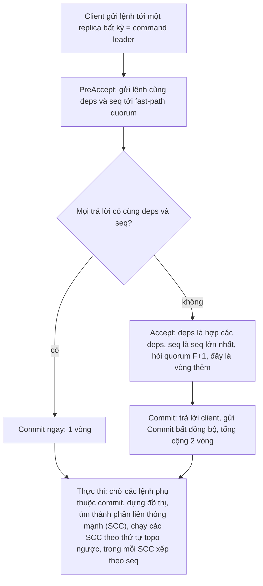

*Commit khác thực thi.* Paper nhấn mạnh hai việc này là khác nhau và thứ tự commit không nhất thiết bằng thứ tự thực thi[^c-ep-commitexec]. Để thực thi, replica dựng đồ thị phụ thuộc của lệnh, tìm các thành phần liên thông mạnh (SCC), thực thi theo thứ tự topo ngược, và trong một SCC thì xếp theo `seq`[^c-ep-exec].

*Khi nào có lợi (và khi nào không).* Lợi ích chính ở mạng diện rộng (nhận xét của người soạn). Với ba replica, một replica luôn commit được sau một vòng tới người hàng xóm gần nhất, kể cả khi lệnh xung đột[^c-ep-3rep]; Multi-Paxos thì phải chuyển mọi lệnh tới leader ổn định nên độ trễ cao hơn[^c-ep-mpaxos-wan]. Với năm replica, EPaxos tránh được hai replica xa nhất[^c-ep-5rep]. Thí nghiệm độ trễ diện rộng của họ chạy trên các trung tâm dữ liệu Amazon EC2 ở California, Virginia và Ireland (thêm Oregon và Nhật cho cấu hình năm replica)[^c-ep-ec2]. Nhưng lợi ích phụ thuộc tỷ lệ xung đột: các tác giả tin rằng tỷ lệ lệnh đụng cùng một key (command interference rate) 0% và 2% là thực tế nhất[^c-ep-realistic]; còn nhóm của Tollman, Park và Ousterhout đánh giá lại và xác nhận độ trễ commit trung vị tối ưu ở WAN, nhưng độ trễ đuôi tệ hơn nhiều so với báo cáo (hơn 4 lần so với Multi-Paxos) và rất nhạy với workload[^c-epr-abs]. Mạng càng chậm thì cửa sổ xung đột càng rộng, nên ít lệnh đi hết trong một RTT hơn[^c-epr-wan]; trong một thí nghiệm của họ chỉ 65% thao tác xong trong một RTT[^c-epr-65]; với workload lệch, chuỗi phụ thuộc của bản EPaxos gốc có thể dài vô hạn, khiến độ trễ đuôi vượt 5 giây hoặc livelock; nhóm này đề xuất một sửa đổi đơn giản để chặn chuỗi đó[^c-epr-chains]. Raft paper tóm: EPaxos có thể đạt độ trễ thấp hơn Raft ở WAN nhưng thêm nhiều độ phức tạp so với Paxos[^c-raft-epaxos2]. Kết luận thực dụng (nhận xét của người soạn): đừng chọn EPaxos chỉ vì "không có leader"; hãy đo tỷ lệ xung đột và RTT giữa các vùng của chính bạn trước. Một lỗi đã được tìm thấy trong chính đặc tả TLA+ lẫn bản cài đặt của EPaxos, có thể làm replica phân kỳ và phá linearizability[^c-sut-abs]; xem mục 9.

### 7.4. PBFT: khi node có thể nói dối

PBFT chịu lỗi Byzantine. Chương này không lặp lại vì sao cần 3f+1 replica (xem `mục 1`); ở đây chỉ nêu phần cấu trúc. Paper nói 3f+1 là số replica tối thiểu để hệ bất đồng bộ có đủ an toàn và sống khi tối đa f replica hỏng[^c-pbft-opt]. Giống VR, replica đi qua các *view* đánh số liên tiếp, mỗi view có một primary, các replica còn lại là backup[^c-pbft-views]; primary của view v là replica p = v mod |R|[^c-pbft-primary-formula]. Paper PBFT ghi nhận VR và Paxos cũng dùng view với primary và backup cho lỗi lành tính[^c-pbft-vr].

Khi primary nhận request, nó chạy giao thức ba pha[^c-pbft-start3] gồm **pre-prepare** (primary gán số thứ tự cho request rồi multicast cho các backup[^c-pbft-pp]), **prepare** (mỗi backup chấp nhận pre-prepare thì multicast `PREPARE` tới mọi replica[^c-pbft-prepare-bcast]) và **commit**. Pre-prepare và prepare dùng để sắp thứ tự request trong cùng một view *kể cả khi primary là kẻ xấu*; prepare và commit đảm bảo các request đã commit giữ thứ tự xuyên qua các view[^c-pbft-phases]. Một replica coi request là "prepared" khi nó có pre-prepare cùng một số prepare khớp từ các backup khác nhau (cùng view, số thứ tự và digest)[^c-pbft-prepared]; commit khớp pre-prepare theo cùng ba trường đó[^c-pbft-commitmatch]. Hình 7.4 (người soạn vẽ theo §4.2 và Hình 1 của paper) minh họa với bốn replica, trong đó R3 là replica lỗi (chỉ nhận, không gửi gì).

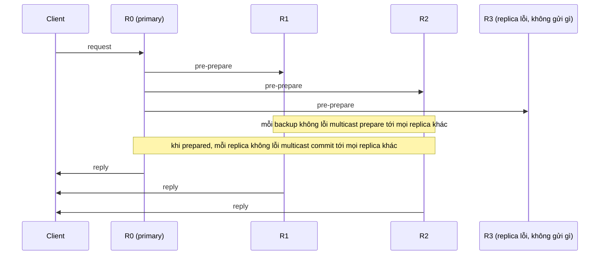

Hai điểm cần nhớ. Một: PBFT không dựa vào giả định đồng bộ để giữ an toàn, nhưng phải dựa vào đồng bộ để có tính sống, nếu không nó giải được consensus ở hệ bất đồng bộ, điều đã bị FLP cấm[^c-pbft-sync]; ở đây "đồng bộ" nghĩa là biết trước cận trên của độ trễ thông điệp và tốc độ xử lý, không phải đồng bộ đồng hồ[^c-pbft-sync-def]. Hai: chi phí. Luận án Raft xếp các thuật toán Byzantine là phức tạp hơn và có hiệu năng thấp hơn các thuật toán fail-stop[^c-th-byz]; nhìn Hình 7.4 thì giai đoạn prepare và commit là "mọi replica nói với mọi replica", nên số thông điệp mỗi request tăng theo bình phương số replica (suy luận của người soạn từ mô tả multicast ở trên). Paper có một tối ưu quen thuộc với bạn: primary bắt đầu giao thức ngay, trừ khi số thông điệp đang chạy giao thức vượt một ngưỡng; khi đó nó xếp request vào hàng đợi rồi multicast cả nhóm sau, và paper so tối ưu này với group commit trong các hệ giao dịch[^c-pbft-groupcommit]. Nếu hệ của bạn chạy trong trung tâm dữ liệu của chính bạn, mô hình lỗi dừng của Raft/Paxos/VR/Zab thường đủ (nhận xét của người soạn, cùng ý với ch09 mục 6, Đi sâu).

<details><summary>Đi sâu: vì sao VR đổi view cần hai vòng, primary-copy khác RSM, và đếm loại thông điệp</summary>

- *Hai vòng trong đổi view.* Paper VR nói có hai lượt trao đổi (`StartViewChange` rồi `DoViewChange`) là *cần thiết*[^c-vr-tworounds]; nếu chỉ có một vòng thì có kịch bản ba replica: r3 đã gửi `DoViewChange` nhưng tin bị trễ, r3 chết rồi khôi phục ở view cũ và tham gia commit, sau đó `DoViewChange` trễ tới nơi làm primary mới bỏ sót các thao tác commit sau khi r3 khôi phục. Vòng `StartViewChange` đảm bảo f+1 replica đã *biết* việc đổi view đang diễn ra[^c-vr-fplus1know], nên replica khôi phục chắc chắn trở lại ở view đó hoặc muộn hơn. (Kịch bản là tóm lược của người soạn từ §8.2 của paper.) Cũng quan trọng không kém: replica phải ngừng nhận `PREPARE` từ view cũ ngay khi bắt đầu đổi view, nếu không có thể có hai primary hoạt động cùng lúc[^c-vr-stop].
- *Primary-copy và replicated state machine.* Luận án nói bài VR gốc (Oki và Liskov) và ZooKeeper hoạt động theo kiểu primary-copy, khác máy trạng thái nhân bản (RSM) truyền thống[^c-th-primarycopy]. Ở kiểu này, state machine của primary xử lý request ngay khi nhận chứ không đợi commit, rồi *trạng thái kết quả* (không phải request gốc) được nhân bản bằng consensus[^c-th-primarycopy2]. Theo cách phân loại của van Renesse, VR và Zab dùng passive replication còn Paxos dùng active replication[^c-vive-passive]. Hệ quả về tính tất định: ở primary-copy, state machine của primary không cần tất định miễn là thay đổi trạng thái nó sinh ra là tất định[^c-th-nondeterm]; ở RSM thường thì trong đa số trường hợp lối thoát là để server nhận request gắn thêm đầu vào không tất định (giờ hiện tại, số ngẫu nhiên) vào request trước khi ghi vào log[^c-th-hybrid].
- *Số loại thông điệp.* Luận án đếm: VR Revisited và Zab mỗi bên định nghĩa 10 loại thông điệp cho consensus cơ bản và đổi thành viên, Raft chỉ có 4 loại (hai RPC và hai phản hồi)[^c-th-msgtypes]. Con số này là ví dụ tác giả Raft dùng để nói Raft có ít cơ chế hơn, không phải số đo hiệu năng (nhận xét của người soạn).
- *Reconfiguration của VR.* Thay đổi nhóm replica đi qua một request đặc biệt chạy bằng giao thức thường; khi nó commit thì hệ sang epoch mới, nhóm mới nhận trách nhiệm[^c-vr-epoch]; trong lúc chuyển epoch hệ *không nhận request mới*[^c-vr-reconf-stall], còn Raft đổi thành viên mà vẫn xử lý request thường[^c-raft-joint-vs-vr]. Chi tiết so sánh với Raft ở `mục 5`.
- *Đọc ở VR.* Harp dùng lease: primary chỉ tự xử lý đọc nếu giữ lease hợp lệ từ f replica, và view mới chỉ bắt đầu sau khi lease hết hạn ở f+1 replica tham gia đổi view[^c-vr-leases] (so với đọc lease của Raft ở ch09).

</details>

**Quay lại Q7:** VR, Zab, Raft và Multi-Paxos là cùng một họ "leader + đa số + số của đời leader" và khác nhau ở cách chọn leader, cách leader mới bắt kịp log và cái gì phải ghi bền (VR có thể không cần đĩa, đổi lại giả định replica hỏng độc lập); EPaxos đổi leader lấy phụ thuộc giữa các lệnh và chỉ đáng khi WAN rộng và xung đột thấp; PBFT trả ba pha và 3f+1 replica để chịu node nói dối.


## 8. Hiệu năng và vận hành: một commit tốn gì, batching, pipelining, cụm nhiều vùng (Q8)

> **Trả lời ngắn.** Ở trạng thái ổn định, một lần commit của Raft cần một vòng đi-về từ leader tới một nửa cụm, tức đủ node để thành đa số (luận án nói hiệu năng của Raft tương tự Multi-Paxos)[^c-th-perf1], cộng ít nhất một lần ghi bền xuống đĩa trên đường đi; etcd phát biểu cận dưới cho request của nó là RTT giữa các member cộng thời gian `fdatasync` (đưa dữ liệu xuống lưu trữ bền)[^c-etcd-perf-min]. Muốn tăng thông lượng thì gộp nhiều lệnh vào một lần gửi và một lần ghi (batching)[^c-th-batch]; gửi tiếp mà không chờ ack (pipelining) giảm độ trễ khi tải vừa[^c-th-pipe], và ở tải cao một mức pipeline nhất định vẫn có thể tăng thông lượng[^c-th-pipe2]. Thêm node không làm commit nhanh hơn: tài liệu etcd nói cụm nhỏ hơn thì đa số nhỏ hơn và mỗi lần ghi commit nhanh hơn[^c-etcd-runtime-size], còn ở LogCabin thông lượng giảm khi cụm lớn hơn[^c-th-tput]; trải cụm ra nhiều vùng tăng khả năng chịu hỏng nhưng làm độ trễ của yêu cầu consensus cao hơn vì phải băng qua ranh giới datacenter[^c-etcd-faq-region].

**Giải thích.**

Hình dung (nhận xét của người soạn): commit giống việc xin chữ ký của quá nửa hội đồng cho một văn bản. Thời gian chờ bằng thời gian của người ký chậm nhất *trong nhóm quá nửa đầu tiên* cộng thời gian "mực khô" (ghi bền). Gộp nhiều văn bản vào một lần trình ký là batching; trình văn bản kế tiếp trong lúc chờ văn bản trước là pipelining; cả hai tăng số văn bản ký được mỗi giờ; pipelining còn rút thời gian chờ của văn bản đến sau khi tải vừa, nhưng không cách nào làm một lần ký riêng lẻ nhanh hơn RTT cộng ghi bền tối thiểu.

### 8.1. Một lần commit tốn gì

Hình 8.1 vẽ một lần commit bình thường (người soạn vẽ theo Hình 10.2 của luận án Raft[^c-th-naive][^c-th-parallel]; hai dòng cuối là phần người soạn thêm: leader đưa commit index vào các `AppendEntries` về sau để các server khác biết[^c-th-commit-learn]).

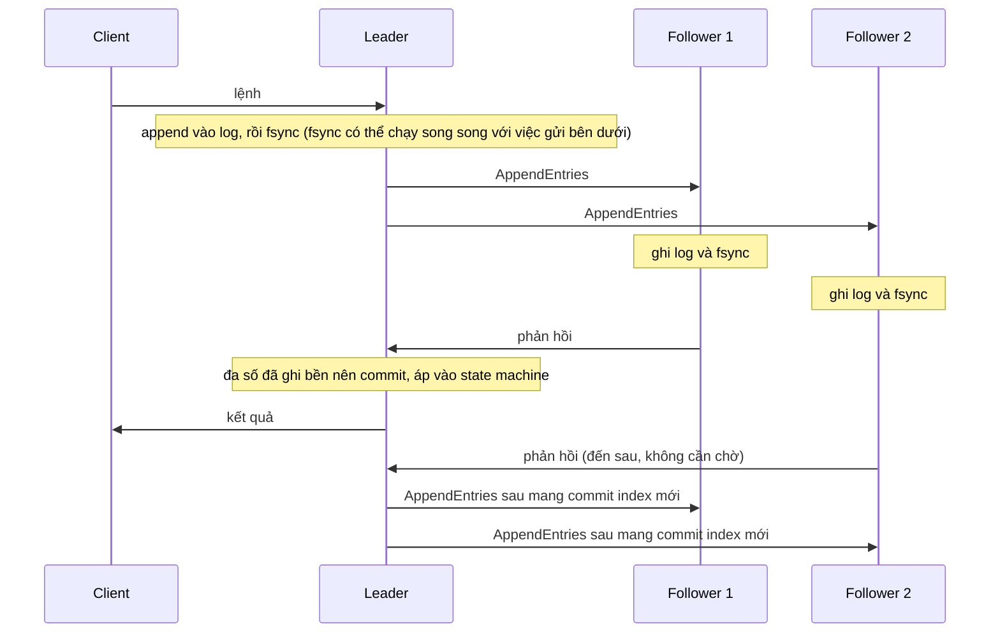

Chú thích Hình 10.2 của luận án mô tả các bước này cho bản Raft chưa tối ưu (Hình 10.2a): leader nhận request, append vào log, flush xuống đĩa, gửi `AppendEntries`; follower append và flush; khi leader nhận phản hồi tích cực từ một nửa số follower thì đánh dấu committed, áp vào state machine và trả lời client[^c-th-fig102]. Tác giả nhận xét: trường hợp quan trọng nhất cho hiệu năng là leader đã vững vị trí và đang sao chép entry mới, và Raft làm việc đó với số thông điệp tối thiểu, một vòng đi-về từ leader tới một nửa cụm[^c-th-perf1]; paper Raft nói cùng ý[^c-raft-perf]. Thường thì hai bước tốn thời gian nhất là ghi entry xuống đĩa và sao chép qua mạng[^c-th-diskvsnet].

*Tối ưu đầu tiên: ghi đĩa của leader song song.* Bản ngây thơ ghi log của leader trước rồi mới gửi, nên trên đường đi có hai lần ghi đĩa *tuần tự* (leader rồi follower)[^c-th-naive]. Leader có thể ghi đĩa song song với việc sao chép: nó dùng chính `matchIndex` của mình để đánh dấu entry đã ghi bền, và khi entry của term hiện tại được phủ bởi đa số `matchIndex` thì tăng commit index[^c-th-parallel]. Thậm chí leader có thể commit entry trước khi nó ghi xong đĩa của chính mình, nếu đa số follower đã ghi; luận án nói vẫn an toàn[^c-th-before-own-disk]. Thư viện etcd/raft liệt kê "ghi đĩa của leader song song" trong các tối ưu tùy chọn[^c-er-features]. Paxos Made Live kể câu chuyện tương tự từ phía Paxos: thuật toán như bài mô tả đến đó cần chuỗi năm lần ghi (ứng với năm loại thông điệp propose, promise, accept, acknowledgment, commit) trên đường găng (critical path: chuỗi bước nối tiếp quyết định độ trễ của một lần đồng thuận), và mọi lần ghi phải flush xuống đĩa ngay trước khi hệ đi tiếp[^c-pml-5writes]; khi dùng một master ổn định thì chỉ còn một lần ghi mỗi instance trên mỗi replica, chạy song song[^c-pml-1write]; và khi các replica ở gần nhau thì thời gian flush đĩa có thể chi phối độ trễ[^c-pml-dominate].

*Công thức thô.* Từ các bước trên, độ trễ commit nằm ở thời điểm mà một đa số replica đã ghi bền xong (giả sử leader gửi `AppendEntries` ngay và ghi đĩa song song như Hình 10.2b): leader xong sau `t_leader`, follower i xong sau `RTT_i + t_i`; commit xảy ra ở giá trị nhỏ thứ ⌊n/2⌋+1 trong các thời điểm đó (leader chỉ được tính khi nó đã ghi xong phần của mình), cộng thời gian về tới client (suy luận của người soạn từ Hình 8.1 và luận án; công thức thô, bỏ qua hàng đợi và CPU; với bản chưa tối ưu ở Hình 10.2a, mọi mốc của follower bị cộng thêm `t_leader`). Với cụm 3 node, đó là follower nhanh nhất; với cụm 5 node, là follower nhanh *thứ hai* (cả hai khi leader ghi xong không muộn hơn follower đó). Etcd nói gọn: thời gian tối thiểu của một request là RTT giữa các member cộng thời gian `fdatasync`[^c-etcd-perf-min].

Bảng 8.1 gom các số mà nguồn nêu. Các khoảng giá trị tổng quát và giá trị điển hình là ước lượng của nguồn; các dòng LogCabin và benchmark etcd là số đo của chính nguồn trên phần cứng của họ; không số nào là bảo đảm. Luận án gọi các số đo LogCabin là kết quả sơ bộ[^c-th-prelim].

| Đại lượng | Số nguồn nêu | Nguồn |
|---|---|---|
| Ghi đĩa | 100 µs (SSD nhanh) tới 10 ms (đĩa từ chậm) | luận án Raft[^c-th-diskvsnet] |
| `fdatasync` | khoảng 10 ms với đĩa quay, thường dưới 1 ms với SSD | tài liệu etcd[^c-etcd-perf-nums] |
| RTT mạng | từ 5 µs (mạng trung tâm dữ liệu tối ưu) tới 400 ms (vòng quanh địa cầu) | luận án Raft[^c-th-diskvsnet] |
| RTT mạng | trong một datacenter có thể dài tới vài trăm µs; điển hình khoảng 50 ms trong nước Mỹ; có thể chậm tới 400 ms giữa các châu lục | tài liệu etcd[^c-etcd-perf-nums] |
| Ghi 1 KB trên LogCabin, một thread client (SSD, 1 GbE) | khoảng 1,0 ms với cụm 2 đến 5 server; 0,7 ms với một server[^c-th-lat]; ghi bền 1 KB đo riêng khoảng 0,25 ms[^c-th-lat2] | luận án Raft, phần cứng ở Bảng 10.1[^c-th-setup] |
| Thông lượng LogCabin | khoảng 19.500 ghi 1 KB mỗi giây, cụm 3 server, 100 thread client | luận án Raft[^c-th-tput] |
| etcd, 3 member trên môi trường cloud phổ biến (máy `standard n-4` của GCE hoặc loại tương đương trên AWS) | dưới 1 ms mỗi request khi tải nhẹ; hơn 30.000 request/s khi tải nặng | tài liệu etcd[^c-etcd-light] |

Luận án còn ghi nhận ở thí nghiệm mạng LAN của họ, tùy loại SSD mà đĩa hoặc mạng là bên chi phối[^c-th-lan]; suy ra trong thí nghiệm đó không có một bên luôn là nút cổ chai (suy luận của người soạn). Về thang đo, bảng benchmark của etcd có hai hàng đáng đặt cạnh nhau (etcd 3.2.0 trên ba máy GCE 8 vCPU với SSD, theo cấu hình ghi trong tài liệu etcd[^c-etcd-bench-hw]). Hàng một client, một connection ghi thẳng vào leader cho 583 ghi/s với độ trễ trung bình 1,6 ms; hàng 1000 client cho 44.341 ghi/s với độ trễ trung bình 22 ms[^c-etcd-bench]. Tính của người soạn từ hai hàng đó: thông lượng tăng khoảng 76 lần trong khi độ trễ mỗi request tăng khoảng 14 lần. Tài liệu etcd nói độ trễ trung bình thường tăng khi thông lượng tăng lúc có nhiều client đồng thời[^c-etcd-lat-tput]; hai hàng này khớp nhận định đó (suy luận của người soạn: bảng không tách tác dụng của batching hay pipelining, nên chỉ nên đọc là cùng chiều với đánh đổi thông lượng lấy độ trễ ở mục 8.2).

### 8.2. Batching và pipelining

Luận án phân biệt hai kỹ thuật theo thứ nó tối ưu. Batching: nhiều chi phí được chia nhỏ khi gom nhiều request vào một lô, ví dụ gửi hai entry trong một gói tin hay ghi hai entry xuống đĩa một lần rẻ hơn nhiều so với gửi/ghi riêng; nên lô lớn tối ưu *thông lượng* và hữu ích khi tải nặng[^c-th-batch]. Pipelining: tối ưu *độ trễ* khi tải vừa, bằng cách cho entry sau bắt đầu được xử lý khi entry trước còn đang chạy, chẳng hạn leader gửi entry kế tiếp tới follower trong lúc follower đang ghi entry trước xuống đĩa[^c-th-pipe]. Ngay cả ở tải cao, một mức pipeline nhất định vẫn có thể tăng thông lượng vì dùng được đồng thời mạng và đĩa; điều mà batching đơn thuần không làm được; nhưng pipelining cũng "làm ngược" batching ở một mức độ[^c-th-pipe2].

Raft làm cả hai khá tự nhiên: `AppendEntries` gửi được nhiều entry liên tiếp trong một RPC[^c-th-batch-natural]; kiểm tra nhất quán của `AppendEntries` bảo đảm pipelining an toàn, và để pipeline leader coi `nextIndex` của mỗi follower một cách lạc quan, tăng nó ngay sau khi gửi mà không chờ ack[^c-th-pipe-safe]. LogCabin gửi tối đa một megabyte mỗi RPC[^c-th-1mb]. Chọn kích thước lô là bài toán cân bằng: gom quá ít thì thông lượng thấp và độ trễ cao khi tải nặng; gom quá nhiều thì request đầu phải chờ request sau nên độ trễ tăng vô ích[^c-th-sched]. VR Revisited nói có thể giới hạn batching ở lúc primary đang bận, để ít ảnh hưởng độ trễ khi rảnh[^c-vr-batching]; PBFT chỉ xếp request vào hàng đợi khi số thông điệp đang chạy giao thức vượt một ngưỡng, rồi multicast cả nhóm sau đó, và paper so tối ưu này với group commit trong các hệ giao dịch[^c-pbft-groupcommit]; etcd gộp nhiều request trước khi giao cho Raft[^c-etcd-batch]; Paxos Made Live mô tả cách gộp một tập giá trị do các thread ứng dụng khác nhau gửi vào một instance Paxos để tăng thông lượng[^c-pml-batch]. Nhóm Zab nhìn từ góc khác: ứng dụng ZooKeeper đòi hiệu năng cao nên họ đặt mục tiêu cho phép nhiều thao tác của client cùng đang bay[^c-zab-multi], và họ nhận xét rằng giải pháp "gộp vào một đề xuất và chỉ cho một đề xuất đang bay" làm hại thông lượng hoặc độ trễ tùy cỡ lô[^c-zab-batch-sol]. Trong danh sách tối ưu tùy chọn của README etcd/raft, bốn mục thuộc nhóm này là: pipelining lạc quan, kiểm soát luồng (flow control), gộp thông điệp để giảm lời gọi mạng đồng bộ và gộp entry để giảm I/O đĩa đồng bộ[^c-er-features]. (Nhận xét của người soạn: quen thuộc với bạn từ connection pool và group commit của database: hai núm hay gặp là kích thước lô tối đa và thời gian chờ tối đa; mục "Liên hệ với Rust" chạy thử các núm về kích thước lô và số message đang bay của raft-rs, vì `Config` của raft-rs không có núm thời gian chờ[^c-rr-config-list1][^c-rr-config-list2].)

### 8.3. Vì sao etcd/raft tách lõi khỏi lưu trữ và mạng

README của etcd/raft nói thẳng: đa số cài đặt Raft có thiết kế nguyên khối gồm cả lưu trữ, tuần tự hóa thông điệp và truyền tải mạng; thư viện này chỉ cài *lõi thuật toán* và khẳng định tối giản đó "mua" được tính linh hoạt, tính tất định và hiệu năng[^c-er-minimal]. Mạng và đĩa dành cho người dùng: họ tự cài lớp truyền tải và lớp lưu trữ log/trạng thái[^c-er-io]. Để dễ kiểm thử, hành vi phải tất định, nên thư viện mô hình Raft thành một state machine: đầu vào là một thông điệp (đồng hồ cục bộ hoặc tin từ peer), cùng trạng thái và cùng đầu vào thì luôn cho cùng đầu ra[^c-er-det][^c-er-det2]. Hình 8.2 vẽ ranh giới (người soạn vẽ theo README).

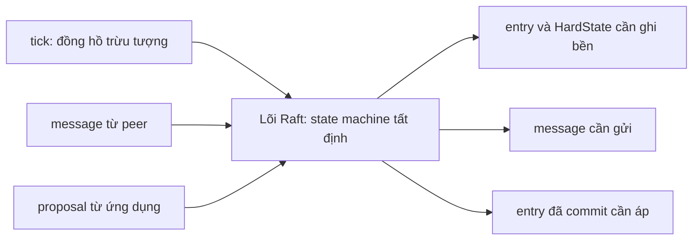

Lợi ích thực dụng (nhận xét của người soạn): quyết định *khi nào* fsync, gộp bao nhiêu entry mỗi lần ghi, dùng giao thức truyền tải nào đều nằm ở phía bạn, nên bạn tự chịu trách nhiệm cho quy tắc an toàn ở biên: README đòi không gửi message nào trước khi `HardState` mới nhất và các entry của các lô trước đã ghi bền[^c-er-order]. Thời gian trong lõi chỉ là "tick" trừu tượng[^c-er-tick], nên cùng lõi có thể chạy trong mô phỏng tất định (mục 9). Crate `raft` của TiKV (raft-rs) cùng triết lý: README của nó nói crate chỉ gồm consensus module, còn log, state machine và transport bạn tự dựng[^c-rr-readme].

### 8.4. Cỡ cụm: chịu lỗi, độ trễ, thông lượng

Bảng 8.2 là bảng đa số/chịu lỗi của etcd cho vài cỡ cụm[^c-etcd-faq-table].

| Số node n | Đa số (quorum) | Số node hỏng chịu được |
|---|---|---|
| 3 | 2 | 1 |
| 4 | 3 | 1 |
| 5 | 3 | 2 |
| 7 | 4 | 3 |

Cụm lẻ chịu cùng số lỗi với cụm chẵn lớn hơn nó một máy (3 node và 4 node đều chịu 1 lỗi, xem Bảng 8.2) nhưng dùng ít máy hơn[^c-etcd-faq-odd]. Mặt còn lại là hiệu năng: cụm lớn hơn chịu lỗi tốt hơn nhưng ghi chậm hơn vì dữ liệu phải sao chép tới nhiều máy hơn[^c-etcd-faq-size]; tài liệu etcd nói thu nhỏ cụm có thể cải thiện hiệu năng ghi, đổi lại giảm khả năng chịu lỗi, vì đa số nhỏ hơn nên mỗi lần ghi commit nhanh hơn[^c-etcd-runtime-size]. LogCabin cho thấy cùng xu hướng: hiệu năng giảm khi cụm lớn vì leader phải gửi mỗi entry cho nhiều follower hơn[^c-th-tput]. Luận án đặt cận lý thuyết: một nhóm consensus bị giới hạn vì mọi thao tác phải có hơn một nửa server tham gia; thông lượng tốt nhất không thể vượt quá hai lần một server đơn, và cách duy nhất để mở rộng là dùng nhiều nhóm consensus độc lập[^c-th-group]. Băng thông gửi ra của leader thường là giới hạn thông lượng của các thuật toán có leader[^c-th-outbound].

Một ví dụ thật về đánh đổi này: TigerBeetle (dựa trên VR[^c-jep-tb-vsr]) sắp các node thành vòng; theo mô tả của Jepsen, primary gửi một `prepare` cho node kế, node đó gửi tiếp cho node kế tiếp trên vòng, cứ thế cho tới khi mọi node nhận được; ack gửi thẳng về primary[^c-jep-tb-ring0]. Cách này giảm băng thông của từng node, nhưng nếu primary cần f ack để commit thì một node hỏng trong f node kế tiếp trên vòng chặn hoàn toàn việc commit[^c-jep-tb-ring]; Jepsen thường thấy, khi một node hỏng, độ trễ client tăng ba đến năm bậc độ lớn trong các bản họ thử[^c-jep-tb-lat], trong khi VR gốc và VR Revisited (primary gửi `prepare` cho mọi secondary) tương đối không nhạy với lỗi một node[^c-jep-tb-vrnormal]. (Sau đợt làm việc với Jepsen, TigerBeetle bổ sung các bài kiểm tra hiệu năng tất định vào bộ mô phỏng; từ bản 0.16.43 các node sao chép theo cả hai chiều quanh vòng và thứ tự node trên vòng được điều chỉnh liên tục theo độ trễ[^c-jep-tb-fixed]; xem thêm mục 9.) Ngoài topology, còn một cách giảm chi phí: Flexible Paxos chỉ đòi các quorum của *hai pha khác nhau* giao nhau, không đòi mọi quorum giao nhau[^c-fp-abs]. Ví dụ của tác giả: cụm 10 node, chỉ cần 3 node tham gia sao chép, miễn là 8 node tham gia khi phục hồi từ leader chết[^c-fp-example]; giá phải trả là giảm tính sẵn sàng lúc phục hồi sau khi leader hỏng[^c-fp-price].

*Vận hành cụm.* Hai bẫy hay bị bỏ quên: (a) máy hỏng nhưng chưa bị gỡ khỏi cấu hình vẫn kéo tụt quorum và giảm số lỗi chịu thêm được[^c-etcd-runtime-failed]; (b) fault tolerance có thể che lỗi cấu hình: nhóm Paxos Made Live từng khởi động một hệ năm replica mà gõ sai tên một replica trong nhóm ban đầu[^c-pml-misspell], hệ vẫn chạy "đúng" nhưng chỉ chịu được một replica hỏng thay vì hai[^c-pml-onefaulty]; tác giả nhận xét hệ chịu lỗi tự nhiên che các lỗi và âm thầm hạ khả năng chịu lỗi của chính nó[^c-pml-mask]. Bài học (nhận xét của người soạn): giám sát *số replica thực sự khỏe*, không chỉ "dịch vụ còn trả lời".

### 8.5. Cụm nhiều vùng

Tài liệu etcd nêu cả hai mặt: đặt member ở nhiều vùng tăng khả năng chịu lỗi vì các member nằm ở những miền hỏng khác nhau; cái giá là độ trễ của yêu cầu consensus cao hơn do phải băng qua ranh giới datacenter, và độ trễ đó khá rõ rệt vì ít nhất đa số member phải trả lời[^c-etcd-faq-region]. Cấu hình mặc định có thể gây bầu cử hay timeout heartbeat thường xuyên khi độ trễ dài[^c-etcd-faq-region2]. Khuyến nghị chung của họ: đặt member trong một datacenter khi có thể; nếu cần miền hỏng ở datacenter khác thì chọn cái gần[^c-etcd-hw-dc].

*Độ trễ.* Với leader ở vùng L và client ở vùng C, mỗi lần ghi gồm một chặng client tới leader rồi leader tới "nửa cụm gần nhất"[^c-th-geo]. Luận án nhận xét rằng mức cải thiện tùy vị trí địa lý của client và các server: nếu sao chép thẳng từ client tới đa số gần nhất thì độ trễ trong trường hợp xấu nhất của kiểu có leader có thể giảm từ "đi vòng quanh địa cầu hai lần mỗi request" xuống một lần[^c-th-geo]; luận án cũng nói EPaxos và Generalized Paxos đạt độ trễ thấp hơn Raft ở WAN vì không phải đưa leader vào đường đi, chỉ cần các server gần client nhất[^c-th-egal-wan] (xem mục 7). Hệ quả cho vận hành (nhận xét của người soạn): đặt leader gần nơi sinh ra phần lớn ghi. Luận án nêu Paxos và Zab chấp nhận sở thích về leader khi bầu cử; VR, VR Revisited và Raft (theo bảng của luận án) cần cơ chế chuyển leader riêng[^c-th-pref][^c-th-leadership-transfer].

*Timeout theo RTT.* Tài liệu etcd khuyến nghị heartbeat interval khoảng giá trị lớn nhất trong các RTT trung bình giữa các member (thường 0,5 đến 1,5 lần RTT)[^c-etcd-tune-hb], còn election timeout ít nhất 10 lần RTT để chịu dao động mạng[^c-etcd-tune-elect]. Mặc định của etcd là heartbeat 100 ms[^c-etcd-tune-def] và election timeout 1000 ms[^c-etcd-tune-def2]; theo họ RTT lục địa Mỹ vào khoảng 130 ms và Mỹ–Nhật khoảng 350–400 ms[^c-etcd-tune-us], nên với cụm liên lục địa phải chỉnh (suy luận của người soạn: 10 lần 130 ms đã là 1,3 giây, vượt mặc định 1000 ms; trang Performance của etcd lại nêu RTT điển hình trong nước Mỹ khoảng 50 ms, hai trang dùng hai mức khác nhau). Tài liệu nói heartbeat interval và election timeout nên giống nhau ở mọi member trong cụm; đặt khác nhau có thể làm mất ổn định cụm[^c-etcd-tune-same].

*Chọn cách chia node.* Bảng 8.3 là suy luận của người soạn thuần từ luật đa số (không có số đo): 

| Cách đặt node | Mất được | Ghi chú về độ trễ commit tại leader |
|---|---|---|
| 3 node ở 2 vùng (2+1) | chỉ mất được vùng 1 node; mất vùng 2 node thì mất đa số | cần 1 phản hồi: thường từ node cùng vùng, nên nhanh, nhưng "chịu mất vùng" thì không |
| 3 node ở 3 vùng (1+1+1) | mất được 1 vùng bất kỳ | chờ vùng *gần nhất* trong hai vùng còn lại |
| 5 node ở 3 vùng (2+2+1) | mất được 1 vùng bất kỳ (vẫn còn ít nhất 3 node) | leader ở vùng 2 node: cần 2 phản hồi khác, một cùng vùng và một từ vùng gần nhất khác |
| 5 node ở 5 vùng | mất được 2 vùng | chờ vùng gần *thứ hai* |

Ngoài cách chia node ở Bảng 8.3, còn hai công cụ nữa: (1) *learner / replica không bỏ phiếu*: member không bỏ phiếu và không tính vào quorum[^c-etcd-learner-def], nên đặt ở vùng xa để có bản sao mà không cộng thêm độ trễ commit (nhận xét của người soạn; tài liệu etcd mô tả learner trước hết như bước đệm khi thêm member, được promote khi đã đuổi kịp leader[^c-etcd-learner-promote]; việc đặt learner lâu dài ở vùng xa là suy luận của người soạn, xem mục 9 và `mục 5`); (2) Flexible Paxos, khi bàn về quorum dạng lưới, nhận xét rằng thực tế các lỗi không độc lập nên có thể rải acceptor qua máy, rack, thậm chí datacenter để giảm khả năng lỗi đồng thời[^c-fp-dc].

<details><summary>Đi sâu: đĩa là một phần của "sức sống" leader, fsync bị nghẽn bởi tiến trình khác</summary>

- *Đĩa chậm thành mất leader.* FAQ của etcd: độ trễ đĩa là một phần của leader liveness; nếu leader mất một phút để fsync một bản cập nhật log trong khi election timeout là một giây thì dù vẫn gửi được heartbeat, nó thực chất không khả dụng vì không commit được đề xuất nào[^c-etcd-faq-disk-leader]. Tài liệu tuning nói cụ thể: hoạt động đĩa của tiến trình khác có thể gây độ trễ fsync dài, khiến etcd lỡ heartbeat, request timeout và tạm mất leader[^c-etcd-tune-disk]. Tài liệu phần cứng: đĩa chậm làm tăng độ trễ request và có thể hại độ ổn định cụm, vì đa số member phải ghi mọi request xuống đĩa[^c-etcd-hw-disk].
- *Một kỷ niệm của Chubby.* Với nhân Linux 2.4 của họ, lời gọi flush một file nhỏ có thể treo rất lâu khi có nhiều ghi đệm sang file khác, xảy ra ngay sau khi ghi snapshot[^c-pml-flush]; cách tránh: ghi file lớn thành từng mảnh nhỏ, flush sau mỗi mảnh[^c-pml-flush2]. (Phiên bản nhân là của Paxos Made Live, 2007; đừng suy ra cho nhân hiện nay.)
- *Đừng bỏ fsync để nhanh.* VR bỏ ghi đĩa nhưng đổi bằng giao thức recovery và giả định lỗi độc lập (mục 7). Nếu chỉ bỏ fsync mà giữ giao thức kiểu Raft thì bạn mất bảo đảm: ví dụ NATS ở mục 9.

</details>

**Quay lại Q8:** một commit tốn một vòng RTT tới (quorum − 1) replica nhanh nhất cộng một lần fsync, và leader có thể ghi đĩa song song với sao chép; batching đổi độ trễ lấy thông lượng, pipelining giảm độ trễ khi tải vừa; cụm lớn hơn hay trải nhiều vùng mua khả năng chịu hỏng bằng độ trễ và băng thông.


## 9. Khi đồng thuận hỏng ngoài đời: lỗi đã được tìm ra và cách kiểm thử (Q9)

> **Trả lời ngắn.** Trong các ca ở Bảng 9.1 (một mẫu do người soạn chọn, không đại diện), lỗi hiếm khi nằm ở chứng minh của thuật toán; chúng nằm ở chỗ cài đặt phải tự quyết hoặc lệch khỏi bài báo: đường đọc, đổi thành viên, snapshot, khởi động lại và khôi phục từ đĩa, chính sách ghi bền, và lớp ứng dụng chồng lên log (khóa, apply) (nhận xét của người soạn). Trong thử nghiệm của Jepsen, các thao tác key-value của etcd 3.4.3 không lộ vi phạm strict serializability dù có pause, crash, lệch đồng hồ, partition và đổi thành viên[^c-jep-etcd-kv]; còn ở Redis-Raft, Jepsen tìm thấy 21 vấn đề trong các bản phát triển nội bộ chưa có người dùng production[^c-jep-rr-sum][^c-jep-rr-nouse]. Cách bắt lỗi gồm mô phỏng tất định có seed, tiêm lỗi vào hệ thật kiểu Jepsen và model checking cho thiết kế; mỗi cách bắt một loại lỗi khác và không cái nào thay được cái nào (nhận xét của người soạn, xem Bảng 9.3).

**Giải thích.**

Hình dung (nhận xét của người soạn): kiểm tra một cây cầu. Bản vẽ (chứng minh) có thể đúng nhưng cầu vẫn sập ở mối hàn (code), ở nền móng (đĩa) và ở cách đoàn xe đi qua (vận hành, cấu hình).

### 9.1. Bản đồ các lỗi đã được ghi nhận

Bảng 9.1 chỉ gồm lỗi có nguồn công khai mà người soạn đã đọc; cột cuối là nhận xét của người soạn về *tầng* bị lỗi.

| Hệ thống, nguồn | Điều đã được ghi nhận | Tầng |
|---|---|---|
| etcd 0.4.1 (Jepsen 2014, kể lại trong báo cáo 2020) | đọc cũ theo mặc định vì tối ưu: đọc cục bộ trên bất kỳ leader nào mà không kiểm tra có leader mới hơn không[^c-jep-etcd-014][^c-jep-etcd-014b]; etcd thêm một cờ quorum tùy chọn, rồi ở API v3.0 đặt linearizability làm mặc định cho mọi thao tác trừ watch[^c-jep-etcd-014b] | đường đọc |
| etcd 3.4.3 (Jepsen 2020) | thao tác KV có vẻ là strict serializable và watch giao mọi thay đổi của một key theo đúng thứ tự[^c-jep-etcd-sum]; nhưng khóa của etcd không loại trừ tương hỗ, kể cả trong cụm khỏe[^c-jep-etcd-lock], và có lỗi không kiểm lại lease sau khi chờ khóa[^c-jep-etcd-leasebug]; với lease 2 giây, năm tiến trình đồng thời và tiến trình bị pause mỗi năm giây (lỗi do Jepsen tiêm), khoảng 18% update đã ack bị mất trong thử nghiệm dùng khóa bảo vệ một tập[^c-jep-etcd-18] | lớp điều phối trên Raft |
| etcd từ 3.5.0 đến bản sửa 3.5.3 (hậu kiểm của chính etcd, 2022) | consistent index không được lưu nguyên tử; một lần crash độc lập có thể khiến giao dịch đã commit không được phản ánh trên mọi member[^c-pm-summary]; bản sửa là v3.5.3[^c-pm-fix] | apply / state machine |
| Redis-Raft (Jepsen 2020, bản phát triển chưa phát hành, chưa có người dùng production[^c-jep-rr-nouse]) | thiếu no-op khi leader mới lên[^c-jep-rr-noop]; việc này cũng là nguyên nhân của đọc cũ ngay trong cụm khỏe, không cần tiêm lỗi nào[^c-jep-rr-stale][^c-jep-rr-noop19]; một kiểu log entry xóa node bị bỏ khỏi tập "thay đổi cấu hình bỏ phiếu": một leader tự gỡ mọi node khác và thành leader của cụm một node[^c-jep-rr-member][^c-jep-rr-member2]; một lần split-brain nữa (#44) có vẻ bắt nguồn từ lỗi trong quá trình nạp snapshot lúc node khởi động[^c-jep-rr-snap]; một sự cố chặn đầu hàng đợi (head-of-line blocking) làm node kẹt sau bầu cử, trầm trọng thêm vì timeout mặc định quá hung hăng khiến bầu cử xảy ra thường xuyên trong cụm vốn khỏe[^c-jep-rr-timeouts] | thư viện Raft: no-op, thành viên; Redis-Raft: timeout mặc định và proxy lệnh; nạp snapshot (nguồn không nêu lớp) |
| NATS JetStream 2.12.1 (Jepsen 2025) | mặc định fsync mỗi hai phút nhưng ack ngay[^c-jep-nats-fsync]; mất điện đồng loạt, hoặc một lần OS crash trên một node kết hợp với trễ mạng hoặc tạm dừng tiến trình, có thể gây mất ghi đã commit và split-brain kéo dài[^c-jep-nats-sum] | chính sách ghi bền |
| Chubby (Paxos Made Live, 2007) | thread đói gây timeout, failover dồn dập rồi client dồn sang master mới làm nó quá tải, lại failover[^c-pml-storm]; rollback nhầm snapshot cũ làm mất 15 giờ dữ liệu ở một data center[^c-pml-rollback] | vận hành, tích hợp |
| EPaxos (Sutra 2019) | một lỗi trong cả đặc tả TLA+ lẫn cài đặt, có thể làm replica phân kỳ và phá linearizability[^c-sut-abs] | đặc tả TLA+ và cài đặt |
| ZooKeeper, LogCabin (Alagappan và cộng sự, FAST 2018) | khi xử lý lỗi đĩa bằng cách cắt bỏ phần log hỏng (Truncate), node đó cùng các node tụt hậu có thể lập thành đa số và làm mất dữ liệu đã commit một cách âm thầm[^c-par-truncate2]; bài cũng nêu cách xóa hết dữ liệu rồi dựng lại (DeleteRebuild) có thể gây mất dữ liệu theo cách tương tự, nhưng không gắn cách này với hệ cụ thể nào[^c-par-delete] | khôi phục sau lỗi đĩa |
| TigerBeetle (Jepsen 2025, dựa trên VR) | phần lớn phát hiện là crash hoặc suy giảm hiệu năng chứ không phải lỗi an toàn[^c-jep-tb-concl] | topology, hiệu năng |

Hai điều rút ra (nhận xét của người soạn). Một: cột "tầng" gần như không có dòng nào là "chứng minh sai"; chúng nằm ở khoảng cách giữa bài báo và hệ thật (cài đặt lệch bài báo, hoặc bài báo không đi tới chi tiết đó), đúng như Paxos Made Live nhận xét: thuật toán lõi được mô tả tốt nhưng cài một log chịu lỗi dựa trên nó vẫn là việc không tầm thường[^c-pml-nontrivial]. Hai: báo cáo Jepsen về etcd nhắc rằng họ chỉ chứng minh được *có* lỗi chứ không chứng minh được *không có*[^c-jep-etcd-prove]; kết quả "etcd sạch" nghĩa là sạch trong những thử nghiệm đó. Lỗi đổi thành viên *ở cấp thuật toán* (không chỉ cài đặt) được trình bày ở `mục 5.3`, còn các lỗi mà TLA+ tìm ra được tổng hợp ở [P13 · Chương 08](../13-tla-plus/08-dac-ta-giao-thuc-phan-tan.md); bảng này không lặp lại chúng.

### 9.2. Một kịch bản cụ thể: xóa dữ liệu một node rồi cho nó "tự đồng bộ lại"

Thao tác này nghe vô hại: node hỏng đĩa, bạn xóa thư mục dữ liệu, cho node khởi động lại để leader chép lại log. FAQ của openraft cảnh báo rằng ngay cả khi log được nhân bản trên nhiều node, xóa dữ liệu một node rồi khởi động lại vẫn có thể gây mất dữ liệu[^c-or-wipe]; nhóm Alagappan gọi cách làm này là DeleteRebuild và chỉ ra nó có thể vi phạm an toàn: node bị xóa có thể tạo thành đa số cùng các node đang tụt hậu và dẫn tới mất dữ liệu âm thầm[^c-par-delete]. Bảng 9.2 dựng lại kịch bản năm node của FAQ openraft[^c-or-wipe2]. Bảng do người soạn vẽ lại; `Lj`/`Fj` là leader/follower ở term j (theo FAQ); `a` là một entry; `n₂` là entry no-op mà leader term 2 ghi đầu tiên (minh họa của người soạn theo Raft chuẩn, FAQ không nhắc tới).

| Thời điểm | N1 | N2 | N3 | N4 | N5 |
|---|---|---|---|---|---|
| t0: `a` đã chép lên N1, N2, N3 (đa số 3/5) nên committed | L1: [a] | F1: [a] | F1: [a] | F1: [ ] | F1: [ ] |
| t1: N3 được thay bằng node rỗng; N1 chết ngay sau đó | chết, [a] | F1: [a] | rỗng: [ ] | F1: [ ] | F1: [ ] |
| t2: N5 hết giờ, thành candidate term 2 và được N3, N4 cấp phiếu[^c-or-wipe2]; cùng phiếu của chính nó, N5 có 3/5 phiếu (suy luận của người soạn: N3 và N4 cấp phiếu vì log của N5 không cũ hơn log rỗng của họ) | chết, [a] | F1: [a] | F2: [ ] | F2: [ ] | L2: [ ] |
| t3 (suy luận của người soạn từ Raft chuẩn, FAQ không mô tả bước này): N1 khởi động lại; N1 và N2 nhận `AppendEntries` của leader term 2 nên log `[a]` bị ghi đè | F2: [n₂] | F2: [n₂] | F2: [n₂] | F2: [n₂] | L2: [n₂] |

Luật nào đã bị phá? Raft đòi `currentTerm`, `votedFor` và `log[]` nằm trên bộ nhớ bền, cập nhật trước khi trả lời RPC[^c-raft-persist]; xóa thư mục dữ liệu là *thu hồi* thứ mà node đã hứa (suy luận của người soạn). Paxos Made Live gọi đúng tên: một replica mất trạng thái bền có thể "nuốt lời" các lời hứa đã đưa cho replica khác, và đó là vi phạm một giả định cốt lõi của Paxos[^c-pml-reneg]. openraft nói rõ giả định: Raft coi đĩa là an toàn và đáng tin; nếu giả định bị phá, kết quả không đoán trước được[^c-or-disk]. Ở t2, N3 (log rỗng) không có lý do để từ chối N5: luật "log đủ mới" chỉ so sánh log mà N3 *còn nhớ* (suy luận của người soạn từ luật bỏ phiếu ở [chương 09, mục 7](09-consistency-va-consensus.md)).

*Chữa thế nào.* (a) Về giao thức: VR đã có sẵn lời giải (suy luận của người soạn); replica khởi động lại ở trạng thái recovering không tham gia đổi view, phải nhận phản hồi từ ít nhất f+1 replica, gồm cả primary của view mới nhất, rồi mới được tham gia lại[^c-vr-recovering][^c-vr-recov-done]; lý do là một replica quên mất mình đã prepare gì có thể làm thao tác đã commit chỉ còn nằm ở ít hơn một quorum[^c-vr-recov-why]. Một hệ Paxos ở Google dùng biến thể "đánh dấu không bỏ phiếu": node lỗi xóa dữ liệu rồi tự đánh dấu non-voting cho tới khi quan sát một vòng consensus và dựng lại dữ liệu[^c-par-nonvoting]; nhóm Alagappan lưu ý cách này đôi khi vẫn vi phạm an toàn[^c-par-nonvoting2], vì node bị hỏng xóa luôn toàn bộ trạng thái, kể cả các lời hứa (promise) đã đưa cho leader[^c-par-promises]. (b) Về vận hành với Raft thường: gỡ node khỏi cấu hình bằng `change_membership`, rồi mới xóa dữ liệu; openraft viết hoa lời dặn: KHÔNG sửa hay xóa dữ liệu của node còn thuộc cụm, trừ khi bạn biết rõ mình đang làm gì[^c-or-remove]. Khi cần node mới, thêm nó vào như learner, chờ đuổi kịp rồi mới promote để nó có phiếu[^c-or-dm-learner][^c-etcd-learner-promote]. Etcd cũng thiết kế `snapshot restore` để bản khôi phục *mất định danh cũ* (member ID, cluster ID) và không thể vô tình nhập lại cụm đang chạy[^c-etcd-rec-new].

### 9.3. Kiểm thử: bốn cách, mỗi cách bắt một loại lỗi

Bảng 9.3 tóm tắt; các ô là nhận xét của người soạn dựa trên các nguồn trong mục này.

| Cách | Bắt tốt | Dễ bỏ sót | Ví dụ trong nguồn |
|---|---|---|---|
| Mô phỏng tất định có seed | lỗi cài đặt giao thức trong lịch chạy lạ; tái hiện được bằng seed | mọi lỗi nằm ngoài *mô hình lỗi* của mô phỏng | Paxos Made Live, FoundationDB, TigerBeetle VOPR, Lab (f) |
| Tiêm lỗi vào hệ thật (Jepsen) | lỗi tích hợp, cấu hình, mặc định, tài liệu sai | không tái hiện tất định; không chứng minh vắng lỗi | etcd 3.4.3, Redis-Raft, NATS |
| Model checking, chứng minh | lỗi thiết kế trong biên của mô hình | khoảng cách giữa đặc tả và code; mô hình quá nhỏ | EPaxos (Sutra); P13 |
| Tiêm lỗi đĩa, so băm replica, bất biến khi chạy | hỏng dữ liệu âm thầm, lỗi khôi phục | lỗi chỉ lộ trong mô hình lỗi hẹp | FAST 2018, hậu kiểm etcd 3.5 |

*Mô phỏng tất định có seed.* Paxos Made Live lập luận từ đầu rằng chứng minh một hệ thật là không thực tế; cách thực dụng, ngoài kỹ thuật phần mềm cẩn thận, là kiểm thử kỹ[^c-pml-unprovable]. Bài (2007) mô tả một bộ test kiểu mô phỏng tất định: mô phỏng một hệ phân tán với số replica ngẫu nhiên và đưa log chịu lỗi qua chuỗi ngẫu nhiên các sự cố mạng, trễ tin, timeout, process crash/recovery, hỏng file, đan xen lịch; lịch lỗi do một bộ sinh số ngẫu nhiên có seed quyết định, chạy một luồng để hai lần chạy cùng seed giống hệt nhau[^c-pml-seed]. Test có hai chế độ: *safety* (hệ phải nhất quán nhưng không cần tiến triển) và *liveness* (sau khi ngừng tiêm lỗi, hệ phải nhất quán *và* tiến triển)[^c-pml-modes][^c-pml-liveness]. Kết quả: tìm được nhiều lỗi giao thức tinh vi, gồm cả lỗi cài đặt thành viên nhóm và các sửa đổi để xử lý đĩa hỏng[^c-pml-found]. Để đo sức mạnh của test, nhóm cố ý *để lại* một số lỗi giao thức đã tìm thấy khi review trong hệ và kiểm test có bắt được không[^c-pml-mutants]; chạy trên trang trại vài trăm máy tìm thêm lỗi, có lỗi cần hàng tuần thời gian chạy mô phỏng ở tỷ lệ lỗi cực cao[^c-pml-farm]. (Đây chính là ý của cờ `Mutant` trong [Lab (f)](../labs/12b-du-lieu-phan-tan-lab.md): bật các biến thể sai cố ý để chứng tỏ checker thật sự cắn được.) FoundationDB làm ở quy mô cả cụm: mô phỏng tất định toàn bộ một cụm trong một tiến trình đơn luồng, nhờ tất định mà lặp lại hoàn hảo một lần chạy[^c-fdb-det], chạy hàng chục nghìn mô phỏng mỗi đêm[^c-fdb-nightly], với kịch bản "swizzle-clog" chặn (dừng) từng kết nối mạng của một tập node ngẫu nhiên rồi mở lại theo thứ tự ngẫu nhiên[^c-fdb-swizzle]. Jepsen định nghĩa gọn: đó là property-based testing cộng kỹ thuật biến hệ không tất định thành tất định, kiểm soát đồng hồ, trạng thái đĩa, bộ lập lịch, việc giao mạng[^c-jep-tb-dst]. TigerBeetle (VR) là ví dụ hiện đại: VOPR mô phỏng cả cụm gồm đồng hồ, đĩa, mạng, làm lệch đồng hồ, làm hỏng đọc/ghi, mất và đảo thứ tự tin[^c-jep-tb-vopr][^c-jep-tb-vopr2]; Jepsen quy phần lớn độ vững của hệ cho toàn bộ các bài test mô phỏng, tích hợp và property-based của TigerBeetle, không riêng VOPR[^c-jep-tb-credit]. Nhưng mô phỏng chỉ tốt bằng mô hình lỗi của nó (nhận xét của người soạn): VOPR đã không phát hiện một lỗi vì nó làm hỏng *cả sector* thay vì từng bit, nên checksum báo sai và kích hoạt quá trình sửa chữa, còn assertion kiểm tra phần đệm toàn số 0 không bao giờ được chạm tới[^c-jep-tb-sector]. [Lab (f)](../labs/12b-du-lieu-phan-tan-lab.md) của giáo trình này thuộc cùng họ (thời gian ảo, RNG có seed, checker năm tính chất chạy sau mỗi sự kiện, năm mutant) và tự ghi những gì nó bỏ qua: snapshot, đổi thành viên, pre-vote, đọc linearizable, giá của `fsync`; nên nó không thể bắt các lỗi ở hàng Redis-Raft hay NATS của Bảng 9.1 (suy luận của người soạn). Với thư viện, lõi tất định là điều kiện cần (nhận xét của người soạn): etcd/raft mô hình Raft như state machine để dễ kiểm thử[^c-er-det]; openraft có cờ `enable_tick`, docs nói chủ yếu dùng để test hoặc để dựng hệ không phụ thuộc đồng hồ thực (wall clock); tắt tick thì follower không tự thành candidate và leader không gửi heartbeat[^c-or-tick].

*Tiêm lỗi vào hệ thật, kiểu Jepsen.* Jepsen tự mô tả là kiểm thử opaque-box (hộp đục): chạy binary thật trên cụm thật[^c-jep-tech]; đổi lại, kiểm thử không tất định và chỉ tìm lỗi chứ không chứng minh đúng[^c-jep-tech2]; cách làm là sinh thao tác ngẫu nhiên, ghi lại lịch sử đồng thời và kiểm nó với một mô hình[^c-jep-tech3]. Với etcd 3.4.3, họ chạy cụm năm node[^c-jep-etcd-5] với các lỗi: partition cô lập từng node, chia đa số/thiểu số, partition không bắc cầu với đa số chồng lên nhau, crash và pause ngẫu nhiên, nhắm vào leader[^c-jep-etcd-faults], lệch đồng hồ tới hàng trăm giây và thêm/bớt node ngẫu nhiên[^c-jep-etcd-skew]. Lịch sử được kiểm bằng Knossos cho linearizability của register[^c-jep-etcd-knossos] và bằng đồ thị phụ thuộc giữa các giao dịch tìm chu trình để kết luận strict serializability[^c-jep-etcd-graph]; với Redis-Raft họ dùng checker mới Elle, suy ra các phụ thuộc ghi-ghi, ghi-đọc, đọc-ghi và thứ tự thời gian thực rồi tìm chu trình[^c-jep-rr-elle]. Với NATS 2.12.1, mất điện được mô phỏng bằng LazyFS, một hệ tệp cho phép Jepsen bỏ mọi ghi chưa được flush (ví dụ bằng lời gọi `fsync`)[^c-jep-nats-lazyfs]. Lỗi hiếm cần thời gian: một lỗi khởi động của Redis-Raft cần vài giờ tiêm lỗi ngẫu nhiên mới lộ ra, và hơn năm phút để tái hiện khi nhắm đúng lỗi[^c-jep-rr-hours]. Báo cáo etcd 3.4.3 còn ghi một kết quả về tài liệu: nhóm etcd đã thay đổi một số chỗ trong tài liệu nhờ đợt cộng tác với Jepsen, và theo báo cáo các thay đổi sẽ được đăng ở các phiên bản website sắp tới[^c-jep-etcd-docs].

*Model checking và chứng minh.* [P13 · Chương 08](../13-tla-plus/08-dac-ta-giao-thuc-phan-tan.md) đã trình bày TLA+ cho Paxos/Raft và những lỗi thật TLA+ từng tìm; ở đây chỉ thêm một cảnh báo: *đặc tả cũng có thể sai*. Sutra chỉ ra một vấn đề trong cả đặc tả TLA+ và cài đặt Go của EPaxos: cả hai chỉ dùng một biến ballot, `bal` (ballot đã tham gia gần nhất), để theo dõi tiến trình qua các ballot[^c-sut-single][^c-sut-four], trong khi cách làm thông thường trong tài liệu dùng ba biến ở mỗi process: ballot đã tham gia gần nhất, ballot đã bỏ phiếu gần nhất và giá trị đã bỏ phiếu[^c-sut-three]; tức EPaxos thiếu biến ballot thứ hai. Và model checker kiểm *đặc tả*, không kiểm *code* (xem P13 ch08).

*Tiêm lỗi đĩa, so băm replica, bất biến khi chạy.* Nhóm Alagappan phân tích ZooKeeper, LogCabin, etcd và một hệ dựa trên Paxos bằng khung tiêm lỗi riêng[^c-par-systems] và kết luận đa số cách xử lý lỗi đĩa trong hệ đang triển khai không dùng hiểu biết ở mức giao thức, dẫn tới mất dữ liệu hoặc mất sẵn sàng[^c-par-most]. Chubby phát hiện ba lần một replica của cơ sở dữ liệu khác các replica còn lại nhờ việc định kỳ lấy checksum của mọi replica rồi so sánh[^c-pml-checksums]. Hậu kiểm etcd 3.5: không ai bật phát hiện hỏng dữ liệu vì nó vẫn là tính năng thử nghiệm[^c-pm-nocheck], với cụm một member thì lỗi hoàn toàn không phát hiện được[^c-pm-detect]; test chức năng có sẵn thì không được bảo trì, chập chờn và thiếu kịch bản quan trọng[^c-pm-tests]; một hành động ghi trạng thái DONE trong bảng Action items (bản tag v3.6.0) là "etcd được kiểm định liên tục bằng tiêm lỗi"[^c-pm-inject].

### 9.4. Checklist cho backend engineer khi chọn và vận hành hệ đồng thuận

(Nhận xét của người soạn; mỗi mục nêu nguồn của căn cứ nếu có.)

1. **Dùng dịch vụ, đừng tự viết lõi; nếu nhúng thư viện, coi phần *bạn* cài là nơi lỗi nằm.** Bảng 9.1: lỗi của Redis-Raft và etcd 3.5 nằm ở thư viện đóng gói, apply, snapshot, thành viên, chứ không ở sơ đồ bầu cử. Điều bạn tự cài (lưu trữ, mạng, apply) nên ghi bền *nguyên tử* với chỉ số đã áp (nhận xét của người soạn, rút từ trường hợp etcd[^c-pm-partial]).
2. **Ghi bền trước khi ack, và đừng tin mặc định khi chưa hiểu nó đánh đổi gì.** Jepsen nhận xét giao thức consensus thường đòi sync xuống đĩa trước khi ack[^c-jep-nats-req], và nhiều hệ nhân bản (MongoDB, etcd, TigerBeetle, ZooKeeper, Redpanda, TiDB) sync trước khi coi là committed[^c-jep-nats-others]. NATS mặc định fsync mỗi hai phút nên khi mất điện hoặc OS crash có thể mất ghi đã ack[^c-jep-nats-fsync]; tài liệu của NATS (qua trích dẫn của Jepsen) nói `always` làm thông lượng giảm xuống còn vài trăm msg/s[^c-jep-nats-docs], và Jepsen ghi nhận, trong một lần chạy có mô phỏng mất điện, mất 131.418 trong 930.005 tin[^c-jep-nats-loss]; Jepsen khuyên NATS đổi mặc định sang `always`[^c-jep-nats-rec]. Đây là đánh đổi có chủ ý của NATS (nhận xét của người soạn), hãy chọn nó có ý thức.
3. **Cỡ cụm lẻ, thường 3 hoặc 5 (nhận xét của người soạn)**[^c-etcd-faq-odd], và giám sát *số replica khỏe thật sự*: hệ chịu lỗi có thể che lỗi cấu hình làm hạ khả năng chịu lỗi của chính nó[^c-pml-mask]; máy hỏng chưa gỡ vẫn kéo tụt quorum[^c-etcd-runtime-failed].
4. **Timeout đo bằng RTT và đĩa của bạn.** Heartbeat khoảng RTT, election timeout ít nhất 10 lần RTT[^c-etcd-tune-hb][^c-etcd-tune-elect]; đo độ trễ `fsync` vì đĩa bận có thể làm lỡ heartbeat và mất leader[^c-etcd-tune-disk]; timeout mặc định quá hung hăng từng làm trầm trọng thêm một sự cố ở Redis-Raft, khiến bầu cử xảy ra thường xuyên trong cụm vốn khỏe[^c-jep-rr-timeouts].
5. **Đổi thành viên từng bước một, và gỡ trước khi thêm khi thay node hỏng.** Etcd: mọi thay đổi cụm phải tuần tự[^c-etcd-runtime-seq]; thay node thì gỡ rồi mới thêm[^c-etcd-faq-removefirst], vì thêm một member vào cụm 3 node nâng quorum lên 3[^c-etcd-faq-quorum4] và nếu lúc đó cụm đã có một follower mất kết nối do phân vùng thì chỉ còn 2 trong 4 node hoạt động, không đủ quorum 3, nên cụm mất quorum[^c-etcd-learner-partition]; etcd bật `strict-reconfig-check` để từ chối yêu cầu gây mất quorum[^c-etcd-faq-strict]. Node mới nên vào bằng learner rồi mới promote[^c-or-dm-learner]. Với openraft, cẩn thận ánh xạ id sang địa chỉ: cập nhật nhầm địa chỉ của một node thành địa chỉ node khác có thể cho hai nhóm cùng đạt quorum và bầu hai leader[^c-or-dm-setnodes], và thư viện không tự phát hiện cấu hình sai[^c-or-misconf].
6. **Không sửa hay xóa dữ liệu của một node còn thuộc cụm, trừ khi bạn biết rõ mình đang làm gì** (mục 9.2; lời dặn của openraft)[^c-or-remove].
7. **Sao lưu và diễn tập khôi phục.** Etcd: luôn sao lưu cho các lỗi hiếm hoặc không phục hồi được[^c-etcd-fail-backup]; mất quá (N−1)/2 member vĩnh viễn là mất quorum không đảo ngược[^c-etcd-rec-quorum]. Chubby từng mất 15 giờ dữ liệu ở một data center vì rollback dùng nhầm snapshot cũ[^c-pml-rollback]; sau các sự cố vận hành kiểu đó, nhóm dựa vào script viết cẩn thận và đã kiểm thử để tự động hóa việc triển khai bản mới và giảm tối đa sự can thiệp của người vận hành[^c-pml-scripts].
8. **Chuẩn bị cho failover storm và "kết quả không rõ".** Chubby gặp vòng xoáy failover rồi client dồn sang master mới[^c-pml-storm] (nhận xét của người soạn: client cần backoff có jitter). Khi leader hỏng, việc bầu leader mới mất cỡ một election timeout, và trong lúc bầu cử cụm không xử lý được ghi[^c-etcd-fail-leader]; ghi đã gửi tới leader cũ nhưng chưa commit có thể mất, còn ghi đã commit thì không bao giờ mất[^c-etcd-fail-leader2]. Hệ quả (nhận xét của người soạn): thao tác của client phải idempotent hoặc đọc lại để kiểm (ch09, mục 7 và 8).
9. **Đừng dùng khóa/lease làm loại trừ tương hỗ nếu thiếu fencing.** Jepsen chứng minh khóa etcd có thể bị giữ đồng thời bởi nhiều client kể cả trong cụm khỏe[^c-jep-etcd-lock] (xem [chương 08, mục 8](08-su-co-he-phan-tan.md) và ch09 mục 8).
10. **Tự kiểm thử tích hợp của bạn.** Tối thiểu (nhận xét của người soạn, lấy theo các lỗi Jepsen đã tiêm vào etcd[^c-jep-etcd-faults][^c-jep-etcd-skew] và kiểu checker họ dùng[^c-jep-etcd-knossos]): kill, pause, partition (kể cả không bắc cầu) và lệch đồng hồ, kèm một checker lịch sử; chạy đủ lâu vì có lỗi cần vài giờ tiêm lỗi ngẫu nhiên mới lộ[^c-jep-rr-hours]; nếu bạn tự viết state machine, đưa nó vào một mô phỏng tất định có seed như mục 9.3 và nếu có thể so băm giữa các replica để phát hiện phân kỳ[^c-pml-checksums].

<details><summary>Đi sâu: những chi tiết của từng vụ, và vì sao đừng suy rộng</summary>

- *Redis-Raft: thư viện giả định "demote rồi mới remove".* Lỗi split-brain thứ hai (#28) được Redis Labs truy về hệ thống thành viên của cụm: thư viện Raft giả định node được hạ cấp (demote) rồi mới gỡ (remove), thay vì gỡ trực tiếp; ngoài ra node bị gỡ chỉ dừng lại và để nguyên file dữ liệu, nên cho node đã gỡ tham gia lại cụm có thể phá bất biến an toàn[^c-jep-rr-demote]; đó là loại "giả định của thư viện không khớp cách vận hành" mà bảng 9.1 khái quát (nhận xét của người soạn). Cũng ở Redis-Raft, split-brain lần thứ ba (#44) có vẻ bắt nguồn từ việc bộ nạp snapshot lúc khởi động không cập nhật metadata snapshot trong bộ nhớ; cấu hình thu được dùng được cho tiến trình đang chạy, nhưng snapshot mới chụp từ trạng thái đó thiếu node trong trạng thái cụm[^c-jep-rr-snap2].
- *etcd 3.5: không phải lỗi của Raft.* Hậu kiểm nêu cơ chế: cập nhật database từ WAL phải nguyên tử cùng consistent index; nếu thất bại một phần thì một số entry bị bỏ qua hoặc chạy hai lần[^c-pm-partial]; không người dùng nào báo lỗi trong production vì cần crash thường xuyên mới kích hoạt, nhưng đủ nghiêm trọng để ra thông báo công khai[^c-pm-impact]. Raft đảm bảo mọi member cùng *log*; nó không đảm bảo bạn áp log vào state machine một cách nguyên tử.
- *NATS: con số và giới hạn.* 131.418 trên 930.005 tin là kết quả của *một lần chạy có mô phỏng mất điện* mà Jepsen nêu làm ví dụ ngay sau khi mô tả chính sách fsync mặc định mỗi hai phút[^c-jep-nats-loss]; đừng suy ra tỷ lệ mất cho hệ khác. Lưu ý Jepsen cũng nêu VR Revisited cùng giả định "replica hiếm khi hỏng cùng lúc" và thừa nhận nếu hỏng đồng thời thì mất trạng thái[^c-jep-nats-vr]; theo người soạn, đó là cùng kiểu đánh đổi đã nói ở mục 7 (suy luận của người soạn).
- *Phát hiện chủ yếu là crash và hiệu năng ở TigerBeetle.* Jepsen nhận xét hầu hết phát hiện là crash hoặc suy giảm hiệu năng, không phải lỗi an toàn[^c-jep-tb-concl]; mô phỏng bổ sung sau đó được dùng để đo hiệu năng dưới lỗi[^c-jep-tb-fixed].
- *Paxos Made Live trong sản xuất.* Trong hơn 100 năm-máy chạy sản xuất, hệ của nhóm Paxos Made Live (nằm dưới Chubby) gặp các sự cố bất ngờ mà bài kể, gồm các sự cố đã nêu ở Bảng 9.1 và mục 9.4[^c-pml-100my]; hai trong các sự cố liên quan tới lỗi vận hành khi triển khai bản mới và gây mất dữ liệu[^c-pml-operator]; một lỗi khác của nhân Linux 2.4 mà họ dùng có thể treo lời gọi flush file nhỏ[^c-pml-flush].
- *Lỗi chỉ tồn tại trong ví dụ có điều kiện.* Cả bảng 9.1 *không* phải xếp hạng chất lượng: mỗi dòng là một hệ, một phiên bản, một nhóm kiểm thử và một mô hình lỗi, được công bố vì đã tìm ra lỗi. Những hệ không bị kiểm thử công khai không xuất hiện (nhận xét của người soạn).

</details>

**Quay lại Q9:** lỗi ngoài đời nằm ở các phần bài báo bỏ ngỏ (đọc, thành viên, snapshot, khôi phục, ghi bền, apply, vận hành) hơn là ở chứng minh; bạn bắt chúng bằng mô phỏng tất định có seed, tiêm lỗi vào hệ thật và model checking, và phải vận hành với ghi bền trước ack, thành viên đổi từng bước, sao lưu có diễn tập, và không sửa hay xóa dữ liệu của node còn trong cụm khi chưa biết rõ mình đang làm gì.

## Liên hệ với Rust

*Phạm vi.* [Chương 09, mục "Liên hệ với Rust"](09-consistency-va-consensus.md) đã đi qua API của `openraft` 0.9.21, `raft` (raft-rs) 0.7.0 và `etcd-client`; mục này không lặp lại. Thay vào đó, nó nối lý thuyết của mục 1–9 với *núm cấu hình và bảo đảm* của hai crate nhúng Raft, bám docs.rs và source đã ghim. Một lưu ý dựng thử (quan sát của người soạn trên macOS arm64 với `protoc` 34.1, không phải bảo đảm của crate): `raft` 0.7.0 với feature mặc định (`protobuf-codec`) không biên dịch được ở build script của `raft-proto` vì không tìm thấy `protoc` phù hợp, nên các ví dụ dưới đây dùng `raft = { version = "=0.7.0", default-features = false, features = ["prost-codec", "default-logger"] }`, cùng `openraft = "=0.9.21"` và `slog = "2"`.

**Bảng R.1 — lý thuyết ↔ núm cấu hình.** (Bảng do người soạn tổng hợp từ docs.rs và source ghim; ô nào không có chú thích là nhận xét của người soạn.)

| Khái niệm | `raft` 0.7.0 (struct `Config`; hàng thành viên và term dùng kiểu `eraftpb`, hàng kiểm thử dùng `RawNode`) | `openraft` 0.9.21 | Docs nói gì |
|---|---|---|---|
| Heartbeat và election timeout ([ch09 mục 7](09-consistency-va-consensus.md); mục 8.5) | `heartbeat_tick`, `election_tick` (đơn vị tick), `min_election_tick`/`max_election_tick` cho khoảng ngẫu nhiên | `heartbeat_interval`, `election_timeout_min`/`election_timeout_max` (ms) | raft-rs: `election_tick` phải lớn hơn `heartbeat_tick` và gợi ý gấp 10 lần[^c-rr-election][^c-rr-heartbeat]; khoảng ngẫu nhiên nằm trong `[min_election_tick, max_election_tick)`[^c-rr-minmax]. openraft nhắc bất đẳng thức broadcastTime ≪ electionTimeout ≪ MTBF[^c-or-ineq] và nói mặc định hợp với cụm nhiều availability zone độ trễ thấp[^c-or-config] |
| Pre-Vote (`mục 6.2`; mục 7.2; luận án §9.6) | `pre_vote`[^c-rr-prevote] | danh sách 15 trường của `Config` không có trường pre-vote[^c-or-config-list1][^c-or-config-list2]; docs có khái niệm *leader lease*: trong thời hạn lease, follower không tự khởi động bầu cử[^c-or-lease] (nhận xét của người soạn: docs không gọi lease là Pre-Vote, đừng coi hai thứ là một) | raft-rs: ngăn node bị cô lập phá cụm khi nối lại[^c-rr-prevote] |
| Leader tự rút lui khi mất quorum (`mục 6.2`) | `check_quorum`[^c-rr-checkq] | không có trường tương ứng trong danh sách trên | etcd/raft cũng liệt kê "tự bước xuống khi leader mất quorum" là tùy chọn[^c-er-features] |
| Đọc linearizable: ReadIndex hay lease (`mục 6.4`; [ch09 mục 7](09-consistency-va-consensus.md)) | `read_only_option`: `Safe` hoặc `LeaseBased`; `LeaseBased` đòi `check_quorum = true`[^c-rr-readonly] | `Raft::ensure_linearizable` (ch09) | `Safe` hỏi quorum, là mặc định và được gợi ý[^c-rr-safe]; `LeaseBased` dựa vào lease của leader và có thể bị ảnh hưởng bởi trôi đồng hồ[^c-rr-lease] |
| Batching, pipelining, back-pressure (mục 8.2) | `max_size_per_msg`[^c-rr-maxsize], `max_inflight_msgs`[^c-rr-inflight], `batch_append`[^c-rr-batchappend], `skip_bcast_commit`[^c-rr-skip], `max_uncommitted_size`[^c-rr-uncommitted] | `max_payload_entries`[^c-or-payload] | `max_size_per_msg = 0` nghĩa là tối đa một entry mỗi message[^c-rr-maxsize]; theo docs, khi đạt `max_uncommitted_size` thì mọi proposal ghi thêm log bị bỏ[^c-rr-uncommitted] |
| Snapshot và nén log (`mục 5.1`) | không có trường snapshot trong `Config`[^c-rr-config-list1][^c-rr-config-list2] (snapshot đi qua `Ready`, ch09) | `snapshot_policy`: `LogsSinceLast(n)` hoặc `Never`[^c-or-snap][^c-or-snap-never]; `replication_lag_threshold`: docs ghi follower tụt quá ngưỡng thì được chép bằng snapshot[^c-or-lag] | docs của `SnapshotPolicy` nói chính sách này cũng chi phối điều kiện leader gửi `InstallSnapshot` theo độ trễ sao chép[^c-or-snap-gov]; tuy vậy trong source 0.9.21 (chi tiết cài đặt, có thể đổi) ngưỡng `replication_lag_threshold` được dùng để xét learner đã bắt kịp chưa[^c-or-src-lag], còn leader chuyển sang chép bằng snapshot khi log mà follower cần đã bị purge[^c-or-src-snap] (nhận xét của người soạn: docs và source lệch nhau, hãy dựa vào source và phép thử của bạn) |
| Thành viên (`mục 5.2` đến `5.4`; mục 8.4, 9.4) | `ConfChangeType::{AddNode, RemoveNode, AddLearnerNode}`[^c-rr-learner]; `ConfChangeTransition::{Auto, Implicit, Explicit}`: `Auto` dùng giao thức đơn giản nếu được, không thì quay về `Implicit`[^c-rr-trans-auto]; `Implicit` luôn dùng joint consensus và tự thoát khỏi joint bằng một thay đổi cấu hình rỗng[^c-rr-trans-impl]; `Explicit` dùng joint consensus và ở lại joint cho tới khi ứng dụng đề xuất một thay đổi cấu hình no-op[^c-rr-trans-expl]; `ConfState.voters_outgoing` không rỗng nghĩa là node đang ở joint consensus[^c-rr-confstate] | mọi membership đều là joint[^c-or-dm-joint]; docs khuyên luôn `add_learner` trước `change_membership`, vì `change_membership` sẽ lỗi nếu membership đề xuất có node chưa là learner[^c-or-dm-learner]; không hỗ trợ cách đổi từng node một (single step) của Raft nguyên bản, chỉ hỗ trợ joint[^c-or-faq-diff] | `change_membership` đề xuất config joint, khi nó commit thì đề xuất config thường[^c-or-cm]; nếu mất leader trước đó, cụm bị để lại ở config joint[^c-or-cm2] |
| Số của đời leader (mục 7) | `HardState { term, vote, commit }`[^c-rr-hardstate] | `Vote` tương tự khái niệm ballot (rnd) của Paxos[^c-or-vote]; mặc định mỗi term *có thể có nhiều hơn một leader*, chế độ Raft chuẩn bật bằng feature `single-term-leader`[^c-or-modes] | khác với Election Safety "tối đa một leader mỗi term" ở ch09; đọc kỹ trước khi giả định |
| Kiểm thử tất định (mục 9.3) | tự gọi `tick()`, `campaign()`, `step()` từ bên ngoài (khung bên dưới) | `enable_tick`/`enable_heartbeat`/`enable_elect`[^c-or-tick], `Raft::trigger()`[^c-or-trigger] | tắt tick thì timeout không còn chạy; "chủ yếu dùng để test" |

**Chạy thử luật `validate()`.** Chương trình dưới đây (đã biên dịch và chạy với rustc 1.95.0 trên macOS arm64, `raft` 0.7.0, `openraft` 0.9.21) in giá trị mặc định và thử các cấu hình sai:

```rust
use openraft::Config as OConfig;
use raft::{Config as RConfig, ReadOnlyOption};

fn rcheck(label: &str, c: &RConfig) {
    match c.validate() {
        Ok(()) => println!("raft-rs   | {label}: hợp lệ"),
        Err(e) => println!("raft-rs   | {label}: {e}"),
    }
}

fn ocheck(label: &str, c: OConfig) {
    match c.validate() {
        Ok(_) => println!("openraft  | {label}: hợp lệ"),
        Err(e) => println!("openraft  | {label}: {e}"),
    }
}

fn main() {
    // ---- raft-rs 0.7.0: giá trị mặc định và luật validate ----
    let d = RConfig::new(1);
    println!(
        "raft-rs   | mặc định: election_tick={} heartbeat_tick={} check_quorum={} pre_vote={} read_only_option={:?} max_inflight_msgs={} max_size_per_msg={} batch_append={}",
        d.election_tick, d.heartbeat_tick, d.check_quorum, d.pre_vote,
        d.read_only_option, d.max_inflight_msgs, d.max_size_per_msg, d.batch_append
    );
    println!(
        "raft-rs   | khoảng timeout ngẫu nhiên mặc định (tick): [{}, {})",
        d.min_election_tick(), d.max_election_tick()
    );
    rcheck("mặc định", &d);

    let mut c = RConfig::new(1);
    c.read_only_option = ReadOnlyOption::LeaseBased;
    rcheck("LeaseBased, check_quorum=false", &c);
    c.check_quorum = true;
    rcheck("LeaseBased, check_quorum=true", &c);

    let mut c = RConfig::new(1);
    c.election_tick = c.heartbeat_tick;
    rcheck("election_tick == heartbeat_tick", &c);

    let mut c = RConfig::new(1);
    c.max_size_per_msg = 1 << 20;
    c.max_uncommitted_size = 1 << 10;
    rcheck("max_uncommitted_size < max_size_per_msg", &c);

    // ---- openraft 0.9.21 ----
    let o = OConfig::default();
    println!(
        "openraft  | mặc định: election_timeout={}..{} ms heartbeat_interval={} ms snapshot_policy={:?} max_payload_entries={} replication_lag_threshold={} purge_batch_size={}",
        o.election_timeout_min, o.election_timeout_max, o.heartbeat_interval,
        o.snapshot_policy, o.max_payload_entries, o.replication_lag_threshold, o.purge_batch_size
    );
    ocheck("mặc định", o.clone());
    ocheck(
        "election_timeout_min <= heartbeat_interval",
        OConfig { election_timeout_min: 50, ..OConfig::default() },
    );
    ocheck(
        "election_timeout_min >= election_timeout_max",
        OConfig { election_timeout_min: 300, election_timeout_max: 300, ..OConfig::default() },
    );
    ocheck(
        "max_payload_entries = 0",
        OConfig { max_payload_entries: 0, ..OConfig::default() },
    );
}
```

Output:

```text
raft-rs   | mặc định: election_tick=20 heartbeat_tick=2 check_quorum=false pre_vote=false read_only_option=Safe max_inflight_msgs=256 max_size_per_msg=0 batch_append=false
raft-rs   | khoảng timeout ngẫu nhiên mặc định (tick): [20, 40)
raft-rs   | mặc định: hợp lệ
raft-rs   | LeaseBased, check_quorum=false: read_only_option == LeaseBased requires check_quorum == true
raft-rs   | LeaseBased, check_quorum=true: hợp lệ
raft-rs   | election_tick == heartbeat_tick: election tick must be greater than heartbeat tick
raft-rs   | max_uncommitted_size < max_size_per_msg: max uncommitted size should greater than max_size_per_msg
openraft  | mặc định: election_timeout=150..300 ms heartbeat_interval=50 ms snapshot_policy=LogsSinceLast(5000) max_payload_entries=300 replication_lag_threshold=5000 purge_batch_size=1
openraft  | mặc định: hợp lệ
openraft  | election_timeout_min <= heartbeat_interval: election_timeout_min(50) must be > heartbeat_interval(50)
openraft  | election_timeout_min >= election_timeout_max: election timeout: min(300) must be < max(300)
openraft  | max_payload_entries = 0: max_payload_entries must be > 0
```

Cách đọc: (1) mặc định của raft-rs có `election_tick = 20` gấp mười lần `heartbeat_tick = 2`, đúng gợi ý trong docs[^c-rr-election]; còn mặc định của openraft là timeout 150 đến 300 ms với heartbeat 50 ms, tỷ lệ từ ba đến sáu lần, và `validate()` của nó chỉ chặn ba điều kiện số học (`min > heartbeat`, `min < max`, `max_payload_entries > 0`) chứ không đòi tỷ lệ nào giữa timeout và heartbeat[^c-or-validate-src] (nhận xét của người soạn: etcd khuyên election timeout ít nhất mười lần RTT mạng[^c-etcd-tune-elect], nên đừng coi `validate()` thành lời bảo đảm "cấu hình hợp lý"). (2) Mặc định của raft-rs *tắt* cả `check_quorum` lẫn `pre_vote` (dòng đầu của output); Pre-Vote sinh ra để một node bị cô lập nối lại không phá được cụm[^c-th-prevote2] (`mục 6.2`), nên nếu cụm của bạn có thể bị partition, hãy cân nhắc bật nó (nhận xét của người soạn). (3) `validate()` của raft-rs chặn một tổ hợp cấu hình: đọc dựa lease mà không `check_quorum`[^c-rr-validate]. Docs nói `LeaseBased` có thể bị ảnh hưởng bởi trôi đồng hồ[^c-rr-lease]; lý do bắt buộc đi kèm `check_quorum` không được nêu (suy luận của người soạn: leader phải tự rút lui khi mất quorum thì lease của nó mới còn nghĩa).

**Khung mô phỏng trong bộ nhớ: một commit tốn mấy bước truyền?** Để thấy các núm của mục 8.2 làm gì, người soạn viết một khung đồng bộ trong bộ nhớ cho raft-rs (code ở phần Đi sâu; đã biên dịch và chạy): ba hoặc năm `RawNode` trên `MemStorage`, mạng là một hàng đợi, *một "bước truyền"* là một lượt chuyển mọi message đang bay, xử lý `Ready` theo mẫu của `examples/five_mem_node`. Khung không có đồng hồ lẫn đĩa thật; nó chỉ đếm *cấu trúc giao thức*, không phải số đo hiệu năng.

```text
sau bầu cử: term=1 last_index=1 committed=1; entry[1]: term=1 data_len=0
A mặc định      : n=3 entry=1 cô lập=[] -> commit=có sau 2 bước truyền; MsgAppend=4 (số message theo số entry/message: {0: 2, 1: 2}); MsgAppendResponse=2
B mặc định      : n=3 entry=10 cô lập=[] -> commit=có sau 2 bước truyền; MsgAppend=40 (số message theo số entry/message: {0: 20, 1: 20}); MsgAppendResponse=20
C max_size lớn  : n=3 entry=10 cô lập=[] -> commit=có sau 2 bước truyền; MsgAppend=40 (số message theo số entry/message: {0: 20, 1: 20}); MsgAppendResponse=20
D + batch_append: n=3 entry=10 cô lập=[] -> commit=có sau 2 bước truyền; MsgAppend=4 (số message theo số entry/message: {0: 2, 10: 2}); MsgAppendResponse=2
E 5 node        : n=5 entry=1 cô lập=[] -> commit=có sau 2 bước truyền; MsgAppend=8 (số message theo số entry/message: {0: 4, 1: 4}); MsgAppendResponse=4
F 5 node, mất 2 : n=5 entry=1 cô lập=[4, 5] -> commit=có sau 2 bước truyền; MsgAppend=4 (số message theo số entry/message: {0: 2, 1: 2}); MsgAppendResponse=2
G 5 node, mất 3 : n=5 entry=1 cô lập=[3, 4, 5] -> commit=KHÔNG sau 6 bước truyền; MsgAppend=1 (số message theo số entry/message: {1: 1}); MsgAppendResponse=1
```

Cách đọc (quan sát của người soạn trên khung này, raft-rs 0.7.0):

- **Entry rỗng sau bầu cử.** Dòng đầu cho thấy log của leader mới có đúng một entry, term 1, dài 0 byte, đã commit: đó là entry no-op của term mới. Ví dụ chính thức của raft-rs cũng ghi chú rằng entry rỗng được gửi khi một peer thành leader[^c-rr-emptyentry]. Đây là thứ mà thư viện Raft đóng gói trong Redis-Raft đã thiếu; Jepsen quy cho nó cả đọc rỗng tạm thời sau khi node khởi động lại (#18)[^c-jep-rr-noop] lẫn đọc cũ trong cụm khỏe (#19)[^c-jep-rr-stale][^c-jep-rr-noop19].
- **Một vòng đi-về.** Ở A, một entry trên cụm 3 node commit sau 2 bước truyền, tức một vòng đi-về, khớp mô tả của luận án về một vòng đi-về từ leader tới một nửa cụm[^c-th-perf1]. Hai trong bốn `MsgAppend` mang entry; hai cái rỗng nhiều khả năng là leader báo commit index mới cho follower (suy luận của người soạn từ số entry mỗi message; khung chưa chạy với `skip_bcast_commit = true` để kiểm). Docs nói `skip_bcast_commit` cho phép không broadcast entry rỗng để báo follower commit, đổi lại follower có thể chờ lâu hơn mới áp entry[^c-rr-skip].
- **Batching và pipelining.** Ở B, mười entry với cấu hình mặc định cho 40 `MsgAppend`: 20 message mang đúng một entry và 20 message rỗng, khớp mô tả `max_size_per_msg = 0` là tối đa một entry mỗi message[^c-rr-maxsize]. Mười message của mỗi follower được phát ra *trước khi* nhận bất kỳ phản hồi nào: pipelining lạc quan, bị chặn bởi `max_inflight_msgs`[^c-rr-inflight]. Ở C, chỉ nâng `max_size_per_msg` lên 1 MiB chưa gộp được gì trong khung này; ở D, thêm `batch_append = true` gộp còn 4 message (hai message mang 10 entry mỗi cái) theo mô tả của docs (gộp mọi message append nếu đã có sẵn một message append)[^c-rr-batchappend]. Số message khi dùng thật còn phụ thuộc cách bạn đưa proposal vào và xử lý `Ready` (nhận xét của người soạn).
- **Quorum.** Ở E–G, cụm 5 node vẫn commit sau cùng 2 bước truyền khi hai follower bị cô lập (F), và không commit trong giới hạn 6 bước truyền của khung khi ba follower bị cô lập (G), đúng luật đa số 3/5 ở Bảng 8.2.

<details><summary>Đi sâu: mã nguồn của khung mô phỏng</summary>

```rust
//! Khung mô phỏng đồng bộ trong bộ nhớ cho raft-rs 0.7.0.
//! Mỗi `deliver` = một bước truyền một chiều; không có đồng hồ, không có đĩa thật.
use std::collections::{BTreeMap, BTreeSet};

use raft::eraftpb::{ConfState, Message, MessageType};
use raft::prelude::*;
use raft::storage::MemStorage;
use slog::{o, Discard, Logger};

struct Net {
    nodes: BTreeMap<u64, RawNode<MemStorage>>,
    inflight: Vec<Message>,
    cut: BTreeSet<u64>,                 // node bị cô lập (không gửi/nhận được)
    sent: BTreeMap<&'static str, usize>, // đếm message theo loại
    append_sizes: Vec<usize>,           // số entry của từng MsgAppend (từ leader)
}

fn kind(t: MessageType) -> &'static str {
    match t {
        MessageType::MsgAppend => "MsgAppend",
        MessageType::MsgAppendResponse => "MsgAppendResponse",
        MessageType::MsgRequestVote => "MsgRequestVote",
        MessageType::MsgRequestVoteResponse => "MsgRequestVoteResponse",
        MessageType::MsgHeartbeat => "MsgHeartbeat",
        MessageType::MsgHeartbeatResponse => "MsgHeartbeatResponse",
        _ => "other",
    }
}

impl Net {
    fn new(n: u64, mk: impl Fn(u64) -> Config) -> Net {
        let voters: Vec<u64> = (1..=n).collect();
        let logger = Logger::root(Discard, o!());
        let mut nodes = BTreeMap::new();
        for id in 1..=n {
            let store = MemStorage::new_with_conf_state(ConfState::from((voters.clone(), vec![])));
            nodes.insert(id, RawNode::new(&mk(id), store, &logger).unwrap());
        }
        Net { nodes, inflight: vec![], cut: BTreeSet::new(), sent: BTreeMap::new(), append_sizes: vec![] }
    }

    fn route(&mut self, msgs: Vec<Message>) {
        for m in msgs {
            if self.cut.contains(&m.from) || self.cut.contains(&m.to) {
                continue; // mất gói
            }
            *self.sent.entry(kind(m.msg_type())).or_default() += 1;
            if m.msg_type() == MessageType::MsgAppend {
                self.append_sizes.push(m.entries.len());
            }
            self.inflight.push(m);
        }
    }

    /// Xử lý Ready của mọi node (theo mẫu examples/five_mem_node); trả về true nếu có việc.
    fn pump(&mut self) -> bool {
        let mut any = false;
        let ids: Vec<u64> = self.nodes.keys().copied().collect();
        for id in ids {
            let mut out = vec![];
            {
                let rn = self.nodes.get_mut(&id).unwrap();
                if !rn.has_ready() {
                    continue;
                }
                any = true;
                let store = rn.raft.raft_log.store.clone();
                let mut rd = rn.ready();
                out.extend(rd.take_messages());
                store.wl().append(rd.entries()).unwrap();
                if let Some(hs) = rd.hs() {
                    store.wl().set_hardstate(hs.clone());
                }
                out.extend(rd.take_persisted_messages());
                let mut light = rn.advance(rd);
                if let Some(c) = light.commit_index() {
                    store.wl().mut_hard_state().set_commit(c);
                }
                out.extend(light.take_messages());
                let _ = light.take_committed_entries();
                rn.advance_apply();
            }
            self.route(out);
        }
        any
    }

    fn settle(&mut self) {
        while self.pump() || !self.inflight.is_empty() {
            self.deliver();
        }
    }

    fn deliver(&mut self) {
        let batch = std::mem::take(&mut self.inflight);
        for m in batch {
            let to = m.to;
            let _ = self.nodes.get_mut(&to).unwrap().step(m);
        }
        self.pump();
    }

    fn committed(&self, id: u64) -> u64 {
        self.nodes[&id].raft.raft_log.committed
    }
}

fn run(label: &str, n: u64, cfg: impl Fn(u64) -> Config, cut: &[u64], entries: usize) {
    let mut net = Net::new(n, cfg);
    net.nodes.get_mut(&1).unwrap().campaign().unwrap();
    net.settle();
    let base = net.committed(1);
    net.sent.clear();
    net.append_sizes.clear();
    for id in cut {
        net.cut.insert(*id);
    }
    let target = base + entries as u64;
    for i in 0..entries {
        net.nodes.get_mut(&1).unwrap().propose(vec![], vec![i as u8]).unwrap();
    }
    net.pump();
    let mut hops = 0;
    while net.committed(1) < target && hops < 6 {
        net.deliver();
        hops += 1;
    }
    let ok = net.committed(1) >= target;
    let mut hist: BTreeMap<usize, usize> = BTreeMap::new();
    for k in &net.append_sizes {
        *hist.entry(*k).or_default() += 1;
    }
    println!(
        "{label}: n={n} entry={entries} cô lập={cut:?} -> commit={} sau {hops} bước truyền; MsgAppend={} (số message theo số entry/message: {:?}); MsgAppendResponse={}",
        if ok { "có" } else { "KHÔNG" },
        net.sent.get("MsgAppend").copied().unwrap_or(0),
        hist,
        net.sent.get("MsgAppendResponse").copied().unwrap_or(0),
    );
}

fn main() {
    let dflt = |id| Config::new(id);
    let big = |id| Config { max_size_per_msg: 1 << 20, ..Config::new(id) };
    let batch = |id| Config { max_size_per_msg: 1 << 20, batch_append: true, ..Config::new(id) };

    // log của leader ngay sau bầu cử: entry đầu tiên là entry rỗng của term mới
    {
        let mut net = Net::new(3, dflt);
        net.nodes.get_mut(&1).unwrap().campaign().unwrap();
        net.settle();
        let l = &net.nodes[&1].raft.raft_log;
        let e = l.entries(1, None, raft::GetEntriesContext::empty(false)).unwrap();
        println!(
            "sau bầu cử: term={} last_index={} committed={}; entry[1]: term={} data_len={}",
            net.nodes[&1].raft.term, l.last_index(), l.committed, e[0].term, e[0].data.len()
        );
    }

    run("A mặc định      ", 3, dflt, &[], 1);
    run("B mặc định      ", 3, dflt, &[], 10);
    run("C max_size lớn  ", 3, big, &[], 10);
    run("D + batch_append", 3, batch, &[], 10);
    run("E 5 node        ", 5, dflt, &[], 1);
    run("F 5 node, mất 2 ", 5, dflt, &[4, 5], 1);
    run("G 5 node, mất 3 ", 5, dflt, &[3, 4, 5], 1);
}
```

</details>

**Cấu hình dễ sai (nhận xét của người soạn, bám output và docs ở trên).**

1. Đừng giả định mặc định là "an toàn cho cụm của bạn": theo output ở trên, raft-rs mặc định tắt `pre_vote` và `check_quorum`, còn openraft mặc định timeout 150 đến 300 ms; docs của openraft nói giá trị mặc định hợp với cụm nhiều availability zone độ trễ thấp[^c-or-config]. Cụm liên vùng cần đặt lại theo RTT (mục 8.5).
2. Ở raft-rs, `max_size_per_msg` mặc định 0 (dòng đầu của output), nghĩa là tối đa một entry mỗi message[^c-rr-maxsize], và `max_uncommitted_size` mặc định không giới hạn (`NO_LIMIT` trong source[^c-rr-default-nolimit]), tức thư viện không từ chối proposal theo dung lượng entry chưa commit (suy luận của người soạn); docs nói khi đạt giới hạn thì proposal bị bỏ[^c-rr-uncommitted], nên nếu bạn đặt giới hạn, ứng dụng phải xử lý proposal bị bỏ.
3. Với openraft, đừng dùng `SetNodes` để đổi địa chỉ node nếu chưa đọc cảnh báo split-brain[^c-or-dm-setnodes], và đừng xóa dữ liệu một node còn thuộc cụm[^c-or-remove] (mục 9.2); docs nói việc bảo đảm kết nối tới đúng node là trách nhiệm của `RaftNetworkFactory` và `RaftNetwork` mà bạn cài, và kết nối nhầm node có thể dẫn tới dữ liệu không nhất quán, thậm chí mất dữ liệu[^c-or-dm-net].
4. Khi thay đổi thành viên, theo thứ tự: learner, đợi đuổi kịp, rồi mới `change_membership`. Docs nói `change_membership` sẽ lỗi nếu membership đề xuất có node chưa là learner, nên ứng dụng luôn gọi `add_learner` trước[^c-or-dm-learner]; `add_learner` ở chế độ `blocking` chờ tới khi leader thấy log của node mới đã bắt kịp[^c-or-addlearner].

**Liên hệ với lab.** [Lab (f) `raft_election`](../labs/12b-du-lieu-phan-tan-lab.md) là bản mô phỏng tất định *thuần std* (không dùng hai crate trên) của mục 9.3: thời gian ảo, RNG có seed, checker năm tính chất sau mỗi sự kiện và các mutant; các bài tập mở rộng 16 đến 19 của lab thêm pre-vote/leader stickiness, đọc linearizable, dedup lệnh và mutant mới. Khung ở trên bổ sung góc nhìn khác: chạy *lõi của một thư viện thật* trong cùng kiểu mô phỏng, để đếm message và thấy tác dụng của từng núm.

## Tóm tắt

- Consensus gồm ba tính chất an toàn (validity, agreement, integrity) và một tính chất sống (termination); an toàn dựa trên giao nhau của quorum tại một node đáng tin và còn nhớ. Với lỗi dừng, trong mô hình bất đồng bộ hoặc đồng bộ một phần, cần n ≥ 2f+1 (cận dưới chứng minh bằng lập luận phân hoạch); lỗi Byzantine cần n ≥ 3f+1 vì giao điểm phải chứa một node đúng. Flexible Paxos: chỉ quorum pha 1 và quorum pha 2 phải giao nhau (|Q1| + |Q2| > N với quorum đơn giản), nên có thể thu nhỏ quorum chép để đổi lấy quorum bầu leader lớn hơn.
- Paxos đơn là kết quả của chuỗi gia cố P2 → P2a → P2b → P2c (phía acceptor thêm P1, rồi P1a thay P1); P2c được duy trì nhờ lời hứa ở pha 1 (chặn mọi lần chấp nhận số nhỏ hơn về sau) và được chứng minh bằng quy nạp theo số đề xuất cùng giao nhau của hai đa số. Proposer đến sau phải đề xuất giá trị của đề xuất số cao nhất trong các báo cáo. Acceptor phải ghi bền cả số đã hứa lẫn đề xuất đã chấp nhận trước khi trả lời; nếu quên (đĩa hỏng, không fsync) thì, theo phản ví dụ của người soạn, hai giá trị khác nhau có thể cùng được chọn.
- Multi-Paxos chạy một instance mỗi slot; leader ổn định chạy pha 1 một lần cho mọi slot tương lai nên chi phí hiệu dụng của mỗi lệnh chỉ là pha 2; leader mới chạy pha 1 cho đoạn đuôi rồi đề xuất lại giá trị bị ràng buộc hoặc lấp no-op. Lease cho đọc cục bộ nhưng đổi an toàn lấy giả định độ trôi đồng hồ. Paxos Made Live cho thấy phần phải làm thêm khi dựng hệ thật: replica đĩa hỏng chạy không bỏ phiếu, epoch number, thay đổi thành viên, snapshot và test ngẫu nhiên có seed.

- Leader Completeness được chứng minh bằng phản chứng quanh một "cử tri" vừa lưu entry committed vừa bỏ phiếu cho leader mới, nhờ luật log đủ mới; Hình 8 buộc Raft chỉ commit bằng cách đếm bản sao với entry của term hiện tại; `currentTerm`, `votedFor`, `log` phải bền trước khi trả lời RPC, vì mất `votedFor` cho phép hai leader cùng một term.
- Log được nén bằng snapshot kèm last included index, term và cấu hình, follower tụt xa nhận `InstallSnapshot`; đổi thành viên an toàn khi đa số cũ và mới giao nhau (đổi từng server, hoặc joint consensus), server mới vào dạng không bỏ phiếu cho tới khi bắt kịp; thuật toán đổi từng server từng có lỗi (Ongaro, 2015) mà bản vá là commit một entry của term mình trước khi tạo entry cấu hình; chuyển giao leader dùng `TimeoutNow`.
- Vì term lớn hơn luôn thắng nên partition, nhất là partition một phần, có thể làm leader đổi liên tục; ba lớp chống đỡ là bỏ qua `RequestVote` khi vừa nghe leader, PreVote và CheckQuorum, và trong `etcd/raft` chúng đan vào nhau; đọc an toàn là ReadIndex năm bước hoặc lease dựa trên đồng hồ (cần CheckQuorum và chặn trên độ lệch đồng hồ).

- VR, Zab, Raft và Multi-Paxos đều dùng một số tăng dần để vô hiệu hóa leader cũ (term, view, epoch, proposal number)[^c-th-terms]; theo Bảng 7.1 (người soạn tổng hợp) chúng khác nhau ở cách chọn leader, cách leader mới bắt kịp log và thứ phải ghi bền: VR tính primary theo vòng tròn từ `view-number`[^c-vr-primary] và khôi phục không cần đĩa[^c-vr-nodisk-intro] nhờ giao thức recovery[^c-vr-nodisk-why], Zab có ba pha discovery/synchronization/broadcast và primary order[^c-zab-phases][^c-zab-po]. EPaxos bỏ leader, lệnh không xung đột đồng thời commit sau một vòng; đánh giá lại ở WAN cho thấy độ trễ đuôi tệ hơn nhiều và rất nhạy với workload[^c-epr-abs], nên chỉ đáng cân nhắc khi xung đột thấp (nhận xét của người soạn); PBFT chịu node nói dối với ba pha và 3f+1 replica[^c-pbft-phases][^c-pbft-opt].
- Một commit tốn một vòng đi-về tới một nửa cụm cộng một lần ghi bền[^c-th-perf1][^c-etcd-perf-min]; leader có thể ghi đĩa song song với sao chép[^c-th-parallel]; batching tăng thông lượng, pipelining giảm độ trễ khi tải vừa[^c-th-batch][^c-th-pipe]; cụm lớn[^c-etcd-faq-size] hoặc trải nhiều vùng[^c-etcd-faq-region] đổi độ trễ lấy khả năng chịu hỏng; thư viện etcd/raft chỉ cài lõi thuật toán, để mạng và lưu trữ cho người dùng, và mô hình lõi như state machine tất định để dễ kiểm thử[^c-er-minimal][^c-er-io][^c-er-det].
- Trong các ca đã đọc, lỗi nằm ở đường đọc, thành viên, snapshot, khôi phục, ghi bền và apply hơn là ở chứng minh (nhận xét của người soạn; Jepsen etcd, Redis-Raft, NATS; hậu kiểm etcd 3.5)[^c-jep-rr-sum][^c-pm-summary]; xóa dữ liệu một node rồi cho tự đồng bộ có thể mất dữ liệu đã commit[^c-or-wipe2]; kiểm thử gồm mô phỏng tất định có seed, tiêm lỗi kiểu Jepsen, model checking và so băm replica, mỗi cách bắt một loại lỗi (nhận xét của người soạn)[^c-pml-seed][^c-jep-tech3].
- Rust: `raft` 0.7.0 phơi trong `Config` các núm `pre_vote`, `check_quorum`, `read_only_option`, `max_size_per_msg`, `batch_append`[^c-rr-config-list1][^c-rr-config-list2], còn `openraft` 0.9.21 phơi `snapshot_policy` và cặp `add_learner`/`change_membership`[^c-or-config-list2][^c-or-dm-learner][^c-or-cm]; docs của openraft chỉ nói giá trị mặc định hợp với cụm nhiều availability zone độ trễ thấp[^c-or-config], nên với cụm khác đừng coi mặc định là an toàn (nhận xét của người soạn); `validate()` của `raft` chỉ chặn một số tổ hợp sai, chẳng hạn đọc dựa lease mà không bật `check_quorum`[^c-rr-validate].

## Câu hỏi tự kiểm tra

1. Cụm 6 acceptor dùng Flexible Paxos với cỡ Q2 = 2. Cỡ Q1 nhỏ nhất là bao nhiêu? Hệ chép tiếp được khi tối đa bao nhiêu node hỏng (leader còn sống), và bầu được leader mới khi tối đa bao nhiêu? So với Paxos đa số thì được gì, mất gì? Còn nếu node có thể nói dối, vì sao cần 3f+1 chứ không phải 2f+1?
<details><summary>Đáp án</summary>

Cỡ Q1 nhỏ nhất là N − |Q2| + 1 = 5[^a-fpx-minq1]. Chép tiếp được khi còn ít nhất 2 node sống, tức tối đa 4 node hỏng; bầu leader mới cần 5 node sống, tức tối đa 1 node hỏng (phép tính của người soạn từ công thức trên, khớp mô tả của bài báo rằng vẫn chép tiếp được cho tới khi cần leader mới[^a-fpx-failures]). Được: pha chép là pha thường xuyên nhất[^a-fpx-freq], và chỉ chờ 2 node nên theo bài báo giảm được độ trễ và cho phép dùng các tập acceptor rời nhau để tăng thông lượng[^a-fpx-latency]. Mất: chỉ cần 2 node hỏng là không lập được Q1 và không bầu được leader mới tới khi có node hồi phục[^a-fpx-price]; Paxos đa số (4, 4) thì chịu được 2 node hỏng cho cả hai pha (phép tính của người soạn). Với Byzantine: vẫn chỉ chờ được n − f phản hồi, trong đó có thể có f phản hồi từ node hỏng, nên phản hồi từ node đúng phải nhiều hơn: n − 2f > f, tức n > 3f[^a-pbft-outnumber]; giao điểm của hai quorum cỡ 2f+1 phải chứa một replica không hỏng (phép tính của người soạn ở mục 1; PBFT chứng minh điều này cho hai tập R1 và R2 trong chứng minh an toàn[^a-pbft-intersect]).

</details>

2. Acceptor A đang ở trạng thái ⟨đã hứa 4, đã chấp nhận (4, X)⟩. Lần lượt nó nhận `prepare(3)`, `prepare(5)`, rồi một bản sao `accept(4, X)` đến muộn. A trả lời gì ở mỗi bước và trạng thái cuối là gì? Vì sao nó phải ghi bền trước khi trả lời?
<details><summary>Đáp án</summary>

`prepare(3)`: 3 không lớn hơn mọi `prepare` đã trả lời (4) nên A bỏ qua[^a-pms-phase1b][^a-pms-ignore-prepare]. `prepare(5)`: 5 lớn hơn nên A hứa, kèm đề xuất cao nhất đã chấp nhận là (4, X), và số đã hứa thành 5[^a-pms-phase1b]. `accept(4, X)`: A đã trả lời `prepare` có số 5 lớn hơn 4 nên từ chối[^a-pms-phase2b]. Trạng thái cuối ⟨5, (4, X)⟩. Phải ghi bền trước khi trả lời[^a-pms-stable-write]; lý do (suy luận của người soạn) là lời hứa được proposer dựa vào để chọn giá trị, nên nếu A gửi lời hứa rồi sập và quên, nó có thể chấp nhận lại số thấp hơn và hai giá trị cùng được chọn (vết chạy ở mục 2 do người soạn dựng; Google nêu nguy cơ phản bội lời hứa tương tự khi đĩa hỏng[^a-pml-corrupt]).

</details>

3. Một leader Multi-Paxos mới biết kết quả các slot 1–50 và 53. Nó chạy pha 1 cho slot 51, 52 và mọi slot từ 54; đa số báo rằng chỉ slot 52 có một đề xuất đã được chấp nhận, còn lại không ai báo gì. Leader phải đề xuất gì ở slot 51, 52, 53? Vì sao không được đặt no-op ở slot 52?
<details><summary>Đáp án</summary>

Slot 53 đã biết nên không cần đề xuất lại. Slot 52 bị ràng buộc[^a-pms-gap-outcome], nên leader phải đề xuất lại đúng giá trị mà pha 1 báo, theo luật chọn giá trị của đề xuất số cao nhất[^a-pms-phase2a]; không được thay bằng no-op vì giá trị đó có thể đã được chọn (suy ra từ P2c[^a-pms-p2c]). Slot 51 không bị ràng buộc nên leader lấp bằng no-op không đổi trạng thái[^a-pms-noop]. Leader chưa thể thực thi lệnh 53 cho tới khi slot 51 và 52 được chọn[^a-pms-cannot-exec].

</details>

4. Master lease trong Paxos Made Live cho phép đọc cục bộ dựa vào giả định nào? Nếu master bị tạm dừng (ví dụ GC) lâu hơn thời hạn lease rồi trả lời đọc thì có thể xảy ra điều gì, và epoch number giúp phía ghi ra sao?
<details><summary>Đáp án</summary>

Lease có hiệu lực vì mọi replica ngầm cấp lease cho master và từ chối thông điệp Paxos của replica khác trong lúc lease còn; master dùng timeout ngắn hơn replica để chống lệch đồng hồ[^a-pml-lease-impl]. Nó phụ thuộc giả định về chặn trên của độ trôi đồng hồ (suy luận của người soạn: bài báo chỉ nói timeout ngắn hơn của master bảo vệ trước lệch đồng hồ, còn luận án Raft nêu rõ điều kiện này cho cách đọc dựa trên lease); luận án liệt kê tạm dừng do lập lịch hoặc GC trong những khó khăn vận hành của chặn này, và nếu giả định bị vi phạm hệ có thể trả thông tin cũ tùy ý[^a-th-lease-assume]. Vậy master bị tạm dừng quá hạn lease có thể trả lời đọc bằng dữ liệu cũ (suy luận của người soạn từ hai nguồn trên); cách tránh phụ thuộc đồng hồ là trao đổi heartbeat với đa số trước khi đọc[^a-th-async-read]. Epoch number lo phía ghi: thao tác database có điều kiện theo giá trị epoch nên một ghi dở dang qua lần mất và giành lại mastership bị từ chối[^a-pml-epoch-def]; (suy luận của người soạn) nó không sửa việc đọc dữ liệu cũ bằng lease.

</details>

5. Trong chứng minh Leader Completeness, nếu một server quên `currentTerm` sau khi khởi động lại thì bước nào của chứng minh bị phá, và hậu quả cụ thể là gì?
<details><summary>Đáp án</summary>

Bước 3: cử tri phải nhận entry e *trước* khi bỏ phiếu cho leaderU, vì nếu bỏ phiếu trước thì term của nó đã lớn hơn T và nó đã từ chối `AppendEntries` của leaderT[^b-step3]. Nếu quên term, cử tri có thể đã bỏ phiếu cho leaderU rồi vẫn nhận entry từ leader đã bị phế; leader đó đếm cử tri vào đa số và commit entry mà leaderU không có (trace ở phần Đi sâu của mục 4, suy luận của người soạn). Luận án tóm tắt: persist term và phiếu để không bỏ phiếu hai lần trong một term và không thay entry của leader mới bằng entry của leader đã bị phế[^b-persist-why].

</details>

6. Ở Hình 8(c), entry (index 2, term 2) nằm trên S1, S2, S3. Vì sao S1, leader term 4, chưa được coi nó là committed, và điều gì khác ở (e)?
<details><summary>Đáp án</summary>

Luật commit ở Hình 2 đòi cả đa số `matchIndex` *và* `log[N].term == currentTerm`[^b-commit-rule]. Ở (c), term của entry là 2 còn term hiện tại là 4, và S5 vẫn có thể thắng cử với phiếu S2, S3, S4 rồi ghi đè entry bằng entry term 3 của nó[^b-fig8-d]. Ở (e), entry của term hiện tại nằm trên đa số nên committed và S5 không thể thắng cử[^b-fig8-e]; các entry trước nó committed gián tiếp nhờ Log Matching[^b-prior-rule].

</details>

7. Cụm 4 server có đồng thời hai yêu cầu: thêm S5 và bớt S1. Vì sao thuật toán đổi từng server trong luận án có thể mất dữ liệu ở đây, bản vá là gì, và vì sao cụm 3 server ít bị hơn?
<details><summary>Đáp án</summary>

Hai cấu hình cùng sinh từ cấu hình hiện tại bằng hai thay đổi khác nhau có thể có hai đa số rời nhau; qua ranh giới term, một leader có thể commit cấu hình này trong khi leader khác, còn giữ cấu hình kia chưa committed, thắng cử và ghi đè[^b-bug-cause]. Phạm vi lỗi là cụm có số server chẵn, nhiều thay đổi đồng thời và mất leader[^b-bug-scope]. Bản vá: leader không được thêm entry cấu hình mới cho tới khi đã commit một entry của term hiện tại[^b-bug-fix]. Với cụm lẻ, chương trình vét cạn ở mục 5 cho thấy hai cấu hình anh em luôn có đa số giao nhau (n = 3, 5, 7), khớp điều kiện "cụm chẵn" của bài đăng (suy luận của người soạn từ kết quả chạy).

</details>

8. Cụm ba server, đường từ S1 (leader) tới S3 bị đứt, S2 nối được cả hai. Raft thuần diễn ra thế nào, cần bật gì để S1 không bị lật, và vì sao lease read đòi CheckQuorum?
<details><summary>Đáp án</summary>

Raft thuần: S3 không nghe heartbeat, tăng term và xin phiếu S2; S2 nâng term và cho phiếu (khi log ba server bằng nhau), S3 thành leader và S1 phải xuống; sau đó S1 làm lại điều tương tự, nên leader đổi qua lại liên tục (leader election thrashing), kiểu hỏng mà khảo sát OSDI mô tả[^b-partial-majority]; sự cố etcd của Cloudflare có topo tương tự, với node 1 liên tục khởi động bầu cử còn node 2 liên tục bầu cho node 3[^b-cf-elections]. Muốn S1 không bị lật và không bị phá khi đường nối lại, cần cả luật bỏ qua `RequestVote` khi vừa nghe leader[^b-ignore-rv] lẫn PreVote[^b-prevote-def]; trong `etcd/raft` luật bỏ qua (`inLease`) chỉ bật khi `checkQuorum` bật[^b-etcd-inlease], nên cần bật cả CheckQuorum và PreVote (suy luận của người soạn từ bảng ở mục 6.3). Lease read chỉ đúng nếu không có leader khác trong thời hạn lease và độ lệch đồng hồ có chặn trên[^b-lease-assume]; thư viện ghi rõ phải bật CheckQuorum khi dùng chế độ lease[^b-etcd-lease-cq], vì leader mất quorum phải tự xuống thì mới thôi phục vụ đọc từ lease (lý do này là suy luận của người soạn).

</details>

9. Ở Bảng 7.2 (VR Revisited, ba replica), hai log ở bước (3) đều có độ dài 3. Vì sao primary mới phải chọn log theo `v'` trước rồi mới theo độ dài, và nếu chọn log của r0 thì điều gì bị mất?
<details><summary>Đáp án</summary>

Paper VR: primary mới chọn log trong thông điệp có `v'` (view gần nhất mà replica ở trạng thái normal) lớn nhất, hòa thì chọn `n` lớn nhất[^c-vr-select]; hai thao tác có thể cùng nhận một `op-number` khi có đổi view và thao tác được gán số ở view muộn hơn thắng[^c-vr-samenum]. Log của r2 thuộc view 1, muộn hơn view 0 của r0, nên chọn log của r2 giữ lại C. Chọn log của r0 sẽ làm mất C, lệnh đã committed và đã trả lời client (suy luận của người soạn từ kịch bản).

</details>

10. Zab cần "primary order" mà Paxos nguyên bản không cho sẵn. Cho ví dụ bằng biến nguyên có giá trị ban đầu 3 (một client tăng 1, một client nhân đôi).
<details><summary>Đáp án</summary>

Primary P đề xuất các cập nhật trạng thái "4 rồi 8"; primary Q nhận hai thao tác theo thứ tự ngược và đề xuất "6 rồi 7". Không có prefix order thì có thể quyết "4 rồi 7", không khớp với lịch tuần tự nào của hai thao tác[^c-vive-ex]. Primary order đòi mỗi bản cập nhật được áp trên đúng trạng thái primary đã dùng để tính ra nó[^c-vive-order]; Zab chia nó thành local và global primary order[^c-zab-po][^c-zab-po2], vì ZooKeeper truyền các thay đổi trạng thái tăng dần phụ thuộc nhau[^c-zab-depend].

</details>

11. Cụm Raft 3 node trong cùng datacenter: hai thành phần nào quyết định độ trễ commit, và leader có thể bỏ một lần ghi đĩa khỏi đường găng bằng cách nào?
<details><summary>Đáp án</summary>

RTT mạng giữa các member và thời gian `fdatasync` để ghi bền[^c-etcd-perf-min]. Leader ghi đĩa song song với việc sao chép: dùng `matchIndex` của chính nó, và khi entry của term hiện tại được phủ bởi đa số `matchIndex` thì tăng commit index[^c-th-parallel]; thậm chí có thể commit trước khi nó ghi xong nếu đa số follower đã ghi[^c-th-before-own-disk].

</details>

12. Cụm Raft 5 node; đĩa của N3 hỏng, đồng nghiệp xóa thư mục dữ liệu rồi khởi động lại N3 "cho nó tự đồng bộ", ngay sau đó leader N1 chết. Vì sao có thể mất entry đã commit, và quy trình đúng là gì?
<details><summary>Đáp án</summary>

Entry `a` đã commit trên N1, N2, N3 (đa số 3/5). N3 rỗng cùng N4 (tụt hậu) có thể cấp phiếu cho N5 (cũng chưa có `a`), N5 thắng mà không có `a`[^c-or-wipe2] (suy luận của người soạn: các node còn `a` sau đó bị ghi đè theo log của N5); DeleteRebuild có thể vi phạm an toàn vì node bị xóa có thể tạo thành đa số cùng các node tụt hậu[^c-par-delete]. Quy trình đúng: gỡ node khỏi cấu hình bằng `change_membership` rồi mới xóa dữ liệu; không sửa hay xóa dữ liệu của node còn trong cụm, trừ khi biết rõ mình đang làm gì[^c-or-remove]; thêm lại bằng learner rồi promote[^c-or-dm-learner][^c-etcd-learner-promote]. Hoặc dùng giao thức recovery như VR, nơi replica khôi phục không được tham gia cho tới khi nhận đủ f+1 phản hồi gồm cả primary[^c-vr-recov-done].

</details>

## Đọc thêm

- Lamport, *Paxos Made Simple* <https://lamport.azurewebsites.net/pubs/paxos-simple.pdf>: §2.2 (chuỗi P2 → P2c cùng P1/P1a và phác thảo quy nạp, bản đầy đủ ở mục 2 của chương này), §3 (Multi-Paxos, no-op, cửa sổ α, đổi thành viên qua state machine).
- Howard, Malkhi & Spiegelman, *Flexible Paxos: Quorum intersection revisited* <https://arxiv.org/pdf/1608.06696>: §3–§5 (quan sát, quorum đơn giản và lưới, chứng minh an toàn), §7 (quorum chọn động).
- Chandra, Griesemer & Redstone, *Paxos Made Live* <https://static.googleusercontent.com/media/research.google.com/en//archive/paxos_made_live.pdf>: §5 (đĩa hỏng, master lease, epoch, thành viên, snapshot), §6.3 (kiểm thử), §7 (sự cố thật).
- Castro & Liskov, *Practical Byzantine Fault Tolerance* §3 <https://www.usenix.org/legacy/publications/library/proceedings/osdi99/full_papers/castro/castro_html/node3.html> (lập luận 3f+1) và Chandra & Toueg, *Unreliable Failure Detectors* §6.3 <https://www.cs.utexas.edu/~lorenzo/corsi/cs380d/papers/p225-chandra.pdf> (cận dưới cho đa số process đúng); Ongaro, luận án §6.4.1 và §11.3 <https://web.stanford.edu/~ouster/cgi-bin/papers/OngaroPhD.pdf> (lease đọc, so sánh Multi-Paxos và Raft).

- Ongaro, *Consensus: Bridging Theory and Practice* (luận án Stanford, 2014) <https://web.stanford.edu/~ouster/cgi-bin/papers/OngaroPhD.pdf>: mục 3.6 (chứng minh an toàn), 3.8 (trạng thái bền), 3.10 (chuyển giao leader), chương 4 (đổi thành viên và joint consensus), chương 5 (snapshot), mục 6.2 (leader tự xuống khi mất đa số), 6.4 (ReadIndex và lease), mục 9.6 (PreVote); nguồn chính của các mục 4 đến 6.
- Ongaro, *bug in single-server membership changes* (raft-dev, 10/7/2015) <https://groups.google.com/g/raft-dev/c/t4xj6dJTP6E>: ba phản ví dụ, phạm vi và cách sửa; cuối bài có liên kết tới bản *safety argument* của bản vá <https://gist.github.com/ongardie/a11f32b70581e20d6bcd>, và tác giả nói rằng, theo hiểu biết của ông, chỉ bước 2 của chứng minh ở mục 4 (sự tồn tại của cử tri) cần lập luận lại khi có đổi thành viên.
- etcd-io/raft v3.6.0, README <https://raw.githubusercontent.com/etcd-io/raft/v3.6.0/README.md> và `raft.go` <https://raw.githubusercontent.com/etcd-io/raft/v3.6.0/raft.go>: cách một thư viện production đặt `PreVote`, `CheckQuorum`, `ReadOnlyOption` và chuyển giao leader; đọc hàm `Step` để thấy sự tương tác mà mục 6.3 mô tả.
- Alfatafta và cộng sự, *Toward a Generic Fault Tolerance Technique for Partial Network Partitioning* (OSDI 2020) <https://www.usenix.org/system/files/osdi20-alfatafta.pdf>: khảo sát các sự cố do partition một phần ở 12 hệ thống, trong đó bầu cử leader là cơ chế dễ tổn thương nhất; đọc mục 4 (các phát hiện) và mục 5 (các kỹ thuật chống đỡ).

- Ongaro, luận án *Consensus: Bridging Theory and Practice* <https://web.stanford.edu/~ouster/cgi-bin/papers/OngaroPhD.pdf>: chương 10 (hiệu năng: ghi đĩa song song, batching, pipelining, số đo LogCabin) và chương 11 (so sánh Raft với Paxos, VR, Zab, EPaxos về bầu leader, đổi thành viên, ghi đĩa); nguồn chính của mục 7 và 8.
- Liskov & Cowling, *Viewstamped Replication Revisited* <https://courses.cs.washington.edu/courses/cse550/20au/papers/liskov-vr.pdf> (bản TR MIT-CSAIL-TR-2012-021 do UW lưu): §4.2–4.3 và §8.2 (đổi view, recovery không đĩa, vì sao cần hai vòng); Junqueira, Reed & Serafini, *Zab* <https://classpages.cselabs.umn.edu/Fall-2017/csci8211/Papers/Distributed%20Systems%20Zab-%20High-performance%20broadcast%20for%20primary-backup%20systems.pdf> (§III–IV: primary order và ba pha); van Renesse, Schiper & Schneider, *Vive La Différence* <https://arxiv.org/pdf/1309.5671> (§2.2, Bảng 1, §5: so sánh hình thức Paxos/VR/Zab).
- Moraru, Andersen & Kaminsky, *EPaxos* <https://www.cs.cmu.edu/~dga/papers/epaxos-sosp2013.pdf> (§4.3–4.4, §7.2), Tollman, Park & Ousterhout, *EPaxos Revisited* <https://www.usenix.org/system/files/nsdi21-tollman.pdf> (đánh giá lại ở WAN) và Sutra, *On the correctness of Egalitarian Paxos* <https://arxiv.org/pdf/1906.10917> (lỗi trong đặc tả); Castro & Liskov, *PBFT* <https://css.csail.mit.edu/6.824/2014/papers/castro-practicalbft.pdf> (§4.2).
- Jepsen: etcd 3.4.3 <https://jepsen.io/analyses/etcd-3.4.3>, Redis-Raft <https://jepsen.io/analyses/redis-raft-1b3fbf6>, NATS 2.12.1 <https://jepsen.io/analyses/nats-2.12.1>, TigerBeetle 0.16.11 <https://jepsen.io/analyses/tigerbeetle-0.16.11>; Alagappan và cộng sự, *Protocol-Aware Recovery for Consensus-Based Storage* <https://www.usenix.org/system/files/conference/fast18/fast18-alagappan.pdf> (§2: bảng phân loại cách xử lý lỗi đĩa); hậu kiểm etcd <https://raw.githubusercontent.com/etcd-io/etcd/v3.6.0/Documentation/postmortems/v3.5-data-inconsistency.md>; Chandra, Griesemer & Redstone, *Paxos Made Live* <https://static.googleusercontent.com/media/research.google.com/en//archive/paxos_made_live.pdf> (§6.3 kiểm thử, §7 sự cố thật).

[^a-ct-def]: Chandra & Toueg, Unreliable Failure Detectors for Reliable Distributed Systems (JACM 1996), §5 — <https://www.cs.utexas.edu/~lorenzo/corsi/cs380d/papers/p225-chandra.pdf> — "In the Consensus problem, all correct processes propose a value and must reach a unanimous and irrevocable decision on some value that is related to the proposed values"
[^a-pbft-wait]: Castro & Liskov, Practical Byzantine Fault Tolerance (OSDI 1999), §3 — <https://www.usenix.org/legacy/publications/library/proceedings/osdi99/full_papers/castro/castro_html/node3.html> — "This many replicas are needed because it must be possible to proceed after communicating with 2f+1 replicas, since f replicas might be faulty and not responding."
[^a-pms-majority]: Lamport, Paxos Made Simple, §2.2 — <https://lamport.azurewebsites.net/pubs/paxos-simple.pdf> — "Because any two majorities have at least one acceptor in common, this works if an acceptor can accept at most one value."
[^a-pms-roles]: Lamport, Paxos Made Simple, §2.1 — <https://lamport.azurewebsites.net/pubs/paxos-simple.pdf> — "We let the three roles in the consensus algorithm be performed by three classes of agents: proposers, acceptors, and learners."
[^a-zk-2f1]: Hunt et al., ZooKeeper, §4.2 — <https://www.usenix.org/legacy/event/atc10/tech/full_papers/Hunt.pdf> — "Zab uses by default simple majority quorums to decide on a proposal, so Zab and thus ZooKeeper can only work if a majority of servers are correct (i.e., with 2f + 1 server we can tolerate f failures)."
[^a-pbft-optimal]: Castro & Liskov, Practical Byzantine Fault Tolerance (OSDI 1999), §3 — <https://www.usenix.org/legacy/publications/library/proceedings/osdi99/full_papers/castro/castro_html/node3.html> — "The resiliency of our algorithm is optimal: 3f+1 is the minimum number of replicas that allow an asynchronous system to provide the safety and liveness properties"
[^a-fpx-abstract]: Howard, Malkhi & Spiegelman, Flexible Paxos, Abstract — <https://arxiv.org/pdf/1608.06696> — "we observe that each of the phases of Paxos may use non-intersecting quorums. Majority quorums are not necessary as intersection is required only across phases."
[^a-fpx-tradeoff]: Howard, Malkhi & Spiegelman, Flexible Paxos, §3 — <https://arxiv.org/pdf/1608.06696> — "In its most straight-forward application, we can simply decrease the size of Q2 at the cost of increasing the size of Q1 quorums."
[^a-ct-valid]: Chandra & Toueg, Unreliable Failure Detectors for Reliable Distributed Systems (JACM 1996), §5 — <https://www.cs.utexas.edu/~lorenzo/corsi/cs380d/papers/p225-chandra.pdf> — "If a process decides v, then v was proposed by some process"
[^a-ct-agree]: Chandra & Toueg, Unreliable Failure Detectors for Reliable Distributed Systems (JACM 1996), §5 — <https://www.cs.utexas.edu/~lorenzo/corsi/cs380d/papers/p225-chandra.pdf> — "No two correct processes decide differently."
[^a-ct-integ]: Chandra & Toueg, Unreliable Failure Detectors for Reliable Distributed Systems (JACM 1996), §5 — <https://www.cs.utexas.edu/~lorenzo/corsi/cs380d/papers/p225-chandra.pdf> — "Every process decides at most once."
[^a-ct-term]: Chandra & Toueg, Unreliable Failure Detectors for Reliable Distributed Systems (JACM 1996), §5 — <https://www.cs.utexas.edu/~lorenzo/corsi/cs380d/papers/p225-chandra.pdf> — "Every correct process eventually decides some value."
[^a-dls-safety]: Dwork, Lynch & Stockmeyer, Consensus in the Presence of Partial Synchrony (JACM 1988), §1.2 — <https://groups.csail.mit.edu/tds/papers/Lynch/jacm88.pdf> — "The safety conditions are that no two correct processors should ever reach disagreement, and that no correct processor should ever make a decision that is contrary to the specified validity conditions. The termination property is just that each correct processor should eventually make a decision."
[^a-pms-safety]: Lamport, Paxos Made Simple, §2.1 — <https://lamport.azurewebsites.net/pubs/paxos-simple.pdf> — "Only a value that has been proposed may be chosen, Only a single value is chosen, and A process never learns that a value has been chosen unless it actually has been."
[^a-pms-liveness]: Lamport, Paxos Made Simple, §2.1 — <https://lamport.azurewebsites.net/pubs/paxos-simple.pdf> — "We won’t try to specify precise liveness requirements. However, the goal is to ensure that some proposed value is eventually chosen and, if a value has been chosen, then a process can eventually learn the value."
[^a-ct-uniform]: Chandra & Toueg, Unreliable Failure Detectors for Reliable Distributed Systems (JACM 1996), §6 — <https://www.cs.utexas.edu/~lorenzo/corsi/cs380d/papers/p225-chandra.pdf> — "They ensure that no two processes, whether correct or faulty, decide differently—a property called uniform agreement"
[^a-kl-safety-live]: Kleppmann, Distributed Systems (Cambridge 2021–22), §6.1 — <https://www.cl.cam.ac.uk/teaching/2122/ConcDisSys/dist-sys-notes.pdf> — "consensus algorithms need to guarantee their safety properties (namely, that each node decides on the same messages in the same order) regardless of the timing in the system, even if messages are arbitrarily delayed. Only the liveness (namely, that a message is eventually delivered) depends on clocks and timing."
[^a-kl-crash-stop]: Kleppmann, Distributed Systems (Cambridge 2021–22), §2.3 — <https://www.cl.cam.ac.uk/teaching/2122/ConcDisSys/dist-sys-notes.pdf> — "A node is faulty if it crashes (at any moment). After crashing, it stops executing forever."
[^a-kl-crash-rec]: Kleppmann, Distributed Systems (Cambridge 2021–22), §2.3 — <https://www.cl.cam.ac.uk/teaching/2122/ConcDisSys/dist-sys-notes.pdf> — "A node may crash at any moment, losing its in-memory state. It may resume executing sometime later. Data stored on disk survives the crash."
[^a-kl-byz]: Kleppmann, Distributed Systems (Cambridge 2021–22), §2.3 — <https://www.cl.cam.ac.uk/teaching/2122/ConcDisSys/dist-sys-notes.pdf> — "A node is faulty if it deviates from the algorithm. Faulty nodes may do anything, including crashing or malicious behaviour."
[^a-kl-model]: Kleppmann, Distributed Systems (Cambridge 2021–22), §6.1 — <https://www.cl.cam.ac.uk/teaching/2122/ConcDisSys/dist-sys-notes.pdf> — "Paxos, Raft, etc. assume a partially synchronous, crash-recovery system model."
[^a-pms-model]: Lamport, Paxos Made Simple, §2.1 — <https://lamport.azurewebsites.net/pubs/paxos-simple.pdf> — "We use the customary asynchronous, non-Byzantine model, in which:"
[^a-kl-partial-sync]: Kleppmann, Distributed Systems (Cambridge 2021–22), §2.3 — <https://www.cl.cam.ac.uk/teaching/2122/ConcDisSys/dist-sys-notes.pdf> — "The system is asynchronous for some finite (but unknown) periods of time, synchronous otherwise."
[^a-pms-election]: Lamport, Paxos Made Simple, §2.4 — <https://lamport.azurewebsites.net/pubs/paxos-simple.pdf> — "The famous result of Fischer, Lynch, and Patterson [1] implies that a reliable algorithm for electing a proposer must use either randomness or real time—for example, by using timeouts. However, safety is ensured regardless of the success or failure of the election."
[^a-kl-crash-focus]: Kleppmann, Distributed Systems (Cambridge 2021–22), §6.1 — <https://www.cl.cam.ac.uk/teaching/2122/ConcDisSys/dist-sys-notes.pdf> — "We will focus on fair-loss, crash-recovery algorithms for now, which are useful in many practical settings (such as datacenters with trusted private networks)."
[^a-ct-majority]: Chandra & Toueg, Unreliable Failure Detectors for Reliable Distributed Systems (JACM 1996), §6 — <https://www.cs.utexas.edu/~lorenzo/corsi/cs380d/papers/p225-chandra.pdf> — "requires a majority of correct processes. We show that to solve Consensus this requirement is necessary"
[^a-ct-partition]: Chandra & Toueg, Unreliable Failure Detectors for Reliable Distributed Systems (JACM 1996), §6.3 — <https://www.cs.utexas.edu/~lorenzo/corsi/cs380d/papers/p225-chandra.pdf> — "The proof of this result (Theorem 6.3.1) uses standard “partitioning” techniques (e.g., Ben-Or [1983] and Bracha and Toueg [1985])."
[^a-dls-iff]: Dwork, Lynch & Stockmeyer, Consensus in the Presence of Partial Synchrony (JACM 1988), §1.2 (bản PDF quét: OCR chép ký hiệu ≥ thành chữ số 2, nên N ≥ 2t + 1 hiện ra là N 2 2t + 1) — <https://groups.csail.mit.edu/tds/papers/Lynch/jacm88.pdf> — "Our results determine precisely, for four interesting fault models, the maximum resiliency possible in cases where communication is partially synchronous. For fail-stop or omission faults we show that t-resilient consensus is possible iff N 2 2t + 1."
[^a-ct-flp]: Chandra & Toueg, Unreliable Failure Detectors for Reliable Distributed Systems (JACM 1996), §5 — <https://www.cs.utexas.edu/~lorenzo/corsi/cs380d/papers/p225-chandra.pdf> — "It is well-known that Consensus cannot be solved in asynchronous systems that are subject to even a single crash failure"
[^a-etcd-odd]: etcd v3.5, FAQ, mục "What is failure tolerance?" — <https://etcd.io/docs/v3.5/faq/> — "An odd-size cluster tolerates the same number of failures as an even-size cluster but with fewer nodes."
[^a-kl-byz-examples]: Kleppmann, Distributed Systems (Cambridge 2021–22), §2.2 — <https://www.cl.cam.ac.uk/teaching/2122/ConcDisSys/dist-sys-notes.pdf> — "For example, a system with 4 generals can tolerate f = 1 malicious general, and a system with 7 generals can tolerate f = 2."
[^a-pbft-silent]: Castro & Liskov, Practical Byzantine Fault Tolerance (OSDI 1999), §3 — <https://www.usenix.org/legacy/publications/library/proceedings/osdi99/full_papers/castro/castro_html/node3.html> — "However, it is possible that the f replicas that did not respond are not faulty"
[^a-pbft-outnumber]: Castro & Liskov, Practical Byzantine Fault Tolerance (OSDI 1999), §3 — <https://www.usenix.org/legacy/publications/library/proceedings/osdi99/full_papers/castro/castro_html/node3.html> — "those that responded might be faulty. Even so, there must still be enough responses that those from non-faulty replicas outnumber those from faulty ones, i.e., n-2f > f. Therefore n > 3f."
[^a-kl-byz-third]: Kleppmann, Distributed Systems (Cambridge 2021–22), §2.2 — <https://www.cl.cam.ac.uk/teaching/2122/ConcDisSys/dist-sys-notes.pdf> — "in a system with malicious generals and unpredictable communication delays, it can be proved that the Byzantine generals problem can be solved only if strictly fewer than one third of the generals are malicious"
[^a-pbft-intersect]: Castro & Liskov, Practical Byzantine Fault Tolerance (OSDI 1999), §4.5.1 — <https://www.usenix.org/legacy/publications/library/proceedings/osdi99/full_papers/castro/castro_html/node4.html> — "Since there are 3f+1 replicas, R1 and R2 must intersect in at least one replica k that is not faulty."
[^a-pbft-more]: Castro & Liskov, Practical Byzantine Fault Tolerance (OSDI 1999), §4 — <https://www.usenix.org/legacy/publications/library/proceedings/osdi99/full_papers/castro/castro_html/node4.html> — "although there could be more than 3f+1 replicas, the additional replicas degrade performance (since more and bigger messages are being exchanged) without providing improved resiliency"
[^a-kl-byz-cost]: Kleppmann, Distributed Systems (Cambridge 2021–22), §6.1 — <https://www.cl.cam.ac.uk/teaching/2122/ConcDisSys/dist-sys-notes.pdf> — "Byzantine fault-tolerant consensus algorithms are significantly more complicated and less efficient than non-Byzantine ones."
[^a-pbft-sync]: Castro & Liskov, Practical Byzantine Fault Tolerance (OSDI 1999), §3 — <https://www.usenix.org/legacy/publications/library/proceedings/osdi99/full_papers/castro/castro_html/node3.html> — "The algorithm does not rely on synchrony to provide safety. Therefore, it must rely on synchrony to provide liveness; otherwise it could be used to implement consensus in an asynchronous system, which is not possible"
[^a-kl-quorum-def]: Kleppmann, Distributed Systems (Cambridge 2021–22), §5.2 — <https://www.cl.cam.ac.uk/teaching/2122/ConcDisSys/dist-sys-notes.pdf> — "In general, a quorum is a minimum set of nodes that must respond to some request for it to be successful."
[^a-fpx-intro]: Howard, Malkhi & Spiegelman, Flexible Paxos, §1 — <https://arxiv.org/pdf/1608.06696> — "The safety and liveness of Paxos is based on the guarantee that any two quorums will intersect."
[^a-fpx-gen]: Howard, Malkhi & Spiegelman, Flexible Paxos, §2 — <https://arxiv.org/pdf/1608.06696> — "It has been observed that Paxos can be generalized to replace majority quorums with any quorum system which guarantees that any two quorums will have a non-empty intersection"
[^a-th-voter]: Ongaro, Consensus: Bridging Theory and Practice (luận án, Stanford 2014), §3.6.3 — <https://web.stanford.edu/~ouster/cgi-bin/papers/OngaroPhD.pdf> — "leaderT replicated the entry on a majority of the cluster, and leaderU received votes from a majority of the cluster. Thus, at least one server (“the voter”) both accepted the entry from leaderT and voted for leaderU"
[^a-kl-quorum]: Kleppmann, Distributed Systems (Cambridge 2021–22), §5.2 — <https://www.cl.cam.ac.uk/teaching/2122/ConcDisSys/dist-sys-notes.pdf> — "In order to ensure read-after-write consistency, the quorum for the write and the quorum for the read must have a non-empty intersection"
[^a-pms-stable]: Lamport, Paxos Made Simple, §2.1 — <https://lamport.azurewebsites.net/pubs/paxos-simple.pdf> — "Since all agents may fail after a value is chosen and then restart, a solution is impossible unless some information can be remembered by an agent that has failed and restarted."
[^a-pbft-destroy]: Castro & Liskov, Practical Byzantine Fault Tolerance (OSDI 1999), §3 — <https://www.usenix.org/legacy/publications/library/proceedings/osdi99/full_papers/castro/castro_html/node3.html> — "Safety requires the bound on the number of faulty replicas because a faulty replica can behave arbitrarily, e.g., it can destroy its state."
[^a-fpx-multi]: Howard, Malkhi & Spiegelman, Flexible Paxos, §1 — <https://arxiv.org/pdf/1608.06696> — "We use the first phase of Paxos to establish one participant as a leader and the second phase of Paxos to propose a series of values."
[^a-fpx-q1q2]: Howard, Malkhi & Spiegelman, Flexible Paxos, §3 — <https://arxiv.org/pdf/1608.06696> — "we will differentiate between the quorum used by the first phase of Paxos, which we will refer to as Q1 and the quorum for second phase, referred to as Q2."
[^a-fpx-only]: Howard, Malkhi & Spiegelman, Flexible Paxos, §3 — <https://arxiv.org/pdf/1608.06696> — "We observe that it is only necessary for phase 1 quorums (Q1 ) and phase 2 quorums (Q2 ) to intersect."
[^a-fpx-eq3]: Howard, Malkhi & Spiegelman, Flexible Paxos, §5 — <https://arxiv.org/pdf/1608.06696> — "Equation 3 specifies that all possible combinations consisting of a phase 1 and a phase 2 quorum will intersect in at least one acceptor."
[^a-fpx-lamport-proof]: Howard, Malkhi & Spiegelman, Flexible Paxos, §5 — <https://arxiv.org/pdf/1608.06696> — "Lamport’s proof of safety for Paxos does not use the full strength of the assumptions made, namely that all quorums will intersect."
[^a-fpx-simple]: Howard, Malkhi & Spiegelman, Flexible Paxos, §4.2 — <https://arxiv.org/pdf/1608.06696> — "FPaxos with simple quorums must require that |Q1| + |Q2| > N"
[^a-fpx-minq1]: Howard, Malkhi & Spiegelman, Flexible Paxos, §4.2 — <https://arxiv.org/pdf/1608.06696> — "For a given size of Q2 and number of acceptors N, then minimum size of our first phase quorum is |Q1| = N − |Q2| + 1."
[^a-fpx-freq]: Howard, Malkhi & Spiegelman, Flexible Paxos, §1 — <https://arxiv.org/pdf/1608.06696> — "Since the second phase of Paxos (replication) is far more common than the first phase (leader election), we can use FPaxos to reduce the size of commonly used second phase quorums."
[^a-fpx-latency]: Howard, Malkhi & Spiegelman, Flexible Paxos, §3 — <https://arxiv.org/pdf/1608.06696> — "Therefore, reducing the size of Q2 decreases latency in the common case by reducing the number of acceptors required to participate in replication, improves system tolerance to slow acceptors and allows us to use disjoint sets of acceptors for higher throughput."
[^a-fpx-10]: Howard, Malkhi & Spiegelman, Flexible Paxos, §1 — <https://arxiv.org/pdf/1608.06696> — "For example, in a system of 10 nodes, we can safely allow only 3 nodes to participate in replication, provided that we require 8 nodes to participate when recovering from leader failure."
[^a-fpx-nocompromise]: Howard, Malkhi & Spiegelman, Flexible Paxos, §1 — <https://arxiv.org/pdf/1608.06696> — "it is not always necessary to compromise availability for steady state performance. Examples include reducing the size of second phase quorums by one when the number of acceptors is even"
[^a-fpx-even]: Howard, Malkhi & Spiegelman, Flexible Paxos, §4.1 — <https://arxiv.org/pdf/1608.06696> — "Using our observation, we can safely reduce the size of Q2 by one from n/2 + 1 to n/2 and keep Q1 the same."
[^a-fpx-even-guarantee]: Howard, Malkhi & Spiegelman, Flexible Paxos, §4.1 — <https://arxiv.org/pdf/1608.06696> — "As with Paxos, if at most n/2 − 1 failures occur then we are guaranteed to be able to make progress."
[^a-fpx-even-avail]: Howard, Malkhi & Spiegelman, Flexible Paxos, §4.1 — <https://arxiv.org/pdf/1608.06696> — "if exactly n/2 acceptors fail and the leader is still up then we are able to continue to make progress and suffer no loss of availability."
[^a-fpx-extreme]: Howard, Malkhi & Spiegelman, Flexible Paxos, §4.3 — <https://arxiv.org/pdf/1608.06696> — "Any single acceptor will be sufficient to form a Q2, however every acceptor must participate in Q1. In practice, this would allow all acceptors to learn the decided value in a single hop, however we would be unable to recover from leader failure until every acceptor is up."
[^a-fpx-failures]: Howard, Malkhi & Spiegelman, Flexible Paxos, §4.2 — <https://arxiv.org/pdf/1608.06696> — "FPaxos will always be able to handle up to |Q2| − 1 failures. However, if between |Q2| to N − |Q2| failures occur, we can continue replication until a new leader is required."
[^a-fpx-price]: Howard, Malkhi & Spiegelman, Flexible Paxos, §3 — <https://arxiv.org/pdf/1608.06696> — "if sufficient failures occur that we cannot form a Q1 quorum, then we cannot make progress until some of the acceptors recover."
[^a-ct-violates]: Chandra & Toueg, Unreliable Failure Detectors for Reliable Distributed Systems (JACM 1996), §6.3 — <https://www.cs.utexas.edu/~lorenzo/corsi/cs380d/papers/p225-chandra.pdf> — "This violates the agreement property of Consensus."
[^a-fpx-fig2-4]: Howard, Malkhi & Spiegelman, Flexible Paxos, §4.1 — <https://arxiv.org/pdf/1608.06696> — "As the system is comprised of four acceptors, FPaxos uses a majority (3 acceptors) for Q1 but requires only two acceptors for Q2."
[^a-fpx-fig2b]: Howard, Malkhi & Spiegelman, Flexible Paxos, §4.1 — <https://arxiv.org/pdf/1608.06696> — "In figure 2b, both proposers successfully execute the first phase of FPaxos and simultaneously submit conflicting proposed values to the disjoint sets of acceptors."
[^a-fpx-fig2b-retry]: Howard, Malkhi & Spiegelman, Flexible Paxos, §4.1 — <https://arxiv.org/pdf/1608.06696> — "so only one of them will be successful. The unsuccessful proposer can retry with a higher proposal number and learn the chosen value."
[^a-fpx-grid]: Howard, Malkhi & Spiegelman, Flexible Paxos, §4.3 — <https://arxiv.org/pdf/1608.06696> — "In FPaxos, we can safely reduce our quorums to one row of size N1 for Q1 and one column of size N2 for Q2, examples are shown in Figure 3b."
[^a-fpx-5x4]: Howard, Malkhi & Spiegelman, Flexible Paxos, Hình 3 (§4.3) — <https://arxiv.org/pdf/1608.06696> — "Example of using a 5 by 4 grid to form quorums for a system of 20 acceptors"
[^a-fpx-grid-same]: Howard, Malkhi & Spiegelman, Flexible Paxos, §4.3 — <https://arxiv.org/pdf/1608.06696> — "This construction is interesting as quorums from the same phase will never intersect"
[^a-fpx-grid-which]: Howard, Malkhi & Spiegelman, Flexible Paxos, §4.3 — <https://arxiv.org/pdf/1608.06696> — "we are no longer treating all failures equally, it matters which of the acceptors have failed, not just how many have failed."
[^a-fpx-q1-one]: Howard, Malkhi & Spiegelman, Flexible Paxos, §4.3 — <https://arxiv.org/pdf/1608.06696> — "This would require every acceptor to participate in Q2 but only a single acceptor is needed for Q1."
[^a-fpx-f1]: Howard, Malkhi & Spiegelman, Flexible Paxos, §4.3 — <https://arxiv.org/pdf/1608.06696> — "such a construction allows us to tolerate f failures with only f + 1 acceptors instead of 2f + 1."
[^a-fpx-proto]: Howard, Malkhi & Spiegelman, Flexible Paxos, §6 — <https://arxiv.org/pdf/1608.06696> — "a commonly benchmarked Multi-Paxos implementation. Our modification simply generalized over the size of Q1 and Q2."
[^a-fpx-send-quorum]: Howard, Malkhi & Spiegelman, Flexible Paxos, §6 — <https://arxiv.org/pdf/1608.06696> — "FPaxos outperforms vanilla LibPaxos even with identical quorum sizes, because FPaxos sends messages only to a quorum of replicas unlike LibPaxos3 which sends messages to all replicas."
[^a-fpx-measure]: Howard, Malkhi & Spiegelman, Flexible Paxos, §6 — <https://arxiv.org/pdf/1608.06696> — "in a system of 8 replicas, FPaxos with Q2 of size 4 handles more failures than Paxos, decreases latency (from 42ms to 37 ms) and increases throughput (from 198 to 264 reqs/sec)"
[^a-fpx-setup]: Howard, Malkhi & Spiegelman, Flexible Paxos, §6 — <https://arxiv.org/pdf/1608.06696> — "Our experiments were ran within a single linux VM with a single core and 1GB of RAM"
[^a-fpx-net]: Howard, Malkhi & Spiegelman, Flexible Paxos, §6 — <https://arxiv.org/pdf/1608.06696> — "to simulate a 10 Mbps network with 20 ms round trip time"
[^a-fpx-weave]: Howard, Malkhi & Spiegelman, Flexible Paxos, §7 — <https://arxiv.org/pdf/1608.06696> — "but for safety the mechanism for a leader to make its quorum selection known must be weaved carefully into the leader election protocol."
[^a-fpx-reconf]: Howard, Malkhi & Spiegelman, Flexible Paxos, §7 — <https://arxiv.org/pdf/1608.06696> — "Briefly, it would be akin to Paxos reconfiguration and achieved by adopting the principles of Vertical Paxos"
[^a-pms-p2c]: Lamport, Paxos Made Simple, §2.2 — <https://lamport.azurewebsites.net/pubs/paxos-simple.pdf> — "For any v and n, if a proposal with value v and number n is issued, then there is a set S consisting of a majority of acceptors such that either (a) no acceptor in S has accepted any proposal numbered less than n, or (b) v is the value of the highest-numbered proposal among all proposals numbered less than n accepted by the acceptors in S"
[^a-pms-promise]: Lamport, Paxos Made Simple, §2.2 — <https://lamport.azurewebsites.net/pubs/paxos-simple.pdf> — "a proposer that wants to issue a proposal numbered n must learn the highest-numbered proposal with number less than n, if any, that has been or will be accepted by each acceptor in some majority of acceptors. Learning about proposals already accepted is easy enough; predicting future acceptances is hard. Instead of trying to predict the future, the proposer controls it by extracting a promise that there won’t be any such acceptances."
[^a-pms-proof-S]: Lamport, Paxos Made Simple, §2.2 — <https://lamport.azurewebsites.net/pubs/paxos-simple.pdf> — "Since any set S consisting of a majority of acceptors contains at least one member of C , we can conclude that a proposal numbered n has value v by ensuring that the following invariant is maintained:"
[^a-pms-persist]: Lamport, Paxos Made Simple, §2.2 — <https://lamport.azurewebsites.net/pubs/paxos-simple.pdf> — "With this optimization, an acceptor needs to remember only the highestnumbered proposal that it has ever accepted and the number of the highestnumbered prepare request to which it has responded. Because P2c must be kept invariant regardless of failures, an acceptor must remember this information even if it fails and then restarts."
[^a-pml-ordering]: Chandra, Griesemer & Redstone, Paxos Made Live, §4.1 — <https://static.googleusercontent.com/media/research.google.com/en//archive/paxos_made_live.pdf> — "Ordering the coordinators allows each replica to distinguish between the current coordinator and previous coordinators. In this way, replicas can reject messages from old coordinators and prevent them from disrupting consensus once it is reached."
[^a-pms-unique]: Lamport, Paxos Made Simple, §2.5 — <https://lamport.azurewebsites.net/pubs/paxos-simple.pdf> — "Different proposers choose their numbers from disjoint sets of numbers, so two different proposers never issue a proposal with the same number. Each proposer remembers (in stable storage) the highest-numbered proposal it has tried to issue, and begins phase 1 with a higher proposal number than any it has already used."
[^a-pms-unavoidable]: Lamport, Paxos Made Simple, §1 — <https://lamport.azurewebsites.net/pubs/paxos-simple.pdf> — "The next section shows that this consensus algorithm follows almost unavoidably from the properties we want it to satisfy."
[^a-pms-chosen]: Lamport, Paxos Made Simple, §2.2 — <https://lamport.azurewebsites.net/pubs/paxos-simple.pdf> — "A value is chosen when a single proposal with that value has been accepted by a majority of the acceptors."
[^a-pms-issued]: Lamport, Paxos Made Simple, §2.2 — <https://lamport.azurewebsites.net/pubs/paxos-simple.pdf> — "A proposer issues a proposal by sending, to some set of acceptors, a request that the proposal be accepted."
[^a-pms-same-value]: Lamport, Paxos Made Simple, §2.2 — <https://lamport.azurewebsites.net/pubs/paxos-simple.pdf> — "We can allow multiple proposals to be chosen, but we must guarantee that all chosen proposals have the same value."
[^a-pms-p1]: Lamport, Paxos Made Simple, §2.2 — <https://lamport.azurewebsites.net/pubs/paxos-simple.pdf> — "An acceptor must accept the first proposal that it receives."
[^a-pms-p1-problem]: Lamport, Paxos Made Simple, §2.2 — <https://lamport.azurewebsites.net/pubs/paxos-simple.pdf> — "every acceptor has accepted a value, but no single value is accepted by a majority of them."
[^a-pms-p1-multi]: Lamport, Paxos Made Simple, §2.2 — <https://lamport.azurewebsites.net/pubs/paxos-simple.pdf> — "P1 and the requirement that a value is chosen only when it is accepted by a majority of acceptors imply that an acceptor must be allowed to accept more than one proposal."
[^a-pms-p2]: Lamport, Paxos Made Simple, §2.2 — <https://lamport.azurewebsites.net/pubs/paxos-simple.pdf> — "If a proposal with value v is chosen, then every higher-numbered proposal that is chosen has value v"
[^a-pms-induct-p2]: Lamport, Paxos Made Simple, §2.2 — <https://lamport.azurewebsites.net/pubs/paxos-simple.pdf> — "By induction on the proposal number, it suffices to guarantee:"
[^a-pms-p2a]: Lamport, Paxos Made Simple, §2.2 — <https://lamport.azurewebsites.net/pubs/paxos-simple.pdf> — "If a proposal with value v is chosen, then every higher-numbered proposal accepted by any acceptor has value v"
[^a-pms-p2a-why]: Lamport, Paxos Made Simple, §2.2 — <https://lamport.azurewebsites.net/pubs/paxos-simple.pdf> — "To be chosen, a proposal must be accepted by at least one acceptor. So, we can satisfy P2 by satisfying:"
[^a-pms-p2a-fail]: Lamport, Paxos Made Simple, §2.2 — <https://lamport.azurewebsites.net/pubs/paxos-simple.pdf> — "Because communication is asynchronous, a proposal could be chosen with some particular acceptor c never having received any proposal. Suppose a new proposer “wakes up” and issues a higher-numbered proposal with a different value. P1 requires c to accept this proposal, violating P2a . Maintaining both P1 and P2a requires strengthening P2a to:"
[^a-pms-p2b]: Lamport, Paxos Made Simple, §2.2 — <https://lamport.azurewebsites.net/pubs/paxos-simple.pdf> — "If a proposal with value v is chosen, then every higher-numbered proposal issued by any proposer has value v"
[^a-pms-p2b-implies]: Lamport, Paxos Made Simple, §2.2 — <https://lamport.azurewebsites.net/pubs/paxos-simple.pdf> — "Since a proposal must be issued by a proposer before it can be accepted by an acceptor, P2b implies P2a , which in turn implies P 2."
[^a-pms-p2c-satisfy]: Lamport, Paxos Made Simple, §2.2 — <https://lamport.azurewebsites.net/pubs/paxos-simple.pdf> — "We can therefore satisfy P2b by maintaining the invariance of P2c."
[^a-pms-p1a]: Lamport, Paxos Made Simple, §2.2 — <https://lamport.azurewebsites.net/pubs/paxos-simple.pdf> — "An acceptor can accept a proposal numbered n iff it has not responded to a prepare request having a number greater than n."
[^a-pms-subsumes]: Lamport, Paxos Made Simple, §2.2 — <https://lamport.azurewebsites.net/pubs/paxos-simple.pdf> — "Observe that P1a subsumes P1."
[^a-pms-proof-setup]: Lamport, Paxos Made Simple, §2.2 — <https://lamport.azurewebsites.net/pubs/paxos-simple.pdf> — "We would assume that some proposal with number m and value v is chosen and show that any proposal issued with number n > m also has value v . We would make the proof easier by using induction on n"
[^a-pms-proof-hyp]: Lamport, Paxos Made Simple, §2.2 — <https://lamport.azurewebsites.net/pubs/paxos-simple.pdf> — "Every acceptor in C has accepted a proposal with number in m . . (n − 1), and every proposal with number in m . . (n − 1) accepted by any acceptor has value v ."
[^a-pms-proof-C]: Lamport, Paxos Made Simple, §2.2 — <https://lamport.azurewebsites.net/pubs/paxos-simple.pdf> — "For the proposal numbered m to be chosen, there must be some set C consisting of a majority of acceptors such that every acceptor in C accepted it."
[^a-pms-phase1b]: Lamport, Paxos Made Simple, §2.2 — <https://lamport.azurewebsites.net/pubs/paxos-simple.pdf> — "If an acceptor receives a prepare request with number n greater than that of any prepare request to which it has already responded, then it responds to the request with a promise not to accept any more proposals numbered less than n and with the highest-numbered proposal (if any) that it has accepted."
[^a-pms-phase2a]: Lamport, Paxos Made Simple, §2.2 — <https://lamport.azurewebsites.net/pubs/paxos-simple.pdf> — "where v is the value of the highest-numbered proposal among the responses, or is any value if the responses reported no proposals."
[^a-pms-phase2b]: Lamport, Paxos Made Simple, §2.2 — <https://lamport.azurewebsites.net/pubs/paxos-simple.pdf> — "it accepts the proposal unless it has already responded to a prepare request having a number greater than n."
[^a-pms-accept-set]: Lamport, Paxos Made Simple, §2.2 — <https://lamport.azurewebsites.net/pubs/paxos-simple.pdf> — "(This need not be the same set of acceptors that responded to the initial requests.)"
[^a-pms-stable-write]: Lamport, Paxos Made Simple, §2.5 — <https://lamport.azurewebsites.net/pubs/paxos-simple.pdf> — "An acceptor records its intended response in stable storage before actually sending the response."
[^a-pms-ignore]: Lamport, Paxos Made Simple, §2.2 — <https://lamport.azurewebsites.net/pubs/paxos-simple.pdf> — "An acceptor can ignore any request without compromising safety."
[^a-pms-ignore-prepare]: Lamport, Paxos Made Simple, §2.2 — <https://lamport.azurewebsites.net/pubs/paxos-simple.pdf> — "There is then no reason for the acceptor to respond to the new prepare request, since it will not accept the proposal numbered n that the proposer wants to issue. So we have the acceptor ignore such a prepare request."
[^a-pms-inform]: Lamport, Paxos Made Simple, §2.2 — <https://lamport.azurewebsites.net/pubs/paxos-simple.pdf> — "Therefore, if an acceptor ignores a prepare or accept request because it has already received a prepare request with a higher number, then it should probably inform the proposer, who should then abandon its proposal. This is a performance optimization that does not affect correctness."
[^a-pms-learn-loss]: Lamport, Paxos Made Simple, §2.3 — <https://lamport.azurewebsites.net/pubs/paxos-simple.pdf> — "Because of message loss, a value could be chosen with no learner ever finding out."
[^a-pms-livelock]: Lamport, Paxos Made Simple, §2.4 — <https://lamport.azurewebsites.net/pubs/paxos-simple.pdf> — "It’s easy to construct a scenario in which two proposers each keep issuing a sequence of proposals with increasing numbers, none of which are ever chosen."
[^a-pml-corrupt]: Chandra, Griesemer & Redstone, Paxos Made Live, §5.1 — <https://static.googleusercontent.com/media/research.google.com/en//archive/paxos_made_live.pdf> — "When a replica’s disk is corrupted and it loses its persistent state, it may renege on promises it has made to other replicas in the past. This violates a key assumption in the Paxos algorithm."
[^a-pml-nonvoting]: Chandra, Griesemer & Redstone, Paxos Made Live, §5.1 — <https://static.googleusercontent.com/media/research.google.com/en//archive/paxos_made_live.pdf> — "It participates in Paxos as a non-voting member; meaning that it uses the catch-up mechanism to catch up but does not respond with promise or acknowledgment messages. It remains in this state until it observes one complete instance of Paxos that was started after the replica started rebuilding its state. By waiting for the extra instance of Paxos, we ensure that this replica could not have reneged on an earlier promise."
[^a-th-state]: Ongaro, Consensus: Bridging Theory and Practice (luận án, Stanford 2014), §3.8 — <https://web.stanford.edu/~ouster/cgi-bin/papers/OngaroPhD.pdf> — "If a server loses any of its persistent state, it cannot safely rejoin the cluster with its prior identity. Such a server can usually be added back into the cluster with a new identity by invoking a cluster membership change"
[^a-pms-accept-each]: Lamport, Paxos Made Simple, §2.2 — <https://lamport.azurewebsites.net/pubs/paxos-simple.pdf> — "then it sends an accept request to each of those acceptors for a proposal numbered n with a value"
[^a-pml-fn1]: Chandra, Griesemer & Redstone, Paxos Made Live, §4.1, chú thích 1 — <https://static.googleusercontent.com/media/research.google.com/en//archive/paxos_made_live.pdf> — "in a system with n replicas, assign each replica r a unique id i between 0 and n − 1"
[^a-pml-fn1b]: Chandra, Griesemer & Redstone, Paxos Made Live, §4.1, chú thích 1 — <https://static.googleusercontent.com/media/research.google.com/en//archive/paxos_made_live.pdf> — "smallest sequence number s larger than any it has seen such that s mod n = ir"
[^a-pms-seq]: Lamport, Paxos Made Simple, §3 — <https://lamport.azurewebsites.net/pubs/paxos-simple.pdf> — "we implement a sequence of separate instances of the Paxos consensus algorithm, the value chosen by the i th instance being the i th state machine command in the sequence."
[^a-pms-cost]: Lamport, Paxos Made Simple, §3 — <https://lamport.azurewebsites.net/pubs/paxos-simple.pdf> — "Since failure of the leader and election of a new one should be rare events, the effective cost of executing a state machine command—that is, of achieving consensus on the command/value—is the cost of executing only phase 2 of the consensus algorithm."
[^a-pms-noop]: Lamport, Paxos Made Simple, §3 — <https://lamport.azurewebsites.net/pubs/paxos-simple.pdf> — "Instead, we let it fill the gap immediately by proposing, as commands 136 and 137, a special “noop” command that leaves the state unchanged."
[^a-pml-lease-sem]: Chandra, Griesemer & Redstone, Paxos Made Live, §5.2 — <https://static.googleusercontent.com/media/research.google.com/en//archive/paxos_made_live.pdf> — "as long as the master has the lease, it is guaranteed that other replicas cannot successfully submit values to Paxos. Thus a master with the lease has up-to-date information in its local data structure which can be used to serve a read operation purely locally."
[^a-th-lease-assume]: Ongaro, Consensus: Bridging Theory and Practice (luận án, Stanford 2014), §6.4.1 — <https://web.stanford.edu/~ouster/cgi-bin/papers/OngaroPhD.pdf> — "The lease approach assumes a bound on clock drift across servers (over a given time period, no server’s clock increases more than this bound times any other). Discovering and maintaining this bound might present operational challenges (e.g., due to scheduling and garbage collection pauses, virtual machine migrations, or clock rate adjustments for time synchronization). If the assumptions are violated, the system could return arbitrarily stale information."
[^a-pml-gap]: Chandra, Griesemer & Redstone, Paxos Made Live, §9 — <https://static.googleusercontent.com/media/research.google.com/en//archive/paxos_made_live.pdf> — "There are significant gaps between the description of the Paxos algorithm and the needs of a real-world system. In order to build a real-world system, an expert needs to use numerous ideas scattered in the literature and make several relatively small protocol extensions. The cumulative effort will be substantial and the final system will be based on an unproven protocol."
[^a-pml-instance]: Chandra, Griesemer & Redstone, Paxos Made Live, §4.2 — <https://static.googleusercontent.com/media/research.google.com/en//archive/paxos_made_live.pdf> — "We term each execution an instance of Paxos."
[^a-pml-chubby]: Chandra, Griesemer & Redstone, Paxos Made Live, §2 — <https://static.googleusercontent.com/media/research.google.com/en//archive/paxos_made_live.pdf> — "is a fault-tolerant system at Google that provides a distributed locking mechanism and stores small files."
[^a-pml-3db]: Chandra, Griesemer & Redstone, Paxos Made Live, §2 — <https://static.googleusercontent.com/media/research.google.com/en//archive/paxos_made_live.pdf> — "The first version of Chubby was based on a commercial, third-party, fault-tolerant database; we will refer to this database as “3DB” for the rest of this paper."
[^a-fpx-slots]: Howard, Malkhi & Spiegelman, Flexible Paxos, §2 — <https://arxiv.org/pdf/1608.06696> — "Usually, we wish to reach agreement over a sequence of values, which we will refer to as slots. We could use distinct instances of Paxos to decide each value in the sequence i.e. the ith slot is decided by the ith instance of Paxos."
[^a-pms-multi-leaders]: Lamport, Paxos Made Simple, §3 — <https://lamport.azurewebsites.net/pubs/paxos-simple.pdf> — "they can all propose values in the same instance of the consensus algorithm, which could prevent any value from being chosen. However, safety is preserved—two different servers will never disagree on the value chosen as the i th state machine command. Election of a single leader is needed only to ensure progress."
[^a-kl-multipaxos]: Kleppmann, Distributed Systems (Cambridge 2021–22), §6.1 — <https://www.cl.cam.ac.uk/teaching/2122/ConcDisSys/dist-sys-notes.pdf> — "In its original formulation, Paxos provides only consensus on a single value, and the MultiPaxos algorithm is a generalisation of Paxos that provides FIFO-total order broadcast."
[^a-pms-key-eff]: Lamport, Paxos Made Simple, §3 — <https://lamport.azurewebsites.net/pubs/paxos-simple.pdf> — "Key to the efficiency of this approach is that, in the Paxos consensus algorithm, the value to be proposed is not chosen until phase 2."
[^a-fpx-phase1-agg]: Howard, Malkhi & Spiegelman, Flexible Paxos, §2 — <https://arxiv.org/pdf/1608.06696> — "The first phase of Paxos is independent of the value proposed for any given instance, therefore phase 1 can be executed prior to knowledge of which value to propose. Furthermore, we can aggregate phase 1 over a series of slots."
[^a-pms-inf-phase1]: Lamport, Paxos Made Simple, §3 — <https://lamport.azurewebsites.net/pubs/paxos-simple.pdf> — "A newly chosen leader executes phase 1 for infinitely many instances of the consensus algorithm—in the scenario above, for instances 135–137 and all instances greater than 139. Using the same proposal number for all instances, it can do this by sending a single reasonably short message to the other servers."
[^a-pms-short-reply]: Lamport, Paxos Made Simple, §3 — <https://lamport.azurewebsites.net/pubs/paxos-simple.pdf> — "In phase 1, an acceptor responds with more than a simple OK only if it has already received a phase 2 message from some proposer."
[^a-pms-141]: Lamport, Paxos Made Simple, §3 — <https://lamport.azurewebsites.net/pubs/paxos-simple.pdf> — "It assigns command number 141 to the next command requested by a client, proposing it as the value in phase 2 of instance 141 of the consensus algorithm."
[^a-pml-propose-promise]: Chandra, Griesemer & Redstone, Paxos Made Live, §4.1 — <https://static.googleusercontent.com/media/research.google.com/en//archive/paxos_made_live.pdf> — "and broadcasts it to all replicas in a propose message. If a majority of replicas reply and indicate they have not seen a higher sequence number, then the replica acts as a coordinator. These replies are called promise messages since replicas promise henceforth to reject messages from old coordinators."
[^a-pml-omit-propose]: Chandra, Griesemer & Redstone, Paxos Made Live, §4.2 — <https://static.googleusercontent.com/media/research.google.com/en//archive/paxos_made_live.pdf> — "Propose messages may be omitted if the coordinator identity does not change between instances. This does not interfere with the properties of Paxos because any replica at any time can still try to become coordinator by broadcasting a propose message with a higher sequence number."
[^a-pml-master]: Chandra, Griesemer & Redstone, Paxos Made Live, §4.2 — <https://static.googleusercontent.com/media/research.google.com/en//archive/paxos_made_live.pdf> — "In order to avail itself of this optimization, a Multi-Paxos algorithm may be designed to pick a coordinator for long periods of time, trying not to let the coordinator change. We refer to this coordinator as the master."
[^a-pml-five-writes]: Chandra, Griesemer & Redstone, Paxos Made Live, §4.2 — <https://static.googleusercontent.com/media/research.google.com/en//archive/paxos_made_live.pdf> — "The Paxos algorithm as described thus far requires all message senders to log their state before sending messages – thus the algorithm requires a sequence of five writes (for each of the propose, promise, accept, acknowledgment, and commit messages) to disk on its critical path."
[^a-pml-flush]: Chandra, Griesemer & Redstone, Paxos Made Live, §4.2 — <https://static.googleusercontent.com/media/research.google.com/en//archive/paxos_made_live.pdf> — "Note that all writes have to be flushed to disk immediately before the system can proceed any further. In a system where replicas are in close network proximity, disk flush time can dominate the overall latency of the implementation."
[^a-pml-one-write]: Chandra, Griesemer & Redstone, Paxos Made Live, §4.2 — <https://static.googleusercontent.com/media/research.google.com/en//archive/paxos_made_live.pdf> — "With this optimization, the Paxos algorithm only requires a single write to disk per Paxos instance on each replica, executed in parallel with each other."
[^a-pml-1pct]: Chandra, Griesemer & Redstone, Paxos Made Live, §5.2, chú thích 4 — <https://static.googleusercontent.com/media/research.google.com/en//archive/paxos_made_live.pdf> — "In a loaded system, under one percent of the Paxos instances run the full Paxos algorithm."
[^a-pms-learner-all]: Lamport, Paxos Made Simple, §3 — <https://lamport.azurewebsites.net/pubs/paxos-simple.pdf> — "The new leader, being a learner in all instances of the consensus algorithm, should know most of the commands that have already been chosen."
[^a-pms-known]: Lamport, Paxos Made Simple, §3 — <https://lamport.azurewebsites.net/pubs/paxos-simple.pdf> — "Suppose it knows commands 1–134, 138, and 139—that is, the values chosen in instances 1–134, 138, and 139 of the consensus algorithm."
[^a-pms-alpha]: Lamport, Paxos Made Simple, §3 — <https://lamport.azurewebsites.net/pubs/paxos-simple.pdf> — "In general, suppose a leader can get α commands ahead—that is, it can propose commands i + 1 through i +α after commands 1 through i are chosen. A gap of up to α−1 commands could then arise."
[^a-pms-gap-phase1]: Lamport, Paxos Made Simple, §3 — <https://lamport.azurewebsites.net/pubs/paxos-simple.pdf> — "It then executes phase 1 of instances 135–137 and of all instances greater than 139."
[^a-pms-gap-outcome]: Lamport, Paxos Made Simple, §3 — <https://lamport.azurewebsites.net/pubs/paxos-simple.pdf> — "Suppose that the outcome of these executions determine the value to be proposed in instances 135 and 140, but leaves the proposed value unconstrained in all other instances. The leader then executes phase 2 for instances 135 and 140, thereby choosing commands 135 and 140."
[^a-pms-cannot-exec]: Lamport, Paxos Made Simple, §3 — <https://lamport.azurewebsites.net/pubs/paxos-simple.pdf> — "However, it can’t execute commands 138–140, which it also knows, because commands 136 and 137 have yet to be chosen."
[^a-pms-noop-phase2]: Lamport, Paxos Made Simple, §3 — <https://lamport.azurewebsites.net/pubs/paxos-simple.pdf> — "(It does this by executing phase 2 of instances 136 and 137 of the consensus algorithm.)"
[^a-th-paxos-newleader]: Ongaro, Consensus: Bridging Theory and Practice (luận án, Stanford 2014), §11.3 — <https://web.stanford.edu/~ouster/cgi-bin/papers/OngaroPhD.pdf> — "In Paxos, a new leader goes through the two phases of single-decree Paxos for each uncommitted entry it finds, rewriting and renumbering them all with its current proposal number. This either commits the local value or discovers an existing committed value."
[^a-th-order]: Ongaro, Consensus: Bridging Theory and Practice (luận án, Stanford 2014), §11.3 — <https://web.stanford.edu/~ouster/cgi-bin/papers/OngaroPhD.pdf> — "Traditionally, Multi-Paxos allows servers to accept and commit values for entries in any order. This does not offer Paxos a significant performance advantage, however, since commands must still be applied to the state machines in order."
[^a-th-holes]: Ongaro, Consensus: Bridging Theory and Practice (luận án, Stanford 2014), §11.1.1 — <https://web.stanford.edu/~ouster/cgi-bin/papers/OngaroPhD.pdf> — "Multi-Paxos leaves the log with too much nondeterminism and too little structure (e.g., it can have holes)."
[^a-th-noholes]: Ongaro, Consensus: Bridging Theory and Practice (luận án, Stanford 2014), §3.1 — <https://web.stanford.edu/~ouster/cgi-bin/papers/OngaroPhD.pdf> — "Specifically, logs are not allowed to have holes, and Raft limits the ways in which logs can become inconsistent with each other."
[^a-pml-read-stale]: Chandra, Griesemer & Redstone, Paxos Made Live, §5.2 — <https://static.googleusercontent.com/media/research.google.com/en//archive/paxos_made_live.pdf> — "read operations cannot be served out of the master’s copy of the data structure because it is possible that other replicas have elected another master and modified the data structure without notifying the old master. In this case, the read operation at the master runs the risk of returning stale data. Since read operations usually comprise a large fraction of all operations, serializing reads through Paxos is expensive."
[^a-pml-lease-impl]: Chandra, Griesemer & Redstone, Paxos Made Live, §5.2 — <https://static.googleusercontent.com/media/research.google.com/en//archive/paxos_made_live.pdf> — "In our implementation, all replicas implicitly grant a lease to the master of the previous Paxos instance and refuse to process Paxos messages from any other replica while the lease is held. The master maintains a shorter timeout for the lease than the replicas – this protects the system against clock drift. The master periodically submits a dummy “heartbeat” value to Paxos to refresh its lease."
[^a-pml-lease-days]: Chandra, Griesemer & Redstone, Paxos Made Live, §5.2 — <https://static.googleusercontent.com/media/research.google.com/en//archive/paxos_made_live.pdf> — "With our system, masters successfully maintain leases for several days at a time."
[^a-pml-reads-nopaxos]: Chandra, Griesemer & Redstone, Paxos Made Live, §8 — <https://static.googleusercontent.com/media/research.google.com/en//archive/paxos_made_live.pdf> — "This is because read requests are completely handled on the master, which typically has a lease, and do not exercise the Paxos algorithm."
[^a-th-lease]: Ongaro, Consensus: Bridging Theory and Practice (luận án, Stanford 2014), §6.4.1 — <https://web.stanford.edu/~ouster/cgi-bin/papers/OngaroPhD.pdf> — "Once the leader’s heartbeats were acknowledged by a majority of the cluster, the leader would assume that no other server will become leader for about an election timeout, and it could extend its lease accordingly (see Figure 6.3). The leader would then reply to read-only queries during that period without any additional communication."
[^a-th-lease-norec]: Ongaro, Consensus: Bridging Theory and Practice (luận án, Stanford 2014), §6.4.1 — <https://web.stanford.edu/~ouster/cgi-bin/papers/OngaroPhD.pdf> — "LogCabin does not currently implement this alternative, and we do not recommend using it unless necessary to meet performance requirements."
[^a-th-async-read]: Ongaro, Consensus: Bridging Theory and Practice (luận án, Stanford 2014), §6.4.1 — <https://web.stanford.edu/~ouster/cgi-bin/papers/OngaroPhD.pdf> — "Up until now, the approach to read-only queries presented has provided linearizability in an asynchronous model (where clocks, processors, and messages can all operate at arbitrary speeds)."
[^a-pml-thousands]: Chandra, Griesemer & Redstone, Paxos Made Live, §1 — <https://static.googleusercontent.com/media/research.google.com/en//archive/paxos_made_live.pdf> — "While Paxos can be described with a page of pseudo-code, our complete implementation contains several thousand lines of C++ code."
[^a-pml-proofs-scale]: Chandra, Griesemer & Redstone, Paxos Made Live, §1 — <https://static.googleusercontent.com/media/research.google.com/en//archive/paxos_made_live.pdf> — "The fault-tolerant algorithms community is accustomed to proving short algorithms (one page of pseudo code) correct. This approach does not scale to a system with thousands of lines of code."
[^a-pml-limited-faults]: Chandra, Griesemer & Redstone, Paxos Made Live, §1 — <https://static.googleusercontent.com/media/research.google.com/en//archive/paxos_made_live.pdf> — "Fault-tolerant algorithms tolerate a limited set of carefully selected faults."
[^a-pml-realworld]: Chandra, Griesemer & Redstone, Paxos Made Live, §1 — <https://static.googleusercontent.com/media/research.google.com/en//archive/paxos_made_live.pdf> — "the real world exposes software to a wide variety of failure modes, including errors in the algorithm"
[^a-pml-checksum]: Chandra, Griesemer & Redstone, Paxos Made Live, §5.1 — <https://static.googleusercontent.com/media/research.google.com/en//archive/paxos_made_live.pdf> — "Either file(s) contents may change or file(s) may become inaccessible. To detect the former, we store the checksum of the contents of each file"
[^a-pml-marker]: Chandra, Griesemer & Redstone, Paxos Made Live, §5.1 — <https://static.googleusercontent.com/media/research.google.com/en//archive/paxos_made_live.pdf> — "we detect this case by having a new replica leave a marker in GFS after start-up. If this replica ever starts again with an empty disk, it will discover the GFS marker and indicate that it has a corrupted disk."
[^a-pml-rollback]: Chandra, Griesemer & Redstone, Paxos Made Live, §5.1, chú thích 2 — <https://static.googleusercontent.com/media/research.google.com/en//archive/paxos_made_live.pdf> — "This mechanism will not detect files that roll back to an old state. We believe this is an unlikely scenario and chose not to handle it explicitly. Our distributed checksum mechanism, described later, may detect this type of problem."
[^a-pml-noflush]: Chandra, Griesemer & Redstone, Paxos Made Live, §5.1 — <https://static.googleusercontent.com/media/research.google.com/en//archive/paxos_made_live.pdf> — "While we have considered schemes to exploit this observation, we have not implemented them yet."
[^a-pml-noflush-fn]: Chandra, Griesemer & Redstone, Paxos Made Live, §5.1, chú thích 3 — <https://static.googleusercontent.com/media/research.google.com/en//archive/paxos_made_live.pdf> — "if the operating system and the hardware underlying each replica rarely fail and failures at different replicas are independent of each other, it is possible to modify our system so it does not need to flush writes to disk."
[^a-pml-churn0]: Chandra, Griesemer & Redstone, Paxos Made Live, §5.2 — <https://static.googleusercontent.com/media/research.google.com/en//archive/paxos_made_live.pdf> — "The Multi-Paxos optimization exhibits the following stability problem when there are intermittent network outages. When a master temporarily disconnects, Paxos will elect a new master. The new master will maintain a fixed sequence number across instances of Paxos. In the mean time, when the disconnected old master tries to run the Paxos algorithm, if it manages to connect with another replica, it may increase its sequence number."
[^a-pml-churn]: Chandra, Griesemer & Redstone, Paxos Made Live, §5.2 — <https://static.googleusercontent.com/media/research.google.com/en//archive/paxos_made_live.pdf> — "When it reconnects, it may have a higher sequence number than the new master and be able to replace the new master. Later it may disconnect again, and the cycle can repeat itself."
[^a-pml-boost]: Chandra, Griesemer & Redstone, Paxos Made Live, §5.2 — <https://static.googleusercontent.com/media/research.google.com/en//archive/paxos_made_live.pdf> — "In our implementation the master periodically boosts its sequence number by running a full round of the Paxos algorithm"
[^a-pml-boost2]: Chandra, Griesemer & Redstone, Paxos Made Live, §5.2 — <https://static.googleusercontent.com/media/research.google.com/en//archive/paxos_made_live.pdf> — "Boosting with the right frequency avoids this type of master churn in most cases."
[^a-pml-replica-lease]: Chandra, Griesemer & Redstone, Paxos Made Live, §5.2 — <https://static.googleusercontent.com/media/research.google.com/en//archive/paxos_made_live.pdf> — "We have examined algorithms for replica leases, but have not implemented them yet."
[^a-pml-epoch-need]: Chandra, Griesemer & Redstone, Paxos Made Live, §5.3 — <https://static.googleusercontent.com/media/research.google.com/en//archive/paxos_made_live.pdf> — "Chubby requires an incoming request to be aborted if mastership is lost and/or re-acquired during the handling of the request. We needed a mechanism to reliably detect master turnover and abort operations if necessary."
[^a-pml-epoch-def]: Chandra, Griesemer & Redstone, Paxos Made Live, §5.3 — <https://static.googleusercontent.com/media/research.google.com/en//archive/paxos_made_live.pdf> — "We solved this problem by introducing a global epoch number with the following semantics. Two requests for the epoch number at the master replica receive the same value iff that replica was master continuously for the time interval between the two requests. The epoch number is stored as an entry in the database, and all database operations are made conditional on the value of the epoch number."
[^a-pml-multiop]: Chandra, Griesemer & Redstone, Paxos Made Live, §5.6 — <https://static.googleusercontent.com/media/research.google.com/en//archive/paxos_made_live.pdf> — "A MultiOp is applied atomically and consists of three components: 1. A list of tests called guard. Each test in guard checks a single entry in the database."
[^a-pml-epoch-guard]: Chandra, Griesemer & Redstone, Paxos Made Live, §5.6 — <https://static.googleusercontent.com/media/research.google.com/en//archive/paxos_made_live.pdf> — "MultiOp proved useful in accomodating this new requirement. After we incorporated the Paxos epoch as a database entry, we were able to modify all previous calls to our database to include an additional guard to check for the epoch number."
[^a-pml-epoch-late]: Chandra, Griesemer & Redstone, Paxos Made Live, §5.6 — <https://static.googleusercontent.com/media/research.google.com/en//archive/paxos_made_live.pdf> — "Late in our development (and after we had implemented the database and MultiOp), we realized that we also needed epoch numbers to implement database operations for Chubby."
[^a-pml-epoch-surprise]: Chandra, Griesemer & Redstone, Paxos Made Live, §7 — <https://static.googleusercontent.com/media/research.google.com/en//archive/paxos_made_live.pdf> — "If Chubby submitted an operation to the database, and the database lost its master status, Chubby expected the operation to fail."
[^a-pml-epoch-rework]: Chandra, Griesemer & Redstone, Paxos Made Live, §7 — <https://static.googleusercontent.com/media/research.google.com/en//archive/paxos_made_live.pdf> — "could be re-installed as master during the database operation and the operation could succeed. The fix required a substantial rework of the integration layer between Chubby and our framework (we needed to implement epoch numbers)."
[^a-pms-config]: Lamport, Paxos Made Simple, §3 — <https://lamport.azurewebsites.net/pubs/paxos-simple.pdf> — "The easiest way to do this is through the state machine itself. The current set of servers can be made part of the state and can be changed with ordinary state-machine commands."
[^a-pms-config-alpha]: Lamport, Paxos Made Simple, §3 — <https://lamport.azurewebsites.net/pubs/paxos-simple.pdf> — "We can allow a leader to get α commands ahead by letting the set of servers that execute instance i + α of the consensus algorithm be specified by the state after execution of the i th state machine command."
[^a-pml-member]: Chandra, Griesemer & Redstone, Paxos Made Live, §5.4 — <https://static.googleusercontent.com/media/research.google.com/en//archive/paxos_made_live.pdf> — "While group membership with the core Paxos algorithm is straightforward, the exact details are non-trivial when we introduce Multi-Paxos, disk corruptions, etc. Unfortunately the literature does not spell this out, nor does it contain a proof of correctness for algorithms related to group membership changes using Paxos. We had to fill in these gaps to make group membership work in our system."
[^a-pml-member-3states]: Chandra, Griesemer & Redstone, Paxos Made Live, §6.1 — <https://static.googleusercontent.com/media/research.google.com/en//archive/paxos_made_live.pdf> — "Prior to this change, a replica roughly went through three states. Initially it waited to join the group, then it joined the group, and finally it left the group. Once a replica left the group, it was not allowed to rejoin the group."
[^a-pml-member-reason]: Chandra, Griesemer & Redstone, Paxos Made Live, §6.1 — <https://static.googleusercontent.com/media/research.google.com/en//archive/paxos_made_live.pdf> — "We felt this approach was best because an intermittently failing replica would not be able to join the group and disrupt it for long."
[^a-pml-member-change]: Chandra, Griesemer & Redstone, Paxos Made Live, §6.1 — <https://static.googleusercontent.com/media/research.google.com/en//archive/paxos_made_live.pdf> — "Intermittent failure turned out to be more common than originally anticipated because normal replicas exhibit intermittent failures from time to time."
[^a-pml-member-2states]: Chandra, Griesemer & Redstone, Paxos Made Live, §6.1 — <https://static.googleusercontent.com/media/research.google.com/en//archive/paxos_made_live.pdf> — "Either a replica was in the group or it was out. A replica could switch between these two states often during the lifetime of the system."
[^a-pml-member-cost]: Chandra, Griesemer & Redstone, Paxos Made Live, §6.1 — <https://static.googleusercontent.com/media/research.google.com/en//archive/paxos_made_live.pdf> — "It took us about one hour to make this change and three days to modify our tests accordingly."
[^a-pml-snap-need]: Chandra, Griesemer & Redstone, Paxos Made Live, §5.5 — <https://static.googleusercontent.com/media/research.google.com/en//archive/paxos_made_live.pdf> — "it requires unbounded amounts of disk space; and perhaps worse, it may result in unbounded recovery time since a recovering replica has to replay a potentially long log before it has fully caught up with other replicas."
[^a-pml-snap-app]: Chandra, Griesemer & Redstone, Paxos Made Live, §5.5 — <https://static.googleusercontent.com/media/research.google.com/en//archive/paxos_made_live.pdf> — "By itself, the Paxos framework does not know anything about the data structure we are trying to replicate; its only concern is the consistency of the replicated log. It is the particular application using the Paxos framework that has all the knowledge about the replicated data structure. Thus the application must be responsible for taking snapshots."
[^a-pml-snap-trunc]: Chandra, Griesemer & Redstone, Paxos Made Live, §5.5 — <https://static.googleusercontent.com/media/research.google.com/en//archive/paxos_made_live.pdf> — "When the Paxos framework is informed about a snapshot, it will truncate its log by deleting log entries that precede the snapshot."
[^a-pml-snap-indep]: Chandra, Griesemer & Redstone, Paxos Made Live, §5.5 — <https://static.googleusercontent.com/media/research.google.com/en//archive/paxos_made_live.pdf> — "Snapshots are not synchronized across replicas; each replica independently decides when to create a snapshot."
[^a-pml-snap-handle]: Chandra, Griesemer & Redstone, Paxos Made Live, §5.5 — <https://static.googleusercontent.com/media/research.google.com/en//archive/paxos_made_live.pdf> — "In our system, it contains the Paxos instance number corresponding to the (log) snapshot and the group membership at that point."
[^a-pml-snap-fail]: Chandra, Griesemer & Redstone, Paxos Made Live, §5.5 — <https://static.googleusercontent.com/media/research.google.com/en//archive/paxos_made_live.pdf> — "Our framework only truncates the log when it is informed that a snapshot has been taken and has received the corresponding snapshot handle."
[^a-pml-snap-verify]: Chandra, Griesemer & Redstone, Paxos Made Live, §5.5 — <https://static.googleusercontent.com/media/research.google.com/en//archive/paxos_made_live.pdf> — "This allows the client application to verify a snapshot’s integrity and discard it if necessary."
[^a-pml-snap-catchup]: Chandra, Griesemer & Redstone, Paxos Made Live, §5.5 — <https://static.googleusercontent.com/media/research.google.com/en//archive/paxos_made_live.pdf> — "If it cannot obtain them (because no replica has old-enough log entries readily available), the replica will be told to obtain a snapshot from another replica."
[^a-pml-unrealistic]: Chandra, Griesemer & Redstone, Paxos Made Live, §6.3 — <https://static.googleusercontent.com/media/research.google.com/en//archive/paxos_made_live.pdf> — "Given the current state of the art, it is unrealistic to prove a real system such as ours correct. To achieve robustness, the best practical solution in addition to meticulous software engineering is to test a system thoroughly."
[^a-pml-dsl]: Chandra, Griesemer & Redstone, Paxos Made Live, §6.1 — <https://static.googleusercontent.com/media/research.google.com/en//archive/paxos_made_live.pdf> — "We addressed this problem by coding the core algorithm as two explicit state machines. For that purpose, we designed a simple state machine specification language and built a compiler to translate such specifications into C++."
[^a-pml-test-sim]: Chandra, Griesemer & Redstone, Paxos Made Live, §6.3 — <https://static.googleusercontent.com/media/research.google.com/en//archive/paxos_made_live.pdf> — "It simulates a distributed system consisting of a random number of replicas and takes our fault-tolerant log through a random sequence of network outages, message delays, timeouts, process crashes and recoveries, file corruptions, schedule interleavings, etc."
[^a-pml-test-seed]: Chandra, Griesemer & Redstone, Paxos Made Live, §6.3 — <https://static.googleusercontent.com/media/research.google.com/en//archive/paxos_made_live.pdf> — "To this end, we use a random number generator to determine the schedule of failures. The seed for the random number generator is given at the beginning of the test run."
[^a-pml-test-single]: Chandra, Griesemer & Redstone, Paxos Made Live, §6.3 — <https://static.googleusercontent.com/media/research.google.com/en//archive/paxos_made_live.pdf> — "We ensure that two test runs with the same random number seed are identical by running the test in a single thread to remove unwanted non-determinism from multi-threading."
[^a-pml-safety-mode]: Chandra, Griesemer & Redstone, Paxos Made Live, §6.3 — <https://static.googleusercontent.com/media/research.google.com/en//archive/paxos_made_live.pdf> — "Safety mode. In this mode, the test verifies that the system is consistent. However, the system is not required to make any progress."
[^a-pml-test-start]: Chandra, Griesemer & Redstone, Paxos Made Live, §6.3 — <https://static.googleusercontent.com/media/research.google.com/en//archive/paxos_made_live.pdf> — "Our tests start in safety mode and inject random failures into the system. After running for a predetermined period of time, we stop injecting failures and give the system time to fully recover. Then we switch the test to liveness mode."
[^a-pml-test-found]: Chandra, Griesemer & Redstone, Paxos Made Live, §6.3 — <https://static.googleusercontent.com/media/research.google.com/en//archive/paxos_made_live.pdf> — "This test proved useful in finding various subtle protocol errors, including errors in our group membership implementation, and our modifications to deal with corrupted disks."
[^a-pml-test-farm]: Chandra, Griesemer & Redstone, Paxos Made Live, §6.3 — <https://static.googleusercontent.com/media/research.google.com/en//archive/paxos_made_live.pdf> — "In order to improve its bug yield, we started running this test on a farm of several hundred Google machines at a time. We found additional bugs, some of which took weeks of simulated execution time (at extremely high failure rates) to find."
[^a-pml-100my]: Chandra, Griesemer & Redstone, Paxos Made Live, §7 — <https://static.googleusercontent.com/media/research.google.com/en//archive/paxos_made_live.pdf> — "So far, our system has logged well over 100 machine years of execution in production."
[^a-pml-threads]: Chandra, Griesemer & Redstone, Paxos Made Live, §7 — <https://static.googleusercontent.com/media/research.google.com/en//archive/paxos_made_live.pdf> — "Our first release shipped with ten times the number of worker threads as the original Chubby system."
[^a-pml-starve]: Chandra, Griesemer & Redstone, Paxos Made Live, §7 — <https://static.googleusercontent.com/media/research.google.com/en//archive/paxos_made_live.pdf> — "Unfortunately, under load, the worker threads ended up starving some other key threads and caused our system to time out frequently."
[^a-pml-failover-storm]: Chandra, Griesemer & Redstone, Paxos Made Live, §7 — <https://static.googleusercontent.com/media/research.google.com/en//archive/paxos_made_live.pdf> — "This resulted in rapid master failover, followed by en-masse migrations of large numbers of clients to the new master which caused the new master to be overwhelmed, followed by additional master failovers, and so on."
[^a-pml-rollback-3db]: Chandra, Griesemer & Redstone, Paxos Made Live, §7 — <https://static.googleusercontent.com/media/research.google.com/en//archive/paxos_made_live.pdf> — "We decided to err on the side of caution and to rollback our system to the old version of Chubby (based on 3DB) in one of our data centers."
[^a-pml-linux-hang]: Chandra, Griesemer & Redstone, Paxos Made Live, §7 — <https://static.googleusercontent.com/media/research.google.com/en//archive/paxos_made_live.pdf> — "For example in our version of the Linux 2.4 kernel, when we try to flush a small file to disk, the call can hang for a long time if there are a lot of buffered writes to other files."
[^a-pml-linux-fix]: Chandra, Griesemer & Redstone, Paxos Made Live, §7 — <https://static.googleusercontent.com/media/research.google.com/en//archive/paxos_made_live.pdf> — "Our workaround is to write all large files in small chunks, with a flush to disk after each small chunk."
[^a-pml-oldsnap]: Chandra, Griesemer & Redstone, Paxos Made Live, §7 — <https://static.googleusercontent.com/media/research.google.com/en//archive/paxos_made_live.pdf> — "As a result, an old snapshot was accidentally used for the rollback. By the time we discovered the error, we had lost 15 hours of data and several key datasets had to be rebuilt."
[^a-pml-checksum-req]: Chandra, Griesemer & Redstone, Paxos Made Live, §6.2 — <https://static.googleusercontent.com/media/research.google.com/en//archive/paxos_made_live.pdf> — "The master periodically submits a checksum request to the database log."
[^a-pml-checksum-db]: Chandra, Griesemer & Redstone, Paxos Made Live, §6.2 — <https://static.googleusercontent.com/media/research.google.com/en//archive/paxos_made_live.pdf> — "Since the Paxos log serializes all operations identically on all replicas, we expect all replicas to compute the same checksum."
[^a-pml-mask]: Chandra, Griesemer & Redstone, Paxos Made Live, §6.3 — <https://static.googleusercontent.com/media/research.google.com/en//archive/paxos_made_live.pdf> — "By their very nature, fault-tolerant systems try to mask problems. Thus they can mask bugs or configuration problems while insidiously lowering their own fault-tolerance."
[^a-pml-misspell]: Chandra, Griesemer & Redstone, Paxos Made Live, §6.3 — <https://static.googleusercontent.com/media/research.google.com/en//archive/paxos_made_live.pdf> — "We once started a system with five replicas, but misspelled the name of one of the replicas in the initial group. The system appeared to run correctly"
[^a-pml-one-of-two]: Chandra, Griesemer & Redstone, Paxos Made Live, §6.3 — <https://static.googleusercontent.com/media/research.google.com/en//archive/paxos_made_live.pdf> — "However in this configuration the system only tolerates one faulty replica instead of the expected two."
[^a-th-quotes-pml]: Ongaro, Consensus: Bridging Theory and Practice (luận án, Stanford 2014), §2.3 — <https://web.stanford.edu/~ouster/cgi-bin/papers/OngaroPhD.pdf> — "There are significant gaps between the description of the Paxos algorithm and the needs of a real-world system."
[^a-th-nobody-agreed]: Ongaro, Consensus: Bridging Theory and Practice (luận án, Stanford 2014), §2.3 — <https://web.stanford.edu/~ouster/cgi-bin/papers/OngaroPhD.pdf> — "One reason is that there is no widely agreed-upon algorithm for Multi-Paxos."
[^a-th-little-resemblance]: Ongaro, Consensus: Bridging Theory and Practice (luận án, Stanford 2014), §2.3 — <https://web.stanford.edu/~ouster/cgi-bin/papers/OngaroPhD.pdf> — "As a result, practical systems bear little resemblance to Paxos. Each implementation begins with Paxos, discovers the difficulties in implementing it, and then develops a significantly different architecture."
[^a-th-spanner]: Ongaro, Consensus: Bridging Theory and Practice (luận án, Stanford 2014), §11.1.1 — <https://web.stanford.edu/~ouster/cgi-bin/papers/OngaroPhD.pdf> — "Our Paxos implementation is actually closer to the Raft algorithm than to what you read in the Paxos paper."
[^a-pml-incidents-three]: Chandra, Griesemer & Redstone, Paxos Made Live, §7 — <https://static.googleusercontent.com/media/research.google.com/en//archive/paxos_made_live.pdf> — "As mentioned before, on three occasions we discovered that one of the database replicas was different from the others in that Chubby cell."
[^a-pml-incident1]: Chandra, Griesemer & Redstone, Paxos Made Live, §6.2 — <https://static.googleusercontent.com/media/research.google.com/en//archive/paxos_made_live.pdf> — "The first incident was due to an operator error."
[^a-pml-incident2]: Chandra, Griesemer & Redstone, Paxos Made Live, §6.2 — <https://static.googleusercontent.com/media/research.google.com/en//archive/paxos_made_live.pdf> — "We have not found an explanation for the second incident. On replaying the faulty replica’s log we found that it was consistent with the other replicas. Thus it is possible that this problem was caused by a random hardware memory corruption."
[^a-pml-incident3]: Chandra, Griesemer & Redstone, Paxos Made Live, §6.2 — <https://static.googleusercontent.com/media/research.google.com/en//archive/paxos_made_live.pdf> — "We suspect the third was due to an illegal memory access from errant code in the included codebase (which is of considerable size)."
[^a-pml-replay]: Chandra, Griesemer & Redstone, Paxos Made Live, §7 — <https://static.googleusercontent.com/media/research.google.com/en//archive/paxos_made_live.pdf> — "Because our system is log-structured and maintains several days of log data and snapshots, it was possible to replay the database upto the exact point at which the problem appears."
[^a-pml-concurrency]: Chandra, Griesemer & Redstone, Paxos Made Live, §6.4 — <https://static.googleusercontent.com/media/research.google.com/en//archive/paxos_made_live.pdf> — "As the project progressed, we had to make several subsystems more concurrent than we had intended and sacrifice repeatability."
[^a-pml-chubby-mt]: Chandra, Griesemer & Redstone, Paxos Made Live, §6.4 — <https://static.googleusercontent.com/media/research.google.com/en//archive/paxos_made_live.pdf> — "Chubby is multi-threaded at its core, thus we cannot run repeatable tests against the complete system."
[^a-pml-hooks]: Chandra, Griesemer & Redstone, Paxos Made Live, §6.3 — <https://static.googleusercontent.com/media/research.google.com/en//archive/paxos_made_live.pdf> — "Our hooks can be used to crash a replica, disconnect it from other replicas for a period of time or force a replica to pretend that it is no longer the master."

[^b-lc-def]: Ongaro & Ousterhout, Raft, Hình 3 — <https://raft.github.io/raft.pdf> — "Leader Completeness: if a log entry is committed in a given term, then that entry will be present in the logs of the leaders for all higher-numbered terms."
[^b-vote-rule]: Ongaro & Ousterhout, Raft, Hình 2 — <https://raft.github.io/raft.pdf> — "If votedFor is null or candidateId, and candidate’s log is at least as up-to-date as receiver’s log, grant vote"
[^b-vote-once]: Ongaro & Ousterhout, Raft, §5.2 — <https://raft.github.io/raft.pdf> — "Each server will vote for at most one candidate in a given term, on a first-come-first-served basis"
[^b-majority-rule]: Ongaro & Ousterhout, Raft, §5.2 — <https://raft.github.io/raft.pdf> — "The majority rule ensures that at most one candidate can win the election for a particular term"
[^b-append-only]: Ongaro & Ousterhout, Raft, §5.3 — <https://raft.github.io/raft.pdf> — "A leader never overwrites or deletes entries in its own log"
[^b-logmatch]: Ongaro & Ousterhout, Raft, §5.3 — <https://raft.github.io/raft.pdf> — "If two entries in different logs have the same index and term, then the logs are identical in all preceding entries."
[^b-logmatch-first]: Ongaro & Ousterhout, Raft, §5.3 — <https://raft.github.io/raft.pdf> — "The first property follows from the fact that a leader creates at most one entry with a given log index in a given term, and log entries never change their position in the log."
[^b-restr]: Ongaro & Ousterhout, Raft, §5.4.1 — <https://raft.github.io/raft.pdf> — "The RequestVote RPC implements this restriction: the RPC includes information about the candidate’s log, and the voter denies its vote if its own log is more up-to-date than that of the candidate."
[^b-uptodate]: Ongaro & Ousterhout, Raft, §5.4.1 — <https://raft.github.io/raft.pdf> — "If the logs have last entries with different terms, then the log with the later term is more up-to-date. If the logs end with the same term, then whichever log is longer is more up-to-date."
[^b-proof-setup]: Ongaro, Consensus: Bridging Theory and Practice (luận án 2014), §3.6.3 — <https://web.stanford.edu/~ouster/cgi-bin/papers/OngaroPhD.pdf> — "Suppose the leader for term T (leaderT ) commits a log entry from its term, but that log entry is not stored by the leader of some future term. Consider the smallest term U > T whose leader (leaderU ) does not store the entry."
[^b-step1]: Ongaro & Ousterhout, Raft, §5.4.3 — <https://raft.github.io/raft.pdf> — "The committed entry must have been absent from leaderU ’s log at the time of its election (leaders never delete or overwrite entries)."
[^b-step2]: Ongaro, Consensus: Bridging Theory and Practice (luận án 2014), §3.6.3 — <https://web.stanford.edu/~ouster/cgi-bin/papers/OngaroPhD.pdf> — "leaderT replicated the entry on a majority of the cluster, and leaderU received votes from a majority of the cluster. Thus, at least one server (“the voter”) both accepted the entry from leaderT and voted for leaderU , as shown in Figure 3.8. The voter is key to reaching a contradiction."
[^b-fig9]: Ongaro & Ousterhout, Raft, Hình 9 — <https://raft.github.io/raft.pdf> — "If S1 (leader for term T) commits a new log entry from its term, and S5 is elected leader for a later term U, then there must be at least one server (S3) that accepted the log entry and also voted for S5."
[^b-step3]: Ongaro, Consensus: Bridging Theory and Practice (luận án 2014), §3.6.3 — <https://web.stanford.edu/~ouster/cgi-bin/papers/OngaroPhD.pdf> — "The voter must have accepted the committed entry from leaderT before voting for leaderU ; otherwise it would have rejected the AppendEntries request from leaderT (its current term would have been higher than T)."
[^b-step4]: Ongaro, Consensus: Bridging Theory and Practice (luận án 2014), §3.6.3 — <https://web.stanford.edu/~ouster/cgi-bin/papers/OngaroPhD.pdf> — "The voter still stored the entry when it voted for leaderU , since every intervening leader contained the entry (by assumption), leaders never remove entries, and followers only remove entries if they conflict with the leader."
[^b-step5]: Ongaro, Consensus: Bridging Theory and Practice (luận án 2014), §3.6.3 — <https://web.stanford.edu/~ouster/cgi-bin/papers/OngaroPhD.pdf> — "The voter granted its vote to leaderU , so leaderU ’s log must have been as up-to-date as the voter’s. This leads to one of two contradictions."
[^b-step6]: Ongaro, Consensus: Bridging Theory and Practice (luận án 2014), §3.6.3 — <https://web.stanford.edu/~ouster/cgi-bin/papers/OngaroPhD.pdf> — "First, if the voter and leaderU shared the same last log term, then leaderU ’s log must have been at least as long as the voter’s, so its log contained every entry in the voter’s log."
[^b-step7]: Ongaro & Ousterhout, Raft, §5.4.3 — <https://raft.github.io/raft.pdf> — "Otherwise, leaderU ’s last log term must have been larger than the voter’s. Moreover, it was larger than T, since the voter’s last log term was at least T (it contains the committed entry from term T). The earlier leader that created leaderU ’s last log entry must have contained the committed entry in its log (by assumption)."
[^b-step7b]: Ongaro & Ousterhout, Raft, §5.4.3 — <https://raft.github.io/raft.pdf> — "Then, by the Log Matching Property, leaderU ’s log must also contain the committed entry, which is a contradiction."
[^b-step8]: Ongaro, Consensus: Bridging Theory and Practice (luận án 2014), §3.6.3 — <https://web.stanford.edu/~ouster/cgi-bin/papers/OngaroPhD.pdf> — "This completes the contradiction. Thus, the leaders of all terms greater than T must contain all entries from term T that are committed in term T."
[^b-step9]: Ongaro, Consensus: Bridging Theory and Practice (luận án 2014), §3.6.3 — <https://web.stanford.edu/~ouster/cgi-bin/papers/OngaroPhD.pdf> — "The Log Matching Property guarantees that future leaders will also contain entries that are committed indirectly, such as index 2 in Figure 3.7(d2)."
[^b-sms]: Ongaro, Consensus: Bridging Theory and Practice (luận án 2014), §3.6.3 — <https://web.stanford.edu/~ouster/cgi-bin/papers/OngaroPhD.pdf> — "Now consider the lowest term in which any server applies a given log index; the Leader Completeness Property guarantees that the leaders for all higher terms will store that same log entry, so servers that apply the index in later terms will apply the same value."
[^b-prior-rule]: Ongaro, Consensus: Bridging Theory and Practice (luận án 2014), §3.6.2 — <https://web.stanford.edu/~ouster/cgi-bin/papers/OngaroPhD.pdf> — "Raft never commits log entries from previous terms by counting replicas. Only log entries from the leader’s current term are committed by counting replicas; once an entry from the current term has been committed in this way, then all prior entries are committed indirectly because of the Log Matching Property."
[^b-conservative]: Ongaro, Consensus: Bridging Theory and Practice (luận án 2014), §3.6.2 — <https://web.stanford.edu/~ouster/cgi-bin/papers/OngaroPhD.pdf> — "There are some situations where a leader could safely conclude that an older log entry is committed (for example, if that entry is stored on every server), but Raft takes a more conservative approach for simplicity."
[^b-retain-term]: Ongaro, Consensus: Bridging Theory and Practice (luận án 2014), §3.6.2 — <https://web.stanford.edu/~ouster/cgi-bin/papers/OngaroPhD.pdf> — "Raft incurs this extra complexity in the commitment rules because log entries retain their original term numbers when a leader replicates entries from previous terms."
[^b-commit-rule]: Ongaro & Ousterhout, Raft, Hình 2 — <https://raft.github.io/raft.pdf> — "If there exists an N such that N > commitIndex, a majority of matchIndex[i] ≥ N, and log[N].term == currentTerm: set commitIndex = N"
[^b-fig8-a]: Ongaro & Ousterhout, Raft, Hình 8 — <https://raft.github.io/raft.pdf> — "In (a) S1 is leader and partially replicates the log entry at index 2."
[^b-fig8-b]: Ongaro & Ousterhout, Raft, Hình 8 — <https://raft.github.io/raft.pdf> — "In (b) S1 crashes; S5 is elected leader for term 3 with votes from S3, S4, and itself, and accepts a different entry at log index 2."
[^b-fig8-c]: Ongaro & Ousterhout, Raft, Hình 8 — <https://raft.github.io/raft.pdf> — "In (c) S5 crashes; S1 restarts, is elected leader, and continues replication. At this point, the log entry from term 2 has been replicated on a majority of the servers, but it is not committed."
[^b-fig8-d]: Ongaro & Ousterhout, Raft, Hình 8 — <https://raft.github.io/raft.pdf> — "If S1 crashes as in (d), S5 could be elected leader (with votes from S2, S3, and S4) and overwrite the entry with its own entry from term 3."
[^b-fig8-e]: Ongaro & Ousterhout, Raft, Hình 8 — <https://raft.github.io/raft.pdf> — "However, if S1 replicates an entry from its current term on a majority of the servers before crashing, as in (e), then this entry is committed (S5 cannot win an election). At this point all preceding entries in the log are committed as well."
[^b-persist-fig2]: Ongaro & Ousterhout, Raft, Hình 2 — <https://raft.github.io/raft.pdf> — "Persistent state on all servers: (Updated on stable storage before responding to RPCs) currentTerm latest term server has seen (initialized to 0 on first boot, increases monotonically) votedFor candidateId that received vote in current term (or null if none) log[] log entries; each entry contains command for state machine, and term when entry was received by leader (first index is 1)"
[^b-persist-why]: Ongaro, Consensus: Bridging Theory and Practice (luận án 2014), §3.8 — <https://web.stanford.edu/~ouster/cgi-bin/papers/OngaroPhD.pdf> — "In particular, each server persists its current term and vote; this is necessary to prevent the server from voting twice in the same term or replacing log entries from a newer leader with those from a deposed leader. Each server also persists new log entries before they are counted towards the entries’ commitment; this prevents committed entries from being lost or “uncommitted” when servers restart."
[^b-commit-volatile]: Ongaro, Consensus: Bridging Theory and Practice (luận án 2014), §3.8 — <https://web.stanford.edu/~ouster/cgi-bin/papers/OngaroPhD.pdf> — "Other state variables are safe to lose on a restart, as they can all be recreated. The most interesting example is the commit index, which can safely be reinitialized to zero on a restart."
[^b-lose-identity]: Ongaro, Consensus: Bridging Theory and Practice (luận án 2014), §3.8 — <https://web.stanford.edu/~ouster/cgi-bin/papers/OngaroPhD.pdf> — "If a server loses any of its persistent state, it cannot safely rejoin the cluster with its prior identity. Such a server can usually be added back into the cluster with a new identity by invoking a cluster membership change"
[^b-lose-majority]: Ongaro, Consensus: Bridging Theory and Practice (luận án 2014), §3.8 — <https://web.stanford.edu/~ouster/cgi-bin/papers/OngaroPhD.pdf> — "If a majority of the cluster loses its persistent state, however, log entries may be lost and progress on cluster membership changes will not be possible"
[^b-term-rules]: Ongaro & Ousterhout, Raft, Hình 2 — <https://raft.github.io/raft.pdf> — "If RPC request or response contains term T > currentTerm: set currentTerm = T, convert to follower"
[^b-ae-term]: Ongaro & Ousterhout, Raft, Hình 2 — <https://raft.github.io/raft.pdf> — "Reply false if term < currentTerm (§5.1)"
[^b-ae-conflict]: Ongaro & Ousterhout, Raft, Hình 2 — <https://raft.github.io/raft.pdf> — "If an existing entry conflicts with a new one (same index but different terms), delete the existing entry and all that follow it (§5.3)"
[^b-ae-append]: Ongaro & Ousterhout, Raft, Hình 2 — <https://raft.github.io/raft.pdf> — "Append any new entries not already in the log"
[^b-volatile-fig2]: Ongaro & Ousterhout, Raft, Hình 2 — <https://raft.github.io/raft.pdf> — "Volatile state on all servers: commitIndex index of highest log entry known to be committed (initialized to 0, increases monotonically) lastApplied index of highest log entry applied to state machine (initialized to 0, increases monotonically)"
[^b-erratum-lastapplied]: ongardie/dissertation @ 0c10ea1, README (errata) — <https://raw.githubusercontent.com/ongardie/dissertation/0c10ea1b53d73bf6d163bdde8e4141a1cbd8f36a/README.md> — "Although lastApplied is listed as volatile state, it should be as volatile as the state machine. If the state machine is volatile, lastApplied should be volatile. If the state machine is persistent, lastApplied should be just as persistent."
[^b-cam-stable]: Kleppmann, Distributed Systems, §6.2 — <https://www.cl.cam.ac.uk/teaching/2122/ConcDisSys/dist-sys-notes.pdf> — "Four of the variables (currentTerm, votedFor , log, and commitLength) need to be maintained in stable storage (e.g. on disk), since their values must not be lost in the case of a crash."
[^b-etcd-storage-append]: etcd-io/raft v3.6.0, raft.go (Config.AsyncStorageWrites) — <https://raw.githubusercontent.com/etcd-io/raft/v3.6.0/raft.go> — "MsgStorageAppend carries Raft log entries to append, election votes / term changes / updated commit indexes to persist, and snapshots to apply. All writes performed in service of a MsgStorageAppend must be durable before response messages are delivered."
[^b-etcd-ready-hs]: etcd-io/raft v3.6.0, node.go (Ready) — <https://raw.githubusercontent.com/etcd-io/raft/v3.6.0/node.go> — "The current state of a Node to be saved to stable storage BEFORE Messages are sent."
[^b-etcd-hs-fields]: etcd-io/raft v3.6.0, node.go (isHardStateEqual) — <https://raw.githubusercontent.com/etcd-io/raft/v3.6.0/node.go> — "return a.Term == b.Term && a.Vote == b.Vote && a.Commit == b.Commit"
[^b-murphi]: Ongaro, Consensus: Bridging Theory and Practice (luận án 2014), §8.2 — <https://web.stanford.edu/~ouster/cgi-bin/papers/OngaroPhD.pdf> — "It also missed an important bug in an early version of Raft, where the commitment rule did not account for scenarios like that of Figure 3.7."
[^b-proof-bugs]: Ongaro, Consensus: Bridging Theory and Practice (luận án 2014), §8.2 — <https://web.stanford.edu/~ouster/cgi-bin/papers/OngaroPhD.pdf> — "The end result has helped build our confidence in Raft’s safety, but the proof might have bugs."
[^b-tlaps]: Ongaro, Consensus: Bridging Theory and Practice (luận án 2014), §8.2 — <https://web.stanford.edu/~ouster/cgi-bin/papers/OngaroPhD.pdf> — "We mechanically proved the Leader Completeness Property using the TLA proof system, but this proof relied on invariants that have not been mechanically checked"
[^b-coq]: ongardie/dissertation @ 0c10ea1, README (errata) — <https://raw.githubusercontent.com/ongardie/dissertation/0c10ea1b53d73bf6d163bdde8e4141a1cbd8f36a/README.md> — "The Verdi team at the University of Washington has completed a machine-checked proof of safety for the basic Raft algorithm in Coq."
[^b-etcd-id]: etcd-io/raft v3.6.0, README — <https://raw.githubusercontent.com/etcd-io/raft/v3.6.0/README.md> — "An ID represents a unique node in a cluster for all time. A given ID MUST be used only once even if the old node has been removed."
[^b-renumber]: Ongaro, Consensus: Bridging Theory and Practice (luận án 2014), §3.6.2 — <https://web.stanford.edu/~ouster/cgi-bin/papers/OngaroPhD.pdf> — "In other consensus algorithms, if a new leader re-replicates entries from prior “terms,” it must do so with its new “term number.” Raft’s approach makes it easier to reason about log entries, since they maintain the same term number over time and across logs."
[^b-p-snap-why]: Ongaro & Ousterhout, Raft, §7 — <https://raft.github.io/raft.pdf> — "As the log grows longer, it occupies more space and takes more time to replay. This will eventually cause availability problems without some mechanism to discard obsolete information that has accumulated in the log."
[^b-snap-def]: Ongaro, Consensus: Bridging Theory and Practice (luận án 2014), ch. 5 — <https://web.stanford.edu/~ouster/cgi-bin/papers/OngaroPhD.pdf> — "In snapshotting, the entire current system state is written to a snapshot on stable storage, then the entire log up to that point is discarded."
[^b-p-snap-indep]: Ongaro & Ousterhout, Raft, §7 — <https://raft.github.io/raft.pdf> — "Each server takes snapshots independently, covering just the committed entries in its log."
[^b-p-snap-meta]: Ongaro & Ousterhout, Raft, §7 — <https://raft.github.io/raft.pdf> — "Most of the work consists of the state machine writing its current state to the snapshot. Raft also includes a small amount of metadata in the snapshot: the last included index is the index of the last entry in the log that the snapshot replaces (the last entry the state machine had applied), and the last included term is the term of this entry."
[^b-p-snap-meta2]: Ongaro & Ousterhout, Raft, §7 — <https://raft.github.io/raft.pdf> — "These are preserved to support the AppendEntries consistency check for the first log entry following the snapshot, since that entry needs a previous log index and term. To enable cluster membership changes (Section 6), the snapshot also includes the latest configuration in the log as of last included index."
[^b-snap-restart-state]: Ongaro, Consensus: Bridging Theory and Practice (luận án 2014), §5.1 — <https://web.stanford.edu/~ouster/cgi-bin/papers/OngaroPhD.pdf> — "Raft first stores the state it needs for a restart: the index and term of the last entry included in the snapshot and the latest configuration as of that index. Then it discards the prefix of its log up through that index."
[^b-snap-anchor]: Ongaro, Consensus: Bridging Theory and Practice (luận án 2014), ch. 5 — <https://web.stanford.edu/~ouster/cgi-bin/papers/OngaroPhD.pdf> — "Specifically, Raft retains the index and term of the last entry it discarded; this anchors the rest of the log in place after the state machine’s state and allows the AppendEntries consistency check to continue to work (it needs the index and term for the entry preceding the first entry in the log)."
[^b-snap-fig52]: Ongaro, Consensus: Bridging Theory and Practice (luận án 2014), Hình 5.2 — <https://web.stanford.edu/~ouster/cgi-bin/papers/OngaroPhD.pdf> — "Before discarding entries 1 though 5, Raft saves the snapshot’s last included index (5) and term (3) to position the snapshot in the log preceding entry 6."
[^b-snap-slow]: Ongaro, Consensus: Bridging Theory and Practice (luận án 2014), ch. 5 — <https://web.stanford.edu/~ouster/cgi-bin/papers/OngaroPhD.pdf> — "It is not feasible to defer compaction until log entries have been “fully replicated” to every member in the cluster, since a minority of slow followers must not keep the cluster from being fully available, and new servers can be added to the cluster at any time."
[^b-snap-trigger2]: Ongaro, Consensus: Bridging Theory and Practice (luận án 2014), ch. 5 — <https://web.stanford.edu/~ouster/cgi-bin/papers/OngaroPhD.pdf> — "Raft detects this when the next entry needed in AppendEntries has already been discarded in the leader’s log."
[^b-p-snap-trigger]: Ongaro & Ousterhout, Raft, §7 — <https://raft.github.io/raft.pdf> — "Although servers normally take snapshots independently, the leader must occasionally send snapshots to followers that lag behind. This happens when the leader has already discarded the next log entry that it needs to send to a follower."
[^b-p-installsnap-chunks]: Ongaro & Ousterhout, Raft, Hình 13 — <https://raft.github.io/raft.pdf> — "Snapshots are split into chunks for transmission; this gives the follower a sign of life with each chunk, so it can reset its election timer."
[^b-p-installsnap-rules]: Ongaro & Ousterhout, Raft, Hình 13 — <https://raft.github.io/raft.pdf> — "Save snapshot file, discard any existing or partial snapshot with a smaller index 6. If existing log entry has same index and term as snapshot’s last included entry, retain log entries following it and reply 7. Discard the entire log 8. Reset state machine using snapshot contents (and load snapshot’s cluster configuration)"
[^b-p-snap-discard]: Ongaro & Ousterhout, Raft, §7 — <https://raft.github.io/raft.pdf> — "Usually the snapshot will contain new information not already in the recipient’s log. In this case, the follower discards its entire log; it is all superseded by the snapshot and may possibly have uncommitted entries that conflict with the snapshot."
[^b-p-snap-prefix]: Ongaro & Ousterhout, Raft, §7 — <https://raft.github.io/raft.pdf> — "If instead the follower receives a snapshot that describes a prefix of its log (due to retransmission or by mistake), then log entries covered by the snapshot are deleted but entries following the snapshot are still valid and must be retained."
[^b-p-snap-strong-leader]: Ongaro & Ousterhout, Raft, §7 — <https://raft.github.io/raft.pdf> — "This snapshotting approach departs from Raft’s strong leader principle, since followers can take snapshots without the knowledge of the leader. However, we think this departure is justified. While having a leader helps avoid conflicting decisions in reaching consensus, consensus has already been reached when snapshotting, so no decisions conflict."
[^b-snap-factor1]: Ongaro, Consensus: Bridging Theory and Practice (luận án 2014), §5.1.2 — <https://web.stanford.edu/~ouster/cgi-bin/papers/OngaroPhD.pdf> — "Servers take a snapshot once the size of the log exceeds the size of the previous snapshot times a configurable expansion factor."
[^b-snap-factor2]: Ongaro, Consensus: Bridging Theory and Practice (luận án 2014), §5.1.2 — <https://web.stanford.edu/~ouster/cgi-bin/papers/OngaroPhD.pdf> — "For example, an expansion factor of 4 results in about 20% of the disk’s bandwidth being used towards snapshotting (for every 1 byte of snapshot, 4 bytes of log entries will be written), and requires about 6 times the disk capacity as that needed to store a single copy of the state"
[^b-p-snap-fixed]: Ongaro & Ousterhout, Raft, §7 — <https://raft.github.io/raft.pdf> — "One simple strategy is to take a snapshot when the log reaches a fixed size in bytes."
[^b-cfg-snapshot]: etcd v3.5, configuration flags — <https://etcd.io/docs/v3.5/op-guide/configuration/> — "--snapshot-count '100000' Number of committed transactions to trigger a snapshot to disk."
[^b-snap-cow]: Ongaro & Ousterhout, Raft, §7 — <https://raft.github.io/raft.pdf> — "The solution is to use copy-on-write techniques so that new updates can be accepted without impacting the snapshot being written."
[^b-snap-fork]: Ongaro, Consensus: Bridging Theory and Practice (luận án 2014), §5.1.1 — <https://web.stanford.edu/~ouster/cgi-bin/papers/OngaroPhD.pdf> — "On Linux for example, in-memory state machines can use fork to make a copy of the server’s entire address space. Then, the child process can write out the state machine’s state and exit, all while the parent process continues servicing requests."
[^b-snap-fork-threads]: Ongaro, Consensus: Bridging Theory and Practice (luận án 2014), §5.1.3 — <https://web.stanford.edu/~ouster/cgi-bin/papers/OngaroPhD.pdf> — "LogCabin currently uses fork, which interacts poorly with threads and C++ destructors; getting this to work correctly presented some difficulty."
[^b-snap-rename]: Ongaro, Consensus: Bridging Theory and Practice (luận án 2014), §5.1.3 — <https://web.stanford.edu/~ouster/cgi-bin/papers/OngaroPhD.pdf> — "LogCabin writes each snapshot to a temporary file first, then renames the file when writing is complete and has been flushed to disk; this ensures that no server loads a partially written snapshot on startup."
[^b-snap-disk]: Ongaro, Consensus: Bridging Theory and Practice (luận án 2014), ch. 5 — <https://web.stanford.edu/~ouster/cgi-bin/papers/OngaroPhD.pdf> — "With disk-based state machines, a recent copy of the system state is maintained on disk as part of normal operation. Thus, the Raft log can be discarded as soon as the state machine reflects writes to disk, and snapshotting is used only when sending consistent disk images to other servers"
[^b-p6-why]: Ongaro & Ousterhout, Raft, §6 — <https://raft.github.io/raft.pdf> — "In practice, it will occasionally be necessary to change the configuration, for example to replace servers when they fail or to change the degree of replication."
[^b-direct-unsafe]: Ongaro & Ousterhout, Raft, §6 — <https://raft.github.io/raft.pdf> — "any approach where servers switch directly from the old configuration to the new configuration is unsafe. It isn’t possible to atomically switch all of the servers at once, so the cluster can potentially split into two independent majorities during the transition"
[^b-fig10]: Ongaro & Ousterhout, Raft, Hình 10 — <https://raft.github.io/raft.pdf> — "In this example, the cluster grows from three servers to five. Unfortunately, there is a point in time where two different leaders can be elected for the same term, one with a majority of the old configuration (Cold ) and another with a majority of the new configuration (Cnew )."
[^b-single]: Ongaro, Consensus: Bridging Theory and Practice (luận án 2014), §4.1 — <https://web.stanford.edu/~ouster/cgi-bin/papers/OngaroPhD.pdf> — "Thus, Raft restricts the types of changes that are allowed: only one server can be added or removed from the cluster at a time. More complex changes in membership are implemented as a series of single-server changes."
[^b-overlap]: Ongaro, Consensus: Bridging Theory and Practice (luận án 2014), §4.1 — <https://web.stanford.edu/~ouster/cgi-bin/papers/OngaroPhD.pdf> — "When adding a single server to a cluster or removing a single server from a cluster, any majority of the old cluster overlaps with any majority of the new cluster; see Figure 4.3. This overlap prevents the cluster from splitting into two independent majorities; in terms of the safety argument of Section 3.6.3, it guarantees the existence of “the voter”."
[^b-config-log]: Ongaro, Consensus: Bridging Theory and Practice (luận án 2014), §4.1 — <https://web.stanford.edu/~ouster/cgi-bin/papers/OngaroPhD.pdf> — "Cluster configurations are stored and communicated using special entries in the replicated log."
[^b-config-takes]: Ongaro, Consensus: Bridging Theory and Practice (luận án 2014), §4.1 — <https://web.stanford.edu/~ouster/cgi-bin/papers/OngaroPhD.pdf> — "The new configuration takes effect on each server as soon as it is added to that server’s log: the Cnew entry is replicated to the Cnew servers, and a majority of the new configuration is used to determine the Cnew entry’s commitment. This means that servers do not wait for configuration entries to be committed, and each server always uses the latest configuration found in its log."
[^b-one-at-a-time]: Ongaro, Consensus: Bridging Theory and Practice (luận án 2014), §4.1 — <https://web.stanford.edu/~ouster/cgi-bin/papers/OngaroPhD.pdf> — "Further configuration changes can be started. Before this point, overlapped configuration changes could degrade to unsafe situations like the one in Figure 4.2."
[^b-fallback]: Ongaro, Consensus: Bridging Theory and Practice (luận án 2014), §4.1 — <https://web.stanford.edu/~ouster/cgi-bin/papers/OngaroPhD.pdf> — "Unfortunately, this decision does imply that a log entry for a configuration change can be removed (if leadership changes); in this case, a server must be prepared to fall back to the previous configuration in its log."
[^b-rpc-accept]: Ongaro, Consensus: Bridging Theory and Practice (luận án 2014), §4.1 — <https://web.stanford.edu/~ouster/cgi-bin/papers/OngaroPhD.pdf> — "A server accepts AppendEntries requests from a leader that is not part of the server’s latest configuration. Otherwise, a new server could never be added to the cluster (it would never accept any log entries preceding the configuration entry that adds the server)."
[^b-rpc-noconfig]: Ongaro, Consensus: Bridging Theory and Practice (luận án 2014), §4.1 — <https://web.stanford.edu/~ouster/cgi-bin/papers/OngaroPhD.pdf> — "Thus, servers process incoming RPC requests without consulting their current configurations."
[^b-fig44]: Ongaro, Consensus: Bridging Theory and Practice (luận án 2014), Hình 4.4 — <https://web.stanford.edu/~ouster/cgi-bin/papers/OngaroPhD.pdf> — "In (a), S4 is added, then S3 fails. The cluster should be able to operate normally after one failure, but it loses availability: it needs three of the four servers to commit a new entry, but S3 has failed and S4’s log is too far behind to append new entries."
[^b-catchup]: Ongaro, Consensus: Bridging Theory and Practice (luận án 2014), §4.2.1 — <https://web.stanford.edu/~ouster/cgi-bin/papers/OngaroPhD.pdf> — "In order to avoid availability gaps, Raft introduces an additional phase before the configuration change, in which a new server joins the cluster as a non-voting member. The leader replicates log entries to it, but it is not yet counted towards majorities for voting or commitment purposes."
[^b-rounds]: Ongaro, Consensus: Bridging Theory and Practice (luận án 2014), §4.2.1 — <https://web.stanford.edu/~ouster/cgi-bin/papers/OngaroPhD.pdf> — "The algorithm waits a fixed number of rounds (such as 10). If the last round lasts less than an election timeout, then the leader adds the new server to the cluster, under the assumption that there are not enough unreplicated entries to create a significant availability gap."
[^b-abort]: Ongaro, Consensus: Bridging Theory and Practice (luận án 2014), §4.2.1 — <https://web.stanford.edu/~ouster/cgi-bin/papers/OngaroPhD.pdf> — "The leader should also abort the change if the new server is unavailable or is so slow that it will never catch up."
[^b-learner-why]: etcd v3.5, learner design — <https://etcd.io/docs/v3.5/learning/design-learner/> — "A newly joined etcd member starts with no data, thus demanding more updates from leader until it catches up with leader’s logs. Then leader’s network is more likely to be overloaded, blocking or dropping leader heartbeats to followers. In such case, a follower may election-timeout to start a new leader election."
[^b-learner-def]: etcd v3.5, learner design — <https://etcd.io/docs/v3.5/learning/design-learner/> — "Raft §4.2.1 introduces a new node state “Learner”, which joins the cluster as a non-voting member until it catches up to leader’s logs."
[^b-learner-promote]: etcd v3.5, runtime reconfiguration — <https://etcd.io/docs/v3.5/op-guide/runtime-configuration/> — "Only after its raft log has caught up to leader’s can learner be promoted to a voting member. If a learner member has not caught up to leader’s raft log, member promote request will fail"
[^b-learner-noleader]: etcd v3.5, learner design — <https://etcd.io/docs/v3.5/learning/design-learner/> — "Leadership cannot be transferred to learner."
[^b-learner-add]: etcd v3.5, runtime reconfiguration — <https://etcd.io/docs/v3.5/op-guide/runtime-configuration/> — "Add the new member as learner via gRPC members API or the etcdctl member add --learner command."
[^b-remove-first]: etcd v3.5, learner design — <https://etcd.io/docs/v3.5/learning/design-learner/> — "Since member add operation can change the size of quorum, it is always recommended to “member remove” first to replace an unhealthy node."
[^b-joint-def]: Ongaro, Consensus: Bridging Theory and Practice (luận án 2014), §4.3 — <https://web.stanford.edu/~ouster/cgi-bin/papers/OngaroPhD.pdf> — "To ensure safety across arbitrary configuration changes, the cluster first switches to a transitional configuration we call joint consensus; once the joint consensus has been committed, the system then transitions to the new configuration."
[^b-joint-agree]: Ongaro, Consensus: Bridging Theory and Practice (luận án 2014), §4.3 — <https://web.stanford.edu/~ouster/cgi-bin/papers/OngaroPhD.pdf> — "Agreement (for elections and entry commitment) requires separate majorities from both the old and new configurations. For example, when changing from a cluster of 3 servers to a different cluster of 9 servers, agreement requires both 2 of the 3 servers in the old configuration and 5 of the 9 servers in the new configuration."
[^b-joint-fig]: Ongaro, Consensus: Bridging Theory and Practice (luận án 2014), Hình 4.8 — <https://web.stanford.edu/~ouster/cgi-bin/papers/OngaroPhD.pdf> — "There is no point in time in which Cold and Cnew can both make decisions independently."
[^b-joint-recommend]: Ongaro, Consensus: Bridging Theory and Practice (luận án 2014), §4.3 — <https://web.stanford.edu/~ouster/cgi-bin/papers/OngaroPhD.pdf> — "Now that we know about the simpler single-server approach, we recommend that one instead, since handling arbitrary changes requires extra complexity."
[^b-joint-cost]: Ongaro, Consensus: Bridging Theory and Practice (luận án 2014), §4.3 — <https://web.stanford.edu/~ouster/cgi-bin/papers/OngaroPhD.pdf> — "Implementing this required finding and changing about six comparisons in our Raft implementation"
[^b-etcd-az]: etcd-io/raft v3.6.0, raftpb/raft.proto (ConfChangeV2) — <https://raw.githubusercontent.com/etcd-io/raft/v3.6.0/raftpb/raft.proto> — "Joint Consensus avoids entering fragile intermediate configurations that could compromise survivability. For example, without the use of Joint Consensus and running across three availability zones with a replication factor of three, it is not possible to replace a voter without entering an intermediate configuration that does not survive the outage of one availability zone."
[^b-etcd-confv2]: etcd-io/raft v3.6.0, raftpb/raft.proto (ConfChangeV2) — <https://raw.githubusercontent.com/etcd-io/raft/v3.6.0/raftpb/raft.proto> — "They support both the simple "one at a time" membership change protocol and full Joint Consensus allowing for arbitrary changes in membership."
[^b-bug-announce]: Ongaro, raft-dev, "bug in single-server membership changes" (10/7/2015) — <https://groups.google.com/g/raft-dev/c/t4xj6dJTP6E> — "Unfortunately, I need to announce a bug in the dissertation version of membership changes (the single-server changes, not joint consensus). The bug is potentially severe, but the fix I'm proposing is easy to implement."
[^b-erratum-bug]: ongardie/dissertation @ 0c10ea1, README (errata) — <https://raw.githubusercontent.com/ongardie/dissertation/0c10ea1b53d73bf6d163bdde8e4141a1cbd8f36a/README.md> — "There's an important bug in single-server changes, fortunately with an easy fix."
[^b-bug-term]: Ongaro, raft-dev, "bug in single-server membership changes" (10/7/2015) — <https://groups.google.com/g/raft-dev/c/t4xj6dJTP6E> — "My dissertation shows how if two configurations differ by at most one server, a majority from the first and a majority from the second will have at least one server in common. Within a single term, a single leader can easily ensure that one configuration and the next differ by at most one server. This bug shows up across term boundaries."
[^b-bug-cause]: Ongaro, raft-dev, "bug in single-server membership changes" (10/7/2015) — <https://groups.google.com/g/raft-dev/c/t4xj6dJTP6E> — "It's possible for two concurrent, competing changes across term boundaries to have quorums that don't overlap with each other, causing a safety violation (split brain)."
[^b-bug-scope]: Ongaro, raft-dev, "bug in single-server membership changes" (10/7/2015) — <https://groups.google.com/g/raft-dev/c/t4xj6dJTP6E> — "This affects Raft implementations that use single-server membership changes when: 1. Starting from an even-sized cluster, 2. Multiple different changes are requested concurrently, and 3. Leadership is lost. In this event, data loss and permanent split brain could occur."
[^b-bug-joint]: Ongaro, raft-dev, "bug in single-server membership changes" (10/7/2015) — <https://groups.google.com/g/raft-dev/c/t4xj6dJTP6E> — "This does not affect Raft implementations that use joint consensus, since:"
[^b-bug-fix]: Ongaro, raft-dev, "bug in single-server membership changes" (10/7/2015) — <https://groups.google.com/g/raft-dev/c/t4xj6dJTP6E> — "The solution I'm proposing is exactly like the dissertation describes except that a leader may not append a new configuration entry until it has committed an entry from its current term."
[^b-bug-noop]: Ongaro, raft-dev, "bug in single-server membership changes" (10/7/2015) — <https://groups.google.com/g/raft-dev/c/t4xj6dJTP6E> — "In a typical Raft implementation, a leader appends a no-op entry to the log when it is elected. This change would mean rejecting or delaying membership change requests until the no-op entry is committed."
[^b-bug-why]: Ongaro, raft-dev, "bug in single-server membership changes" (10/7/2015) — <https://groups.google.com/g/raft-dev/c/t4xj6dJTP6E> — "Once a leader has committed an entry in its current term, it knows it has the latest committed configuration, and no existing uncommitted configurations from prior terms can be committed anymore (the servers that store the current leader's entry won't vote for the servers that have the uncommitted configuration)."
[^b-bug-noproof]: Ongaro, raft-dev, "bug in single-server membership changes" (10/7/2015) — <https://groups.google.com/g/raft-dev/c/t4xj6dJTP6E> — "We don't yet have a formal safety proof for the correctness of membership changes (of either type) in Raft."
[^b-bug3-intro]: Ongaro, raft-dev, "bug in single-server membership changes" (10/7/2015) — <https://groups.google.com/g/raft-dev/c/t4xj6dJTP6E> — "This involves an attempt to remove a server from a 4-server cluster and a concurrent attempt to remove a different server from the same 4-server cluster."
[^b-bug3-s1]: Ongaro, raft-dev, "bug in single-server membership changes" (10/7/2015) — <https://groups.google.com/g/raft-dev/c/t4xj6dJTP6E> — "S1 appends configuration D to its log and goes offline for a while"
[^b-bug3-s4]: Ongaro, raft-dev, "bug in single-server membership changes" (10/7/2015) — <https://groups.google.com/g/raft-dev/c/t4xj6dJTP6E> — "S2 replicates E to S4, and marks it committed"
[^b-bug3-s5]: Ongaro, raft-dev, "bug in single-server membership changes" (10/7/2015) — <https://groups.google.com/g/raft-dev/c/t4xj6dJTP6E> — "S1 starts an election and becomes leader in term 3 with votes from {S1, S3}"
[^b-bug3-s6]: Ongaro, raft-dev, "bug in single-server membership changes" (10/7/2015) — <https://groups.google.com/g/raft-dev/c/t4xj6dJTP6E> — "S1 replicates D to everyone else, overwriting the committed entry E"
[^b-remove-leader]: Ongaro & Ousterhout, Raft, §6 — <https://raft.github.io/raft.pdf> — "In this case, the leader steps down (returns to follower state) once it has committed the Cnew log entry. This means that there will be a period of time (while it is committing Cnew ) when the leader is managing a cluster that does not include itself; it replicates log entries but does not count itself in majorities."
[^b-remove-leader-transfer]: Ongaro, Consensus: Bridging Theory and Practice (luận án 2014), §4.2.2 — <https://web.stanford.edu/~ouster/cgi-bin/papers/OngaroPhD.pdf> — "One straightforward approach is to use the leadership transfer extension described in Chapter 3: a leader that is asked to remove itself would transfer its leadership to another server, which would then carry out the membership change normally."
[^b-add-first]: Ongaro, Consensus: Bridging Theory and Practice (luận án 2014), §4.4 — <https://web.stanford.edu/~ouster/cgi-bin/papers/OngaroPhD.pdf> — "When making cluster membership changes that require multiple single-server steps, it is preferable to add servers before removing servers."
[^b-auto-remove]: Ongaro, Consensus: Bridging Theory and Practice (luận án 2014), §4.4 — <https://web.stanford.edu/~ouster/cgi-bin/papers/OngaroPhD.pdf> — "it can be dangerous for the cluster to automatically remove failed servers, as it could then be left with too few replicas to satisfy the intended durability and fault-tolerance requirements."
[^b-bootstrap]: Ongaro, Consensus: Bridging Theory and Practice (luận án 2014), §4.4 — <https://web.stanford.edu/~ouster/cgi-bin/papers/OngaroPhD.pdf> — "we recommend that the very first time a cluster is created, one server is initialized with a configuration entry as the first entry in its log."
[^b-etcd-membership]: etcd-io/raft v3.6.0, README (Implementation notes) — <https://raw.githubusercontent.com/etcd-io/raft/v3.6.0/README.md> — "in our implementation the membership change takes effect when its entry is applied, not when it is added to the log (so the entry is committed under the old membership instead of the new). This is equivalent in terms of safety, since the old and new configurations are guaranteed to overlap."
[^b-etcd-one-pending]: etcd-io/raft v3.6.0, README (Implementation notes) — <https://raw.githubusercontent.com/etcd-io/raft/v3.6.0/README.md> — "any proposed membership change is simply disallowed while any uncommitted change appears in the leader's log."
[^b-etcd-2member]: etcd-io/raft v3.6.0, README (Implementation notes) — <https://raw.githubusercontent.com/etcd-io/raft/v3.6.0/README.md> — "If one of the members dies before the other one receives the commit of the confchange entry, then the member cannot be removed any more since the cluster cannot make progress. For this reason it is highly recommended to use three or more nodes in every cluster."
[^b-etcd-pending]: etcd-io/raft v3.6.0, raft.go (becomeLeader) — <https://raw.githubusercontent.com/etcd-io/raft/v3.6.0/raft.go> — "Conservatively set the pendingConfIndex to the last index in the log. There may or may not be a pending config change, but it's safe to delay any future proposals until we commit all our pending log entries"
[^b-rc-2member]: etcd v3.5, runtime reconfiguration — <https://etcd.io/docs/v3.5/op-guide/runtime-configuration/> — "It is unsafe to remove a member from a two member cluster. The majority of a two member cluster is also two. If there is a failure during the removal process, the cluster might not be able to make progress and need to restart from majority failure."
[^b-rc-failed]: etcd v3.5, runtime reconfiguration — <https://etcd.io/docs/v3.5/op-guide/runtime-configuration/> — "Machines that have failed but haven’t been removed adversely affect the quorum and reduce the tolerance for an additional failure."
[^b-cfg-strict]: etcd v3.5, configuration flags — <https://etcd.io/docs/v3.5/op-guide/configuration/> — "--strict-reconfig-check 'true' Reject reconfiguration requests that would cause quorum loss."
[^b-lt-purpose]: Ongaro, Consensus: Bridging Theory and Practice (luận án 2014), §3.10 — <https://web.stanford.edu/~ouster/cgi-bin/papers/OngaroPhD.pdf> — "When it steps down, the cluster will be idle for an election timeout until another server times out and wins an election. This brief unavailability can be avoided by having the leader transfer its leadership to another server before it steps down."
[^b-lt-prefer]: Ongaro, Consensus: Bridging Theory and Practice (luận án 2014), §3.10 — <https://web.stanford.edu/~ouster/cgi-bin/papers/OngaroPhD.pdf> — "Instead, a leader in Raft can periodically check to see whether one of its available followers would be more suitable, and if so, transfer its leadership to that server."
[^b-lt-steps]: Ongaro, Consensus: Bridging Theory and Practice (luận án 2014), §3.10 — <https://web.stanford.edu/~ouster/cgi-bin/papers/OngaroPhD.pdf> — "The prior leader stops accepting new client requests. 2. The prior leader fully updates the target server’s log to match its own, using the normal log replication mechanism described in Section 3.5. 3. The prior leader sends a TimeoutNow request to the target server. This request has the same effect as the target server’s election timer firing: the target server starts a new election (incrementing its term and becoming a candidate)."
[^b-lt-done]: Ongaro, Consensus: Bridging Theory and Practice (luận án 2014), §3.10 — <https://web.stanford.edu/~ouster/cgi-bin/papers/OngaroPhD.pdf> — "Its next message to the prior leader will include its new term number, causing the prior leader to step down. At this point, leadership transfer is complete."
[^b-lt-abort]: Ongaro, Consensus: Bridging Theory and Practice (luận án 2014), §3.10 — <https://web.stanford.edu/~ouster/cgi-bin/papers/OngaroPhD.pdf> — "If leadership transfer does not complete after about an election timeout, the prior leader aborts the transfer and resumes accepting client requests."
[^b-lt-safe]: Ongaro, Consensus: Bridging Theory and Practice (luận án 2014), §3.10 — <https://web.stanford.edu/~ouster/cgi-bin/papers/OngaroPhD.pdf> — "when the target server receives a TimeoutNow request, it is equivalent to the target server’s clock jumping forwards quickly, which is safe."
[^b-lt-flag]: Ongaro, Consensus: Bridging Theory and Practice (luận án 2014), §4.2.3 — <https://web.stanford.edu/~ouster/cgi-bin/papers/OngaroPhD.pdf> — "In that case, RequestVote messages should be processed by other servers even when they believe a current cluster leader exists. Those RequestVote requests can include a special flag to indicate this behavior"
[^b-etcd-force]: etcd-io/raft v3.6.0, raft.go (Step) — <https://raw.githubusercontent.com/etcd-io/raft/v3.6.0/raft.go> — "force := bytes.Equal(m.Context, []byte(campaignTransfer))"
[^b-etcd-lt-nopre]: etcd-io/raft v3.6.0, raft.go (stepFollower) — <https://raw.githubusercontent.com/etcd-io/raft/v3.6.0/raft.go> — "Leadership transfers never use pre-vote even if r.preVote is true; we know we are not recovering from a partition so there is no need for the extra round trip."
[^b-etcd-lt-abort]: etcd-io/raft v3.6.0, raft.go (tickHeartbeat) — <https://raw.githubusercontent.com/etcd-io/raft/v3.6.0/raft.go> — "If current leader cannot transfer leadership in electionTimeout, it becomes leader again."
[^b-etcd-lt-drop]: etcd-io/raft v3.6.0, raft.go (stepLeader) — <https://raw.githubusercontent.com/etcd-io/raft/v3.6.0/raft.go> — "transfer leadership to %x is in progress; dropping proposal"
[^b-etcd-lt-immediate]: etcd-io/raft v3.6.0, raft.go (stepLeader) — <https://raw.githubusercontent.com/etcd-io/raft/v3.6.0/raft.go> — "sends MsgTimeoutNow to %x immediately as %x already has up-to-date log"
[^b-etcd-features]: etcd-io/raft v3.6.0, README — <https://raw.githubusercontent.com/etcd-io/raft/v3.6.0/README.md> — "Leader election - Log replication - Log compaction - Membership changes - Leadership transfer extension"
[^b-bug-date]: Ongaro, raft-dev, "bug in single-server membership changes" (10/7/2015) — <https://groups.google.com/g/raft-dev/c/t4xj6dJTP6E> — "Diego Ongaro unread, Jul 10, 2015, 11:58:53"
[^b-lt-mistake]: Ongaro, Consensus: Bridging Theory and Practice (luận án 2014), §3.10 — <https://web.stanford.edu/~ouster/cgi-bin/papers/OngaroPhD.pdf> — "If the prior leader was mistaken and the target server is actually operational, then at worst this mistake will result in an extra election, after which client operations will be restored."
[^b-rejoin-a]: Ongaro, Consensus: Bridging Theory and Practice (luận án 2014), §9.6 — <https://web.stanford.edu/~ouster/cgi-bin/papers/OngaroPhD.pdf> — "When a server is partitioned, it will not receive heartbeats. It will soon increment its term to start an election, although it won’t be able to collect enough votes to become leader."
[^b-rejoin-b]: Ongaro, Consensus: Bridging Theory and Practice (luận án 2014), §9.6 — <https://web.stanford.edu/~ouster/cgi-bin/papers/OngaroPhD.pdf> — "its larger term number will propagate to the rest of the cluster (either through the server’s RequestVote requests or through its AppendEntries response). This will force the cluster leader to step down, and a new election will have to take place to select a new leader."
[^b-rare]: Ongaro, Consensus: Bridging Theory and Practice (luận án 2014), §9.6 — <https://web.stanford.edu/~ouster/cgi-bin/papers/OngaroPhD.pdf> — "Fortunately, such events are likely to be rare, and each will only cause one leader to step down."
[^b-prevote-def]: Ongaro, Consensus: Bridging Theory and Practice (luận án 2014), §9.6 — <https://web.stanford.edu/~ouster/cgi-bin/papers/OngaroPhD.pdf> — "In the Pre-Vote algorithm, a candidate only increments its term if it first learns from a majority of the cluster that they would be willing to grant the candidate their votes (if the candidate’s log is sufficiently up-to-date, and the voters have not received heartbeats from a valid leader for at least a baseline election timeout)."
[^b-prevote-solves-a]: Ongaro, Consensus: Bridging Theory and Practice (luận án 2014), §9.6 — <https://web.stanford.edu/~ouster/cgi-bin/papers/OngaroPhD.pdf> — "The Pre-Vote algorithm solves the issue of a partitioned server disrupting the cluster when it rejoins. While a server is partitioned, it won’t be able to increment its term, since it can’t receive permission from a majority of the cluster."
[^b-prevote-solves-b]: Ongaro, Consensus: Bridging Theory and Practice (luận án 2014), §9.6 — <https://web.stanford.edu/~ouster/cgi-bin/papers/OngaroPhD.pdf> — "Then, when it rejoins the cluster, it still won’t be able to increment its term, since the other servers will have been receiving regular heartbeats from the leader. Once the server receives a heartbeat from the leader itself, it will return to the follower state (in the same term)."
[^b-prevote-reco]: Ongaro, Consensus: Bridging Theory and Practice (luận án 2014), §9.6 — <https://web.stanford.edu/~ouster/cgi-bin/papers/OngaroPhD.pdf> — "We recommend the Pre-Vote extension in deployments that would benefit from additional robustness."
[^b-prevote-zk]: Ongaro, Consensus: Bridging Theory and Practice (luận án 2014), §9.6 — <https://web.stanford.edu/~ouster/cgi-bin/papers/OngaroPhD.pdf> — "This was inspired by ZooKeeper’s algorithm [42], in which a server must receive a majority of votes before it calculates a new epoch and sends NewEpoch messages"
[^b-prevote-first]: Ongaro, Consensus: Bridging Theory and Practice (luận án 2014), §4.2.3 — <https://web.stanford.edu/~ouster/cgi-bin/papers/OngaroPhD.pdf> — "Our first idea for eliminating disruptions was that, if a server is going to start an election, it would first check that it wouldn’t be wasting everyone’s time—that it had a chance to win the election. This introduced a new phase to elections, called the Pre-Vote phase. A candidate would first ask other servers whether its log was up-to-date enough to get their vote."
[^b-prevote-fails]: Ongaro, Consensus: Bridging Theory and Practice (luận án 2014), §4.2.3 — <https://web.stanford.edu/~ouster/cgi-bin/papers/OngaroPhD.pdf> — "Unfortunately, the Pre-Vote phase does not solve the problem of disruptive servers: there are situations where the disruptive server’s log is sufficiently up-to-date, but starting an election would still be disruptive."
[^b-logs-alone]: Ongaro, Consensus: Bridging Theory and Practice (luận án 2014), §4.2.3 — <https://web.stanford.edu/~ouster/cgi-bin/papers/OngaroPhD.pdf> — "Because of this scenario, we now believe that no solution based on comparing logs alone (such as the Pre-Vote check) will be sufficient to tell if an election will be disruptive."
[^b-ignore-rv]: Ongaro, Consensus: Bridging Theory and Practice (luận án 2014), §4.2.3 — <https://web.stanford.edu/~ouster/cgi-bin/papers/OngaroPhD.pdf> — "if a server receives a RequestVote request within the minimum election timeout of hearing from a current leader, it does not update its term or grant its vote. It can either drop the request, reply with a vote denial, or delay the request; the result is essentially the same."
[^b-leader-active]: Ongaro, Consensus: Bridging Theory and Practice (luận án 2014), §4.2.3 — <https://web.stanford.edu/~ouster/cgi-bin/papers/OngaroPhD.pdf> — "Raft’s solution uses heartbeats to determine when a valid leader exists. In Raft, a leader is considered active if it is able to maintain heartbeats to its followers (otherwise, another server will start an election)."
[^b-stale-leader-delay]: Ongaro, Consensus: Bridging Theory and Practice (luận án 2014), §6.2 — <https://web.stanford.edu/~ouster/cgi-bin/papers/OngaroPhD.pdf> — "suppose a leader is partitioned from the rest of the cluster, but it can still communicate with a particular client. Without additional mechanism, it could delay a request from that client forever, being unable to replicate a log entry to any other servers."
[^b-stepdown]: Ongaro, Consensus: Bridging Theory and Practice (luận án 2014), §6.2 — <https://web.stanford.edu/~ouster/cgi-bin/papers/OngaroPhD.pdf> — "Thus, a leader in Raft steps down if an election timeout elapses without a successful round of heartbeats to a majority of its cluster; this allows clients to retry their requests with another server."
[^b-timing-leader-crash]: Ongaro & Ousterhout, Raft, §5.6 — <https://raft.github.io/raft.pdf> — "When the leader crashes, the system will be unavailable for roughly the election timeout"
[^b-timing-safety]: Ongaro & Ousterhout, Raft, §5.6 — <https://raft.github.io/raft.pdf> — "One of our requirements for Raft is that safety must not depend on timing"
[^b-partial-def]: Alfatafta và cộng sự, Partial Network Partitioning (OSDI 2020) — <https://www.usenix.org/system/files/osdi20-alfatafta.pdf> — "Partial network partitions disrupt the communication between some but not all nodes in a cluster."
[^b-partial-fig]: Alfatafta và cộng sự, Partial Network Partitioning (OSDI 2020), Hình 1 — <https://www.usenix.org/system/files/osdi20-alfatafta.pdf> — "Groups 1 and 2 are disconnected, while Group 3 can reach both sides of the partition."
[^b-partial-notall]: Alfatafta và cộng sự, Partial Network Partitioning (OSDI 2020) — <https://www.usenix.org/system/files/osdi20-alfatafta.pdf> — "a cluster experiencing a partial partition is still connected but not all-to-all connected."
[^b-partial-vuln]: Alfatafta và cộng sự, Partial Network Partitioning (OSDI 2020), Finding 3 — <https://www.usenix.org/system/files/osdi20-alfatafta.pdf> — "Leader election is the mechanism most vulnerable to partial network partitions"
[^b-partial-majority]: Alfatafta và cộng sự, Partial Network Partitioning (OSDI 2020) — <https://www.usenix.org/system/files/osdi20-alfatafta.pdf> — "This approach alone is not effective in handling partial partitions, as there could be multiple completely connected subgroups with each connecting a majority of nodes. Section 5 shows how using only majority voting can lead to leader election thrashing and system unavailability."
[^b-partial-verif]: Alfatafta và cộng sự, Partial Network Partitioning (OSDI 2020), §5.3 — <https://www.usenix.org/system/files/osdi20-alfatafta.pdf> — "To avoid unnecessary elections, when a node receives a call for election, it first verifies that the current leader is unreachable. A node participates in an election only if it cannot reach the current leader, else it will ignore the failure report."
[^b-partial-verif-used]: Alfatafta và cộng sự, Partial Network Partitioning (OSDI 2020), §5.3 — <https://www.usenix.org/system/files/osdi20-alfatafta.pdf> — "This approach is used in the leader election protocols of MongoDB [33] and LogCabin [56]."
[^b-partial-logcabin]: Alfatafta và cộng sự, Partial Network Partitioning (OSDI 2020) — <https://www.usenix.org/system/files/osdi20-alfatafta.pdf> — "VoltDB [19, 55] and LogCabin [56] (the original implementation of the Raft [14] consensus protocol), implement fault tolerance techniques for partial partitions."
[^b-partial-verif-cost]: Alfatafta và cộng sự, Partial Network Partitioning (OSDI 2020), §5.3 — <https://www.usenix.org/system/files/osdi20-alfatafta.pdf> — "First, it leads to the unavailability of a large number of nodes."
[^b-cf-date]: Cloudflare, A Byzantine failure in the real world (2020) — <https://blog.cloudflare.com/a-byzantine-failure-in-the-real-world/> — "2020-11-02 14:44 UTC: etcd Errors begin"
[^b-cf-topology]: Cloudflare, A Byzantine failure in the real world (2020) — <https://blog.cloudflare.com/a-byzantine-failure-in-the-real-world/> — "Network traffic between node 1 (in the affected rack) and node 3 (the leader) was being sent through the switch in the degraded state, Network traffic between node 1 and node 2 were going through its working peer, and Network traffic between node 2 and node 3 was unaffected."
[^b-cf-elections]: Cloudflare, A Byzantine failure in the real world (2020) — <https://blog.cloudflare.com/a-byzantine-failure-in-the-real-world/> — "node 1 repeatedly initiated leader elections, voting for itself, while node 2 repeatedly voted for node 3, which it could still connect to."
[^b-cf-readonly]: Cloudflare, A Byzantine failure in the real world (2020) — <https://blog.cloudflare.com/a-byzantine-failure-in-the-real-world/> — "RAFT leader elections are disruptive, blocking all writes until they're resolved, so this made the cluster read-only until the faulty switch recovered and node 1 could once again reach node 3."
[^b-etcd-cq-cfg]: etcd-io/raft v3.6.0, raft.go (Config) — <https://raw.githubusercontent.com/etcd-io/raft/v3.6.0/raft.go> — "CheckQuorum specifies if the leader should check quorum activity. Leader steps down when quorum is not active for an electionTimeout."
[^b-etcd-pv-cfg]: etcd-io/raft v3.6.0, raft.go (Config) — <https://raw.githubusercontent.com/etcd-io/raft/v3.6.0/raft.go> — "PreVote enables the Pre-Vote algorithm described in raft thesis section 9.6. This prevents disruption when a node that has been partitioned away rejoins the cluster."
[^b-raftrs-cq]: raft 0.7.0 (docs.rs), Config — <https://docs.rs/raft/0.7.0/raft/struct.Config.html> — "Specify if the leader should check quorum activity. Leader steps down when quorum is not active for an electionTimeout."
[^b-raftrs-pv]: raft 0.7.0 (docs.rs), Config — <https://docs.rs/raft/0.7.0/raft/struct.Config.html> — "Enables the Pre-Vote algorithm described in raft thesis section 9.6. This prevents disruption when a node that has been partitioned away rejoins the cluster."
[^b-raftrs-ro]: raft 0.7.0 (docs.rs), Config — <https://docs.rs/raft/0.7.0/raft/struct.Config.html> — "Choose the linearizability mode or the lease mode to read data. If you don’t care about the read consistency and want a higher read performance, you can use the lease mode. Setting this to LeaseBased requires check_quorum = true."
[^b-etcd-readme-stepdown]: etcd-io/raft v3.6.0, README — <https://raw.githubusercontent.com/etcd-io/raft/v3.6.0/README.md> — "Automatic stepping down when the leader loses quorum"
[^b-etcd-cq-code]: etcd-io/raft v3.6.0, raft.go (stepLeader) — <https://raw.githubusercontent.com/etcd-io/raft/v3.6.0/raft.go> — "Mark everyone (but ourselves) as inactive in preparation for the next CheckQuorum."
[^b-etcd-cq-log]: etcd-io/raft v3.6.0, raft.go (stepLeader) — <https://raw.githubusercontent.com/etcd-io/raft/v3.6.0/raft.go> — "stepped down to follower since quorum is not active"
[^b-etcd-inlease-comment]: etcd-io/raft v3.6.0, raft.go (Step) — <https://raw.githubusercontent.com/etcd-io/raft/v3.6.0/raft.go> — "If a server receives a RequestVote request within the minimum election timeout of hearing from a current leader, it does not update its term or grant its vote"
[^b-etcd-inlease]: etcd-io/raft v3.6.0, raft.go (Step) — <https://raw.githubusercontent.com/etcd-io/raft/v3.6.0/raft.go> — "inLease := r.checkQuorum && r.lead != None && r.electionElapsed < r.electionTimeout"
[^b-etcd-canvote]: etcd-io/raft v3.6.0, raft.go (Step) — <https://raw.githubusercontent.com/etcd-io/raft/v3.6.0/raft.go> — "(r.Vote == None && r.lead == None) || // ...or this is a PreVote for a future term... (m.Type == pb.MsgPreVote && m.Term > r.Term)"
[^b-etcd-stuck]: etcd-io/raft v3.6.0, raft.go (Step) — <https://raw.githubusercontent.com/etcd-io/raft/v3.6.0/raft.go> — "When follower gets isolated, it soon starts an election ending up with a higher term than leader, although it won't receive enough votes to win the election. When it regains connectivity, this response with pb.MsgAppResp of higher term would force leader to step down. However, this disruption is inevitable to free this stuck node with fresh election. This can be prevented with Pre-Vote phase."
[^b-etcd-removed]: etcd-io/raft v3.6.0, raft.go (Step) — <https://raw.githubusercontent.com/etcd-io/raft/v3.6.0/raft.go> — "a removed node will send MsgVotes (or MsgPreVotes) which will be ignored, but it will not receive MsgApp or MsgHeartbeat, so it will not create disruptive term increases, by notifying leader of this node's activeness."
[^b-etcd-prevote-noterm]: etcd-io/raft v3.6.0, raft.go (becomePreCandidate) — <https://raw.githubusercontent.com/etcd-io/raft/v3.6.0/raft.go> — "Becoming a pre-candidate changes our step functions and state, but doesn't change anything else. In particular it does not increase r.Term or change r.Vote."
[^b-etcd-prevote-term]: etcd-io/raft v3.6.0, raft.go (campaign) — <https://raw.githubusercontent.com/etcd-io/raft/v3.6.0/raft.go> — "PreVote RPCs are sent for the next term before we've incremented r.Term."
[^b-etcd-prevote-resp-term]: etcd-io/raft v3.6.0, raft.go (Step) — <https://raw.githubusercontent.com/etcd-io/raft/v3.6.0/raft.go> — "When responding to Msg{Pre,}Vote messages we include the term from the message, not the local term."
[^b-etcd-upgrade]: etcd-io/raft v3.6.0, raft.go (Step) — <https://raw.githubusercontent.com/etcd-io/raft/v3.6.0/raft.go> — "Before Pre-Vote enable, there may have candidate with higher term, but less log. After update to Pre-Vote, the cluster may deadlock if we drop messages with a lower term."
[^b-etcd-server-cq]: etcd v3.5.17, server/etcdserver/raft.go — <https://raw.githubusercontent.com/etcd-io/etcd/v3.5.17/server/etcdserver/raft.go> — "MaxSizePerMsg: maxSizePerMsg, MaxInflightMsgs: maxInflightMsgs, CheckQuorum: true, PreVote: cfg.PreVote,"
[^b-cfg-prevote]: etcd v3.5, configuration flags — <https://etcd.io/docs/v3.5/op-guide/configuration/> — "--pre-vote 'true' Enable the raft Pre-Vote algorithm to prevent disruption when a node that has been partitioned away rejoins the cluster."
[^b-cfg-hb]: etcd v3.5, configuration flags — <https://etcd.io/docs/v3.5/op-guide/configuration/> — "--heartbeat-interval '100' Time (in milliseconds) of a heartbeat interval. --election-timeout '1000' Time (in milliseconds) for an election to timeout."
[^b-tuning-same]: etcd v3.5, tuning — <https://etcd.io/docs/v3.5/tuning/> — "The heartbeat interval and election timeout value should be the same for all members in one cluster. Setting different values for etcd members may disrupt cluster stability."
[^b-etcd-electiontick]: etcd-io/raft v3.6.0, raft.go (Config) — <https://raw.githubusercontent.com/etcd-io/raft/v3.6.0/raft.go> — "We suggest ElectionTick = 10 * HeartbeatTick to avoid unnecessary leader switching."
[^b-read-why]: Ongaro, Consensus: Bridging Theory and Practice (luận án 2014), §6.4 — <https://web.stanford.edu/~ouster/cgi-bin/papers/OngaroPhD.pdf> — "For example, a leader might be partitioned from the rest of the cluster, and the rest of the cluster might have elected a new leader and committed new entries to the Raft log. If the partitioned leader responded to a read-only query without consulting the other servers, it would return stale results, which are not linearizable."
[^b-read-3rd]: Ongaro, Consensus: Bridging Theory and Practice (luận án 2014), §6.4 — <https://web.stanford.edu/~ouster/cgi-bin/papers/OngaroPhD.pdf> — "Problems due to stale reads have already been discovered in two third-party Raft implementations [45], so this issue deserves careful attention."
[^b-ri-1]: Ongaro, Consensus: Bridging Theory and Practice (luận án 2014), §6.4 — <https://web.stanford.edu/~ouster/cgi-bin/papers/OngaroPhD.pdf> — "If the leader has not yet marked an entry from its current term committed, it waits until it has done so. The Leader Completeness Property guarantees that a leader has all committed entries, but at the start of its term, it may not know which those are. To find out, it needs to commit an entry from its term."
[^b-ri-1b]: Ongaro, Consensus: Bridging Theory and Practice (luận án 2014), §6.4 — <https://web.stanford.edu/~ouster/cgi-bin/papers/OngaroPhD.pdf> — "Raft handles this by having each leader commit a blank no-op entry into the log at the start of its term. As soon as this no-op entry is committed, the leader’s commit index will be at least as large as any other servers’ during its term."
[^b-ri-2]: Ongaro, Consensus: Bridging Theory and Practice (luận án 2014), §6.4 — <https://web.stanford.edu/~ouster/cgi-bin/papers/OngaroPhD.pdf> — "The leader saves its current commit index in a local variable readIndex. This will be used as a lower bound for the version of the state that the query operates against."
[^b-ri-3a]: Ongaro, Consensus: Bridging Theory and Practice (luận án 2014), §6.4 — <https://web.stanford.edu/~ouster/cgi-bin/papers/OngaroPhD.pdf> — "The leader needs to make sure it hasn’t been superseded by a newer leader of which it is unaware. It issues a new round of heartbeats and waits for their acknowledgments from a majority of the cluster."
[^b-ri-3b]: Ongaro, Consensus: Bridging Theory and Practice (luận án 2014), §6.4 — <https://web.stanford.edu/~ouster/cgi-bin/papers/OngaroPhD.pdf> — "Once these acknowledgments are received, the leader knows that there could not have existed a leader for a greater term at the moment it sent the heartbeats. Thus, the readIndex was, at the time, the largest commit index ever seen by any server in the cluster."
[^b-ri-4]: Ongaro, Consensus: Bridging Theory and Practice (luận án 2014), §6.4 — <https://web.stanford.edu/~ouster/cgi-bin/papers/OngaroPhD.pdf> — "The leader waits for its state machine to advance at least as far as the readIndex; this is current enough to satisfy linearizability."
[^b-ri-5]: Ongaro, Consensus: Bridging Theory and Practice (luận án 2014), §6.4 — <https://web.stanford.edu/~ouster/cgi-bin/papers/OngaroPhD.pdf> — "Finally, the leader issues the query against its state machine and replies to the client with the results."
[^b-ri-amort]: Ongaro, Consensus: Bridging Theory and Practice (luận án 2014), §6.4 — <https://web.stanford.edu/~ouster/cgi-bin/papers/OngaroPhD.pdf> — "To improve efficiency further, the leader can amortize the cost of confirming its leadership: it can use a single round of heartbeats for any number of read-only queries that it has accumulated."
[^b-ri-nodisk]: Ongaro, Consensus: Bridging Theory and Practice (luận án 2014), §6.4 — <https://web.stanford.edu/~ouster/cgi-bin/papers/OngaroPhD.pdf> — "This approach is more efficient than committing read-only queries as new entries in the log, since it avoids synchronous disk writes."
[^b-fr-hazard]: Ongaro, Consensus: Bridging Theory and Practice (luận án 2014), §6.4 — <https://web.stanford.edu/~ouster/cgi-bin/papers/OngaroPhD.pdf> — "However, these reads would also run the risk of returning stale data without additional precautions. For example, a partitioned follower might not receive any new log entries from the leader for long periods of time, or even if a follower received a heartbeat from a leader, that leader might itself be deposed and not yet know it."
[^b-fr-proto]: Ongaro, Consensus: Bridging Theory and Practice (luận án 2014), §6.4 — <https://web.stanford.edu/~ouster/cgi-bin/papers/OngaroPhD.pdf> — "To serve reads safely, the follower could issue a request to the leader that just asked for a current readIndex (the leader would execute steps 1–3 above); the follower could then execute steps 4 and 5 on its own state machine for any number of accumulated read-only queries."
[^b-lease-def]: Ongaro, Consensus: Bridging Theory and Practice (luận án 2014), §6.4.1 — <https://web.stanford.edu/~ouster/cgi-bin/papers/OngaroPhD.pdf> — "Once the leader’s heartbeats were acknowledged by a majority of the cluster, the leader would assume that no other server will become leader for about an election timeout, and it could extend its lease accordingly (see Figure 6.3). The leader would then reply to read-only queries during that period without any additional communication."
[^b-lease-fig]: Ongaro, Consensus: Bridging Theory and Practice (luận án 2014), Hình 6.3 — <https://web.stanford.edu/~ouster/cgi-bin/papers/OngaroPhD.pdf> — "While the leader held its lease, it would service read-only queries without communication."
[^b-lease-assume]: Ongaro, Consensus: Bridging Theory and Practice (luận án 2014), §6.4.1 — <https://web.stanford.edu/~ouster/cgi-bin/papers/OngaroPhD.pdf> — "The lease approach assumes a bound on clock drift across servers (over a given time period, no server’s clock increases more than this bound times any other). Discovering and maintaining this bound might present operational challenges (e.g., due to scheduling and garbage collection pauses, virtual machine migrations, or clock rate adjustments for time synchronization). If the assumptions are violated, the system could return arbitrarily stale information."
[^b-lease-notreco]: Ongaro, Consensus: Bridging Theory and Practice (luận án 2014), §6.4.1 — <https://web.stanford.edu/~ouster/cgi-bin/papers/OngaroPhD.pdf> — "LogCabin does not currently implement this alternative, and we do not recommend using it unless necessary to meet performance requirements."
[^b-lease-transfer]: Ongaro, Consensus: Bridging Theory and Practice (luận án 2014), §6.4.1 — <https://web.stanford.edu/~ouster/cgi-bin/papers/OngaroPhD.pdf> — "The leadership transfer mechanism presented in Chapter 3 allows the leader to be replaced early; a leader would need to expire its lease before transferring leadership."
[^b-lease-seq]: Ongaro, Consensus: Bridging Theory and Practice (luận án 2014), §6.4.1 — <https://web.stanford.edu/~ouster/cgi-bin/papers/OngaroPhD.pdf> — "To implement this guarantee, servers would include the index corresponding to the state machine state with each reply to clients. Clients would track the latest index corresponding to results they had seen, and they would provide this information to servers on each request. If a server received a request for a client that had seen an index greater than the server’s last applied log index, it would not service the request (yet)."
[^b-etcd-ro-safe]: etcd-io/raft v3.6.0, raft.go (ReadOnlyOption) — <https://raw.githubusercontent.com/etcd-io/raft/v3.6.0/raft.go> — "ReadOnlySafe guarantees the linearizability of the read only request by communicating with the quorum. It is the default and suggested option."
[^b-etcd-ro-lease]: etcd-io/raft v3.6.0, raft.go (ReadOnlyOption) — <https://raw.githubusercontent.com/etcd-io/raft/v3.6.0/raft.go> — "ReadOnlyLeaseBased ensures linearizability of the read only request by relying on the leader lease. It can be affected by clock drift. If the clock drift is unbounded, leader might keep the lease longer than it should (clock can move backward/pause without any bound)."
[^b-etcd-lease-cq]: etcd-io/raft v3.6.0, raft.go (Config) — <https://raw.githubusercontent.com/etcd-io/raft/v3.6.0/raft.go> — "CheckQuorum MUST be enabled if ReadOnlyOption is ReadOnlyLeaseBased."
[^b-etcd-readme-reads]: etcd-io/raft v3.6.0, README — <https://raw.githubusercontent.com/etcd-io/raft/v3.6.0/README.md> — "Efficient linearizable read-only queries served by both the leader and followers - leader checks with quorum and bypasses Raft log before processing read-only queries - followers asks leader to get a safe read index before processing read-only queries"
[^b-etcd-readme-lease]: etcd-io/raft v3.6.0, README — <https://raw.githubusercontent.com/etcd-io/raft/v3.6.0/README.md> — "More efficient lease-based linearizable read-only queries served by both the leader and followers - leader bypasses Raft log and processing read-only queries locally - followers asks leader to get a safe read index before processing read-only queries - this approach relies on the clock of the all the machines in raft group"
[^b-etcd-ri-postpone]: etcd-io/raft v3.6.0, raft.go (stepLeader) — <https://raw.githubusercontent.com/etcd-io/raft/v3.6.0/raft.go> — "Postpone read only request when this leader has not committed any log entry at its term."
[^b-etcd-ri-bcast]: etcd-io/raft v3.6.0, raft.go (sendMsgReadIndexResponse) — <https://raw.githubusercontent.com/etcd-io/raft/v3.6.0/raft.go> — "r.readOnly.addRequest(r.raftLog.committed, m) // The local node automatically acks the request. r.readOnly.recvAck(r.id, m.Entries[0].Data) r.bcastHeartbeatWithCtx(m.Entries[0].Data)"
[^b-etcd-ri-call]: etcd v3.5.17, server/etcdserver/v3_server.go — <https://raw.githubusercontent.com/etcd-io/etcd/v3.5.17/server/etcdserver/v3_server.go> — "err := s.r.ReadIndex(cctx, ctxToSend)"
[^b-etcd-ri-wait]: etcd v3.5.17, server/etcdserver/v3_server.go — <https://raw.githubusercontent.com/etcd-io/etcd/v3.5.17/server/etcdserver/v3_server.go> — "unblock all l-reads requested at indices before confirmedIndex"
[^b-etcd-ri-loop]: etcd v3.5.17, server/etcdserver/v3_server.go — <https://raw.githubusercontent.com/etcd-io/etcd/v3.5.17/server/etcdserver/v3_server.go> — "as a single loop is can unlock multiple reads, it is not very useful to propagate the trace from Txn or Range."
[^b-etcd-ri-firstcommit]: etcd v3.5.17, server/etcdserver/v3_server.go — <https://raw.githubusercontent.com/etcd-io/etcd/v3.5.17/server/etcdserver/v3_server.go> — "first commit in current term: resending ReadIndex request"
[^b-paper-disregard]: Ongaro & Ousterhout, Raft, §6 — <https://raft.github.io/raft.pdf> — "if a server receives a RequestVote RPC within the minimum election timeout of hearing from a current leader, it does not update its term or grant its vote."
[^b-fr-why]: Ongaro, Consensus: Bridging Theory and Practice (luận án 2014), §6.4 — <https://web.stanford.edu/~ouster/cgi-bin/papers/OngaroPhD.pdf> — "Followers could also help offload the processing of read-only queries. This would improve the system’s read throughput, and it would also divert load away from the leader, allowing the leader to process more read-write requests."
[^b-matchindex]: Ongaro & Ousterhout, Raft, Hình 2 — <https://raft.github.io/raft.pdf> — "matchIndex[] for each server, index of highest log entry known to be replicated on server (initialized to 0, increases monotonically)"
[^b-etcd-prevote-recv]: etcd-io/raft v3.6.0, raft.go (Step) — <https://raw.githubusercontent.com/etcd-io/raft/v3.6.0/raft.go> — "Never change our term in response to a PreVote"
[^b-ri-cost]: Ongaro, Consensus: Bridging Theory and Practice (luận án 2014), §6.4.1 — <https://web.stanford.edu/~ouster/cgi-bin/papers/OngaroPhD.pdf> — "it requires a round of heartbeats to half the cluster for each batch of read-only queries, which adds latency to the queries"
[^b-learner-quorum]: etcd v3.5, learner design — <https://etcd.io/docs/v3.5/learning/design-learner/> — "the learner can be promoted to a voting member using member promote API, which then counts towards the quorum"
[^b-etcd35-import]: etcd v3.5.17, server/etcdserver/raft.go — <https://raw.githubusercontent.com/etcd-io/etcd/v3.5.17/server/etcdserver/raft.go> — "go.etcd.io/etcd/raft/v3"
[^b-etcd35-inlease]: etcd v3.5.17, raft/raft.go (Step) — <https://raw.githubusercontent.com/etcd-io/etcd/v3.5.17/raft/raft.go> — "inLease := r.checkQuorum && r.lead != None && r.electionElapsed < r.electionTimeout"

[^c-th-terms]: Ongaro, luận án tiến sĩ (Stanford 2014), §11.2.1 — <https://web.stanford.edu/~ouster/cgi-bin/papers/OngaroPhD.pdf> — "The various consensus algorithms handle this similarly using a monotonically increasing number (called a term in Raft, a proposal number in Paxos, a view in Viewstamped Replication, or an epoch in Zab). Once a server has seen a larger number, it will no longer accept requests from a leader with a smaller number."
[^c-th-select]: Ongaro, luận án tiến sĩ (Stanford 2014), §11.2.2 — <https://web.stanford.edu/~ouster/cgi-bin/papers/OngaroPhD.pdf> — "Algorithms differ in which server they select as leader, as summarized in Table 11.1. Paxos and Zab choose any server as leader, while the other algorithms restrict which server can become leader."
[^c-ep-noleader]: Moraru, Andersen & Kaminsky, EPaxos (SOSP 2013), §1 — <https://www.cs.cmu.edu/~dga/papers/epaxos-sosp2013.pdf> — "Egalitarian Paxos (EPaxos) has no designated leader process. Instead, clients can choose at every step which replica to submit a command to, and in most cases the command is committed without interfering with other concurrent commands."
[^c-th-egal2]: Ongaro, luận án tiến sĩ (Stanford 2014), §11.7.1 — <https://web.stanford.edu/~ouster/cgi-bin/papers/OngaroPhD.pdf> — "When conflicts do not occur, the processing is quite efficient, but if commands that are proposed concurrently do not commute with each other, the algorithms require an additional round of communication."
[^c-raft-epaxos2]: Ongaro & Ousterhout, Raft (USENIX ATC 2014), §11 — <https://raft.github.io/raft.pdf> — "However, if commands that are proposed concurrently do not commute with each other, EPaxos requires an additional round of communication. Because any server may commit commands, EPaxos balances load well between servers and is able to achieve lower latency than Raft in WAN settings. However, it adds significant complexity to Paxos."
[^c-pbft-phases]: Castro & Liskov, PBFT (OSDI 1999), §4.2 — <https://css.csail.mit.edu/6.824/2014/papers/castro-practicalbft.pdf> — "The three phases are pre-prepare, prepare, and commit. The pre-prepare and prepare phases are used to totally order requests sent in the same view even when the primary, which proposes the ordering of requests, is faulty. The prepare and commit phases are used to ensure that requests that commit are totally ordered across views."
[^c-pbft-opt]: Castro & Liskov, PBFT (OSDI 1999), §3 (bản 3f+1 là tối ưu) — <https://css.csail.mit.edu/6.824/2014/papers/castro-practicalbft.pdf> — "minimum number of replicas that allow an asynchronous system to provide the safety and liveness properties"
[^c-vive-table-intro]: van Renesse, Schiper & Schneider, Vive La Différence (arXiv 1309.5671), §3 — <https://arxiv.org/pdf/1309.5671> — "For ease of reference, Table 1 contains a translation between terminology used in this paper and those found in the papers describing the protocols under consideration."
[^c-vive-t-ours]: van Renesse, Schiper & Schneider, Vive La Différence (arXiv 1309.5671), Bảng 1, cột thuật ngữ chung của bài — <https://arxiv.org/pdf/1309.5671> — "replica certifier sequencer round round-id normal case recovery command round-stamp"
[^c-vive-t-paxos]: van Renesse, Schiper & Schneider, Vive La Différence (arXiv 1309.5671), Bảng 1, cột Paxos (cùng thứ tự hàng) — <https://arxiv.org/pdf/1309.5671> — "learner acceptor leader ballot ballot number phase 2 phase 1 proposal N/A"
[^c-vive-t-vsr]: van Renesse, Schiper & Schneider, Vive La Différence (arXiv 1309.5671), Bảng 1, cột VSR (cùng thứ tự hàng) — <https://arxiv.org/pdf/1309.5671> — "cohort cohort primary view view-id normal case view change event record viewstamp"
[^c-vive-t-zab]: van Renesse, Schiper & Schneider, Vive La Différence (arXiv 1309.5671), Bảng 1, cột Zab (cùng thứ tự hàng) — <https://arxiv.org/pdf/1309.5671> — "server/observer server/participant leader epoch epoch number normal case recovery transaction zxid"
[^c-zk-zxid]: Apache ZooKeeper 3.9.2, ZooKeeper Internals — <https://zookeeper.apache.org/doc/r3.9.2/zookeeperInternals.html> — "The zxid has two parts: the epoch and a counter. In our implementation the zxid is a 64-bit number. We use the high order 32-bits for the epoch and the low order 32-bits for the counter."
[^c-th-assign]: Ongaro, luận án tiến sĩ (Stanford 2014), §11.2.1 — <https://web.stanford.edu/~ouster/cgi-bin/papers/OngaroPhD.pdf> — "Zab and Raft use voting to ensure there is at most one leader per term: if a server is able to collect a majority of votes, it has exclusive use of that term number for replicating log entries. Paxos and Viewstamped Replication divide the space of numbers so that servers do not compete for particular numbers (e.g., by allocating numbers to servers in a round-robin fashion)."
[^c-ps-disjoint]: Lamport, Paxos Made Simple, §2.5 — <https://lamport.azurewebsites.net/pubs/paxos-simple.pdf> — "Different proposers choose their numbers from disjoint sets of numbers, so two different proposers never issue a proposal with the same number. Each proposer remembers (in stable storage) the highest-numbered proposal it has tried to issue"
[^c-th-raft-catchup]: Ongaro, luận án tiến sĩ (Stanford 2014), §11.2 — <https://web.stanford.edu/~ouster/cgi-bin/papers/OngaroPhD.pdf> — "In Raft, the log comparison check during voting ensures that a new leader already has all committed entries; no log entries are transferred."
[^c-th-vrr]: Ongaro, luận án tiến sĩ (Stanford 2014), §11.2.2 — <https://web.stanford.edu/~ouster/cgi-bin/papers/OngaroPhD.pdf> — "Viewstamped Replication Revisited uses a different round-robin approach for choosing which server becomes leader. The leader is a function of the view (term) number: in an n-server cluster, a server i is the leader for view v if v % n = i."
[^c-zk-activation2]: Apache ZooKeeper 3.9.2, ZooKeeper Internals — <https://zookeeper.apache.org/doc/r3.9.2/zookeeperInternals.html> — "The leader has seen the highest zxid of all the followers."
[^c-th-paxos-catchup]: Ongaro, luận án tiến sĩ (Stanford 2014), §11.2.2 — <https://web.stanford.edu/~ouster/cgi-bin/papers/OngaroPhD.pdf> — "In Paxos, the leader typically runs both phases of single-decree Paxos for each log entry in which it does not know the committed value, until it reaches a log index for which no available server has seen any more proposals."
[^c-vr-select]: Liskov & Cowling, Viewstamped Replication Revisited (MIT-CSAIL-TR-2012-021), §4.2 (bước 3) — <https://courses.cs.washington.edu/courses/cse550/20au/papers/liskov-vr.pdf> — "When the new primary receives f + 1 D OV IEW C HANGE messages from different replicas (including itself), it sets its view-number to that in the messages and selects as the new log the one contained in the message with the largest v 0 ; if several messages have the same v 0 it selects the one among them with the largest n."
[^c-zab-pickhist]: Junqueira, Reed & Serafini, Zab (DSN 2011), §IV, pha 1 — <https://classpages.cselabs.umn.edu/Fall-2017/csci8211/Papers/Distributed%20Systems%20Zab-%20High-performance%20broadcast%20for%20primary-backup%20systems.pdf> — "Once it receives a confirmation from each follower in Q, it selects the history of one follower f in Q to be the initial history"
[^c-raft-persist]: Ongaro & Ousterhout, Raft (USENIX ATC 2014), Hình 2 — <https://raft.github.io/raft.pdf> — "Persistent state on all servers: (Updated on stable storage before responding to RPCs) currentTerm latest term server has seen (initialized to 0 on first boot, increases monotonically) votedFor candidateId that received vote in current"
[^c-ps-acceptor]: Lamport, Paxos Made Simple, §2.2 — <https://lamport.azurewebsites.net/pubs/paxos-simple.pdf> — "Because P2c must be kept invariant regardless of failures, an acceptor must remember this information even if it fails and then restarts."
[^c-vr-nodisk-intro]: Liskov & Cowling, Viewstamped Replication Revisited (MIT-CSAIL-TR-2012-021), §1 — <https://courses.cs.washington.edu/courses/cse550/20au/papers/liskov-vr.pdf> — "The protocol does not require any use of disk; instead it uses replicated state to provide persistence."
[^c-zab-persist]: Junqueira, Reed & Serafini, Zab (DSN 2011), §IV, Bảng I (các biến bền: f.p, f.a, h_f, f.zxid) — <https://classpages.cselabs.umn.edu/Fall-2017/csci8211/Papers/Distributed%20Systems%20Zab-%20High-performance%20broadcast%20for%20primary-backup%20systems.pdf> — "Last new epoch proposal follower f acknowledged, initially ⊥ Last new leader proposal follower f acknowledged, initially ⊥ History of follower f , initially hi Last accepted transaction identifier in hf"
[^c-th-vr-zab-whole]: Ongaro, luận án tiến sĩ (Stanford 2014), §11.2.2 — <https://web.stanford.edu/~ouster/cgi-bin/papers/OngaroPhD.pdf> — "Viewstamped Replication Revisited and Zab are described as if servers send their entire logs to the new leader and the new leader adopts the most up-to-date one. This is a nice model but is impractical for large logs; both papers suggest optimizing this by sending fewer entries but do not spell out the details."
[^c-zk-epoch]: Apache ZooKeeper 3.9.2, ZooKeeper Internals — <https://zookeeper.apache.org/doc/r3.9.2/zookeeperInternals.html> — "The epoch number represents a change in leadership. Each time a new leader comes into power it will have its own epoch number."
[^c-vr-epoch]: Liskov & Cowling, Viewstamped Replication Revisited (MIT-CSAIL-TR-2012-021), §7 — <https://courses.cs.washington.edu/courses/cse550/20au/papers/liskov-vr.pdf> — "A reconfiguration is triggered by a special client request. This request is run through the normal case protocol by the old group. When the request commits, the system moves to a new epoch, in which responsibility for processing client requests shifts to the new group."
[^c-vr-1980s]: Liskov & Cowling, Viewstamped Replication Revisited (MIT-CSAIL-TR-2012-021), §1 — <https://courses.cs.washington.edu/courses/cse550/20au/papers/liskov-vr.pdf> — "VR was originally developed in the 1980s, at about the same time as Paxos [5, 6], but without knowledge of that work. It differs from Paxos in that it is a replication protocol rather than a consensus protocol: it uses consensus, with a protocol very similar to Paxos, as part of supporting a replicated state machine."
[^c-raft-vr]: Ongaro & Ousterhout, Raft (USENIX ATC 2014), §1 — <https://raft.github.io/raft.pdf> — "Raft is similar in many ways to existing consensus algorithms (most notably, Oki and Liskov’s Viewstamped Replication [29, 22]), but it has several novel features:"
[^c-vr-primary]: Liskov & Cowling, Viewstamped Replication Revisited (MIT-CSAIL-TR-2012-021), §4 — <https://courses.cs.washington.edu/courses/cse550/20au/papers/liskov-vr.pdf> — "The identity of the primary isn’t recorded in the state but rather is computed from the view-number and the configuration. The replicas are numbered based on their IP addresses: the replica with the smallest IP address is replica 1. The primary is chosen round-robin, starting with replica 1, as the system moves to new views."
[^c-vr-inorder]: Liskov & Cowling, Viewstamped Replication Revisited (MIT-CSAIL-TR-2012-021), §4.1 — <https://courses.cs.washington.edu/courses/cse550/20au/papers/liskov-vr.pdf> — "a backup won’t accept a prepare with op-number n until it has entries for all earlier requests in its log."
[^c-vr-commit]: Liskov & Cowling, Viewstamped Replication Revisited (MIT-CSAIL-TR-2012-021), §4.1 (bước 5) — <https://courses.cs.washington.edu/courses/cse550/20au/papers/liskov-vr.pdf> — "The primary waits for f P REPARE O K messages from different backups; at this point it considers the operation (and all earlier ones) to be committed."
[^c-vr-quorums]: Liskov & Cowling, Viewstamped Replication Revisited (MIT-CSAIL-TR-2012-021), §3 — <https://courses.cs.washington.edu/courses/cse550/20au/papers/liskov-vr.pdf> — "We support this requirement by having the primary wait until at least f + 1 replicas (including itself) know about a client request before executing it, and by initializing the state of a new view by consulting at least f + 1 replicas. Thus each request is known to a quorum and the new view starts from a quorum."
[^c-vr-nodisk-normal]: Liskov & Cowling, Viewstamped Replication Revisited (MIT-CSAIL-TR-2012-021), §4.1 — <https://courses.cs.washington.edu/courses/cse550/20au/papers/liskov-vr.pdf> — "The protocol does not require any writing to disk. For example, replicas do not need to write the log to disk when they add the operation to the log."
[^c-vr-views]: Liskov & Cowling, Viewstamped Replication Revisited (MIT-CSAIL-TR-2012-021), §3 — <https://courses.cs.washington.edu/courses/cse550/20au/papers/liskov-vr.pdf> — "The system moves through a sequence of views. In each view one of the replicas is selected to be the primary. The backups monitor the primary, and if it appears to be faulty, they carry out a view change protocol to select a new primary."
[^c-vr-vc-cond]: Liskov & Cowling, Viewstamped Replication Revisited (MIT-CSAIL-TR-2012-021), §4.2 — <https://courses.cs.washington.edu/courses/cse550/20au/papers/liskov-vr.pdf> — "The correctness condition for view changes is that every operation that has been executed by means of an upcall to the service code at one of the replicas must survive into the new view in the same order selected for it at the time it was executed."
[^c-vr-vc-quorum]: Liskov & Cowling, Viewstamped Replication Revisited (MIT-CSAIL-TR-2012-021), §4.2 — <https://courses.cs.washington.edu/courses/cse550/20au/papers/liskov-vr.pdf> — "implies that the operation is recorded in the logs of at least f + 1 replicas (the old primary and the f backups that sent the P REPARE O K messages). Therefore the view change protocol obtains information from the logs of at least f + 1 replicas. This is sufficient to ensure that all committed operations will be known, since each must be recorded in at least one of these logs; here we are relying on the quorum intersection property."
[^c-vr-vprime]: Liskov & Cowling, Viewstamped Replication Revisited (MIT-CSAIL-TR-2012-021), §4.2 (bước 2) — <https://courses.cs.washington.edu/courses/cse550/20au/papers/liskov-vr.pdf> — "receives S TART V IEW C HANGE messages for its view-number from f other replicas, it sends a hD OV IEW C HANGE v, l, v’, n, k, ii message to the node that will be the primary in the new view. Here v is its view-number, l is its log, v 0 is the view number of the latest view in which its status was normal, n is the op-number, and k is the commitnumber."
[^c-vr-newview-log]: Liskov & Cowling, Viewstamped Replication Revisited (MIT-CSAIL-TR-2012-021), §4.2 (bước 3) — <https://courses.cs.washington.edu/courses/cse550/20au/papers/liskov-vr.pdf> — "sets its commit-number to the largest such number it received in the D OV IEW C HANGE messages, changes its status to normal, and informs the other replicas of the completion of the view change by sending hS TART V IEW v, l, n, ki messages to the other replicas, where l is the new log, n is the op-number, and k is the commit-number."
[^c-vr-startview]: Liskov & Cowling, Viewstamped Replication Revisited (MIT-CSAIL-TR-2012-021), §4.2 (bước 5) — <https://courses.cs.washington.edu/courses/cse550/20au/papers/liskov-vr.pdf> — "they replace their log with the one in the message, set their op-number to that of the latest entry in the log, set their view-number to the view number in the message, change their status to normal"
[^c-vr-samenum]: Liskov & Cowling, Viewstamped Replication Revisited (MIT-CSAIL-TR-2012-021), §4.2 — <https://courses.cs.washington.edu/courses/cse550/20au/papers/liskov-vr.pdf> — "two operations can be assigned the same number only when there has been a view change and in this case the one assigned a number in the later view prevails."
[^c-vr-prepareok-after]: Liskov & Cowling, Viewstamped Replication Revisited (MIT-CSAIL-TR-2012-021), §4.2 (bước 5) — <https://courses.cs.washington.edu/courses/cse550/20au/papers/liskov-vr.pdf> — "If there are non-committed operations in the log, they send a hP REPARE O K v, n, ii message to the primary; here n is the op-number."
[^c-raft-oneway]: Ongaro & Ousterhout, Raft (USENIX ATC 2014), §10 — <https://raft.github.io/raft.pdf> — "For example, log entries in Raft flow in only one direction: outward from the leader in AppendEntries RPCs. In VR log entries flow in both directions (leaders can receive log entries during the election process); this results in additional mechanism and complexity."
[^c-th-vrlogterm]: Ongaro, luận án tiến sĩ (Stanford 2014), §11.3 — <https://web.stanford.edu/~ouster/cgi-bin/papers/OngaroPhD.pdf> — "An alternative to Raft's commitment approach would be to add an extra term to logs, similar to Viewstamped Replication Revisited. The log's term would be the term of the latest leader to replicate an entry to the log. The log's term would usually be the same as the term of the last entry in the log, but it would be ahead briefly while new leaders catch followers up to match the leader's initial log."
[^c-vr-recovering]: Liskov & Cowling, Viewstamped Replication Revisited (MIT-CSAIL-TR-2012-021), §4.3 — <https://courses.cs.washington.edu/courses/cse550/20au/papers/liskov-vr.pdf> — "While a replica’s status is recovering it does not participate in either the request processing protocol or the view change protocol."
[^c-vr-recov-why]: Liskov & Cowling, Viewstamped Replication Revisited (MIT-CSAIL-TR-2012-021), §4.3 — <https://courses.cs.washington.edu/courses/cse550/20au/papers/liskov-vr.pdf> — "When a replica recovers after a crash it cannot participate in request processing and view changes until it has a state at least as recent as when it failed. If it could participate sooner than this, the system can fail. For example, if it forgets that it prepared some operation, this operation might then be known to fewer than a quorum of replicas even though it committed, which could cause the operation to be forgotten in a view change."
[^c-vr-recov-done]: Liskov & Cowling, Viewstamped Replication Revisited (MIT-CSAIL-TR-2012-021), §4.3 (bước 3) — <https://courses.cs.washington.edu/courses/cse550/20au/papers/liskov-vr.pdf> — "The recovering replica waits to receive at least f + 1 R ECOVERY R ESPONSE messages from different replicas, all containing the nonce it sent in its R E COVERY message, including one from the primary of the latest view it learns of in these messages. Then it updates its state using the information from the primary, changes its status to normal, and the recovery protocol is complete."
[^c-vr-volatile]: Liskov & Cowling, Viewstamped Replication Revisited (MIT-CSAIL-TR-2012-021), §8.2 — <https://courses.cs.washington.edu/courses/cse550/20au/papers/liskov-vr.pdf> — "In effect, the protocol uses the volatile state at f + 1 replicas as stable state."
[^c-vr-f2]: Liskov & Cowling, Viewstamped Replication Revisited (MIT-CSAIL-TR-2012-021), §8.2 — <https://courses.cs.washington.edu/courses/cse550/20au/papers/liskov-vr.pdf> — "It’s interesting to note that the recovery protocol requires f + 2 replicas to communicate! Nevertheless the protocol is live, assuming no more that f replicas fail simultaneously."
[^c-vr-failind]: Liskov & Cowling, Viewstamped Replication Revisited (MIT-CSAIL-TR-2012-021), §4.3 — <https://courses.cs.washington.edu/courses/cse550/20au/papers/liskov-vr.pdf> — "Retrieving state will be successful provided replicas are failure independent, i.e., highly unlikely to fail at the same time. If all replicas were to fail simultaneously, state will be lost if the information on disk isn’t up to date; with failure independence a simultaneous failure is unlikely."
[^c-th-vr-nodisk]: Ongaro, luận án tiến sĩ (Stanford 2014), §11.7.3 — <https://web.stanford.edu/~ouster/cgi-bin/papers/OngaroPhD.pdf> — "For example, in Viewstamped Replication Revisited, servers do not write log entries to stable storage. When a server restarts, its log is not used for voting until it learns the current information (its disk is only used as an optimization to avoid network transfers)."
[^c-th-vr-nodisk2]: Ongaro, luận án tiến sĩ (Stanford 2014), §11.7.3 — <https://web.stanford.edu/~ouster/cgi-bin/papers/OngaroPhD.pdf> — "The trade-off is that data loss is possible in catastrophic events. For example, if a majority of the cluster were to restart simultaneously, the cluster would have potentially lost entries and would not be able to form a new view. Raft could be extended in similar ways to support disk-less operation, but we think the risk of availability or data loss usually outweighs the benefits."
[^c-zab-abs]: Junqueira, Reed & Serafini, Zab (DSN 2011), Abstract — <https://classpages.cselabs.umn.edu/Fall-2017/csci8211/Papers/Distributed%20Systems%20Zab-%20High-performance%20broadcast%20for%20primary-backup%20systems.pdf> — "Zab is a crash-recovery atomic broadcast algorithm we designed for the ZooKeeper coordination service. ZooKeeper implements a primary-backup scheme in which a primary process executes clients operations and uses Zab to propagate the corresponding incremental state changes to"
[^c-zab-depend]: Junqueira, Reed & Serafini, Zab (DSN 2011), Abstract — <https://classpages.cselabs.umn.edu/Fall-2017/csci8211/Papers/Distributed%20Systems%20Zab-%20High-performance%20broadcast%20for%20primary-backup%20systems.pdf> — "Due the dependence of an incremental state change on the sequence of changes previously generated, Zab must guarantee that if it delivers a given state change, then all other changes it depends upon must be delivered first."
[^c-zab-paxos-limit]: Junqueira, Reed & Serafini, Zab (DSN 2011), §I — <https://classpages.cselabs.umn.edu/Fall-2017/csci8211/Papers/Distributed%20Systems%20Zab-%20High-performance%20broadcast%20for%20primary-backup%20systems.pdf> — "Traditional protocols to implement replicated state machines, like Paxos [2], do not enable such a feature directly, however. If primaries propose transactions individually, then the order of learned transactions might not satisfy the order dependencies and consequently the sequence of learned transactions cannot be used unmodified."
[^c-zab-batch-sol]: Junqueira, Reed & Serafini, Zab (DSN 2011), §I — <https://classpages.cselabs.umn.edu/Fall-2017/csci8211/Papers/Distributed%20Systems%20Zab-%20High-performance%20broadcast%20for%20primary-backup%20systems.pdf> — "One known solution to this problem is batching multiple transactions into a single Paxos proposal and having at most one outstanding proposal at a time. Such a design affects either throughput or latency adversely depending on the choice of the batch size."
[^c-vive-ex]: van Renesse, Schiper & Schneider, Vive La Différence (arXiv 1309.5671), §2.2 — <https://arxiv.org/pdf/1309.5671> — "For example, consider a replicated integer variable with initial value 3. One client wants to increment the variable, while the other wants to double it. One primary receives both operations and submits state updates 4 followed by 8. Another primary receives the operations in the opposite order and submits updates 6 followed by 7. Without prefix ordering, it may happen that the decided states are 4 followed by 7, not corresponding to any sequential history of the two operations."
[^c-vive-order]: van Renesse, Schiper & Schneider, Vive La Différence (arXiv 1309.5671), §2.2 — <https://arxiv.org/pdf/1309.5671> — "Because two primaries may be competing to have their state updates applied at the backups, it is important that replicas apply a state update u on the same state used by the primary to compute u. This is sometimes called the prefix order or primary order property [12, 13]."
[^c-zab-po]: Junqueira, Reed & Serafini, Zab (DSN 2011), §III-A — <https://classpages.cselabs.umn.edu/Fall-2017/csci8211/Papers/Distributed%20Systems%20Zab-%20High-performance%20broadcast%20for%20primary-backup%20systems.pdf> — "Since each state change is based on a previous state if the change for that previous state is skipped, the dependent changes must also be skipped. We call this property primary order, and we split it into two parts:"
[^c-zab-po2]: Junqueira, Reed & Serafini, Zab (DSN 2011), §III-A — <https://classpages.cselabs.umn.edu/Fall-2017/csci8211/Papers/Distributed%20Systems%20Zab-%20High-performance%20broadcast%20for%20primary-backup%20systems.pdf> — "Note that local primary order corresponds to FIFO order for a single primary instance, and that global primary order prevents runs such as the one described in Figure 1."
[^c-zab-pi]: Junqueira, Reed & Serafini, Zab (DSN 2011), §III-A — <https://classpages.cselabs.umn.edu/Fall-2017/csci8211/Papers/Distributed%20Systems%20Zab-%20High-performance%20broadcast%20for%20primary-backup%20systems.pdf> — "A primary consequently can only start broadcasting in an epoch once it has delivered the transactions of previous epochs."
[^c-zab-txid]: Junqueira, Reed & Serafini, Zab (DSN 2011), §I — <https://classpages.cselabs.umn.edu/Fall-2017/csci8211/Papers/Distributed%20Systems%20Zab-%20High-performance%20broadcast%20for%20primary-backup%20systems.pdf> — "In our scheme, transaction identifiers are pairs of values: an instance value and the position of a given transaction in the sequence broadcast by the primary process for that instance."
[^c-zab-recover]: Junqueira, Reed & Serafini, Zab (DSN 2011), §I — <https://classpages.cselabs.umn.edu/Fall-2017/csci8211/Papers/Distributed%20Systems%20Zab-%20High-performance%20broadcast%20for%20primary-backup%20systems.pdf> — "This observation implies that a new primary is able to decide which transactions to recover and from which process simply by collecting the highest transaction identifier from each process in a quorum."
[^c-zk-epochs-skip]: Apache ZooKeeper 3.9.2, ZooKeeper Internals — <https://zookeeper.apache.org/doc/r3.9.2/zookeeperInternals.html> — "In particular, our use of epochs allows us to skip blocks of uncommitted proposals and to not worry about duplicate proposals for a given zxid."
[^c-zab-phases]: Junqueira, Reed & Serafini, Zab (DSN 2011), §IV — <https://classpages.cselabs.umn.edu/Fall-2017/csci8211/Papers/Distributed%20Systems%20Zab-%20High-performance%20broadcast%20for%20primary-backup%20systems.pdf> — "Zab has three phases: discovery, synchronization, and broadcast."
[^c-zab-newepoch]: Junqueira, Reed & Serafini, Zab (DSN 2011), §IV, pha 1 — <https://classpages.cselabs.umn.edu/Fall-2017/csci8211/Papers/Distributed%20Systems%20Zab-%20High-performance%20broadcast%20for%20primary-backup%20systems.pdf> — "Epoch number e0 is such that it is later than any e received in a CEPOCH(e) message."
[^c-zab-sync]: Junqueira, Reed & Serafini, Zab (DSN 2011), §IV, pha 2 — <https://classpages.cselabs.umn.edu/Fall-2017/csci8211/Papers/Distributed%20Systems%20Zab-%20High-performance%20broadcast%20for%20primary-backup%20systems.pdf> — "Upon receiving acknowledgements to the NEWLEADER(e0 , Ie0 ) from a quorum of followers, the leader sends a commit message to all followers and completes Phase 2."
[^c-zab-establish]: Junqueira, Reed & Serafini, Zab (DSN 2011), §IV — <https://classpages.cselabs.umn.edu/Fall-2017/csci8211/Papers/Distributed%20Systems%20Zab-%20High-performance%20broadcast%20for%20primary-backup%20systems.pdf> — "Being selected the leader according to its oracle, however, is not sufficient to establish its leadership. To establish leadership, a process needs to complete the synchronization phase (Phase 2)."
[^c-zk-quorum-sync]: Apache ZooKeeper 3.9.2, ZooKeeper Internals — <https://zookeeper.apache.org/doc/r3.9.2/zookeeperInternals.html> — "A leader becomes active only when a quorum of followers (The leader counts as a follower as well. You can always vote for yourself ) has synced up with the leader, they have the same state."
[^c-zk-newleader]: Apache ZooKeeper 3.9.2, ZooKeeper Internals — <https://zookeeper.apache.org/doc/r3.9.2/zookeeperInternals.html> — "A new leader establishes a zxid to start using for new proposals by getting the epoch, e, of the highest zxid it has seen and setting the next zxid to use to be (e+1, 0), after the leader syncs with a follower, it will propose a NEW_LEADER proposal. Once the NEW_LEADER proposal has been committed, the leader will activate and start receiving and issuing proposals."
[^c-zk-fifo]: Apache ZooKeeper 3.9.2, ZooKeeper Internals — <https://zookeeper.apache.org/doc/r3.9.2/zookeeperInternals.html> — "The leader sends proposals to all followers using the same order. Moreover, this order follows the order in which requests have been received. Because we use FIFO channels this means that followers also receive proposals in order."
[^c-zk-commit]: Apache ZooKeeper 3.9.2, ZooKeeper Internals — <https://zookeeper.apache.org/doc/r3.9.2/zookeeperInternals.html> — "The leader will issue a COMMIT to all followers as soon as a quorum of followers have ACKed a message."
[^c-zk-ack]: Apache ZooKeeper 3.9.2, ZooKeeper Internals — <https://zookeeper.apache.org/doc/r3.9.2/zookeeperInternals.html> — "Acknowledgement means the server has recorded the proposal to persistent storage."
[^c-zk-fifo-needed]: Apache ZooKeeper 3.9.2, ZooKeeper Internals — <https://zookeeper.apache.org/doc/r3.9.2/zookeeperInternals.html> — "If we do not maintain strict FIFO ordering of all packets, it all falls apart."
[^c-zk-notmp]: Apache ZooKeeper 3.9.2, ZooKeeper Internals — <https://zookeeper.apache.org/doc/r3.9.2/zookeeperInternals.html> — "Isn't this just Multi-Paxos? No, Multi-Paxos requires some way of assuring that there is only a single coordinator. We do not count on such assurances. Instead we use the leader activation to recover from leadership change or old leaders believing they are still active."
[^c-th-fifo]: Ongaro, luận án tiến sĩ (Stanford 2014), §11.1.2 — <https://web.stanford.edu/~ouster/cgi-bin/papers/OngaroPhD.pdf> — "Zab presents a slightly stronger guarantee than Raft for clients issuing concurrent requests. If a client pipelines multiple requests, Zab guarantees that they are committed in order (if at all); this property is called FIFO client order."
[^c-th-prevote]: Ongaro, luận án tiến sĩ (Stanford 2014), §9.6 — <https://web.stanford.edu/~ouster/cgi-bin/papers/OngaroPhD.pdf> — "In the Pre-Vote algorithm, a candidate only increments its term if it first learns from a majority of the cluster that they would be willing to grant the candidate their votes (if the candidate's log is sufficiently up-to-date, and the voters have not received heartbeats from a valid leader for at least a baseline election timeout). This was inspired by ZooKeeper's algorithm"
[^c-ep-problem]: Moraru, Andersen & Kaminsky, EPaxos (SOSP 2013), §1 — <https://www.cs.cmu.edu/~dga/papers/epaxos-sosp2013.pdf> — "First, it impairs scalability by placing a disproportionately high load on the master, which must process more messages than the other replicas [23]. Second, when performing geo-replication, clients incur additional latency for communicating with a remote master."
[^c-ep-stall]: Moraru, Andersen & Kaminsky, EPaxos (SOSP 2013), §1 — <https://www.cs.cmu.edu/~dga/papers/epaxos-sosp2013.pdf> — "Finally, this single-master optimization can harm availability: if the master fails, the system cannot service requests until a new master is elected."
[^c-ep-model]: Moraru, Andersen & Kaminsky, EPaxos (SOSP 2013), §4.1 — <https://www.cs.cmu.edu/~dga/papers/epaxos-sosp2013.pdf> — "The replicated state machine comprises N = 2F + 1 replicas, where F is the maximum number of tolerated failures. For every replica R there is an unbounded sequence of numbered instances R.1, R.2, R.3, ... that replica R is said to own."
[^c-ep-order]: Moraru, Andersen & Kaminsky, EPaxos (SOSP 2013), §2.2 — <https://www.cs.cmu.edu/~dga/papers/epaxos-sosp2013.pdf> — "EPaxos orders the instances dynamically and in a decentralized fashion: in the process of choosing (i.e., voting) a command in an instance, each participant attaches ordering constraints to that command. EPaxos guarantees that all non-faulty replicas will commit the same command with the same constraints, so every replica can use these constraints to independently reach the same ordering."
[^c-ep-interfere]: Moraru, Andersen & Kaminsky, EPaxos (SOSP 2013), §4.1 — <https://www.cs.cmu.edu/~dga/papers/epaxos-sosp2013.pdf> — "Two commands γ and δ interfere if there exists a sequence of commands Σ such that the serial execution Σ, γ, δ is not equivalent to Σ, δ, γ"
[^c-ep-attr]: Moraru, Andersen & Kaminsky, EPaxos (SOSP 2013), §4.3.1 — <https://www.cs.cmu.edu/~dga/papers/epaxos-sosp2013.pdf> — "deps is the list of all instances that contain commands (not necessarily committed) that interfere with γ; we say that γ depends on those instances and their corresponding commands; seq is a sequence number used to break dependency cycles during the execution algorithm"
[^c-ep-fast]: Moraru, Andersen & Kaminsky, EPaxos (SOSP 2013), §4.3.1 — <https://www.cs.cmu.edu/~dga/papers/epaxos-sosp2013.pdf> — "If the command leader receives replies from enough replicas to constitute a fast-path quorum, and all the updated attributes are the same, it commits the command."
[^c-ep-fastq]: Moraru, Andersen & Kaminsky, EPaxos (SOSP 2013), §2.2 (công thức trong PDF: F + ⌊(F+1)/2⌋) — <https://www.cs.cmu.edu/~dga/papers/epaxos-sosp2013.pdf> — "a fast-path quorum of peers—F + F+1 2 replicas in total, including the command leader, where F is the number of tolerated failures"
[^c-ep-slow]: Moraru, Andersen & Kaminsky, EPaxos (SOSP 2013), §2.2 — <https://www.cs.cmu.edu/~dga/papers/epaxos-sosp2013.pdf> — "To ensure that every replica commits the same attributes even if there are failures, a second round of communication between the command leader and a classic quorum of peers—F + 1 replicas including the command leader—may be required"
[^c-ep-commitexec]: Moraru, Andersen & Kaminsky, EPaxos (SOSP 2013), §4.1 — <https://www.cs.cmu.edu/~dga/papers/epaxos-sosp2013.pdf> — "It is important to understand that committing and executing commands are different actions, and that the commit and execution orders are not necessarily the same."
[^c-ep-exec]: Moraru, Andersen & Kaminsky, EPaxos (SOSP 2013), §4.3.2 — <https://www.cs.cmu.edu/~dga/papers/epaxos-sosp2013.pdf> — "Find the strongly connected components, sort them topologically; 4. In inverse topological order, for each strongly connected component, do: 4.1 Sort all commands in the strongly connected component by their sequence number;"
[^c-ep-3rep]: Moraru, Andersen & Kaminsky, EPaxos (SOSP 2013), §7.2 — <https://www.cs.cmu.edu/~dga/papers/epaxos-sosp2013.pdf> — "With three replicas, an EPaxos replica can always commit after one round trip to its nearest peer even if that command interferes with other concurrent commands."
[^c-ep-mpaxos-wan]: Moraru, Andersen & Kaminsky, EPaxos (SOSP 2013), §7.2 — <https://www.cs.cmu.edu/~dga/papers/epaxos-sosp2013.pdf> — "Multi-Paxos has high latency because the local replica must forward all commands to the stable leader."
[^c-ep-5rep]: Moraru, Andersen & Kaminsky, EPaxos (SOSP 2013), §7.2 — <https://www.cs.cmu.edu/~dga/papers/epaxos-sosp2013.pdf> — "With five replicas, EPaxos avoids the two most distant replicas, while Generalized Paxos avoids only the most distant one."
[^c-ep-ec2]: Moraru, Andersen & Kaminsky, EPaxos (SOSP 2013), §7.2 — <https://www.cs.cmu.edu/~dga/papers/epaxos-sosp2013.pdf> — "The replicas are located in Amazon EC2 datacenters in California (CA), Virginia (VA) and Ireland (EU), plus Oregon (OR) and Japan (JP) for the five-replica experiment."
[^c-ep-realistic]: Moraru, Andersen & Kaminsky, EPaxos (SOSP 2013), §7.1 — <https://www.cs.cmu.edu/~dga/papers/epaxos-sosp2013.pdf> — "From the available evidence, we believe that 0% and 2% command interference rates are the most realistic."
[^c-epr-abs]: Tollman, Park & Ousterhout, EPaxos Revisited (NSDI 2021), Abstract — <https://www.usenix.org/system/files/nsdi21-tollman.pdf> — "Our re-evaluation confirms the original claim that EPaxos provides optimal median commit latency in a WAN, but it shows much worse tail latency than previously reported (more than 4x worse than Multi-Paxos). Furthermore, performance is highly sensitive to application workloads, particularly at the tail."
[^c-epr-wan]: Tollman, Park & Ousterhout, EPaxos Revisited (NSDI 2021), §1 — <https://www.usenix.org/system/files/nsdi21-tollman.pdf> — "High network delays in a wide-area network (WAN) make it more difficult to exploit commutativity because they increase the window of time during which operations can conflict. As conflicts increase, fewer operations can complete in 1 RTT, which reduces the latency benefit of the protocol."
[^c-epr-65]: Tollman, Park & Ousterhout, EPaxos Revisited (NSDI 2021), §1 — <https://www.usenix.org/system/files/nsdi21-tollman.pdf> — "We agree that many operations can achieve this optimal latency, but we show that the percentage of operations completing in 1 RTT varies greatly depending on the workload. In one of our experiments, this percentage was as low as 65%."
[^c-epr-chains]: Tollman, Park & Ousterhout, EPaxos Revisited (NSDI 2021), §1 — <https://www.usenix.org/system/files/nsdi21-tollman.pdf> — "When EPaxos runs on highly skewed workloads, dependency chains can grow without bound, resulting in tail latencies above 5 seconds or even livelock. We found a simple modification to EPaxos that prevents unbounded dependency growth and ensures a tight upper bound on latency."
[^c-sut-abs]: Sutra, On the correctness of Egalitarian Paxos (arXiv 1906.10917), Abstract — <https://arxiv.org/pdf/1906.10917> — "This paper identifies a problem in both the TLA+ specification and the implementation of the Egalitarian Paxos protocol. It is related to how replicas switch from one ballot to another when computing the dependencies of a command. The problem may lead replicas to diverge and break the linearizability of the replicated service."
[^c-pbft-views]: Castro & Liskov, PBFT (OSDI 1999), §4 — <https://css.csail.mit.edu/6.824/2014/papers/castro-practicalbft.pdf> — "The replicas move through a succession of configurations called views. In a view one replica is the primary and the others are backups. Views are numbered consecutively."
[^c-pbft-primary-formula]: Castro & Liskov, PBFT (OSDI 1999), §4 — <https://css.csail.mit.edu/6.824/2014/papers/castro-practicalbft.pdf> — "The primary of a view is replica such that mod , where is the view number."
[^c-pbft-vr]: Castro & Liskov, PBFT (OSDI 1999), §8 — <https://css.csail.mit.edu/6.824/2014/papers/castro-practicalbft.pdf> — "Viewstamped replication [26] and Paxos [18] use views with a primary and backups to tolerate benign faults in an asynchronous system."
[^c-pbft-start3]: Castro & Liskov, PBFT (OSDI 1999), §4.2 — <https://css.csail.mit.edu/6.824/2014/papers/castro-practicalbft.pdf> — "it starts a three-phase protocol to atomically multicast the request to the replicas."
[^c-pbft-pp]: Castro & Liskov, PBFT (OSDI 1999), §4.2 — <https://css.csail.mit.edu/6.824/2014/papers/castro-practicalbft.pdf> — "In the pre-prepare phase, the primary assigns a sequence number"
[^c-pbft-prepare-bcast]: Castro & Liskov, PBFT (OSDI 1999), §4.2 — <https://css.csail.mit.edu/6.824/2014/papers/castro-practicalbft.pdf> — "it enters the prepare phase by multicasting a PREPARE message to all other replicas and adds both messages to its log."
[^c-pbft-prepared]: Castro & Liskov, PBFT (OSDI 1999), §4.2 — <https://css.csail.mit.edu/6.824/2014/papers/castro-practicalbft.pdf> — "prepares from different backups that match the pre-prepare. The replicas verify whether the prepares match the pre-prepare by checking that they have the same view, sequence number, and digest."
[^c-pbft-commitmatch]: Castro & Liskov, PBFT (OSDI 1999), §4.2 — <https://css.csail.mit.edu/6.824/2014/papers/castro-practicalbft.pdf> — "a commit matches a pre-prepare if they have the same view, sequence number, and digest."
[^c-pbft-sync]: Castro & Liskov, PBFT (OSDI 1999), §3 — <https://css.csail.mit.edu/6.824/2014/papers/castro-practicalbft.pdf> — "The algorithm does not rely on synchrony to provide safety. Therefore, it must rely on synchrony to provide liveness; otherwise it could be used to implement consensus in an asynchronous system, which is not possible [9]."
[^c-th-byz]: Ongaro, luận án tiến sĩ (Stanford 2014), §11.1 — <https://web.stanford.edu/~ouster/cgi-bin/papers/OngaroPhD.pdf> — "Notably, some algorithms address Byzantine consensus, where arbitrary failures and misbehaviors are possible [13, 65, 76]; these are more complex and lower in performance than algorithms under the fail-stop model."
[^c-pbft-groupcommit]: Castro & Liskov, PBFT (OSDI 1999), §4.2 — <https://css.csail.mit.edu/6.824/2014/papers/castro-practicalbft.pdf> — "The primary starts the protocol immediately unless the number of messages for which the protocol is in progress exceeds a given maximum. In this case, it buffers the request. Buffered requests are multicast later as a group to cut down on message traffic and CPU overheads under heavy load; this optimization is similar to a group commit in transactional systems [11]."
[^c-vr-tworounds]: Liskov & Cowling, Viewstamped Replication Revisited (MIT-CSAIL-TR-2012-021), §8.2 — <https://courses.cs.washington.edu/courses/cse550/20au/papers/liskov-vr.pdf> — "It’s worth noting that having two message exchanges is necessary."
[^c-vr-fplus1know]: Liskov & Cowling, Viewstamped Replication Revisited (MIT-CSAIL-TR-2012-021), §8.2 — <https://courses.cs.washington.edu/courses/cse550/20au/papers/liskov-vr.pdf> — "In particular the view change protocol has two message exchanges (for the S TART V IEW C HANGE and D OV IEW C HANGE messages). These ensure that when a view change happens, at least f + 1 replicas already know that the view change is in progress. Therefore if a view change was in progress when the replica failed, it is certain to recover in that view or a later one."
[^c-vr-stop]: Liskov & Cowling, Viewstamped Replication Revisited (MIT-CSAIL-TR-2012-021), §8.1 — <https://courses.cs.washington.edu/courses/cse550/20au/papers/liskov-vr.pdf> — "It’s worth noting that it is crucial that replicas stop accepting P REPARE messages from earlier views once they start the view change protocol (this happens because they change their status as soon as they learn about the view change). Without this constraint the system could get into a state in which there are two active primaries: the old one, which hasn’t failed but is merely slow or not well connected to the network, and the new one."
[^c-th-primarycopy]: Ongaro, luận án tiến sĩ (Stanford 2014), §11.6 — <https://web.stanford.edu/~ouster/cgi-bin/papers/OngaroPhD.pdf> — "The original Viewstamped Replication paper and ZooKeeper operate slightly differently from traditional replicated state machines, using a primary copy architecture instead."
[^c-vive-passive]: van Renesse, Schiper & Schneider, Vive La Différence (arXiv 1309.5671), §2.2 — <https://arxiv.org/pdf/1309.5671> — "VSR and Zab employ passive replication; Paxos employs active replication."
[^c-th-nondeterm]: Ongaro, luận án tiến sĩ (Stanford 2014), §11.6 — <https://web.stanford.edu/~ouster/cgi-bin/papers/OngaroPhD.pdf> — "In the primary copy approach, however, the primary’s state machine need not be deterministic; it may do anything it likes with the request, as long as the state change it produces is deterministic."
[^c-th-hybrid]: Ongaro, luận án tiến sĩ (Stanford 2014), §11.6 — <https://web.stanford.edu/~ouster/cgi-bin/papers/OngaroPhD.pdf> — "Fortunately, a hybrid approach allows replicated state machines to overcome this limitation in most cases: the server receiving a client request can augment that request with additional nondeterministic inputs, such as its current time and a random number, before appending the request into the replicated logs."
[^c-th-msgtypes]: Ongaro, luận án tiến sĩ (Stanford 2014), §11.1.2 — <https://web.stanford.edu/~ouster/cgi-bin/papers/OngaroPhD.pdf> — "Viewstamped Replication Revisited and Zab each define 10 different message types, while Raft has only 4 message types (two RPC requests and their responses)."
[^c-vr-reconf-stall]: Liskov & Cowling, Viewstamped Replication Revisited (MIT-CSAIL-TR-2012-021), §7.5 — <https://courses.cs.washington.edu/courses/cse550/20au/papers/liskov-vr.pdf> — "while the system is moving from one epoch to the next it does not accept any new client requests."
[^c-raft-joint-vs-vr]: Ongaro & Ousterhout, Raft (USENIX ATC 2014), §10 — <https://raft.github.io/raft.pdf> — "In comparison to VR and SMART, Raft’s reconfiguration algorithm has the advantage that membership changes can occur without limiting the processing of normal requests; in contrast, VR stops all normal processing during configuration changes"
[^c-vr-leases]: Liskov & Cowling, Viewstamped Replication Revisited (MIT-CSAIL-TR-2012-021), §6.3.1 — <https://courses.cs.washington.edu/courses/cse550/20au/papers/liskov-vr.pdf> — "The primary processes reads unilaterally only if it holds valid leases from f other replicas, and a new view will start only after leases at f + 1 participants in the view change protocol expire."
[^c-th-perf1]: Ongaro, luận án tiến sĩ (Stanford 2014), §10.2 — <https://web.stanford.edu/~ouster/cgi-bin/papers/OngaroPhD.pdf> — "Raft's performance is similar to other consensus algorithms such as Multi-Paxos. The most important case for performance is when an established leader is replicating new log entries. Raft achieves this using the minimal number of messages (a single round-trip from the leader to half the cluster)."
[^c-etcd-perf-min]: etcd v3.5, Performance — <https://etcd.io/docs/v3.5/op-guide/performance/> — "Consensus performance, especially commit latency, is limited by two physical constraints: network IO latency and disk IO latency. The minimum time to finish an etcd request is the network Round Trip Time (RTT) between members, plus the time fdatasync requires to commit the data to permanent storage."
[^c-th-batch]: Ongaro, luận án tiến sĩ (Stanford 2014), §10.2.2 — <https://web.stanford.edu/~ouster/cgi-bin/papers/OngaroPhD.pdf> — "Many of the costs of request processing are amortized when multiple requests are collected into a batch. For example, it is much faster to send two entries over the network in one packet than in two separate packets, or to write two entries to disk at once. Thus, large batches optimize throughput and are useful when the system is under heavy load."
[^c-th-pipe]: Ongaro, luận án tiến sĩ (Stanford 2014), §10.2.2 — <https://web.stanford.edu/~ouster/cgi-bin/papers/OngaroPhD.pdf> — "Pipelining, on the other hand, optimizes latency under moderate load by allowing one entry to start to be processed when another is in progress. For example, while a follower is writing the previous entry to disk, pipelining allows the leader to replicate the next entry over the network to that follower."
[^c-th-tput]: Ongaro, luận án tiến sĩ (Stanford 2014), §10.3 — <https://web.stanford.edu/~ouster/cgi-bin/papers/OngaroPhD.pdf> — "Using a multi-threaded client with 100 threads, a three-server cluster sustains about 19,500 kilobyte-sized writes per second. As expected, performance degrades when using larger clusters, since the leader has to send each entry to a larger number of followers."
[^c-etcd-faq-region]: etcd v3.5, FAQ — <https://etcd.io/docs/v3.5/faq/> — "Deploying etcd across regions improves etcd’s fault tolerance since members are in separate failure domains. The cost is higher consensus request latency from crossing data center boundaries. Since etcd relies on a member quorum for consensus, the latency from crossing data centers will be somewhat pronounced because at least a majority of cluster members must respond to consensus requests."
[^c-th-naive]: Ongaro, luận án tiến sĩ (Stanford 2014), §10.2.1 — <https://web.stanford.edu/~ouster/cgi-bin/papers/OngaroPhD.pdf> — "the leader writes the new log entry to disk before replicating the entry to its followers. Then, the followers write the entry to their disks. This results in two sequential disk writes on the path to process a request, contributing significant latency for deployments where disk writes are a dominant factor."
[^c-th-parallel]: Ongaro, luận án tiến sĩ (Stanford 2014), §10.2.1 — <https://web.stanford.edu/~ouster/cgi-bin/papers/OngaroPhD.pdf> — "Fortunately, the leader can write to its disk in parallel with replicating to the followers and them writing to their disks; see Figure 10.2(b). To handle this simply, the leader uses its own match index to indicate the latest entry to have been durably written to its disk. Once an entry in the leader's current term is covered by a majority of match indexes, the leader can advance its commit index."
[^c-th-fig102]: Ongaro, luận án tiến sĩ (Stanford 2014), Hình 10.2 — <https://web.stanford.edu/~ouster/cgi-bin/papers/OngaroPhD.pdf> — "unoptimized implementation of Raft, the leader takes the following steps, shown in (a): it receives the client’s request, appends it to its local log, flushes the log entry to disk, and sends out AppendEntries requests. Then, the followers append the entry to their logs and flush it to their disks. Once the leader receives positive AppendEntries responses from half of its followers, it marks the entry committed, applies the entry to its state machine, and replies to the client."
[^c-raft-perf]: Ongaro & Ousterhout, Raft (USENIX ATC 2014), §9.3 — <https://raft.github.io/raft.pdf> — "Raft’s performance is similar to other consensus algorithms such as Paxos. The most important case for performance is when an established leader is replicating new log entries. Raft achieves this using the minimal number of messages (a single round-trip from the leader to half the cluster). It is also possible to further improve Raft’s performance. For example, it easily supports batching and pipelining requests for higher throughput and lower latency."
[^c-th-diskvsnet]: Ongaro, luận án tiến sĩ (Stanford 2014), §10.2 — <https://web.stanford.edu/~ouster/cgi-bin/papers/OngaroPhD.pdf> — "Typically, the most time-consuming steps are writing the new log entry to disk and replicating it across the network. Writing to disk can take anywhere from 100 µs for a fast solid state disk to 10 ms for a slow magnetic disk, while the latencies of today’s networks can vary from 5 µs round trip times in highly optimized datacenter networks to 400 ms round trip times for networks that span the globe."
[^c-th-before-own-disk]: Ongaro, luận án tiến sĩ (Stanford 2014), §10.2.1 — <https://web.stanford.edu/~ouster/cgi-bin/papers/OngaroPhD.pdf> — "The leader may even commit an entry before it has been written to its own disk, if a majority of followers have written it to their disks; this is still safe."
[^c-er-features]: etcd-io/raft v3.6.0, README — <https://raw.githubusercontent.com/etcd-io/raft/v3.6.0/README.md> — "This raft implementation also includes a few optional enhancements: Optimistic pipelining to reduce log replication latency Flow control for log replication Batching Raft messages to reduce synchronized network I/O calls Batching log entries to reduce disk synchronized I/O Writing to leader's disk in parallel Internal proposal redirection from followers to leader Automatic stepping down when the leader loses quorum Protection against unbounded log growth when quorum is lost"
[^c-pml-5writes]: Chandra, Griesemer & Redstone, Paxos Made Live (PODC 2007), §4.2 (Multi-Paxos) — <https://static.googleusercontent.com/media/research.google.com/en//archive/paxos_made_live.pdf> — "The Paxos algorithm as described thus far requires all message senders to log their state before sending messages – thus the algorithm requires a sequence of five writes (for each of the propose, promise, accept, acknowledgment, and commit messages) to disk on its critical path. Note that all writes have to be flushed to disk immediately before the system can proceed any further."
[^c-pml-1write]: Chandra, Griesemer & Redstone, Paxos Made Live (PODC 2007), §4.2 (Multi-Paxos) — <https://static.googleusercontent.com/media/research.google.com/en//archive/paxos_made_live.pdf> — "In order to avail itself of this optimization, a Multi-Paxos algorithm may be designed to pick a coordinator for long periods of time, trying not to let the coordinator change. We refer to this coordinator as the master. With this optimization, the Paxos algorithm only requires a single write to disk per Paxos instance on each replica, executed in parallel with each other."
[^c-pml-dominate]: Chandra, Griesemer & Redstone, Paxos Made Live (PODC 2007), §4.2 — <https://static.googleusercontent.com/media/research.google.com/en//archive/paxos_made_live.pdf> — "In a system where replicas are in close network proximity, disk flush time can dominate the overall latency of the implementation."
[^c-etcd-perf-nums]: etcd v3.5, Performance — <https://etcd.io/docs/v3.5/op-guide/performance/> — "The RTT within a datacenter may be as long as several hundred microseconds. A typical RTT within the United States is around 50ms, and can be as slow as 400ms between continents. The typical fdatasync latency for a spinning disk is about 10ms. For SSDs, the latency is often lower than 1ms."
[^c-th-lat]: Ongaro, luận án tiến sĩ (Stanford 2014), §10.3 — <https://web.stanford.edu/~ouster/cgi-bin/papers/OngaroPhD.pdf> — "The latency for a kilobyte-sized write is about 0.7 ms for a single-server cluster and about 1.0 ms for two- to five-server clusters."
[^c-th-lat2]: Ongaro, luận án tiến sĩ (Stanford 2014), §10.3 — <https://web.stanford.edu/~ouster/cgi-bin/papers/OngaroPhD.pdf> — "includes the time to write one kilobyte durably to disk, which we measured in a microbenchmark to be about 0.25 ms."
[^c-th-setup]: Ongaro, luận án tiến sĩ (Stanford 2014), Bảng 10.1 — <https://web.stanford.edu/~ouster/cgi-bin/papers/OngaroPhD.pdf> — "LogCabin [86], written in C++11 x86-64 RHEL6 (Linux 2.6.32) Xeon X3470 (4 cores, 8 hyperthreads) ext4 file system on Intel DC S3500 SSDs (1 SSD per server; write caching off) Protocol Buffers [111] over TCP/IP over 1 gigabit Ethernet in-memory state machine, no log compaction"
[^c-etcd-light]: etcd v3.5, Performance — <https://etcd.io/docs/v3.5/op-guide/performance/> — "a three member etcd cluster finishes a request in less than one millisecond under light load, and can complete more than 30,000 requests per second under heavy load."
[^c-th-lan]: Ongaro, luận án tiến sĩ (Stanford 2014), §10.2 — <https://web.stanford.edu/~ouster/cgi-bin/papers/OngaroPhD.pdf> — "In our experiments on a local area network, either the disk or the network dominated, depending on which model of solid state disk we used."
[^c-etcd-bench-hw]: etcd v3.5, Performance, phần cấu hình benchmark — <https://etcd.io/docs/v3.5/op-guide/performance/> — "Google Cloud Compute Engine 3 machines of 8 vCPUs + 16GB Memory + 50GB SSD 1 machine(client) of 16 vCPUs + 30GB Memory + 50GB SSD Ubuntu 17.04 etcd 3.2.0, go 1.8.3"
[^c-etcd-bench]: etcd v3.5, Performance, bảng Benchmarks (cột: số key, cỡ key, cỡ value, số connection, số client, target, QPS ghi TB, độ trễ TB, RSS TB; etcd 3.2.0 trên GCE) — <https://etcd.io/docs/v3.5/op-guide/performance/> — "10,000 8 256 1 1 leader only 583 1.6ms 48 MB 100,000 8 256 100 1000 leader only 44,341 22ms 124MB"
[^c-th-pipe2]: Ongaro, luận án tiến sĩ (Stanford 2014), §10.2.2 — <https://web.stanford.edu/~ouster/cgi-bin/papers/OngaroPhD.pdf> — "Even at high load, some amount of pipelining can increase throughput by utilizing resources more efficiently. For example, a follower needs to receive entries over the network before it can write them to disk; no amount of batching can use both of these resources at once, but pipelining can. Pipelining also works against batching to some degree."
[^c-th-pipe-safe]: Ongaro, luận án tiến sĩ (Stanford 2014), §10.2.2 — <https://web.stanford.edu/~ouster/cgi-bin/papers/OngaroPhD.pdf> — "Pipelining is also well-supported by Raft. The AppendEntries consistency check guarantees that pipelining is safe; in fact, the leader can safely send entries in any order. To support pipelining, the leader treats the next index for each follower optimistically; it updates the next index to send immediately after sending the previous entry, rather than waiting for the previous entry's acknowledgment."
[^c-th-1mb]: Ongaro, luận án tiến sĩ (Stanford 2014), §10.2.2 — <https://web.stanford.edu/~ouster/cgi-bin/papers/OngaroPhD.pdf> — "Leaders in LogCabin send as many entries as are available between the follower's next index and the end of the log, up to one megabyte in size."
[^c-th-sched]: Ongaro, luận án tiến sĩ (Stanford 2014), §10.2.2 — <https://web.stanford.edu/~ouster/cgi-bin/papers/OngaroPhD.pdf> — "If not enough requests are accumulated in one batch under high load, overall processing will be inefficient, leading to low throughput and high latency. On the other hand, if too many requests are accumulated in one batch, latency will be needlessly high, as early requests wait for later requests to arrive."
[^c-vr-batching]: Liskov & Cowling, Viewstamped Replication Revisited (MIT-CSAIL-TR-2012-021), §6.2 — <https://courses.cs.washington.edu/courses/cse550/20au/papers/liskov-vr.pdf> — "Rather than running the protocol each time a request arrives, the primary collects a bunch of requests and then runs the protocol for all of them at once. The use of batching can be limited to when the primary is heavily loaded. This way it has little impact on latency. When the primary isn’t busy it processes requests as soon as they arrive."
[^c-etcd-batch]: etcd v3.5, Performance — <https://etcd.io/docs/v3.5/op-guide/performance/> — "To increase throughput, etcd batches multiple requests together and submits them to Raft. This batching policy lets etcd attain high throughput despite heavy load."
[^c-pml-batch]: Chandra, Griesemer & Redstone, Paxos Made Live (PODC 2007), §4.2 — <https://static.googleusercontent.com/media/research.google.com/en//archive/paxos_made_live.pdf> — "In order to get additional throughput in a concurrent system, it is possible to batch a collection of values submitted by different application threads into a single Paxos instance."
[^c-zab-multi]: Junqueira, Reed & Serafini, Zab (DSN 2011), Abstract — <https://classpages.cselabs.umn.edu/Fall-2017/csci8211/Papers/Distributed%20Systems%20Zab-%20High-performance%20broadcast%20for%20primary-backup%20systems.pdf> — "Applications using ZooKeeper demand high-performance from the service, and consequently, one important goal is the ability of having multiple outstanding client operations at a time."
[^c-er-minimal]: etcd-io/raft v3.6.0, README — <https://raw.githubusercontent.com/etcd-io/raft/v3.6.0/README.md> — "Most Raft implementations have a monolithic design, including storage handling, messaging serialization, and network transport. This library instead follows a minimalistic design philosophy by only implementing the core raft algorithm. This minimalism buys flexibility, determinism, and performance."
[^c-er-io]: etcd-io/raft v3.6.0, README — <https://raw.githubusercontent.com/etcd-io/raft/v3.6.0/README.md> — "the library only implements the Raft algorithm; both network and disk IO are left to the user. Library users must implement their own transportation layer for message passing between Raft peers over the wire. Similarly, users must implement their own storage layer to persist the Raft log and state."
[^c-er-det]: etcd-io/raft v3.6.0, README — <https://raw.githubusercontent.com/etcd-io/raft/v3.6.0/README.md> — "In order to easily test the Raft library, its behavior should be deterministic. To achieve this determinism, the library models Raft as a state machine. The state machine takes a `Message` as input. A message can either be a local timer update or a network message sent from a remote peer."
[^c-er-det2]: etcd-io/raft v3.6.0, README — <https://raw.githubusercontent.com/etcd-io/raft/v3.6.0/README.md> — "For state machines with the same state, the same state machine input should always generate the same state machine output."
[^c-er-order]: etcd-io/raft v3.6.0, README — <https://raw.githubusercontent.com/etcd-io/raft/v3.6.0/README.md> — "It is important that no messages be sent until the latest HardState has been persisted to disk, and all Entries written by any previous Ready batch (Messages may be sent while entries from the same batch are being persisted). To reduce the I/O latency, an optimization can be applied to make leader write to disk in parallel with its followers (as explained at section 10.2.1 in Raft thesis)."
[^c-er-tick]: etcd-io/raft v3.6.0, README — <https://raw.githubusercontent.com/etcd-io/raft/v3.6.0/README.md> — "Raft has two important timeouts: heartbeat and the election timeout. However, internally to the raft package time is represented by an abstract "tick"."
[^c-rr-readme]: tikv/raft-rs v0.7.0, README — <https://raw.githubusercontent.com/tikv/raft-rs/v0.7.0/README.md> — "Note: This Raft implementation in Rust includes the core Consensus Module only, not the other parts. The core Consensus Module in the Raft crate is customizable, flexible, and resilient. You can directly use the Raft crate, but you will need to build your own Log, State Machine and Transport components."
[^c-etcd-faq-table]: etcd v3.5, FAQ, bảng Cluster Size / Majority / Failure Tolerance — <https://etcd.io/docs/v3.5/faq/> — "Cluster Size Majority Failure Tolerance 1 1 0 2 2 0 3 2 1 4 3 1 5 3 2 6 4 2 7 4 3 8 5 3 9 5 4"
[^c-etcd-faq-odd]: etcd v3.5, FAQ — <https://etcd.io/docs/v3.5/faq/> — "An odd-size cluster tolerates the same number of failures as an even-size cluster but with fewer nodes."
[^c-etcd-faq-size]: etcd v3.5, FAQ — <https://etcd.io/docs/v3.5/faq/> — "Although larger clusters provide better fault tolerance, the write performance suffers because data must be replicated across more machines."
[^c-etcd-runtime-size]: etcd v3.5, Runtime reconfiguration — <https://etcd.io/docs/v3.5/op-guide/runtime-configuration/> — "Decreasing the cluster size can improve the write performance of a cluster, with a trade-off of decreased resilience. Writes into the cluster are replicated to a majority of members of the cluster before considered committed. Decreasing the cluster size lowers the majority, and each write is committed more quickly."
[^c-th-group]: Ongaro, luận án tiến sĩ (Stanford 2014), §11.7 — <https://web.stanford.edu/~ouster/cgi-bin/papers/OngaroPhD.pdf> — "Second, the performance of a single consensus group is fundamentally limited, since each operation must involve more than half of the servers in the cluster. The best case throughput for a consensus group cannot exceed twice that of a single server, since each server needs to process a majority of commands. The only way to scale consensus to large clusters is to use more independent consensus groups"
[^c-th-outbound]: Ongaro, luận án tiến sĩ (Stanford 2014), §11.7 — <https://web.stanford.edu/~ouster/cgi-bin/papers/OngaroPhD.pdf> — "The leader's outbound network usage, which is typically the limiting factor in throughput for leader-based algorithms, can also be reduced without fundamentally changing the algorithm."
[^c-jep-tb-vsr]: Jepsen, TigerBeetle 0.16.11 (2025), §1 — <https://jepsen.io/analyses/tigerbeetle-0.16.11> — "It builds on the Viewstamped Replication (VR) consensus protocol to offer Strong Serializable consistency."
[^c-jep-tb-ring0]: Jepsen, TigerBeetle 0.16.11, §3.4 — <https://jepsen.io/analyses/tigerbeetle-0.16.11> — "Nodes are arranged in a ring, and the primary sends a single prepare message to the next secondary in the ring. That secondary sends a prepare to the following secondary, and so on, until all nodes have received the message. Acknowledgements are sent directly to the primary."
[^c-jep-tb-ring]: Jepsen, TigerBeetle 0.16.11, §3.4 — <https://jepsen.io/analyses/tigerbeetle-0.16.11> — "This approach reduces the bandwidth requirements for any single node, but creates a weakness: if the primary must receive f acknowledgements to commit, the failure of any one of the next f replicas in the ring will prevent commit entirely."
[^c-jep-tb-lat]: Jepsen, TigerBeetle 0.16.11, §3.4 — <https://jepsen.io/analyses/tigerbeetle-0.16.11> — "When a single node failed, we often saw client latencies jump by three to five orders of magnitude."
[^c-jep-tb-vrnormal]: Jepsen, TigerBeetle 0.16.11, §3.4 — <https://jepsen.io/analyses/tigerbeetle-0.16.11> — "a primary sends a prepare message to every secondary when it wants to perform an operation. The secondaries send acknowledgements back to the primary, which can commit once f replicas have acknowledged. The failure of any single node (shown in red) causes a single acknowledgement to be lost, but does not affect any of the other nodes or their acknowledgements. The system as a whole is relatively insensitive to single-node failures."
[^c-jep-tb-fixed]: Jepsen, TigerBeetle 0.16.11, §3.4 — <https://jepsen.io/analyses/tigerbeetle-0.16.11> — "After our collaboration, TigerBeetle continued work on single-node fault tolerance, adding a new series of deterministic performance tests to their simulation framework. As of version 0.16.43, TigerBeetle includes a host of performance improvements. Nodes replicate in both directions around the ring, which reduces latencies and the impact of single failures. The ring topology is now dynamic: and the cluster continually adjusts the order of nodes to minimize latency based on network conditions and faults."
[^c-fp-abs]: Howard, Malkhi & Spiegelman, Flexible Paxos (arXiv 1608.06696), Abstract — <https://arxiv.org/pdf/1608.06696> — "Specifically, we observe that each of the phases of Paxos may use non-intersecting quorums. Majority quorums are not necessary as intersection is required only across phases."
[^c-fp-example]: Howard, Malkhi & Spiegelman, Flexible Paxos (arXiv 1608.06696), §1 — <https://arxiv.org/pdf/1608.06696> — "For example, in a system of 10 nodes, we can safely allow only 3 nodes to participate in replication, provided that we require 8 nodes to participate when recovering from leader failure."
[^c-fp-price]: Howard, Malkhi & Spiegelman, Flexible Paxos (arXiv 1608.06696), §1 — <https://arxiv.org/pdf/1608.06696> — "The simple quorum system reduces latency, as leaders will no longer be required to wait for a majority of participants to accept proposals. Likewise, it improves steady state throughput as disjoint sets of participants can now accept proposals, enabling better utilization of participants and decreased network load. The price we pay for this is reduced availability as the system can tolerate fewer failures whilst recovering from leader failure."
[^c-etcd-runtime-failed]: etcd v3.5, Runtime reconfiguration — <https://etcd.io/docs/v3.5/op-guide/runtime-configuration/> — "Machines that have failed but haven’t been removed adversely affect the quorum and reduce the tolerance for an additional failure."
[^c-pml-misspell]: Chandra, Griesemer & Redstone, Paxos Made Live (PODC 2007), §6.3 — <https://static.googleusercontent.com/media/research.google.com/en//archive/paxos_made_live.pdf> — "We once started a system with five replicas, but misspelled the name of one of the replicas in the initial group."
[^c-pml-onefaulty]: Chandra, Griesemer & Redstone, Paxos Made Live (PODC 2007), §6.3 — <https://static.googleusercontent.com/media/research.google.com/en//archive/paxos_made_live.pdf> — "However in this configuration the system only tolerates one faulty replica instead of the expected two."
[^c-pml-mask]: Chandra, Griesemer & Redstone, Paxos Made Live (PODC 2007), §6.3 — <https://static.googleusercontent.com/media/research.google.com/en//archive/paxos_made_live.pdf> — "By their very nature, fault-tolerant systems try to mask problems. Thus they can mask bugs or configuration problems while insidiously lowering their own fault-tolerance."
[^c-etcd-faq-region2]: etcd v3.5, FAQ — <https://etcd.io/docs/v3.5/faq/> — "With longer latencies, the default etcd configuration may cause frequent elections or heartbeat timeouts."
[^c-etcd-hw-dc]: etcd v3.5, Hardware recommendations — <https://etcd.io/docs/v3.5/op-guide/hardware/> — "Deploy etcd members within a single data center when possible to avoid latency overheads and lessen the possibility of partitioning events. If a failure domain in another data center is required, choose a data center closer to the existing one."
[^c-th-geo]: Ongaro, luận án tiến sĩ (Stanford 2014), §11.7 — <https://web.stanford.edu/~ouster/cgi-bin/papers/OngaroPhD.pdf> — "The best case for latency is replicating directly from the client to the majority of the cluster nearest the client, whereas in leader-based algorithms, the client replicates to the leader, then the leader replicates to the nearest half of the other servers in the cluster. The possible improvement thus depends on the geographical layout of the client and servers; the worst case latency can improve from circling the globe twice per request to circling it just once."
[^c-th-pref]: Ongaro, luận án tiến sĩ (Stanford 2014), §11.2.2 — <https://web.stanford.edu/~ouster/cgi-bin/papers/OngaroPhD.pdf> — "One advantage of Paxos and Zab's approach is that they can accommodate preferences about which server should be leader during leader election."
[^c-th-leadership-transfer]: Ongaro, luận án tiến sĩ (Stanford 2014), §11.2.2 — <https://web.stanford.edu/~ouster/cgi-bin/papers/OngaroPhD.pdf> — "they need a separate leadership transfer mechanism (as described in Chapter 3 for Raft) to accommodate such preferences."
[^c-etcd-tune-hb]: etcd v3.5, Tuning — <https://etcd.io/docs/v3.5/tuning/> — "The value of heartbeat interval is recommended to be around the maximum of average round-trip time (RTT) between members, normally around 0.5-1.5x the round-trip time."
[^c-etcd-tune-elect]: etcd v3.5, Tuning — <https://etcd.io/docs/v3.5/tuning/> — "Election timeouts must be at least 10 times the round-trip time so it can account for variance in the network. For example, if the round-trip time between members is 10ms then the election timeout should be at least 100ms."
[^c-etcd-tune-def]: etcd v3.5, Tuning — <https://etcd.io/docs/v3.5/tuning/> — "By default, etcd uses a 100ms heartbeat interval."
[^c-etcd-tune-def2]: etcd v3.5, Tuning — <https://etcd.io/docs/v3.5/tuning/> — "By default, etcd uses a 1000ms election timeout."
[^c-etcd-tune-us]: etcd v3.5, Tuning — <https://etcd.io/docs/v3.5/tuning/> — "A reasonable round-trip time for the continental United States is 130ms, and the time between US and Japan is around 350-400ms."
[^c-etcd-tune-same]: etcd v3.5, Tuning — <https://etcd.io/docs/v3.5/tuning/> — "The heartbeat interval and election timeout value should be the same for all members in one cluster. Setting different values for etcd members may disrupt cluster stability."
[^c-etcd-learner-def]: etcd v3.5, etcd learner design — <https://etcd.io/docs/v3.5/learning/design-learner/> — "This learner node can neither vote nor count as quorum."
[^c-fp-dc]: Howard, Malkhi & Spiegelman, Flexible Paxos (arXiv 1608.06696), §4 — <https://arxiv.org/pdf/1608.06696> — "In practice, failures are not independent and so we can distribute acceptors across the machines, racks or even data centers to minimize the likelihood of simultaneous failure."
[^c-etcd-faq-disk-leader]: etcd v3.5, FAQ — <https://etcd.io/docs/v3.5/faq/> — "This is intentional; disk latency is part of leader liveness. Suppose the cluster leader takes a minute to fsync a raft log update to disk, but the etcd cluster has a one second election timeout. Even though the leader can process network messages within the election interval (e.g., send heartbeats), it’s effectively unavailable because it can’t commit any new proposals; it’s waiting on the slow disk."
[^c-etcd-tune-disk]: etcd v3.5, Tuning — <https://etcd.io/docs/v3.5/tuning/> — "An etcd cluster is very sensitive to disk latencies. Since etcd must persist proposals to its log, disk activity from other processes may cause long fsync latencies. The upshot is etcd may miss heartbeats, causing request timeouts and temporary leader loss."
[^c-etcd-hw-disk]: etcd v3.5, Hardware recommendations — <https://etcd.io/docs/v3.5/op-guide/hardware/> — "A slow disk will increase etcd request latency and potentially hurt cluster stability. Since etcd’s consensus protocol depends on persistently storing metadata to a log, a majority of etcd cluster members must write every request down to disk."
[^c-pml-flush]: Chandra, Griesemer & Redstone, Paxos Made Live (PODC 2007), §7 — <https://static.googleusercontent.com/media/research.google.com/en//archive/paxos_made_live.pdf> — "when we try to flush a small file to disk, the call can hang for a long time if there are a lot of buffered writes to other files."
[^c-pml-flush2]: Chandra, Griesemer & Redstone, Paxos Made Live (PODC 2007), §7 — <https://static.googleusercontent.com/media/research.google.com/en//archive/paxos_made_live.pdf> — "Our workaround is to write all large files in small chunks, with a flush to disk after each small chunk."
[^c-jep-etcd-kv]: Jepsen, etcd 3.4.3, §4 — <https://jepsen.io/analyses/etcd-3.4.3> — "In our tests, etcd 3.4.3 lived up to its claims for key-value operations: we observed nothing but strict-serializable consistency for reads, writes, and even multi-key transactions, during process pauses, crashes, clock skew, network partitions, and membership changes."
[^c-jep-rr-sum]: Jepsen, Redis-Raft 1b3fbf6 (2020), tóm tắt — <https://jepsen.io/analyses/redis-raft-1b3fbf6> — "We found twenty-one issues in development builds of Redis-Raft, including partial unavailability in healthy clusters, crashes, infinite loops on any request, stale reads, aborted reads, split-brain leading to lost updates, and total data loss on any failover."
[^c-jep-etcd-014]: Jepsen, etcd 3.4.3, §1 — <https://jepsen.io/analyses/etcd-3.4.3> — "When we evaluated etcd 0.4.1 in 2014, we found that it exhibited stale reads by default due to an optimization."
[^c-jep-etcd-014b]: Jepsen, etcd 3.4.3, §1 — <https://jepsen.io/analyses/etcd-3.4.3> — "etcd performed reads on any leader, locally, without checking to see whether a newer leader could have more recent state. The etcd team implemented an optional quorum flag, and in version 3.0 of the etcd API, made linearizability the default for all operations except for watches."
[^c-jep-etcd-sum]: Jepsen, etcd 3.4.3 (2020), tóm tắt — <https://jepsen.io/analyses/etcd-3.4.3> — "We found that key-value operations appear to be strict serializable, and that watches deliver every change to a key in order. However, etcd locks are fundamentally unsafe, and those risks were exacerbated by a bug which failed to check lease validity after waiting for a lock."
[^c-jep-etcd-lock]: Jepsen, etcd 3.4.3, §3.2 — <https://jepsen.io/analyses/etcd-3.4.3> — "Unfortunately, this is unsafe, because multiple clients may hold the same etcd lock simultaneously. While this problem is exacerbated by process pauses, crashes, or network partitions, it can also occur in healthy clusters, without any external faults."
[^c-jep-etcd-leasebug]: Jepsen, etcd 3.4.3, §3.2 — <https://jepsen.io/analyses/etcd-3.4.3> — "If a client waited for another client to release a lock, lost its lease, and then the lock was released, the server would not re-check to make sure the lease was still valid before informing the client that they now held the lock."
[^c-jep-etcd-18]: Jepsen, etcd 3.4.3, §3.2 — <https://jepsen.io/analyses/etcd-3.4.3> — "With two-second leases TTLs, five concurrent processes, and process pauses every five seconds, we could reliably induce the loss of ~18% of acknowledged updates."
[^c-pm-summary]: etcd, hậu kiểm "v3.5 data inconsistency postmortem" (tag v3.6.0) — <https://raw.githubusercontent.com/etcd-io/etcd/v3.6.0/Documentation/postmortems/v3.5-data-inconsistency.md> — "Code refactor in v3.5.0 resulted in consistent index not being saved atomically. Independent crash could lead to committed transactions are not reflected on all the members."
[^c-jep-rr-noop]: Jepsen, Redis-Raft, §3.4 — <https://jepsen.io/analyses/redis-raft-1b3fbf6> — "Whenever a new leader is elected, that leader should issue a no-op log entry to its followers, in order to establish what current state is committed. This behavior was missing from the Raft library packaged with Redis-Raft."
[^c-jep-rr-stale]: Jepsen, Redis-Raft, §3.5 — <https://jepsen.io/analyses/redis-raft-1b3fbf6> — "Versions d589127 and 8da0c77 also exhibited stale reads in normal operation, without any faults."
[^c-jep-rr-member]: Jepsen, Redis-Raft, §3.3 — <https://jepsen.io/analyses/redis-raft-1b3fbf6> — "Leaders could execute membership changes independently, without getting confirmation from any other node. A leader could be isolated by a network partition, process pause, or crash, successfully remove every other node in the cluster, declare itself the sole leader of the resulting single-node cluster, and proceed to execute arbitrary operations on its own."
[^c-jep-rr-member2]: Jepsen, Redis-Raft, §3.3 — <https://jepsen.io/analyses/redis-raft-1b3fbf6> — "This issue (#17) was caused by a bug in the underlying Raft library: RAFT_LOGTYPE_REMOVE_NODE was left out of the set of log entry types which counted as voting configuration changes."
[^c-jep-rr-snap]: Jepsen, Redis-Raft, §3.14 — <https://jepsen.io/analyses/redis-raft-1b3fbf6> — "This behavior (#44) appears to stem from a bug in the snapshot loading process on node startup: the loader failed to mark the loading process as complete, and did not update the snapshot metadata in memory."
[^c-jep-rr-timeouts]: Jepsen, Redis-Raft, §3.6 — <https://jepsen.io/analyses/redis-raft-1b3fbf6> — "Redis Labs traced this problem (#21 to a head-of-line blocking problem where when a new node became a leader, proxied commands from followers could delay (possibly indefinitely) Raft messages, which caused Raft operations to stall on some nodes following an election. This problem was exacerbated by aggressive default timeouts, which caused elections to occur frequently in otherwise healthy clusters."
[^c-jep-nats-fsync]: Jepsen, NATS 2.12.1, §3.4 — <https://jepsen.io/analyses/nats-2.12.1> — "By default, NATS calls fsync to flush data to disk only once every two minutes, but acknowledges messages immediately."
[^c-jep-nats-sum]: Jepsen, NATS 2.12.1 (2025), tóm tắt — <https://jepsen.io/analyses/nats-2.12.1> — "We also found that coordinated power failures, or an OS crash on a single node combined with network delays or process pauses, can cause the loss of committed writes and persistent split-brain. This data loss was caused (at least in part) by choosing to flush writes to disk every two minutes, rather than before acknowledging them."
[^c-pml-storm]: Chandra, Griesemer & Redstone, Paxos Made Live (PODC 2007), §7 — <https://static.googleusercontent.com/media/research.google.com/en//archive/paxos_made_live.pdf> — "Unfortunately, under load, the worker threads ended up starving some other key threads and caused our system to time out frequently. This resulted in rapid master failover, followed by en-masse migrations of large numbers of clients to the new master which caused the new master to be overwhelmed, followed by additional master failovers, and so on."
[^c-pml-rollback]: Chandra, Griesemer & Redstone, Paxos Made Live (PODC 2007), §7 — <https://static.googleusercontent.com/media/research.google.com/en//archive/paxos_made_live.pdf> — "As a result, an old snapshot was accidentally used for the rollback. By the time we discovered the error, we had lost 15 hours of data and several key datasets had to be rebuilt."
[^c-par-truncate2]: Alagappan và cộng sự, Protocol-Aware Recovery for Consensus-Based Storage (FAST 2018), §2 — <https://www.usenix.org/system/files/conference/fast18/fast18-alagappan.pdf> — "When this node forms a majority along with other nodes that are lagging, data is silently lost, violating safety. We find this safety violation in ZooKeeper and LogCabin."
[^c-par-delete]: Alagappan và cộng sự, Protocol-Aware Recovery for Consensus-Based Storage (FAST 2018), §2 — <https://www.usenix.org/system/files/conference/fast18/fast18-alagappan.pdf> — "Another commonly employed action is to manually delete all data on the faulty node and restart the node. Unfortunately, similar to Truncate, DeleteRebuild can violate safety; specifically, a node whose data is deleted could form a majority along with the lagging nodes, leading to a silent data loss."
[^c-jep-tb-concl]: Jepsen, TigerBeetle 0.16.11, §4 — <https://jepsen.io/analyses/tigerbeetle-0.16.11> — "Most of our findings involved crashes or performance degradation, rather than safety errors."
[^c-pml-nontrivial]: Chandra, Griesemer & Redstone, Paxos Made Live (PODC 2007), §5 — <https://static.googleusercontent.com/media/research.google.com/en//archive/paxos_made_live.pdf> — "While the core Paxos algorithm is well-described, implementing a fault-tolerant log based on it is a non-trivial endeavor."
[^c-jep-etcd-prove]: Jepsen, etcd 3.4.3, §4 — <https://jepsen.io/analyses/etcd-3.4.3> — "we can prove the presence of bugs, but not their absence."
[^c-or-wipe]: openraft 0.9.21, docs.rs, docs::faq — <https://docs.rs/openraft/0.9.21/openraft/docs/faq/index.html> — "In a raft cluster, although logs are replicated to multiple nodes, wiping out a node and restarting it is still possible to cause data loss."
[^c-or-wipe2]: openraft 0.9.21, docs.rs, docs::faq — <https://docs.rs/openraft/0.9.21/openraft/docs/faq/index.html> — "A log(a) that is replicated by N1 to N2, N3 is considered committed. At this point, if N3 is replaced with an empty node, and at once the leader N1 is crashed. Then N5 may elected as a new leader with granted vote by N3, N4; Then the new leader N5 will not have log a."
[^c-pml-reneg]: Chandra, Griesemer & Redstone, Paxos Made Live (PODC 2007), §5.1 — <https://static.googleusercontent.com/media/research.google.com/en//archive/paxos_made_live.pdf> — "it may renege on promises it has made to other replicas in the past. This violates a key assumption in the Paxos algorithm."
[^c-or-disk]: openraft 0.9.21, docs.rs, docs::faq — <https://docs.rs/openraft/0.9.21/openraft/docs/faq/index.html> — "Raft operates on the presumption that the storage medium (i.e., the disk) is secure and reliable. If this presumption is violated, e.g., the raft logs are lost or the snapshot is damaged, no predictable outcome can be assured."
[^c-par-nonvoting]: Alagappan và cộng sự, Protocol-Aware Recovery for Consensus-Based Storage (FAST 2018), §2 — <https://www.usenix.org/system/files/conference/fast18/fast18-alagappan.pdf> — "a faulty node deletes all its data on a fault and marks itself as a non-voting member; the node does not participate in elections until it observes one round of consensus and rebuilds its data from other nodes."
[^c-par-nonvoting2]: Alagappan và cộng sự, Protocol-Aware Recovery for Consensus-Based Storage (FAST 2018), §2 — <https://www.usenix.org/system/files/conference/fast18/fast18-alagappan.pdf> — "However, MarkNonVoting can sometimes violate safety as noted by prior work [70]."
[^c-par-promises]: Alagappan và cộng sự, Protocol-Aware Recovery for Consensus-Based Storage (FAST 2018), §2 — <https://www.usenix.org/system/files/conference/fast18/fast18-alagappan.pdf> — "The underlying reason for unsafety is that a corrupted node deletes all its state including the promises"
[^c-or-remove]: openraft 0.9.21, docs.rs, docs::faq — <https://docs.rs/openraft/0.9.21/openraft/docs/faq/index.html> — "Call Raft::change_membership(btreeset!{1, 3}) to exclude node-2 from the cluster. Then wipe out node-2 data. NEVER modify/erase the data of any node that is still in a raft cluster, unless you know what you are doing."
[^c-or-dm-learner]: openraft 0.9.21, docs.rs, docs::cluster_control::dynamic_membership — <https://docs.rs/openraft/0.9.21/openraft/docs/cluster_control/dynamic_membership/index.html> — "If there are nodes in the given membership that are not Learners, this method will fail. Therefore, the application should always call Raft::add_learner() first."
[^c-etcd-learner-promote]: etcd v3.5, etcd learner design — <https://etcd.io/docs/v3.5/learning/design-learner/> — "When a learner has caught up with leader’s progress, the learner can be promoted to a voting member using member promote API, which then counts towards the quorum"
[^c-etcd-rec-new]: etcd v3.5, Disaster recovery — <https://etcd.io/docs/v3.5/op-guide/recovery/> — "Restoring overwrites some snapshot metadata (specifically, the member ID and cluster ID); the member loses its former identity. This metadata overwrite prevents the new member from inadvertently joining an existing cluster."
[^c-pml-unprovable]: Chandra, Griesemer & Redstone, Paxos Made Live (PODC 2007), §6.3 — <https://static.googleusercontent.com/media/research.google.com/en//archive/paxos_made_live.pdf> — "Given the current state of the art, it is unrealistic to prove a real system such as ours correct. To achieve robustness, the best practical solution in addition to meticulous software engineering is to test a system thoroughly."
[^c-pml-seed]: Chandra, Griesemer & Redstone, Paxos Made Live (PODC 2007), §6.3 — <https://static.googleusercontent.com/media/research.google.com/en//archive/paxos_made_live.pdf> — "We wanted this test to be repeatable to aid in debugging. To this end, we use a random number generator to determine the schedule of failures. The seed for the random number generator is given at the beginning of the test run. We ensure that two test runs with the same random number seed are identical by running the test in a single thread to remove unwanted non-determinism from multi-threading."
[^c-pml-modes]: Chandra, Griesemer & Redstone, Paxos Made Live (PODC 2007), §6.3 — <https://static.googleusercontent.com/media/research.google.com/en//archive/paxos_made_live.pdf> — "Safety mode. In this mode, the test verifies that the system is consistent. However, the system is not required to make any progress."
[^c-pml-liveness]: Chandra, Griesemer & Redstone, Paxos Made Live (PODC 2007), §6.3 — <https://static.googleusercontent.com/media/research.google.com/en//archive/paxos_made_live.pdf> — "Liveness mode. In this mode, the test verifies that the system is consistent and is making progress."
[^c-pml-found]: Chandra, Griesemer & Redstone, Paxos Made Live (PODC 2007), §6.3 — <https://static.googleusercontent.com/media/research.google.com/en//archive/paxos_made_live.pdf> — "This test proved useful in finding various subtle protocol errors, including errors in our group membership implementation, and our modifications to deal with corrupted disks."
[^c-pml-mutants]: Chandra, Griesemer & Redstone, Paxos Made Live (PODC 2007), §6.3 — <https://static.googleusercontent.com/media/research.google.com/en//archive/paxos_made_live.pdf> — "In order to measure the strength of this test, we left some protocol bugs found during code and design reviews in the system, and verified that our test system detected these bugs."
[^c-pml-farm]: Chandra, Griesemer & Redstone, Paxos Made Live (PODC 2007), §6.3 — <https://static.googleusercontent.com/media/research.google.com/en//archive/paxos_made_live.pdf> — "In order to improve its bug yield, we started running this test on a farm of several hundred Google machines at a time. We found additional bugs, some of which took weeks of simulated execution time (at extremely high failure rates) to find."
[^c-fdb-det]: FoundationDB 7.3.43, Simulation and Testing — <https://raw.githubusercontent.com/apple/foundationdb/7.3.43/documentation/sphinx/source/testing.rst> — "Simulation is able to conduct a deterministic simulation of an entire FoundationDB cluster within a single-threaded process. Determinism is crucial in that it allows perfect repeatability of a simulated run, facilitating controlled experiments to home in on issues."
[^c-fdb-nightly]: FoundationDB 7.3.43, Simulation and Testing — <https://raw.githubusercontent.com/apple/foundationdb/7.3.43/documentation/sphinx/source/testing.rst> — "Simulation runs tens of thousands of simulations every night, each one simulating large numbers of component failures."
[^c-fdb-swizzle]: FoundationDB 7.3.43, Simulation and Testing — <https://raw.githubusercontent.com/apple/foundationdb/7.3.43/documentation/sphinx/source/testing.rst> — "To swizzle-clog, you first pick a random subset of nodes in the cluster. Then, you “clog” (stop) each of their network connections one by one over a few seconds. Finally, you unclog them in a random order, again one by one, until they are all up."
[^c-jep-tb-dst]: Jepsen, TigerBeetle 0.16.11, chú thích về DST — <https://jepsen.io/analyses/tigerbeetle-0.16.11> — "Deterministic simulation testing is essentially property-based testing with techniques to turn non-deterministic systems into deterministic ones. The clock, disk state, scheduler, network delivery, external services, and so on are controlled to ensure reproducibility."
[^c-jep-tb-vopr]: Jepsen, TigerBeetle 0.16.11, §1 — <https://jepsen.io/analyses/tigerbeetle-0.16.11> — "To test safety under faults, TigerBeetle employs deterministic simulation testing: tests which perform reproducible, pseudo-random operations against the system and ensure that some property holds."
[^c-jep-tb-vopr2]: Jepsen, TigerBeetle 0.16.11, §1 — <https://jepsen.io/analyses/tigerbeetle-0.16.11> — "The Viewstamped Operation Replicator (VOPR) test simulates an entire TigerBeetle cluster, including clock, disk, and network interfaces. It simulates clock skew, corrupts reads and writes, loses and reorders network messages, and so on."
[^c-jep-tb-credit]: Jepsen, TigerBeetle 0.16.11, §4 — <https://jepsen.io/analyses/tigerbeetle-0.16.11> — "We attribute this robustness in large part to TigerBeetle’s extensive simulation, integration, and property-based tests, which caught a broad range of safety bugs both before and during our engagement."
[^c-jep-tb-sector]: Jepsen, TigerBeetle 0.16.11, §3.7 — <https://jepsen.io/analyses/tigerbeetle-0.16.11> — "TigerBeetle’s internal testing with the VOPR did not discover this bug because it corrupted entire sectors, rather than single bits. Corrupting a sector caused the checksum to fail and triggered the repair process. The zero-padding assertion was never reached!"
[^c-or-tick]: openraft 0.9.21, docs.rs, Config::enable_tick — <https://docs.rs/openraft/0.9.21/openraft/struct.Config.html> — "If ticking is disabled, timeout based events are all disabled: a follower won’t wake up to enter candidate state, and a leader won’t send heartbeat. This flag is mainly used for test, or to build a consensus system that does not depend on wall clock."
[^c-jep-tech]: Jepsen, Analyses, mục Techniques — <https://jepsen.io/analyses> — "Opaque-box systems testing: we evaluate real binaries running on real clusters."
[^c-jep-tech2]: Jepsen, Analyses, mục Techniques — <https://jepsen.io/analyses> — "However, we sacrifice some of the strengths of formal methods: tests are nondeterministic, and we cannot prove correctness, only find errors."
[^c-jep-tech3]: Jepsen, Analyses, mục Techniques — <https://jepsen.io/analyses> — "Generative testing: we construct random operations, apply them to the system, and construct a concurrent history of their results. That history is checked against a model to establish its correctness."
[^c-jep-etcd-5]: Jepsen, etcd 3.4.3, §2 — <https://jepsen.io/analyses/etcd-3.4.3> — "We evaluated etcd version 3.4.3 (the latest release as of October 2019) running on five-node Debian Stretch clusters."
[^c-jep-etcd-faults]: Jepsen, etcd 3.4.3, §2 — <https://jepsen.io/analyses/etcd-3.4.3> — "We introduced a number of faults into these clusters, including network partitions isolating single nodes, separating the cluster into majority and minority components, and non-transitive partitions with overlapping majorities. We crashed and paused random subsets of nodes, as well as specifically targeting leaders for failure."
[^c-jep-etcd-skew]: Jepsen, etcd 3.4.3, §2 — <https://jepsen.io/analyses/etcd-3.4.3> — "We also introduced clock skew up to hundreds of seconds, both for multi-second intervals, and strobing rapidly over milliseconds. Since etcd supports dynamic membership changes, we randomly added and removed nodes during testing."
[^c-jep-etcd-knossos]: Jepsen, etcd 3.4.3, §2.1 — <https://jepsen.io/analyses/etcd-3.4.3> — "We evaluated those histories with the Knossos linearizability checker, using a model of a compare-and-set register, plus versioning information."
[^c-jep-etcd-graph]: Jepsen, etcd 3.4.3, §2.3 — <https://jepsen.io/analyses/etcd-3.4.3> — "At the end of the test, we constructed a dependency graph between transactions on the basis of real-time precedence, and the relationships between reads and appends. Checking that graph for cycles allowed us to determine whether the history was strict serializable."
[^c-jep-rr-elle]: Jepsen, Redis-Raft, §2 — <https://jepsen.io/analyses/redis-raft-1b3fbf6> — "Elle infers dependency relationships between these transactions—including write-write, write-read, and read-write data dependencies, as well as realtime orders—and looks for cycles in that dependency graph as evidence of strict-serializability violations."
[^c-jep-nats-lazyfs]: Jepsen, NATS 2.12.1, §2 — <https://jepsen.io/analyses/nats-2.12.1> — "also simulated power failure—a crash with partial amnesia—using the LazyFS filesystem. LazyFS allows Jepsen to drop any writes which have not yet been flushed using a call to (e.g.) fsync."
[^c-jep-rr-hours]: Jepsen, Redis-Raft, §3.11 — <https://jepsen.io/analyses/redis-raft-1b3fbf6> — "This problem was relatively infrequent—it required several hours of randomized fault injection to discover, and upwards of five minutes to reproduce with targeted faults."
[^c-jep-etcd-docs]: Jepsen, etcd 3.4.3, §4 — <https://jepsen.io/analyses/etcd-3.4.3> — "The etcd team has made several changes to their documentation as a result of our collaboration, which should be published in upcoming versions of the etcd website."
[^c-sut-single]: Sutra, On the correctness of Egalitarian Paxos (arXiv 1906.10917), §1 — <https://arxiv.org/pdf/1906.10917> — "Surprisingly, the TLA+ specification and the Golang implementation of EPaxos use a single variable at each replica to track progress across ballots. This paper shows that this is not sufficient."
[^c-sut-three]: Sutra, On the correctness of Egalitarian Paxos (arXiv 1906.10917), §2 — <https://arxiv.org/pdf/1906.10917> — "The first one, denoted hereafter bal , is the last ballot joined so far by a process. The second variable vbal is the last ballot at which the process voted for some value. Variable vval contains the value that was voted at ballot vbal ."
[^c-par-systems]: Alagappan và cộng sự, Protocol-Aware Recovery for Consensus-Based Storage (FAST 2018), §2.3 — <https://www.usenix.org/system/files/conference/fast18/fast18-alagappan.pdf> — "first, we analyze practical systems including ZooKeeper, LogCabin, etcd [25], and a Paxos-based system [24] using a fault-injection framework we developed"
[^c-par-most]: Alagappan và cộng sự, Protocol-Aware Recovery for Consensus-Based Storage (FAST 2018), §1 — <https://www.usenix.org/system/files/conference/fast18/fast18-alagappan.pdf> — "Our analyses show that most approaches employed by currently deployed systems do not use any protocol-level knowledge to perform recovery, leading to disastrous outcomes such as data loss and unavailability."
[^c-pml-checksums]: Chandra, Griesemer & Redstone, Paxos Made Live (PODC 2007), §7 — <https://static.googleusercontent.com/media/research.google.com/en//archive/paxos_made_live.pdf> — "We found this problem because our system periodically takes checksums of all replicas and then compares them."
[^c-pm-nocheck]: etcd, hậu kiểm v3.5 data inconsistency, mục Lessons learned — <https://raw.githubusercontent.com/etcd-io/etcd/v3.6.0/Documentation/postmortems/v3.5-data-inconsistency.md> — "No users enable data corruption detection as it is still an experimental feature introduced in v3.3."
[^c-pm-detect]: etcd, hậu kiểm v3.5 data inconsistency, mục Detection — <https://raw.githubusercontent.com/etcd-io/etcd/v3.6.0/Documentation/postmortems/v3.5-data-inconsistency.md> — "For single member cluster it is totally undetectable."
[^c-pm-tests]: etcd, hậu kiểm v3.5 data inconsistency, mục Lessons learned — <https://raw.githubusercontent.com/etcd-io/etcd/v3.6.0/Documentation/postmortems/v3.5-data-inconsistency.md> — "etcd has functional tests designed to detect such problems, however they are unmaintained, flaky and are missing crucial scenarios."
[^c-pm-inject]: etcd, hậu kiểm v3.5 data inconsistency, bảng Action items — <https://raw.githubusercontent.com/etcd-io/etcd/v3.6.0/Documentation/postmortems/v3.5-data-inconsistency.md> — "etcd is continuously qualified with failure injection | Prevent | P1 | https://github.com/etcd-io/etcd/pull/14911 | DONE"
[^c-pm-partial]: etcd, hậu kiểm v3.5 data inconsistency, mục Background — <https://raw.githubusercontent.com/etcd-io/etcd/v3.6.0/Documentation/postmortems/v3.5-data-inconsistency.md> — "This operation is required to be \[atomic\]\(https://en.wikipedia.org/wiki/Atomic_commit\). A partial fail would mean that database and WAL would no longer match, so some entries would be either skipped (if only CI is updated) or executed twice (if only changes are applied)."
[^c-jep-nats-req]: Jepsen, NATS 2.12.1, §3.4 — <https://jepsen.io/analyses/nats-2.12.1> — "Consensus protocols often require that nodes sync to disk before acknowledging an operation."
[^c-jep-nats-others]: Jepsen, NATS 2.12.1, §3.4 — <https://jepsen.io/analyses/nats-2.12.1> — "For similar reasons, replicated systems like MongoDB, etcd, TigerBeetle, Zookeeper, Redpanda, and TiDB sync data to disk before acknowledging an operation as committed."
[^c-jep-nats-docs]: Jepsen, NATS 2.12.1, §3.4 (trích tài liệu cấu hình NATS) — <https://jepsen.io/analyses/nats-2.12.1> — "You can force an fsync after each messsage [sic] with always, this will slow down the throughput to a few hundred msg/s."
[^c-jep-nats-loss]: Jepsen, NATS 2.12.1, §3.4 — <https://jepsen.io/analyses/nats-2.12.1> — "simulated power failures in this test run caused NATS to lose roughly thirty seconds of writes: 131,418 out of 930,005 messages."
[^c-jep-nats-rec]: Jepsen, NATS 2.12.1, §3.4 — <https://jepsen.io/analyses/nats-2.12.1> — "Jepsen suggests that NATS change the default value for fsync to always, rather than every two minutes."
[^c-etcd-runtime-seq]: etcd v3.5, Runtime reconfiguration — <https://etcd.io/docs/v3.5/op-guide/runtime-configuration/> — "All changes to the cluster must be done sequentially:"
[^c-etcd-faq-removefirst]: etcd v3.5, FAQ — <https://etcd.io/docs/v3.5/faq/> — "When replacing an etcd node, it’s important to remove the member first and then add its replacement."
[^c-etcd-faq-quorum4]: etcd v3.5, FAQ — <https://etcd.io/docs/v3.5/faq/> — "However, adding a new member to a 3-member cluster will increase the quorum to 3 because 3 votes are required for a majority of 4 members."
[^c-etcd-learner-partition]: etcd v3.5, etcd learner design — <https://etcd.io/docs/v3.5/learning/design-learner/> — "A partitioned 3-node cluster already has one disconnected follower. When a new member is added, the quorum changes from 2 to 3. Now, this cluster has only 2 active nodes out 4, thus losing quorum and starting a new leadership election"
[^c-etcd-faq-strict]: etcd v3.5, FAQ — <https://etcd.io/docs/v3.5/faq/> — "etcd sets strict-reconfig-check in order to reject reconfiguration requests that would cause quorum loss."
[^c-or-dm-setnodes]: openraft 0.9.21, docs.rs, docs::cluster_control::dynamic_membership — <https://docs.rs/openraft/0.9.21/openraft/docs/cluster_control/dynamic_membership/index.html> — "Mistakenly updating b’s address from y to w would enable both x, y and z, w to form quorums and elect leaders:"
[^c-or-misconf]: openraft 0.9.21, docs.rs, docs::faq — <https://docs.rs/openraft/0.9.21/openraft/docs/faq/index.html> — "No, Openraft, like standard raft, cannot identify errors in cluster configuration. A common error is the assigning a wrong network addresses to a node."
[^c-etcd-fail-backup]: etcd v3.5, Failure modes — <https://etcd.io/docs/v3.5/op-guide/failures/> — "To prepare for rare or unrecoverable failures, always back up the etcd cluster."
[^c-etcd-rec-quorum]: etcd v3.5, Disaster recovery — <https://etcd.io/docs/v3.5/op-guide/recovery/> — "If the cluster permanently loses more than (N-1)/2 members then it disastrously fails, irrevocably losing quorum."
[^c-pml-scripts]: Chandra, Griesemer & Redstone, Paxos Made Live (PODC 2007), §7 — <https://static.googleusercontent.com/media/research.google.com/en//archive/paxos_made_live.pdf> — "We now rely on carefully written and well-tested scripts to automate rollout and minimize operator involvement."
[^c-etcd-fail-leader]: etcd v3.5, Failure modes — <https://etcd.io/docs/v3.5/op-guide/failures/> — "It takes about an election timeout to elect a new leader since the failure detection model is timeout based. During the leader election the cluster cannot process any writes."
[^c-etcd-fail-leader2]: etcd v3.5, Failure modes — <https://etcd.io/docs/v3.5/op-guide/failures/> — "Writes already sent to the old leader but not yet committed may be lost. The new leader has the power to rewrite any uncommitted entries from the previous leader. From the user perspective, some write requests might time out after a new leader election. However, no committed writes are ever lost."
[^c-jep-rr-demote]: Jepsen, Redis-Raft, §3.10 — <https://jepsen.io/analyses/redis-raft-1b3fbf6> — "Redis Labs traced this issue (#28) to the cluster membership system. The underlying Raft library assumed that nodes would be demoted then removed from the cluster, rather than removed directly. There was also an issue in which nodes simply stepped down after being removed from the cluster, leaving their data files in place. Re-joining a removed node to the cluster could cause it to violate safety invariants."
[^c-jep-rr-snap2]: Jepsen, Redis-Raft, §3.14 — <https://jepsen.io/analyses/redis-raft-1b3fbf6> — "the loader failed to mark the loading process as complete, and did not update the snapshot metadata in memory. The resulting configuration was usable by the running process, but taking a new snapshot from that state resulted in nodes missing from the snapshot cluster state!"
[^c-pm-impact]: etcd, hậu kiểm v3.5 data inconsistency, mục Summary — <https://raw.githubusercontent.com/etcd-io/etcd/v3.6.0/Documentation/postmortems/v3.5-data-inconsistency.md> — "No user reported problems in production as triggering the issue required frequent crashes, however issue was critical enough to motivate a public statement."
[^c-jep-nats-vr]: Jepsen, NATS 2.12.1, §3.4 — <https://jepsen.io/analyses/nats-2.12.1> — "Liskov and Cowling’s Viewstamped Replication Revisited assumes replicas are “highly unlikely to fail at the same time”—but acknowledges that if they were to fail simultaneously, state would be lost."
[^c-pml-100my]: Chandra, Griesemer & Redstone, Paxos Made Live (PODC 2007), §7 — <https://static.googleusercontent.com/media/research.google.com/en//archive/paxos_made_live.pdf> — "So far, our system has logged well over 100 machine years of execution in production. In this period we have witnessed the following unexpected failure scenarios:"
[^c-pml-operator]: Chandra, Griesemer & Redstone, Paxos Made Live (PODC 2007), §7 — <https://static.googleusercontent.com/media/research.google.com/en//archive/paxos_made_live.pdf> — "Two of our unexpected problems relate to operator error during rollout of a new release and caused us to lose data."
[^c-rr-validate]: tikv/raft-rs v0.7.0, src/config.rs, Config::validate — <https://raw.githubusercontent.com/tikv/raft-rs/v0.7.0/src/config.rs> — "read_only_option == LeaseBased requires check_quorum == true"
[^c-or-config]: openraft 0.9.21, docs.rs, struct Config — <https://docs.rs/openraft/0.9.21/openraft/struct.Config.html> — "The default values used by this type should generally work well for Raft clusters which will be running with nodes in multiple datacenter availability zones with low latency between zones."
[^c-rr-election]: raft (raft-rs) 0.7.0, docs.rs, Config::election_tick — <https://docs.rs/raft/0.7.0/raft/struct.Config.html> — "if a follower does not receive any message from the leader of current term before ElectionTick has elapsed, it will become candidate and start an election. election_tick must be greater than HeartbeatTick. We suggest election_tick = 10 * HeartbeatTick to avoid unnecessary leader switching"
[^c-rr-heartbeat]: raft (raft-rs) 0.7.0, docs.rs, Config::heartbeat_tick — <https://docs.rs/raft/0.7.0/raft/struct.Config.html> — "HeartbeatTick is the number of node.tick invocations that must pass between heartbeats. That is, a leader sends heartbeat messages to maintain its leadership every heartbeat ticks."
[^c-rr-minmax]: raft (raft-rs) 0.7.0, docs.rs, Config::min_election_tick — <https://docs.rs/raft/0.7.0/raft/struct.Config.html> — "This configuration ensures that the randomized election_timeout will always be suit in [min_election_tick, max_election_tick). If it is 0, then election_tick will be chosen."
[^c-or-ineq]: openraft 0.9.21, docs.rs, struct Config — <https://docs.rs/openraft/0.9.21/openraft/struct.Config.html> — "When building the Raft configuration for your application, remember this inequality from the Raft spec: broadcastTime ≪ electionTimeout ≪ MTBF."
[^c-rr-prevote]: raft (raft-rs) 0.7.0, docs.rs, Config::pre_vote — <https://docs.rs/raft/0.7.0/raft/struct.Config.html> — "Enables the Pre-Vote algorithm described in raft thesis section 9.6. This prevents disruption when a node that has been partitioned away rejoins the cluster."
[^c-or-config-list1]: openraft 0.9.21, docs.rs, struct Config (danh sách 15 trường, nửa đầu) — <https://docs.rs/openraft/0.9.21/openraft/struct.Config.html> — "pub struct Config {Show 15 fields pub cluster_name: String, pub election_timeout_min: u64, pub election_timeout_max: u64, pub heartbeat_interval: u64, pub install_snapshot_timeout: u64, pub send_snapshot_timeout: u64, pub max_payload_entries: u64,"
[^c-or-config-list2]: openraft 0.9.21, docs.rs, struct Config (danh sách 15 trường, nửa sau) — <https://docs.rs/openraft/0.9.21/openraft/struct.Config.html> — "pub replication_lag_threshold: u64, pub snapshot_policy: SnapshotPolicy, pub snapshot_max_chunk_size: u64, pub max_in_snapshot_log_to_keep: u64, pub purge_batch_size: u64, pub enable_tick: bool, pub enable_heartbeat: bool, pub enable_elect: bool, }"
[^c-or-lease]: openraft 0.9.21, docs.rs, docs::data::leader_lease — <https://docs.rs/openraft/0.9.21/openraft/docs/data/leader_lease/index.html> — "During the valid period of the Leader lease, Follower nodes will not initiate a new Leader election."
[^c-rr-checkq]: raft (raft-rs) 0.7.0, docs.rs, Config::check_quorum — <https://docs.rs/raft/0.7.0/raft/struct.Config.html> — "Specify if the leader should check quorum activity. Leader steps down when quorum is not active for an electionTimeout."
[^c-rr-readonly]: raft (raft-rs) 0.7.0, docs.rs, Config::read_only_option — <https://docs.rs/raft/0.7.0/raft/struct.Config.html> — "Choose the linearizability mode or the lease mode to read data. If you don’t care about the read consistency and want a higher read performance, you can use the lease mode. Setting this to LeaseBased requires check_quorum = true."
[^c-rr-safe]: raft (raft-rs) 0.7.0, docs.rs, ReadOnlyOption::Safe — <https://docs.rs/raft/0.7.0/raft/enum.ReadOnlyOption.html> — "Safe guarantees the linearizability of the read only request by communicating with the quorum. It is the default and suggested option."
[^c-rr-lease]: raft (raft-rs) 0.7.0, docs.rs, ReadOnlyOption::LeaseBased — <https://docs.rs/raft/0.7.0/raft/enum.ReadOnlyOption.html> — "LeaseBased ensures linearizability of the read only request by relying on the leader lease. It can be affected by clock drift. If the clock drift is unbounded, leader might keep the lease longer than it should (clock can move backward/pause without any bound)."
[^c-rr-maxsize]: raft (raft-rs) 0.7.0, docs.rs, Config::max_size_per_msg — <https://docs.rs/raft/0.7.0/raft/struct.Config.html> — "Limit the max size of each append message. Smaller value lowers the raft recovery cost(initial probing and message lost during normal operation). On the other side, it might affect the throughput during normal replication. Note: math.MaxUusize64 for unlimited, 0 for at most one entry per message."
[^c-rr-inflight]: raft (raft-rs) 0.7.0, docs.rs, Config::max_inflight_msgs — <https://docs.rs/raft/0.7.0/raft/struct.Config.html> — "Limit the max number of in-flight append messages during optimistic replication phase. The application transportation layer usually has its own sending buffer over TCP/UDP. Set to avoid overflowing that sending buffer."
[^c-rr-batchappend]: raft (raft-rs) 0.7.0, docs.rs, Config::batch_append — <https://docs.rs/raft/0.7.0/raft/struct.Config.html> — "Batches every append msg if any append msg already exists"
[^c-rr-skip]: raft (raft-rs) 0.7.0, docs.rs, Config::skip_bcast_commit — <https://docs.rs/raft/0.7.0/raft/struct.Config.html> — "Don’t broadcast an empty raft entry to notify follower to commit an entry. This may make follower wait a longer time to apply an entry."
[^c-rr-uncommitted]: raft (raft-rs) 0.7.0, docs.rs, Config::max_uncommitted_size — <https://docs.rs/raft/0.7.0/raft/struct.Config.html> — "Specify maximum of uncommitted entry size. When this limit is reached, all proposals to append new log will be dropped"
[^c-or-payload]: openraft 0.9.21, docs.rs, Config::max_payload_entries — <https://docs.rs/openraft/0.9.21/openraft/struct.Config.html> — "The maximum number of entries per payload allowed to be transmitted during replication If this is too low, it will take longer for the nodes to be brought up to consistency with the rest of the cluster."
[^c-rr-config-list1]: raft (raft-rs) 0.7.0, docs.rs, struct Config (danh sách 16 trường, nửa đầu) — <https://docs.rs/raft/0.7.0/raft/struct.Config.html> — "pub struct Config {Show 16 fields pub id: u64, pub election_tick: usize, pub heartbeat_tick: usize, pub applied: u64, pub max_size_per_msg: u64, pub max_inflight_msgs: usize, pub check_quorum: bool, pub pre_vote: bool,"
[^c-rr-config-list2]: raft (raft-rs) 0.7.0, docs.rs, struct Config (danh sách 16 trường, nửa sau) — <https://docs.rs/raft/0.7.0/raft/struct.Config.html> — "pub min_election_tick: usize, pub max_election_tick: usize, pub read_only_option: ReadOnlyOption, pub skip_bcast_commit: bool, pub batch_append: bool, pub priority: i64, pub max_uncommitted_size: u64, pub max_committed_size_per_ready: u64, }"
[^c-or-snap]: openraft 0.9.21, docs.rs, SnapshotPolicy — <https://docs.rs/openraft/0.9.21/openraft/enum.SnapshotPolicy.html> — "A snapshot will be generated once the log has grown the specified number of logs since the last snapshot."
[^c-or-snap-never]: openraft 0.9.21, docs.rs, SnapshotPolicy::Never — <https://docs.rs/openraft/0.9.21/openraft/enum.SnapshotPolicy.html> — "Openraft will never trigger a snapshot building."
[^c-or-lag]: openraft 0.9.21, docs.rs, Config::replication_lag_threshold — <https://docs.rs/openraft/0.9.21/openraft/struct.Config.html> — "A follower falls behind this index are replicated with snapshot. A follower falls within this index are replicated with log entries."
[^c-or-snap-gov]: openraft 0.9.21, docs.rs, SnapshotPolicy — <https://docs.rs/openraft/0.9.21/openraft/enum.SnapshotPolicy.html> — "This governs when periodic snapshots will be taken, and also governs the conditions which would cause a leader to send an InstallSnapshot RPC to a follower based on replication lag."
[^c-rr-learner]: tikv/raft-rs v0.7.0, proto/eraftpb.proto, ConfChangeType — <https://raw.githubusercontent.com/tikv/raft-rs/v0.7.0/proto/proto/eraftpb.proto> — "enum ConfChangeType { AddNode = 0; RemoveNode = 1; AddLearnerNode = 2; }"
[^c-rr-trans-auto]: tikv/raft-rs v0.7.0, proto/eraftpb.proto, ConfChangeTransition — <https://raw.githubusercontent.com/tikv/raft-rs/v0.7.0/proto/proto/eraftpb.proto> — "Automatically use the simple protocol if possible, otherwise fall back to ConfChangeType::Implicit. Most applications will want to use this."
[^c-rr-trans-impl]: tikv/raft-rs v0.7.0, proto/eraftpb.proto, ConfChangeTransition — <https://raw.githubusercontent.com/tikv/raft-rs/v0.7.0/proto/proto/eraftpb.proto> — "Use joint consensus unconditionally, and transition out of them automatically (by proposing a zero configuration change)."
[^c-rr-trans-expl]: tikv/raft-rs v0.7.0, proto/eraftpb.proto, ConfChangeTransition — <https://raw.githubusercontent.com/tikv/raft-rs/v0.7.0/proto/proto/eraftpb.proto> — "Use joint consensus and remain in the joint configuration until the application proposes a no-op configuration change."
[^c-rr-confstate]: tikv/raft-rs v0.7.0, proto/eraftpb.proto, ConfState — <https://raw.githubusercontent.com/tikv/raft-rs/v0.7.0/proto/proto/eraftpb.proto> — "The voters in the outgoing config. If not empty the node is in joint consensus."
[^c-or-dm-joint]: openraft 0.9.21, docs.rs, docs::cluster_control::dynamic_membership — <https://docs.rs/openraft/0.9.21/openraft/docs/cluster_control/dynamic_membership/index.html> — "In contrast to the original raft, openraft considers all memberships as joint memberships. A uniform config is simply a specific case of joint: the combination of only one config."
[^c-or-faq-diff]: openraft 0.9.21, docs.rs, docs::faq — <https://docs.rs/openraft/0.9.21/openraft/docs/faq/index.html> — "Does not support single step membership change. Only joint is supported."
[^c-or-cm]: openraft 0.9.21, docs.rs, Raft::change_membership — <https://docs.rs/openraft/0.9.21/openraft/raft/struct.Raft.html> — "It proposes a joint config. When the joint config is committed, it proposes a uniform config."
[^c-or-cm2]: openraft 0.9.21, docs.rs, Raft::change_membership — <https://docs.rs/openraft/0.9.21/openraft/raft/struct.Raft.html> — "If it loses leadership or crashed before committing the second uniform config log, the cluster is left in the joint config."
[^c-rr-hardstate]: tikv/raft-rs v0.7.0, proto/eraftpb.proto — <https://raw.githubusercontent.com/tikv/raft-rs/v0.7.0/proto/proto/eraftpb.proto> — "message HardState { uint64 term = 1; uint64 vote = 2; uint64 commit = 3; }"
[^c-or-vote]: openraft 0.9.21, docs.rs, docs::data::vote — <https://docs.rs/openraft/0.9.21/openraft/docs/data/vote/index.html> — "Essentially, each vote represents a distinct time point, similar to the concept of rnd or ballot-number in Paxos. In a standard Raft, the corresponding concept is (term, voted_for: Option\<NodeId>)."
[^c-or-modes]: openraft 0.9.21, docs.rs, docs::data::vote — <https://docs.rs/openraft/0.9.21/openraft/docs/data/vote/index.html> — "the default mode: every term may have more than one leader. and the standard Raft mode: every term has only one leader(enabled by single-term-leader),"
[^c-or-trigger]: openraft 0.9.21, docs.rs, Raft::trigger — <https://docs.rs/openraft/0.9.21/openraft/raft/struct.Raft.html> — "Return a handle to manually trigger raft actions, such as elect or build snapshot."
[^c-th-prevote2]: Ongaro, luận án tiến sĩ (Stanford 2014), §9.6 — <https://web.stanford.edu/~ouster/cgi-bin/papers/OngaroPhD.pdf> — "The Pre-Vote algorithm solves the issue of a partitioned server disrupting the cluster when it rejoins."
[^c-rr-emptyentry]: tikv/raft-rs v0.7.0, examples/single_mem_node/main.rs — <https://raw.githubusercontent.com/tikv/raft-rs/v0.7.0/examples/single_mem_node/main.rs> — "Emtpy entry, when the peer becomes Leader it will send an empty entry."
[^c-rr-default-nolimit]: tikv/raft-rs v0.7.0, src/config.rs, Config::default — <https://raw.githubusercontent.com/tikv/raft-rs/v0.7.0/src/config.rs> — "priority: 0, max_uncommitted_size: NO_LIMIT, max_committed_size_per_ready: NO_LIMIT,"
[^c-or-dm-net]: openraft 0.9.21, docs.rs, docs::cluster_control::dynamic_membership — <https://docs.rs/openraft/0.9.21/openraft/docs/cluster_control/dynamic_membership/index.html> — "Ensure that a connection to the right node is the responsibility of the RaftNetworkFactory and the RaftNetwork implementation. Connecting to a wrong node can lead to data inconsistency and even data loss."
[^c-vr-nodisk-why]: Liskov & Cowling, Viewstamped Replication Revisited (MIT-CSAIL-TR-2012-021), §4.3 — <https://courses.cs.washington.edu/courses/cse550/20au/papers/liskov-vr.pdf> — "Furthermore, it is unnecessary to do the disk write because the state is also stored at the other replicas and can be retrieved from them, using a recovery protocol."
[^c-vr-epoch-config]: Liskov & Cowling, Viewstamped Replication Revisited (MIT-CSAIL-TR-2012-021), §7.1.1 — <https://courses.cs.washington.edu/courses/cse550/20au/papers/liskov-vr.pdf> — "Replicas in the new group select the primary in the usual way, by using a deterministic function of the configuration for the new epoch and the current view number."
[^c-vr-vc-notice]: Liskov & Cowling, Viewstamped Replication Revisited (MIT-CSAIL-TR-2012-021), §4.2 (bước 1) — <https://courses.cs.washington.edu/courses/cse550/20au/papers/liskov-vr.pdf> — "A replica notices the need for a view change either based on its own timer, or because it receives a S TART V IEW C HANGE or D OV IEW C HANGE message for a view with a larger number than its own view-number."
[^c-ep-cmdleader]: Moraru, Andersen & Kaminsky, EPaxos (SOSP 2013), §2.2 — <https://www.cs.cmu.edu/~dga/papers/epaxos-sosp2013.pdf> — "Commands can be sent by clients to any replica—we call this replica the command leader for that command, not to be confused with the stable leader in Multi-Paxos."
[^c-ep-fastq-opt]: Moraru, Andersen & Kaminsky, EPaxos (SOSP 2013), §4.4 — <https://www.cs.cmu.edu/~dga/papers/epaxos-sosp2013.pdf> — "For three and five replicas, this fast path quorum is optimal (two and three replicas respectively)."
[^c-th-commit-learn]: Ongaro, luận án tiến sĩ (Stanford 2014), §3.5 — <https://web.stanford.edu/~ouster/cgi-bin/papers/OngaroPhD.pdf> — "The leader keeps track of the highest index it knows to be committed, and it includes that index in future AppendEntries RPCs (including heartbeats) so that the other servers eventually find out."
[^c-th-prelim]: Ongaro, luận án tiến sĩ (Stanford 2014), §10.3 — <https://web.stanford.edu/~ouster/cgi-bin/papers/OngaroPhD.pdf> — "We have not yet analyzed the performance of LogCabin in depth, but we have taken some initial measurements."
[^c-th-batch-natural]: Ongaro, luận án tiến sĩ (Stanford 2014), §10.2.2 — <https://web.stanford.edu/~ouster/cgi-bin/papers/OngaroPhD.pdf> — "Batching is very natural to implement in Raft, since AppendEntries supports sending multiple consecutive entries in one RPC."
[^c-etcd-lat-tput]: etcd v3.5, Performance — <https://etcd.io/docs/v3.5/op-guide/performance/> — "Usually average latency increases as the overall throughput increases when etcd accepts concurrent client requests."
[^c-th-egal-wan]: Ongaro, luận án tiến sĩ (Stanford 2014), §11.7.1 — <https://web.stanford.edu/~ouster/cgi-bin/papers/OngaroPhD.pdf> — "They are also able to achieve lower latency than Raft in WAN settings, since they do not need to include the leader (they can involve only the closest servers to the client)."
[^c-th-primarycopy2]: Ongaro, luận án tiến sĩ (Stanford 2014), §11.6 — <https://web.stanford.edu/~ouster/cgi-bin/papers/OngaroPhD.pdf> — "However, the primary’s (leader’s) state machine processes requests as soon as they arrive from clients, instead of waiting for them to be committed. It then computes the state resulting from each request, and the final state, rather than the original requests, is replicated in the log using consensus."
[^c-pbft-sync-def]: Castro & Liskov, PBFT (OSDI 1999), §1 — <https://css.csail.mit.edu/6.824/2014/papers/castro-practicalbft.pdf> — "or assumes synchrony, i.e., relies on known bounds on message delays and process speeds"
[^c-pm-fix]: etcd, hậu kiểm v3.5 data inconsistency, mục Timeline — <https://raw.githubusercontent.com/etcd-io/etcd/v3.6.0/Documentation/postmortems/v3.5-data-inconsistency.md> — "Release v3.5.3 with fix was published"
[^c-jep-rr-nouse]: Jepsen, Redis-Raft, §4 — <https://jepsen.io/analyses/redis-raft-1b3fbf6> — "We emphasize, again, that these are all internal development builds: Redis-Raft has no production users, so the real-world impact of these issues is negligible."
[^c-jep-rr-noop19]: Jepsen, Redis-Raft, §3.5 — <https://jepsen.io/analyses/redis-raft-1b3fbf6> — "Like #18, this issue (#19) hinged on the failure of leaders to issue a no-op operation upon coming to power; it was also fixed in dfd91d4."
[^c-sut-four]: Sutra, On the correctness of Egalitarian Paxos (arXiv 1906.10917), §4 — <https://arxiv.org/pdf/1906.10917> — "consensus algorithms commonly employ two ballot variables at a process. These variables track the last joined ballot (bal ) and the last ballot at which a value was voted (vbal ). However, both the TLA+ specification of EPaxos [8, pages 109–123] and its implementation [9] use only bal"
[^c-or-addlearner]: openraft 0.9.21, docs.rs, Raft::add_learner — <https://docs.rs/openraft/0.9.21/openraft/raft/struct.Raft.html> — "If blocking is true, this function blocks until the leader believes the logs on the new node is up to date, i.e., ready to join the cluster, as a voter, by calling change_membership."
[^c-or-src-lag]: openraft 0.9.21, src/raft/mod.rs (tag v0.9.21), Raft::check_replication_upto_date — <https://raw.githubusercontent.com/databendlabs/openraft/v0.9.21/openraft/src/raft/mod.rs> — "let distance = replication_lag(&matched.index(), &metrics.last_log_index); if distance <= self.inner.config.replication_lag_threshold { // replication became up to date."
[^c-or-src-snap]: openraft 0.9.21, src/progress/entry/mod.rs (tag v0.9.21), ProgressEntry::next_send — <https://raw.githubusercontent.com/databendlabs/openraft/v0.9.21/openraft/src/progress/entry/mod.rs> — "The log the follower needs is purged. Replicate by snapshot."
[^c-ep-fastq-basic]: Moraru, Andersen & Kaminsky, EPaxos (SOSP 2013), §4.3 — <https://www.cs.cmu.edu/~dga/papers/epaxos-sosp2013.pdf> — "its fast-path quorum3 is 2F (out of the total of N = 2F + 1 replicas). The fully optimized EPaxos reduces this quorum to only F + F+1 replicas."
[^c-or-validate-src]: openraft 0.9.21, src/config/config.rs (tag v0.9.21), Config::validate — <https://raw.githubusercontent.com/databendlabs/openraft/v0.9.21/openraft/src/config/config.rs> — "if self.election_timeout_min >= self.election_timeout_max { return Err(ConfigError::ElectionTimeout { min: self.election_timeout_min, max: self.election_timeout_max, }); } if self.election_timeout_min <= self.heartbeat_interval { return Err(ConfigError::ElectionTimeoutLTHeartBeat { election_timeout_min: self.election_timeout_min, heartbeat_interval: self.heartbeat_interval, }); } if self.max_payload_entries == 0 { return Err(ConfigError::MaxPayloadIs0); } Ok(self)"
