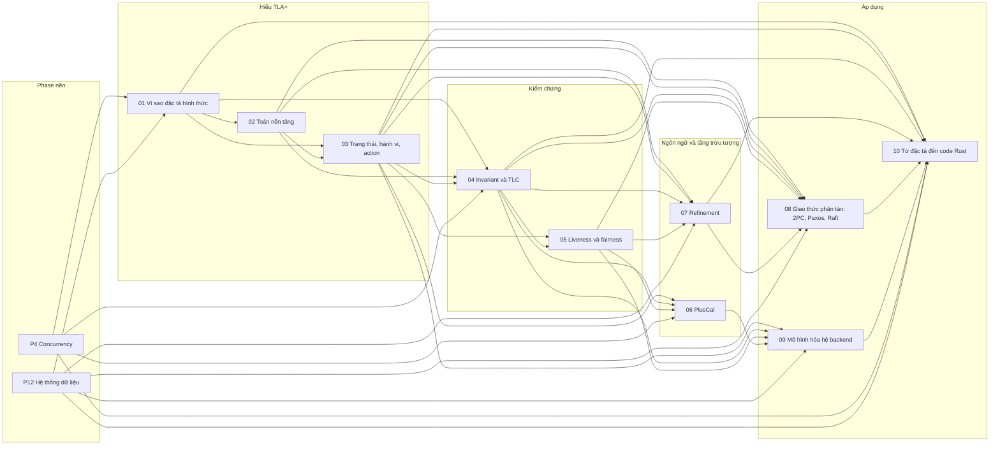

# P13 · Tổng quan — Đặc tả hình thức với TLA+

> Trang này chỉ điều hướng: mục tiêu, bản đồ chương, thứ tự đọc, cách cài công cụ, nguồn gốc và câu hỏi tổng hợp. Mọi khẳng định kỹ thuật về TLA+, TLC, PlusCal có chú thích nằm trong từng chương; các lời khuyên về thứ tự đọc là của người soạn. Chú thích ở trang này chỉ dùng để chứng minh tên chương và phiên bản của nguồn chính (*Specifying Systems*, PlusCal manual) và các bước cài công cụ theo README của dự án. **Cả phase không chạy TLC, SANY, Apalache hay code nào:** các spec trong chương là minh họa của người soạn, đối chiếu cú pháp với sách bằng cách đọc; kết luận kiểu "spec này vi phạm invariant" trong chương là lập luận tay có gắn nhãn, trừ chỗ nguồn tự ghi kết quả.

## Mục tiêu của phase

Phase này trả lời câu hỏi "làm sao biết *thiết kế* của một hệ đồng thời hoặc phân tán đúng, trước khi tin vào test": vì sao test, review và fault-injection vẫn bỏ sót lỗi chỉ lộ ra ở một thứ tự sự kiện hiếm; TLA+ là ngôn ngữ gì và AWS đã dùng nó ra sao; phần toán cần để đọc và viết spec (logic, tập hợp, hàm, record, sequence); cách mô tả trạng thái, hành vi và action; invariant, safety và model checker TLC; liveness, fairness và logic thời gian; PlusCal (ngôn ngữ giống code, dịch sang TLA+); refinement (spec chi tiết "cài đặt" spec trừu tượng); đọc spec thật của 2PC, Paxos, Raft; mô hình hóa lock có lease, hàng đợi at-least-once, cache-aside, outbox, retry; và nối spec với code Rust (trace validation, Stateright, loom, shuttle, proptest). Phase đứng trên P4 (race, deadlock, memory model: ví dụ "kiểm tra rồi mới làm" ở mức thread) và P12 (replication, transaction, lease, fencing, consensus, outbox: các hệ thống mà spec mô hình hóa); đây là nhận xét của người soạn về thứ tự học, và mỗi chương ghi rõ chương nền của nó ở mục "Kiến thức cần trước".

## Nguồn chính của phase và ánh xạ chương

Phần lớn khẳng định về cú pháp và ngữ nghĩa của TLA+ trong phase dựa trên sách *Specifying Systems* của Lamport (bản PDF đặt trên trang của tác giả; viết tắt SS ở các chương), bản tóm tắt cú pháp của Lamport và mã nguồn chuẩn của `tlaplus/tlaplus`; PlusCal dựa trên *PlusCal User's Manual*; số liệu công nghiệp dựa trên báo cáo kỹ thuật của nhóm AWS. Sách SS trình bày TLC "Version 2" của bản in 2002–2003, nên tên cờ và định dạng thông báo của TLC hiện nay có thể khác (chương 04 nói rõ). Bảng sau cho biết chương nào của SS được dùng ở chương P13 nào; cột "mục đã dùng" tóm theo các mục mà phần chú thích và "Đọc thêm" của chương P13 nêu, không phải mục lục đầy đủ của SS. Tên chương SS lấy từ mục lục sách.

| Chương SS (theo mục lục sách) | Dùng ở chương P13 | Mục đã dùng (tóm) |
|---|---|---|
| Chương 1 — *A Little Simple Math*[^ss-ch1] | [02](02-toan-nen-tang.md) | §1.1 logic mệnh đề, §1.2 tập hợp, §1.3 logic vị từ |
| Chương 2 — *Specifying a Simple Clock*[^ss-ch2] | [01](01-vi-sao-dac-ta-hinh-thuc.md), [03](03-trang-thai-hanh-vi-action.md) | behavior, đồng hồ giờ, `Init`/`Next`, stuttering |
| Chương 3 — *An Asynchronous Interface*[^ss-ch3] | [03](03-trang-thai-hanh-vi-action.md), [04](04-invariant-va-tlc.md) | module, `TypeInvariant`, định nghĩa |
| Chương 4 — *A FIFO*[^ss-ch4] | [03](03-trang-thai-hanh-vi-action.md), [07](07-refinement.md) | `INSTANCE`, ẩn hàng đợi |
| Chương 5 — *A Caching Memory*[^ss-ch5] | [02](02-toan-nen-tang.md), [04](04-invariant-va-tlc.md), [07](07-refinement.md), [08](08-dac-ta-giao-thuc-phan-tan.md) | hàm (§5.2), bộ nhớ tuyến tính, cache ghi xuyên, invariant (§5.7), chứng minh cài đặt (§5.8) |
| Chương 6 — *Some More Math*[^ss-ch6] | [02](02-toan-nen-tang.md) | biểu thức "ngớ ngẩn", hàm so với toán tử, `CHOOSE` |
| Chương 7 — *Writing a Specification: Some Advice*[^ss-ch7] | [01](01-vi-sao-dac-ta-hinh-thuc.md), [03](03-trang-thai-hanh-vi-action.md), [10](10-tu-dac-ta-den-code-rust.md) | mô hình của một góc nhìn, độ hạt nguyên tử (§7.3), chọn biến |
| Chương 8 — *Liveness and Fairness*[^ss-ch8] | [04](04-invariant-va-tlc.md), [05](05-liveness-va-fairness.md), [07](07-refinement.md) | công thức thời gian, weak/strong fairness, machine closure (§8.9.2) |
| Chương 10 — *Composing Specifications*[^ss-ch10] | [07](07-refinement.md) | §10.8–10.9 (interface refinement, có nên compose) |
| Chương 14 — *The TLC Model Checker*[^ss-ch14] | [01](01-vi-sao-dac-ta-hinh-thuc.md), [03](03-trang-thai-hanh-vi-action.md), [04](04-invariant-va-tlc.md), [05](05-liveness-va-fairness.md), [07](07-refinement.md), [08](08-dac-ta-giao-thuc-phan-tan.md), [09](09-mo-hinh-hoa-he-backend.md) | cách TLC đánh giá, kiểm property, symmetry, view, cách dùng (§14.5), giới hạn, mục "Be Suspicious of Success" (nằm trong §14.5.3) |
| Chương 15 — *The Syntax of TLA+*[^ss-ch15] | [02](02-toan-nen-tang.md) | thứ tự ưu tiên, luật căn lề của danh sách bullet |
| Chương 16 — *The Operators of TLA+*[^ss-ch16] | [02](02-toan-nen-tang.md) | ngữ nghĩa các toán tử hằng |
| Chương 18 — *The Standard Modules*[^ss-ch18] | [02](02-toan-nen-tang.md), [08](08-dac-ta-giao-thuc-phan-tan.md) | `Sequences`, các module số, `Bags` |

Chương [06 — PlusCal](06-pluscal.md) dựa chủ yếu vào *PlusCal User's Manual* bản 1.8 theo cú pháp P (có thêm bản cú pháp C), ghi trên bìa ngày 11/3/2024[^pm-version][^pm-c]. Chương [08](08-dac-ta-giao-thuc-phan-tan.md) đọc spec có thật (Examples, `raft.tla` của Ongaro) và [10](10-tu-dac-ta-den-code-rust.md) dựa vào các bài báo và docs thư viện Rust; danh sách ở mục "Nguồn gốc" dưới đây.

## Bản đồ chương

Mũi tên nghĩa là chương đích dùng khái niệm của chương nguồn (nhận xét của người soạn về thứ tự học, rút từ mục "Kiến thức cần trước" của từng chương). Hai hộp P4 và P12 là phase nền bên ngoài; chỉ vẽ những chương liệt kê chương của hai phase đó ở mục "Kiến thức cần trước" (ví dụ chương 05 chỉ nhắc P4·05 và P12·09 là liên quan, không bắt buộc, nên không vẽ).

## Các chương

| Chương | Nội dung chính |
|---|---|
| [01 — Vì sao đặc tả hình thức, và TLA+ là gì](01-vi-sao-dac-ta-hinh-thuc.md) | Vì sao test và review bỏ sót interleaving hiếm; bug thiết kế so với bug code (ví dụ "kiểm tra còn hàng rồi mới trừ"); kinh nghiệm của AWS với TLA+ (DynamoDB, S3…); TLA+ là "toán + logic thời gian hành động" (state, behavior, `Init`, `Next`); đặc tả không phải code và mức trừu tượng; hệ sinh thái (TLC, Apalache, TLAPS, PlusCal, Toolbox, VS Code); model checking chỉ kiểm hữu hạn; khi nào đáng bỏ công. |
| [02 — Toán nền tảng](02-toan-nen-tang.md) | `/\`, `\/`, `~`, `=>`, `<=>`, `\A`, `\E` và danh sách bullet; tập hợp (`SUBSET`, `UNION`, lọc, ánh xạ); hàm (`[x \in S \|-> e]`, `DOMAIN`, `EXCEPT`); record, tuple, sequence đều là hàm; `CHOOSE`; `LET`/`IF`/`CASE`; `EXTENDS Naturals`/`Sequences`; không có kiểu và "biểu thức ngớ ngẩn". |
| [03 — Trạng thái, hành vi và action](03-trang-thai-hanh-vi-action.md) | State, behavior, spec là tập behavior; action, biến primed (`x'`), enabled, `UNCHANGED`; `Init`, `Next`, `Spec == Init /\ [][Next]_vars`; stuttering step; module, `EXTENDS`, `CONSTANT`, `VARIABLE`, `ASSUME`; `TypeOK`; chọn biến và độ hạt nguyên tử; đọc trọn spec handshake channel và FIFO của sách. |
| [04 — Invariant, safety và TLC](04-invariant-va-tlc.md) | Safety, invariant, `[]P`; `TypeOK`, invariant nghiệp vụ, property theo bước; TLC duyệt BFS và fingerprint; file `.cfg` (`SPECIFICATION`, `INVARIANT`, `PROPERTY`, `CONSTANT`, model value) và cách chạy; đọc error trace, "TLC xanh" nghĩa là gì; deadlock; bound model và constraint; state-space explosion, symmetry, view. |
| [05 — Liveness, fairness và logic thời gian](05-liveness-va-fairness.md) | Safety so với liveness; `[]`, `<>`, `~>`, `[]<>`, `<>[]`; stuttering mãi và vì sao cần fairness; `ENABLED`, `<<A>>_v`; `WF` và `SF`; ví dụ "mọi request rồi sẽ được xử lý" (worker chết rồi sống lại); chọn fairness và machine closure; TLC kiểm liveness và counterexample dạng lasso. |
| [06 — PlusCal](06-pluscal.md) | PlusCal là ngôn ngữ thuật toán dịch sang TLA+ (P-syntax, C-syntax); label và bước nguyên tử; quy tắc đặt label; `process`, `self`, `fair`; `await`, `either`, `with`; `macro` và `procedure`; bản dịch (`pc`, một action mỗi label); ví dụ hai thread tăng counter (lost update) và sửa bằng lock. |
| [07 — Refinement, abstraction và implementation](07-refinement.md) | `Impl => Spec` ("implementation là implication"); stuttering và vì sao refinement cần nó; `INSTANCE ... WITH`; ẩn biến bằng `\EE`; refinement mapping và step simulation; ví dụ cache ghi xuyên refine bộ nhớ tuyến tính; kiểm refinement bằng TLC (Paxos → Voting → Consensus); giới hạn (biến phụ, liveness, TLAPS). |
| [08 — Đặc tả giao thức phân tán: 2PC, Paxos, Raft](08-dac-ta-giao-thuc-phan-tan.md) | Mô hình hóa mạng (tập `msgs`, bag, hàng đợi); `TCommit` là yêu cầu của atomic commit; `TwoPhase` và cái nó không nói (coordinator chết); Paxos qua Consensus → Voting → message passing; `raft.tla` của Ongaro; viết invariant (≤ 1 leader mỗi term, agreement) và inductive invariant; TLC chạy các spec đó thế nào; lỗi thật AWS đã tìm ra. |
| [09 — Mô hình hóa hệ backend thực tế](09-mo-hinh-hoa-he-backend.md) | Chọn độ trừu tượng và ranh giới nguyên tử; distributed lock với lease và fencing token; hàng đợi at-least-once và consumer idempotent; cache-aside và cuộc đua stale cache; transactional outbox; retry và timeout; giữ không gian trạng thái trong tầm TLC; Apalache (symbolic, SMT) và khi nào không nên đổi. |
| [10 — Từ đặc tả đến code Rust](10-tu-dac-ta-den-code-rust.md) | Khoảng cách spec–code; model-based testing (sinh test từ model so với kiểm vết với model; MongoDB); trace validation bằng TLC; Stateright; loom và shuttle; property-based testing kiểu state machine với proptest; mỗi công cụ trả lời câu hỏi nào; quy trình đề xuất cho team backend. |

## Thứ tự đọc

Đọc 01 → 10 theo số là ổn: thứ tự này đi từ động cơ, qua ngôn ngữ và công cụ, tới áp dụng, và mỗi chương nhắc ở mục "Kiến thức cần trước" những chương đứng trước nó. Gợi ý của người soạn:

- 01 là cổng vào và không đòi biết trước logic hay lý thuyết tập hợp; đọc nó trước để biết có đáng đầu tư cho phần còn lại không. 02 → 03 đi cùng nhau: 02 dạy ký hiệu (toán), 03 dạy hình dạng của một spec. Ai đã quen ký hiệu logic và tập hợp có thể đọc lướt 02, nhưng vẫn nên đọc mục 8 (không có kiểu) vì nó khác ngôn ngữ lập trình.
- 04 là chương thực hành nhất: cách TLC chạy, file cấu hình và đọc error trace; 04 trước 05. 05 (liveness, fairness) khó hơn; nếu ít thời gian, đọc mục 1–3 của 05 để biết vì sao "TLC xanh" chưa nói gì về chuyện hệ thống có tiến triển.
- 06 (PlusCal) có thể đọc ngay sau 04: các spec của chương 09 viết bằng PlusCal (riêng mục 8 dùng TLA+ thuần), nên đây là chương nối với 09; các phần PlusCal sinh ra về fairness trỏ về 05.
- 07 (refinement) trừu tượng nhất của phase. Chương 08 dùng khái niệm "spec A cài đặt spec B" nhưng chi tiết ở 07; chương 09 theo mục "Kiến thức cần trước" chỉ cần 03–06, nên đọc 09 trước 07–08 là khả thi nếu bạn muốn đi thẳng tới hệ backend (nhận xét của người soạn, rút từ danh sách kiến thức cần trước).
- 08 là chương đọc spec thật: đọc cùng [P12·09](../12-he-thong-du-lieu/09-consistency-va-consensus.md), vì chương này không giải thích lại giao thức. 09 là chương hưởng lợi trực tiếp cho backend (lock, queue, cache, outbox, retry) và dùng lại P12·08, P12·11, P12·12.
- 10 đọc cuối: nó dùng lại spec và khái niệm của 03, 04, 07, 08, 09 để trả lời "code có đúng spec không".
- Chuỗi ngắn nhất để tự viết được spec cho một thành phần backend: 01 → 03 → 04 → 06 → 09 (kèm 02 làm tra cứu ký hiệu, và đọc lướt 05). Nếu chỉ có thời gian cho một chương, [roadmap](../00-roadmap.md) mục 5 chọn chương 01.

## Cài công cụ

Chương [01](01-vi-sao-dac-ta-hinh-thuc.md) mục 6 mô tả hệ sinh thái; cách cài dưới đây theo README của kho `tlaplus/tlaplus` ở commit đã ghim. **Người soạn không chạy các lệnh này** (theo quy ước của dự án) và chưa kiểm trên macOS nào; phiên bản và cách phân phối có thể đã đổi, nên hãy đối chiếu README hiện hành. Cách dùng TLC và file `.cfg` nằm ở [chương 04](04-invariant-va-tlc.md) mục 4; cách chạy Apalache nằm ở [chương 09](09-mo-hinh-hoa-he-backend.md) mục 8.

- Các công cụ TLA+ cần Java 11 trở lên[^readme-java].
- Dòng lệnh: lấy `tla2tools.jar` từ trang Releases của kho `tlaplus/tlaplus`; file này chứa nhiều công cụ, và sau khi thêm vào `CLASSPATH` thì gọi được `java tla2sany.SANY` (parser), `java tlc2.TLC` (model checker), `java pcal.trans` (PlusCal translator)[^readme-cli]. `java -jar tla2tools.jar` mặc định chạy TLC[^readme-jar].
- Giao diện đồ họa: README chỉ tới extension VS Code của TLA+[^readme-vscode]; Toolbox (IDE dựa trên Eclipse) vẫn nằm trong kho nhưng README ghi là hiện không còn được bảo trì[^readme-toolbox].
- Tài liệu học và ví dụ chạy được: Learn TLA+ là tài liệu học trực tuyến miễn phí[^lt-intro] (trang sống, không ghim phiên bản).

## Nguồn gốc và lộ trình đọc

Các nguồn dưới đây đều là nguồn mà chương của phase đã dùng ở phần chú thích (số chương ghi ở cuối mỗi dòng); mở đọc song song với chương tương ứng. Không bắt buộc: chương đã tự chứa phần cần thiết. Danh sách là bản chọn lọc; docs thư viện Rust và các file spec riêng lẻ nằm ở chú thích và mục "Đọc thêm" của từng chương. Nhiều trang (Learn TLA+, Apalache, Stateright, Proptest) là tài liệu sống nên không ghim phiên bản.

**Sách, bài báo và trang của Lamport**

- [Lamport — Specifying Systems (bản PDF)](https://lamport.azurewebsites.net/tla/book-02-08-08.pdf) — chương 01, 02, 03, 04, 05, 07, 08, 09, 10 (ánh xạ chương ở mục trên).
- [Lamport — Summary of TLA+ (một trang các cấu trúc và ký hiệu ASCII)](https://lamport.azurewebsites.net/tla/summary-standalone.pdf) — chương 02, 03, 07.
- [Lamport — The Temporal Logic of Actions](https://lamport.azurewebsites.net/pubs/lamport-actions.pdf) — chương 01, 05, 07.
- [Lamport — PlusCal manual, P-syntax (bản 1.8)](https://lamport.azurewebsites.net/tla/p-manual.pdf) — chương 01, 05, 06, 09; [bản C-syntax](https://lamport.azurewebsites.net/tla/c-manual.pdf) — chương 06.
- [Lamport — A High-Level View of TLA+](https://lamport.azurewebsites.net/tla/high-level-view.html) — chương 01.
- [Lamport — My TLA+ Home Page](https://lamport.azurewebsites.net/tla/tla.html), [TLA+ Tools](https://lamport.azurewebsites.net/tla/tools.html), [The TLA+ Toolbox](https://lamport.azurewebsites.net/tla/toolbox.html), [Industrial Use of TLA+](https://lamport.azurewebsites.net/tla/industrial-use.html) — chương 01 (trang home cũng ở 02, 07).

**TLA+ trong công nghiệp**

- [Newcombe và cộng sự — Use of Formal Methods at Amazon Web Services (báo cáo 29/9/2014)](https://lamport.azurewebsites.net/tla/formal-methods-amazon.pdf) — chương 01, 02, 04, 05, 07, 08, 09, 10.
- [Gray và Lamport — Consensus on Transaction Commit](https://www.microsoft.com/en-us/research/uploads/prod/2004/01/consensus-on-transaction-commit.pdf) — chương 08.
- [Ongaro và Ousterhout — In Search of an Understandable Consensus Algorithm (Raft)](https://raft.github.io/raft.pdf) — chương 08; spec [`raft.tla` của Ongaro](https://raw.githubusercontent.com/ongardie/raft.tla/6ecbdbcf1bcde2910367cdfd67f31b0bae447ddd/raft.tla) — chương 08.
- [Kho `tlaplus/Examples` (README, commit ghim)](https://raw.githubusercontent.com/tlaplus/Examples/6a7b26a31c1a6aeec789b455e9bbfa3b3ad2728f/README.md) — chương 01; spec của kho này xuất hiện ở chương 03, 04, 05, 06, 07, 08, 09, 10.

**Học TLA+ và công cụ**

- [Learn TLA+ (Hillel Wayne)](https://learntla.com/) — chương 01; các trang [Conceptual Overview](https://learntla.com/intro/conceptual-overview.html) (01), [Operators and Values](https://learntla.com/core/operators.html) và [Structured Data](https://learntla.com/core/functions.html) (02), [TLA+](https://learntla.com/core/tla.html) (03), [Writing an Invariant](https://learntla.com/core/invariants.html) (03, 04), [Temporal Logic](https://learntla.com/core/temporal-logic.html) (03, 04, 05), [Concurrency](https://learntla.com/core/concurrency.html) (04, 06, 09), [Beyond the Toolbox](https://learntla.com/topics/cli.html) (04), [Handling Unbound Models](https://learntla.com/topics/unbound-models.html) và [Optimizing Model Checking](https://learntla.com/topics/optimization.html) (04, 09), [Modelling Message Queues](https://learntla.com/topics/message-queues.html) (09).
- [tlaplus/tlaplus — README (commit ghim)](https://raw.githubusercontent.com/tlaplus/tlaplus/94d0c5070852b37b801bb8998c436383ab7ee37b/README.md) — chương 01.
- [Apalache — Getting Started](https://apalache-mc.org/docs/apalache/index.html) (01, 04, 05, 09), [Running the tool](https://apalache-mc.org/docs/apalache/running.html) (05, 09), [Five minutes of theory](https://apalache-mc.org/docs/apalache/theory.html) (09), [Tutorial on checking PlusCal specifications](https://apalache-mc.org/docs/tutorials/pluscal-tutorial.html) (09).
- [TLA+ Proof System (TLAPS)](https://proofs.tlapl.us/doc/web/content/Home.html) — chương 07.

**Hệ backend: lock, queue, cache, outbox, retry**

- [Kleppmann — How to do distributed locking](https://martin.kleppmann.com/2016/02/08/how-to-do-distributed-locking.html) — chương 09 (cũng được P12·08 dùng).
- [Nishtala và cộng sự — Scaling Memcache at Facebook (NSDI 2013)](https://www.usenix.org/system/files/conference/nsdi13/nsdi13-final170_update.pdf) — chương 09.
- [Microsoft Learn — Cache-Aside pattern](https://learn.microsoft.com/en-us/azure/architecture/patterns/cache-aside), [microservices.io — Transactional outbox](https://microservices.io/patterns/data/transactional-outbox.html), [AWS Prescriptive Guidance — Transactional outbox](https://docs.aws.amazon.com/prescriptive-guidance/latest/cloud-design-patterns/transactional-outbox.html), [Debezium — Outbox Event Router](https://debezium.io/documentation/reference/2.7/transformations/outbox-event-router.html) — chương 09.
- [Amazon Builders' Library — Timeouts, retries and backoff with jitter](https://aws.amazon.com/builders-library/timeouts-retries-and-backoff-with-jitter/), [Stripe — Idempotent requests](https://docs.stripe.com/api/idempotent_requests), [RabbitMQ — Consumer Acknowledgements and Publisher Confirms](https://www.rabbitmq.com/docs/confirms), [Apache Kafka 3.9 — Design](https://kafka.apache.org/39/design/design/) — chương 09.

**Từ spec đến code Rust**

- [Cirstea, Kuppe, Loillier, Merz — Validating Traces of Distributed Programs Against TLA+ Specifications](https://arxiv.org/pdf/2404.16075v2) — chương 10.
- [Howard và cộng sự — Smart Casual Verification of the Confidential Consortium Framework](https://arxiv.org/pdf/2406.17455v2) — chương 10.
- [Davis, Hirschhorn, Schvimer — eXtreme Modelling in Practice (MongoDB)](https://arxiv.org/pdf/2006.00915v1) — chương 10.
- [Bornholt và cộng sự — Using Lightweight Formal Methods to Validate a Key-Value Storage Node in Amazon S3 (SOSP 2021)](https://www.cs.utexas.edu/~bornholt/papers/shardstore-sosp21.pdf) — chương 10.
- [docs.rs — stateright 0.31.0](https://docs.rs/stateright/0.31.0/stateright/) và [Stateright — Comparison with TLA+](https://www.stateright.rs/comparison-with-tlaplus.html) — chương 04, 07, 10.
- [docs.rs — loom 0.7.2](https://docs.rs/loom/0.7.2/loom/) (04, 10) và [docs.rs — shuttle 0.9.6](https://docs.rs/shuttle/0.9.6/shuttle/) (10).
- [Proptest — State Machine testing](https://proptest-rs.github.io/proptest/proptest/state-machine.html) và [docs.rs — proptest-state-machine 0.9.0](https://docs.rs/proptest-state-machine/0.9.0/proptest_state_machine/) — chương 10.

**Kiến thức hệ phân tán dùng cho phase**

- [Kleppmann — Distributed Systems, lecture notes (Cambridge 2021–22)](https://www.cl.cam.ac.uk/teaching/2122/ConcDisSys/dist-sys-notes.pdf) — chương 09 (cũng là nguồn chung của P12).

## Câu hỏi tổng hợp xuyên chương

Không có đáp án ở đây; mỗi câu trỏ về chương cần đọc lại.

1. Hai request cùng "kiểm tra còn hàng rồi mới trừ", hoặc hai thread cùng `counter += 1`: test chạy xanh hàng nghìn lần mà production vẫn hỏng hiếm. Bug thiết kế khác bug code ở đâu, mô hình hóa lỗi đó thành spec thế nào (một bước hay hai bước), và TLC giúp tìm ra thứ tự nào? ([chương 01](01-vi-sao-dac-ta-hinh-thuc.md), [chương 06](06-pluscal.md), [chương 04](04-invariant-va-tlc.md); P4 [chương 05](../04-concurrency/05-concurrency-bug-va-deadlock.md)).
2. Đọc `Spec == Init /\ [][Next]_vars` từng mảnh: `Init` nói gì, `Next` nói gì, vì sao phải có `[...]_vars`, và một action thiếu `UNCHANGED` làm spec sai thế nào? Vì sao `x' = x + 1` không phải phép gán? ([chương 03](03-trang-thai-hanh-vi-action.md); ký hiệu ở [chương 02](02-toan-nen-tang.md)).
3. TLC báo "không có lỗi" cho spec lock hoặc queue của bạn: điều đó nghĩa là gì và không nghĩa là gì? Hai cách một lần chạy xanh trở nên vô nghĩa (model quá nhỏ, tính chất safety thỏa bằng cách không làm gì) và cách tăng độ tin cậy. ([chương 04](04-invariant-va-tlc.md), [chương 05](05-liveness-va-fairness.md), [chương 09](09-mo-hinh-hoa-he-backend.md) mục 7, [chương 01](01-vi-sao-dac-ta-hinh-thuc.md) mục 7).
4. "Mọi request đã gửi rồi sẽ được xử lý": viết thành property gì, vì sao `Init /\ [][Next]_vars` không bao giờ chứng minh được nó, `WF` và `SF` khác nhau thế nào khi worker có thể chết rồi sống lại, và TLC cho counterexample dạng gì khi nó sai? ([chương 05](05-liveness-va-fairness.md)).
5. Lease cộng fencing token: trong spec, hết hạn và process pause được mô hình hóa ra sao, trace nào cho thấy lease một mình hỏng, và vì sao fencing chỉ hiệu quả khi tài nguyên đích tự kiểm tra token trong cùng bước nguyên tử với việc ghi? ([chương 09](09-mo-hinh-hoa-he-backend.md) mục 2; ngữ cảnh hệ thống ở P12 [chương 08](../12-he-thong-du-lieu/08-su-co-he-phan-tan.md)).
6. Queue at-least-once, transactional outbox và retry: vì sao ba mẫu này đều dẫn về "tác dụng phụ có thể chạy hai lần", và dedup phải đặt ở đâu để đúng? Phần nào của vấn đề retry nằm ngoài tầm TLA+? ([chương 09](09-mo-hinh-hoa-he-backend.md) mục 3, 5, 6; P12 [chương 12](../12-he-thong-du-lieu/12-dung-dan-va-tich-hop-du-lieu.md) và [chương 11](../12-he-thong-du-lieu/11-stream-processing.md)).
7. Đọc spec 2PC, Paxos, Raft có sẵn: mạng được mô hình hóa bằng gì (tập, bag), vì sao spec `TwoPhase` không thấy được chuyện coordinator chết gây kẹt, invariant "mỗi term tối đa một leader" cần thêm gì để chứng minh được, và "Paxos cài đặt Voting, Voting cài đặt Consensus" nghĩa hình thức là gì? ([chương 08](08-dac-ta-giao-thuc-phan-tan.md), [chương 07](07-refinement.md); giao thức ở P12 [chương 09](../12-he-thong-du-lieu/09-consistency-va-consensus.md)).
8. Spec đã model-check xong mà code Rust vẫn có thể sai: khoảng cách spec–code gồm những loại nào, và trace validation, Stateright, loom/shuttle, proptest mỗi cái trả lời câu hỏi nào? Một team backend nên bắt đầu từ đâu? ([chương 10](10-tu-dac-ta-den-code-rust.md), [chương 01](01-vi-sao-dac-ta-hinh-thuc.md) mục 5 và 8).

## Lab

Lab của phase này là [Lab P13 — TLA+](../labs/13-tla-plus-lab.md) (crate `labs/crates/lab-tla`). Lab có hai nửa:

- **Thư mục `specs/`:** chứa các spec TLA+/PlusCal và file `.cfg` cho lost update, 2PC (TCommit và TwoPhase), hàng đợi at-least-once và một service xử lý request. Kèm lệnh `pcal.trans`/TLC để bạn tự chạy sau khi cài công cụ như mục "Cài công cụ". Người soạn **chưa chạy TLC** trên các spec này.
- **Một model checker nhỏ viết bằng Rust:** duyệt trạng thái theo chiều rộng trên cùng các model đó. Các phép đếm trạng thái, phản ví dụ, kiểm liveness và conformance test với proptest đều đã chạy thật trên macOS.

Nên đọc chương [04](04-invariant-va-tlc.md), [06](06-pluscal.md), [08](08-dac-ta-giao-thuc-phan-tan.md) và [10](10-tu-dac-ta-den-code-rust.md) trước khi làm lab.

[^ss-ch1]: Lamport, Specifying Systems, mục lục — <https://lamport.azurewebsites.net/tla/book-02-08-08.pdf> — "1 A Little Simple Math 1.1 Propositional Logic 1.2 Sets 1.3 Predicate Logic"
[^ss-ch2]: Lamport, Specifying Systems, mục lục — <https://lamport.azurewebsites.net/tla/book-02-08-08.pdf> — "2 Specifying a Simple Clock 2.1 Behaviors 2.2 An Hour Clock"
[^ss-ch3]: Lamport, Specifying Systems, mục lục — <https://lamport.azurewebsites.net/tla/book-02-08-08.pdf> — "3 An Asynchronous Interface 3.1 The First Specification 3.2 Another Specification"
[^ss-ch4]: Lamport, Specifying Systems, mục lục — <https://lamport.azurewebsites.net/tla/book-02-08-08.pdf> — "4 A FIFO 4.1 The Inner Specification 4.2 Instantiation Examined"
[^ss-ch5]: Lamport, Specifying Systems, mục lục — <https://lamport.azurewebsites.net/tla/book-02-08-08.pdf> — "5 A Caching Memory 5.1 The Memory Interface 5.2 Functions 5.3 A Linearizable Memory"
[^ss-ch6]: Lamport, Specifying Systems, mục lục — <https://lamport.azurewebsites.net/tla/book-02-08-08.pdf> — "6 Some More Math 6.1 Sets 6.2 Silly Expressions"
[^ss-ch7]: Lamport, Specifying Systems, mục lục — <https://lamport.azurewebsites.net/tla/book-02-08-08.pdf> — "7 Writing a Specification: Some Advice 7.1 Why Specify 7.2 What to Specify 7.3 The Grain of Atomicity"
[^ss-ch8]: Lamport, Specifying Systems, mục lục — <https://lamport.azurewebsites.net/tla/book-02-08-08.pdf> — "8 Liveness and Fairness 87 8.1 Temporal Formulas 88 8.2 Temporal Tautologies 92"
[^ss-ch10]: Lamport, Specifying Systems, mục lục — <https://lamport.azurewebsites.net/tla/book-02-08-08.pdf> — "10 Composing Specifications 135 10.1 Composing Two Specifications 136"
[^ss-ch14]: Lamport, Specifying Systems, mục lục — <https://lamport.azurewebsites.net/tla/book-02-08-08.pdf> — "14 The TLC Model Checker 221 14.1 Introduction to TLC 221"
[^ss-ch15]: Lamport, Specifying Systems, mục lục — <https://lamport.azurewebsites.net/tla/book-02-08-08.pdf> — "15 The Syntax of TLA+ 275 15.1 The Simple Grammar 276"
[^ss-ch16]: Lamport, Specifying Systems, mục lục — <https://lamport.azurewebsites.net/tla/book-02-08-08.pdf> — "16 The Operators of TLA+ 291 16.1 Constant Operators 291"
[^ss-ch18]: Lamport, Specifying Systems, mục lục — <https://lamport.azurewebsites.net/tla/book-02-08-08.pdf> — "18 The Standard Modules 339 18.1 Module Sequences 339 18.2 Module FiniteSets 340"
[^pm-version]: Lamport, A PlusCal User's Manual (P-Syntax), bìa — <https://lamport.azurewebsites.net/tla/p-manual.pdf> — "P-Syntax∗ Version 1.8 Leslie Lamport 11 March 2024"
[^pm-c]: Lamport, A PlusCal User's Manual (P-Syntax), bìa — <https://lamport.azurewebsites.net/tla/p-manual.pdf> — "There is also a C-Syntax version of this manual."
[^readme-java]: tlaplus/tlaplus, README (commit 94d0c507) — <https://raw.githubusercontent.com/tlaplus/tlaplus/94d0c5070852b37b801bb8998c436383ab7ee37b/README.md> — "The TLA⁺ tools require Java 11+ to run."
[^readme-cli]: tlaplus/tlaplus, README (commit 94d0c507) — <https://raw.githubusercontent.com/tlaplus/tlaplus/94d0c5070852b37b801bb8998c436383ab7ee37b/README.md> — "The `tla2tools.jar` file contains multiple TLA⁺ tools"
[^readme-jar]: tlaplus/tlaplus, README (commit 94d0c507) — <https://raw.githubusercontent.com/tlaplus/tlaplus/94d0c5070852b37b801bb8998c436383ab7ee37b/README.md> — "Running `java -jar tla2tools.jar` is aliased to run `tlc2.TLC`."
[^readme-vscode]: tlaplus/tlaplus, README (commit 94d0c507) — <https://raw.githubusercontent.com/tlaplus/tlaplus/94d0c5070852b37b801bb8998c436383ab7ee37b/README.md> — "To use TLA⁺ from a graphical interface, see"
[^readme-toolbox]: tlaplus/tlaplus, README (commit 94d0c507) — <https://raw.githubusercontent.com/tlaplus/tlaplus/94d0c5070852b37b801bb8998c436383ab7ee37b/README.md> — "The Eclipse-based TLA⁺ Toolbox GUI is also available from this repository, but it is currently unmaintained."
[^lt-intro]: Hillel Wayne, Learn TLA+ (trang sống), trang chủ — <https://learntla.com/> — "This is a free online resource for learning TLA+."
