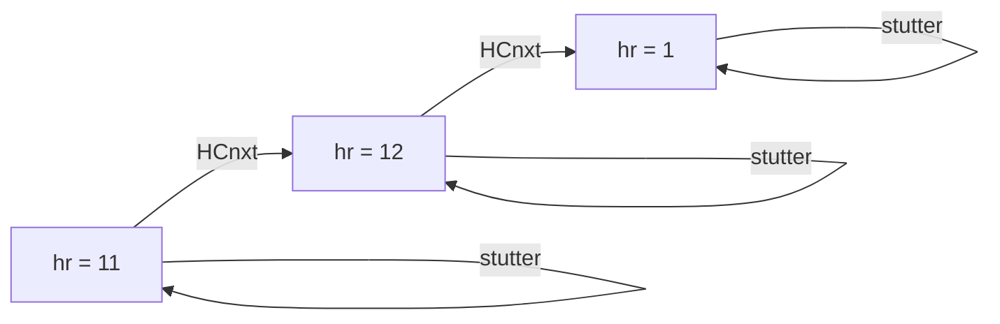
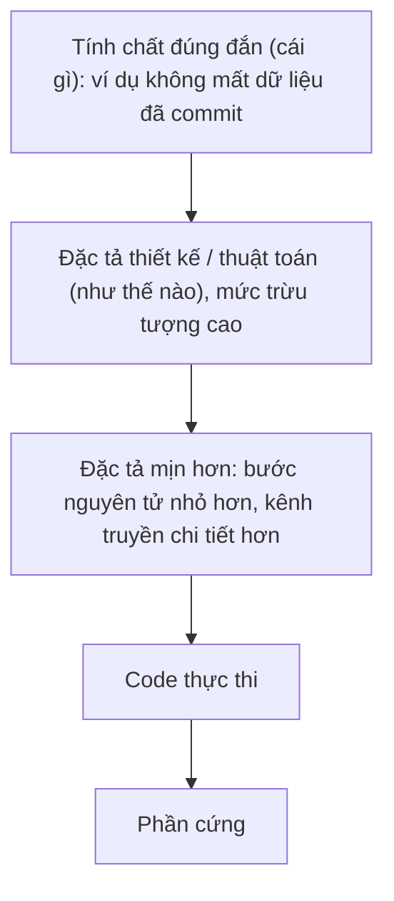
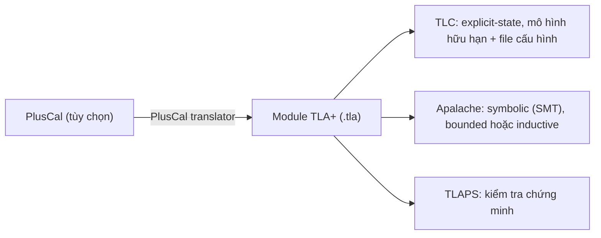
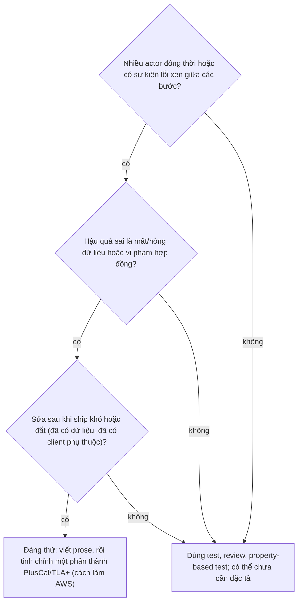

# P13 · Chương 01 — Vì sao đặc tả hình thức, và TLA+ là gì

> Chương này **không chạy TLC và không chạy code nào**. Các spec trong code block (```tla) là *minh họa*, đã đối chiếu cú pháp với sách *Specifying Systems* và PlusCal manual của Lamport; chương **không** khẳng định kết quả model checking của chúng, trừ khi nguồn nói rõ (ví dụ: spec wire transfer của Learn TLA+ ở mục 2). Số liệu AWS lấy từ báo cáo kỹ thuật của Newcombe và cộng sự đề ngày 29/9/2014 (bản PDF trên trang của Lamport), **không phải** bản đăng trên CACM năm 2015. Trang Learn TLA+, Apalache và trang của Lamport là trang sống, có thể đã đổi sau ngày soạn.

## Bạn sẽ hiểu được gì

- **Q1.** Vì sao test, code review và cả fault-injection vẫn bỏ sót lỗi chỉ lộ ra ở một thứ tự sự kiện hiếm? → mục 1
- **Q2.** Bug thiết kế khác bug code ở đâu? Một lỗi "kiểm tra rồi mới trừ kho" trông ra sao khi viết thành đặc tả? → mục 2
- **Q3.** AWS đã dùng TLA+ vào đâu (DynamoDB, S3…), tìm được gì, chuỗi lỗi dài bao nhiêu bước, mất bao nhiêu công? → mục 3
- **Q4.** TLA+ thực chất là gì: "toán + logic thời gian hành động" nghĩa là gì (state, behavior, step, `Init`, `Next`)? → mục 4
- **Q5.** Đặc tả khác code ở đâu, và nên viết ở mức trừu tượng nào? → mục 5
- **Q6.** Hệ sinh thái gồm những gì (TLC, Apalache, TLAPS, PlusCal, Toolbox, VS Code) và mỗi thứ làm việc gì? → mục 6
- **Q7.** Giới hạn: "TLC không báo lỗi" thực sự có nghĩa gì (model checking chỉ kiểm hữu hạn)? → mục 7
- **Q8.** Với backend engineer, khi nào đáng bỏ công viết đặc tả? → mục 8

## Kiến thức cần trước

- [P4 · Chương 05 — Bug concurrency và deadlock](../04-concurrency/05-concurrency-bug-va-deadlock.md), mục 2: atomicity violation (khối check-rồi-act bị chen ngang) — ví dụ chính của chương này chính là loại lỗi đó, nhưng nhìn ở tầng *thiết kế*.
- [P12 · Chương 08 — Sự cố của hệ phân tán](../12-he-thong-du-lieu/08-su-co-he-phan-tan.md), mục 1 và 4: partial failure, mô hình lỗi (crash, mất tin). Đây là các "sự kiện môi trường" mà đặc tả phải liệt kê.

Không cần biết trước logic hay lý thuyết tập hợp: [Chương 02](02-toan-nen-tang.md) dạy phần toán cần dùng. Chương này chỉ cho bạn thấy *bức tranh* và lý do đáng học.

## 1. Vì sao test không phủ được interleaving hiếm (Q1)

> **Trả lời ngắn.** Test chỉ chạy được một phần rất nhỏ trong số các thứ tự sự kiện có thể xảy ra, còn lỗi thiết kế của hệ đồng thời hoặc phân tán thường chỉ lộ ra ở một thứ tự rất đặc biệt. AWS ghi nhận các kỹ thuật kiểm chứng tiêu chuẩn là cần nhưng chưa đủ[^aws-insufficient], và số trạng thái mà code có thể đạt tới là "thiên văn"[^aws-test-inadequate]. Review cũng không cứu được vì trực giác con người ước lượng kém xác suất của các tổ hợp sự kiện hiếm[^aws-intuition].

**Giải thích.**

Hình dung (nhận xét của người soạn): bạn tìm một cuốn sách trong thư viện bằng cách mở ngẫu nhiên từng ngăn kéo. Nếu thư viện có vài chục ngăn, bạn sẽ thấy nó sau vài lần thử. Nếu có hàng nghìn tỉ ngăn mà sách chỉ nằm trong một ngăn, thì chạy "thêm một nghìn lần thử" gần như không thay đổi gì. Test tích hợp trên một service có nhiều worker cũng vậy: mỗi lần chạy, scheduler và mạng chọn *một* thứ tự sự kiện; lỗi chỉ xảy ra nếu thứ tự đó trùng khớp.

*Bước 1 — số thứ tự xen kẽ bùng nổ.* Giả sử $n$ tiến trình, mỗi tiến trình thực hiện $k$ bước nguyên tử độc lập. Số cách xen kẽ các bước (giữ nguyên thứ tự trong từng tiến trình) là

$$\frac{(n\cdot k)!}{(k!)^n}.$$

Với $n=3$, $k=10$ con số này là 5 550 996 791 340 (phép tính số học của người soạn, không phải số đo). Đó mới chỉ là thứ tự thuần túy, chưa tính lỗi.

*Bước 2 — môi trường chen thêm sự kiện.* Hệ thật không chỉ có các bước của chương trình. AWS liệt kê những sự kiện môi trường mà đặc tả của họ phải mô tả: lỗi và phục hồi mạng, lỗi đĩa, process crash và restart, sự cố data center, và thao tác của người vận hành[^aws-env-events]. Mỗi sự kiện đó có thể rơi vào giữa hai bước bất kỳ — nhân thêm một hệ số nữa vào con số ở bước 1.

*Bước 3 — bug hiếm đúng nghĩa là hiếm.* Learn TLA+ lấy ví dụ chuyển tiền: hai giao dịch cùng kiểm tra số dư rồi mới trừ; chỉ khi cả hai kiểm tra xong *trước khi* bên nào trừ thì tài khoản mới âm. Tác giả nhận xét các race condition như vậy về bản chất là hiếm: phần lớn thời gian chương trình chạy đúng, và chỉ ở những thứ tự rất đặc biệt mới có bug[^lt-race-rare].

*Bước 4 — không biết mình đã sửa hay chỉ làm bug hiếm hơn.* Thêm một cái lock "đúng chỗ" vào code: vấn đề biến mất vì đã giải quyết, hay vì ta vừa làm nó hiếm hơn? Nếu không thể khám phá hệ quả thật của thiết kế thì không bảo đảm được gì[^lt-lock-rarer].

*Bước 5 — fault-injection tốt vẫn không đủ.* Với DynamoDB, T.R. đã làm fault-injection test kỹ bằng một lớp mạng giả lập điều khiển được việc mất, nhân đôi và đảo thứ tự message[^aws-dynamo-testing]. Nhóm AWS coi loại test đó là tuyệt đối cần thiết, nhưng vẫn có thể bỏ lỡ những lỗi tinh vi của thiết kế[^aws-dynamo-necessary]. Mục 3 sẽ kể lỗi mà TLC tìm ra sau đó.

*Bước 6 — "test kỹ nhiều ngày" không loại trừ được.* Một kỹ sư ở Microsoft kể trên trang của Lamport: nhóm có một cài đặt cấu trúc dữ liệu lock-free được thiết kế cẩn thận, qua code review kỹ, và chạy stress test nhiều ngày[^ind-huang]. Họ viết spec TLA+ không phải để kiểm chứng mà để đồng đội tập PlusCal, và khi model checker báo vi phạm safety thì cả nhóm bất ngờ[^ind-huang-why].

Điều mà các ví dụ trên cùng chỉ ra: cái thiếu không phải *thêm test* mà là **một cách duyệt có hệ thống** mọi thứ tự có thể (trong một phạm vi đã chọn). Mục 4 và 6 nói cách đặc tả cho phép làm điều đó.

<details><summary>Đi sâu: công thức đếm, "chỉ cần một vi phạm", và một câu chuyện phần cứng</summary>

- Công thức ở bước 1 là hệ số đa thức: chọn vị trí cho $k$ bước của tiến trình đầu trong $nk$ ô, rồi $k$ bước của tiến trình thứ hai trong số ô còn lại, v.v. Với $n=2$, $k=5$ nó cho $\binom{10}{5}=252$. Nó là *cận trên* của số lịch chạy khi mọi bước độc lập và nguyên tử; hệ thật có thêm lỗi, nên con số lớn hơn nhiều (suy luận của người soạn).
- Model checker chỉ cần *một* hành vi vi phạm để báo lỗi: Learn TLA+ nêu rõ rằng việc các hành vi khác đều không có overdraft không quan trọng, vì ta tìm lỗi thiết kế hiếm nên một vi phạm là đủ[^lt-one-violation].
- Thacker (Microsoft) kể về giao thức memory coherence của Xbox 360: nhóm viết mô hình TLA+, thấy một bug rất tinh vi, báo cho IBM; IBM ban đầu bảo là không thể xảy ra, vài tuần sau thừa nhận bug có thật và regression test của họ cũng không bắt được[^ind-thacker]. Đây là phần cứng, không phải backend, nhưng cơ chế giống hệt: lỗi nằm ở thiết kế giao thức, test theo lịch cụ thể không chạm tới.

</details>

**Quay lại Q1:** test lấy mẫu vài thứ tự trong một không gian bùng nổ tổ hợp; lỗi thiết kế hiếm nằm ngoài mẫu, và người review không ước lượng nổi xác suất của chúng — nên cần một công cụ duyệt có hệ thống.

## 2. Bug thiết kế và bug code (Q2)

> **Trả lời ngắn.** Bug code là chỗ code không khớp với thiết kế (sai chỉ số, null dereference…); bug thiết kế là chỗ chính thiết kế không xử lý đúng một tình huống hiếm, dù code cài đặt trung thành đúng thiết kế đó[^lt-code-vs-design][^aws-design-bugs]. Bug thiết kế không lộ ra khi bạn đọc từng dòng code, vì từng dòng đều "đúng" so với thiết kế. Ví dụ dưới đây — hai request cùng "kiểm tra còn hàng rồi mới trừ" — là một bug thiết kế rất nhỏ, viết bằng PlusCal.

**Giải thích.**

Hình dung (nhận xét của người soạn): hai nhân viên kho cùng nhìn bảng ghi "còn 1 cái", mỗi người nghĩ "còn hàng, mình lấy" rồi bước vào kho. Từng người làm đúng quy trình được vẽ trên bảng quy trình; lỗi nằm ở chỗ quy trình cho phép hai người cùng đứng ở bước "đã kiểm tra, chưa lấy". Không dòng nào trong quy trình *của một người* sai.

Learn TLA+ dùng chính mô-típ này (chuyển tiền: kiểm tra số dư, rút, gửi) để giới thiệu TLA+; tác giả mô tả hai yếu tố cùng nhau gây race: người dùng có thể bắt đầu nhiều giao dịch cùng lúc, và các bước của giao dịch không nguyên tử[^lt-two-changes]. Spec của họ được ghi là *fail* khi kiểm với hai giao dịch: chạy đúng với một giao dịch nhưng không đúng với hai[^lt-fails]. Dưới đây là phiên bản kho hàng rút gọn do người soạn viết theo cùng ý (không phải trích từ nguồn):

```tla
---- MODULE inventory ----
EXTENDS Integers

(* --algorithm inventory
variables stock = 1;

define
  NoOversell == stock >= 0
end define;

process buyer \in 1..2
variable ok = FALSE;
begin
  Check:
    ok := stock >= 1;
  Take:
    if ok then
      stock := stock - 1;
    end if;
end process;
end algorithm; *)
====
```

Đọc từng phần:

- Thuật toán PlusCal nằm trong một comment `(* ... *)` của module TLA+[^pcal-comment]; bản dịch TLA+ do PlusCal translator sinh ra được đặt bên trong một module TLA+[^pcal-translated].
- `define ... end define;` cho phép định nghĩa toán tử TLA+ phụ thuộc biến toàn cục của thuật toán[^pcal-define]. Ở đây `NoOversell` là **invariant** (điều phải đúng ở *mọi* trạng thái): không bao giờ bán lố kho.
- `process buyer \in 1..2` tạo hai tiến trình giống nhau; mỗi tiến trình có biến cục bộ `ok`.
- **Nhãn quyết định độ nguyên tử.** Một bước (nguyên tử) của PlusCal là phần thực thi từ nhãn này tới nhãn kế tiếp[^pcal-atomic]. Learn TLA+ nói tương tự: nhãn xác định điều gì xảy ra nguyên tử và điều gì có thể bị tiến trình khác chen ngang, nhờ vậy ta biểu diễn được race condition[^lt-labels]. Ở đây `Check` và `Take` là hai bước riêng — đúng thiết kế "đọc rồi mới ghi, không khóa".

Một hành vi dẫn tới vi phạm `NoOversell`, suy ra bằng tay (suy luận của người soạn, không phải output của TLC): `Check` của tiến trình 1 (thấy `stock = 1`, đặt `ok = TRUE`) → `Check` của tiến trình 2 (cũng thấy `stock = 1`) → `Take` của tiến trình 1 (`stock = 0`) → `Take` của tiến trình 2 (`stock = -1`). Bốn bước, và `NoOversell` sai ở trạng thái cuối. Đếm bằng tay (suy luận của người soạn): hai tiến trình × hai bước cho $\binom{4}{2}=6$ cách xen kẽ; 4 cách trong đó có cả hai `Check` đứng trước cả hai `Take` nên vi phạm, 2 cách (một tiến trình làm xong cả `Check` lẫn `Take` rồi mới tới tiến trình kia) thì an toàn. TLC ở chế độ model checking mặc định cố tìm mọi trạng thái tới được[^book-tlc-modes], nên cả 6 cách đều nằm trong phạm vi duyệt; còn trong hệ thật, khoảng cách giữa `Check` và `Take` thường rất ngắn nên thứ tự xấu hiếm khi xảy ra — đúng lý do mục 1 nói test khó bắt (suy luận của người soạn).

Cách sửa ở *tầng thiết kế*: gộp việc kiểm tra và trừ vào **một** bước nguyên tử — trong PlusCal là đưa cả `if stock >= 1 then stock := stock - 1; end if;` dưới một nhãn. Khi đó mỗi `Take` chỉ trừ nếu `stock >= 1` ngay tại bước đó, nên `stock` không thể xuống dưới 0 (suy luận của người soạn từ phép trừ một đơn vị có điều kiện; chưa kiểm bằng TLC).

AWS mô tả đúng loại tình huống này ở quy mô lớn: lỗi thiết kế tinh vi là loại mà code cài đặt trung thành thiết kế nhưng thiết kế không xử lý đúng một kịch bản "hiếm"[^aws-design-bugs]. Họ cũng cảnh báo rằng nếu thiết kế hỏng, code gần như chắc chắn hỏng, và kỹ sư dễ tin code "đúng" chỉ vì nó khớp với thiết kế (hỏng) đó[^aws-design-first].

<details><summary>Đi sâu: cùng đặc tả viết tay bằng TLA+ (dạng mà TLC thực sự đọc)</summary>

TLC làm việc ở mức TLA+, kể cả khi bạn viết PlusCal[^aws-pluscal-level]. Dưới đây là cách người soạn viết tay cùng thiết kế bằng TLA+, dùng biến `pc` thay cho nhãn (PlusCal translator cũng dùng một biến `pc` như vậy[^pcal-pc]); chưa chạy qua TLC.

Chú giải nhanh các ký hiệu trong khối dưới (bản rút gọn; [chương 02](02-toan-nen-tang.md) dạy đầy đủ): `/\` là "và" (∧) và `\/` là "hoặc" (∨)[^pcal-logic]; một dãy dòng bắt đầu bằng `/\` thẳng cột là một danh sách hội, mỗi dòng là một điều kiện phải cùng đúng[^book-conjlist]. Biến có dấu phẩy, như `ok'`, là giá trị của `ok` ở trạng thái *sau* bước[^sum-prime]. `[b \in Buyers |-> e]` là hàm cho mỗi `b` thuộc `Buyers` một giá trị `e`[^pcal-func] (`|->` là cách gõ ký hiệu ↦[^pcal-mapsto]); `[f EXCEPT ![k] = v]` là hàm giống `f` trừ tại `k` nhận giá trị `v`[^sum-except]; `<<a, b, c>>` là bộ (tuple) ba phần tử[^sum-tuple]. `\E b \in Buyers : P` đọc là "có một `b` thuộc `Buyers` sao cho `P`" — ở `Next` nghĩa là "một buyer nào đó thực hiện một bước"; còn `Check(b) == ...` định nghĩa một toán tử có tham số (cả hai xem chương 02, mục 1 và mục 6).

```tla
---- MODULE InventoryRace ----
EXTENDS Integers

VARIABLES stock, pc, ok
Buyers == 1..2
vars   == <<stock, pc, ok>>

Init == /\ stock = 1
        /\ pc = [b \in Buyers |-> "Check"]
        /\ ok = [b \in Buyers |-> FALSE]

Check(b) == /\ pc[b] = "Check"
            /\ ok' = [ok EXCEPT ![b] = (stock >= 1)]
            /\ pc' = [pc EXCEPT ![b] = "Take"]
            /\ UNCHANGED stock

Take(b) == /\ pc[b] = "Take"
           /\ stock' = IF ok[b] THEN stock - 1 ELSE stock
           /\ pc' = [pc EXCEPT ![b] = "Done"]
           /\ UNCHANGED ok

Next == \E b \in Buyers : Check(b) \/ Take(b)

Spec == Init /\ [][Next]_vars

NoOversell == stock >= 0
====
```

File cấu hình đi kèm cho TLC chỉ cần nêu tên đặc tả và tính chất cần kiểm[^book-tlc-cfg]. Ở đây gồm hai dòng `SPECIFICATION Spec` và `INVARIANT NoOversell` (lệnh `INVARIANT` đòi một state predicate[^book-tlc-invariant-stmt]).

Ghi chú:

- `UNCHANGED stock` nghĩa là `stock' = stock`[^book-unchanged]. Mọi biến không nhắc tới trong một action phải được nói rõ là không đổi; nếu quên, biến đó được phép nhận *bất kỳ* giá trị nào ở bước sau (suy luận của người soạn từ việc action chỉ là công thức ràng buộc quan hệ giữa hai trạng thái — mục 4).
- Khi mọi `buyer` đã `Done`, `Next` không còn bật; TLC mặc định coi trạng thái không còn bước đi là deadlock, nhưng kiểm tra này tắt được vì với một số hệ thống nó chỉ có nghĩa là kết thúc thành công[^book-tlc-deadlock]. Bản viết tay này không có bước nào cho trạng thái cuối, nên với file cấu hình hai dòng ở trên TLC sẽ coi trạng thái cuối là deadlock (suy luận của người soạn từ câu trên; chưa chạy). [Chương 04](04-invariant-va-tlc.md) mục 6 nói về deadlock check.
- Dạng `Spec == Init /\ [][Next]_vars` sẽ được giải thích ở mục 4; chương 03 đi sâu vào action.

</details>

**Quay lại Q2:** bug code là code lệch thiết kế; bug thiết kế là thiết kế sai dù code đúng thiết kế — và loại sau chỉ bắt được khi thiết kế được viết đủ chính xác để duyệt các thứ tự xen kẽ.

## 3. Kinh nghiệm của AWS (Q3)

> **Trả lời ngắn.** Từ 2011, các kỹ sư AWS dùng đặc tả hình thức và model checking cho các bài toán thiết kế khó ở hệ thống trọng yếu[^aws-since]. Trong báo cáo 2014 họ nói đã dùng TLA+ trên 10 hệ thống lớn, ở cả 10 trường hợp có giá trị rõ rệt, và 7 nhóm đang dùng[^aws-scale]. Ví dụ nổi bật: ở DynamoDB, TLC tìm ra một lỗi có thể làm mất dữ liệu, với chuỗi lỗi ngắn nhất dài 35 bước mức cao[^aws-dynamo-bug]; lỗi đó đã lọt qua design review, code review và test[^aws-dynamo-passed].

**Giải thích.**

Hình dung (nhận xét của người soạn): thợ xây không đổ bê tông rồi mới biết cái cột không chịu nổi tải; họ tính trên bản vẽ trước. Đặc tả là "bản vẽ tính được" của một hệ thống phần mềm — và báo cáo AWS dưới đây là một ví dụ công nghiệp về việc bản vẽ đó tìm được lỗi thật.

*Động cơ.* Phần lõi mỗi dịch vụ AWS dựa vào thuật toán chịu lỗi phân tán cho replication, consistency, concurrency control, auto-scaling, load balancing và điều phối khác; họ kết hợp thuật toán trong tài liệu thành hệ thống gắn kết, thậm chí tự phát minh thuật toán mới[^aws-algos]. Lỗi ở lõi có thể làm mất hoặc hỏng dữ liệu, nên cần độ tin cậy cực cao[^aws-core-risk].

*Vì sao họ chọn TLA+.* Họ cần một mô tả chính xác, đủ cô đọng để nắm bản chất thiết kế trong vài trăm dòng, ở mức cao hơn code nhưng có ngữ nghĩa chính xác[^aws-precise-needs], và có sẵn hệ công cụ[^aws-ecosystem]. TLA+ dựa trên toán rời rạc đơn giản (lý thuyết tập hợp và vị từ); một đặc tả TLA+ mô tả tập mọi hành vi hợp lệ (execution trace) của hệ thống[^aws-whatshow].

*Ca DynamoDB (khởi đầu).* DynamoDB ra mắt tháng 1/2012 với yêu cầu replicate dữ liệu qua nhiều data center và hứa strong consistency[^aws-dynamo-launch]. Trước TLA+, T.R. đã làm fault-injection test và viết chứng minh phi hình thức; chứng minh tìm ra vài lỗi ở bản thiết kế đầu, nhưng chứng minh phi hình thức có thể bỏ sót vấn đề rất tinh vi[^aws-dynamo-proofs]. T.R. học TLA+ và viết đặc tả chi tiết trong khoảng hai tuần[^aws-dynamo-weeks], rồi chạy TLC phiên bản phân tán trên cụm mười instance EC2 loại cc1.4xlarge (mỗi máy 8 core cộng hyperthread, 23 GB RAM)[^aws-dynamo-cluster]. Phần nhỏ phức tạp của thuật toán được kiểm xong; phần thuật toán chịu lỗi rộng hơn thì TLC tìm ra lỗi có thể mất dữ liệu nếu một chuỗi sự cố và bước phục hồi bị xen với xử lý khác; chuỗi lỗi ngắn nhất gồm 35 bước mức cao[^aws-dynamo-bug]. Báo cáo nhấn mạnh việc sự kiện ghép "khó xảy ra" không phải lý do để bỏ qua: AWS từng quan sát nhiều tổ hợp sự kiện phức tạp ít nhất bằng tổ hợp gây lỗi này[^aws-improbable]. Mô hình sau đó còn tìm ra hai lỗi nữa ở các thuật toán khác[^aws-dynamo-more]. Về sau T.R. thêm tính năng di chuyển dữ liệu giữa data center vào chính đặc tả đã có; model checker phát hiện thiết kế ban đầu của tính năng đó sẽ đưa vào một lỗi tinh vi[^aws-dynamo-extend].

*Ca S3.* Sau buổi giới thiệu nội bộ, một nhóm S3 nhờ giúp dùng TLA+ để kiểm một thuật toán mạng chịu lỗi mới[^aws-s3-ask]; model checking tìm ra hai lỗi tinh vi và cho phép kiểm chứng bản sửa cho cả hai[^aws-s3-bugs]. Một kỹ sư khác, B.M., viết đặc tả đầu tay cho một thuật toán đã biết có lỗi tinh vi — lỗi từng qua nhiều lần design review và code review và chỉ lộ sau nhiều tháng test; sau hai tuần học và viết đặc tả, TLC tìm ra lỗi trong vài giây[^aws-bm]. Đội đã có bản sửa; khi cập nhật đặc tả để thêm bản sửa đó, model checker cho thấy lỗi vẫn xảy ra theo một chuỗi khác, và chỉ bản sửa mạnh hơn mới được kiểm chứng[^aws-bm-fix].

*Công sức học.* Kỹ sư từ mới vào nghề tới Principal học TLA+ từ đầu và có kết quả hữu ích sau 2–3 tuần, có người học vào buổi tối và cuối tuần, không cần ai dạy[^aws-learning].

*Cách nói với đồng nghiệp.* Họ nhận thấy kỹ sư dễ chấp nhận hơn nếu gọi TLA+ là "pseudo-code có thể kiểm thử vét cạn", và ban đầu tránh các từ như "formal", "verification", "proof"[^aws-exhaustive].

*Điều đáng học nhất: đổi câu hỏi.* Kỹ sư vốn tập trung vào "happy case", rồi nghĩ "có thể sai gì?" theo kinh nghiệm, và hầu như luôn dừng trước các tổ hợp sự kiện cực hiếm vì có quá nhiều để tưởng tượng[^aws-happy-case]. Đặc tả hình thức bắt đầu bằng câu hỏi ngược: "điều gì phải đúng?" — nêu các tính chất đúng đắn, rồi mô tả môi trường (kể cả mọi sự kiện lỗi) và kiểm tra thiết kế thỏa tính chất dù các sự kiện môi trường xen kẽ thế nào; theo họ cách này ít sai sót hơn cách "điều gì có thể sai?" thiên về ứng biến[^aws-whatneeds]. Hai loại tính chất: **safety** ("hệ thống được phép làm gì": ví dụ mọi dữ liệu đã commit luôn còn và đúng)[^aws-safety] và **liveness** ("hệ thống phải làm gì rốt cuộc": ví dụ mỗi request cuối cùng phải được trả lời)[^aws-liveness]. Chương 04 và 05 dạy hai loại này.

<details><summary>Đi sâu: bảng kết quả, phiên bản bài báo, và các công ty khác</summary>

- Bảng "Applying TLA+ to some of our more complex systems" của báo cáo liệt kê các hệ thống (S3, DynamoDB, EBS, một lock manager nội bộ)[^aws-table-systems], thành phần, số dòng đặc tả (không tính comment; các số trong bảng từ 102 tới 939 dòng, PlusCal hoặc TLA+)[^aws-table-lines] và lợi ích thu được. Bản text trích từ PDF làm vỡ bố cục bảng, nên người soạn *không* ghép từng dòng bảng với từng hệ thống và chỉ dùng phần văn xuôi ở trên. Một ô trong bảng ghi rằng họ cải thiện độ tin cậy nhưng không tìm ra lỗi liveness vì không kiểm liveness[^aws-liveness-table] — bài học rõ ràng: không khai báo và không kiểm thuộc tính liveness thì không có kết luận về liveness (liên hệ mục 7).
- Báo cáo ở URL trên là bản báo cáo kỹ thuật ngày 29/9/2014. Trang của Lamport nói bài báo công bố tháng 4/2015 (CACM, tập 58, số 4) có cùng nhóm tác giả, và đăng bản rút gọn trên trang web của ông[^ind-cacm]; người soạn không đọc bản CACM, nên mọi số liệu ở trên là của báo cáo 2014.
- Cùng trang đó trích các kỹ sư Azure: ở RingMaster, họ gặp bug biểu hiện bằng unit test lúc fail lúc không, rất khó định vị trong code[^ind-ringmaster]; ở Cosmos DB, khi thiết kế thuật toán ghi đa vùng (multi-location write), họ tìm ra một lỗi đúng đắn nghiêm trọng vi phạm một safety property quan trọng, ngay lúc viết spec và trước khi viết một dòng code[^ind-cosmos].
- Trang của Lamport chép lại ba điểm then chốt mà các tác giả liệt kê trong bài đăng CACM tháng 4/2015 (bản đăng chính thức, khác với báo cáo 2014 mà chương này dùng cho số liệu): formal methods tìm lỗi thiết kế mà không kỹ thuật nào khác họ biết có thể tìm; khả thi một cách đáng ngạc nhiên cho phát triển phần mềm chính thống; được dùng thường xuyên trong thiết kế phần mềm thực[^ind-amazon-insights]. (Đây là ý của các tác giả AWS, do trang của Lamport trích lại.)
- Sau khi có đặc tả, AWS còn dùng nó như công cụ "what if": họ đã tối ưu hiệu năng như bỏ hoặc thu hẹp lock, nới lỏng ràng buộc thứ tự message — những thứ họ không dám làm nếu chưa model check[^aws-whatif].

</details>

**Quay lại Q3:** AWS dùng TLA+ (kèm PlusCal) cho các thuật toán lõi như replication của DynamoDB và thuật toán mạng của S3, tìm ra lỗi mất dữ liệu cần chuỗi 35 bước mức cao mà review, code review và test không thấy, với chi phí học 2–3 tuần mỗi kỹ sư.

## 4. TLA+ là gì: toán cộng với logic thời gian hành động (Q4)

> **Trả lời ngắn.** TLA+ là ngôn ngữ để viết mô hình của phần mềm "trên mức code"[^hlv-model], dựa trên toán đơn giản[^home-def]. Nó mô tả một hệ thống bằng tập mọi *hành vi* (behavior: dãy trạng thái) có thể có: một điều kiện đầu (`Init`) cộng một quan hệ trạng thái-kế-tiếp (`Next`)[^hlv-init-next]. TLA là "Temporal Logic of Actions" — logic thời gian đơn giản mà Lamport đưa ra cuối thập niên 1980, cho phép mô tả hệ bằng *một* công thức, phần lớn là toán thường và chỉ dùng logic thời gian ở chỗ cần[^book-tla].

**Giải thích.**

Hình dung (nhận xét của người soạn): hãy nghĩ tới sơ đồ state machine bạn vẽ cho một order (`Created → Paid → Shipped`). TLA+ là cách viết sơ đồ ấy bằng toán, để máy kiểm được, nhưng linh hoạt hơn nhiều: trạng thái có thể là cả một cơ sở dữ liệu nhỏ gồm tập, hàm, dãy; và nhiều tiến trình (worker, replica, message trong mạng) cùng bước đi xen kẽ.

*Ý 1 — spec là một tập hành vi.* TLA+ có tính trạng thái (state-based): một lần thực thi là một dãy trạng thái; một sự kiện biểu diễn bằng cặp trạng thái liền kề. Dãy trạng thái gọi là *behavior*, cặp liền kề gọi là *step* (bước)[^hlv-state-based]. Một hệ thống được mô hình hóa bằng tập các hành vi mô tả mọi lần thực thi có thể có của nó[^hlv-set-of-behaviors]. Trong sách, *state* là phép gán giá trị cho *mọi* biến[^book-state]; *behavior* là dãy vô hạn các state[^book-behavior].

*Ý 2 — `Init` và `Next`.* Đặc tả dùng hai thứ: điều kiện đầu cho các trạng thái khởi đầu có thể, và quan hệ trạng thái-kế-tiếp cho các bước có thể; tập hành vi là những dãy có trạng thái đầu thỏa điều kiện đầu và *mọi* bước thỏa quan hệ kế tiếp[^hlv-init-next]. Quan hệ kế tiếp là một công thức có biến "có dấu phẩy" (prime): `hr'` là giá trị của `hr` ở trạng thái *sau*; công thức như vậy gọi là **action**[^book-action]. Lưu ý quan trọng với lập trình viên: sách nhắc rằng "action được thực thi" chỉ là cách nói; action là công thức, và công thức không được thực thi[^book-formula-not-exec].

*Ý 3 — ví dụ nhỏ nhất: đồng hồ 12 giờ.* Đặc tả sau là của sách, dạng ASCII gõ được[^book-hourclock]. Đọc từng dòng bên dưới.

```tla
---------------------- MODULE HourClock ---------------------
EXTENDS Naturals
VARIABLE hr
HCini == hr \in (1 .. 12)
HCnxt == hr' = IF hr # 12 THEN hr + 1 ELSE 1
HC == HCini /\ [][HCnxt]_hr
-------------------------------------------------------------
THEOREM HC => []HCini
==============================================================
```

`HCini` nói giờ đầu là số bất kỳ từ 1 tới 12; `HCnxt` nói bước tiếp theo tăng giờ thêm 1, riêng 12 thì quay về 1; `HC` là công thức đặc tả. Phần `[][HCnxt]_hr` có hai nửa: `[]` (đọc "box") là toán tử logic thời gian "luôn luôn đúng"[^book-box], và `[HCnxt]_hr` là viết tắt của `HCnxt \/ (hr' = hr)`[^book-square]. Nửa sau cho phép **stuttering step**: bước mà `hr` không đổi (xem đi sâu). Các ký hiệu còn lại: `EXTENDS Naturals` nhập các định nghĩa của số tự nhiên, như phép `+`[^book-extends]; `VARIABLE hr` khai báo biến `hr`; `#` là "khác" (≠)[^book-ascii] và `\in` là "thuộc" (∈)[^book-ascii-in]; `hr \in (1 .. 12)` nghĩa là `hr` là số nguyên từ 1 tới 12; còn `THEOREM HC => []HCini` khẳng định mọi hành vi thỏa `HC` thì `HCini` đúng ở mọi trạng thái, với `=>` là kéo theo[^book-hc-theorem].



(Sơ đồ chỉ vẽ ba trạng thái của một hành vi tiêu biểu; spec cho phép trạng thái đầu là bất kỳ giờ nào từ 1 tới 12, và stuttering ở mọi trạng thái.)

*Ý 4 — đặc tả cũng là công thức; "cài đặt" là phép kéo theo.* Lamport mô tả TLA như logic trong đó hệ thống và tính chất của nó cùng được biểu diễn bằng công thức, nên "hệ thống thỏa đặc tả" và "hệ này cài đặt hệ kia" đều là phép kéo theo logic[^tla-paper-abstract]. AWS nói đúng điều đó ở góc độ thực hành: dùng cùng một ngôn ngữ cho tính chất đúng đắn ("cái gì") và thiết kế ("như thế nào"); chúng chỉ là các nấc trên một thang trừu tượng[^aws-ladder]. Mục 5 và chương 07 (refinement) khai thác ý này.

*Ý 5 — "toán" ở đây là toán gì.* Phần lớn một đặc tả hệ thống là toán thông thường (logic và tập hợp) gắn với nhau, cộng một chút logic thời gian[^book-mostly-math]. Với bạn, điều đó có nghĩa: ít cú pháp mới hơn tưởng, và biểu diễn dữ liệu bằng tập, hàm, record thay vì class (chương 02 sẽ dạy).

*Ý 6 — nó không phải ngôn ngữ lập trình.* TLA+ dựa trên toán và không giống ngôn ngữ lập trình nào[^hlv-not-lang]. Lamport nói: toán diễn tả được một giá trị mà không phải nói cách tính ra nó (ví dụ ước chung lớn nhất là "số nguyên dương lớn nhất chia hết cả hai số"), nên mô hình bỏ qua được chi tiết không liên quan[^hlv-math-more-expressive].

<details><summary>Đi sâu: stuttering, kiểu dữ liệu, và vì sao spec không "chạy"</summary>

- **Stuttering.** `Init /\ []Next` (không có `_hr`) sẽ buộc mọi bước là một `HCnxt`, nên không mô tả được đồng hồ nằm trong một hệ lớn hơn, nơi có biến khác (nhiệt độ) đổi mà `hr` đứng yên. Sách giải thích rằng đặc tả đồng hồ phải cho phép các bước giữ `hr` không đổi, gọi là stuttering step[^book-stutter-why]. Một lần thực thi kết thúc được biểu diễn bằng hành vi vô hạn mà cuối cùng chỉ gồm stuttering[^book-stutter-end]. Chương 03 quay lại chi tiết này.
- **Kiểu.** TLA+ là ngôn ngữ không có kiểu (untyped): sách nói "type correctness" chỉ là tên của một tính chất bất biến, và đặt tên `TypeInvariant` cho một công thức không cho nó địa vị đặc biệt nào[^book-untyped]. Sách nhấn mạnh thêm: "type invariant" là *tính chất* của đặc tả chứ không phải giả định; viết `n' > 7` không nói `n'` là số tự nhiên[^book-type-inv]. Với người quen compiler bắt lỗi kiểu, đây là chỗ cần để ý: bạn thường định nghĩa `TypeOK` và nhờ TLC kiểm nó là invariant (nhận xét của người soạn).
- **Sách nói gì về chính mình.** Lamport nói TLA+ là ngôn ngữ để viết toán, tức viết các định nghĩa và định lý; ý nghĩa mà ta gán cho các định nghĩa đó nằm ngoài toán học, và việc hiểu toán nói gì về hệ thống thật là kỹ năng của người kỹ sư[^book-lang-not-meaning].
- **Hai cách mô tả.** TLA+ không phân biệt hình thức giữa "máy trạng thái" và "tính chất": cả hai đều là công thức; "thỏa một tính chất" và "cài đặt một máy trạng thái" đều có nghĩa là một công thức kéo theo công thức kia[^hlv-property-impl].
- **Tên gọi.** TLA+ bắt đầu từ TLA, "Temporal Logic of Actions"; Lamport nhắc rằng sách của ông gần như không nói gì về chứng minh[^book-no-proof] — chương trình P13 cũng vậy: ta dùng model checking, không dùng chứng minh (TLAPS chỉ nhắc ở mục 6).

</details>

**Quay lại Q4:** TLA+ viết đặc tả như một công thức toán, gồm điều kiện đầu và quan hệ trạng thái-kế-tiếp, mô tả tập mọi hành vi hợp lệ; "logic thời gian hành động" là cách Lamport gói quan hệ đó và các tính chất về dãy trạng thái vào một công thức duy nhất.

## 5. Đặc tả không phải code; chọn mức trừu tượng (Q5)

> **Trả lời ngắn.** Đặc tả mô tả "cái gì và như thế nào" ở mức *trên* code: nó là mô hình toán học của một góc nhìn vào một phần hệ thống[^book-model-view], không phải bản sao của code. AWS thừa nhận họ không biết code có cài đặt đúng thiết kế đã kiểm hay không[^aws-notverified]; giá trị nằm ở chỗ thiết kế đúng là bước đầu tiên để code đúng. Mức trừu tượng được chọn theo mục đích: giữ lại thứ có thể gây lỗi ta đang săn, bỏ chi tiết còn lại.

**Giải thích.**

Hình dung (nhận xét của người soạn): bản đồ tàu điện ngầm là một mô hình tuyệt vời cho câu hỏi "đi từ A tới B đổi tuyến ở đâu", và vô dụng cho câu hỏi "ga này cách ga kia bao nhiêu mét". Nó đúng vì nó *bỏ* khoảng cách thật. Đặc tả cũng vậy: sách nói đặc tả là một sự trừu tượng — nó mô tả một số khía cạnh và bỏ qua khía cạnh khác; mỗi lần bỏ một khía cạnh là ta chấp nhận một nguồn lỗi tiềm tàng[^book-abstraction].

*Ý 1 — "trên mức code" là gì.* Lamport lấy thuật toán Euclid tính ước chung lớn nhất: mô tả bằng lời ("lấy hiệu số số lớn trừ số nhỏ, dừng khi bằng nhau") là *trên* mức code; code thì phải quyết thêm `int` hay `long` hay `BigInteger`, và khi đầu vào không dương thì ném exception hay trả lỗi[^hlv-gcd]. Ông còn nói không ai viết code mà không có sẵn một mô hình mức cao về việc code làm gì và làm thế nào[^hlv-nocode-without-model]; vấn đề là hiếm khi mô hình đó chính xác, và một mô hình mơ hồ dẫn tới lỗi thiết kế cơ bản mà viết code giỏi cũng không sửa nổi[^hlv-vague-model].

*Ý 2 — đặc tả không thay thế công cụ tìm lỗi code.* Lamport viết rằng mô hình mức cao không ngăn lỗi code; các công cụ tìm lỗi code vẫn nên dùng, nhưng chúng không giỏi tìm lỗi trong chính mô hình mức cao mà code được dẫn xuất từ đó[^hlv-nocoding]. Điều này khớp với kinh nghiệm AWS: họ vẫn dùng design review, code review, static analysis, stress test và fault-injection[^aws-other-techniques]. Báo cáo còn nói cách thực tế là viết tài liệu thiết kế bằng văn xuôi trước, rồi tinh chỉnh dần từng phần thành PlusCal hoặc TLA+; nhiều khi đã có hiểu biết quan trọng mà chưa cần một đặc tả đầy đủ hay model checking[^aws-prose-first].

*Ý 3 — vậy làm sao code liên hệ với spec?* Câu hỏi kỹ sư hay hỏi nhất là "làm sao biết code cài đặt đúng thiết kế đã kiểm?" — AWS trả lời thẳng là không biết[^aws-notverified]. Họ vẫn thấy lợi: đặc tả giúp thiết kế đúng (cần cho code đúng), giúp hiểu thiết kế, và giúp viết assertion tốt hơn vì tìm được invariant mạnh[^aws-assertions]. Họ cũng nói tại thời điểm viết (2014) họ không biết công cụ nào kiểm được code cho hệ phân tán lớn như vậy, hay sinh code từ đặc tả[^aws-no-codegen]. Chương 10 nói về cách nối spec với code Rust ngày nay; ở đây chỉ cần nhớ: đặc tả là *công cụ thiết kế*, không phải chứng nhận cho code.

*Ý 4 — chọn mức trừu tượng.* Sách chia thành hai quyết định:

1. **Chọn phần hệ thống cần mô hình.** Mục đích chính của đặc tả là tránh lỗi, nên hãy đặc tả phần có khả năng lộ lỗi nhất. TLA+ đặc biệt hiệu quả ở lỗi concurrency — lỗi sinh ra từ tương tác giữa các thành phần bất đồng bộ; nếu đó không phải chỗ bạn cần dồn sức thì có lẽ không nên dùng TLA+[^book-concurrency-errors].
2. **Chọn grain of atomicity (độ hạt nguyên tử).** Sách nói đây là khía cạnh quan trọng nhất của mức trừu tượng: những thay đổi nào của hệ thống được biểu diễn thành *một* bước của hành vi. Gửi message trong hệ thật gồm nhiều thao tác con nhưng thường biểu diễn bằng một bước; còn khi đặc tả hệ phân tán, gửi và nhận thường là hai bước tách biệt[^book-grain]. Không có quy tắc đơn giản cho độ hạt: đặc tả hạt thô gọn hơn nhưng có thể không lộ chi tiết quan trọng[^book-coarse].

Ví dụ ở mục 2 là đúng bài học này: nếu gộp `Check` và `Take` thành một nhãn, bạn đã *chọn* độ hạt thô và bug biến mất khỏi mô hình — không phải vì hệ thật hết bug mà vì mô hình đã giả định hai việc đó nguyên tử. Nếu hệ thật không bảo đảm điều đó (ví dụ `SELECT` rồi `UPDATE` riêng), mô hình đã nói dối bạn (nhận xét của người soạn).

*Ý 5 — đừng quá trừu tượng.* Sách có cảnh báo: khi phân vân, an toàn hơn là dùng biểu diễn cụ thể hơn, mô tả sát hệ thật hơn, vì sự trừu tượng không được làm bạn "mù" trước điều có thể xảy ra trong hệ thật[^book-dont-abstract]. Ngược lại, nếu mục đích là bắt lỗi do tương tác bất đồng bộ giữa các thành phần đồng thời, thì mô tả chi tiết cấu trúc dữ liệu là phức tạp thừa[^book-data]. Sách thừa nhận phần khó nhất của việc viết đặc tả là chọn đúng mức trừu tượng[^book-hardest], và đó là thứ học bằng kinh nghiệm[^book-art].

*Ý 6 — nhiều mức cùng lúc.* AWS tả "thang trừu tượng": tính chất đúng đắn ở mức cao nhất, thiết kế/thuật toán ở giữa, code và phần cứng ở mức thấp; người thiết kế có thể mô tả nhiều tầng ở giữa, mỗi tầng phục vụ một mục đích (ví dụ hệ quả của đồng thời mịn hơn, hoặc hành vi chi tiết hơn của kênh truyền), rồi kiểm từng tầng đúng so với tầng trên[^aws-ladder-levels]. Chương 07 dạy cách kiểm điều này (refinement).



(Sơ đồ vẽ lại thang trừu tượng mà AWS mô tả[^aws-ladder]; tầng "mịn hơn" tương ứng các tầng trung gian báo cáo nói tới.)

*Ý 7 — áp vào backend (nhận xét của người soạn).* Bảng sau là gợi ý của người soạn về cái nên giữ và nên bỏ khi mô hình một dịch vụ; nó là lời khuyên theo tinh thần "chọn theo mục đích" ở trên, không phải quy tắc trong nguồn.

| Nên đưa vào mô hình | Thường bỏ |
| --- | --- |
| Các actor đồng thời: worker, replica, client; mỗi bước nguyên tử thật sự (đọc, ghi, gửi, nhận) | Parse HTTP, serialization, schema JSON |
| Sự kiện môi trường: mất, nhân đôi, đảo thứ tự message; crash và restart; hết hạn lease | Kiểu số nguyên cụ thể, độ dài chuỗi, tên trường |
| Trạng thái chia sẻ nơi hai actor có thể xung đột: kho hàng, số dư, log, lease, offset | Latency, throughput (TLA+ không phải công cụ cho việc này, xem mục 7) |
| Tính chất cần giữ: không mất dữ liệu, không hai leader cùng lúc, mỗi request cuối cùng được trả lời | Logging, metric, cấu hình |

<details><summary>Đi sâu: ví dụ "bàn phím" của Lamport, và mô hình đo "ở đâu trừu tượng"</summary>

- Sách minh họa bằng bàn phím: mô tả "gõ phím a" bằng một bước `KeyStroke` thì gọn, nhưng với giao diện trừu tượng đơn giản đó không thể biểu diễn hai phím cùng được nhấn[^book-keyboard]; mô tả cụ thể hơn bằng hai bước `Press` và `Release` thì tự nhiên cho phép hỏi "nếu nhấn `a` rồi nhấn `b` trước khi nhả `a`?"[^book-keyboard-ask]. Bài học (của người soạn) cho backend: nếu bạn mô hình một "request" là một bước duy nhất, bạn đã loại khỏi mô hình mọi thứ xen vào *giữa* nhận và trả lời.
- Lamport cũng minh họa trừu tượng hóa bằng giao diện bất đồng bộ trong chương 3: ông quyết định `val` và `rdy` đổi trong một bước, dù thật ra là điện áp trên các dây khác nhau thay đổi không cùng lúc[^book-async-voltage]; đặc tả vì vậy không nói được rằng `val` phải ổn định trước khi `rdy` đổi, và hệ cài đặt dựa trên đặc tả đó vẫn có thể hỏng[^book-async-example].
- AWS đã dùng một kỹ thuật tương tự: một kỹ sư (C.N.) viết và kiểm đặc tả ở hai mức độ đồng thời cho một hệ replication chịu lỗi, nhờ đó hiểu thiết kế đủ để đề xuất một tối ưu lớn giảm mạnh độ trễ ghi[^aws-two-levels]. Báo cáo không giải thích thêm "hai mức" là gì ở đoạn này; người soạn hiểu là hai mô hình với độ mịn đồng thời khác nhau (suy luận của người soạn).
- Lamport lấy một ví dụ công nghiệp: bắt đầu bằng một mô hình TLA+ đã giảm kích thước code của một hệ điều hành thời gian thực xuống mười lần[^hlv-os-ten].

</details>

**Quay lại Q5:** đặc tả là mô hình có chủ đích của một góc nhìn ở mức trên code; cái quyết định nó có bắt được lỗi hay không là độ hạt nguyên tử và những gì bạn bỏ ra — và nó không chứng nhận rằng code đúng.

## 6. Hệ sinh thái: TLC, Apalache, TLAPS, PlusCal, Toolbox, VS Code (Q6)

> **Trả lời ngắn.** Hai công cụ chính của Lamport là TLC (model checker) và TLAPS (hệ thống kiểm chứng chứng minh)[^home-tools]. Apalache là model checker thay thế, symbolic dựa trên SMT[^tools-apalache]. PlusCal là ngôn ngữ thuật toán được dịch sang TLA+[^tools-pluscal]. IDE là Toolbox, kèm một extension VS Code[^home-toolbox]; các nguồn mô tả tình trạng bảo trì của Toolbox không giống nhau vì được viết ở các thời điểm khác nhau (xem đoạn "IDE" bên dưới).

**Giải thích.**

Hình dung (nhận xét của người soạn): đặc tả TLA+ giống một file mã nguồn; TLC giống `cargo test` nhưng duyệt vét cạn một mô hình hữu hạn; TLAPS giống một proof assistant; PlusCal giống DSL biên dịch sang TLA+.



| Công cụ | Làm gì | Nguồn |
| --- | --- | --- |
| **SANY** | Parser và kiểm cú pháp TLA+; bắt lỗi parse và một số lỗi ngữ nghĩa | [^tools-sany] |
| **PlusCal translator** | Dịch thuật toán PlusCal thành TLA+ | [^tools-pluscal] |
| **TLC** | Model checker explicit-state: kiểm cả safety lẫn liveness; cũng có chế độ simulation | [^tools-tlc][^book-tlc-sim] |
| **Apalache** | Model checker symbolic, dựa SMT solver Z3; kiểm safety cho các thực thi có giới hạn độ dài và inductive invariant cho thực thi không giới hạn, với giả định mọi cấu trúc dữ liệu hữu hạn | [^tools-apalache] |
| **TLAPS** | Hệ thống kiểm tra máy các chứng minh viết bằng TLA+ | [^tools-tlaps] |
| **TLATeX** | Chương trình dàn trang đặc tả | [^tools-tlatex] |
| **Toolbox / VS Code extension** | IDE cho TLA+ và các công cụ | [^home-toolbox] |

*TLC.* TLC là chương trình để *tìm lỗi* trong đặc tả[^book-tlc-intro]. Đầu vào là một module TLA+ và một file cấu hình[^book-tlc-input]. TLC sinh các hành vi thỏa đặc tả; cần có một *mô hình* (gán giá trị cho các hằng số tham số)[^book-tlc-model]. Hai cách dùng: model checking (mặc định, cố tìm mọi trạng thái tới được)[^book-tlc-modes] và simulation (sinh hành vi ngẫu nhiên, không cố duyệt hết)[^book-tlc-sim]. Nếu không cho thuộc tính nào, TLC vẫn tìm hai loại lỗi: biểu thức "vô nghĩa" (silly) và deadlock[^book-tlc-no-prop]. Khi tìm ra vi phạm, model checker trả về một *error trace* chỉ cách tái hiện[^lt-modelcheck]. Về tốc độ, trang công cụ của Lamport nói TLC đạt tăng tốc xấp xỉ tuyến tính với kiểm safety trên máy lớn dùng từ 32 core, và chạy được trên một mạng nhiều máy[^tools-tlc-speed]; AWS đã dùng bản phân tán (mục 3).

*Apalache.* Docs của Apalache tả khác biệt: TLC liệt kê từng trạng thái do các hành vi sinh ra; Apalache dịch bài toán kiểm chứng thành một tập ràng buộc logic rồi giao cho SMT solver[^apalache-vs]. Trang chính của dự án nói nó hỗ trợ kiểm chặn độ dài $k$ (bounded model checking: mọi thực thi tới độ dài $k$) và kiểm inductiveness (mọi thực thi ở mọi độ dài)[^apalache-main]. Nó chạy dưới các giả định giống TLC: mọi cấu trúc dữ liệu hữu hạn[^apalache-finite]. Mục Assumptions của docs Getting Started còn ghi rằng chỉ các thực thi hữu hạn có độ dài giới hạn được phân tích[^apalache-bounded]; câu đó và chế độ inductiveness của trang chính không hoàn toàn khớp nhau, nên chương này không suy thêm về việc chế độ nào bao phủ gì — hãy đọc docs hiện hành của Apalache. Docs của dự án nói nó vẫn ở trạng thái thử nghiệm: hãy chuẩn bị dùng dòng lệnh và giúp tìm lỗi[^apalache-experimental].

*TLAPS.* TLAPS là hệ thống kiểm tra máy các chứng minh viết bằng TLA+[^tools-tlaps]. Khác TLC, nó làm việc trên *chứng minh* do bạn viết chứ không duyệt trạng thái (suy luận của người soạn từ mô tả đó). Chương trình P13 không đi vào chứng minh (xem đi sâu về lý do chọn model checking).

*PlusCal.* Theo Lamport, PlusCal là ngôn ngữ để viết thuật toán — nhất là đồng thời và phân tán — nhằm thay pseudocode bằng mã chính xác, kiểm thử được; nó trông như ngôn ngữ lập trình đồ chơi nhưng có cấu trúc cho đồng thời và bất định, và mọi công thức toán đều dùng được làm biểu thức[^hlv-pluscal]. Vì trông như ngôn ngữ lập trình nên đa số kỹ sư thấy nó dễ học hơn TLA+, nhưng cũng vì thế nó không cấu trúc được các mô hình phức tạp tốt bằng TLA+[^hlv-pluscal-learn]. AWS gặp điều tương tự: nhiều kỹ sư năng suất hơn với PlusCal, nhưng với một số thiết kế, tính linh hoạt của TLA+ thuần rất hữu ích; PlusCal được dịch tự động sang TLA+ chỉ bằng một phím bấm, người dùng PlusCal vẫn cần biết TLA+ để viết biểu thức phong phú, và TLC làm việc ở mức TLA+[^aws-pluscal]. Chương 06 dạy PlusCal.

*IDE.* Các nguồn nói về Toolbox được viết ở những thời điểm khác nhau, nên cần đọc kèm mốc. Trang Toolbox của Lamport (dòng ngày ghi sửa lần cuối 23/12/2021[^toolbox-date]) mô tả Toolbox là IDE cho các công cụ TLA+ và gợi ý ai cần IDE nhẹ hơn thì thử extension VS Code, vốn thiếu nhiều tính năng của Toolbox[^toolbox-vscode]. Trang chủ của ông (sửa lần cuối 13/10/2025) vẫn liệt kê Toolbox là IDE và nói có thêm extension VS Code[^home-toolbox], đồng thời ông cho biết đã nghỉ hưu và không chắc còn thay đổi gì ngoài sửa lỗi[^home-retired]. README của kho `tlaplus/tlaplus` ở commit đã ghim (ngày commit 5/10/2026[^readme-date]) nói các công cụ cần Java 11+[^readme-java], dùng giao diện đồ họa thì xem extension VS Code, và Toolbox hiện không còn được bảo trì[^readme-toolbox]. README là nguồn có mốc mới nhất trong ba nguồn, nên người soạn lấy nó làm mốc khi chọn công cụ; hai nguồn không nhất thiết mâu thuẫn mà có thể chỉ là hai thời điểm khác nhau, vì không có nguồn nào ở trên nói trang Lamport đã lạc hậu (nhận xét của người soạn). Hãy xem README hiện hành của dự án trước khi cài.

*Học và ví dụ.* Trang chủ Lamport cho biết TLA+ nay thuộc TLA+ Foundation, còn trang đó là trang web cá nhân của ông[^home-foundation]. Learn TLA+ (Hillel Wayne, trang sống) là tài liệu học trực tuyến miễn phí[^lt-intro]. Kho `tlaplus/Examples` là thư viện ví dụ về cách đặc tả một thuật toán bằng TLA+[^ex-library] và cũng là kho ngữ liệu phục vụ phát triển, kiểm thử các công cụ TLA+[^ex-readme]; README của nó nói bảng liệt kê cho biết công cụ nào (TLC, Apalache hay TLAPS) dùng được để kiểm từng spec[^ex-tools], và nêu từ khóa để tìm các mô hình "hỏng theo cách thú vị" như deadlock, vi phạm safety hoặc liveness[^ex-failing].

<details><summary>Đi sâu: tool chain dòng lệnh, Quint, và nhiều bản ghim</summary>

- README `tlaplus/tlaplus` mô tả `tla2tools.jar` chứa nhiều công cụ: `java tla2sany.SANY` (parser), `java tlc2.TLC` (model checker), `java pcal.trans` (PlusCal translator), `java tla2tex.TLA` (TLA+ sang LaTeX)[^readme-cli]. Chạy `java -jar tla2tools.jar` mặc định là chạy TLC. Người soạn không chạy các lệnh này.
- Trang chính của Apalache nói thêm ngôn ngữ Quint — cú pháp "thân thiện với kỹ sư" để viết đặc tả — dùng Apalache làm model checker phía sau[^apalache-quint]. Chương trình P13 không dùng Quint, chỉ nêu để bạn biết hướng đi khác.
- Ghim phiên bản dùng cho chương này: `tlaplus/tlaplus` commit `94d0c507…` (ngày commit 5/10/2026[^readme-date]), `tlaplus/Examples` commit `6a7b26a3…` (xem URL của các chú thích). Các trang của Lamport ghi lần sửa cuối: trang Toolbox 23/12/2021[^toolbox-date], trang công cụ 18/3/2022[^tools-date], trang chủ 13/10/2025[^home-date]; docs Apalache và Learn TLA+ là trang sống không ghim phiên bản — nội dung có thể đã đổi.

</details>

**Quay lại Q6:** TLC duyệt vét cạn mô hình hữu hạn; Apalache giải ràng buộc bằng SMT; TLAPS kiểm chứng minh; PlusCal dịch sang TLA+; còn về IDE, README mới nhất trong các nguồn đã đọc nói Toolbox không còn được bảo trì và chỉ tới extension VS Code, trong khi các trang của Lamport (cũ hơn, hoặc không nói về bảo trì) vẫn mô tả Toolbox là IDE.

## 7. Giới hạn: model checking chỉ kiểm hữu hạn (Q7)

> **Trả lời ngắn.** TLC chỉ kiểm được một *mô hình hữu hạn* của đặc tả: bạn phải đặt cận (ví dụ độ dài hàng đợi, số tiến trình) để tập trạng thái hữu hạn[^book-tlc-finite]. "Không thấy lỗi" nghĩa là *không có lỗi trong phạm vi mô hình đã kiểm, với đặc tả bạn đã viết*; không nghĩa là hệ thật đúng. Sách còn nhắc mục tiêu khi dùng TLC là *tìm lỗi*, không phải chứng minh đặc tả đúng[^book-tlc-objective].

**Giải thích.**

Hình dung (nhận xét của người soạn): kiểm tra an ninh sân bay quét mọi hành lý một cách có hệ thống — nhưng chỉ quét hành lý đi qua cổng đó, và chỉ tìm các thứ đã có trong danh sách cấm. Mọi thứ nằm ngoài cổng hoặc ngoài danh sách thì không biết.

*Giới hạn 1 — mô hình hữu hạn.* Với giao thức alternating bit, sách chỉ ra việc kiểm vét cạn là *bất khả* vì chuỗi message có thể dài tùy ý, nên có vô hạn trạng thái tới được; ta phải ràng buộc mô hình thành hữu hạn bằng một constraint chặn độ dài[^book-tlc-finite]. Sách còn nói không model checker nào xử lý được mọi đặc tả viết được trong một ngôn ngữ biểu cảm như TLA+, dù TLC xử lý được hầu hết thứ người ta thực sự viết[^book-tlc-cant]. Learn TLA+ cũng nói thẳng: mô hình đạt không bảo đảm đặc tả đúng, có thể có lỗi chỉ xuất hiện với tham số lớn hơn; nhưng theo kinh nghiệm tác giả, hầu hết lỗi xuất hiện ở phạm vi rất nhỏ — hệ chạy đúng với 3 worker thì có lẽ cũng đúng với 25[^lt-small-scope]. (Đó là quan sát kinh nghiệm của tác giả Learn TLA+, không phải định lý.)

*Giới hạn 2 — nổ trạng thái.* Số trạng thái tới được thường là hàm mũ của tham số mô hình[^book-exponential]. Sách khuyên bắt đầu bằng mô hình rất nhỏ, khi mô hình nhỏ không còn lỗi mới thì mới chạy mô hình lớn hơn để bắt lỗi tinh vi hơn[^book-small-first]. Nhiều hệ có lỗi chỉ lộ ở mô hình quá lớn để TLC duyệt vét cạn (nhận xét của người soạn); khi đó có thể chạy simulation trên mô hình lớn hơn — sách nói simulation ngẫu nhiên không hiệu quả để bắt lỗi tinh vi nhưng "đáng thử, biết đâu may"[^book-simulation-lucky]. Với AWS, để kiểm một phần đặc tả DynamoDB họ chạy TLC phiên bản phân tán trên cụm mười máy EC2[^aws-dynamo-cluster]; báo cáo không nói rõ lý do, người soạn đọc đó là dấu hiệu của khối lượng tính toán lớn (suy luận của người soạn).

*Giới hạn 3 — liveness với mô hình hữu hạn.* Vi phạm safety luôn có hành vi hữu hạn làm bằng chứng nên về nguyên tắc TLC phát hiện được bằng mô hình hữu hạn[^book-safety-finite]; còn vi phạm liveness thì có thể không phát hiện nổi bằng *bất kỳ* mô hình hữu hạn nào[^book-liveness-finite]. Vì thế sách khuyên đảm bảo mô hình vẫn cho phép các hành vi vô hạn thỏa điều kiện liveness của đặc tả[^book-liveness-infinite], và nên kiểm thử chính việc kiểm liveness bằng một thuộc tính mà đặc tả vi phạm để chắc TLC báo lỗi[^book-liveness-sanity]. AWS cũng ghi một trường hợp trong bảng: không tìm ra lỗi liveness vì họ không kiểm liveness[^aws-liveness-table]. Chương 05 dạy fairness và liveness.

*Giới hạn 4 — "đạt" có thể là đạt rỗng.* Sách nhắc phải *nghi ngờ thành công*: rất dễ thỏa một safety property chỉ bằng cách không làm gì. Ví dụ nếu quên action gửi giá trị trong giao thức alternating bit, đặc tả vẫn thỏa điều kiện đúng đắn vì không yêu cầu giá trị phải được gửi[^book-suspicious]. Cách đối phó: dùng tùy chọn coverage, hoặc cố ý kiểm các thuộc tính phải *vi phạm* để chắc TLC bắt được[^book-coverage].

*Giới hạn 5 — mô hình không phải hệ thật.* AWS kết luận bằng một lời cảnh báo: formal methods xử lý mô hình chứ không phải hệ thống thật, nên người thiết kế phải bảo đảm mô hình nắm được các khía cạnh quan trọng, và đó là kỹ năng khó, cần luyện tập[^aws-models]. Hơn nữa, như ở mục 5, chẳng có bảo đảm gì rằng code đúng thiết kế[^aws-notverified].

*Giới hạn 6 — thứ TLA+ không nói được.*

- **Suy giảm hiệu năng có tính chất nổi lên (emergent).** AWS phân biệt hai lớp vấn đề: lỗi/vận hành khiến hệ lệch khỏi ý định logic — đặc tả hình thức tìm được — và suy giảm hiệu năng kéo dài của hệ có vòng phản hồi, vốn có thể làm hệ tê liệt dù không có lỗi logic. Ví dụ: server chậm thoáng qua (do GC chẳng hạn) khiến client quá hạn rồi retry, tăng tải, làm server càng chậm[^aws-not-good]. (Vòng này chính là retry storm; xem [P12·08](../12-he-thong-du-lieu/08-su-co-he-phan-tan.md).)
- **Hiệu năng trung bình.** Sách nói rõ phương pháp của nó không bao quát việc đặc tả hiệu năng trung bình (còn hiệu năng xấu nhất có thể diễn tả như tính chất hành vi)[^book-no-avg-perf].
- **Xác suất.** TLA+ và công cụ của nó chỉ khẳng định được một tính chất của *từng* hành vi đúng với *mọi* hành vi của mô hình; do đó không thể khẳng định "99% hành vi kết thúc ở trạng thái đúng"[^hlv-no-99].
- **Lỗi bỏ sót (omission) nếu không có fairness.** Mô hình không có điều kiện fairness chỉ bắt được lỗi "làm sai" (commission), không bắt lỗi "không làm gì đó" (omission)[^hlv-commission]; fairness là chủ đề chương 05.

| Khi TLC báo "không có lỗi" | Nghĩa là | Không nghĩa là |
| --- | --- | --- |
| Safety, mô hình nhỏ | Không có chuỗi bước nào trong phạm vi mô hình dẫn tới vi phạm invariant đã khai | Đúng với số tiến trình/độ dài lớn hơn; invariant đã khai đủ mạnh; code đúng |
| Liveness, mô hình hữu hạn | Không thấy vi phạm *trong* mô hình, nếu mô hình cho phép hành vi vô hạn đúng fairness | Hệ chắc chắn "cuối cùng sẽ làm"; sách cảnh báo mô hình hữu hạn có thể che lỗi |
| Chạy xong nhanh bất thường | Có thể là mô hình đúng | Có thể spec quên một action (đạt rỗng): kiểm bằng thuộc tính phải vi phạm |

(Bảng tóm lại các nguồn ở trên; cột "nghĩa là" và "không nghĩa là" là diễn giải của người soạn.)

<details><summary>Đi sâu: Apalache và giới hạn, "bounded" nghĩa là gì, và vì sao chương trình chọn model checking</summary>

- Apalache cũng có giới hạn, nhưng các nguồn mô tả không hoàn toàn khớp nhau: mục Assumptions của docs Getting Started ghi rằng chỉ thực thi hữu hạn có độ dài giới hạn được phân tích[^apalache-bounded], còn trang chính nêu thêm chế độ kiểm inductiveness cho mọi thực thi ở mọi độ dài[^apalache-main] và trang công cụ của Lamport nêu cụ thể: inductive invariant cho thực thi không giới hạn, với giả định mọi cấu trúc dữ liệu hữu hạn[^tools-apalache]. Muốn dùng chế độ sau bạn phải tự viết một invariant *quy nạp*, việc khó hơn viết một invariant "đúng" (nhận xét của người soạn); [chương 04](04-invariant-va-tlc.md) mục 1 (phần Đi sâu) giải nghĩa inductive invariant.
- TLC mặc định kiểm deadlock: trạng thái không còn bước đi được. Với hệ thống kết thúc thành công, đó không phải lỗi và kiểm tra này tắt được[^book-tlc-deadlock].
- Lý do P13 chọn model checking thay vì chứng minh: sách của Lamport là về đặc tả và gần như không nói về chứng minh[^book-no-proof]; báo cáo AWS nói TLA+ nhằm giúp chỉ ra thiết kế thỏa tính chất đúng đắn bằng suy luận toán học thông thường, hoặc dễ và nhanh hơn bằng công cụ như TLC[^aws-tlc-easier]. Người soạn lấy đó làm lý do thực dụng, không phải khẳng định rằng chứng minh vô ích.

</details>

**Quay lại Q7:** TLC kiểm đặc tả của bạn trong một mô hình hữu hạn; nó tìm lỗi chứ không chứng minh đúng, không kiểm code, không bắt suy giảm hiệu năng, và có thể bỏ sót lỗi liveness hoặc lỗi chỉ lộ ở tham số lớn.

## 8. Khi nào đáng bỏ công (Q8)

> **Trả lời ngắn.** Đáng khi lỗi thiết kế *đắt* (mất hoặc hỏng dữ liệu, vi phạm hợp đồng với khách hàng) và *khó thấy qua test*: thường là các giao thức có nhiều actor đồng thời, trạng thái chia sẻ và sự kiện lỗi. Lamport viết rằng đặc tả không phải mục đích tự thân mà chỉ là công cụ dùng khi thích hợp, và lợi ích phải biện minh cho công sức[^book-benefit-justify]; AWS thì đã phân bổ thời gian kỹ sư cho việc viết spec trong kế hoạch hằng năm[^aws-annual-planning]. Với CRUD đơn giản, hay vấn đề thuần hiệu năng, thì không đáng (nhận xét của người soạn).

**Giải thích.**

Hình dung (nhận xét của người soạn): bạn không viết unit test cho `getter`, và bạn không vẽ bản vẽ kết cấu cho cái chuồng chó. Đặc tả hình thức là một công cụ đắt hơn test, nên chỉ dùng ở những chỗ mà "đoán sai" còn đắt hơn.

*Tín hiệu từ nguồn (không phải của người soạn).*

- Sách cho ba cách đặc tả giúp tránh lỗi: giúp quá trình thiết kế (mô tả chính xác thường lộ ra các tương tác tinh vi và "corner case" dễ bị bỏ sót, và sửa chúng ở giai đoạn thiết kế dễ hơn sau khi đã bắt đầu cài đặt)[^book-why-specify]; truyền đạt thiết kế ngắn gọn rõ ràng[^book-communicate]; và là mô tả hình thức để công cụ tìm lỗi áp vào[^book-tools-apply].
- Sách nói nên đặc tả những phần có khả năng lộ lỗi nhất; TLA+ đặc biệt hiệu quả với lỗi concurrency; nếu không phải chỗ cần dồn sức thì có lẽ không nên dùng TLA+[^book-concurrency-errors].
- AWS thấy giá trị trong cả hai dạng: tìm lỗi tinh vi mà họ chắc không tìm ra bằng cách khác, hoặc cho họ đủ hiểu biết và tự tin để tối ưu hiệu năng mạnh tay mà không hy sinh tính đúng đắn[^aws-scale]. Với việc thay đổi hệ thống đang chạy, đặc tả cho phép biết nhanh một thay đổi sâu có an toàn không, hoặc biết nó không an toàn mà không gây hại gì[^aws-change-safe].
- AWS cũng nói một đặc tả chính xác, kiểm thử được, có comment tốt là một dạng tài liệu xuất sắc, và tài liệu cho phép đưa người mới vào hiểu hệ thống nhanh hơn[^aws-docs].
- Lamport nói rõ ranh giới: đừng trông chờ mô hình mức cao ngăn lỗi code[^hlv-nocoding].
- AWS còn cho biết TLA+ hữu ích cả cho mô hình dữ liệu — thiết kế schema cho cơ sở dữ liệu quan hệ hoặc NoSQL với các bất biến ngữ nghĩa phong phú hơn nhiều so với ràng buộc multiplicity và khóa ngoại thông thường[^aws-schema].

*Gợi ý quyết định (nhận xét của người soạn, suy ra từ các tín hiệu trên).*



Một số tình huống backend đáng cân nhắc (nhận xét của người soạn, không phải kết quả từ nguồn):

| Tình huống | Vì sao hợp | Chương liên quan |
| --- | --- | --- |
| Lease / khóa phân tán, leader election | Các bước "kiểm tra mình còn quyền rồi mới ghi" bị process pause chen vào; sai là hai chủ cùng ghi | [P12·08](../12-he-thong-du-lieu/08-su-co-he-phan-tan.md) mục 7–8; [P13·09](09-mo-hinh-hoa-he-backend.md) mục 2; [P13·08](08-dac-ta-giao-thuc-phan-tan.md) mục 5 |
| Replication, failover | Trình tự promote, tránh hai leader (split brain), mất bản ghi đã báo commit | [P12·05](../12-he-thong-du-lieu/05-replication.md) mục 2; [P13·08](08-dac-ta-giao-thuc-phan-tan.md) mục 5 |
| Transaction phân tán (2PC, saga), outbox + retry | Nhiều bước giữa các dịch vụ, mỗi bước có thể crash, retry trùng; invariant "không trừ tiền hai lần" | [P12·09](../12-he-thong-du-lieu/09-consistency-va-consensus.md) mục 5; [P13·08](08-dac-ta-giao-thuc-phan-tan.md) mục 3; [P13·09](09-mo-hinh-hoa-he-backend.md) mục 5–6 |
| Consensus tự cài / chỉnh sửa | Safety của Paxos/Raft rất tinh vi; gần như chắc chắn nên dùng thư viện thay vì tự viết | [P12·09](../12-he-thong-du-lieu/09-consistency-va-consensus.md) mục 6–7 |
| Cấu trúc lock-free, hàng đợi, cache có invalidation | Lỗi chỉ lộ ở một thứ tự rất đặc biệt (xem trường hợp Microsoft ở mục 1) | [P4·05](../04-concurrency/05-concurrency-bug-va-deadlock.md), [P4·07](../04-concurrency/07-lock-free.md); [P13·09](09-mo-hinh-hoa-he-backend.md) mục 3–4 |
| Rolling deploy, di chuyển dữ liệu không downtime | AWS nói nhiều thay đổi phải làm không downtime trên hệ đang chạy[^aws-no-downtime] | — (P13 chưa có ví dụ riêng) |
| Endpoint CRUD đơn giản; tối ưu query; tinh chỉnh pool | Không có tương tác đồng thời tinh vi (CRUD), hoặc là bài toán hiệu năng mà TLA+ không phải công cụ phù hợp (mục 7) | — |

*Chi phí ước lượng.* Từ báo cáo AWS: học 2–3 tuần[^aws-learning]; viết spec DynamoDB trong khoảng hai tuần[^aws-dynamo-weeks]; spec của B.M. sau hai tuần học và viết[^aws-bm]. Các số này là của AWS, với kỹ sư và hệ thống của họ; không có cơ sở để nói nhóm bạn mất bao nhiêu (nhận xét của người soạn).

<details><summary>Đi sâu: quy trình gợi ý, và nhược điểm</summary>

- Quy trình AWS dùng: viết tài liệu thiết kế văn xuôi, rồi tinh chỉnh dần các phần thành PlusCal hoặc TLA+; nhiều khi chỉ riêng việc đó đã cho hiểu biết quan trọng mà chưa cần đặc tả đầy đủ hay model checking[^aws-prose-first].
- Lamport cho biết nếu mô hình không có điều kiện fairness thì chỉ bắt được lỗi commission, mà theo ông trên thực tế lỗi commission nhiều và khó tìm hơn lỗi omission, nên người mới nên học viết `Init` và `Next` trước rồi mới học fairness[^hlv-commission-first]. P13 theo thứ tự đó: chương 03–04 trước, chương 05 (liveness, fairness) sau.
- Nhược điểm cần thành thật (người soạn tổng hợp từ các mục trên): tốn thời gian học; đặc tả cần được bảo trì song song với code (nếu code đổi mà spec không đổi thì spec hết giá trị); mô hình sai thì "đạt" vô nghĩa (mục 7); và không có công cụ tự động nào chứng minh code khớp spec (mục 5). Chương 10 bàn các cách giảm khoảng cách đó.

</details>

**Quay lại Q8:** đáng bỏ công ở phần *lõi* có nhiều actor đồng thời và sự kiện lỗi, nơi sai thiết kế gây mất/hỏng dữ liệu và test khó thấy; bắt đầu từ prose, chỉ mô hình hóa phần có nguy cơ; không dùng cho phần không có tương tác tinh vi hay thuần hiệu năng.

## Liên hệ với Rust và backend

*Rust chặn data race, không chặn bug thiết kế.* Nomicon nói Safe Rust bảo đảm không có data race[^nomicon-datarace], nhưng Rust không ngăn các race condition tổng quát[^nomicon-racecond]; trong môi trường OS thông thường ta không kiểm soát scheduler nên điều đó là bất khả về mặt toán học, và chương trình có thể deadlock hay làm điều vô nghĩa khi đồng bộ sai — Rust không thể chặn mọi lỗi logic[^nomicon-logic]. Nói cách khác (nhận xét của người soạn): hệ thống kiểu của Rust loại *bug code* ở lớp bộ nhớ, còn bug thiết kế như ở mục 2 vẫn viết được hoàn toàn bằng Safe Rust. Ví dụ dưới là minh họa (chưa biên dịch, chưa chạy), ánh xạ trực tiếp sang hai nhãn `Check` và `Take`:

```rust
use std::sync::Mutex;

// Thiết kế sai: "Check" và "Take" là hai lần khóa riêng.
fn buy_racy(stock: &Mutex<i64>) -> bool {
    let ok = {
        let g = stock.lock().unwrap();
        *g >= 1
    }; // guard ra khỏi scope: mutex được mở khóa
    // ... một thread khác có thể chen vào đây ...
    if ok {
        let mut g = stock.lock().unwrap();
        *g -= 1;
        true
    } else {
        false
    }
}

// Thiết kế đúng: kiểm tra và trừ trong cùng một critical section.
fn buy_atomic(stock: &Mutex<i64>) -> bool {
    let mut g = stock.lock().unwrap();
    if *g >= 1 {
        *g -= 1;
        true
    } else {
        false
    }
}
```

Docs `Mutex::lock` nói guard là RAII guard và mutex được mở khóa khi guard ra khỏi scope[^std-mutex-guard]; do đó ở `buy_racy` khoảng giữa hai khối là lúc không còn lock nào được giữ (suy luận của người soạn từ docs đó). Vì mọi lần đọc và ghi `*g` đều diễn ra khi đang giữ guard nên không có data race theo định nghĩa của Nomicon[^nomicon-datarace] (suy luận của người soạn; ví dụ chưa biên dịch); cái sai là thiết kế "đọc rồi mới ghi, không giữ khóa". Đó là lỗi mà mục 2 cho thấy bằng đặc tả và P4·05 gọi là atomicity violation.

*Ánh xạ khái niệm (nhận xét của người soạn).*

- Nhãn PlusCal ↔ ranh giới critical section: những gì nằm giữa hai nhãn là thứ mà bạn *giả định* nguyên tử; code phải thực sự bảo đảm điều đó.
- Invariant của spec ↔ `assert!`/`debug_assert!` trong code: AWS nói công dụng của đặc tả là giúp tìm invariant hệ thống mạnh, và assertion kiểm một phần nhỏ, cục bộ của invariant đó[^aws-assertions-local]. Chương 10 nói tiếp.
- Action ↔ một hàm hoặc một message handler: tên của action trong spec nên khớp tên hàm trong code để dễ đối chiếu (gợi ý của người soạn).

*Với backend nói chung.* Đặc tả đặt cạnh thiết kế: viết nó trước khi cài đặt, vì lỗi thiết kế tìm được sau khi đã có code thường bị vá ad hoc, vừa khó loại hết mọi trường hợp vừa dễ đẻ thêm lỗi mới[^hlv-patch].

## Tóm tắt

- Test chỉ lấy mẫu một số ít trong không gian thứ tự sự kiện bùng nổ; AWS nói test là cần nhưng chưa đủ cho thiết kế chịu lỗi phức tạp[^aws-insufficient][^aws-test-inadequate].
- Bug code: code lệch thiết kế. Bug thiết kế: code đúng thiết kế nhưng thiết kế sai ở một tình huống hiếm[^aws-design-bugs]. Ví dụ `Check` rồi `Take` không nguyên tử là bug thiết kế điển hình.
- AWS: 10 hệ thống, 7 nhóm, học 2–3 tuần; DynamoDB có lỗi mất dữ liệu với chuỗi lỗi 35 bước mức cao mà review và test không thấy[^aws-scale][^aws-dynamo-bug].
- TLA+ mô tả hệ bằng tập hành vi (dãy trạng thái) với `Init` và `Next`; dạng chuẩn `Init /\ [][Next]_vars`; chủ yếu là toán, chỉ chút logic thời gian[^hlv-init-next][^book-mostly-math].
- Đặc tả ≠ code: nó là mô hình ở mức trên code; độ hạt nguyên tử và những gì bỏ ra quyết định có bắt được lỗi hay không; AWS không biết code có đúng thiết kế, nhưng thiết kế đúng là bước đầu cần thiết[^aws-notverified][^aws-design-first].
- Hệ sinh thái: TLC (explicit-state), Apalache (symbolic, SMT), TLAPS (chứng minh), PlusCal (dịch sang TLA+), IDE Toolbox/VS Code — README mới nhất trong các nguồn đã đọc nói Toolbox không còn được bảo trì, trong khi các trang cũ hơn của Lamport vẫn mô tả nó là IDE[^home-tools][^tools-apalache][^home-toolbox][^readme-toolbox].
- Giới hạn: TLC kiểm mô hình hữu hạn; liveness có thể không bắt được ở mô hình hữu hạn; không bắt suy giảm hiệu năng; không nói xác suất; mô hình có thể sai[^book-tlc-finite][^book-liveness-finite][^aws-not-good][^aws-models].
- Đáng bỏ công ở lõi có nhiều actor đồng thời, sự kiện lỗi, hậu quả sai đắt; không đáng ở CRUD thuần hoặc bài toán hiệu năng (nhận xét của người soạn từ các nguồn trên).

## Câu hỏi tự kiểm tra

1. Hai tiến trình, mỗi tiến trình hai bước nguyên tử (`Check`, `Take`) cho bao nhiêu thứ tự xen kẽ, và bao nhiêu thứ tự vi phạm `NoOversell` trong ví dụ mục 2?
<details><summary>Đáp án</summary>

$\binom{4}{2}=6$ thứ tự xen kẽ; 4 trong đó có cả hai `Check` trước cả hai `Take` nên vi phạm; 2 thứ tự còn lại (tiến trình này làm xong cả hai bước rồi mới tới tiến trình kia) an toàn. Đây là phép đếm của người soạn (mục 2); số bước nguyên tử được quyết định bởi nhãn[^pcal-atomic][^lt-labels].

</details>

2. Phân biệt bug code và bug thiết kế; cho biết vì sao đọc code không thấy bug thiết kế.
<details><summary>Đáp án</summary>

Bug code: code không khớp thiết kế (off-by-one, null dereference)[^lt-code-vs-design]. Bug thiết kế: code cài đặt trung thành thiết kế nhưng thiết kế không xử lý đúng một kịch bản hiếm[^aws-design-bugs]. Đọc từng dòng code chỉ đối chiếu code với thiết kế nên không lộ lỗi nằm trong thiết kế; hơn nữa kỹ sư dễ tin code đúng vì nó khớp thiết kế hỏng[^aws-design-first].

</details>

3. Trong báo cáo AWS, lỗi DynamoDB tìm bằng TLC có đặc điểm gì (hậu quả, chuỗi lỗi, test nào không thấy)?
<details><summary>Đáp án</summary>

Có thể mất dữ liệu nếu một chuỗi sự cố và bước phục hồi xen với xử lý khác; chuỗi lỗi ngắn nhất gồm 35 bước mức cao[^aws-dynamo-bug]; đã lọt qua design review, code review và test, và T.R. tin rằng làm thêm các việc đó cũng không tìm ra[^aws-dynamo-passed]. "Bước mức cao" là bước của đặc tả, không phải lệnh máy.

</details>

4. `HC == HCini /\ [][HCnxt]_hr` gồm những phần nào, và vì sao có `_hr`?
<details><summary>Đáp án</summary>

`HCini` là điều kiện đầu, `[]` là "luôn luôn", `[HCnxt]_hr` là `HCnxt \/ (hr' = hr)`[^book-square][^book-box]. Phần `_hr` cho phép bước stuttering (hr không đổi) để mô tả đồng hồ nằm trong hệ lớn hơn, nơi biến khác đổi còn `hr` đứng yên[^book-stutter-why].

</details>

5. "Action được thực thi" có nghĩa đen không? Hệ quả với cách đọc spec là gì?
<details><summary>Đáp án</summary>

Không: action là công thức về cặp trạng thái (có biến có prime) và công thức không được thực thi[^book-formula-not-exec]. Khi đọc spec, đừng đọc như lệnh gán tuần tự mà đọc như ràng buộc giữa trạng thái trước và sau; biến không được nhắc tới trong action cần `UNCHANGED`[^book-unchanged] (mục 2 phần đi sâu).

</details>

6. "Độ hạt nguyên tử" là gì? Nêu một ví dụ ở backend nơi chọn hạt thô làm mất bug.
<details><summary>Đáp án</summary>

Là việc chọn thay đổi nào của hệ được biểu diễn thành một bước hành vi[^book-grain]. Ví dụ: mô hình "kiểm tra tồn kho rồi trừ" thành một bước thì không còn thấy race; nếu hệ thật dùng `SELECT` rồi `UPDATE` riêng thì mô hình đã giả định nguyên tử không có thật (mục 5). Hạt thô có thể không lộ chi tiết quan trọng[^book-coarse].

</details>

7. TLC khác Apalache thế nào và cái nào cũng bị giới hạn hữu hạn?
<details><summary>Đáp án</summary>

TLC là explicit-state, liệt kê từng trạng thái; Apalache là symbolic, dịch sang ràng buộc cho SMT solver[^apalache-vs][^tools-apalache]. Cả hai chạy dưới giả định cấu trúc dữ liệu hữu hạn; TLC cần mô hình hữu hạn[^book-tlc-finite][^apalache-finite]. Docs Getting Started của Apalache nói chỉ thực thi hữu hạn có độ dài giới hạn được phân tích[^apalache-bounded], còn trang chính nêu thêm chế độ inductiveness cho mọi thực thi ở mọi độ dài[^apalache-main]; hai chỗ này không hoàn toàn khớp nhau.

</details>

8. Vì sao TLC có thể không bắt được vi phạm liveness còn vi phạm safety thì về nguyên tắc bắt được?
<details><summary>Đáp án</summary>

Vi phạm safety luôn có hành vi hữu hạn làm bằng chứng, nên tồn tại trong một mô hình hữu hạn đủ lớn; vi phạm liveness có thể cần hành vi vô hạn, nên có thể không phát hiện nổi bằng mọi mô hình hữu hạn[^book-safety-finite][^book-liveness-finite]. Sách khuyên kiểm một thuộc tính liveness mà đặc tả vi phạm để chắc TLC báo lỗi[^book-liveness-sanity].

</details>

9. Vì sao "TLC không báo lỗi" chưa đủ để kết luận hệ thật đúng? Nêu ít nhất ba lý do.
<details><summary>Đáp án</summary>

(1) Mô hình hữu hạn: có thể có lỗi ở tham số lớn hơn[^book-tlc-finite][^book-small-first]; (2) đặc tả có thể đạt rỗng vì quên action[^book-suspicious]; (3) mô hình có thể bỏ khía cạnh quan trọng của hệ thật[^aws-models]; (4) code có thể không khớp thiết kế đã kiểm[^aws-notverified]; (5) liveness có thể bị che bởi mô hình hữu hạn[^book-liveness-finite].

</details>

10. Nêu hai loại vấn đề mà AWS nói đặc tả hình thức không phù hợp, và vì sao.
<details><summary>Đáp án</summary>

Suy giảm hiệu năng kéo dài có tính chất nổi lên của hệ có vòng phản hồi (ví dụ server chậm gây timeout rồi retry gây thêm tải): không có lỗi logic; AWS chưa biết cách khả thi để mô hình hóa hệ thật để công cụ dự đoán điều này[^aws-not-good]. Và hiệu năng trung bình nói chung: sách nói ngoài phạm vi phương pháp[^book-no-avg-perf].

</details>

11. Theo AWS, trình tự tư duy "what might go wrong" khác "what needs to go right" ra sao?
<details><summary>Đáp án</summary>

Cách đầu: nghĩ happy case, rồi liệt kê điều có thể sai theo kinh nghiệm; dừng trước các tổ hợp hiếm[^aws-happy-case]. Cách sau: nêu tính chất đúng đắn, mô tả môi trường và mọi sự kiện lỗi, rồi kiểm thiết kế thỏa tính chất dù các sự kiện xen kẽ thế nào; AWS thấy cách này ít sai sót hơn[^aws-whatneeds].

</details>

12. Cho một hệ gồm CRUD đơn giản và một dịch vụ giữ lease phân tán. Bạn viết đặc tả cho phần nào trước, và vì sao?
<details><summary>Đáp án</summary>

Phần lease: có nhiều actor đồng thời, sự kiện lỗi (pause, crash, hết hạn), và hậu quả sai nghiêm trọng (hai chủ cùng ghi); đúng loại mà sách nói TLA+ hiệu quả nhất[^book-concurrency-errors]. CRUD thuần thường không có tương tác tinh vi để mô hình hóa (nhận xét của người soạn, mục 8).

</details>

## Đọc thêm

- Newcombe et al., *Use of Formal Methods at Amazon Web Services* (báo cáo 29/9/2014) — <https://lamport.azurewebsites.net/tla/formal-methods-amazon.pdf>: đọc phần "First Big Success at Amazon" và "The Most Frequently Asked Question"; báo cáo cố ý không kèm đoạn spec nào vì cú pháp lạ có thể làm người mới nản[^aws-nospecs].
- Lamport, *Specifying Systems*, phần Introduction, chương 1–2 (hour clock) và chương 7 (lời khuyên) — <https://lamport.azurewebsites.net/tla/book-02-08-08.pdf>: nguồn chính cho khái niệm state, behavior, action, độ hạt nguyên tử.
- "A High-Level View of TLA+" — <https://lamport.azurewebsites.net/tla/high-level-view.html>: bản tóm tắt ngắn của chính Lamport, có ví dụ GCD.
- Learn TLA+, "Conceptual Overview" (trang sống) — <https://learntla.com/intro/conceptual-overview.html>: ví dụ chuyển tiền đầy đủ và cách nhìn spec/model; đối chiếu với mục 2.
- "Industrial Use of TLA+" — <https://lamport.azurewebsites.net/tla/industrial-use.html>: nhận xét của kỹ sư Intel, Microsoft, Azure, Cosmos DB.
- [Chương 02 — Toán nền tảng](02-toan-nen-tang.md): phần toán (tập, hàm, logic) cần để đọc spec; [Chương 03](03-trang-thai-hanh-vi-action.md): state/behavior/action chi tiết; [Chương 04](04-invariant-va-tlc.md): invariant và dùng TLC; [Chương 06](06-pluscal.md): PlusCal.
- [Chương 08 — Đặc tả giao thức phân tán](08-dac-ta-giao-thuc-phan-tan.md) và [Chương 09 — Mô hình hóa hệ backend](09-mo-hinh-hoa-he-backend.md): áp vào các tình huống trong bảng mục 8; [Chương 10](10-tu-dac-ta-den-code-rust.md): nối spec với code Rust.

[^aws-insufficient]: Newcombe et al., Use of Formal Methods at AWS (2014), phần mở đầu — <https://lamport.azurewebsites.net/tla/formal-methods-amazon.pdf> — "We have found that the standard verification techniques in industry are necessary but not sufficient."
[^aws-test-inadequate]: Newcombe et al. (2014), phần mở đầu — <https://lamport.azurewebsites.net/tla/formal-methods-amazon.pdf> — "We have found that testing the code is inadequate as a method to find subtle errors in design, as the number of reachable states of the code is astronomical."
[^aws-intuition]: Newcombe et al. (2014), phần mở đầu — <https://lamport.azurewebsites.net/tla/formal-methods-amazon.pdf> — "One reason for this problem is that human intuition is poor at estimating the true probability of supposedly ‘extremely rare’ combinations of events in systems operating at a scale of millions of requests per second."
[^aws-design-bugs]: Newcombe et al. (2014), phần mở đầu — <https://lamport.azurewebsites.net/tla/formal-methods-amazon.pdf> — "some of the more subtle, dangerous bugs turn out to be errors in design; the code faithfully implements the intended design, but the design fails to correctly handle a particular ‘rare’ scenario."
[^aws-design-first]: Newcombe et al. (2014), The Most Frequently Asked Question — <https://lamport.azurewebsites.net/tla/formal-methods-amazon.pdf> — "If the design is broken then the code is almost certainly broken, as mistakes during coding are extremely unlikely to compensate for mistakes in design. Worse, engineers will probably be deceived into believing that the code is ‘correct’ because it appears to correctly implement the (broken) design."
[^aws-env-events]: Newcombe et al. (2014), Side Benefit: A Better Way to Design Systems — <https://lamport.azurewebsites.net/tla/formal-methods-amazon.pdf> — "we specify the effects of each of those possible events; e.g. network errors and repairs, disk errors, process crashes and restarts, data center failures and repairs, and actions by human operators."
[^aws-dynamo-testing]: Newcombe et al. (2014), First Big Success at Amazon — <https://lamport.azurewebsites.net/tla/formal-methods-amazon.pdf> — "T.R. performed extensive fault-injection testing using a simulated network layer to control message loss, duplication, and re-ordering."
[^aws-dynamo-necessary]: Newcombe et al. (2014), First Big Success at Amazon — <https://lamport.azurewebsites.net/tla/formal-methods-amazon.pdf> — "We know that such testing is absolutely necessary, but can still fail to uncover subtle flaws in design."
[^aws-since]: Newcombe et al. (2014), tóm tắt — <https://lamport.azurewebsites.net/tla/formal-methods-amazon.pdf> — "Since 2011, engineers at Amazon Web Services (AWS) have been using formal specification and model checking to help solve difficult design problems in critical systems."
[^aws-scale]: Newcombe et al. (2014), The Value of Formal Methods for Real-world Systems — <https://lamport.azurewebsites.net/tla/formal-methods-amazon.pdf> — "So far we have used TLA+ on 10 large complex real-world systems. In every case TLA+ has added significant value, either finding subtle bugs that we are sure we would not have found by other means, or giving us enough understanding and confidence to make aggressive performance optimizations without sacrificing correctness. We now have 7 teams using TLA+"
[^aws-algos]: Newcombe et al. (2014), phần mở đầu — <https://lamport.azurewebsites.net/tla/formal-methods-amazon.pdf> — "the core of each service relies on fault-tolerant distributed algorithms for replication, consistency, concurrency control, auto-scaling, load balancing, and other coordination tasks."
[^aws-precise-needs]: Newcombe et al. (2014), Precise Designs — <https://lamport.azurewebsites.net/tla/formal-methods-amazon.pdf> — "We needed to be able to capture the essence of a design in a few hundred lines of precise description. As our designs are unavoidably complex, we needed a highly expressive language, far above the level of code, but with precise semantics."
[^aws-whatshow]: Newcombe et al. (2014), Precise Designs — <https://lamport.azurewebsites.net/tla/formal-methods-amazon.pdf> — "A TLA+ specification describes the set of all possible legal behaviors (execution traces) of a system."
[^aws-ladder]: Newcombe et al. (2014), Precise Designs — <https://lamport.azurewebsites.net/tla/formal-methods-amazon.pdf> — "In TLA+, correctness properties and system designs are just steps on a ladder of abstraction, with correctness properties occupying higher levels, systems designs and algorithms in the middle, and executable code and hardware at the lower levels."
[^aws-ladder-levels]: Newcombe et al. (2014), Precise Designs — <https://lamport.azurewebsites.net/tla/formal-methods-amazon.pdf> — "the designer may choose to describe the system at several ‘middle’ levels of abstraction, with each lower level serving a different purpose, such as understanding the consequences of finer-grain concurrency, or more detailed behavior of a communication medium."
[^aws-tlc-easier]: Newcombe et al. (2014), Precise Designs — <https://lamport.azurewebsites.net/tla/formal-methods-amazon.pdf> — "TLA+ is intended to make it as easy as possible to show that a system design correctly implements the desired correctness properties, either via conventional mathematical reasoning, or more easily and quickly by using tools such as the TLC model checker"
[^aws-pluscal]: Newcombe et al. (2014), Precise Designs — <https://lamport.azurewebsites.net/tla/formal-methods-amazon.pdf> — "PlusCal users do need to be familiar with TLA+ in order to write rich expressions, and because it is often helpful to read the TLA+ translation to understand the precise semantics of a piece of code. Also, tools such as the TLC model checker work at the TLA+ level."
[^aws-pluscal-level]: Newcombe et al. (2014), Precise Designs — <https://lamport.azurewebsites.net/tla/formal-methods-amazon.pdf> — "Also, tools such as the TLC model checker work at the TLA+ level."
[^aws-learning]: Newcombe et al. (2014), The Value of Formal Methods for Real-world Systems — <https://lamport.azurewebsites.net/tla/formal-methods-amazon.pdf> — "Engineers from entry level to Principal have been able to learn TLA+ from scratch and get useful results in 2 to 3 weeks"
[^aws-liveness-table]: Newcombe et al. (2014), bảng Applying TLA+ to some of our more complex systems — <https://lamport.azurewebsites.net/tla/formal-methods-amazon.pdf> — "Improved confidence. Failed to find a liveness bug as we did not check liveness."
[^aws-happy-case]: Newcombe et al. (2014), Side Benefit: A Better Way to Design Systems — <https://lamport.azurewebsites.net/tla/formal-methods-amazon.pdf> — "Almost always, the engineer stops well short of handling ‘extremely rare’ combinations of events, as there are too many such scenarios to imagine."
[^aws-whatneeds]: Newcombe et al. (2014), Side Benefit: A Better Way to Design Systems — <https://lamport.azurewebsites.net/tla/formal-methods-amazon.pdf> — "We have found this rigorous “what needs to go right?” approach to be significantly less error prone than the ad hoc “what might go wrong?” approach."
[^aws-safety]: Newcombe et al. (2014), Side Benefit: A Better Way to Design Systems — <https://lamport.azurewebsites.net/tla/formal-methods-amazon.pdf> — "Safety properties: “what the system is allowed to do” Example: at all times, all committed data is present and correct."
[^aws-liveness]: Newcombe et al. (2014), Side Benefit: A Better Way to Design Systems — <https://lamport.azurewebsites.net/tla/formal-methods-amazon.pdf> — "Liveness properties: “what the system must eventually do” Example: whenever the system receives a request, it must eventually respond to that request."
[^aws-dynamo-launch]: Newcombe et al. (2014), First Big Success at Amazon — <https://lamport.azurewebsites.net/tla/formal-methods-amazon.pdf> — "In January 2012 Amazon launched DynamoDB, a scalable high-performance ‘No SQL’ data store, which replicates customer data across multiple data centers while promising strong consistency"
[^aws-dynamo-proofs]: Newcombe et al. (2014), First Big Success at Amazon — <https://lamport.azurewebsites.net/tla/formal-methods-amazon.pdf> — "To verify the design, T.R. wrote detailed informal proofs of correctness. Those proofs did indeed find several bugs in early versions of the design. However, we have also learned that conventional informal proofs can miss very subtle problems"
[^aws-dynamo-weeks]: Newcombe et al. (2014), First Big Success at Amazon — <https://lamport.azurewebsites.net/tla/formal-methods-amazon.pdf> — "T.R. learned TLA+ and wrote a detailed specification of these components in a couple of weeks."
[^aws-dynamo-cluster]: Newcombe et al. (2014), First Big Success at Amazon — <https://lamport.azurewebsites.net/tla/formal-methods-amazon.pdf> — "we used the distributed version of the TLC model checker, running on a cluster of ten cc1.4xlarge EC2 instances, each with 8 cores plus hyperthreads, and 23 GB of RAM."
[^aws-dynamo-bug]: Newcombe et al. (2014), First Big Success at Amazon — <https://lamport.azurewebsites.net/tla/formal-methods-amazon.pdf> — "This time the model checker found a bug that could lead to losing data if a particular sequence of failures and recovery steps was interleaved with other processing. This was a very subtle bug; the shortest error trace exhibiting the bug contained 35 high level steps."
[^aws-improbable]: Newcombe et al. (2014), First Big Success at Amazon — <https://lamport.azurewebsites.net/tla/formal-methods-amazon.pdf> — "The improbability of such compound events is not a defense against such bugs; historically, AWS has observed many combinations of events at least as complicated as those that could trigger this bug."
[^aws-dynamo-passed]: Newcombe et al. (2014), First Big Success at Amazon — <https://lamport.azurewebsites.net/tla/formal-methods-amazon.pdf> — "The bug had passed unnoticed through extensive design reviews, code reviews, and testing, and T.R. is convinced that we would not have found it by doing more work in those conventional areas."
[^aws-dynamo-more]: Newcombe et al. (2014), First Big Success at Amazon — <https://lamport.azurewebsites.net/tla/formal-methods-amazon.pdf> — "The model checker later found two bugs in other algorithms, again both serious and subtle."
[^aws-dynamo-extend]: Newcombe et al. (2014), First Big Success at Amazon — <https://lamport.azurewebsites.net/tla/formal-methods-amazon.pdf> — "As he already had the specification for the existing replication algorithm, T.R. was able to quickly incorporate this new feature into the specification. The model checker found that the initial design would have introduced a subtle bug"
[^aws-exhaustive]: Newcombe et al. (2014), Persuading More Engineers Leads to Further Successes — <https://lamport.azurewebsites.net/tla/formal-methods-amazon.pdf> — "we have found that software engineers more readily grasp the concept and practical value of TLA+ if we dub it: Exhaustively testable pseudo-code"
[^aws-s3-ask]: Newcombe et al. (2014), Persuading More Engineers Leads to Further Successes — <https://lamport.azurewebsites.net/tla/formal-methods-amazon.pdf> — "a team working on S3 asked for help to use TLA+ to verify a new fault-tolerant network algorithm."
[^aws-s3-bugs]: Newcombe et al. (2014), Persuading More Engineers Leads to Further Successes — <https://lamport.azurewebsites.net/tla/formal-methods-amazon.pdf> — "Model checking revealed two subtle bugs in the algorithm, and allowed F.Z. to verify fixes for both bugs."
[^aws-bm]: Newcombe et al. (2014), Persuading More Engineers Leads to Further Successes — <https://lamport.azurewebsites.net/tla/formal-methods-amazon.pdf> — "B.M.’s first spec was for an algorithm that had a known subtle bug. The bug had passed unnoticed through multiple design reviews and code reviews, and had only surfaced after months of testing. B.M. spent two weeks learning TLA+ and writing the spec. Using this spec, the TLC model checker found the bug in a few seconds."
[^aws-bm-fix]: Newcombe et al. (2014), Persuading More Engineers Leads to Further Successes — <https://lamport.azurewebsites.net/tla/formal-methods-amazon.pdf> — "The model checker found that the problem still occurred, but via a different execution trace. A stronger fix was proposed, and the model checker verified the second fix."
[^aws-prose-first]: Newcombe et al. (2014), Persuading More Engineers Leads to Further Successes — <https://lamport.azurewebsites.net/tla/formal-methods-amazon.pdf> — "We have adopted the practice of first writing a conventional prose design document, then incrementally refining parts of it into PlusCal or TLA+. Often this gives important insights without ever going as far as a full specification or model checking."
[^aws-two-levels]: Newcombe et al. (2014), Persuading More Engineers Leads to Further Successes — <https://lamport.azurewebsites.net/tla/formal-methods-amazon.pdf> — "C.N. wrote and model checked specifications at two levels of concurrency, and these specifications helped him understand the design well enough to propose a major optimization that radically reduced write latency in that system."
[^aws-schema]: Newcombe et al. (2014), Persuading More Engineers Leads to Further Successes — <https://lamport.azurewebsites.net/tla/formal-methods-amazon.pdf> — "We used TLA+ to design a non-trivial schema, with semantic invariants over the data that were much richer than standard multiplicity constraints and foreign key constraints."
[^aws-notverified]: Newcombe et al. (2014), The Most Frequently Asked Question — <https://lamport.azurewebsites.net/tla/formal-methods-amazon.pdf> — "How do we know that the executable code correctly implements the verified design?” The answer is that we don’t."
[^aws-assertions]: Newcombe et al. (2014), The Most Frequently Asked Question — <https://lamport.azurewebsites.net/tla/formal-methods-amazon.pdf> — "Formal methods help engineers to find strong invariants, so formal methods can help to improve assertions, which help improve the quality of code."
[^aws-assertions-local]: Newcombe et al. (2014), The Most Frequently Asked Question — <https://lamport.azurewebsites.net/tla/formal-methods-amazon.pdf> — "An assertion checks a small, local part of an overall system invariant."
[^aws-no-codegen]: Newcombe et al. (2014), The Most Frequently Asked Question — <https://lamport.azurewebsites.net/tla/formal-methods-amazon.pdf> — "we are not aware of any such tools that can handle distributed systems as large and complex as those we are building."
[^aws-whatif]: Newcombe et al. (2014), More Side Benefits — <https://lamport.azurewebsites.net/tla/formal-methods-amazon.pdf> — "we have been able to make innovative performance optimizations – e.g. removing or narrowing locks, or weakening constraints on message ordering – which we would not have dared to do without having model checked those changes."
[^aws-change-safe]: Newcombe et al. (2014), More Side Benefits — <https://lamport.azurewebsites.net/tla/formal-methods-amazon.pdf> — "we can rapidly verify that even deep changes are safe, or learn that they are unsafe without doing any harm."
[^aws-no-downtime]: Newcombe et al. (2014), More Side Benefits — <https://lamport.azurewebsites.net/tla/formal-methods-amazon.pdf> — "Many of these changes are complex, and they must be made to the running system with no downtime."
[^aws-docs]: Newcombe et al. (2014), More Side Benefits — <https://lamport.azurewebsites.net/tla/formal-methods-amazon.pdf> — "In addition, a precise, testable, well commented description of a design is an excellent form of documentation."
[^aws-not-good]: Newcombe et al. (2014), What Formal Specification Is Not Good For — <https://lamport.azurewebsites.net/tla/formal-methods-amazon.pdf> — "problems in the second category can cripple a system even though no logic bug is involved. A common example is when a momentary slowdown in a server (perhaps due to Java garbage collection) causes timeouts to be breached on clients, which causes the clients to retry requests, which adds more load to the server, which causes further slowdown."
[^aws-models]: Newcombe et al. (2014), Conclusion — <https://lamport.azurewebsites.net/tla/formal-methods-amazon.pdf> — "Formal methods deal with models of systems, not the systems themselves, so the adage applies; “All models are wrong, some are useful.” The designer must ensure that the model captures the significant aspects of the real system."
[^aws-annual-planning]: Newcombe et al. (2014), Conclusion — <https://lamport.azurewebsites.net/tla/formal-methods-amazon.pdf> — "In annual planning, managers are now allocating engineering time to use TLA+."
[^book-benefit-justify]: Lamport, Specifying Systems, mục 7.1 — <https://lamport.azurewebsites.net/tla/book-02-08-08.pdf> — "Whether the benefit justifies the effort of writing the specification depends on the nature of the project. Specification is not an end in itself; it is just a tool that an engineer should be able to use when appropriate."
[^book-why-specify]: Lamport, Specifying Systems, mục 7.1 — <https://lamport.azurewebsites.net/tla/book-02-08-08.pdf> — "Writing a TLA+ specification can help the design process. Having to describe a design precisely often reveals problems—subtle interactions and “corner cases” that are easily overlooked."
[^book-communicate]: Lamport, Specifying Systems, mục 7.1 — <https://lamport.azurewebsites.net/tla/book-02-08-08.pdf> — "A TLA+ specification can provide a clear, concise way of communicating a design."
[^book-tools-apply]: Lamport, Specifying Systems, mục 7.1 — <https://lamport.azurewebsites.net/tla/book-02-08-08.pdf> — "A TLA+ specification is a formal description to which tools can be applied to help find errors in the design and to help in testing the system."
[^book-concurrency-errors]: Lamport, Specifying Systems, mục 7.2 — <https://lamport.azurewebsites.net/tla/book-02-08-08.pdf> — "TLA+ is particularly effective at revealing concurrency errors—ones that arise through the interaction of asynchronous components. So, when writing a TLA+ specification, you will probably concentrate your efforts on the parts of the system that are most likely to have such errors. If that’s not where you should be concentrating your efforts, then you probably shouldn’t be using TLA+."
[^book-model-view]: Lamport, Specifying Systems, mục 7.2 — <https://lamport.azurewebsites.net/tla/book-02-08-08.pdf> — "Although we talk about specifying a system, that’s not what we do. A specification is a mathematical model of a particular view of some part of a system."
[^book-grain]: Lamport, Specifying Systems, mục 7.3 — <https://lamport.azurewebsites.net/tla/book-02-08-08.pdf> — "The most important aspect of the level of abstraction is the grain of atomicity, the choice of what system changes are represented as a single step of a behavior."
[^book-coarse]: Lamport, Specifying Systems, mục 7.3 — <https://lamport.azurewebsites.net/tla/book-02-08-08.pdf> — "A coarser-grained specification may fail to reveal important details of the system."
[^book-data]: Lamport, Specifying Systems, mục 7.4 — <https://lamport.azurewebsites.net/tla/book-02-08-08.pdf> — "If the purpose of the specification is to catch errors caused by the asynchronous interaction of concurrently executing components, then detailed descriptions of data structures will be a needless complication."
[^book-dont-abstract]: Lamport, Specifying Systems, mục 7.6 — <https://lamport.azurewebsites.net/tla/book-02-08-08.pdf> — "Our abstraction should not blind us to what can happen in the actual system. When in doubt, it’s safer to use a concrete representation that more accurately describes the real system."
[^book-keyboard]: Lamport, Specifying Systems, mục 7.6 — <https://lamport.azurewebsites.net/tla/book-02-08-08.pdf> — "The possibility of having two keys depressed cannot be expressed with the simple abstract interface."
[^book-abstraction]: Lamport, Specifying Systems, mục 3 — <https://lamport.azurewebsites.net/tla/book-02-08-08.pdf> — "A specification is an abstraction. It describes some aspects of the system and ignores others. We want the specification to be as simple as possible, so we want to ignore as many details as we can. But, whenever we omit some aspect of the system from the specification, we admit a potential source of error."
[^book-hardest]: Lamport, Specifying Systems, mục 3 — <https://lamport.azurewebsites.net/tla/book-02-08-08.pdf> — "The hardest part of writing a specification is choosing the proper abstraction."
[^book-async-example]: Lamport, Specifying Systems, mục 3 — <https://lamport.azurewebsites.net/tla/book-02-08-08.pdf> — "With my specification, we can verify the correctness of a system that uses this interface, and the system could still fail because the implementer didn’t know that the val line should stabilize before the rdy line is changed."
[^book-tla]: Lamport, Specifying Systems, Introduction — <https://lamport.azurewebsites.net/tla/book-02-08-08.pdf> — "In the late 1980’s, I invented TLA, the Temporal Logic of Actions—a simple variant of Pnueli’s original logic. TLA makes it practical to describe a system by a single formula. Most of a TLA specification consists of ordinary, nontemporal mathematics."
[^book-mostly-math]: Lamport, Specifying Systems, Part I — <https://lamport.azurewebsites.net/tla/book-02-08-08.pdf> — "A system specification consists of a lot of ordinary mathematics glued together with a tiny bit of temporal logic."
[^book-no-proof]: Lamport, Specifying Systems, Introduction — <https://lamport.azurewebsites.net/tla/book-02-08-08.pdf> — "However, this book is about specification; it says almost nothing about proofs."
[^book-no-avg-perf]: Lamport, Specifying Systems, Introduction — <https://lamport.azurewebsites.net/tla/book-02-08-08.pdf> — "Worstcase performance can often be expressed as a behavioral property—for example, Chapter 9 explains how to specify that a system must react within a certain length of time. However, specifying average performance is beyond the scope of the methods described here."
[^book-state]: Lamport, Specifying Systems, mục 2.3 — <https://lamport.azurewebsites.net/tla/book-02-08-08.pdf> — "A state is an assignment of values to variables, but what variables? The answer is simple: all variables."
[^book-behavior]: Lamport, Specifying Systems, mục 2.3 — <https://lamport.azurewebsites.net/tla/book-02-08-08.pdf> — "A behavior is an infinite sequence of states"
[^book-action]: Lamport, Specifying Systems, mục 2.2 — <https://lamport.azurewebsites.net/tla/book-02-08-08.pdf> — "HCnxt is an ordinary mathematical formula, except that it contains primed as well as unprimed variables. Such a formula is called an action. An action is true or false of a step."
[^book-formula-not-exec]: Lamport, Specifying Systems, mục 2.2 — <https://lamport.azurewebsites.net/tla/book-02-08-08.pdf> — "However, it would be a mistake to take this terminology seriously. An action is a formula, and formulas aren’t executed."
[^book-box]: Lamport, Specifying Systems, mục 2.2 — <https://lamport.azurewebsites.net/tla/book-02-08-08.pdf> — "The temporal formula 2F asserts that formula F is always true."
[^book-square]: Lamport, Specifying Systems, mục 2.2 — <https://lamport.azurewebsites.net/tla/book-02-08-08.pdf> — "In TLA, we let [HCnxt]hr stand for HCnxt ∨ (hr 0 = hr ), so we can write the formula more compactly as HCini ∧ 2[HCnxt]hr ."
[^book-stutter-why]: Lamport, Specifying Systems, mục 2.2 — <https://lamport.azurewebsites.net/tla/book-02-08-08.pdf> — "A formula that describes any hour clock must allow steps that leave hr unchanged—in other words, hr 0 = hr steps. These are called stuttering steps of the clock."
[^book-stutter-end]: Lamport, Specifying Systems, mục 2.2 — <https://lamport.azurewebsites.net/tla/book-02-08-08.pdf> — "In a like manner, we can represent a terminating execution of any system by an infinite behavior that ends with a sequence of nothing but stuttering steps."
[^book-hourclock]: Lamport, Specifying Systems, Hình 2.1 (bản ASCII) — <https://lamport.azurewebsites.net/tla/book-02-08-08.pdf> — "HCini == hr \in (1 .. 12) HCnxt == hr’ = IF hr # 12 THEN hr + 1 ELSE 1 HC == HCini /\ [][HCnxt]_hr"
[^book-lang-not-meaning]: Lamport, Specifying Systems, mục 2.4 — <https://lamport.azurewebsites.net/tla/book-02-08-08.pdf> — "TLA+ is a language for writing mathematics—in particular, for writing mathematical definitions and theorems. What those definitions represent, and what significance we attach to those theorems, lies outside the scope of mathematics and therefore outside the scope of TLA+."
[^book-type-inv]: Lamport, Specifying Systems, mục 7.6 — <https://lamport.azurewebsites.net/tla/book-02-08-08.pdf> — "Type invariance is a property of a specification, not an assumption."
[^book-unchanged]: Lamport, Specifying Systems, mục 3.1 — <https://lamport.azurewebsites.net/tla/book-02-08-08.pdf> — "TLA+ defines unchanged v to mean that the expression v has the same value in the old and new states."
[^book-tlc-intro]: Lamport, Specifying Systems, mục 14 — <https://lamport.azurewebsites.net/tla/book-02-08-08.pdf> — "TLC is a program for finding errors in TLA+ specifications."
[^book-tlc-input]: Lamport, Specifying Systems, mục 14.1 — <https://lamport.azurewebsites.net/tla/book-02-08-08.pdf> — "The input to TLC consists of a TLA+ module and a configuration file."
[^book-tlc-cfg]: Lamport, Specifying Systems, mục 14.1 — <https://lamport.azurewebsites.net/tla/book-02-08-08.pdf> — "The configuration file tells TLC the names of the specification and of the properties to be checked. For example, the configuration file for the alternating bit protocol will contain the declaration SPECIFICATION ABSpec telling TLC to take ABSpec as the specification."
[^book-tlc-invariant-stmt]: Lamport, Specifying Systems, mục 14.1 — <https://lamport.azurewebsites.net/tla/book-02-08-08.pdf> — "The INVARIANT statement must specify a state predicate."
[^book-tlc-model]: Lamport, Specifying Systems, mục 14.1 — <https://lamport.azurewebsites.net/tla/book-02-08-08.pdf> — "TLC works by generating behaviors that satisfy the specification. To do this, it must be given what we call a model of the specification."
[^book-tlc-modes]: Lamport, Specifying Systems, mục 14.1 — <https://lamport.azurewebsites.net/tla/book-02-08-08.pdf> — "There are two ways to use TLC. The default method is model checking, in which it tries to find all reachable states"
[^book-tlc-sim]: Lamport, Specifying Systems, mục 14.1 — <https://lamport.azurewebsites.net/tla/book-02-08-08.pdf> — "You can also run TLC in simulation mode, in which it randomly generates behaviors, without trying to check all reachable states."
[^book-tlc-no-prop]: Lamport, Specifying Systems, mục 14.1 — <https://lamport.azurewebsites.net/tla/book-02-08-08.pdf> — "You can also run TLC without having it check any property, in which case it will just look for two kinds of errors:"
[^book-tlc-deadlock]: Lamport, Specifying Systems, mục 14.1 — <https://lamport.azurewebsites.net/tla/book-02-08-08.pdf> — "TLC normally checks for deadlock, but this checking can be disabled since, for some systems, deadlock may just indicate successful termination."
[^book-tlc-finite]: Lamport, Specifying Systems, mục 14.1 — <https://lamport.azurewebsites.net/tla/book-02-08-08.pdf> — "Exhaustively checking all reachable states is impossible for the alternating bit protocol because the sequences of messages can get arbitrarily long, so there are infinitely many reachable states. We must further constrain the model to make it finite—that is, so it allows only a finite number of possible states."
[^book-tlc-cant]: Lamport, Specifying Systems, mục 14.2 — <https://lamport.azurewebsites.net/tla/book-02-08-08.pdf> — "No model checker can handle all the specifications that we can write in a language as expressive as TLA+. However, TLC seems able to handle most TLA+ specifications that people actually write."
[^book-safety-finite]: Lamport, Specifying Systems, mục 14.3.5 — <https://lamport.azurewebsites.net/tla/book-02-08-08.pdf> — "displays the violation. That behavior can be generated with a finite model."
[^book-liveness-finite]: Lamport, Specifying Systems, mục 14.3.5 — <https://lamport.azurewebsites.net/tla/book-02-08-08.pdf> — "impossible to discover a violation of a liveness property with any finite model."
[^book-liveness-sanity]: Lamport, Specifying Systems, mục 14.3.5 — <https://lamport.azurewebsites.net/tla/book-02-08-08.pdf> — "It’s a good idea to verify that TLC is performing the liveness checking you expect. Have it check a liveness property that the specification does not satisfy and make sure it reports an error."
[^book-tlc-objective]: Lamport, Specifying Systems, mục 14.5 — <https://lamport.azurewebsites.net/tla/book-02-08-08.pdf> — "that your objective in using TLC is not to verify that a specification is correct; it’s to find errors."
[^book-exponential]: Lamport, Specifying Systems, mục 14.5 — <https://lamport.azurewebsites.net/tla/book-02-08-08.pdf> — "The number of reachable states is typically an exponential function of the model’s parameters"
[^book-small-first]: Lamport, Specifying Systems, mục 14.5 — <https://lamport.azurewebsites.net/tla/book-02-08-08.pdf> — "When a very small model reveals no more errors, you can then run TLC with larger models to try to catch more subtle errors."
[^book-simulation-lucky]: Lamport, Specifying Systems, mục 14.5 — <https://lamport.azurewebsites.net/tla/book-02-08-08.pdf> — "Random simulation is not an effective way to catch subtle errors, but it’s worth trying; you might get lucky."
[^book-suspicious]: Lamport, Specifying Systems, mục 14.5 — <https://lamport.azurewebsites.net/tla/book-02-08-08.pdf> — "You should also be suspicious if TLC finds no error when checking safety properties. It’s very easy to satisfy a safety property by simply doing nothing."
[^book-coverage]: Lamport, Specifying Systems, mục 14.5 — <https://lamport.azurewebsites.net/tla/book-02-08-08.pdf> — "The coverage option described on page 252 provides one way to catch such problems. Another way is to make sure that TLC finds errors in properties that should be violated."
[^hlv-model]: Lamport, A High-Level View of TLA+, Introduction — <https://lamport.azurewebsites.net/tla/high-level-view.html> — "TLA+ is a language for modeling software above the code level and hardware above the circuit level."
[^hlv-not-lang]: Lamport, A High-Level View of TLA+, Introduction — <https://lamport.azurewebsites.net/tla/high-level-view.html> — "TLA+ is based on mathematics and does not resemble any programming language."
[^hlv-state-based]: Lamport, A High-Level View of TLA+, Models — <https://lamport.azurewebsites.net/tla/high-level-view.html> — "TLA+ is state-based, meaning that it models an execution of a system as a sequence of states, where an event is represented by a pair of consecutive states. We call a sequence of states a behavior; and we call a pair of consecutive states a step rather than an event."
[^hlv-set-of-behaviors]: Lamport, A High-Level View of TLA+, Models — <https://lamport.azurewebsites.net/tla/high-level-view.html> — "A system is modeled as the set of behaviors describing all of its possible executions."
[^hlv-init-next]: Lamport, A High-Level View of TLA+, State Machines — <https://lamport.azurewebsites.net/tla/high-level-view.html> — "An initial condition that specifies the possible starting states. A next-state relation that specifies the possible steps (pairs of successive states). They specify the set of behaviors whose first state satisfies the initial condition and whose every step satisfies the next-state relation."
[^hlv-property-impl]: Lamport, A High-Level View of TLA+, Checking Properties — <https://lamport.azurewebsites.net/tla/high-level-view.html> — "In TLA+ there is no formal distinction between a state machine and a property. Both are described by mathematical formulas. A state machine is a formula having a particular shape, different from the shape of an invariance or liveness property. Both satisfying a property and implementing a state machine mean that one formula implies another."
[^hlv-gcd]: Lamport, A High-Level View of TLA+, Modeling Above the Code Level — <https://lamport.azurewebsites.net/tla/high-level-view.html> — "Code to compute GCD(M,N) would have to specify additional details such as the type of M and N (is it int? long? BigInteger?) and what to do if M or N is not positive (throw an exception? return an error value?)."
[^hlv-vague-model]: Lamport, A High-Level View of TLA+, Modeling Above the Code Level — <https://lamport.azurewebsites.net/tla/high-level-view.html> — "But programmers rarely start with a precise model of the code. Having only a vague, incomplete model leads to basic design errors that the best coding won't correct."
[^hlv-nocoding]: Lamport, A High-Level View of TLA+, Modeling Above the Code Level — <https://lamport.azurewebsites.net/tla/high-level-view.html> — "Writing a model above the code level doesn't prevent coding errors. Many methods and tools have been developed for finding coding errors, and they should be used. But they are not good for finding errors in the high-level model from which the code is derived."
[^hlv-patch]: Lamport, A High-Level View of TLA+, Modeling Above the Code Level — <https://lamport.azurewebsites.net/tla/high-level-view.html> — "Moreover, a design error found after the code has been written is usually fixed with an ad hoc patch that is unlikely to eliminate all instances of the problem and is likely to introduce new errors. Design errors should be caught by writing a precise high-level model, before the code is written."
[^hlv-os-ten]: Lamport, A High-Level View of TLA+, Modeling Above the Code Level — <https://lamport.azurewebsites.net/tla/high-level-view.html> — "starting with a TLA+ model reduced the size of a real-time operating system's code by a factor of ten."
[^hlv-math-more-expressive]: Lamport, A High-Level View of TLA+, The TLA+ Language — <https://lamport.azurewebsites.net/tla/high-level-view.html> — "Using TLA+ teaches you that math is inherently more expressive than programming languages because it can describe a value without having to describe how the value is computed."
[^hlv-pluscal]: Lamport, A High-Level View of TLA+, PlusCal — <https://lamport.azurewebsites.net/tla/high-level-view.html> — "PlusCal is a language for writing algorithms—especially concurrent and distributed ones. It is meant to replace pseudocode with precise, testable code."
[^hlv-pluscal-learn]: Lamport, A High-Level View of TLA+, PlusCal — <https://lamport.azurewebsites.net/tla/high-level-view.html> — "Because it looks like a programming language, most engineers find PlusCal easier to learn than TLA+. But because it looks like a programming language, PlusCal cannot structure complex models as well as TLA+ can."
[^hlv-no-99]: Lamport, A High-Level View of TLA+, Checking Properties — <https://lamport.azurewebsites.net/tla/high-level-view.html> — "TLA+ can assert, and its tools can check, only that some property of an individual behavior is true of every possible behavior of the model. Thus, TLA+ cannot assert that 99% of all possible behaviors terminate in a correct state."
[^hlv-commission]: Lamport, A High-Level View of TLA+, State Machines — <https://lamport.azurewebsites.net/tla/high-level-view.html> — "A state-machine model without a fairness condition can be used to catch errors of commission, in which the system does something wrong. It can't be used to catch errors of omission, in which the system fails to do something."
[^hlv-commission-first]: Lamport, A High-Level View of TLA+, State Machines — <https://lamport.azurewebsites.net/tla/high-level-view.html> — "In practice, errors of commission are more numerous and harder to find than errors of omission."
[^home-def]: Lamport, My TLA+ Home Page — <https://lamport.azurewebsites.net/tla/tla.html> — "It's based on the idea that the best way to describe things precisely is with simple mathematics. TLA+ and its tools are useful for eliminating fundamental design errors, which are hard to find and expensive to correct in code."
[^home-foundation]: Lamport, My TLA+ Home Page — <https://lamport.azurewebsites.net/tla/tla.html> — "TLA+ is now in the hands of the TLA+ Foundation, and this is now my personal TLA+ web site."
[^home-tools]: Lamport, My TLA+ Home Page — <https://lamport.azurewebsites.net/tla/tla.html> — "Tools for checking TLA+ models. The primary ones are the TLC model checker and the TLAPS proof system."
[^home-toolbox]: Lamport, My TLA+ Home Page — <https://lamport.azurewebsites.net/tla/tla.html> — "An integrated development environment (IDE) for TLA+ and its tools. There is also a Visual Studio Code extension for TLA+."
[^tools-sany]: Lamport, TLA+ Tools — <https://lamport.azurewebsites.net/tla/tools.html> — "A parser and syntax checker for TLA+ specifications. It catches parsing errors and some semantic errors such as priming an expression containing primed variables."
[^tools-tlc]: Lamport, TLA+ Tools — <https://lamport.azurewebsites.net/tla/tools.html> — "It is an explicit-state model checker that can check both safety and liveness properties."
[^tools-tlc-speed]: Lamport, TLA+ Tools — <https://lamport.azurewebsites.net/tla/tools.html> — "For safety checking, TLC achieves an approximately linear speedup on modern large computers using 32 or more cores. It can further speed up model checking by running on a network of computers, and provides easy deployment on cloud systems."
[^tools-apalache]: Lamport, TLA+ Tools — <https://lamport.azurewebsites.net/tla/tools.html> — "While TLC is an explicit-state model checker, Apalache is a symbolic model checker. It checks safety for bounded executions and inductive invariants for unbounded executions, assuming that all data structures are finite. The tool leverages the SMT solver Z3, from Microsoft Research."
[^tools-pluscal]: Lamport, TLA+ Tools — <https://lamport.azurewebsites.net/tla/tools.html> — "A translator from the PlusCal algorithm language to TLA+."
[^tools-tlaps]: Lamport, TLA+ Tools — <https://lamport.azurewebsites.net/tla/tools.html> — "A system for mechanically checking proofs written in TLA+"
[^toolbox-vscode]: Lamport, The TLA+ Toolbox — <https://lamport.azurewebsites.net/tla/toolbox.html> — "Users who would prefer a more lightweight IDE for TLA+ may want to try the Visual Studio Code extension for TLA+. However, it lacks many of the Toolbox's features."
[^ind-amazon-insights]: Lamport, Industrial Use of TLA+, mục Amazon — <https://lamport.azurewebsites.net/tla/industrial-use.html> — "Formal methods find bugs in system designs that cannot be found through any other technique we know of."
[^ind-cacm]: Lamport, Abridged Version of Amazon Paper — <https://lamport.azurewebsites.net/tla/amazon-excerpt.html> — "published in April, 2015: How Amazon Web Services Uses Formal Methods Chris Newcombe, Tim Rath, Fan Zhang, Bogdan Munteanu, Marc Brooker, and Michael Deardeuff Communications of the ACM, Vol. 58 No. 4, Pages 66-73"
[^ind-thacker]: Lamport, Industrial Use of TLA+, mục Microsoft (lời Chuck Thacker) — <https://lamport.azurewebsites.net/tla/industrial-use.html> — "We reported it to IBM, and they told us it couldn't happen. A couple of weeks later, they relented and told us that not only was the bug real, but that their regression tests wouldn't have found it."
[^ind-ringmaster]: Lamport, Industrial Use of TLA+, mục Microsoft (lời Albert Greenberg) — <https://lamport.azurewebsites.net/tla/industrial-use.html> — "in RingMaster, we identified a bug that showed up in intermittent failures of unit tests but was devilishly hard to localize in the code."
[^ind-cosmos]: Lamport, Industrial Use of TLA+, mục Microsoft (lời Dharma Shukla) — <https://lamport.azurewebsites.net/tla/industrial-use.html> — "while designing the algorithm for the multi-location write capability, we found a critical correctness bug that violated an important safety property of the system. The bug was found while writing the TLA+ spec, and we were able to correct the issue before writing a single line of code."
[^ind-huang]: Lamport, Industrial Use of TLA+, mục Microsoft (lời Cheng Huang) — <https://lamport.azurewebsites.net/tla/industrial-use.html> — "TLA+ uncovered a safety violation even in our most confident implementation. We had a lock-free data structure implementation which was carefully design & implemented, went through thorough code review, and was tested under stress for many days."
[^tla-paper-abstract]: Lamport, The Temporal Logic of Actions, tóm tắt — <https://lamport.azurewebsites.net/pubs/lamport-actions.pdf> — "Systems and their properties are represented in the same logic, so the assertion that a system meets its specification and the assertion that one system implements another are both expressed by logical implication."
[^pcal-comment]: Lamport, PlusCal manual (P-syntax), mục 2.2 — <https://lamport.azurewebsites.net/tla/p-manual.pdf> — "The algorithm itself should appear in the module within a single comment:"
[^pcal-translated]: Lamport, PlusCal manual (P-syntax), mục 2.2 — <https://lamport.azurewebsites.net/tla/p-manual.pdf> — "The translated version of the algorithm is put inside a TLA+ module."
[^pcal-define]: Lamport, PlusCal manual (P-syntax), mục Definitions — <https://lamport.azurewebsites.net/tla/p-manual.pdf> — "The PlusCal define statement allows you to write TLA+ definitions of operators that depend on the algorithm’s global variables."
[^pcal-atomic]: Lamport, PlusCal manual (P-syntax), mục 2.6 — <https://lamport.azurewebsites.net/tla/p-manual.pdf> — "A single step (atomic action) of a PlusCal algorithm consists of the execution from one label to the next."
[^pcal-pc]: Lamport, PlusCal manual (P-syntax), mục 2.6 — <https://lamport.azurewebsites.net/tla/p-manual.pdf> — "For any multiprocess algorithm, the value of the variable pc is a function whose domain is the set of process identifiers."
[^lt-code-vs-design]: Hillel Wayne, Learn TLA+ (trang sống), trang chủ — <https://learntla.com/> — "A code bug is when the code doesn’t match our design— for example, an off-by-one error, or a null dereference."
[^lt-intro]: Hillel Wayne, Learn TLA+ (trang sống), trang chủ — <https://learntla.com/> — "This is a free online resource for learning TLA+."
[^lt-race-rare]: Hillel Wayne, Learn TLA+ (trang sống), Conceptual Overview — <https://learntla.com/intro/conceptual-overview.html> — "Race conditions like this are fundamentally rare: most of the time, the program will behave as expected and maintain our properties. It’s only in very particular orderings of events that we have a bug. That’s why concurrency errors are so hard to find."
[^lt-lock-rarer]: Hillel Wayne, Learn TLA+ (trang sống), Conceptual Overview — <https://learntla.com/intro/conceptual-overview.html> — "Imagine if we added a third feature, say a lock in the right place, to fix the bug. Does the issue go away because we’ve solved it, or because we’ve made it rarer?"
[^lt-two-changes]: Hillel Wayne, Learn TLA+ (trang sống), Conceptual Overview — <https://learntla.com/intro/conceptual-overview.html> — "Users can start more than one transfer at a time. Transfer steps are nonatomic. One transfer can start and (potentially) finish while another transfer is ongoing."
[^lt-fails]: Hillel Wayne, Learn TLA+ (trang sống), Conceptual Overview — <https://learntla.com/intro/conceptual-overview.html> — "So I can see that it works correctly with one transfer but not two."
[^lt-labels]: Hillel Wayne, Learn TLA+ (trang sống), Conceptual Overview — <https://learntla.com/intro/conceptual-overview.html> — "Each step of the algorithm belongs to a separate label. The labels determine what happens atomically and what can be interrupted by another process. That way we can represent race conditions."
[^lt-one-violation]: Hillel Wayne, Learn TLA+ (trang sống), Conceptual Overview — <https://learntla.com/intro/conceptual-overview.html> — "It doesn’t matter if all of the other possible behaviors don’t have overdrafts. We’re looking for rare design error, so just one violation is enough."
[^lt-modelcheck]: Hillel Wayne, Learn TLA+ (trang sống), Conceptual Overview — <https://learntla.com/intro/conceptual-overview.html> — "If one doesn’t, it will return an “error trace” showing how to reproduce the violation."
[^lt-small-scope]: Hillel Wayne, Learn TLA+ (trang sống), Conceptual Overview — <https://learntla.com/intro/conceptual-overview.html> — "This means that a passing model doesn’t guarantee the spec is correct. Maybe there’s an error that only appears with larger parameters. But empirically, in specification we’ve found that most errors appear with very small scopes: if a system works with 3 workers, it’ll probably also work with 25 workers."
[^apalache-vs]: Apalache docs (trang sống), Getting Started — <https://apalache-mc.org/docs/apalache/index.html> — "Whereas TLC enumerates the states produced by the behaviors of a TLA+ specification, Apalache translates the verification problem to a set of logical constraints."
[^apalache-experimental]: Apalache docs (trang sống), Getting Started — <https://apalache-mc.org/docs/apalache/index.html> — "While TLC is a mature tool, Apalache is still experimental, so be prepared to use the command-line and to help us discover bugs."
[^apalache-finite]: Apalache docs (trang sống), Getting Started — <https://apalache-mc.org/docs/apalache/index.html> — "As in TLC, all data structures evaluated during an execution are finite, e.g., a system specification cannot operate on the set of all integers."
[^apalache-bounded]: Apalache docs (trang sống), Getting Started — <https://apalache-mc.org/docs/apalache/index.html> — "Only finite executions of bounded length are analyzed."
[^apalache-main]: Apalache (trang sống), trang chính — <https://apalache-mc.org/> — "Bounded model checking to reason about all executions up to length k, and Inductiveness checking to reason about all executions of all lengths."
[^apalache-quint]: Apalache (trang sống), trang chính — <https://apalache-mc.org/> — "The Quint language provides an engineer-friendly syntax for writing specifications. Quint uses Apalache as a backend model checker."
[^readme-java]: tlaplus/tlaplus, README (commit 94d0c507) — <https://raw.githubusercontent.com/tlaplus/tlaplus/94d0c5070852b37b801bb8998c436383ab7ee37b/README.md> — "The TLA⁺ tools require Java 11+ to run."
[^readme-toolbox]: tlaplus/tlaplus, README (commit 94d0c507) — <https://raw.githubusercontent.com/tlaplus/tlaplus/94d0c5070852b37b801bb8998c436383ab7ee37b/README.md> — "To use TLA⁺ from a graphical interface, see \[the TLA⁺ VS Code extension\]\(https://github.com/tlaplus/vscode-tlaplus/\). The Eclipse-based TLA⁺ Toolbox GUI is also available from this repository, but it is currently unmaintained."
[^readme-cli]: tlaplus/tlaplus, README (commit 94d0c507) — <https://raw.githubusercontent.com/tlaplus/tlaplus/94d0c5070852b37b801bb8998c436383ab7ee37b/README.md> — "java tlc2.TLC -help # The TLA⁺ model checker"
[^ex-readme]: tlaplus/Examples, README (commit 6a7b26a3) — <https://raw.githubusercontent.com/tlaplus/Examples/6a7b26a31c1a6aeec789b455e9bbfa3b3ad2728f/README.md> — "a diverse corpus facilitating development & testing of TLA<sup>+</sup> language tools"
[^ex-failing]: tlaplus/Examples, README (commit 6a7b26a3) — <https://raw.githubusercontent.com/tlaplus/Examples/6a7b26a31c1a6aeec789b455e9bbfa3b3ad2728f/README.md> — "Models failing in interesting ways, like `deadlock failure`, `safety failure`, `liveness failure`, or `assumption failure`"
[^nomicon-datarace]: The Rustonomicon (Rust 1.95.0), Data Races and Race Conditions — <https://doc.rust-lang.org/1.95.0/nomicon/races.html> — "Safe Rust guarantees an absence of data races, which are defined as:"
[^nomicon-racecond]: The Rustonomicon (Rust 1.95.0), Data Races and Race Conditions — <https://doc.rust-lang.org/1.95.0/nomicon/races.html> — "However Rust does not prevent general race conditions. This is mathematically impossible in situations where you do not control the scheduler, which is true for the normal OS environment."
[^nomicon-logic]: The Rustonomicon (Rust 1.95.0), Data Races and Race Conditions — <https://doc.rust-lang.org/1.95.0/nomicon/races.html> — "Obviously such a program isn’t very good, but Rust of course cannot prevent all logic errors."
[^std-mutex-guard]: Rust std 1.95.0, Mutex::lock — <https://doc.rust-lang.org/1.95.0/std/sync/struct.Mutex.html> — "An RAII guard is returned to allow scoped unlock of the lock. When the guard goes out of scope, the mutex will be unlocked."
[^ind-huang-why]: Lamport, Industrial Use of TLA+, mục Microsoft (lời Cheng Huang) — <https://lamport.azurewebsites.net/tla/industrial-use.html> — "We eventually decided to write a TLA+ spec, not to verify correctness, but to allow team members to learn and practice PlusCal. So, when the model checker reported a safety violation, it really caught us by surprise."
[^hlv-nocode-without-model]: Lamport, A High-Level View of TLA+, Modeling Above the Code Level — <https://lamport.azurewebsites.net/tla/high-level-view.html> — "No one writes a piece of code without first having a high-level model of what the code should do and how it should do it."
[^tools-tlatex]: Lamport, TLA+ Tools — <https://lamport.azurewebsites.net/tla/tools.html> — "A program for typesetting TLA+ specifications."
[^tools-date]: Lamport, TLA+ Tools — <https://lamport.azurewebsites.net/tla/tools.html> — "Leslie Lamport Last modified on 18 March 2022"
[^home-date]: Lamport, My TLA+ Home Page — <https://lamport.azurewebsites.net/tla/tla.html> — "Leslie Lamport Last modified on 13 October 2025"
[^book-liveness-infinite]: Lamport, Specifying Systems, mục 14.3.5 — <https://lamport.azurewebsites.net/tla/book-02-08-08.pdf> — "When doing temporal checking, make sure that your model will permit infinite behaviors that satisfy the specification’s liveness condition."
[^aws-other-techniques]: Newcombe et al. (2014), phần mở đầu — <https://lamport.azurewebsites.net/tla/formal-methods-amazon.pdf> — "We use deep design reviews, code reviews, static code analysis, stress testing, fault-injection testing, and many other techniques"
[^aws-table-lines]: Newcombe et al. (2014), bảng Applying TLA+ to some of our more complex systems — <https://lamport.azurewebsites.net/tla/formal-methods-amazon.pdf> — "Line count (excl. comments) 804 PlusCal 645 PlusCal 939 TLA+ 102 PlusCal 223 PlusCal 318 TLA+"
[^aws-table-systems]: Newcombe et al. (2014), bảng Applying TLA+ to some of our more complex systems — <https://lamport.azurewebsites.net/tla/formal-methods-amazon.pdf> — "System S3 DynamoDB EBS Internal distributed lock manager"
[^ex-library]: tlaplus/Examples, README (commit 6a7b26a3) — <https://raw.githubusercontent.com/tlaplus/Examples/6a7b26a31c1a6aeec789b455e9bbfa3b3ad2728f/README.md> — "a comprehensive example library demonstrating how to specify an algorithm in TLA<sup>+</sup>"
[^ex-tools]: tlaplus/Examples, README (commit 6a7b26a3) — <https://raw.githubusercontent.com/tlaplus/Examples/6a7b26a31c1a6aeec789b455e9bbfa3b3ad2728f/README.md> — "Additionally, the table specifies which verification tool—\[TLC\]\(https://github.com/tlaplus/tlaplus\), \[Apalache\]\(https://github.com/apalache-mc/apalache\), or \[TLAPS\]\(https://github.com/tlaplus/tlapm\)—can be used to verify each specification."
[^aws-core-risk]: Newcombe et al. (2014), phần mở đầu — <https://lamport.azurewebsites.net/tla/formal-methods-amazon.pdf> — "Errors in the core of the system could cause loss or corruption of data, or violate other interface contracts on which our customers depend. So, before launching such a service, we need to reach extremely high confidence that the core of the system is correct."
[^aws-ecosystem]: Newcombe et al. (2014), Precise Designs — <https://lamport.azurewebsites.net/tla/formal-methods-amazon.pdf> — "We also very much wanted an existing ecosystem of tools."
[^aws-nospecs]: Newcombe et al. (2014), The Value of Formal Methods for Real-world Systems — <https://lamport.azurewebsites.net/tla/formal-methods-amazon.pdf> — "We have not included any snippets of specifications because their unfamiliar syntax can be off-putting to potential new users."
[^book-keyboard-ask]: Lamport, Specifying Systems, mục 7.6 — <https://lamport.azurewebsites.net/tla/book-02-08-08.pdf> — "However, using the concrete representation leads us naturally to ask: what if the user presses the a key and, before releasing it, presses the b key?"
[^book-async-voltage]: Lamport, Specifying Systems, mục 3 — <https://lamport.azurewebsites.net/tla/book-02-08-08.pdf> — "Voltages on different wires don’t change at precisely the same instant. I decided to ignore this aspect of the physical system and pretend that the values of val and rdy represented by those voltages change instantaneously."
[^book-untyped]: Lamport, Specifying Systems, mục 3.3 — <https://lamport.azurewebsites.net/tla/book-02-08-08.pdf> — "For now, remember that TLA+ is an untyped language. Type correctness is just a name for a certain invariance property. Assigning the name TypeInvariant to a formula gives it no special status."
[^book-conjlist]: Lamport, Specifying Systems, mục 15.2.2 — <https://lamport.azurewebsites.net/tla/book-02-08-08.pdf> — "A conjunction list is an expression that begins with ∧, which is typed as /\."
[^pcal-logic]: Lamport, PlusCal manual (P-syntax), mục 5.3 — <https://lamport.azurewebsites.net/tla/p-manual.pdf> — "∧ conjunction (and, typed “/\”) ∨ disjunction (or, typed “\/)”"
[^pcal-func]: Lamport, PlusCal manual (P-syntax), mục 2.6 — <https://lamport.azurewebsites.net/tla/p-manual.pdf> — "equals an array A indexed by the set S such that A[v ] = v + 1 for every v in S ."
[^pcal-mapsto]: Lamport, PlusCal manual (P-syntax), mục 2.6 — <https://lamport.azurewebsites.net/tla/p-manual.pdf> — "(The symbol “7→” is typed “|->”.)"
[^sum-prime]: Lamport, TLA+ summary, Action Operators — <https://lamport.azurewebsites.net/tla/summary-standalone.pdf> — "[The value of e in the final state of a step]"
[^sum-except]: Lamport, TLA+ summary, Functions — <https://lamport.azurewebsites.net/tla/summary-standalone.pdf> — "[Function fb equal to f except fb[e 1 ] = e 2 ]"
[^sum-tuple]: Lamport, TLA+ summary, Tuples — <https://lamport.azurewebsites.net/tla/summary-standalone.pdf> — "[The n-tuple whose i th component is e i ]"
[^toolbox-date]: Lamport, The TLA+ Toolbox — <https://lamport.azurewebsites.net/tla/toolbox.html> — "Last modified on Thu 23 December 2021 at 18:37:52 PST by lamport"
[^home-retired]: Lamport, My TLA+ Home Page — <https://lamport.azurewebsites.net/tla/tla.html> — "I have retired, and I don't know if I will make any further changes to the site other than correcting errors in it."
[^readme-date]: tlaplus/tlaplus, commit 94d0c507 (bản .patch) — <https://github.com/tlaplus/tlaplus/commit/94d0c5070852b37b801bb8998c436383ab7ee37b.patch> — "Date: Mon, 5 Oct 2026 18:18:47 -0700"
[^book-art]: Lamport, Specifying Systems, mục 3 — <https://lamport.azurewebsites.net/tla/book-02-08-08.pdf> — "The art of abstraction is learned only through experience."
[^book-extends]: Lamport, Specifying Systems, mục 2.4 — <https://lamport.azurewebsites.net/tla/book-02-08-08.pdf> — "The usual operators on natural numbers are defined in the Naturals module. Their definitions are incorporated into module HourClock by the statement"
[^book-ascii]: Lamport, Specifying Systems, mục 2.4 — <https://lamport.azurewebsites.net/tla/book-02-08-08.pdf> — "2 is typed as [ ] and 6= as #. (You can also type 6= as /=.)"
[^book-ascii-in]: Lamport, Specifying Systems, mục 2.4 — <https://lamport.azurewebsites.net/tla/book-02-08-08.pdf> — "example, ∈ is typed as \in. The major exception is =, which is typed as =="
[^book-hc-theorem]: Lamport, Specifying Systems, mục 2.3 — <https://lamport.azurewebsites.net/tla/book-02-08-08.pdf> — "Formula HCini asserts that hr is an integer from 1 through 12, and 2HCini asserts that HCini is always true. So, 2HCini should be true for any behavior satisfying HC ."
