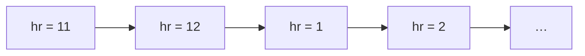
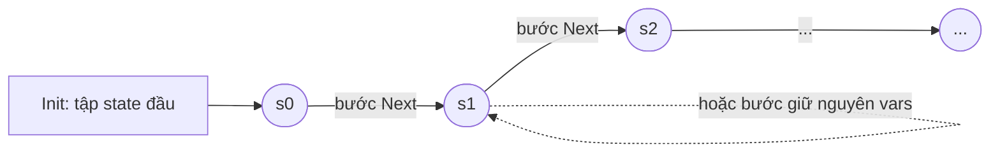
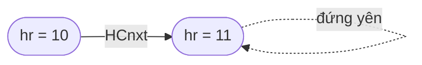
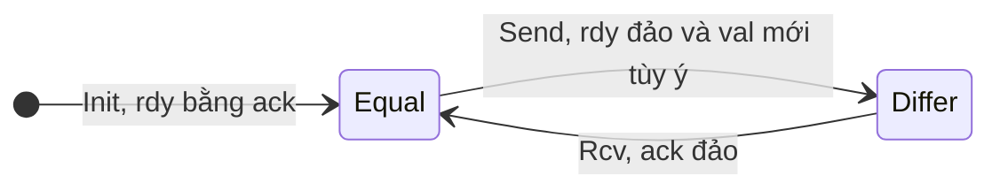

# P13 · Chương 03 — Trạng thái, hành vi và action

> Nguồn chính: Lamport, *Specifying Systems* (viết tắt SS), các chương 2–4 (đồng hồ giờ, giao diện bất đồng bộ, FIFO), chương 7 (lời khuyên viết spec) và chương 14 (TLC); đọc bản PDF miễn phí trên trang của tác giả. Spec của sách ở dạng ASCII, khớp với thư mục `specifications/SpecifyingSystems` của repo `tlaplus/Examples` tại commit `6a7b26a31c1a6aeec789b455e9bbfa3b3ad2728f`. Spec do **người soạn** tự viết được đánh dấu rõ. **Chương này không chạy TLC và không chạy code**: kết quả model checking chỉ được nêu khi nguồn nói rõ. Trang Learn TLA+ là trang sống (không có số phiên bản), trích tại thời điểm soạn.

## Bạn sẽ hiểu được gì

- **Q1.** State, behavior, step là gì, và "đặc tả" nghĩa là gì: một tập các behavior? → mục 1
- **Q2.** Action là gì; `x'` nghĩa là gì; vì sao `x' = x + 1` là một phát biểu về hai state chứ không phải phép gán; "enabled" và `UNCHANGED` là gì? → mục 2
- **Q3.** `Init`, `Next` và `Spec == Init /\ [][Next]_vars` mỗi phần nói gì (lấy đồng hồ giờ làm ví dụ đầy đủ)? → mục 3
- **Q4.** Stuttering step là gì, và vì sao spec phải viết `[Next]_vars` chứ không phải `[]Next`? → mục 4
- **Q5.** Một module TLA+ gồm những thành phần nào (`MODULE`, `EXTENDS`, `CONSTANT(S)`, `VARIABLE(S)`, `ASSUME`, định nghĩa, `THEOREM`), và file cấu hình của TLC nối vào đâu? → mục 5
- **Q6.** `TypeInvariant` (thường gọi `TypeOK`) là gì, và vì sao nó là một *tính chất* chứ không phải khai báo kiểu hay giả định? → mục 6
- **Q7.** Chọn biến nào và mức trừu tượng (grain of atomicity) nào cho một spec? → mục 7
- **Q8.** Đọc trọn một spec nhỏ có nhiều thành phần theo sách: handshake channel, rồi FIFO với hai channel và hàng đợi nội bộ? → mục 8

## Kiến thức cần trước

- [Chương 02 — Toán nền tảng](02-toan-nen-tang.md): chương này dùng các ký hiệu ở đó, nên gặp ký hiệu lạ thì quay lại đúng mục. Danh sách bullet `/\` `\/` và lượng từ `\E`, `\A` ở mục 1; tập hợp, `\in`, `..`, `=` và `#` ở mục 2; hàm `[x \in S |-> e]` và `EXCEPT` (kể cả `@`) ở mục 3; record `[a : S]`, tuple `<<a, b>>` và sequence (`Seq`, `Head`, `Tail`, `Append`, `Len`, `\o`) ở mục 4; `IF … THEN … ELSE` ở mục 6; module `Naturals`, `Sequences` ở mục 7; "TLA+ không có kiểu" ở mục 8.
- [Chương 01 — Vì sao đặc tả hình thức](01-vi-sao-dac-ta-hinh-thuc.md): bối cảnh vì sao ta mô hình hóa thiết kế trước khi code.
- Bạn đã dùng connection pool của một database client và biết request phải chờ khi pool hết connection; chương này lấy đúng tình huống đó làm ví dụ chạy suốt.

(Cách TLC kiểm invariant ở [Chương 04](04-invariant-va-tlc.md); tính chất "rồi sẽ xảy ra" và fairness ở [Chương 05](05-liveness-va-fairness.md); PlusCal, cú pháp giống code, ở [Chương 06](06-pluscal.md). Chương này chỉ nói phần *an toàn* của spec: state, bước đi, và hình dạng chuẩn của một spec.)

## 1. State, behavior và spec (Q1)

> **Trả lời ngắn.** *State* là một phép gán giá trị cho các biến, còn *behavior* là một dãy state, biểu diễn một lần thực thi của hệ[^ss-behavior]. Hai state liền nhau trong dãy tạo thành một *step* (bước)[^ss-step]. *Đặc tả* (spec) không mô tả một lần chạy cụ thể mà mô tả cả **tập** behavior ứng với những lần thực thi đúng của hệ[^ss-spec-set].

**Giải thích.**

*Với service của bạn.* Giả sử `orders` là một service Rust có pool gồm `Size` connection tới database. Mỗi request lấy một connection, chạy query rồi trả lại; nếu pool hết connection thì request xếp hàng chờ. Ta sẽ bám theo pool này suốt chương (nhận xét của người soạn: đây là ví dụ giả định, không phải code trong repo). Để mô tả pool, ba con số là đủ: `free` (connection đang rảnh), `busy` (connection đang có request giữ) và `waiting` (số request đang chờ). Giả sử mỗi lần một trong ba số đổi, bạn ghi một dòng log chụp *cả ba*, kiểu `free=2 busy=1 waiting=0`. Khi đó mỗi dòng log là một state, cả file log là một behavior, và đi từ dòng này sang dòng kế là một step. Spec của pool không mô tả một file log cụ thể mà mô tả *mọi* file log mà một pool chạy đúng có thể ghi ra.

Pool giúp ta lấy cảm giác; còn khi cần đọc trọn một spec, ta dùng đồng hồ giờ của Lamport vì nó nhỏ nhất có thể. Hai ví dụ đi song song.

Hãy bắt đầu từ state. Lamport định nghĩa state là phép gán giá trị cho biến, và ông nhấn mạnh rằng "biến" ở đây là *tất cả* biến: một state có thể coi là trạng thái tiềm năng của cả vũ trụ[^ss-all-vars]. Thực tế ta chỉ khai báo vài biến, với pool là ba biến trên. Nhưng spec chỉ "nhìn thấy" đúng những biến đã khai báo, và mục 4 sẽ cho thấy điều đó kéo theo hệ quả gì.

Từ state đến behavior. Sách mở đầu bằng cách nhà khoa học mô tả hệ vật lý, rồi nhận xét máy tính khác ở chỗ ta có thể coi trạng thái đổi theo từng bước rời rạc[^ss-discrete]. Nhờ vậy một lần thực thi biểu diễn được bằng *dãy* state. Với đồng hồ giờ, màn hình hiển thị `hr` chạy 11 → 12 → 1 → 2…[^ss-hr-behavior]



Hai state liền nhau, như `hr = 1` rồi `hr = 2`, là một *step*[^ss-step]. Mọi điều TLA+ nói về việc hệ đổi thế nào đều là phát biểu về các step.

Còn spec là gì? Đặc tả một hệ nghĩa là chỉ ra một tập behavior hợp lệ[^ss-spec-set]. Với đồng hồ, sách chốt rằng công thức `HC` là spec vì đúng những behavior biểu diễn lịch sử trong đó đồng hồ chạy đúng thì thỏa nó[^ss-spec-exact]. Bảng dưới đặt bốn khái niệm cạnh nhau, kèm ví dụ ở cả hai hệ:

| Khái niệm | Là gì | Đồng hồ giờ | Pool của `orders` |
|---|---|---|---|
| State | gán giá trị cho biến | `[hr = 11]` | `[free = 2, busy = 1, waiting = 0]` |
| Step | cặp state liền nhau | `[hr = 1]` → `[hr = 2]` | `[free = 2, busy = 1, waiting = 0]` → `[free = 1, busy = 2, waiting = 0]` (một request lấy được connection) |
| Behavior | dãy (vô hạn) state | `11 → 12 → 1 → 2 → …` | cả file log, coi như kéo dài mãi |
| Spec | công thức mà một tập behavior thỏa | tập mọi cách đồng hồ chạy đúng | tập mọi file log mà pool chạy đúng có thể ghi ra |

<details><summary>Đi sâu: behavior "sai", behavior hữu hạn, và đồng hồ không có đơn vị thời gian</summary>

- **State là phép gán tùy ý, nên có cả behavior "sai".** Tồn tại state gán cho `hr` một giá trị vô nghĩa: sách lấy ví dụ √−2 (căn bậc hai của −2; dấu căn bị mất khi trích PDF thành text), tức màn hình "thuần ảo", mà Lamport gọi là "trạng thái sau khi bom rơi trúng đồng hồ"[^ss-silly-state]. Một dãy như `[hr = 11] → [hr = 77.2] → [hr = 78.2] → [hr = √−2] → …` (dãy (2.2) của sách) vẫn *là* một behavior, chỉ là không thỏa spec của đồng hồ[^ss-behavior-sat].
- **Behavior luôn vô hạn.** Sách không cần behavior hữu hạn[^ss-infinite-only]. Hệ có kết thúc, như một job chạy xong, được biểu diễn bằng behavior vô hạn mà đuôi chỉ toàn bước "đứng yên" (mục 4)[^ss-terminating].
- **Behavior không có đơn vị thời gian.** Spec đồng hồ của sách bỏ qua thời gian thực, không nói khi nào màn hình đổi[^ss-realtime]. Muốn có thời gian thực trong spec thì ta phải tự mô hình hóa nó (SS có chương riêng, ngoài phạm vi chương này).
- **Bước là đơn vị nguyên tử.** Bên trong một bước không có state trung gian, nên chọn cái gì là một bước chính là chọn *mức trừu tượng* của spec (mục 7).

</details>

**Quay lại Q1:** state là phép gán giá trị cho biến, behavior là dãy state, và spec là mô tả tập các behavior đúng; với `orders`, đó là mọi file log mà pool chạy đúng có thể ghi ra.

## 2. Action, biến primed, enabled và UNCHANGED (Q2)

> **Trả lời ngắn.** *Action* là công thức chứa cả biến thường lẫn biến *primed*: `hr` là giá trị ở state cũ, `hr'` là giá trị ở state mới của một bước[^ss-prime]. Vì chỉ là công thức nên action không "chạy" như câu lệnh, nó đúng hoặc sai trên một cặp state[^ss-not-exec]. Action *enabled* tại một state nếu từ đó có ít nhất một bước làm nó đúng[^ss-enabled]. Biến nào action không đổi thì phải nói rõ bằng `UNCHANGED`, nghĩa là biểu thức có cùng giá trị ở state cũ và mới[^ss-unchanged-def].

**Giải thích.**

*Với service của bạn.* Pool của `orders` đổi trạng thái qua ba loại sự kiện: một request tới và phải chờ, một request lấy được connection, một request trả connection. Mỗi loại là một action. Chẳng hạn "lấy connection" chỉ xảy ra khi `free > 0`, và khi xảy ra thì `free` giảm 1, `busy` tăng 1. Mục này nói action viết ra thế nào, và vì sao ta phải kể cả những thứ *không* đổi.

Nếu quen SQL, bạn có thể đọc `UPDATE pool SET free = free - 1 WHERE free > 0`: `WHERE` là điều kiện cho phép (guard), `SET` tính giá trị *mới* từ giá trị *cũ*. Nhưng SQL ngầm hiểu cột không nhắc tới thì giữ nguyên, còn TLA+ bắt bạn nói ra, vì action chỉ là một công thức và cái gì công thức không ràng buộc thì được phép nhận giá trị tùy ý (nhận xét của người soạn).

*Từ hàm "tính giá trị mới" sang "quan hệ giữa cũ và mới".* Đồng hồ giờ cho một ví dụ gọn: `HCnxt == hr' = IF hr # 12 THEN hr + 1 ELSE 1` (`#` là "khác": [Chương 02 mục 2](02-toan-nen-tang.md); `IF … THEN … ELSE` là biểu thức điều kiện: [Chương 02 mục 6](02-toan-nen-tang.md)). Nhìn nó giống một phép gán, nhưng sách mô tả nó là công thức toán thông thường, chỉ khác ở chỗ chứa cả biến primed lẫn không primed; công thức loại đó gọi là action, và một action đúng hoặc sai trên một step[^ss-action]. Learn TLA+ nói cùng ý: dấu prime cho giá trị của biến ở state kế[^l-prime]. Learn TLA+ cũng gọi toán tử boolean chứa biến primed là action[^l-action].

Bảng dưới là cách đọc `HCnxt` trên vài cặp `(hr, hr')` (người soạn suy ra từ định nghĩa; một số cặp có trong sách và Learn TLA+):

| `hr` → `hr'` | `HCnxt` | Vì sao |
|---|---|---|
| 1 → 2 | đúng | `hr # 12`, nên `hr' = hr + 1 = 2` |
| 12 → 1 | đúng | `hr = 12`, nên `hr' = 1` |
| 1 → 1 | sai | `hr' ≠ 2` (đây là bước "đứng yên", xử lý ở mục 4) |
| 12 → 13 | sai | `hr = 12` đòi `hr' = 1` |
| 24 → 25 | đúng | `HCnxt` không kiểm `hr` có trong 1..12 hay không[^ss-24-25] |

*Action không phải lệnh gán.* `hr' = hr + 1` đọc là "giá trị mới của `hr` bằng giá trị cũ cộng 1", một mệnh đề đúng hoặc sai. Sách cảnh báo thẳng: nói "action được thực thi" cũng được, nhưng đừng coi thuật ngữ này quá nghiêm túc, vì action là công thức và công thức không được thực thi[^ss-not-exec]. Người từ PlusCal sang dễ vướng chỗ này, nên Learn TLA+ nhắc lại: trong TLA+ mọi thứ đều là so sánh, `x = 5` đúng nếu `x` là 5 ở state này, còn `x' = 5` đúng nếu `x` là 5 ở state kế[^l-all-comparison].

*Enabled.* Với pool, câu hỏi đầu tiên khi viết action là "khi nào nó xảy ra được?". Sách gọi đó là điều kiện *enabled*: action `Send` là enabled ở một state nếu từ state đó có thể thực hiện một bước `Send`[^ss-enabled]. Vì câu hỏi này luôn đến trước, định nghĩa action thường mở đầu bằng điều kiện enabled[^ss-enabled-first]. Action "trả connection" của pool (spec đầy đủ ở mục 5; người soạn tự viết) minh họa cả điều kiện enabled lẫn `UNCHANGED`:

```tla
Release == /\ busy > 0          \* điều kiện enabled (guard): có connection đang bận
           /\ busy' = busy - 1  \* busy giảm 1
           /\ free' = free + 1  \* free tăng 1
           /\ UNCHANGED waiting \* waiting giữ nguyên
```

Cách đọc (cú pháp ở [Chương 02](02-toan-nen-tang.md)): các `/\` thẳng cột là danh sách bullet ghép các điều kiện bằng "và" (mục 1). `busy' = busy - 1` là phép trừ trên số tự nhiên, do module `Naturals` cung cấp (mục 7). Dòng cuối là `UNCHANGED`, nói riêng ở đoạn tiếp theo.

*UNCHANGED.* `UNCHANGED v` nghĩa là biểu thức `v` có cùng giá trị ở state cũ và mới[^ss-unchanged-def]. Với nhiều biến, viết `UNCHANGED <<x, y, z>>` để nói không biến nào trong ba biến đổi[^l-unchanged-tuple]. Vì sao bắt buộc? Learn TLA+ phát biểu đây là quy tắc nền tảng: next-state action phải mô tả đầy đủ *tất cả* biến[^l-fully-describe]. Nếu quên, TLC báo successor state chưa được xác định đầy đủ[^l-tlc-msg]. Lý do ở mức logic (suy luận của người soạn từ định nghĩa action): action chỉ ràng buộc những gì nó nhắc tới, nên biến bị bỏ sót ở state kế có thể mang *bất kỳ* giá trị nào. Nếu `Release` quên dòng `UNCHANGED waiting`, thì sau một lần trả connection `waiting` có thể bỗng thành 7, và spec vẫn cho phép.

<details><summary>Đi sâu: nondeterminism, TLC biến công thức thành bước đi thế nào, và vài bẫy cú pháp</summary>

- **Nondeterminism là tự nhiên.** `val' \in Data` không chọn giá trị cụ thể mà cho phép bất kỳ phần tử nào của `Data`. Sách còn viết dạng thứ hai: `Send(d)` có tham số, rồi hợp bằng lượng từ, `Next == (\E d \in Data : Send(d)) \/ Rcv`[^ss-send-d]. Hai cách diễn tả cùng một việc: hệ có nhiều lựa chọn, spec cho phép tất cả.
- **Từ công thức đến bước đi: cách TLC đọc action.** TLC tính successor của state `s` bằng cách gán biến thường theo `s`, chưa gán biến primed nào, rồi đánh giá next-state action[^tlc-successor]. Khi gặp `x' = e` mà `x'` chưa có giá trị, TLC coi đó là phép gán[^tlc-assign]. `UNCHANGED x` được nó đánh giá như `x' = x`[^tlc-unchanged] (và `x' \in S` như lượng từ tồn tại, cùng đoạn SS 14.2.6). Nếu một vế hội đánh giá sai, nhánh đó không sinh state nào[^tlc-false-stop], và đó chính là "action không enabled". Nếu kết thúc mà còn biến primed chưa được gán, TLC báo lỗi[^tlc-unassigned]. Vì vậy `UNCHANGED` không chỉ là phép lịch sự: nó là điều kiện để TLC dựng được state kế.
- **Thứ tự vế hội: logic không quan tâm, TLC có.** Về toán, hội (`/\`) giao hoán. Nhưng TLC đánh giá từ trái sang phải, nên thứ tự có thể quyết định nó đánh giá được action hay báo lỗi[^tlc-order]. Quy ước thực dụng (nhận xét của người soạn): đặt điều kiện enabled lên đầu, rồi các phép gán `x' = …`, rồi `UNCHANGED`.
- **Danh sách gạch đầu dòng.** Luật căn lề của `/\` và `\/` đã nêu ở [Chương 02 mục 1](02-toan-nen-tang.md). Riêng `=>` theo cùng quy tắc thụt lề, nên hai dòng `/\ A`, `/\ B` rồi một dòng `=> C` thụt vào đọc là `A /\ (B => C)` chứ không phải `(A /\ B) => C` (Learn TLA+)[^l-implies-indent]. `BNext` ở mục 8.3 được viết đúng theo cách đó.
- **Đừng "thông minh" quá.** Cách tốt nhất để nói giá trị mới của biến `v` là `v' = exp` hoặc `v' \in exp`, với `exp` không chứa prime[^ss-v-prime-best]. Sách cho ví dụ cách viết gọn `q = <<h'>> \o q'` thay cho `h' = Head(q) /\ q' = Tail(q)` (`Head`, `Tail`, `\o` là toán tử trên sequence: [Chương 02 mục 4](02-toan-nen-tang.md)) và kết luận nó sai. Lý do: nếu `h'` và `q'` không cùng là sequence thì ta không biết `\o` cho ra gì, nên không chắc `h' = Head(q)` và `q' = Tail(q)` là các giá trị duy nhất thỏa công thức[^ss-too-clever]. Sách cũng nhắc cẩn thận chỗ đặt dấu prime[^ss-prime-care].
- **PlusCal làm hộ phần `UNCHANGED`.** Khi dịch PlusCal sang TLA+, trình dịch tự thêm `x' = x` cho biến mà lệnh không nhắc tới; Learn TLA+ có ví dụ[^l-translator-adds]. Chi tiết ở [Chương 06](06-pluscal.md).
- **`ENABLED`.** Toán tử tích hợp `ENABLED A` nói "action `A` enabled". Sách dùng nó để diễn đạt "không deadlock" là tính chất bất biến `[]ENABLED Next`[^ss-enabled-next]. Mục 4 quay lại điểm này.

</details>

**Quay lại Q2:** action là công thức về cặp state (cũ không prime, mới có prime); nó đúng/sai chứ không "chạy"; enabled là có bước thỏa; và mọi biến không đổi phải nói rõ bằng `UNCHANGED`, như `waiting` trong `Release` của pool.

## 3. Init, Next và Spec = Init /\ [][Next]_vars (Q3)

> **Trả lời ngắn.** `Init` là vị từ mô tả các state đầu hợp lệ, còn `Next` là action mô tả mọi bước hợp lệ, thường là phép hợp của nhiều action con[^ss-init-next]. `Spec` ghép hai thứ đó lại: state đầu thỏa `Init`, và *mỗi* bước hoặc là bước `Next` hoặc là bước giữ nguyên các biến[^ss-spec-form]. Đồng hồ giờ là ví dụ nhỏ nhất có đủ cả ba phần.

**Giải thích.**

*Với service của bạn.* Pool của `orders` có `Init` (pool vừa khởi động: `Size` connection đều rảnh, không request nào chờ), `Next` (hợp của ba action: request tới, lấy connection, trả connection) và `Spec` ghép hai thứ lại. Nếu bạn quen vẽ state machine thì `Init` là trạng thái khởi tạo, `Next` là các mũi tên "từ trạng thái này sang trạng thái kia nếu …", còn `Spec` là câu "hệ bắt đầu từ trạng thái khởi tạo và chỉ đi theo các mũi tên" (nhận xét của người soạn). Điểm khác state machine vẽ tay là `Init` và `Next` là *công thức*, nên mỗi cái cho phép nhiều lựa chọn cùng lúc. Spec đầy đủ của pool nằm ở mục 5; ở đây ta xây từng phần trên đồng hồ giờ.

Sách xây đồng hồ giờ theo bốn bước.

1. *Điều kiện đầu.* Ta không cần nói màn hình ban đầu hiển thị mấy giờ, giờ nào cũng được[^ss-init-any-hour]. Vì vậy `Init` chỉ đòi `hr` là một số trong 1..12, và sách viết `HCini == hr \in (1 .. 12)`.
2. *Quan hệ bước kế.* `Next` nói giá trị `hr` ở state mới liên hệ thế nào với state cũ: `hr'` bằng `hr + 1`, trừ khi `hr = 12` thì `hr'` bằng 1[^ss-hcnxt-def]. Sách viết `HCnxt == hr' = IF hr # 12 THEN hr + 1 ELSE 1`.
3. *Hợp lại bằng toán tử `[]` (đọc là "box").* Công thức `[]F` khẳng định `F` đúng mãi mãi[^ss-box]. Do đó `[]HCnxt` nói *mọi* bước thỏa `HCnxt`. Ghép với điều kiện đầu, `HCini /\ []HCnxt` đúng với một behavior khi state đầu thỏa `HCini` và mọi bước thỏa `HCnxt`[^ss-init-next].
4. *Vá cho đúng: `[]HCnxt` thành `[][HCnxt]_hr`.* Công thức ở bước 3 chưa đủ vì nó không cho phép bước giữ nguyên `hr`; lý do ở mục 4. Sách thay bằng `HC == HCini /\ [][HCnxt]_hr`[^ss-hc-def]. Learn TLA+ khai triển ký hiệu này: `[P]_x` là `P \/ UNCHANGED x`[^l-box-sub], nên `Spec == Init /\ [](Next \/ UNCHANGED vars)`. Thêm một quy ước: phần nằm ngoài toán tử thời gian được kiểm ở state đầu[^l-initial-convention].

Dạng `Init /\ [][Next]_vars` là dạng chuẩn. TLC xử lý các spec có dạng `Init /\ [][Next]_vars /\ Temporal`, trong đó `vars` là tuple của tất cả biến, còn `Temporal` thường là điều kiện liveness (chương 05)[^ss-tlc-form]. Bỏ `Temporal` thì ta được dạng của chương này.

Module hoàn chỉnh của sách (Hình 2.1) ở dạng ASCII, khớp với repo Examples, như sau.[^ex-hourclock]

```tla
---------------------- MODULE HourClock ----------------------
EXTENDS Naturals
VARIABLE hr
HCini  ==  hr \in (1 .. 12)
HCnxt  ==  hr' = IF hr # 12 THEN hr + 1 ELSE 1
HC  ==  HCini /\ [][HCnxt]_hr
--------------------------------------------------------------
THEOREM  HC => []HCini
==============================================================
```

Đọc từng dòng:

- `EXTENDS Naturals` nhập định nghĩa của `+`, `..`, `Nat`… vì các toán tử số học không có sẵn trong TLA+ mà do module định nghĩa[^ss-naturals-module].
- `VARIABLE hr` khai báo biến[^ss-variable-decl].
- `HCini`, `HCnxt`, `HC` là ba định nghĩa, trong đó `HC` mới là spec. Về mặt hình thức, không có gì trong module nói `HC` chứ không phải `HCini` là spec của đồng hồ; ý nghĩa ta gắn cho các định nghĩa nằm ngoài toán học[^ss-formally-nothing].
- `THEOREM HC => []HCini` khẳng định mọi behavior của `HC` luôn có `hr` trong 1..12, tức một dạng "type correctness" (mục 6).

Hình dạng toàn bộ (nhận xét của người soạn):



<details><summary>Đi sâu: đặc tả thứ hai (HC2), hai cách viết cùng nghĩa và file cấu hình TLC</summary>

- **Cùng một đồng hồ, hai công thức.** Toán tử `%` của `Naturals` cho phép viết `HCnxt2 == hr' = (hr % 12) + 1`[^ss-mod]. Hai action *không tương đương*: bước `24 → 25` thỏa `HCnxt` mà không thỏa `HCnxt2`, còn bước `24 → 1` thì ngược lại[^ss-24-25]. Nhưng với `hr` trong 1..12 thì chúng tương đương, nên `HC` và `HC2` là hai spec tương đương[^ss-hc-hc2]. Repo Examples có file `HourClock2.tla` kèm `THEOREM HC <=> HC2`[^ex-hourclock2].
- **Bài học của Lamport.** Một ý thường viết được bằng nhiều cách. Khi đó hãy chắc chúng tương đương, rồi chọn cách dễ hiểu nhất; nếu không tương đương thì phải quyết định mình muốn nghĩa nào[^ss-equivalent-choices].
- **`Init` có thể có nhiều state.** `HCini` được 12 giá trị của `hr` thỏa, nên spec có 12 state đầu khả dĩ (suy ra từ định nghĩa). Nondeterminism ở state đầu tự nhiên như ở các bước sau.
- **Spec này chỉ nói về an toàn.** Nó không đòi đồng hồ chạy mãi: sách nói rõ lúc này ta chấp nhận cả đồng hồ có thể dừng, còn cách đòi nó không dừng nằm ở chương 8 của sách[^ss-hc-may-stop]. Phần đó là [Chương 05](05-liveness-va-fairness.md).

**File `.cfg` cho TLC** (chi tiết ở [Chương 04](04-invariant-va-tlc.md)). Repo Examples kèm `HourClock.cfg` để kiểm `HCini` là invariant của `HC`[^ex-hourclock-cfg]. Nội dung rút gọn như sau (bản gốc có thêm comment); chương này không khẳng định kết quả chạy.

```
SPECIFICATION HC
INVARIANT HCini
```

</details>

**Quay lại Q3:** `Init` cho state đầu, `Next` cho mọi bước hợp lệ, và `Spec == Init /\ [][Next]_vars` đòi state đầu thỏa `Init` còn mỗi bước là `Next` hoặc không đổi `vars`.

## 4. Stuttering step và [Next]_vars (Q4)

> **Trả lời ngắn.** *Stuttering step* là bước mà các biến của spec không đổi[^ss-stutter-def]. Spec phải cho phép bước này, vì đồng hồ thường là một phần của hệ lớn hơn, chẳng hạn trạm thời tiết hiển thị cả giờ lẫn nhiệt độ: có những bước chỉ đổi nhiệt độ còn `hr` đứng yên, và từ góc nhìn spec đồng hồ đó là bước đứng yên[^ss-weather]. Vì vậy ta viết `[Next]_vars`, nghĩa là "bước `Next` *hoặc* bước đứng yên"[^l-box-sub].

**Giải thích.**

*Với service của bạn.* Pool của `orders` không sống một mình: cùng process còn có cache và scheduler, mỗi thứ có biến riêng. Mỗi lần cache đổi, `free`, `busy` và `waiting` đứng yên. Nếu spec của pool đòi *mọi* bước đều là bước của pool, nó loại luôn mọi lịch sử có thêm bước của thành phần khác, và ta không ghép được nó vào hệ lớn hơn (nhận xét của người soạn).

*Ví dụ trạm thời tiết của sách.* Hệ có hai biến `hr` và `tmp` (nhiệt độ). Ở hai bước giữa, `tmp` đổi còn `hr` giữ nguyên[^ss-weather-steps]. Vì `[]HCnxt` đòi mọi bước đều tăng `hr`, spec đồng hồ viết ở dạng đó không mô tả được đồng hồ nằm trong trạm thời tiết[^ss-weather-fails]. Sách kết luận spec của đồng hồ phải cho phép cả bước `HCnxt` lẫn bước đứng yên[^ss-hc-allow-both]. Ta viết gọn `HCnxt \/ (hr' = hr)` thành `[HCnxt]_hr`[^ss-box-sub-def]. Trên giấy, ký hiệu này đọc là "square HCnxt sub hr".

*Hệ quả 1: dừng hẳn cũng là một behavior hợp lệ.* Spec `HCini /\ [][HCnxt]_hr` cho phép behavior `10 → 11 → 11 → 11 → …`: đồng hồ lên tới 11 rồi dừng mãi mãi[^ss-clock-stops]. Tổng quát hơn, một lần thực thi *kết thúc* của hệ nào đó được biểu diễn bằng behavior vô hạn mà đuôi toàn bước đứng yên[^ss-terminating].



*Hệ quả 2: bước đứng yên không bao giờ phá invariant.* Learn TLA+ nói bước đứng yên không đổi giá trị nào nên không thể làm sai một invariant[^l-stutter-invariant]. Nó chỉ phá được tính chất kiểu "rồi sẽ xảy ra", vì nó cho phép hệ đứng yên mãi (suy luận của người soạn). Learn TLA+ diễn giải TLA+ là ngôn ngữ của kịch bản xấu nhất, nên mặc định hệ có thể "crash" bất cứ lúc nào nếu ta không cấm[^l-worst-case]. Đó là lý do cần fairness ở [Chương 05](05-liveness-va-fairness.md).

*Hệ quả 3: vì sao công thức "hợp lệ".* Sách ở chương 8 giải thích: một công thức hữu ích phải *bất biến dưới stuttering*, tức thêm hay bớt bước đứng yên không đổi việc behavior có thỏa hay không[^ss-stutter-invariant]. TLA chỉ cho phép viết công thức như vậy[^ss-stutter-only-legal]. `[][A]_v` có tính đó với mọi action `A` và state function `v`[^ss-box-sub-invariant], còn `[]A` với `A` tùy ý thì không.

*Stuttering khác deadlock.* Về logic, bước đứng yên *luôn* có sẵn, nên spec không bao giờ "kẹt". Cái TLC gọi là deadlock là chuyện khác: một state mà `Next` không enabled, nên không còn bước *không đứng yên* nào[^ss-deadlock]. TLC mặc định kiểm điều này, nhưng có thể tắt, vì với một số hệ deadlock chỉ có nghĩa là kết thúc thành công[^ss-deadlock]. (Đừng nhầm với deadlock của lock trong [Chương 05 phase 4](../04-concurrency/05-concurrency-bug-va-deadlock.md): ở đó là các luồng chờ vòng tròn, còn ở đây là "không còn action nào enabled".)

<details><summary>Đi sâu: vì sao <code>vars</code> phải đủ biến, TLC thấy stuttering ở đâu, và quan hệ với refinement</summary>

- **Bỏ sót biến trong `vars` là lỗi ngầm (suy ra từ định nghĩa).** `[Next]_<<a>>` là `Next \/ UNCHANGED <<a>>`. Một bước làm `a` đứng yên nhưng đổi `b` thỏa vế thứ hai dù `b` đổi thế nào, nên spec mất mọi ràng buộc lên `b`. Sách mô tả `vars` trong dạng chuẩn là tuple của *tất cả* biến[^ss-tlc-form]. Quy ước thực dụng (nhận xét của người soạn): định nghĩa một lần `vars == <<x, y, z>>` rồi dùng cho cả `UNCHANGED vars` lẫn `[Next]_vars`. Learn TLA+ viết đúng như vậy cho đồng hồ giờ: `vars == << hr >>` và `Spec == Init /\ [][Next]_vars`[^l-vars-idiom].
- **Đồ thị trạng thái của TLC có cạnh tự trỏ.** Trong thuật toán TLC ở chương 14 của sách, một bất biến của đồ thị `G` là với mọi state `s` trong `G`, cạnh `s → s` thuộc `G`[^tlc-self-loop]. Chỉ các cạnh tới state *khác* mới được coi là successor[^tlc-successor-graph]. Cạnh tự trỏ chính là bước đứng yên (suy luận của người soạn). TLC chỉ báo deadlock khi tập successor rỗng và tùy chọn kiểm deadlock không bị tắt[^tlc-deadlock-step].
- **Model hữu hạn kết thúc bằng stuttering.** Ví dụ `EvenSpec` của sách có vô hạn state vì `x` cứ tăng thêm 2. Để TLC dừng, ta phải đưa vào một ràng buộc giới hạn số state đạt tới[^tlc-constraint-finite]. Khi đó mọi behavior vô hạn TLC sinh ra đều kết thúc bằng vô số bước đứng yên[^tlc-finite-stutter]. Với liveness đó là một cái bẫy khi kiểm: xem [Chương 05](05-liveness-va-fairness.md).
- **Refinement.** Cho phép stuttering là điều làm hai spec ở hai mức chi tiết khác nhau so sánh được: spec mịn có thêm bước nội bộ, nhìn từ spec thô chỉ là bước đứng yên. Chi tiết ở [Chương 07](07-refinement.md); ở đây chỉ cần nhớ `[Next]_vars` không phải thủ thuật cú pháp mà là điều kiện để các spec ghép được với nhau (suy luận của người soạn từ SS 8.1; chương 07 sẽ dẫn nguồn đầy đủ).

</details>

**Quay lại Q4:** stuttering step là bước không đổi `vars`; `[Next]_vars` cho phép nó để spec ghép được vào hệ lớn hơn và biểu diễn được hệ kết thúc, đổi lại spec chỉ nói về an toàn; với `orders`, đó là các bước mà chỉ cache hay scheduler đổi.

## 5. Module, EXTENDS, CONSTANT, VARIABLE, ASSUME (Q5)

> **Trả lời ngắn.** Spec TLA+ chia thành các *module*[^ss-module-intro]. Mỗi module mở bằng `MODULE tên`[^ss-summary-module-lines]. Module có thể `EXTENDS` các module khác để dùng lại định nghĩa, khai báo hằng bằng `CONSTANT(S)` và biến bằng `VARIABLE(S)`, rồi đến các định nghĩa, và đóng bằng một dòng `====`[^sum-module-end]. Mọi ký hiệu dùng trong công thức phải là toán tử có sẵn hoặc đã được khai báo hay định nghĩa[^ss-declared-or-defined]. Để chạy TLC, ta cần thêm một file `.cfg` gán giá trị cho các hằng[^ex-asynch-cfg].

**Giải thích.**

*Với service của bạn.* Viết pool của `orders` thành một module thì mọi thành phần tự tìm được chỗ đứng. Kích thước pool `Size` là hằng, giống tham số cấu hình đọc lúc khởi động (nhận xét của người soạn). `free`, `busy`, `waiting` là biến, giống trạng thái lúc chạy. Còn các action `Arrive`, `Acquire`, `Release` là định nghĩa. Phần "spec nhỏ" bên dưới viết đúng pool đó.

| Cấu trúc | Ý nghĩa |
|---|---|
| `---- MODULE M ----` | mở module `M` |
| `EXTENDS M1, M2` | nhập khai báo, định nghĩa, giả định và định lý của các module đó vào module hiện tại[^sum-extends] |
| `CONSTANT(S) C1, C2` | tham số hằng của spec[^sum-constants] |
| `VARIABLE(S) x, y` | biến của spec: tham số thay đổi theo state[^sum-variables] |
| `ASSUME P` | khẳng định `P` là giả định[^sum-assume] |
| `Id == exp` | định nghĩa |
| `THEOREM P` | khẳng định `P` chứng minh được từ định nghĩa và giả định của module[^sum-theorem] |
| `====` | hết module |

*Hằng là tham số.* Sách không cố định tập giá trị dữ liệu của channel: giao thức handshake như nhau dù gửi số 32 bit hay 128 bit, nên spec chỉ giả định có một tập `Data` nào đó, khai báo bằng `CONSTANT Data`[^ss-constant-data]. Với pool thì `Size` đóng vai đó: luật như nhau dù pool có 3 hay 300 connection. Hằng cũng là chỗ bạn "xoay núm" khi kiểm bằng TLC: file `.cfg` gán cho hằng một tập hoặc số cụ thể. TLC yêu cầu mọi hằng khai báo trong spec đều phải được gán giá trị ở đó[^ex-asynch-cfg].

*Biến.* `VARIABLE` hay `VARIABLES` đều khai báo biến state, cũng như `CONSTANT` hay `CONSTANTS` đều khai báo hằng: mỗi cặp từ khóa đồng nghĩa[^ss-keyword-synonym]. Đây chính là các biến primed và không primed trong action.

*`ASSUME` chỉ dành cho hằng.* Sách khuyên dùng `ASSUME` chỉ để đưa ra giả định về hằng[^ss-assume-constants]. Ví dụ ở FIFO có giới hạn là `assume (N ∈ Nat) ∧ (N > 0)`[^ss-assume-n]. Đừng dùng nó để "khai báo kiểu của biến": lý do ở mục 6.

*Định nghĩa và phạm vi.* `Id == exp` làm `Id` đồng nghĩa với `exp`: thay bên này bằng bên kia không đổi nghĩa. Việc thay phải làm sau khi parse chứ không làm trên chuỗi ký tự, nên `x == a + b` làm `x * c` bằng `(a + b) * c`[^ss-def-subst]. Phạm vi của một khai báo hay định nghĩa là phần module *theo sau* nó[^ss-scope]. Vì vậy ký hiệu phải được khai báo hoặc định nghĩa trước khi dùng[^ss-order]. Đó là lý do `Spec` thường nằm cuối module, dù người đọc muốn đọc từ trên xuống (khai báo, rồi `Spec`, rồi `Init`/`Next`, rồi các action con). Sách khuyên dùng comment để dẫn người đọc, và chia module để chọn thứ tự đọc[^ss-reading-order]. Một ký hiệu cũng không được khai báo lại khi đã có nghĩa, kể cả trong phạm vi của lượng từ lồng nhau[^ss-no-redeclare].

*Comment.* Có hai kiểu: `(* … *)` (có thể lồng nhau) và `\*` đến hết dòng[^ss-comments-syntax]. Sách nhấn mạnh mỗi spec cần một lời giải thích bằng văn xuôi, nằm trong comment hoặc tài liệu đi kèm[^ss-comments-prose].

*Spec nhỏ do người soạn tự viết (minh họa, chưa chạy TLC).* Đây là pool của `orders` ở dạng module, đủ ba loại thành phần (hằng, biến, định nghĩa) cộng một lớp `ASSUME` về hằng:

```tla
---------------------------- MODULE PoolMini ----------------------------
EXTENDS Naturals
CONSTANTS Size, MaxWait
ASSUME Size \in Nat /\ Size > 0
ASSUME MaxWait \in Nat
VARIABLES free, busy, waiting
vars == <<free, busy, waiting>>

TypeOK == /\ free    \in 0..Size
          /\ busy    \in 0..Size
          /\ waiting \in 0..MaxWait

Init == /\ free = Size
        /\ busy = 0
        /\ waiting = 0

Arrive  == /\ waiting < MaxWait          \* một request tới và phải chờ
           /\ waiting' = waiting + 1
           /\ UNCHANGED <<free, busy>>

Acquire == /\ waiting > 0               \* có request đang chờ
           /\ free > 0                  \* và còn connection rảnh
           /\ waiting' = waiting - 1
           /\ free' = free - 1
           /\ busy' = busy + 1

Release == /\ busy > 0                   \* trả một connection
           /\ busy' = busy - 1
           /\ free' = free + 1
           /\ UNCHANGED waiting

Next == Arrive \/ Acquire \/ Release
Spec == Init /\ [][Next]_vars
=======================================================================
```

Có ba điểm cần để ý, đều suy ra từ định nghĩa chứ không từ kết quả chạy. Một: mỗi action nêu *đủ* ba biến, hoặc gán, hoặc `UNCHANGED`. Hai: `MaxWait` làm số state hữu hạn, tương tự cách sách giới hạn độ dài hàng đợi để TLC chạy được ở mục 8. Ba: "tổng `free + busy` luôn bằng `Size`" là loại tính chất ta muốn kiểm bằng TLC ở [Chương 04](04-invariant-va-tlc.md); nó không phải điều đã được chứng minh ở đây.

<details><summary>Đi sâu: cấu trúc file, <code>INSTANCE</code>, và các module chuẩn dùng trong chương</summary>

- **Header module.** Theo phần cú pháp (mục 15.3, các lexeme) của SS, module bắt đầu bằng chuỗi từ bốn dấu gạch ngang trở lên, rồi `MODULE`[^ss-four-dashes]. Dòng gạch ngang giữa module (như ở `HourClock`) hoàn toàn mang tính thẩm mỹ, không có nghĩa[^ss-cosmetic-line].
- **File ↔ module.** Với TLC, mỗi module `M` trong spec phải nằm trong file riêng tên `M.tla`[^ss-tlc-file].
- **Các module chuẩn** (nguồn và chi tiết ở [Chương 02 mục 7](02-toan-nen-tang.md)). `Naturals` cung cấp các toán tử số học như `+`[^ss-naturals-module]. Nó cũng định nghĩa phép chia lấy dư `%`[^ss-mod]. `Sequences` định nghĩa các toán tử trên dãy hữu hạn: `Seq`, `Head`, `Tail`, `Append`, `\o` (nối) và `Len`[^ss-sequences]. Bảng tóm tắt của sách ghi chú rằng `Naturals` chỉ định nghĩa phép trừ hai ngôi[^sum-std-modules]. Spec giao diện của sách `EXTENDS Naturals` vì cần phép trừ (`1 - rdy`)[^ss-extends-minus].
- **`INSTANCE`.** Một module có thể được "cài lại" với hằng/biến thay thế: `InChan == INSTANCE Channel WITH Data <- Message, chan <- in` làm mọi định nghĩa σ của `Channel` có mặt dưới tên `InChan!σ`, với `Message` thay cho `Data` và `in` thay cho `chan`[^ss-instance]. Sách nói nó "hiếm khi dùng" ngoài một thành ngữ ẩn biến (dùng ở mục 8 của chương này, ứng với SS 4.3)[^ss-instance-rare]. Tham số của `INSTANCE` phải bao phủ *mọi* tham số của module được nhập; nếu một tham số không có phép thay thế rõ ràng thì mặc định là thay chính nó (`p <- p`), và khi đó ký hiệu `p` phải đã được khai báo ở nơi đặt `INSTANCE`[^ss-implicit-subst].
- **`CONSTANT` dạng toán tử.** Cũng có thể khai báo hằng là toán tử với `n` đối số, ví dụ `C(_, _)`[^sum-constants]. Sách dùng cách này để khai báo `Send` của giao diện bộ nhớ ở chương 5, khi cần một "tham số hành động"[^ss-constant-operator].

</details>

**Quay lại Q5:** module = tiêu đề + `EXTENDS` + hằng/biến + định nghĩa + `====`; hằng là tham số do `.cfg` điền (như `Size` của pool), biến là state, `ASSUME` chỉ cho hằng.

## 6. TypeInvariant / TypeOK (Q6)

> **Trả lời ngắn.** `TypeInvariant` là một *vị từ trên state* liệt kê tập giá trị mà mỗi biến được phép nhận, chẳng hạn `rdy \in {0, 1}`[^ss-type-def]. TLA+ **không có kiểu**: mọi biểu thức đúng cú pháp đều có nghĩa, và "đúng kiểu" chỉ là tên gọi của một tính chất bất biến[^ss-untyped]. Tính chất này spec phải *suy ra* được, chứ ta không *giả định* nó[^ss-typeinv-not-assumption].

**Giải thích.**

*Với service của bạn.* Với pool của `orders`, `TypeOK` nói `free` và `busy` nằm trong `0..Size`, còn `waiting` nằm trong `0..MaxWait`. Nó giống ràng buộc `CHECK (status IN ('open','closed'))` trong DB hơn là khai báo kiểu: nó không *tạo* ra kiểu, mà *kiểm* rằng spec không đẩy biến ra khỏi tập mong muốn, trên mọi state mà spec đi qua (nhận xét của người soạn). Ví dụ `Acquire` ở mục 5 mà quên điều kiện `free > 0` thì `free` rơi xuống dưới 0, và `TypeOK` sẽ bắt đúng chỗ đó.

*Định nghĩa của sách.* Sách đặt bốn khái niệm theo thứ tự. State function là biểu thức thường (không prime, không `[]`) có thể chứa biến và hằng, và state predicate là state function có giá trị Boolean[^ss-state-function]. Invariant `Inv` của `Spec` là state predicate sao cho `Spec => []Inv` là định lý, và biến `v` có kiểu `T` trong `Spec` khi `v \in T` là invariant của `Spec`[^ss-inv-def]. Chẳng hạn `rdy \in {0, 1}`: sách gọi tập `{0, 1}` là kiểu của `rdy`, và `TypeInvariant` là type invariant[^ss-type-def].

*Nó không phải khai báo kiểu.* Vì state là phép gán tùy ý, tồn tại state mà `hr` nhận giá trị ngoài 1..12 (sách lấy ví dụ √−2). Do đó "`hr` có kiểu 1..12" chỉ có nghĩa: trong *mọi behavior thỏa `HC`*, `hr` thuộc 1..12[^ss-type-not-restrict]. Vì sao sách không thêm hệ thống kiểu cho tiện? Vì với việc viết spec, chi phí của kiểu nặng hơn lợi ích[^ss-why-no-types]. Và gắn tên `TypeInvariant` cho một công thức cũng không cho nó địa vị đặc biệt nào[^ss-no-special-status].

*Nó không phải giả định.* Ở bản `AsynchInterface`, sách nêu thẳng: công thức `TypeInvariant` không xuất hiện như một phần của đặc tả. Ta không *giả định* nó là invariant; spec phải *suy ra* được điều đó, và tính bất biến của nó được khẳng định thành định lý `THEOREM Spec => []TypeInvariant`[^ss-typeinv-not-assumption]. Hậu quả thực tế của việc nhầm hai thứ này nằm ở phần "Đi sâu" bên dưới.

*Dùng ở đâu.* Có ba chỗ:

- Làm `INVARIANT` cho TLC: `.cfg` của sách kiểm `TypeInvariant` là invariant của `Spec` (cho `AsynchInterface`)[^ex-asynch-cfg-inv].
- Làm điều kiện đầu: trong module `Channel`, state đầu là record đúng kiểu mà `ack` bằng `rdy`, tức `Init == /\ TypeInvariant /\ chan.ack = chan.rdy`[^ss-channel-init].
- Làm tài liệu: người đọc thấy ngay biến nào nhận giá trị gì, mà không phải đọc cả spec[^ss-typeinv-readable].

Về tên: sách dùng `TypeInvariant`; `TypeOK` là cách viết ngắn phổ biến trong cộng đồng (nhận xét của người soạn, không phải tên đặc biệt).

<details><summary>Đi sâu: vì sao <code>ASSUME q \in Seq(Message)</code> là sai, "kiểu" của action, và các giá trị khác loại</summary>

- **Đừng `ASSUME` kiểu của biến.** Sách đã tính tới cám dỗ thêm vào `InnerFIFO` giả định `q \in Seq(Message)` và bác bỏ. Giả định đó khẳng định ở *mọi* state `q` là sequence, trong khi ta biết có state mà `q` mang giá trị √−17 (căn bậc hai của −17, không phải sequence; dấu căn bị mất khi trích PDF thành text); giả định rằng state như thế không tồn tại dẫn tới mâu thuẫn logic[^ss-assume-contradiction]. Sách còn chốt rằng type invariance là tính chất của spec chứ không phải giả định[^ss-type-property].
- **Định nghĩa kiểu không tự ràng buộc action.** Nếu ta định nghĩa type invariant nói `n \in Nat`, conjunct `n' > 7` trong một action vẫn chỉ nói `n' > 7`: nghĩa của công thức không đổi chỉ vì ta định nghĩa type invariant[^ss-typedef-no-effect]. Sách khuyên để next-state action *ngụ ý* giá trị mới thuộc một tập thích hợp, ví dụ `Next == (n' \in Nat) /\ (Action1 \/ Action2)`[^ss-n-in-nat]. Cách thường làm hơn là mỗi action gán `v' = exp` hay `v' \in exp` với `exp` rõ ràng thuộc tập đó (xem mục 2).
- **Giá trị "trông khác nhau" chưa chắc khác nhau.** Luật TLA+ không suy ra `1 # "a"`. Sách khuyên: nếu một thông điệp có thể là chuỗi hoặc số thì biểu diễn nó bằng record có trường `type` và `value`, để biết hai giá trị khác nhau nhờ trường `type`[^ss-diff-values]. TLC cũng đòi các giá trị trong cùng tập phải "so sánh được": chuỗi và số không so sánh được vì ngữ nghĩa TLA+ không nói `"abc"` có bằng 42 hay không[^tlc-comparable].
- **Tập vô hạn.** `Message` và `Data` không cần hữu hạn; muốn giả định hữu hạn phải nói rõ bằng `IsFiniteSet` (module `FiniteSets`)[^ss-finite-assume]. Còn TLC chỉ duyệt được tập "hiển nhiên hữu hạn" khi cần liệt kê[^tlc-enumerate]; để mô hình hóa, ta gán hằng một tập hữu hạn cụ thể trong `.cfg`.
- **`TypeInvariant` gọn bằng `[... : ...]`.** Tập các record `[val : Data, rdy : {0, 1}, ack : {0, 1}]` là "kiểu" của channel ở mục 8; thứ tự trường không quan trọng[^ss-record-set].

</details>

**Quay lại Q6:** `TypeInvariant` liệt kê tập giá trị hợp lệ của từng biến; nó là *định lý* ta muốn spec thỏa và kiểm bằng TLC, chứ không phải giả định hay khai báo kiểu; với pool, đó là `free`, `busy` trong `0..Size`.

## 7. Chọn biến và mức trừu tượng (Q7)

> **Trả lời ngắn.** Spec là một *mô hình toán học của một góc nhìn* lên một phần của hệ, không phải mô tả cả hệ[^ss-what-to-specify]. Viết spec nghĩa là chọn *biến* đại diện cho state và chọn *granularity*, tức việc nào của hệ được coi là một bước duy nhất[^ss-choose-abstraction]. Sách khuyên bắt đầu bằng vài bước đầu của một hai behavior mẫu[^ss-sample-behaviors]. Nên chọn phần hệ mà spec có khả năng bắt lỗi nhất, vì TLA+ đặc biệt hiệu quả với lỗi đồng thời giữa các thành phần bất đồng bộ[^ss-concurrency-errors].

**Giải thích.**

*Với service của bạn.* Khi mô hình hóa pool của `orders`, ta bỏ qua vô số thứ: cấu hình TLS của kết nối, nội dung query, độ trễ mạng; ta chỉ giữ ba con số. Mỗi thứ bỏ qua có thể giấu một bug, nhưng giữ hết thì spec rối đến mức không ai đọc nổi. Lamport nói đúng như vậy về spec: nó mô tả vài khía cạnh của hệ và bỏ qua phần còn lại[^ss-abstraction-def]. Càng bỏ qua nhiều, spec càng đơn giản, nhưng mỗi thứ bỏ qua là một nguồn lỗi tiềm tàng[^ss-omit-source].

*Một quyết định cụ thể trong sách.* Khi viết hành vi mẫu cho giao diện handshake ở chương 3, Lamport cho `val` và `rdy` đổi trong *cùng một bước*[^ss-val-rdy-same-step]. Ngoài đời, đó là điện áp trên các dây khác nhau và chúng không đổi đúng cùng lúc; ông chọn bỏ qua điều ấy[^ss-ignore-voltage]. Giá phải trả được nói thẳng: spec đơn giản hơn nhưng bỏ qua một chi tiết có thể quan trọng[^ss-lose-detail]. Cụ thể, dây `rdy` chỉ nên đổi sau khi các dây `val` ổn định, mà đọc spec thì không biết điều đó[^ss-rdy-stabilize]. Muốn spec truyền đạt yêu cầu ấy, ông sẽ viết behavior trong đó `val` và `rdy` đổi ở hai bước riêng[^ss-separate-steps]. Sách thừa nhận phần khó nhất khi viết spec là chọn đúng mức trừu tượng[^ss-hardest]. Còn nghệ thuật trừu tượng, theo sách, chỉ học được qua kinh nghiệm[^ss-experience].

*Grain of atomicity.* Đây là khía cạnh quan trọng nhất của mức trừu tượng: chọn thay đổi nào của hệ được biểu diễn thành một bước đơn của behavior[^ss-grain]. Gửi một thông điệp thật gồm nhiều thao tác con nhưng thường được coi là một bước; ngược lại, gửi và nhận thường là hai bước riêng khi mô tả hệ phân tán[^ss-grain-send]. Hạt thô gần như luôn làm spec đơn giản hơn hạt mịn, nhưng hạt mịn mô tả chính xác hơn hành vi thật, còn hạt thô có thể che mất chi tiết quan trọng[^ss-coarse-fine].

*Sự đánh đổi trên một ví dụ backend (spec do người soạn tự viết, minh họa, chưa chạy TLC).* Hai handler thread của `orders` cùng tăng một counter, chẳng hạn số request đã phục vụ. Bản hạt thô coi cả lần tăng là một bước nguyên tử:

```tla
---------------------------- MODULE IncCoarse -----------------------------
EXTENDS Naturals
CONSTANT Proc
VARIABLES counter, pc
vars == <<counter, pc>>

Init == /\ counter = 0
        /\ pc = [p \in Proc |-> "todo"]

Inc(p) == /\ pc[p] = "todo"
          /\ counter' = counter + 1
          /\ pc' = [pc EXCEPT ![p] = "done"]

Next == \E p \in Proc : Inc(p)
Spec == Init /\ [][Next]_vars
=======================================================================
```

Bản hạt mịn tách đọc và ghi thành hai bước riêng, giống `counter = counter + 1` thật trong code không nguyên tử:

```tla
----------------------------- MODULE IncFine ------------------------------
EXTENDS Naturals
CONSTANT Proc
VARIABLES counter, tmp, pc
vars == <<counter, tmp, pc>>

Init == /\ counter = 0
        /\ tmp = [p \in Proc |-> 0]
        /\ pc  = [p \in Proc |-> "read"]

Read(p) == /\ pc[p] = "read"
           /\ tmp' = [tmp EXCEPT ![p] = counter]
           /\ pc'  = [pc  EXCEPT ![p] = "write"]
           /\ UNCHANGED counter

Write(p) == /\ pc[p] = "write"
            /\ counter' = tmp[p] + 1
            /\ pc' = [pc EXCEPT ![p] = "done"]
            /\ UNCHANGED tmp

Next == \E p \in Proc : Read(p) \/ Write(p)
Spec == Init /\ [][Next]_vars
=======================================================================
```

Ta thử suy ra bằng tay từ định nghĩa (không chạy TLC). Với hai tiến trình `p1`, `p2`, chuỗi bước `Read(p1)`, `Read(p2)`, `Write(p1)`, `Write(p2)` hợp lệ trong `IncFine` và kết thúc với `counter = 1`, tức một lost update. Vết tay: `Read(p1)` đặt `tmp[p1] = 0`, `Read(p2)` đặt `tmp[p2] = 0`, `Write(p1)` đặt `counter = 1`, `Write(p2)` đặt `counter = tmp[p2] + 1 = 1`. Trong `IncCoarse` không có chuỗi nào như vậy, vì đọc và ghi nằm trong *một* bước.

Vậy chọn hạt nào? Tùy câu hỏi bạn đặt cho spec. Nếu câu hỏi là "lost update có xảy ra không", bản thô che mất đúng chỗ cần soi; nếu ta chỉ cần xác nhận tổng, bản mịn là thừa. Lamport mô tả quan hệ giữa hai bản bằng toán tử hợp thành hành động `R·L`: bản mịn là spec mà thao tác chạy hai bước, bản thô là spec mà thao tác chạy như một bước `R·L`[^ss-composition]. Bản thô yêu cầu mỗi bước `R` phải được theo ngay sau bởi bước `L`, còn bản mịn cho phép bước khác xen vào giữa[^ss-strengthened]. (Ở đây `R`, `L` là hai thao tác con nối tiếp, `R` làm `L` enabled; gán `R` = `Read(p)`, `L` = `Write(p)` cho ví dụ này là suy luận của người soạn.) Lost update cùng họ với atomicity violation (nhận xét của người soạn), xem [Chương 05 phase 4, mục 2](../04-concurrency/05-concurrency-bug-va-deadlock.md). Lost update ở mức transaction của cơ sở dữ liệu nằm ở [P12·07 mục 3](../12-he-thong-du-lieu/07-transaction.md). Mô hình bộ nhớ ở tầng phần cứng, tức thứ tự thật mà một bước đơn che đi, nằm ở [Chương 06 phase 4](../04-concurrency/06-memory-model.md).

Lưu ý TLC (suy luận của người soạn): ở `IncFine`, khi mọi tiến trình đạt `"done"` thì không action nào enabled; mặc định TLC báo đó là deadlock, còn ở đây "hết việc" là kết thúc bình thường, nên ta tắt kiểm deadlock, điều sách cho phép[^ss-deadlock].

*Đừng quá trừu tượng.* Sách khuyên ngược lại ở chiều kia: với tương tác bàn phím, mô hình "nhấn phím a" thành một bước `KeyStroke` thì đơn giản, nhưng bỏ mất khả năng nhấn thêm `b` trước khi nhả `a`; biểu diễn cụ thể, gồm hai bước nhấn và nhả, mô tả được cả trường hợp đó[^ss-too-abstract]. Quy tắc cuối của đoạn: khi còn nghi ngờ, chọn biểu diễn cụ thể mô tả hệ thật chính xác hơn, để ít bỏ sót vấn đề thật[^ss-when-in-doubt].

*Quy trình viết spec của sách.* Trước hết chọn biến, định nghĩa type invariant và điều kiện đầu[^ss-write-first]. Tiếp theo viết next-state action, phần chiếm đa số spec[^ss-write-steps]. Phác vài behavior mẫu có thể giúp bạn bắt đầu[^ss-sketch]. Cuối cùng ghép thành công thức spec và thêm theorem, ít nhất là về type correctness[^ss-write-end]. Lamport cũng khuyên viết spec *trong lúc* thiết kế[^ss-when-and-how]. Spec ban đầu thiếu sót cũng được: chức năng còn thiếu thêm sau bằng cách thêm disjunct vào `Next`[^ss-incomplete].

<details><summary>Đi sâu: khi nào hai bước có thể gộp thành một (commutativity), và vài lời khuyên khác của chương 7</summary>

- **Gộp bước chỉ khi chuyển hoán được.** Sách đặt câu hỏi: hành vi của spec hạt mịn có thể biến thành hành vi hạt thô tương ứng không? Hai action `A`, `B` *giao hoán* nếu thực hiện theo thứ tự nào cũng cho cùng kết quả; điều kiện đủ đơn giản là mỗi action không đổi biến mà action kia đổi, và cái này không làm enabled/disabled cái kia[^ss-commute]. Nếu các hành động khác xen giữa `R` và `L` đều giao hoán với `R` (hoặc với `L`), chuỗi bước có thể sắp lại để `R`, `L` liền nhau[^ss-commute-cases]. Sách cảnh báo: dù chuyển được, điều đó không có nghĩa spec hạt thô "tốt như" hạt mịn, vì nó phụ thuộc hệ và mục đích của spec[^ss-commute-warning].
- **Mức trừu tượng của cấu trúc dữ liệu.** Câu hỏi tương tự cho dữ liệu: spec có nên mô tả bố cục thật của tham số trong bộ nhớ không? Sách trả lời bằng mục đích: nếu spec nhằm bắt lỗi do các thành phần đồng thời tương tác không đồng bộ thì mô tả chi tiết cấu trúc dữ liệu chỉ là phức tạp thừa, nên nhiều khả năng bạn muốn dùng mô tả trừu tượng, mức cao[^ss-data-structures].
- **Comment là comment.** Đừng đưa vào spec một disjunct kiểu `... /\ FALSE` chỉ để "ghi chú" rằng action không enabled ở một điều kiện nào đó; vế đó thừa về logic, nên hãy viết comment thật[^ss-comments-as-comments].
- **Đưa lượng từ ra ngoài.** Thường dễ đọc hơn khi `\E` nằm ngoài phép hợp và `\A` nằm ngoài phép hội[^ss-quantifier-outside]. Hai spec `IncCoarse` và `IncFine` trên viết đúng theo kiểu `Next == \E p \in Proc : …`.
- **Chọn hệ và môi trường.** Spec FIFO ở mục 8 mô tả cả hệ lẫn môi trường; sách gọi đó là closed-system, còn open-system chỉ mô tả hệ[^ss-closed].

</details>

**Quay lại Q7:** chọn biến và hạt của bước là chọn cái mình nhìn thấy và cái mình bỏ qua; bắt đầu bằng hành vi mẫu, và chỉ gộp bước khi biết chắc không che mất lỗi cần tìm, như lost update ở counter của `orders`.

## 8. Đọc trọn một spec: handshake channel và FIFO (Q8)

> **Trả lời ngắn.** Giao diện bất đồng bộ của sách có ba biến `val`, `rdy`, `ack` và hai action `Send`, `Rcv`[^ss-send-rcv-def]. `Send` enabled khi `rdy = ack`[^ss-send-enabled] và đảo `rdy`. `Rcv` enabled khi `rdy # ack`, đảo `ack` và giữ nguyên `val`, `rdy`[^ss-rcv-def]. Sách gộp ba biến thành một record `chan`, rồi dựng FIFO từ hai channel `in`, `out` và một biến nội bộ `q`, với bốn loại bước không-đứng-yên: `SSend`, `BufRcv`, `BufSend`, `RRcv`[^ss-fifo-steps].

**Giải thích.**

*Với service của bạn.* Giả sử một handler thread của `orders` đẩy job ghi DB cho một worker thread qua một ô nhớ dùng chung. Handshake `rdy`/`ack` là cách tối thiểu để bên gửi biết bên nhận đã lấy xong: `rdy` là cờ "có job mới", `ack` là cờ "đã lấy job", và handler chỉ được đặt job mới khi worker đã xác nhận job cũ (nhận xét của người soạn). Mở rộng ra, giữa handler và worker còn một hàng đợi các job đang chờ; hàng đợi đó chính là FIFO ở mục 8.3.

### 8.1. Giao diện bất đồng bộ — bản ba biến

Sách chọn handshake hai pha chuẩn: người gửi phải chờ ack cho một giá trị rồi mới được gửi giá trị kế[^ss-two-phase]. Spec ASCII khớp Hình 3.1 như sau.[^ex-asynch]

```tla
------------------ MODULE AsynchInterface ---------------------
EXTENDS Naturals
CONSTANT  Data
VARIABLES val, rdy, ack

TypeInvariant == /\ val \in Data
                 /\ rdy \in {0, 1}
                 /\ ack \in {0, 1}
---------------------------------------------------------------
Init == /\ val \in Data
        /\ rdy \in {0, 1}
        /\ ack = rdy

Send == /\ rdy = ack
        /\ val' \in Data
        /\ rdy' = 1 - rdy
        /\ UNCHANGED ack

Rcv  == /\ rdy # ack
        /\ ack' = 1 - ack
        /\ UNCHANGED <<val, rdy>>

Next == Send \/ Rcv

Spec == Init /\ [][Next]_<<val, rdy, ack>>
---------------------------------------------------------------
THEOREM Spec => []TypeInvariant
===============================================================
```

Đọc spec:

- **Init.** `val` là phần tử bất kỳ của `Data`, `rdy` là 0 hoặc 1, và `ack = rdy`. Ban đầu `rdy` và `ack` có thể cùng 0 hoặc cùng 1[^ss-init-rdy-ack]. Giá trị ban đầu của `val` không quan trọng[^ss-val-initial].
- **Send.** Enabled khi `rdy = ack`[^ss-send-enabled]. Giá trị mới `val'` là *bất kỳ* phần tử `Data`; `rdy` đảo (`1 - rdy`, vì `1 = 1 - 0` và `0 = 1 - 1`); `ack` giữ nguyên[^ss-send-body].
- **Rcv.** Enabled khi `rdy # ack`; đảo `ack`; `val` và `rdy` giữ nguyên. Ta ghi `UNCHANGED <<val, rdy>>` vì `UNCHANGED` trên tuple nghĩa là cả cặp không đổi[^ss-rcv-def].
- **Next, Spec.** `Next == Send \/ Rcv`, và `Spec` có dạng chuẩn với subscript là tuple cả ba biến[^ss-spec-asynch].

Bảng hành vi (người soạn suy ra từ định nghĩa; không phải output của TLC), với `Data = {d1, d2}`:

| Bước | `val` | `rdy` | `ack` | Action tiếp theo enabled |
|---|---|---|---|---|
| Init (một khả năng) | `d1` | 0 | 0 | `Send` (vì `rdy = ack`) |
| `Send` với `val' = d2` | `d2` | 1 | 0 | `Rcv` (vì `rdy # ack`) |
| `Rcv` | `d2` | 1 | 1 | `Send` |
| `Send` với `val' = d1` | `d1` | 0 | 1 | `Rcv` |

Ở mỗi dòng chỉ một trong hai action enabled: `Send` và `Rcv` có điều kiện enabled trái ngược nhau (`rdy = ack` so với `rdy # ack`), nên handshake xen kẽ nghiêm ngặt (suy ra từ định nghĩa; nếu `Data` không rỗng thì `Send` luôn có giá trị để chọn).



### 8.2. Bản dùng record — module Channel

Bản ba biến bất tiện khi hệ có nhiều channel, vì biến cứ nhân lên theo. Vì vậy sách thay ba biến bằng một biến `chan` là record với các trường `val`, `rdy`, `ack`. Dùng record thay vì tuple vì tuple dễ nhầm thứ tự thành phần[^ss-record-instead] (về record, `chan.rdy` và tập record `[val : Data, …]`: [Chương 02 mục 4](02-toan-nen-tang.md)). `Send` trở thành `Send(d)` có tham số, và `Next` dùng lượng từ `\E d \in Data`[^ss-send-d]. Để cập nhật vài trường, ta dùng `EXCEPT` ([Chương 02 mục 3](02-toan-nen-tang.md)): `[chan EXCEPT !.val = d, !.rdy = 1 - @]` đọc là "bản sao của `chan`, trừ `val` bằng `d` và `rdy` bằng `1 - @`", trong đó `@` là giá trị cũ của chính trường đó[^ss-except]. Ký hiệu `!.c` là cách viết tắt của `!["c"]`[^ss-except-abbrev]. Spec ASCII (Hình 3.2) như sau.[^ex-channel-full]

```tla
-------------------------- MODULE Channel -----------------------------
EXTENDS Naturals
CONSTANT Data
VARIABLE chan 

TypeInvariant  ==  chan \in [val : Data,  rdy : {0, 1},  ack : {0, 1}]
-----------------------------------------------------------------------
Init  ==  /\ TypeInvariant
          /\ chan.ack = chan.rdy 

Send(d) ==  /\ chan.rdy = chan.ack
            /\ chan' = [chan EXCEPT !.val = d, !.rdy = 1 - @]

Rcv     ==  /\ chan.rdy # chan.ack
            /\ chan' = [chan EXCEPT !.ack = 1 - @]

Next  ==  (\E d \in Data : Send(d)) \/ Rcv

Spec  ==  Init /\ [][Next]_chan
-----------------------------------------------------------------------
THEOREM Spec => []TypeInvariant
=======================================================================
```

Hai điểm mới: `Init` dùng `TypeInvariant` ngay (state đầu là record đúng kiểu có `ack = rdy`); và `Send(d)` chỉ ràng buộc `chan'`, vì chỉ có một biến nên không cần `UNCHANGED`.

Về cấu hình TLC: cả `AsynchInterface.cfg` và `Channel.cfg` đều đặt `TypeInvariant` làm invariant[^ex-asynch-cfg-inv]. Hai file cùng gán `Data = {d1, d2, d3}`[^ex-channel-cfg]. TLC đòi mọi hằng khai báo đều được gán ở đây[^ex-asynch-cfg].

### 8.3. FIFO: hai channel và một hàng đợi

Hệ FIFO của sách gồm bộ gửi, một buffer và bộ nhận, nối với nhau bằng hai channel `in` và `out` dùng chung giao thức handshake của `Channel`[^ss-fifo-intro]. Biến `q` là dãy các thông điệp mà bộ gửi đã gửi nhưng bộ nhận chưa nhận[^ss-fifo-q]. Trong ví dụ `orders`, `in` là chỗ handler thread đặt job, `q` là hàng đợi job đang chờ, `out` là chỗ worker thread lấy job ra (nhận xét của người soạn).


Sách dùng `INSTANCE` để dùng lại `Channel` hai lần: một lần với `chan` thay bằng `in`, một lần với `chan` thay bằng `out`, và `Data` thay bằng `Message`[^ss-two-instances]. Các phép toán trên hàng đợi lấy từ `Sequences`: `Head`, `Tail`, `Append`, `Len`[^ss-sequences]. Spec ASCII của `InnerFIFO` (Hình 4.1) như sau.[^ex-innerfifo]

```tla
---------------------------- MODULE InnerFIFO -------------------------------
EXTENDS Naturals, Sequences
CONSTANT Message
VARIABLES in, out, q
InChan  == INSTANCE Channel WITH Data <- Message, chan <- in
OutChan == INSTANCE Channel WITH Data <- Message, chan <- out
-----------------------------------------------------------------------------
Init == /\ InChan!Init
        /\ OutChan!Init
        /\ q = << >>

TypeInvariant  ==  /\ InChan!TypeInvariant
                   /\ OutChan!TypeInvariant
                   /\ q \in Seq(Message)

SSend(msg)  ==  /\ InChan!Send(msg) \* Send msg on channel `in'.
                /\ UNCHANGED <<out, q>>

BufRcv == /\ InChan!Rcv              \* Receive message from channel `in'.
          /\ q' = Append(q, in.val)  \*   and append it to tail of q.
          /\ UNCHANGED out

BufSend == /\ q # << >>               \* Enabled only if q is nonempty.
           /\ OutChan!Send(Head(q))   \* Send Head(q) on channel `out'
           /\ q' = Tail(q)            \*   and remove it from q.
           /\ UNCHANGED in

RRcv == /\ OutChan!Rcv          \* Receive message from channel `out'.
        /\ UNCHANGED <<in, q>>

Next == \/ \E msg \in Message : SSend(msg)
        \/ BufRcv
        \/ BufSend
        \/ RRcv 

Spec == Init /\ [][Next]_<<in, out, q>>
-----------------------------------------------------------------------------
THEOREM Spec => []TypeInvariant
=============================================================================
```

Bốn action (mô tả của sách):

| Action | Việc | Biến đổi | Biến giữ nguyên |
|---|---|---|---|
| `SSend(msg)` | bộ gửi gửi `msg` lên channel `in` | `in` | `out`, `q` |
| `BufRcv` | buffer nhận từ `in`, thêm vào cuối `q` | `in`, `q` | `out` |
| `BufSend` | buffer lấy đầu `q` gửi lên `out` (enabled chỉ khi `q` không rỗng) | `out`, `q` | `in` |
| `RRcv` | bộ nhận nhận từ `out` | `out` | `in`, `q` |

Mỗi action nêu *đủ* ba biến `in`, `out`, `q` (đổi hoặc `UNCHANGED`), đúng quy tắc ở mục 2 (người soạn đọc từ code trên). `Spec` dùng tuple cả ba làm subscript[^ex-innerfifo]. Điều kiện enabled `q # << >>` của `BufSend` là điểm chặn "không lấy từ hàng rỗng". Nó nằm ở đầu định nghĩa, theo đúng gợi ý của sách về action[^ss-enabled-first].

*Hệ và môi trường.* `Spec` mô tả cả hệ (buffer) lẫn môi trường (bộ gửi và bộ nhận): sách gọi đó là đặc tả *closed-system* (hay complete-system)[^ss-closed]. Cách chia `Next = SysNext \/ EnvNext` chỉ để dễ hiểu, không có ý nghĩa hình thức[^ss-sys-env]. Sách chọn closed-system vì nó hơi dễ viết hơn và toán nền đơn giản hơn; chuyển sang open-system thường khá dễ, nhưng trong thực tế hiếm khi cần[^ss-open-system].

<details><summary>Đi sâu: FIFO có giới hạn, ẩn biến <code>q</code>, và kiểm bằng TLC với ràng buộc</summary>

**FIFO có giới hạn `N`.** Bản có giới hạn chỉ khác ở chỗ `BufRcv` không được enabled trừ khi hàng đợi có ít hơn `N` thông điệp[^ss-bounded]. Thay vì sao chép module, sách dùng lại `InnerFIFO` và định nghĩa `BNext == Next /\ (BufRcv => (Len(q) < N))`[^ss-bnext]. Dưới đây là bản ASCII (người soạn chuyển ký hiệu từ Hình 4.2; Examples không có file này):

```tla
------------------------------ MODULE BoundedFIFO ------------------------------
EXTENDS Naturals, Sequences
VARIABLES in, out
CONSTANTS Message, N
ASSUME (N \in Nat) /\ (N > 0)

Inner(q) == INSTANCE InnerFIFO

BNext(q) == /\ Inner(q)!Next
            /\ Inner(q)!BufRcv => (Len(q) < N)

Spec == \EE q : Inner(q)!Init /\ [][BNext(q)]_<<in, out, q>>
================================================================================
```

Dòng `ASSUME` là điều sách thêm cho `N`[^ss-assume-n]. Quan hệ "đây chỉ là `InnerFIFO` cộng thêm một ràng buộc enabled" cho thấy lợi ích của cách viết action nhỏ có tên: `Inner(q)!BufRcv` dùng lại nguyên định nghĩa.

- **Ẩn biến nội bộ.** Sách nói đặc tả FIFO chỉ nên mô tả giá trị gửi/nhận trên channel; `q` là biến *nội bộ*, nên ở bản cuối ta ẩn nó đi[^ss-hide-q]. Ẩn dùng lượng từ tồn tại của logic thời gian, viết `\EE q : ...` trong ASCII, qua một instance có tham số: `Inner(q) == INSTANCE InnerFIFO` rồi `Spec == \EE q : Inner(q)!Spec`[^ex-fifo]. Sách khuyên cứ dùng thành ngữ này mà không cần hiểu sâu; trong phần lớn ứng dụng không cần ẩn biến, chỉ cần ghi chú trong comment biến nào là nội bộ[^ss-hide-optional]. Điều quan trọng khi chạy TLC: theo sách (mục 14.1), TLC không xử lý toán tử ẩn `\EE`, nên muốn kiểm spec có biến ẩn thì kiểm spec nội bộ, nơi các biến đó hiện ra[^ss-tlc-hiding].
- **FIFO không giới hạn là vô hạn state.** Repo Examples có `MCInnerFIFO.tla` nói thẳng: `Spec` của `InnerFIFO` có vô hạn state khả đạt vì `q` có thể dài tùy ý[^ex-mcfifo-unbounded]. Vì vậy để TLC kiểm, ta phải ràng buộc tập state được xét thành hữu hạn[^ex-mcfifo-constraint]. Ràng buộc đó là `qConstraint == Len(q) \leq qLen` ngay trong file `.tla`[^ex-mcfifo-qconstraint]. File cấu hình khai báo hằng `Message = {m1, m2, m3}`, `qLen = 3`, đặt `SPECIFICATION Spec`, `CONSTRAINT qConstraint` và `INVARIANT TypeInvariant`; theo comment trong file, TLC không khám phá các state kế của một state không thỏa ràng buộc[^ex-mcfifo-cfg]. Chương này không nêu kết quả chạy.
- **Tổ chức file khi chạy TLC.** Module `MCInnerFIFO` mở rộng `InnerFIFOInstanced` và thêm định nghĩa chỉ phục vụ TLC: comment trong file nói họ không muốn sửa module gốc "vì lợi ích của TLC"[^ex-mcfifo-purpose]. README của thư mục ghi `InnerFIFOInstanced` là bản `InnerFIFO` bỏ các lệnh `INSTANCE`, dành cho TLC phiên bản 1[^ex-fifo-readme-instanced]. Cách tổ chức này, gồm module spec sạch, module `MC…` bổ sung và `.cfg`, lặp lại ở [Chương 04](04-invariant-va-tlc.md).
- **Bài tập trong README của thư mục.** README của thư mục FIFO trong Examples (đi kèm chương "A FIFO"; sách không in các bài tập này) có bài tập: viết spec đồng hồ giờ gửi giờ qua một channel `chan`, dùng lại `Channel` và `HourClock` bằng `EXTENDS`[^ex-fifo-readme]. Có hai phiên bản: đồng hồ nhảy bất kỳ lúc nào, hoặc không nhảy giữa lúc gửi và lúc bộ nhận nhận[^ex-fifo-readme-versions]. Đây là bài luyện tốt cho mục 7, hạt của bước (nhận xét của người soạn).

</details>

**Quay lại Q8:** spec trọn vẹn gồm module, hằng, biến, `TypeInvariant`, `Init`, các action nhỏ có tên (mỗi action nêu đủ biến), `Next` là hợp của chúng và `Spec` ở dạng chuẩn; FIFO là ghép hai channel và một hàng đợi nội bộ.

## Liên hệ với Rust và backend

- **Struct và hàm.** Một state trong TLA+ tương ứng với một giá trị struct chứa mọi biến, và một action tương ứng với một hàm trả về các state kế (hoặc rỗng nếu guard sai); phép tương ứng này là nhận xét của người soạn. Với pool của `orders`, ba biến `free`, `busy`, `waiting` là ba trường của một struct, và `Acquire` là hàm trả về state kế khi `waiting > 0` và `free > 0`, ngược lại trả về rỗng. Đồng hồ giờ viết lại theo kiểu "hàm sinh state kế" (minh họa của người soạn, không biên dịch ở đây):

```rust
#[derive(Clone, PartialEq, Eq, Hash, Debug)]
struct HourClock { hr: u8 }

impl HourClock {
    /// Init: mọi giá trị 1..=12
    fn init() -> Vec<Self> { (1..=12).map(|hr| Self { hr }).collect() }

    /// Next: tập state kế. Bước "đứng yên" không có trong danh sách này —
    /// một checker phải tự thêm cạnh s -> s (xem mục 4).
    fn next(&self) -> Vec<Self> {
        vec![Self { hr: if self.hr != 12 { self.hr + 1 } else { 1 } }]
    }

    /// TypeInvariant
    fn type_ok(&self) -> bool { (1..=12).contains(&self.hr) }
}
```

  (Suy luận của người soạn) Bộ ba "state khởi tạo + hàm sinh state kế + hàm kiểm invariant" là phần tối thiểu mà một model checker cần từ spec; [Chương 10](10-tu-dac-ta-den-code-rust.md) xét việc nối spec với code Rust và các thư viện liên quan.
- **Enum thay cho `pc` và các giá trị tag.** Trong Rust, `enum` cho biết giá trị chỉ có thể là một trong các variant của nó[^rust-enum]. Spec TLA+ cần `pc[p] \in {"read", "write", "done"}` hay record `[type |-> …]` vì không có kiểu; trong Rust, `enum` làm việc đó ngay trong hệ thống kiểu (nhận xét của người soạn). Nhưng ràng buộc *động* như "`free + busy = Size`" không biểu diễn được bằng kiểu; chỗ đó cần `debug_assert!` hoặc test. Theo tài liệu, `debug_assert!` chỉ bật ở bản build không tối ưu theo mặc định[^rust-debug-assert]. (Nhận xét của người soạn: `TypeInvariant` trong spec và `debug_assert!` trong code là hai lớp của cùng một ý tưởng.)
- **`mpsc` và FIFO có giới hạn.** Tài liệu `std` mô tả `std::sync::mpsc` là các primitive giao tiếp qua hàng đợi FIFO nhiều producer, một consumer[^rust-mpsc]. Với `sync_channel(bound)`, khi buffer đầy thì các lần gửi sau sẽ chờ buffer có chỗ[^rust-sync-channel]. Suy luận của người soạn: đó là hành vi mà spec `BoundedFIFO` mô hình hóa bằng cách *tắt* action `BufRcv` khi `Len(q) >= N`; "bị chặn" trong code tương ứng "action không enabled" trong spec. Spec của sách chưa phải mô hình của `mpsc`: `BoundedFIFO` yêu cầu `N > 0` và dùng handshake `rdy`/`ack`.
- **Mô hình hóa lỗi mạng.** Spec FIFO của sách chưa có mất thông điệp hay crash node (đọc từ danh sách bốn action ở mục 8), còn hệ thật thì có. Cách thêm (nhận xét của người soạn) là thêm action vào `Next`, ví dụ một action làm mất một phần tử của `q`. Chủ đề lỗi thật của hệ phân tán ở [P12·08 Sự cố hệ phân tán](../12-he-thong-du-lieu/08-su-co-he-phan-tan.md), còn [Chương 08](08-dac-ta-giao-thuc-phan-tan.md) và [Chương 09](09-mo-hinh-hoa-he-backend.md) của phase này quay lại việc mô hình hóa chúng.

## Tóm tắt

- State là phép gán giá trị cho biến; behavior là dãy vô hạn state; spec là mô tả một tập behavior.
- Action là công thức có biến primed — một quan hệ giữa state cũ và state mới; nó đúng hoặc sai trên một bước, không "chạy".
- Action *enabled* khi có bước thỏa nó; điều kiện enabled thường là conjunct đầu tiên.
- Mọi biến không đổi phải nói rõ bằng `UNCHANGED`; TLC báo lỗi nếu còn biến primed chưa xác định.
- Spec chuẩn là `Init /\ [][Next]_vars`, tức `Init` ở state đầu và mỗi bước hoặc là `Next` hoặc không đổi `vars`; TLC làm việc với dạng này (cộng điều kiện liveness).
- Stuttering step cho phép spec ghép vào hệ lớn hơn và biểu diễn hệ kết thúc; nó không phá invariant nhưng cho phép hệ dừng mãi, nên liveness cần fairness (chương 05).
- Module gồm `MODULE`, `EXTENDS`, `CONSTANT(S)`, `VARIABLE(S)`, `ASSUME` (chỉ về hằng), định nghĩa, `THEOREM`; hằng được `.cfg` điền khi chạy TLC.
- `TypeInvariant` là tính chất spec phải suy ra, không phải khai báo kiểu hay giả định; viết `THEOREM Spec => []TypeInvariant` và để TLC kiểm.
- Chọn biến và grain of atomicity là quyết định thiết kế chính: hạt thô đơn giản nhưng có thể che lỗi (lost update), hạt mịn chính xác hơn nhưng nhiều state.
- Ví dụ trọn vẹn của sách: `HourClock` → `AsynchInterface`/`Channel` → `InnerFIFO` (+ giới hạn `N`, ẩn `q`).

## Câu hỏi tự kiểm tra

1. State và behavior khác nhau thế nào? Một step là gì?
2. Vì sao `hr' = hr + 1` không phải là phép gán? Công thức đó đúng ở những cặp `(hr, hr')` nào?
3. Action `A` "enabled" ở một state nghĩa là gì? Vì sao conjunct đầu của action thường là điều kiện enabled?
4. Nếu `Release` trong spec `PoolMini` quên dòng `UNCHANGED waiting`, điều gì xảy ra ở mức logic và ở mức TLC?
5. Viết khai triển của `[Next]_vars` và giải thích bằng ví dụ trạm thời tiết vì sao `[]Next` không đủ.
6. Vì sao `[][Next]_vars` không bao giờ làm TLC "kẹt" về logic, nhưng TLC vẫn có thể báo deadlock?
7. Spec `HC` cho phép behavior nào mà đồng hồ thật không nên có? Vì sao sách chấp nhận điều đó ở chương 2?
8. Vì sao không được viết `ASSUME q \in Seq(Message)`? Nên kiểm điều đó bằng cách nào?
9. `IncCoarse` và `IncFine` khác nhau ở grain nào? Chuỗi bước nào cho lost update?
10. Trong `InnerFIFO`, `BufSend` có enabled khi `q = << >>` không, và spec thể hiện điều đó thế nào?
11. Vì sao FIFO không giới hạn không chạy TLC thẳng được, và `MCInnerFIFO` trong Examples xử lý thế nào?

<details><summary>Đáp án</summary>

1. State là phép gán giá trị cho biến, còn behavior là dãy state[^ss-behavior]. Behavior luôn vô hạn[^ss-infinite-only]. Step là cặp state liền nhau[^ss-step].
2. Vì action là công thức về cặp state: `hr` là giá trị cũ, `hr'` giá trị mới, và công thức đúng hoặc sai trên một step[^ss-action]. Công thức thì không được "thực thi"[^ss-not-exec]. `HCnxt` đúng ở `(1,2)`, `(12,1)` (người soạn tính từ định nghĩa) và `(24,25)` (không kiểm miền)[^ss-24-25]; sai ở `(1,1)`, `(12,13)` (người soạn tính từ định nghĩa).
3. Có thể thực hiện một bước thỏa action từ state đó[^ss-enabled]. Vì câu hỏi đầu tiên với một action là "khi nào enabled", nên định nghĩa action thường mở đầu bằng điều kiện đó[^ss-enabled-first].
4. Ở mức logic, `waiting'` bị bỏ không ràng buộc nên có thể là *bất kỳ* giá trị (suy luận từ định nghĩa action: action chỉ ràng buộc những biến nó nhắc tới). Ở mức TLC, biến primed còn lại chưa được gán nên TLC báo lỗi[^tlc-unassigned]. Thông báo Learn TLA+ ghi lại là successor state chưa được xác định đầy đủ[^l-tlc-msg].
5. `[Next]_vars` là `Next \/ UNCHANGED vars`[^l-box-sub]. Ở trạm thời tiết có bước `tmp` đổi còn `hr` giữ nguyên[^ss-weather-steps], nên bước đó không thỏa `HCnxt`. Vì vậy `[]HCnxt` loại behavior ấy[^ss-weather-fails].
6. Bước đứng yên luôn thỏa `Next \/ UNCHANGED vars`; còn deadlock của TLC là state không còn bước không-đứng-yên nào, tức `Next` không enabled[^ss-deadlock].
7. Behavior dừng mãi ở một giá trị (`10 → 11 → 11 → …`)[^ss-clock-stops]. Sách chấp nhận điều đó vì chương 2 chưa có cách đòi đồng hồ không dừng; chương 8 của sách mới có[^ss-hc-may-stop].
8. Vì nó khẳng định ở *mọi* state `q` là sequence trong khi tồn tại state mà `q` có giá trị √−17 (không phải sequence), dẫn tới mâu thuẫn[^ss-assume-contradiction]. Kiểm `q \in Seq(Message)` như một invariant (`TypeInvariant`) bằng TLC[^ex-mcfifo-cfg].
9. `IncCoarse` gộp đọc-và-ghi trong một bước, còn `IncFine` tách `Read(p)` và `Write(p)`: đó là hai grain khác nhau[^ss-grain]. Chuỗi `Read(p1)`, `Read(p2)`, `Write(p1)`, `Write(p2)` cho `counter = 1` (suy luận tay từ định nghĩa). Bản thô không có chuỗi này vì thao tác của nó chạy như một bước `R·L`[^ss-composition].
10. Không: conjunct đầu của `BufSend` là `q # << >>`[^ex-innerfifo-bufsend]. Khi `q` rỗng conjunct đó sai, TLC dừng đánh giá nhánh này và không sinh state nào, nên không có bước `BufSend`[^tlc-false-stop]. Các action còn lại có enabled hay không tùy trạng thái channel `in`/`out` (suy luận của người soạn).
11. Vì `q` có thể dài tùy ý nên FIFO không giới hạn có vô hạn state khả đạt[^ex-mcfifo-unbounded]. `MCInnerFIFO.tla` trong Examples thêm ràng buộc để giới hạn tập state TLC xét[^ex-mcfifo-constraint]. Ràng buộc đó là `qConstraint == Len(q) \leq qLen`[^ex-mcfifo-qconstraint].

</details>

## Đọc thêm

- [Specifying Systems, chương 2 — Specifying a Simple Clock](https://lamport.azurewebsites.net/tla/book-02-08-08.pdf): trình bày từ behavior đến `[HCnxt]_hr` từng bước, kèm so sánh `HC` và `HC2`; đọc để thấy lý do của từng mảnh ghép.
- Cùng sách, chương 3 (An Asynchronous Interface) và chương 4 (A FIFO): hai ví dụ đầy đủ của chương này, kèm phần `INSTANCE` mà ta chỉ lướt.
- Cùng sách, chương 7 (Writing a Specification: Some Advice): lời khuyên về grain of atomicity, "đừng quá thông minh", "đừng quá trừu tượng".
- Cùng sách, chương 14 (The TLC Model Checker): cách TLC đánh giá next-state action và đồ thị state, nền cho [Chương 04](04-invariant-va-tlc.md).
- [Learn TLA+ — TLA+](https://learntla.com/core/tla.html) (trang sống): giải thích prime/box qua PlusCal và đồng hồ giờ, cho người đã quen code.
- [Learn TLA+ — Temporal Properties](https://learntla.com/core/temporal-logic.html) (trang sống): stuttering như ngôn ngữ của kịch bản xấu nhất.
- [tlaplus/Examples @ 6a7b26a, SpecifyingSystems](https://github.com/tlaplus/Examples/tree/6a7b26a31c1a6aeec789b455e9bbfa3b3ad2728f/specifications/SpecifyingSystems): bản ASCII và file `.cfg` của mọi spec trong sách.
- [TLA+ summary](https://lamport.azurewebsites.net/tla/summary-standalone.pdf): bảng một trang các cấu trúc module, toán tử action, ký hiệu ASCII.
- [Chương 04 — Invariant và TLC](04-invariant-va-tlc.md): chạy kiểm `TypeInvariant` và invariant khác.
- [Chương 05 — Liveness và fairness](05-liveness-va-fairness.md): đòi đồng hồ không dừng mãi.

[^ss-behavior]: Specifying Systems, mục 2.1 (Behaviors) — <https://lamport.azurewebsites.net/tla/book-02-08-08.pdf> — "Formally, we define a behavior to be a sequence of states, where a state is an assignment of values to variables."
[^ss-spec-set]: Specifying Systems, mục 2.1 (Behaviors) — <https://lamport.azurewebsites.net/tla/book-02-08-08.pdf> — "We specify a system by specifying a set of possible behaviors—the ones representing a correct execution of the system."
[^ss-all-vars]: Specifying Systems, mục 2.3 — <https://lamport.azurewebsites.net/tla/book-02-08-08.pdf> — "A state is an assignment of values to variables, but what variables? The answer is simple: all variables."
[^ss-discrete]: Specifying Systems, mục 2.1 — <https://lamport.azurewebsites.net/tla/book-02-08-08.pdf> — "A computer system differs from the systems traditionally studied by scientists because we can pretend that its state changes in discrete steps."
[^ss-hr-behavior]: Specifying Systems, mục 2.2 — <https://lamport.azurewebsites.net/tla/book-02-08-08.pdf> — "where [hr = 11] is a state in which the variable hr has the value 11."
[^ss-step]: Specifying Systems, mục 2.2 — <https://lamport.azurewebsites.net/tla/book-02-08-08.pdf> — "A pair of successive states, such as [hr = 1] → [hr = 2], is called a step."
[^ss-spec-exact]: Specifying Systems, mục 2.3 — <https://lamport.azurewebsites.net/tla/book-02-08-08.pdf> — "We regard formula HC to be the specification of an hour clock because it is satisfied by exactly those behaviors that represent histories of the universe in which the clock functions properly."
[^ss-silly-state]: Specifying Systems, mục 2.3 — <https://lamport.azurewebsites.net/tla/book-02-08-08.pdf> — "that we recognize, because the hour clock can’t display the value −2. It might represent the state of the universe after a bomb fell on the clock, making its display purely imaginary."
[^ss-behavior-sat]: Specifying Systems, mục 2.3 — <https://lamport.azurewebsites.net/tla/book-02-08-08.pdf> — "Behavior (2.1) satisfies formula HC . Behavior (2.2) does not, because HC asserts that every step satisfies HCnxt or leaves hr unchanged"
[^ss-infinite-only]: Specifying Systems, mục 2.2 — <https://lamport.azurewebsites.net/tla/book-02-08-08.pdf> — "We have no need of finite behaviors (finite sequences of states), so we consider only infinite ones."
[^ss-terminating]: Specifying Systems, mục 2.2 — <https://lamport.azurewebsites.net/tla/book-02-08-08.pdf> — "In a like manner, we can represent a terminating execution of any system by an infinite behavior that ends with a sequence of nothing but stuttering steps."
[^ss-realtime]: Specifying Systems, mục 3.5, Hình 3.3 — <https://lamport.azurewebsites.net/tla/book-02-08-08.pdf> — "This module specifies a digital clock that displays the current hour. It ignores real time, not specifying when the display can change."
[^ss-action]: Specifying Systems, mục 2.2 — <https://lamport.azurewebsites.net/tla/book-02-08-08.pdf> — "HCnxt is an ordinary mathematical formula, except that it contains primed as well as unprimed variables. Such a formula is called an action. An action is true or false of a step."
[^ss-prime]: Specifying Systems, mục 2.2 — <https://lamport.azurewebsites.net/tla/book-02-08-08.pdf> — "let hr represent the value of hr in the old state and hr 0 represent its value in the new state. (The 0 in hr 0 is read prime.)"
[^ss-not-exec]: Specifying Systems, mục 2.2 — <https://lamport.azurewebsites.net/tla/book-02-08-08.pdf> — "However, it would be a mistake to take this terminology seriously. An action is a formula, and formulas aren’t executed."
[^ss-enabled]: Specifying Systems, mục 3.1 — <https://lamport.azurewebsites.net/tla/book-02-08-08.pdf> — "We say that action Send is enabled in a state from which it is possible to take a Send step."
[^ss-unchanged-def]: Specifying Systems, mục 3.1 — <https://lamport.azurewebsites.net/tla/book-02-08-08.pdf> — "TLA+ defines unchanged v to mean that the expression v has the same value in the old and new states."
[^l-prime]: Learn TLA+, “TLA+” (trang sống) — <https://learntla.com/core/tla.html> — "The prime operator: x' is the value of x in the next state."
[^l-action]: Learn TLA+, “TLA+” (trang sống) — <https://learntla.com/core/tla.html> — "A boolean operator that contains primed variables is called an action."
[^ss-24-25]: Specifying Systems, mục 2.5 — <https://lamport.azurewebsites.net/tla/book-02-08-08.pdf> — "The step [hr = 24] → [hr = 25] satisfies HCnxt but not HCnxt2, while the step [hr = 24] → [hr = 1] satisfies HCnxt2 but not HCnxt."
[^l-all-comparison]: Learn TLA+, “TLA+” (trang sống) — <https://learntla.com/core/tla.html> — "In TLA+, it’s all comparison. x = 5 is true if x is 5 in this state. x' = 5 is true if x is five in the next state."
[^ss-enabled-first]: Specifying Systems, mục 3.1 — <https://lamport.azurewebsites.net/tla/book-02-08-08.pdf> — "Usually, the first question we ask about an action is, when is it enabled? So, the definition of an action usually begins with its enabling condition."
[^l-unchanged-tuple]: Learn TLA+, “TLA+” (trang sống) — <https://learntla.com/core/tla.html> — "We can also write UNCHANGED <\<x, y, z>> to mean “none of x, y, or z change”."
[^l-fully-describe]: Learn TLA+, “TLA+” (trang sống) — <https://learntla.com/core/tla.html> — "This is because of a foundational rule of TLA+ specs: The next action must fully describe all variables."
[^l-tlc-msg]: Learn TLA+, “TLA+” (trang sống) — <https://learntla.com/core/tla.html> — "Error: Successor state is not completely specified by the next-state action. The following variable is not assigned: x."
[^ss-send-d]: Specifying Systems, mục 3.2 — <https://lamport.azurewebsites.net/tla/book-02-08-08.pdf> — "The next-state action is satisfied by a Send (d ) step, for some d in Data, or a Rcv step."
[^tlc-successor]: Specifying Systems, mục 14.2.6 (How TLC Computes States) — <https://lamport.azurewebsites.net/tla/book-02-08-08.pdf> — "TLC computes the successors of a given state s by assigning to all unprimed variables their values in state s, assigning no values to the primed variables, and then evaluating the nextstate action."
[^tlc-assign]: Specifying Systems, mục 14.2.6 — <https://lamport.azurewebsites.net/tla/book-02-08-08.pdf> — "if it evaluates an expression of the form x 0 = e when x 0 has not yet been assigned a value, then the evaluation yields the value true and TLC assigns to x 0 the value obtained by evaluating the expression e."
[^tlc-unchanged]: Specifying Systems, mục 14.2.6 — <https://lamport.azurewebsites.net/tla/book-02-08-08.pdf> — "It evaluates unchanged x as x 0 = x for any variable x"
[^tlc-false-stop]: Specifying Systems, mục 14.2.6 — <https://lamport.azurewebsites.net/tla/book-02-08-08.pdf> — "An evaluation stops, finding no states, if a conjunct evaluates to false."
[^tlc-unassigned]: Specifying Systems, mục 14.2.6 — <https://lamport.azurewebsites.net/tla/book-02-08-08.pdf> — "In the latter case, TLC reports an error if some primed variable has not been assigned a value."
[^tlc-order]: Specifying Systems, mục 14.2.6 — <https://lamport.azurewebsites.net/tla/book-02-08-08.pdf> — "Since TLC evaluates conjuncts from left to right, their order can affect whether or not TLC can evaluate the next-state action."
[^l-implies-indent]: Learn TLA+, “Writing an Invariant” (trang sống) — <https://learntla.com/core/invariants.html> — "=> follows the same indentation rules as other boolean operators. This means that /\ A /\ B => C Is interpreted as A /\ (B => C), not (A /\ B) => C."
[^ss-v-prime-best]: Specifying Systems, mục 7.6 — <https://lamport.azurewebsites.net/tla/book-02-08-08.pdf> — "In general, the best way to specify the new value of a variable v is with a conjunct of the form v 0 = exp or v 0 ∈ exp, where exp is a state function—an expression with no primes."
[^ss-too-clever]: Specifying Systems, mục 7.6 — <https://lamport.azurewebsites.net/tla/book-02-08-08.pdf> — "We don’t know what a ◦ b equals if a and b are not both sequences"
[^ss-prime-care]: Specifying Systems, mục 7.6 — <https://lamport.azurewebsites.net/tla/book-02-08-08.pdf> — "When writing an action, be careful where you put your primes."
[^l-translator-adds]: Learn TLA+, “TLA+” (trang sống) — <https://learntla.com/core/tla.html> — "Despite x not appearing anywhere, the translator added the x' = x line."
[^ss-enabled-next]: Specifying Systems, mục 14.1 — <https://lamport.azurewebsites.net/tla/book-02-08-08.pdf> — "it is expressed by the invariance property 2(enabled Next)."
[^ss-init-next]: Specifying Systems, mục 2.2 — <https://lamport.azurewebsites.net/tla/book-02-08-08.pdf> — "So, HCini ∧ 2HCnxt is true of a behavior iff the initial state satisfies HCini and every step satisfies HCnxt."
[^ss-spec-form]: Specifying Systems, mục 2.2 — <https://lamport.azurewebsites.net/tla/book-02-08-08.pdf> — "This suggests that we adopt HCini ∧ 2(HCnxt ∨ (hr 0 = hr )) as our specification."
[^ss-init-any-hour]: Specifying Systems, mục 2.2 — <https://lamport.azurewebsites.net/tla/book-02-08-08.pdf> — "We don’t want to specify exactly what the display reads initially; any hour will do."
[^ss-hcnxt-def]: Specifying Systems, mục 2.2 — <https://lamport.azurewebsites.net/tla/book-02-08-08.pdf> — "We want the next-state relation to assert that hr 0 equals hr + 1 except if hr equals 12, in which case hr 0 should equal 1."
[^ss-box]: Specifying Systems, mục 2.2 — <https://lamport.azurewebsites.net/tla/book-02-08-08.pdf> — "The temporal formula 2F asserts that formula F is always true."
[^ss-hc-def]: Specifying Systems, mục 2.2 — <https://lamport.azurewebsites.net/tla/book-02-08-08.pdf> — "and we take as our specification of an hour clock the formula HC defined by"
[^l-box-sub]: Learn TLA+, “TLA+” (trang sống) — <https://learntla.com/core/tla.html> — "The box operator: [P]_x is P \/ UNCHANGED x."
[^l-initial-convention]: Learn TLA+, “TLA+” (trang sống) — <https://learntla.com/core/tla.html> — "By convention, in a temporal formula, anything outside a temporal operator ([] or <>) is tested as true in the initial state."
[^ss-tlc-form]: Specifying Systems, mục 14.1 — <https://lamport.azurewebsites.net/tla/book-02-08-08.pdf> — "where Init is the initial predicate, Next is the next-state action, vars is the tuple of all variables, and Temporal is a temporal formula that usually specifies a liveness condition."
[^ex-hourclock]: tlaplus/Examples @ 6a7b26a, SpecifyingSystems/HourClock/HourClock.tla — <https://raw.githubusercontent.com/tlaplus/Examples/6a7b26a31c1a6aeec789b455e9bbfa3b3ad2728f/specifications/SpecifyingSystems/HourClock/HourClock.tla> — "HCnxt  ==  hr' = IF hr # 12 THEN hr + 1 ELSE 1"
[^ss-naturals-module]: Specifying Systems, mục 2.4 — <https://lamport.azurewebsites.net/tla/book-02-08-08.pdf> — "Arithmetic operators like + are not built into TLA+, but are themselves defined in modules."
[^ss-variable-decl]: Specifying Systems, mục 2.4 — <https://lamport.azurewebsites.net/tla/book-02-08-08.pdf> — "declares hr to be a variable"
[^ss-formally-nothing]: Specifying Systems, mục 2.4 — <https://lamport.azurewebsites.net/tla/book-02-08-08.pdf> — "Formally, nothing in the module tells us that HC rather than HCini is the clock’s specification."
[^ss-mod]: Specifying Systems, mục 2.5 — <https://lamport.azurewebsites.net/tla/book-02-08-08.pdf> — "The Naturals module also defines the modulus operator, which we write %."
[^ss-hc-hc2]: Specifying Systems, mục 2.5 — <https://lamport.azurewebsites.net/tla/book-02-08-08.pdf> — "Hence, formulas HC and HC 2 are equivalent. In other words, HC ≡ HC 2 is a theorem."
[^ex-hourclock2]: tlaplus/Examples @ 6a7b26a, SpecifyingSystems/HourClock/HourClock2.tla — <https://raw.githubusercontent.com/tlaplus/Examples/6a7b26a31c1a6aeec789b455e9bbfa3b3ad2728f/specifications/SpecifyingSystems/HourClock/HourClock2.tla> — "This theorem asserts that formulas HC and HC2 are equivalent."
[^ss-equivalent-choices]: Specifying Systems, mục 2.5 — <https://lamport.azurewebsites.net/tla/book-02-08-08.pdf> — "When writing a specification, you will often be faced with a choice of how to express something. When that happens, you should first make sure that the choices yield equivalent specifications."
[^ex-hourclock-cfg]: tlaplus/Examples @ 6a7b26a, SpecifyingSystems/HourClock/HourClock.cfg — <https://raw.githubusercontent.com/tlaplus/Examples/6a7b26a31c1a6aeec789b455e9bbfa3b3ad2728f/specifications/SpecifyingSystems/HourClock/HourClock.cfg> — "This is a TLC configuration file for testing that HCini is an invariant"
[^ss-hc-may-stop]: Specifying Systems, mục 2.2 — <https://lamport.azurewebsites.net/tla/book-02-08-08.pdf> — "assert that there are infinitely many nonstuttering steps. Chapter 8 explains how to express this requirement. For now, we content ourselves with clocks that may stop"
[^ss-stutter-def]: Specifying Systems, mục 2.2 — <https://lamport.azurewebsites.net/tla/book-02-08-08.pdf> — "A formula that describes any hour clock must allow steps that leave hr unchanged—in other words, hr 0 = hr steps. These are called stuttering steps of the clock."
[^ss-weather]: Specifying Systems, mục 2.2 — <https://lamport.azurewebsites.net/tla/book-02-08-08.pdf> — "However, suppose the clock is part of a larger system—for example, the hour display of a weather station that displays the current hour and temperature."
[^ss-weather-steps]: Specifying Systems, mục 2.2 — <https://lamport.azurewebsites.net/tla/book-02-08-08.pdf> — "In the second and third steps, tmp changes but hr remains the same."
[^ss-weather-fails]: Specifying Systems, mục 2.2 — <https://lamport.azurewebsites.net/tla/book-02-08-08.pdf> — "The formula HCini ∧ 2HCnxt does not describe the hour clock in the weather station."
[^ss-hc-allow-both]: Specifying Systems, mục 2.2 — <https://lamport.azurewebsites.net/tla/book-02-08-08.pdf> — "A specification of the hour clock should allow both HCnxt steps and stuttering steps."
[^ss-box-sub-def]: Specifying Systems, mục 2.2 — <https://lamport.azurewebsites.net/tla/book-02-08-08.pdf> — "In TLA, we let [HCnxt]hr stand for HCnxt ∨ (hr 0 = hr ), so we can write the formula more compactly as HCini ∧ 2[HCnxt]hr ."
[^ss-clock-stops]: Specifying Systems, mục 2.2 — <https://lamport.azurewebsites.net/tla/book-02-08-08.pdf> — "This behavior describes a clock whose display attains the value 11 and then keeps that value forever—in other words, a clock that stops at 11."
[^l-stutter-invariant]: Learn TLA+, “Temporal Properties” (trang sống) — <https://learntla.com/core/temporal-logic.html> — "Stutter steps don’t change the values of anything, so a stutter step can never break an invariant."
[^l-worst-case]: Learn TLA+, “Temporal Properties” (trang sống) — <https://learntla.com/core/temporal-logic.html> — "TLA+ allows infinite stutter steps because it is fundamentally a worst-case scenario language. IN reality, systems always crash. If we do not explicitly say a system can’t crash, TLA+ will assume the system can crash at the worst possible time."
[^ss-stutter-invariant]: Specifying Systems, mục 8.1 — <https://lamport.azurewebsites.net/tla/book-02-08-08.pdf> — "A sensible formula should be invariant under stuttering."
[^ss-stutter-only-legal]: Specifying Systems, mục 8.1 — <https://lamport.azurewebsites.net/tla/book-02-08-08.pdf> — "so TLA allows you to write only temporal formulas that are invariant under stuttering."
[^ss-box-sub-invariant]: Specifying Systems, mục 8.1 — <https://lamport.azurewebsites.net/tla/book-02-08-08.pdf> — "In general, the formula 2[A]v is invariant under stuttering, for any action A and state function v ."
[^ss-deadlock]: Specifying Systems, mục 14.1 — <https://lamport.azurewebsites.net/tla/book-02-08-08.pdf> — "A counterexample to this property is a behavior exhibiting deadlock—that is, reaching a state in which Next is not enabled, so no further (nonstuttering) step is possible. TLC normally checks for deadlock, but this checking can be disabled since, for some systems, deadlock may just indicate successful termination."
[^l-vars-idiom]: Learn TLA+, “TLA+” (trang sống) — <https://learntla.com/core/tla.html> — "VARIABLE hr vars == << hr >> Init == (* Global variables *) /\ hr = 1 Next == IF hr = 12 THEN /\ hr' = 1 ELSE /\ hr' = hr + 1 Spec == Init /\ [][Next]_vars"
[^tlc-self-loop]: Specifying Systems, mục 14.3.1 (Model-Checking Mode) — <https://lamport.azurewebsites.net/tla/book-02-08-08.pdf> — "For every state s in G, the edge from s to s is in G."
[^tlc-successor-graph]: Specifying Systems, mục 14.3 — <https://lamport.azurewebsites.net/tla/book-02-08-08.pdf> — "If there is an edge in G from state s to a different state t, then t is a successor state of s that satisfies the action constraint."
[^tlc-deadlock-step]: Specifying Systems, mục 14.3 — <https://lamport.azurewebsites.net/tla/book-02-08-08.pdf> — "If T is empty and the deadlock option is not selected, then report a deadlock error and stop."
[^tlc-constraint-finite]: Specifying Systems, mục 14.3.5 (Limitations of Liveness Checking) — <https://lamport.azurewebsites.net/tla/book-02-08-08.pdf> — "To get TLC to terminate, we must provide a constraint that limits it to generating a finite number of reachable states."
[^tlc-finite-stutter]: Specifying Systems, mục 14.3.5 — <https://lamport.azurewebsites.net/tla/book-02-08-08.pdf> — "All the infinite behaviors satisfying (x = 0) ∧ 2[x 0 = x + 2]x that TLC generates will then end in an infinite number of stuttering steps."
[^ss-module-intro]: Specifying Systems, mục 2.4 — <https://lamport.azurewebsites.net/tla/book-02-08-08.pdf> — "TLA+ specifications are partitioned into modules; the hour clock’s specification consists of this single module."
[^ss-summary-module-lines]: TLA+ summary, “Module-Level Constructs” — <https://lamport.azurewebsites.net/tla/summary-standalone.pdf> — "Begins the module or submodule named M ."
[^ss-declared-or-defined]: Specifying Systems, mục 2.4 — <https://lamport.azurewebsites.net/tla/book-02-08-08.pdf> — "Every symbol that appears in a formula must either be a built-in operator of TLA+, or else it must be declared or defined."
[^ex-asynch-cfg]: tlaplus/Examples @ 6a7b26a, SpecifyingSystems/AsynchronousInterface/AsynchInterface.cfg — <https://raw.githubusercontent.com/tlaplus/Examples/6a7b26a31c1a6aeec789b455e9bbfa3b3ad2728f/specifications/SpecifyingSystems/AsynchronousInterface/AsynchInterface.cfg> — "TLC requires that every declared constant in the specification be assigned a value by a CONSTANT statement in the configuration file."
[^sum-extends]: TLA+ summary, “Module-Level Constructs” — <https://lamport.azurewebsites.net/tla/summary-standalone.pdf> — "Incorporates the declarations, definitions, assumptions, and theorems from the modules named"
[^sum-constants]: TLA+ summary, “Module-Level Constructs” — <https://lamport.azurewebsites.net/tla/summary-standalone.pdf> — "Declares the C j to be constant parameters (rigid variables). Each C j is either an identifier or has the form C ( , . . . , ), the latter form indicating that C is an operator with the indicated number of arguments."
[^ss-keyword-synonym]: Specifying Systems, mục 3.1 — <https://lamport.azurewebsites.net/tla/book-02-08-08.pdf> — "The keywords variable and variables are synonymous, as are constant and constants."
[^sum-variables]: TLA+ summary, “Module-Level Constructs” — <https://lamport.azurewebsites.net/tla/summary-standalone.pdf> — "Declares the x j to be variables (parameters that are flexible variables)."
[^sum-assume]: TLA+ summary, “Module-Level Constructs” — <https://lamport.azurewebsites.net/tla/summary-standalone.pdf> — "assume P Asserts P as an assumption."
[^sum-theorem]: TLA+ summary, “Module-Level Constructs” — <https://lamport.azurewebsites.net/tla/summary-standalone.pdf> — "Asserts that P can be proved from the definitions and assumptions of the current module."
[^ss-constant-data]: Specifying Systems, mục 3.1 — <https://lamport.azurewebsites.net/tla/book-02-08-08.pdf> — "by assuming only that there is some set Data of data values that may be sent. The constant Data is a parameter of the specification."
[^ss-assume-constants]: Specifying Systems, mục 4.4 — <https://lamport.azurewebsites.net/tla/book-02-08-08.pdf> — "An assume statement should be used only to make assumptions about constants."
[^ss-assume-n]: Specifying Systems, mục 4.4 — <https://lamport.azurewebsites.net/tla/book-02-08-08.pdf> — "assume (N ∈ Nat) ∧ (N > 0) which asserts that, in this module, we are assuming that N is a positive natural number."
[^ss-def-subst]: Specifying Systems, mục 3.4 (Definitions) — <https://lamport.azurewebsites.net/tla/book-02-08-08.pdf> — "This replacement must be done after the expression is parsed, not in the “raw input”."
[^ss-scope]: Specifying Systems, mục 3.4 — <https://lamport.azurewebsites.net/tla/book-02-08-08.pdf> — "The scope of a variable or constant declaration, and of a definition, is the part of the module that follows it."
[^ss-order]: Specifying Systems, mục 3.5 (Comments) — <https://lamport.azurewebsites.net/tla/book-02-08-08.pdf> — "A symbol has to be declared or defined before it can be used."
[^ss-reading-order]: Specifying Systems, mục 3.5 — <https://lamport.azurewebsites.net/tla/book-02-08-08.pdf> — "The module structure also allows us to choose the order in which a specification is read."
[^ss-no-redeclare]: Specifying Systems, mục 3.4 — <https://lamport.azurewebsites.net/tla/book-02-08-08.pdf> — "A symbol cannot be declared or defined if it already has a meaning."
[^ss-comments-prose]: Specifying Systems, mục 3.5 — <https://lamport.azurewebsites.net/tla/book-02-08-08.pdf> — "Every specification should be accompanied by an informal prose explanation."
[^ss-comments-syntax]: Specifying Systems, mục 3.5 — <https://lamport.azurewebsites.net/tla/book-02-08-08.pdf> — "A comment may appear anywhere enclosed between (* and *). An end-of-line comment is preceded by \*."
[^ss-four-dashes]: Specifying Systems, mục 15.3 (The Lexemes of TLA+) — <https://lamport.azurewebsites.net/tla/book-02-08-08.pdf> — "The module begins with a sequence of four or more dashes"
[^ss-cosmetic-line]: Specifying Systems, mục 2.4 — <https://lamport.azurewebsites.net/tla/book-02-08-08.pdf> — "can appear anywhere between statements; it’s purely cosmetic and has no meaning."
[^ss-tlc-file]: Specifying Systems, mục 14.5 (chạy TLC) — <https://lamport.azurewebsites.net/tla/book-02-08-08.pdf> — "Each TLA+ module named M that appears in the specification must be in a separate file named M .tla."
[^ss-sequences]: Specifying Systems, mục 4.1 — <https://lamport.azurewebsites.net/tla/book-02-08-08.pdf> — "The Sequences module defines the following operators on sequences:"
[^sum-std-modules]: TLA+ summary, “Operators Defined in Standard Modules” — <https://lamport.azurewebsites.net/tla/summary-standalone.pdf> — "(1) Only infix − is defined in Naturals."
[^ss-extends-minus]: Specifying Systems, mục 3.1 — <https://lamport.azurewebsites.net/tla/book-02-08-08.pdf> — "The specification uses subtraction of natural numbers, so our module extends the Naturals module to incorporate the definition of the subtraction operator “−”."
[^ss-instance]: Specifying Systems, mục 4.1 — <https://lamport.azurewebsites.net/tla/book-02-08-08.pdf> — "For every symbol σ defined in module Channel , this defines InChan !σ to have the same meaning in the current module as σ had in module Channel , except with Message substituted for Data and in substituted for chan."
[^ss-instance-rare]: Specifying Systems, mục 4.2 — <https://lamport.azurewebsites.net/tla/book-02-08-08.pdf> — "The instance statement is seldom used except in one idiom for hiding variables, which is described in Section 4.3."
[^ss-implicit-subst]: Specifying Systems, mục 4.2.3 — <https://lamport.azurewebsites.net/tla/book-02-08-08.pdf> — "If some parameter p has no explicit substitution, then there is an implicit substitution p ← p."
[^ss-constant-operator]: Specifying Systems, mục 5.1 — <https://lamport.azurewebsites.net/tla/book-02-08-08.pdf> — "So, we declare Send to be a constant operator and write Send (p, d , memInt, memInt 0 ) instead of Send (p, d )."
[^ss-type-def]: Specifying Systems, mục 3.1 — <https://lamport.azurewebsites.net/tla/book-02-08-08.pdf> — "I call the set {0, 1} the type of rdy, and I call TypeInvariant a type invariant."
[^ss-untyped]: Specifying Systems, mục 3.3 (Types: A Reminder) — <https://lamport.azurewebsites.net/tla/book-02-08-08.pdf> — "remember that TLA+ is an untyped language. Type correctness is just a name for a certain invariance property."
[^ss-typeinv-not-assumption]: Specifying Systems, mục 3.1 — <https://lamport.azurewebsites.net/tla/book-02-08-08.pdf> — "The formula TypeInvariant will not appear as part of the specification. We do not assume that TypeInvariant is an invariant; the specification should imply that it is. In fact, its invariance will be asserted as a theorem."
[^ss-state-function]: Specifying Systems, mục 3.1 — <https://lamport.azurewebsites.net/tla/book-02-08-08.pdf> — "A state function is an ordinary expression (one with no prime or 2) that can contain variables and constants. • A state predicate is a Boolean-valued state function."
[^ss-inv-def]: Specifying Systems, mục 3.1 — <https://lamport.azurewebsites.net/tla/book-02-08-08.pdf> — "An invariant Inv of a specification Spec is a state predicate such that Spec ⇒ 2Inv is a theorem. • A variable v has type T in a specification Spec iff v ∈ T is an invariant of Spec."
[^ss-type-not-restrict]: Specifying Systems, mục 3.3 (Types: A Reminder) — <https://lamport.azurewebsites.net/tla/book-02-08-08.pdf> — "The assertion does mean that, in every behavior satisfying formula HC , the value of hr is an element of 1 . . 12."
[^ss-why-no-types]: Specifying Systems, mục 6.2 (Silly Expressions) — <https://lamport.azurewebsites.net/tla/book-02-08-08.pdf> — "For writing specifications, I have found that the costs outweigh the benefits."
[^ss-no-special-status]: Specifying Systems, mục 3.3 — <https://lamport.azurewebsites.net/tla/book-02-08-08.pdf> — "Assigning the name TypeInvariant to a formula gives it no special status."
[^ex-asynch-cfg-inv]: tlaplus/Examples @ 6a7b26a, SpecifyingSystems/AsynchronousInterface/AsynchInterface.cfg — <https://raw.githubusercontent.com/tlaplus/Examples/6a7b26a31c1a6aeec789b455e9bbfa3b3ad2728f/specifications/SpecifyingSystems/AsynchronousInterface/AsynchInterface.cfg> — "This statement tells TLC to check that TypeInvariant is an invariant of the specification."
[^ss-channel-init]: Specifying Systems, mục 3.2 — <https://lamport.azurewebsites.net/tla/book-02-08-08.pdf> — "Initially, chan can equal any element of this set whose ack and rdy fields are equal, so the initial predicate is the conjunction of the type invariant and the condition chan.ack = chan.rdy."
[^ss-typeinv-readable]: Specifying Systems, mục 3.1 — <https://lamport.azurewebsites.net/tla/book-02-08-08.pdf> — "But a reader of the specification shouldn’t have to understand the complete specification to figure this out."
[^ss-assume-contradiction]: Specifying Systems, mục 4.4 — <https://lamport.azurewebsites.net/tla/book-02-08-08.pdf> — "so there are states in which q has the value −17. Assuming that such a state doesn’t exist would lead to a logical contradiction."
[^ss-type-property]: Specifying Systems, mục 7.6 — <https://lamport.azurewebsites.net/tla/book-02-08-08.pdf> — "Type invariance is a property of a specification, not an assumption."
[^ss-typedef-no-effect]: Specifying Systems, mục 7.6 — <https://lamport.azurewebsites.net/tla/book-02-08-08.pdf> — "The meaning of the formula is not changed just because you’ve defined a type invariant that asserts n ∈ Nat."
[^ss-n-in-nat]: Specifying Systems, mục 7.6 — <https://lamport.azurewebsites.net/tla/book-02-08-08.pdf> — "However, the next-state action should imply that x 0 is an element of some suitable set."
[^ss-diff-values]: Specifying Systems, mục 7.6 — <https://lamport.azurewebsites.net/tla/book-02-08-08.pdf> — "The rules of TLA+ do not imply that 1 6= “a”. If the system can send a message that is either a string or a number, represent the message as a record with a type and value field"
[^tlc-comparable]: Specifying Systems, mục 14.2.1 (TLC Values) — <https://lamport.azurewebsites.net/tla/book-02-08-08.pdf> — "For example, strings and numbers are not comparable because the semantics of TLA+ doesn’t tell us whether or not “abc” equals 42."
[^ss-finite-assume]: Specifying Systems, mục 4.4 — <https://lamport.azurewebsites.net/tla/book-02-08-08.pdf> — "If you want to assume that a constant parameter is a finite set, then you need to state this as an assumption."
[^tlc-enumerate]: Specifying Systems, mục 14.2.2 (How TLC Evaluates Expressions) — <https://lamport.azurewebsites.net/tla/book-02-08-08.pdf> — "It enumerates the elements of a set S in a very straightforward way, and it gives up and declares an error if the set is not obviously finite."
[^ss-record-set]: Specifying Systems, mục 3.2 — <https://lamport.azurewebsites.net/tla/book-02-08-08.pdf> — "The fields of a record are not ordered, so it doesn’t matter in what order we write them."
[^ss-what-to-specify]: Specifying Systems, mục 7.2 — <https://lamport.azurewebsites.net/tla/book-02-08-08.pdf> — "A specification is a mathematical model of a particular view of some part of a system."
[^ss-choose-abstraction]: Specifying Systems, mục 3 (mở đầu) — <https://lamport.azurewebsites.net/tla/book-02-08-08.pdf> — "In a TLA+ specification, this means choosing the variables that represent the system’s state and the granularity of the steps that change those variables’ values."
[^ss-grain]: Specifying Systems, mục 7.3 (The Grain of Atomicity) — <https://lamport.azurewebsites.net/tla/book-02-08-08.pdf> — "The most important aspect of the level of abstraction is the grain of atomicity, the choice of what system changes are represented as a single step of a behavior."
[^ss-sample-behaviors]: Specifying Systems, mục 3 (mở đầu) — <https://lamport.azurewebsites.net/tla/book-02-08-08.pdf> — "I recommend that you start by writing the first few steps of one or two sample behaviors"
[^ss-concurrency-errors]: Specifying Systems, mục 7.2 — <https://lamport.azurewebsites.net/tla/book-02-08-08.pdf> — "TLA+ is particularly effective at revealing concurrency errors—ones that arise through the interaction of asynchronous components."
[^ss-abstraction-def]: Specifying Systems, mục 3 (mở đầu) — <https://lamport.azurewebsites.net/tla/book-02-08-08.pdf> — "A specification is an abstraction. It describes some aspects of the system and ignores others."
[^ss-omit-source]: Specifying Systems, mục 3 (mở đầu) — <https://lamport.azurewebsites.net/tla/book-02-08-08.pdf> — "But, whenever we omit some aspect of the system from the specification, we admit a potential source of error."
[^ss-val-rdy-same-step]: Specifying Systems, mục 3 (mở đầu) — <https://lamport.azurewebsites.net/tla/book-02-08-08.pdf> — "In writing this behavior, I made the decision that val and rdy should change in a single step."
[^ss-ignore-voltage]: Specifying Systems, mục 3 (mở đầu) — <https://lamport.azurewebsites.net/tla/book-02-08-08.pdf> — "I decided to ignore this aspect of the physical system and pretend that the values of val and rdy represented by those voltages change instantaneously."
[^ss-lose-detail]: Specifying Systems, mục 3 (mở đầu) — <https://lamport.azurewebsites.net/tla/book-02-08-08.pdf> — "This simplifies the specification, but at the price of ignoring what may be an important detail of the system."
[^ss-rdy-stabilize]: Specifying Systems, mục 3 (mở đầu) — <https://lamport.azurewebsites.net/tla/book-02-08-08.pdf> — "In an actual implementation of the protocol, the voltage on the rdy line shouldn’t change until the voltages on the val lines have stabilized; but you won’t learn that from my specification."
[^ss-separate-steps]: Specifying Systems, mục 3 (mở đầu) — <https://lamport.azurewebsites.net/tla/book-02-08-08.pdf> — "Had I wanted the specification to convey this requirement, I would have written a behavior in which the value of val and the value of rdy change in separate steps."
[^ss-hardest]: Specifying Systems, mục 3 (mở đầu) — <https://lamport.azurewebsites.net/tla/book-02-08-08.pdf> — "The hardest part of writing a specification is choosing the proper abstraction."
[^ss-experience]: Specifying Systems, mục 3 (mở đầu) — <https://lamport.azurewebsites.net/tla/book-02-08-08.pdf> — "The art of abstraction is learned only through experience."
[^ss-grain-send]: Specifying Systems, mục 7.3 — <https://lamport.azurewebsites.net/tla/book-02-08-08.pdf> — "Sending a message in an actual system involves multiple suboperations, but we usually represent it as a single step. On the other hand, the sending of a message and its receipt are usually represented as separate steps when specifying a distributed system."
[^ss-coarse-fine]: Specifying Systems, mục 7.3 — <https://lamport.azurewebsites.net/tla/book-02-08-08.pdf> — "almost always makes the coarser-grained specification simpler than the finergrained one. However, the finer-grained specification more accurately describes the behavior of the actual system. A coarser-grained specification may fail to reveal important details of the system."
[^ss-composition]: Specifying Systems, mục 7.3 — <https://lamport.azurewebsites.net/tla/book-02-08-08.pdf> — "Let S 2 be the finer-grained specification in which the operation is executed in two steps, and let S 1 be the coarser-grained specification in which it is executed as a single R ·L step."
[^ss-too-abstract]: Specifying Systems, mục 7.6 — <https://lamport.azurewebsites.net/tla/book-02-08-08.pdf> — "The possibility of having two keys depressed cannot be expressed with the simple abstract interface."
[^ss-when-in-doubt]: Specifying Systems, mục 7.6 — <https://lamport.azurewebsites.net/tla/book-02-08-08.pdf> — "When in doubt, it’s safer to use a concrete representation that more accurately describes the real system."
[^ss-write-first]: Specifying Systems, mục 7.5 (Writing the Specification) — <https://lamport.azurewebsites.net/tla/book-02-08-08.pdf> — "First, pick the variables and define the type invariant and initial predicate."
[^ss-write-steps]: Specifying Systems, mục 7.5 — <https://lamport.azurewebsites.net/tla/book-02-08-08.pdf> — "Next, write the next-state action, which forms the bulk of the specification."
[^ss-sketch]: Specifying Systems, mục 7.5 — <https://lamport.azurewebsites.net/tla/book-02-08-08.pdf> — "Sketching a few sample behaviors may help you get started."
[^ss-write-end]: Specifying Systems, mục 7.5 — <https://lamport.azurewebsites.net/tla/book-02-08-08.pdf> — "You then combine the initial predicate, nextstate action, and any fairness conditions you’ve chosen into the definition of a single temporal formula that is the specification. Finally, you can assert theorems about the specification. If nothing else, you probably want to add a type-correctness theorem."
[^ss-when-and-how]: Specifying Systems, mục 7.7 (When and How to Specify) — <https://lamport.azurewebsites.net/tla/book-02-08-08.pdf> — "But it’s better to write the specification as the system is being designed."
[^ss-incomplete]: Specifying Systems, mục 7.7 — <https://lamport.azurewebsites.net/tla/book-02-08-08.pdf> — "Some system functionality will at first be omitted; it can be included later by adding new disjuncts to the next-state action."
[^ss-commute]: Specifying Systems, mục 7.3 — <https://lamport.azurewebsites.net/tla/book-02-08-08.pdf> — "We say that actions A and B commute if performing them in either order produces the same result. Formally, A and B commute iff A · B is equivalent to B · A. A simple sufficient condition for commutativity is that two actions commute if (i) each one leaves unchanged any variable whose value may be changed by the other, and (ii) neither enables or disables the other."
[^ss-commute-cases]: Specifying Systems, mục 7.3 — <https://lamport.azurewebsites.net/tla/book-02-08-08.pdf> — "It’s not hard to see that we can transform (7.1) to (7.2) in the following two cases: • R commutes with each Ai . (In this case, k = n.) • L commutes with each Ai . (In this case, k = 0.)"
[^ss-commute-warning]: Specifying Systems, mục 7.3 — <https://lamport.azurewebsites.net/tla/book-02-08-08.pdf> — "Whether you can consider the transformed behavior to be equivalent to the original one, and use the coarser-grained specification, depends on the particular system you are specifying and on the purpose of the specification."
[^ss-data-structures]: Specifying Systems, mục 7.4 (The Data Structures) — <https://lamport.azurewebsites.net/tla/book-02-08-08.pdf> — "If the purpose of the specification is to catch errors caused by the asynchronous interaction of concurrently executing components, then detailed descriptions of data structures will be a needless complication. So, you will probably want to use high-level, abstract descriptions of the system’s data structures"
[^ss-comments-as-comments]: Specifying Systems, mục 7.6 — <https://lamport.azurewebsites.net/tla/book-02-08-08.pdf> — "Don’t put comments into the specification itself."
[^ss-quantifier-outside]: Specifying Systems, mục 7.6 — <https://lamport.azurewebsites.net/tla/book-02-08-08.pdf> — "Specifications are usually easier to read if ∃ is moved outside disjunctions and ∀ is moved outside conjunctions."
[^ss-closed]: Specifying Systems, mục 4.5 — <https://lamport.azurewebsites.net/tla/book-02-08-08.pdf> — "A formula like Spec, which describes the correct behavior of both the system and its environment, is called a closed-system or complete-system specification."
[^ss-send-rcv-def]: Specifying Systems, mục 3.1 — <https://lamport.azurewebsites.net/tla/book-02-08-08.pdf> — "A step of the protocol either sends a value or receives a value."
[^ss-send-enabled]: Specifying Systems, mục 3.1 — <https://lamport.azurewebsites.net/tla/book-02-08-08.pdf> — "From the sample behavior above, we see that Send is enabled iff rdy equals ack ."
[^ss-rcv-def]: Specifying Systems, mục 3.1 — <https://lamport.azurewebsites.net/tla/book-02-08-08.pdf> — "A Rcv step is enabled iff rdy is different from ack ; it complements the value of ack and leaves val and rdy unchanged."
[^ss-fifo-steps]: Specifying Systems, mục 4.1 — <https://lamport.azurewebsites.net/tla/book-02-08-08.pdf> — "The four kinds of nonstuttering steps allowed by the next-state action are described by four actions: SSend (msg) The sender sends message msg on the in channel. BufRcv The buffer receives the message from the in channel and appends it to the tail of q. BufSend The buffer removes the message from the head of q and sends it on channel out. RRcv The receiver receives the message from the out channel."
[^ss-two-phase]: Specifying Systems, mục 3 (mở đầu) — <https://lamport.azurewebsites.net/tla/book-02-08-08.pdf> — "The sender must wait for an acknowledgment (an Ack ) for one data item before it can send the next. The interface uses the standard two-phase handshake protocol,"
[^ex-asynch]: tlaplus/Examples @ 6a7b26a, SpecifyingSystems/AsynchronousInterface/AsynchInterface.tla — <https://raw.githubusercontent.com/tlaplus/Examples/6a7b26a31c1a6aeec789b455e9bbfa3b3ad2728f/specifications/SpecifyingSystems/AsynchronousInterface/AsynchInterface.tla> — "Spec == Init /\ [][Next]_<\<val, rdy, ack>>"
[^ss-init-rdy-ack]: Specifying Systems, mục 3.1 — <https://lamport.azurewebsites.net/tla/book-02-08-08.pdf> — "We can start with rdy and ack either both 0 or both 1."
[^ss-val-initial]: Specifying Systems, mục 3 (mở đầu) — <https://lamport.azurewebsites.net/tla/book-02-08-08.pdf> — "(It doesn’t matter what value val has in the initial state.)"
[^ss-send-body]: Specifying Systems, mục 3.1 — <https://lamport.azurewebsites.net/tla/book-02-08-08.pdf> — "The new value val 0 of val can be any element of Data—that is, any value satisfying val 0 ∈ Data. The value of rdy changes from 0 to 1 or from 1 to 0, so rdy 0 equals 1 − rdy (because 1 = 1 − 0 and 0 = 1 − 1). The value of ack is left unchanged."
[^ss-spec-asynch]: Specifying Systems, mục 3.1 — <https://lamport.azurewebsites.net/tla/book-02-08-08.pdf> — "As in our clock example, the complete specification Spec should allow stuttering steps—in this case, ones that leave all three variables unchanged."
[^ss-record-instead]: Specifying Systems, mục 3.2 — <https://lamport.azurewebsites.net/tla/book-02-08-08.pdf> — "But programmers have learned that using tuples like this leads to mistakes; it’s easy to forget if the ack line is represented by the second or third component."
[^ss-except]: Specifying Systems, mục 3.2 — <https://lamport.azurewebsites.net/tla/book-02-08-08.pdf> — "Think of the ! as standing for the new record that the except expression forms by modifying chan. So, the expression can be read as the record ! that is the same as chan except !.val equals d and !.rdy equals 1 − chan.rdy. In the expression that !.rdy equals, the symbol @ stands for chan.rdy"
[^ex-channel-full]: tlaplus/Examples @ 6a7b26a, SpecifyingSystems/AsynchronousInterface/Channel.tla — <https://raw.githubusercontent.com/tlaplus/Examples/6a7b26a31c1a6aeec789b455e9bbfa3b3ad2728f/specifications/SpecifyingSystems/AsynchronousInterface/Channel.tla> — "Send(d) == /\ chan.rdy = chan.ack /\ chan' = [chan EXCEPT !.val = d, !.rdy = 1 - @]"
[^ss-fifo-intro]: Specifying Systems, mục 4 (mở đầu) — <https://lamport.azurewebsites.net/tla/book-02-08-08.pdf> — "The sender and receiver use two channels, in and out, to communicate with the buffer"
[^ss-fifo-q]: Specifying Systems, mục 4.1 — <https://lamport.azurewebsites.net/tla/book-02-08-08.pdf> — "The value of q is the sequence of messages that have been sent by the sender but not yet received by the receiver."
[^ss-two-instances]: Specifying Systems, mục 4.1 — <https://lamport.azurewebsites.net/tla/book-02-08-08.pdf> — "This requires two instances of that module—one in which the variable chan of the Channel module is replaced with the variable in of our current module, and the other in which chan is replaced with out."
[^ex-innerfifo]: tlaplus/Examples @ 6a7b26a, SpecifyingSystems/FIFO/InnerFIFO.tla — <https://raw.githubusercontent.com/tlaplus/Examples/6a7b26a31c1a6aeec789b455e9bbfa3b3ad2728f/specifications/SpecifyingSystems/FIFO/InnerFIFO.tla> — "Spec == Init /\ [][Next]_<\<in, out, q>>"
[^ss-sys-env]: Specifying Systems, mục 4.5 — <https://lamport.azurewebsites.net/tla/book-02-08-08.pdf> — "While suggestive, this way of defining the next-state action has no formal significance."
[^ss-open-system]: Specifying Systems, mục 4.5 — <https://lamport.azurewebsites.net/tla/book-02-08-08.pdf> — "However, closed-system specifications are a little easier to write, and the mathematics underlying them is simpler. So, we almost always write closed-system specifications. It’s usually quite easy to turn a closed-system specification into an open-system specification. But in practice, there’s seldom any reason to do so."
[^ss-bounded]: Specifying Systems, mục 4.4 — <https://lamport.azurewebsites.net/tla/book-02-08-08.pdf> — "A specification of a bounded FIFO differs from our specification of the unbounded FIFO only in that action BufRcv should not be enabled unless there are fewer than N messages in the buffer"
[^ss-bnext]: Specifying Systems, mục 4.4 — <https://lamport.azurewebsites.net/tla/book-02-08-08.pdf> — "In other words, BNext should equal Next ∧ (BufRcv ⇒ (Len(q) < N ))"
[^ss-hide-q]: Specifying Systems, mục 4.3 (Hiding the Queue) — <https://lamport.azurewebsites.net/tla/book-02-08-08.pdf> — "A specification of the FIFO should describe only the values sent and received on the channels. The variable q, which represents what’s going on inside the box labeled Buffer , is used to specify what values are sent and received. It is an internal variable and, in the final specification, it should be hidden."
[^ex-fifo]: tlaplus/Examples @ 6a7b26a, SpecifyingSystems/FIFO/FIFO.tla — <https://raw.githubusercontent.com/tlaplus/Examples/6a7b26a31c1a6aeec789b455e9bbfa3b3ad2728f/specifications/SpecifyingSystems/FIFO/FIFO.tla> — "Inner(q) == INSTANCE InnerFIFO Spec == \EE q : Inner(q)!Spec"
[^ss-hide-optional]: Specifying Systems, mục 4.3 — <https://lamport.azurewebsites.net/tla/book-02-08-08.pdf> — "In fact, for most applications, there’s no need to hide variables in the specification."
[^ss-tlc-hiding]: Specifying Systems, mục 14.1 — <https://lamport.azurewebsites.net/tla/book-02-08-08.pdf> — "TLC does not handle the hiding operator ∃ (temporal existential quantification). You can check a specification with hidden variables by checking the internal specification, in which those variables are visible."
[^ex-mcfifo-unbounded]: tlaplus/Examples @ 6a7b26a, SpecifyingSystems/FIFO/MCInnerFIFO.tla — <https://raw.githubusercontent.com/tlaplus/Examples/6a7b26a31c1a6aeec789b455e9bbfa3b3ad2728f/specifications/SpecifyingSystems/FIFO/MCInnerFIFO.tla> — "The specification Spec of module InnerFIFO has an unbounded number of reachable states, since the queue q can become arbitrarily large."
[^ex-mcfifo-constraint]: tlaplus/Examples @ 6a7b26a, SpecifyingSystems/FIFO/MCInnerFIFO.tla — <https://raw.githubusercontent.com/tlaplus/Examples/6a7b26a31c1a6aeec789b455e9bbfa3b3ad2728f/specifications/SpecifyingSystems/FIFO/MCInnerFIFO.tla> — "To model-check the specification, we have to constrain the set of states examined by TLC to be finite."
[^ex-mcfifo-cfg]: tlaplus/Examples @ 6a7b26a, SpecifyingSystems/FIFO/MCInnerFIFO.cfg — <https://raw.githubusercontent.com/tlaplus/Examples/6a7b26a31c1a6aeec789b455e9bbfa3b3ad2728f/specifications/SpecifyingSystems/FIFO/MCInnerFIFO.cfg> — "a constraint, meaning that it will not explore successor states of any state it generates that does not satisfy qConstraint."
[^ex-mcfifo-purpose]: tlaplus/Examples @ 6a7b26a, SpecifyingSystems/FIFO/MCInnerFIFO.tla — <https://raw.githubusercontent.com/tlaplus/Examples/6a7b26a31c1a6aeec789b455e9bbfa3b3ad2728f/specifications/SpecifyingSystems/FIFO/MCInnerFIFO.tla> — "We don't want to modify module InnerFIFOInstanced for the benefit of TLC, so we put the definition in this module, which EXTENDS module InnerFIFOInstanced."
[^ex-fifo-readme-instanced]: tlaplus/Examples @ 6a7b26a, SpecifyingSystems/FIFO/README — <https://raw.githubusercontent.com/tlaplus/Examples/6a7b26a31c1a6aeec789b455e9bbfa3b3ad2728f/specifications/SpecifyingSystems/FIFO/README> — "Module InnerFIFOInstanced, which is a version of InnerFIFO with the INSTANCE statements removed for checking with TLC Version 1."
[^ex-fifo-readme]: tlaplus/Examples @ 6a7b26a, SpecifyingSystems/FIFO/README — <https://raw.githubusercontent.com/tlaplus/Examples/6a7b26a31c1a6aeec789b455e9bbfa3b3ad2728f/specifications/SpecifyingSystems/FIFO/README> — "Write a specification of an hour-clock that sends the time to the environment over a channel chan. The specification should make use of the definitions from the Channel and HourClock modules by incorporating them with an EXTENDS statement."
[^ex-fifo-readme-versions]: tlaplus/Examples @ 6a7b26a, SpecifyingSystems/FIFO/README — <https://raw.githubusercontent.com/tlaplus/Examples/6a7b26a31c1a6aeec789b455e9bbfa3b3ad2728f/specifications/SpecifyingSystems/FIFO/README> — "Version 1: The clock can tick at any time. Version 2: The clock cannot tick between sending a value on chan and the receipt of that value by the environment."
[^rust-enum]: Rust Book 1.95.0, ch. 6.1 (Defining an Enum) — <https://doc.rust-lang.org/1.95.0/book/ch06-01-defining-an-enum.html> — "an enum value can only be one of its variants"
[^rust-debug-assert]: Rust std 1.95.0, macro debug_assert — <https://doc.rust-lang.org/1.95.0/std/macro.debug_assert.html> — "Unlike assert!, debug_assert! statements are only enabled in non-optimized builds by default."
[^rust-mpsc]: Rust std 1.95.0, module std::sync::mpsc — <https://doc.rust-lang.org/1.95.0/std/sync/mpsc/index.html> — "Multi-producer, single-consumer FIFO queue communication primitives."
[^rust-sync-channel]: Rust std 1.95.0, fn sync_channel — <https://doc.rust-lang.org/1.95.0/std/sync/mpsc/fn.sync_channel.html> — "When the internal buffer becomes full, future sends will block waiting for the buffer to open up."
[^ex-innerfifo-bufsend]: tlaplus/Examples @ 6a7b26a, SpecifyingSystems/FIFO/InnerFIFO.tla — <https://raw.githubusercontent.com/tlaplus/Examples/6a7b26a31c1a6aeec789b455e9bbfa3b3ad2728f/specifications/SpecifyingSystems/FIFO/InnerFIFO.tla> — "BufSend == /\ q # << >> \* Enabled only if q is nonempty."
[^ss-strengthened]: Specifying Systems, mục 7.3 — <https://lamport.azurewebsites.net/tla/book-02-08-08.pdf> — "then we can regard S 1 as being a strengthened version of S 2—one that allows fewer behaviors. Specification S 1 requires that each R step be followed immediately by an L step, while S 2 allows behaviors in which other steps come between the R and L steps."
[^sum-module-end]: TLA+ summary, “Module-Level Constructs” — <https://lamport.azurewebsites.net/tla/summary-standalone.pdf> — "Ends the current module or submodule."
[^ex-channel-cfg]: tlaplus/Examples @ 6a7b26a, SpecifyingSystems/AsynchronousInterface/Channel.cfg — <https://raw.githubusercontent.com/tlaplus/Examples/6a7b26a31c1a6aeec789b455e9bbfa3b3ad2728f/specifications/SpecifyingSystems/AsynchronousInterface/Channel.cfg> — "the three unspecified values d1, d2, d3."
[^ex-mcfifo-qconstraint]: tlaplus/Examples @ 6a7b26a, SpecifyingSystems/FIFO/MCInnerFIFO.tla — <https://raw.githubusercontent.com/tlaplus/Examples/6a7b26a31c1a6aeec789b455e9bbfa3b3ad2728f/specifications/SpecifyingSystems/FIFO/MCInnerFIFO.tla> — "qConstraint == Len(q) \leq qLen"
[^ss-except-abbrev]: Specifying Systems, mục 5.2 (Functions) — <https://lamport.azurewebsites.net/tla/book-02-08-08.pdf> — "where !.c is an abbreviation for ![“c”]."
