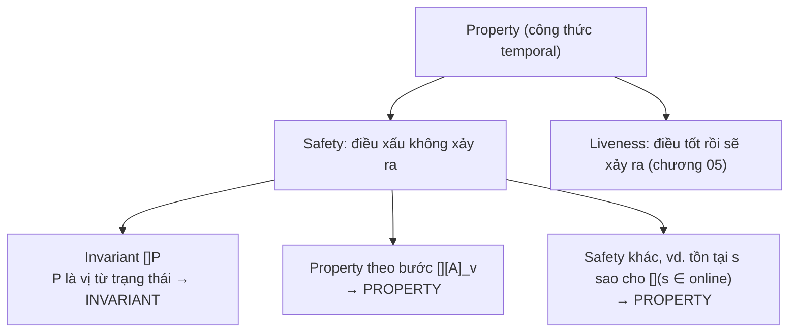
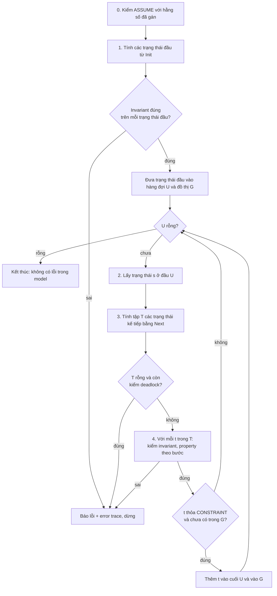
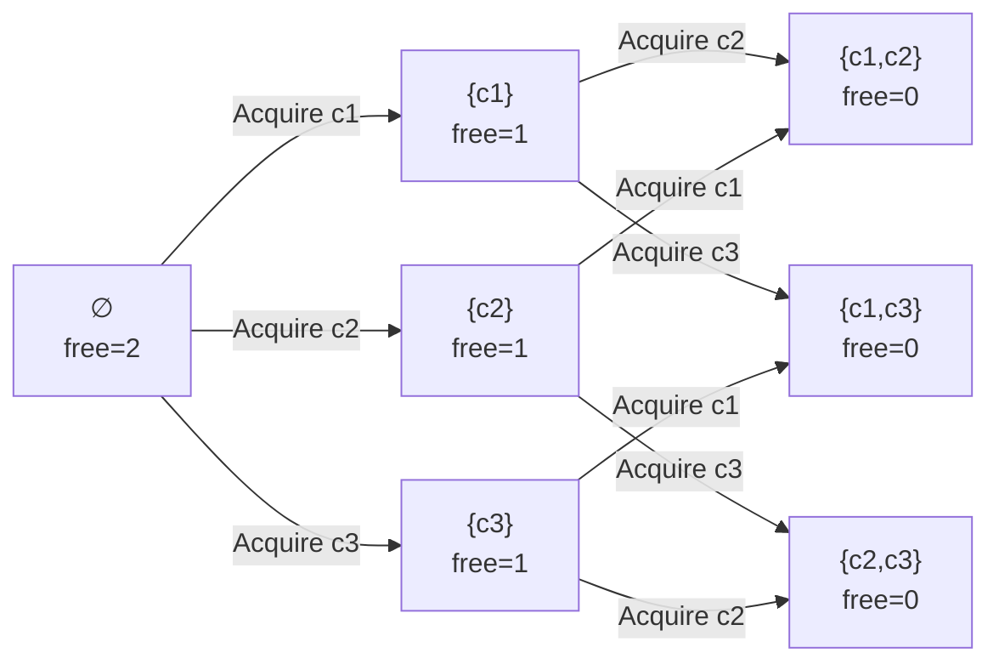

# P13 · Chương 04 — Invariant, safety và model checker TLC

> Chương này **không chạy TLC** và không chạy code. Các spec TLA+ trong khối ```` ```tla ```` là minh họa viết tay hoặc trích từ nguồn (có ghi rõ). Mọi con số về số trạng thái hay trace đều mang một trong ba nhãn: (a) trích từ nguồn, gồm sách *Specifying Systems*, repo `tlaplus/Examples` ghim commit `6a7b26a` và tài liệu `tlaplus/tlaplus` ghim commit `94d0c50`; (b) "tính tay", tức suy luận của người soạn từ định nghĩa spec, chưa được TLC xác nhận; (c) nhận xét của người soạn. Sách *Specifying Systems* mô tả TLC "Version 2" (bản in 2002–2003), nên tên cờ và định dạng thông báo của bản TLC hiện nay có thể khác; chỗ nào cần chính xác về tên cờ, hãy đối chiếu thêm với mã nguồn `tlaplus/tlaplus`. Hai trang Learn TLA+ (`learntla.com`) và Apalache (`apalache-mc.org`) là **trang sống**, đọc ngày 2026-10-12.

## Bạn sẽ hiểu được gì

- **Q1.** Safety property là gì, invariant là gì, `[]P` đọc thế nào, và vì sao "điều xấu không xảy ra" lại là loại tính chất mà model checker kiểm được? → mục 1
- **Q2.** `TypeOK`, invariant nghiệp vụ và property theo bước (`[][A]_v`) khác nhau thế nào, và chọn `INVARIANT` hay `PROPERTY`? → mục 2
- **Q3.** TLC khám phá không gian trạng thái ra sao: BFS, hàng đợi, fingerprint, "distinct states" khác "states generated" chỗ nào? → mục 3
- **Q4.** File `.cfg` gồm những gì (`SPECIFICATION`/`INIT`/`NEXT`, `INVARIANT`, `PROPERTY`, `CONSTANTS`, model value) và chạy TLC từ dòng lệnh ra sao? → mục 4
- **Q5.** Đọc error trace thế nào; và khi TLC báo xanh thì vì sao vẫn phải nghi ngờ? → mục 5
- **Q6.** TLC "deadlock" nghĩa là gì, khác deadlock ở P4·05 chỗ nào, và vì sao nhiều spec phải tắt kiểm tra này? → mục 6
- **Q7.** Vì sao phải bound model; state constraint, action constraint, model invariant và `TLCGet("level")` dùng thế nào? → mục 7
- **Q8.** State-space explosion đến từ đâu; symmetry set, view, model nhỏ, simulation giúp gì và rủi ro gì? → mục 8

## Kiến thức cần trước

- [Chương 01 — Vì sao đặc tả hình thức](01-vi-sao-dac-ta-hinh-thuc.md): động cơ dùng spec, khái niệm design bug khác code bug.
- [Chương 02 — Toán nền tảng](02-toan-nen-tang.md): tập hợp, hàm, lượng từ `\A`/`\E`, `=>`; các invariant ở đây dùng chúng liên tục.
- [Chương 03 — Trạng thái, hành vi, action](03-trang-thai-hanh-vi-action.md): `Init`, `Next`, `Spec == Init /\ [][Next]_vars`, `UNCHANGED`, nguyên tắc "action = quan hệ giữa trạng thái hiện tại và trạng thái kế".
- [P4 · Chương 05 — Bug concurrency và deadlock](../04-concurrency/05-concurrency-bug-va-deadlock.md): deadlock theo nghĩa lock/Coffman, để đối chiếu với "TLC deadlock" ở mục 6.
- (Tùy chọn) [Chương 06 — PlusCal](06-pluscal.md): biến `pc`, nhãn, `await`; mục 6 nhắc tới action `Terminating` do PlusCal sinh ra.

## 1. Safety, invariant và `[]P` (Q1)

> **Trả lời ngắn.** *Safety property* là loại yêu cầu "điều xấu không bao giờ xảy ra": nếu bị vi phạm thì vi phạm đó nằm ở một bước cụ thể của hành vi[^safety-def]. *Invariant* là dạng phổ biến nhất của nó: một *vị từ trạng thái* (state predicate) `P` đúng ở **mọi** trạng thái của mọi hành vi thỏa spec, viết `[]P` và đọc là "luôn luôn P"[^inv-def]. Mọi invariant đều là safety property, nhưng không phải safety property nào cũng là invariant[^inv-vs-safety]. Vì một vi phạm safety luôn có một đoạn hành vi hữu hạn làm chứng, model checker hữu hạn như TLC về nguyên tắc phát hiện được nó[^tlc-safety-finite].

**Giải thích.**

*Với service `orders`.* Giả sử `orders` giữ một connection pool tới database với tối đa `MaxConn` kết nối, và mỗi handler thread mượn một kết nối rồi trả lại. Ta sẽ bám theo pool này suốt chương; spec của nó nằm ở mục 2 (nhận xét của người soạn: đây là ví dụ giả định, không phải code trong repo). Pool có một luật hiển nhiên: số kết nối rảnh cộng số kết nối đang có người giữ luôn bằng `MaxConn`. Một `debug_assert!` hay một unit test chỉ kiểm luật đó ở những điểm bạn nghĩ tới (nhận xét của người soạn). Invariant của TLA+ đòi luật đúng ở *mọi* trạng thái pool có thể rơi vào, kể cả khoảnh khắc giữa hai bước mà log không ghi lại. Mục này nói "luôn đúng" nghĩa chính xác là gì và vì sao TLC kiểm được.

### 1.1 Invariant là vị từ trạng thái luôn đúng

Trong TLA+, một *trạng thái* là một phép gán giá trị cho mọi biến của spec; với pool, đó là cặp `(free, held)` ở mục 2. *Vị từ trạng thái* là biểu thức Boolean chỉ chứa biến và hằng, không có biến prime (`x'`) và không có toán tử thời gian[^state-pred]. Vì chỉ nhìn một trạng thái nên nó đánh giá được trên *một* trạng thái duy nhất, như `free >= 0`. Luật bảo toàn của pool (`Conservation` ở mục 2) cũng thuộc loại này.

Một *hành vi* (behavior) là chuỗi trạng thái vô hạn (chương 03), và `[]P` nghĩa là `P` đúng ở mọi trạng thái của chuỗi đó[^box-def]. Nói chặt hơn, `Inv` là invariant của `Spec` khi `Spec => []Inv` là một định lý[^inv-def]. Khi bạn đưa `P` vào `INVARIANT` của file cấu hình, TLC kiểm đúng điều này trên các hành vi mà nó sinh ra (mục 3).

### 1.2 Vì sao duyệt hữu hạn là đủ

Pool của `orders` bị vi phạm `Conservation` ở một bước cụ thể: một lần `Release` làm tổng nhảy lên `MaxConn + 1`. Safety nào cũng vậy, vì vi phạm xảy ra tại một điểm cụ thể trong hành vi[^safety-def]. Nên chỉ cần một đoạn hữu hạn đầu hành vi là đủ làm chứng. Đoạn hữu hạn đó sinh được bằng một model hữu hạn, nên TLC về nguyên tắc phát hiện được vi phạm[^tlc-safety-finite]. Liveness ("điều tốt rồi sẽ xảy ra") thì không thể bị vi phạm tại một thời điểm cụ thể[^liveness-instant], và chương 05 nói riêng về nó.

### 1.3 Safety nói "không thể", không nói "phải"

Safety khẳng định điều gì đó là *bất khả*; liveness khẳng định điều gì đó *phải* xảy ra[^safety-impossible]. Hệ quả cần nhớ là rất dễ thỏa một safety property bằng cách không làm gì cả[^safety-nothing]. Chẳng hạn một pool từ chối mọi `Acquire` vẫn thỏa `Conservation` (nhận xét của người soạn). Đó là lý do mục 5 dành riêng một phần cho việc nghi ngờ kết quả xanh.

Còn một chi tiết giúp bạn bớt lo: bước stutter không đổi giá trị nào nên không thể làm vi phạm một invariant[^stutter], vậy bạn chỉ cần để ý các bước thật của `Next`.

### 1.4 Safety không phải lúc nào cũng là invariant

Learn TLA+ có một ví dụ: "luôn có ít nhất một server online" có hai nghĩa. Nghĩa thứ nhất: tại mọi thời điểm có ít nhất một server online, và đó là invariant. Nghĩa thứ hai: có một server *cố định* online suốt hành vi. Nghĩa này vẫn là safety property nhưng không phải invariant, vì không có trạng thái đơn lẻ nào tự nó vi phạm điều đó[^safety-non-inv]. Dạng thứ hai thường là *property theo bước*, nói ở mục 2.



(Sơ đồ chỉ biểu diễn các loại mà nguồn nêu; không khẳng định đây là phân hoạch đầy đủ của mọi property.)

<details><summary>Đi sâu: invariant của Spec và invariant của Next (inductive invariant)</summary>

Sách *Specifying Systems* §5.7 phân biệt hai thứ dễ lẫn.

- Khi `P /\ N => P'` đúng, tức từ một trạng thái thỏa `P` mọi bước `N` đều dẫn tới trạng thái thỏa `P`, sách gọi `P` là *invariant của action `N`*[^inv-of-action]. Một invariant của spec mà đồng thời là invariant của action kế tiếp đôi khi được gọi là *inductive invariant*[^inductive].
- `TypeInvariant` của spec bộ nhớ đệm trong sách có tính chất đó: nó là invariant của `Spec` vì là invariant của `Next` và được `Init` kéo theo[^typeinv-next]. Nhưng `Coherence` thì **không** là invariant của `Next`[^coherence-not]. Có những trạng thái thỏa `Coherence` mà một bước `Next` đưa tới trạng thái vi phạm; chúng chỉ không xuất hiện vì *không với tới được* từ `Init`. Sách viết rằng `Coherence` là invariant của `Spec` chính vì các trạng thái như vậy không thể xuất hiện trong hành vi thỏa `Spec`[^coherence].
- Muốn *chứng minh* một `P` là invariant của `Spec`, người ta tìm một `Inv` mạnh hơn, là invariant của `Next`, rồi chứng minh ba điều: `Init => Inv`, `Inv /\ [Next]_v => Inv'`, `Inv => P`[^inv-proof].

Điểm cần rút ra cho TLC (suy luận của người soạn từ thuật toán ở mục 3): TLC chỉ đánh giá invariant trên các trạng thái *với tới được* từ `Init` trong model, nên nó **không** đòi `P` phải là inductive. Vì thế viết và kiểm các invariant "thật" như `Coherence` bằng TLC dễ hơn nhiều so với chứng minh chúng. Nhưng cũng vì thế, một TLC xanh trên model nhỏ không phải là chứng minh (mục 5).

</details>

**Quay lại Q1:** safety là "điều xấu không xảy ra", invariant là safety viết được dưới dạng `[]P` với `P` là vị từ trạng thái; vi phạm có chứng cứ hữu hạn nên TLC tìm được.

## 2. `TypeOK`, invariant nghiệp vụ và property theo bước (Q2)

> **Trả lời ngắn.** `TypeOK` (type invariant) khai báo mỗi biến có thể nhận những giá trị nào. TLA+ không có hệ kiểu nên nó chỉ là một invariant bình thường được đặt tên[^typeinv]. *Invariant nghiệp vụ* là tính chất thật của thuật toán, ví dụ "hai resource manager không bao giờ quyết định mâu thuẫn"[^tcc]. Những ràng buộc *giữa hai trạng thái liên tiếp* ("term không bao giờ giảm") không phải vị từ trạng thái nên không đưa vào `INVARIANT` được[^inv-state-pred]; chúng viết dạng `[][A]_v` và khai báo bằng `PROPERTY`[^implied-action].

**Giải thích.**

*Với service `orders`.* Pool của `orders` có ba loại luật cần kiểm, và chúng khác nhau ở chỗ lỗi nào mỗi loại bắt được. Loại một: mỗi biến chỉ nhận giá trị trong miền cho trước, ví dụ `free` luôn nằm trong `0..MaxConn`. Loại hai: luật của thiết kế, ví dụ số kết nối rảnh cộng số kết nối đang giữ bằng `MaxConn`. Loại ba: luật nói về hai trạng thái liên tiếp, ví dụ trong một hệ nhân bản thì term của mỗi node không bao giờ giảm (pool không có luật loại này, nên ví dụ lấy từ Raft). Mỗi loại có một cách khai báo riêng với TLC.

### 2.1 `TypeOK` để làm gì

Chú thích trong spec DieHard của Lamport nói type invariant không phải một phần của spec, nhưng nên có: nó giúp người đọc hiểu spec, và vì TLC bị bắt kiểm nó nên nó bắt những lỗi mà ở ngôn ngữ có kiểu thì compiler bắt[^typeok-doc]. Vì sao TLA+ không có kiểu mà vẫn có `TypeOK` đã nói ở [Chương 03 mục 6](03-trang-thai-hanh-vi-action.md). Ở đây chỉ cần nhớ rằng "type correctness" chỉ là tên của một tính chất bất biến, và đặt tên `TypeInvariant` không cho công thức nào vị thế đặc biệt[^typeinv].

`TypeOK` chỉ nên chứa giá trị *có thể*, không chứa giá trị *hợp lệ*. Hillel Wayne, tác giả Learn TLA+, muốn `TypeInvariant` chỉ bao phủ tập giá trị có thể của biến. Ví dụ hai tập phải rời nhau thì nên tách thành invariant riêng, vì đó là tính chất đúng-sai của hệ thống chứ không chỉ là kiểm cận[^typeinv-principle]. Hệ quả thực dụng (nhận xét của người soạn): khi `TypeOK` vi phạm, bạn biết spec *viết sai* vì action sinh giá trị ngoài miền. Khi invariant nghiệp vụ vi phạm trong lúc `TypeOK` xanh, bạn biết *thiết kế* có lỗi. Hai loại lỗi cần hai cách phản ứng khác nhau, nên đừng gộp.

### 2.2 Spec của pool và invariant nghiệp vụ

Spec dưới đây (người soạn viết, chưa chạy) mô hình pool với `MaxConn` kết nối; mỗi client giữ tối đa một. Invariant nghiệp vụ `Conservation`: số kết nối rảnh cộng số client đang giữ luôn bằng `MaxConn`.

```tla
---- MODULE ConnPool ----
EXTENDS Naturals, FiniteSets, TLC

CONSTANTS Clients, MaxConn
ASSUME MaxConn \in Nat /\ MaxConn > 0

VARIABLES free, held          \* free: số kết nối rảnh; held[c]: client c đang giữ?
vars == <<free, held>>

TypeOK ==
  /\ free \in 0..MaxConn
  /\ held \in [Clients -> BOOLEAN]

Init ==
  /\ free = MaxConn
  /\ held = [c \in Clients |-> FALSE]

Acquire(c) ==
  /\ ~held[c]
  /\ free > 0
  /\ free' = free - 1
  /\ held' = [held EXCEPT ![c] = TRUE]

Release(c) ==
  /\ held[c]
  /\ free' = free + 1
  /\ held' = [held EXCEPT ![c] = FALSE]

Next == \E c \in Clients : Acquire(c) \/ Release(c)

Spec == Init /\ [][Next]_vars

\* Invariant nghiệp vụ: bảo toàn số kết nối
Conservation ==
  free + Cardinality({c \in Clients : held[c]}) = MaxConn

\* Dùng cho SYMMETRY ở mục 8
Symmetry == Permutations(Clients)
====
```

Ký hiệu đã giải thích ở [chương 02](02-toan-nen-tang.md) và [chương 03](03-trang-thai-hanh-vi-action.md); đọc nhanh như sau:

- `free'` là giá trị của `free` ở trạng thái *kế tiếp*.
- `[Clients -> BOOLEAN]` là tập mọi hàm từ `Clients` sang `{TRUE, FALSE}`, và `[held EXCEPT ![c] = TRUE]` là hàm giống `held` trừ tại `c`.
- `\E c \in Clients : ...` nghĩa là "có một client `c` sao cho ...", nên `Next` cho TLC thử lần lượt từng client.
- `Cardinality` (module `FiniteSets`) đếm phần tử của tập hữu hạn.
- `ASSUME` kiểm hằng số trước khi TLC chạy (xem cuối mục này), và `Permutations` (module `TLC`) dùng ở mục 8.

### 2.3 `TypeOK` xanh mà pool vẫn hỏng

Giờ thử một bản *lỗi* mà lập trình viên hay viết khi "phòng thủ": bỏ guard `held[c]` và chặn trên để `free` không vượt `MaxConn`.

```tla
Release(c) ==                              \* BẢN LỖI (minh họa)
  /\ free' = IF free < MaxConn THEN free + 1 ELSE free
  /\ held' = [held EXCEPT ![c] = FALSE]
```

`TypeOK` **vẫn đúng** ở mọi trạng thái, vì `free` luôn nằm trong `0..MaxConn`; phép chặn trên "giấu" lỗi khỏi type invariant. Nhưng `Conservation` bị vi phạm. Hành vi ngắn nhất vi phạm, tính tay (suy luận của người soạn, chưa chạy TLC, giả sử `Clients` có ít nhất hai phần tử):

| # | Bước | `free` | `held` (client đang giữ) | `TypeOK` | `Conservation` |
|---|------|--------|--------------------------|----------|----------------|
| 1 | `Init` | `MaxConn` | ∅ | đúng | đúng |
| 2 | `Acquire(c1)` | `MaxConn − 1` | {c1} | đúng | đúng |
| 3 | `Release(c2)` — c2 *không* giữ kết nối | `MaxConn` | {c1} | đúng | **sai**: `MaxConn + 1 ≠ MaxConn` |

Trong `orders`, đây là tình huống một handler gọi trả kết nối hai lần, hoặc trả kết nối của handler khác, mà pool âm thầm nuốt lỗi (nhận xét của người soạn). Mục "Liên hệ" cuối chương nối chuyện này với `saturating_add` trong Rust.

### 2.4 Cùng bộ ba trong `tlaplus/Examples`

Spec `TCommit` (transaction commit của Gray và Lamport) có đủ cả ba phần:

- `TCTypeOK == rmState \in [RM -> {"working", "prepared", "committed", "aborted"}]`[^tc-typeok];
- invariant nghiệp vụ `TCConsistent`: không có hai RM mà một cái `aborted`, một cái `committed`[^tcc];
- một `THEOREM` ghi lại cả hai là invariant của spec[^tc-theorem], và file cấu hình liệt kê *cả hai* làm `INVARIANTS`[^tc-cfg].

Sách khuyên đặt tên riêng cho từng conjunct của invariant rồi liệt kê riêng trong `INVARIANT`: khi vi phạm, TLC báo cho biết conjunct nào sai[^separate-conj].

### 2.5 Property theo bước

Có tính chất không thể diễn đạt bằng một trạng thái: "term của mọi node không bao giờ giảm" (Raft, xem [P12·09 mục 7](../12-he-thong-du-lieu/09-consistency-va-consensus.md)). Nó nói về *cặp* trạng thái liên tiếp, nên viết dạng `[][A]_v`. Giả sử module có biến hàm `term` trên tập `Nodes`:

```tla
TermNeverDecreases ==
  [][\A n \in Nodes : term'[n] >= term[n]]_term
```

TLC xử lý loại này bằng cách kiểm `ImpliedAction`, tức hội của mọi `[A]_v` mà một conjunct của property có dạng `[][A]_v`[^implied-action]. Nó kiểm trên *từng bước* `s → t` mà nó sinh ra[^step-check]. Bạn khai báo trong cfg bằng `PROPERTY TermNeverDecreases`, không phải `INVARIANT`, vì `INVARIANT` phải là vị từ trạng thái[^inv-state-pred].

### 2.6 `INVARIANT` hay `PROPERTY`

`INVARIANT` dành cho công thức mức trạng thái (level 1), tức điều kiện phải đúng ở mọi trạng thái khả đạt. Cùng điều kiện đó viết dạng `[]I` thì khai báo bằng `PROPERTY []I`[^state-level]. **Cạm bẫy:** đổi `INVARIANT I` thành `PROPERTY I` mà không thêm `[]` thì TLC chỉ kiểm `I` ở các trạng thái *đầu*, không phải mọi trạng thái khả đạt[^prop-init]. Sách nói cùng ý: một vị từ trạng thái trong `PROPERTY` nghĩa là `P` đúng ở trạng thái đầu của mọi hành vi[^prop-state-pred]. Với pool của `orders`, viết nhầm `PROPERTY Conservation` nghĩa là chỉ kiểm lúc pool còn nguyên, chưa ai mượn gì.

Còn `ASSUME` là loại khác nữa: nó kiểm *hằng số*, được đánh giá trước khi TLC bắt đầu khám phá, và không phải tính chất của trạng thái[^assume].

<details><summary>Đi sâu: viết invariant cho TLC đánh giá được, và gợi ý invariant nghiệp vụ cho backend</summary>

- **Thứ tự đánh giá.** TLC đánh giá `p /\ q` bằng cách đánh giá `p` trước, chỉ khi `p` đúng mới đánh giá `q`[^eval-order]. Vì vậy `(x # <<>>) /\ (x[1] = 0)` đánh giá được còn đảo vế thì TLC báo lỗi; ví dụ và giải thích về biểu thức "ngớ ngẩn" nằm ở [Chương 02 mục 8](02-toan-nen-tang.md). Quy tắc thực dụng: *guard đứng trước*.
- **`=>` làm tiền điều kiện.** `=>` là công cụ rất mạnh khi viết invariant, ví dụ chỉ kiểm tính đúng đắn khi thuật toán đã xong: `pc = "Done" => ...`[^impl-guard].
- **Đừng dùng `=>` với `\E`.** Ví dụ của Learn TLA+: nếu chọn `i = j = 1` thì vế trái sai nên cả biểu thức đúng, và cả lượng từ `\E` đúng bất kể vế phải[^impl-exists]. Hãy dùng `/\` thay cho `=>` bên trong `\E`.
- **Ý tưởng invariant nghiệp vụ cho backend** (nhận xét của người soạn, mang tính gợi ý): "không có hai leader trong cùng một term"; "offset đã commit ≤ offset cuối của log"; "tổng số dư các tài khoản không đổi sau chuyển tiền (kể cả khi retry hay lặp message)"; "tại mọi thời điểm tối đa một holder giữ lease còn hiệu lực"; "mọi message đã ack đều có trong log bền". Mỗi câu phải đọc được thành `P(state)`; nếu bạn phải nhắc đến "trước đó" hoặc "sau đó" thì nó là property theo bước hoặc liveness.

</details>

**Quay lại Q2:** `TypeOK` kiểm "giá trị có thể", invariant nghiệp vụ kiểm "giá trị đúng", `[][A]_v` kiểm "bước đi hợp lệ"; hai loại đầu vào `INVARIANT`, loại sau vào `PROPERTY`.

## 3. TLC khám phá không gian trạng thái (Q3)

> **Trả lời ngắn.** TLC duyệt đồ thị trạng thái theo chiều rộng (BFS), với một hàng đợi các trạng thái chưa mở rộng và một đồ thị các trạng thái đã thấy[^tlc-ds]. Mỗi lần lấy một trạng thái ra, nó đánh giá `Next` để tính mọi trạng thái kế tiếp, kiểm invariant trên từng cái, rồi đưa cái mới vào hàng đợi[^step-add]. Để nhận ra trạng thái "đã thấy", TLC lưu *fingerprint* 64-bit thay vì cả trạng thái[^fp]. Thông báo tiến độ phân biệt số trạng thái *sinh ra* (có trùng) với số trạng thái *phân biệt*[^progress].

**Giải thích.**

*Với service `orders`.* TLC không chạy `orders` và không biết gì về thread; nó chỉ có spec `ConnPool` và cfg. Từ trạng thái đầu (pool rảnh, chưa ai giữ), nó thử mọi action `Acquire` và `Release` có thể, ghi lại mọi trạng thái mới, rồi lặp lại cho tới khi hết trạng thái mới. Với ba client và `MaxConn = 2`, quá trình đó chỉ đi qua 7 trạng thái. Mục này cho thấy TLC làm việc đó thế nào và các con số nó in ra có nghĩa gì.

### 3.1 Vòng lặp BFS

Thuật toán dưới đây theo mô tả trong sách §14.3.1. Tài liệu Toolbox trong repo `tlaplus/tlaplus` ở commit đã ghim cũng nói BFS là cách duyệt mặc định của TLC[^bfs-default].



Trong sơ đồ, `G` là phần đồ thị khả đạt mà TLC đã tìm được, còn `U` chứa các trạng thái trong `G` mà TLC chưa tính successor[^tlc-g-u]. Từng bước, bám sách:

1. **Kiểm `ASSUME`.** Bước đầu tiên là kiểm mọi `assume` trong spec có thỏa với các hằng số đã gán hay không[^assume-step].
2. **Trạng thái đầu.** TLC tính chúng bằng cách đánh giá `Init`, nhưng thay vì cho trước các biến không prime rồi gán biến prime, nó *gán* giá trị cho các biến không prime[^init-gen]. Với mỗi trạng thái đầu, TLC đánh giá invariant và báo lỗi nếu sai[^init-inv]. Nếu trạng thái thỏa `CONSTRAINT` thì nó được đưa vào hàng đợi `U` và đồ thị `G`[^init-constraint].
3. **Trạng thái kế tiếp.** Với trạng thái `s` lấy từ đầu hàng đợi, TLC đặt các biến không prime bằng giá trị trong `s`, để trống các biến prime rồi đánh giá `Next`[^next-succ]. Khi gặp biểu thức dạng `x' = e` mà `x'` chưa có giá trị, nó coi biểu thức là đúng và gán `x'` bằng giá trị của `e`[^next-eval]. Tuyển `A1 \/ ... \/ An` được *tách* thành `n` lần đánh giá riêng, mỗi lần một nhánh; `\E x \in S` tách theo từng phần tử của `S`[^disj-split]. Hệ quả: **thứ tự các conjunct trong action quan trọng**, vì nếu dùng `x'` trước khi nó được gán, TLC báo lỗi[^next-order].
4. **Deadlock.** Nếu tập `T` rỗng và không chọn tùy chọn `-deadlock` (tức TLC vẫn đang kiểm deadlock), TLC báo lỗi deadlock và dừng[^step-deadlock] (mục 6).
5. **Kiểm từng trạng thái kế tiếp.** Với mỗi `t` trong `T`: nếu invariant sai ở `t` hoặc property theo bước sai ở bước `s → t`, TLC báo lỗi và dừng[^step-check]. Nếu không, và `t` thỏa constraint (mục 7) mà chưa có trong `G`, thì `t` được thêm vào cuối hàng đợi và vào đồ thị[^step-add].
6. **Kết thúc.** Khi hàng đợi rỗng, TLC xong. Nó chỉ kết thúc nếu tập trạng thái khả đạt hữu hạn[^terminates]; nếu không, nó chạy mãi cho tới khi hết tài nguyên hoặc bị dừng[^forever]. Vì vậy mọi model phải được *bound* (mục 7).

### 3.2 BFS cho trace ngắn nhất

Vì duyệt theo chiều rộng, nếu TLC tìm thấy vi phạm safety thì nó tạo ra một hành vi ngắn nhất dẫn tới vi phạm[^bfs-shortest]. Với nhiều worker, sách thừa nhận về lý thuyết có thể tồn tại hành vi ngắn hơn, tuy hiếm gặp[^workers-shorter]. Mục 5 dùng tính chất này để đọc error trace.

### 3.3 Fingerprint

Nút của đồ thị trong cài đặt thật không phải trạng thái mà là *fingerprint*: một số 64-bit sinh bởi hàm băm[^fp]. Tài liệu Toolbox nói cùng ý: TLC chỉ lưu fingerprint 64-bit của các trạng thái khả đạt, không lưu trạng thái đầy đủ[^fp-toolbox]. Hai trạng thái khác nhau có thể trùng fingerprint ("collision"), khi đó TLC tưởng chúng là một và bỏ sót phần không gian phía sau[^fp-collision]. Trong thực tế xác suất này rất nhỏ trừ khi số trạng thái phân biệt lên tới hàng tỷ[^fp-prob].

### 3.4 Đọc số liệu TLC in ra

Sách trích một thông báo tiến độ: TLC đã sinh và xét 2846 trạng thái, trong đó 984 phân biệt, và hàng đợi còn 856 trạng thái chưa mở rộng[^progress]. Thông báo ở bước trạng thái đầu thì cho biết TLC sinh 4 trạng thái, 2 phân biệt[^init-progress]. *Diameter* là số nhỏ nhất `d` sao cho mọi trạng thái trong `G` đi tới được từ một trạng thái đầu qua đường đi chứa tối đa `d` trạng thái; nó chính là độ sâu BFS hiện tại[^diameter]. Nhận xét của người soạn: "số sinh ra − số phân biệt" đo mức *trùng lặp*, tức các đường khác nhau dẫn tới cùng một trạng thái; số phân biệt mới là kích thước không gian.

### 3.5 Chạy tay TLC trên pool của `orders`

Lấy spec ở mục 2 (bản đúng, có guard `held[c]`) với `Clients = {c1, c2, c3}`, `MaxConn = 2`. Trạng thái được xác định hoàn toàn bởi tập client đang giữ, vì `free = MaxConn − |held|`; và không thể có hơn `MaxConn` client giữ cùng lúc. Vậy có `1 + 3 + 3 = 7` trạng thái khả đạt: tập rỗng, 3 tập một phần tử, 3 tập hai phần tử. BFS đi qua ba tầng:



(Chỉ vẽ các cạnh `Acquire`; mỗi cạnh có một cạnh `Release` ngược chiều.) Số trạng thái *sinh ra* là trạng thái đầu cộng mọi trạng thái kế tiếp, kể cả trùng. Quy ước đếm này được kiểm lại bằng con số `TCommit` ở phần Đi sâu bên dưới. Từ `∅` có 3. Từ mỗi trong 3 trạng thái tầng 1 có 2 `Acquire` và 1 `Release`, tổng 9. Từ mỗi trong 3 trạng thái tầng 2 chỉ có 2 `Release` (vì `free = 0`), tổng 6. Cộng lại: `1 + 3 + 9 + 6 = 19` sinh ra, `7` phân biệt, độ sâu 3 (tính tay, suy luận của người soạn, chưa chạy TLC).

Cách đếm này khớp với số liệu repo `tlaplus/Examples` ghi cho `TCommit` với `RM = {r1, r2, r3}`: `34` trạng thái phân biệt, `94` trạng thái sinh ra, độ sâu `7`[^manifest-tcommit]. Phần Đi sâu bên dưới đếm lại bằng tay để bạn tự đối chiếu.

<details><summary>Đi sâu: tự đếm lại 34 / 94 / 7 của TCommit; rủi ro fingerprint; các chế độ khác của TLC</summary>

**Tự đếm `TCommit` với 3 RM (tính tay, suy luận của người soạn; đối chiếu với manifest).** Mỗi RM ở một trong 4 trạng thái nên không gian kiểu `TCTypeOK` có `4³ = 64` phần tử, nhưng khả đạt chỉ một phần. Spec: `Prepare(rm)` đổi `working → prepared`; `Decide(rm)` hoặc commit (cần `canCommit`: mọi RM đều `prepared` hay `committed`) hoặc abort (cần `notCommitted`: chưa RM nào commit)[^tc-actions].

- *Chưa ai commit:* mỗi RM ∈ {working, prepared, aborted}, mọi tổ hợp đều khả đạt: `3³ = 27`.
- *Đã có commit:* khi commit, mọi RM đều `prepared` hay `committed` (không RM nào aborted), và sau đó không ai abort được nữa, nên mỗi RM ∈ {prepared, committed} với ít nhất một committed: `2³ − 1 = 7`.
- Tổng `27 + 7 = 34`, khớp manifest[^manifest-tcommit].
- *Số bước sinh ra:* tổng số trạng thái kế tiếp trên mọi trạng thái khả đạt, cộng 1 trạng thái đầu. Ở nhóm 27 trạng thái chưa commit, một RM `working` đóng góp 2 bước (`Prepare`, abort), một RM `prepared` đóng góp 1 bước abort, một RM `aborted` đóng góp 0. Trong 27 trạng thái, mỗi RM ở mỗi giá trị {working, prepared, aborted} đúng 9 lần, nên tổng số RM `working` là 27 và tổng số RM `prepared` là 27: `2·27 + 1·27 = 81`. Cộng 3 bước commit từ trạng thái *tất cả* `prepared` (mỗi RM một bước) thành `84`. Nhóm 7 trạng thái đã commit: chỉ RM `prepared` mới còn bước (commit, vì `canCommit` đúng; abort bị `notCommitted` chặn), nên `3·2 + 3·1 + 1·0 = 9` (3 trạng thái có 1 RM committed và 2 prepared, 3 trạng thái có 2 committed và 1 prepared, 1 trạng thái cả ba committed). `84 + 9 + 1 = 94`, khớp manifest[^manifest-tcommit].
- *Độ sâu:* đường dài nhất trong các đường ngắn nhất là `Prepare ×3` rồi `Decide(commit) ×3`, tức 6 bước = 7 trạng thái, khớp `stateDepth = 7` của manifest[^manifest-tcommit].

Trạng thái "tất cả RM đã commit" và trạng thái "tất cả RM đã abort" không có trạng thái kế tiếp (tính tay, suy ra từ `Prepare`/`Decide`). Nhiều khả năng đó là lý do `TCommit.cfg` đặt `CHECK_DEADLOCK FALSE` (mục 6). Đây là nhận xét của người soạn: cfg chỉ có dòng cấu hình, không ghi lý do[^tc-cfg].

**Rủi ro fingerprint.** Cuối mỗi lần chạy, TLC in hai ước lượng xác suất collision: một ước lượng lý thuyết dựa trên giả định xác suất `2⁻⁶⁴`, một ước lượng thực nghiệm dựa trên "suýt trùng" giữa các cặp fingerprint[^fp-estimate]. Nếu nghi ngờ, Toolbox cho chọn *fingerprint seed index*, một trong 64 hàm fingerprint[^fp-toolbox2]. Chạy lại bằng hàm khác, nếu số trạng thái khả đạt khác nhau thì ít nhất một lần chạy đã có collision[^fp-diff]. Hậu quả đáng sợ nhất: nếu có collision, với view mặc định TLC vẫn báo đã kiểm hết mọi trạng thái khả đạt trong khi thực ra chưa[^fp-silent]. Đó không phải báo lỗi giả mà là bỏ sót im lặng.

**Chế độ khác.** TLC mặc định ở *model-checking mode* (tìm mọi trạng thái khả đạt), còn *simulation mode* sinh ngẫu nhiên các hành vi và không cố duyệt hết[^sim-mode] (mục 8). Toolbox còn có tùy chọn DFID (duyệt sâu lặp), nhưng khi đó TLC thường không cho trace ngắn nhất[^dfid], và theo tài liệu Toolbox ở commit đã ghim thì DFID hiện chưa hỗ trợ nhiều worker[^dfid-workers]. Với model có hàng tỷ trạng thái, TLC có thể giữ tập trạng thái trên đĩa, nên số trạng thái nhiều không làm hết bộ nhớ, nhưng chạy chậm hơn nhiều so với khi giữ trong RAM[^disk]. Bước 3 của thuật toán có thể chạy song song trên nhiều thread (`-workers`)[^workers-par].

</details>

**Quay lại Q3:** TLC làm BFS trên đồ thị trạng thái với hàng đợi và tập fingerprint, mở rộng từng trạng thái bằng `Next`, kiểm invariant trên mỗi trạng thái mới; "distinct" là kích thước không gian, "generated" tính cả lần sinh trùng.

## 4. File `.cfg` và cách chạy TLC (Q4)

> **Trả lời ngắn.** File cấu hình cho TLC biết: spec nào (`SPECIFICATION`, hoặc cặp `INIT` + `NEXT`)[^cfg-spec]; tính chất nào (`INVARIANT` cho vị từ trạng thái, `PROPERTY` cho công thức temporal hay theo bước)[^inv-state-pred]; giá trị cho mọi hằng số của spec (`CONSTANT`), kể cả *model value*[^cfg-all-const]; và các công cụ thu nhỏ không gian (`CONSTRAINT`, `SYMMETRY`, `VIEW`). Giá trị gán cho các hằng số tạo thành một *model*[^model-def], và `CONSTRAINT` (nếu có) thu hẹp thêm để model hữu hạn.

**Giải thích.**

*Với service `orders`.* Spec `ConnPool` chỉ nói pool *hoạt động thế nào*. Kiểm với bao nhiêu client, `MaxConn` bằng mấy, và kiểm luật nào là việc của file cfg. Cùng một spec có thể có nhiều cfg: một cfg nhỏ để lặp nhanh khi đang viết, một cfg lớn để kiểm cuối (nhận xét của người soạn).

### 4.1 Cfg cho pool

```text
\* ConnPool.cfg  (minh họa, chưa chạy)
SPECIFICATION Spec
CONSTANTS
  Clients = {c1, c2, c3}
  MaxConn = 2
INVARIANTS TypeOK Conservation
SYMMETRY Symmetry
```

Bốn khối này khớp bốn việc ở phần trả lời ngắn: chọn spec, gán hằng số, liệt kê tính chất, và bật một công cụ thu nhỏ (`SYMMETRY`, mục 8).

### 4.2 Các từ khóa

Bảng dưới tổng hợp từ sách (§14.1–14.3, 14.7.1) và mã nguồn `ModelConfig.java`, `TLAConstants.java` của repo `tlaplus/tlaplus` (commit `94d0c50`):

| Từ khóa | Nhận gì | Ý nghĩa |
|---------|---------|---------|
| `SPECIFICATION` | một công thức (vd. `Spec`) | `Init /\ [][Next]_vars /\ fairness`; TLC lấy `Init`, `Next` và điều kiện liveness từ đây[^cfg-spec] |
| `INIT`, `NEXT` | tên vị từ / action | dùng thay `SPECIFICATION` khi không có liveness[^cfg-init-next] |
| `CONSTANT(S)` | `tên = giá trị` hoặc `tên <- định nghĩa` | gán hằng số; `<-` là *replacement*[^replacement] |
| `INVARIANT(S)` | các vị từ trạng thái[^inv-state-pred] | kiểm `P` đúng ở mọi trạng thái khả đạt, tức `[]P` |
| `PROPERTY`/`PROPERTIES` | công thức temporal | bất kỳ công thức nào TLC đánh giá được[^prop-any]: tính chất theo bước, invariant viết dạng `[]I`, liveness (chương 05). Vị từ trạng thái đặt thẳng vào đây chỉ được kiểm ở trạng thái đầu |
| `CONSTRAINT(S)` | vị từ trạng thái | state constraint (mục 7)[^constraint-def] |
| `ACTION_CONSTRAINT(S)` | action | action constraint (mục 7)[^action-constraint] |
| `SYMMETRY` | tập hoán vị | symmetry set (mục 8)[^symm-def] |
| `VIEW` | hàm trạng thái | đổi cái gì được coi là "một trạng thái" (mục 8)[^default-view] |
| `ALIAS` | record | định nghĩa lại cách in trạng thái trong error trace (mục 5)[^alias] |
| `CHECK_DEADLOCK` | `TRUE`/`FALSE` | bật/tắt kiểm deadlock (mục 6)[^kw-checkdeadlock] |

### 4.3 Model value

Trong `Clients = {c1, c2, c3}`, `c1` không phải chuỗi hay số mà là *model value*. Sách quy ước mọi chuỗi ký tự như `a1` hay `foo` mà không phải số, không phải chuỗi trong nháy kép và không phải `TRUE`/`FALSE` thì được hiểu là model value[^mv-syntax]. Model value chỉ so sánh được bằng `=`: nó chỉ bằng chính nó[^mv]. TLC coi nó là so sánh được với mọi giá trị khác, đồng thời khác mọi giá trị khác[^mv-book].

Learn TLA+ nêu lợi ích của việc này: trong TLC, so sánh hai thứ không cùng kiểu (ví dụ chuỗi với số) là *lỗi*. Model value cho phép biểu diễn "null" hay "chưa có" mà không bị lỗi so sánh và không trùng với giá trị hợp lệ[^mv-why]. Ngoài ra, tập model value là điều kiện để dùng symmetry (mục 8).

### 4.4 Phần dành riêng cho TLC: module `MC`

Sách có một cfg cho giao thức alternating bit (hình 14.3), kèm `CONSTRAINT`:

```text
CONSTANTS
  Data    = {d1, d2}   (* Is this big enough? *)
  msgQLen = 2
  ackQLen = 2          \* Try 3 next.
SPECIFICATION ABSpec
INVARIANT     ABTypeInv
CONSTRAINT    SeqConstraint
```

`SeqConstraint` và hai hằng `msgQLen`, `ackQLen` được định nghĩa trong một module riêng `MCAlternatingBit` *mở rộng* `AlternatingBit`, vì không nên đưa vào spec chính những khai báo và định nghĩa chỉ phục vụ TLC[^mc-module]. Module đó chỉ có các dòng sau:

```tla
---- MODULE MCAlternatingBit ----
EXTENDS AlternatingBit
CONSTANTS msgQLen, ackQLen
SeqConstraint == /\ Len(msgQ) <= msgQLen
                 /\ Len(ackQ) <= ackQLen
====
```

Quy ước đặt tên `MC<Tên>` này là của sách. Toolbox cũng làm tương tự: khi bạn đặt một biểu thức làm invariant, Toolbox sinh một file `MC.tla` riêng, thêm biểu thức đó như một operator rồi model-check `MC.tla`[^toolbox-mc].

### 4.5 Chạy từ dòng lệnh

Learn TLA+ mô tả cách chạy dưới đây (minh họa, không chạy trong chương này):

```bash
java -jar tla2tools.jar -config ConnPool.cfg -workers auto ConnPool.tla
```

Nếu không có `-config` thì TLC tìm `<tên spec>.cfg`[^cli-default-cfg]. Không có `-workers` thì CLI dùng đúng một worker[^cli-workers]. `-continue` bảo TLC tiếp tục sau vi phạm đầu tiên, và theo Learn TLA+ thì mọi vi phạm invariant sẽ được in ra[^cli-continue].

<details><summary>Đi sâu: tên từ khóa, ràng buộc cú pháp, replacement và giới hạn của cfg</summary>

- **Tên từ khóa lệch giữa sách và công cụ.** Sách (viết 2002) liệt kê dạng có gạch nối `ACTION-CONSTRAINT`[^kw-book], trong khi mã nguồn của bản ghim định nghĩa `ACTION_CONSTRAINT` (gạch dưới)[^kw-src-constraint]. `CHECK_DEADLOCK`, `VIEW` và `SYMMETRY` đều có trong danh sách từ khóa của `ModelConfig`[^kw-src-misc], và `ALIAS` cũng vậy[^kw-src-alias]. Nhận xét của người soạn: khi sách và công cụ lệch nhau, tin công cụ bạn đang chạy; hãy đối chiếu bằng phần trợ giúp của đúng bản `tla2tools.jar` đang dùng.
- **Ràng buộc cú pháp** (sách §14.7.1). Tối đa một `INIT`, một `NEXT`, một `VIEW`, một `SYMMETRY`[^cfg-restrict]. `SPECIFICATION` chỉ được dùng nếu không có `INIT`/`NEXT`[^cfg-spec-only]. Các câu lệnh khác lặp được và gộp lại: hai dòng `INVARIANT Inv1` và `INVARIANT Inv2 Inv3` tương đương việc kiểm cả ba[^cfg-multiple]. `CONSTANT`/`CONSTANTS` và `INVARIANT`/`INVARIANTS` là đồng nghĩa[^cfg-kw-equiv].
- **Replacement `<-`.** Ngoài gán giá trị `c = v`, `c <- d` bảo TLC thay định nghĩa `c` bằng `d` khi tính toán[^replacement]. Sách dùng nó để thay một định nghĩa tao nhã nhưng chậm (ví dụ `Sort` dùng `CHOOSE`, toán tử "chọn một phần tử thỏa điều kiện", xem [chương 02 mục 5](02-toan-nen-tang.md)) bằng bản TLC tính nhanh (`FastSort`), hoặc để thay `Nat` bằng một tập hữu hạn (mục 7).
- **Invariant phải là operator có tên.** Ở dòng lệnh, bạn không thể viết biểu thức trực tiếp trong `INVARIANT`; phải định nghĩa operator trong spec rồi gọi tên (Toolbox che chuyện này bằng `MC.tla`)[^cli-ops-named].
- **Hằng số âm.** Learn TLA+ nói cfg không có `import`, mà số âm về mặt kỹ thuật thuộc module `Integers`, nên không đặt được hằng số âm trực tiếp trong cfg[^cli-neg]. Nhận xét của người soạn: sách *Specifying Systems* (2002) lại có ví dụ giá trị `{1, -3, 2}` ở phần mô tả giá trị trong cfg, nên hãy thử trên đúng bản `tla2tools.jar` đang dùng; nếu lỗi thì bọc bằng operator trong module MC và dùng `<-`.
- **`SPECIFICATION` phải có đúng một conjunct dạng box-action** `[][N]_v`, đó là cách TLC biết `Next` là gì[^spec-one-box].
- **TLC không xử lý ẩn biến `\EE`.** Muốn kiểm spec có biến ẩn, hãy kiểm spec *nội bộ* trong đó các biến đó hiện ra[^no-hiding]. Việc kiểm "spec nội bộ kéo theo spec trừu tượng với biến ẩn" làm bằng refinement mapping (chương 07), cùng cách người ta chứng minh nó[^refmap].
- **`PROPERTY` kiểm gì thật.** TLC không chứng minh "spec kéo theo property". Nó kiểm (i) phần safety của spec kéo theo phần safety của property, và (ii) spec kéo theo phần liveness của property[^tlc-checks-parts]. Vì vậy với spec không *machine-closed*, không dùng TLC kiểm safety được[^non-mc] (chương 05).

</details>

**Quay lại Q4:** `.cfg` là cầu nối giữa spec và TLC: nó chọn spec, liệt kê `INVARIANT`/`PROPERTY`, gán hằng số (kể cả model value) và chứa các cần gạt thu nhỏ không gian; spec giữ sạch, phần dành riêng cho TLC để ở module `MC...`.

## 5. Error trace, và khi TLC báo xanh (Q5)

> **Trả lời ngắn.** Khi một invariant hoặc property bị vi phạm, TLC in *error trace*: chuỗi trạng thái từ `Init` tới trạng thái vi phạm, mỗi trạng thái kèm action dẫn tới nó[^err-sample]. Vì TLC duyệt BFS nên trace này là ngắn nhất (khi chạy một worker)[^bfs-shortest]. Ngược lại, TLC báo xanh chỉ có nghĩa là không thấy vi phạm trong model hữu hạn bạn đã cấu hình. Safety lại rất dễ thỏa bằng cách không làm gì, nên kết quả xanh luôn cần được nghi ngờ[^safety-nothing].

**Giải thích.**

*Với service `orders`.* Giả sử một đồng nghiệp "phòng thủ" sửa `Release` của pool như ở mục 2 rồi chạy TLC với cfg ở mục 4. TLC không chỉ báo `Conservation` sai: nó in cả đường đi từ trạng thái đầu tới chỗ sai, nên bạn thấy được chính lần `Release` nào làm hỏng pool. Mục này nói cách đọc đường đi đó, rồi nói khi TLC im lặng thì bạn thật sự biết được gì.

### 5.1 Một error trace trông thế nào

Sách *Specifying Systems* có một ví dụ: tác giả cố ý sửa spec để `ABTypeInv` bị vi phạm, và TLC in dòng báo invariant nào sai[^err-sample]. Ngay sau đó là hành vi dẫn tới trạng thái xấu, mỗi trạng thái được in như một vị từ TLA+ xác định nó[^trace-format]. Đoạn dưới trích từ sách.

```text
Invariant ABTypeInv is violated
The behavior up to this point is:
STATE 1: <Initial predicate>
/\ rBit = 0
/\ sBit = 0
/\ ackQ = << >>
/\ rcvd = d1
/\ sent = d1
/\ sAck = 0
/\ msgQ = << >>
STATE 2: <Action at line 66 in AlternatingBit>
/\ rBit = 0
/\ sBit = 1
/\ ackQ = << >>
/\ rcvd = d1
/\ sent = d1
/\ sAck = 0
/\ msgQ = << << 1, d1 >> >>
```

Đây là đoạn trích từ sách §14.5.2, không phải output của lần chạy nào trong chương này. Sách ghi rằng thông báo của TLC có thể khác định dạng so với bản mô tả[^msg-differ], và sách mô tả TLC "Version 2", nên output ở bản bạn dùng có thể không giống. Dòng `<Action at line 66 ...>` cho biết action nào, ở vị trí nào trong `Next`, đã sinh ra trạng thái đó[^trace-action].

### 5.2 Cách đọc một trace

Cách đọc dưới đây là của người soạn, tổng hợp từ các nguồn trích kèm theo:

1. Xem *invariant nào* bị vi phạm. Nếu bạn đã tách mỗi conjunct thành một operator riêng, TLC chỉ ra đúng cái sai[^separate-conj].
2. Xem *trạng thái cuối*: conjunct nào sai, biến nào mang giá trị lạ. Khi invariant sai, bước cuối của trace chính là bước làm nó sai[^last-step].
3. Đi *ngược* lên: bước đầu tiên làm biến liên quan đổi giá trị là bước nào, và vì sao action đó được phép chạy.
4. Hỏi đây là lỗi thiết kế (spec đúng, hệ thống có lỗi) hay lỗi trong spec (mô hình sai, action cho phép điều thực tế không thể xảy ra). Sách nói thẳng rằng thử thách của việc gỡ lỗi là tìm lỗi trong spec đã gây ra lỗi mà TLC báo[^debug-challenge].

### 5.3 Trace của pool lỗi

Áp bốn bước đó vào `ConnPool` bản lỗi ở mục 2. TLC sẽ in một hành vi ba trạng thái giống bảng ở mục đó (tính tay, suy luận của người soạn, chưa chạy TLC). Trạng thái cuối có `held = {c1}` mà `free = MaxConn`, nên `Conservation` sai. Đi ngược lên, bước đầu tiên làm `free` đáng ngờ là `Release(c2)`, trong khi `c2` chưa hề giữ kết nối.

Còn đây là lỗi thiết kế hay lỗi spec thì tùy pool thật của `orders`. Nếu code thật cũng cho trả kết nối mà không kiểm chủ, đó là lỗi thiết kế. Nếu code thật có kiểm mà spec quên guard `held[c]`, đó là lỗi spec (nhận xét của người soạn). BFS bảo đảm không có hành vi nào ngắn hơn ba trạng thái; TLC có thể in client khác `c1`, `c2` nhưng độ dài thì không ngắn hơn[^bfs-shortest].

Lỗi trong hệ thật không phải lúc nào cũng ngắn như vậy. Nhóm AWS ghi nhận một lỗi mà trace ngắn nhất vẫn dài 35 bước ở mức trừu tượng cao[^aws-35].

### 5.4 Làm trace dễ đọc và lặp nhanh hơn

- *Chạy lại từ trạng thái lỗi.* Sách khuyên định nghĩa một vị từ `ErrorState` mô tả trạng thái cuối của trace, đặt nó làm `INIT` trong cfg, rồi thêm `Print` để xem chuyện gì xảy ra mà không phải chạy lại từ đầu[^errorstate].
- *`ALIAS`* (trong cfg): bạn định nghĩa một record gồm các trường tự chọn (ví dụ `x`, `nextx`, `incx`), và TLC in các trường đó, chỉ các trường đó, thay cho giá trị biến trong error trace[^alias].
- *`-difftrace`:* chỉ in phần thay đổi giữa các trạng thái, nên dễ thấy từng bước nhưng khó thấy trạng thái đầy đủ[^difftrace].
- *Lỗi đánh giá không phải vi phạm.* TLC còn báo lỗi khi không đánh giá nổi một biểu thức (ví dụ `q[0]` với dãy `q`). Khi đó trạng thái cuối của trace là trạng thái mà TLC đang tính successor[^eval-err].

### 5.5 Sửa xong thì chạy lại

AWS kể rằng sau khi tìm thấy lỗi, nhóm đề xuất một bản sửa. Họ đưa bản sửa vào spec, và TLC cho thấy vấn đề vẫn xảy ra qua một execution trace khác; phải đến một bản sửa mạnh hơn thì TLC mới xác nhận[^aws-fix]. Điều này cho thấy model checker không chỉ để tìm lỗi mà còn để kiểm *bản sửa* trước khi viết code (nhận xét của người soạn).

### 5.6 Khi TLC báo xanh

Sách có hẳn một phần "hãy nghi ngờ thành công". Với pool của `orders`, một pool từ chối mọi `Acquire` vẫn thỏa `Conservation` (nhận xét của người soạn); sách minh họa cùng ý bằng giao thức alternating bit: nếu quên đưa action `SndNewValue` vào `Next` thì người gửi không bao giờ gửi gì, nhưng spec vẫn thỏa điều kiện đúng đắn[^safety-nothing]. Vì vậy cần kiểm tra thêm:

- *Coverage.* Tùy chọn `-coverage` in số lần mỗi conjunct gán giá trị thực sự được dùng. Giá trị 0 là phần của `Next` chưa bao giờ chạy: có thể do lỗi spec, có thể do model quá nhỏ để chạm tới nó[^coverage].
- *Kiểm một tính chất mà bạn biết là sai.* Sách khuyên bảo đảm TLC báo lỗi ở những tính chất đáng lẽ phải vi phạm[^should-violate]. Nếu TLC im lặng thì model không chạm tới vùng cần kiểm (suy luận của người soạn). Sách còn gợi ý kiểm các trạng thái chỉ đạt được sau nhiều thao tác[^sanity-reach].
- *Nhớ mục tiêu của TLC.* Mục tiêu không phải chứng minh spec đúng mà là tìm lỗi[^find-errors].
- *Collision fingerprint* có thể khiến TLC báo "đã kiểm hết" khi chưa (mục 3)[^fp-silent].

<details><summary>Đi sâu: biến thể lỗi của TCommit, DieHard như một bộ giải, định dạng xuất và trace mô phỏng</summary>

**Biến thể lỗi của `TCommit` (tính tay).** Lấy spec `TCommit` thật (mục 2) và xóa conjunct `notCommitted` khỏi nhánh abort của `Decide`. Đây là kiểu "sửa" người đọc hay mắc khi nghĩ rằng RM tự do hủy giao dịch được:

```tla
Decide(rm)  == \/ /\ rmState[rm] = "prepared"
                  /\ canCommit
                  /\ rmState' = [rmState EXCEPT ![rm] = "committed"]
               \/ /\ rmState[rm] \in {"working", "prepared"}
                  \* /\ notCommitted        \* <- người soạn xóa dòng này (BIẾN THỂ LỖI)
                  /\ rmState' = [rmState EXCEPT ![rm] = "aborted"]
```

`TCTypeOK` vẫn đúng ở mọi trạng thái, còn `TCConsistent` (không có RM nào aborted trong khi RM khác committed[^tcc]) bị vi phạm. Một hành vi ngắn nhất, tính tay (suy luận của người soạn, chưa chạy TLC): muốn có RM `committed` thì ba RM phải `prepared` trước (3 bước), rồi một RM commit. Để RM khác `aborted` *sau đó*, nó phải abort khi đang `prepared`; thứ tự ngược lại bị `canCommit` chặn vì một RM `aborted` làm `canCommit` sai. Do đó cần ít nhất 5 bước, tức 6 trạng thái:

| # | Bước | `r1` | `r2` | `r3` |
|---|------|------|------|------|
| 1 | `Init` | working | working | working |
| 2 | `Prepare(r1)` | prepared | working | working |
| 3 | `Prepare(r2)` | prepared | prepared | working |
| 4 | `Prepare(r3)` | prepared | prepared | prepared |
| 5 | `Decide(r1)`, nhánh commit | **committed** | prepared | prepared |
| 6 | `Decide(r2)`, nhánh abort (đã bỏ `notCommitted`) | **committed** | **aborted** | prepared |

TLC có thể in một trace *cùng độ dài* nhưng khác thứ tự `Prepare` hoặc khác RM, vì không có thứ tự duy nhất. BFS chỉ bảo đảm *độ dài* ngắn nhất, không bảo đảm trace duy nhất.

**Dùng error trace như một bộ giải: DieHard.** Spec `DieHard` trong `tlaplus/Examples` mô hình bài toán trong phim *Die Hard 3*: đong đúng 4 gallon bằng bình 5 và bình 3 gallon. Bên cạnh `TypeOK`, Lamport viết thêm `NotSolved == big # 4`, thứ không phải tính chất đúng đắn của hệ thống, rồi nhờ TLC kiểm xem nó có phải invariant không. Vi phạm chính là lời giải[^diehard-idea]. TLC dùng BFS nên lời giải tìm được là ngắn nhất[^diehard-bfs]. File cfg chỉ có hai dòng[^diehard-cfg], và manifest của repo ghi kết quả chạy `DieHard.cfg` là "safety failure"[^diehard-manifest]. Một nghiệm, tính tay theo định nghĩa các action (suy luận của người soạn; cặp là `(big, small)`): `(0,0) → FillBigJug (5,0) → BigToSmall (2,3) → EmptySmallJug (2,0) → BigToSmall (0,2) → FillBigJug (5,2) → BigToSmall (4,3)`. BFS tính tay cũng cho thấy trạng thái đầu tiên có `big = 4` nằm ở tầng thứ 6 (tầng 0 là trạng thái đầu). Bài học (nhận xét của người soạn): câu hỏi "có đạt được trạng thái X không?" nào cũng chuyển được thành "kiểm `X` không phải trạng thái khả đạt", nên TLC dùng để tìm kịch bản, không chỉ tìm lỗi.

**Ghi trace ra file.** Tùy chọn `-dumpTrace` của TLC (bản ghim) cho phép ghi error trace ra file theo định dạng đã chọn khi có vi phạm property[^dumptrace]. Các bản TLC mới còn lưu một file lỗi mỗi khi tìm thấy vi phạm property, và cờ `-noGenerateSpecTE` tắt việc ghi file đó[^cli-noTE].

**Trace trong simulation mode.** Ở mỗi bước, TLC chọn ngẫu nhiên một phần tử trong tập trạng thái kế tiếp[^sim-random]. Vì vậy trace tìm được không bảo đảm ngắn nhất như trace BFS (suy luận của người soạn). Khi gặp lỗi, TLC in seed của trình sinh số giả ngẫu nhiên và một giá trị `aril`, đủ để tái tạo đúng hành vi đó[^sim-seed].

</details>

**Quay lại Q5:** error trace là hành vi ngắn nhất từ `Init` tới điểm vi phạm, đọc từ trạng thái cuối ngược lên; còn TLC xanh chỉ có giá trị khi bạn đã chứng tỏ (coverage, vi phạm có chủ đích, kiểm trạng thái đạt được) rằng model thật sự chạm tới các hành vi quan trọng.

## 6. Deadlock check: "không còn bước nào" (Q6)

> **Trả lời ngắn.** Với TLC, *deadlock* là một trạng thái khả đạt không có trạng thái kế tiếp: `Next` không còn enabled, không còn bước nào ngoài stutter[^deadlock-cex]. Mặc định TLC coi đó là lỗi và dừng. Nhưng ở nhiều hệ thống đó chỉ là kết thúc thành công, nên bạn có thể tắt kiểm tra này[^deadlock-term]. Định nghĩa này *rộng hơn* deadlock ở P4·05 (các thread giữ lock chờ nhau): nó gom cả "kẹt chờ nhau" lẫn "xong việc".

**Giải thích.**

*Với service `orders`.* Giả sử spec của `orders` chỉ có một số hữu hạn request: mỗi handler `Acquire`, `Release` rồi đánh dấu `done[c] = TRUE`. Khi mọi client đã xong thì không action nào còn enabled, TLC báo deadlock dù pool không có vấn đề gì. Còn nếu có handler kẹt chờ kết nối mãi (chẳng hạn mỗi handler cần hai kết nối cùng lúc mà pool đã cạn), TLC cũng in đúng thông báo ấy (ví dụ giả định, nhận xét của người soạn). TLC không phân biệt hai trường hợp, nên mục này nói cách tách chúng ra.

### 6.1 TLC hiểu "deadlock" thế nào

Deadlock ở [P4·05](../04-concurrency/05-concurrency-bug-va-deadlock.md) là một *cơ chế cụ thể*: hai thread, mỗi bên giữ một lock và chờ lock kia (mục 3 của chương đó), kèm các điều kiện để nó xảy ra (mục 4). TLC không biết gì về lock. Nó chỉ thấy một *hậu quả quan sát được*: hệ thống không đi tiếp được nữa. Vì vậy "TLC báo deadlock" có thể là (a) deadlock theo nghĩa P4·05 mà bạn đã mô hình hóa bằng `await` hoặc guard, hoặc (b) hệ thống đã kết thúc bình thường mà spec không có bước "kết thúc".

Nói chặt hơn, "không có deadlock" là một tính chất bất biến, viết `[](ENABLED Next)`[^deadlock-def]. Phản ví dụ là một hành vi tới được trạng thái mà `Next` không enabled, tức không còn bước không-stutter nào[^deadlock-cex]. (`ENABLED A` đúng khi tồn tại ít nhất một trạng thái kế tiếp qua `A`[^enabled-eval]; ở đây chỉ cần hiểu là có ít nhất một successor.) Trong thuật toán ở mục 3, đó là bước báo lỗi khi `T` rỗng và kiểm deadlock đang bật[^step-deadlock]. Cờ `-deadlock` ở dòng lệnh *tắt* việc kiểm tra[^deadlock-opt]; trong cfg bạn dùng `CHECK_DEADLOCK FALSE`[^cli-checkdeadlock].

### 6.2 Hai ví dụ trong nguồn

*`TCommit.cfg`.* File cfg của spec transaction commit đặt `CHECK_DEADLOCK FALSE`[^tc-cfg]. Lý do, theo phép tính tay khớp với con số 94 ở mục 3 (suy luận của người soạn): khi mọi RM đã quyết định (mọi RM committed, hoặc mọi RM aborted), cả `Prepare` lẫn `Decide` đều không còn enabled. Đó đúng là trạng thái kết thúc của giao thức chứ không phải lỗi.

*PlusCal.* Nếu thêm `await queue # <<>>` cho reader thì khi mọi writer đã chạy xong, reader kẹt ở `ReadFromQueue` mãi, không tiến trình nào chạy được, nên TLC báo deadlock[^pluscal-dl]. Nhưng một tiến trình *kết thúc bình thường* thì không gây deadlock, vì PlusCal translator chèn thêm một action "mọi thứ xong và không có gì xảy ra"[^pluscal-term]. Còn `await expr` chặn một nhãn khi `expr` sai, và nếu mọi nhãn bị chặn thì spec deadlock[^await-blocks]. Chương 06 nói thêm về chuyện này.

### 6.3 Đừng tắt kiểm deadlock một cách mù quáng

Tắt toàn cục thì bạn cũng mất khả năng bắt deadlock thật. Cách tinh hơn là bắt chước điều PlusCal làm (nhận xét của người soạn): thêm vào `Next` một action kết thúc *rõ ràng*, chỉ enabled khi hệ thống thực sự xong, rồi giữ kiểm deadlock bật. Với pool của `orders`:

```tla
\* minh họa: giả sử có biến done[c] đánh dấu client c đã xong việc
Terminating ==
  /\ \A c \in Clients : done[c]
  /\ UNCHANGED vars

Next == Step \/ Terminating
```

Khi đó, trạng thái kẹt mà *chưa* xong vẫn bị TLC báo là deadlock. Trạng thái xong thì có một bước (lặp lại chính nó) nên tập successor không rỗng.

<details><summary>Đi sâu: deadlock check không bắt gì ngoài "hết bước"</summary>

- **Livelock và starvation không bị bắt.** Trong livelock các action vẫn enabled, hệ thống vẫn "chạy", nên TLC không báo deadlock (suy luận của người soạn từ định nghĩa "không có successor"). Hai loại này thuộc về liveness và fairness, xem chương 05. P4·05 mô tả deadlock theo cơ chế vòng chờ; TLC chỉ cho bạn biết hệ quả.
- **Kiểm deadlock là kiểm một tính chất, không phải một "loại phân tích" riêng.** Nó tương đương `[](ENABLED Next)`[^deadlock-def], và TLC đánh giá `ENABLED A` bằng cách tính successor như thể `A` là action kế tiếp[^enabled-eval]. Về nguyên tắc, bạn có thể viết một invariant tùy biến dựa trên `ENABLED` để chỉ báo deadlock ở phạm vi hẹp hơn. Đây là suy luận của người soạn; các nguồn của chương không có ví dụ này, nên hãy thử trên model nhỏ trước.
- **Stuttering và kết thúc.** Trong TLA+, mọi hành vi đều được phép stutter, tức tạo ra trạng thái mới mà không có gì xảy ra[^stutter-allowed]. Vì vậy một trạng thái kết thúc là *hợp lệ về mặt TLA+*: hành vi cứ stutter mãi. Nó chỉ bị báo là lỗi khi chức năng kiểm deadlock của công cụ đang bật, nên "deadlock" là khái niệm của *công cụ* chứ không phải của logic TLA+ (suy luận của người soạn từ hai nguồn trên).

</details>

**Quay lại Q6:** TLC deadlock là trạng thái khả đạt không còn successor; mặc định là lỗi, nhưng với spec có kết thúc hợp lệ thì phải tắt (`CHECK_DEADLOCK FALSE` hoặc `-deadlock`) hay mô hình hóa bước kết thúc; nó khác deadlock-lock ở P4·05 vì không phân biệt "kẹt" với "xong".

## 7. Bounded model và state constraint (Q7)

> **Trả lời ngắn.** TLC chỉ kết thúc khi tập trạng thái khả đạt hữu hạn[^terminates]. Spec có bộ đếm tăng mãi hay hàng đợi dài tùy ý thì phải được *bound* (chặn biên). Cách thô là chọn hằng số nhỏ. Cách tinh hơn là *state constraint* (`CONSTRAINT`), vị từ để TLC quyết định trạng thái nào được mở rộng; hoặc *action constraint* loại cả bước đi; hoặc giới hạn độ sâu bằng `TLCGet("level")`. Cái giá là kết quả chỉ đúng *trong phạm vi bound*, và không nên dùng constraint khi kiểm liveness.

**Giải thích.**

*Với service `orders`.* Spec pool ở mục 2 hữu hạn vì `free` luôn nằm trong `0..MaxConn`. Giờ thêm vào mô hình một biến `reqs` đếm tổng số request đã phục vụ, mỗi `Acquire` tăng 1. Không trạng thái nào còn lặp lại, số trạng thái khả đạt thành vô hạn, và TLC chạy mãi cho tới khi hết tài nguyên (nhận xét của người soạn, theo thuật toán ở mục 3). Mục này nói các cách đặt biên cho model, và cái giá mỗi cách phải trả.

### 7.1 Vì sao phải bound

Sách lấy ví dụ giao thức alternating bit: dãy message dài tùy ý nên có vô hạn trạng thái khả đạt, và kiểm toàn bộ là không thể[^infinite-ex]. Vì vậy phải ràng buộc để model hữu hạn[^finite-model]. Cách làm là định nghĩa một vị từ trạng thái đặt cận cho độ dài dãy, chẳng hạn hai hàng đợi dài tối đa 2[^constraint-ex].

Learn TLA+ nêu hai nguồn "unbound" phổ biến: biến nguyên tăng mãi, và dãy bị nối thêm mãi[^unbound-sources]. Nó cũng nêu một dấu hiệu nhận biết: model có bound thường tăng độ sâu từ từ, còn model không bound sinh ra một chuỗi trạng thái mới rất nhanh[^unbound-sign].

### 7.2 Các cần gạt

Tất cả đều khai báo trong cfg.

1. **Hằng số nhỏ.** Với pool: `MaxConn = 2`, `Clients` ba phần tử. Phần lớn lỗi xuất hiện ở không gian trạng thái nhỏ, nên dùng hằng số khổng lồ không có lợi gì nhiều[^mostbugs-small].
2. **State constraint** (`CONSTRAINT Name`). `Constraint` là hội của mọi vị từ trạng thái nêu trong các câu `CONSTRAINT`[^constraint-def]. Trạng thái không thỏa nó không được thêm vào hàng đợi và đồ thị, tức không được mở rộng[^step-constraint]. Invariant lại được kiểm trên mọi trạng thái kế tiếp *trước* khi xét constraint[^step-check]. Từ thứ tự các bước ở mục 3 ta suy ra: trạng thái ngay bên ngoài biên vẫn bị kiểm invariant nhưng không bị mở rộng (suy luận của người soạn từ thuật toán, không có thí nghiệm).
3. **Action constraint** (`ACTION_CONSTRAINT Name`). Nó loại bỏ các *bước* thay vì các trạng thái[^action-constraint]. Một constraint thường `P` tương đương action constraint `P'`[^constraint-vs-action].
4. **`TLCGet("level")`.** Đây là operator trong module `TLC`, trả về độ sâu hiện tại của quá trình model checking[^tlcget-level]. Learn TLA+ chuộng cách này vì với nhiều biến thì khó đoán cận cho từng biến, trong khi chỉ cần nói "tối đa N bước"[^tlcget]. Ví dụ dưới đây lấy từ trang đó:

   ```tla
   ModelConstraint == TLCGet("level") < 9
   ```
5. **Thay tập vô hạn bằng tập hữu hạn.** TLC không đánh giá được lượng từ không cận (`\E x : ...`, `CHOOSE x : ...`)[^unbounded-quant], và chỉ liệt kê được tập "hiển nhiên hữu hạn"[^nat-enum]. Sách gợi ý dùng `CONSTANT` trong cfg để *thay* `Nat` bằng `0..n`. Cách này làm đổi nghĩa spec một cách sâu sắc, nhưng vẫn có thể giúp TLC lộ ra lỗi[^be-creative].
6. **Model invariant.** Đây là một invariant chỉ để kiểm model có hữu hạn không: giống `TypeInvariant` nhưng kiểm các biến nằm trong một tập hữu hạn nào đó[^model-inv]. Model có bound có thể vi phạm nó một cách giả, nhưng model không bound chắc chắn vi phạm[^model-inv2]. Nên chạy nó trước để phát hiện spec chưa bound. Nếu vi phạm là *lỗi spec* (thiếu guard) thì sửa spec; chỉ khi không sửa được mà không thêm giả thiết mới vào spec thì mới dùng state constraint[^bounding]. Nhận xét của người soạn: cách này phân biệt được "model vô hạn do tôi quên guard" với "model vô hạn vì hệ thống thật là vô hạn".

Với bộ đếm `reqs` của `orders`, cần gạt 1, 2 hoặc 4 đều dùng được; `CONSTRAINT reqs <= MaxReqs` là cách trực tiếp nhất.

Một constraint có ý nghĩa nghiệp vụ hơn là ngân sách lỗi (nhận xét của người soạn). Thêm biến đếm `crashes`, mỗi action `Crash` tăng 1, rồi đặt `CrashBudget == crashes <= MaxCrashes` làm `CONSTRAINT`. Theo thuật toán ở mục 3, TLC chỉ mở rộng các trạng thái có tối đa `MaxCrashes` lần sập; trạng thái có `MaxCrashes + 1` lần sập vẫn bị kiểm invariant nhưng không được mở rộng. Cận này mang nghĩa nghiệp vụ, khác với cận kỹ thuật như độ dài hàng đợi.

### 7.3 Cạm bẫy của constraint

- **Constraint chặt quá có thể giấu lỗi** (nhận xét của người soạn). Cfg ví dụ của sách (mục 4) có hai comment `(* Is this big enough? *)` và `\* Try 3 next.`, cho thấy tác giả tự hỏi cận 2 đã đủ lớn chưa và định thử 3[^fig143]. Từ đó suy ra cận quá chặt có thể khiến TLC không chạm tới lỗi chỉ lộ ở hàng đợi dài hơn.
- **Constraint và liveness.** Đừng dùng constraint khi kiểm thuộc tính temporal: bạn đang "cắt" một phần hành vi nên model checker không còn đủ hành vi để đánh giá liveness[^constraint-liveness]. Sách có hẳn một ví dụ (spec `EvenSpec`, `x` tăng 2 mãi) cho thấy TLC im lặng trước một tính chất liveness sai khi model bị ép hữu hạn; [Chương 05 mục 8](05-liveness-va-fairness.md) trình bày đầy đủ. Quy tắc rút ra: khi kiểm temporal, phải bảo đảm model *cho phép* các hành vi vô hạn thỏa điều kiện liveness của spec[^evenspec].
- **Giới hạn không đồng nghĩa với chứng minh.** Kết quả xanh trên model bound chỉ là bằng chứng *trong phạm vi bound* (mục 5).

<details><summary>Đi sâu: Apalache và "bounded model checking"; tính toán trên số lớn</summary>

- **Apalache** là model checker *symbolic* cho TLA+, một lựa chọn thay cho TLC explicit-state. Thay vì liệt kê từng trạng thái, nó dịch bài toán thành ràng buộc logic rồi giao cho SMT solver[^apalache-vs]. Nó cũng làm việc với giả định hữu hạn: tham số cố định và hữu hạn, cấu trúc dữ liệu hữu hạn, và chỉ phân tích các *thực thi hữu hạn có độ dài bị chặn*[^apalache-bounded]. Chương 09 và 10 sẽ quay lại việc chọn công cụ.
- **Số học.** Trong cài đặt của sách, các lớp Java ghi đè `Naturals` và `Integers` chỉ xử lý số trong khoảng `−2³¹ .. 2³¹ − 1`; ra ngoài đó TLC báo lỗi[^int-range]. Đó là bản 2002; bản hiện tại có thể khác, nên đừng dựa vào ngưỡng này khi spec dùng số lớn (nhận xét của người soạn).
- **Kích thước tập liệt kê.** Toolbox có một tham số giới hạn kích thước tập lớn nhất mà TLC chịu liệt kê: TLC báo lỗi nếu khi liệt kê thấy một tập lớn hơn ngưỡng[^max-set].

</details>

**Quay lại Q7:** bound model bằng hằng số nhỏ, constraint (trạng thái hoặc bước) hay `TLCGet("level")`, và nhớ hai cái giá: kết quả chỉ đúng trong biên, và không thêm constraint khi kiểm liveness.

## 8. State-space explosion, symmetry và các cách thu nhỏ (Q8)

> **Trả lời ngắn.** Số trạng thái khả đạt thường là hàm *mũ* của tham số model[^exp-growth], và tính đồng thời là một trong những nguồn bùng nổ chính vì số cách xen kẽ các bước tăng rất nhanh[^concurrency-explosion]. Cách đối phó: bắt đầu từ model tí hon rồi tăng dần[^start-small]; dùng *symmetry set* cho các tập model value hoán vị được; dùng *view* để bỏ biến phụ; giảm chi tiết và gộp bước; tách model safety khỏi model liveness; và khi đã hết cách thì dùng simulation.

**Giải thích.**

*Với service `orders`.* Pool ba client với `MaxConn = 2` chỉ có 7 trạng thái (mục 3). Nhưng thêm một client nữa, thêm một loại lỗi, thêm một biến theo dõi từng request thì số trạng thái không cộng thêm mà *nhân lên*. Model checker duyệt mọi tổ hợp, nên chi phí của nó là tích các lựa chọn (nhận xét của người soạn). Mục này bắt đầu bằng việc ước lượng cỡ model trước khi chạy, rồi tới các cách thu nhỏ, xếp theo mức rủi ro tăng dần.

### 8.1 Con số thật từ họ giao thức transaction commit

Bảng dưới lấy từ `manifest.json` của repo `tlaplus/Examples`, không phải kết quả chạy của chương này. Ba spec khác nhau cùng họ, với *tham số khác nhau*, nên so sánh chỉ nhằm cảm nhận độ lớn:

| Spec | Tham số trong cfg | Phân biệt | Sinh ra | Độ sâu |
|------|-------------------|-----------|---------|--------|
| `TCommit` (spec trừu tượng) | `RM = {r1, r2, r3}`[^tc-cfg] | 34 | 94 | 7[^manifest-tcommit] |
| `TwoPhase` (2PC có message) | `RM = {r1, r2, r3}`[^twophase-cfg] | 288 | 1146 | 11[^manifest-twophase] |
| `PaxosCommit` | `RM = {r1, r2}`, 3 acceptor, `Ballot = {0,1}`[^paxos-cfg] | 1 321 761 | 16 959 159 | 28[^manifest-paxos] |

Ba dòng này khác nhau cả về giao thức lẫn tham số nên không tách riêng được ảnh hưởng của từng yếu tố. Điều thấy được chỉ là độ lớn tăng rất nhanh khi thêm chi tiết giao thức (message, acceptor, ballot) (nhận xét của người soạn). Learn TLA+ nêu đúng nguyên tắc này: mô hình càng chi tiết thì càng nhiều trạng thái, và đó là heuristic quan trọng nhất về tối ưu không gian trạng thái[^detail].

### 8.2 Ước lượng trước khi chạy

Ví dụ của Learn TLA+: có `3⁷ = 2187` cách giao 7 số cho 3 worker. Thêm một worker thì số cách nhân lên khoảng 8 lần (nguồn nói "octuple"; tính tay: `4⁷ / 3⁷ ≈ 7,5`), còn thêm một số chỉ nhân 3[^set-sizes]. Các kiểu dữ liệu "chồng" lên nhau thường là nguồn rắc rối, chẳng hạn biến dạng `[A \X B -> SUBSET C]`, tức hàm từ tích Descartes `A \X B` sang *tập con* của `C` (`SUBSET` giải thích ở [chương 02 mục 2](02-toan-nen-tang.md))[^estimate].

Với `ConnPool`, không gian kiểu của `TypeOK` có `(MaxConn + 1) · 2^|Clients| = 3 · 8 = 24` cặp `(free, held)`, trong khi khả đạt chỉ 7 (tính tay). Với `TCommit`, `TCTypeOK` có `4³ = 64` trạng thái nhưng khả đạt chỉ 34 (manifest; tự đếm ở mục 3). Cả hai ví dụ cho thấy không gian kiểu lớn hơn nhiều không gian khả đạt, nên số trạng thái TLC thực sự duyệt nhỏ hơn con số ước lượng từ kiểu.

### 8.3 Các công cụ thu nhỏ, theo mức rủi ro tăng dần

1. **Bắt đầu nhỏ.** Sách khuyên luôn thử một spec với model tí hon: mỗi tập process, tập giá trị một phần tử, hàng đợi dài 1. Một spec chưa được thử thì nhiều khả năng có rất nhiều lỗi, và model nhỏ sẽ nhanh chóng bắt được hầu hết các lỗi đơn giản[^start-small]. Khi model rất nhỏ không còn lỗi mới thì mới tăng dần[^start-small2]. Learn TLA+ cùng ý: dùng cfg nhỏ để lặp nhanh, chỉ kiểm cfg lớn khi cfg nhỏ đã qua[^small-first]. Nhận xét của người soạn: nguyên tắc này áp dụng cho cả cfg liveness.

2. **Gộp bước, giảm chi tiết.** Learn TLA+ gộp hai nhãn (hai bước) của worker thành một và giảm ví dụ của họ từ 28,35 triệu xuống còn 2,4 triệu trạng thái sinh ra, khi áp riêng lên model gốc[^lt-fuse]. Đừng làm mù quáng: độ hạt atomicity chọn quá thô thì giấu lỗi, quá mịn thì chạy quá lâu[^atomicity]. Đây là chỗ mô hình hóa gặp thực tế: bước nào có thể bị xen vào trong hệ thật thì phải là một bước riêng (nhận xét của người soạn).

3. **Symmetry set.** Nếu spec không phân biệt các phần tử của một tập (các client giống nhau, các RM giống nhau), ta hoán vị chúng cho ra trạng thái "tương đương". Nói chặt hơn, spec *đối xứng* với một hoán vị π nếu hành vi σ thỏa spec khi và chỉ khi σ^π thỏa; khi đó TLC không cần kiểm σ nếu đã kiểm σ^π[^symm-def]. Bạn khai báo bằng `SYMMETRY Perms`, với `Perms == Permutations(Clients)` (toán tử của module `TLC`). Với `n` phần tử, số trạng thái TLC xét giảm một hệ số `n!`[^symm-factor]; tài liệu Toolbox dùng cụm "tối đa" (*up to*) `3!`, tức 6[^symm-up-to]. Theo nhận xét của người soạn, "tối đa" vì trạng thái bất động dưới hoán vị (như `∅`, hoặc mọi client cùng giữ) không gộp được.

   Với `ConnPool`, `Clients = {c1, c2, c3}`, `MaxConn = 2`, symmetry gộp 7 trạng thái khả đạt thành 3, ứng với kích thước tập đang giữ là 0, 1 hoặc 2 (tính tay, suy luận của người soạn). Learn TLA+ báo trong ví dụ của họ rằng khai báo `Workers` là symmetry set rút không gian xuống 4,7 triệu trạng thái, giảm khoảng 6 lần[^symm-learntla].

   **Điều kiện đúng đắn.** TLC *không kiểm* rằng tập bạn khai báo thực sự đối xứng, và nếu sai thì TLC có thể bỏ sót lỗi[^symm-nocheck]. Chỉ khai báo khi spec *và mọi property bạn kiểm* đều đối xứng, sau khi áp mọi phép thay hằng số và operator của model[^symm-condition]. Toolbox lưu ý đừng khai báo `{v1, v2, v3}` là symmetry set nếu model đã thay `v1` cho một hằng nào đó (ví dụ `Leader = v1`)[^symm-leader]. Toán tử duy nhất tạo ra biểu thức không đối xứng từ biểu thức đối xứng là `CHOOSE`[^symm-choose]. **Không dùng symmetry khi kiểm liveness**: Toolbox cảnh báo nó có thể làm TLC bỏ sót lỗi hoặc báo lỗi không tồn tại[^symm-live].

4. **View.** Mặc định, "trạng thái" là bộ giá trị của mọi biến đã khai báo[^default-view]. `VIEW myview` đổi cách TLC phân biệt hai trạng thái. Dùng hợp lý: thêm biến phụ để gỡ lỗi mà không làm tăng số trạng thái, bằng cách đặt view là bộ các biến gốc[^view-debug]. Cái giá: view không mặc định có thể khiến TLC không kiểm nhiều trạng thái[^view-risk], và view rất dễ loại bỏ cả trạng thái hợp lệ nên phải dùng thận trọng[^view-hazard].

5. **Tách model safety và liveness.** Kiểm liveness chậm hơn nhiều so với safety[^liveness-slower] và còn chặn tối ưu symmetry[^sep-sl]. Vì vậy nên có một cfg riêng cho liveness, với hằng số nhỏ hơn.

6. **Simulation.** Với model quá lớn để duyệt hết, TLC có *simulation mode*: sinh ngẫu nhiên các hành vi có độ dài tối đa cố định, không cố duyệt hết[^sim-depth]. Sách nhận xét mô phỏng ngẫu nhiên không phải cách hiệu quả để bắt lỗi tinh vi, nhưng đáng thử vì có thể may mắn[^sim-lucky]. Nên dùng nó sau khi đã model-check mô hình lớn nhất mà bạn kiên nhẫn chạy được[^large-sim].

<details><summary>Đi sâu: cấu hình phần cứng, vì sao vẫn cần model checker, con số của Learn TLA+, và mặt trái của symmetry và view</summary>

- **Phần cứng và phân tán.** `-workers` cho nhiều thread, và không có lý do dùng nhiều thread hơn số lõi[^workers-cores]. Nhóm AWS (Newcombe et al.) kể họ chạy phiên bản *phân tán* của TLC trên cụm mười máy EC2 cc1.4xlarge, mỗi máy 8 lõi và 23 GB RAM[^aws-cluster]. Model checker kiểm được một phần nhỏ nhưng phức tạp của thuật toán trên một instance đủ lớn để cho độ tin cậy rất cao[^aws-small].
- **Vì sao không cứ test code.** AWS lý giải rằng test code không đủ để bắt lỗi tinh vi trong *thiết kế*, vì số trạng thái khả đạt của code là thiên văn[^aws-astro]. Dùng một mô hình ở mức trừu tượng cao hơn là cách đưa không gian về cỡ mà model checker duyệt hết được (suy luận của người soạn).
- **Hai yếu tố của thời gian kiểm.** Thời gian kiểm phụ thuộc vào thời gian sinh mỗi trạng thái và số trạng thái cần sinh[^optimize-time]. Theo kinh nghiệm của tác giả Learn TLA+, yếu tố thứ hai thường chi phối và đáng chú ý nhất[^optimize-dom]; đó là lý do mục này tập trung vào *thu nhỏ không gian* chứ không phải tối ưu phần cứng. Trước khi tối ưu, hãy kiểm model có thực sự bound không: vấn đề có thể không phải spec quá lớn mà là spec không bao giờ kết thúc[^before-begin].
- **Con số trong ví dụ của Learn TLA+.** Chạy ví dụ gốc (một writer, ba worker, `MaxNum = 7`, tắt kiểm deadlock) cho 28 351 303 trạng thái sinh ra[^lt-base]. Tác giả áp mỗi tối ưu *riêng* lên model gốc rồi hoàn tác trước khi thử tối ưu kế. Symmetry kéo con số về 4,7 triệu[^symm-learntla], gộp hai bước của worker kéo về 2,4 triệu[^lt-fuse], và hai con số này không cộng dồn. Tác giả cảnh báo cách thay `with x \in set` bằng `CHOOSE` chỉ chấp nhận được khi thuật toán thật sự không phụ thuộc thứ tự, vì `CHOOSE` là tất định[^lt-choose].
- **Symmetry trên `TCommit`.** Với 3 RM, symmetry gộp 34 trạng thái thành 13 (tính tay, suy luận của người soạn). Có 10 trạng thái chưa commit, mỗi trạng thái là một *đa tập* ba phần tử lấy từ {working, prepared, aborted}, tức bộ ba không phân biệt thứ tự nhưng cho phép lặp. Thêm 3 trạng thái đã commit: 1, 2 hoặc 3 RM `committed`, phần còn lại `prepared`. Tỉ lệ `34/13 ≈ 2,6`, nhỏ hơn `3! = 6`, phù hợp với lời "tối đa" ở trên.
- **Mặt trái của symmetry.** Nếu spec không đối xứng thật, TLC có thể không in nổi trace và in "Failed to recover the state from its fingerprint"[^symm-fail]. Sách nói tương tự như Toolbox về `ImpliedTemporal` khi dùng symmetry[^symm-live-book]. Symmetry còn có chi phí: với tập rất lớn, việc tìm các đối xứng có thể tốn hơn kiểm model[^symm-overhead]. Một ví dụ trong Learn TLA+, đo trên máy của tác giả, mất thêm hai phút với tập tám phần tử[^symm-2min].
- **Mặt trái của view.** Sách cảnh báo view không mặc định cũng có thể làm TLC kiểm sai `ImpliedTemporal`[^view-liveness].

</details>

**Quay lại Q8:** không gian trạng thái tăng theo tích các lựa chọn nên phải bắt đầu nhỏ; symmetry, view, gộp bước, tách model liveness và simulation đều là cách cắt, mỗi cách có điều kiện đúng đắn riêng và không cách nào thay được việc tự hỏi model đã đủ đáng tin chưa.

## Liên hệ với Rust và backend

- **Invariant trong code.** Khái niệm `INVARIANT` có đối ứng trực tiếp trong Rust: macro `debug_assert!` kiểm một điều kiện lúc chạy và gọi `panic!` nếu sai[^debug-assert-panic]. Khác `assert!`, nó mặc định chỉ bật ở bản build không tối ưu[^debug-assert]. Đoạn minh họa dưới đây (chưa biên dịch trong chương này) chuyển invariant `Conservation` của pool trong mục 2 thành code:

  ```rust
  use std::collections::HashSet;

  struct Pool {
      max_conn: usize,
      free: usize,
      held: HashSet<u32>, // id client đang giữ kết nối
  }

  impl Pool {
      /// Conservation trong spec: free + |held| == max_conn.
      fn check_invariants(&self) {
          debug_assert!(self.free + self.held.len() == self.max_conn);
      }

      fn release(&mut self, client: u32) {
          if self.held.remove(&client) {
              self.free += 1;
          }
          self.check_invariants();
      }
  }
  ```

  Spec nói *điều gì phải đúng*; `debug_assert!` là chốt chặn dò từng trạng thái *thực thi* mà chương trình gặp phải, còn TLC kiểm *mọi* trạng thái khả đạt của mô hình. Hai thứ bổ sung cho nhau (nhận xét của người soạn); [chương 10](10-tu-dac-ta-den-code-rust.md) nói cách nối spec với code.
- **Chặn trên nuốt lỗi.** Lỗi `Release` ở mục 2, chặn `free` ở `MaxConn`, là họ hàng của phép số học bão hòa: `saturating_add` tính `self + rhs` và bão hòa ở biên của kiểu thay vì tràn[^sat-add]. Những phép như vậy làm kiểm tra kiểu hay biên xanh, và chỉ một invariant nghiệp vụ như `Conservation` mới phát hiện được sự bất thường (nhận xét của người soạn).
- **Model checker cho code Rust.** Crate `stateright` (bản 0.31.0 lúc viết) định nghĩa *always property*, còn gọi là safety property hay invariant, là property cho biết một kết cục có vấn đề không thể xảy ra, ví dụ dữ liệu không nhất quán[^stateright-always]. Đó chính là khái niệm `INVARIANT` của chương này.
- **Bound khi duyệt xen kẽ.** Crate `loom` (0.7.2) mặc định kiểm vét cạn mọi cách xen kẽ có thể của chương trình[^loom-exh]. Với model lớn, ta đặt *preemption bound* để chỉ kiểm các thực thi có tối đa `n` lần thread bị buộc dừng[^loom-bound]. Đó là cùng một ý với state/action constraint ở mục 7: cắt biên để vẫn kiểm được, và chấp nhận chỉ bảo đảm trong biên (suy luận của người soạn về sự tương đồng). Chi tiết ở [chương 10](10-tu-dac-ta-den-code-rust.md).
- **Chuyển giao thức hệ thống thành invariant.** [P12·09 mục 5](../12-he-thong-du-lieu/09-consistency-va-consensus.md) (two-phase commit) bàn họ giao thức mà `TCommit` ở trên là phiên bản trừu tượng; `TCConsistent` là tính chất không có hai participant quyết định mâu thuẫn. [P12·09 mục 7](../12-he-thong-du-lieu/09-consistency-va-consensus.md) (Raft) cho các invariant kiểu "tối đa một leader thắng trong mỗi term" và property theo bước "term không giảm". [P12·07 mục 3](../12-he-thong-du-lieu/07-transaction.md) (anomaly) có write skew, vi phạm một invariant nghiệp vụ kiểu "luôn còn ít nhất một người trực" mà từng transaction riêng lẻ không vi phạm. Đó đúng là loại lỗi mà kiểm invariant trên *mọi xen kẽ* bắt được còn test đơn luồng thì không (nhận xét của người soạn). [P12·08](../12-he-thong-du-lieu/08-su-co-he-phan-tan.md) (sự cố phân tán) là nguồn các action `Crash`/`Lose` bạn sẽ đặt dưới một `CONSTRAINT` ngân sách lỗi.
- **Deadlock.** Khi mô hình hóa lock hay pool trong TLA+, deadlock kiểu [P4·05](../04-concurrency/05-concurrency-bug-va-deadlock.md) hiện ra dưới dạng trạng thái không còn action enabled, đúng thứ TLC báo (mục 6).

## Tóm tắt

- Safety là "điều xấu không bao giờ xảy ra", và vi phạm nằm ở một điểm hữu hạn của hành vi. Invariant là safety viết `[]P` với `P` là vị từ trạng thái; `TypeOK` chỉ là một invariant được đặt tên.
- `TypeOK` kiểm giá trị *có thể*, invariant nghiệp vụ kiểm giá trị *đúng*, property theo bước `[][A]_v` kiểm bước đi hợp lệ. Trong cfg, vị từ trạng thái vào `INVARIANT`, công thức temporal hay theo bước vào `PROPERTY`; đổi `INVARIANT I` sang `PROPERTY I` mà quên `[]` thì chỉ kiểm trạng thái đầu.
- TLC duyệt BFS với hàng đợi, đồ thị và tập fingerprint 64-bit. Nó cho trace ngắn nhất tới vi phạm safety; "distinct states" là kích thước không gian, "states generated" tính cả lần sinh trùng; collision fingerprint hiếm nhưng làm TLC bỏ sót im lặng.
- File `.cfg` chọn spec (`SPECIFICATION` hoặc `INIT` + `NEXT`), tính chất, hằng số (model value chỉ so sánh bằng chính nó) và các cần gạt `CONSTRAINT`/`SYMMETRY`/`VIEW`; phần chỉ dành cho TLC đặt trong module `MC...`.
- Đọc error trace: xem invariant nào sai, xem trạng thái cuối, đi ngược lên bước làm đổi biến, rồi phân biệt lỗi thiết kế với lỗi spec. Khi TLC xanh, nghi ngờ: coverage, kiểm tính chất cố ý sai, và nhớ rằng "không làm gì" thỏa safety.
- TLC deadlock là không còn successor (`[](ENABLED Next)`), khác deadlock lock ở P4·05. Khi kết thúc hợp lệ thì tắt bằng `CHECK_DEADLOCK FALSE` hoặc `-deadlock`, hay mô hình hóa bước kết thúc rõ ràng.
- Bound model bằng hằng số nhỏ, state/action constraint hay `TLCGet("level")`; không dùng constraint khi kiểm liveness; model invariant giúp phát hiện spec chưa bound.
- State-space explosion tăng theo tích các lựa chọn, và tính đồng thời là nguồn chính. Hãy dùng model nhỏ trước, symmetry set (không dùng cho liveness, TLC không kiểm tính đối xứng), view, gộp bước, tách model liveness và simulation; mỗi công cụ có điều kiện đúng đắn riêng.

## Câu hỏi tự kiểm tra

1. Phân biệt invariant, safety property và liveness property. Cho một ví dụ safety property *không phải* invariant.
2. `Spec => []Inv` nghĩa là gì? `Inv` là invariant của `Spec` có nhất thiết là invariant của `Next` không? Cho ví dụ từ sách.
3. Vì sao `TypeOK` xanh không nói gì về tính đúng đắn nghiệp vụ? Nêu ví dụ bản lỗi của `ConnPool` ở mục 2.
4. Bạn viết `PROPERTY Conservation` (không có `[]`). TLC kiểm gì và bỏ sót gì?
5. Mô tả vòng lặp của TLC: hàng đợi, đồ thị, khi nào TLC kết thúc, vì sao trace lỗi ngắn nhất, và khi nào điều đó có thể không còn đúng?
6. "States generated" và "distinct states" khác nhau thế nào? Vì sao hàm băm 64-bit đủ dùng trong thực tế, và hậu quả của một collision?
7. Cfg cho một spec có `Clients` và `MaxConn`: viết `.cfg` kiểm `TypeOK` và `Conservation`, dùng symmetry cho `Clients`. Model value khác chuỗi/số chỗ nào?
8. TLC báo deadlock trên một spec có kết thúc hợp lệ. Nêu hai cách xử lý và ưu nhược của từng cách; deadlock này khác deadlock ở P4·05 chỗ nào?
9. Spec của bạn có một bộ đếm yêu cầu tăng mãi. Nêu ít nhất hai cách bound; nêu hai rủi ro của việc dùng constraint.
10. Khi nào một symmetry set cho kết quả sai? Điều kiện nào để dùng đúng?
11. TLC báo "No error has been found". Liệt kê ít nhất ba việc bạn làm để tin kết quả đó.

<details><summary>Đáp án</summary>

1. Safety là vi phạm xảy ra tại một điểm cụ thể trong hành vi[^safety-def]. Liveness là điều gì đó *phải* xảy ra[^safety-impossible], nên không thể bị vi phạm tại một điểm cụ thể[^liveness-instant]. Invariant `[]P` với `P` là vị từ trạng thái thì là safety, nhưng không phải safety nào cũng là invariant[^inv-vs-safety]. Ví dụ safety không phải invariant: "có một server cố định luôn online"[^safety-non-inv], hoặc property theo bước như "term không giảm"[^implied-action].
2. `Inv` là invariant của `Spec` nếu `Spec => []Inv` là định lý[^inv-def]. Không nhất thiết nó là invariant của `Next`: `Coherence` của spec cache là invariant của `Spec` nhưng không phải của `Next`, vì các trạng thái vi phạm không với tới được từ `Init`[^coherence]. Invariant của cả `Spec` lẫn `Next` đôi khi được gọi là inductive[^inductive].
3. `TypeOK` nên chỉ kiểm tập giá trị có thể, theo thói quen của tác giả Learn TLA+[^typeinv-principle]. Bản lỗi của `Release` chặn `free ≤ MaxConn`, nên `TypeOK` vẫn đúng ở mọi trạng thái nhưng `Conservation` sai ở trạng thái thứ 3 của trace tính tay (mục 2).
4. Không có `[]`, TLC chỉ kiểm `Conservation` ở các trạng thái *đầu*[^prop-init]. Nó bỏ sót mọi vi phạm ở các trạng thái sau, và sách cũng nói một vị từ trạng thái trong `PROPERTY` nghĩa là `P` đúng ở trạng thái đầu của mọi hành vi[^prop-state-pred].
5. TLC giữ hàng đợi `U` và đồ thị `G`, lấy trạng thái đầu hàng đợi, đánh giá `Next`, kiểm invariant rồi thêm trạng thái mới[^step-add]. Nó kết thúc khi hàng đợi rỗng, và chỉ khi tập trạng thái khả đạt hữu hạn[^terminates]. BFS cho trace ngắn nhất[^bfs-shortest]; với nhiều worker, về lý thuyết có thể có trace ngắn hơn[^workers-shorter].
6. "Generated" gồm cả lần sinh trùng, còn "distinct" là số trạng thái khác nhau[^progress]. Fingerprint 64-bit có xác suất collision rất nhỏ trừ khi có hàng tỷ trạng thái[^fp-prob]. Một collision làm TLC tưởng hai trạng thái là một và bỏ sót phần phía sau[^fp-collision]; với view mặc định TLC vẫn báo đã kiểm hết khi chưa[^fp-silent].
7. Ví dụ cfg ở mục 4: `SPECIFICATION Spec`, `CONSTANTS Clients = {c1, c2, c3}`, `MaxConn = 2`, `INVARIANTS TypeOK Conservation`, `SYMMETRY Symmetry`. Model value chỉ bằng chính nó[^mv], và TLC coi nó so sánh được với mọi giá trị khác nhưng khác mọi giá trị khác[^mv-book]. Trong khi đó, so sánh hai thứ không cùng kiểu như chuỗi với số là lỗi[^mv-why].
8. (a) `CHECK_DEADLOCK FALSE` hoặc `-deadlock`: đơn giản nhưng mất khả năng bắt deadlock thật[^deadlock-opt]. (b) Thêm action `Terminating` chỉ enabled khi thật sự xong, như PlusCal làm[^pluscal-term]: giữ được kiểm deadlock nhưng phải viết đúng điều kiện. Khác P4·05: TLC chỉ thấy "không còn successor", không phân biệt chờ-lock-vòng với kết thúc[^deadlock-cex].
9. Dùng hằng số nhỏ; `CONSTRAINT` (ví dụ `reqs <= MaxReqs`)[^constraint-def]; `TLCGet("level")`[^tlcget]; hoặc thay `Nat` bằng `0..n` trong cfg[^be-creative]. Rủi ro thứ nhất: bound chặt có thể không chạm tới lỗi cần model lớn hơn (nhận xét của người soạn; sách để lại lời nhắc kiểm xem model đã đủ lớn chưa[^fig143]). Rủi ro thứ hai: constraint cắt hành vi nên làm hỏng kiểm liveness[^constraint-liveness].
10. Khi spec hoặc property *không* đối xứng với hoán vị, ví dụ gán `v1` cho một hằng, hoặc dùng `CHOOSE` trên tập[^symm-choose]. TLC không kiểm điều kiện này[^symm-nocheck], nên có thể bỏ sót lỗi hoặc in "Failed to recover the state from its fingerprint"[^symm-fail]. Cũng không dùng symmetry khi kiểm liveness[^symm-live]. Muốn dùng đúng, cả spec lẫn mọi property phải đối xứng[^symm-condition].
11. (i) Chạy `-coverage` xem có action nào chưa bao giờ được thực thi[^coverage]. (ii) Kiểm một tính chất đáng lẽ vi phạm và xác nhận TLC báo lỗi[^should-violate]. (iii) Cân nhắc model đã đủ lớn chưa, thử bound lớn hơn trong cfg. (iv) Nhớ xác suất collision, và có thể chạy lại bằng fingerprint seed khác[^fp-toolbox2]. (v) Nhắc lại rằng mục tiêu của TLC là tìm lỗi chứ không phải chứng minh[^find-errors].

</details>

## Đọc thêm

- Lamport, [*Specifying Systems*](https://lamport.azurewebsites.net/tla/book-02-08-08.pdf), **chương 14** (đặc biệt §14.1 giới thiệu và cfg, §14.3 cách TLC kiểm, §14.5 cách dùng) — nguồn chính của chương này.
- *Specifying Systems* §3.1, §3.3 và **§5.7** — định nghĩa `TypeInvariant`, invariant của spec và của `Next`, inductive invariant.
- *Specifying Systems* §8.9.2–8.9.3 — safety và liveness; machine closure (nối với chương 05).
- Tài liệu repo [`tlaplus/tlaplus`](https://github.com/tlaplus/tlaplus/tree/94d0c5070852b37b801bb8998c436383ab7ee37b/docs) — `invariants-and-properties.md` và `assumptions-and-invariants.md`: khi nào dùng `INVARIANT` hay `PROPERTY`, `ASSUME`.
- Tài liệu model của Toolbox (cùng commit): [`model-values.html`](https://raw.githubusercontent.com/tlaplus/tlaplus/94d0c5070852b37b801bb8998c436383ab7ee37b/toolbox/org.lamport.tla.toolbox.doc/html/model/model-values.html) (model value, symmetry) và [`tlc-options-page.html`](https://raw.githubusercontent.com/tlaplus/tlaplus/94d0c5070852b37b801bb8998c436383ab7ee37b/toolbox/org.lamport.tla.toolbox.doc/html/model/tlc-options-page.html) (BFS/DFID, fingerprint seed).
- [Learn TLA+ — Writing an Invariant](https://learntla.com/core/invariants.html), [Parameterizing Specs](https://learntla.com/core/constants.html), [Beyond the Toolbox](https://learntla.com/topics/cli.html), [Handling Unbound Models](https://learntla.com/topics/unbound-models.html), [Optimizing Model Checking](https://learntla.com/topics/optimization.html) (trang sống) — cách dùng cfg, constraint, symmetry, view bằng ví dụ.
- [`tlaplus/Examples`](https://github.com/tlaplus/Examples/tree/6a7b26a31c1a6aeec789b455e9bbfa3b3ad2728f/specifications) (ghim commit): `transaction_commit/` (TCommit, TwoPhase, PaxosCommit và cfg) và `DieHard/` — hai ví dụ chạy được dùng trong chương.
- Newcombe et al., [*How Amazon Web Services Uses Formal Methods*](https://lamport.azurewebsites.net/tla/formal-methods-amazon.pdf) — trace 35 bước, kiểm bản sửa, TLC trên cụm máy.
- Tài liệu [Apalache](https://apalache-mc.org/docs/) (trang sống) — model checker symbolic thay thế TLC; xem chương 09–10 của phase này.
- [P4 · Chương 05 — Bug concurrency và deadlock](../04-concurrency/05-concurrency-bug-va-deadlock.md) — deadlock theo cơ chế lock.
- [Chương 05 — Liveness và fairness](05-liveness-va-fairness.md) — `PROPERTY` temporal, vì sao TLC kiểm liveness chậm hơn và hạn chế của model hữu hạn.
- [Chương 06 — PlusCal](06-pluscal.md) — biến `pc`, `await`, action `Terminating`.
- [Chương 07 — Refinement](07-refinement.md) — TLC kiểm spec triển khai thỏa spec trừu tượng như một `PROPERTY`.
- [Chương 08 — Đặc tả giao thức phân tán](08-dac-ta-giao-thuc-phan-tan.md), [Chương 09 — Mô hình hóa hệ backend](09-mo-hinh-hoa-he-backend.md), [Chương 10 — Từ đặc tả đến code Rust](10-tu-dac-ta-den-code-rust.md) — áp dụng các kỹ thuật trên vào các hệ thống thật.
- [P12 · Chương 05 — Replication](../12-he-thong-du-lieu/05-replication.md), [P12 · Chương 07 — Transaction](../12-he-thong-du-lieu/07-transaction.md), [P12 · Chương 08 — Sự cố phân tán](../12-he-thong-du-lieu/08-su-co-he-phan-tan.md), [P12 · Chương 09 — Consistency và consensus](../12-he-thong-du-lieu/09-consistency-va-consensus.md) — nguồn các invariant nghiệp vụ.
- [P4 · Chương 06 — Memory model](../04-concurrency/06-memory-model.md) — nếu muốn nối "xen kẽ" ở mức spec với xen kẽ/reorder ở mức phần cứng.

[^safety-def]: Specifying Systems, ch.8 mở đầu — <https://lamport.azurewebsites.net/tla/book-02-08-08.pdf> — "If a safety property is violated, it is violated at some particular point in the behavior—by a step that advances the clock from 11 to 9, or that reads the wrong value from memory."
[^inv-def]: Specifying Systems, §3.1 — <https://lamport.azurewebsites.net/tla/book-02-08-08.pdf> — "An invariant Inv of a specification Spec is a state predicate such that Spec ⇒ 2Inv is a theorem."
[^box-def]: Learn TLA+, Temporal Properties — <https://learntla.com/core/temporal-logic.html> — "[]P means that P is true in every state. When on the outside of a predicate, this is equivalent to an invariant, and in fact is how TLC supports them: making P an invariant is the same thing as making []P a property."
[^inv-vs-safety]: Learn TLA+, Temporal Properties — <https://learntla.com/core/temporal-logic.html> — "All invariants are safety properties, but not all safety properties are invariants."
[^tlc-safety-finite]: Specifying Systems, §14.3.5 — <https://lamport.azurewebsites.net/tla/book-02-08-08.pdf> — "displays the violation. That behavior can be generated with a finite model."
[^state-pred]: Specifying Systems, §3.1 — <https://lamport.azurewebsites.net/tla/book-02-08-08.pdf> — "A state predicate is a Boolean-valued state function."
[^state-level]: tlaplus/tlaplus, docs/invariants-and-properties.md (commit 94d0c50) — <https://raw.githubusercontent.com/tlaplus/tlaplus/94d0c5070852b37b801bb8998c436383ab7ee37b/docs/invariants-and-properties.md> — "A state-level (level 1) formula is a predicate about the values of state variables in a single state. It contains state variables but no primed variables and no temporal operators."
[^safety-impossible]: Specifying Systems, §8.9.3 — <https://lamport.azurewebsites.net/tla/book-02-08-08.pdf> — "A safety property asserts that something is impossible—for example, the system cannot take a step that doesn’t satisfy the next-state action. A liveness property asserts that something must eventually happen."
[^safety-nothing]: Specifying Systems, §14.5.3 — <https://lamport.azurewebsites.net/tla/book-02-08-08.pdf> — "It’s very easy to satisfy a safety property by simply doing nothing."
[^stutter]: Learn TLA+, Temporal Properties — <https://learntla.com/core/temporal-logic.html> — "Stutter steps don’t change the values of anything, so a stutter step can never break an invariant."
[^safety-non-inv]: Learn TLA+, Temporal Properties — <https://learntla.com/core/temporal-logic.html> — "(2) is a safety property, but not an invariant. There is no individual state, by itself, that would violate it."
[^inductive]: Specifying Systems, §5.7 (ghi chú lề) — <https://lamport.azurewebsites.net/tla/book-02-08-08.pdf> — "An invariant of a specification S that is also an invariant of its next-state action is sometimes called an inductive invariant of S ."
[^coherence]: Specifying Systems, §5.7 — <https://lamport.azurewebsites.net/tla/book-02-08-08.pdf> — "Coherence is an invariant of formula Spec because states like s cannot occur in a behavior satisfying Spec."
[^inv-proof]: Specifying Systems, §5.7 — <https://lamport.azurewebsites.net/tla/book-02-08-08.pdf> — "Init ⇒ Inv , Inv ∧ [Next]v ⇒ Inv 0 , Inv ⇒ P Since our subject is specification, not proof, I won’t discuss how to find Inv ."
[^typeinv]: Specifying Systems, §3.3 — <https://lamport.azurewebsites.net/tla/book-02-08-08.pdf> — "Type correctness is just a name for a certain invariance property. Assigning the name TypeInvariant to a formula gives it no special status."
[^tcc]: tlaplus/Examples, specifications/transaction_commit/TCommit.tla (commit 6a7b26a) — <https://raw.githubusercontent.com/tlaplus/Examples/6a7b26a31c1a6aeec789b455e9bbfa3b3ad2728f/specifications/transaction_commit/TCommit.tla> — "A state predicate asserting that two RMs have not arrived at conflicting decisions."
[^inv-state-pred]: Specifying Systems, §14.1 — <https://lamport.azurewebsites.net/tla/book-02-08-08.pdf> — "The INVARIANT statement must specify a state predicate."
[^implied-action]: Specifying Systems, §14.3 — <https://lamport.azurewebsites.net/tla/book-02-08-08.pdf> — "ImpliedAction The conjunction of every action [A]v such that some property conjunct equals 2[A]v ."
[^typeok-doc]: tlaplus/Examples, specifications/DieHard/DieHard.tla (commit 6a7b26a) — <https://raw.githubusercontent.com/tlaplus/Examples/6a7b26a31c1a6aeec789b455e9bbfa3b3ad2728f/specifications/DieHard/DieHard.tla> — "A type invariant like this is not part of the specification, but it's generally a good idea to include it because it helps the reader understand the spec. Moreover, having TLC check that it is an invariant of the spec catches errors that, in a typed language, are caught by type checking."
[^typeinv-principle]: Learn TLA+, General Tips — <https://learntla.com/topics/tips.html> — "As a principle, I like the TypeInvariant to only cover the possible values of a variable, as opposed to the legitimate values."
[^tc-typeok]: tlaplus/Examples, TCommit.tla (commit 6a7b26a) — <https://raw.githubusercontent.com/tlaplus/Examples/6a7b26a31c1a6aeec789b455e9bbfa3b3ad2728f/specifications/transaction_commit/TCommit.tla> — "rmState \in [RM -> {"working", "prepared", "committed", "aborted"}]"
[^tc-theorem]: tlaplus/Examples, TCommit.tla (commit 6a7b26a) — <https://raw.githubusercontent.com/tlaplus/Examples/6a7b26a31c1a6aeec789b455e9bbfa3b3ad2728f/specifications/transaction_commit/TCommit.tla> — "Asserts that TCTypeOK and TCConsistent are invariants of the protocol."
[^tc-cfg]: tlaplus/Examples, specifications/transaction_commit/TCommit.cfg (commit 6a7b26a) — <https://raw.githubusercontent.com/tlaplus/Examples/6a7b26a31c1a6aeec789b455e9bbfa3b3ad2728f/specifications/transaction_commit/TCommit.cfg> — "CONSTANT RM = {r1, r2, r3} INVARIANTS TCTypeOK TCConsistent SPECIFICATION TCSpec CHECK_DEADLOCK FALSE"
[^separate-conj]: Specifying Systems, §14.5.3 — <https://lamport.azurewebsites.net/tla/book-02-08-08.pdf> — "If you give separate names to the conjuncts of your invariant and list them separately in the configuration file’s INVARIANT statement, TLC will tell you which conjunct is false."
[^step-check]: Specifying Systems, §14.3.1 — <https://lamport.azurewebsites.net/tla/book-02-08-08.pdf> — "If Invariant is false in state t or ImpliedAction is false for the step s → t, then report an error and stop."
[^prop-init]: tlaplus/tlaplus, docs/invariants-and-properties.md (commit 94d0c50) — <https://raw.githubusercontent.com/tlaplus/tlaplus/94d0c5070852b37b801bb8998c436383ab7ee37b/docs/invariants-and-properties.md> — "Without the `[]`, TLC will only check that `I` holds in the initial states—not in all reachable states"
[^prop-state-pred]: Specifying Systems, §14.1 — <https://lamport.azurewebsites.net/tla/book-02-08-08.pdf> — "Specifying a state predicate P in a PROPERTY statement tells TLC to check that the specification implies P , meaning that P is true in the initial state of every behavior satisfying the specification."
[^assume]: tlaplus/tlaplus, docs/assumptions-and-invariants.md (commit 94d0c50) — <https://raw.githubusercontent.com/tlaplus/tlaplus/94d0c5070852b37b801bb8998c436383ab7ee37b/docs/assumptions-and-invariants.md> — "These constraints are evaluated before TLC begins exploring behaviors and are not interpreted as properties of system states."
[^eval-order]: Specifying Systems, §14.2.2 — <https://lamport.azurewebsites.net/tla/book-02-08-08.pdf> — "It evaluates p ∧ q by first evaluating p and, if it equals true, then evaluating q."
[^impl-guard]: Learn TLA+, Writing an Invariant — <https://learntla.com/core/invariants.html> — "=> is an incredibly powerful tool for writing invariants."
[^impl-exists]: Learn TLA+, Writing an Invariant — <https://learntla.com/core/invariants.html> — "If I picked i = j = 1, then the left-hand side would be false, meaning the expression is true, meaning the whole quantifier is true."
[^tlc-ds]: Specifying Systems, §14.3.1 — <https://lamport.azurewebsites.net/tla/book-02-08-08.pdf> — "TLC keeps two data structures: a directed graph G whose nodes are states, and a queue (a sequence) U of states."
[^tlc-g-u]: Specifying Systems, §14.3.1 — <https://lamport.azurewebsites.net/tla/book-02-08-08.pdf> — "The graph G is the part of the state reachability graph that TLC has found so far, and U contains all states in G whose successors TLC has not yet computed."
[^step-add]: Specifying Systems, §14.3.1 — <https://lamport.azurewebsites.net/tla/book-02-08-08.pdf> — "If t is not in G, then add it to the tail of U and add the node t and the edge t → t to G."
[^fp]: Specifying Systems, §14.3.3 — <https://lamport.azurewebsites.net/tla/book-02-08-08.pdf> — "A TLC fingerprint is a 64-bit number generated by a “hashing” function."
[^progress]: Specifying Systems, §14.5.2 — <https://lamport.azurewebsites.net/tla/book-02-08-08.pdf> — "that it has generated and examined 2846 states, finding 984 distinct ones, and that the queue U of unexplored states contains 856 states."
[^bfs-default]: tlaplus/tlaplus, Toolbox doc "TLC Options Page" (commit 94d0c50) — <https://raw.githubusercontent.com/tlaplus/tlaplus/94d0c5070852b37b801bb8998c436383ab7ee37b/toolbox/org.lamport.tla.toolbox.doc/html/model/tlc-options-page.html> — "Its default method of doing this is to find the graph of all reachable states using breadth-first search."
[^assume-step]: Specifying Systems, §14.3.1 — <https://lamport.azurewebsites.net/tla/book-02-08-08.pdf> — "Check that every assume in the specification is satisfied by the values assigned to the constant parameters."
[^init-gen]: Specifying Systems, §14.2.6 — <https://lamport.azurewebsites.net/tla/book-02-08-08.pdf> — "Instead of starting from given values of the unprimed variables and assigning values to the primed variables, it assigns values to the unprimed variables."
[^next-eval]: Specifying Systems, §14.2.6 — <https://lamport.azurewebsites.net/tla/book-02-08-08.pdf> — "if it evaluates an expression of the form x 0 = e when x 0 has not yet been assigned a value, then the evaluation yields the value true and TLC assigns to x 0 the value obtained by evaluating the expression e ."
[^disj-split]: Specifying Systems, §14.2.6 — <https://lamport.azurewebsites.net/tla/book-02-08-08.pdf> — "it splits the computation into n separate evaluations, each taking the subformula to be one of the Ai ."
[^next-order]: Specifying Systems, §14.2.6 — <https://lamport.azurewebsites.net/tla/book-02-08-08.pdf> — "Since TLC evaluates conjuncts from left to right, their order can affect whether or not TLC can evaluate the next-state action."
[^step-deadlock]: Specifying Systems, §14.3.1 — <https://lamport.azurewebsites.net/tla/book-02-08-08.pdf> — "If T is empty and the deadlock option is not selected, then report a deadlock error and stop."
[^step-constraint]: Specifying Systems, §14.3.1 — <https://lamport.azurewebsites.net/tla/book-02-08-08.pdf> — "If the predicate Constraint is true in state t and the step s → t satisfies ActionConstraint, then"
[^terminates]: Specifying Systems, §14.3.1 — <https://lamport.azurewebsites.net/tla/book-02-08-08.pdf> — "The computation of G terminates only if the set of reachable states is finite."
[^forever]: Specifying Systems, §14.3.1 — <https://lamport.azurewebsites.net/tla/book-02-08-08.pdf> — "Otherwise, TLC will run forever—that is, until it runs out of resources or is"
[^bfs-shortest]: tlaplus/tlaplus, Toolbox doc "TLC Options Page" (commit 94d0c50) — <https://raw.githubusercontent.com/tlaplus/tlaplus/94d0c5070852b37b801bb8998c436383ab7ee37b/toolbox/org.lamport.tla.toolbox.doc/html/model/tlc-options-page.html> — "This has the advantage that if TLC finds a violation of a safety property, then it will produce a shortest possible behavior that exhibits the error."
[^workers-shorter]: Specifying Systems, §14.5.2 (chú thích 3) — <https://lamport.azurewebsites.net/tla/book-02-08-08.pdf> — "When using multiple threads, it is possible, though unlikely, for there to be a shorter behavior that also violates the invariant."
[^fp-toolbox]: tlaplus/tlaplus, Toolbox doc "TLC Options Page" (commit 94d0c50) — <https://raw.githubusercontent.com/tlaplus/tlaplus/94d0c5070852b37b801bb8998c436383ab7ee37b/toolbox/org.lamport.tla.toolbox.doc/html/model/tlc-options-page.html> — "TLC saves only 64-bit fingerprints (hashes) of the reachable states that it finds, not the complete states."
[^fp-collision]: Specifying Systems, §14.3.3 — <https://lamport.azurewebsites.net/tla/book-02-08-08.pdf> — "it is possible for a collision to occur, meaning that TLC mistakenly thinks that two different views are the same because they have the same fingerprint."
[^fp-prob]: Specifying Systems, §14.3.3 — <https://lamport.azurewebsites.net/tla/book-02-08-08.pdf> — "In practice, the probability of collision turns out to be very small unless TLC is generating billions of distinct states."
[^init-progress]: Specifying Systems, §14.5.2 — <https://lamport.azurewebsites.net/tla/book-02-08-08.pdf> — "This indicates that, when evaluating the initial predicate, TLC generated 4 states, among which there were 2 distinct ones."
[^diameter]: Specifying Systems, §14.5.2 (chú thích 2) — <https://lamport.azurewebsites.net/tla/book-02-08-08.pdf> — "The diameter of G is the smallest number d such that every state in G can be reached from an initial state by a path containing at most d states."
[^manifest-tcommit]: tlaplus/Examples, specifications/transaction_commit/manifest.json (commit 6a7b26a) — <https://raw.githubusercontent.com/tlaplus/Examples/6a7b26a31c1a6aeec789b455e9bbfa3b3ad2728f/specifications/transaction_commit/manifest.json> — ""distinctStates": 34, "totalStates": 94, "stateDepth": 7"
[^tc-actions]: tlaplus/Examples, TCommit.tla (commit 6a7b26a) — <https://raw.githubusercontent.com/tlaplus/Examples/6a7b26a31c1a6aeec789b455e9bbfa3b3ad2728f/specifications/transaction_commit/TCommit.tla> — "Decide(rm) == \/ /\ rmState[rm] = "prepared" /\ canCommit /\ rmState' = [rmState EXCEPT ![rm] = "committed"] \/ /\ rmState[rm] \in {"working", "prepared"} /\ notCommitted /\ rmState' = [rmState EXCEPT ![rm] = "aborted"]"
[^fp-estimate]: Specifying Systems, §14.3.3 — <https://lamport.azurewebsites.net/tla/book-02-08-08.pdf> — "When it terminates, TLC prints out two estimates of the probability that a fingerprint collision occurred."
[^fp-toolbox2]: tlaplus/tlaplus, Toolbox doc "TLC Options Page" (commit 94d0c50) — <https://raw.githubusercontent.com/tlaplus/tlaplus/94d0c5070852b37b801bb8998c436383ab7ee37b/toolbox/org.lamport.tla.toolbox.doc/html/model/tlc-options-page.html> — "The fingerprint seed index specifies which of 64 fingerprint functions TLC should use."
[^fp-diff]: tlaplus/tlaplus, Toolbox doc "TLC Options Page" (commit 94d0c50) — <https://raw.githubusercontent.com/tlaplus/tlaplus/94d0c5070852b37b801bb8998c436383ab7ee37b/toolbox/org.lamport.tla.toolbox.doc/html/model/tlc-options-page.html> — "If the two runs produce different numbers of reachable states, then there was a collision in at least one of the runs."
[^fp-silent]: Specifying Systems, §14.3.3 — <https://lamport.azurewebsites.net/tla/book-02-08-08.pdf> — "In particular, with the default view, TLC will report that it has checked all reachable states when it hasn’t."
[^sim-mode]: Specifying Systems, §14.1 — <https://lamport.azurewebsites.net/tla/book-02-08-08.pdf> — "You can also run TLC in simulation mode, in which it randomly generates behaviors, without trying to check all reachable states."
[^dfid]: tlaplus/tlaplus, Toolbox doc "TLC Options Page" (commit 94d0c50) — <https://raw.githubusercontent.com/tlaplus/tlaplus/94d0c5070852b37b801bb8998c436383ab7ee37b/toolbox/org.lamport.tla.toolbox.doc/html/model/tlc-options-page.html> — "With DFID search, TLC will usually not produce a shortest-length error trace."
[^dfid-workers]: tlaplus/tlaplus, Toolbox doc "TLC Options Page" (commit 94d0c50) — <https://raw.githubusercontent.com/tlaplus/tlaplus/94d0c5070852b37b801bb8998c436383ab7ee37b/toolbox/org.lamport.tla.toolbox.doc/html/model/tlc-options-page.html> — "Additionally, the DFID option doesn't currently support running with multiple workers."
[^disk]: tlaplus/tlaplus, Toolbox doc "TLC Options Page" (commit 94d0c50) — <https://raw.githubusercontent.com/tlaplus/tlaplus/94d0c5070852b37b801bb8998c436383ab7ee37b/toolbox/org.lamport.tla.toolbox.doc/html/model/tlc-options-page.html> — "TLC can keep the set of reachable states it has found on disk, so having too many reachable states can't run it out of memory."
[^workers-par]: Specifying Systems, §14.3.1 — <https://lamport.azurewebsites.net/tla/book-02-08-08.pdf> — "TLC can use multiple threads, and steps 3(b)–(d) may be performed concurrently by different threads for different states s."
[^cfg-spec]: Specifying Systems, §14.1 — <https://lamport.azurewebsites.net/tla/book-02-08-08.pdf> — "SPECIFICATION ABSpec telling TLC to take ABSpec as the specification."
[^cfg-init-next]: Specifying Systems, §14.1 — <https://lamport.azurewebsites.net/tla/book-02-08-08.pdf> — "you can declare the initial predicate and next-state action by putting the following two statements in the configuration file"
[^cfg-all-const]: Specifying Systems, §14.1 — <https://lamport.azurewebsites.net/tla/book-02-08-08.pdf> — "Observe that the configuration file must specify values for all the constant parameters of the specification"
[^model-def]: Specifying Systems, §14.1 — <https://lamport.azurewebsites.net/tla/book-02-08-08.pdf> — "To define a model, we must assign values to the specification’s constant parameters."
[^mc-module]: Specifying Systems, §14.1 — <https://lamport.azurewebsites.net/tla/book-02-08-08.pdf> — "We don’t want to put into the specification itself declarations and definitions that are just for TLC’s benefit."
[^toolbox-mc]: Learn TLA+, Beyond the Toolbox — <https://learntla.com/topics/cli.html> — "When you make an expression an invariant, the Toolbox makes a separate MC.tla file, adds that expression as an operator, and then model checks MC.tla with the new operator as an invariant."
[^spec-one-box]: Specifying Systems, §14.2.4 — <https://lamport.azurewebsites.net/tla/book-02-08-08.pdf> — "The formula of a SPECIFICATION statement must contain exactly one conjunct that is a box-action formula."
[^replacement]: Specifying Systems, §14.2.3 — <https://lamport.azurewebsites.net/tla/book-02-08-08.pdf> — "This causes TLC to replace c by d when performing its calculations."
[^prop-any]: Specifying Systems, §14.2.4 — <https://lamport.azurewebsites.net/tla/book-02-08-08.pdf> — "A PROPERTY statement can specify any formulas that TLC can evaluate."
[^constraint-def]: Specifying Systems, §14.3 — <https://lamport.azurewebsites.net/tla/book-02-08-08.pdf> — "Constraint The conjunction of all state predicates named by CONSTRAINT statements."
[^action-constraint]: Specifying Systems, §14.3 — <https://lamport.azurewebsites.net/tla/book-02-08-08.pdf> — "An action constraint is similar to an ordinary constraint, except it eliminates possible transitions rather than states."
[^symm-def]: Specifying Systems, §14.3.4 — <https://lamport.azurewebsites.net/tla/book-02-08-08.pdf> — "This means that there is no need for TLC to check a behavior σ if it has already checked the behavior σ π for some permutation π of Proc."
[^default-view]: Specifying Systems, §14.3.3 — <https://lamport.azurewebsites.net/tla/book-02-08-08.pdf> — "TLC’s default view is the tuple of all declared variables, whose value determines the state."
[^alias]: Learn TLA+, Beyond the Toolbox — <https://learntla.com/topics/cli.html> — "If we add ALIAS Alias to our config file, then the error trace will show the values of x, nextx, and incx in the error output."
[^kw-checkdeadlock]: tlaplus/tlaplus, ModelConfig.java (commit 94d0c50) — <https://raw.githubusercontent.com/tlaplus/tlaplus/94d0c5070852b37b801bb8998c436383ab7ee37b/tlatools/org.lamport.tlatools/src/tlc2/tool/impl/ModelConfig.java> — "public static final String CheckDeadlock = "CHECK_DEADLOCK";"
[^kw-book]: Specifying Systems, §14.7.1 (hình 14.6) — <https://lamport.azurewebsites.net/tla/book-02-08-08.pdf> — "CONSTRAINT”, “CONSTRAINTS”, “ACTION-CONSTRAINT”, “ACTION-CONSTRAINTS”, “INVARIANT”, “INVARIANTS”, “PROPERTY”, “PROPERTIES”"
[^kw-src-constraint]: tlaplus/tlaplus, TLAConstants.java (commit 94d0c50) — <https://raw.githubusercontent.com/tlaplus/tlaplus/94d0c5070852b37b801bb8998c436383ab7ee37b/tlatools/org.lamport.tlatools/src/util/TLAConstants.java> — "public static final String ACTION_CONSTRAINT = "ACTION_CONSTRAINT";"
[^kw-src-misc]: tlaplus/tlaplus, ModelConfig.java (commit 94d0c50) — <https://raw.githubusercontent.com/tlaplus/tlaplus/94d0c5070852b37b801bb8998c436383ab7ee37b/tlatools/org.lamport.tlatools/src/tlc2/tool/impl/ModelConfig.java> — "private static final String View = "VIEW"; private static final String Symmetry = TLAConstants.KeyWords.SYMMETRY; private static final String Spec = TLAConstants.KeyWords.SPECIFICATION;"
[^kw-src-alias]: tlaplus/tlaplus, ModelConfig.java (commit 94d0c50) — <https://raw.githubusercontent.com/tlaplus/tlaplus/94d0c5070852b37b801bb8998c436383ab7ee37b/tlatools/org.lamport.tlatools/src/tlc2/tool/impl/ModelConfig.java> — "private static final String Alias = "ALIAS"; private static final String PostCondition = "POSTCONDITION";"
[^cfg-restrict]: Specifying Systems, §14.7.1 — <https://lamport.azurewebsites.net/tla/book-02-08-08.pdf> — "There can be at most one VIEW statement and at most one SYMMETRY statement."
[^cfg-spec-only]: Specifying Systems, §14.7.1 — <https://lamport.azurewebsites.net/tla/book-02-08-08.pdf> — "There can be one SPECIFICATION statement, but only if there is no INIT or NEXT statement."
[^cfg-multiple]: Specifying Systems, §14.7.1 — <https://lamport.azurewebsites.net/tla/book-02-08-08.pdf> — "INVARIANT Inv1 INVARIANT Inv2 Inv3 specify that TLC is to check the three invariants Inv 1, Inv 2, and Inv 3."
[^cfg-kw-equiv]: Specifying Systems, §14.1 (ghi chú lề) — <https://lamport.azurewebsites.net/tla/book-02-08-08.pdf> — "The keywords CONSTANT and CONSTANTS are equivalent, as are INVARIANT and INVARIANTS."
[^mv-syntax]: Specifying Systems, §14.2.3 — <https://lamport.azurewebsites.net/tla/book-02-08-08.pdf> — "In v , any sequence of characters like a1 or foo that is not a number, a quoted string, or TRUE or FALSE is taken to be a model value."
[^mv]: Learn TLA+, Parameterizing Specs — <https://learntla.com/core/constants.html> — "A model value has no operations and can only be tested for equality, and is only equal to itself."
[^mv-book]: Specifying Systems, §14.2.1 — <https://lamport.azurewebsites.net/tla/book-02-08-08.pdf> — "TLC considers a model value to be comparable to, and unequal to, any other value."
[^mv-why]: Learn TLA+, Parameterizing Specs — <https://learntla.com/core/constants.html> — "Why would you want this? Because in TLC, comparing incompatible types produces an error."
[^cli-default-cfg]: Learn TLA+, Beyond the Toolbox — <https://learntla.com/topics/cli.html> — "If -config isn’t provided, TLC will by default look for specfile.cfg."
[^cli-workers]: Learn TLA+, Beyond the Toolbox — <https://learntla.com/topics/cli.html> — "Specifies the number of worker threads to use for model checking. This is very important. Without this, the CLI defaults to a single worker."
[^cli-continue]: Learn TLA+, Beyond the Toolbox — <https://learntla.com/topics/cli.html> — "Will continue model checking even after a violation is found."
[^cli-ops-named]: Learn TLA+, Beyond the Toolbox — <https://learntla.com/topics/cli.html> — "Unlike in the toolbox, you cannot make expressions invariants— they must be named operators."
[^cli-neg]: Learn TLA+, Beyond the Toolbox — <https://learntla.com/topics/cli.html> — "Since the config files can’t use imports and negative numbers are technically an Integers import, you can’t set a negative number as a constant."
[^no-hiding]: Specifying Systems, §14.1 — <https://lamport.azurewebsites.net/tla/book-02-08-08.pdf> — "You can check a specification with hidden variables by checking the internal specification, in which those variables are visible."
[^tlc-checks-parts]: Specifying Systems, §14.1 — <https://lamport.azurewebsites.net/tla/book-02-08-08.pdf> — "When TLC checks a property, it does not actually verify that the specification implies the property. Instead, it checks that (i) the safety part of the specification implies the safety part of the property and (ii) the specification implies the liveness part of the property."
[^err-sample]: Specifying Systems, §14.5.2 — <https://lamport.azurewebsites.net/tla/book-02-08-08.pdf> — "TLC quickly finds the error and prints Invariant ABTypeInv is violated"
[^trace-action]: Specifying Systems, §14.5.2 (ghi chú lề) — <https://lamport.azurewebsites.net/tla/book-02-08-08.pdf> — "Note that TLC indicates which part of the next-state action allows the step that produces each state."
[^aws-35]: Newcombe et al., How Amazon Web Services Uses Formal Methods — <https://lamport.azurewebsites.net/tla/formal-methods-amazon.pdf> — "This was a very subtle bug; the shortest error trace exhibiting the bug contained 35 high level steps."
[^trace-format]: Specifying Systems, §14.5.2 — <https://lamport.azurewebsites.net/tla/book-02-08-08.pdf> — "TLC prints each state as a TLA+ predicate that determines the state."
[^msg-differ]: Specifying Systems, §14.5.2 (ghi chú lề) — <https://lamport.azurewebsites.net/tla/book-02-08-08.pdf> — "TLC’s messages may differ in format from the ones described here."
[^last-step]: Learn TLA+, Writing an Invariant — <https://learntla.com/core/invariants.html> — "When an invariant fails, the last step will be the one it failed on."
[^debug-challenge]: Specifying Systems, §14.5.2 — <https://lamport.azurewebsites.net/tla/book-02-08-08.pdf> — "The challenge of debugging is to find the error in the specification that caused the error reported by TLC."
[^diehard-idea]: tlaplus/Examples, specifications/DieHard/DieHard.tla (commit 6a7b26a) — <https://raw.githubusercontent.com/tlaplus/Examples/6a7b26a31c1a6aeec789b455e9bbfa3b3ad2728f/specifications/DieHard/DieHard.tla> — "We find a solution by having TLC check if NotSolved is an invariant, which will cause it to print out an "error trace" consisting of a behavior ending in a states where NotSolved is false."
[^diehard-bfs]: tlaplus/Examples, DieHard.tla (commit 6a7b26a) — <https://raw.githubusercontent.com/tlaplus/Examples/6a7b26a31c1a6aeec789b455e9bbfa3b3ad2728f/specifications/DieHard/DieHard.tla> — "(Because TLC uses a breadth-first search, it will find the shortest solution.)"
[^diehard-cfg]: tlaplus/Examples, specifications/DieHard/DieHard.cfg (commit 6a7b26a) — <https://raw.githubusercontent.com/tlaplus/Examples/6a7b26a31c1a6aeec789b455e9bbfa3b3ad2728f/specifications/DieHard/DieHard.cfg> — "SPECIFICATION Spec INVARIANTS TypeOK NotSolved"
[^diehard-manifest]: tlaplus/Examples, specifications/DieHard/manifest.json (commit 6a7b26a) — <https://raw.githubusercontent.com/tlaplus/Examples/6a7b26a31c1a6aeec789b455e9bbfa3b3ad2728f/specifications/DieHard/manifest.json> — ""path": "specifications/DieHard/DieHard.cfg", "runtime": "00:00:01", "mode": "exhaustive search", "result": "safety failure""
[^errorstate]: Specifying Systems, §14.5.3 — <https://lamport.azurewebsites.net/tla/book-02-08-08.pdf> — "Instead, you should start TLC from the state in which the invariant is false. Define a predicate, say ErrorState, that describes this state, and modify the configuration file to use ErrorState as the initial predicate."
[^difftrace]: Specifying Systems, §14.5.1 — <https://lamport.azurewebsites.net/tla/book-02-08-08.pdf> — "The difftrace option causes TLC to print an abridged version of each state, listing only the variables whose values are different than in the preceding state."
[^eval-err]: Specifying Systems, §14.5.2 — <https://lamport.azurewebsites.net/tla/book-02-08-08.pdf> — "TLC finds the error when evaluating the next-state action to compute the successor states for some state s, and s is the last state in that behavior."
[^aws-fix]: Newcombe et al., How Amazon Web Services Uses Formal Methods — <https://lamport.azurewebsites.net/tla/formal-methods-amazon.pdf> — "The model checker found that the problem still occurred, but via a different execution trace."
[^coverage]: Specifying Systems, §14.5.1 — <https://lamport.azurewebsites.net/tla/book-02-08-08.pdf> — "In particular, a value of 0 indicates part of the next-state action that was never “executed”."
[^should-violate]: Specifying Systems, §14.5.3 — <https://lamport.azurewebsites.net/tla/book-02-08-08.pdf> — "Another way is to make sure that TLC finds errors in properties that should be violated."
[^sanity-reach]: Specifying Systems, §14.5.3 — <https://lamport.azurewebsites.net/tla/book-02-08-08.pdf> — "A good sanity check is to verify that TLC finds states that are reached only by performing a number of operations."
[^find-errors]: Specifying Systems, §14.5.3 — <https://lamport.azurewebsites.net/tla/book-02-08-08.pdf> — "that your objective in using TLC is not to verify that a specification is correct; it’s to find errors."
[^dumptrace]: tlaplus/tlaplus, TLC.java (commit 94d0c50) — <https://raw.githubusercontent.com/tlaplus/tlaplus/94d0c5070852b37b801bb8998c436383ab7ee37b/tlatools/org.lamport.tlatools/src/tlc2/TLC.java> — ""in case of a property violation, formats the TLA+ error trace\n" + "as the given format and dumps the output to the specified\n""
[^cli-noTE]: Learn TLA+, Beyond the Toolbox — <https://learntla.com/topics/cli.html> — "Newer versions of TLA+ save an error file whenever it finds a property error. This flag disables writing the file."
[^sim-seed]: Specifying Systems, §14.3.2 — <https://lamport.azurewebsites.net/tla/book-02-08-08.pdf> — "The seed and another value called the aril are printed if TLC finds an error."
[^deadlock-cex]: Specifying Systems, §14.1 — <https://lamport.azurewebsites.net/tla/book-02-08-08.pdf> — "A counterexample to this property is a behavior exhibiting deadlock—that is, reaching a state in which Next is not enabled, so no further (nonstuttering) step is possible."
[^deadlock-opt]: Specifying Systems, §14.5.1 — <https://lamport.azurewebsites.net/tla/book-02-08-08.pdf> — "Unless this option is specified, TLC will stop if it finds a deadlock—that is, a reachable state with no successor state."
[^deadlock-term]: Specifying Systems, §14.1 — <https://lamport.azurewebsites.net/tla/book-02-08-08.pdf> — "TLC normally checks for deadlock, but this checking can be disabled since, for some systems, deadlock may just indicate successful termination."
[^deadlock-def]: Specifying Systems, §14.1 — <https://lamport.azurewebsites.net/tla/book-02-08-08.pdf> — "The absence of deadlock is a particular property that we often want a specification to satisfy; it is expressed by the invariance property 2(enabled Next)."
[^enabled-eval]: Specifying Systems, §14.2.6 — <https://lamport.azurewebsites.net/tla/book-02-08-08.pdf> — "to evaluate a formula enabled A, TLC computes successor states as if A were the next-state action. The formula evaluates to true iff there exists a successor state."
[^cli-checkdeadlock]: Learn TLA+, Beyond the Toolbox — <https://learntla.com/topics/cli.html> — "You can also disable deadlock checking in the cfg with CHECK_DEADLOCK FALSE."
[^pluscal-dl]: Learn TLA+, Concurrency — <https://learntla.com/core/concurrency.html> — "Since no processes can make any progress (the writers because they are done, the reader because it’s trapped awaiting), we have a deadlock."
[^pluscal-term]: Learn TLA+, Concurrency — <https://learntla.com/core/concurrency.html> — "All processes finishing (reaching the “Done” state) doesn’t cause a deadlock because the PlusCal translator inserts an extra “everything’s complete and nothing happens” action."
[^await-blocks]: Learn TLA+, Concurrency — <https://learntla.com/core/concurrency.html> — "await expr prevents a label from running if expr is false. If no labels in a spec can run, the spec deadlocks."
[^stutter-allowed]: Learn TLA+, Temporal Properties — <https://learntla.com/core/temporal-logic.html> — "In TLA+, any behavior is allowed to stutter, or make a new state where nothing happens and all variables are unchanged."
[^infinite-ex]: Specifying Systems, §14.1 — <https://lamport.azurewebsites.net/tla/book-02-08-08.pdf> — "Exhaustively checking all reachable states is impossible for the alternating bit protocol because the sequences of messages can get arbitrarily long, so there are infinitely many reachable states."
[^finite-model]: Specifying Systems, §14.1 — <https://lamport.azurewebsites.net/tla/book-02-08-08.pdf> — "We must further constrain the model to make it finite—that is, so it allows only a finite number of possible states."
[^constraint-ex]: Specifying Systems, §14.1 — <https://lamport.azurewebsites.net/tla/book-02-08-08.pdf> — "For example, the following constraint asserts that msgQ and ackQ have length at most 2:"
[^unbound-sources]: Learn TLA+, Handling Unbound Models — <https://learntla.com/topics/unbound-models.html> — "Unbound models generally come from one of two places: The spec keeps incrementing an integer value, as seen above The spec keeps appending to a sequence."
[^unbound-sign]: Learn TLA+, Handling Unbound Models — <https://learntla.com/topics/unbound-models.html> — "Most bound models increase in diameter slowly, while unbound models find a chain of new states quickly."
[^mostbugs-small]: Learn TLA+, Optimizing Model Checking — <https://learntla.com/topics/optimization.html> — "Most bugs appear with small state spaces anyway, so there’s not much benefit to using enormous constant inputs."
[^constraint-vs-action]: Specifying Systems, §14.3 — <https://lamport.azurewebsites.net/tla/book-02-08-08.pdf> — "An ordinary constraint P is equivalent to the action constraint P 0 ."
[^tlcget-level]: Learn TLA+, Optimizing Model Checking — <https://learntla.com/topics/optimization.html> — "TLCGet lets us query the current depth of the model checking with TLCGet("level")."
[^tlcget]: Learn TLA+, Handling Unbound Models — <https://learntla.com/topics/unbound-models.html> — "What makes this better than constraining the values of the variables? If you have a lot of different variables, it can be tough to predict what the bounds for each should be."
[^unbounded-quant]: Specifying Systems, §14.2.2 — <https://lamport.azurewebsites.net/tla/book-02-08-08.pdf> — "TLC cannot evaluate “unbounded” quantifiers or choose expressions"
[^nat-enum]: Specifying Systems, §14.2.2 — <https://lamport.azurewebsites.net/tla/book-02-08-08.pdf> — "it gives up and declares an error if the set is not obviously finite."
[^be-creative]: Specifying Systems, §14.5.3 — <https://lamport.azurewebsites.net/tla/book-02-08-08.pdf> — "to replace Nat with the finite set 0 . . n, for some n."
[^model-inv]: Learn TLA+, General Tips — <https://learntla.com/topics/tips.html> — "Model invariants are like TypeInvariants, except that they used to check the state space is finite."
[^model-inv2]: Learn TLA+, Handling Unbound Models — <https://learntla.com/topics/unbound-models.html> — "A bound model could spuriously fail the model invariant, but an unbound model will definitely fail."
[^bounding]: Learn TLA+, Handling Unbound Models — <https://learntla.com/topics/unbound-models.html> — "Most of the time, an unbound model is a spec error: you left a check off somewhere and the model checker exploited that."
[^fig143]: Specifying Systems, hình 14.3 — <https://lamport.azurewebsites.net/tla/book-02-08-08.pdf> — "(* Is this big enough? msgQLen = 2 ackQLen = 2 \* Try 3 next."
[^constraint-liveness]: Learn TLA+, Handling Unbound Models — <https://learntla.com/topics/unbound-models.html> — "Don’t do this if you’re also checking temporal properties! You’re effectively “cutting off” part of the behavior, so model checker doesn’t have the whole behavior to evaluate liveness with."
[^evenspec]: Specifying Systems, §14.3.5 — <https://lamport.azurewebsites.net/tla/book-02-08-08.pdf> — "When doing temporal checking, make sure that your model will permit infinite behaviors that satisfy the specification’s liveness condition."
[^apalache-vs]: Apalache Documentation, Getting Started (trang sống) — <https://apalache-mc.org/docs/apalache/index.html> — "Apalache is a symbolic model checker for the specification language TLA+. As such, it is a recent alternative to the explicit-state model checker TLC."
[^apalache-bounded]: Apalache Documentation, Getting Started (trang sống) — <https://apalache-mc.org/docs/apalache/index.html> — "Only finite executions of bounded length are analyzed."
[^int-range]: Specifying Systems, §14.6 — <https://lamport.azurewebsites.net/tla/book-02-08-08.pdf> — "the Java classes that override the Naturals and Integers modules handle only numbers in the interval −231 . . (231 − 1); TLC reports an error if any computation generates a value outside this interval."
[^max-set]: tlaplus/tlaplus, Toolbox doc "TLC Options Page" (commit 94d0c50) — <https://raw.githubusercontent.com/tlaplus/tlaplus/94d0c5070852b37b801bb8998c436383ab7ee37b/toolbox/org.lamport.tla.toolbox.doc/html/model/tlc-options-page.html> — "If TLC tries to enumerate the elements of a set, it will report an error if the set contains more than this number of elements."
[^exp-growth]: Specifying Systems, §14.5.3 — <https://lamport.azurewebsites.net/tla/book-02-08-08.pdf> — "The number of reachable states is typically an exponential function of the model’s parameters"
[^concurrency-explosion]: Learn TLA+, Concurrency — <https://learntla.com/core/concurrency.html> — "Concurrency is one of the main sources of state space explosion."
[^start-small]: Specifying Systems, §14.5.3 — <https://lamport.azurewebsites.net/tla/book-02-08-08.pdf> — "You should always begin testing a specification with a tiny model, which TLC can check quickly."
[^twophase-cfg]: tlaplus/Examples, specifications/transaction_commit/TwoPhase.cfg (commit 6a7b26a) — <https://raw.githubusercontent.com/tlaplus/Examples/6a7b26a31c1a6aeec789b455e9bbfa3b3ad2728f/specifications/transaction_commit/TwoPhase.cfg> — "CONSTANT RM = {r1, r2, r3} INVARIANT TPTypeOK SPECIFICATION TPSpec"
[^manifest-twophase]: tlaplus/Examples, transaction_commit/manifest.json (commit 6a7b26a) — <https://raw.githubusercontent.com/tlaplus/Examples/6a7b26a31c1a6aeec789b455e9bbfa3b3ad2728f/specifications/transaction_commit/manifest.json> — ""distinctStates": 288, "totalStates": 1146, "stateDepth": 11"
[^paxos-cfg]: tlaplus/Examples, specifications/transaction_commit/PaxosCommit.cfg (commit 6a7b26a) — <https://raw.githubusercontent.com/tlaplus/Examples/6a7b26a31c1a6aeec789b455e9bbfa3b3ad2728f/specifications/transaction_commit/PaxosCommit.cfg> — "CONSTANTS RM = {r1, r2} Acceptor = {a1, a2, a3} Majority = {{a1, a2}, {a1, a3}, {a2, a3}} Ballot = {0,1} INVARIANT PCTypeOK SPECIFICATION PCSpec"
[^manifest-paxos]: tlaplus/Examples, transaction_commit/manifest.json (commit 6a7b26a) — <https://raw.githubusercontent.com/tlaplus/Examples/6a7b26a31c1a6aeec789b455e9bbfa3b3ad2728f/specifications/transaction_commit/manifest.json> — ""distinctStates": 1321761, "totalStates": 16959159, "stateDepth": 28"
[^detail]: Learn TLA+, Optimizing Model Checking — <https://learntla.com/topics/optimization.html> — "This is the most important heuristic about state space optimization: the more detailed your model, the more states you will have."
[^set-sizes]: Learn TLA+, Optimizing Model Checking — <https://learntla.com/topics/optimization.html> — "Adding one more worker would octuple the number of possible assignments, while adding one more number would only triple it."
[^estimate]: Learn TLA+, Optimizing Model Checking — <https://learntla.com/topics/optimization.html> — "These stack; if you have something like [A \X B -> SUBSET C] in your spec that’s probably the source of your woes."
[^start-small2]: Specifying Systems, §14.5.3 — <https://lamport.azurewebsites.net/tla/book-02-08-08.pdf> — "When a very small model reveals no more errors, you can then run TLC with larger models to try to catch more subtle errors."
[^small-first]: Learn TLA+, Optimizing Model Checking — <https://learntla.com/topics/optimization.html> — "If you do need to model check very large constants, use a separate model config with small constants for fast iterations, and only check the larger model when the small one is passing."
[^lt-base]: Learn TLA+, Optimizing Model Checking — <https://learntla.com/topics/optimization.html> — "Run with MaxNum = 7, Workers = {w1, w2, w3}, and no deadlock checking. You should get 28,351,303 (28M) states."
[^lt-fuse]: Learn TLA+, Optimizing Model Checking — <https://learntla.com/topics/optimization.html> — "Then we reduce the state space to just 2.4 million states!"
[^atomicity]: Learn TLA+, Optimizing Model Checking — <https://learntla.com/topics/optimization.html> — "Choosing too coarse a grain might hide legitimate errors, while choosing too fine a grain might make model checking take too long."
[^symm-factor]: Specifying Systems, §14.3.4 — <https://lamport.azurewebsites.net/tla/book-02-08-08.pdf> — "If there are n processes, this reduces the number of states that TLC examines by a factor of n !."
[^symm-up-to]: tlaplus/tlaplus, Toolbox doc "Model Values and Symmetry" (commit 94d0c50) — <https://raw.githubusercontent.com/tlaplus/tlaplus/94d0c5070852b37b801bb8998c436383ab7ee37b/toolbox/org.lamport.tla.toolbox.doc/html/model/model-values.html> — "This will reduce the number of reachable states that TLC has to examine by up to 3!, or 6."
[^symm-learntla]: Learn TLA+, Optimizing Model Checking — <https://learntla.com/topics/optimization.html> — "In this case, making Workers a symmetry set reduces the state space to 4.7M states, a reduction of about 6."
[^symm-nocheck]: tlaplus/tlaplus, Toolbox doc "Model Values and Symmetry" (commit 94d0c50) — <https://raw.githubusercontent.com/tlaplus/tlaplus/94d0c5070852b37b801bb8998c436383ab7ee37b/toolbox/org.lamport.tla.toolbox.doc/html/model/model-values.html> — "TLC does not check if a set you declare to be a symmetry set really is one."
[^symm-condition]: tlaplus/tlaplus, Toolbox doc "Model Values and Symmetry" (commit 94d0c50) — <https://raw.githubusercontent.com/tlaplus/tlaplus/94d0c5070852b37b801bb8998c436383ab7ee37b/toolbox/org.lamport.tla.toolbox.doc/html/model/model-values.html> — "You should declare a set <code>S</code> of model values to be a symmetry set only if the specification and all properties you are checking are symmetric for <code>S</code> after the substitutions for constants and defined operators specified by the model are made."
[^symm-leader]: tlaplus/tlaplus, Toolbox doc "Model Values and Symmetry" (commit 94d0c50) — <https://raw.githubusercontent.com/tlaplus/tlaplus/94d0c5070852b37b801bb8998c436383ab7ee37b/toolbox/org.lamport.tla.toolbox.doc/html/model/model-values.html> — "to be a symmetry set if the model substitutes <code>v1</code> for some constant."
[^symm-choose]: tlaplus/tlaplus, Toolbox doc "Model Values and Symmetry" (commit 94d0c50) — <https://raw.githubusercontent.com/tlaplus/tlaplus/94d0c5070852b37b801bb8998c436383ab7ee37b/toolbox/org.lamport.tla.toolbox.doc/html/model/model-values.html> — "The only TLA+ operator that can produce a non-symmetric expression when applied to a symmetric expression is <code>CHOOSE</code>."
[^symm-fail]: Specifying Systems, §14.3.4 — <https://lamport.azurewebsites.net/tla/book-02-08-08.pdf> — "In that case, it will print the error message Failed to recover the state from its fingerprint."
[^symm-live]: tlaplus/tlaplus, Toolbox doc "Model Values and Symmetry" (commit 94d0c50) — <https://raw.githubusercontent.com/tlaplus/tlaplus/94d0c5070852b37b801bb8998c436383ab7ee37b/toolbox/org.lamport.tla.toolbox.doc/html/model/model-values.html> — "Symmetry sets should not be used when checking liveness properties."
[^symm-live-book]: Specifying Systems, §14.3.4 — <https://lamport.azurewebsites.net/tla/book-02-08-08.pdf> — "However, TLC may perform ImpliedTemporal checking incorrectly—it may miss errors, report an error that doesn’t exist, or report a real error with an incorrect counterexample."
[^symm-overhead]: Learn TLA+, Parameterizing Specs — <https://learntla.com/core/constants.html> — "TLC has some overhead in figuring out all the symmetries; with very large sets, that can take longer than actually checking the model."
[^symm-2min]: Learn TLA+, Parameterizing Specs — <https://learntla.com/core/constants.html> — "On my computer, checking duplicates with an 8-element symmetry set takes two minutes longer than checking it with a regular model set."
[^view-debug]: Specifying Systems, §14.3.3 — <https://lamport.azurewebsites.net/tla/book-02-08-08.pdf> — "Using the tuple of the original variables as the view lets you add debugging variables without increasing the number of states that TLC must explore."
[^view-risk]: Specifying Systems, §14.3.3 — <https://lamport.azurewebsites.net/tla/book-02-08-08.pdf> — "Specifying a nonstandard view can cause TLC not to check many states."
[^view-liveness]: Specifying Systems, §14.3.3 — <https://lamport.azurewebsites.net/tla/book-02-08-08.pdf> — "However, it may incorrectly check the ImpliedTemporal property."
[^view-hazard]: Learn TLA+, Optimizing Model Checking — <https://learntla.com/topics/optimization.html> — "Views can nullify the state-space impact of adding an aux variable, but it’s also really easy to remove valid states, too, so be very careful when you use them."
[^liveness-slower]: Specifying Systems, §14.1 — <https://lamport.azurewebsites.net/tla/book-02-08-08.pdf> — "Checking liveness properties is a lot slower than other kinds of checking, so you should do it only after you’ve found all the errors you can by checking invariance properties."
[^sep-sl]: Learn TLA+, Optimizing Model Checking — <https://learntla.com/topics/optimization.html> — "Liveness checking is a lot slower than safety and it prevents symmetry set optimizations."
[^sim-lucky]: Specifying Systems, §14.5.3 — <https://lamport.azurewebsites.net/tla/book-02-08-08.pdf> — "Random simulation is not an effective way to catch subtle errors, but it’s worth trying; you might get lucky."
[^large-sim]: Specifying Systems, §14.5.3 — <https://lamport.azurewebsites.net/tla/book-02-08-08.pdf> — "After having TLC model check your specification on as large a model as your patience allows, you can run it in simulation mode on larger models."
[^workers-cores]: Specifying Systems, §14.5.1 — <https://lamport.azurewebsites.net/tla/book-02-08-08.pdf> — "There is no reason to use more threads than there are actual processors on your computer."
[^aws-cluster]: Newcombe et al., How Amazon Web Services Uses Formal Methods — <https://lamport.azurewebsites.net/tla/formal-methods-amazon.pdf> — "To model check the specification we used the distributed version of the TLC model checker, running on a cluster of ten cc1.4xlarge EC2 instances, each with 8 cores plus hyperthreads, and 23 GB of RAM."
[^aws-small]: Newcombe et al., How Amazon Web Services Uses Formal Methods — <https://lamport.azurewebsites.net/tla/formal-methods-amazon.pdf> — "The model checker verified that a small complicated part of the algorithm worked as expected, for a sufficiently large instance of the system to give very high confidence that it is correct."
[^aws-astro]: Newcombe et al., How Amazon Web Services Uses Formal Methods — <https://lamport.azurewebsites.net/tla/formal-methods-amazon.pdf> — "errors in design, as the number of reachable states of the code is astronomical."
[^optimize-time]: Learn TLA+, Optimizing Model Checking — <https://learntla.com/topics/optimization.html> — "Generally, model checking time depends on two things: The time it takes to generate each state. The number of states it needs to generate."
[^optimize-dom]: Learn TLA+, Optimizing Model Checking — <https://learntla.com/topics/optimization.html> — "In my experience, (2) dominates and deserves the most attention."
[^before-begin]: Learn TLA+, Optimizing Model Checking — <https://learntla.com/topics/optimization.html> — "Maybe the problem isn’t “your spec is too big” but instead “your spec will never terminate”."
[^lt-choose]: Learn TLA+, Optimizing Model Checking — <https://learntla.com/topics/optimization.html> — "This is one of the rare cases where I’m comfortable with a CHOOSE x \in set: TRUE. Otherwise it’s deterministic, which a lot of people don’t expect!"
[^debug-assert]: Rust 1.95.0, std::debug_assert — <https://doc.rust-lang.org/1.95.0/std/macro.debug_assert.html> — "Unlike assert!, debug_assert! statements are only enabled in non optimized builds by default."
[^debug-assert-panic]: Rust 1.95.0, std::debug_assert — <https://doc.rust-lang.org/1.95.0/std/macro.debug_assert.html> — "This will invoke the panic! macro if the provided expression cannot be evaluated to true at runtime."
[^sat-add]: Rust 1.95.0, usize::saturating_add — <https://doc.rust-lang.org/1.95.0/std/primitive.usize.html> — "Saturating integer addition. Computes self + rhs, saturating at the numeric bounds instead of overflowing."
[^stateright-always]: stateright 0.31.0, crate docs — <https://docs.rs/stateright/0.31.0/stateright/> — "An always Property (also known as a safety property or invariant) indicates that a specific problematic outcome is not possible, such as data inconsistency."
[^loom-exh]: loom 0.7.2, crate docs — <https://docs.rs/loom/0.7.2/loom/> — "By default, loom runs an exhaustive check of your program’s possible concurrent executions where all possible interleavings are checked."
[^loom-bound]: loom 0.7.2, crate docs — <https://docs.rs/loom/0.7.2/loom/> — "If you set such a bound, loom will check all possible executions that include at most n thread pre-emptions"
[^inv-of-action]: Specifying Systems, §5.7 — <https://lamport.azurewebsites.net/tla/book-02-08-08.pdf> — "In general, when P ∧ N ⇒ P 0 holds, we say that predicate P is an invariant of action N ."
[^typeinv-next]: Specifying Systems, §5.7 — <https://lamport.azurewebsites.net/tla/book-02-08-08.pdf> — "Predicate TypeInvariant is an invariant of Spec because it is an invariant of Next and it is implied by the initial predicate Init."
[^coherence-not]: Specifying Systems, §5.7 — <https://lamport.azurewebsites.net/tla/book-02-08-08.pdf> — "Predicate Coherence is not an invariant of the next-state action Next."
[^init-inv]: Specifying Systems, §14.3.1 — <https://lamport.azurewebsites.net/tla/book-02-08-08.pdf> — "Evaluate the predicates Invariant and ImpliedInit in state s; report an error and stop if either is false."
[^init-constraint]: Specifying Systems, §14.3.1 — <https://lamport.azurewebsites.net/tla/book-02-08-08.pdf> — "If the predicate Constraint is true in state s, then add s to the queue U"
[^next-succ]: Specifying Systems, §14.2.6 — <https://lamport.azurewebsites.net/tla/book-02-08-08.pdf> — "TLC computes the successors of a given state s by assigning to all unprimed variables their values in state s, assigning no values to the primed variables, and then evaluating the"
[^refmap]: Specifying Systems, §14.1 — <https://lamport.azurewebsites.net/tla/book-02-08-08.pdf> — "We would check this theorem with TLC the same way we would try to prove it—namely, by using a refinement mapping."
[^non-mc]: Specifying Systems, §14.1 — <https://lamport.azurewebsites.net/tla/book-02-08-08.pdf> — "This means that you cannot use TLC to check that a non-machine-closed specification satisfies a safety property."
[^sim-random]: Specifying Systems, §14.3.2 — <https://lamport.azurewebsites.net/tla/book-02-08-08.pdf> — "After computing the set of initial states, and after computing the set T of successors for a state s, TLC randomly chooses an element of that set."
[^liveness-instant]: Specifying Systems, ch.8 mở đầu — <https://lamport.azurewebsites.net/tla/book-02-08-08.pdf> — "We specify liveness properties—ones that cannot be violated at any particular instant."
[^sim-depth]: Specifying Systems, §14.3.2 — <https://lamport.azurewebsites.net/tla/book-02-08-08.pdf> — "In simulation mode, TLC repeatedly constructs and checks individual behaviors of a fixed maximum length."
