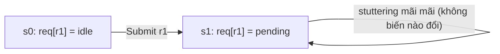
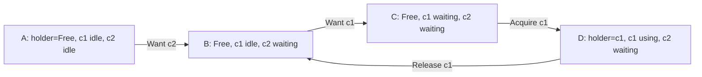
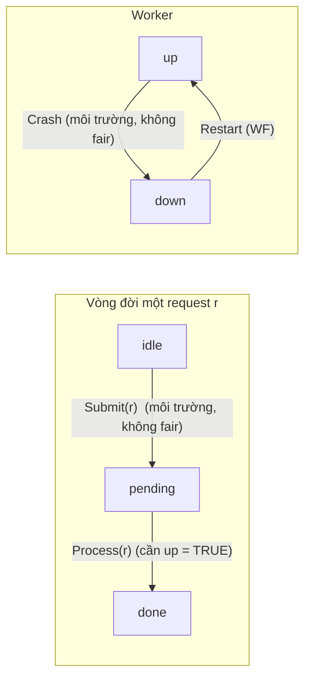
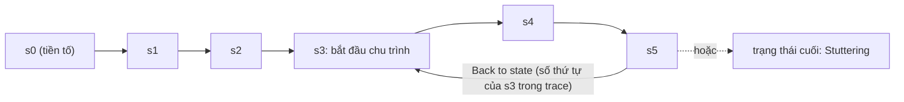

# P13 · Chương 05 — Liveness, fairness và logic thời gian

> Chương này nói về nửa còn lại của đặc tả: không chỉ "hệ thống không làm điều sai" mà "hệ thống rồi sẽ làm điều đúng". Các ví dụ spec TLA+/PlusCal trong khối ```` ```tla ```` là **minh họa của người soạn**; theo quy ước giáo trình này, TLC **chưa được chạy** trên chúng. Mọi kết luận kiểu "behavior này vi phạm / thỏa property kia" trong ví dụ là *lập luận từ định nghĩa* trong Specifying Systems, không phải kết quả model checking. Các ví dụ lấy từ sách/Examples (ghi rõ nguồn) thì lấy theo đúng file nguồn.

## Bạn sẽ hiểu được gì

- **Q1.** Safety và liveness khác nhau thế nào; vì sao một spec "không bao giờ làm sai" vẫn được thỏa bởi hệ thống không làm gì cả? → mục 1
- **Q2.** `[]`, `<>`, `~>`, `[]<>`, `<>[]` nghĩa là gì và đọc chúng trên một behavior ra sao? → mục 2
- **Q3.** Vì sao `Init /\ [][Next]_vars` không bao giờ chứng minh được "request rồi sẽ được xử lý" (stuttering mãi), và dạng spec đầy đủ là gì? → mục 3
- **Q4.** `ENABLED` và `<<A>>_v` là gì, và vì sao fairness được định nghĩa bằng chúng? → mục 4
- **Q5.** Weak fairness `WF_vars(A)` khác strong fairness `SF_vars(A)` ở đâu; khi nào WF không đủ? → mục 5
- **Q6.** Viết thế nào một spec mà "mọi request đã gửi rồi sẽ được xử lý", và chọn fairness gì khi worker có thể chết rồi sống lại? → mục 6
- **Q7.** Đặt fairness lên action nào là đúng; machine closure là gì và vì sao không nên viết thẳng công thức liveness tùy ý? → mục 7
- **Q8.** TLC kiểm liveness thế nào (`PROPERTY`), tốn gì, và counterexample dạng lasso đọc ra sao? → mục 8

## Kiến thức cần trước

- [Chương 02 — Toán nền tảng](02-toan-nen-tang.md): `\A`, `\E`, hàm `[x \in S |-> e]` và `EXCEPT`, `=>`. Các spec ví dụ của chương này dùng đúng những ký hiệu đó; gặp ký hiệu lạ thì tra lại chương 02.
- [Chương 03 — Trạng thái, behavior, action](03-trang-thai-hanh-vi-action.md): state, behavior (chuỗi trạng thái vô hạn), action (công thức có biến phẩy `x'`), `ENABLED` và `UNCHANGED` (mục 2), dạng `Init /\ [][Next]_vars` (mục 3), stuttering (mục 4). Chương này dựng thẳng lên đó và chỉ nhắc lại phần liveness cần.
- [Chương 04 — Invariant và TLC](04-invariant-va-tlc.md): `INVARIANT`, file `.cfg`, đọc counterexample hữu hạn. Chương này thêm `PROPERTY` và counterexample vô hạn.

(Liên quan nhưng không bắt buộc: [P4·05 — Bug concurrency và deadlock](../04-concurrency/05-concurrency-bug-va-deadlock.md) về livelock/starvation; [P12·09 — Consistency và consensus](../12-he-thong-du-lieu/09-consistency-va-consensus.md) về livelock của Paxos và vai trò timeout.)

## 1. Safety và liveness: "không làm sai" khác "rồi sẽ làm đúng" (Q1)

> **Trả lời ngắn.** *Safety* là loại tính chất "điều xấu không bao giờ xảy ra". Nếu nó bị vi phạm thì vi phạm ở một bước cụ thể của behavior, nên một đoạn đầu hữu hạn là đủ để chỉ ra lỗi[^ss-safety-viol]. *Liveness* là loại "điều tốt rồi sẽ xảy ra": không có thời điểm nào để chỉ vào, phải nhìn cả behavior vô hạn mới biết đồng hồ đã ngừng tick hay một tin nhắn không bao giờ được gửi[^ss-live-def]. Vì vậy một spec chỉ có safety vẫn bị thỏa bởi hệ thống không làm gì cả[^ss-do-nothing].

**Giải thích.**

*Với service của bạn.* Hãy hình dung `orders`, một service viết bằng Rust: nó nhận request tạo đơn, giao cho một worker xử lý, và worker ghi kết quả vào database. Ta sẽ bám theo `orders` suốt chương (nhận xét của người soạn: đây là ví dụ giả định, không phải code trong repo). Với `orders` bạn có hai cam kết trông giống nhau nhưng thuộc hai loại khác hẳn: "không bao giờ trả dữ liệu của tenant khác" và "request nào đã nhận thì rồi sẽ có response". Mục này nói vì sao hai loại cần hai cách xử lý khác nhau.

### 1.1 Hai cam kết của `orders`

Cam kết đầu là safety. Chỉ cần một response sai là có bằng chứng, và response đó có một thời điểm xác định. Cam kết sau là liveness. Một request treo 10 phút *chưa* phá gì, vì response vẫn có thể đến ở phút thứ 11; chỉ khi nhìn cả tương lai vô hạn mà thấy nó không bao giờ đến thì cam kết mới bị phá. Hệ quả hơi ngược đời: một `orders` đã tắt máy hẳn vẫn giữ được cam kết đầu (nó có trả sai gì đâu) nhưng phá cam kết sau (nhận xét của người soạn).

Lamport mở chương 8 bằng đúng nhận xét này: các spec ở những chương trước chỉ nói hệ thống *không được làm gì*, chứ không đòi hệ thống từng làm gì. Đồng hồ không bắt buộc tick, sender không bắt buộc gửi[^ss-safe-inert]. Tên gọi hai lớp tính chất cũng có từ đó: "có điều không bao giờ xảy ra" là safety, "có điều rồi sẽ xảy ra" là liveness[^tla-safe-live].

Hai lớp này kéo theo hai cách kiểm khác nhau. Vi phạm safety nằm ở một bước cụ thể, nên một đoạn đầu hữu hạn của behavior chưa vi phạm bước nào là đủ để nói "đến đây chưa sai"[^ss-safety-finite]. Model checker chỉ cần tìm một *đường đi hữu hạn* tới bước xấu, và đó chính là counterexample của `INVARIANT` ở chương 04. Vi phạm liveness thì không có "trạng thái xấu" nào để chỉ: bằng chứng là một behavior *vô hạn*, và mục 8 sẽ nói TLC biểu diễn nó thành dạng hữu hạn (lasso) ra sao.

| | Safety | Liveness |
|---|---|---|
| Ý nghĩa | điều xấu không bao giờ xảy ra | điều tốt rồi sẽ xảy ra |
| Ví dụ (backend) | không mất dữ liệu đã commit; không hai leader trong một term | mọi request rồi có response; cluster rồi bầu được leader |
| Bằng chứng vi phạm | một đoạn hữu hạn của behavior | một behavior vô hạn (không bao giờ có điều tốt) |
| Spec không có gì ép | hệ thống không làm gì vẫn thỏa safety | cần thêm điều kiện (fairness) mới nói được |

(Cột "Ví dụ (backend)" và hàng "Spec không có gì ép" là tóm tắt của người soạn dựa trên các định nghĩa ở trên, không có nguồn riêng.)

Cách phân loại này cũng là cách đội AWS chia các tính chất đúng của hệ thống. Safety là hệ thống được phép làm gì, ví dụ dữ liệu đã commit luôn có mặt và đúng. Liveness là hệ thống rồi phải làm gì, và ví dụ chính của họ chính là cam kết của `orders`: mỗi khi nhận request thì cuối cùng phải trả lời request đó[^aws-live-ex].

### 1.2 Đừng để liveness lấn thời gian

Lamport nói thẳng rằng liveness thường là phần ít quan trọng nhất của một spec[^ss-liveness-leastimp]. Kinh nghiệm của ông là phần lớn lợi ích của việc viết spec đến từ phần safety[^ss-unimp-benefit]. Còn phần liveness thường chiếm dưới năm phần trăm spec[^ss-unimp-size]. Nhận xét của người soạn: điều đó không có nghĩa liveness vô giá trị trong hệ phân tán thật, vì deadlock, livelock hay "kẹt mãi không tiến" là sự cố vận hành có thật (xem [P4·05](../04-concurrency/05-concurrency-bug-va-deadlock.md) và [P12·09](../12-he-thong-du-lieu/09-consistency-va-consensus.md)). Ý đúng là: viết safety trước, và đừng để liveness ngốn hết thời gian.

<details><summary>Đi sâu: invariant ⊂ safety; "luôn có một server online" có hai nghĩa; liveness ≠ độ trễ</summary>

**Invariant chỉ là một phần của safety.** Mọi invariant là safety property, nhưng không phải safety property nào cũng là invariant[^learn-safety-liveness]. Ví dụ trong Learn TLA+ (trang sống, tác giả Hillel Wayne): "luôn có ít nhất một server online" đọc được theo hai cách. Cách (1): *tại mỗi thời điểm* có một server online, đây là invariant một trạng thái. Cách (2): có *một server cố định* online ở *mọi* thời điểm. Cách (2) là safety nhưng không phải invariant, vì không trạng thái đơn lẻ nào vi phạm; phải so sánh các trạng thái với nhau mới thấy.

**"Rồi sẽ" không nói "trong bao lâu".** Lamport viết rõ: với liveness ta nói được hệ thống phải đáp lại request, nhưng không nói được nó phải đáp trong vòng 100 năm[^ss-realtime]. Muốn nói "kịp thời" phải dùng thuộc tính thời gian thực, thuộc Chương 9 của sách và nằm ngoài chương này.

**Hai điều đáng nhớ từ báo cáo AWS.** Thứ nhất, một trong các hệ thống họ mô hình hóa chỉ được ghi nhận là tăng độ tin cậy, và họ *không* bắt được một lỗi liveness vì đã không kiểm liveness[^aws-nolive]. Thứ hai, có một loại sự cố mà liveness không bắt được: server chậm làm client timeout rồi retry, hệ thống vẫn "sẽ tiến triển" (không deadlock hay livelock) nhưng với khách hàng thì gần như không khả dụng[^aws-eventual-progress].

</details>

**Quay lại Q1:** safety nói `orders` không được làm gì sai và có bằng chứng hữu hạn; liveness nói `orders` rồi phải làm gì đúng và chỉ có bằng chứng vô hạn; spec chỉ có safety thì một `orders` không làm gì cũng đúng.

## 2. Toán tử thời gian: `[]`, `<>`, `~>`, `[]<>`, `<>[]` (Q2)

> **Trả lời ngắn.** Một công thức thời gian đúng hoặc sai trên *cả behavior*, không phải trên một trạng thái[^ss-temporal-formula]. `[]F` ("luôn luôn") nói F đúng ở mọi thời điểm từ giờ[^learn-box]. `<>F` ("rồi sẽ") nói F đúng ở một thời điểm nào đó, kể cả bây giờ[^tla-diamond]. `F ~> G` ("dẫn tới") nói mỗi khi F đúng thì G đúng lúc đó hoặc về sau[^tla-leadsto]. `[]<>F` là "đúng vô hạn lần"[^tla-infoften]. `<>[]F` là "từ một lúc nào đó đúng mãi mãi"[^tla-evtalways].

**Giải thích.**

*Với `orders`.* Giả sử bạn muốn nói ba điều về `orders`: "tồn kho không bao giờ âm", "rồi sẽ có response đầu tiên", và "mỗi khi một request đến thì rồi nó sẽ có response". Ba câu này khác nhau về *hình dạng*, và mỗi hình dạng có một toán tử: câu đầu đòi một điều kiện đúng ở mọi trạng thái (`[]`), câu hai đòi một sự kiện xảy ra ít nhất một lần (`<>`), câu ba gắn một sự kiện với một sự kiện khác về sau (`~>`). Mục này đi từ định nghĩa của từng toán tử đến các cạm bẫy khi dùng chúng.

### 2.1 Behavior và hậu tố

Một behavior σ là chuỗi trạng thái vô hạn σ₀ → σ₁ → σ₂ → …, và công thức thời gian đúng hay sai trên cả σ[^ss-temporal-formula]. Gọi σ+n là hậu tố của σ sau khi bỏ n trạng thái đầu. Khi đó `[]F` đúng trên σ nếu *mọi* hậu tố σ+n thỏa F. `<>F` được *định nghĩa* là `~[]~F` ("không phải lúc nào F cũng sai"), tức F đúng ở một thời điểm nào đó[^tla-diamond].

Có một chỗ dễ nhầm: một predicate trạng thái P, khi đứng một mình như công thức thời gian, chỉ nói về trạng thái *đầu tiên* của behavior[^ss-state-pred-first]. Vì vậy muốn nói "P đúng ở mọi trạng thái" thì phải viết `[]P`.

### 2.2 Bảng đọc nhanh

ASCII `[]`, `<>`, `~>` là cách gõ trong file `.tla`.

| Công thức | Đọc là | Nghĩa trên behavior | Ví dụ backend (người soạn) |
|---|---|---|---|
| `[]P` | luôn P | P đúng ở mọi trạng thái | `[](stock >= 0)` — chính là invariant |
| `<>P` | rồi sẽ P | P đúng ở ít nhất một trạng thái | `<>(leader # None)` |
| `P ~> Q` | P dẫn tới Q | `[](P => <>Q)`: mỗi lần P đúng thì Q đúng lúc đó hoặc sau đó | `(req = "pending") ~> (req = "done")` |
| `[]<>P` | luôn luôn rồi sẽ P | P đúng *vô hạn lần* | `[]<>(heartbeat_sent)` |
| `<>[]P` | rồi sẽ luôn P | từ một lúc nào đó P đúng *mãi* | `<>[](replica1 = replica2)` — hội tụ |

Về `~>`: `F ~> G` chỉ là viết gọn của `[](F => <>G)`[^tla-leadsto]. Chữ `[]` bên ngoài không thừa. Nhờ nó mà `~>` bắc cầu, còn nếu định nghĩa `F ~> G` chỉ là `F => <>G` thì mất tính bắc cầu[^tla-leadsto-trans]. Cũng vì `[]` đó, `P ~> Q` bị kích hoạt *mỗi lần* P đúng, kể cả khi trước đó nó đã được thỏa[^learn-leadsto-again]. Có thể xem `~>` là bản "thời gian" của `=>`: `=>` đòi vế sau đúng ngay tại trạng thái đó, còn `~>` chỉ đòi vế sau đúng bây giờ hoặc về sau[^learn-leadsto].

### 2.3 Ba cạm bẫy hay gặp

1. **`<>` chỉ cần đúng một lần.** Learn TLA+ có ví dụ bộ đếm: `<>(counter = 2)` đúng nếu `counter = 2` ở ít nhất một trạng thái, dù sau đó nó đổi đi[^learn-ev-once]. Muốn nói "ổn định ở giá trị đó" thì phải dùng `<>[]`: P có thể sai lúc đầu, nhưng từ một thời điểm nào đó trong mọi behavior nó đúng mãi[^learn-stable].
2. **`[]<>` khác `<>[]`.** Trên đồng hồ giờ quay vòng, `[]<>(time = midnight)` đúng còn `<>[](time = midnight)` sai[^learn-hourclock]. Nhận xét của người soạn: "hội tụ", như replica đồng bộ sau khi ngừng ghi, là `<>[]`; "vẫn đang tiến triển", như heartbeat đều đặn, là `[]<>`.
3. **Quên `[]` khi đặt tên property.** Trong TLC, đặt P làm invariant tương đương đặt `[]P` làm property[^learn-inv-prop]. Nhưng đặt P (không có `[]`) làm property thì TLC chỉ kiểm P ở *trạng thái đầu*[^learn-nobox]. Mã nguồn TLC ở commit đã ghim còn có sẵn thông báo cảnh báo đúng lỗi này[^tlc-state-prop].

<details><summary>Đi sâu: định nghĩa hình thức, các đẳng thức, thứ tự ưu tiên, và vì sao công thức phải "bất biến theo stuttering"</summary>

- **Định nghĩa hình thức.** `σ |= []F` khi với mọi n, `σ+n |= F`. `<>F` là `~[]~F`, nên `σ |= <>F` khi tồn tại n sao cho `σ+n |= F`. `F ~> G` là `[](F => <>G)`[^tla-leadsto].
- **Phân phối.** Mục 8.2 của sách cho biết `[]` phân phối qua `/\`[^ss-box-dist1]. Tương tự, `<>` phân phối qua `\/`[^ss-box-dist2]. Nhưng `[]` *không* phân phối qua `\/`, và `<>` không phân phối qua `/\`[^ss-box-nodist]. Ví dụ của sách: `[]((n >= 0) \/ (n < 0))` đúng với mọi behavior mà n luôn là số, còn `[](n >= 0) \/ [](n < 0)` sai với behavior mà n lúc dương lúc âm[^ss-box-or].
- **`[]<>` và `<>[]`.** `[]<>` phân phối qua `\/` (`[]<>(F \/ G)` tương đương `[]<>F \/ []<>G`), và đối ngẫu của nó là `<>[]` phân phối qua `/\`; sách chứng minh bằng ký hiệu "tồn tại vô hạn" (§8.2)[^ss-infoften-dist].
- **Thứ tự ưu tiên.** `[]` và `<>` ràng chặt hơn các toán tử Boolean, nên `<>F \/ []G` là `(<>F) \/ ([]G)`[^ss-prec1]. `~>` có ưu tiên thấp hơn `/\` và `\/`[^ss-prec2]. Nhận xét của người soạn: khi `P ~> Q` có vế phức tạp, cứ đặt ngoặc.
- **Bất biến theo stuttering.** TLA chỉ cho phép viết công thức thời gian *bất biến theo stuttering*, tức thêm hay bớt bước không đổi biến không làm đổi đúng/sai[^ss-stutterinv]. Vì vậy `[]A` với A là action tùy ý không hợp lệ[^ss-boxA-notinv]. Các dạng hợp lệ là `[][A]_v` và `<><<A>>_v`, trong đó `<><<A>>_v` viết tắt cho `~[][~A]_v`[^tla-diamondA]; mục 4 sẽ giải thích.
- **ASCII của subscript.** TLA+ viết subscript bằng dấu `_`, như `<<A>>_e`[^ss-ascii-subscript].

</details>

**Quay lại Q2:** `[]` là "mọi lúc", `<>` là "ít nhất một lúc", `~>` là "mỗi lần P thì rồi Q", `[]<>` là "vô hạn lần", `<>[]` là "từ một lúc nào đó mãi mãi"; và cả năm đều là câu nói về cả behavior, ví dụ về cả đời một request của `orders`.

## 3. Stuttering mãi và vì sao cần fairness (Q3)

> **Trả lời ngắn.** Spec dạng `Init /\ [][Next]_vars` cho phép bước *stuttering* (không đổi biến nào), nên có behavior mà sau một lúc chỉ còn toàn stuttering: hệ thống "dừng mãi"[^ss-hc-stutter]. Behavior đó vẫn thỏa spec, nhưng vi phạm mọi liveness property đòi "rồi sẽ có gì xảy ra". Cách sửa là thêm điều kiện *fairness* vào spec, tạo dạng `Init /\ [][Next]_vars /\ Fairness`[^ss-spec-shape].

**Giải thích.**

*Với `orders`.* Bạn mô hình hóa worker của `orders` và viết đủ mọi bước nó có thể làm: nhận request, xử lý, ghi kết quả. Nhưng không dòng nào nói worker phải *thực sự chạy*. Ngoài đời, "không chạy" là pod bị `SIGSTOP`, thread bị scheduler bỏ đói, hay tiến trình treo ở đâu đó. Trong TLA+ tất cả những chuyện đó là cùng một thứ: một behavior mà từ một lúc nào đó không còn bước nào đổi biến.

### 3.1 Vì sao spec cho phép stuttering

Lý do thiết kế đã nói ở [P13·03 mục 4](03-trang-thai-hanh-vi-action.md); ở đây chỉ nhắc phần liên quan tới liveness. `[HCnxt]_hr` nghĩa là `HCnxt \/ (hr' = hr)`, nên `HCini /\ [][HCnxt]_hr` cho phép behavior `hr = 10 → 11 → 11 → 11 → …`, tức đồng hồ dừng ở 11[^ss-hc-stutter]. Đó là chủ ý chứ không phải sơ suất: một lần chạy *kết thúc* của hệ nào cũng được biểu diễn bằng một behavior vô hạn kết thúc bằng toàn bước stuttering[^ss-term-stutter]. Nhưng với đồng hồ thì ta tự nhiên muốn nó không dừng, tức đòi vô hạn bước *không phải stuttering*; sách nói chương 8 là chỗ diễn đạt điều đó[^ss-hc-stop].

Learn TLA+ nói cùng ý theo kiểu "worst case": mọi behavior đều được phép stutter[^learn-stutter-crash]. Lý do là TLA+ về bản chất là ngôn ngữ cho kịch bản xấu nhất[^learn-worst-case]. Với `orders`, nghĩa là nếu spec không nói rõ worker không được crash thì mặc định nó crash đúng lúc tệ nhất, và crash luôn.



Behavior trong sơ đồ thỏa `Init /\ [][Next]_vars` nhưng vi phạm `(req[r1] = "pending") ~> (req[r1] = "done")`, vì r1 pending mãi. Safety không bị phá, không có bước sai nào cả; chỉ là không còn gì xảy ra nữa.

### 3.2 Khác với deadlock

Hai chuyện này dễ lẫn (xem [P13·03 mục 4](03-trang-thai-hanh-vi-action.md) và [P13·04 mục 6](04-invariant-va-tlc.md)). Deadlock là trạng thái mà `Next` không enabled, tức không còn bước nào khác ngoài stuttering; TLC kiểm điều này theo mặc định và có thể tắt[^ss-tlc-deadlock-default]. Stuttering-mãi-khi-`Next`-vẫn-enabled là chuyện khác: vẫn *có thể* làm việc nhưng không ai làm. Suy luận của người soạn: fairness chính là cách cấm kịch bản thứ hai, còn kịch bản thứ nhất là lỗi *thiết kế* của spec và TLC báo riêng.

### 3.3 Dạng spec đầy đủ

Đến đây một spec có ba phần:

```tla
Spec == Init /\ [][Next]_vars /\ Fairness
```

`Init` ràng trạng thái đầu. `[][Next]_vars` ràng *các bước được phép*, tức phần safety. `Fairness` là hội của các điều kiện `WF_vars(A)` và/hoặc `SF_vars(A)` (mục 5 định nghĩa) và nói điều gì *phải xảy ra*[^ss-spec-shape]. TLC chấp nhận đúng dạng này: `Init /\ [][Next]_vars /\ Temporal`, trong đó `Temporal` thường là điều kiện liveness[^ss-tlc-shape].

<details><summary>Đi sâu: TLC thấy stuttering thế nào; ví dụ đồng hồ trong Examples; PlusCal và behavior hữu hạn</summary>

- **TLC và bước stuttering.** Trong thuật toán của TLC, đồ thị trạng thái G luôn có cạnh từ mỗi trạng thái về chính nó[^ss-tlc-selfloop] (đã nói ở P13·03 mục 4); suy luận của người soạn: đó là chỗ biểu diễn các bước stuttering. Khi bạn đưa property liveness mà spec không có fairness, TLC thậm chí in gợi ý rằng counterexample stuttering có thể do thiếu fairness và bạn nên hội fairness thích hợp vào spec[^tlc-hint-nofair]. Nếu cfg chỉ có `INIT`/`NEXT` (không có `SPECIFICATION`), TLC nhắc rằng nó cho phép stuttering vô hạn[^tlc-hint-nospec].
- **Ví dụ trong repo Examples.** Spec đồng hồ giờ có liveness là `LSpec == HC /\ WF_hr(HCnxt)`[^ex-hc-lspec]. Nó đi kèm property "vô hạn bước `<<HCnxt>>_hr` xảy ra"[^ex-hc-always].
- **PlusCal.** Các toán tử thời gian trong PlusCal được định nghĩa cho behavior vô hạn; behavior hữu hạn được xem là tương đương behavior vô hạn lặp lại trạng thái cuối mãi mãi[^pc-finite-stutter]. Nghĩa là thuật toán chạy xong và thuật toán treo đều có dạng "trạng thái cuối lặp mãi", và fairness là thứ phân biệt hai trường hợp: nếu còn action enabled mà fairness cấm lặp mãi thì behavior đó bị loại (suy luận của người soạn).
- **Ví dụ threads của Learn TLA+.** Không có `fair`, property `<>(counter = NumThreads)` thất bại vì stuttering: không gì bảo đảm các thread chạy xong. Property safety cũ `AllDone => counter = NumThreads` vẫn đúng, vì nó chỉ nói *nếu* đến cuối thì kết quả đúng, và vẫn thỏa khi không bao giờ đến cuối[^learn-threads].
- **Weakly fair không cấm spin.** Một process "weakly fair" được bảo đảm là "không crash", dù nó vẫn có thể spin (quay vòng không làm việc có ích)[^learn-wf-nocrash].

</details>

**Quay lại Q3:** spec chỉ có `[][Next]_vars` cho phép hệ thống đứng yên mãi, nên với `orders` nó không ép worker xử lý request nào; muốn "rồi sẽ" phải thêm fairness vào spec, đúng dạng `Init /\ [][Next]_vars /\ Fairness`.

## 4. `ENABLED` và `<<A>>_v`: hai viên gạch của fairness (Q4)

> **Trả lời ngắn.** `ENABLED A` (đã giới thiệu ở [P13·03 mục 2](03-trang-thai-hanh-vi-action.md)) là vị từ trạng thái, đúng ở trạng thái s khi tồn tại trạng thái t sao cho s → t là một bước A[^ss-enabled-def]. Hiểu nôm na, đó là "action A bây giờ *làm được*". `<<A>>_v` là A *và* v đổi giá trị: một bước A thật sự, không phải stuttering. Fairness luôn nói về `<<A>>_v` để bước stuttering không bị tính là "đã thực hiện A".

**Giải thích.**

*Với `orders`.* Gọi `Process(r)` là bước worker xử lý request r. `ENABLED Process(r)` trả lời câu hỏi "ngay lúc này worker có việc để làm cho r không?", tức r đang pending *và* worker đang sống. Nó không trả lời "worker có làm không"; chuyện đó thuộc về việc `<<Process(r)>>_vars` có thực sự xảy ra hay không. Fairness nằm ở chỗ nối hai câu hỏi ấy: nếu việc *làm được* kéo dài đủ lâu thì việc *thực sự làm* phải xảy ra.

### 4.1 `ENABLED`

Sách định nghĩa `ENABLED A` là hàm trạng thái đúng ở s khi có t để s → t là một bước A[^ss-enabled-def]. Chương 8 giải thích vì sao cần khái niệm này. Điều kiện "mỗi lần A bật thì A rồi sẽ xảy ra" quá mạnh để cài đặt, nên người ta đặt một điều kiện yếu hơn, dựa trên việc A *bật như thế nào theo thời gian* (mục 5)[^ss-wf-why].

Khi viết spec, bạn tính `ENABLED` bằng tay theo một số luật[^ss-enabled-rules]. `ENABLED (A \/ B)` bằng `(ENABLED A) \/ (ENABLED B)`. `ENABLED (P /\ A)` bằng `P /\ ENABLED A` với P là vị từ trạng thái. `ENABLED (x' = exp)` luôn đúng, và `ENABLED (x' \in S)` đúng khi `S` không rỗng. Luật cho `/\` của hai action cần điều kiện là hai action không đặt giá trị cho cùng một biến phẩy.

Áp dụng cho `Process(r)` của ví dụ ở mục 6 (suy luận của người soạn theo các luật trên): `Process(r)` là `up /\ req[r] = "pending"` hội với `req' = [...]` và `up' = up`. Hai vế sau đặt giá trị cho hai biến phẩy khác nhau và mỗi vế luôn enabled, nên `ENABLED Process(r)` tương đương `up /\ req[r] = "pending"`. Hơn nữa `Process(r)` luôn đổi `req[r]` từ `"pending"` sang `"done"`, nên mọi bước `Process(r)` đều đổi `vars` (suy luận của người soạn), và `ENABLED <<Process(r)>>_vars` cho cùng kết quả.

### 4.2 `<<A>>_v`

Nếu A cho phép bước stuttering thì "rồi sẽ có một bước A" là câu vô nghĩa, vì bước stuttering lúc nào cũng có thể xảy ra. Thứ cần đòi là một bước A *không* stuttering, tức `<<A>>_v` với v là bộ tất cả biến của spec[^ss-angle-need]. Còn một lý do nữa: công thức "rồi sẽ có bước stuttering" không bất biến theo stuttering[^ss-silly-stutter], nên TLA không cho viết. Vì vậy `WF_v(A)` thực chất nói về `<<A>>_v`, và chỉ số dưới `v` có mặt để loại bước stuttering[^ss-wf-angle].

Trong thực hành ta lấy `v` là *tuple của mọi biến*, vì tuple đó đổi khi bất kỳ biến nào đổi[^ss-vars-tuple]. ASCII viết `<<A>>_vars` và `WF_vars(A)`; PlusCal manual ghi rõ cách gõ `WF_vars(A)`[^pc-wf-typed].

<details><summary>Đi sâu: <code>ENABLED</code> với TLC, với deadlock, và với refinement</summary>

- **TLC tính `ENABLED`.** TLC sinh trạng thái kế tiếp như thể A là next-state action, và công thức đúng khi tồn tại trạng thái kế tiếp[^ss-tlc-enabled]. Suy luận của người soạn: việc phải tính `ENABLED` như vậy là một phần chi phí của kiểm liveness; sách không nói rõ điều đó. Chi phí nói chung ở mục 8.
- **Deadlock.** Không deadlock là `[](ENABLED Next)`; deadlock là chính tính chất này bị vi phạm[^ss-deadlock-enabled] ([P13·04 mục 6](04-invariant-va-tlc.md)).
- **Refinement.** Khi spec cấp cao có biến ẩn và bạn chứng minh spec cấp thấp *refine* nó bằng refinement mapping (chương [07](07-refinement.md)), có một lưu ý: phép thế biến (overbar) nói chung *không* phân phối qua `ENABLED`, nên cũng không tự động phân phối qua `WF`/`SF`[^ss-enabled-subst]. Sách khuyên tính `ENABLED` "bằng tay" rồi mới thế[^ss-enabled-byhand].

</details>

**Quay lại Q4:** `ENABLED A` nói "A đang làm được"; `<<A>>_v` nói "một bước A thật, có đổi v"; fairness nói về hai thứ đó, không nói về bước stuttering.

## 5. Weak fairness và strong fairness (Q5)

> **Trả lời ngắn.** `WF_v(A)` (weak fairness) nói: nếu A *bật liên tục* từ một lúc nào đó thì một bước `<<A>>_v` phải xảy ra[^ss-wf-def]. `SF_v(A)` (strong fairness) nói: nếu A *bật lặp đi lặp lại* (vô hạn lần, dù bị tắt xen kẽ) thì `<<A>>_v` phải xảy ra[^ss-sf-def]. SF mạnh hơn WF[^tla-sf-implies-wf]. Khi A đã bật thì giữ bật cho đến khi nó xảy ra (không ai tắt được trừ chính nó), WF và SF tương đương nên WF là đủ[^ss-wfsf-equiv-cond]. Khi các action khác có thể chen ngang và tắt A xen kẽ, cần SF, như `RdMiss(p)`/`DoWr(p)` của cache ghi xuyên trong sách[^ss-sf-cache].

**Giải thích.**

*Với `orders`.* Giả sử `orders` có đúng một connection tới database, và hai handler c1, c2 cùng chờ nó. WF nói: nếu connection rảnh *suốt* từ một lúc nào đó và bạn đang chờ thì bạn sẽ được cấp. Nhưng connection này không rảnh suốt: c1 giữ, trả, rồi lại giữ ngay. Mỗi lần trả, connection rảnh một thoáng rồi c1 chen vào trước c2. Với WF, c2 có thể bị bỏ đói mãi mà không ai vi phạm gì. SF nói: nếu connection *thỉnh thoảng* rảnh (vô hạn lần) và bạn đang chờ thì rồi bạn sẽ được cấp, nên chặn được kịch bản đó.

### 5.1 Định nghĩa

Đặt `En` là `ENABLED <<A>>_v` và `Ac` là `<<A>>_v`:

| | Công thức (ASCII) | Phát biểu |
|---|---|---|
| WF | `[](([]En) => <>Ac)` | nếu A rồi bật mãi mãi thì có bước A[^ss-wf-def] |
| WF (dạng 2) | `[]<>(~En) \/ []<>Ac` | A bị tắt vô hạn lần, hoặc có vô hạn bước A[^ss-wf-88] |
| WF (dạng 3) | `<>[]En => []<>Ac` | nếu A rồi bật mãi mãi thì có vô hạn bước A[^ss-wf-89] |
| SF | `<>[](~En) \/ []<>Ac` | A rồi tắt hẳn, hoặc có vô hạn bước A[^ss-sf-32] |
| SF (dạng 2) | `[]<>En => []<>Ac` | nếu A bật vô hạn lần thì có vô hạn bước A[^ss-sf-33] |

Ba dạng của WF tương đương nhau; sách chứng minh bằng cách tính toán với các đẳng thức ở mục 2[^ss-wf-equiv]. Bài báo TLA phát biểu cùng ý bằng lời: weak fairness nói thao tác phải được thực hiện nếu nó cứ khả thi đủ lâu[^tla-wf-informal]. Còn strong fairness nói thao tác phải được thực hiện nếu nó khả thi đủ thường xuyên[^tla-sf-informal].

### 5.2 "Liên tục" và "lặp lại"

Sách phân biệt hai từ tiếng Anh: *continuously* là không gián đoạn, *continually* là lặp đi lặp lại và có thể gián đoạn[^ss-continuously]. WF áp cho "bật liên tục"[^ss-wf-bullet]. SF áp cho "bật lặp lại"[^ss-sf-bullet]. Bảng sau (suy luận của người soạn từ các định nghĩa trên) cho thấy ba mẫu bật/tắt của A:

| Mẫu `ENABLED <<A>>_v` theo thời gian, *giả sử không bước A nào xảy ra* | WF có ép A xảy ra? | SF có ép A xảy ra? |
|---|---|---|
| bật liên tục từ một lúc nào đó | có (vi phạm WF) | có |
| bật–tắt–bật–tắt … vô hạn lần | **không** (tắt vô hạn lần nên WF thỏa suông) | có (vi phạm SF) |
| tắt hẳn từ một lúc nào đó | không | không |

Hàng giữa là chỗ hai loại khác nhau. Còn khi A đã bật thì giữ bật cho đến khi chạy, hàng giữa không xảy ra được, và WF với SF *tương đương*[^ss-wfsf-equiv-cond].

### 5.3 Khi nào chọn cái nào

SF khó cài đặt hơn WF và ít khi cần[^ss-sf-impl]. Vì vậy quy tắc là chỉ dùng SF khi thật cần, và khi WF với SF tương đương thì viết WF[^ss-sf-use].

Còn "thật cần" trông thế nào? Chính là tình huống của `orders` ở đầu mục: nhiều bên tranh một tài nguyên, và tài nguyên lúc rảnh lúc bận. Learn TLA+ có ví dụ đúng dạng này, nhiều thread tranh một lock. Với weak fairness và năm thread, không bảo đảm cả năm đều lấy được lock vì một thread có thể bị bỏ đói; muốn bảo đảm phải dùng strong fairness (`fair+` trong PlusCal)[^learn-sf-lock].

Sơ đồ dưới là *lasso* của ví dụ pool trong phần Đi sâu: một đoạn đầu A → B, rồi vòng B → C → D → B lặp mãi.



Trong vòng đó `Acquire(c2)` bật ở B và C, tắt ở D: bật–tắt vô hạn lần, và không bao giờ được thực hiện. Behavior này thỏa WF cho mọi action (theo hàng giữa của bảng) nhưng c2 chờ mãi; chỉ SF loại được nó. (Lập luận của người soạn, chưa chạy TLC.)

<details><summary>Đi sâu: spec pool một connection; cú pháp PlusCal; hội các điều kiện fairness; ví dụ có thật trong repo Examples; cache ghi xuyên</summary>

Spec minh họa (người soạn viết; chưa chạy TLC):

```tla
---------------------------- MODULE ConnPool1 ----------------------------
CONSTANTS Clients, Free
ASSUME Free \notin Clients
VARIABLES holder, st
vars == <<holder, st>>

Init == /\ holder = Free
        /\ st = [c \in Clients |-> "idle"]

Want(c)    == /\ st[c] = "idle"
              /\ st' = [st EXCEPT ![c] = "waiting"]
              /\ UNCHANGED holder

Acquire(c) == /\ st[c] = "waiting"
              /\ holder = Free
              /\ holder' = c
              /\ st' = [st EXCEPT ![c] = "using"]

Release(c) == /\ st[c] = "using"
              /\ holder = c
              /\ holder' = Free
              /\ st' = [st EXCEPT ![c] = "idle"]

Next == \E c \in Clients : Want(c) \/ Acquire(c) \/ Release(c)

FairWF == \A c \in Clients : WF_vars(Acquire(c)) /\ WF_vars(Release(c))
FairSF == \A c \in Clients : SF_vars(Acquire(c)) /\ WF_vars(Release(c))

SpecWF == Init /\ [][Next]_vars /\ FairWF
SpecSF == Init /\ [][Next]_vars /\ FairSF

NoStarvation == \A c \in Clients : (st[c] = "waiting") ~> (st[c] = "using")
=============================================================================
```

Lập luận theo định nghĩa (không phải kết quả TLC). (a) Lasso trong sơ đồ thỏa `SpecWF` nhưng vi phạm `NoStarvation` với c = c2, nên `SpecWF` không suy ra `NoStarvation`. (b) Với `SpecSF`, giả sử c2 đang `waiting` mãi từ một lúc nào đó. Nếu `holder = Free` rồi mãi mãi, `Acquire(c2)` bật liên tục nên bị ép (SF kéo theo WF). Nếu không, `holder` khác `Free` vô hạn lần; mỗi lần có `holder = c` thì `Release(c)` bật liên tục cho đến khi xảy ra (chỉ chính nó tắt được) nên `WF_vars(Release(c))` ép nó, trả `holder` về `Free`. Vậy `holder = Free` vô hạn lần, `Acquire(c2)` bật vô hạn lần, và `SF` ép nó xảy ra, mâu thuẫn. `Release` dùng WF vì "đã bật thì giữ bật tới khi thực hiện", đúng chỗ sách bảo viết WF[^ss-sf-use].

**Cache ghi xuyên của sách.** Hai action `RdMiss(p)` và `DoWr(p)` có thể vừa bật rồi bị tắt, vì `RdMiss(q)` hay `DoWr(q)` của một processor q khác thêm request vào hàng đợi `memQ`; khi hàng đợi đầy thì hai action bị tắt. Vì thế sách kết luận cần strong fairness cho hai action này[^ss-sf-cache]. Bài báo TLA (§7.1) có ví dụ cùng loại: chương trình hai tiến trình dùng semaphore cũng cần strong fairness để `x` được tăng vô hạn lần[^tla-program2-sf].

**Hội các điều kiện fairness.** `WF_v(A) /\ WF_v(B)` và `WF_v(A \/ B)` *nói chung không tương đương*[^ss-wf-disj]. Nếu hai action thỏa điều kiện "khi A bật thì B không thể bật trừ khi A xảy ra" (và ngược lại), tức WF Conjunction Rule (một điều kiện *đủ*), thì gộp được[^ss-wf-conj-rule]. Với quantifier cũng vậy: `\A c : WF_vars(A(c))` và `WF_vars(\E c : A(c))` có thể không tương đương khi hai A(c) có thể cùng bật; sách minh họa bằng (8.37) không tương đương với conjunct đầu của (8.36) ở cache ghi xuyên[^ss-wf-quant].

**PlusCal.** Viết `fair process` thì mọi action của process mặc định weakly fair[^pc-fair-kw]. Trong process đó, `Label:+` làm action đó strongly fair còn `Label:-` bỏ fairness của action[^pc-fair-plus]; `fair+ process` đặt strong fairness mặc định[^pc-fair-plusproc]. Process không có `fair`/`fair+` là *unfair*, không có giả định fairness nào[^pc-unfair]. Với action *không chặn* (enabled iff control đang ở nhãn đó), weak và strong fairness là một nên chỉ có một loại[^pc-nonblocking]. Ví dụ tối thiểu (minh họa của người soạn):

```tla
---- MODULE Drain ----
EXTENDS Sequences
(*--algorithm Drain
variables queue = <<1, 2, 3>>, served = {};
fair process worker = "w"
begin
  Serve:
    while queue # <<>> do
      served := served \union {Head(queue)};
      queue := Tail(queue);
    end while;
end process;
end algorithm; *)
====
```

Theo manual, weak fairness của next-state action của một process tương đương hội weak fairness của mọi atomic action của nó, nên `fair process` ở đây tương đương WF cho từng action của `worker`[^pc-wf-process]. Chi tiết dịch PlusCal xem chương [06](06-pluscal.md).

**Ví dụ thật trong repo Examples (ghim commit).** Spec `SimpleAllocator`, một allocator cấp tài nguyên cho nhiều client, định nghĩa `WF_vars(Return(c, alloc[c]))` cho việc client *trả* tài nguyên và `SF_vars(\E S \in SUBSET Resources: Allocate(c,S))` cho việc *cấp* tài nguyên[^ex-allocator-sf]. Property "mỗi tài nguyên một client đang xin rồi sẽ được cấp" viết bằng `~>`[^ex-allocator-prop]. Cấu trúc giống pool ở trên: trả là WF (chỉ chính nó tắt), cấp là SF (client khác tranh tài nguyên).

</details>

**Quay lại Q5:** WF buộc A xảy ra nếu nó bật liên tục; SF buộc nếu nó bật lặp lại dù bị tắt xen kẽ; khi các action khác có thể chen vào làm A lúc bật lúc tắt (như c1 và c2 tranh connection duy nhất của `orders`), WF thỏa suông và chỉ SF mới chặn được starvation.

## 6. Ví dụ: "mọi request đã gửi rồi sẽ được xử lý" (Q6)

> **Trả lời ngắn.** Mô hình hóa vòng đời request (`idle → pending → done`) và property liveness `(req[r] = "pending") ~> (req[r] = "done")`. Fairness đặt lên action *xử lý* chứ không đặt lên action *gửi* request, vì ta không đòi request phải được gửi[^ss-mem-req]. Nếu worker luôn sống, `WF` cho `Process(r)` là đủ. Nếu worker có thể chết rồi sống lại vô hạn lần, `WF` thỏa suông và request kẹt mãi; lúc đó cần `SF` cho `Process(r)` cộng `WF` cho `Restart`.

**Giải thích.**

*Với `orders`.* Cam kết của `orders` là "request nào đã vào hàng thì rồi sẽ được xử lý". Bạn không cam kết "luôn có request vào": nếu không ai gửi gì thì hệ thống rảnh, và rảnh là hợp lệ. Cách đặt vấn đề này giống hệt cách sách làm với bộ nhớ. Yêu cầu liveness là mỗi request phải nhận response, và *không* đòi request nào phải được phát ra[^ss-mem-req]. Với cache ghi xuyên, sách đòi fairness cho các action của `Next` *trừ* `Req(p)` (phát request), `Evict(p, a)` (đuổi địa chỉ khỏi cache) và, với điều kiện được nới ở cuối mục, `MemQWr`[^ss-wt-nofair-req]. Chuỗi lập luận trong sách: khi processor phát request, `Do(p)` bật và giữ bật đến khi nó xảy ra; `WF(Do(p))` ép nó xảy ra, rồi `Rsp(p)` bật và `WF(Rsp(p))` ép phản hồi. Hội hai điều kiện này bảo đảm request nào cũng được trả lời[^ss-mem-wf].

### 6.1 Spec

(Minh họa của người soạn, chưa chạy TLC.) Worker có biến `up` cho biết nó còn sống hay không, và có thể `Crash` rồi `Restart`.

```tla
---------------------------- MODULE RequestService ----------------------------
CONSTANT Reqs                  \* tập các request có thể xuất hiện
VARIABLES req, up              \* req[r] \in {"idle","pending","done"}; up: worker còn sống?

vars == <<req, up>>

TypeOK == /\ req \in [Reqs -> {"idle", "pending", "done"}]
          /\ up \in BOOLEAN

Init == /\ req = [r \in Reqs |-> "idle"]
        /\ up = TRUE

Submit(r)  == /\ req[r] = "idle"
              /\ req' = [req EXCEPT ![r] = "pending"]
              /\ UNCHANGED up

Process(r) == /\ up
              /\ req[r] = "pending"
              /\ req' = [req EXCEPT ![r] = "done"]
              /\ UNCHANGED up

Crash   == /\ up
           /\ up' = FALSE
           /\ UNCHANGED req

Restart == /\ ~up
           /\ up' = TRUE
           /\ UNCHANGED req

Next == \/ \E r \in Reqs : (Submit(r) \/ Process(r))
        \/ Crash
        \/ Restart

\* Ba mức fairness khác nhau cho cùng một Init /\ [][Next]_vars.
Spec0 == Init /\ [][Next]_vars

Fair1 == /\ WF_vars(Restart)
         /\ \A r \in Reqs : WF_vars(Process(r))
Spec1 == Init /\ [][Next]_vars /\ Fair1

Fair2 == /\ WF_vars(Restart)
         /\ \A r \in Reqs : SF_vars(Process(r))
Spec2 == Init /\ [][Next]_vars /\ Fair2

\* Liveness: request đã pending rồi sẽ done.
AllServed == \A r \in Reqs : (req[r] = "pending") ~> (req[r] = "done")
=============================================================================
```

File cấu hình TLC để kiểm `Spec2` theo kiểu sách: gán `CONSTANT` bằng một tập các phần tử mô hình, tên phần tử là chuỗi chữ và số có ít nhất một chữ cái[^ss-tlc-const].

```
SPECIFICATION Spec2
CONSTANT Reqs = {r1, r2}
INVARIANT TypeOK
PROPERTY AllServed
```



### 6.2 Bốn bước lập luận

**Bước 1: không có fairness (`Spec0`).** Behavior `Submit(r1)` rồi stuttering mãi thỏa `Spec0` (mục 3) nhưng r1 pending mãi, vi phạm `AllServed`. Đây đúng là loại counterexample stuttering mà TLC kèm gợi ý "thiếu fairness" trong mã nguồn đã ghim[^tlc-hint-nofair].

**Bước 2: WF cho `Process(r)` khi worker luôn sống.** Nếu bỏ `Crash` khỏi `Next` (`up` luôn `TRUE`), một request `pending` chỉ rời trạng thái đó khi chính `Process(r)` chạy: `Submit(r)` đòi `idle`, và các action khác không đụng `req[r]`. Vậy `Process(r)` đã bật thì giữ bật cho đến khi chạy, đúng điều kiện để WF đủ[^ss-wfsf-equiv-cond], và `WF_vars(Process(r))` ép nó chạy. Lập luận này là quy tắc WF1 của bài báo TLA: giả sử P đúng ở thời điểm n mà Q sai mãi, thì action bật liên tục và WF ép nó chạy, và bước đó làm Q đúng, mâu thuẫn[^tla-wf1].

**Bước 3: worker có thể chết (`Spec1` không đủ).** Với `Crash`/`Restart`, xét behavior sau: `Submit(r1)`, rồi lặp mãi `Crash`, `Restart`, `Crash`, `Restart`, … Trong behavior này `Restart` chạy vô hạn lần nên thỏa `WF_vars(Restart)`. `Process(r1)` bật ở các trạng thái `up = TRUE` rồi tắt ở các trạng thái `up = FALSE`, tức bị tắt vô hạn lần, nên `WF_vars(Process(r1))` thỏa suông (hàng giữa của bảng mục 5). Vậy behavior thỏa `Spec1` nhưng r1 pending mãi: `Spec1` không suy ra `AllServed`. (Lập luận từ định nghĩa; chưa chạy TLC.) Ngoài đời đây là một pod crash-loop cứ sống được vài giây rồi chết, đúng lúc request vừa xếp hàng.

**Bước 4: SF cho `Process(r)` (`Spec2`).** Giả sử r đang `pending` và `Process(r)` không bao giờ chạy. Chỉ `Process(r)` mới đổi `req[r]` khỏi `pending`, nên r `pending` mãi. Xét `up` theo thời gian. (a) Nếu `up = TRUE` mãi từ một lúc nào đó, `Process(r)` bật liên tục và SF (kéo theo WF) ép nó chạy. (b) Nếu `up = FALSE` mãi từ một lúc nào đó, `Restart` bật liên tục và `WF_vars(Restart)` ép nó chạy, mâu thuẫn. (c) Nếu `up` đổi vô hạn lần thì `up = TRUE` vô hạn lần, `Process(r)` bật vô hạn lần, và `SF_vars(Process(r))` ép nó chạy. Cả ba trường hợp đều mâu thuẫn, nên `Spec2 => AllServed` theo lập luận này. (Chứng minh của người soạn theo định nghĩa (8.32)–(8.33)[^ss-sf-def]; chưa chạy TLC.)

### 6.3 Thứ cố ý không đòi

`Submit` và `Crash` không có fairness: môi trường được quyền không gửi request và được quyền chết, miễn là `Restart` bị WF ép nên worker rồi sẽ sống lại. Learn TLA+ nêu đúng nguyên tắc này: không phải process nào cũng cần fair; process đại diện người dùng có thể không bao giờ làm gì vì người dùng có thể thoát[^learn-fair-tip].

<details><summary>Đi sâu: fairness là giả định; kiểm sanity; liveness ≠ thời gian đáp; so với spec của sách</summary>

- **Fairness là giả định, không phải sự thật.** `Spec2` giả định scheduler đủ công bằng để chọn `Process(r)` khi worker sống đủ thường xuyên. Nhận xét của người soạn: trong hệ thật, giả định này nghĩa là "worker khởi động lại rồi thực sự nhận việc". Nếu worker liên tục chết ngay sau khi nhận request thì hệ thống vi phạm giả định chứ không chỉ "chậm".
- **Kiểm sanity.** Sách khuyên: để chắc TLC thật sự kiểm liveness, cho nó kiểm một property liveness mà spec *không* thỏa và xem nó có báo lỗi không[^ss-tlc-sanity]. Ở đây là kiểm `AllServed` trên `Spec1` (bước 3 nói nó nên bị vi phạm) và trên `Spec0`; nếu cả hai đều "pass" thì nghi ngờ cấu hình.
- **Không có thời gian.** `AllServed` không nói r được xử lý trong bao lâu[^ss-realtime]. Báo cáo AWS nói rõ trường hợp hệ thống "vẫn tiến triển" mà khách hàng coi như không khả dụng vì thời gian đáp kéo dài[^aws-eventual-progress].
- **So với spec của sách.** Cùng mô thức (mọi request nhận response, không đòi request được phát) là liveness của bộ nhớ nội bộ `Liveness == \A p \in Proc : WF_vars(Do(p)) /\ WF_vars(Rsp(p))` ở §8.5[^ss-mem-wf].

</details>

**Quay lại Q6:** liveness của "request rồi sẽ được xử lý" là `pending ~> done`; fairness đặt lên action xử lý (WF khi nó không thể bị tắt xen kẽ, SF khi worker có thể chết rồi sống lại vô hạn lần), và *không* đặt lên việc gửi request hay việc worker chết.

## 7. Chọn fairness cho đúng và machine closure (Q7)

> **Trả lời ngắn.** Quy tắc của Lamport: diễn đạt liveness bằng hội các điều kiện `WF`/`SF` trên các *subaction của `Next`*, tức action mà mỗi bước A cũng là một bước `Next`[^ss-subaction]. Spec dạng đó luôn *machine closed*: phần liveness chỉ nói điều gì *phải xảy ra*, không ép thêm ràng buộc lên trạng thái đầu hay các bước được phép[^ss-mc-guarantee]. Viết thẳng một công thức liveness tùy ý thì rất dễ vô tình tạo spec không machine closed[^ss-dangerous].

**Giải thích.**

*Với `orders`.* Spec của `orders` có hai phần. Phần "được làm gì" là các action trong `Next` (submit, process, crash, restart). Phần "phải làm gì" là liveness. Phần thứ hai không được âm thầm *cấm* một bước mà phần thứ nhất cho phép. Nếu có, spec tự mâu thuẫn ngầm, và kết quả "đúng" chỉ vì một số hành vi hợp lệ đã bị loại lặng lẽ. Mục này nói tính chất đó có tên là machine closure, và nên viết liveness thế nào để luôn có nó.

### 7.1 Machine closure

Một spec dạng `Init /\ [][Next]_vars /\ Liveness` là machine closed khi `Liveness` không ràng gì lên trạng thái đầu cũng như các bước được phép[^ss-machine-closed]. Bài báo TLA phát biểu cùng ý theo cách khác: cặp (`Init /\ [][N]_v`, F) là machine closed nếu hội F vào không đưa thêm tính chất safety nào[^tla-mc-def]. Sách cảnh báo rằng spec không machine closed thường là *lỗi* chứ ít khi là ý định[^ss-mc-guarantee-note]. Điều kiện đủ là Liveness là hội (hữu hạn hoặc đếm được) các điều kiện `WF`/`SF` cho subaction của `Next`[^ss-mc-guarantee].

### 7.2 Một ví dụ không machine closed

Sách đưa công thức `(x = 0) /\ [][x' = x + 1]_x /\ WF_x((x > 99) /\ (x' = x - 1))`. Hai conjunct đầu nói x tăng 1 hoặc đứng yên, nên nếu x vượt 99 thì x mãi mãi lớn hơn 99[^ss-840-x]. Điều kiện WF lại đòi x phải bị giảm, mâu thuẫn với conjunct thứ hai. Kết quả là công thức tương đương việc *cấm* bước `x' = x + 1` khi x = 99[^ss-840], tức phần "liveness" đã âm thầm thêm một ràng buộc safety. Nguyên nhân: action `(x > 99) /\ (x' = x - 1)` *không* là subaction của `x' = x + 1`[^ss-840-notsub].

### 7.3 Vì sao không viết thẳng liveness

Với cache ghi xuyên, sách thử viết `\A p \in Proc : [](ctl[p] = "rdy" => <><<Rsp(p)>>_vars)`, một công thức nghe tự nhiên hơn fairness. Nó nói mỗi khi có một trạng thái với `ctl[p] = "rdy"` thì rồi sẽ có một bước `Rsp(p)`[^ss-841]. Nhưng chính tác giả nhận xét loại công thức này hấp dẫn mà nguy hiểm, vì rất dễ viết ra spec không machine closed[^ss-dangerous]. Lời khuyên của ông: trừ trường hợp bất thường, hãy diễn đạt liveness bằng fairness cho subaction của next-state action[^ss-except]. Bài báo TLA cũng có ví dụ cùng loại: hội `[]<>(x = 0)` vào spec ngầm thêm tính chất safety rằng x không bao giờ đổi, và bài báo gọi việc vô tình thêm safety như vậy là nguồn lỗi thường gặp của đặc tả bằng logic thời gian[^tla-adds-safety].

### 7.4 Quy trình chọn fairness

Nhận xét của người soạn, đúc từ các mục trên:

1. Viết ra property liveness muốn có, dạng `P ~> Q`.
2. Với mỗi bước nhân quả từ P tới Q, xác định action tương ứng. Ở ví dụ mục 6 đó là `Process(r)`, rồi `Restart` để worker sống lại.
3. Hỏi: action này, khi đã bật, có action *khác* nào tắt nó được không? Không thì dùng `WF`. Có (tranh lock, tranh slot hàng đợi, chết–sống xen kẽ) thì dùng `SF`; nhớ rằng sách khuyên chỉ dùng SF khi cần[^ss-sf-use].
4. Đừng đặt fairness lên action của *môi trường*. Sách không đòi action phát request `Req(p)` phải xảy ra[^ss-wt-nofair-req], và cùng tinh thần đó với lỗi chết hay mất gói. Learn TLA+ cũng nói không phải process nào cũng cần fair, vì người dùng có thể thoát[^learn-fair-tip]. Chỉ đặt fairness lên môi trường khi bạn thực sự muốn *giả định* chúng xảy ra.
5. Gói thành `\A x \in S : WF_vars(A(x))` trên subaction của `Next`. Chỉ gộp thành WF của tuyển `A \/ B` khi bạn kiểm được điều kiện của luật gộp (xem Đi sâu mục 5)[^ss-wf-disj].
6. Làm *ablation*: bỏ từng fairness ra và xác nhận property liveness bị vi phạm. Fairness nào bỏ ra mà property vẫn đúng là fairness thừa (suy luận của người soạn); fairness *quá mạnh* thì che bug của giả định.

<details><summary>Đi sâu: TLC và spec không machine closed; "khả năng" khác "liveness"; bài học của Lamport về logic thời gian</summary>

- **TLC không kiểm trực tiếp "spec ⇒ property".** Nó kiểm (i) phần safety của spec suy ra phần safety của property, và (ii) spec suy ra phần liveness của property[^ss-tlc-checks]. Hệ quả sách nêu: bạn *không thể* dùng TLC để kiểm một spec không machine closed thỏa một tính chất safety[^ss-tlc-nonmc].
- **Machine closure như một điều kiện "khả năng".** Cặp (S, `[]<><<A>>_v`) là machine closed khi *mọi* đoạn đầu hữu hạn thỏa safety S đều còn kéo dài được thành behavior thỏa S mà có vô hạn bước `<<A>>_v`; sách gọi đó là một điều kiện possibility[^ss-mc-possibility]. Nhưng sách nhấn mạnh TLA đặc tả safety và liveness, *không* đặc tả "có thể": ta không bao giờ quan tâm việc đặc tả điều gì đó *có thể* xảy ra, vì biết hệ thống *có thể* cho kết quả đúng là vô ích[^ss-poss-never].
- **Lời cảnh báo cuối chương 8.** Dùng logic thời gian không kiềm chế cho ra công thức khó hiểu, và hội nhiều công thức như vậy cho ra spec không thể hiểu nổi[^ss-tla-confusing]. Theo sách, hầu hết kỹ sư thậm chí có thể làm việc tốt với dạng chỉ-safety và không ẩn biến nào[^ss-safety-only-ok]. Khi cần liveness, dạng `Init /\ [][Next]_vars /\ Liveness` với Liveness là hội fairness là đủ cho phần lớn spec.
- **Spec cache ghi xuyên của sách** là ví dụ chọn WF/SF theo từng nhóm action: WF cho `Rsp(p) \/ DoRd(p)` và cho `(QCond /\ MemQWr) \/ MemQRd` (biến thể yếu hơn của `MemQWr \/ MemQRd` mà sách mô tả ở §8.7), SF cho `RdMiss(p) \/ DoWr(p)`. File thật nằm trong Examples (ghim commit)[^ex-wtc-liveness].

</details>

**Quay lại Q7:** đặt `WF`/`SF` lên các subaction của `Next` (WF khi action đã bật thì chỉ chính nó tắt được, SF khi bị chen ngang), không đặt lên môi trường, và tránh công thức liveness tự chế vì chúng dễ phá machine closure.

## 8. TLC kiểm liveness thế nào, tốn gì, và counterexample dạng lasso (Q8)

> **Trả lời ngắn.** Trong file cấu hình, `SPECIFICATION Spec` chỉ ra spec cần kiểm (nên là spec có fairness)[^ss-tlc-spec]. `PROPERTY P` chỉ ra property cần kiểm[^ss-tlc-property]. TLC dựng đồ thị trạng thái rồi kiểm P trên các đường đi vô hạn của đồ thị[^ss-tlc-checkalg]. Cài đặt thực tế tìm các thành phần liên thông mạnh (chu trình) vi phạm liveness[^tlc-scc]. Việc này chậm hơn kiểm safety khá nhiều[^ss-tlc-slower]. Counterexample là một *lasso*: đường đi hữu hạn tới một chu trình lặp mãi, hoặc tới một trạng thái stuttering mãi.

**Giải thích.**

*Với `orders`.* Kiểm safety cho bạn một đoạn log kết thúc ở bước sai: "đến bước này `orders` trả dữ liệu của tenant khác". Kiểm liveness cho bạn một vòng lặp: `orders` cứ làm hết bước này đến bước kia, mọi giả định fairness đều được tôn trọng, mà request r1 vẫn mãi ở `pending`. Mục này nói TLC tìm ra vòng lặp đó thế nào, bạn đọc nó ra sao, và những chỗ nó dễ cho kết quả sai.

### 8.1 Cấu hình

`SPECIFICATION ABSpec` cho TLC biết lấy công thức nào làm spec. Property cần kiểm khai bằng `PROPERTY`[^ss-tlc-property]. Spec trong `SPECIFICATION` phải có đúng một conjunct dạng `[][A]_v` để TLC lấy next-state action[^ss-tlc-spec-one-box].

`PROPERTY` nhận mọi công thức TLC tính được[^ss-tlc-nice-prop]. Theo sách, công thức đó phải "nice", tức là hội của các công thức thuộc bốn lớp, *và* mọi biểu thức thường bên trong phải tính được[^ss-tlc-nice-classes]. Lớp "simple temporal" gồm các công thức dựng từ vị từ trạng thái bằng toán tử Boolean và các toán tử `[]`, `<>`, `~>`[^ss-tlc-nice-temporal]. Ngoài ra còn các dạng `WF_v(A)`, `SF_v(A)`, `[]<><<A>>_v` và `<>[][A]_v`[^ss-tlc-nice-action].

### 8.2 TLC kiểm thế nào

TLC giữ một đồ thị G, nút là trạng thái và cạnh là bước. Định kỳ trong lúc dựng G và khi dựng xong, nó xét tập T gồm mọi behavior là dãy trạng thái của một đường đi vô hạn trong G bắt đầu từ trạng thái đầu[^ss-tlc-checkalg]. Rồi nó kiểm mọi behavior trong T thỏa `Temporal => ImpliedTemporal`[^ss-tlc-checkalg2], trong đó `Temporal` là phần temporal (thường là fairness) của spec và `ImpliedTemporal` là phần liveness của property. Sách lưu ý đó là điều xảy ra "về mặt khái niệm"; TLC không thật sự kiểm từng behavior riêng[^ss-tlc-concept].

Trong bản TLC được ghim ở các chú thích, việc đó làm bằng cách tìm các *strongly connected component* (nhóm nút có đường đi qua lại, tức chu trình) trong đồ thị hành vi và kiểm từng SCC xem nó có vi phạm liveness không[^tlc-scc]. Nếu có, nó dựng lại và in đường dẫn lỗi[^tlc-scc-trace]. Đây là mô tả cài đặt tại commit đã ghim, không phải bảo đảm của ngôn ngữ.

### 8.3 Counterexample dạng lasso

Đồ thị hữu hạn, nên một đường đi vô hạn trong G buộc phải lặp lại trạng thái (suy luận của người soạn: nguyên lý chuồng bồ câu). Vì vậy bằng chứng vi phạm liveness có hình cái thòng lọng: một *tiền tố* hữu hạn rồi một *chu trình* lặp mãi. TLC có sẵn hằng chuỗi "Back to state" để chỉ ra trạng thái mà chu trình quay lại[^tlc-backto]. Với trường hợp lặp mãi một trạng thái (bước stuttering), nó có hằng chuỗi " Stuttering"[^tlc-stuttering]. Định dạng in là chi tiết cài đặt của TLC, có thể đổi giữa các bản.



Ví dụ cụ thể là sơ đồ ở mục 5 (lập luận của người soạn, chưa chạy TLC): tiền tố là `A → B`, chu trình là `B → C → D → B`. Trong mọi trạng thái của vòng, c2 đều đang `waiting`; `Acquire(c2)` bật ở hai trạng thái và tắt ở một. Vì thế mọi điều kiện WF của `SpecWF` đều không bị vi phạm, nhưng `NoStarvation` bị vi phạm.

Từ ví dụ đó rút ra quy trình đọc lasso (của người soạn, không phải của TLC):

1. Tìm property bị vi phạm là gì (ở đây `st[c2] = "waiting"` mãi không thành `using`).
2. Tìm trong chu trình các action bật mà không chạy.
3. Đối chiếu với từng điều kiện fairness để xem vì sao fairness *không* loại được chu trình (ở đây fairness của `Acquire(c2)` là WF, mà action bật–tắt xen kẽ).
4. Sửa spec (đổi sang SF) hoặc sửa thiết kế (dùng FIFO queue cho lock).

### 8.4 Chi phí

Sách nói thẳng: kiểm liveness chậm hơn các kiểu kiểm khác nhiều, nên chỉ làm sau khi đã tìm hết lỗi bằng kiểm invariant[^ss-tlc-slower]. Theo mô tả trong sách (về TLC phiên bản 2003), thời gian xấp xỉ tỉ lệ với "relative complexity" mà TLC in ra, và kể cả khi complexity bằng 1 thì kiểm liveness vẫn lâu hơn kiểm safety[^ss-tlc-complexity]. Learn TLA+ nhận xét tương tự và đề xuất dùng một mô hình hằng lớn để kiểm safety và một mô hình hằng nhỏ để kiểm liveness[^learn-model-split]. Nhận xét của người soạn: đó là lý do ví dụ mục 6 chỉ dùng `Reqs = {r1, r2}`.

### 8.5 Những bẫy khi kiểm

1. **Mô hình hữu hạn có thể che lỗi liveness** (cũng đã nói ở [P13·04 mục 7](04-invariant-va-tlc.md)). Sách dùng ví dụ `EvenSpec` (x bắt đầu 0, mỗi bước tăng 2, có WF): x không bao giờ bằng 1 nên `<>(x = 1)` bị vi phạm. Nhưng để TLC dừng phải thêm `CONSTRAINT`[^ss-tlc-constraint], và khi đó mọi behavior *vô hạn* mà TLC xét (đường đi trong đồ thị hữu hạn) kết thúc bằng stuttering vô hạn. Behavior đó vi phạm WF của `x' = x + 2`, nên không thỏa spec và TLC không báo lỗi[^ss-evenspec]. Quy tắc: bảo đảm mô hình cho phép các behavior vô hạn thỏa điều kiện liveness của spec[^ss-tlc-live-model]. Và hãy nghi ngờ khi TLC không tìm thấy vi phạm liveness[^ss-tlc-suspicious].
2. **Sanity check.** Cho TLC kiểm một property liveness mà bạn *biết* spec không thỏa, và xác nhận nó báo lỗi[^ss-tlc-sanity].
3. **Symmetry** (chi tiết ở [P13·04 mục 8](04-invariant-va-tlc.md)). Sách (viết về TLC phiên bản cũ) nói khi dùng `SYMMETRY` TLC có thể kiểm tính chất thời gian không đúng: bỏ sót lỗi, báo lỗi không có, hoặc báo lỗi thật nhưng với counterexample sai; vì vậy chỉ làm khi hiểu rõ TLC đang làm gì[^ss-tlc-symmetry]. Learn TLA+ nói gọn hơn: không dùng symmetry set với liveness[^learn-symmetry]. Hai nguồn này một cũ một sống, nên hãy kiểm lại tài liệu của bản TLC bạn dùng.
4. **`PROPERTY` với vị từ trạng thái trần** (xem mục 2, cạm bẫy 3). TLC chỉ kiểm ở trạng thái đầu; muốn mọi trạng thái, dùng `INVARIANT` hoặc `[]P`[^tlc-state-prop].
5. **Không biết property nào bị vi phạm.** Learn TLA+ viết rằng TLC (vì lý do cài đặt) không chỉ ra property nào hỏng[^learn-noname]. Counterexample liveness cũng không ngắn nhất có thể, nên hãy thử lại với hằng nhỏ hơn để có trace dễ đọc hơn[^learn-nonshortest]. Mã nguồn TLC ở commit ghim có thông báo "Temporal property … was violated" kèm tên khi có tham số[^tlc-temporal-violated], nên điều này có thể đã khác ở bản hiện nay; hãy kiểm bản TLC của bạn. (Điểm để ngỏ: tôi chưa kiểm hành vi thực của TLC mới nhất, vì chương không chạy TLC.)
6. **Không kiểm liveness thì bỏ sót lỗi liveness.** Báo cáo AWS ghi một trường hợp họ không bắt được lỗi liveness vì không kiểm liveness[^aws-nolive].

<details><summary>Đi sâu: Apalache và simulation mode; <code>VIEW</code>; biến ẩn</summary>

- **Apalache** là model checker *symbolic*, dùng SMT solver, khác với TLC duyệt từng trạng thái[^apalache-vs-tlc]. Nó có tùy chọn dòng lệnh `--temporal` để chỉ các property thời gian cần kiểm[^apalache-temporal]. Trang Getting Started liệt kê giả định chỉ phân tích các execution hữu hạn có độ dài giới hạn[^apalache-bounded], khác với kiểm liveness trên đồ thị đạt được của TLC ở trên. Đây là tài liệu *trang sống*; ngữ nghĩa kiểm liveness chi tiết (có phát hiện lasso hay không) tôi chưa đọc nên không khẳng định. Hãy đọc phần tương ứng trong docs của đúng phiên bản bạn dùng.
- **Simulation mode của TLC** (sách §14.3.2) chỉ sinh các behavior có độ dài tối đa cố định và kiểm `Temporal => ImpliedTemporal` trên từng behavior hữu hạn đó; sách nói rõ mặc định depth 100 trạng thái[^ss-tlc-sim]. Nhận xét của người soạn: vì hữu hạn nên nó càng dễ sót liveness, chỉ nên dùng để thử nhanh.
- **`VIEW`.** Nếu dùng `VIEW` khác mặc định, đồ thị G của TLC không còn là đồ thị đạt được thật, nên TLC có thể kiểm sai property thời gian, thậm chí in counterexample giả[^ss-tlc-view].
- **Biến ẩn.** TLC không xử lý lượng từ tồn tại thời gian `\EE` (hiding). Muốn kiểm spec có biến ẩn thì kiểm spec nội bộ với biến ẩn hiện ra, hoặc kiểm bằng refinement mapping[^ss-tlc-nohide] (chương [07](07-refinement.md)).

</details>

**Quay lại Q8:** cfg có `SPECIFICATION` (kèm fairness) và `PROPERTY`; TLC tìm chu trình vi phạm trong đồ thị trạng thái; counterexample là lasso (tiền tố + chu trình hoặc stuttering); liveness chậm hơn safety và dễ bị mô hình hữu hạn che lỗi, nên cần sanity check và mô hình nhỏ.

## Liên hệ với Rust và backend

Phần này nối khái niệm của chương với thứ bạn gặp khi viết Rust hay vận hành backend. Các đối chiếu "giống như WF/SF" là nhận xét của người soạn, không phải khẳng định của tài liệu Rust.

- **Lost wakeup là bug liveness, không phải safety.** Theo tài liệu `Future::poll` (Rust 1.95.0), khi future chưa sẵn sàng thì `poll` trả `Poll::Pending` và lưu bản sao `Waker`; `Waker` này được đánh thức khi future có thể tiến triển[^fut-waker]. Khi task được đánh thức, nó nên poll lại future[^fut-wake]. Nếu future quên `wake`, hoặc runtime không poll lại task đã được đánh thức, không có trạng thái "sai" nào xuất hiện; task chỉ treo mãi (suy luận của người soạn). Đó chính là mẫu "action bật mà không ai chạy" (nhận xét của người soạn): yêu cầu runtime *poll task đã được wake* là một giả định giống `WF` đặt lên bước "poll task", và lỗi quên `wake` khiến spec của bạn không thỏa `pending ~> done`.
- **Mutex unfair và starvation là chỗ cần SF.** Tài liệu `parking_lot` 0.12.5 mô tả: lock không công bằng có thể để một thread liên tục lấy rồi trả cùng một mutex và làm các thread khác chờ bị bỏ đói, đổi lại throughput cao hơn[^pl-unfair]. `FairMutex` đưa người chờ vào hàng đợi FIFO, nên một thread không thể bỏ đói thread khác bằng cách lấy lại lock ngay sau khi trả[^pl-fair]. Mutex thường dùng "eventual fairness", tức công bằng *trung bình*, ép fair unlock trung bình mỗi 0,5 ms[^pl-eventual]. Đối chiếu (nhận xét của người soạn): `Acquire(c)` trong ví dụ pool cần SF để tránh starvation; FIFO queue là cách *cài đặt* điều kiện đó; còn "công bằng trung bình" của parking_lot là cơ chế thực dụng và tài liệu không nói nó là bảo đảm hình thức.
- **Model checker Rust và lasso.** Thư viện `stateright` 0.31.0 có `Property::eventually` cho liveness, nhưng tài liệu nêu giới hạn: chỉ hoạt động đúng trên đường đi *không có chu trình*, tức kết thúc ở trạng thái không có kế tiếp hoặc ở biên kiểm tra[^sr-acyclic]. Đường đi kết thúc bằng chu trình không được xem là kết thúc ở chu trình, và property `eventually` chưa thỏa tại cạnh đóng chu trình sẽ bị bỏ qua, tức một false negative[^sr-falseneg]. Đó chính là loại counterexample lasso mà TLC thiết kế để bắt (đối chiếu của người soạn). Vì vậy khi mô hình hóa trong Rust, đừng mặc nhiên coi `eventually` tương đương `<>` của TLA+.
- **Liveness không là SLA.** `AllServed` đúng với hệ thống đáp sau một năm. Muốn "trong 200 ms" bạn phải mô hình hóa thời gian thực (sách Chương 9)[^ss-realtime], hoặc kiểm bằng đo đạc/chaos testing ngoài TLA+ (nhận xét của người soạn). Với retry storm, báo cáo AWS xếp loại sự cố này vào mục "What Formal Specification Is Not Good For": hệ thống vẫn tiến triển nên không phải deadlock hay livelock, nhưng khách hàng coi như không khả dụng[^aws-eventual-progress].
- **Livelock và leader election.** Livelock giữa hai thread (`try_lock` lặp) ở [P4·05](../04-concurrency/05-concurrency-bug-va-deadlock.md) và livelock hai proposer của Paxos ở [P12·09](../12-he-thong-du-lieu/09-consistency-va-consensus.md) đều là liveness (suy luận của người soạn): safety không bị phá, chỉ là không ai tiến lên. Hai chương đó nêu cách giảm: độ trễ ngẫu nhiên trước khi thử lại ở P4·05, chọn một distinguished proposer ở P12·09. Đối chiếu của người soạn: đó là *giả định thêm* về môi trường hay điều phối, cùng loại với fairness được đưa vào spec, chứ không phải "bug được sửa" trong thuật toán.
- **Chương sau.** [Chương 08](08-dac-ta-giao-thuc-phan-tan.md) và [09](09-mo-hinh-hoa-he-backend.md) áp dụng khung `Init /\ [][Next]_vars /\ Fairness` cho giao thức và hệ backend; [chương 10](10-tu-dac-ta-den-code-rust.md) nói cách nối spec với code Rust.

## Tóm tắt

- Safety = điều xấu không bao giờ xảy ra, có bằng chứng hữu hạn; liveness = điều tốt rồi sẽ xảy ra, bằng chứng là behavior vô hạn. Spec chỉ-safety thỏa bởi hệ thống không làm gì.
- `[]F` luôn; `<>F` ít nhất một lúc (kể cả bây giờ); `F ~> G` là `[](F => <>G)`; `[]<>F` vô hạn lần; `<>[]F` từ một lúc nào đó mãi mãi. Công thức thời gian đúng/sai trên cả behavior; `PROPERTY P` không có `[]` chỉ kiểm trạng thái đầu.
- `[][Next]_vars` cho phép stuttering mãi, nên "rồi sẽ" không suy ra được. Spec đầy đủ: `Init /\ [][Next]_vars /\ Fairness`.
- `ENABLED A` = A làm được ở trạng thái hiện tại; `<<A>>_v` = bước A có đổi v. Fairness nói về `<<A>>_v` và dùng subscript `vars`.
- `WF_v(A)`: A bật liên tục thì phải xảy ra. `SF_v(A)`: A bật lặp lại thì phải xảy ra. SF ⇒ WF. Khi A đã bật chỉ chính nó tắt được, viết WF; khi bị action khác chen làm bật–tắt (tranh lock, worker chết–sống), cần SF.
- Ví dụ request: fairness đặt lên action xử lý, không đặt lên action gửi/chết của môi trường; `pending ~> done` cần WF khi worker luôn sống, cần SF (và WF cho Restart) khi worker flap.
- Liveness nên diễn đạt bằng hội WF/SF trên subaction của `Next` để spec machine closed; công thức liveness tự chế dễ vô tình thêm ràng buộc safety.
- TLC: `SPECIFICATION` + `PROPERTY`; tìm chu trình vi phạm; counterexample là lasso (tiền tố + chu trình hoặc stuttering); chậm hơn safety; mô hình hữu hạn có thể che lỗi; dùng sanity check và hằng nhỏ.
- Liveness không nói thời gian; "rồi sẽ" khác "trong bao lâu".

## Câu hỏi tự kiểm tra

1. Một spec chỉ có `Init /\ [][Next]_vars`. Hệ thống "không làm gì" có thỏa nó không? Vì sao điều này làm lộ giới hạn của safety?
2. Vì sao một request treo 10 phút không phải bằng chứng vi phạm "mọi request rồi sẽ có response"?
3. `<>(counter = 2)` và `<>[](counter = 2)` khác nhau thế nào? Cho một behavior thỏa cái đầu mà không thỏa cái sau.
4. Viết `P ~> Q` dưới dạng chỉ dùng `[]`, `<>` và `=>`. Vì sao định nghĩa là `[](P => <>Q)` chứ không phải `P => <>Q`?
5. Trong TLC, đặt `PROPERTY Inv` với `Inv` là vị từ trạng thái (không `[]`) khác gì đặt `INVARIANT Inv`?
6. Vì sao spec `Init /\ [][Next]_vars` cho phép behavior "dừng ở 11" và vì sao điều đó là thiết kế chứ không phải lỗi?
7. Tính `ENABLED Process(r)` trong spec RequestService (mục 6), và nói vì sao fairness được định nghĩa bằng `<<A>>_v` thay vì `A`.
8. Cho ba mẫu: A bật liên tục từ một lúc nào đó; A bật–tắt xen kẽ vô hạn lần; A tắt hẳn từ một lúc nào đó. Giả sử A không bao giờ chạy. Mẫu nào vi phạm `WF`? Mẫu nào vi phạm `SF`?
9. Trong ví dụ pool một connection, vì sao `WF_vars(Acquire(c))` không chặn được starvation của c2 còn `SF_vars(Acquire(c))` thì chặn được? Vì sao `Release` chỉ cần `WF`?
10. Vì sao `(x = 0) /\ [][x' = x + 1]_x /\ WF_x((x > 99) /\ (x' = x - 1))` không phải spec tốt?
11. Một cấu hình TLC kiểm liveness trả về "không có lỗi" sau khi bạn thêm `CONSTRAINT` hạn chế độ dài hàng đợi. Những cách nào để biết kết quả này đáng tin?
12. Một counterexample liveness của TLC kết thúc bằng "Back to state 3" thay vì một trạng thái xấu. Nó nói gì? Bạn làm gì tiếp theo?

<details><summary>Đáp án</summary>

1. Có: hệ thống không bao giờ làm gì chỉ stuttering mãi, và mọi bước (không có bước nào) đều thỏa `[][Next]_vars`. Spec chỉ-safety không đòi hệ thống từng làm gì[^ss-safe-inert]. Cần fairness/liveness để buộc có tiến triển (mục 1, 3).
2. Liveness chỉ bị phá khi *không bao giờ* có response trên cả behavior vô hạn. Một request treo hữu hạn thời gian vẫn có thể có response ở trạng thái sau đó[^ss-live-def] (mục 1).
3. `<>(counter = 2)` đúng nếu counter bằng 2 ở ít nhất một trạng thái, dù sau đó đổi[^learn-ev-once]. `<>[](counter = 2)` đòi từ một lúc nào đó counter bằng 2 *mãi mãi*[^learn-stable]. Behavior counter: 0, 1, 2, 3, 3, 3, … thỏa cái đầu, không thỏa cái sau (suy luận từ hai định nghĩa trên).
4. `P ~> Q` là `[](P => <>Q)`[^tla-leadsto]. Nếu bỏ `[]`, công thức chỉ nói về thời điểm đầu và `~>` sẽ không bắc cầu, như bài báo TLA nhắc người đọc tự kiểm[^tla-leadsto-trans].
5. `INVARIANT Inv` kiểm Inv ở mọi trạng thái; `PROPERTY Inv` (không `[]`) chỉ kiểm ở trạng thái đầu[^learn-nobox]. Muốn mọi trạng thái bằng PROPERTY phải viết `[]Inv`[^learn-inv-prop].
6. `[HCnxt]_hr` là `HCnxt \/ (hr' = hr)` nên có behavior stuttering sau 11[^ss-hc-stutter]. Thiết kế đó để biểu diễn lần chạy kết thúc là behavior vô hạn kết thúc bằng stuttering[^ss-term-stutter] (mục 3).
7. `up /\ req[r] = "pending"` (theo các luật tính `ENABLED`[^ss-enabled-rules]). `A` có thể cho phép bước stuttering, mà "rồi sẽ có bước stuttering" là vô nghĩa và không bất biến theo stuttering[^ss-angle-need]; nên cần bước A *thật sự đổi v*.
8. Mẫu 1 vi phạm WF (và SF). Mẫu 2 *không* vi phạm WF nhưng vi phạm SF[^ss-wf-88]. Mẫu 3 không vi phạm cái nào[^ss-sf-32].
9. Trong lasso, `Acquire(c2)` bật–tắt xen kẽ vô hạn lần nên WF thỏa suông còn SF bị vi phạm; SF ép nó chạy[^ss-sf-def]. `Release(c)` đã bật thì chỉ chính nó tắt được nên WF đủ, và sách khuyên viết WF khi hai loại tương đương[^ss-sf-use].
10. Vì `(x > 99) /\ (x' = x - 1)` không là subaction của `x' = x + 1`[^ss-840-notsub]. WF của nó ngầm cấm bước tăng khi x = 99, tức liveness thêm ràng buộc safety và spec không machine closed[^ss-840].
11. Sách khuyên: bảo đảm mô hình cho phép behavior vô hạn thỏa fairness của spec[^ss-tlc-live-model]. Nghi ngờ khi "không lỗi"[^ss-tlc-suspicious]. Chạy sanity check bằng property liveness mà spec không thỏa[^ss-tlc-sanity]. Lý do cần cẩn thận là cái bẫy `EvenSpec` của sách[^ss-evenspec]. (Nhận xét của người soạn: thử thêm một mô hình/hằng khác, bỏ `CONSTRAINT` nếu được.)
12. Đó là chu trình của lasso: chuỗi trạng thái từ state 3 lặp lại mãi, trong đó điều tốt không xảy ra[^tlc-backto]. Đọc property bị vi phạm, tìm action bật mà không chạy trong chu trình, đối chiếu với fairness (WF hay SF), rồi sửa spec hoặc thiết kế (mục 8).

</details>

## Đọc thêm

- Lamport, *Specifying Systems* §8.1 (công thức thời gian), §8.4 (weak fairness), §8.6 (strong fairness), §8.9.2 (machine closure) — <https://lamport.azurewebsites.net/tla/book-02-08-08.pdf>: nguồn chính của chương.
- *Specifying Systems* §14.1, §14.2.4, §14.3 và §14.3.5 — cùng PDF: cách TLC kiểm `PROPERTY`, kiểu công thức TLC tính được, giới hạn kiểm liveness trên mô hình hữu hạn.
- Lamport, *The Temporal Logic of Actions* §5.2–5.4 (safety/liveness, WF/SF, machine closure), §5.6 (quy tắc WF1), §6.2 (dùng WF1 trong chứng minh) và §7.1 (Program 2 cần SF) — <https://lamport.azurewebsites.net/pubs/lamport-actions.pdf>: định nghĩa WF/SF từ "executed"/"impossible", quy tắc WF1, ví dụ Program 2 cần SF.
- *PlusCal manual* (P-syntax) §4.6 và §5.10 — <https://lamport.azurewebsites.net/tla/p-manual.pdf>: `fair`, `fair+`, `Label:+`, `Label:-` và các toán tử thời gian trong PlusCal.
- Learn TLA+, trang "Temporal Properties" — <https://learntla.com/core/temporal-logic.html> (*trang sống*, có thể đổi): ví dụ stuttering/crash, weak vs strong fairness với lock, cách TLC báo lỗi liveness.
- Newcombe và cộng sự, *How Amazon Web Services Uses Formal Methods* — <https://lamport.azurewebsites.net/tla/formal-methods-amazon.pdf>: safety/liveness ở quy mô công nghiệp, và giới hạn của đặc tả hình thức với sự cố chậm.
- tlaplus/Examples (ghim commit): `specifications/SpecifyingSystems/Liveness/LiveHourClock.tla` và `specifications/allocator/SimpleAllocator.tla` — spec thật dùng WF/SF và `~>`.
- Chương liên quan: [03](03-trang-thai-hanh-vi-action.md), [04](04-invariant-va-tlc.md), [06 — PlusCal](06-pluscal.md), [07 — Refinement](07-refinement.md), [P4·05](../04-concurrency/05-concurrency-bug-va-deadlock.md), [P12·09](../12-he-thong-du-lieu/09-consistency-va-consensus.md).

[^ss-safety-viol]: Lamport, Specifying Systems, Chương 8, mở đầu — <https://lamport.azurewebsites.net/tla/book-02-08-08.pdf> — "If a safety property is violated, it is violated at some particular point in the behavior"
[^ss-safety-finite]: Lamport, Specifying Systems, Chương 8, mở đầu — <https://lamport.azurewebsites.net/tla/book-02-08-08.pdf> — "Therefore, we can talk about a safety property being satisfied by a finite behavior, which means that it has not been violated by any step so far."
[^ss-live-def]: Lamport, Specifying Systems, Chương 8, mở đầu — <https://lamport.azurewebsites.net/tla/book-02-08-08.pdf> — "Only by examining an entire infinite behavior can we tell that the clock has stopped ticking, or that a message is never sent."
[^ss-do-nothing]: Lamport, Specifying Systems, §8.9.2 — <https://lamport.azurewebsites.net/tla/book-02-08-08.pdf> — "allows behaviors in which the system does nothing. Therefore, the specification is satisfied by a system that does nothing."
[^ss-safe-inert]: Lamport, Specifying Systems, Chương 8, mở đầu — <https://lamport.azurewebsites.net/tla/book-02-08-08.pdf> — "The clock need never tick; the sender need never send any messages."
[^tla-safe-live]: Lamport, The Temporal Logic of Actions, §5.2 — <https://lamport.azurewebsites.net/pubs/lamport-actions.pdf> — "An assertion that something may never happen is called a safety property. An assertion that something eventually does happen is called a liveness property."
[^aws-live-ex]: Newcombe và cộng sự, How Amazon Web Services Uses Formal Methods, mục "Side Benefit" — <https://lamport.azurewebsites.net/tla/formal-methods-amazon.pdf> — "Example: whenever the system receives a request, it must eventually respond to that request."
[^ss-liveness-leastimp]: Lamport, Specifying Systems, Chương 8, mở đầu — <https://lamport.azurewebsites.net/tla/book-02-08-08.pdf> — "And remember that liveness properties are likely to be the least important part of your specification."
[^ss-unimp-benefit]: Lamport, Specifying Systems, §8.9.5 — <https://lamport.azurewebsites.net/tla/book-02-08-08.pdf> — "Experience shows that most of the benefit from writing and using a specification comes from the safety part."
[^ss-unimp-size]: Lamport, Specifying Systems, §8.9.5 — <https://lamport.azurewebsites.net/tla/book-02-08-08.pdf> — "It typically constitutes less than five percent of a specification."
[^learn-safety-liveness]: Learn TLA+, Temporal Properties (trang sống) — <https://learntla.com/core/temporal-logic.html> — "All invariants are safety properties, but not all safety properties are invariants."
[^ss-realtime]: Lamport, Specifying Systems, Chương 9, mở đầu — <https://lamport.azurewebsites.net/tla/book-02-08-08.pdf> — "With a liveness property, we can specify that a system must eventually respond to a request. We cannot specify that it must respond within the next 100 years."
[^aws-nolive]: Newcombe và cộng sự, How Amazon Web Services Uses Formal Methods, bảng kết quả — <https://lamport.azurewebsites.net/tla/formal-methods-amazon.pdf> — "Improved confidence. Failed to find a liveness bug as we did not check liveness."
[^aws-eventual-progress]: Newcombe và cộng sự, How Amazon Web Services Uses Formal Methods, mục "What Formal Specification Is Not Good For" — <https://lamport.azurewebsites.net/tla/formal-methods-amazon.pdf> — "In such scenarios the system will eventually make progress; it is not stuck in a logical deadlock, livelock, or other cycle. But from the customer's perspective it is effectively unavailable due to sustained unacceptable response times."
[^ss-temporal-formula]: Lamport, Specifying Systems, §8.1 — <https://lamport.azurewebsites.net/tla/book-02-08-08.pdf> — "Recall that a state assigns a value to every variable, and a behavior is an infinite sequence of states. A temporal formula is true or false of a behavior."
[^learn-box]: Learn TLA+, Temporal Properties (trang sống) — <https://learntla.com/core/temporal-logic.html> — "[]P means that P is true in every state."
[^tla-diamond]: Lamport, The Temporal Logic of Actions, §3.2.1 — <https://lamport.azurewebsites.net/pubs/lamport-actions.pdf> — "This formula asserts that it is not the case that F is always false. In other words, ✸F asserts that F is eventually true."
[^tla-leadsto]: Lamport, The Temporal Logic of Actions, §3.2.3 — <https://lamport.azurewebsites.net/pubs/lamport-actions.pdf> — "This formula asserts that any time F is true, G is true then or at some later time."
[^tla-infoften]: Lamport, The Temporal Logic of Actions, §3.2.2 — <https://lamport.azurewebsites.net/pubs/lamport-actions.pdf> — "In other words, ✷✸F asserts that F is true infinitely often."
[^tla-evtalways]: Lamport, The Temporal Logic of Actions, §3.2.2 — <https://lamport.azurewebsites.net/pubs/lamport-actions.pdf> — "The formula ✸✷F asserts that eventually F is always true."
[^ss-state-pred-first]: Lamport, Specifying Systems, §8.1 — <https://lamport.azurewebsites.net/tla/book-02-08-08.pdf> — "A state predicate, viewed as a temporal formula, is true of a behavior iff it is true in the first state of the behavior."
[^tla-leadsto-trans]: Lamport, The Temporal Logic of Actions, §3.2.3 — <https://lamport.azurewebsites.net/pubs/lamport-actions.pdf> — "We suggest that readers convince themselves both that ❀ is transitive, and that it would not be had F ❀ G been defined to equal F ⇒ ✸G."
[^learn-leadsto-again]: Learn TLA+, Temporal Properties (trang sống) — <https://learntla.com/core/temporal-logic.html> — "P ~> Q is triggered every time P is true."
[^learn-leadsto]: Learn TLA+, Temporal Properties (trang sống) — <https://learntla.com/core/temporal-logic.html> — "P ~> Q is the temporal analog: if P is true, then Q is eventually true (now or in a future state)."
[^learn-ev-once]: Learn TLA+, Temporal Properties (trang sống) — <https://learntla.com/core/temporal-logic.html> — "<>(counter = 2) is true if counter = 2 in at least one state of the behavior."
[^learn-stable]: Learn TLA+, Temporal Properties (trang sống) — <https://learntla.com/core/temporal-logic.html> — "P can start out false, but after some point in every behavior, it will forevermore be true."
[^learn-hourclock]: Learn TLA+, Temporal Properties (trang sống) — <https://learntla.com/core/temporal-logic.html> — "in an hour clock, []<>(time = midnight) is true, but <>[](time = midnight) is false."
[^learn-inv-prop]: Learn TLA+, Temporal Properties (trang sống) — <https://learntla.com/core/temporal-logic.html> — "making P an invariant is the same thing as making []P a property."
[^learn-nobox]: Learn TLA+, Temporal Properties (trang sống) — <https://learntla.com/core/temporal-logic.html> — "Making P a property (without the box) will just check that P is true in the first state."
[^tlc-state-prop]: tlaplus/tlaplus @94d0c50, tlc2/output/MP.java (thông báo cấu hình) — <https://raw.githubusercontent.com/tlaplus/tlaplus/94d0c5070852b37b801bb8998c436383ab7ee37b/tlatools/org.lamport.tlatools/src/tlc2/output/MP.java> — "State-level formulas used as PROPERTY or PROPERTIES are only checked in the initial state."
[^ss-box-dist1]: Lamport, Specifying Systems, §8.2 — <https://lamport.azurewebsites.net/tla/book-02-08-08.pdf> — "Another way of saying this is that 2 distributes over ∧."
[^ss-box-dist2]: Lamport, Specifying Systems, §8.2 — <https://lamport.azurewebsites.net/tla/book-02-08-08.pdf> — "Another way of saying this is that 3 distributes over ∨."
[^ss-box-nodist]: Lamport, Specifying Systems, §8.2 — <https://lamport.azurewebsites.net/tla/book-02-08-08.pdf> — "The operator 2 doesn’t distribute over ∨, nor does 3 distribute over ∧."
[^ss-box-or]: Lamport, Specifying Systems, §8.2 — <https://lamport.azurewebsites.net/tla/book-02-08-08.pdf> — "the first formula is true for any behavior in which n is always a number, but the second is false for a behavior in which n assumes both positive and negative values."
[^ss-infoften-dist]: Lamport, Specifying Systems, §8.2 — <https://lamport.azurewebsites.net/tla/book-02-08-08.pdf> — "Another important pair of dual tautologies assert that 23 distributes over ∨ and 32 distributes over ∧"
[^ss-prec1]: Lamport, Specifying Systems, §8.1 — <https://lamport.azurewebsites.net/tla/book-02-08-08.pdf> — "The operators 2 and 3 have higher precedence (bind more tightly) than the Boolean operators"
[^ss-prec2]: Lamport, Specifying Systems, §8.1 — <https://lamport.azurewebsites.net/tla/book-02-08-08.pdf> — "The operator ; has lower precedence than ∧ and ∨."
[^ss-stutterinv]: Lamport, Specifying Systems, §8.1 — <https://lamport.azurewebsites.net/tla/book-02-08-08.pdf> — "TLA allows you to write only temporal formulas that are invariant under stuttering."
[^ss-boxA-notinv]: Lamport, Specifying Systems, §8.1 — <https://lamport.azurewebsites.net/tla/book-02-08-08.pdf> — "However, 2A is not invariant under stuttering for an arbitrary action A."
[^tla-diamondA]: Lamport, The Temporal Logic of Actions, §5.2 — <https://lamport.azurewebsites.net/pubs/lamport-actions.pdf> — "Then ¬A is also an action, so ¬✷[¬A]f is a TLA formula."
[^ss-ascii-subscript]: Lamport, Specifying Systems, §15.2.1, mục Subscripts — <https://lamport.azurewebsites.net/tla/book-02-08-08.pdf> — "In TLA+, these are written with a “_” character, as in <\<A>>_e."
[^ss-hc-stutter]: Lamport, Specifying Systems, §2.2 — <https://lamport.azurewebsites.net/tla/book-02-08-08.pdf> — "This behavior describes a clock whose display attains the value 11 and then keeps that value forever"
[^ss-spec-shape]: Lamport, Specifying Systems, §8.9.1 — <https://lamport.azurewebsites.net/tla/book-02-08-08.pdf> — "where Liveness is the conjunction of formulas of the form WFvars (A) and/or SFvars (A), for actions A."
[^ss-term-stutter]: Lamport, Specifying Systems, §2.2 — <https://lamport.azurewebsites.net/tla/book-02-08-08.pdf> — "we can represent a terminating execution of any system by an infinite behavior that ends with a sequence of nothing but stuttering steps."
[^ss-hc-stop]: Lamport, Specifying Systems, §2.2 — <https://lamport.azurewebsites.net/tla/book-02-08-08.pdf> — "It’s natural to require that a clock does not stop, so our specification should assert that there are infinitely many nonstuttering steps."
[^learn-stutter-crash]: Learn TLA+, Temporal Properties (trang sống) — <https://learntla.com/core/temporal-logic.html> — "In TLA+, any behavior is allowed to stutter, or make a new state where nothing happens and all variables are unchanged."
[^learn-worst-case]: Learn TLA+, Temporal Properties (trang sống) — <https://learntla.com/core/temporal-logic.html> — "TLA+ allows infinite stutter steps because it is fundamentally a worst-case scenario language."
[^ss-tlc-deadlock-default]: Lamport, Specifying Systems, §14.1 — <https://lamport.azurewebsites.net/tla/book-02-08-08.pdf> — "A counterexample to this property is a behavior exhibiting deadlock—that is, reaching a state in which Next is not enabled, so no further (nonstuttering) step is possible. TLC normally checks for deadlock"
[^ss-tlc-selfloop]: Lamport, Specifying Systems, §14.3.1 — <https://lamport.azurewebsites.net/tla/book-02-08-08.pdf> — "For every state s in G, the edge from s to s is in G."
[^tlc-hint-nofair]: tlaplus/tlaplus @94d0c50, tlc2/output/MP.java (thông báo cấu hình) — <https://raw.githubusercontent.com/tlaplus/tlaplus/94d0c5070852b37b801bb8998c436383ab7ee37b/tlatools/org.lamport.tlatools/src/tlc2/output/MP.java> — "The stuttering counterexample above may be caused by the absence of a fairness constraint in the behavior specification"
[^tlc-hint-nospec]: tlaplus/tlaplus @94d0c50, tlc2/output/MP.java (thông báo cấu hình) — <https://raw.githubusercontent.com/tlaplus/tlaplus/94d0c5070852b37b801bb8998c436383ab7ee37b/tlatools/org.lamport.tlatools/src/tlc2/output/MP.java> — "Only INIT and NEXT have been provided, so TLC permits infinite stuttering."
[^ss-tlc-shape]: Lamport, Specifying Systems, §14.1 — <https://lamport.azurewebsites.net/tla/book-02-08-08.pdf> — "Temporal is a temporal formula that usually specifies a liveness condition."
[^ex-hc-lspec]: tlaplus/Examples @6a7b26a, SpecifyingSystems/Liveness/LiveHourClock.tla — <https://raw.githubusercontent.com/tlaplus/Examples/6a7b26a31c1a6aeec789b455e9bbfa3b3ad2728f/specifications/SpecifyingSystems/Liveness/LiveHourClock.tla> — "LSpec == HC /\ WF_hr(HCnxt)"
[^ex-hc-always]: tlaplus/Examples @6a7b26a, SpecifyingSystems/Liveness/LiveHourClock.tla — <https://raw.githubusercontent.com/tlaplus/Examples/6a7b26a31c1a6aeec789b455e9bbfa3b3ad2728f/specifications/SpecifyingSystems/Liveness/LiveHourClock.tla> — "Asserts that infinitely many <\<HCnxt>>_hr steps occur."
[^pc-finite-stutter]: Lamport, PlusCal manual (P-syntax), §5.10 — <https://lamport.azurewebsites.net/tla/p-manual.pdf> — "The definitions are given for infinite behaviors only. They are applied to finite behaviors by considering the behavior hs 1 , . . . , s n i to be equivalent to the infinite behavior hs 1 , . . . , s n , s n , s n , . . .i obtained by repeating the last state forever."
[^learn-threads]: Learn TLA+, Temporal Properties (trang sống) — <https://learntla.com/core/temporal-logic.html> — "When we run this with PROP Liveness, NULL <- [mv] the spec fails due to stuttering. There’s no guarantee the threads will finish running, because they’re unfair. This wasn’t a problem with Correct before because that only says that if we reach the end, then the answer is correct. It still passes if we never reach the end!"
[^learn-wf-nocrash]: Learn TLA+, Temporal Properties (trang sống) — <https://learntla.com/core/temporal-logic.html> — "A “weakly fair” process is guaranteed to “not crash”, though it can spinlock."
[^ss-enabled-def]: Lamport, Specifying Systems, §16.2.3, Action Operators — <https://lamport.azurewebsites.net/tla/book-02-08-08.pdf> — "enabled A is the state function that is true in state s iff there is some state t such that s → t is an A step."
[^ss-wf-why]: Lamport, Specifying Systems, §8.4 — <https://lamport.azurewebsites.net/tla/book-02-08-08.pdf> — "The obvious practical difficulty of implementing such a condition suggests that it’s too strong."
[^ss-enabled-rules]: Lamport, Specifying Systems, §8.9.4 — <https://lamport.azurewebsites.net/tla/book-02-08-08.pdf> — "You can then compute enabled predicates using the following rules:"
[^ss-angle-need]: Lamport, Specifying Systems, §8.4 — <https://lamport.azurewebsites.net/tla/book-02-08-08.pdf> — "So, if A does allow stuttering steps, we want to require not that an A step eventually occurs, but that a nonstuttering A step occurs"
[^ss-silly-stutter]: Lamport, Specifying Systems, §8.4 — <https://lamport.azurewebsites.net/tla/book-02-08-08.pdf> — "It’s silly to assert that a stuttering step eventually occurs, since such an assertion is not invariant under stuttering."
[^ss-wf-angle]: Lamport, Specifying Systems, Chương 9, Real Time — <https://lamport.azurewebsites.net/tla/book-02-08-08.pdf> — "The subscript v is needed to rule out stuttering steps."
[^ss-vars-tuple]: Lamport, Specifying Systems, §8.4 — <https://lamport.azurewebsites.net/tla/book-02-08-08.pdf> — "we generally take the subscript v to be the tuple of all variables, which is changed iff any variable changes."
[^pc-wf-typed]: Lamport, PlusCal manual (P-syntax), §5.10.1 — <https://lamport.azurewebsites.net/tla/p-manual.pdf> — "Weak fairness of A is expressed by the temporal formula WFvars (A) (typed WF_vars(A))"
[^ss-tlc-enabled]: Lamport, Specifying Systems, §14.2.6 — <https://lamport.azurewebsites.net/tla/book-02-08-08.pdf> — "TLC computes successor states as if A were the next-state action. The formula evaluates to true iff there exists a successor state."
[^ss-deadlock-enabled]: Lamport, Specifying Systems, §14.1 — <https://lamport.azurewebsites.net/tla/book-02-08-08.pdf> — "The absence of deadlock is a particular property that we often want a specification to satisfy; it is expressed by the invariance property 2(enabled Next)."
[^ss-enabled-subst]: Lamport, Specifying Systems, §8.9.4 — <https://lamport.azurewebsites.net/tla/book-02-08-08.pdf> — "substitution does not, in general, distribute over enabled, and hence it does not distribute over WF or SF."
[^ss-enabled-byhand]: Lamport, Specifying Systems, §8.9.4 — <https://lamport.azurewebsites.net/tla/book-02-08-08.pdf> — "You can compute the enabled predicates “by hand” and then perform the substitution."
[^ss-wf-def]: Lamport, Specifying Systems, §8.4 — <https://lamport.azurewebsites.net/tla/book-02-08-08.pdf> — "This formula asserts that, if A ever becomes forever enabled, then an A step must eventually occur."
[^ss-sf-def]: Lamport, Specifying Systems, §8.6 — <https://lamport.azurewebsites.net/tla/book-02-08-08.pdf> — "(8.32) A is eventually disabled forever, or infinitely many A steps occur. (8.33) If A is infinitely often enabled, then infinitely many A steps occur."
[^tla-sf-implies-wf]: Lamport, The Temporal Logic of Actions, §5.3 — <https://lamport.azurewebsites.net/pubs/lamport-actions.pdf> — "Since ✸✷F implies ✷✸F for any F , the strong fairness condition SFf (A) implies the weak fairness condition WFf (A)."
[^ss-sf-cache]: Lamport, Specifying Systems, §8.7 — <https://lamport.azurewebsites.net/tla/book-02-08-08.pdf> — "We therefore need strong fairness for the RdMiss(p) and DoWr (p) actions."
[^ss-wf-88]: Lamport, Specifying Systems, §8.4 — <https://lamport.azurewebsites.net/tla/book-02-08-08.pdf> — "(8.8) A is infinitely often disabled, or infinitely many A steps occur."
[^ss-wf-89]: Lamport, Specifying Systems, §8.4 — <https://lamport.azurewebsites.net/tla/book-02-08-08.pdf> — "(8.9) If A is eventually enabled forever, then infinitely many A steps occur."
[^ss-sf-32]: Lamport, Specifying Systems, §8.6 — <https://lamport.azurewebsites.net/tla/book-02-08-08.pdf> — "(8.32) A is eventually disabled forever, or infinitely many A steps occur."
[^ss-sf-33]: Lamport, Specifying Systems, §8.6 — <https://lamport.azurewebsites.net/tla/book-02-08-08.pdf> — "(8.33) If A is infinitely often enabled, then infinitely many A steps occur."
[^ss-wf-equiv]: Lamport, Specifying Systems, §8.4 — <https://lamport.azurewebsites.net/tla/book-02-08-08.pdf> — "We show that the three formulas are equivalent by proving that (8.7) is equivalent to (8.8) and that (8.8) is equivalent to (8.9)."
[^tla-wf-informal]: Lamport, The Temporal Logic of Actions, §5.3 — <https://lamport.azurewebsites.net/pubs/lamport-actions.pdf> — "Weak fairness asserts that an operation must be executed if it remains possible to do so for a long enough time."
[^tla-sf-informal]: Lamport, The Temporal Logic of Actions, §5.3 — <https://lamport.azurewebsites.net/pubs/lamport-actions.pdf> — "Strong fairness asserts that the operation must be executed if it is often enough possible to do so."
[^ss-continuously]: Lamport, Specifying Systems, §8.6 — <https://lamport.azurewebsites.net/tla/book-02-08-08.pdf> — "Continuously means without interruption. Continually means repeatedly, possibly with interruptions."
[^ss-wf-bullet]: Lamport, Specifying Systems, §8.6 — <https://lamport.azurewebsites.net/tla/book-02-08-08.pdf> — "Weak fairness of A asserts that an A step must eventually occur if A is continuously enabled."
[^ss-sf-bullet]: Lamport, Specifying Systems, §8.6 — <https://lamport.azurewebsites.net/tla/book-02-08-08.pdf> — "Strong fairness of A asserts that an A step must eventually occur if A is continually enabled."
[^ss-wfsf-equiv-cond]: Lamport, Specifying Systems, §8.7 — <https://lamport.azurewebsites.net/tla/book-02-08-08.pdf> — "Weak and strong fairness are equivalent for an action that, once enabled, remains enabled until it is executed."
[^ss-sf-impl]: Lamport, Specifying Systems, §8.6 — <https://lamport.azurewebsites.net/tla/book-02-08-08.pdf> — "Strong fairness can be more difficult to implement than weak fairness, and it is a less common requirement."
[^ss-sf-use]: Lamport, Specifying Systems, §8.6 — <https://lamport.azurewebsites.net/tla/book-02-08-08.pdf> — "When strong and weak fairness are equivalent, the fairness property should be written as weak fairness."
[^tla-program2-sf]: Lamport, The Temporal Logic of Actions, §7.1 — <https://lamport.azurewebsites.net/pubs/lamport-actions.pdf> — "This example indicates why we need the fairness condition SFw (N1 ) to guarantee that x is incremented infinitely often."
[^learn-sf-lock]: Learn TLA+, Temporal Properties (trang sống) — <https://learntla.com/core/temporal-logic.html> — "In weak fairness, if we have five threads, we can’t guarantee that all five threads will eventually get the lock; one could get starved out."
[^ss-wf-disj]: Lamport, Specifying Systems, §8.5.2 — <https://lamport.azurewebsites.net/tla/book-02-08-08.pdf> — "in general, the formulas WFv (A) ∧ WFv (B ) and WFv (A ∨ B ) are not equivalent."
[^ss-wf-conj-rule]: Lamport, Specifying Systems, §8.5.3 — <https://lamport.azurewebsites.net/tla/book-02-08-08.pdf> — "you have to check that any behavior satisfying the safety part of the specification also satisfies DR(i , j ), for all distinct i and j ."
[^ss-wf-quant]: Lamport, Specifying Systems, §8.7 — <https://lamport.azurewebsites.net/tla/book-02-08-08.pdf> — "Hence, (8.37) is not equivalent to the first conjunct of (8.36)."
[^pc-fair-kw]: Lamport, PlusCal manual (P-syntax), §4.6 — <https://lamport.azurewebsites.net/tla/p-manual.pdf> — "Writing fair process instead of just process asserts that all actions of the process are, by default, weakly fair."
[^pc-fair-plus]: Lamport, PlusCal manual (P-syntax), §4.6 — <https://lamport.azurewebsites.net/tla/p-manual.pdf> — "Writing a:+ asserts that action a is strongly fair. Writing a:- asserts that action a satisfies no fairness condition."
[^pc-fair-plusproc]: Lamport, PlusCal manual (P-syntax), §4.6 — <https://lamport.azurewebsites.net/tla/p-manual.pdf> — "Writing fair+ process process assserts that all actions of the process are strongly fair by default."
[^pc-unfair]: Lamport, PlusCal manual (P-syntax), §4.6 — <https://lamport.azurewebsites.net/tla/p-manual.pdf> — "A process that is not a fair or fair+ process is called an unfair process and has no fairness assumptions on its actions."
[^pc-nonblocking]: Lamport, PlusCal manual (P-syntax), §4.6 — <https://lamport.azurewebsites.net/tla/p-manual.pdf> — "For a non-blocking action, weak and strong fairness are equivalent, so there is only one kind of fairness."
[^pc-wf-process]: Lamport, PlusCal manual (P-syntax), §5.10.1 — <https://lamport.azurewebsites.net/tla/p-manual.pdf> — "For a PlusCal algorithm, weak fairness of a process’s next-state action is equivalent to the conjunction of weak fairness of each of its atomic actions."
[^ex-allocator-sf]: tlaplus/Examples @6a7b26a, allocator/SimpleAllocator.tla — <https://raw.githubusercontent.com/tlaplus/Examples/6a7b26a31c1a6aeec789b455e9bbfa3b3ad2728f/specifications/allocator/SimpleAllocator.tla> — "/\ \A c \in Clients: SF_vars(\E S \in SUBSET Resources: Allocate(c,S))"
[^ex-allocator-prop]: tlaplus/Examples @6a7b26a, allocator/SimpleAllocator.tla — <https://raw.githubusercontent.com/tlaplus/Examples/6a7b26a31c1a6aeec789b455e9bbfa3b3ad2728f/specifications/allocator/SimpleAllocator.tla> — "ClientsWillObtain == \A c \in Clients, r \in Resources : r \in unsat[c] ~> r \in alloc[c]"
[^ss-mem-req]: Lamport, Specifying Systems, §8.5.1 — <https://lamport.azurewebsites.net/tla/book-02-08-08.pdf> — "(We don’t require that a request ever be issued.)"
[^ss-wt-nofair-req]: Lamport, Specifying Systems, §8.7 — <https://lamport.azurewebsites.net/tla/book-02-08-08.pdf> — "We want our specification to guarantee that every request eventually receives a response, without requiring that any requests are issued."
[^ss-mem-wf]: Lamport, Specifying Systems, §8.5.1 — <https://lamport.azurewebsites.net/tla/book-02-08-08.pdf> — "assures that every request issued by processor p must eventually receive a reply."
[^ss-tlc-const]: Lamport, Specifying Systems, §14.1 — <https://lamport.azurewebsites.net/tla/book-02-08-08.pdf> — "(We can use any sequence of letters and digits containing at least one letter as the name of an element.)"
[^tla-wf1]: Lamport, The Temporal Logic of Actions, §5.6, giải thích Rule WF1 — <https://lamport.azurewebsites.net/pubs/lamport-actions.pdf> — "It suffices to derive a contradiction by assuming that P is true at some time n and Q is false then and at all later times."
[^learn-fair-tip]: Learn TLA+, Temporal Properties (trang sống) — <https://learntla.com/core/temporal-logic.html> — "Not every process in a spec needs to be fair. Consider a spec where one process represents the worker and one represents a user. The user actions aren’t guaranteed to happen: the user can always log off."
[^ss-tlc-sanity]: Lamport, Specifying Systems, §14.3.5 — <https://lamport.azurewebsites.net/tla/book-02-08-08.pdf> — "Have it check a liveness property that the specification does not satisfy and make sure it reports an error."
[^ss-subaction]: Lamport, Specifying Systems, §8.9.2 — <https://lamport.azurewebsites.net/tla/book-02-08-08.pdf> — "An action A is a subaction of Next iff every A step is a Next step."
[^ss-mc-guarantee]: Lamport, Specifying Systems, §8.9.2 — <https://lamport.azurewebsites.net/tla/book-02-08-08.pdf> — "Specification (8.39) is guaranteed to be machine closed if Liveness is the conjunction of weak and/or strong fairness properties for subactions of Next."
[^ss-dangerous]: Lamport, Specifying Systems, §8.9.2 — <https://lamport.azurewebsites.net/tla/book-02-08-08.pdf> — "While such formulas are appealing, they are dangerous. It’s very easy to make a mistake and write a specification that isn’t machine closed."
[^ss-machine-closed]: Lamport, Specifying Systems, §8.9.2 — <https://lamport.azurewebsites.net/tla/book-02-08-08.pdf> — "A specification of the form (8.39) is called machine closed iff the conjunct Liveness constrains neither the initial state nor what steps may occur."
[^tla-mc-def]: Lamport, The Temporal Logic of Actions, §5.3 — <https://lamport.azurewebsites.net/pubs/lamport-actions.pdf> — "The pair of formulas Init ∧ ✷[N ]v , F is said to be machine closed if conjoining F to Init ∧ ✷[N ]v introduces no additional safety properties."
[^ss-mc-guarantee-note]: Lamport, Specifying Systems, §8.9.2 — <https://lamport.azurewebsites.net/tla/book-02-08-08.pdf> — "We seldom want to write a specification that isn’t machine closed. If we do write one, it’s usually by mistake."
[^ss-840-x]: Lamport, Specifying Systems, §8.9.2 — <https://lamport.azurewebsites.net/tla/book-02-08-08.pdf> — "Hence, they imply that if x ever exceeds 99, then it forever remains greater than 99."
[^ss-840]: Lamport, Specifying Systems, §8.9.2 — <https://lamport.azurewebsites.net/tla/book-02-08-08.pdf> — "Conjoining the weak fairness property to the first two conjuncts of (8.40) forbids an x 0 = x + 1 step when x = 99."
[^ss-840-notsub]: Lamport, Specifying Systems, §8.9.2 — <https://lamport.azurewebsites.net/tla/book-02-08-08.pdf> — "This condition doesn’t hold for specification (8.40), which is not machine closed, because (x > 99) ∧ (x 0 = x − 1) is not a subaction of x 0 = x + 1."
[^ss-841]: Lamport, Specifying Systems, §8.9.2 — <https://lamport.azurewebsites.net/tla/book-02-08-08.pdf> — "We just have to assert that, for every processor p, whenever a state in which ctl [p] = “rdy” is true occurs, there will eventually be a Rsp(p) step:"
[^ss-except]: Lamport, Specifying Systems, §8.9.2 — <https://lamport.azurewebsites.net/tla/book-02-08-08.pdf> — "Except in unusual circumstances, you should express liveness with fairness properties for subactions of the next-state action."
[^tla-adds-safety]: Lamport, The Temporal Logic of Actions, §5.3 — <https://lamport.azurewebsites.net/pubs/lamport-actions.pdf> — "Accidentally adding safety properties in this way is a common source of errors in temporal logic specifications."
[^ss-tlc-checks]: Lamport, Specifying Systems, §14.1 — <https://lamport.azurewebsites.net/tla/book-02-08-08.pdf> — "When TLC checks a property, it does not actually verify that the specification implies the property. Instead, it checks that (i) the safety part of the specification implies the safety part of the property and (ii) the specification implies the liveness part of the property."
[^ss-tlc-nonmc]: Lamport, Specifying Systems, §14.1 — <https://lamport.azurewebsites.net/tla/book-02-08-08.pdf> — "This means that you cannot use TLC to check that a non-machine-closed specification satisfies a safety property."
[^ss-mc-possibility]: Lamport, Specifying Systems, §8.9.3 — <https://lamport.azurewebsites.net/tla/book-02-08-08.pdf> — "Machine closure can be thought of as a possibility condition."
[^ss-poss-never]: Lamport, Specifying Systems, §8.9.3 — <https://lamport.azurewebsites.net/tla/book-02-08-08.pdf> — "We are never interested in specifying that something might happen. It’s never useful to know that the system might produce the right answer."
[^ss-tla-confusing]: Lamport, Specifying Systems, §8.9.6 — <https://lamport.azurewebsites.net/tla/book-02-08-08.pdf> — "The unbridled use of temporal logic produces formulas that are hard to understand. Conjoining several of these formulas produces a specification that is impossible to understand."
[^ss-safety-only-ok]: Lamport, Specifying Systems, §8.9.6 — <https://lamport.azurewebsites.net/tla/book-02-08-08.pdf> — "Indeed, they can get along quite well with specifications of the form (8.38) that express only safety properties and don’t hide any variables."
[^ex-wtc-liveness]: tlaplus/Examples @6a7b26a, SpecifyingSystems/Liveness/LiveWriteThroughCache.tla — <https://raw.githubusercontent.com/tlaplus/Examples/6a7b26a31c1a6aeec789b455e9bbfa3b3ad2728f/specifications/SpecifyingSystems/Liveness/LiveWriteThroughCache.tla> — "Liveness == /\ \A p \in Proc : /\ WF_vars(Rsp(p) \/ DoRd(p)) /\ SF_vars(RdMiss(p) \/ DoWr(p))"
[^ss-tlc-spec]: Lamport, Specifying Systems, §14.1 — <https://lamport.azurewebsites.net/tla/book-02-08-08.pdf> — "SPECIFICATION ABSpec telling TLC to take ABSpec as the specification."
[^ss-tlc-property]: Lamport, Specifying Systems, §14.1 — <https://lamport.azurewebsites.net/tla/book-02-08-08.pdf> — "The property or properties to be checked are specified with a PROPERTY statement."
[^ss-tlc-checkalg]: Lamport, Specifying Systems, §14.3.1 — <https://lamport.azurewebsites.net/tla/book-02-08-08.pdf> — "Let T be the set consisting of every behavior τ that is the sequence of states in an infinite path in G starting with an initial state."
[^tlc-scc]: tlaplus/tlaplus @94d0c50, tlc2/tool/liveness/LiveWorker.java (Javadoc) — <https://raw.githubusercontent.com/tlaplus/tlaplus/94d0c5070852b37b801bb8998c436383ab7ee37b/tlatools/org.lamport.tlatools/src/tlc2/tool/liveness/LiveWorker.java> — "Searches for strongly connected components (SCC) a.k.a. cycles in the liveness/behavior graph."
[^ss-tlc-slower]: Lamport, Specifying Systems, §14.1 — <https://lamport.azurewebsites.net/tla/book-02-08-08.pdf> — "Checking liveness properties is a lot slower than other kinds of checking, so you should do it only after you’ve found all the errors you can by checking invariance properties."
[^ss-tlc-spec-one-box]: Lamport, Specifying Systems, §14.2.4 — <https://lamport.azurewebsites.net/tla/book-02-08-08.pdf> — "The formula of a SPECIFICATION statement must contain exactly one conjunct that is a box-action formula."
[^ss-tlc-nice-prop]: Lamport, Specifying Systems, §14.2.4 — <https://lamport.azurewebsites.net/tla/book-02-08-08.pdf> — "A PROPERTY statement can specify any formulas that TLC can evaluate."
[^ss-tlc-nice-classes]: Lamport, Specifying Systems, §14.2.4 — <https://lamport.azurewebsites.net/tla/book-02-08-08.pdf> — "A temporal formula is nice iff it is the conjunction of formulas that belong to one of the following four classes:"
[^ss-tlc-nice-temporal]: Lamport, Specifying Systems, §14.2.4 — <https://lamport.azurewebsites.net/tla/book-02-08-08.pdf> — "A temporal state formula is one obtained from state predicates by applying simple Boolean operators and the temporal operators 2, 3, and ;."
[^ss-tlc-nice-action]: Lamport, Specifying Systems, §14.2.4 — <https://lamport.azurewebsites.net/tla/book-02-08-08.pdf> — "A simple action formula is one of the following, where A is an action and v a state function:"
[^ss-tlc-checkalg2]: Lamport, Specifying Systems, §14.3.1 — <https://lamport.azurewebsites.net/tla/book-02-08-08.pdf> — "TLC checks that every behavior in T also satisfies the formula Temporal ⇒ ImpliedTemporal ."
[^ss-tlc-concept]: Lamport, Specifying Systems, §14.3.1 — <https://lamport.azurewebsites.net/tla/book-02-08-08.pdf> — "This is conceptually what happens; TLC does not actually check each behavior separately."
[^tlc-scc-trace]: tlaplus/tlaplus @94d0c50, tlc2/tool/liveness/LiveWorker.java (Javadoc) — <https://raw.githubusercontent.com/tlaplus/tlaplus/94d0c5070852b37b801bb8998c436383ab7ee37b/tlatools/org.lamport.tlatools/src/tlc2/tool/liveness/LiveWorker.java> — "In case of a violation, reconstructs and prints the error trace."
[^tlc-backto]: tlaplus/tlaplus @94d0c50, util/TLAConstants.java — <https://raw.githubusercontent.com/tlaplus/tlaplus/94d0c5070852b37b801bb8998c436383ab7ee37b/tlatools/org.lamport.tlatools/src/util/TLAConstants.java> — "public static final String BACK_TO_STATE = "Back to state";"
[^tlc-stuttering]: tlaplus/tlaplus @94d0c50, util/TLAConstants.java — <https://raw.githubusercontent.com/tlaplus/tlaplus/94d0c5070852b37b801bb8998c436383ab7ee37b/tlatools/org.lamport.tlatools/src/util/TLAConstants.java> — "public static final String STUTTERING = " Stuttering";"
[^ss-tlc-complexity]: Lamport, Specifying Systems, §14.5.2, thông báo của TLC — <https://lamport.azurewebsites.net/tla/book-02-08-08.pdf> — "The time TLC takes for liveness checking is approximately proportional to the relative complexity. Even with a relative complexity of 1, checking liveness takes longer than checking safety."
[^learn-model-split]: Learn TLA+, Temporal Properties (trang sống) — <https://learntla.com/core/temporal-logic.html> — "Usually you’ll have one model that with large constants for testing safety properties, and a model with smaller constants for testing liveness properties."
[^ss-tlc-constraint]: Lamport, Specifying Systems, §14.3.5 — <https://lamport.azurewebsites.net/tla/book-02-08-08.pdf> — "To get TLC to terminate, we must provide a constraint that limits it to generating a finite number of reachable states."
[^ss-evenspec]: Lamport, Specifying Systems, §14.3.5 — <https://lamport.azurewebsites.net/tla/book-02-08-08.pdf> — "will then end in an infinite number of stuttering steps"
[^ss-tlc-live-model]: Lamport, Specifying Systems, §14.3.5 — <https://lamport.azurewebsites.net/tla/book-02-08-08.pdf> — "When doing temporal checking, make sure that your model will permit infinite behaviors that satisfy the specification’s liveness condition."
[^ss-tlc-suspicious]: Lamport, Specifying Systems, §14.5.3, Be Suspicious of Success — <https://lamport.azurewebsites.net/tla/book-02-08-08.pdf> — "you should be suspicious if TLC does not find a violation of a liveness property; the finite model may mask errors."
[^ss-tlc-symmetry]: Lamport, Specifying Systems, §14.3.4 — <https://lamport.azurewebsites.net/tla/book-02-08-08.pdf> — "However, TLC may perform ImpliedTemporal checking incorrectly—it may miss errors, report an error that doesn’t exist, or report a real error with an incorrect counterexample."
[^learn-symmetry]: Learn TLA+, Temporal Properties (trang sống) — <https://learntla.com/core/temporal-logic.html> — "You cannot use symmetry sets with liveness properties."
[^learn-noname]: Learn TLA+, Temporal Properties (trang sống) — <https://learntla.com/core/temporal-logic.html> — "For implementation reasons, TLC can’t currently tell you which property is broken."
[^learn-nonshortest]: Learn TLA+, Temporal Properties (trang sống) — <https://learntla.com/core/temporal-logic.html> — "Again, due to implementation details, error violations for liveness properties won’t be as-short-as-possible."
[^tlc-temporal-violated]: tlaplus/tlaplus @94d0c50, tlc2/output/MP.java (thông báo lỗi) — <https://raw.githubusercontent.com/tlaplus/tlaplus/94d0c5070852b37b801bb8998c436383ab7ee37b/tlatools/org.lamport.tlatools/src/tlc2/output/MP.java> — "Temporal property %1% was violated."
[^apalache-vs-tlc]: Apalache docs, Getting Started (trang sống) — <https://apalache-mc.org/docs/apalache/index.html> — "Whereas TLC enumerates the states produced by the behaviors of a TLA+ specification, Apalache translates the verification problem to a set of logical constraints."
[^apalache-temporal]: Apalache docs, Running the tool (trang sống) — <https://apalache-mc.org/docs/apalache/running.html> — "--temporal specifies the temporal properties to check, as a comma separated list, optional"
[^apalache-bounded]: Apalache docs, Getting Started (trang sống) — <https://apalache-mc.org/docs/apalache/index.html> — "Only finite executions of bounded length are analyzed."
[^ss-tlc-sim]: Lamport, Specifying Systems, §14.3.2 — <https://lamport.azurewebsites.net/tla/book-02-08-08.pdf> — "In simulation mode, TLC repeatedly constructs and checks individual behaviors of a fixed maximum length. The maximum length can be specified with the depth option, as described on page 251 below. (Its default value is 100 states.)"
[^ss-tlc-view]: Lamport, Specifying Systems, §14.3.3 — <https://lamport.azurewebsites.net/tla/book-02-08-08.pdf> — "However, it may incorrectly check the ImpliedTemporal property. Because the graph G that TLC is constructing is not the actual reachability graph, it may report an error in the ImpliedTemporal property when none exists, printing out a bogus counterexample."
[^ss-tlc-nohide]: Lamport, Specifying Systems, §14.1 — <https://lamport.azurewebsites.net/tla/book-02-08-08.pdf> — "TLC does not handle the hiding operator ∃ (temporal existential quantification)."
[^fut-waker]: Rust 1.95.0, std::future::Future::poll — <https://doc.rust-lang.org/1.95.0/std/future/trait.Future.html> — "When a future is not ready yet, poll returns Poll::Pending and stores a clone of the Waker copied from the current Context. This Waker is then woken once the future can make progress."
[^fut-wake]: Rust 1.95.0, std::future::Future::poll — <https://doc.rust-lang.org/1.95.0/std/future/trait.Future.html> — "Once a task has been woken up, it should attempt to poll the future again, which may or may not produce a final value."
[^pl-unfair]: parking_lot 0.12.5, type Mutex, mục Fairness — <https://docs.rs/parking_lot/0.12.5/parking_lot/type.Mutex.html> — "A typical unfair lock can often end up in a situation where a single thread quickly acquires and releases the same mutex in succession, which can starve other threads waiting to acquire the mutex."
[^pl-fair]: parking_lot 0.12.5, type FairMutex — <https://docs.rs/parking_lot/0.12.5/parking_lot/type.FairMutex.html> — "In a fair mutex the waiters form a queue, and the lock is always granted to the next requester in the queue, in first-in first-out order. This ensures that one thread cannot starve others by quickly re-acquiring the lock after releasing it."
[^pl-eventual]: parking_lot 0.12.5, type Mutex, mục Fairness — <https://docs.rs/parking_lot/0.12.5/parking_lot/type.Mutex.html> — "This mutex uses eventual fairness to ensure that the lock will be fair on average without sacrificing throughput. This is done by forcing a fair unlock on average every 0.5ms, which will force the lock to go to the next thread waiting for the mutex."
[^sr-acyclic]: stateright 0.31.0, Property::eventually — <https://docs.rs/stateright/0.31.0/stateright/struct.Property.html> — "Note that in this implementation eventually properties only work correctly on acyclic paths (those that end in either states with no successors or checking boundaries)."
[^sr-falseneg]: stateright 0.31.0, Property::eventually — <https://docs.rs/stateright/0.31.0/stateright/struct.Property.html> — "A path ending in a cycle is not viewed as terminating in that cycle, as the checker does not differentiate cycles from DAG joins, and so an eventually property that has not been met by the cycle-closing edge will be ignored – a false negative."
