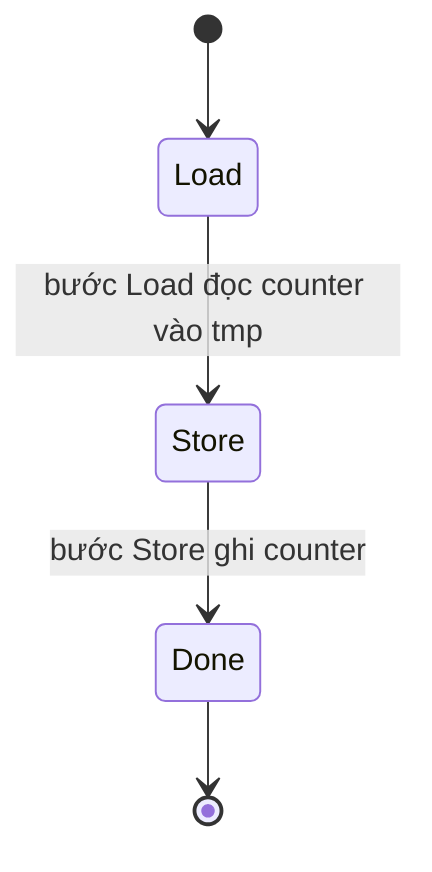
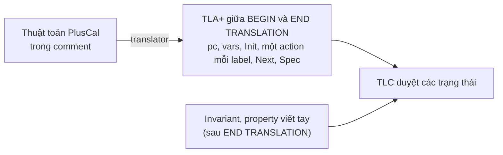
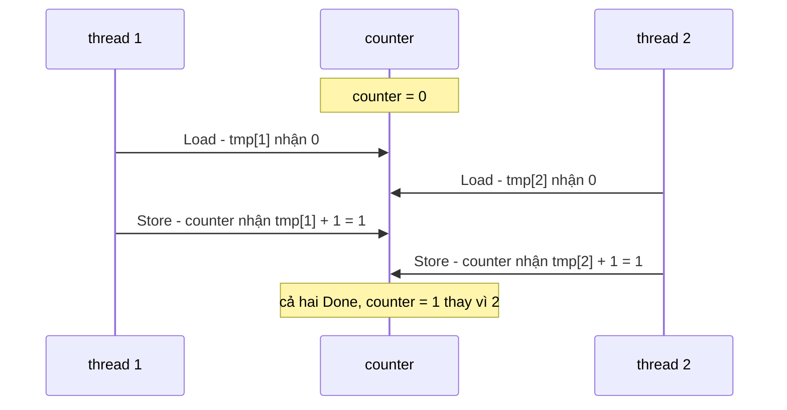

# P13 · Chương 06 — PlusCal: viết thuật toán rồi dịch sang TLA+

> Nguồn chính là *PlusCal User's Manual* của Lamport, bản 1.8 (ngày ghi trên bìa: 11 March 2024). Manual có hai phiên bản cú pháp, P-syntax và C-syntax. Mọi spec trong chương này là **minh họa của người soạn**: không chạy TLC, không chạy translator, và chương không khẳng định kết quả model checking trừ chỗ nguồn nói rõ. Bản dịch TLA+ của ví dụ do người soạn viết tay theo quy tắc trong manual (Phụ lục B) rồi đối chiếu với bản dịch thật trong repo `tlaplus/Examples`, nên translator thật có thể ra định dạng khác. Trang Learn TLA+ là trang sống (truy cập 2026-10-12), không ghim phiên bản.

## Bạn sẽ hiểu được gì

- **Q1.** PlusCal là gì, nó khác TLA+ thuần ở đâu, và một file PlusCal (module, comment, vùng `BEGIN/END TRANSLATION`, P-syntax lẫn C-syntax) trông thế nào? → mục 1
- **Q2.** "Label" là gì, và vì sao "bước nguyên tử" của PlusCal là đoạn code giữa hai label? → mục 2
- **Q3.** Label bắt buộc phải đặt ở đâu, cấm đặt ở đâu, và vì sao chọn chỗ đặt label là một quyết định mô hình hóa? → mục 3
- **Q4.** `process` đơn và tập process khác nhau thế nào; `self`, biến local và `fair process` làm gì? → mục 4
- **Q5.** `await`/`when`, `either`/`or` và `with` biểu diễn việc chờ và việc chọn không tất định ra sao; deadlock xuất hiện thế nào? → mục 5
- **Q6.** `macro` khác `procedure` ở đâu; `call`/`return` và biến `stack` hoạt động thế nào? → mục 6
- **Q7.** PlusCal được dịch sang TLA+ như thế nào (`pc`, `Init`, một action cho mỗi label, `Next`, `Spec`, `stack`)? → mục 7
- **Q8.** Hai thread cùng tăng một counter không khóa gây lỗi lost update thế nào, và sửa bằng lock ra sao khi viết bằng PlusCal? → mục 8

## Kiến thức cần trước

Chương này dùng lại khá nhiều thứ từ các chương trước của phase:

- [Chương 02 — Toán nền tảng](02-toan-nen-tang.md): `/\`, `\/`, `\in`, hàm `[x \in S |-> e]`, `EXCEPT`, record, sequence (`Head`, `Tail`, `\o`). Mọi đoạn TLA+ ở đây, nhất là bản dịch ở mục 6–8, dùng đúng những ký hiệu đó và không giải thích lại.
- [Chương 03 — Trạng thái, hành vi, action](03-trang-thai-hanh-vi-action.md): state, behavior, action, `Init`/`Next`/`Spec`, `[][Next]_vars`. Bản dịch PlusCal chính là những thứ này.
- [Chương 04 — Invariant và TLC](04-invariant-va-tlc.md): invariant, model, TLC, cách đọc counterexample. Chương này dùng lại khi kiểm tra các ví dụ.
- [Chương 05 — Liveness và fairness](05-liveness-va-fairness.md): weak/strong fairness. Mục 4 và mục 7 chỉ nêu phần PlusCal sinh ra, lý thuyết nằm ở đó.
- [Phase 4 · Chương 03 — Lock](../04-concurrency/03-lock.md), mục 1: race condition `counter += 1` ở mức máy. Mục 8 mô hình hóa đúng kịch bản đó.
- [Phase 4 · Chương 05 — Bug concurrency và deadlock](../04-concurrency/05-concurrency-bug-va-deadlock.md): khái niệm deadlock mà mục 5 dùng lại.

## 1. PlusCal là gì và một file PlusCal trông thế nào (Q1)

> **Trả lời ngắn.** PlusCal là ngôn ngữ để viết *thuật toán*, không phải để viết chương trình[^pm-algo]. Bạn viết bằng cú pháp giống code mệnh lệnh, và translator biên dịch nó thành một đặc tả TLA+[^pm-translator]. TLC rồi duyệt mọi cách thuật toán đó có thể chạy[^pm-tlc]. Biểu thức bên trong thuật toán vẫn là TLA+ nguyên bản[^pm-expr].

**Giải thích.**

*Với service `mailer`.* Hãy hình dung `mailer`, một service viết bằng Rust chuyên gửi email: request đẩy job vào một hàng đợi, vài worker thread lấy job ra gửi, và một counter `sent` đếm số mail đã gửi để hiện trên `/metrics`. Ta sẽ bám theo `mailer` suốt chương (nhận xét của người soạn: đây là ví dụ giả định, không phải code trong repo). Trước khi viết `thread::spawn`, bạn muốn biết thiết kế này có lỗ hổng không. Hai worker cùng tăng `sent` thì có mất lượt đếm không? Worker có thể kẹt chờ job mãi không? Đó là câu hỏi về *thuật toán*, chưa dính gì tới Rust. PlusCal cho bạn viết thuật toán đó ở đúng mức trừu tượng ấy, còn TLC kiểm tra giúp. Mục 8 sẽ đi hết bài toán `sent`.

Với TLA+ thuần, bạn phải tự viết máy trạng thái: mỗi hành động là một công thức nối "trạng thái trước" với "trạng thái sau". PlusCal cho viết cùng máy trạng thái đó dưới dạng pseudo-code có `while`, `if` và nhiều thread, còn translator làm việc của một compiler và sinh ra bản TLA+ mà bạn vẫn đọc được (nhận xét của người soạn).

### 1.1 Vì sao cần một ngôn ngữ cho thuật toán

Thuật toán khác chương trình ở ba điểm, và PlusCal được thiết kế quanh đúng ba điểm đó. Thứ nhất, thuật toán làm việc trên đối tượng toán học bất kỳ, chẳng hạn đồ thị hay không gian vector, còn chương trình chỉ làm việc trên những thứ đơn giản như Boolean và số nguyên[^pm-differ-objects]. Thứ hai, một thuật toán có thể mô tả cả một *lớp* phép tính, trong khi chương trình mô tả một cách tính[^pm-differ-class]. Thứ ba, thuật toán là một dãy bước, và muốn định nghĩa thuật toán đồng thời thì phải nói rõ thế nào là *một bước nguyên tử*; chương trình thì không có khái niệm "một bước" xác định[^pm-steps].

PlusCal đáp lại cả ba: biểu thức là TLA+, ngôn ngữ có cấu trúc chọn không tất định (nondeterminism)[^pm-nondet], và *label* cho biết một bước dài tới đâu (mục 2).

### 1.2 Một file PlusCal gồm những gì

Thuật toán nằm trong một comment duy nhất của module TLA+[^pm-in-comment]. Translator ghi bản dịch vào giữa hai dòng comment đặc biệt `\* BEGIN TRANSLATION` và `\* END TRANSLATION`. Nếu hai dòng này đã có sẵn, translator xóa sạch mọi thứ nằm giữa rồi thay bằng bản dịch mới[^pm-begin-trans], nên **đừng sửa tay trong vùng đó**. Khung dưới đây là một file đầy đủ (minh họa của người soạn, P-syntax):

```tla
---------------------------- MODULE Skeleton ----------------------------
EXTENDS Naturals, TLC

CONSTANT N

(* --algorithm Skeleton
variables x = 0, y \in 1..N;       \* biến toàn cục; y có N giá trị khởi đầu

define                              \* toán tử TLA+ dùng được biến toàn cục
  NonNegative == x >= 0
end define;

process worker \in 1..N             \* tập N process
variable local = 0;                 \* mỗi process một biến local riêng
begin
  Step:                             \* label: đầu một bước nguyên tử
    x := x + 1;
end process;
end algorithm; *)

\* BEGIN TRANSLATION
\* (translator ghi bản dịch TLA+ vào đây)
\* END TRANSLATION
=============================================================================
```

Các phần xuất hiện theo thứ tự cố định: tên thuật toán, khai báo biến, khối `define`, các `macro`, các `procedure`, rồi hoặc thân của thuật toán một process, hoặc một dãy `process`[^pm-grammar]. Module phải `EXTENDS TLC` nếu thuật toán dùng `print`[^pm-print-ext]. Dùng `assert` cũng vậy[^pm-assert-ext]. Còn nếu có `procedure` thì module phải `EXTENDS Sequences`[^pm-proc-seq].

Về khai báo biến, `variables x = 0` đặt giá trị khởi đầu của `x`. Còn `y \in 1..N` cho phép *bất kỳ* giá trị nào trong tập làm giá trị khởi đầu, và TLC kiểm tra tất cả các khả năng[^pm-init-in]. Biến không khai báo giá trị khởi đầu sẽ nhận hằng chưa xác định `defaultInitValue`[^pm-defaultinit].

### 1.3 Hai cú pháp

PlusCal có hai cú pháp: P-syntax dài dòng và C-syntax gọn hơn[^pm-two-syn]. Đây là cùng một đoạn code trong manual, viết theo hai kiểu.

P-syntax:

```tla
while x > 0 do
  if y > 0 then y := y-1;
                x := x-1
  else x := x-2
  end if
end while;
print y;
```

C-syntax:

```tla
while (x > 0)
{ if (y > 0) { y := y-1;
               x := x-1 }
  else x := x-2 } ;
print y;
```

Bảng đối chiếu các cấu trúc chính, theo phụ lục A của hai manual:

| Cấu trúc | P-syntax | C-syntax |
|---|---|---|
| thuật toán | `--algorithm N` … `begin` … `end algorithm` | `--algorithm N {` … `}` |
| process | `process P \in S` … `begin` … `end process;` | `process (P \in S)` … `{` … `}` |
| procedure | `procedure F(a)` … `begin` … `end procedure;` | `procedure F(a)` … `{` … `}` |
| macro | `macro M(a) begin` … `end macro;` | `macro M(a) {` … `}` |
| define | `define` … `end define;` | `define {` … `}` |
| `if` | `if t then A else B end if;` | `if (t) A else B` |
| `while` | `L: while t do A end while;` | `L: while (t) A` |
| `either` | `either A or B end either;` | `either A or B` |
| `with` | `with x \in S do A end with;` | `with (x \in S) A` |
| nhóm lệnh | cả khối `then … end if`, `do … end while` | dấu ngoặc nhọn `{ … }` |

Điểm tiện của C-syntax là bao được một dãy lệnh vào `{ }`, và label của lệnh đầu đặt trước hay sau dấu ngoặc mở đều được[^pm-c-braces]. Chương này viết chủ yếu bằng P-syntax, còn ví dụ thật từ repo `tlaplus/Examples` mà mục 7 trích thì viết bằng C-syntax. Mục 8 đưa cả hai phiên bản của cùng một thuật toán.

### 1.4 Kiểu dữ liệu

PlusCal không có kiểu. "Đúng kiểu" là một *tính chất* của thuật toán: giá trị mỗi biến luôn thuộc đúng tập của nó, và bạn kiểm tra bằng một invariant như `TypeOK`[^pm-typecorrect] (chương 04).

<details><summary>Đi sâu: chạy translator và TLC, cú pháp C-syntax chi tiết, <code>pc</code> trong invariant, hai chữ ký checksum, quy tắc đặt tên</summary>

- Manual giả định bạn dùng TLA+ Toolbox, nhưng translator và TLC thực ra là chương trình Java thường và chạy được từ dòng lệnh[^pm-java]. Khi chạy từ dòng lệnh, translator ghi thêm một file `.cfg` để chạy TLC[^pm-cfg]. Nếu bạn dùng VS Code hay `tla2tools.jar` thì các bước vẫn là "dịch rồi kiểm tra"; tên lệnh cụ thể thuộc chương 04 nên ở đây không lặp (nhận xét của người soạn).
- Tùy chọn cho translator đặt ngay trong file bằng dòng `PlusCal options (...)`, và dấu `-` đầu tên tùy chọn có thể bỏ[^pm-options-stmt]. Danh sách đầy đủ nằm ở Phụ lục C của manual; chương này nhắc `-termination`, `-wf`, `-sf`, `-nof`, `-wfNext`, `-label`, `-noDoneDisjunct` ở những mục liên quan.
- Trong C-syntax, một *compound statement* là dãy lệnh ngăn cách bằng dấu chấm phẩy và đặt trong dấu ngoặc nhọn[^pm-c-compound]. Thân process cũng là một dãy lệnh trong ngoặc nhọn[^pm-c-procbody].
- Ngữ pháp C-syntax liệt kê các lệnh không nhãn (`UnlabeledStmt`) gồm gán, `if`, `while`, `either`, `with`, `await`/`when`, `print`, `assert`, `skip`, `return`, `goto`, `call` và gọi macro[^pm-c-grammar]. Mục 3.2 của P-syntax manual liệt kê cùng các lệnh đó (đối chiếu mục lục hai manual), chỉ cú pháp từng lệnh là khác, như `if (t) A else B` thay cho `if t then A else B end if`.
- Trong các file mẫu của repo `tlaplus/Examples`, dòng mở vùng dịch có thêm hai checksum, ví dụ `\* BEGIN TRANSLATION (chksum(pcal) = "1d547bc3" /\ chksum(tla) = "8de86c82")`[^ex-peterson-chksum]. Manual 1.8 không mô tả hai checksum này, và chương không đoán mục đích của chúng.
- TLA+ có quy tắc chung: một định danh đã có nghĩa thì không được gán nghĩa mới[^pm-reuse]. Trong PlusCal, hệ quả là nếu bạn khai báo biến `j` thì một định nghĩa viết sau `END TRANSLATION` không được dùng `j` làm biến buộc (`\A i, j \in ...`), nếu không parser báo "multiply-defined identifier"[^pm-redefine]. Các tên do translator khai báo hoặc định nghĩa gồm: mọi biến toàn cục và local, `pc`, `stack` (khi có procedure), tham số procedure, `ProcSet` (chỉ với thuật toán nhiều process), `vars`, `Init`, `Next`, `Spec`, và một action cho mỗi label[^pm-trans-ids].
- Từ khóa của PlusCal bị cấm làm tên: `assert await begin call define do either else elsif end goto if macro or print procedure process return skip then variable variables when while with`[^pm-c-reserved]. Ngoài ra `pc`, `stack`, `self` không được làm tên biến[^pm-c-varname]. `Done` và `Error` cũng không được làm label[^pm-implicit].
- Translator không tự phân tích biểu thức mà để parser SANY làm việc đó[^pm-no-parse]. Với phép gán, nó chỉ coi mọi thứ đến ký hiệu dành riêng kế tiếp là biểu thức của phép gán[^pm-assume-expr]. Vì vậy lỗi có thể được báo ở chỗ sau nguyên nhân thật[^pm-error-source].

</details>

**Quay lại Q1:** PlusCal là pseudo-code có ngữ nghĩa chính xác, nằm trong comment của module TLA+, được translator biên dịch thành TLA+ giữa hai dòng `BEGIN/END TRANSLATION`, rồi TLC kiểm tra bản dịch; hai cú pháp P và C chỉ khác nhau ở bề ngoài. Với `mailer`, đó là cách viết thiết kế worker pool thành thứ máy kiểm tra được trước khi có một dòng Rust.

## 2. Label và bước nguyên tử (Q2)

> **Trả lời ngắn.** Một *bước* (step) của PlusCal là phần thực thi từ một label đến label kế tiếp[^pm-step-label]. Cả bước chạy liền một khối, không bao giờ chạy dở[^pm-exec-steps]. Vì vậy process khác chỉ chen vào được giữa hai bước, tức tại ranh giới label, và chỗ bạn đặt label quyết định những cách xen kẽ (interleaving) mà model checker khám phá.

**Giải thích.**

*Với service `mailer`.* Sau mỗi mail gửi xong, worker của `mailer` chạy `sent += 1`. Trong Rust đó là một dòng, nhưng ở mức máy nó là đọc `sent`, cộng 1, rồi ghi lại, và scheduler có thể cho worker khác chạy chen vào giữa (xem P4·03 mục 1). Muốn mô hình hóa khả năng bị chen này, bạn phải cắt dòng đó thành hai bước bằng một label ở giữa, vì mỗi label là một chỗ scheduler được phép đổi thread (nhận xét của người soạn). Mục này nói "bước" chính xác nghĩa là gì, và nên cắt thành bao nhiêu bước.

### 2.1 Bước là gì

Manual dùng hai khái niệm. *Control path* là một đường đi qua code theo cú pháp, bỏ qua việc câu lệnh có thực sự chạy được hay không. *Step* là control path bắt đầu ở một label, kết thúc ở một label và không đi qua label nào khác[^pm-step-cp]. Một lần chạy thuật toán là một dãy các lần chạy step, và không có chuyện chạy một phần của step (riêng `print` và `assert` là ngoại lệ, xem phần Đi sâu)[^pm-exec-steps]. Cuối mỗi process có một label ngầm `Done`[^pm-pc-done].

### 2.2 Nhiều process xen kẽ thế nào

Thuật toán nhiều process chạy bằng cách lặp đi lặp lại hai việc: chọn một process bất kỳ, rồi chạy một step của process đó[^pm-multi-exec]. Chữ "bất kỳ" quan trọng: model checker thử *mọi* thứ tự, và đó là chỗ nó tìm ra race (nhận xét của người soạn). Một step không chạy được khi process đã kết thúc, hoặc khi step chứa `await` mà biểu thức sai (mục 5)[^pm-impossible].



Sơ đồ là luồng điều khiển của một worker trong ví dụ ở mục 8. Mỗi mũi tên là một bước nguyên tử, còn tên trạng thái là giá trị `pc` của worker đó (mục 7). Hai worker cho hai chuỗi như vậy, và TLC đóng vai scheduler chọn cách xen kẽ.

### 2.3 Một vòng `while` là bao nhiêu bước

Với `L: while test do body end while;`, mỗi lần chạy trọn thân vòng lặp từ `L` về lại `L` là **một** bước. Khi `test` sai, bước đó chạy phép thử rồi chuyển điều khiển ra khỏi vòng[^pm-while-exit]. Nói cách khác, vòng `while` không nguyên tử: mỗi vòng là một action riêng[^lt-nonatomic]. Vòng lặp lấy job của worker `mailer` cũng vậy. Nếu bạn muốn mỗi lần lặp tách thành nhiều bước, phải đặt label *bên trong* thân vòng.

### 2.4 Độ hạt nguyên tử do bạn chọn

Thuật toán đồng thời phải nói rõ cái gì là một bước nguyên tử[^pm-step-def]. Với thuật toán nhiều process, manual cho rằng bạn thường sẽ muốn tự chỉ định độ hạt này[^pm-grain]. Cùng một phép `counter := counter + 1` mô hình hóa được theo ba độ hạt:

```tla
\* (a) một label: tăng nguyên tử, như một lệnh fetch-and-add
Inc:    counter := counter + 1;

\* (b) hai label: đọc, rồi ghi lại giá trị đã cộng
Load:   tmp := counter;
Store:  counter := tmp + 1;

\* (c) ba label: đọc, cộng, ghi như một chuỗi lệnh máy rời nhau
Load:   reg := counter;
Add:    reg := reg + 1;
Store:  counter := reg;
```

Đây là minh họa của người soạn. Theo suy luận của người soạn, với bài toán này (b) và (c) cho cùng tập lỗi quan trọng, vì `Add` chỉ chạm biến local; đó là lý do người ta thường gộp thao tác trên biến local vào label lân cận (mục 3). Cái giá của việc cắt nhỏ là số interleaving tăng lên: concurrency là một trong những nguồn chính làm không gian trạng thái bùng nổ[^lt-explosion].

<details><summary>Đi sâu: step chứa <code>await</code>, <code>print</code>/<code>assert</code>, <code>goto</code>, và <code>if</code> trong một step</summary>

- `if` và phép thử của nó nằm trong *cùng* một step. Trong ví dụ FastMutex của manual, phép thử `y # 0` ở label `l2` là nguyên tử vì step bắt đầu ở `l2` kết thúc khi điều khiển tới `l3` hoặc `l4`[^pm-fastmutex-l2].
- `goto lab` kết thúc step hiện tại và chuyển điều khiển tới câu lệnh có label `lab`[^pm-goto]. Vì vậy sau `goto` luôn phải có label (mục 3).
- `await` có thể nằm *ở bất kỳ chỗ nào* trong step, không nhất thiết ở đầu[^pm-await-pos]. Manual cho ví dụ hai đoạn tương đương: `a: x := y + 1; await x > 0; b: ...` và `a: await y + 1 > 0; x := y + 1; b: ...`. Step từ `a` đến `b` chỉ chạy được khi giá trị hiện tại của `y+1` dương[^pm-await-equiv]. Nghĩa là `await` được đánh giá với giá trị *đã cập nhật* trong cùng step, và nếu `await` sai thì *cả step* không chạy, mọi phép gán đứng trước nó cũng không có hiệu lực. Learn TLA+ cảnh báo kiểu: `await` tương tác hơi lạ với việc cập nhật biến[^lt-await-odd]. Vì vậy nên đặt `await` ở *đầu* label cho khỏi nhầm (nhận xét của người soạn).
- `print` là ngoại lệ của quy tắc "không chạy một phần step": TLC có thể in giá trị ngay cả khi step không chạy được vì một `await` đứng sau nó trong step[^pm-print]. `assert` cũng vậy: TLC có thể báo `assert` sai trong cùng tình huống[^pm-assert]. Vì thế nên đặt `assert` sau mọi `await` của step, hoặc trong step không có `await` (nhận xét của người soạn).
- Biểu thức trong `define` luôn dùng giá trị biến *ở đầu step*, kể cả khi nó xuất hiện sau một phép gán trong cùng step[^pm-define-start]. Đây là khác biệt tinh vi giữa dùng `define` và viết biểu thức trực tiếp.

</details>

**Quay lại Q2:** label đánh dấu ranh giới giữa các bước; mỗi bước chạy trọn vẹn không bị chen, và model checker thử mọi cách xen kẽ các bước của các process, nên vị trí label chính là độ hạt nguyên tử của mô hình. Với `mailer`, `sent += 1` cắt thành `Load` rồi `Store` là cách nói "worker khác được chen vào giữa".

## 3. Quy tắc đặt label (Q3)

> **Trả lời ngắn.** Label *bắt buộc* ở đầu process, procedure hay thuật toán một process[^pm-lab-first]. Mỗi `while` cũng phải có label[^pm-lab-while]. Câu đứng sau `goto` hoặc `return` phải có label, câu đứng sau `call` cũng vậy trừ khi nó là `return` hoặc `goto`[^pm-lab-after]. Sau một `if` hay `either` có chứa label, `goto`, `call` hoặc `return` bên trong cũng phải có label[^pm-lab-if]. Giữa hai phép gán cùng một biến phải có label[^pm-lab-assign]. Ngược lại, label *bị cấm* trong thân `macro` và trong phần `do` của `with`[^pm-lab-macro]. Ngoài các quy tắc cơ học đó, chỗ đặt thêm label là một quyết định mô hình hóa về độ hạt nguyên tử.

**Giải thích.**

*Với service `mailer`.* Worker của `mailer` là một vòng lặp: lấy job, gửi mail, cộng `sent`. Vòng lặp đó đòi một label ở đầu theo quy tắc `while`, nhưng quy tắc không nói gì về việc có cắt `sent += 1` thành hai bước hay không. Đó là câu hỏi về hệ thật: đoạn nào của worker thực sự không bị chen? Mục này đi qua các quy tắc cơ học trước, rồi tới cách chọn chỗ đặt thêm.

### 3.1 Quy tắc cơ học

Bảng dưới lấy từ mục 3.7 và 2.7 của manual, kèm ví dụ vi phạm và cách sửa (các đoạn code là minh họa của người soạn):

| Quy tắc | Ví dụ vi phạm | Cách sửa |
|---|---|---|
| Câu đầu của process/procedure/thuật toán phải có label[^pm-lab-first] | `begin x := 1; ...` | `begin Init: x := 1; ...` |
| `while` phải có label; câu *sau* `while` không cần[^pm-lab-while] | `while i < 3 do ... end while;` | `Loop: while i < 3 do ... end while;` |
| Hai phép gán cùng một biến phải cách nhau một label[^pm-lab-assign] | `a: x := x + 1; x := x * 2;` | `a: x := x + 1; b: x := x * 2;` hoặc gộp `x := (x + 1) * 2;` |
| Câu đứng sau `goto` hoặc `return` phải có label; câu đứng sau `call` cũng vậy, trừ khi nó là `return` hoặc `goto`[^pm-lab-after] | `goto Top; x := 0;` | `goto Top; Next: x := 0;` |
| `if`/`either` có label/`goto`/`call`/`return` bên trong thì câu sau nó phải có label[^pm-lab-if] | `if c then L: ... end if; y := 1;` | `if c then L: ... end if; M: y := 1;` |
| Thân `macro` và phần `do` của `with` không được có label[^pm-lab-macro] | `with m \in S do L: ... end with;` | bỏ label trong `with`, đưa phần cần label ra ngoài `with` |
| `Done` và `Error` là label ngầm, không dùng làm label thật[^pm-implicit] | `Done: skip;` | đổi tên |

### 3.2 Hai phép gán cùng biến, và phép gán nhiều vế

Quy tắc "hai phép gán cùng biến" áp dụng cho *biến*, không phải cho thành phần của biến: nhiều phép gán vào các thành phần của cùng một biến có thể đi chung trong một phép gán nhiều vế nối bằng `||`[^pm-multiassign-ok]. Phép gán nhiều vế tính vế phải của mọi phép gán trong nó trước, rồi mới thực hiện các phép gán từ trái sang phải[^pm-multiassign]. Nhờ đó `u := v || v := u` hoán đổi hai giá trị, và manual dùng đúng cách này để hoán đổi trong thuật toán Euclid[^pm-swap]. Ngoài ra `call` và `return` cũng được tính là phép gán vào tham số và biến local của procedure, nên cũng nằm trong quy tắc trên (mục 6)[^pm-callret-assign].

### 3.3 Một ví dụ dương

Ví dụ sau lấy từ repo tlaplus. Đây là một `either` có label bên trong, nên phải có label `d` ngay sau nó:

```tla
--algorithm Either
  variables x = 0 ; y = 0 ;
  begin a: either x := 1 ; b: x := x + 1;
               or y := 1 ; c: y := y + 1;
           end either ;
        d: assert x+y = 2 ;
end algorithm
```

Nguồn là file test của translator, `test-model/pcal/Either1.tla` trong `tlaplus/tlaplus` ghim SHA `94d0c50…`[^tt-either-src].

### 3.4 Khi thiếu label

Nếu thiếu, translator báo "Missing label at the following location". Nguyên nhân hay bị quên là `call` và `return` cũng là phép gán nên đòi hỏi label[^pm-missing-label]. Muốn translator tự thêm label thì dùng tùy chọn `-label`, và đó là mặc định cho thuật toán một process mà bạn không gõ label nào[^pm-label-default]. Với thuật toán như vậy translator thêm số label ít nhất có thể, cho ra ít step nhất[^pm-fewest].

### 3.5 Chọn chỗ đặt label

Quy tắc cơ học chỉ nói "phải có label ở những chỗ nào". Còn đặt thêm label ở đâu là quyết định mô hình hóa, với hai thái cực. Một đầu là giữ số label tối thiểu mà quy tắc đòi hỏi: ít step nhất nên model checking nhanh nhất[^pm-fast], nhưng có thể che mất lỗi vì process khác không có cơ hội chen vào. Đầu kia là đặt label trước *mỗi* lần đọc/ghi biến chung: ra nhiều interleaving nhất nên bắt được mọi race ở mức đó, nhưng không gian trạng thái lớn. Cách làm ổn là đặt ranh giới label đúng ở ranh giới nguyên tử của hệ thật: một lệnh atomic, một lần acquire lock, một RPC, một lần commit transaction là một label, còn thao tác chỉ chạm biến local thì gộp vào label lân cận (nhận xét của người soạn).

Với `mailer`, cách làm đó cho kết quả cụ thể. Nếu worker lấy job bằng `Mutex<VecDeque<Job>>`, thì "lock rồi pop" là một label. Nếu `sent` là một số nguyên thường được đọc rồi ghi, thì đó là hai label, vì không có gì ngăn worker khác chen vào giữa (nhận xét của người soạn).

<details><summary>Đi sâu: tên label, tùy chọn label, fairness trên label</summary>

- Label trở thành *tên action* trong bản dịch (mục 7). Vì vậy hai process không dùng chung tên label, như Learn TLA+ nêu[^lt-labels-share].
- Tên label có thể trùng tên biến, hoặc hai biến local ở hai procedure trùng tên. Khi đó translator đổi tên một trong hai, phát cảnh báo và ghi các phép đổi tên trong comment ngay sau dòng `BEGIN TRANSLATION`[^pm-rename].
- `-reportLabels` giống `-label` nhưng cho biết translator đã thêm label ở đâu[^pm-reportlabels]. Phụ lục C xếp nó vào nhóm tùy chọn chỉ dùng ở dòng lệnh.
- `-labelRoot name` đổi tiền tố của các label do translator thêm. Mặc định tiền tố là `Lbl`, ra `Lbl1`, `Lbl2`, …[^pm-labelroot].
- Với thuật toán nhiều process thì `-label` không phải mặc định[^pm-label-default]. Manual nhắc bạn thường sẽ muốn tự chỉ định độ hạt nguyên tử[^pm-grain], tức là tự đặt label.
- Hậu tố `+`/`-` sau label (như `l4:+`, `ncs:-`) chỉnh fairness của action tương ứng (mục 4).

</details>

**Quay lại Q3:** bắt buộc: đầu process, mỗi `while`, sau `goto`/`call`/`return`, sau `if`/`either` có label bên trong, và giữa hai phép gán cùng biến; cấm: trong `macro` và trong `do` của `with`. Chỗ đặt thêm là quyết định về độ hạt nguyên tử, nên đặt đúng ranh giới nguyên tử của hệ thật, như `Mutex` hay `fetch_add` trong `mailer`.

## 4. `process`: process đơn, tập process, `self`, `fair` (Q4)

> **Trả lời ngắn.** `process P = e` khai báo đúng một process có định danh `e`, còn `process P \in S` khai báo một *tập* process: mỗi phần tử của `S` là một process chạy cùng đoạn code[^pm-proc-set]. Trong thân của tập process, `self` là định danh của process đang chạy[^pm-proc-self]. Biến khai báo bằng `variable` ngay dưới `process` là biến local, mỗi process một bản[^pm-proc-local]. Mặc định process không có giả định fairness nào[^pm-unfair]. `fair process` thì thêm giả định weak fairness cho mọi action của nó[^pm-fair-proc].

**Giải thích.**

*Với service `mailer`.* Worker pool của `mailer` ứng với một tập process: `process worker \in Workers` là N worker chạy cùng một đoạn code, `self` là worker id, biến local như `job` hay `tmp` là biến trên stack của từng thread, còn hàng đợi và `sent` là biến toàn cục dùng chung (nhận xét của người soạn). Câu hỏi của mục này: khai báo thế nào cho đúng, và phải giả định gì về việc worker có chạy tiếp hay không.

### 4.1 Cú pháp và quy tắc

Có hai dạng khai báo: `process ProcName \in IdSet` cho tập process và `process ProcName = Id` cho một process[^pm-proc-set]. Định danh của các process khác nhau trong cùng thuật toán phải khác nhau[^pm-proc-ids]. Chúng cũng nên cùng "kiểu" (đều là số, hoặc đều là chuỗi…), vì ngữ nghĩa TLA+ không nói một chuỗi có bằng một số hay không[^pm-proc-ids-type]. Learn TLA+ diễn đạt cùng ý này: mọi process phải có kiểu so sánh được với nhau[^lt-types].

Tên `ProcName` không mang ý nghĩa nào: đổi tên không đổi nghĩa của câu `process`. Tên này xuất hiện trong bản dịch TLA+ nên cần khác nhau giữa các câu `process`[^pm-proc-name]. Ví dụ `Simple.tla` ở mục 7 cho thấy nó thành tên action `proc(self)`.

Thân process bắt đầu bằng `begin`, kết thúc bằng `end process` (P-syntax), và câu đầu phải có label[^pm-lab-first]. Trong thân của một tập process, `self` bằng định danh của process hiện hành[^pm-proc-self]. Với procedure được gọi từ process đó, `self` trong thân procedure cũng là định danh của process đang chạy procedure[^pm-proc-self-proc].

### 4.2 Ví dụ: producer và consumer

Ví dụ dưới là minh họa của người soạn, viết bằng P-syntax. Ta có thể đọc `producer` là các handler đẩy job vào hàng đợi và `consumer` là worker lấy job ra, gần với khung của `mailer` (nhận xét của người soạn).

```tla
---------------------------- MODULE ProdCons ----------------------------
EXTENDS Naturals, Sequences

CONSTANTS NumProducers, MaxQueue
Producers == 1..NumProducers

(* --algorithm ProdCons
variables queue = <<>>;

fair process producer \in Producers
begin
  Produce:
    await Len(queue) < MaxQueue;
    queue := Append(queue, self);
    goto Produce;
end process;

fair process consumer = 0
variable item = 0;
begin
  Consume:
    await queue /= <<>>;
    item := Head(queue);
    queue := Tail(queue);
    goto Consume;
end process;
end algorithm; *)
```

`producer` là tập process với định danh `1..NumProducers`, còn `consumer` là một process có định danh `0`: cùng là số và khác mọi định danh của producer. Mỗi label (`Produce`, `Consume`) là một bước nguyên tử gồm cả phần `await` lẫn phần cập nhật `queue`, tức là kiểm tra hàng đợi và thao tác trên nó là một thể. Đây là một giả định mô hình hóa, đúng nếu hàng đợi được bảo vệ bằng mutex hoặc kênh có sẵn thao tác nguyên tử. `goto Produce` ở cuối là cách lặp mãi, tương đương bọc thân trong `while TRUE`[^lt-goto-loop].

### 4.3 Biến local

Khi dịch, biến local của process trở thành *hàm* có miền là tập định danh process, nên `item` thành `item[self]`[^pm-localvar]. Hệ quả mà Learn TLA+ lưu ý là biến local không tham chiếu được từ process khác hay từ khối `define`[^lt-define-local]. Lý do là `define` chỉ được dùng biến toàn cục, `pc` và `stack`[^pm-define-vars]. Cũng vì vậy, invariant nào dùng biến local phải viết *sau* `END TRANSLATION` (mục 7).

### 4.4 Fairness

Mỗi label ứng với một action (mục 7), và một action *enabled* khi nó có thể chạy[^pm-enabled]. Action như `a: y := 42;` chỉ enabled khi điều khiển đang ở `a`, gọi là *non-blocking*. Action có `await` như `b: await x > self;` gọi là *blocking*[^pm-nonblock]. Với action non-blocking, fairness nghĩa là process không được dừng mãi tại action đó[^pm-fair-nonblock]. Với action blocking có hai mức. *Weak fairness* nghĩa là process không được dừng nếu action enabled *liên tục mãi mãi*; *strong fairness* nghĩa là process cũng không được dừng nếu action cứ bị tắt rồi bật lại vô hạn lần[^pm-wf-sf].

Bảng sau tóm tắt cách khai báo quyết định fairness:

| Khai báo | Fairness mặc định của các action |
|---|---|
| `process` | không có giả định nào[^pm-unfair] |
| `fair process` | weak fairness[^pm-fair-proc] |
| `fair+ process` | strong fairness[^pm-fairplus] |
| nhãn `lab:+` trong process `fair` | action đó strong fair[^pm-fair-label] |
| nhãn `lab:-` | action đó không có giả định fairness[^pm-fair-label] |

Translator có tùy chọn để đổi mặc định: `-wf` biến process "unfair" thành `fair`, còn `-sf` biến thành `fair+` và `-nof` làm mọi process unfair[^pm-fair-opts]. Fairness của *cả thuật toán*, nghĩa là thuật toán không được dừng khi còn action enabled, bật bằng `--fair algorithm` hoặc `-wfNext`[^pm-fair-algorithm].

Vì sao phải quan tâm? Với `mailer`: nếu worker được phép dừng mãi sau lần gửi đầu tiên thì tính chất "mọi job cuối cùng đều được gửi" sai ngay trên hành vi đứng im đó, dù thuật toán chẳng có lỗi gì (suy luận của người soạn). Spec Dining Philosophers trong `tlaplus/Examples` có ghi chú đúng điều này: nếu bỏ `fair` khỏi `fair process` thì mỗi process có thể dừng bất cứ lúc nào và không bao giờ chạy lại[^ex-dp-fair-comment]. Khi đó tính chất liveness kiểu "triết gia nào cũng cuối cùng lại được ăn" có thể sai trên một hành vi "đứng im" (suy luận của người soạn). Spec đó viết tính chất này là `NobodyStarves == \A p \in 1..NP: []<>(~hungry[p])`[^ex-dp-nobody-starves]. Chương 05 giải thích lý thuyết.

<details><summary>Đi sâu: weak/strong fairness qua ví dụ của manual, <code>-termination</code>, quy tắc giữa các dạng</summary>

- Ví dụ blocking của manual: `b: await x > self; x := x-1;`. Action `b` enabled khi điều khiển ở `b` *và* `x > self`. Weak fairness của `b` nghĩa là nếu `x > self` đúng mãi khi process ở `b` thì `b` cuối cùng chạy. Strong fairness của `b` nghĩa là process không dừng mãi ở `b` chừng nào `x > self` còn đúng mãi *hoặc* cứ liên tục đúng trở lại, dù có lúc sai[^pm-wf-sf].
- Thêm `+` sau label trong `fair+ process` không có tác dụng[^pm-fair-plus-effect]. Thêm `+` hoặc `-` sau label trong process không fair cũng không có tác dụng[^pm-unfair].
- Ví dụ trong manual: với FastMutex, để kiểm tra tính chất "nếu có process đang cố vào critical section thì cuối cùng có process (không nhất thiết là chính nó) ở trong", người ta đặt `fair` trước process và thêm `-` sau hai label `ncs:` và `cs:` để process được phép ở yên mãi trong noncritical/critical section[^pm-fastmutex-fair].
- `-termination`: nếu không có tùy chọn fairness nào thì nó tương đương `-wf`[^pm-termination-opt]. Hợp lý vì muốn kiểm tra "luôn kết thúc" thì phải giả định các process không dừng giữa chừng (nhận xét của người soạn).
- Kiểm tra liveness (kể cả termination) chậm hơn kiểm tra invariant, và TLC không chạy được liveness trên model lớn như với invariant[^pm-liveness-slow].
- Dạng dịch của fairness: với tập process `P`, `Spec` có thêm conjunct `\A self \in S : WF_vars(P(self))`. Ví dụ thật, spec Dining Philosophers có `fair process Philosopher \in 1..NP`: `Spec == /\ Init /\ [][Next]_vars /\ \A self \in 1..NP : WF_vars(Philosopher(self))`[^ex-dp-spec].

</details>

**Quay lại Q4:** `process P = e` là một process, `process P \in S` là một tập process dùng `self` làm định danh, biến local là hàm theo `self` sau khi dịch, và `fair process` thêm giả định weak fairness (không có nó, process được phép dừng vĩnh viễn). Với `mailer`: worker pool là tập process, và chỉ khi worker được giả định không dừng thì mới nói được "job nào rồi cũng được gửi".

## 5. `await`, `either`, `with`: chờ và chọn không tất định (Q5)

> **Trả lời ngắn.** `await expr` làm bước chỉ chạy được khi `expr` đúng[^pm-await]; `when` là từ đồng nghĩa[^pm-when]. Nếu `expr` sai, bước không chạy, không có gì thay đổi, và process thử lại sau[^pm-await-fail]. `either … or …` chọn không tất định *một nhánh chạy được* để thực thi[^pm-either]. `with x \in S do …` chọn không tất định một phần tử của `S` rồi chạy thân, và nếu `S` rỗng thì không chạy được[^pm-with]. TLC thử mọi lựa chọn.

**Giải thích.**

*Với service `mailer`.* Ba cấu trúc này khớp với ba tình huống của `mailer`. Worker rảnh phải chờ tới khi hàng đợi có job: đó là `await`. Nhà cung cấp SMTP có thể nhận mail hoặc làm rơi nó, mà bạn không điều khiển được bên nào xảy ra: đó là `either`. Còn hàng đợi không đảm bảo thứ tự thì worker có thể lấy bất kỳ job nào: đó là `with` (nhận xét của người soạn). Mục này nói từng cấu trúc, rồi cho thấy chúng dẫn tới deadlock ra sao.

### 5.1 `await` và `when`

Một bước chứa `await expr` chỉ thực hiện được khi `expr` bằng TRUE[^pm-await]. Cách nghĩ dễ nhất là "bộ xử lý thử chạy cả bước": thử thành công thì bước chạy thật và điều khiển sang bước kế, thử thất bại vì biểu thức sai thì không có gì đổi và sẽ thử lại sau[^pm-await-fail]. Đó là cách PlusCal biểu diễn việc *chờ*: không có "spin" hay "ngủ", chỉ có một bước chưa được phép chạy.

### 5.2 `either`

Cú pháp là `either A or B or … end either;`[^pm-either]. Bước chạy được khi ít nhất một nhánh chạy được[^pm-either-enabled]. Hệ quả là `if t then A else B end if` tương đương `either await t; A or await ~t; B end either`, và manual nêu đúng sự tương đương đó[^pm-if-either]. Chỗ khác nhau là `either` cho phép các điều kiện *không loại trừ nhau*, hoặc không có điều kiện, tức nondeterminism thật.

### 5.3 `with`

`with id \in S do body end with;` chạy `body` với `id` bằng một phần tử được chọn không tất định của `S`; nếu `S` rỗng thì không chạy được[^pm-with]. Dạng `with id = expr` chỉ đặt tên cho giá trị của `expr`, tương đương `with id \in {expr}`[^pm-with-eq]. Thân `with` không chứa label[^pm-with-nolabel]. Hệ quả là trong thân không có `while`, và không có hai phép gán cùng biến (trừ phép gán nhiều vế vào các thành phần khác nhau)[^pm-with-consequence].

### 5.4 Ví dụ: kênh có thể làm rơi gói

Ví dụ dưới là minh họa của người soạn (P-syntax). Ta đọc `sender` là `mailer` đẩy mail đi, `receiver` là phía nhận, và `either` là chuyện gói có thể mất trên đường:

```tla
---------------------------- MODULE Channel ----------------------------
EXTENDS Naturals

CONSTANT MaxMsg

(* --algorithm Channel
variables inflight = {}, delivered = {};

process sender = 1
variable seq = 0;
begin
  Send:
    while seq < MaxMsg do
      seq := seq + 1;
      either
        inflight := inflight \union {seq};   \* gói được gửi đi
      or
        skip;                                 \* gói bị mất
      end either;
    end while;
end process;

process receiver = 2
begin
  Receive:
    while TRUE do
      with m \in inflight do
        inflight := inflight \ {m};
        delivered := delivered \union {m};
      end with;
    end while;
end process;
end algorithm; *)
```

Đọc theo ngữ nghĩa ở trên. Mỗi vòng của `Send` là một bước, trong đó `either` chọn giữa gửi và bỏ; cả hai đều chạy được nên TLC thử cả hai. Mỗi vòng của `Receive` cũng là một bước, trong đó `with` chọn một gói bất kỳ đang bay. Khi `inflight` rỗng, `with` không chạy được nên bước `Receive` bị chặn. Model này cố ý đơn giản: nó không mô hình hóa thứ tự (đây là tập chứ không phải hàng đợi) hay việc nhân bản gói (nhận xét của người soạn).

### 5.5 Deadlock

Manual định nghĩa: thuật toán nhiều process bị deadlock nếu không process nào đi tiếp được mà vẫn còn process chưa kết thúc[^pm-deadlock]. Ví dụ `Channel` ở trên có đúng tình huống đó. Khi `sender` đã `Done` và `inflight` rỗng, `receiver` kẹt ở `Receive` mãi. Manual nói deadlock thường là lỗi và TLC báo; còn nếu thuật toán *được phép* dừng khi chưa mọi process kết thúc thì bạn tắt kiểm tra deadlock trong model[^pm-deadlock-normal]. Với `Channel`, `receiver` là vòng lặp vô hạn nên không bao giờ tới `Done`, vì vậy TLC sẽ báo deadlock trừ khi tắt kiểm tra đó (suy luận của người soạn từ định nghĩa trên). Learn TLA+ có ví dụ tương tự: sau khi mọi writer chạy xong, reader kẹt mãi ở `await`[^lt-deadlock].

Còn khi tất cả process đều tới `Done` thì TLC không coi là deadlock, vì translator thêm một action "đứng im" (mục 7).

<details><summary>Đi sâu: nhiều biến trong <code>with</code>, <code>either</code> chứa label, khởi tạo không tất định</summary>

- `with` có thể liệt kê nhiều biến: `with id1 \in S1; id2 = e2 do …`. Mỗi biến có thể gán bằng `=` hoặc `\in`, và dạng nhiều biến tương đương lồng nhiều `with`[^pm-with-multi].
- `either` có thể chứa label bên trong nhánh, và khi đó câu sau `either` phải có label (mục 3). Bản dịch thật của ví dụ `Either1` ở mục 3 (trong repo tlaplus) có action `a` thành một hội gồm `pc = "a"` và một *tuyển* hai nhánh, mỗi nhánh gán `pc'` một giá trị khác nhau và giữ nguyên biến kia:

```tla
a == /\ pc = "a"
     /\ \/ /\ x' = 1
           /\ pc' = "b"
           /\ y' = y
        \/ /\ y' = 1
           /\ pc' = "c"
           /\ x' = x
```

Đây là cách `either` được dịch: một tuyển các nhánh[^tt-either-trans].

- Khởi tạo không tất định: `variables v \in 1..N` cho ra nhiều trạng thái đầu. Manual dùng ví dụ `EuclidAlg` với `v \in 1..N`: đặt `N = 4` thì có 4 thực thi[^pm-bfs-n4]. TLC không chạy riêng từng thực thi mà tìm mọi trạng thái đạt tới bằng tìm kiếm theo chiều rộng[^pm-bfs-search].
- `print` in giá trị của một biểu thức. Trong chế độ model-checking, vì TLC duyệt theo chiều rộng nên output của `print` lẫn lộn, và manual khuyên chỉ để một `print` ở cuối thuật toán[^pm-bfs]. Muốn kiểm tra một điều kiện thì dùng `assert` thay vì tự đọc output[^pm-assert-check].

</details>

**Quay lại Q5:** `await` chặn cả bước tới khi điều kiện đúng, `either` và `with` là hai cách chọn không tất định mà TLC thử hết, và khi mọi process đều bị chặn mà chưa kết thúc thì đó là deadlock mà TLC báo. Với `mailer`, đó là worker chờ job, SMTP nhận hoặc làm rơi mail, và worker lấy một job bất kỳ.

## 6. `macro` và `procedure`: tái sử dụng code (Q6)

> **Trả lời ngắn.** `macro` giống procedure nhưng được *thay thế văn bản* ngay lúc dịch, nên nó chạy bên trong bước của chỗ gọi[^pm-macro]. Vì vậy thân macro không được chứa label, `while`, `call`, `return` hay `goto`[^pm-macro-body]. `procedure` là hàm thật: có label (nhiều bước), tham số, biến local, gọi bằng `call` và trả về bằng `return`. Translator thêm biến `stack` để giữ call stack[^pm-stack-add]. Bản dịch mô hình hóa một cách cài đặt call stack chuẩn[^pm-stack-model]. Procedure không trả giá trị trực tiếp, kết quả đi qua biến chung[^pm-proc-noreturn].

**Giải thích.**

*Với service `mailer`.* Trong `mailer` có hai kiểu thao tác lặp lại. Thao tác ngắn như "lấy khóa của hàng đợi" luôn là một bước liền, và bạn muốn viết một lần rồi dùng ở nhiều chỗ: đó là việc của `macro`. Còn thao tác như "gửi một mail" gồm nhiều bước (mở kết nối, ghi nội dung, chờ ack) mà worker khác có thể chen vào giữa: đó là việc của `procedure` (nhận xét của người soạn). Mục này nói hai thứ khác nhau chỗ nào, và `procedure` được dịch ra sao.

### 6.1 Macro

Ví dụ của manual (P-syntax):

```tla
macro P(s, i) begin await s >= i;
                    s := s - i;
end macro;
```

Lời gọi `P(sem, y + 17);` được thay bằng thân macro với tham số thay bằng đối số, tức là `await sem >= (y + 17); sem := sem - (y + 17);`[^pm-macro-expand]. Macro được định nghĩa ngay sau khai báo biến toàn cục và khối `define`, và có thể gọi một macro đã định nghĩa trước đó[^pm-macro-pos]. Macro dùng được `self`: Learn TLA+ có ví dụ macro `write()` gọi `Append(queue, self)` bên trong[^lt-macro-self]. Điều này hợp lý vì phép thay thế là *văn bản* tại chỗ gọi, nên ý nghĩa của mọi ký hiệu không phải tham số là ý nghĩa ở ngữ cảnh chỗ gọi[^pm-macro-syntactic].

Ví dụ thật: spec `Lock` trong `tlaplus/Examples` định nghĩa hai macro[^ex-lock-macro], và đó cũng là cặp macro mà `mailer` cần để bao quanh hàng đợi (nhận xét của người soạn):

```tla
macro Lock(l){ await l = 1; l := 0; }
macro Unlock(l){ l := 1; }
```

Label `l1: Lock(lock);` được dịch thành một action có đúng điều kiện `lock = 1` và hiệu ứng `lock' = 0`: `l1(self) == /\ pc[self] = "l1" /\ lock = 1 /\ lock' = 0 /\ pc' = [pc EXCEPT ![self] = "cs"]`[^ex-lock-l1]. Đó chính là minh họa "macro chạy bên trong bước của chỗ gọi"[^pm-macro].

### 6.2 Procedure

Cú pháp: `procedure Name(p1, p2) variables v = 0; begin L: ...; return; end procedure;`. Procedure nằm sau khối `define`/macro và trước `begin` của thuật toán hoặc process đầu tiên[^pm-proc-pos]. Learn TLA+ nhắc lại thứ tự này: procedure phải định nghĩa sau macro và trước process[^lt-proc-order]. Thân procedure phải bắt đầu bằng câu có label[^pm-lab-first]. Tham số được xử lý như biến và gán được, còn biến local của procedure khởi tạo lại mỗi lần vào procedure[^pm-proc-params].

Ví dụ đệ quy giai thừa dưới đây lấy từ file test của translator (đã bỏ các comment):

```tla
--algorithm Factorial
  variable result = 1;
  procedure FactProc(arg1 = 0)
    variable u = 1 ;
    begin p1 : if arg1 = 0
                 then return;
                 else result := result * arg1;
                      call FactProc ( arg1 - 1 ) ;
                      return;
               end if;
    end procedure
  begin
    a1 : call FactProc( 5 ) ;
    a2 : assert result = 120 ;
  end algorithm
```

Nguồn là `test-model/pcal/Factorial.tla` ghim SHA `94d0c50…`[^tt-fact-src1]. Phần `else` của `p1` cũng lấy từ file đó[^tt-fact-src2]. Nhánh `else` kết thúc bằng `call FactProc(arg1 - 1); return;`. Khi một `call` đứng ngay trước `return`, manual nói hai lần trả về được thực hiện trong cùng một bước, tức là tối ưu hóa gọi đuôi, thay đệ quy đuôi bằng vòng lặp[^pm-tailcall]. Đúng như vậy: trong bản dịch ở dưới, nhánh `ELSE` của `p1` không đẩy bản ghi nào lên `stack` mà đặt `pc' = "p1"` và `stack' = stack`[^tt-fact-else].

### 6.3 Procedure được dịch thế nào

Biến `stack` chứa call stack. Với thuật toán nhiều process, `stack` là mảng các stack theo định danh process[^pm-stack-model]. Với `FactProc`, bản dịch trong file test (đã bỏ phần tiêu đề comment) có hai chỗ then chốt. Cách đọc ký hiệu: `\o` nối hai sequence, `Head`/`Tail` là phần tử đầu / phần còn lại, `[ procedure |-> ... ]` là record; xem [chương 02](02-toan-nen-tang.md), mục 4.

```tla
\* a1: call FactProc(5) → đẩy một bản ghi lên stack, đặt tham số, nhảy vào p1
a1 == /\ pc = "a1"
      /\ /\ arg1' = 5
         /\ stack' = << [ procedure |->  "FactProc",
                          pc        |->  "a2",
                          u         |->  u,
                          arg1      |->  arg1 ] >>
                      \o stack
      /\ u' = 1
      /\ pc' = "p1"
      /\ UNCHANGED result

\* p1, nhánh return: lấy lại pc và các biến từ đỉnh stack rồi bỏ đỉnh
p1 == /\ pc = "p1"
      /\ IF arg1 = 0
            THEN /\ pc' = Head(stack).pc
                 /\ u' = Head(stack).u
                 /\ arg1' = Head(stack).arg1
                 /\ stack' = Tail(stack)
                 /\ UNCHANGED result
            ELSE /\ result' = result * arg1
                 /\ arg1' = arg1 - 1
                 /\ u' = 1
                 /\ pc' = "p1"
                 /\ stack' = stack
```

Hai action trên rút gọn từ bản dịch của `Factorial.tla`[^tt-fact-call]. Phần `return` cũng lấy từ đó[^tt-fact-ret]. Ý nghĩa khớp với manual: một `call` gán đối số cho tham số, khởi tạo biến local và đặt điều khiển ở đầu thân procedure; `return` gán lại cho tham số và biến local *giá trị trước lần gọi*, rồi trả điều khiển về câu ngay sau `call`[^pm-proc-return].

### 6.4 So sánh

| | `macro` | `procedure` |
|---|---|---|
| mở rộng | lúc dịch, thay văn bản | gọi thật lúc chạy (`call`) |
| số bước | nằm trong bước của chỗ gọi | có thể gồm nhiều bước (có label) |
| label, `while`, `goto`, `call`, `return` | cấm[^pm-macro-body] | được (thân phải bắt đầu bằng label) |
| trả giá trị | không áp dụng | không có giá trị trả về trực tiếp; dùng biến chung[^pm-proc-noreturn] |
| thêm biến vào bản dịch | không (suy luận của người soạn: macro được mở rộng lúc dịch) | `stack`, tham số, biến local[^pm-stack-add] |
| module cần `EXTENDS Sequences` | không | có[^pm-proc-seq] |

<details><summary>Đi sâu: đọc <code>stack</code>, label ngầm <code>Error</code>, giá trị trả về qua biến chung, bẫy của macro</summary>

- Manual dùng thuật toán `Procedures` (hình 4) để giải thích cách đọc `stack`. `stack` là một *chuỗi các bản ghi*, mỗi bản ghi ứng với một lần gọi procedure đang thực thi[^pm-stack-rec]. Bản ghi của lần gọi trong cùng nằm ở đầu chuỗi[^pm-stack-innermost]. Mỗi bản ghi có trường `procedure` (tên procedure), `pc` (nhãn sẽ quay lại) và các tham số/biến local lúc *gọi*, là những giá trị sẽ được khôi phục khi `return` từ procedure đó[^pm-stack-restore].
- Label ngầm `Error` nằm ngay sau thân procedure. Nếu điều khiển rơi tới đó, tức procedure chạy hết mà chưa `return`, process hay cả thuật toán dừng lại[^pm-proc-error]. Manual nói cách dễ gây deadlock nhất của thuật toán một process chính là "rơi khỏi cuối" procedure mà không `return`[^pm-deadlock-error].
- Trả giá trị: để một procedure `P` trả giá trị, cho nó gán một biến toàn cục (ví dụ `rVal[self] := ...;`) trước khi `return`, và chỗ gọi đọc biến đó ở câu có label ngay sau `call`[^pm-proc-rval]. Một `call` phải được theo sau bởi một label, trừ khi nó đứng ngay trước một `return`[^pm-call-label].
- Vì `call` và `return` là phép gán vào tham số và biến local, trong cùng một step, một `call` đệ quy không thể đồng thời gán biến local của procedure đó[^pm-callret-assign].
- Bẫy macro: phép thay thế là *văn bản*. Nếu tham số macro dùng làm biến buộc trong một biểu thức như `[id \in 1..N |-> FALSE]`, việc thay `id` bằng một biểu thức như `y + 17` gây lỗi khó hiểu lúc parse[^pm-macro-boundvar]. Cách tránh theo quy tắc TLA+: đừng dùng lại định danh đã có nghĩa[^pm-reuse].
- `define` khác `macro`: `define` định nghĩa *toán tử TLA+* dùng được biến toàn cục (không gán được), còn `macro` chứa câu lệnh. Định nghĩa trong `define` không được mở rộng trong bản dịch mà xuất hiện nguyên xi[^pm-define-notexpanded]. Ví dụ thật: bản dịch spec Dining Philosophers có đoạn `(* define statement *)` giữa hai khai báo `VARIABLES`[^ex-dp-define].

</details>

**Quay lại Q6:** macro là phép thay văn bản chạy trong một bước của chỗ gọi; procedure là hàm nhiều bước có `call`/`return`, và translator mô hình hóa call stack bằng biến `stack` (chuỗi bản ghi chứa nơi quay lại và giá trị biến cần khôi phục). Với `mailer`, "lấy khóa" là macro còn "gửi một mail" là procedure.

## 7. Bản dịch sang TLA+ (Q7)

> **Trả lời ngắn.** Translator thêm biến `pc` để theo dõi điều khiển, và thêm `stack` nếu có procedure[^pm-stack-add]. Nó cũng định nghĩa `vars`, `Init`, một action cho mỗi label, `Next` và `Spec`[^pm-trans-ids]. Với thuật toán nhiều process, `Next` là tuyển các action tổng của từng process, lượng tử hóa bằng `\E self \in ...` (ví dụ `Simple.tla` bên dưới)[^pm-next]. Action của label `L` có dạng: "`pc[self] = "L"`, và hiệu ứng của các câu lệnh trong bước, và `pc'` trỏ tới label kế, và `UNCHANGED` phần còn lại". Biến local thành hàm theo `self`[^pm-localvar].

**Giải thích.**

*Với service `mailer`.* TLC không biết `while`, `await` hay `either` là gì. Thứ nó nhận được là một máy trạng thái viết tường minh: trạng thái của `mailer` gồm hàng đợi, `sent`, `pc` của từng worker và biến local của từng worker. `pc` cho biết mỗi worker đang đứng ở label nào, và mỗi label thành một action nói "nếu worker đang ở đây thì được chuyển sang đó và đổi những biến này" (nhận xét của người soạn). Mục này cho thấy máy trạng thái đó trông thế nào, từng phần một.



### 7.1 Ví dụ thật bằng C-syntax

File `Simple.tla` trong `tlaplus/Examples` (ghim SHA `6a7b26a…`) có một thuật toán nhỏ, N process xếp vòng tròn[^ex-simple-src]. Phần PlusCal của nó như sau:

```tla
--algorithm Simple {
    variables x = [i \in 0..(N-1) |-> 0], y = [i \in 0..(N-1) |-> 0] ;
    process (proc \in 0..N-1) {
      a: x[self] := 1 ;
      b: y[self] := x[(self-1) % N]
    }
}
```

Bản dịch của nó (đã bỏ comment tiêu đề của file) là:

```tla
VARIABLES x, y, pc

vars == << x, y, pc >>

ProcSet == (0..N-1)

Init == (* Global variables *)
        /\ x = [i \in 0..(N-1) |-> 0]
        /\ y = [i \in 0..(N-1) |-> 0]
        /\ pc = [self \in ProcSet |-> "a"]

a(self) == /\ pc[self] = "a"
           /\ x' = [x EXCEPT ![self] = 1]
           /\ pc' = [pc EXCEPT ![self] = "b"]
           /\ y' = y

b(self) == /\ pc[self] = "b"
           /\ y' = [y EXCEPT ![self] = x[(self-1) % N]]
           /\ pc' = [pc EXCEPT ![self] = "Done"]
           /\ x' = x

proc(self) == a(self) \/ b(self)

(* Allow infinite stuttering to prevent deadlock on termination. *)
Terminating == /\ \A self \in ProcSet: pc[self] = "Done"
               /\ UNCHANGED vars

Next == (\E self \in 0..N-1: proc(self))
           \/ Terminating

Spec == Init /\ [][Next]_vars

Termination == <>(\A self \in ProcSet: pc[self] = "Done")
```

Đoạn `Init` khớp với file gốc[^ex-simple-init]. Action `a(self)` cũng khớp[^ex-simple-a]. `Next` và `Spec` cũng vậy[^ex-simple-next]. Ta đọc từng mảnh, theo mô tả của manual.

### 7.2 Đọc bản dịch từng mảnh

**`VARIABLES`, `vars`, `ProcSet`.** `pc` được thêm để mô tả trạng thái điều khiển, còn `vars` là tuple mọi biến[^pm-trans-pc]. Với thuật toán nhiều process, `ProcSet` là tập mọi định danh process[^pm-trans-ids].

**`Init`.** Có một conjunct cho mỗi biến. Conjunct của biến toàn cục đứng trước biến local của process/procedure, và các biến khai báo trong cùng một câu `variables` xuất hiện theo thứ tự khai báo[^pm-trans-init]. Biến local của process và `pc` là hàm có miền là tập định danh[^pm-init-fn], nên ở đây `pc` ban đầu là `"a"` cho mọi process, đúng label đầu của process. Với thuật toán nhiều process, `pc` là hàm từ định danh sang chuỗi label[^pm-pc-fn]. Với thuật toán một process, `pc` là một chuỗi đơn[^pm-pc-uni].

**Một action mỗi label.** Translator định nghĩa một action cho mỗi thao tác nguyên tử của thuật toán[^pm-action-per-label]. Action đặt tên theo label bắt đầu thao tác, và là `Lab(self)` khi câu nằm trong process set hoặc procedure, ngược lại là `Lab`[^pm-action-lab]. Mỗi action là hội của bốn thứ. Thứ nhất là điều kiện bật (*enabling condition*), ở đây là `pc[self] = "a"`[^pm-enable]. Nếu có `await` thì biểu thức của `await` cũng nằm trong điều kiện bật[^pm-await-enable]. Thứ hai là hiệu ứng lên biến: `x' = [x EXCEPT ![self] = 1]` gán phần tử `self` của hàm `x`, và đó là cách dịch phép gán thành phần[^pm-except]. Thứ ba là `pc'` trỏ tới label kế. Thứ tư là `UNCHANGED` hoặc `y' = y` cho các biến không đổi[^pm-unchanged].

**Action tổng của process.** `proc(self) == a(self) \/ b(self)` là tuyển các action của một process[^pm-proc-next]. `proc` là *tên* process set và chỉ dùng để đặt tên như vậy[^pm-proc-name].

**`Terminating` và `Next`.** `Next` là tuyển của các action tổng của mọi process[^pm-next]. Translator còn thêm một nhánh cho phép thuật toán đã kết thúc làm một bước không làm gì, vì TLC không phân biệt được deadlock với kết thúc (kết thúc chỉ là một dạng deadlock mong muốn)[^pm-done-disj]. Nhánh này biến "kết thúc" thành vòng lặp vô hạn không làm gì, nên TLC không báo deadlock[^pm-done-loop]. Tùy chọn `-noDoneDisjunct` bỏ nhánh này đi[^pm-nodone].

**`Spec`.** Khi không chọn tùy chọn liveness hay termination, `Spec` là `Init /\ [][Next]_vars`[^pm-spec-default], tức là "điều kiện đầu, rồi mỗi bước hoặc là một bước của `Next` hoặc không đổi `vars`" (chương 03). Khi dùng `fair process` hoặc `-wf`, `Spec` có thêm `\A self \in 1..N : WF_vars(Proc(self))`[^pm-spec-fair]. Hình thức này khớp bản dịch thật của spec Dining Philosophers ở mục 4[^ex-dp-spec].

**`Termination`.** Bản dịch còn định nghĩa `Termination == <>(\A self \in ProcSet: pc[self] = "Done")`, tức là "cuối cùng mọi process đều ở `Done`"[^pm-termination]. Muốn TLC kiểm tra nó thì dùng `-termination`, và Toolbox sẽ thêm `Termination` vào danh sách property[^pm-termination-toolbox].

### 7.3 Viết invariant bằng `pc`

Từ đây bạn viết invariant và property bằng cách dùng `pc`: process `i` đang ở label `L` khi và chỉ khi `pc[i] = "L"`[^pm-pc-label]. Ví dụ mutual exclusion của manual nói rằng không có hai process cùng ở critical section[^pm-mutex-def]. Viết bằng `pc` thì đó là invariant `\A i, k \in 1..N : i /= k => ~(pc[i] = "cs" /\ pc[k] = "cs")`.

Về vị trí, định nghĩa dùng biến do bản dịch khai báo phải nằm *sau* `END TRANSLATION`[^pm-defs-after]. Muốn đặt chúng trong module trước đó thì viết vào khối `define`, nơi `pc` được phép xuất hiện[^pm-define-vars].

<details><summary>Đi sâu: <code>define</code> và hai khai báo <code>VARIABLES</code>, <code>defaultInitValue</code>, dạng của fairness, <code>if</code>/<code>while</code> trong bản dịch</summary>

- Nếu thuật toán có `define`, bản dịch có *hai* câu `VARIABLES`: câu đầu khai báo biến toàn cục và `pc`, các định nghĩa của `define` nằm giữa, câu sau khai báo biến local của process[^pm-define-twovars]. Spec Dining Philosophers thật cho thấy đúng bố cục này: `VARIABLES forks, pc`, rồi `(* define statement *)` với các định nghĩa, rồi `VARIABLE hungry`[^ex-dp-define].
- Bản dịch bắt đầu bằng `CONSTANT defaultInitValue` nếu có biến không có giá trị khởi đầu. Câu khai báo này bị bỏ nếu mọi biến đều có giá trị khởi đầu[^pm-defaultinit-decl].
- Dạng đầy đủ của fairness theo manual B.1, với tập process `Proc`: `fair process` cho conjunct `\A self \in 1..N : WF_vars(Proc(self))`. Thêm `-` sau label `ncs:` và `cs:` đổi nó thành `WF_vars((pc[self] \notin {"ncs","cs"}) /\ Proc(self))`[^pm-spec-minus]. `fair+` thay `WF` bằng `SF`[^pm-spec-sf]. Nếu có procedure `P` thì thêm `\A self \in 1..N : WF_vars(P(self))` cho action của procedure đó[^pm-spec-proc].
- `if` được dịch thành `IF … THEN … ELSE` trong action. Manual cho ví dụ action `l2` dùng `IF y # 0 THEN pc' = ... "l3" ELSE pc' = ... "l5"`[^pm-if-trans]. `while` có phép thử không đồng nhất đúng cũng có ví dụ: action `l8`, một `IF` trong action của label đầu vòng lặp[^pm-while-trans]. Nhánh `THEN` chạy thân vòng lặp rồi đặt `pc'` về chính `l8`, nhánh `ELSE` đặt `pc'` sang `l9`, label sau vòng lặp (thân vòng lặp của `l8` không chứa label khác). `goto` dịch thành việc đặt `pc'`[^pm-goto-trans].
- Để kiểm tra bản dịch, manual nói lệnh Toolbox "Goto PCal Source" nhảy tới vùng PlusCal tương ứng với vùng bản dịch đang chọn[^pm-goto-jump]. Manual gợi ý bạn thử nó trên bất kỳ vùng nào của bản dịch[^pm-goto-pcal]. Manual cũng nói bản dịch sao chép biểu thức của bạn gần như nguyên xi, trừ một số thay đổi[^pm-translation-copies]. Bốn gạch đầu dòng ngay sau câu đó nêu việc thêm dấu `'` vào một số biến, biến local của process thành hàm (ví dụ `j[self]`), phép gán vào thành phần viết bằng `EXCEPT`, và biến có thể bị đổi tên.
- Ví dụ `Peterson` thật trong `tlaplus/Examples`: `await ~c[Other(self)] \/ turn = self` được dịch thành một conjunct trong điều kiện bật của action `a3`[^ex-peterson-await]. Bản dịch thật cũng có một conjunct `TRUE` cho `skip` ở label `a0` (`while(TRUE)`, `skip`)[^ex-peterson-a0]. Manual cho biết bản dịch FastMutex ở Phụ lục B đã được "simplified a bit to make it easier to read" mà không đổi nghĩa[^pm-simplified]. Vì vậy bản do translator sinh ra có thể dài hơn bản trong manual (nhận xét của người soạn, từ so sánh hai nguồn trên).

</details>

**Quay lại Q7:** bản dịch là một máy trạng thái TLA+ chuẩn: `pc` ghi label mỗi process đang ở, mỗi label thành một action `pc[self] = "L" /\ hiệu ứng /\ pc' = ...`, `Next` là tuyển các action (cộng nhánh đứng im khi kết thúc), `Spec == Init /\ [][Next]_vars` (thêm `WF` khi `fair`), và `stack` là chuỗi bản ghi cho `call`/`return`. Với `mailer`, đó là thứ TLC thật sự duyệt.

## 8. Ví dụ: hai thread tăng counter — lost update và cách sửa bằng lock (Q8)

> **Trả lời ngắn.** Nếu mô hình hóa `counter += 1` thành hai bước (đọc vào biến local `tmp`, rồi ghi `tmp + 1`), TLC có thể thử thứ tự "cả hai đọc 0, rồi cả hai ghi 1": cả hai thread xong nhưng `counter = 1` thay vì 2, tức lost update. Thêm biến `lock` cùng một label `Acquire` (`await lock = 0; lock := self`) trước đoạn đọc–ghi và một label `Release` (`lock := 0`) sau nó thì hai thread không thể cùng ở giữa đoạn đọc–ghi, và tính chất `Correct` được giữ (lập luận ở bước 2; chưa chạy TLC).

**Giải thích.**

*Với service `mailer`.* Đây là bài toán `sent` mà ta để dành từ mục 1: hai worker của `mailer` cùng gửi xong một mail và cùng tăng `sent`. Ca tệ là cả hai đọc cùng một giá trị rồi ghi đè lên nhau, khiến `/metrics` báo thiếu một mail. P4·03 mục 1 mô tả kịch bản này ở mức máy (nạp–cộng–ghi). Ở đây ta mô hình hóa nó bằng label, và để cho ngắn, đặt `NumThreads = 2` thành hai worker, `counter` đóng vai `sent`.

Learn TLA+ trình bày đúng bài này: hai thread cùng tăng một counter, ban đầu cho cập nhật nguyên tử và thấy kết quả đúng, rồi làm cập nhật không nguyên tử để thấy race condition, rồi thêm lock[^lt-threads-intro]. Phiên bản dưới đây do người soạn tự viết, lấy ý tưởng cấu trúc từ Learn TLA+, và chưa chạy TLC.

### 8.1 Bước 1: spec có lost update

```tla
---------------------------- MODULE Counter ----------------------------
EXTENDS Naturals, TLC

CONSTANT NumThreads
Threads == 1..NumThreads

(* --algorithm Counter
variables counter = 0;

define
  AllDone == \A t \in Threads : pc[t] = "Done"
  Correct == AllDone => counter = NumThreads
end define;

process thread \in Threads
variable tmp = 0;                    \* thanh ghi/biến local của mỗi thread
begin
  Load:  tmp := counter;             \* bước 1: đọc
  Store: counter := tmp + 1;         \* bước 2: ghi
end process;
end algorithm; *)

\* BEGIN TRANSLATION
\* END TRANSLATION

TypeOK == /\ counter \in 0..NumThreads
          /\ tmp \in [Threads -> 0..NumThreads]
          /\ pc \in [Threads -> {"Load", "Store", "Done"}]
=============================================================================
```

Cả hai thread dùng chung `counter` (biến toàn cục) và có `tmp` riêng (biến local). `Correct` nói rằng *khi mọi thread đã Done*, `counter` phải bằng `NumThreads`. Với model đặt `NumThreads = 2` và `Correct` là invariant, TLC sẽ duyệt mọi thứ tự xen kẽ các bước `Load`/`Store` của hai thread.

Learn TLA+ kể kết quả của spec tương tự: cả hai thread đọc `counter` khi nó bằng 0, nên đều đặt `tmp` bằng 0, nên đều gán `counter := 0 + 1`[^lt-threads-fail]. Ta tự dẫn ra đúng thứ tự đó từ ngữ nghĩa ở mục 2 (suy luận của người soạn, không phải output TLC). Bắt đầu với `counter = 0`, `tmp = [1 |-> 0, 2 |-> 0]`, `pc = [1 |-> "Load", 2 |-> "Load"]`:

| # | Bước | `tmp` | `counter` | `pc` | `Correct` |
|---|---|---|---|---|---|
| 0 | khởi đầu | `<<0, 0>>` | 0 | `<<Load, Load>>` | đúng (chưa Done) |
| 1 | `Load(1)` | `<<0, 0>>` | 0 | `<<Store, Load>>` | đúng |
| 2 | `Load(2)` | `<<0, 0>>` | 0 | `<<Store, Store>>` | đúng |
| 3 | `Store(1)` | `<<0, 0>>` | 1 | `<<Done, Store>>` | đúng |
| 4 | `Store(2)` | `<<0, 0>>` | **1** | `<<Done, Done>>` | **sai**: `AllDone` đúng, `counter = 1 ≠ 2` |

(`tmp` viết dưới dạng tuple cho gọn; trong TLA+ nó là hàm trên `Threads`.)



Đây là cùng kịch bản của P4·03 mục 1: hai lần tăng, kết quả chỉ tăng một.

### 8.2 Bản dịch của bước 1

Bản dịch dưới đây do người soạn viết tay theo manual B.1 và mẫu `Simple.tla` ở mục 7, không phải output của translator. Vì có `define` nên bản dịch tách hai câu `VARIABLES`:

```tla
VARIABLES counter, pc

(* define statement *)
AllDone == \A t \in Threads : pc[t] = "Done"
Correct == AllDone => counter = NumThreads

VARIABLE tmp

vars == << counter, pc, tmp >>

ProcSet == (Threads)

Init == (* Global variables *)
        /\ counter = 0
        (* Process thread *)
        /\ tmp = [self \in Threads |-> 0]
        /\ pc = [self \in ProcSet |-> "Load"]

Load(self) == /\ pc[self] = "Load"
              /\ tmp' = [tmp EXCEPT ![self] = counter]
              /\ pc' = [pc EXCEPT ![self] = "Store"]
              /\ UNCHANGED counter

Store(self) == /\ pc[self] = "Store"
               /\ counter' = tmp[self] + 1
               /\ pc' = [pc EXCEPT ![self] = "Done"]
               /\ tmp' = tmp

thread(self) == Load(self) \/ Store(self)

(* Allow infinite stuttering to prevent deadlock on termination. *)
Terminating == /\ \A self \in ProcSet: pc[self] = "Done"
               /\ UNCHANGED vars

Next == (\E self \in Threads: thread(self))
           \/ Terminating

Spec == Init /\ [][Next]_vars

Termination == <>(\A self \in ProcSet: pc[self] = "Done")
```

Điều đáng nhìn là `Load(self)` đọc `counter` *ở trạng thái trước* rồi ghi vào `tmp[self]`, còn `Store(self)` dùng `tmp[self]` (đã cũ) chứ không đọc lại `counter`. Lost update nằm ngay trong sự tách này. Giữa `Load(1)` và `Store(1)`, `Next` có quyền chọn `Load(2)` (và sau đó cả `Store(2)`), nên `Store(1)` ghi đè bằng giá trị tính từ `counter` đã cũ.

`TypeOK` dùng `tmp`, mà đó là biến local và `define` không dùng được biến local[^pm-define-vars], nên nó phải viết sau `END TRANSLATION`. Learn TLA+ cũng nêu đúng điểm này khi nói về TypeInvariant của ví dụ threads[^lt-typeinv-placement].

### 8.3 Bước 2: sửa bằng lock

```tla
(* --algorithm CounterLock
variables counter = 0, lock = 0;     \* lock = 0: tự do; lock = t: thread t đang giữ
                                      \* (0 không thuộc Threads nên không nhầm)

define
  AllDone == \A t \in Threads : pc[t] = "Done"
  Correct == AllDone => counter = NumThreads
  InCS(t) == pc[t] \in {"Load", "Store", "Release"}
  MutualExclusion ==
    \A t1, t2 \in Threads : t1 /= t2 => ~(InCS(t1) /\ InCS(t2))
end define;

process thread \in Threads
variable tmp = 0;
begin
  Acquire: await lock = 0;
           lock := self;
  Load:    tmp := counter;
  Store:   counter := tmp + 1;
  Release: lock := 0;
end process;
end algorithm; *)
```

Điều thay đổi là `Acquire` chỉ chạy được khi `lock = 0` (enabling condition, mục 5 và 7), và khi chạy nó đặt `lock` bằng `self` trong *cùng một bước nguyên tử*. Kiểm tra và chiếm là một thể, giống một lệnh compare-and-swap (nhận xét của người soạn). `Load` và `Store` vẫn là hai bước tách, nên thread khác vẫn có thể được lên lịch giữa chúng, nhưng thread khác không thể *qua `Acquire`* nữa. Bản dịch của `Acquire` có cùng hình dạng với `l1(self)` của `Lock.tla` (mục 6):

```tla
Acquire(self) == /\ pc[self] = "Acquire"
                 /\ lock = 0
                 /\ lock' = self
                 /\ pc' = [pc EXCEPT ![self] = "Load"]
                 /\ UNCHANGED << counter, tmp >>
```

(Minh họa viết tay.) Lập luận dưới đây là suy luận của người soạn. Người giữ lock là thread có `pc` ở một trong `Load`, `Store`, `Release`, tức từ lúc `Acquire` chạy xong đến lúc `Release` chạy xong. `Acquire` của thread khác bị chặn cho đến khi `Release` đặt `lock` về 0. Do đó không bao giờ có hai thread cùng ở `{Load, Store, Release}`, đó là `MutualExclusion`. Mỗi thread tăng `counter` đúng một lần trong đoạn đó mà không ai chen vào, nên khi cả hai Done thì `counter = NumThreads`.

Learn TLA+ báo rằng spec có lock của họ vượt qua kiểm tra sau khi thêm lock[^lt-threads-pass]. Spec của chương này chưa được TLC chạy, nên kết luận ở đây là lập luận, chưa phải kết quả đo.

`MutualExclusion` ở dạng này trực tiếp là "không có hai process cùng ở một nhóm label", cùng cách manual biểu diễn mutual exclusion của FastMutex bằng `pc`[^pm-mutex-def]. Spec `Lock.tla` trong `tlaplus/Examples` (mục 6) cũng gom các label giữ lock vào một định nghĩa, `lockcs(i) == pc[i] \in {"cs", "l2"}`, trong đó `l2` là label nhả lock[^ex-lock-inv]. Sau đó nó đòi `\A i, j \in ProcSet: (i # j) => ~(lockcs(i) /\ lockcs(j))`[^ex-lock-inv2]. `InCS` ở trên gồm `Release` vì cùng lý do. Learn TLA+ còn gợi ý thêm `assert lock = self` ở `Release` để chắc rằng thread đang nhả lock thật sự giữ nó[^lt-assert-release]. Việc này cần `EXTENDS TLC`, và module ở trên đã có[^pm-assert-ext].

### 8.4 Hai điều spec này *không* chứng minh

Một: `Correct` chỉ nói *nếu* mọi thread kết thúc thì kết quả đúng. Learn TLA+ lưu ý điều này: nếu spec cho một thread lặp vô ích mãi thì invariant được thỏa tầm thường[^lt-alldone-weak]. Muốn nói "cuối cùng chắc chắn đúng" thì cần `Termination` và fairness (`fair process`, mục 4; chương 05). Hai: lock ở đây chỉ bảo đảm loại trừ lẫn nhau, không bảo đảm công bằng giữa các thread, và đó cũng là chuyện của liveness.

<details><summary>Đi sâu: cùng thuật toán bằng C-syntax; lock sai phạm vi; symmetry; kết quả TLC ở các nguồn</summary>

Cùng bước 2 viết bằng C-syntax (dấu ngoặc nhọn thay cho `begin`/`end process`, theo ngữ pháp ở Phụ lục A của manual C):

```tla
(* --algorithm CounterLock {
variables counter = 0, lock = 0;

define {
  AllDone == \A t \in Threads : pc[t] = "Done"
  Correct == AllDone => counter = NumThreads
  InCS(t) == pc[t] \in {"Load", "Store", "Release"}
  MutualExclusion ==
    \A t1, t2 \in Threads : t1 /= t2 => ~(InCS(t1) /\ InCS(t2))
}

process (thread \in Threads)
variable tmp = 0;
{
  Acquire: await lock = 0;
           lock := self;
  Load:    tmp := counter;
  Store:   counter := tmp + 1;
  Release: lock := 0
}
} *)
```

Ngữ pháp C-syntax cho `define { defs }`[^pm-c-grammar-defs]. Process có dạng `process ( Name \in Expr ) VarDecls CompoundStmt`, trong đó dấu chấm phẩy cuối là tùy chọn[^pm-c-grammar-define]. Phần dịch của process giống hệt bản P-syntax vì cú pháp chỉ là bề ngoài (suy luận của người soạn: cùng ngữ nghĩa theo hai manual).

*Lock sai phạm vi: lost update dù có lock.* Biến thể này giữ lock riêng quanh `Load` và quanh `Store`:

```tla
process thread \in Threads
variable tmp = 0;
begin
  AcquireR: await lock = 0;
            lock := self;
  Load:     tmp := counter;
  ReleaseR: lock := 0;
  AcquireW: await lock = 0;
            lock := self;
  Store:    counter := tmp + 1;
  ReleaseW: lock := 0;
end process;
```

Từng thao tác `Load`/`Store` vẫn được bảo vệ, nhưng khoảng giữa `ReleaseR` và `AcquireW` để lại đúng cửa sổ như bước 1. Chuỗi `Load(1)`, `Load(2)` (mỗi thread lần lượt acquire–load–release), rồi `Store(1)`, `Store(2)` (mỗi thread acquire–store–release) cho `counter = 1` khi cả hai Done (suy luận của người soạn từ ngữ nghĩa bước). Mỗi đoạn có lock riêng lẻ vẫn loại trừ lẫn nhau, nhưng `Correct` sai. Bài học (nhận xét của người soạn): tính "không có hai thread cùng trong một critical section" không đồng nghĩa với tính đúng đắn của *cả thao tác đọc–sửa–ghi*. Invariant bạn chọn phải là tính chất bạn thực sự cần, ở đây là `Correct`.

*Symmetry.* Manual nói TLC chỉ dùng được symmetry cho một tập *model value*. Để tận dụng symmetry của FastMutex, cần viết lại thuật toán dùng tập định danh tùy ý thay cho `1..N`[^pm-symmetry]. `Threads == 1..NumThreads` ở trên là tập số, nên chưa dùng symmetry được như hiện tại (suy luận của người soạn từ câu trên). Manual cũng dặn không bật symmetry cùng lúc với kiểm tra liveness[^pm-symmetry-liveness].

</details>

**Quay lại Q8:** khi tách `counter += 1` thành hai label (`Load`, `Store`), TLC được quyền xen bước của thread kia vào giữa, nên có thứ tự cả hai đọc 0 và cùng ghi 1 (lost update). Thêm `await lock = 0; lock := self` ở bước `Acquire` và `lock := 0` ở `Release` ngăn hai thread cùng ở đoạn đọc–ghi. Với `mailer`, đó là lý do `sent` phải được tăng trong một critical section duy nhất.

## 9. Liên hệ với Rust và backend

PlusCal không sinh code Rust. Nó giúp bạn nghĩ về *thiết kế* của `mailer` trước khi viết code, và mối liên hệ với Rust khá cụ thể.

**Process ↔ thread/task; label ↔ độ hạt nguyên tử.** `process worker \in Workers` ứng với N lần `std::thread::spawn` (hoặc `tokio::spawn`) chạy cùng hàm, `self` là chỉ số worker, biến local ứng với biến trên stack, còn biến toàn cục ứng với dữ liệu dùng chung. Label là câu hỏi quan trọng nhất: trong code thật, đoạn nào *thật sự* không thể bị chen? `AtomicUsize::fetch_add` là một thao tác "cộng vào giá trị hiện tại và trả về giá trị trước"[^rust-fetch-add], nên mô hình hóa nó bằng *một* label (bước (a) ở mục 2). Còn `load` rồi `store` là *hai* thao tác atomic riêng, tức hai label, và có thể mất cập nhật *dù cả hai đều atomic*. Safe Rust bảo đảm không có data race[^rust-safe-race]. Nhưng Rust không ngăn được race condition nói chung[^rust-race]. PlusCal bắt đúng loại lỗi đó, loại mà borrow checker không bắt.

**`await lock = 0; lock := self` ↔ `Mutex::lock`.** `Mutex::lock` chặn thread hiện tại cho đến khi lấy được mutex[^rust-mutex-lock]. Điều này tương ứng với việc `await` làm bước không chạy được cho đến khi `lock = 0`. Lock được thả khi guard ra khỏi scope[^rust-mutex-drop], tương ứng với label `Release`. Ví dụ lock sai phạm vi ở mục 8 có hình dạng thật trong Rust (minh họa của người soạn, không chạy):

```rust
use std::sync::{Arc, Mutex};
use std::thread;

fn main() {
    let counter = Arc::new(Mutex::new(0u32));
    let handles: Vec<_> = (0..2)
        .map(|_| {
            let c = Arc::clone(&counter);
            thread::spawn(move || {
                // AcquireR; Load; ReleaseR — guard hết scope ở cuối khối
                let tmp = {
                    let g = c.lock().unwrap();
                    *g
                };
                // AcquireW; Store; ReleaseW — một critical section khác
                let mut g = c.lock().unwrap();
                *g = tmp + 1;
            })
        })
        .collect();
    for h in handles {
        h.join().unwrap();
    }
    println!("{}", *counter.lock().unwrap());
}
```

Mỗi truy cập vào `counter` đều qua mutex, nên không có data race, vì Safe Rust bảo đảm điều đó[^rust-safe-race]. Nhưng đọc và ghi nằm ở hai critical section riêng, cùng cấu trúc bốn bước như biến thể sai phạm vi ở mục 8, và theo suy luận ở đó thì có interleaving cho kết quả 1. Cách sửa trong Rust là giữ một guard qua cả đọc và ghi (`let mut g = c.lock().unwrap(); *g += 1;`), tức một critical section duy nhất, ứng với phiên bản đúng ở bước 2 mục 8.

**`.await` ↔ ranh giới label (suy luận của người soạn).** Với async Rust, `poll` cố giải quyết future thành giá trị cuối cùng và không chặn nếu giá trị chưa sẵn sàng[^rust-poll]. Thay vào đó task được lên lịch đánh thức lại khi có thể tiến tiếp. Điểm có thể bị đổi sang task khác là chỗ `poll` trả về chưa xong, nơi bạn viết `.await`, còn đoạn code giữa hai `.await` chạy liền mạch trên một task. Vì vậy khi mô hình hóa một hệ async, đặt label ở các `.await`: mỗi đoạn giữa hai `.await` là một bước nguyên tử *đối với các task khác trên cùng executor đơn luồng*. Với executor đa luồng, các đoạn trên thread khác vẫn song song, nên phải đặt label chặt hơn. Đây là mô hình hóa của người soạn, không phải lời của tài liệu.

**Backend.** Các cấu trúc PlusCal khớp thẳng với thiết kế backend (nhận xét của người soạn): `await` ↔ chờ lock/semaphore/queue; `either` ↔ môi trường có thể làm nhiều việc (mạng mất gói, replica chết); `with m \in inbox` ↔ nhận một message bất kỳ trong hàng đợi không có thứ tự; `process \in Workers` ↔ thread pool, consumer group, replica. Chương 08 và 09 áp dụng cấu trúc này cho giao thức phân tán và hệ backend, còn chương 10 (từ đặc tả đến code Rust) nói tiếp việc nối spec với code.

## Tóm tắt

- PlusCal là ngôn ngữ thuật toán viết trong comment của module TLA+. Translator dịch nó thành TLA+ giữa `BEGIN/END TRANSLATION`, TLC kiểm tra bản dịch, và biểu thức bên trong là TLA+.
- Hai cú pháp (P-syntax dài, C-syntax gọn) cùng ngữ nghĩa, khác ở dấu ngoặc nhọn thay cho `begin … end`.
- **Bước nguyên tử = đoạn thực thi từ một label đến label kế**; process khác chỉ chen được giữa hai bước. Vị trí label là độ hạt nguyên tử của mô hình.
- Label bắt buộc ở đầu process/procedure/thuật toán, ở `while`, sau `goto`/`call`/`return`, sau `if`/`either` có label bên trong, và giữa hai phép gán cùng biến. Label bị cấm trong `macro` và `do` của `with`.
- `process P \in S` tạo một tập process với `self`; biến local thành hàm theo `self`. Mặc định process không fair, `fair process` thêm weak fairness, `fair+` thêm strong fairness.
- `await`/`when` chặn bước; `either` và `with` là hai cách chọn không tất định. Không process nào chạy được mà chưa kết thúc là deadlock (TLC báo).
- `macro` là thay văn bản trong bước của chỗ gọi; `procedure` là hàm nhiều bước có `call`/`return`, dịch bằng biến `stack`, và không trả giá trị trực tiếp.
- Bản dịch gồm `pc` (hàm theo process khi nhiều process), `vars`, `Init`, một action mỗi label (`pc[self] = "L" /\ … /\ pc' = …`), `Next` (cộng nhánh đứng im khi kết thúc), `Spec`, `Termination`.
- Lost update với hai thread không khóa: tách `counter += 1` thành hai label (`Load`, `Store`) rồi kiểm tra `AllDone => counter = NumThreads`. Sửa bằng `lock` với `await lock = 0` ở một label riêng; invariant viết sau `END TRANSLATION` hoặc trong `define`.
- Invariant chỉ chứng minh tính đúng *nếu* kết thúc. Muốn "cuối cùng chắc chắn đúng" thì cần liveness và fairness (chương 05).

## Câu hỏi tự kiểm tra

1. PlusCal khác một ngôn ngữ lập trình ở ba điểm nào theo manual, và biểu thức trong PlusCal là ngôn ngữ nào?
2. Vùng giữa `BEGIN TRANSLATION` và `END TRANSLATION` có nên sửa tay không? Vì sao?
3. Định nghĩa "bước" (step) của PlusCal là gì? Một vòng lặp `while` có label ở đầu là mấy bước cho mỗi lần lặp?
4. Cho đoạn `a: x := x + 1; x := x * 2;`. Vì sao sai, và hai cách sửa?
5. Nêu năm chỗ bắt buộc phải có label và hai chỗ cấm có label.
6. `process worker \in 1..3` và `process worker = 1` khác nhau thế nào? `self` có ý nghĩa gì trong từng trường hợp?
7. `fair process` thêm gì vào `Spec`? Nếu bỏ `fair`, điều gì có thể xảy ra với một tính chất liveness?
8. `await FALSE;` trong một bước làm gì? Nếu mọi process cùng kẹt ở `await` sai thì TLC báo gì?
9. `either A or B end either` và `with x \in S do ... end with` khác nhau chỗ nào; `with x \in {}` làm gì?
10. `macro` và `procedure` khác nhau ở những điểm nào về số bước, label, và biến thêm vào bản dịch?
11. Bản dịch của label `Store` trong ví dụ `Counter` gồm những conjunct nào?
12. Mô tả thứ tự các bước dẫn tới lost update trong ví dụ hai thread, và nêu một cách sửa dùng `await`.

<details><summary>Đáp án</summary>

1. Thuật toán thao tác trên đối tượng toán học tùy ý, một thuật toán có thể mô tả một lớp phép tính, và phải xác định cái gì là một bước nguyên tử, điều mà chương trình không có[^pm-steps]. Biểu thức là TLA+[^pm-expr]. (Mục 1.)
2. Không. Translator xóa mọi thứ giữa hai dòng đó và thay bằng bản dịch mới[^pm-begin-trans]. Bạn sửa thuật toán trong comment rồi dịch lại, còn định nghĩa thêm của bạn đặt sau `END TRANSLATION` hoặc trong `define`[^pm-defs-after]. (Mục 1, 7.)
3. Một bước là control path bắt đầu ở một label, kết thúc ở một label và không qua label nào khác[^pm-step-cp]. Mỗi lần chạy cả thân vòng lặp từ label đầu về lại label đầu là một bước[^pm-while-exit]. Muốn nhiều bước mỗi vòng thì đặt label trong thân. (Mục 2.)
4. Hai phép gán vào `x` trong cùng đường đi mà không có label giữa là vi phạm quy tắc[^pm-lab-assign]. Sửa bằng `a: x := x + 1; b: x := x * 2;` (hai bước) hoặc `a: x := (x + 1) * 2;` (một bước). (Mục 3.)
5. Bắt buộc: câu đầu của process, của procedure, của thuật toán một process[^pm-lab-first]. Mỗi `while` cũng vậy[^pm-lab-while]. Câu sau `goto`/`return` và câu sau `call` (trừ khi câu kế là `return` hoặc `goto`) cũng cần label[^pm-lab-after]. Câu sau `if`/`either` chứa label/`goto`/`call`/`return` bên trong cũng vậy[^pm-lab-if]. Cấm: thân `macro` và phần `do` của `with`[^pm-lab-macro]. (Mục 3.)
6. `\in 1..3` tạo ba process có định danh 1, 2, 3, mỗi process dùng `self` để biết mình là ai. `= 1` tạo đúng một process có định danh 1[^pm-proc-set]. Manual nói `self` bằng định danh của process hiện hành *trong thân của process set*[^pm-proc-self]. Vì vậy nếu cần `self` (hoặc macro dùng `self`) mà chỉ có một process, viết `process P \in {val}` (suy luận của người soạn từ câu trên của manual). (Mục 4.)
7. Thêm conjunct weak fairness `\A self \in S : WF_vars(P(self))` vào `Spec`[^pm-spec-fair]. Bỏ `fair` thì process được phép dừng mãi ở bất kỳ bước nào[^ex-dp-fair-comment], nên tính chất liveness kiểu "cuối cùng sẽ xảy ra" có thể sai trên hành vi đứng im. (Mục 4, 7.)
8. Bước không chạy được, không gì thay đổi, và process thử lại sau[^pm-await-fail]. Nếu không process nào đi tiếp được mà còn process chưa kết thúc thì đó là deadlock, TLC báo[^pm-deadlock]. (Mục 5.)
9. `either` chọn một *nhánh* chạy được trong số các nhánh[^pm-either]. `with` chọn một *phần tử* của tập rồi chạy thân với phần tử đó, và `with x \in {}` không chạy được[^pm-with]. (Mục 5.)
10. Macro thay văn bản lúc dịch và nằm trong bước của chỗ gọi[^pm-macro]. Thân macro không chứa label/`while`/`call`/`return`/`goto`[^pm-macro-body]. Từ việc mở rộng lúc dịch, ta suy ra macro không thêm biến riêng vào bản dịch (suy luận của người soạn). Procedure có nhiều bước, có label, `call`/`return`, và thêm `stack` cùng tham số và biến local vào bản dịch[^pm-stack-add]. Module có procedure cũng cần `EXTENDS Sequences`[^pm-proc-seq]. (Mục 6.)
11. `pc[self] = "Store"`; `counter' = tmp[self] + 1`; `pc' = [pc EXCEPT ![self] = "Done"]`; `tmp' = tmp` (người soạn viết tay theo mẫu `Simple.tla`)[^ex-simple-a]. (Mục 8.)
12. Cả hai thread `Load` (đều đọc 0), rồi `Store(1)` ghi 1, rồi `Store(2)` ghi `tmp[2] + 1 = 1`. Khi cả hai Done thì `counter = 1 ≠ 2`[^lt-threads-fail]. Sửa bằng cách thêm biến `lock = 0`, bước `Acquire: await lock = 0; lock := self;` trước `Load`, và `Release: lock := 0;` sau `Store`. (Mục 8.)

</details>

## Đọc thêm

- [PlusCal User's Manual, P-syntax](https://lamport.azurewebsites.net/tla/p-manual.pdf) — mục 2 (khởi động), 3.7 (quy tắc label), 3.8 (tên do bản dịch định nghĩa), phụ lục B (bản dịch FastMutex và procedure).
- [PlusCal User's Manual, C-syntax](https://lamport.azurewebsites.net/tla/c-manual.pdf) — cùng nội dung với cú pháp ngoặc nhọn; phụ lục A có ngữ pháp C-syntax.
- [Learn TLA+ — Concurrency](https://learntla.com/core/concurrency.html) (trang sống) — process, `await`, procedure và ví dụ threads từng bước.
- [tlaplus/Examples](https://github.com/tlaplus/Examples/tree/6a7b26a31c1a6aeec789b455e9bbfa3b3ad2728f/specifications) — `TeachingConcurrency/Simple.tla`, `locks_auxiliary_vars/Lock.tla` và `Peterson.tla`, `DiningPhilosophers/DiningPhilosophers.tla`: PlusCal kèm bản dịch thật.
- [tlaplus/tlaplus — `test-model/pcal`](https://github.com/tlaplus/tlaplus/tree/94d0c5070852b37b801bb8998c436383ab7ee37b/tlatools/org.lamport.tlatools/test-model/pcal) — file test của translator, gồm `Factorial.tla` (procedure), `Either1.tla`.
- [Chương 03](03-trang-thai-hanh-vi-action.md), [04](04-invariant-va-tlc.md), [05](05-liveness-va-fairness.md) — các khái niệm TLA+ mà bản dịch PlusCal dựa vào; [07](07-refinement.md) — một thuật toán thực thi một thuật toán khác; [08](08-dac-ta-giao-thuc-phan-tan.md), [09](09-mo-hinh-hoa-he-backend.md), [10](10-tu-dac-ta-den-code-rust.md) — dùng PlusCal cho giao thức, hệ backend, và nối sang code.
- [Phase 4 · Chương 03 — Lock](../04-concurrency/03-lock.md), [Chương 05 — Deadlock](../04-concurrency/05-concurrency-bug-va-deadlock.md) — hai kết quả ở mức hệ điều hành mà mục 8 và mục 5 mô hình hóa.

[^pm-algo]: PlusCal User's Manual (P-syntax), mục 1 Introduction — <https://lamport.azurewebsites.net/tla/p-manual.pdf> — "PlusCal is an algorithm language. An algorithm language is meant for writing algorithms, not programs."
[^pm-translator]: PlusCal User's Manual (P-syntax), mục 1 Introduction — <https://lamport.azurewebsites.net/tla/p-manual.pdf> — "The PlusCal translator compiles a PlusCal algorithm into a TLA+ specification."
[^pm-tlc]: PlusCal User's Manual (P-syntax), mục 1 Introduction — <https://lamport.azurewebsites.net/tla/p-manual.pdf> — "When used in model-checking mode, TLC will check all possible executions of the algorithm."
[^pm-expr]: PlusCal User's Manual (P-syntax), mục 1 Introduction — <https://lamport.azurewebsites.net/tla/p-manual.pdf> — "The language of PlusCal expressions is TLA+, a high-level specification language based on set theory and first-order logic"
[^pm-steps]: PlusCal User's Manual (P-syntax), mục 1 Introduction — <https://lamport.azurewebsites.net/tla/p-manual.pdf> — "Execution of an algorithm consists of a sequence of steps. An algorithm's computational complexity is the number of steps it takes to compute the result; defining a concurrent algorithm requires specifying what constitutes a single (atomic) step. There is no well-defined notion of a step of a program."
[^pm-differ-objects]: PlusCal User's Manual (P-syntax), mục 1 Introduction — <https://lamport.azurewebsites.net/tla/p-manual.pdf> — "Algorithms perform operations on arbitrary mathematical objects, such as graphs and vector spaces. Programs perform operations on simple objects such as Booleans and integers;"
[^pm-differ-class]: PlusCal User's Manual (P-syntax), mục 1 Introduction — <https://lamport.azurewebsites.net/tla/p-manual.pdf> — "A program describes one method of computing a result; an algorithm may describe a class of possible computations."
[^pm-nondet]: PlusCal User's Manual (P-syntax), mục 1 Introduction — <https://lamport.azurewebsites.net/tla/p-manual.pdf> — "PlusCal provides simple constructs for expressing nondeterminism."
[^pm-in-comment]: PlusCal User's Manual (P-syntax), mục 2.2 The TLA+ Module — <https://lamport.azurewebsites.net/tla/p-manual.pdf> — "The algorithm itself should appear in the module within a single comment:"
[^pm-begin-trans]: PlusCal User's Manual (P-syntax), mục 2.2 The TLA+ Module — <https://lamport.azurewebsites.net/tla/p-manual.pdf> — "If those lines are already present, the translator will delete everything between them and replace it with the TLA+ translation of the algorithm."
[^pm-grammar]: PlusCal User's Manual (P-syntax), Phụ lục A The Grammar — <https://lamport.azurewebsites.net/tla/p-manual.pdf> — "hAlgorithm i ::= [ --algorithm | --fair algorithm ] hname i hVarDecls i0,1 hDefinitions i0,1 hMacro i∗ hProcedure i∗ [hAlgorithmBody i | hProcess i+ ] end algorithm"
[^pm-assert-ext]: PlusCal User's Manual (P-syntax), mục 3.2.9 Assert — <https://lamport.azurewebsites.net/tla/p-manual.pdf> — "An algorithm containing an assert statement must be in a module that extends the TLC module."
[^pm-print-ext]: PlusCal User's Manual (P-syntax), mục 3.2.8 Print — <https://lamport.azurewebsites.net/tla/p-manual.pdf> — "An algorithm containing a print statement must be in a module that extends the TLC module."
[^pm-proc-seq]: PlusCal User's Manual (P-syntax), mục 3.4 Procedures — <https://lamport.azurewebsites.net/tla/p-manual.pdf> — "If it does, the algorithm must be in a TLA+ module that extends the Sequences module."
[^pm-init-in]: PlusCal User's Manual (P-syntax), mục 2.1 Typing the Algorithm — <https://lamport.azurewebsites.net/tla/p-manual.pdf> — "The declaration of v asserts that its initial value is an element of the set 1 .. N of integers from 1 through N."
[^pm-defaultinit]: PlusCal User's Manual (P-syntax), mục 4.5 Invariance Checking — <https://lamport.azurewebsites.net/tla/p-manual.pdf> — "If no initial value is specified for a variable, its default initial value is an unspecified constant named defaultInitValue."
[^pm-two-syn]: PlusCal User's Manual (P-syntax), The Two Syntaxes — <https://lamport.azurewebsites.net/tla/p-manual.pdf> — "PlusCal has two separate syntaxes, the prolix p-syntax and the more compact c-syntax."
[^pm-c-compound]: PlusCal User's Manual (C-syntax), mục 3.2 The Statements — <https://lamport.azurewebsites.net/tla/c-manual.pdf> — "A compound statement consists of a sequence of statements separated by semicolons, with an optional semicolon at the end, that is enclosed in braces"
[^pm-c-procbody]: PlusCal User's Manual (C-syntax), mục 3.3 Processes — <https://lamport.azurewebsites.net/tla/c-manual.pdf> — "The process body is a sequence of statements enclosed by braces"
[^pm-c-grammar]: PlusCal User's Manual (C-syntax), Phụ lục A The Grammar — <https://lamport.azurewebsites.net/tla/c-manual.pdf> — "hUnlabeledStmt i ::= hAssign i | hIf i | hWhile i | hEither i | hWith i | hAwait i | hPrint i | hAssert i | hSkip i | hReturn i | hGoto i | hCall i | hMacroCall i"
[^pm-c-braces]: PlusCal User's Manual (C-syntax), mục 2.6 A Multiprocess Algorithm — <https://lamport.azurewebsites.net/tla/c-manual.pdf> — "In the c-syntax, any sequence of statements can be enclosed in { } braces, and the label of the first statement can appear either before or after the opening brace."
[^pm-typecorrect]: PlusCal User's Manual (P-syntax), mục 4.5 Invariance Checking — <https://lamport.azurewebsites.net/tla/p-manual.pdf> — "Because PlusCal is typeless, type correctness is a property of the algorithm, asserting that the value of each variable is an element of the proper set."
[^pm-java]: PlusCal User's Manual (P-syntax), mục 1 Introduction — <https://lamport.azurewebsites.net/tla/p-manual.pdf> — "The translator and TLC are ordinary Java programs and can be run from a command line."
[^pm-cfg]: PlusCal User's Manual (P-syntax), Phụ lục C Translator Options — <https://lamport.azurewebsites.net/tla/p-manual.pdf> — "It then produces a configuration (.cfg) file that can be used to run TLC from the command line."
[^pm-options-stmt]: PlusCal User's Manual (P-syntax), Phụ lục C Translator Options — <https://lamport.azurewebsites.net/tla/p-manual.pdf> — "In the options statement, the \"-\" in the option name may be omitted."
[^ex-peterson-chksum]: tlaplus/Examples @ 6a7b26a, specifications/locks_auxiliary_vars/Peterson.tla — <https://raw.githubusercontent.com/tlaplus/Examples/6a7b26a31c1a6aeec789b455e9bbfa3b3ad2728f/specifications/locks_auxiliary_vars/Peterson.tla> — "\* BEGIN TRANSLATION (chksum(pcal) = "1d547bc3" /\ chksum(tla) = "8de86c82")"
[^pm-reuse]: PlusCal User's Manual (P-syntax), mục 3.1 Expressions — <https://lamport.azurewebsites.net/tla/p-manual.pdf> — "TLA+ has the general rule that an identifier cannot be assigned a new meaning if it already has a meaning."
[^pm-redefine]: PlusCal User's Manual (P-syntax), mục 3.8 The Translation's Definitions and Declarations — <https://lamport.azurewebsites.net/tla/p-manual.pdf> — "Redefining an identifier declared or defined by the translation, or using it as a bound variable, will cause a"
[^pm-trans-ids]: PlusCal User's Manual (P-syntax), mục 3.8 The Translation's Definitions and Declarations — <https://lamport.azurewebsites.net/tla/p-manual.pdf> — "Each variable declared either globally or locally within a process or a procedure."
[^pm-c-reserved]: PlusCal User's Manual (P-syntax), Phụ lục A The Grammar — <https://lamport.azurewebsites.net/tla/p-manual.pdf> — "The PlusCal reserved words are assert await begin call define do either else elsif end goto if macro or print procedure process return skip then variable variables when while with"
[^pm-error-source]: PlusCal User's Manual (P-syntax), mục 4.1 Running the Translator — <https://lamport.azurewebsites.net/tla/p-manual.pdf> — "The lesson to be learned from this example is that the source of an error can come well before the location where the error is reported."
[^pm-no-parse]: PlusCal User's Manual (P-syntax), mục 4.1 Running the Translator — <https://lamport.azurewebsites.net/tla/p-manual.pdf> — "the translator does not try to parse expressions. It leaves that task to the SANY parser, which is called by the Toolbox."
[^pm-assume-expr]: PlusCal User's Manual (P-syntax), mục 4.1 Running the Translator — <https://lamport.azurewebsites.net/tla/p-manual.pdf> — "the translator just assumes that everything until the next reserved symbol is part of the assignment statement's expression."
[^pm-step-label]: PlusCal User's Manual (P-syntax), mục 2.6 A Multiprocess Algorithm — <https://lamport.azurewebsites.net/tla/p-manual.pdf> — "A single step (atomic action) of a PlusCal algorithm consists of the execution from one label to the next."
[^pm-step-cp]: PlusCal User's Manual (P-syntax), mục 3 The Language — <https://lamport.azurewebsites.net/tla/p-manual.pdf> — "A step is a control path that starts at a label, ends at a label, and passes through no other labels."
[^pm-exec-steps]: PlusCal User's Manual (P-syntax), mục 3 The Language — <https://lamport.azurewebsites.net/tla/p-manual.pdf> — "An execution of a PlusCal algorithm consists of a sequence of executions of steps. Part of a step can never be executed by itself"
[^pm-pc-done]: PlusCal User's Manual (P-syntax), mục 2.6 A Multiprocess Algorithm — <https://lamport.azurewebsites.net/tla/p-manual.pdf> — "There is an implicit label Done at the end of every process, and at the end of a uniprocess algorithm."
[^pm-multi-exec]: PlusCal User's Manual (P-syntax), mục 3.3 Processes — <https://lamport.azurewebsites.net/tla/p-manual.pdf> — "A multiprocess algorithm is executed by repeatedly choosing an arbitrary process and executing one step of that process"
[^pm-impossible]: PlusCal User's Manual (P-syntax), mục 3.3 Processes — <https://lamport.azurewebsites.net/tla/p-manual.pdf> — "if the process has terminated, if its next step contains an await statement whose expression equals false"
[^pm-while-exit]: PlusCal User's Manual (P-syntax), mục 2.6 A Multiprocess Algorithm — <https://lamport.azurewebsites.net/tla/p-manual.pdf> — "that is, a complete execution of the body of the while loop. If j > N , a step that begins at l8 performs the while test and ends with control at l9."
[^lt-nonatomic]: Learn TLA+, Concurrency (trang sống, truy cập 2026-10-12) — <https://learntla.com/core/concurrency.html> — "The while loop is nonatomic, and every iteration counts as a separate Write action."
[^pm-step-def]: PlusCal User's Manual (P-syntax), mục 1 Introduction — <https://lamport.azurewebsites.net/tla/p-manual.pdf> — "defining a concurrent algorithm requires specifying what constitutes a single (atomic) step."
[^pm-grain]: PlusCal User's Manual (P-syntax), mục 1 Introduction — <https://lamport.azurewebsites.net/tla/p-manual.pdf> — "For multiprocess (concurrent) algorithms, you will probably want to specify the grain of atomicity explicitly."
[^lt-explosion]: Learn TLA+, Concurrency (trang sống, truy cập 2026-10-12) — <https://learntla.com/core/concurrency.html> — "Concurrency is one of the main sources of state space explosion."
[^pm-fastmutex-l2]: PlusCal User's Manual (P-syntax), mục 2.6 A Multiprocess Algorithm — <https://lamport.azurewebsites.net/tla/p-manual.pdf> — "the execution of the test y 6= 0 at label l2 is atomic because a single step that begins at l2 ends when control reaches either l3 or l4."
[^pm-goto]: PlusCal User's Manual (P-syntax), mục 3.2.11 Goto — <https://lamport.azurewebsites.net/tla/p-manual.pdf> — "ends the execution of the current step and causes control to go to the statement labeled lab."
[^pm-await-pos]: PlusCal User's Manual (P-syntax), mục 3.2.5 Await (When) — <https://lamport.azurewebsites.net/tla/p-manual.pdf> — "Although it usually appears at the beginning of a step, an await statement can appear anywhere within the step."
[^pm-await-equiv]: PlusCal User's Manual (P-syntax), mục 3.2.5 Await (When) — <https://lamport.azurewebsites.net/tla/p-manual.pdf> — "The step from a to b can be executed only when the current value of y+1 is positive."
[^lt-await-odd]: Learn TLA+, Concurrency (trang sống, truy cập 2026-10-12) — <https://learntla.com/core/concurrency.html> — "await interacts a little oddly with variable updates"
[^pm-print]: PlusCal User's Manual (P-syntax), mục 3.2.8 Print — <https://lamport.azurewebsites.net/tla/p-manual.pdf> — "TLC may print the value even if the step containing the print statement is not executed because of an await statement that appears later in the step."
[^pm-assert]: PlusCal User's Manual (P-syntax), mục 3.2.9 Assert — <https://lamport.azurewebsites.net/tla/p-manual.pdf> — "TLC may report a failed assertion even if the step containing the assert statement is not executed because of an await statement that appears later in the step."
[^pm-define-start]: PlusCal User's Manual (P-syntax), mục 3.6 Definitions — <https://lamport.azurewebsites.net/tla/p-manual.pdf> — "evaluation of a defined symbol in the body of the algorithm uses the value that a variable appearing in the definition has at the beginning of the current step"
[^pm-lab-first]: PlusCal User's Manual (P-syntax), mục 3.7 Labels — <https://lamport.azurewebsites.net/tla/p-manual.pdf> — "The first statement in the body of a procedure, of a process, or of a uniprocess algorithm must be labeled."
[^pm-lab-while]: PlusCal User's Manual (P-syntax), mục 3.2.4 While — <https://lamport.azurewebsites.net/tla/p-manual.pdf> — "A while statement must be labeled. However, the statement following a while statement need not be labeled, even if there is a label in body."
[^pm-lab-after]: PlusCal User's Manual (P-syntax), mục 3.7 Labels — <https://lamport.azurewebsites.net/tla/p-manual.pdf> — "A statement S in a statement sequence must be labeled if it is preceded in that sequence by any of the following:"
[^pm-lab-if]: PlusCal User's Manual (P-syntax), mục 3.7 Labels — <https://lamport.azurewebsites.net/tla/p-manual.pdf> — "An if or either statement that contains a labeled statement, a goto, a call, or a return anywhere within it."
[^pm-lab-macro]: PlusCal User's Manual (P-syntax), mục 3.7 Labels — <https://lamport.azurewebsites.net/tla/p-manual.pdf> — "A macro body and the do clause of a with statement cannot contain any labeled statements."
[^pm-lab-assign]: PlusCal User's Manual (P-syntax), mục 3.7 Labels — <https://lamport.azurewebsites.net/tla/p-manual.pdf> — "In any control path, a label must come between an assignment to a variable x and any other statement that assigns a value to x ."
[^pm-with-nolabel]: PlusCal User's Manual (P-syntax), mục 3.2.6 With — <https://lamport.azurewebsites.net/tla/p-manual.pdf> — "The body of a with statement may not contain a label."
[^pm-implicit]: PlusCal User's Manual (P-syntax), mục 3.7 Labels — <https://lamport.azurewebsites.net/tla/p-manual.pdf> — "The implicit labels Done and Error cannot be used as actual labels."
[^pm-multiassign-ok]: PlusCal User's Manual (P-syntax), mục 3.2.1 Assignment — <https://lamport.azurewebsites.net/tla/p-manual.pdf> — "However, assignments to components of the same variable may appear in a single multiple assignment"
[^pm-multiassign]: PlusCal User's Manual (P-syntax), mục 3.2.1 Assignment — <https://lamport.azurewebsites.net/tla/p-manual.pdf> — "A multiple assignment is executed by first evaluating the right-hand sides of all its assignments, and then performing those assignments from left to right."
[^pm-swap]: PlusCal User's Manual (P-syntax), mục 2.1 Typing the Algorithm — <https://lamport.azurewebsites.net/tla/p-manual.pdf> — "Assignments separated by \"||\"s (rather than by semicolons) form a single multiple assignment statement that is executed by first evaluating all the right-hand sides, then doing the assignments."
[^pm-callret-assign]: PlusCal User's Manual (P-syntax), mục 3.4 Procedures — <https://lamport.azurewebsites.net/tla/p-manual.pdf> — "The call and return statements are considered to be assignments to the procedure's parameters and local variables."
[^tt-either-src]: tlaplus/tlaplus @ 94d0c50, test-model/pcal/Either1.tla — <https://raw.githubusercontent.com/tlaplus/tlaplus/94d0c5070852b37b801bb8998c436383ab7ee37b/tlatools/org.lamport.tlatools/test-model/pcal/Either1.tla> — "a: either x := 1 ; b: x := x + 1; or y := 1 ; c: y := y + 1; end either ; d: assert x+y = 2 ;"
[^pm-missing-label]: PlusCal User's Manual (P-syntax), mục 4.1 Running the Translator — <https://lamport.azurewebsites.net/tla/p-manual.pdf> — "If you are mystified by this message, it may be because you've forgotten that call and return statements assign values to a procedure's parameters and local variables."
[^pm-fewest]: PlusCal User's Manual (P-syntax), mục 2.7 Where Labels Must and Can't Go — <https://lamport.azurewebsites.net/tla/p-manual.pdf> — "If the algorithm contains no labels, then the translator will add as few labels as possible, resulting in an algorithm with the fewest possible steps."
[^pm-label-default]: PlusCal User's Manual (P-syntax), mục 2.7 Where Labels Must and Can't Go — <https://lamport.azurewebsites.net/tla/p-manual.pdf> — "The -label option is the default for a uniprocess algorithm if (and only if) you don't type any labels yourself."
[^pm-reportlabels]: PlusCal User's Manual (P-syntax), Phụ lục C Translator Options — <https://lamport.azurewebsites.net/tla/p-manual.pdf> — "-reportLabels Tells the translator to print the names and locations of all labels it adds. Like -label, it causes the translator to add missing labels."
[^pm-fast]: PlusCal User's Manual (P-syntax), mục 2.7 Where Labels Must and Can't Go — <https://lamport.azurewebsites.net/tla/p-manual.pdf> — "Using the fewest steps makes model checking as fast as possible."
[^lt-labels-share]: Learn TLA+, Concurrency (trang sống, truy cập 2026-10-12) — <https://learntla.com/core/concurrency.html> — "Different processes cannot share label names."
[^pm-rename]: PlusCal User's Manual (P-syntax), mục 3.8 The Translation's Definitions and Declarations — <https://lamport.azurewebsites.net/tla/p-manual.pdf> — "if the PlusCal code declares a variable x and also uses x as a label, or if it declares x as a local variable in two different procedures, then one of the two x's must be renamed. If the translator renames identifiers, then it issues a warning and indicates, in comments placed right after the \"BEGIN TRANSLATION\" line, what renamings have been done."
[^pm-labelroot]: PlusCal User's Manual (P-syntax), Phụ lục C Translator Options — <https://lamport.azurewebsites.net/tla/p-manual.pdf> — "The default prefix is Lbl ."
[^pm-proc-set]: PlusCal User's Manual (P-syntax), mục 3.3 Processes — <https://lamport.azurewebsites.net/tla/p-manual.pdf> — "The first form begins a process set, the second an individual process."
[^pm-proc-self]: PlusCal User's Manual (P-syntax), mục 3.3 Processes — <https://lamport.azurewebsites.net/tla/p-manual.pdf> — "Within the body of a process set, self equals the current process's identifier."
[^pm-proc-local]: PlusCal User's Manual (P-syntax), mục 2.6 A Multiprocess Algorithm — <https://lamport.azurewebsites.net/tla/p-manual.pdf> — "declares j to be a local variable of these processes, meaning that each of the N processes has its own separate variable j."
[^pm-fair-proc]: PlusCal User's Manual (P-syntax), mục 4.6 Termination, Liveness, and Fairness — <https://lamport.azurewebsites.net/tla/p-manual.pdf> — "Writing fair process instead of just process asserts that all actions of the process are, by default, weakly fair."
[^pm-unfair]: PlusCal User's Manual (P-syntax), mục 4.6 Termination, Liveness, and Fairness — <https://lamport.azurewebsites.net/tla/p-manual.pdf> — "A process that is not a fair or fair+ process is called an unfair process and has no fairness assumptions on its actions."
[^pm-proc-ids]: PlusCal User's Manual (P-syntax), mục 3.3 Processes — <https://lamport.azurewebsites.net/tla/p-manual.pdf> — "identifiers of different processes in the same algorithm must all be different."
[^pm-proc-ids-type]: PlusCal User's Manual (P-syntax), mục 3.3 Processes — <https://lamport.azurewebsites.net/tla/p-manual.pdf> — "For example, the semantics of TLA+ does not specify whether or not a string may equal a number."
[^lt-types]: Learn TLA+, Concurrency (trang sống, truy cập 2026-10-12) — <https://learntla.com/core/concurrency.html> — "All processes must have comparable types: all integers, all strings, all sequences, etc."
[^pm-proc-name]: PlusCal User's Manual (P-syntax), mục 3.3 Processes — <https://lamport.azurewebsites.net/tla/p-manual.pdf> — "The name ProcName has no significance; changing it does not change the meaning of the process statement in any way. The name appears in the TLA+ translation, and it should be different for different process statements"
[^pm-proc-self-proc]: PlusCal User's Manual (P-syntax), mục 3.4 Procedures — <https://lamport.azurewebsites.net/tla/p-manual.pdf> — "For a multiprocess algorithm, the identifier self in the body of a procedure equals the process identifier of the process within which the procedure is executing."
[^lt-goto-loop]: Learn TLA+, Concurrency (trang sống, truy cập 2026-10-12) — <https://learntla.com/core/concurrency.html> — "This is equivalent to putting the label in a while TRUE loop."
[^pm-localvar]: PlusCal User's Manual (P-syntax), mục 4.1 Running the Translator — <https://lamport.azurewebsites.net/tla/p-manual.pdf> — "Variables local to a process are turned into functions (arrays) that take an additional argument."
[^lt-define-local]: Learn TLA+, Concurrency (trang sống, truy cập 2026-10-12) — <https://learntla.com/core/concurrency.html> — "Local variables cannot be referenced in other processes, or in a define."
[^pm-define-vars]: PlusCal User's Manual (P-syntax), mục 3.6 Definitions — <https://lamport.azurewebsites.net/tla/p-manual.pdf> — "The variables that may appear within the define statement are the ones declared in the variable statement that immediately precedes it and that follows the algorithm name, as well as the variable pc and, if there is a procedure, the variable stack ."
[^pm-enabled]: PlusCal User's Manual (P-syntax), mục 4.6 Termination, Liveness, and Fairness — <https://lamport.azurewebsites.net/tla/p-manual.pdf> — "An action is enabled iff it can be executed."
[^pm-nonblock]: PlusCal User's Manual (P-syntax), mục 4.6 Termination, Liveness, and Fairness — <https://lamport.azurewebsites.net/tla/p-manual.pdf> — "An action like a that is enabled iff control is at that label is said to be non-blocking. An action like b that is not non-blocking is said to be blocking."
[^pm-fair-nonblock]: PlusCal User's Manual (P-syntax), mục 4.6 Termination, Liveness, and Fairness — <https://lamport.azurewebsites.net/tla/p-manual.pdf> — "Fairness for a non-blocking action means that the process cannot stop at that action."
[^pm-wf-sf]: PlusCal User's Manual (P-syntax), mục 4.6 Termination, Liveness, and Fairness — <https://lamport.azurewebsites.net/tla/p-manual.pdf> — "For example, weak fairness of action b means that if x > self remains true while the process is at b, then action b is eventually executed."
[^pm-fairplus]: PlusCal User's Manual (P-syntax), mục 4.6 Termination, Liveness, and Fairness — <https://lamport.azurewebsites.net/tla/p-manual.pdf> — "Writing fair+ process process assserts that all actions of the process are strongly fair by default."
[^pm-fair-label]: PlusCal User's Manual (P-syntax), mục 4.6 Termination, Liveness, and Fairness — <https://lamport.azurewebsites.net/tla/p-manual.pdf> — "Writing a:+ asserts that action a is strongly fair. Writing a:- asserts that action a satisfies no fairness condition."
[^pm-fair-opts]: PlusCal User's Manual (P-syntax), mục 4.6 Termination, Liveness, and Fairness — <https://lamport.azurewebsites.net/tla/p-manual.pdf> — "-wf Makes any unfair process (one not preceded by fair or fair+) a fair process."
[^pm-fair-algorithm]: PlusCal User's Manual (P-syntax), mục 4.6 Termination, Liveness, and Fairness — <https://lamport.azurewebsites.net/tla/p-manual.pdf> — "This property asserts that the algorithm cannot halt if it has at least one enabled action."
[^ex-dp-fair-comment]: tlaplus/Examples @ 6a7b26a, specifications/DiningPhilosophers/DiningPhilosophers.tla — <https://raw.githubusercontent.com/tlaplus/Examples/6a7b26a31c1a6aeec789b455e9bbfa3b3ad2728f/specifications/DiningPhilosophers/DiningPhilosophers.tla> — "If you remove the 'fair' in 'fair process', each process can stop at any time and will never run again."
[^ex-dp-nobody-starves]: tlaplus/Examples @ 6a7b26a, specifications/DiningPhilosophers/DiningPhilosophers.tla — <https://raw.githubusercontent.com/tlaplus/Examples/6a7b26a31c1a6aeec789b455e9bbfa3b3ad2728f/specifications/DiningPhilosophers/DiningPhilosophers.tla> — "NobodyStarves == \A p \in 1..NP: []<>(~hungry[p])"
[^pm-fair-plus-effect]: PlusCal User's Manual (P-syntax), mục 4.6 Termination, Liveness, and Fairness — <https://lamport.azurewebsites.net/tla/p-manual.pdf> — "Adding + after a label in a fair+ process has no effect."
[^pm-fastmutex-fair]: PlusCal User's Manual (P-syntax), mục 4.6 Termination, Liveness, and Fairness — <https://lamport.azurewebsites.net/tla/p-manual.pdf> — "We allow a process to remain forever inside its noncritical section or its critical section."
[^pm-termination-opt]: PlusCal User's Manual (P-syntax), Phụ lục C Translator Options — <https://lamport.azurewebsites.net/tla/p-manual.pdf> — "-termination If no fairness option is selected, it is equivalent to selecting the -wf option."
[^pm-liveness-slow]: PlusCal User's Manual (P-syntax), mục 4.6 Termination, Liveness, and Fairness — <https://lamport.azurewebsites.net/tla/p-manual.pdf> — "Liveness checking (including termination) is slower than invariance checking, and TLC cannot check liveness on as large a model as it can check invariance."
[^ex-dp-spec]: tlaplus/Examples @ 6a7b26a, specifications/DiningPhilosophers/DiningPhilosophers.tla — <https://raw.githubusercontent.com/tlaplus/Examples/6a7b26a31c1a6aeec789b455e9bbfa3b3ad2728f/specifications/DiningPhilosophers/DiningPhilosophers.tla> — "Spec == /\ Init /\ [][Next]_vars /\ \A self \in 1..NP : WF_vars(Philosopher(self))"
[^pm-await]: PlusCal User's Manual (P-syntax), mục 3.2.5 Await (When) — <https://lamport.azurewebsites.net/tla/p-manual.pdf> — "A step containing the statement await expr can be executed only when the value of the Boolean expression expr is TRUE."
[^pm-when]: PlusCal User's Manual (P-syntax), mục 3.2.5 Await (When) — <https://lamport.azurewebsites.net/tla/p-manual.pdf> — "The keyword when can be used instead of await."
[^pm-await-fail]: PlusCal User's Manual (P-syntax), mục 2.6 A Multiprocess Algorithm — <https://lamport.azurewebsites.net/tla/p-manual.pdf> — "If exp equals false, then the attempted execution fails and nothing is changed; the processor will try to execute the step again later."
[^pm-either]: PlusCal User's Manual (P-syntax), mục 3.2.3 Either — <https://lamport.azurewebsites.net/tla/p-manual.pdf> — "It is executed by nondeterministically choosing any clause i that is executable and executing it."
[^pm-with]: PlusCal User's Manual (P-syntax), mục 3.2.6 With — <https://lamport.azurewebsites.net/tla/p-manual.pdf> — "Execution is impossible if S is empty."
[^pm-either-enabled]: PlusCal User's Manual (P-syntax), mục 3.2.3 Either — <https://lamport.azurewebsites.net/tla/p-manual.pdf> — "The either statement can be executed iff at least one of those clauses can be executed."
[^pm-if-either]: PlusCal User's Manual (P-syntax), mục 3.2.3 Either — <https://lamport.azurewebsites.net/tla/p-manual.pdf> — "is equivalent to the following, where the await statement is explained in Section 3.2.5 on the next page."
[^pm-with-eq]: PlusCal User's Manual (P-syntax), mục 3.2.6 With — <https://lamport.azurewebsites.net/tla/p-manual.pdf> — "(The expression {expr } equals the set containing a single element equal to expr .)"
[^pm-with-consequence]: PlusCal User's Manual (P-syntax), mục 3.2.6 With — <https://lamport.azurewebsites.net/tla/p-manual.pdf> — "implies that the following may not appear within the body of a with statement."
[^pm-deadlock]: PlusCal User's Manual (P-syntax), mục 4.7.1 Deadlock Checking — <https://lamport.azurewebsites.net/tla/p-manual.pdf> — "A multiprocess algorithm is deadlocked if no process can take a step, but some process has not terminated."
[^pm-deadlock-normal]: PlusCal User's Manual (P-syntax), mục 4.7.1 Deadlock Checking — <https://lamport.azurewebsites.net/tla/p-manual.pdf> — "However, sometimes an algorithm is supposed to halt in a state in which not all processes have reached the end of their code."
[^lt-deadlock]: Learn TLA+, Concurrency (trang sống, truy cập 2026-10-12) — <https://learntla.com/core/concurrency.html> — "Once every writer has finished running, the reader is stuck at ReadFromQueue forever"
[^pm-with-multi]: PlusCal User's Manual (P-syntax), mục 3.2.6 With — <https://lamport.azurewebsites.net/tla/p-manual.pdf> — "where each ? may be either = or ∈ . (Commas may be used instead of semicolons between the id i ? expr i items.) This statement is equivalent to"
[^tt-either-trans]: tlaplus/tlaplus @ 94d0c50, test-model/pcal/Either1.tla — <https://raw.githubusercontent.com/tlaplus/tlaplus/94d0c5070852b37b801bb8998c436383ab7ee37b/tlatools/org.lamport.tlatools/test-model/pcal/Either1.tla> — "a == /\ pc = "a" /\ \/ /\ x' = 1 /\ pc' = "b" /\ y' = y \/ /\ y' = 1 /\ pc' = "c" /\ x' = x"
[^pm-bfs]: PlusCal User's Manual (P-syntax), mục 2.3 Translating and Executing the Algorithm — <https://lamport.azurewebsites.net/tla/p-manual.pdf> — "If you want sensible output from running TLC in model-checking mode, you should have the algorithm execute only a single print statement at the end."
[^pm-bfs-n4]: PlusCal User's Manual (P-syntax), mục 2.3 Translating and Executing the Algorithm — <https://lamport.azurewebsites.net/tla/p-manual.pdf> — "let's change the model to have it set N to 4, so there are only 4 possible executions of the algorithm."
[^pm-bfs-search]: PlusCal User's Manual (P-syntax), mục 2.3 Translating and Executing the Algorithm — <https://lamport.azurewebsites.net/tla/p-manual.pdf> — "Instead, TLC found all reachable states using a breadthfirst search."
[^pm-assert-check]: PlusCal User's Manual (P-syntax), mục 2.4 Checking the Results — <https://lamport.azurewebsites.net/tla/p-manual.pdf> — "We don't have to print the results and examine them by hand to check them."
[^pm-macro]: PlusCal User's Manual (P-syntax), mục 3.5 Macros — <https://lamport.azurewebsites.net/tla/p-manual.pdf> — "A macro is like a procedure, except that a call of a macro is expanded at translation time. You can think of a macro as a procedure that is executed within the step from which it is called."
[^pm-macro-body]: PlusCal User's Manual (P-syntax), mục 3.5 Macros — <https://lamport.azurewebsites.net/tla/p-manual.pdf> — "The difference is that the body of the macro may contain no labels, no while, call, return, or goto statement."
[^pm-macro-pos]: PlusCal User's Manual (P-syntax), mục 3.5 Macros — <https://lamport.azurewebsites.net/tla/p-manual.pdf> — "It may contain a call of a previously defined macro. Macro definitions come right after any global variable declarations and define section."
[^pm-c-varname]: PlusCal User's Manual (C-syntax), Phụ lục A The Grammar — <https://lamport.azurewebsites.net/tla/c-manual.pdf> — "hVariable i ::= A TLA+ identifier that is not a PlusCal reserved word and is not pc, stack , or self ."
[^tt-fact-else]: tlaplus/tlaplus @ 94d0c50, test-model/pcal/Factorial.tla — <https://raw.githubusercontent.com/tlaplus/tlaplus/94d0c5070852b37b801bb8998c436383ab7ee37b/tlatools/org.lamport.tlatools/test-model/pcal/Factorial.tla> — "ELSE /\ result' = result * arg1 /\ arg1' = arg1 - 1 /\ u' = 1 /\ pc' = "p1" /\ stack' = stack"
[^pm-pc-uni]: PlusCal User's Manual (P-syntax), mục 2.6 A Multiprocess Algorithm — <https://lamport.azurewebsites.net/tla/p-manual.pdf> — "For a uniprocess algorithm, the value of pc is a single string equal to the label of the next statement to be executed."
[^pm-spec-default]: PlusCal User's Manual (P-syntax), Phụ lục B.1 The FastMutex Algorithm — <https://lamport.azurewebsites.net/tla/p-manual.pdf> — "If no liveness or termination option is specified, the definition of Spec is"
[^ex-peterson-a0]: tlaplus/Examples @ 6a7b26a, specifications/locks_auxiliary_vars/Peterson.tla — <https://raw.githubusercontent.com/tlaplus/Examples/6a7b26a31c1a6aeec789b455e9bbfa3b3ad2728f/specifications/locks_auxiliary_vars/Peterson.tla> — "a0(self) == /\ pc[self] = "a0" /\ TRUE /\ pc' = [pc EXCEPT ![self] = "a1"] /\ UNCHANGED << c, turn >>"
[^pm-simplified]: PlusCal User's Manual (P-syntax), Phụ lục B.1 The FastMutex Algorithm — <https://lamport.azurewebsites.net/tla/p-manual.pdf> — "I have simplified the translation a bit to make it easier to read, but I have not altered its meaning."
[^rust-safe-race]: Rust Nomicon (1.95.0), Data Races and Race Conditions — <https://doc.rust-lang.org/1.95.0/nomicon/races.html> — "Safe Rust guarantees an absence of data races, which are defined as:"
[^pm-stack-add]: PlusCal User's Manual (P-syntax), Phụ lục B.1 The FastMutex Algorithm — <https://lamport.azurewebsites.net/tla/p-manual.pdf> — "The variable pc is added to describe the control state. If an algorithm contains one or more procedures, a variable stack is added to hold the calling stack. In addition, each formal parameter and local variable of a procedure is declared to be a variable."
[^pm-stack-model]: PlusCal User's Manual (P-syntax), Phụ lục B.2 Procedures — <https://lamport.azurewebsites.net/tla/p-manual.pdf> — "Their translation models a standard implementation using a call stack that is represented by the variable stack ."
[^pm-proc-noreturn]: PlusCal User's Manual (P-syntax), mục 3.4 Procedures — <https://lamport.azurewebsites.net/tla/p-manual.pdf> — "A PlusCal procedure does not explicitly return a value."
[^pm-macro-expand]: PlusCal User's Manual (P-syntax), mục 3.5 Macros — <https://lamport.azurewebsites.net/tla/p-manual.pdf> — "The translation replaces the macro call with the sequence of statements obtained from the body of the macro definition by substituting the arguments of the call"
[^lt-macro-self]: Learn TLA+, Concurrency (trang sống, truy cập 2026-10-12) — <https://learntla.com/core/concurrency.html> — "Macros can use the value of self inside of them."
[^pm-macro-syntactic]: PlusCal User's Manual (P-syntax), mục 3.5 Macros — <https://lamport.azurewebsites.net/tla/p-manual.pdf> — "substitution is syntactic in the sense that the meaning of any symbol in the macro definition other than a parameter is the meaning it has in the context of the call."
[^ex-lock-macro]: tlaplus/Examples @ 6a7b26a, specifications/locks_auxiliary_vars/Lock.tla — <https://raw.githubusercontent.com/tlaplus/Examples/6a7b26a31c1a6aeec789b455e9bbfa3b3ad2728f/specifications/locks_auxiliary_vars/Lock.tla> — "macro Lock(l){ await l = 1; l := 0; } macro Unlock(l){ l := 1; }"
[^ex-lock-l1]: tlaplus/Examples @ 6a7b26a, specifications/locks_auxiliary_vars/Lock.tla — <https://raw.githubusercontent.com/tlaplus/Examples/6a7b26a31c1a6aeec789b455e9bbfa3b3ad2728f/specifications/locks_auxiliary_vars/Lock.tla> — "l1(self) == /\ pc[self] = "l1" /\ lock = 1 /\ lock' = 0 /\ pc' = [pc EXCEPT ![self] = "cs"]"
[^ex-lock-inv]: tlaplus/Examples @ 6a7b26a, specifications/locks_auxiliary_vars/Lock.tla — <https://raw.githubusercontent.com/tlaplus/Examples/6a7b26a31c1a6aeec789b455e9bbfa3b3ad2728f/specifications/locks_auxiliary_vars/Lock.tla> — "lockcs(i) == pc[i] \in {"cs", "l2"}"
[^ex-lock-inv2]: tlaplus/Examples @ 6a7b26a, specifications/locks_auxiliary_vars/Lock.tla — <https://raw.githubusercontent.com/tlaplus/Examples/6a7b26a31c1a6aeec789b455e9bbfa3b3ad2728f/specifications/locks_auxiliary_vars/Lock.tla> — "/\ \A i, j \in ProcSet: (i # j) => ~(lockcs(i) /\ lockcs(j))"
[^pm-proc-pos]: PlusCal User's Manual (P-syntax), mục 3.4 Procedures — <https://lamport.azurewebsites.net/tla/p-manual.pdf> — "The algorithm's procedures follow its global variable declarations and define section (if any) and precede the begin of a uniprocess algorithm or the first process of a multiprocess algorithm."
[^lt-proc-order]: Learn TLA+, Concurrency (trang sống, truy cập 2026-10-12) — <https://learntla.com/core/concurrency.html> — "Procedures must be defined after any macros and before any processes."
[^pm-proc-params]: PlusCal User's Manual (P-syntax), mục 3.4 Procedures — <https://lamport.azurewebsites.net/tla/p-manual.pdf> — "The procedure's local variables are initialized on each entry to the procedure."
[^tt-fact-src1]: tlaplus/tlaplus @ 94d0c50, test-model/pcal/Factorial.tla — <https://raw.githubusercontent.com/tlaplus/tlaplus/94d0c5070852b37b801bb8998c436383ab7ee37b/tlatools/org.lamport.tlatools/test-model/pcal/Factorial.tla> — "variable u = 1 ; begin p1 : if arg1 = 0 then return;"
[^tt-fact-src2]: tlaplus/tlaplus @ 94d0c50, test-model/pcal/Factorial.tla — <https://raw.githubusercontent.com/tlaplus/tlaplus/94d0c5070852b37b801bb8998c436383ab7ee37b/tlatools/org.lamport.tlatools/test-model/pcal/Factorial.tla> — "else result := result * arg1; call FactProc ( arg1 - 1 ) ; return; end if; end procedure"
[^pm-tailcall]: PlusCal User's Manual (P-syntax), mục 3.4 Procedures — <https://lamport.azurewebsites.net/tla/p-manual.pdf> — "When a call P statement is followed immediately by a return, the return from procedure P and the return performed by the return statement are both executed as part of a single execution step."
[^tt-fact-call]: tlaplus/tlaplus @ 94d0c50, test-model/pcal/Factorial.tla — <https://raw.githubusercontent.com/tlaplus/tlaplus/94d0c5070852b37b801bb8998c436383ab7ee37b/tlatools/org.lamport.tlatools/test-model/pcal/Factorial.tla> — "a1 == /\ pc = "a1" /\ /\ arg1' = 5 /\ stack' = << [ procedure |-> "FactProc", pc |-> "a2", u |-> u, arg1 |-> arg1 ] >> \o stack /\ u' = 1 /\ pc' = "p1" /\ UNCHANGED result"
[^tt-fact-ret]: tlaplus/tlaplus @ 94d0c50, test-model/pcal/Factorial.tla — <https://raw.githubusercontent.com/tlaplus/tlaplus/94d0c5070852b37b801bb8998c436383ab7ee37b/tlatools/org.lamport.tlatools/test-model/pcal/Factorial.tla> — "IF arg1 = 0 THEN /\ pc' = Head(stack).pc /\ u' = Head(stack).u /\ arg1' = Head(stack).arg1 /\ stack' = Tail(stack) /\ UNCHANGED result"
[^pm-proc-return]: PlusCal User's Manual (P-syntax), mục 3.4 Procedures — <https://lamport.azurewebsites.net/tla/p-manual.pdf> — "Executing this call assigns the current values of the expressions expr i to the corresponding parameters param i , initializes the procedure's local variables, and puts control at the beginning of the procedure body. A return statement assigns to the parameters and local procedure variables their previous values—that is, the values they had before the procedure was last called—and returns control to the point immediately following the call statement."
[^pm-stack-rec]: PlusCal User's Manual (P-syntax), Phụ lục B.2 Procedures — <https://lamport.azurewebsites.net/tla/p-manual.pdf> — "The value is a sequence of three records, one for each procedure being executed."
[^pm-stack-innermost]: PlusCal User's Manual (P-syntax), Phụ lục B.2 Procedures — <https://lamport.azurewebsites.net/tla/p-manual.pdf> — "The innermost procedure execution produced the first of these records."
[^pm-stack-restore]: PlusCal User's Manual (P-syntax), Phụ lục B.2 Procedures — <https://lamport.azurewebsites.net/tla/p-manual.pdf> — "The corresponding variables will be restored to those values upon the next return from procedure Q"
[^pm-proc-error]: PlusCal User's Manual (P-syntax), mục 3.4 Procedures — <https://lamport.azurewebsites.net/tla/p-manual.pdf> — "There is an implicit label Error immediately after the body."
[^pm-deadlock-error]: PlusCal User's Manual (P-syntax), mục 4.7.1 Deadlock Checking — <https://lamport.azurewebsites.net/tla/p-manual.pdf> — "The most likely way for a uniprocess algorithm to deadlock is for a procedure call to fall off the end without executing a return statement"
[^pm-proc-rval]: PlusCal User's Manual (P-syntax), mục 3.4 Procedures — <https://lamport.azurewebsites.net/tla/p-manual.pdf> — "A value can be returned by having the procedure set a global variable and having the code immediately following the call read that variable."
[^pm-call-label]: PlusCal User's Manual (P-syntax), mục 3.4 Procedures — <https://lamport.azurewebsites.net/tla/p-manual.pdf> — "A call statement must either be followed in the control path by a label or else it must appear immediately before a return statement in a statement sequence."
[^pm-macro-boundvar]: PlusCal User's Manual (P-syntax), mục 3.5 Macros — <https://lamport.azurewebsites.net/tla/p-manual.pdf> — "The substitution of an expression like y + 17 for id here will cause a mysterious error when the translation is parsed."
[^pm-define-notexpanded]: PlusCal User's Manual (P-syntax), mục 3.6 Definitions — <https://lamport.azurewebsites.net/tla/p-manual.pdf> — "Definitions, including ones in a define statement, are not expanded in the PlusCal to TLA+ translation."
[^ex-dp-define]: tlaplus/Examples @ 6a7b26a, specifications/DiningPhilosophers/DiningPhilosophers.tla — <https://raw.githubusercontent.com/tlaplus/Examples/6a7b26a31c1a6aeec789b455e9bbfa3b3ad2728f/specifications/DiningPhilosophers/DiningPhilosophers.tla> — "VARIABLES forks, pc (* define statement *) LeftFork(p) == p"
[^ex-simple-src]: tlaplus/Examples @ 6a7b26a, specifications/TeachingConcurrency/Simple.tla — <https://raw.githubusercontent.com/tlaplus/Examples/6a7b26a31c1a6aeec789b455e9bbfa3b3ad2728f/specifications/TeachingConcurrency/Simple.tla> — "process (proc \in 0..N-1) { a: x[self] := 1 ; b: y[self] := x[(self-1) % N] }"
[^ex-simple-init]: tlaplus/Examples @ 6a7b26a, specifications/TeachingConcurrency/Simple.tla — <https://raw.githubusercontent.com/tlaplus/Examples/6a7b26a31c1a6aeec789b455e9bbfa3b3ad2728f/specifications/TeachingConcurrency/Simple.tla> — "Init == (* Global variables *) /\ x = [i \in 0..(N-1) |-> 0] /\ y = [i \in 0..(N-1) |-> 0] /\ pc = [self \in ProcSet |-> "a"]"
[^ex-simple-a]: tlaplus/Examples @ 6a7b26a, specifications/TeachingConcurrency/Simple.tla — <https://raw.githubusercontent.com/tlaplus/Examples/6a7b26a31c1a6aeec789b455e9bbfa3b3ad2728f/specifications/TeachingConcurrency/Simple.tla> — "a(self) == /\ pc[self] = "a" /\ x' = [x EXCEPT ![self] = 1] /\ pc' = [pc EXCEPT ![self] = "b"] /\ y' = y"
[^ex-simple-next]: tlaplus/Examples @ 6a7b26a, specifications/TeachingConcurrency/Simple.tla — <https://raw.githubusercontent.com/tlaplus/Examples/6a7b26a31c1a6aeec789b455e9bbfa3b3ad2728f/specifications/TeachingConcurrency/Simple.tla> — "Terminating == /\ \A self \in ProcSet: pc[self] = "Done" /\ UNCHANGED vars Next == (\E self \in 0..N-1: proc(self)) \/ Terminating Spec == Init /\ [][Next]_vars"
[^pm-trans-pc]: PlusCal User's Manual (P-syntax), Phụ lục B.1 The FastMutex Algorithm — <https://lamport.azurewebsites.net/tla/p-manual.pdf> — "The variable pc is added to describe the control state. If an algorithm contains one or more procedures, a variable stack is added to hold the calling stack."
[^pm-trans-init]: PlusCal User's Manual (P-syntax), mục 3.8 The Translation's Definitions and Declarations — <https://lamport.azurewebsites.net/tla/p-manual.pdf> — "The initial predicate Init. It contains a conjunct for each variable. The conjuncts for global variables precede those for local procedure and process variables. The conjuncts for the variables declared in a single variable statement appear in the order in which they are declared."
[^pm-init-fn]: PlusCal User's Manual (P-syntax), Phụ lục B.1 The FastMutex Algorithm — <https://lamport.azurewebsites.net/tla/p-manual.pdf> — "Observe that the process-local variables and the variable pc are made functions with domain equal to the appropriate set of process identifiers."
[^pm-pc-fn]: PlusCal User's Manual (P-syntax), mục 2.6 A Multiprocess Algorithm — <https://lamport.azurewebsites.net/tla/p-manual.pdf> — "For any multiprocess algorithm, the value of the variable pc is a function whose domain is the set of process identifiers."
[^pm-action-per-label]: PlusCal User's Manual (P-syntax), Phụ lục B.1 The FastMutex Algorithm — <https://lamport.azurewebsites.net/tla/p-manual.pdf> — "The translation defines an action for each atomic operation of the algorithm."
[^pm-action-lab]: PlusCal User's Manual (P-syntax), mục 3.8 The Translation's Definitions and Declarations — <https://lamport.azurewebsites.net/tla/p-manual.pdf> — "This action is the TLA+ representation of the atomic operation beginning at that label."
[^pm-enable]: PlusCal User's Manual (P-syntax), Phụ lục B.1 The FastMutex Algorithm — <https://lamport.azurewebsites.net/tla/p-manual.pdf> — "is an enabling condition, meaning that the action can be executed only when it is true."
[^pm-await-enable]: PlusCal User's Manual (P-syntax), Phụ lục B.1 The FastMutex Algorithm — <https://lamport.azurewebsites.net/tla/p-manual.pdf> — "The expression y = 0 of the await statement is an enabling condition of action l 4."
[^pm-except]: PlusCal User's Manual (P-syntax), mục 4.1 Running the Translator — <https://lamport.azurewebsites.net/tla/p-manual.pdf> — "An assignment to an element of a function or record variable is rewritten as an assignment to the variable using the TLA+ except construct"
[^pm-unchanged]: PlusCal User's Manual (P-syntax), Phụ lục B.1 The FastMutex Algorithm — <https://lamport.azurewebsites.net/tla/p-manual.pdf> — "the unchanged conjunct asserts that the values of all other variables are not changed."
[^pm-proc-next]: PlusCal User's Manual (P-syntax), Phụ lục B.1 The FastMutex Algorithm — <https://lamport.azurewebsites.net/tla/p-manual.pdf> — "A step of the process is one that satisfies formula Proc(self )."
[^pm-next]: PlusCal User's Manual (P-syntax), Phụ lục B.1 The FastMutex Algorithm — <https://lamport.azurewebsites.net/tla/p-manual.pdf> — "The action Next is defined to be the next-state action of the entire algorithm. It is the disjunction of the next-state actions of all the processes."
[^pm-done-disj]: PlusCal User's Manual (P-syntax), Phụ lục B.1 The FastMutex Algorithm — <https://lamport.azurewebsites.net/tla/p-manual.pdf> — "TLC has no way of distinguishing deadlock from termination, which is simply a desired form of deadlock."
[^pm-done-loop]: PlusCal User's Manual (P-syntax), Phụ lục B.1 The FastMutex Algorithm — <https://lamport.azurewebsites.net/tla/p-manual.pdf> — "The translation therefore adds a disjunction to Next that allows a terminated algorithm to perform a step that does nothing."
[^pm-nodone]: PlusCal User's Manual (P-syntax), Phụ lục C Translator Options — <https://lamport.azurewebsites.net/tla/p-manual.pdf> — "-noDoneDisjunct Suppress the extra disjunct that the translation normally adds to the next-state action Next to prevent TLC from thinking that the algorithm has deadlocked when it terminates."
[^pm-spec-fair]: PlusCal User's Manual (P-syntax), Phụ lục B.1 The FastMutex Algorithm — <https://lamport.azurewebsites.net/tla/p-manual.pdf> — "Had we used a fair process statement or the -wf option to specify weak fairness of the processes"
[^pm-termination]: PlusCal User's Manual (P-syntax), Phụ lục B.1 The FastMutex Algorithm — <https://lamport.azurewebsites.net/tla/p-manual.pdf> — "Finally, the translation defines the temporal formula Termination that asserts the property that the algorithm eventually terminates:"
[^pm-termination-toolbox]: PlusCal User's Manual (P-syntax), mục 2.5 Checking Termination — <https://lamport.azurewebsites.net/tla/p-manual.pdf> — "If we then create a new model, it will add Termination to the Properties part of the What to check? section of the Model Overview page."
[^pm-pc-label]: PlusCal User's Manual (P-syntax), mục 2.6 A Multiprocess Algorithm — <https://lamport.azurewebsites.net/tla/p-manual.pdf> — "The TLA+ translation introduces a new variable pc whose value is the label of the next statement to be executed."
[^pm-mutex-def]: PlusCal User's Manual (P-syntax), mục 2.6 A Multiprocess Algorithm — <https://lamport.azurewebsites.net/tla/p-manual.pdf> — "The safety property that algorithm FastMutex should satisfy is mutual exclusion, meaning that at most one process can be in its critical section at any one time."
[^pm-defs-after]: PlusCal User's Manual (P-syntax), mục 5.11 TLA+ Definitions — <https://lamport.azurewebsites.net/tla/p-manual.pdf> — "definitions that use the identifiers declared or defined in the translation must come after the END TRANSLATION line."
[^pm-define-twovars]: PlusCal User's Manual (P-syntax), Phụ lục B.1 The FastMutex Algorithm — <https://lamport.azurewebsites.net/tla/p-manual.pdf> — "the translation would have contained two variables statements, the first declaring the variables x , y, b, and pc, and the second declaring the remaining variable j ."
[^pm-defaultinit-decl]: PlusCal User's Manual (P-syntax), Phụ lục B.1 The FastMutex Algorithm — <https://lamport.azurewebsites.net/tla/p-manual.pdf> — "The declaration of defaultInitValue is omitted if every variable is explicitly initialized."
[^pm-spec-minus]: PlusCal User's Manual (P-syntax), Phụ lục B.1 The FastMutex Algorithm — <https://lamport.azurewebsites.net/tla/p-manual.pdf> — "Had we added - after the labels ncs: and cs:, this conjunct would have become"
[^pm-spec-sf]: PlusCal User's Manual (P-syntax), Phụ lục B.1 The FastMutex Algorithm — <https://lamport.azurewebsites.net/tla/p-manual.pdf> — "Had we specified strong fairness of the process, either with a fair+ process statement or the -sf translator option, then the translation would have been the same except with WF replaced everywhere by SF"
[^pm-spec-proc]: PlusCal User's Manual (P-syntax), Phụ lục B.1 The FastMutex Algorithm — <https://lamport.azurewebsites.net/tla/p-manual.pdf> — "For each procedure P called by the process, the translation would have defined action P (self ) to be the disjunction of the atomic actions in the body of the procedure"
[^pm-if-trans]: PlusCal User's Manual (P-syntax), Phụ lục B.1 The FastMutex Algorithm — <https://lamport.azurewebsites.net/tla/p-manual.pdf> — "Action l 2 performs the if statement's test and the subsequent transfer of control."
[^pm-while-trans]: PlusCal User's Manual (P-syntax), Phụ lục B.1 The FastMutex Algorithm — <https://lamport.azurewebsites.net/tla/p-manual.pdf> — "Action l 8 shows how a while statement whose test is not identically true is translated."
[^pm-goto-trans]: PlusCal User's Manual (P-syntax), Phụ lục B.1 The FastMutex Algorithm — <https://lamport.azurewebsites.net/tla/p-manual.pdf> — "Actions l 10 and l 12 show the translation of an explicit goto and the transfer of control at the end of the while loop."
[^pm-goto-pcal]: PlusCal User's Manual (P-syntax), Phụ lục B.1 The FastMutex Algorithm — <https://lamport.azurewebsites.net/tla/p-manual.pdf> — "To help you understand the translation of your own algorithm, you can try executing the Toolbox's Goto PCal Source command on any region of the translation."
[^pm-goto-jump]: PlusCal User's Manual (P-syntax), mục 4.1 Running the Translator — <https://lamport.azurewebsites.net/tla/p-manual.pdf> — "Executing the Toolbox's Goto PCal Source command jumps to the corresponding region of PlusCal."
[^pm-translation-copies]: PlusCal User's Manual (P-syntax), mục 4.1 Running the Translator — <https://lamport.azurewebsites.net/tla/p-manual.pdf> — "the translation copies your expressions pretty much the way you typed them, except for the following changes."
[^ex-peterson-await]: tlaplus/Examples @ 6a7b26a, specifications/locks_auxiliary_vars/Peterson.tla — <https://raw.githubusercontent.com/tlaplus/Examples/6a7b26a31c1a6aeec789b455e9bbfa3b3ad2728f/specifications/locks_auxiliary_vars/Peterson.tla> — "a3(self) == /\ pc[self] = "a3" /\ ~c[Other(self)] \/ turn = self /\ pc' = [pc EXCEPT ![self] = "cs"] /\ UNCHANGED << c, turn >>"
[^lt-threads-intro]: Learn TLA+, Concurrency (trang sống, truy cập 2026-10-12) — <https://learntla.com/core/concurrency.html> — "We have two threads incrementing a single counter. At first, we'll have them do this atomically, and show that we get the expected value."
[^lt-threads-fail]: Learn TLA+, Concurrency (trang sống, truy cập 2026-10-12) — <https://learntla.com/core/concurrency.html> — "Both threads read the value of counter when it's 0, meaning they both set tmp to 0, meaning they both assign counter := 0 + 1."
[^lt-typeinv-placement]: Learn TLA+, Concurrency (trang sống, truy cập 2026-10-12) — <https://learntla.com/core/concurrency.html> — "Look for the \* END TRANSLATION line and put it after that (and before the ====)."
[^lt-threads-pass]: Learn TLA+, Concurrency (trang sống, truy cập 2026-10-12) — <https://learntla.com/core/concurrency.html> — "Now the spec passes again."
[^lt-assert-release]: Learn TLA+, Concurrency (trang sống, truy cập 2026-10-12) — <https://learntla.com/core/concurrency.html> — "I'd also add a quick error-check in the form of an assert, just to make sure that a thread actually has the lock before releasing it."
[^lt-alldone-weak]: Learn TLA+, Concurrency (trang sống, truy cập 2026-10-12) — <https://learntla.com/core/concurrency.html> — "AllDone only says that if the processes finish, we have the correct result."
[^pm-c-grammar-define]: PlusCal User's Manual (C-syntax), Phụ lục A The Grammar — <https://lamport.azurewebsites.net/tla/c-manual.pdf> — "hProcess i ::= [ fair [+]0,1 ]0,1 process ( hName i [= | \in] hExpr i ) hVarDecls i0,1 hCompoundStmt i [;]0,1"
[^pm-c-grammar-defs]: PlusCal User's Manual (C-syntax), Phụ lục A The Grammar — <https://lamport.azurewebsites.net/tla/c-manual.pdf> — "hDefinitions i ::= define { hDefs i } [;]0,1"
[^pm-symmetry]: PlusCal User's Manual (P-syntax), mục 4.7.3 Symmetry — <https://lamport.azurewebsites.net/tla/p-manual.pdf> — "TLC can use symmetry only for a set of model values. For TLC to take advantage of the symmetry of algorithm FastMutex , that algorithm would have to be rewritten to use an arbitrary set of process identifiers instead of the set of numbers 1 . . N ."
[^pm-symmetry-liveness]: PlusCal User's Manual (P-syntax), mục 4.7.3 Symmetry — <https://lamport.azurewebsites.net/tla/p-manual.pdf> — "Do not tell TLC both to assume symmetry and to check liveness."
[^rust-fetch-add]: Rust 1.95.0, std::sync::atomic::AtomicUsize::fetch_add — <https://doc.rust-lang.org/1.95.0/std/sync/atomic/struct.AtomicUsize.html> — "Adds to the current value, returning the previous value."
[^rust-race]: Rust Nomicon (1.95.0), Data Races and Race Conditions — <https://doc.rust-lang.org/1.95.0/nomicon/races.html> — "However Rust does not prevent general race conditions."
[^rust-mutex-lock]: Rust 1.95.0, std::sync::Mutex::lock — <https://doc.rust-lang.org/1.95.0/std/sync/struct.Mutex.html> — "Acquires a mutex, blocking the current thread until it is able to do so."
[^rust-mutex-drop]: Rust 1.95.0, std::sync::Mutex::lock — <https://doc.rust-lang.org/1.95.0/std/sync/struct.Mutex.html> — "When the guard goes out of scope, the mutex will be unlocked."
[^rust-poll]: Rust 1.95.0, std::future::Future — <https://doc.rust-lang.org/1.95.0/std/future/trait.Future.html> — "attempts to resolve the future into a final value. This method does not block if the value is not ready."
