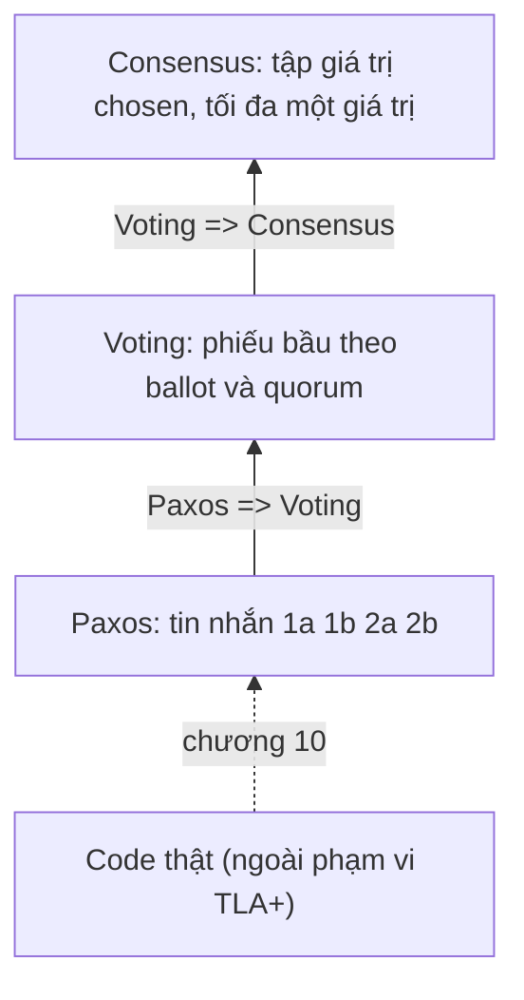
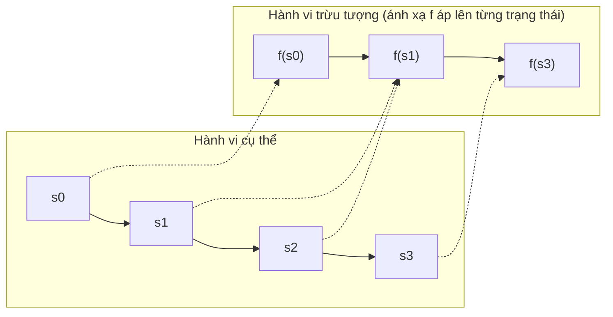
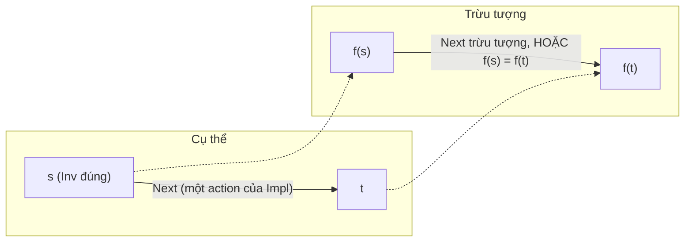

# P13 · Chương 07 — Refinement, abstraction và implementation

> Mọi khẳng định về TLA+ dựa trên *Specifying Systems* của Lamport (bản PDF trên trang tác giả), bài báo "The Temporal Logic of Actions" và kho `tlaplus/Examples` (ghim commit). Các đoạn spec trong chương là **minh họa**: người soạn không chạy TLC, không chạy code, nên chương **không** khẳng định kết quả model checking nào ngoài những gì nguồn tự ghi. Chỗ nào là lập luận tính tay của người soạn đều được ghi rõ.

## Bạn sẽ hiểu được gì

- **Q1.** "Hệ thống cài đặt (implement) một đặc tả" nghĩa chính xác là gì trong TLA+, và vì sao nói được rằng *implementation là implication*? → mục 1
- **Q2.** Vì sao một đặc tả phải cho phép stuttering step, và vì sao điều đó là điều kiện để refinement tồn tại? → mục 2
- **Q3.** `INSTANCE ... WITH` làm gì: nó thay thế cái gì bằng cái gì, và vì sao đó là công cụ nối hai mức trừu tượng? → mục 3
- **Q4.** Ẩn biến bằng `\EE` (∃ tạm thời) nghĩa là gì, và vì sao TLC không kiểm trực tiếp được? → mục 4
- **Q5.** Refinement mapping và step simulation là gì; kiểm "Impl ⇒ Spec" thực chất kiểm những gì? → mục 5
- **Q6.** Bộ nhớ có cache ghi xuyên (write-through) refine bộ nhớ tuyến tính (linearizable) như thế nào? → mục 6
- **Q7.** Trong thực tế dùng TLC kiểm refinement ra sao (cấu hình, bẫy, chuỗi Paxos → Voting → Consensus)? → mục 7
- **Q8.** Refinement không làm được gì (biến phụ, liveness) và TLAPS ở đâu trong bức tranh? → mục 8

## Kiến thức cần trước

- [Chương 02 — Toán nền tảng](02-toan-nen-tang.md): tập hợp, hàm, record, tuple, `Seq`; chương này dùng `[f EXCEPT ![x] = e]`, `Append`, `Head`, `Tail`.
- [Chương 03 — Trạng thái, hành vi, action](03-trang-thai-hanh-vi-action.md): `Init /\ [][Next]_vars`, ký hiệu `[A]_v`, state function, biến có dấu `'`.
- [Chương 04 — Invariant và TLC](04-invariant-va-tlc.md): file `.cfg`, `INVARIANT`, `PROPERTY`; mục 7 chỉ thêm cách dùng `PROPERTY` để kiểm refinement.
- [Chương 05 — Liveness và fairness](05-liveness-va-fairness.md): `WF`/`SF`; mục 8 chỉ nêu vì sao fairness làm refinement khó hơn.
- [P12 · Chương 09 — Consistency và consensus](../12-he-thong-du-lieu/09-consistency-va-consensus.md): định nghĩa linearizability ở mục 1 của chương đó; mục 6 của chương này đặt "bộ nhớ tuyến tính" của Lamport cạnh định nghĩa ấy.

## 1. Implementation là implication: `Impl => Spec` (Q1)

> **Trả lời ngắn.** Trong TLA, "hệ thống Sys cài đặt đặc tả Spec" có nghĩa đúng một điều: công thức `Sys => Spec` là một định lý[^impl-impl]. Vì TLA không phân biệt "mô tả hệ thống" với "đặc tả" — cả hai chỉ là công thức[^no-distinction] — nên bạn có thể viết cả thiết kế chi tiết lẫn yêu cầu trừu tượng bằng cùng một ngôn ngữ rồi hỏi cái trước có kéo theo cái sau không. Nói cách khác: mọi hành vi mà thiết kế chi tiết cho phép đều phải nằm trong tập hành vi mà đặc tả trừu tượng cho phép[^kb-behaviors].

**Giải thích.**

Hình dung (nhận xét của người soạn): bạn có file OpenAPI mô tả một dịch vụ và một codebase cài đặt dịch vụ đó. "Code đúng với hợp đồng" nghĩa là mọi cuộc hội thoại request/response mà code có thể sinh ra đều là cuộc hội thoại hợp đồng cho phép. Code được phép *chặt hơn* hợp đồng (ví dụ hợp đồng nói "có thể trả 503", code không bao giờ trả), nhưng không được *lỏng hơn*. `Impl => Spec` chính là phát biểu ấy, với "cuộc hội thoại" là một *behavior* (dãy trạng thái vô hạn, xem [chương 03](03-trang-thai-hanh-vi-action.md)).

*Bước 1 — công thức là tập hành vi.* Một đặc tả TLA+ mô tả tập mọi hành vi hợp lệ (execution trace) của hệ thống[^amz-behaviors]. Công thức `Spec` đúng/sai trên từng behavior; tập behavior làm nó đúng chính là "ngữ nghĩa" của đặc tả.

*Bước 2 — `=>` là bao hàm tập.* `Impl => Spec` đúng khi mọi behavior thỏa `Impl` cũng thỏa `Spec`. Ghi chú thực hành của extension VS Code của TLA+ phát biểu cùng ý: spec chi tiết refine spec cấp cao nếu mọi hành vi của bản chi tiết đều được bản cấp cao cho phép[^kb-behaviors]. Chiều mũi tên quan trọng: `Impl` có thể có *ít* hành vi hơn `Spec`, không được nhiều hơn.

*Bước 3 — "refinement" và "implementation" là một.* Lamport viết rằng refinement cùng nghĩa với implementation: "Ψ refine Π" nghĩa là Ψ cài đặt Π[^ar-refine-impl]; và trong TLA, refinement là implication[^ar-refine-impl2]. Trong chương này hai từ dùng thay nhau.

*Bước 4 — vì sao đáng làm: thang trừu tượng.* Nhóm kỹ sư Amazon mô tả TLA+ như một thang trừu tượng: tính chất đúng đắn ở bậc cao, thiết kế và thuật toán ở giữa, code và phần cứng ở bậc thấp[^amz-ladder]; người thiết kế có thể mô tả hệ thống ở vài mức trung gian, mỗi mức phục vụ một mục đích, rồi kiểm từng mức đúng so với mức cao hơn[^amz-verify-level]. Bắc cầu cũng chạy theo: Lamport chỉ ra rằng nếu một thuật toán cài đặt bộ nhớ-cache trừu tượng, mà bộ nhớ-cache ấy cài đặt giao diện processor/memory, thì theo tính bắc cầu của implication thuật toán cài đặt luôn giao diện[^ar-transitivity].

*Bước 5 — hai câu hỏi khác nhau.* (a) Đặc tả trừu tượng có thỏa các tính chất mong muốn không? — kiểm trên spec nhỏ, rẻ ([chương 04](04-invariant-va-tlc.md)). (b) Thiết kế chi tiết có `=>` đặc tả trừu tượng không? — đề tài của chương này. Nếu (a) và (b) cùng đúng thì tính chất của spec trừu tượng, miễn viết được bằng biến trừu tượng, đúng cho thiết kế chi tiết (suy luận của người soạn, từ bắc cầu của implication ở bước 4).



(Hai mũi tên liền là hai refinement có trong kho Examples — xem mục 7. Mũi tên đứt là việc nằm ngoài chương này.)

<details><summary>Đi sâu: chiều của mũi tên, determinism và những gì refinement không nói</summary>

- **Chiều.** `Impl => Spec` cho phép Impl chọn một nhánh duy nhất khi Spec có nhiều nhánh (Spec không-tất-định, Impl tất-định). Chiều ngược `Spec => Impl` hầu như không bao giờ đúng với thiết kế chi tiết, vì Impl có nhiều biến và nhiều ràng buộc hơn (nhận xét của người soạn).
- **An toàn khác sống còn.** Một đặc tả chỉ có dạng `Init /\ [][Next]_vars` cho phép hành vi mà hệ thống không làm gì, nên một hệ thống không làm gì cũng thỏa nó[^safety-nothing]. `Impl => Spec` trên phần "safety" vì vậy chưa nói Impl có tiến triển; việc ấy cần fairness (mục 8).
- **Đặc tả là công thức nên có thể so sánh hai spec bất kỳ.** Ghi chú của extension VS Code nhấn mạnh refinement là quan hệ về ngữ nghĩa (hành vi), không đòi hai spec chia sẻ biến hay module[^kb-semantic] — đó là lý do cần cơ chế ánh xạ ở mục 3 và 5.
- **Kiểm "tính chất đúng ở bậc cao" không thay cho kiểm refinement.** Nếu thiết kế chi tiết thêm một hành vi mà spec cấp cao cấm, mọi invariant của spec cấp cao vẫn đúng *cho spec cấp cao* nhưng không còn đảm bảo gì cho thiết kế (suy luận của người soạn).

</details>

**Quay lại Q1:** "cài đặt" là `Impl => Spec`: mọi hành vi của thiết kế chi tiết phải là hành vi hợp lệ của đặc tả trừu tượng — một quan hệ giữa hai công thức, cùng ngôn ngữ, kiểm được từng mức.

## 2. Stuttering: vì sao refinement cần "bước đứng yên" (Q2)

> **Trả lời ngắn.** Một *stuttering step* là bước không đổi biến nào của công thức đang xét. Dạng chuẩn của đặc tả TLA+ là `Init /\ [][Next]_vars` (dạng TLC xử lý[^tlc-std-form]), trong đó `[Next]_vars` *luôn cho phép* bước đứng yên — ví dụ đặc tả đồng hồ của sách là `HCini /\ [][HCnxt]_hr`[^stut-def]. Nhờ vậy khi thiết kế chi tiết làm nhiều bước nhỏ mà ở mức trừu tượng chỉ thấy một bước (hoặc không thấy gì), các bước nhỏ ấy được coi là stuttering của đặc tả trừu tượng, và `Impl => Spec` vẫn đúng. Lamport gọi đây là chìa khóa để tinh chỉnh độ hạt của nguyên tử (grain of atomicity)[^stut-grain].

**Giải thích.**

Hình dung (nhận xét của người soạn): hợp đồng API "ghi giá trị rồi đọc lại thì thấy giá trị mới" không quan tâm bên trong dịch vụ có một background thread flush buffer xuống đĩa hay đang rebalance connection pool. Với người gọi, mỗi lần flush là "không có gì xảy ra". Nếu hợp đồng bắt buộc *mỗi bước nội bộ* phải đổi một thứ nhìn thấy được, không cài đặt thực tế nào thỏa nổi.

*Bước 1 — nhắc lại từ chương 03.* Đồng hồ giờ, trạm thời tiết và ký hiệu `[HCnxt]_hr` đã được trình bày ở [chương 03, mục 4](03-trang-thai-hanh-vi-action.md); chương này chỉ dùng lại hai điểm. Một: công thức mô tả đồng hồ phải cho phép bước giữ `hr` nguyên[^stut-clock], nên Lamport định nghĩa `[HCnxt]_hr` là `HCnxt \/ (hr' = hr)`[^stut-def]. Hai: một stuttering step biểu diễn thay đổi chỉ ở phần của hệ thống mà công thức không mô tả; thêm nó vào behavior không được làm đổi chân trị của công thức[^stut-meaning].

*Bước 2 — mọi công thức hợp lệ đều "bất biến dưới stuttering".* Công thức F là *invariant under stuttering* nếu thêm hay bớt bước đứng yên khỏi behavior không đổi việc behavior có thỏa F hay không. Một công thức hợp lý phải có tính chất đó, và TLA chỉ cho phép viết công thức thời gian bất biến dưới stuttering[^stut-sensible]. Hành động trần như `x' = x + 1` thì không bất biến dưới stuttering[^stut-action-not]; còn `[][A]_v` thì có, vì nó chỉ ràng buộc những bước thật sự đổi `v`[^stut-box]. (Chương 03 đã nói điều này; nhắc lại vì refinement dựa trực tiếp vào nó.)

*Bước 3 — vì sao đây chính là điều kiện cho refinement.* Lamport lấy ví dụ hai chương trình: Program 2 mịn hơn Program 1, ba thao tác nguyên tử của mỗi vòng lặp ở Program 2 tương ứng với một thao tác nguyên tử ở Program 1[^stut-prog-fine]. Program 2 cài đặt Program 1 *chỉ vì* đặc tả của Program 1 cho phép các bước đứng yên không đổi `x` và `y`[^stut-prog]. Và ông nhận xét rằng hạn chế biểu đạt này không hẳn là bất lợi: TLA cho phép cài đặt mịn của đặc tả thô vì nó chỉ biểu diễn được các tính chất bất biến dưới stuttering[^stut-coarse].



(Bước `s1 -> s2` ở mức cụ thể không làm `f` đổi: nó là stuttering của đặc tả trừu tượng. Hai bước còn lại ứng với hai bước thật của đặc tả trừu tượng.)

<details><summary>Đi sâu: ví dụ stuttering trong cache; ∃ định nghĩa thế nào để vẫn bất biến dưới stuttering; fairness và bước đứng yên</summary>

- **Evict là stuttering ngay trong spec cache.** Trong spec write-through cache của Lamport, nếu địa chỉ cần evict không có trong cache thì `cache[p][a]` đã bằng `NoVal` và bước `Evict(p, a)` là một bước đứng yên[^stut-evict]. Tức là stuttering không phải khái niệm xa vời: ngay trong một spec tay viết đã có action đôi khi trở thành "không làm gì".
- **Ẩn biến và stuttering.** Định nghĩa trực quan của `\EE x : F` là: một behavior thỏa nó nếu tồn tại behavior thỏa `F` thu được bằng cách thêm/bớt stuttering step và đổi giá trị của `x`[^hide-semantic]. Bài báo TLA giải thích vì sao phải thêm stuttering *trước*: nếu chỉ đổi giá trị `x`, hai behavior chỉ khác nhau bởi bước đứng yên có thể một cái thỏa một cái không, và `∃ x : F` không còn bất biến dưới stuttering[^hide-paper-def].
- **Fairness phải đếm bước *không đứng yên*.** Khẳng định rằng một bước đứng yên *sẽ xảy ra* vô nghĩa, vì nó không bất biến dưới stuttering; nên fairness viết trên `<<A>>_v` chứ không trên `A`[^wf-stutter] (chi tiết ở [chương 05](05-liveness-va-fairness.md)).
- **Mặt trái.** Vì stuttering luôn được phép, một thiết kế có thể thỏa spec trừu tượng *chỉ* bằng cách làm vô hạn bước nội bộ mà mức trừu tượng không bao giờ tiến — refinement của phần safety không bắt được điều này (xem mục 8).

</details>

**Quay lại Q2:** mức trừu tượng không nhìn thấy bước nội bộ, nên đặc tả phải cho phép bước đứng yên; mọi công thức TLA đều bất biến dưới stuttering, và chính điều đó làm cho một thiết kế mịn (nhiều bước) có thể cài đặt một đặc tả thô (ít bước).

## 3. `INSTANCE ... WITH`: thay thế để nối hai mức (Q3)

> **Trả lời ngắn.** `M == INSTANCE Spec WITH p1 <- e1, ...` lấy mọi định nghĩa trong module `Spec`, thay mỗi tham số khai báo (hằng hoặc biến) `pi` bằng biểu thức `ei` của module hiện tại, và đặt kết quả vào tên có tiền tố `M!`[^sum-instance][^inst-prefix]. Vì `ei` có thể là *bất kỳ biểu thức nào*, kể cả một state function tính từ biến cụ thể, đây là chính cơ chế viết "đặc tả trừu tượng nhìn qua con mắt của thiết kế chi tiết".

**Giải thích.**

Hình dung (nhận xét của người soạn): module TLA+ giống một hàm generic có tham số kiểu *và* tham số trạng thái; `INSTANCE ... WITH` là cú pháp "đặc hóa" nó. Khác ở chỗ tham số trạng thái được thay bằng *biểu thức tính từ trạng thái cụ thể* — như một cái view trong SQL đặt lên bảng nội bộ.

*Bước 1 — instantiation là phép thay thế.* Mỗi định nghĩa `d` trong module `M` có một "định nghĩa thật" chỉ gồm toán tử dựng sẵn và tham số của `M`; câu lệnh instance tạo định nghĩa mới bằng cách thay các tham số bằng biểu thức bạn đưa[^inst-real]. Ví dụ trong chương FIFO của sách: `InChan == INSTANCE Channel WITH Data <- Message, chan <- in` đặt `InChan!Send`, `InChan!Init`... có nghĩa như trong `Channel` nhưng với `Message` thay `Data` và `in` thay `chan`[^inst-prefix].

*Bước 2 — phải thay đủ mọi tham số.* Định nghĩa của `IM!Σ` chỉ được chứa các tham số của module *hiện tại*, không chứa tham số của module được instance[^inst-params]. Do đó mọi tham số của module được instance đều phải được thay.

*Bước 3 — thay ngầm khi cùng tên.* Nếu tham số `p` không có phép thay rõ ràng, TLA+ hiểu là `p <- p`; câu lệnh `INSTANCE` khi đó phải nằm trong phạm vi một khai báo *hoặc định nghĩa* của `p`[^inst-implicit]. Chữ "hoặc định nghĩa" là điểm mấu chốt cho refinement: nếu module cụ thể *định nghĩa* một state function tên `chosen`, thì `INSTANCE Consensus` tự nhận nó thay cho biến `chosen` của `Consensus`. Kho Examples dùng đúng cách này (xem mục 7), và ghi chú của extension VS Code cũng viết rằng khi tên trùng thì không cần `WITH`[^kb-implicit].

*Bước 4 — thay bằng state function.* Ghi chú đó cũng nói: ánh xạ không giới hạn ở biến, có thể dùng bất kỳ state function nào[^kb-statefn]. Chính Lamport, trong spec Paxos của kho Examples, viết chú thích khi instance `Voting`: ông thay biến `maxBal` và state function `votes` định nghĩa sẵn trong module hiện tại vào các tham số cùng tên[^ex-inst-comment].

*Bước 5 — tham số hóa instance để ẩn biến.* Sách nói instance có tham số (`Inner(q) == INSTANCE ...`) hầu như chỉ dùng trong idiom ẩn biến[^inst-param-hide]; mục 4 dùng nó.

```tla
(* Đoạn trích từ một module cụ thể (đầy đủ ở mục 7) — minh họa, chưa chạy.
   Module Register ở mục 7 khai báo CONSTANTS Value, NoVal và VARIABLES val, ret.
   Module hiện tại có EXTENDS Sequences (cho Len). *)
CONSTANTS Value, NoVal
VARIABLES db, buf, ret

val == IF buf = <<>> THEN db ELSE buf[Len(buf)]   \* state function: không có dấu '

(* Cả ba cách viết dưới đây cùng nghĩa vì val được định nghĩa trong phạm vi: *)
Abs  == INSTANCE Register                          \* thay ngầm val <- val, ret <- ret, ...
Abs2 == INSTANCE Register WITH val <- val          \* thay tường minh một phần
Abs3 == INSTANCE Register WITH val <- IF buf = <<>> THEN db ELSE buf[Len(buf)]

AbsSpec == Abs!Spec                                \* đặc tả trừu tượng, đọc trên trạng thái cụ thể
```

<details><summary>Đi sâu: tiền tố <code>!</code>, instance không đổi tên, và dạng "TLC version 1"</summary>

- **Có hay không tiền tố.** Instance *có* đổi tên (`IM == INSTANCE ...`) là cần thiết khi dùng nhiều instance của module hoặc một instance tham số[^inst-rename]; còn `INSTANCE M WITH ...` đứng một mình nhập định nghĩa vào module hiện tại không đổi tên, và biểu thức thay phải thuộc phạm vi các khai báo/định nghĩa của module hiện tại[^inst-noren]. Trong refinement bạn gần như luôn dùng dạng có tên (`Abs!Spec`) để phân biệt với `Spec` của chính mình (nhận xét của người soạn).
- **Tóm tắt cú pháp trong bản TLA+ summary.** Câu lệnh `INSTANCE M WITH p1 <- e1, ..., pm <- em` định nghĩa lại mỗi toán tử `F` của `M` bằng cách thay các hằng/biến khai báo `pj` bởi `ej`[^sum-instance].
- **Lưu ý lịch sử về TLC.** File `MCWriteThroughCache.tla` trong kho Examples dùng module `WriteThroughCacheInstanced` thay cho `WriteThroughCache`, vì TLC "version 1" không xử lý được instantiation; module này khai triển tay các `INSTANCE` thành định nghĩa tương đương[^ex-v1][^ex-v1-equiv]. Sách (mục 14.1) mô tả cách làm khi dùng thẳng `instance`: thêm `instance ABCorrectness` vào module chạy TLC rồi đặt công thức đích vào `PROPERTIES` của file cấu hình[^book-inst-prop]. Ghi chú của extension VS Code cũng viết quy trình này: đặc tả trừu tượng là một `PROPERTY` của đặc tả cụ thể[^kb-howto]. Người soạn không đối chiếu thêm tài liệu TLC hiện hành, nên coi đây là hướng dẫn thực hành từ hai nguồn trên, không phải đặc tả của công cụ.

</details>

**Quay lại Q3:** `INSTANCE ... WITH` là phép thay thế tham số bằng biểu thức của module hiện tại; thay biến trừu tượng bằng một state function của trạng thái cụ thể biến đặc tả trừu tượng thành một công thức đọc được trên thiết kế chi tiết.

## 4. Ẩn biến bằng `\EE` (Q4)

> **Trả lời ngắn.** Biến trong spec dùng để *mô tả* hành vi (ví dụ hàng đợi `q` trong FIFO) thường là chi tiết nội bộ, không phải thứ người dùng hệ thống nhìn thấy. TLA+ ẩn biến đó bằng lượng từ tồn tại thời gian `\EE x : F` ("tồn tại một dãy giá trị cho `x` sao cho `F` đúng")[^hide-def]. Khi đặc tả cấp cao đã ẩn biến nội bộ thì "implementation là implication" đúng nguyên văn; nếu không ẩn thì cài đặt phải "cài đặt dưới một refinement mapping"[^hide-impl].

**Giải thích.**

Hình dung (nhận xét của người soạn): lớp có field `private`. Người gọi chỉ thấy phương thức `pub`; hợp đồng chỉ nói về các phương thức này. Field private tồn tại để *giải thích* hành vi, nhưng hợp đồng không đòi hỏi cài đặt phải có field cùng tên, cùng kiểu. `\EE` là cách nói "tồn tại *một cách nào đó* gán giá trị cho field private để mọi thứ khớp".

*Bước 1 — vì sao phải có biến nội bộ.* Hàng đợi `q` trong FIFO của sách là chuỗi tin đã gửi nhưng chưa nhận; nó dùng để *đặc tả* giá trị nào được gửi và nhận. Hình vẽ của hệ thống chỉ có kênh `in` và `out`, nên `q` là biến nội bộ và trong đặc tả cuối nên bị ẩn[^hide-fifo].

*Bước 2 — `\EE x : F` nghĩa là gì.* Công thức đúng với một behavior nếu tồn tại một dãy giá trị — một giá trị cho mỗi trạng thái — gán được cho `x` làm `F` đúng[^hide-def]. Khác với `\E r : F` (một giá trị `r` duy nhất), `\EE x : F` khẳng định có *một giá trị của `x` trong từng trạng thái*[^hide-exists-seq]. Cho mục đích viết đặc tả, có thể hiểu đơn giản là "`F` với `x` bị ẩn"[^hide-think]. Bài báo TLA cũng mô tả cách này: ta muốn đặc tả chỉ cách các biến giao diện đổi, không quan tâm biến khác đổi ra sao, nên ẩn biến `memory`[^hide-paper].

*Bước 2b — idiom trong TLA+.* Không viết thẳng `\EE q : Spec` được trong module đã khai báo `q`, vì sẽ khai báo lại `q`; sách dùng một module mới và một instance có tham số[^hide-idiom]. Dạng ASCII của Figure 5.3 như sau.

```tla
(* Theo Figure 5.3 của sách, viết lại bằng ASCII. *)
---------------------------- MODULE Memory ----------------------------
EXTENDS MemoryInterface
Inner(mem, ctl, buf) == INSTANCE InternalMemory
Spec == \EE mem, ctl, buf : Inner(mem, ctl, buf)!ISpec
=======================================================================
```

*Bước 3 — liên hệ với implementation.* Lamport nói rõ: hiding tường minh cho phép "implementation" là implication. Một đặc tả mức thấp chỉ có thể được kỳ vọng kéo theo đặc tả mức cao nếu biến nội bộ của mức cao — vốn có giá trị không quan trọng — được ẩn tường minh; nếu không thì implementation nghĩa là implementation dưới refinement mapping[^hide-impl]. Với ví dụ bộ nhớ, chứng minh `Spec => LM!Spec` được viết lại thành `Spec => \EE mem, ctl, buf : LM!Inner(mem, ctl, buf)!ISpec`, và theo quy tắc logic ta phải tìm "witness" cho `mem`, `ctl`, `buf`[^wit]. Các witness ấy chính là refinement mapping (mục 5).

*Bước 4 — hệ quả thực hành.* TLC không xử lý toán tử ẩn biến; sách khuyên kiểm đặc tả với biến nội bộ để lộ ra (spec "internal")[^tlc-no-exists]. Và nếu chỉ có mục tiêu thực hành thì thường không cần ẩn biến, chỉ cần viết spec "inner" và chú thích biến nào là nội bộ[^hide-optional].

<details><summary>Đi sâu: ∃ thời gian khác ∃ thường; TLC kiểm thế nào khi có biến ẩn; "ẩn" ở API và ở code</summary>

- **Một dãy giá trị chứ không phải một giá trị.** Ví dụ trong sách: `\EE x : [](x \in y)` nói `y` luôn có phần tử nào đó, nhưng phần tử `x` có thể khác nhau ở các trạng thái khác nhau[^hide-example]. Người học dễ nhầm với `\E x : [](x \in y)`, mệnh đề mạnh hơn nhiều (suy luận của người soạn).
- **Định nghĩa chính xác.** Bài báo định nghĩa `\EE x : F` thỏa bởi behavior σ khi có hai behavior ρ, τ sao cho `#σ = #ρ` (`#σ` là σ sau khi bỏ hết bước đứng yên, trừ phần đứng yên vô hạn ở cuối nếu có), ρ và τ chỉ khác nhau ở `x` (cách đọc ký hiệu `ρ =x τ` của người soạn), và τ thỏa `F`[^hide-paper-def][^hide-paper-formula]; vì thế nó bất biến dưới stuttering. Bài báo cũng nói `\EE` thật sự là lượng từ tồn tại vì nó tuân theo các luật thông thường[^hide-e1e2]; hai quy tắc E1/E2 của bài báo là chỗ để từ một witness (refinement mapping) suy ra công thức có `\EE` hai vế[^ar-memory-map].
- **Cách TLC kiểm khi đích có biến ẩn.** Giả sử đích là `ABSpec => \EE h : AB(h)!ABCSpec`. Sách nói TLC không kiểm trực tiếp vì không xử lý `\EE`; ta kiểm theo cách giống chứng minh: định nghĩa state function `oh` từ biến của module cụ thể và kiểm `ABSpec => AB(oh)!ABCSpec`, tức dùng refinement mapping[^tlc-via-mapping].
- **Ẩn ở code (nhận xét của người soạn).** Với Rust, "biến nội bộ" là field không `pub`; mục *Liên hệ với Rust* ở cuối chương khai thác phép so sánh này.

</details>

**Quay lại Q4:** `\EE x : F` ẩn `x` bằng cách đòi "tồn tại một dãy giá trị cho `x`"; việc kiểm `Impl => \EE x : ...` quy về việc đưa ra witness cho `x`, tức refinement mapping.

## 5. Refinement mapping và step simulation (Q5)

> **Trả lời ngắn.** *Refinement mapping* là một bộ biểu thức (state function, không có dấu `'`) tính các biến trừu tượng bị ẩn từ biến của thiết kế cụ thể; chúng là các "witness" cho `\EE`[^wit][^rm-def]. Sau khi chọn mapping, `Impl => Spec` quy về ba kiểm tra: trạng thái đầu của Impl ánh xạ thành trạng thái đầu của Spec; và mỗi bước Next của Impl, bắt đầu từ trạng thái thỏa một invariant `Inv`, hoặc ánh xạ thành một bước Next của Spec, hoặc không làm các biến trừu tượng đổi (stuttering) — gọi là *step simulation*[^step-sim].

**Giải thích.**

Hình dung (nhận xét của người soạn): bạn có schema DB nội bộ phức tạp và một API model đơn giản. Viết một `VIEW` (hoặc hàm `to_api(&db_row)`) biến trạng thái DB thành trạng thái API. Kiểm tra "mỗi transaction trong DB hoặc làm view đổi đúng như một thao tác API cho phép, hoặc không làm view đổi" chính là step simulation. Refinement mapping là cái view đó.

*Bước 1 — mapping là witness.* Muốn chứng minh một định lý dạng `Spec => \EE mem, ctl, buf : ...`, các quy tắc logic bắt ta tìm "witness" cho các biến bị lượng hóa[^wit]. Bộ witness gọi là refinement mapping; ta nói `Spec` cài đặt `ISpec` *dưới* mapping ấy[^rm-def].

*Bước 2 — công thức "gạch ngang".* Với công thức F của spec trừu tượng, ký hiệu `F̄` là F sau khi thế `mem`, `ctl`, `buf` bằng `omem`, `octl`, `obuf`[^rm-bar]. Phép thế phân phối qua `/\`, `[]`, `[...]_v`, tuple, nên `IInit /\ [][INext]_<<memInt,mem,ctl,buf>>` sau khi thế chỉ còn việc kiểm `Init /\ [][Next]_vars => IInit̄ /\ [][INext̄]_...`[^barring-distrib].

*Bước 3 — ba mệnh đề cần chứng minh.* Sách viết rằng công thức này được chứng minh bằng cách tìm một invariant `Inv` của `Spec` sao cho: `Init => IInit̄`, và `Inv /\ Next => INext̄ \/ UNCHANGED <<memInt, omem, octl, obuf>>`. Mệnh đề thứ hai tên *step simulation*: một bước Next xuất phát từ trạng thái thỏa Inv hoặc là một bước INext của spec trừu tượng (đổi bộ giá trị đã ánh xạ như INext đổi), hoặc để bộ đó nguyên[^step-sim][^step-rm-proof].

*Bước 4 — vì sao cần `Inv`.* Một bước cụ thể xuất phát từ trạng thái *bất kỳ* (kể cả trạng thái không thể tới được) có thể không mô phỏng được (suy luận của người soạn; mục 6 có ví dụ của sách về một trạng thái như vậy với `Coherence`). `Inv` cắt bỏ trạng thái không tới được. Ở sách mục 5.7, `Inv` được tìm sao cho là bất biến của *chính action `Next`* — gọi là bất biến *quy nạp* (inductive) — chứ không chỉ của `Spec`[^inductive-def]. Còn cách tìm `Inv` thì sách nói thẳng là không bàn[^find-inv].

*Bước 5 — chọn mapping cho bộ nhớ có cache.* Với bộ nhớ ghi xuyên, Lamport chọn `omem = vmem` (giá trị `wmem` sau khi mọi write còn trong hàng đợi được áp dụng), `octl[p]` bằng `ctl[p]` trừ khi là `"waiting"` thì bằng `"busy"`, và `obuf = buf`[^omem-def]. Mục 6 đi từng bước chứng minh vì sao các lựa chọn đó hợp lý.



<details><summary>Đi sâu: tổng quát hóa, "gạch ngang" với ENABLED, và cách TLC làm đúng ba việc này</summary>

- **Dạng tổng quát.** Để chứng minh `(\EE x1..xm : Ψ) => (\EE y1..yn : Φ)`, ta định nghĩa các state function `ȳ1..ȳn` từ biến xuất hiện trong Ψ rồi chứng minh `Ψ => Φ̄`, với `Φ̄` là Φ thay `yi` bởi `ȳi`[^rm-general]. Sau đó suy ra công thức ban đầu từ các quy tắc E1 và E2[^rm-general].
- **Ý nghĩa ngữ nghĩa.** `Ψ => Φ̄` khẳng định mọi dãy giá trị của các biến giao diện *và* của state function được ánh xạ mà Ψ cho phép cũng là dãy giá trị mà Φ cho phép cho các biến tương ứng[^rm-sem]. Có thể coi `memory` là state function "cụ thể" mà Ψ dùng để cài đặt biến "trừu tượng" `memory`[^rm-concrete].
- **Gạch ngang không luôn phân phối.** Phép thế phân phối qua nhiều toán tử, nhưng không phân phối qua `ENABLED`, nên không phân phối tự động qua `WF`, `SF`[^enabled-bar]. Ghi chú này quan trọng khi spec có fairness (mục 8).
- **TLC làm gì với ba việc trên.** Theo mô tả thuật toán của sách, với các thuộc tính (`PROPERTY`), TLC gom hai nhóm: `ImpliedInit` là hội các conjunct của thuộc tính là state predicate[^tlc-impliedinit], và `ImpliedAction` là hội các `[A]_v` mà một conjunct thuộc tính có dạng `[][A]_v`[^tlc-impliedaction]. Với mỗi trạng thái đầu, nó kiểm `ImpliedInit`[^tlc-init-check]; với mỗi bước `s -> t` sinh ra, nó kiểm `ImpliedAction`[^tlc-step-check]. Nếu `Abs!Spec == Abs!Init /\ [][Abs!Next]_<<...>>` thì đây chính xác là "Init ánh xạ đúng" và "mỗi bước mô phỏng được hoặc đứng yên" (suy luận của người soạn từ hai định nghĩa trên).
- **Bẫy: TLC chỉ kiểm trên trạng thái tới được.** Mọi trạng thái trong đồ thị TLC dựng đều tới được từ một trạng thái đầu[^tlc-reachable], nên TLC không cần `Inv` để loại trạng thái vô lý (suy luận của người soạn từ câu trước); nhưng nó chỉ chắc chắn trong phạm vi model hữu hạn bạn cấu hình (hằng nhỏ). Bằng chứng toàn bộ cần chứng minh (mục 8).

</details>

**Quay lại Q5:** refinement mapping là bộ state function đóng vai witness cho biến ẩn; kiểm `Impl => Spec` quy về `Init` ánh xạ đúng và step simulation (mỗi bước hoặc là một bước trừu tượng, hoặc đứng yên), cần một invariant quy nạp để loại trạng thái không tới được.

## 6. Ví dụ: cache ghi xuyên refine bộ nhớ tuyến tính (Q6)

> **Trả lời ngắn.** Chương 5 của Lamport đặc tả *bộ nhớ tuyến tính* (một chỗ nhớ `mem`, mỗi request truy cập `mem` ở một thời điểm nào đó giữa lúc gửi và lúc trả lời[^lin-mem]) rồi đặc tả một *cache ghi xuyên* với hàng đợi `memQ` và cache riêng cho từng processor, và khẳng định cache cài đặt bộ nhớ tuyến tính[^wt-impl][^thm-lm]. Chứng minh dùng refinement mapping `omem = vmem`: "bộ nhớ trừu tượng" là bộ nhớ chính *sau khi áp dụng mọi write đang xếp hàng*[^vmem-def].

**Giải thích.**

Hình dung (nhận xét của người soạn): bạn có dịch vụ ghi vào hàng đợi tác vụ rồi worker đẩy xuống DB, cộng cache cục bộ ở từng instance. Với người dùng, "giá trị" của key là giá trị cuối mà một request *đã xong* đã ghi — kể cả khi worker chưa đẩy xuống DB. Giá trị "thật" của hệ thống không nằm ở DB mà ở DB + hàng đợi; đó chính là ý của `vmem`. (Phép so sánh chỉ để hình dung: spec của Lamport nói về cache của processor và bộ nhớ chính, không phải Redis.)

*Bước 1 — spec trừu tượng: `InternalMemory`.* Mỗi processor `p` có `ctl[p] ∈ {"rdy","busy","done"}` và `buf[p]` chứa request hoặc phản hồi. Ba action: `Req(p)` gửi request, `Do(p)` thực hiện truy cập bộ nhớ[^req-do-rsp], `Rsp(p)` trả lời[^rsp-def]. Việc đặt `mem` *chỉ đổi ở `Do(p)`* là thứ biến đặc tả thành bộ nhớ tuyến tính: Lamport để truy cập `mem` xảy ra vào bất kỳ lúc nào giữa request và response[^lin-mem]. (Các tên `memInt`, `Send`, `Reply`, `MReq`, `Adr`, `Val`, `Proc`, `NoVal` trong đoạn spec dưới đây đến từ module `MemoryInterface`[^mem-iface]; chương này không đi vào chúng — chỉ cần biết `memInt` là biến giao diện giữa processor và bộ nhớ.) (Suy luận của người soạn: `Do(p)` là *điểm tuyến tính hóa* theo ngôn ngữ của [P12·09, mục 1](../12-he-thong-du-lieu/09-consistency-va-consensus.md); sách dùng cụm "linearizable memory" nhưng người soạn không thấy sách dùng chữ "linearization point".)

```tla
(* Chép lại theo InternalMemory, Figure 5.2: bản ASCII dùng trong kho Examples. *)
IInit == /\ mem \in [Adr -> Val]
         /\ ctl = [p \in Proc |-> "rdy"]
         /\ buf = [p \in Proc |-> NoVal]
         /\ memInt \in InitMemInt

Req(p) == /\ ctl[p] = "rdy"
          /\ \E req \in MReq :
                /\ Send(p, req, memInt, memInt')
                /\ buf' = [buf EXCEPT ![p] = req]
                /\ ctl' = [ctl EXCEPT ![p] = "busy"]
          /\ UNCHANGED mem

Do(p) == /\ ctl[p] = "busy"
         /\ mem' = IF buf[p].op = "Wr"
                     THEN [mem EXCEPT ![buf[p].adr] = buf[p].val]
                     ELSE mem
         /\ buf' = [buf EXCEPT ![p] = IF buf[p].op = "Wr"
                                         THEN NoVal
                                         ELSE mem[buf[p].adr]]
         /\ ctl' = [ctl EXCEPT ![p] = "done"]
         /\ UNCHANGED memInt

Rsp(p) == /\ ctl[p] = "done"
          /\ Reply(p, buf[p], memInt, memInt')
          /\ ctl' = [ctl EXCEPT ![p] = "rdy"]
          /\ UNCHANGED <<mem, buf>>

INext == \E p \in Proc : Req(p) \/ Do(p) \/ Rsp(p)
ISpec == IInit /\ [][INext]_<<memInt, mem, ctl, buf>>
```

*Bước 2 — spec cụ thể: `WriteThroughCache`.* Mỗi processor có `cache[p]`; yêu cầu tới bộ nhớ chính `wmem` đi qua hàng đợi `memQ` có độ dài tối đa `QLen`; "ghi xuyên" nghĩa là mọi lệnh ghi đều cập nhật bộ nhớ chính[^wt-through]. `DoWr(p)` ghi vào cache của `p`, cập nhật mọi cache khác đang giữ địa chỉ ấy và nối request ghi vào `memQ`; trong thực tế bước này là một giao dịch trên bus, nhưng ở mức cao Lamport biểu diễn thành *một* bước[^dowr-atomic]. `MemQWr` lấy write ở đầu `memQ` ghi vào `wmem`. Khi `RdMiss(p)` đã xếp một request đọc vào `memQ` thì `MemQRd` phải đọc giá trị từ write *cuối cùng* tới địa chỉ đó còn trong `memQ`, không phải từ `wmem`, nếu không hai cache có thể giữ giá trị khác nhau cho cùng địa chỉ[^memqrd]. Ngoài ra, `ctl[p]` có thêm giá trị `"waiting"` mà bộ nhớ trừu tượng không có[^ctl-waiting].

```tla
(* Các action then chốt của WriteThroughCache, chép từ WriteThroughCacheInstanced.tla trong Examples (bản đã khai triển INSTANCE; tên action đúng như trong WriteThroughCache.tla). *)
vmem == LET f[i \in 0 .. Len(memQ)] ==
              IF i = 0 THEN wmem
              ELSE IF memQ[i][2].op = "Rd"
                     THEN f[i-1]
                     ELSE [f[i-1] EXCEPT ![memQ[i][2].adr] = memQ[i][2].val]
        IN  f[Len(memQ)]

DoWr(p) == LET r == buf[p]
           IN  /\ (ctl[p] = "busy") /\ (r.op = "Wr")
               /\ Len(memQ) < QLen
               /\ cache' = [q \in Proc |->
                              IF (p = q) \/ (cache[q][r.adr] # NoVal)
                                THEN [cache[q] EXCEPT ![r.adr] = r.val]
                                ELSE cache[q]]
               /\ memQ' = Append(memQ, <<p, r>>)
               /\ buf' = [buf EXCEPT ![p] = NoVal]
               /\ ctl' = [ctl EXCEPT ![p] = "done"]
               /\ UNCHANGED <<memInt, wmem>>

MemQWr == LET r == Head(memQ)[2]
          IN  /\ (memQ # << >>) /\ (r.op = "Wr")
              /\ wmem' = [wmem EXCEPT ![r.adr] = r.val]
              /\ memQ' = Tail(memQ)
              /\ UNCHANGED <<memInt, buf, ctl, cache>>

MemQRd == LET p == Head(memQ)[1]
              r == Head(memQ)[2]
          IN  /\ (memQ # << >>) /\ (r.op = "Rd")
              /\ memQ' = Tail(memQ)
              /\ cache' = [cache EXCEPT ![p][r.adr] = vmem[r.adr]]
              /\ UNCHANGED <<memInt, wmem, buf, ctl>>

(* Ánh xạ: cái nhìn "bộ nhớ trừu tượng" đặt lên thiết kế cụ thể. Ba định nghĩa này là của MCWriteThroughCache.tla; hai dòng cuối (LM, THEOREM) là của cuối WriteThroughCache.tla. *)
omem == vmem
octl == [p \in Proc |-> IF ctl[p] = "waiting" THEN "busy" ELSE ctl[p]]
obuf == buf

LM == INSTANCE Memory
THEOREM Spec => LM!Spec        \* cache cài đặt bộ nhớ tuyến tính
```

*Bước 3 — đi tay một đoạn thực thi (minh họa của người soạn, không phải kết quả TLC).* Lấy `Proc = {p1, p2}`, một địa chỉ `a`, `QLen ≥ 1`, `wmem[a] = v1`, mọi cache rỗng. Cột phải tính ánh xạ `omem[a]` và `octl`; bảng cho thấy cả hai loại bước mà step simulation cho phép — bước trừu tượng thật sự (`Req`, `Do`) và bước đứng yên (**stuttering**):

| Bước cụ thể | `wmem[a]` | `memQ` | `omem[a] = vmem[a]` | Bước ở mức trừu tượng |
|---|---|---|---|---|
| (đầu) | `v1` | rỗng | `v1` | — |
| `Req(p1)`: ghi `a := v2` | `v1` | rỗng | `v1` | `Req(p1)` của `InternalMemory` |
| `DoWr(p1)` | `v1` | `<<p1, ghi v2>>` | `v2` | `Do(p1)`: `mem[a]` đổi từ `v1` sang `v2` |
| `MemQWr` | `v2` | rỗng | `v2` | **stuttering**: `vmem` không đổi |
| `Req(p2)`: đọc `a` | `v2` | rỗng | `v2` | `Req(p2)` |
| `RdMiss(p2)` (`ctl[p2]` thành `"waiting"`) | `v2` | `<<p2, đọc a>>` | `v2` | **stuttering**: `octl[p2]` vẫn là `"busy"` |
| `MemQRd` (nạp `vmem[a]` vào `cache[p2]`) | `v2` | rỗng | `v2` | **stuttering** (cache không được ánh xạ) |
| `DoRd(p2)` | `v2` | rỗng | `v2` | `Do(p2)`: `buf[p2]` nhận `mem[a]` |

Điểm đáng nhớ: bước `Do(p1)` ở mức trừu tượng xảy ra *ở `DoWr(p1)`*, khi `wmem` còn giữ giá trị cũ; còn `MemQWr` về sau, vốn là bước "thật sự ghi xuống bộ nhớ chính", lại là stuttering. Đó là lý do `omem` không thể là `wmem`.

<details><summary>Đi sâu: <code>Coherence</code> là bất biến nhưng không quy nạp; điều Inv phải nói thêm; <code>Evict</code>; cache khác bộ nhớ phần cứng</summary>

- **`Coherence` và `TypeInvariant`.** Spec cache khẳng định `[](TypeInvariant /\ Coherence)`: nếu hai processor cùng có bản sao của một địa chỉ thì hai bản sao bằng nhau[^coh-inv]. `TypeInvariant` là bất biến của action `Next` (một bất biến quy nạp)[^typeinv-inductive]; còn `Coherence` thì *không*, nên chứng minh nó cần một `Inv` mạnh hơn[^coh-not-inductive]. Sách dựng phản ví dụ: một trạng thái mà `cache[p1][a] = 1`, `wmem[a] = 2` và `memQ` chứa một request đọc của `p2` tại `a` thỏa `Coherence`, nhưng một bước `MemQRd` cho `cache[p2][a] = 2` khác `cache[p1][a] = 1`[^coh-cex]. Trạng thái xuất phát ấy không tới được từ `Init`, vì thế `Coherence` vẫn là bất biến của `Spec`[^coh-inv].
- **Suy luận của người soạn về `Inv` cho step simulation.** Bước `DoRd(p)` ở mức trừu tượng phải gán `buf[p] = mem[buf[p].adr]` (xem `Do(p)` ở trên), mà ở mức cụ thể `buf[p]` nhận `cache[p][a]`. Vì vậy `Inv` cần khẳng định ít nhất rằng bản sao mà `DoRd(p)` sắp đọc bằng `vmem` tại địa chỉ đó; cách phát biểu gọn nhất (người soạn đoán, chưa kiểm) là "mọi bản sao có sẵn trong cache bằng `vmem` tại địa chỉ đó" — mạnh hơn `Coherence`, vốn chỉ khẳng định các bản sao bằng *nhau*. Sách không nêu `Inv` đầy đủ, nên coi đây là cách đọc, không phải trích dẫn.
- **`Evict` không xuất hiện ở bên trái.** Lamport chủ ý để `Evict(p, a)` xảy ra bất kỳ lúc nào — trừ khi địa chỉ vừa được `MemQRd` nạp cho một request đọc mà `DoRd(p)` chưa chạy, tức `ctl[p] = "waiting"` và `buf[p].adr = a` — vì việc chọn *khi nào* evict là tối ưu hiệu năng, không ảnh hưởng đúng đắn thuật toán nên không nằm trong đặc tả[^evict-opt]. Với mapping trên, `Evict` không đổi `omem`, `octl`, `obuf`, nên luôn là stuttering (suy luận của người soạn từ định nghĩa).
- **Ba mức của cùng một câu chuyện.** Bài báo TLA mô tả một "cache trừu tượng" cho phép mọi chính sách chuyển giá trị giữa cache và bộ nhớ chính và nói rằng, với một thuật toán cache cụ thể, ta chứng minh nó cài đặt cache trừu tượng này[^cached-abstract]; bắc cầu cho ra thuật toán cài đặt giao diện processor/memory[^ar-transitivity].
- **Không nhầm với cache phần cứng.** [P4·06, mục 2](../04-concurrency/06-memory-model.md) giải thích cache coherence của phần cứng không thay thế memory ordering; thuộc tính `Coherence` ở đây là bất biến của một *thuật toán* trừu tượng, và nó *một mình* không đủ để nói thuật toán cài đặt bộ nhớ tuyến tính — cái đó là định lý `Spec => LM!Spec` (suy luận của người soạn).

</details>

**Quay lại Q6:** cache ghi xuyên cài đặt bộ nhớ tuyến tính dưới mapping `omem = vmem`, `octl` gộp `"waiting"` vào `"busy"`, `obuf = buf`; bước ghi xuống bộ nhớ chính và bước nạp cache đều là stuttering, còn `Do(p)` trừu tượng ứng với `DoWr(p)` hoặc `DoRd(p)` cụ thể.

## 7. Kiểm refinement bằng TLC: cấu hình, bẫy và ví dụ thật (Q7)

> **Trả lời ngắn.** Làm theo ba bước: (1) viết (hoặc `INSTANCE`) đặc tả trừu tượng và chọn refinement mapping; (2) trong module cụ thể đặt tên cho công thức cần kiểm, ví dụ `AbsSpec == Abs!Spec`; (3) trong file `.cfg` khai `SPECIFICATION Spec` và `PROPERTY AbsSpec`. Kho Examples của Lamport kiểm cache ghi xuyên cùng tinh thần này, với định nghĩa đã khai triển tay vì lý do ở mục 3[^ex-readme][^ex-cfg-prop]; còn với Voting và Paxos, file cấu hình đặt đúng dạng `PROPERTY ...SpecBar`[^mcvoting-ident][^mcpaxos-prop].

**Giải thích.**

Hình dung (nhận xét của người soạn): refinement check giống test "đối chiếu với mô hình tham chiếu": chạy implementation, sau mỗi bước hỏi "nhìn qua hàm `to_model`, bước này là thao tác hợp lệ của mô hình hay không đổi gì?". Khác ở chỗ TLC duyệt *mọi* thứ tự trong một model hữu hạn thay vì vài trace ngẫu nhiên.

*Bước 1 — công thức phải là một tên.* File cấu hình chỉ nhận định danh đơn. Trong `MCVoting.tla` Lamport giải thích: không đặt được `PROPERTY C!Spec` vào file cấu hình, nên định nghĩa `ConsensusSpecBar == C!Spec` rồi viết `PROPERTY ConsensusSpecBar`[^mcvoting-ident].

*Bước 2 — TLC kiểm gì.* `PROPERTY` được TLC chia làm kiểm trạng thái đầu và kiểm từng bước (`ImpliedInit`, `ImpliedAction`, xem mục 5)[^tlc-impliedinit][^tlc-impliedaction]. Với spec có fairness, sách nói TLC không kiểm "đặc tả kéo theo thuộc tính" một mạch: nó kiểm riêng phần safety của đặc tả kéo theo phần safety của thuộc tính, và đặc tả kéo theo phần liveness của thuộc tính[^tlc-prop-split] (liveness ở mục 8).

*Bước 3 — model nhỏ trước.* Cấu hình mẫu của Lamport cho cache ghi xuyên dùng hằng nhỏ: hai processor, một địa chỉ, hai giá trị, `QLen = 1`, với chú thích rằng đó là model rất nhỏ để TLC kiểm rất nhanh và nên tăng dần để thấy số trạng thái "bùng nổ" như thế nào[^ex-small-model]. Cấu hình cũng đặt `NoVal = NoVal` vì TLC không xử lý được `CHOOSE` không giới hạn trong định nghĩa của `NoVal`[^ex-noval]. Kho Examples cũng dùng cùng cấu hình để kiểm `TypeInvariant` và `Coherence` làm bất biến, rồi kiểm `LM_Inner_ISpec` làm `PROPERTY`[^ex-cfg-prop].

*Bước 4 — ví dụ thật: Consensus ← Voting ← Paxos.* Cấu trúc ba module và vai trò từng tầng được trình bày ở [chương 08, mục 4](08-dac-ta-giao-thuc-phan-tan.md); ở đây chỉ lấy phần liên quan đến refinement. Theo README của kho Examples (ghim commit), `Voting` là thuật toán đồng thuận rất trừu tượng kèm chứng minh mức cao rằng nó cài đặt `Consensus`, còn `Paxos` là thuật toán truyền tin cài đặt `Voting` và do đó cài đặt consensus[^paxos-voting-readme][^paxos-readme]. Đặc tả cấp cao nhất cực nhỏ: một tập `chosen`, tối đa một giá trị được chọn[^cons-spec]. Ở `Voting`, "được chọn" là có một quorum acceptor cùng bỏ phiếu cho giá trị ấy trong cùng một ballot[^voting-chosen], nên `chosen` là một *state function*, và `Voting` viết `C == INSTANCE Consensus` để thay biến `chosen` bằng nó[^inst-subst]. Phần chứng minh trong chính file gồm hai mệnh đề đúng theo mẫu mục 5[^voting-thm]. Ở `Paxos`, Lamport viết rõ phần "refinement mapping": `votes` được suy ra từ các tin nhắn loại `2b`, còn `V == INSTANCE Voting` thay `votes` và `maxBal`[^paxos-map][^paxos-votes]. Và để TLC kiểm, ông định nghĩa các công thức "gạch ngang": `ConsensusSpecBar == C!Spec` và `VotingSpecBar == V!Spec`, đặt chúng làm `PROPERTY` trong các file cấu hình `MCVoting.cfg` và `MCPaxos.cfg`[^mcvoting-ident][^mcpaxos-prop].

```tla
(* Từ Paxos.tla, rút gọn: mapping là một state function, rồi INSTANCE. *)
votes == [a \in Acceptor |->
           {<<m.bal, m.val>> : m \in {mm \in msgs : /\ mm.type = "2b"
                                                    /\ mm.acc = a}}]

V == INSTANCE Voting          \* thay ngầm maxBal <- maxBal, votes <- votes, ...

THEOREM Spec => V!Spec
```

*Bước 5 — kiểm từng bước từ một invariant (`MCISpec`).* Với `Paxos`, Lamport còn chuẩn bị sẵn công thức để TLC kiểm đúng mệnh đề step simulation: ông viết rằng để chứng minh `Spec` cài đặt `Spec` của `Voting` dưới mapping đã chọn, cần chứng minh `Inv /\ [Next]_vars => [V!Next]_<<votes, maxBal>>`[^mcpaxos-iprop]; với `Inv` quy nạp, điều này đúng khi và chỉ khi thuộc tính `MCIProp == [][V!Next]_<<votes, maxBal>>` được kéo theo bởi `MCISpec == IInv /\ [][Next]_vars`[^mcpaxos-iprop2]. Nói cách khác: lấy các trạng thái thỏa `IInv` (dạng viết lại của `Inv` để dùng làm vị từ đầu) làm trạng thái đầu, rồi cho TLC kiểm một bước `Next` mô phỏng được. (Trong `MCPaxos.cfg`, `MCIProp` nằm sau dấu chú thích `\*` bên cạnh `PROPERTY VotingSpecBar`, để người dùng bật khi cần[^mcpaxos-prop].)

Bây giờ ví dụ tự dựng, hướng backend: **bộ đệm ghi trễ (write-behind) cài đặt một register nguyên tử** (mỗi `Put`/`Get` là một bước; đây là dạng đơn giản nhất của "bộ nhớ tuyến tính" ở mục 6, không có request/response tách rời). Đây là minh họa của người soạn, không phải spec trong nguồn, và chưa chạy TLC; lập luận đúng sai bên dưới là tính tay. Ba module dưới đây nằm trong *ba file riêng* `Register.tla`, `RegisterSpec.tla`, `WriteBehind.tla` (TLC đòi mỗi module một file cùng tên, như chương 03 đã nói); `RegisterSpec` chỉ để minh họa idiom ẩn biến của mục 4, `WriteBehind` mới là module chạy TLC.

```tla
------------------------------ MODULE Register ------------------------------
CONSTANTS Value, NoVal
ASSUME NoVal \notin Value
VARIABLES val, ret          \* val: nội bộ (sẽ bị ẩn); ret: giá trị client đọc được

Init == /\ val \in Value
        /\ ret = NoVal

Put(v) == /\ val' = v
          /\ UNCHANGED ret

Get == /\ ret' = val
       /\ UNCHANGED val

Next == (\E v \in Value : Put(v)) \/ Get

Spec == Init /\ [][Next]_<<val, ret>>
=============================================================================

----------------------------- MODULE RegisterSpec ----------------------------
CONSTANTS Value, NoVal
VARIABLE ret

Inner(val) == INSTANCE Register
Spec == \EE val : Inner(val)!Spec         \* đặc tả cuối: chỉ nhìn thấy ret
=============================================================================

---------------------------- MODULE WriteBehind -----------------------------
EXTENDS Naturals, Sequences
CONSTANTS Value, NoVal, N
ASSUME /\ NoVal \notin Value
       /\ (N \in Nat) /\ (N > 0)
VARIABLES db, buf, ret
vars == <<db, buf, ret>>

TypeOK == /\ db \in Value
          /\ buf \in Seq(Value)
          /\ ret \in Value \cup {NoVal}

Init == /\ db \in Value
        /\ buf = <<>>
        /\ ret = NoVal

\* Ánh xạ: giá trị trừu tượng của register = write cuối còn trong buf, nếu không thì db.
val == IF buf = <<>> THEN db ELSE buf[Len(buf)]

Put(v) == /\ Len(buf) < N
          /\ buf' = Append(buf, v)
          /\ UNCHANGED <<db, ret>>

Flush == /\ buf # <<>>
         /\ db' = Head(buf)
         /\ buf' = Tail(buf)
         /\ UNCHANGED ret

Get == /\ ret' = val                      \* đọc "read-your-writes": nhìn cả buf
       /\ UNCHANGED <<db, buf>>

Next == \/ \E v \in Value : Put(v)
        \/ Flush
        \/ Get

Spec == Init /\ [][Next]_vars

Abs == INSTANCE Register                  \* thay ngầm val <- val (state function ở trên)
AbsSpec == Abs!Spec                       \* cái TLC sẽ kiểm làm PROPERTY
=============================================================================
```

```
\* WriteBehind.cfg (cú pháp theo MCWriteThroughCache.cfg trong Examples)
SPECIFICATION Spec
INVARIANT TypeOK
PROPERTY AbsSpec
CONSTANTS
  Value = {v1, v2}
  NoVal = NoVal
  N = 2
```

Lập luận tính tay vì sao step simulation đúng (suy luận của người soạn): `Init` cho `val = db ∈ Value`, `ret = NoVal`, khớp `Abs!Init`. `Put(v)` đặt phần tử cuối của `buf` là `v` nên `val' = v`, `ret` giữ nguyên: khớp `Abs!Put(v)`. `Get` không đổi `db`, `buf` nên không đổi `val`, và đặt `ret' = val`: khớp `Abs!Get`. `Flush` đẩy đầu `buf` xuống `db`: nếu `buf` có ít nhất hai phần tử thì phần tử cuối không đổi; nếu chỉ có một thì `db'` bằng chính phần tử ấy; trong cả hai trường hợp `val` không đổi và `ret` không đổi, tức là stuttering của `Abs`.

Còn một biến thể có lỗi: thay `Get` bằng `GetStale == ret' = db /\ UNCHANGED <<db, buf>>` (đọc thẳng từ `db`, bỏ qua `buf`). Tính tay: từ `Init` với `db = v1`, bước `Put(v2)` cho `buf = <<v2>>` và `val = v2`; rồi `GetStale` đặt `ret' = v1` trong khi `val` vẫn là `v2` và `ret` đổi, nên bước đó không phải `Abs!Get` (đòi `ret' = v2`) cũng không phải stuttering — vi phạm refinement. Đây là dạng "đọc cũ sau khi ghi đã xong" mà [P12·09, mục 1](../12-he-thong-du-lieu/09-consistency-va-consensus.md) nói linearizability cấm; (nhận xét của người soạn) refinement check bắt đúng lỗi kiểu này nhờ `ret` là biến nhìn thấy được.

<details><summary>Đi sâu: các bẫy khi cấu hình; model nhỏ; thời gian kiểm liveness; vì sao Examples dùng "bản đã khai triển"</summary>

- **`PROPERTY` phải là tên đơn.** Xem bước 1 ở trên[^mcvoting-ident].
- **Biến trừu tượng bị ẩn không phải biến của module cụ thể.** Ở ví dụ `WriteBehind`, `val` chỉ xuất hiện như state function; module cụ thể chỉ khai báo `db`, `buf`, `ret`. Đó là hệ quả của việc TLC không xử lý `\EE` nên ta kiểm bằng mapping thay vì bằng lượng từ[^tlc-no-exists].
- **Kiểm liveness chậm hơn.** Sách khuyên chỉ kiểm thuộc tính liveness sau khi đã tìm hết lỗi bằng bất biến[^live-slow].
- **Vì sao Examples dùng bản "đã khai triển".** Lý do được ghi trong `MCWriteThroughCache.tla`: TLC version 1 không xử lý được instantiation[^ex-v1]; module khai triển được mô tả là bản có các định nghĩa tương đương[^ex-v1-equiv]. Chi tiết ở mục 3.
- **Độ khó của `Inv` quy nạp trên spec thật.** Ví dụ thật — README thư mục Paxos kể bản thử đầu của `Inv` đúng là bất biến nhưng không đủ mạnh để quy nạp — đã được kể ở [chương 08, mục 4](08-dac-ta-giao-thuc-phan-tan.md); không nhắc lại ở đây.

</details>

**Quay lại Q7:** định nghĩa đặc tả trừu tượng đã được ánh xạ thành một công thức có tên (`Abs!Spec`), đặt nó làm `PROPERTY`; TLC kiểm trạng thái đầu và từng bước; thực hành thật là chuỗi `Paxos` → `Voting` → `Consensus` của Lamport.

## 8. Giới hạn: biến phụ, liveness, và TLAPS (Q8)

> **Trả lời ngắn.** Một refinement mapping không *luôn* tồn tại: Lamport nêu ví dụ hai chương trình có cùng tập hành vi nhìn thấy nhưng không có mapping nào đi được từ chương trình này sang chương trình kia, và cách chữa là thêm biến phụ (auxiliary variable)[^rm-need-not-exist][^aux-var]. Khi spec có fairness, phép thế "gạch ngang" không tự phân phối qua `ENABLED` nên phần liveness phải xử lý riêng[^enabled-bar]. Cuối cùng, kiểm bằng TLC chỉ đủ cho model hữu hạn; chứng minh bằng máy dùng TLAPS, với giới hạn về suy luận thời gian[^tlaps-safety][^tlaps-temporal].

**Giải thích.**

Hình dung (nhận xét của người soạn): view SQL luôn tính được từ bảng hiện tại, nhưng nếu trạng thái trừu tượng cần một thông tin mà hiện tại cụ thể không còn giữ (ví dụ "lần ghi trước đó là gì"), thì không view nào đủ. Phải bổ sung cột "lịch sử" vào mô hình cụ thể — biến phụ — rồi mới viết được view.

*Bước 1 — mapping không phải lúc nào cũng có.* Trong bài báo TLA, Φ chỉ có biến `x`, `y` và Ψ có thêm `sem`, `pc1`, `pc2`; hai công thức cho cùng dãy giá trị `x`, `y`, nhưng chiều `Φ => ∃ sem, pc1, pc2 : Ψ` không thể chứng minh bằng mapping, vì không suy ra được `sem`, `pc1`, `pc2` từ `x`, `y`[^rm-need-not-exist][^rm-cannot-infer]. Cách chữa: thêm biến phụ — biến thêm vào mà không đổi hành vi chương trình[^aux-var]. Định lý đầy đủ của Abadi–Lamport nói rằng, với giả thiết hợp lý, nếu kéo theo đúng thì về nguyên tắc thêm biến phụ cho phép tìm được mapping[^completeness].

*Bước 2 — liveness và `ENABLED`.* Phép thế "gạch ngang" phân phối qua nhiều toán tử nhưng không phân phối qua `ENABLED`, do đó không tự phân phối qua `WF`/`SF`[^enabled-bar]. Sách nói thêm rằng với các spec và mapping gặp trong thực tế, thay từng `WF` bằng phiên bản đã gạch ngang thường cho kết quả đúng, nhưng bạn có thể khai triển định nghĩa `WF`, `SF` để khỏi phụ thuộc vào điều đó[^barring-practice]. Trong kho Examples, spec cache có phiên bản có liveness, và chú thích trong file kiểm của Lamport ghi rằng hai định nghĩa `LM_Inner_Liveness`, `LM_Inner_Liveness2` khá rắc rối[^live-tricky]. Hệ quả cho người dùng (nhận xét của người soạn): kiểm safety của refinement trước; liveness là bước riêng, sách nói kiểm liveness chậm hơn nhiều so với các kiểu kiểm khác[^live-slow], và dễ sai.

*Bước 3 — mục tiêu và giới hạn của "bằng chứng".* Lamport viết thẳng: bạn có thể sẽ không bao giờ phải chứng minh một spec cài đặt spec khác, nhưng nên hiểu refinement mapping và step simulation để dùng TLC kiểm điều đó[^never-prove]. Lý do: toán học của chứng minh cài đặt đơn giản, nhưng với đặc tả của hệ thống thật chứng minh có thể rất khó[^proof-hard].

*Bước 4 — TLAPS.* Trang TLA+ của Lamport nêu hai công cụ chính: TLC (model checker) và TLAPS (hệ chứng minh)[^tla-tools]. Trang chủ TLAPS (trang sống; khi người soạn đọc hiển thị phiên bản 1.4.5) nói bản hiện hành không thực hiện suy luận thời gian và không xử lý một số tính năng của TLA+[^tlaps-temporal], nhưng đủ để kiểm chứng tính chất safety của thuật toán không tầm thường[^tlaps-safety]. Vì step simulation là mệnh đề safety (một bước), nó nằm trong phạm vi đó (suy luận của người soạn). Ví dụ thật: README thư mục Paxos nói chứng minh `Voting` cài đặt `Consensus` đã được Tristan mở rộng và kiểm bằng TLAPS (Lamport ghi "tôi tin rằng")[^paxos-voting-readme].

*Bước 5 — tinh chỉnh cả giao diện (interface refinement).* Đôi khi mức thấp không chỉ thêm chi tiết bên trong mà còn *biểu diễn lại* biến nhìn thấy (ví dụ số nguyên gửi thành chuỗi bit). Sách gọi là *interface refinement*: cách lấy đặc tả mức thấp bằng cách tinh chỉnh các biến của đặc tả mức cao[^interface-ref]; khi đó ta nói LImpl cài đặt HSpec *dưới* interface refinement IR[^interface-impl]. Sách xếp đây vào các tình huống khá hiếm[^interface-rare] và khuyên khi viết từ đầu nên viết một đặc tả nguyên khối[^compose-mono].

<details><summary>Đi sâu: trình tự chứng minh của sách cho cache; liveness của Lamport; vì sao "đủ" không phải "đúng"</summary>

- **Chứng minh `Ψ => Φ̄` cho bộ nhớ cache trừu tượng (bài báo TLA).** Lamport chứng minh ba phần: trạng thái đầu[^ar-proof-init], step simulation (quy tắc TLA2)[^ar-proof-outline] và fairness (quy tắc WF2)[^ar-proof-wf2]. Mapping trong bài báo cho `memory(m)` là cache nếu địa chỉ có trong cache, ngược lại là bộ nhớ chính[^ar-memory-def]; dùng quy tắc E1 rồi E2 để suy ra công thức có `\EE` hai vế[^ar-memory-map].
- **Fairness của spec cache có liveness.** Trong Examples, `LiveWriteThroughCache` định nghĩa `Liveness` bằng `WF` cho `Rsp(p) \/ DoRd(p)`, `SF` cho `RdMiss(p) \/ DoWr(p)` với từng processor, và `WF` cho `(QCond /\ MemQWr) \/ MemQRd`[^ex-liveness]. Đây là ví dụ mà phần liveness của mapping cần kiểm riêng (người soạn chỉ chép định nghĩa, không đối chiếu lại với chương 8 của sách).
- **Đừng nhầm "đã kiểm" với "đã chứng minh".** TLC trả lời cho model bạn cấu hình; Lamport cũng nhắc ngay trong cấu hình mẫu rằng model nhỏ để chạy nhanh và nên tăng dần[^ex-small-model]. Chỉ có chứng minh mới phủ mọi `Proc`, `Adr`, `Val` và `QLen` (nhận xét của người soạn).
- **Ghép thành phần.** Chương 10 của sách bàn về đặc tả hệ thống như phép hội các đặc tả thành phần; kết luận của mục 10.9 là thường chẳng khác nhiều[^compose-little] và nên viết một khối khi viết từ đầu[^compose-mono]. Chương này vì vậy không đi sâu vào composition.

</details>

**Quay lại Q8:** refinement mapping có thể không tồn tại nếu thiếu thông tin (cần biến phụ), liveness và `ENABLED` cần xử lý riêng, TLC chỉ phủ model hữu hạn, và TLAPS chứng minh được phần safety (gồm step simulation) nhưng không làm suy luận thời gian.

## Liên hệ với Rust và backend

Phần này là nhận xét của người soạn; các câu có gắn chú thích chỉ để nêu sự kiện về công cụ. Ví dụ code chỉ minh họa, chưa biên dịch, không đi kèm kết quả chạy.

**1. Refinement mapping là một hàm thuần từ trạng thái cụ thể sang trạng thái trừu tượng.** Trong TLA+, mapping là state function không có dấu `'`[^kb-statefn]; trong Rust điều đó tương ứng với một hàm nhận `&self` và trả giá trị, không có tác dụng phụ. Field "nội bộ" (không `pub`) của cấu trúc là biến bị ẩn; hàm `abs_val` dưới đây là witness của `\EE`.

```rust
use std::collections::VecDeque;

/// Bộ đệm ghi trễ: db là kho bền, buf là các lần ghi chưa flush.
struct WriteBehind {
    db: u64,
    buf: VecDeque<u64>,
}

impl WriteBehind {
    /// Ánh xạ tinh chỉnh: giá trị trừu tượng của register.
    fn abs_val(&self) -> u64 {
        self.buf.back().copied().unwrap_or(self.db)
    }

    fn put(&mut self, v: u64) {
        self.buf.push_back(v);
    }

    /// Bước nội bộ: ở mức trừu tượng nó phải là stuttering.
    fn flush(&mut self) {
        if let Some(v) = self.buf.pop_front() {
            self.db = v;
        }
    }
}
```

**2. Step simulation thành một hàm kiểm tra, dùng trong test.** Mỗi lần áp một bước lên cài đặt, so `abs` trước và sau: hoặc bằng nhau (stuttering) hoặc là một bước hợp lệ của mô hình trừu tượng. Hình dạng này có thể ghép với bất kỳ bộ sinh bước nào (proptest, hay duyệt toàn bộ như một model checker).

```rust
fn check_step<I, A: PartialEq>(
    state: &mut I,
    abs: impl Fn(&I) -> A,
    abstract_next: impl Fn(&A, &A) -> bool,
    step: impl FnOnce(&mut I),
) {
    let before = abs(&*state);
    step(&mut *state);
    let after = abs(&*state);
    assert!(before == after || abstract_next(&before, &after));
}
```

**3. Dùng đúng trực giác "stuttering".** Một tác vụ nền (flush, compaction, health-check, retry nội bộ) *phải* không đổi `abs` — nếu không, đặc tả trừu tượng bị lộ chi tiết cài đặt. Khi cảm thấy phải sửa mô hình trừu tượng để tác vụ nền "hợp lệ", đó là dấu hiệu mức trừu tượng sai (nhận xét của người soạn).

**4. Với model checker bằng Rust.** Crate `stateright` mô hình hóa hệ thống không tất định bằng trait `Model` (`init_states`, `actions`, `next_state`)[^sr-model] và kiểm thuộc tính *always* — tức safety/invariant[^sr-always]. Người soạn không thấy trang tài liệu gốc của crate nhắc "refinement"; nếu dùng, bạn tự viết hàm `abs` và biểu diễn step simulation như thuộc tính `always` trên cặp (trạng thái trước, sau), tương tự cách Lamport dùng `MCIProp` ở mục 7. Chương 10 của phase này bàn kỹ hơn.

**5. Hướng backend.** Tư duy "nhiều mức" rất hợp với vận hành dịch vụ: mức 0 là hợp đồng API (hoặc yêu cầu consistency như register tuyến tính), mức 1 là thiết kế (leader, log, cache), mức 2 là code. Mỗi mức có thể kiểm với mức trên (nhận xét của người soạn). Nhóm Amazon cũng mô tả một cách làm gần ý này: một kỹ sư AWS viết và model-check spec ở hai mức độ concurrency cho một thiết kế replication chịu lỗi, và nhờ đó hiểu thiết kế đủ để đề xuất một tối ưu giảm mạnh write latency[^amz-two-levels] — nguồn không nói hai spec ấy có quan hệ refinement hình thức hay không. Về nội dung nền: [P12·05 (replication)](../12-he-thong-du-lieu/05-replication.md) mô tả các thiết kế mức 1; [P12·08 (sự cố phân tán)](../12-he-thong-du-lieu/08-su-co-he-phan-tan.md) là loại sự kiện mà spec mức 1 nên nhúng vào `Next`; [P12·09](../12-he-thong-du-lieu/09-consistency-va-consensus.md) là yêu cầu mức 0 (linearizability). [P4·05](../04-concurrency/05-concurrency-bug-va-deadlock.md) và [P4·06](../04-concurrency/06-memory-model.md) nói về lỗi và mô hình ở cấp thread/phần cứng, nơi "độ hạt của nguyên tử" (mục 2) quyết định chương trình đúng hay sai.

## Tóm tắt

- Trong TLA, "cài đặt" là implication: `Impl => Spec`; nghĩa là mọi hành vi của Impl là hành vi hợp lệ của Spec; refinement và implementation là một.
- Nhờ implication bắc cầu, ta xếp được thang trừu tượng (yêu cầu → thiết kế → thuật toán) và kiểm từng bậc với bậc trên.
- Mọi công thức thời gian của TLA đều bất biến dưới stuttering (và `[][Next]_vars` luôn cho phép bước đứng yên), nên các bước nội bộ mà mức trừu tượng không thấy là bước đứng yên; đó là điều làm refinement khả thi và cho phép "tinh chỉnh độ hạt nguyên tử".
- `INSTANCE ... WITH` thay tham số của module bằng biểu thức của module hiện tại (kể cả state function); thay ngầm khi tên trùng; kết quả có tiền tố `M!`.
- `\EE x : F` ẩn biến nội bộ: tồn tại một dãy giá trị cho `x`; với biến bị ẩn, "implementation là implication" đúng nguyên nghĩa, và việc chứng minh cần witness.
- Witness chính là refinement mapping: bộ state function tính biến trừu tượng từ biến cụ thể; step simulation đòi mỗi bước Next (xuất phát từ `Inv`) hoặc ánh xạ thành bước trừu tượng hoặc để biến trừu tượng nguyên.
- Cache ghi xuyên cài đặt bộ nhớ tuyến tính dưới `omem = vmem`, `octl` gộp `"waiting"` vào `"busy"`, `obuf = buf`; `Do(p)` ứng với `DoWr`/`DoRd`, còn `MemQWr`/`MemQRd`/`RdMiss`/`Evict` là stuttering (bảng ở mục 6 là tính tay của người soạn).
- Với TLC: định nghĩa `Abs!Spec` thành tên đơn, đặt làm `PROPERTY`; TLC kiểm trạng thái đầu và từng bước; chuỗi `Consensus ← Voting ← Paxos` là ví dụ thật.
- Giới hạn: mapping có thể không tồn tại (cần biến phụ), fairness làm phép thế khó, TLC chỉ phủ model hữu hạn; TLAPS chứng minh safety nhưng bản hiện hành không làm suy luận thời gian.

## Câu hỏi tự kiểm tra

1. Trong TLA, "Sys cài đặt Spec" nghĩa chính xác là gì, và tại sao Lamport nói TLA không phân biệt hệ thống với đặc tả?
2. `Impl` có thể có ít hành vi hơn `Spec` không? Nhiều hơn thì sao? Cho một ví dụ backend.
3. Vì sao đặc tả đồng hồ phải cho phép bước giữ `hr` nguyên? Liên hệ với việc cài đặt mịn hơn đặc tả thô.
4. `x' = x + 1` và `[][x' = x + 1]_x` khác nhau thế nào dưới góc nhìn "bất biến dưới stuttering"?
5. Cho `Abs == INSTANCE Register` trong module có định nghĩa `val == IF buf = <<>> THEN db ELSE buf[Len(buf)]`. Mỗi tham số của `Register` được thay bằng gì?
6. `\EE x : F` khác `\E x : [](...)` thế nào? Viết bằng lời.
7. Vì sao TLC không kiểm trực tiếp `Impl => \EE h : Abs(h)!Spec`, và ta làm gì thay thế?
8. Liệt kê ba việc cần kiểm để `Impl` cài đặt `Spec` dưới mapping. `Inv` đóng vai gì, và vì sao `Coherence` một mình chưa đủ làm `Inv` cho cache?
9. Trong bảng đi tay ở mục 6, vì sao `MemQWr` là stuttering còn `DoWr(p1)` thì không?
10. Biến thể `GetStale` của `WriteBehind` vi phạm refinement ở bước nào? Nó tương ứng với loại lỗi gì ở P12·09?
11. Cho một ví dụ vì sao refinement mapping có thể không tồn tại, và biến phụ chữa như thế nào?
12. TLAPS làm được gì và chưa làm được gì (theo trang chủ), và step simulation nằm ở phía nào?

<details><summary>Đáp án</summary>

1. `Sys => Spec` là định lý[^impl-impl]; TLA coi cả hệ thống và đặc tả đều chỉ là công thức[^no-distinction].
2. Ít hơn thì được (Impl chặt hơn Spec: ví dụ Spec cho phép "có thể trả 503", Impl không bao giờ trả); nhiều hơn thì không, vì khi đó có hành vi của Impl không thuộc Spec[^kb-behaviors]. Ví dụ là nhận xét của người soạn.
3. Đồng hồ trong trạm thời tiết còn đổi nhiệt độ, nên có bước không đổi `hr`; đặc tả phải cho phép các bước đó[^stut-clock][^stut-def]. Tương tự, cài đặt mịn có bước nội bộ vô hình với mức thô, và Program 2 cài đặt Program 1 chỉ vì Program 1 cho phép các bước đứng yên[^stut-prog].
4. `x' = x + 1` (hành động trần) không bất biến dưới stuttering[^stut-action-not]; `[][x' = x + 1]_x` thì bất biến, vì chỉ ràng buộc những bước đổi `x`[^stut-box].
5. `Value <- Value`, `NoVal <- NoVal`, `ret <- ret` (biến cụ thể cùng tên) và `val <- val` (state function ở trên), thay ngầm theo quy tắc `p <- p` trong phạm vi định nghĩa[^inst-implicit].
6. `\EE x : F` khẳng định tồn tại một giá trị của `x` *trong từng trạng thái*, có thể thay đổi theo trạng thái[^hide-exists-seq]; còn `\E x : [](...)` đòi một giá trị cố định cho mọi trạng thái (suy luận của người soạn, từ định nghĩa trong chú thích).
7. TLC không xử lý toán tử ẩn biến; cách kiểm là đưa ra state function `oh` (refinement mapping) và kiểm `ABSpec => AB(oh)!ABCSpec`[^tlc-via-mapping].
8. Trạng thái đầu ánh xạ thành trạng thái đầu trừu tượng; step simulation; và `Inv` quy nạp[^step-sim]. `Inv` loại trạng thái không tới được; `Coherence` không phải bất biến của `Next`[^coh-not-inductive], và (suy luận) bước `DoRd` cần `Inv` nói rằng bản sao trong cache bằng `vmem`.
9. `MemQWr` ghi vào `wmem` giá trị đã nằm sẵn trong `vmem` nên `vmem` không đổi; `DoWr(p1)` thêm một write vào `memQ` nên `vmem` đổi, ứng với `Do(p1)`[^vmem-def]. Bảng là tính tay của người soạn.
10. Ở `GetStale` sau `Put(v2)`: nó đặt `ret' = v1` trong khi `val = v2`; không khớp `Abs!Get` cũng không đứng yên. Đó là đọc cũ sau ghi xong, loại lỗi mà linearizability cấm (P12·09, mục 1). Lập luận tính tay.
11. Hai chương trình cùng dãy `x`, `y` nhưng `sem`, `pc1`, `pc2` không suy ra được từ `x`, `y`[^rm-cannot-infer]; thêm biến phụ không đổi hành vi, rồi mapping được phép phụ thuộc cả biến phụ[^aux-var][^completeness].
12. Bản hiện hành không làm suy luận thời gian nhưng đủ để kiểm tính chất safety[^tlaps-temporal][^tlaps-safety]; step simulation là mệnh đề một bước, nên về nguyên tắc thuộc phía safety (suy luận của người soạn).

</details>

## Đọc thêm

- [Specifying Systems, chương 5 (A Caching Memory), mục 5.3 và 5.6–5.8](https://lamport.azurewebsites.net/tla/book-02-08-08.pdf): đặc tả bộ nhớ tuyến tính, cache ghi xuyên, invariant và định nghĩa refinement mapping, step simulation.
- [Specifying Systems, mục 4.2–4.3](https://lamport.azurewebsites.net/tla/book-02-08-08.pdf): instantiation là phép thay thế và idiom ẩn biến bằng `Inner(q) == INSTANCE ...`.
- [Specifying Systems, mục 8.9 (Temporal Logic Examined) và 10.8 (Interface Refinement)](https://lamport.azurewebsites.net/tla/book-02-08-08.pdf): hiding và implementation, refinement mapping với fairness, interface refinement.
- [Specifying Systems, mục 14.1 và 14.3](https://lamport.azurewebsites.net/tla/book-02-08-08.pdf): TLC kiểm đặc tả có biến ẩn thế nào và cách TLC kiểm `PROPERTY`.
- [Lamport, The Temporal Logic of Actions, mục 7.4 và 8](https://lamport.azurewebsites.net/pubs/lamport-actions.pdf): stuttering và refinement, ∃ và hiding, refinement mapping, biến phụ và tính đầy đủ.
- [Newcombe et al., How Amazon Web Services Uses Formal Methods](https://lamport.azurewebsites.net/tla/formal-methods-amazon.pdf): "thang trừu tượng" và việc viết spec ở nhiều mức.
- [tlaplus/Examples, thư mục CachingMemory (ghim commit)](https://github.com/tlaplus/Examples/tree/6a7b26a31c1a6aeec789b455e9bbfa3b3ad2728f/specifications/SpecifyingSystems/CachingMemory): `WriteThroughCache`, `MCWriteThroughCache.cfg` kiểm refinement.
- [tlaplus/Examples, thư mục Paxos (ghim commit)](https://github.com/tlaplus/Examples/tree/6a7b26a31c1a6aeec789b455e9bbfa3b3ad2728f/specifications/Paxos): `Consensus`, `Voting`, `Paxos` và các file `MC*` kiểm refinement.
- [TLAPS — TLA+ Proof System](https://proofs.tlapl.us/doc/web/content/Home.html) (trang sống): hệ chứng minh và phạm vi hiện tại.
- [P12 · Chương 09 — Consistency và consensus](../12-he-thong-du-lieu/09-consistency-va-consensus.md), mục 1 (linearizability) và 6–7 (Paxos, Raft): yêu cầu mức trên của các ví dụ trong chương này.
- [Chương 08 — Đặc tả giao thức phân tán](08-dac-ta-giao-thuc-phan-tan.md), [Chương 09 — Mô hình hóa hệ backend](09-mo-hinh-hoa-he-backend.md) và [Chương 10 — Từ đặc tả đến code Rust](10-tu-dac-ta-den-code-rust.md): áp dụng nhiều mức vào giao thức phân tán, hệ backend và code.

[^impl-impl]: Specifying Systems (Lamport), mục 5.8 Proving Implementation — <https://lamport.azurewebsites.net/tla/book-02-08-08.pdf> — "In TLA, implementation is implication. A system described by a formula Sys implements a specification Spec iff Sys implies Spec"
[^no-distinction]: Specifying Systems (Lamport), mục 5.8 Proving Implementation — <https://lamport.azurewebsites.net/tla/book-02-08-08.pdf> — "TLA makes no distinction between system descriptions and specifications; they are both just formulas."
[^thm-lm]: Specifying Systems (Lamport), mục 5.8 Proving Implementation — <https://lamport.azurewebsites.net/tla/book-02-08-08.pdf> — "every behavior satisfying specification Spec of the write-through cache also satisfies LM !Spec, the specification of a linearizable memory"
[^kb-behaviors]: tlaplus/vscode-tlaplus, resources/knowledgebase/tla-refinement.md (commit 60260075203e463a6cf55fad7fa3051d4c320f9d; ghi chú của extension, không phải tài liệu TLC chính thức) — <https://raw.githubusercontent.com/tlaplus/vscode-tlaplus/60260075203e463a6cf55fad7fa3051d4c320f9d/resources/knowledgebase/tla-refinement.md> — "In short: **Implementation Spec** refines **High-Level Spec** if every behavior of the implementation is *allowed* by the high-level spec."
[^kb-semantic]: tlaplus/vscode-tlaplus, resources/knowledgebase/tla-refinement.md (commit 60260075203e463a6cf55fad7fa3051d4c320f9d) — <https://raw.githubusercontent.com/tlaplus/vscode-tlaplus/60260075203e463a6cf55fad7fa3051d4c320f9d/resources/knowledgebase/tla-refinement.md> — "Refinement is semantic: it’s about the meaning of the specs (their behaviors), not about syntax. Specs don’t have to share variables or modules."
[^amz-behaviors]: Newcombe et al., How Amazon Web Services Uses Formal Methods — <https://lamport.azurewebsites.net/tla/formal-methods-amazon.pdf> — "A TLA+ specification describes the set of all possible legal behaviors (execution traces) of a system."
[^amz-ladder]: Newcombe et al., How Amazon Web Services Uses Formal Methods — <https://lamport.azurewebsites.net/tla/formal-methods-amazon.pdf> — "In TLA+, correctness properties and system designs are just steps on a ladder of abstraction, with correctness properties occupying higher levels, systems designs and algorithms in the middle, and executable code and hardware at the lower levels."
[^amz-verify-level]: Newcombe et al., How Amazon Web Services Uses Formal Methods — <https://lamport.azurewebsites.net/tla/formal-methods-amazon.pdf> — "The designer can then verify that each level is correct with respect to a higher level."
[^amz-two-levels]: Newcombe et al., How Amazon Web Services Uses Formal Methods — <https://lamport.azurewebsites.net/tla/formal-methods-amazon.pdf> — "C.N. wrote and model checked specifications at two levels of concurrency, and these specifications helped him understand the design well enough to propose a major optimization that radically reduced write latency in that system."
[^ar-refine-impl]: Lamport, The Temporal Logic of Actions, mục 9.5.1 Program Derivation — <https://lamport.azurewebsites.net/pubs/lamport-actions.pdf> — "Refinement is the same as implementation—Ψ refines Π means that Ψ implements Π."
[^ar-refine-impl2]: Lamport, The Temporal Logic of Actions, mục 9.5.1 Program Derivation — <https://lamport.azurewebsites.net/pubs/lamport-actions.pdf> — "In TLA, refinement is implication, and we have shown how one can prove that a finer-grained algorithm refines a coarser-grained one."
[^ar-transitivity]: Lamport, The Temporal Logic of Actions, mục 8.3.1 Implementing The Memory Specification — <https://lamport.azurewebsites.net/pubs/lamport-actions.pdf> — "By the transitivity of implication, this proves that the algorithm implements the memory/processor interface."
[^safety-nothing]: Specifying Systems (Lamport), mục 8.9.2 Machine Closure — <https://lamport.azurewebsites.net/tla/book-02-08-08.pdf> — "allows behaviors in which the system does nothing. Therefore, the specification is satisfied by a system that does nothing."
[^stut-clock]: Specifying Systems (Lamport), mục 2.2 An Hour Clock — <https://lamport.azurewebsites.net/tla/book-02-08-08.pdf> — "A formula that describes any hour clock must allow steps that leave hr unchanged"
[^stut-def]: Specifying Systems (Lamport), mục 2.2 An Hour Clock — <https://lamport.azurewebsites.net/tla/book-02-08-08.pdf> — "In TLA, we let [HCnxt]hr stand for HCnxt ∨ (hr 0 = hr ), so we can write the formula more compactly as HCini ∧ 2[HCnxt]hr ."
[^stut-meaning]: Specifying Systems (Lamport), mục 8.1 Temporal Formulas — <https://lamport.azurewebsites.net/tla/book-02-08-08.pdf> — "A stuttering step represents a change only to some part of the system not described by the formula; adding it to the behavior should not affect the truth of the formula."
[^stut-sensible]: Specifying Systems (Lamport), mục 8.1 Temporal Formulas — <https://lamport.azurewebsites.net/tla/book-02-08-08.pdf> — "A sensible formula should be invariant under stuttering. There’s no point writing formulas that aren’t sensible, so TLA allows you to write only temporal formulas that are invariant under stuttering."
[^stut-action-not]: Specifying Systems (Lamport), mục 8.1 Temporal Formulas — <https://lamport.azurewebsites.net/tla/book-02-08-08.pdf> — "An arbitrary action is not invariant under stuttering."
[^stut-box]: Specifying Systems (Lamport), mục 8.1 Temporal Formulas — <https://lamport.azurewebsites.net/tla/book-02-08-08.pdf> — "In general, the formula 2[A]v is invariant under stuttering, for any action A and state function v ."
[^stut-grain]: Lamport, The Temporal Logic of Actions, mục 7.4 Stuttering and Refinement — <https://lamport.azurewebsites.net/pubs/lamport-actions.pdf> — "Allowing stuttering steps is the key to refining the grain of atomicity."
[^stut-prog-fine]: Lamport, The Temporal Logic of Actions, mục 7.4 Stuttering and Refinement — <https://lamport.azurewebsites.net/pubs/lamport-actions.pdf> — "Program 2 is finer grained than Program 1, in the sense that the three atomic operations of each process’s loop in Program 2 correspond to a single atomic operation of Program 1."
[^stut-prog]: Lamport, The Temporal Logic of Actions, mục 7.4 Stuttering and Refinement — <https://lamport.azurewebsites.net/pubs/lamport-actions.pdf> — "Program 2 implements Program 1—that is, the formula Ψ ⇒ Φ is valid—only because Φ allows stuttering steps that do not change x and y."
[^stut-coarse]: Lamport, The Temporal Logic of Actions, mục 9.4 — <https://lamport.azurewebsites.net/pubs/lamport-actions.pdf> — "TLA allows fine-grained implementations of coarser-grained specifications because it can express only properties that are invariant under stuttering."
[^stut-evict]: Specifying Systems (Lamport), mục 5.6 A Write-Through Cache — <https://lamport.azurewebsites.net/tla/book-02-08-08.pdf> — "then cache[p][a] already equals NoVal and an Evict(p, a) step is a stuttering step."
[^wf-stutter]: Specifying Systems (Lamport), mục 8.4 Weak Fairness — <https://lamport.azurewebsites.net/tla/book-02-08-08.pdf> — "It’s silly to assert that a stuttering step eventually occurs, since such an assertion is not invariant under stuttering."
[^sum-instance]: Summary of TLA+ (Lamport) — <https://lamport.azurewebsites.net/tla/summary-standalone.pdf> — "For each defined operator F of module M , this defines F to be the operator whose definition is obtained from the definition of F in M by replacing each declared constant or variable p j of M with e j ."
[^inst-prefix]: Specifying Systems (Lamport), mục 4.1 The Inner Specification — <https://lamport.azurewebsites.net/tla/book-02-08-08.pdf> — "this defines InChan !σ to have the same meaning in the current module as σ had in module Channel , except with Message substituted for Data and in substituted for chan."
[^inst-params]: Specifying Systems (Lamport), mục 4.2.1 Instantiation Is Substitution — <https://lamport.azurewebsites.net/tla/book-02-08-08.pdf> — "must contain only the parameters (declared constants and variables) of the current module, not the ones of module M . Hence, the p i must consist of all the parameters of module M"
[^inst-subst]: tlaplus/Examples, specifications/Paxos/Voting.tla (commit 6a7b26a31c1a6aeec789b455e9bbfa3b3ad2728f) — <https://raw.githubusercontent.com/tlaplus/Examples/6a7b26a31c1a6aeec789b455e9bbfa3b3ad2728f/specifications/Paxos/Voting.tla> — "The following statement instantiates module Consensus with the constant Value of this module substituted for the constant Value of module Consensus, and the state function chosen defined in this module substituted for the variable chosen of module Value."
[^inst-implicit]: Specifying Systems (Lamport), mục 4.2.3 Implicit Substitutions — <https://lamport.azurewebsites.net/tla/book-02-08-08.pdf> — "If some parameter p has no explicit substitution, then there is an implicit substitution p ← p. This means that the instance statement must lie within the scope of a declaration or definition of the symbol p."
[^inst-noren]: Specifying Systems (Lamport), mục 4.2.4 Instantiation Without Renaming — <https://lamport.azurewebsites.net/tla/book-02-08-08.pdf> — "The expressions substituted for an instantiated module’s parameters must be defined."
[^inst-param-hide]: Specifying Systems (Lamport), mục 4.2.2 Parametrized Instantiation — <https://lamport.azurewebsites.net/tla/book-02-08-08.pdf> — "Parametrized instantiation is used almost exclusively in the TLA+ idiom for variable hiding, described in Section 4.3."
[^kb-implicit]: tlaplus/vscode-tlaplus, resources/knowledgebase/tla-refinement.md (commit 60260075203e463a6cf55fad7fa3051d4c320f9d) — <https://raw.githubusercontent.com/tlaplus/vscode-tlaplus/60260075203e463a6cf55fad7fa3051d4c320f9d/resources/knowledgebase/tla-refinement.md> — "If the implementation defines a symbol with the same name as in the high-level spec, the mapping is implicit and `WITH` is not required (though you can still use it explicitly if desired)."
[^kb-statefn]: tlaplus/vscode-tlaplus, resources/knowledgebase/tla-refinement.md (commit 60260075203e463a6cf55fad7fa3051d4c320f9d) — <https://raw.githubusercontent.com/tlaplus/vscode-tlaplus/60260075203e463a6cf55fad7fa3051d4c320f9d/resources/knowledgebase/tla-refinement.md> — "The refinement mapping isn't limited to variables—it can use any **state function**."
[^kb-howto]: tlaplus/vscode-tlaplus, resources/knowledgebase/tla-refinement.md (commit 60260075203e463a6cf55fad7fa3051d4c320f9d) — <https://raw.githubusercontent.com/tlaplus/vscode-tlaplus/60260075203e463a6cf55fad7fa3051d4c320f9d/resources/knowledgebase/tla-refinement.md> — "**Verify refinement using TLC** by ensuring that the abstract specification is a `PROPERTY` of the concrete specification."
[^ex-inst-comment]: tlaplus/Examples, specifications/Paxos/Paxos.tla (commit 6a7b26a31c1a6aeec789b455e9bbfa3b3ad2728f) — <https://raw.githubusercontent.com/tlaplus/Examples/6a7b26a31c1a6aeec789b455e9bbfa3b3ad2728f/specifications/Paxos/Paxos.tla> — "We now instantiate module Voting, substituting the constants Value, Acceptor, and Quorum declared in this module for the corresponding constants of that module Voting, and substituting the variable maxBal and the defined state function votes for the correspondingly-named variables of module Voting."
[^ex-v1]: tlaplus/Examples, specifications/SpecifyingSystems/CachingMemory/MCWriteThroughCache.tla (commit 6a7b26a31c1a6aeec789b455e9bbfa3b3ad2728f) — <https://raw.githubusercontent.com/tlaplus/Examples/6a7b26a31c1a6aeec789b455e9bbfa3b3ad2728f/specifications/SpecifyingSystems/CachingMemory/MCWriteThroughCache.tla> — "Because TLC version 1 can't handle instantiation, we use module WriteThroughCacheInstanced in its stead."
[^hide-def]: Specifying Systems (Lamport), mục 4.3 Hiding the Queue — <https://lamport.azurewebsites.net/tla/book-02-08-08.pdf> — "The formula ∃ x : F is true of a behavior iff there exists some sequence of values—one in each state of the behavior—that can be assigned to the variable x that will make formula F true."
[^hide-fifo]: Specifying Systems (Lamport), mục 4.3 Hiding the Queue — <https://lamport.azurewebsites.net/tla/book-02-08-08.pdf> — "It is an internal variable and, in the final specification, it should be hidden."
[^hide-idiom]: Specifying Systems (Lamport), mục 4.3 Hiding the Queue — <https://lamport.azurewebsites.net/tla/book-02-08-08.pdf> — "However, we can’t put this definition in module InnerFIFO because q is already declared there, and a formula ∃ q : . . . would redeclare it."
[^hide-optional]: Specifying Systems (Lamport), mục 4.3 Hiding the Queue — <https://lamport.azurewebsites.net/tla/book-02-08-08.pdf> — "You can just write the inner specification and note in the comments which variables should be regarded as visible and which as internal (hidden)."
[^hide-exists-seq]: Specifying Systems (Lamport), mục 8.8 — <https://lamport.azurewebsites.net/tla/book-02-08-08.pdf> — "the formula ∃ x : F asserts the existence of a value for x in each state of a behavior."
[^hide-semantic]: Specifying Systems (Lamport), mục 8.8 — <https://lamport.azurewebsites.net/tla/book-02-08-08.pdf> — "Intuitively, ∃ x : F is satisfied by a behavior σ iff F is satisfied by a behavior τ that is obtained from σ by adding and/or deleting stuttering steps and changing the value of x."
[^hide-think]: Specifying Systems (Lamport), mục 8.8 — <https://lamport.azurewebsites.net/tla/book-02-08-08.pdf> — "However, for writing specifications, you can simply think of ∃ x : F as F with x hidden."
[^hide-impl]: Specifying Systems (Lamport), mục 8.9.1 A Review — <https://lamport.azurewebsites.net/tla/book-02-08-08.pdf> — "Explicit hiding allows implementation to mean implication. A lower-level specification that describes an implementation can be expected to imply a higher-level specification only if the higher-level specification’s internal variables, whose values don’t really matter, are explicitly hidden."
[^hide-paper]: Lamport, The Temporal Logic of Actions, mục 8.1 A Memory Specification — <https://lamport.azurewebsites.net/pubs/lamport-actions.pdf> — "We want to specify only how the three interface variables change; we do not care how any other variables such as x , sem, or memory change."
[^hide-paper-def]: Lamport, The Temporal Logic of Actions, mục 8.2 — <https://lamport.azurewebsites.net/pubs/lamport-actions.pdf> — "To obtain invariance under stuttering, we must define ∃ x : F to be satisfied by a behavior σ iff we can obtain a behavior that satisfies F by first adding stuttering and then changing the values of x."
[^wit]: Specifying Systems (Lamport), mục 5.8 Proving Implementation — <https://lamport.azurewebsites.net/tla/book-02-08-08.pdf> — "The rules of logic tell us that to prove such a theorem, we must find “witnesses” for the quantified variables mem, ctl , and buf ."
[^tlc-no-exists]: Specifying Systems (Lamport), mục 14.1 Introduction to TLC — <https://lamport.azurewebsites.net/tla/book-02-08-08.pdf> — "TLC does not handle the hiding operator ∃ (temporal existential quantification). You can check a specification with hidden variables by checking the internal specification, in which those variables are visible."
[^tlc-via-mapping]: Specifying Systems (Lamport), mục 14.1 Introduction to TLC — <https://lamport.azurewebsites.net/tla/book-02-08-08.pdf> — "We would check this theorem with TLC the same way we would try to prove it—namely, by using a refinement mapping."
[^rm-def]: Specifying Systems (Lamport), mục 5.8 Proving Implementation — <https://lamport.azurewebsites.net/tla/book-02-08-08.pdf> — "is called a refinement mapping, and we describe (5.2) as the assertion that Spec implements formula ISpec under this refinement mapping."
[^rm-bar]: Specifying Systems (Lamport), mục 5.8 Proving Implementation — <https://lamport.azurewebsites.net/tla/book-02-08-08.pdf> — "which is formula F with omem, octl , and obuf substituted for mem, ctl , and buf ."
[^barring-distrib]: Specifying Systems (Lamport), mục 8.9.4 Refinement Mappings and Fairness — <https://lamport.azurewebsites.net/tla/book-02-08-08.pdf> — "We could rewrite this implication as (5.3) because substitution (overbarring) distributes over operators like"
[^step-sim]: Specifying Systems (Lamport), mục 5.8 Proving Implementation — <https://lamport.azurewebsites.net/tla/book-02-08-08.pdf> — "The second conjunct is called step simulation. It asserts that a Next step starting in a state satisfying the invariant Inv is either an INext step"
[^step-rm-proof]: Specifying Systems (Lamport), mục 5.8 Proving Implementation — <https://lamport.azurewebsites.net/tla/book-02-08-08.pdf> — "Formula (5.3) is then proved by finding an invariant Inv of Spec such that"
[^inductive-def]: Specifying Systems (Lamport), mục 5.7 Invariance (ghi chú lề) — <https://lamport.azurewebsites.net/tla/book-02-08-08.pdf> — "An invariant of a specification S that is also an invariant of its next-state action is sometimes called an inductive invariant of S ."
[^find-inv]: Specifying Systems (Lamport), mục 5.7 Invariance — <https://lamport.azurewebsites.net/tla/book-02-08-08.pdf> — "Since our subject is specification, not proof, I won’t discuss how to find Inv ."
[^omem-def]: Specifying Systems (Lamport), mục 5.8 Proving Implementation — <https://lamport.azurewebsites.net/tla/book-02-08-08.pdf> — "For our memory specifications, the state functions omem, octl , and obuf are defined by"
[^rm-general]: Lamport, The Temporal Logic of Actions, mục 8.3.2 Refinement Mappings — <https://lamport.azurewebsites.net/pubs/lamport-actions.pdf> — "We must define state functions y1 , . . . , yn in terms of the variables that occur in Ψ and prove Ψ ⇒ Φ"
[^rm-sem]: Lamport, The Temporal Logic of Actions, mục 8.3.1 Implementing The Memory Specification — <https://lamport.azurewebsites.net/pubs/lamport-actions.pdf> — "asserts that any sequence of values for the variables op, adr , and val , and for the state function memory, that is allowed by Ψ is a sequence of values that Φ allows for the variables op, adr , val , and memory."
[^rm-concrete]: Lamport, The Temporal Logic of Actions, mục 8.3.1 Implementing The Memory Specification — <https://lamport.azurewebsites.net/pubs/lamport-actions.pdf> — "We can regard memory as the “concrete” state function with which Ψ implements the “abstract” variable memory."
[^enabled-bar]: Specifying Systems (Lamport), mục 8.9.4 Refinement Mappings and Fairness — <https://lamport.azurewebsites.net/tla/book-02-08-08.pdf> — "substitution does not, in general, distribute over enabled, and hence it does not distribute over WF or SF."
[^tlc-impliedinit]: Specifying Systems (Lamport), mục 14.3 How TLC Checks Properties — <https://lamport.azurewebsites.net/tla/book-02-08-08.pdf> — "ImpliedInit The conjunction of every property conjunct that is a state predicate."
[^tlc-impliedaction]: Specifying Systems (Lamport), mục 14.3 How TLC Checks Properties — <https://lamport.azurewebsites.net/tla/book-02-08-08.pdf> — "ImpliedAction The conjunction of every action [A]v such that some property conjunct equals 2[A]v ."
[^tlc-init-check]: Specifying Systems (Lamport), mục 14.3.1 Model-Checking Mode — <https://lamport.azurewebsites.net/tla/book-02-08-08.pdf> — "(a) Evaluate the predicates Invariant and ImpliedInit in state s; report an error and stop if either is false."
[^tlc-step-check]: Specifying Systems (Lamport), mục 14.3.1 Model-Checking Mode — <https://lamport.azurewebsites.net/tla/book-02-08-08.pdf> — "i. If Invariant is false in state t or ImpliedAction is false for the step s → t, then report an error and stop."
[^lin-mem]: Specifying Systems (Lamport), mục 5.3 A Linearizable Memory — <https://lamport.azurewebsites.net/tla/book-02-08-08.pdf> — "We let the access of mem occur any time between the request and the response. This specifies what is called a linearizable memory."
[^wt-impl]: Specifying Systems (Lamport), mục 5.6 A Write-Through Cache — <https://lamport.azurewebsites.net/tla/book-02-08-08.pdf> — "We now specify a simple write-through cache that implements the memory specification."
[^wt-through]: Specifying Systems (Lamport), mục 5.6 A Write-Through Cache — <https://lamport.azurewebsites.net/tla/book-02-08-08.pdf> — "This is a write-through cache, meaning that every write request updates main memory."
[^req-do-rsp]: Specifying Systems (Lamport), mục 5.3 A Linearizable Memory — <https://lamport.azurewebsites.net/tla/book-02-08-08.pdf> — "A Req(p) step represents the issuing of a request by processor p. It is enabled when ctl [p] = “rdy”; it sets ctl [p] to “busy” and sets buf [p] to the request. A Do(p) step represents the memory access;"
[^rsp-def]: Specifying Systems (Lamport), mục 5.3 A Linearizable Memory — <https://lamport.azurewebsites.net/tla/book-02-08-08.pdf> — "A Rsp(p) step represents the memory’s response to p; it is enabled when ctl [p] = “done” and it sets ctl [p] to “rdy”."
[^dowr-atomic]: Specifying Systems (Lamport), mục 5.6 A Write-Through Cache — <https://lamport.azurewebsites.net/tla/book-02-08-08.pdf> — "In an implementation, the request is put on the bus, which transmits it to the other caches and to the memQ queue. In our high-level view of the system, we represent all this as a single step."
[^memqrd]: Specifying Systems (Lamport), mục 5.6 A Write-Through Cache — <https://lamport.azurewebsites.net/tla/book-02-08-08.pdf> — "So, the MemQRd action must read the value from the last write to that address in memQ, if there is such a write; otherwise, it reads the value from wmem."
[^ctl-waiting]: Specifying Systems (Lamport), mục 5.6 A Write-Through Cache — <https://lamport.azurewebsites.net/tla/book-02-08-08.pdf> — "The write-through cache allows ctl [p] to have the value “waiting” that it didn’t in the internal memory specification"
[^vmem-def]: Specifying Systems (Lamport), mục 5.6 A Write-Through Cache — <https://lamport.azurewebsites.net/tla/book-02-08-08.pdf> — "It equals the value that the main memory wmem will have after all the write operations currently in memQ have been performed."
[^coh-inv]: Specifying Systems (Lamport), mục 5.7 Invariance — <https://lamport.azurewebsites.net/tla/book-02-08-08.pdf> — "Coherence is an invariant of formula Spec because states like s cannot occur in a behavior satisfying Spec."
[^coh-not-inductive]: Specifying Systems (Lamport), mục 5.7 Invariance — <https://lamport.azurewebsites.net/tla/book-02-08-08.pdf> — "Predicate Coherence is not an invariant of the next-state action Next."
[^coh-cex]: Specifying Systems (Lamport), mục 5.7 Invariance — <https://lamport.azurewebsites.net/tla/book-02-08-08.pdf> — "In state t, we have cache[p2][a] = 2 and cache[p1][a] = 1, so Coherence is false."
[^evict-opt]: Specifying Systems (Lamport), mục 5.6 A Write-Through Cache — <https://lamport.azurewebsites.net/tla/book-02-08-08.pdf> — "But that’s a performance optimization; it doesn’t affect the correctness of the algorithm, so it doesn’t appear in the specification."
[^cached-abstract]: Lamport, The Temporal Logic of Actions, mục 8.3.1 Implementing The Memory Specification — <https://lamport.azurewebsites.net/pubs/lamport-actions.pdf> — "This cached memory is quite abstract; it allows any policy for deciding when to move values between the cache and main memory."
[^ex-readme]: tlaplus/Examples, specifications/SpecifyingSystems/CachingMemory/README (commit 6a7b26a31c1a6aeec789b455e9bbfa3b3ad2728f) — <https://raw.githubusercontent.com/tlaplus/Examples/6a7b26a31c1a6aeec789b455e9bbfa3b3ad2728f/specifications/SpecifyingSystems/CachingMemory/README> — "Includes a check that it implements the InternalMemory specification under the refinement mapping described in the section "Proving Implementation"."
[^ex-cfg-prop]: tlaplus/Examples, specifications/SpecifyingSystems/CachingMemory/MCWriteThroughCache.cfg (commit 6a7b26a31c1a6aeec789b455e9bbfa3b3ad2728f) — <https://raw.githubusercontent.com/tlaplus/Examples/6a7b26a31c1a6aeec789b455e9bbfa3b3ad2728f/specifications/SpecifyingSystems/CachingMemory/MCWriteThroughCache.cfg> — "This tells TLC to check that the specification implies LM_Inner_ISpec, the formula obtained from specification ISpec of module InternalMemory by substituting the refinement mapping from the section titled "Proving Implementation"."
[^ex-small-model]: tlaplus/Examples, specifications/SpecifyingSystems/CachingMemory/MCWriteThroughCache.cfg (commit 6a7b26a31c1a6aeec789b455e9bbfa3b3ad2728f) — <https://raw.githubusercontent.com/tlaplus/Examples/6a7b26a31c1a6aeec789b455e9bbfa3b3ad2728f/specifications/SpecifyingSystems/CachingMemory/MCWriteThroughCache.cfg> — "The values of the following constants are chosen to produce a very small model that TLC can check very quickly. You should try enlarging the model gradually to see how quickly the set of states "explodes"."
[^ex-noval]: tlaplus/Examples, specifications/SpecifyingSystems/CachingMemory/MCWriteThroughCache.cfg (commit 6a7b26a31c1a6aeec789b455e9bbfa3b3ad2728f) — <https://raw.githubusercontent.com/tlaplus/Examples/6a7b26a31c1a6aeec789b455e9bbfa3b3ad2728f/specifications/SpecifyingSystems/CachingMemory/MCWriteThroughCache.cfg> — "TLC cannot handle the unbounded CHOOSE in the definition of NoVal. This statement tells TLC to ignore that definition and to treat NoVal as an uninterpreted constant."
[^paxos-readme]: tlaplus/Examples, specifications/Paxos/README (commit 6a7b26a31c1a6aeec789b455e9bbfa3b3ad2728f) — <https://raw.githubusercontent.com/tlaplus/Examples/6a7b26a31c1a6aeec789b455e9bbfa3b3ad2728f/specifications/Paxos/README> — "a distributed message-passing algorithm that implements the Voting spec--and hence implements consensus."
[^paxos-voting-readme]: tlaplus/Examples, specifications/Paxos/README (commit 6a7b26a31c1a6aeec789b455e9bbfa3b3ad2728f) — <https://raw.githubusercontent.com/tlaplus/Examples/6a7b26a31c1a6aeec789b455e9bbfa3b3ad2728f/specifications/Paxos/README> — "A specification of a very abstract consensus algorithm with a high level (unchecked) TLA+ proof that it implements the Consensus spec. I believe that this proof has been expanded and checked with the TLAPS proof system by Jean-Baptiste Tristan."
[^cons-spec]: tlaplus/Examples, specifications/Paxos/Consensus.tla (commit 6a7b26a31c1a6aeec789b455e9bbfa3b3ad2728f) — <https://raw.githubusercontent.com/tlaplus/Examples/6a7b26a31c1a6aeec789b455e9bbfa3b3ad2728f/specifications/Paxos/Consensus.tla> — "Safety: At most one value is chosen."
[^voting-chosen]: tlaplus/Examples, specifications/Paxos/Voting.tla (commit 6a7b26a31c1a6aeec789b455e9bbfa3b3ad2728f) — <https://raw.githubusercontent.com/tlaplus/Examples/6a7b26a31c1a6aeec789b455e9bbfa3b3ad2728f/specifications/Paxos/Voting.tla> — "A value is chosen if a quorum of acceptors have voted for it in the same ballot."
[^voting-thm]: tlaplus/Examples, specifications/Paxos/Voting.tla (commit 6a7b26a31c1a6aeec789b455e9bbfa3b3ad2728f) — <https://raw.githubusercontent.com/tlaplus/Examples/6a7b26a31c1a6aeec789b455e9bbfa3b3ad2728f/specifications/Paxos/Voting.tla> — "<1>1. Inv /\ Init => C!Init <1>2. Inv /\ [Next]_<\<votes, maxBal>> => [C!Next]_chosen"
[^paxos-map]: tlaplus/Examples, specifications/Paxos/Paxos.tla (commit 6a7b26a31c1a6aeec789b455e9bbfa3b3ad2728f) — <https://raw.githubusercontent.com/tlaplus/Examples/6a7b26a31c1a6aeec789b455e9bbfa3b3ad2728f/specifications/Paxos/Paxos.tla> — "We now define the refinement mapping under which this algorithm implements the specification in module Voting."
[^paxos-votes]: tlaplus/Examples, specifications/Paxos/Paxos.tla (commit 6a7b26a31c1a6aeec789b455e9bbfa3b3ad2728f) — <https://raw.githubusercontent.com/tlaplus/Examples/6a7b26a31c1a6aeec789b455e9bbfa3b3ad2728f/specifications/Paxos/Paxos.tla> — "As we observed, votes are registered by sending phase 2b messages."
[^mcvoting-ident]: tlaplus/Examples, specifications/Paxos/MCVoting.tla (commit 6a7b26a31c1a6aeec789b455e9bbfa3b3ad2728f) — <https://raw.githubusercontent.com/tlaplus/Examples/6a7b26a31c1a6aeec789b455e9bbfa3b3ad2728f/specifications/Paxos/MCVoting.tla> — "The various formulas given to TLC through the configuration file must consist of single identifiers. Thus, to get TLC to check that the specification satisfies (implements) C!Spec, we cannot put PROPERTY C!Spec in the configuration file."
[^mcpaxos-prop]: tlaplus/Examples, specifications/Paxos/MCPaxos.cfg (commit 6a7b26a31c1a6aeec789b455e9bbfa3b3ad2728f) — <https://raw.githubusercontent.com/tlaplus/Examples/6a7b26a31c1a6aeec789b455e9bbfa3b3ad2728f/specifications/Paxos/MCPaxos.cfg> — "PROPERTY VotingSpecBar \* MCLiveness MCIProp SYMMETRY MCSymmetry"
[^mcpaxos-iprop]: tlaplus/Examples, specifications/Paxos/MCPaxos.tla (commit 6a7b26a31c1a6aeec789b455e9bbfa3b3ad2728f) — <https://raw.githubusercontent.com/tlaplus/Examples/6a7b26a31c1a6aeec789b455e9bbfa3b3ad2728f/specifications/Paxos/MCPaxos.tla> — "To prove that Spec implements the specification Spec of module Voting under the refinement mapping we have defined, we must prove Inv /\ [Next]_vars => [V!Next]_<\<votes, maxBal>>"
[^mcpaxos-iprop2]: tlaplus/Examples, specifications/Paxos/MCPaxos.tla (commit 6a7b26a31c1a6aeec789b455e9bbfa3b3ad2728f) — <https://raw.githubusercontent.com/tlaplus/Examples/6a7b26a31c1a6aeec789b455e9bbfa3b3ad2728f/specifications/Paxos/MCPaxos.tla> — "For an inductive invariant Inv, this is true iff the following property is implied by specification MCISpec."
[^live-slow]: Specifying Systems (Lamport), mục 14.1 Introduction to TLC — <https://lamport.azurewebsites.net/tla/book-02-08-08.pdf> — "Checking liveness properties is a lot slower than other kinds of checking, so you should do it only after you’ve found all the errors you can by checking invariance properties."
[^live-tricky]: tlaplus/Examples, specifications/SpecifyingSystems/Liveness/MCLiveWriteThroughCache.tla (commit 6a7b26a31c1a6aeec789b455e9bbfa3b3ad2728f) — <https://raw.githubusercontent.com/tlaplus/Examples/6a7b26a31c1a6aeec789b455e9bbfa3b3ad2728f/specifications/SpecifyingSystems/Liveness/MCLiveWriteThroughCache.tla> — "The definitions of LM_Inner_Liveness and LM_Inner_Liveness2 are tricky."
[^rm-need-not-exist]: Lamport, The Temporal Logic of Actions, mục 8.3.2 Refinement Mappings — <https://lamport.azurewebsites.net/pubs/lamport-actions.pdf> — "The answer is no; a refinement mapping need not exist."
[^rm-cannot-infer]: Lamport, The Temporal Logic of Actions, mục 8.3.2 Refinement Mappings — <https://lamport.azurewebsites.net/pubs/lamport-actions.pdf> — "There is no way to infer from the values of x and y what the values of sem, pc 1 , and pc 2 should be."
[^aux-var]: Lamport, The Temporal Logic of Actions, mục 8.3.2 Refinement Mappings — <https://lamport.azurewebsites.net/pubs/lamport-actions.pdf> — "Intuitively, an auxiliary variable is one that is added to a program without affecting the program’s behavior."
[^completeness]: Lamport, The Temporal Logic of Actions, mục 8.3.2 Refinement Mappings — <https://lamport.azurewebsites.net/pubs/lamport-actions.pdf> — "The completeness theorem of Abadi and Lamport [1991] shows that, under certain reasonable assumptions about Φ and Ψ, if (51) is valid, then one can in principle add auxiliary variables to Φ"
[^never-prove]: Specifying Systems (Lamport), mục 5.8 Proving Implementation — <https://lamport.azurewebsites.net/tla/book-02-08-08.pdf> — "You will probably never prove that one specification implements another. However, you should understand refinement mappings and step simulation. You will then be able to use TLC to check that one specification implements another"
[^proof-hard]: Specifying Systems (Lamport), mục 5.8 Proving Implementation — <https://lamport.azurewebsites.net/tla/book-02-08-08.pdf> — "The mathematics of an implementation proof is simple, so the proof is straightforward—in theory. For specifications of real systems, such proofs can be quite difficult."
[^tla-tools]: The TLA+ Home Page (Lamport) — <https://lamport.azurewebsites.net/tla/tla.html> — "the TLC model checker and the TLAPS proof system."
[^tlaps-safety]: TLA+ Proof System (trang sống, đọc khi soạn chương) — <https://proofs.tlapl.us/doc/web/content/Home.html> — "However, TLAPS is now suitable for verifying safety properties of non-trivial algorithms."
[^tlaps-temporal]: TLA+ Proof System (trang sống, đọc khi soạn chương) — <https://proofs.tlapl.us/doc/web/content/Home.html> — "The current release of TLAPS does not perform temporal reasoning, and it does not handle some features of TLA+."
[^interface-ref]: Specifying Systems (Lamport), mục 10.8 Interface Refinement — <https://lamport.azurewebsites.net/tla/book-02-08-08.pdf> — "An interface refinement is a method of obtaining a lower-level specification by refining the variables of a higher-level specification."
[^interface-impl]: Specifying Systems (Lamport), mục 10.8.3 Interface Refinement in General — <https://lamport.azurewebsites.net/tla/book-02-08-08.pdf> — "In that case, we say that LImpl implements HSpec under the interface refinement IR."
[^compose-mono]: Specifying Systems (Lamport), mục 10.9 Should You Compose? — <https://lamport.azurewebsites.net/tla/book-02-08-08.pdf> — "If you are writing a specification from scratch, it’s probably better to write a monolithic specification. It is usually easier to understand."
[^ar-proof-outline]: Lamport, The Temporal Logic of Actions, mục 8.3.1 Implementing The Memory Specification — <https://lamport.azurewebsites.net/pubs/lamport-actions.pdf> — "We next prove that Ψ implies ✷[N ]w (step-simulation) by applying rule TLA2 of Figure 5"
[^ar-memory-map]: Lamport, The Temporal Logic of Actions, mục 8.3.1 Implementing The Memory Specification — <https://lamport.azurewebsites.net/pubs/lamport-actions.pdf> — "Applying rule E1 of Figure 9, substituting memory for f and memory for x, we obtain Ψ ⇒ ∃ memory : Φ. Rule E2 then yields (50)."
[^sr-model]: stateright 0.31.0 (docs.rs), trait Model — <https://docs.rs/stateright/0.31.0/stateright/trait.Model.html> — "This is the primary abstraction for Stateright. Implementations model a nondeterministic system’s evolution."
[^sr-always]: stateright 0.31.0 (docs.rs), tài liệu crate — <https://docs.rs/stateright/0.31.0/stateright/> — "An always Property (also known as a safety property or invariant) indicates that a specific problematic outcome is not possible, such as data inconsistency."
[^hide-e1e2]: Lamport, The Temporal Logic of Actions, mục 8.2 — <https://lamport.azurewebsites.net/pubs/lamport-actions.pdf> — "However, it really is existential quantification because it obeys the ordinary laws of existential quantification."
[^hide-example]: Specifying Systems (Lamport), mục 8.8 — <https://lamport.azurewebsites.net/tla/book-02-08-08.pdf> — "However, the element x could be different in different states, so the values of y in different states could be disjoint."
[^tlc-reachable]: Specifying Systems (Lamport), mục 14.3.1 Model-Checking Mode — <https://lamport.azurewebsites.net/tla/book-02-08-08.pdf> — "Each state s of G is reachable from an initial state (one that satisfies the Init predicate) by a path in G."
[^barring-practice]: Specifying Systems (Lamport), mục 8.9.4 Refinement Mappings and Fairness — <https://lamport.azurewebsites.net/tla/book-02-08-08.pdf> — "For the specifications and refinement mappings that occur in practice, including this one, simply replacing each WFv (A) by WFv (A) and each SFv (A) by SFv (A) does give the right result."
[^interface-rare]: Specifying Systems (Lamport), mục 10.9 Should You Compose? — <https://lamport.azurewebsites.net/tla/book-02-08-08.pdf> — "If you have a higher-level specification, you may want to write a lower-level version as an interface refinement. However, these are rather rare situations."
[^ar-memory-def]: Lamport, The Temporal Logic of Actions, mục 8.3.1 Implementing The Memory Specification — <https://lamport.azurewebsites.net/pubs/lamport-actions.pdf> — "memory(m) = if cache(m) = ⊥ then main(m) else cache(m)"
[^ex-liveness]: tlaplus/Examples, specifications/SpecifyingSystems/Liveness/LiveWriteThroughCache.tla (commit 6a7b26a31c1a6aeec789b455e9bbfa3b3ad2728f) — <https://raw.githubusercontent.com/tlaplus/Examples/6a7b26a31c1a6aeec789b455e9bbfa3b3ad2728f/specifications/SpecifyingSystems/Liveness/LiveWriteThroughCache.tla> — "Liveness == /\ \A p \in Proc : /\ WF_vars(Rsp(p) \/ DoRd(p)) /\ SF_vars(RdMiss(p) \/ DoWr(p)) /\ WF_vars((QCond /\ MemQWr) \/ MemQRd)"
[^tlc-std-form]: Specifying Systems (Lamport), mục 14.1 Introduction to TLC — <https://lamport.azurewebsites.net/tla/book-02-08-08.pdf> — "TLC handles specifications that have the standard form"
[^inst-real]: Specifying Systems (Lamport), mục 4.2.1 Instantiation Is Substitution — <https://lamport.azurewebsites.net/tla/book-02-08-08.pdf> — "The instance statement defines IM !Σ to have as its real definition the expression obtained from d by replacing all instances of p i by the expression e i , for each i ."
[^inst-rename]: Specifying Systems (Lamport), mục 4.2.4 Instantiation Without Renaming — <https://lamport.azurewebsites.net/tla/book-02-08-08.pdf> — "This kind of renaming is necessary if we are using multiple instances of the module, or a single parametrized instance."
[^ex-v1-equiv]: tlaplus/Examples, specifications/SpecifyingSystems/CachingMemory/WriteThroughCacheInstanced.tla (commit 6a7b26a31c1a6aeec789b455e9bbfa3b3ad2728f) — <https://raw.githubusercontent.com/tlaplus/Examples/6a7b26a31c1a6aeec789b455e9bbfa3b3ad2728f/specifications/SpecifyingSystems/CachingMemory/WriteThroughCacheInstanced.tla> — "The one INSTANCE statement that we need to run TLC is replaced by the equivalent definitions."
[^book-inst-prop]: Specifying Systems (Lamport), mục 14.1 Introduction to TLC — <https://lamport.azurewebsites.net/tla/book-02-08-08.pdf> — "To do this, we modify module MCAlternatingBit by adding the statement instance ABCorrectness and we modify the PROPERTY statement of the configuration file to PROPERTIES ABCSpec SentLeadsToRcvd"
[^hide-paper-formula]: Lamport, The Temporal Logic of Actions, mục 8.2 — <https://lamport.azurewebsites.net/pubs/lamport-actions.pdf> — "σ[[∃ x : F ]] = ∃ ρ, τ ∈ St∞ : (#σ = #ρ) ∧ (ρ =x τ ) ∧ τ [[F ]]"
[^typeinv-inductive]: Specifying Systems (Lamport), mục 5.7 Invariance — <https://lamport.azurewebsites.net/tla/book-02-08-08.pdf> — "Predicate TypeInvariant is an invariant of Spec because it is an invariant of Next and it is implied by the initial predicate Init."
[^mem-iface]: Specifying Systems (Lamport), mục 5.1 The Memory Interface — <https://lamport.azurewebsites.net/tla/book-02-08-08.pdf> — "A Send(p, d, memInt, memInt 0 ) step represents processor p sending value d to the memory."
[^tlc-prop-split]: Specifying Systems (Lamport), mục 14.1 Introduction to TLC — <https://lamport.azurewebsites.net/tla/book-02-08-08.pdf> — "When TLC checks a property, it does not actually verify that the specification implies the property. Instead, it checks that (i) the safety part of the specification implies the safety part of the property and (ii) the specification implies the liveness part of the property."
[^ar-proof-init]: Lamport, The Temporal Logic of Actions, mục 8.3.1 Implementing The Memory Specification — <https://lamport.azurewebsites.net/pubs/lamport-actions.pdf> — "prove that Init Ψ implies Init Φ"
[^ar-proof-wf2]: Lamport, The Temporal Logic of Actions, mục 8.3.1 Implementing The Memory Specification — <https://lamport.azurewebsites.net/pubs/lamport-actions.pdf> — "Observe that Rule WF2 has the appropriate “bars” to prove the desired conclusion."
[^compose-little]: Specifying Systems (Lamport), mục 10.9 Should You Compose? — <https://lamport.azurewebsites.net/tla/book-02-08-08.pdf> — "The answer is: it usually makes little difference."
