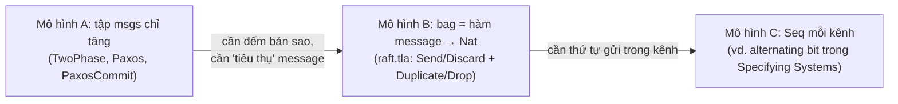
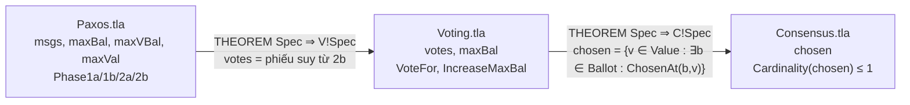

# P13 · Chương 08 — Đặc tả giao thức phân tán: 2PC, Paxos, Raft

> Chương này đọc spec có thật của ba giao thức rồi rút ra cách người ta mô hình hóa mạng, lỗi và tính đúng đắn. Chương **không giải thích lại giao thức**; phần đó nằm ở [P12·09](../12-he-thong-du-lieu/09-consistency-va-consensus.md) mục 5–7. Mọi spec trích nguyên văn đều lấy từ commit **ghim**: `tlaplus/Examples` @ `6a7b26a31c1a6aeec789b455e9bbfa3b3ad2728f`, `ongardie/raft.tla` @ `6ecbdbcf1bcde2910367cdfd67f31b0bae447ddd`, `ongardie/dissertation` @ `0c10ea1b53d73bf6d163bdde8e4141a1cbd8f36a`. Khối ```` ```tla ```` nào do **người soạn tự viết** đều được ghi rõ là minh họa, và không có TLC nào được chạy khi soạn. Mọi con số "bao nhiêu trạng thái" là con số **file nguồn ghi sẵn** (`manifest.json` của Examples, comment trong spec, bài báo), không phải kết quả người soạn quan sát.

## Bạn sẽ hiểu được gì

- **Q1.** Mạng, nơi message có thể mất, lặp, đảo thứ tự, được mô hình hóa trong TLA+ bằng những biến và action nào? → mục 1
- **Q2.** `TCommit` đặc tả *yêu cầu* của atomic commit gồm những gì, và vì sao nó không có message nào? → mục 2
- **Q3.** `TwoPhase` đặc tả giao thức 2PC ra sao, nó nói được gì và *không* nói được gì (coordinator chết)? → mục 3
- **Q4.** `Paxos.tla` nằm trong chuỗi Consensus → Voting → Paxos thế nào, và bốn action `Phase1a/1b/2a/2b` làm gì? → mục 4
- **Q5.** `raft.tla` của Ongaro có những biến, action và handler nào, và nó khác thuật toán trong bài báo ở đâu? → mục 5
- **Q6.** Viết thế nào các invariant "mỗi term tối đa một leader", "agreement", "không ai commit khác ai abort"? Vì sao cần history variable và inductive invariant? → mục 6
- **Q7.** Các spec này được TLC kiểm với tham số nào, và vì sao cấu hình "chạy xanh" có thể chẳng chứng minh gì? → mục 7
- **Q8.** TLA+ đã tìm được lỗi thật nào trong hệ thống thật (AWS), và nó *không* làm được gì? → mục 8

## Kiến thức cần trước

- [Chương 02 — Toán nền tảng](02-toan-nen-tang.md): tập hợp, hàm, record, `EXCEPT`, `\E`/`\A`; mọi spec trong chương này dùng chúng.
- [Chương 03 — Trạng thái, hành vi, action](03-trang-thai-hanh-vi-action.md): `Init`, `Next`, `UNCHANGED`, `[][Next]_vars`.
- [Chương 04 — Invariant và TLC](04-invariant-va-tlc.md): invariant, file `.cfg`, cách TLC duyệt không gian trạng thái.
- [Chương 05 — Liveness và fairness](05-liveness-va-fairness.md): vì sao spec "chỉ safety" không nói được chuyện bị kẹt. [Chương 07 — Refinement](07-refinement.md): `INSTANCE`, "spec A cài đặt spec B"; chương này dùng khái niệm đó nhưng chi tiết ở chương 07.
- Giao thức, không phải đặc tả: [P12·05 Replication](../12-he-thong-du-lieu/05-replication.md) (failover, split brain), [P12·07 Transaction](../12-he-thong-du-lieu/07-transaction.md) (atomicity), [P12·08 Sự cố hệ phân tán](../12-he-thong-du-lieu/08-su-co-he-phan-tan.md) (mô hình liên kết mạng, mục 2), [P12·09 Consistency và consensus](../12-he-thong-du-lieu/09-consistency-va-consensus.md) (2PC mục 5, Paxos mục 6, Raft mục 7).

## 1. Mô hình hóa mạng: tập `msgs`, bag, hàng đợi (Q1)

> **Trả lời ngắn.** TLA+ không có sẵn khái niệm "mạng". Bạn tự chọn một biến để chứa message, rồi viết action gửi và action nhận. Hai spec trong Examples (2PC và Paxos) dùng một *tập* `msgs` chỉ tăng, chứa mọi message từng được gửi; "nhận" chỉ là một action bật lên khi message nằm trong tập[^net-set-never-removed]. Cách này cho phép mất, lặp và đảo thứ tự "miễn phí". Raft thì dùng một *bag* (multiset: tập mà một phần tử có thể xuất hiện nhiều lần), kèm hai action tường minh `DuplicateMessage` và `DropMessage`[^net-raft-dropdup].

**Giải thích.**

*Với service `checkout`.* Cả chương sẽ bám theo một service giả định tên `checkout` viết bằng Rust (ví dụ của người soạn, không phải code trong repo). Mỗi đơn hàng nó phải làm ba việc. Một là trừ tiền ở DB `payments`. Hai là trừ kho ở DB `inventory`; hai DB này phải cùng commit hoặc cùng abort. Ba là ghi đơn vào `order-log`, một cụm 3 node chạy Raft để mất một node thì vẫn không mất đơn. Giữa các bên đó là mạng: request có thể rơi, bị gửi lại, hoặc tới sai thứ tự. Câu hỏi của mục này là khi viết spec cho những cuộc trao đổi đó, "mạng" nằm ở đâu.

### 1.1 Gửi và nhận

Trong spec 2PC, `msgs` là một tập mà message chỉ được thêm vào, không bao giờ bị xóa. Một action mà ở code thật chạy khi *nhận* một message nào đó, thì trong spec chạy khi message đó *có mặt* trong `msgs`[^net-set-never-removed]. `PaxosCommit.tla`, spec thứ ba trong Examples, mô hình việc nhận y hệt như vậy[^net-pc-receipt]. Nói cách khác, "nhận" không phải một action riêng mà là *điều kiện bật* (enabling condition) của action phía nhận. Với `checkout`, chuyện `inventory` nhận được lệnh commit nghĩa là lệnh đó đã nằm trong tập; không có khái niệm lệnh "đang trên đường" hay "đã bị lấy ra".

### 1.2 Mất, lặp, đảo thứ tự đến từ đâu

Ba hiện tượng này lọt vào spec mà không cần viết thêm gì. Về lặp, nhận cùng một message hai lần là được phép, và ở giao thức này lần thứ hai không gây tác dụng gì[^net-dup]. Về mất, giữa "không nhận được vì message bị mất" và "nhận được mà lờ đi" không có khác biệt gì[^net-lost-eq-ignored], nên không cần một action `LoseMessage`. Chính vì spec chỉ đặc tả safety, tiến trình không bị buộc phải nhận message nào cả[^net-set-sendonly]. Còn thứ tự thì đảo vì action phía nhận viết `\E m \in msgs : ...`, tức chọn *bất kỳ* phần tử nào của tập, mà tập thì không có khái niệm hàng đợi (suy luận của người soạn; luận án Raft nêu cùng giả định "mạng có thể đảo thứ tự" cho spec dùng bag, xem 1.4). Với `checkout`, một lệnh `Commit` rơi trên đường tới `inventory` nghĩa là `inventory` mãi không bước tiếp, và spec không cần phân biệt đó là rơi hay bị bỏ qua.

### 1.3 Vì sao thế là đủ cho safety, và thiếu cho liveness

Một ghi chú (NOTE) trong `Paxos.tla` thừa nhận rằng mô hình chính xác hơn sẽ có biến chứa message *đang trên đường*, cùng các action mất, lặp và nhận[^net-px-accurate]. Spec không cần những thứ đó vì chỉ kiểm safety. Muốn biết message nào *phải* tới nơi để thuật toán tiến triển (nghĩa là không được mất, hoặc mất thì phải được gửi lại), ta nhìn vào khẳng định liveness của spec[^net-px-live]. Phần liveness đó ở [chương 05](05-liveness-va-fairness.md).

### 1.4 Raft chọn bag

`raft.tla` đi đường khác: biến `messages` là một bag các record. TLAPS (hệ chứng minh của TLA+) không hỗ trợ module `Bags`, nên bag được cài thành hàm từ message sang `Nat`, giá trị hàm chính là số bản sao[^net-raft-bag]. Sách *Specifying Systems* cũng gợi đúng hướng này: trạng thái của một mạng mà message giao theo thứ tự bất kỳ có thể biểu diễn bằng bag các message đang trên đường[^net-book-bag]. Luận án của Ongaro nói rõ hơn về giả định mô hình. Mạng có thể đảo thứ tự, làm mất và lặp message[^net-diss-reorder]. Một message có thể mất *số bước tùy ý* mới tới nơi[^net-diss-arbitrary]. Và spec là hệ bất đồng bộ, không có khái niệm thời gian[^net-diss-async].

### 1.5 Node sập

Còn node sập thì sao? Gray và Lamport coi việc một tiến trình sập rồi khởi động lại (khôi phục từ stable storage) tương đương với việc nó *tạm dừng*, và thuật toán bất đồng bộ vốn cho phép tạm dừng[^net-gl-pause]. Vì vậy spec 2PC và Paxos không có action "crash". Raft thì có `Restart(i)`: server mất mọi thứ trừ `currentTerm`, `votedFor` và `log`[^net-raft-restart]. Đó là mô hình *crash-recovery* với trạng thái bền chỉ gồm ba biến ấy, khớp với giả định luận án nêu: server hỏng bằng cách dừng và có thể khởi động lại từ stable storage[^net-diss-stop].



(Sơ đồ là suy luận của người soạn về *động cơ* chuyển từ mô hình này sang mô hình kia; việc mỗi spec thật dùng mô hình nào là theo nguồn ở bảng dưới.)

| Mô hình | Mất | Lặp | Đảo thứ tự | Ví dụ chính thống |
|---|---|---|---|---|
| A. Tập `msgs` chỉ tăng | ngầm (không ai buộc phải nhận)[^net-lost-eq-ignored] | ngầm[^net-dup] | ngầm (suy luận của người soạn) | `TwoPhase.tla`, `Paxos.tla` |
| B. Bag + action Drop/Duplicate | action `DropMessage` | action `DuplicateMessage` | có, theo giả định luận án[^net-diss-reorder] | `raft.tla`[^net-raft-dropdup] |
| C. `Seq` mỗi kênh | phải viết action riêng (xem Đi sâu) | phải viết action riêng | **không** (FIFO) | minh họa của người soạn |

<details><summary>Đi sâu: cài bag trong raft.tla, kênh FIFO tự viết, và ranh giới "mạng" ↔ "môi trường"</summary>

**Bag của Raft** (trích `raft.tla`, dòng 104–130 ở commit ghim):

```tla
\* Helper for Send and Reply. Given a message m and bag of messages, return a
\* new bag of messages with one more m in it.
WithMessage(m, msgs) ==
    IF m \in DOMAIN msgs THEN
        [msgs EXCEPT ![m] = msgs[m] + 1]
    ELSE
        msgs @@ (m :> 1)

\* Helper for Discard and Reply. Given a message m and bag of messages, return
\* a new bag of messages with one less m in it.
WithoutMessage(m, msgs) ==
    IF m \in DOMAIN msgs THEN
        IF msgs[m] <= 1 THEN [i \in DOMAIN msgs \ {m} |-> msgs[i]]
        ELSE [msgs EXCEPT ![m] = msgs[m] - 1]
    ELSE
        msgs

\* Add a message to the bag of messages.
Send(m) == messages' = WithMessage(m, messages)

\* Remove a message from the bag of messages. Used when a server is done
\* processing a message.
Discard(m) == messages' = WithoutMessage(m, messages)

\* Combination of Send and Discard
Reply(response, request) ==
    messages' = WithoutMessage(request, WithMessage(response, messages))
```

Trong `WithMessage` có hai toán tử lạ: `m :> 1` là hàm một điểm `[x \in {m} |-> 1]`, còn `f @@ g` ghép hai hàm (ưu tiên `f`). Cả hai thuộc module `TLC` và được giải thích ở [chương 02](02-toan-nen-tang.md) mục 3.

Hai action mạng nằm ở cuối spec[^net-raft-dropdup]:

```tla
DuplicateMessage(m) ==
    /\ Send(m)
    /\ UNCHANGED <<serverVars, candidateVars, leaderVars, logVars>>

DropMessage(m) ==
    /\ Discard(m)
    /\ UNCHANGED <<serverVars, candidateVars, leaderVars, logVars>>
```

Vì sao Raft cần bag mà 2PC không cần? (suy luận của người soạn) Với tập, hai message giống hệt gộp làm một, nên không phân biệt được "nhận một lần" với "nhận hai lần". Raft lại muốn `Reply` *tiêu thụ* request (`Discard`), rồi `DuplicateMessage` tạo bản sao *có chủ đích*, nên phải đếm.

**Kênh FIFO có mất message** (ví dụ của người soạn, minh họa, chưa chạy TLC). Đoạn này chỉ để thấy mô hình C trông thế nào; spec thật phải thêm `UNCHANGED` cho các biến khác.

```tla
EXTENDS Sequences

CONSTANT Node, Message
VARIABLE chan   \* chan[<<i, j>>] là hàng đợi Seq(Message) từ node i tới node j

TypeOK == chan \in [Node \X Node -> Seq(Message)]

Init == chan = [ij \in Node \X Node |-> <<>>]

Send(i, j, m) == chan' = [chan EXCEPT ![<<i, j>>] = Append(@, m)]

\* Bỏ phần tử thứ k khỏi dãy s.
RemoveAt(s, k) == [n \in 1..(Len(s) - 1) |-> IF n < k THEN s[n] ELSE s[n + 1]]

\* Nhận: chỉ lấy được phần tử đầu hàng (FIFO).
Recv(i, j) == /\ chan[<<i, j>>] # <<>>
              /\ chan' = [chan EXCEPT ![<<i, j>>] = Tail(@)]
              \* ... phần xử lý Head(chan[<<i, j>>]) của bên nhận ...

\* Mất: bất kỳ phần tử nào trong hàng đợi có thể biến mất.
Lose(i, j) == \E k \in 1..Len(chan[<<i, j>>]) :
                 chan' = [chan EXCEPT ![<<i, j>>] = RemoveAt(@, k)]
```

Cái giá của kênh `Seq` là độ dài dãy không bị chặn, nên số trạng thái đạt tới là vô hạn. *Specifying Systems* nói đúng điều này về alternating bit protocol: dãy message dài tùy ý nên có vô hạn trạng thái đạt tới[^net-book-constraint]. Cách chữa là một state predicate "constraint" chặn độ dài dãy (xem mục 7)[^net-book-constraint2]. Đó cũng là lý do mô hình A và B được ưa chuộng cho giao thức consensus: không có hàng đợi dài vô hạn nào cần chặn.

**Ranh giới mạng ↔ môi trường.** Nhóm AWS gọi việc này là đặc tả "môi trường". Sau khi mô tả thiết kế, họ đặc tả *tác động của từng sự kiện có thể xảy ra*: lỗi và hồi phục mạng, lỗi đĩa, process crash/restart, lỗi cả data center, thao tác của con người[^net-aws-env]. Ba trục mất, lặp, đảo cũng chính là thứ nhóm DynamoDB từng mô phỏng bằng một lớp mạng giả khi test: "kiểm soát message loss, duplication, và re-ordering"[^net-aws-fi]. Spec chỉ chuyển cùng ý đó từ test sang toàn bộ không gian trạng thái.

</details>

**Quay lại Q1:** mạng trong TLA+ là biến *bạn tự chọn*: tập `msgs` chỉ tăng đã gồm sẵn mất, lặp, đảo (đủ cho safety); bag thêm action Drop/Duplicate tường minh (Raft); `Seq` cho kênh FIFO nhưng phải chặn độ dài.

## 2. TCommit: đặc tả *yêu cầu* của atomic commit (Q2)

> **Trả lời ngắn.** `TCommit` là spec chỉ có một biến `rmState` (trạng thái của từng resource manager, viết tắt RM) và hai action `Prepare`, `Decide`. Nó không có message, không có coordinator, mà chỉ nói *điều gì được phép xảy ra*. Một RM chỉ được commit khi mọi RM đã prepared[^tc-gl-order]. Và không bao giờ có RM committed cùng lúc với RM aborted[^tc-gl-cons]. 2PC (mục 3) là một cách *cài đặt* yêu cầu này.

**Giải thích.**

*Với `checkout`.* Hai RM ở đây là DB `payments` và DB `inventory`. Yêu cầu của `checkout` rất rõ: một đơn hoặc đã trừ cả tiền lẫn kho, hoặc không trừ gì. `TCommit` chính là bản phát biểu chính xác yêu cầu đó, và nó chưa hề nói làm bằng cách nào. 2PC là một cách làm; Paxos Commit hay saga có bù trừ là những cách khác cũng có thể thỏa cùng yêu cầu (nhận xét của người soạn).

### 2.1 Trạng thái và yêu cầu

Mỗi RM ở một trong bốn trạng thái `"working"`, `"prepared"`, `"committed"`, `"aborted"`, và lúc đầu mọi RM đều `"working"`[^tc-spec-typeok]. Gray và Lamport viết yêu cầu thành lời ngay trong bài báo. Yêu cầu thứ nhất: một RM chỉ vào `committed` sau khi *mọi* RM đã từng `prepared`[^tc-gl-order]. Yêu cầu thứ hai: không thể có một RM `committed` trong khi RM khác `aborted`[^tc-gl-cons].

### 2.2 Hai action

`Prepare(rm)` chuyển `working` sang `prepared`. `Decide(rm)` có hai nhánh. Nhánh commit cần `rm` đang `prepared` và `canCommit`, tức mọi RM đang `prepared` hoặc `committed`. Nhánh abort cần `rm` đang `working` hoặc `prepared` và `notCommitted`, tức chưa RM nào commit[^tc-decide]. Với `checkout`: `payments` chỉ được commit sau khi `inventory` cũng đã sẵn sàng.

### 2.3 Property

`TCConsistent` nói không tồn tại cặp RM nào mà một cái `aborted`, cái kia `committed`[^tc-consistent-def]. Spec còn có `TCTypeOK` (kiểu của `rmState`) làm invariant thứ hai. File cấu hình khai cả hai invariant, cùng `SPECIFICATION TCSpec` và `CHECK_DEADLOCK FALSE`[^tc-cfg].

### 2.4 Đúng nhưng chưa hữu ích

Spec này đúng, nhưng chưa chắc đã hữu ích. `TCommit` cho phép cả hành vi mà *mọi* RM đều abort: mọi RM bỏ qua `Prepare`, rồi từng RM chạy nhánh abort của `Decide` khi `notCommitted` còn đúng (tự lần theo tay, suy luận của người soạn). Với `checkout`, đó là hệ thống từ chối mọi đơn mà vẫn "đúng". Gray và Lamport gọi đó là lời giải tầm thường: mọi RM luôn abort[^tc-gl-trivial]. Để loại nó, họ thêm yêu cầu liveness *Non-Triviality*: nếu cả mạng không lỗi suốt quá trình thì (a) mọi RM đã prepared kéo theo cuối cùng mọi RM committed, và (b) có RM aborted kéo theo cuối cùng mọi RM aborted[^tc-gl-nontriv]. Bản trong `Examples` chỉ có phần safety (`TCSpec` không có điều kiện fairness), nên chuyện "phải xảy ra gì" thuộc [chương 05](05-liveness-va-fairness.md).

<details><summary>Đi sâu: nguyên văn TCommit.tla, vì sao tắt kiểm deadlock, và số trạng thái</summary>

Phần lõi của `specifications/transaction_commit/TCommit.tla` (bỏ comment):

```tla
CONSTANT RM       \* The set of participating resource managers
VARIABLE rmState  \* `rmState[rm]' is the state of resource manager rm.

TCTypeOK == 
  rmState \in [RM -> {"working", "prepared", "committed", "aborted"}]

TCInit ==   rmState = [rm \in RM |-> "working"]

canCommit == \A rm \in RM : rmState[rm] \in {"prepared", "committed"}

notCommitted == \A rm \in RM : rmState[rm] # "committed" 

Prepare(rm) == /\ rmState[rm] = "working"
               /\ rmState' = [rmState EXCEPT ![rm] = "prepared"]

Decide(rm)  == \/ /\ rmState[rm] = "prepared"
                  /\ canCommit
                  /\ rmState' = [rmState EXCEPT ![rm] = "committed"]
               \/ /\ rmState[rm] \in {"working", "prepared"}
                  /\ notCommitted
                  /\ rmState' = [rmState EXCEPT ![rm] = "aborted"]

TCNext == \E rm \in RM : Prepare(rm) \/ Decide(rm)

TCSpec == TCInit /\ [][TCNext]_rmState

TCConsistent ==  
  \A rm1, rm2 \in RM : ~ /\ rmState[rm1] = "aborted"
                         /\ rmState[rm2] = "committed"
```

Điểm đáng đọc kỹ là hai điều kiện đối xứng. Nhánh commit đòi `canCommit` (mọi RM đang `prepared` hoặc `committed`, nên không RM nào `aborted`), còn nhánh abort đòi `notCommitted` (không RM nào đã `committed`). Nhờ vậy `TCConsistent` đúng *ngay từ spec trừu tượng* (suy luận của người soạn). Không thể có `aborted` rồi `committed`, vì commit đòi `canCommit`; và không thể có `committed` rồi `aborted`, vì abort đòi `notCommitted`. Ở `TwoPhase` (mục 3), không RM nào đọc được `rmState` của RM khác nên cả hai điều kiện không còn kiểm trực tiếp được. Khi đó phải dựa vào thứ tự message, với invariant ở mục 6 (suy luận của người soạn).

`CHECK_DEADLOCK FALSE` (xem cfg ở trên[^tc-cfg]): cfg không giải thích lý do. Phân tích vì sao trạng thái "mọi RM đã quyết" bị TLC coi là deadlock nằm ở [chương 04](04-invariant-va-tlc.md) mục 6 (suy luận của người soạn).

Số trạng thái do `manifest.json` của Examples ghi cho cấu hình ba RM (`RM = {r1, r2, r3}`) là 34 trạng thái khác nhau, 94 tổng, độ sâu 7[^tc-manifest]. Cách tự đếm tay `27 + 7 = 34` ở [chương 04](04-invariant-va-tlc.md) mục 3 (Đi sâu), không lặp lại ở đây.

</details>

**Quay lại Q2:** `TCommit` là spec "cái gì" (một biến, hai action, một invariant `TCConsistent`) và là thước đo mà các giao thức như 2PC, Paxos Commit phải thỏa.

## 3. TwoPhase: 2PC thành spec, và cái nó không nói (Q3)

> **Trả lời ngắn.** `transaction_commit/TwoPhase.tla` thêm vào `TCommit` một transaction manager (TM) và biến `msgs`. Mỗi RM gửi `Prepared`, TM gom đủ thì phát `Commit` (hoặc `Abort`), rồi các RM làm theo[^tp-msg-def]. Spec khẳng định bằng một theorem rằng nó *cài đặt* `TCommit`[^tp-refine]. Nhưng đây là spec chỉ-safety, nên chuyện TM chết khiến cả nhóm bị kẹt (blocking) **không hiện ra trong spec này**[^tp-safety-only].

**Giải thích.**

*Với `checkout`.* Ở mục này `checkout` đóng vai TM (như một orchestrator XA), còn `payments` và `inventory` là hai RM. Spec không mô tả mạng thật, cũng không có timeout; nó chỉ liệt kê *những bước hợp lệ*.

### 3.1 Cẩn thận: hai spec cùng tên `TwoPhase`

Trong Examples có hai thứ tên `TwoPhase`. `specifications/transaction_commit/TwoPhase.tla` là 2PC của Gray–Lamport, thứ ta đang đọc. Còn `specifications/TwoPhase/` là **two-phase handshaking**, một giao thức *phần cứng* giữa Producer và Consumer[^tp-handshake], không liên quan gì tới commit.

### 3.2 Biến và message

Spec có bốn biến. `rmState` như ở `TCommit`. `tmState` nhận giá trị `"init"`, `"committed"` hoặc `"aborted"`. `tmPrepared` là tập RM mà TM đã nhận `Prepared`. Và `msgs`, tập mọi message từng gửi. Message có ba loại: `Prepared` (từ một `rm` tới TM), cùng `Commit` và `Abort` (TM phát cho mọi RM; tập chỉ chứa *một* bản của message được phát)[^tp-msg-def].

### 3.3 Bảy action

Bảy action chia thành hai nhóm, của RM và của TM:

| Action | Ai | Điều kiện bật | Tác dụng |
|---|---|---|---|
| `RMPrepare(rm)` | RM | `rmState[rm] = "working"` | → `"prepared"`, thêm `Prepared(rm)` vào `msgs` |
| `RMChooseToAbort(rm)` | RM | `rmState[rm] = "working"` | → `"aborted"`, **không gửi gì** |
| `TMRcvPrepared(rm)` | TM | `tmState = "init"` và `Prepared(rm)` ∈ `msgs` | thêm `rm` vào `tmPrepared` |
| `TMCommit` | TM | `tmState = "init"` và `tmPrepared = RM` | `tmState := "committed"`, thêm `Commit` |
| `TMAbort` | TM | `tmState = "init"` | `tmState := "aborted"`, thêm `Abort` (*tự phát*, không cần lý do) |
| `RMRcvCommitMsg(rm)` | RM | `Commit` ∈ `msgs` | → `"committed"` |
| `RMRcvAbortMsg(rm)` | RM | `Abort` ∈ `msgs` | → `"aborted"` |

(Nội dung bảng do người soạn tóm lại từ spec; code nguyên văn ở phần Đi sâu.) Tác giả tự đơn giản hóa hai chỗ và nêu ngay đầu file. Chỗ thứ nhất: RM *tự phát* sinh `Prepared`, bỏ qua message `Prepare` mà TM có thể gửi[^tp-header-prepared]. Chỗ thứ hai: RM abort không gửi message `Abort`, việc đó được thay bằng việc TM *tự phát* quyết định abort[^tp-abort-simplify].

### 3.4 Vì sao TM quyết định thì nhất quán

TM rời `"init"` đúng một lần, sang `"committed"` *hoặc* `"aborted"`. Vì thế nó chỉ có thể phát `Commit` hoặc `Abort`, không bao giờ cả hai. Ngoài ra `TMCommit` đòi mọi RM đã gửi `Prepared`[^tp-tmcommit]. Lý lẽ đầy đủ là một *invariant nhiều vế* ở mục 6.

### 3.5 Nó cài đặt `TCommit`

Dòng `TC == INSTANCE TCommit` cùng theorem `TPSpec => TC!TCSpec` khẳng định `TPSpec` cài đặt `TCSpec`[^tp-refine]. Đây là refinement ([chương 07](07-refinement.md)): mọi hành vi của 2PC, nhìn qua `rmState`, đều là hành vi hợp lệ của `TCommit`.

### 3.6 Cái spec không nói: TM chết

Nhưng có một chuyện spec không nói. Nếu TM chết ngay sau khi mọi RM đã gửi `Prepared`, các RM còn lại không có cách nào biết TM đã commit hay abort[^tp-gl-block] (phần giao thức ở [P12·09](../12-he-thong-du-lieu/09-consistency-va-consensus.md) mục 5). Với `checkout`, đó là lúc `checkout` sập khi `payments` và `inventory` đều đã prepared: hai DB không biết nên commit hay abort.

Trong `TwoPhase.tla`, kịch bản này *không có chỗ để xuất hiện*. "TM chết" chỉ là "TM không bao giờ bước nữa", điều mà `[][TPNext]_vars` vốn cho phép (suy luận của người soạn), và không property nào đòi RM đang prepared *phải* tới được một quyết định. Tác giả ghi rõ: cái *phải xảy ra* sẽ do thuộc tính liveness mô tả, và spec này không đặc tả[^tp-safety-only]. Bài báo cũng nói phụ lục chỉ chứa phần safety, bỏ mọi giả thiết và yêu cầu về tiến triển hay thời gian thực[^tp-gl-appendix]. Bài học thực hành (nhận xét của người soạn): một spec safety xanh không có nghĩa là hệ thống "ổn"; blocking của 2PC chỉ lộ ra khi thêm liveness và fairness, ở [chương 05](05-liveness-va-fairness.md).

<details><summary>Đi sâu: code nguyên văn, guard thiếu của RMRcvCommitMsg, con số TLC, PlusCal và Paxos Commit</summary>

Phần action của `transaction_commit/TwoPhase.tla` (bỏ comment):

```tla
Message ==
  [type : {"Prepared"}, rm : RM]  \cup  [type : {"Commit", "Abort"}]

TPInit ==   
  /\ rmState = [rm \in RM |-> "working"]
  /\ tmState = "init"
  /\ tmPrepared   = {}
  /\ msgs = {}

TMRcvPrepared(rm) ==
  /\ tmState = "init"
  /\ [type |-> "Prepared", rm |-> rm] \in msgs
  /\ tmPrepared' = tmPrepared \cup {rm}
  /\ UNCHANGED <<rmState, tmState, msgs>>

TMCommit ==
  /\ tmState = "init"
  /\ tmPrepared = RM
  /\ tmState' = "committed"
  /\ msgs' = msgs \cup {[type |-> "Commit"]}
  /\ UNCHANGED <<rmState, tmPrepared>>

TMAbort ==
  /\ tmState = "init"
  /\ tmState' = "aborted"
  /\ msgs' = msgs \cup {[type |-> "Abort"]}
  /\ UNCHANGED <<rmState, tmPrepared>>

RMPrepare(rm) == 
  /\ rmState[rm] = "working"
  /\ rmState' = [rmState EXCEPT ![rm] = "prepared"]
  /\ msgs' = msgs \cup {[type |-> "Prepared", rm |-> rm]}
  /\ UNCHANGED <<tmState, tmPrepared>>
  
RMChooseToAbort(rm) ==
  /\ rmState[rm] = "working"
  /\ rmState' = [rmState EXCEPT ![rm] = "aborted"]
  /\ UNCHANGED <<tmState, tmPrepared, msgs>>

RMRcvCommitMsg(rm) ==
  /\ [type |-> "Commit"] \in msgs
  /\ rmState' = [rmState EXCEPT ![rm] = "committed"]
  /\ UNCHANGED <<tmState, tmPrepared, msgs>>

RMRcvAbortMsg(rm) ==
  /\ [type |-> "Abort"] \in msgs
  /\ rmState' = [rmState EXCEPT ![rm] = "aborted"]
  /\ UNCHANGED <<tmState, tmPrepared, msgs>>

TPNext ==
  \/ TMCommit \/ TMAbort
  \/ \E rm \in RM : 
       TMRcvPrepared(rm) \/ RMPrepare(rm) \/ RMChooseToAbort(rm)
         \/ RMRcvCommitMsg(rm) \/ RMRcvAbortMsg(rm)

TPSpec == TPInit /\ [][TPNext]_<<rmState, tmState, tmPrepared, msgs>>
```

**Guard thiếu?** `RMRcvCommitMsg(rm)` *không* kiểm `rmState[rm]`, nên về lý thuyết nó có thể đưa một RM đang `working` hoặc đã `aborted` sang `committed`. Spec vẫn an toàn vì có các sự kiện *liên đới*, mà file chứng minh `TwoPhase_proof.tla` liệt kê thành invariant. Thứ nhất, RM nào đã có message `Prepared` thì không còn `working`[^tp-proof-7]. Thứ hai, có `Commit` trong `msgs` kéo theo *mọi* RM từng gửi `Prepared`[^tp-proof-9]. Thứ ba, RM `aborted` hoặc là vì `Abort` đã được phát, hoặc là RM chưa từng gửi `Prepared`[^tp-proof-10]. Ghép lại: nếu `Commit` tồn tại thì không thể có `Abort` (TM chỉ chọn một), mà RM đã `aborted` vì `RMChooseToAbort` thì chưa từng gửi `Prepared`, trái với điều `TMCommit` đòi (lập luận của người soạn, theo comment ở `Consistency` trong file chứng minh). Bài học thiết kế: *bỏ guard để spec gọn* chỉ chấp nhận được **khi** có invariant giải thích vì sao các ca bị bỏ không xảy ra.

**TLC cho TwoPhase.** `TwoPhase.cfg` ở commit ghim khai `CONSTANT RM = {r1, r2, r3}`, `INVARIANT TPTypeOK`, `SPECIFICATION TPSpec`[^tp-cfg]. Tức là nó *chỉ* kiểm type invariant; theorem refinement `TC!TCSpec` không có trong cfg đó. (Nhận xét của người soạn: muốn TLC kiểm refinement thì phải khai nó như một property; chương 07 nói cách làm.) `manifest.json` ghi cho cấu hình này 288 trạng thái khác nhau, 1146 tổng, độ sâu 11[^tp-manifest]. Comment cuối file gốc nói hai theorem đã được TLC kiểm với *sáu* RM, một cấu hình có 50816 trạng thái đạt tới, mất hơi hơn một phút trên máy 1 GHz[^tp-checked6]. Hai nguồn (cfg ghim và comment) khác nhau về số RM và về những gì được kiểm; người soạn không có cách xác định thêm ngoài việc đọc cả hai.

**Phiên bản có TM hỏng (PlusCal).** `2PCwithBTM.tla` trong cùng thư mục là bản sửa từ một spec 2PC khác, có thêm TM[^tp-btm]. Nó có hằng `TMMAYFAIL` cho biết TM có thể hỏng hay không[^tp-btm-fail]. Nó cũng có một tiến trình backup TM (`BTManager`) chỉ hành động khi `tmState` đã thành `"hidden"`[^tp-btm-bt]; đây là cách đưa chuyện TM chết vào spec bằng biến trạng thái thay vì bằng liveness (diễn giải của người soạn). Cấu hình ghim đặt `RM = {rm1, rm2, rm3}`, `RMMAYFAIL = TRUE`, `TMMAYFAIL = TRUE`[^tp-btm-cfg]. Manifest ghi 1245 trạng thái khác nhau, độ sâu 15[^tp-btm-manifest]. PlusCal ở [chương 06](06-pluscal.md).

**Paxos Commit** (cùng thư mục): 2PC là *trường hợp đặc biệt F = 0* của Paxos Commit[^tp-pc-f0]. Cấu hình ghim của `PaxosCommit.tla` dùng 2 RM, 3 acceptor và `Ballot = {0,1}`[^tp-pc-cfg]. Manifest ghi 1 321 761 trạng thái khác nhau, độ sâu 28[^tp-pc-manifest]. Chính bài báo thừa nhận kiểm TLC mới trên "cấu hình quá nhỏ để thấy lỗi tinh vi, nhưng có lẽ đủ lớn để tìm lỗi 'viết code' đơn giản"[^tp-pc-small]; xem mục 7.

</details>

**Quay lại Q3:** `TwoPhase` là TM + RM giao tiếp qua tập `msgs`, cài đặt `TCommit` qua refinement; nó chứng minh *an toàn* (không bất đồng), còn *kẹt khi TM chết* là câu hỏi liveness mà spec chỉ-safety không trả lời.

## 4. Paxos: từ Consensus qua Voting tới message passing (Q4)

> **Trả lời ngắn.** Spec Paxos của Lamport trong Examples gồm *ba* module xếp tầng: `Consensus` → `Voting` → `Paxos`. `Consensus` là đặc tả cực nhỏ "không quá một giá trị được chọn"[^px-cons-inv]. `Voting` là thuật toán bỏ phiếu trừu tượng, cài đặt `Consensus`[^px-refine]. `Paxos` là thuật toán truyền message, cài đặt `Voting`[^px-readme-desc]. `Paxos.tla` không có tiến trình leader tường minh: leader của một ballot chỉ là bên thực hiện `Phase1a` và `Phase2a`[^px-leader]. Spec cũng bỏ luôn learner[^px-learners]. Cuối cùng nó chỉ có bốn action (`Phase1a`, `Phase1b`, `Phase2a`, `Phase2b`) trên bốn biến `maxBal`, `maxVBal`, `maxVal`, `msgs`.

**Giải thích.**

*Với `checkout`.* Ba node của `order-log` phải chốt đúng một đơn cho mỗi ô của log, chẳng hạn ô số 7, dù message có thể rơi và một node có thể chết (hình dung của người soạn: mỗi ô là một lần chạy consensus). Spec Paxos mô tả lần chốt đó theo ba tầng. Tầng trên cùng nói *chốt cái gì*: đúng một giá trị. Tầng giữa nói *bỏ phiếu thế nào*: ai bỏ cho ai ở ballot nào. Tầng dưới nói *trao đổi message ra sao* để việc bỏ phiếu diễn ra mà các node không cần nhìn thấy nhau. Chương này chỉ đọc cách spec dựng nên chuỗi đó; thuật toán đã giải thích ở [P12·09](../12-he-thong-du-lieu/09-consistency-va-consensus.md) mục 6.

### 4.1 Tầng Consensus

Tầng này chỉ có biến `chosen`, tập các giá trị đã chọn. `Init` là `chosen = {}`, còn `Next` chọn một giá trị `v` khi `chosen = {}`. Phần an toàn là "không quá một giá trị được chọn", với invariant là `TypeOK` hội với `Cardinality(chosen) <= 1`[^px-cons-inv]. Cùng file còn có một khẳng định liveness: cuối cùng một giá trị phải được chọn[^px-cons-live].

### 4.2 Tầng Voting

Mỗi acceptor `a` có `votes[a]`, tập các cặp `<<b, v>>` với nghĩa "đã bỏ cho `v` ở ballot `b`", và có `maxBal[a]`. Một giá trị được coi là đã chọn khi một quorum acceptor đã bỏ phiếu cho nó trong *cùng một ballot*[^px-voting-chosen]. `SafeAt(b, v)` nói rằng không giá trị nào khác `v` đã hoặc có thể được chọn ở bất kỳ ballot nhỏ hơn `b`[^px-safeat]. Hai ràng buộc về `Quorum`: mỗi quorum là tập con của `Acceptor`, và hai quorum bất kỳ giao nhau[^px-quorum].

### 4.3 Tầng Paxos: tập message

Vì Paxos là thuật toán truyền message, `Paxos.tla` mở đầu bằng việc định nghĩa *tập mọi message có thể có*[^px-message]. Dạng của nó như sau.

```tla
Message ==      [type : {"1a"}, bal : Ballot]
           \cup [type : {"1b"}, acc : Acceptor, bal : Ballot, 
                 mbal : Ballot \cup {-1}, mval : Value \cup {None}]
           \cup [type : {"2a"}, bal : Ballot, val : Value]
           \cup [type : {"2b"}, acc : Acceptor, bal : Ballot, val : Value]
```

(Cú pháp tập record `[type : {"1a"}, bal : Ballot]`, tức mọi record có trường `type` thuộc `{"1a"}` và `bal` thuộc `Ballot`, ở [chương 02](02-toan-nen-tang.md) mục 4 và 9; `CHOOSE` ở mục 5.)

Có hai điều cần để ý. Một là message không có trường "người nhận": chúng broadcast ngầm vì `msgs` là tập chung. Hai là `mbal = -1` và `mval = None` đánh dấu "chưa bỏ phiếu"; `Ballot` là `Nat`, còn `None` được định nghĩa bằng `CHOOSE v : v \notin Value`[^px-ballot-nat].

### 4.4 Bốn action

Trong thực tế sẽ có một tiến trình leader điều phối ballot. Ở spec, "leader của ballot b" chỉ là *bên thực hiện* `Phase1a(b)` và `Phase2a(b)`[^px-leader]. Leader không phải một thực thể có trạng thái, mà chỉ là tham số `b` của action.

| Action | Bên | Điều kiện bật | Tác dụng |
|---|---|---|---|
| `Phase1a(b)` | leader ballot `b` | (luôn bật) | gửi `1a` với `bal = b` |
| `Phase1b(a)` | acceptor `a` | tồn tại `1a` với `m.bal > maxBal[a]`[^px-phase1b] | `maxBal[a] := m.bal`; gửi `1b` kèm phiếu có ballot cao nhất `a` từng bỏ |
| `Phase2a(b, v)` | leader ballot `b` | chưa gửi `2a` cho `b`, và có `1b` của một quorum chứng tỏ `v` an toàn ở `b`[^px-phase2a-cond] | gửi `2a(b, v)` |
| `Phase2b(a)` | acceptor `a` | tồn tại `2a` với `m.bal >= maxBal[a]`[^px-phase2b] | cập nhật `maxBal`, `maxVBal`, `maxVal`; gửi `2b` |

Vế thứ hai trong điều kiện của `Phase2a` là "trái tim" của thuật toán, theo chính comment của spec[^px-phase2a-heart]. Leader chỉ gửi `2a(b, v)` khi đã thấy `1b` của *cả một quorum*, và từ đó suy ra `v` là giá trị an toàn ở ballot `b`.

### 4.5 Learner đâu?

Bị bỏ có chủ ý. Trong thực tế có các tiến trình learner đọc `2b` để biết giá trị nào đã được chọn, nhưng spec trừu tượng loại chúng[^px-learners]. "Đã chọn" thay vào đó được *suy ra từ message*: phiếu của acceptor `a` là `votes[a]`, gồm các cặp `<<m.bal, m.val>>` của mọi `2b` do `a` gửi[^px-votes-map].

### 4.6 Refinement: agreement đến từ đâu

Paxos không tự định nghĩa `chosen`. Nó `INSTANCE Voting`, thế biến `maxBal` và hàm trạng thái `votes` (4.5) vào các biến cùng tên của Voting[^px-instance], rồi khẳng định `THEOREM Spec => V!Spec`. Trong `Voting.tla`, dòng `C == INSTANCE Consensus` cũng đặt `chosen` (một hàm trạng thái định nghĩa trong Voting) thay cho biến `chosen` của Consensus[^px-refine]. Vì vậy "agreement" của Paxos là chuỗi: `Spec` của Paxos kéo theo `Spec` của Voting, kéo theo `Spec` của Consensus, và Consensus có `Cardinality(chosen) <= 1`. Chi tiết `INSTANCE` và refinement mapping ở [chương 07](07-refinement.md).



<details><summary>Đi sâu: code Phase1b/2a/2b nguyên văn, ShowsSafeAt, cấu hình MCPaxos và vì sao Inv "chưa đủ mạnh"</summary>

Ba action nguyên văn từ `Paxos.tla` (bỏ comment):

```tla
Send(m) == msgs' = msgs \cup {m}

Phase1b(a) == /\ \E m \in msgs : 
                  /\ m.type = "1a"
                  /\ m.bal > maxBal[a]
                  /\ maxBal' = [maxBal EXCEPT ![a] = m.bal]
                  /\ Send([type |-> "1b", acc |-> a, bal |-> m.bal, 
                            mbal |-> maxVBal[a], mval |-> maxVal[a]])
              /\ UNCHANGED <<maxVBal, maxVal>>

Phase2a(b, v) ==
  /\ ~ \E m \in msgs : m.type = "2a" /\ m.bal = b
  /\ \E Q \in Quorum :
        LET Q1b == {m \in msgs : /\ m.type = "1b"
                                 /\ m.acc \in Q
                                 /\ m.bal = b}
            Q1bv == {m \in Q1b : m.mbal \geq 0}
        IN  /\ \A a \in Q : \E m \in Q1b : m.acc = a 
            /\ \/ Q1bv = {}
               \/ \E m \in Q1bv : 
                    /\ m.mval = v
                    /\ \A mm \in Q1bv : m.mbal \geq mm.mbal 
  /\ Send([type |-> "2a", bal |-> b, val |-> v])
  /\ UNCHANGED <<maxBal, maxVBal, maxVal>>

Phase2b(a) == \E m \in msgs : /\ m.type = "2a"
                              /\ m.bal \geq maxBal[a]
                              /\ maxBal' = [maxBal EXCEPT ![a] = m.bal] 
                              /\ maxVBal' = [maxVBal EXCEPT ![a] = m.bal] 
                              /\ maxVal' = [maxVal EXCEPT ![a] = m.val]
                              /\ Send([type |-> "2b", acc |-> a,
                                       bal |-> m.bal, val |-> m.val]) 

Next == \/ \E b \in Ballot : \/ Phase1a(b)
                             \/ \E v \in Value : Phase2a(b, v)
        \/ \E a \in Acceptor : Phase1b(a) \/ Phase2b(a)

Spec == Init /\ [][Next]_vars
```

Đọc `Phase2a` như sau. `Q1b` là các `1b` của quorum `Q` cho ballot `b`, và hội đầu `\A a \in Q : \E m \in Q1b : m.acc = a` đòi *mọi* acceptor của `Q` đã gửi `1b` đó. `Q1bv` là những `1b` mà acceptor *đã từng bỏ phiếu* (`mbal >= 0`). Nếu không ai trong quorum từng bỏ phiếu (`Q1bv = {}`) thì leader tự do chọn `v`; nếu có, `v` *buộc* là giá trị của phiếu có ballot cao nhất (`m.mbal >= mm.mbal` với mọi `mm`). Spec không gọi thẳng `ShowsSafeAt(Q, b, v)` của `Voting`; comment trong spec chỉ nói rằng điều kiện thứ hai ngụ ý tồn tại một quorum `Q` với `ShowsSafeAt`[^px-phase2a-implies]. Lưu ý thêm: `Phase1b` *đổi* `maxBal` ngay khi trả lời `1a`, còn `Phase2b` chỉ bật khi `m.bal >= maxBal[a]`. Nên sau đó acceptor không còn bỏ phiếu ở ballot thấp hơn (suy luận của người soạn từ hai guard này).

**Cấu hình model-check trong repo.** `MCPaxos.tla` mở rộng `Paxos` và thay các hằng bằng giá trị cụ thể. Dòng ghim chỉ có **một acceptor** `a1`, một giá trị `v1`, quorum `{{a1}}`, `MCMaxBallot == 1`; các cấu hình lớn hơn nằm trong comment `\* {a1, a2, a3}`[^px-mc-config]. `MCPaxos.cfg` kiểm `Inv1..Inv4` (các vế của inductive invariant) và `PROPERTY VotingSpecBar` (tức `V!Spec`, kiểm refinement), có `SYMMETRY MCSymmetry`. `MCISpec`, `MCLSpec`, `MCLiveness`, `MCIProp` nằm trong comment để người dùng bật khi cần[^px-mc-cfg]. Manifest ghi kết quả cho cấu hình này: 25 trạng thái khác nhau, 82 tổng, độ sâu 9[^px-manifest]. (Nhận xét của người soạn: với một acceptor, không có hai quorum khác nhau nào để "giao nhau", nên *mọi* lập luận quan trọng của Paxos, như đa số và ghi nhận phiếu cũ, đều thoái hóa. Đây là cấu hình smoke-test, không phải bằng chứng cho thuật toán. Xem mục 7.)

`MCPaxos.tla` còn cho thấy một thủ thuật đáng nhớ. Khi kiểm một invariant gồm nhiều vế, "TLC chỉ báo invariant bị vi phạm chứ không nói vế nào", nên ta khai từng vế như một invariant riêng[^px-mc-conj]. Đó là lý do có `Inv1..Inv4`, trong đó `Inv!1`… là cú pháp trích vế thứ n của `Inv`[^px-inv-conj]. Cách đổi `Spec` thành `MCISpec == IInv /\ [][Next]_vars` để kiểm tính quy nạp đã trình bày ở [chương 07](07-refinement.md) mục 7. Chú thích của `MCPaxos.tla` nói đúng điều kiện: "Inv là inductive invariant của Spec khi và chỉ khi nó là invariant của spec sau đây"[^px-mc-ind].

**`Inv` của Paxos "chưa quy nạp".** README của thư mục Paxos kể rằng `Paxos.tla` chứa một invariant "bản thử đầu tiên" cho chứng minh cài đặt. Tristan, người viết phần lớn chứng minh TLA+ chính thức, phát hiện nó *đúng là invariant nhưng không đủ mạnh để quy nạp*[^px-readme-inv]. Đây là ví dụ thật cho điểm ở mục 6 (nhận xét của người soạn); phần liên quan tới refinement ở [chương 07](07-refinement.md) mục 8.

**Liveness.** `MCLSpec` thêm fairness yếu `WF_vars` cho hành động của ballot lớn nhất và cho các acceptor `a1`, `a2` (chỉ ballot cao nhất, không phải mọi ballot), và `MCLiveness == <>(V!chosen # {})`[^px-mc-live]. Cách chọn fairness này chính là chủ đề của [chương 05](05-liveness-va-fairness.md).

</details>

**Quay lại Q4:** Paxos được đặc tả bằng *một tập message, bốn action và ba module xếp tầng*; "agreement" không viết lại trong Paxos mà đến từ refinement xuống `Voting` rồi `Consensus`.

## 5. raft.tla của Ongaro: biến, action, handler (Q5)

> **Trả lời ngắn.** `raft.tla` (471 dòng ở commit ghim, người soạn đếm trên tệp; tác giả Diego Ongaro) mô hình một cụm Raft với số server bất kỳ. Mỗi server có `currentTerm`, `state`, `votedFor`, `log`, `commitIndex`, cùng các biến riêng của candidate và leader. Mạng là một bag `messages` với action `DuplicateMessage`/`DropMessage`. Mọi bước của thuật toán (timeout, xin phiếu, trở thành leader, ghi log, nhận message…) là một disjunct của `Next`. README của repo nói spec này "hơi cập nhật so với bản trong luận án"[^rf-readme-updated].

**Giải thích.**

*Với `checkout`.* `order-log` của `checkout` là một cụm Raft 3 node: một leader nhận đơn và ghi vào log, hai follower sao chép lại. Bài báo Raft mô tả cụm đó bằng lời, kiểu "khi follower timeout thì …". `raft.tla` ghi từng chuyển trạng thái thành một action riêng, có điều kiện bật rõ ràng và danh sách biến bị đổi (mọi biến khác ghi `UNCHANGED`). Mục này đọc xem cụm ba node ấy được viết ra bằng những biến và action nào.

### 5.1 Biến, chia theo vai

Các biến được nhóm bằng comment:

| Nhóm | Biến | Ý nghĩa |
|---|---|---|
| Toàn cục | `messages` | bag record request/response từ server này tới server khác[^net-raft-bag] |
| Mỗi server (`serverVars`) | `currentTerm`, `state`, `votedFor` | term hiện tại; `Follower`/`Candidate`/`Leader`; ứng viên đã bầu trong term hiện tại hoặc `Nil` |
| Log (`logVars`) | `log`, `commitIndex` | dãy entry; chỉ số entry mới nhất mà state machine *có thể* áp dụng |
| Chỉ candidate (`candidateVars`) | `votesResponded`, `votesGranted`, `voterLog` | ai đã trả lời / đã cho phiếu; (`voterLog` là history variable) |
| Chỉ leader (`leaderVars`) | `nextIndex`, `matchIndex`, `elections` | entry kế tiếp gửi cho mỗi follower; entry cao nhất follower đã xác nhận; (`elections` là history variable) |
| History variable | `elections`, `allLogs`, `voterLog` | "chỉ dùng cho chứng minh; không có trong cài đặt thật"[^rf-history] |

(Tên và vai trò lấy từ comment trong spec; cột "ý nghĩa" do người soạn tóm gọn.) History variable là biến chỉ ghi lại quá khứ để phục vụ chứng minh. Hai biến quan trọng nhất cho mục 6 là `elections`, ghi lại các cuộc bầu cử thành công kèm log của leader và của các cử tri, và `allLogs`, mọi log từng tồn tại trong hệ thống[^rf-alllogs]. Luận án nhấn mạnh chúng "không bao giờ được đọc trong spec và không tồn tại trong cài đặt thật", chỉ được "truy cập" trong chứng minh[^rf-diss-history].

### 5.2 `Quorum` và `Init`

Quorum là mọi tập con có hơn nửa số server. Tác giả lưu ý rằng "tính chất duy nhất quan trọng là mọi quorum giao nhau"[^rf-quorum]. `Init` đặt `messages` rỗng, `currentTerm = 1` cho mọi server, mọi server là `Follower`, `votedFor = Nil`, log rỗng, `commitIndex = 0`.

### 5.3 Action của server

Mỗi action sau là một disjunct của `Next`:

| Action | Mô tả | Điểm đáng chú ý |
|---|---|---|
| `Restart(i)` | server khởi động lại từ stable storage, "mất mọi thứ trừ `currentTerm`, `votedFor`, `log`"[^net-raft-restart] | tự xóa `commitIndex`, `nextIndex`… — mô hình crash-recovery |
| `Timeout(i)` | `Follower`/`Candidate` → `Candidate`, tăng `currentTerm` | không tự bầu cho mình trong cùng bước; comment nói việc gửi phiếu cho chính mình qua message "yếu hơn"[^rf-selfvote] |
| `RequestVote(i, j)` | candidate gửi `RequestVoteRequest` cho `j` chưa trả lời | mang `lastLogTerm`, `lastLogIndex` |
| `BecomeLeader(i)` | candidate có `votesGranted[i] \in Quorum` → `Leader`; ghi một bản ghi vào `elections` | đây là *chỗ duy nhất* `elections` được thêm |
| `ClientRequest(i, v)` | leader append entry mới (term hiện tại, giá trị `v`) | |
| `AdvanceCommitIndex(i)` | leader tính lại `commitIndex` từ `matchIndex` | tách khỏi xử lý response[^rf-advance-comment] |
| `AppendEntries(i, j)` | leader gửi tối đa **một** entry cho `j` | spec chọn 1 entry cho nhỏ vùng nguyên tử "mà không mất tính tổng quát"[^rf-append1] |

### 5.4 Handler message

Mọi message vào qua một action `Receive(m)`, phân loại theo `mtype` và phía nhận `i = m.mdest`. Bước đầu tiên là `UpdateTerm`: message mang term mới hơn khiến server nhận tăng term, thành follower và xóa `votedFor`, nhưng *không tiêu thụ message*, để các bước sau xử lý nó[^rf-updateterm]. Sau đó là bốn handler `HandleRequestVoteRequest`, `HandleRequestVoteResponse`, `HandleAppendEntriesRequest`, `HandleAppendEntriesResponse`. Response mang term cũ thì `DropStaleResponse` bỏ qua[^rf-dropstale]. Quy tắc cho phiếu nằm trong một `LET`:

```tla
HandleRequestVoteRequest(i, j, m) ==
    LET logOk == \/ m.mlastLogTerm > LastTerm(log[i])
                 \/ /\ m.mlastLogTerm = LastTerm(log[i])
                    /\ m.mlastLogIndex >= Len(log[i])
        grant == /\ m.mterm = currentTerm[i]
                 /\ logOk
                 /\ votedFor[i] \in {Nil, j}
    IN /\ m.mterm <= currentTerm[i]
       /\ \/ grant  /\ votedFor' = [votedFor EXCEPT ![i] = j]
          \/ ~grant /\ UNCHANGED votedFor
       ...
```

`grant` gom ba điều kiện: cùng term (`m.mterm = currentTerm[i]`), log của ứng viên "đủ mới" (`logOk`), và chưa bầu ai khác (`votedFor[i] \in {Nil, j}`). Điều kiện `logOk` là "election restriction" đã giải thích ở [P12·09](../12-he-thong-du-lieu/09-consistency-va-consensus.md) mục 7. Lập luận "mỗi term tối đa một leader" ở mục 6 thì dùng vế `votedFor`, cùng với việc `BecomeLeader` đòi `votesGranted[i] \in Quorum` và quorum giao nhau (suy luận của người soạn, đối chiếu ý chứng minh của luận án ở mục 6).

### 5.5 `Next`

`Next` là hội của một nhóm lựa chọn và một cập nhật history. Đây là phần cuối file:

```tla
Next == /\ \/ \E i \in Server : Restart(i)
           \/ \E i \in Server : Timeout(i)
           \/ \E i,j \in Server : RequestVote(i, j)
           \/ \E i \in Server : BecomeLeader(i)
           \/ \E i \in Server, v \in Value : ClientRequest(i, v)
           \/ \E i \in Server : AdvanceCommitIndex(i)
           \/ \E i,j \in Server : AppendEntries(i, j)
           \/ \E m \in DOMAIN messages : Receive(m)
           \/ \E m \in DOMAIN messages : DuplicateMessage(m)
           \/ \E m \in DOMAIN messages : DropMessage(m)
           \* History variable that tracks every log ever:
        /\ allLogs' = allLogs \cup {log[i] : i \in Server}

Spec == Init /\ [][Next]_vars
```

Luận án liệt kê đúng danh sách này: mạng có thể lặp hoặc mất message, và server có thể (khi đủ điều kiện) nhận message, timeout, restart, thành leader, tiến commit index, nhận yêu cầu client, gửi RequestVote, gửi AppendEntries[^rf-diss-trans].

<details><summary>Đi sâu: AdvanceCommitIndex và luật "không đếm bản sao cho entry term cũ", khác biệt so với bài báo, và việc file không có invariant</summary>

**Luật commit nằm trong một dòng.** Trong `AdvanceCommitIndex(i)`:

```tla
newCommitIndex ==
   IF /\ agreeIndexes /= {}
      /\ log[i][Max(agreeIndexes)].term = currentTerm[i]
   THEN
       Max(agreeIndexes)
   ELSE
       commitIndex[i]
```

`agreeIndexes` là các chỉ số mà một quorum đồng ý. Vế `log[i][Max(agreeIndexes)].term = currentTerm[i]` chỉ cho commit khi entry cao nhất đó thuộc *term hiện tại* của leader[^rf-advance-code]. Đó là luật "chỉ đếm bản sao cho entry của term hiện tại" (giải thích cùng Hình 8 ở [P12·09](../12-he-thong-du-lieu/09-consistency-va-consensus.md) mục 7). Bài báo Raft nói các entry trước đó được commit gián tiếp nhờ Log Matching[^rf-commit-prev]. (Nhận xét của người soạn: đây là một luật tinh tế, chỉ cần *xóa một vế* của điều kiện là mất. Luận án kể Murphi bỏ sót một lỗi ở luật commit vì mô hình bị chặn nhỏ, xem mục 7[^tlc-diss-commitbug]; nhãn hình `oldTermCommit` trong đoạn đó gợi rằng kịch bản chính là entry term cũ, suy luận của người soạn.)

**Khác biệt giữa spec và mô tả thuật toán** (theo luận án). Spec dùng message passing thay cho RPC. Việc này đòi chỉnh nhẹ định dạng response của AppendEntries, nhưng khỏi phải ghép response với request[^rf-diss-rpc]. Spec cũng "đi nhiều bước hơn so với hầu hết cài đặt để tới cùng trạng thái cuối"; vì mỗi bước là nguyên tử, điều này mô hình vùng nguyên tử *nhỏ hơn* của cài đặt[^rf-diss-atomic]. Ví dụ rõ nhất: khi nhận AppendEntries, server chỉ truy cập một entry mỗi bước. Luận án nói giảm vùng nguyên tử xuống một entry là quan trọng với cài đặt ghi xuống bộ nhớ bền, vì nhiều filesystem không cắt nhiều entry nguyên tử[^rf-diss-persist]. (Nhận xét của người soạn: đây là một trường hợp spec dẫn *thiết kế code*, không chỉ kiểm code.)

**File không có invariant.** `raft.tla` ở commit ghim kết thúc bằng `Spec == Init /\ [][Next]_vars` rồi hết. Nó *không* có `TypeOK`, `ElectionSafety` hay bất kỳ property nào (người soạn đã đọc đủ 471 dòng). Các tính chất an toàn nằm ở *luận án*, nơi Chương 8 và Phụ lục B có đặc tả cùng chứng minh[^rf-readme-updated], và được phát biểu bằng TLA+ trong chứng minh (mục 6). Luận án cũng thừa nhận chứng minh máy tính chất Leader Completeness (bằng hệ chứng minh TLA) dựa trên các invariant chưa được kiểm máy, ví dụ chưa chứng minh type safety của đặc tả[^inv-diss-typesafety]. README nhắn ai muốn chạy TLC trên spec này hãy xem thay đổi của Jin Li trong Pull Request #4[^rf-readme-pr]. Thư mục `raft` của Examples chỉ liệt kê mô hình tính toán "crash, message mất/lặp" và "thuộc tính đã kiểm bằng TLC: deadlock"[^rf-examples]. Cuối cùng, spec `EXTENDS TLC` và cần các hằng `Server`, `Value`, `Follower`, `Candidate`, `Leader`, `Nil`, cùng bốn tên loại message; người dùng phải tự cung cấp trong `.cfg`.

</details>

**Quay lại Q5:** `raft.tla` là một bag message + ~10 disjunct trong `Next` + ba nhóm biến (server/candidate/leader) + ba history variable; mọi luật của thuật toán nằm trong điều kiện bật của các action đó, và file tự nó *không* chứa property nào để kiểm.

## 6. Viết invariant: ≤ 1 leader mỗi term, agreement, nhất quán commit (Q6)

> **Trả lời ngắn.** Invariant là một vị từ trên *trạng thái*. Muốn viết "mỗi term tối đa một leader" hay "không ai commit khác ai abort", bạn chỉ cần nói về những biến có sẵn, và khi biến có sẵn không đủ thì thêm *history variable*. Phần khó hơn là chứng minh nó *bền* qua mọi bước: cần một *inductive invariant* mạnh hơn, thường nhiều vế, và đây là nơi cả spec mẫu cũng cần nhiều vòng sửa.

**Giải thích.**

*Với `checkout`.* Ba điều `checkout` cần giữ nguyên qua mọi sự cố: `payments` không commit khi `inventory` abort; `order-log` không bao giờ có hai leader cùng một term (nếu có, hai node có thể cùng ghi hai đơn khác nhau vào cùng một ô); và ba node không bao giờ chốt hai đơn khác nhau cho cùng một ô. Mục này viết ba điều đó thành vị từ. Invariant là điều kiện TLC kiểm ở *mọi* trạng thái đạt tới, và khác với assert trong từng process, nó nhìn được cả hệ thống cùng lúc (nhận xét của người soạn).

### 6.1 Ba "agreement" viết trên biến có sẵn

Hai trong ba điều trên viết được ngay, trên đúng trạng thái hiện tại:

```tla
\* TCommit.tla (nguyên văn): không có RM aborted cùng RM committed
TCConsistent ==  
  \A rm1, rm2 \in RM : ~ /\ rmState[rm1] = "aborted"
                         /\ rmState[rm2] = "committed"

\* Consensus.tla (nguyên văn): tối đa một giá trị được chọn
Inv == /\ TypeOK
       /\ Cardinality(chosen) \leq 1
```

Comment của `TCConsistent` mô tả nó là "hai RM không đi tới quyết định xung đột"[^tc-consistent-def]. `Inv` của Consensus gồm `TypeOK` và `Cardinality(chosen) \leq 1`[^px-cons-inv]. Cả hai đều là vị từ trên *đúng trạng thái hiện tại*, không cần nhớ quá khứ.

### 6.2 "Mỗi term tối đa một leader" của Raft

Đây là property Election Safety trong bài báo: tối đa một leader được bầu trong một term cho trước[^inv-raft-election]. Trong `raft.tla`, nhìn `state` và `currentTerm` tại *một thời điểm* thì chưa đủ. Một leader có thể thôi làm leader mà *không đổi term*: action `Restart(i)` đặt `state'` thành `Follower` và giữ nguyên `currentTerm`. Sau đó một server khác được bầu ở cùng term. Hai leader cùng term ở hai thời điểm khác nhau vẫn là vi phạm, nhưng vị từ chỉ nhìn trạng thái hiện tại không thấy (suy luận của người soạn từ code `Restart` và `BecomeLeader`).

Vì thế luận án viết lemma trên history variable `elections`:

```tla
\* Phát biểu của luận án (Phụ lục B), dùng tên trường của raft.tla:
ElectionSafety ==
  \A e, f \in elections : e.eterm = f.eterm => e.eleader = f.eleader
```

Đó là lemma `e.eterm = f.eterm ⇒ e.eleader = f.eleader` với mọi `e, f` trong `elections`[^inv-diss-election]. Tác giả tóm ý chứng minh trong một câu: cần phiếu của một quorum để thành leader, mỗi cử tri chỉ bỏ phiếu một lần mỗi term, và hai quorum bất kỳ giao nhau[^inv-diss-sketch]. Đối chiếu với mục 5 (suy luận của người soạn): "phiếu của một quorum" ứng với `BecomeLeader` đòi `votesGranted[i] \in Quorum`; "bỏ phiếu một lần mỗi term" ứng với vế `votedFor[i] \in {Nil, j}` của `grant`; "hai quorum giao nhau" ứng với định nghĩa `Quorum`. Vế `logOk` không có trong ý chứng minh này.

Có một dạng *yếu hơn* không cần history variable (người soạn tự viết, minh họa, chưa chạy TLC):

```tla
\* Minh họa (người soạn): chỉ nhìn các server ĐANG là leader tại thời điểm này
AtMostOneLeaderPerTerm ==
  \A i, j \in Server :
     (state[i] = Leader /\ state[j] = Leader /\ currentTerm[i] = currentTerm[j])
        => i = j
```

Nó bỏ sót ca hai leader cùng term ở hai thời điểm khác nhau, vì chỉ nhìn trạng thái hiện tại; do đó `ElectionSafety` trên `elections` mạnh hơn (suy luận của người soạn từ định nghĩa hai vị từ).

### 6.3 Log Matching và State Machine Safety

Luận án phát biểu Log Matching là lemma về mọi cặp log `l, m` trong `allLogs`: nếu cả hai có entry cùng `(index, term)` thì giống nhau ở mọi entry tới `index`. Ý chứng minh là chỉ leader tạo entry, và term gán cho entry không bao giờ được gán lại (nhờ có tối đa một leader mỗi term); cộng thêm kiểm tra nhất quán của AppendEntries[^inv-diss-lm]. Chuyển sang cú pháp `raft.tla` (người soạn, minh họa, chưa chạy):

```tla
LogMatching ==
  \A l, m \in allLogs :
     \A index \in 1..Min({Len(l), Len(m)}) :
        l[index].term = m[index].term =>
           \A p \in 1..index : l[p] = m[p]
```

State Machine Safety trong luận án là một *theorem*: server chỉ áp dụng các entry đã committed trong term hiện tại[^inv-diss-sms]. Kèm theo là một chặn `commitIndex[i] <= Len(log[i])` mà tác giả thêm "để làm mạnh giả thiết quy nạp"[^inv-diss-bound]. Dưới đây là dạng gần với cái TLC kiểm được (người soạn, minh họa, chưa chạy; **chưa** chứng minh tương đương với theorem của luận án; hai vế `k <= Len(...)` mượn chặn nói trên nên đây là một *giả thuyết* mà TLC có thể bác):

```tla
CommittedPrefixAgrees ==
  \A i, j \in Server :
     \A k \in 1..Min({commitIndex[i], commitIndex[j]}) :
        k <= Len(log[i]) /\ k <= Len(log[j]) /\ log[i][k] = log[j][k]
```

### 6.4 Vì sao invariant "đúng" chưa đủ: inductive invariant

*Specifying Systems* gọi một invariant của spec mà đồng thời là invariant của next-state action là *inductive invariant*[^inv-book-ind]. Để chứng minh một property `P` luôn đúng, sách yêu cầu tìm một vị từ `Inv` là invariant của `Next`, suy ra `P`, và được suy ra từ `Init`[^inv-book-recipe]. Viết bằng ký hiệu (người soạn): `Init ⇒ Inv`, `Inv ∧ [Next]_v ⇒ Inv'`, `Inv ⇒ P`. Luận án nói đúng cấu trúc này cho Raft: hầu hết các lemma chứng minh invariant đúng ở mọi trạng thái đạt tới, bằng cách giả sử nó đúng ở một trạng thái rồi chứng minh nó đúng ở mọi trạng thái kế tiếp[^inv-diss-induct]. (Khái niệm đã được định nghĩa ở [chương 04](04-invariant-va-tlc.md) mục 1, Đi sâu; chương 07 dùng nó cho step simulation, mục 5.)

Ví dụ thật rõ nhất nằm trong `TwoPhase_proof.tla`. Comment nói `TC!TCConsistent` **không** quy nạp trực tiếp; cần một invariant mạnh hơn, bám theo "các sự thật về thứ tự message", để giải thích vì sao quyết định `Commit` và `Abort` của TM loại trừ nhau[^tp-proof-ind]. Invariant mạnh đó có 10 vế, trong đó vế 3–5 nói về `tmState`. Tóm lại bằng lời của người soạn (nguyên văn ở `Inv` trong file): `TPTypeOK`; không đồng thời có `CommitMsg` và `AbortMsg`; `tmState` phản ánh message đã phát; `tmPrepared` chỉ chứa RM đã gửi `Prepared`; RM có message `Prepared` thì không còn `working`; RM `committed` kéo theo `CommitMsg`; `CommitMsg` kéo theo mọi RM đã gửi `Prepared`; RM `aborted` thì hoặc có `AbortMsg` hoặc chưa từng gửi `Prepared`. Tác giả file ghi rằng ứng viên inductive invariant này được kiểm bằng Apalache trên một thể hiện hữu hạn 3 RM trước khi dùng làm cơ sở chứng minh[^tp-proof-apalache].

### 6.5 Invariant như tài liệu thiết kế

AWS viết rằng một system invariant tốt "nắm bắt lý do căn bản vì sao hệ thống chạy đúng": hệ thống sẽ không làm điều gì sai vi phạm safety, miễn là nó liên tục duy trì invariant đó[^inv-aws-invariant]. Thử thách là tìm được invariant đủ mạnh để bảo đảm không property safety nào bị vi phạm[^inv-aws-challenge].

<details><summary>Đi sâu: Voting.tla — chuỗi invariant của Paxos; "Agreement" viết trực tiếp trên Paxos; vì sao chương này không dùng TLC để "kiểm" các minh họa</summary>

`Voting.tla` định nghĩa các vị từ nền mà Paxos được chứng minh dựa trên[^px-safeat]. Hai trong số đó:

```tla
VotesSafe == \A a \in Acceptor, b \in Ballot, v \in Value :
                 VotedFor(a, b, v) => SafeAt(b, v)

OneValuePerBallot ==  
    \A a1, a2 \in Acceptor, b \in Ballot, v1, v2 \in Value : 
       VotedFor(a1, b, v1) /\ VotedFor(a2, b, v2) => (v1 = v2)

Inv == TypeOK /\ VotesSafe /\ OneValuePerBallot
```

Trong `Voting.tla`, `OneValuePerBallot` được chốt thành một vế của `Inv`. Còn `OneVote` ("một acceptor không bỏ cho hai giá trị ở cùng ballot") là hệ quả, qua `THEOREM OneValuePerBallot => OneVote`[^inv-voting-code]. `VotesSafe` nói: mọi phiếu đã bỏ ở ballot `b` cho `v` thì `v` "an toàn" ở `b` (`SafeAt`). Chỉ cần `VotesSafe`, `OneVote` và `TypeOK` là suy ra được tính nhất quán. `VotesSafeImpliesConsistency` là theorem khẳng định `chosen` rỗng hoặc đúng một giá trị (trong `Voting.tla` theorem này chỉ được phát biểu, không kèm bước chứng minh; người soạn đọc từ tệp).

*Agreement viết thẳng trên Paxos* (người soạn, minh họa, chưa chạy TLC). Vì `Paxos.tla` đặt `V == INSTANCE Voting`[^px-instance], tập `V!chosen` dùng được trong một vị từ:

```tla
PaxosAgreement == \A v1, v2 \in V!chosen : v1 = v2
```

Nó là *hệ quả* của refinement (mục 4). Cấu hình MCPaxos ghim không kiểm vị từ này mà kiểm `PROPERTY VotingSpecBar`[^px-mc-cfg].

*Vì sao không chạy TLC cho các minh họa.* Theo hợp đồng chương này, các vị từ "người soạn tự viết" chỉ là cách *trình bày* chuyển từ lemma của luận án sang cú pháp spec; không được coi là đã kiểm. Người đọc muốn kiểm phải bắt đầu từ spec ghim, thêm một module wrapper kiểu `MCPaxos`, khai báo `INVARIANT`, và tự quyết các giá trị hằng. Việc đó thuộc [chương 04](04-invariant-va-tlc.md).

</details>

**Quay lại Q6:** invariant là vị từ trên trạng thái (`TCConsistent`, `Cardinality(chosen) <= 1`); Election Safety cần history variable `elections` để nhìn lại quá khứ; và để *chứng minh* một invariant luôn đúng thì thường phải tìm một inductive invariant mạnh hơn, nhiều vế, như 10 vế của `TwoPhase_proof.tla`.

## 7. TLC chạy các spec này thế nào, và "xanh" nghĩa là gì (Q7)

> **Trả lời ngắn.** Mỗi spec có một wrapper (`MC*.tla`) và file `.cfg` gán giá trị cho hằng (số RM, số acceptor, quorum, ballot tối đa), đồng thời chọn invariant và property cần kiểm. Cấu hình ghim của `MCPaxos` chỉ có *một* acceptor, và Examples ghi 25 trạng thái khác nhau cho nó[^px-manifest]. Nhưng cấu hình nhỏ có thể xanh mà chẳng chứng minh gì: bài báo Gray–Lamport và luận án Ongaro đều thừa nhận điều đó.

**Giải thích.**

*Với `checkout`.* Giả sử bạn muốn TLC kiểm cụm `order-log` ba node. TLC không duyệt được một cụm với số term và độ dài log tùy ý, nên bạn phải thu nhỏ mô hình: ít term, log ngắn, vài giá trị. Thu nhỏ để tính được, nhưng thu nhỏ quá tay thì lỗi cần đủ ba node mới xuất hiện sẽ biến mất cùng phần mô hình bị cắt (nhận xét của người soạn).

### 7.1 Ba tay nắm điều khiển cỡ mô hình

Có ba cách chỉnh cỡ mô hình: (a) **hằng**, tức số RM, server, acceptor; (b) **thay tham số vô hạn bằng tập hữu hạn**, như `Ballot == Nat`; (c) **symmetry**.

Với (b): `Ballot == Nat` là vô hạn[^px-ballot-nat], nên `MCPaxos.tla` định nghĩa `MCBallot == 0..MCMaxBallot`[^px-mc-config]. File cfg ghi `Ballot <- MCBallot` cùng `Ballot <-[Voting] MCBallot`[^px-mc-cfg-ballot] (diễn giải của người soạn: thay định nghĩa `Ballot` trong `Paxos` và trong module `Voting` được `INSTANCE`).

Với (c): *Specifying Systems* nói spec là đối xứng khi hoán vị không đổi việc một hành vi có thỏa spec hay không[^tlc-book-symdef]. `SYMMETRY` cho TLC tận dụng điều đó, như `MCSymmetry == Permutations(MCAcceptor) \cup Permutations(MCValue)`[^px-mc-config]. Nhưng sách cũng cảnh báo TLC có thể kiểm *thuộc tính temporal* sai khi dùng symmetry: bỏ sót lỗi, báo lỗi không có thật hoặc đưa phản ví dụ sai[^tlc-book-sym]. (Liên hệ [chương 05](05-liveness-va-fairness.md); `CONSTRAINT` và symmetry nói kỹ ở [chương 04](04-invariant-va-tlc.md) mục 7–8.)

### 7.2 Cỡ mô hình do repo ghi

Số trạng thái và cấu hình ghim của `TCommit`, `TwoPhase` và `PaxosCommit` nằm ở bảng của [chương 04](04-invariant-va-tlc.md) mục 8. Ở đây chỉ thêm hai spec mà chương 04 không liệt kê (con số từ `manifest.json` của Examples; người soạn không chạy TLC):

| Spec | Cấu hình ghim | Trạng thái khác nhau | Tổng | Độ sâu |
|---|---|---|---|---|
| `2PCwithBTM` (PlusCal) | 3 RM, `RMMAYFAIL`/`TMMAYFAIL` = TRUE[^tp-btm-cfg] | 1245 | 5841 | 15[^tp-btm-manifest] |
| `MCPaxos` | **1 acceptor**, 1 giá trị, ballot 0..1[^px-mc-config] | 25 | 82 | 9[^px-manifest] |

### 7.3 Hầu hết spec không "xanh" theo nghĩa chứng minh

Gray và Lamport nói thẳng rằng Paxos Commit đã được kiểm TLC trên "cấu hình quá nhỏ để thấy lỗi tinh vi, nhưng có lẽ đủ lớn để tìm lỗi 'viết code' đơn giản"[^tp-pc-small]. Niềm tin vào tính đúng đắn của nó đến từ chứng minh Paxos chặt chẽ. Với 2PC thì họ viết khác: theorem "đã được TLC kiểm cho số RM đủ lớn nên khó sai"[^tp-gl-checked]. Hai câu cùng một bài báo, hai mức tự tin khác nhau, và cả hai đều chỉ về *kích thước cấu hình*.

### 7.4 Raft: lời kể của người viết spec

Luận án nêu ba lần thử trước khi tới chứng minh tay. Với model checker TLA, họ "tìm được lỗi *khi tạo spec* theo cách này nhưng bỏ vì nó không scale tới mô hình lớn hơn"[^tlc-diss-scale]. Với Murphi, họ phải giới hạn hệ thống tối đa bốn entry mỗi log, bốn term, năm server[^tlc-diss-limits]. Murphi tìm được một lỗi ở bản Raft đầu tiên: log không nhất quán khi nhiều leader liên tiếp sập sau khi commit dở[^tlc-diss-bug]. Nhưng nó *bỏ sót* một lỗi quan trọng ở luật commit[^tlc-diss-commitbug], "có lẽ do kích thước mô hình bị hạn chế"[^tlc-diss-missed]. Kết luận của họ: "theo kinh nghiệm của chúng tôi, model checking dễ hơn nhiều bậc so với viết chứng minh"[^tlc-diss-easier], nhưng "chúng tôi không thể kiểm các mô hình đủ lớn để hoàn toàn tin vào sự đúng đắn"[^tlc-diss-notlarge].

<details><summary>Đi sâu: chọn tham số mô hình cho spec của riêng bạn (nhận xét của người soạn)</summary>

Các nguyên tắc sau được *rút ra* từ những chỗ trên, không phải tuyên bố của nguồn:

1. **Giữ đủ 3 server cho consensus.** Với 1 hoặc 2 server, "đa số" thoái hóa (quorum là tất cả, hoặc chỉ một phần tử) và nhiều nhánh của thuật toán không bao giờ bật. Cấu hình `MCPaxos` ghim (1 acceptor) là ví dụ.
2. **Chặn tham số chứ đừng chặn hành vi.** Chặn số term, ballot, độ dài log bằng *hằng* cho `.cfg` (như `MCMaxBallot`) thay vì sửa `Next`. Khi dùng `CONSTRAINT`, nhớ rằng nó cắt bỏ trạng thái, nên "xanh" nghĩa là xanh *trong biên*.
3. **Ghi lại cấu hình bên cạnh kết quả.** Con số "N trạng thái, không lỗi" chỉ có nghĩa khi kèm cfg; manifest của Examples làm đúng điều này (cfg + số trạng thái + độ sâu).
4. **Viết bug cố ý.** Bỏ một guard (ví dụ vế `term = currentTerm` trong `AdvanceCommitIndex`) và xem model bé có bắt được không; nếu không, mô hình quá nhỏ.
5. **Tách invariant thành vế riêng** để TLC chỉ ra vế nào vỡ, đúng thủ thuật của `MCPaxos`[^px-mc-conj].
6. **Cấu hình có trạng thái "dừng"** (mọi RM đã quyết) cần tắt kiểm deadlock như `TCommit.cfg`[^tc-cfg].

Chương 04 của phase này đi sâu cách đọc phản ví dụ và đặt cờ.

</details>

**Quay lại Q7:** con số "N trạng thái, 0 lỗi" chỉ có nghĩa khi kèm cấu hình; cấu hình nhỏ (một acceptor, hai RM) chỉ bắt lỗi "viết code", còn lỗi tinh vi cần mô hình đủ lớn, điều mà chính tác giả Raft và Paxos Commit nói thẳng.

## 8. Lỗi thật mà TLA+ đã tìm ra, và những gì nó không làm (Q8)

> **Trả lời ngắn.** Nhóm AWS (Newcombe và cộng sự) báo cáo đã dùng TLA+ trên 10 hệ thống phức tạp. Ở mỗi hệ thống, TLA+ hoặc tìm ra lỗi tinh vi "mà chúng tôi chắc chắn không tìm được bằng cách khác", hoặc cho đủ hiểu biết và tự tin để tối ưu mạnh tay[^aws-ten]. Ví dụ điển hình là một lỗi mất dữ liệu ở DynamoDB mà vết lỗi ngắn nhất dài 35 bước[^aws-dynamo]. Nhưng chính họ cũng nói TLA+ **không** cho biết code có cài đúng thiết kế đã kiểm hay không[^aws-code-gap].

**Giải thích.**

*Với `checkout`.* Hãy nghĩ tới loại lỗi như: node A nhận một message cũ đúng lúc node B vừa khởi động lại, rồi leader khác xuất hiện giữa chừng, và một đơn của `checkout` biến mất khỏi `order-log`. Test tích hợp gần như không bao giờ gặp tổ hợp đó vì nó quá hiếm; model checker thì duyệt *mọi* tổ hợp trong biên (nhận xét của người soạn). Mục này xem AWS đã tìm ra gì theo cách ấy, và họ nói gì về giới hạn.

### 8.1 Nguồn

Bản PDF trên trang Lamport mang tiêu đề "Use of Formal Methods at Amazon Web Services" (Newcombe, Rath, Zhang, Munteanu, Brooker, Deardeuff; 29/9/2014)[^aws-title].

### 8.2 Những lỗi cụ thể bài báo kể

- **DynamoDB (replication/fault tolerance).** Trước khi dùng TLA+, tác giả T.R. đã làm test chèn lỗi rất kỹ qua một lớp mạng mô phỏng kiểm soát mất, lặp, đảo message[^net-aws-fi]. Anh cũng đã viết chứng minh tay phi hình thức[^aws-informal]. Với TLA+, "model checker tìm ra một lỗi có thể làm mất dữ liệu nếu một chuỗi lỗi và hồi phục cụ thể đan xen với xử lý khác; vết lỗi ngắn nhất gồm 35 bước mức cao"[^aws-dynamo]. Lỗi này "đã qua mặt design review, code review và test", và T.R. tin rằng làm thêm các việc quy ước kia cũng sẽ không tìm ra[^aws-unnoticed].
- **S3 (thuật toán mạng chịu lỗi).** F.Z. dùng PlusCal. "Model checking cho thấy hai lỗi tinh vi, và cho phép kiểm chứng bản sửa cho cả hai"[^aws-s3].
- **Một thuật toán đã biết có lỗi** (B.M., một trong các kỹ sư được nhắc ở đoạn về S3). Spec bắt được lỗi trong vài giây[^aws-bm-fast]. Nhưng khi đưa bản sửa mà nhóm thiết kế đã đề xuất vào spec, model checker thấy *vấn đề vẫn xảy ra qua một vết khác*, nên phải đề xuất bản sửa mạnh hơn[^aws-bm-fix].

### 8.3 Cách tiếp cận

Họ không hỏi "cái gì có thể sai" mà hỏi "cái gì cần đúng". Họ đặc tả tác động của từng sự kiện môi trường: lỗi mạng, đĩa, process, data center, thao tác người[^net-aws-env]. Đó đúng là điều ta đã làm ở mục 1 bằng `DuplicateMessage`, `DropMessage`, `Restart`.

### 8.4 Những gì TLA+ không làm

- **Code ↔ spec.** Khi được hỏi "làm sao biết code cài đúng thiết kế đã kiểm?", họ trả lời: "Câu trả lời là chúng tôi không biết"[^aws-code-gap]. Họ vẫn thấy lợi ích: sửa thiết kế trước, hiểu sâu hơn, và viết assertion tốt hơn từ invariant[^aws-code-benefit]. Chương 10 nói thêm.
- **Liveness có thể bị bỏ sót.** Bảng của bài báo có một thành phần ghi "tăng độ tin cậy; không tìm được lỗi liveness vì chúng tôi không kiểm liveness"[^aws-liveness-miss]. Điều này khớp với mục 3: spec chỉ-safety không thấy chuyện kẹt.
- **Không phải mọi vấn đề.** Với lớp vấn đề thứ hai, suy giảm hiệu năng bền vững do vòng phản hồi, bài báo nói chúng "có thể làm sập hệ thống dù không có lỗi logic nào"[^aws-nonlogic]. TLA+ nhắm vào lớp thứ nhất.

<details><summary>Đi sâu: đối chiếu với các lỗi Raft/Paxos trong nguồn khác của chương</summary>

- Raft: Murphi tìm một lỗi trong bản đầu, và bỏ sót một lỗi luật commit (mục 7)[^tlc-diss-bug]. Lỗi bị bỏ sót đó do một người khác tìm ra (luận án nêu tên người ấy)[^tlc-diss-missed]. Tức là việc đọc và review bù cho công cụ khi mô hình bị chặn quá nhỏ (nhận xét của người soạn).
- Paxos: README thư mục `Paxos` kể rằng invariant "bản thử đầu tiên" đúng nhưng không quy nạp, và phát hiện khi viết chứng minh TLA+ *chính thức*[^px-readme-inv]. Đó là loại lỗi mà *model checker không thấy*, vì bản thân invariant không sai, chỉ chưa đủ mạnh (suy luận của người soạn).
- Giới hạn của chương: những lỗi AWS kể là các lỗi được tìm *khi đặc tả thiết kế*. Không nguồn nào trong chương nói TLC từng tìm lỗi trong `raft.tla` hay `Paxos.tla` gốc của Lamport, nên chương không khẳng định điều đó.

</details>

**Quay lại Q8:** bằng chứng công khai mạnh nhất là AWS (lỗi mất dữ liệu 35 bước ở DynamoDB, hai lỗi ở S3, một bản "sửa" vẫn lỗi); đồng thời chính họ nói TLA+ không kiểm code, và có thể sót liveness nếu không đặc tả.

## Liên hệ với Rust và backend

*Kiểu `Message` trong Rust ↔ tập `Message` trong spec (nhận xét của người soạn).* Tập `Message` của `Paxos.tla` là hợp của bốn tập record. Rust có đúng kiểu cho việc đó: enum cho phép đặt dữ liệu *thẳng vào từng biến thể*[^rs-enum]. `match` thì bắt buộc xử lý đủ mọi biến thể (exhaustive)[^rs-match], tương ứng với việc một spec đầy đủ phải có handler cho mọi `m.type`. Dạng minh họa (người soạn, chưa biên dịch):

```rust
type Ballot = u64;

enum Msg<V> {
    P1a { bal: Ballot },
    P1b { acc: usize, bal: Ballot, vote: Option<(Ballot, V)> },
    P2a { bal: Ballot, val: V },
    P2b { acc: usize, bal: Ballot, val: V },
}
```

Chú ý một quyết định thiết kế. Spec có hai trường `mbal` (`-1` nếu chưa bỏ phiếu) và `mval` (`None`), tức hai giá trị "sentinel" có thể lệch nhau. `Option<(Ballot, V)>` làm cho trạng thái "mbal = -1 nhưng mval ≠ None" *không biểu diễn được*: spec phải dựa vào invariant, còn Rust dựa vào kiểu.

*`msgs` ↔ hạ tầng của `checkout` (nhận xét của người soạn).* Ba mô hình mạng ở mục 1 tương ứng ba kiểu hạ tầng. Tập `msgs` chỉ tăng giống một log append-only (Kafka, WAL) mà bên nhận được đọc lại. Bag giống một hàng đợi có thể gửi lại (message broker kiểu at-least-once). `Seq` giống một kết nối TCP một chiều có thứ tự. Các giả định này là *liên kết mạng* mà [P12·08](../12-he-thong-du-lieu/08-su-co-he-phan-tan.md) mục 2 liệt kê (reliable / fair-loss / arbitrary). Spec dùng tập `msgs` còn *yếu hơn* liên kết fair-loss: nó không cam kết message nào cuối cùng tới nơi, trừ khi ta thêm giả thiết fairness ([chương 05](05-liveness-va-fairness.md)); đây là suy luận của người soạn.

*Từ spec tới code.* Handler `\E m \in msgs : m.type = "1a" /\ ...` ứng với một hàm `on_p1a(&mut self, m: P1a) -> Option<Msg<V>>` trên state của acceptor. "Bước nguyên tử" của spec ứng với vùng không bị ngắt giữa chừng trong code (lock hoặc actor đơn luồng). Luận án Raft chỉ ra chiều ngược lại: spec Raft dùng *bước nhỏ hơn* cài đặt để chứng tỏ cài đặt có thể ghi từng entry riêng lẻ (mục 5)[^rf-diss-persist]. Việc nối spec với code Rust (kiểm bằng model checker Rust, trace validation) thuộc [chương 10](10-tu-dac-ta-den-code-rust.md); mô hình hóa hệ backend cụ thể (queue, cache, lock) ở [chương 09](09-mo-hinh-hoa-he-backend.md).

*Liên hệ chương P12 và P4.* [P12·05](../12-he-thong-du-lieu/05-replication.md) mục 2 (failover, split brain) là hệ quả đời thường khi hai node tin mình là leader, đúng điều `ElectionSafety` ngăn. [P12·09](../12-he-thong-du-lieu/09-consistency-va-consensus.md) mục 5 (2PC), 6 (Paxos), 7 (Raft) là phần *giao thức* của chương này. [P12·07](../12-he-thong-du-lieu/07-transaction.md) là phần ACID "A" mà `TCommit` đặc tả. Về khóa và deadlock trong code nhiều luồng, xem [P4·05](../04-concurrency/05-concurrency-bug-va-deadlock.md); mục `raft` trong Examples ghi TLC được dùng để kiểm *deadlock* trên spec[^rf-examples], cùng ngôn ngữ "trạng thái không còn bước tiếp" mà chương P4 dùng cho khóa.

## Tóm tắt

- TLA+ không có "mạng" sẵn: `msgs` là một tập chỉ tăng (2PC, Paxos) mô hình mất, lặp, đảo miễn phí; hoặc bag có `DropMessage`/`DuplicateMessage` tường minh (Raft)[^net-raft-dropdup].
- Spec chỉ-safety không cần mô hình mất message vì mất nghĩa là không bao giờ nhận[^net-lost-eq-ignored]. Nó cũng *không thấy* chuyện 2PC kẹt khi TM chết[^tp-safety-only].
- `TCommit` đặc tả *yêu cầu* (không RM committed cùng RM aborted) bằng một biến; `TwoPhase` đặc tả *cách làm* và cài đặt `TCommit` qua refinement[^tp-refine].
- Paxos là chuỗi Consensus → Voting → Paxos; `Paxos.tla` chỉ có 4 action trên tập `msgs`, và "trái tim" là điều kiện của `Phase2a`[^px-phase2a-heart].
- `raft.tla` có ~10 disjunct trong `Next`, bag message, ba history variable; bản ghim không có invariant nào, các property nằm ở luận án.
- "Mỗi term tối đa một leader" được viết bằng history variable `elections`[^inv-diss-election]; "agreement" của Paxos đến từ refinement xuống `Consensus`.
- Inductive invariant mạnh hơn invariant: `TCConsistent` không quy nạp trực tiếp mà cần 10 vế[^tp-proof-ind]; `Inv` của Paxos từng "chưa đủ mạnh"[^px-readme-inv].
- "N trạng thái, không lỗi" chỉ có nghĩa khi kèm cấu hình; cấu hình nhỏ chỉ bắt lỗi "viết code"[^tp-pc-small], và Murphi bỏ sót lỗi Raft vì mô hình bị hạn chế[^tlc-diss-missed].
- AWS tìm được lỗi mất dữ liệu 35 bước ở DynamoDB[^aws-dynamo], nhưng không có chuyện spec ↔ code tự động[^aws-code-gap].

## Câu hỏi tự kiểm tra

1. Trong spec 2PC của Examples, "message bị mất" được biểu diễn như thế nào, và vì sao spec không có action `LoseMessage`?
2. Vì sao Raft dùng bag mà 2PC dùng tập? Action nào của Raft thể hiện mất và lặp message?
3. `TCommit` có thể đạt trạng thái mọi RM đều `aborted` không? Điều đó có mâu thuẫn với `TCConsistent` không? Cần thêm gì để loại nó?
4. Hai thư mục tên `TwoPhase` trong Examples khác nhau ở đâu? Spec nào là 2PC commit?
5. Trong `TwoPhase.tla`, `RMRcvCommitMsg` không kiểm `rmState[rm]`. Vì sao vẫn an toàn? Tìm vế nào của inductive invariant gánh việc đó.
6. "TM chết sau khi mọi RM đã `prepared`" xuất hiện trong spec `TwoPhase.tla` như thế nào? Cần thuộc tính gì để lộ ra chuyện kẹt?
7. Kể tên ba module của chuỗi Paxos trong Examples và nói mỗi mối quan hệ refinement. Agreement của Paxos được suy ra từ đâu?
8. Điều kiện bật của `Phase2a(b, v)` có hai vế; mỗi vế bảo đảm điều gì? Vế nào là "trái tim"?
9. `raft.tla` ghim có định nghĩa `ElectionSafety` không? Nó được phát biểu ở đâu và dùng biến nào của spec?
10. Vì sao "mỗi term tối đa một leader" khó kiểm chỉ bằng `state` và `currentTerm`? Viết lại bằng `elections`.
11. `MCPaxos.cfg` ghim dùng một acceptor. Điều đó có chứng minh Paxos đúng không? Vì sao?
12. AWS tìm được gì bằng TLA+, và họ nói gì khi được hỏi "code có đúng thiết kế đã kiểm không?"

<details><summary>Đáp án</summary>

1. Spec 2PC dùng tập `msgs` chỉ tăng, và không ai bị buộc phải nhận message. Vì thế mất message nghĩa là không bao giờ nhận, và "không có khác biệt giữa một tiến trình không nhận được vì message bị mất với một tiến trình lờ message"[^net-lost-eq-ignored]. Lý do tác giả nêu là spec chỉ đặc tả safety nên tiến trình không bắt buộc phải nhận[^net-set-sendonly]. (Mục 1.)
2. Raft cần *tiêu thụ* message (`Discard`) và tạo bản sao có chủ đích, nên cần đếm: bag là hàm từ message sang `Nat`[^net-raft-bag]. `DropMessage` mô hình việc mất, `DuplicateMessage` mô hình việc lặp[^net-raft-dropdup]. (Mục 1; phần "vì sao" là suy luận.)
3. Có, vì `Decide` cho phép tất cả abort. Điều đó không mâu thuẫn với `TCConsistent`, vì `TCConsistent` chỉ cấm có *cả* `aborted` lẫn `committed`[^tc-consistent-def]. Gray–Lamport gọi đó là lời giải tầm thường, và cần Non-Triviality (liveness) để loại[^tc-gl-trivial]. (Mục 2.)
4. `specifications/transaction_commit/TwoPhase.tla` là 2PC. `specifications/TwoPhase/` là two-phase handshaking, một giao thức phần cứng[^tp-handshake]. (Mục 3.)
5. TM chỉ phát `Commit` khi mọi RM đã gửi `Prepared`, và không thể có cả `Commit` lẫn `Abort`. Ba vế của inductive invariant gánh việc: RM có `Prepared` thì không còn `working`[^tp-proof-7]; `CommitMsg` kéo theo mọi RM đã gửi `Prepared`[^tp-proof-9]; RM `aborted` thì có `AbortMsg` hoặc chưa gửi `Prepared`[^tp-proof-10]. (Mục 3, Đi sâu.)
6. Nó không xuất hiện: "TM chết" chỉ là TM không bước nữa, hợp lệ trong `[][TPNext]_vars`, và đây là spec chỉ-safety[^tp-safety-only]. Cần thuộc tính liveness (Non-Blocking của bài báo) để lộ ra chuyện kẹt, ở chương 05[^tp-gl-block]. (Mục 3.)
7. Paxos (message passing) kéo theo Voting qua `THEOREM Spec => V!Spec`[^px-instance]. Voting kéo theo Consensus qua `THEOREM Spec => C!Spec`[^px-refine]. Agreement là `Cardinality(chosen) <= 1` của Consensus[^px-cons-inv]. (Mục 4.)
8. Vế (i): chưa gửi `2a` cho ballot `b` (mỗi ballot một giá trị). Vế (ii): đã nhận `1b` của một quorum, từ đó suy ra `v` an toàn ở `b`[^px-phase2a-cond]. Vế (ii) là "trái tim"[^px-phase2a-heart]. (Mục 4.)
9. Không. File chỉ có `Spec == Init /\ [][Next]_vars`. Election Safety được phát biểu trong luận án (Phụ lục B) là `e.eterm = f.eterm ⇒ e.eleader = f.eleader` trên `elections`[^inv-diss-election]. Các tính chất an toàn nằm ở luận án chứ không ở file spec[^rf-readme-updated]. (Mục 5–6.)
10. Vì leader cũ có thể đã thoái vị, mà hai leader cùng term ở hai thời điểm khác nhau vẫn là vi phạm. Viết lại bằng history variable: `ElectionSafety == \A e, f \in elections : e.eterm = f.eterm => e.eleader = f.eleader`[^inv-diss-election]. (Mục 6.)
11. Không. Với một acceptor và quorum `{{a1}}`, các cơ chế đa số và giao quorum thoái hóa; đây là cấu hình smoke-test (nhận xét của người soạn). Cấu hình lớn hơn nằm trong comment[^px-mc-config]. Gray–Lamport thừa nhận cấu hình nhỏ chỉ tìm được lỗi "viết code"[^tp-pc-small]. (Mục 7.)
12. Họ tìm được lỗi mất dữ liệu 35 bước ở DynamoDB[^aws-dynamo], hai lỗi ở S3[^aws-s3], và một bản sửa vẫn còn lỗi[^aws-bm-fix]. Về code, họ trả lời: "câu trả lời là chúng tôi không biết"[^aws-code-gap]. (Mục 8.)

</details>

## Đọc thêm

- Gray & Lamport, *Consensus on Transaction Commit* — <https://www.microsoft.com/en-us/research/uploads/prod/2004/01/consensus-on-transaction-commit.pdf>: Phụ lục A chứa `TCommit`, `TwoPhase`, `PaxosCommit`; phần 3.3 giải thích vì sao 2PC chặn kẹt.
- `tlaplus/Examples` @ `6a7b26a…`, thư mục `specifications/transaction_commit/` và `specifications/Paxos/`: đọc `TwoPhase_proof.tla` (inductive invariant 10 vế) và `MCPaxos.tla` (cách dựng cấu hình kiểm).
- `ongardie/raft.tla` @ `6ecbdbc…`, `raft.tla`: 471 dòng; đọc cùng Phụ lục B của luận án (`proof/proof.tex`, `proof/rafttla.tex` trong repo `ongardie/dissertation` @ `0c10ea1…`) để thấy các lemma Election Safety, Log Matching, State Machine Safety.
- Newcombe và cộng sự, *Use of Formal Methods at Amazon Web Services* — <https://lamport.azurewebsites.net/tla/formal-methods-amazon.pdf>: các lỗi thật và cách AWS đưa TLA+ vào quy trình.
- Lamport, *Specifying Systems* — <https://lamport.azurewebsites.net/tla/book-02-08-08.pdf>: mục 18.3 (bag), chương 14 (TLC: constraint, symmetry), chương 5 (inductive invariant).
- Các chương liên quan: [04 Invariant và TLC](04-invariant-va-tlc.md), [05 Liveness và fairness](05-liveness-va-fairness.md), [07 Refinement](07-refinement.md), [09 Mô hình hóa hệ backend](09-mo-hinh-hoa-he-backend.md), [10 Từ đặc tả đến code Rust](10-tu-dac-ta-den-code-rust.md); [P12·09](../12-he-thong-du-lieu/09-consistency-va-consensus.md) cho giao thức.

[^net-pc-receipt]: PaxosCommit.tla, tlaplus/Examples @ 6a7b26a — <https://raw.githubusercontent.com/tlaplus/Examples/6a7b26a31c1a6aeec789b455e9bbfa3b3ad2728f/specifications/transaction_commit/PaxosCommit.tla> — "We do not explicitly model the receipt of messages. If an operation can be performed when a process has received a certain set of messages, then the operation is represented by an action that is enabled when those messages are in the set $msgs$ of sent messages."
[^net-raft-dropdup]: raft.tla, ongardie/raft.tla @ 6ecbdbc — <https://raw.githubusercontent.com/ongardie/raft.tla/6ecbdbcf1bcde2910367cdfd67f31b0bae447ddd/raft.tla> — "The network duplicates a message DuplicateMessage(m) == /\ Send(m) /\ UNCHANGED <\<serverVars, candidateVars, leaderVars, logVars>> \* The network drops a message DropMessage(m) == /\ Discard(m)"
[^net-set-sendonly]: TwoPhase.tla (transaction_commit), tlaplus/Examples @ 6a7b26a — <https://raw.githubusercontent.com/tlaplus/Examples/6a7b26a31c1a6aeec789b455e9bbfa3b3ad2728f/specifications/transaction_commit/TwoPhase.tla> — "Since we are specifying only safety, a process is not required to receive a message, so there is no need to model message loss."
[^net-set-never-removed]: TwoPhase.tla (transaction_commit), tlaplus/Examples @ 6a7b26a — <https://raw.githubusercontent.com/tlaplus/Examples/6a7b26a31c1a6aeec789b455e9bbfa3b3ad2728f/specifications/transaction_commit/TwoPhase.tla> — "Messages are never removed from $msgs$. An action that, in an implementation, would be enabled by the receipt of a certain message is here enabled by the existence of that message in $msgs$."
[^net-dup]: TwoPhase.tla (transaction_commit), tlaplus/Examples @ 6a7b26a — <https://raw.githubusercontent.com/tlaplus/Examples/6a7b26a31c1a6aeec789b455e9bbfa3b3ad2728f/specifications/transaction_commit/TwoPhase.tla> — "(Receipt of the same message twice is therefore allowed; but in this particular protocol, receiving a message for the second time has no effect.)"
[^net-lost-eq-ignored]: TwoPhase.tla (transaction_commit), tlaplus/Examples @ 6a7b26a — <https://raw.githubusercontent.com/tlaplus/Examples/6a7b26a31c1a6aeec789b455e9bbfa3b3ad2728f/specifications/transaction_commit/TwoPhase.tla> — "There's no difference between a process not being able to receive a message because the message was lost and a process simply ignoring the message."
[^net-px-accurate]: Paxos.tla, tlaplus/Examples @ 6a7b26a — <https://raw.githubusercontent.com/tlaplus/Examples/6a7b26a31c1a6aeec789b455e9bbfa3b3ad2728f/specifications/Paxos/Paxos.tla> — "A more accurate model would use one or more variables to represent the messages actually in transit, and it would include actions representing message loss and duplication as well as message receipt."
[^net-px-live]: Paxos.tla, tlaplus/Examples @ 6a7b26a — <https://raw.githubusercontent.com/tlaplus/Examples/6a7b26a31c1a6aeec789b455e9bbfa3b3ad2728f/specifications/Paxos/Paxos.tla> — "The liveness property of the spec that we check makes it clear what messages must be received (and hence either not lost or successfully retransmitted if lost) to guarantee progress."
[^net-raft-bag]: raft.tla, ongardie/raft.tla @ 6ecbdbc — <https://raw.githubusercontent.com/ongardie/raft.tla/6ecbdbcf1bcde2910367cdfd67f31b0bae447ddd/raft.tla> — "A bag of records representing requests and responses sent from one server to another. TLAPS doesn't support the Bags module, so this is a function mapping Message to Nat."
[^net-book-bag]: Lamport, Specifying Systems, mục 18.3 Module Bags — <https://lamport.azurewebsites.net/tla/book-02-08-08.pdf> — "For example, the state of a network in which messages can be delivered in any order could be represented as a bag of messages in transit."
[^net-diss-reorder]: Ongaro, dissertation, correctness.tex @ 0c10ea1 — <https://raw.githubusercontent.com/ongardie/dissertation/0c10ea1b53d73bf6d163bdde8e4141a1cbd8f36a/correctness/correctness.tex> — "The network may reorder, drop, and duplicate messages."
[^net-diss-arbitrary]: Ongaro, dissertation, correctness.tex @ 0c10ea1 — <https://raw.githubusercontent.com/ongardie/dissertation/0c10ea1b53d73bf6d163bdde8e4141a1cbd8f36a/correctness/correctness.tex> — "Messages may take an arbitrary number of steps (transitions) to arrive at a server."
[^net-diss-async]: Ongaro, dissertation, correctness.tex @ 0c10ea1 — <https://raw.githubusercontent.com/ongardie/dissertation/0c10ea1b53d73bf6d163bdde8e4141a1cbd8f36a/correctness/correctness.tex> — "The specification models an asynchronous system (it has no notion of time) with the following assumptions:"
[^net-gl-pause]: Gray & Lamport, Consensus on Transaction Commit, mục 3.1 — <https://www.microsoft.com/en-us/research/uploads/prod/2004/01/consensus-on-transaction-commit.pdf> — "Process failure and restart is equivalent to the process pausing, which is permitted by an asynchronous algorithm."
[^net-raft-restart]: raft.tla, ongardie/raft.tla @ 6ecbdbc — <https://raw.githubusercontent.com/ongardie/raft.tla/6ecbdbcf1bcde2910367cdfd67f31b0bae447ddd/raft.tla> — "Server i restarts from stable storage. It loses everything but its currentTerm, votedFor, and log."
[^net-diss-stop]: Ongaro, dissertation, correctness.tex @ 0c10ea1 — <https://raw.githubusercontent.com/ongardie/dissertation/0c10ea1b53d73bf6d163bdde8e4141a1cbd8f36a/correctness/correctness.tex> — "Servers fail by stopping and may later restart from stable storage on disk."
[^net-book-constraint]: Lamport, Specifying Systems, mục 14.3 — <https://lamport.azurewebsites.net/tla/book-02-08-08.pdf> — "Exhaustively checking all reachable states is impossible for the alternating bit protocol because the sequences of messages can get arbitrarily long, so there are infinitely many reachable states."
[^net-book-constraint2]: Lamport, Specifying Systems, mục 14.3 — <https://lamport.azurewebsites.net/tla/book-02-08-08.pdf> — "We do this by defining a state predicate called the constraint that asserts bounds on the lengths of the sequences."
[^net-aws-env]: Newcombe et al., Use of Formal Methods at AWS — <https://lamport.azurewebsites.net/tla/formal-methods-amazon.pdf> — "we specify the effects of each of those possible events; e.g. network errors and repairs, disk errors, process crashes and restarts, data center failures and repairs, and actions by human operators."
[^net-aws-fi]: Newcombe et al., Use of Formal Methods at AWS — <https://lamport.azurewebsites.net/tla/formal-methods-amazon.pdf> — "T.R. performed extensive fault-injection testing using a simulated network layer to control message loss, duplication, and re-ordering."
[^tc-gl-cons]: Gray & Lamport, Consensus on Transaction Commit, mục 2 — <https://www.microsoft.com/en-us/research/uploads/prod/2004/01/consensus-on-transaction-commit.pdf> — "Consistency It is impossible for one RM to be in the committed state and another to be in the aborted state."
[^tc-gl-order]: Gray & Lamport, Consensus on Transaction Commit, mục 2 — <https://www.microsoft.com/en-us/research/uploads/prod/2004/01/consensus-on-transaction-commit.pdf> — "An RM can enter the committed state only after all RMs have been in the prepared state."
[^tc-gl-trivial]: Gray & Lamport, Consensus on Transaction Commit, mục 2 — <https://www.microsoft.com/en-us/research/uploads/prod/2004/01/consensus-on-transaction-commit.pdf> — "(A trivial solution is one in which all RMs always abort.)"
[^tc-gl-nontriv]: Gray & Lamport, Consensus on Transaction Commit, mục 2 — <https://www.microsoft.com/en-us/research/uploads/prod/2004/01/consensus-on-transaction-commit.pdf> — "Non-Triviality If the entire network is nonfaulty throughout the execution of the protocol, then (a) if all RMs reach the prepared state, then all RMs eventually reach the committed state, and (b) if some RM reaches the aborted state, then all RMs eventually reach the aborted state."
[^tc-spec-typeok]: TCommit.tla, tlaplus/Examples @ 6a7b26a — <https://raw.githubusercontent.com/tlaplus/Examples/6a7b26a31c1a6aeec789b455e9bbfa3b3ad2728f/specifications/transaction_commit/TCommit.tla> — "rmState \in [RM -> {"working", "prepared", "committed", "aborted"}] TCInit == rmState = [rm \in RM |-> "working"]"
[^tc-decide]: TCommit.tla, tlaplus/Examples @ 6a7b26a — <https://raw.githubusercontent.com/tlaplus/Examples/6a7b26a31c1a6aeec789b455e9bbfa3b3ad2728f/specifications/transaction_commit/TCommit.tla> — "Decide(rm) == \/ /\ rmState[rm] = "prepared" /\ canCommit /\ rmState' = [rmState EXCEPT ![rm] = "committed"] \/ /\ rmState[rm] \in {"working", "prepared"} /\ notCommitted"
[^tc-consistent-def]: TCommit.tla, tlaplus/Examples @ 6a7b26a — <https://raw.githubusercontent.com/tlaplus/Examples/6a7b26a31c1a6aeec789b455e9bbfa3b3ad2728f/specifications/transaction_commit/TCommit.tla> — "A state predicate asserting that two RMs have not arrived at conflicting decisions."
[^tc-cfg]: TCommit.cfg, tlaplus/Examples @ 6a7b26a — <https://raw.githubusercontent.com/tlaplus/Examples/6a7b26a31c1a6aeec789b455e9bbfa3b3ad2728f/specifications/transaction_commit/TCommit.cfg> — "CONSTANT RM = {r1, r2, r3} INVARIANTS TCTypeOK TCConsistent SPECIFICATION TCSpec CHECK_DEADLOCK FALSE"
[^tc-manifest]: manifest.json (transaction_commit), tlaplus/Examples @ 6a7b26a — <https://raw.githubusercontent.com/tlaplus/Examples/6a7b26a31c1a6aeec789b455e9bbfa3b3ad2728f/specifications/transaction_commit/manifest.json> — ""distinctStates": 34, "totalStates": 94, "stateDepth": 7"
[^tp-msg-def]: TwoPhase.tla (transaction_commit), tlaplus/Examples @ 6a7b26a — <https://raw.githubusercontent.com/tlaplus/Examples/6a7b26a31c1a6aeec789b455e9bbfa3b3ad2728f/specifications/transaction_commit/TwoPhase.tla> — "Messages of type $"Commit"$ and $"Abort"$ are broadcast by the TM, to be received by all RMs. The set $msgs$ contains just a single copy of such a message."
[^tp-refine]: TwoPhase.tla (transaction_commit), tlaplus/Examples @ 6a7b26a — <https://raw.githubusercontent.com/tlaplus/Examples/6a7b26a31c1a6aeec789b455e9bbfa3b3ad2728f/specifications/transaction_commit/TwoPhase.tla> — "This theorem asserts that the specification TPSpec of the Two-Phase Commit protocol implements the specification TCSpec of the Transaction Commit protocol."
[^tp-safety-only]: TwoPhase.tla (transaction_commit), tlaplus/Examples @ 6a7b26a — <https://raw.githubusercontent.com/tlaplus/Examples/6a7b26a31c1a6aeec789b455e9bbfa3b3ad2728f/specifications/transaction_commit/TwoPhase.tla> — "This specification describes only the safety properties of the protocol--that is, what is allowed to happen. What must happen would be described by liveness properties, which we do not specify."
[^tp-handshake]: README, specifications/TwoPhase, tlaplus/Examples @ 6a7b26a — <https://raw.githubusercontent.com/tlaplus/Examples/6a7b26a31c1a6aeec789b455e9bbfa3b3ad2728f/specifications/TwoPhase/README> — "A specification of a very simple hardware protocol called two-phase handshaking, and a theorem asserting that it implements the Alternate spec under a refinement mapping."
[^tp-header-prepared]: TwoPhase.tla (transaction_commit), tlaplus/Examples @ 6a7b26a — <https://raw.githubusercontent.com/tlaplus/Examples/6a7b26a31c1a6aeec789b455e9bbfa3b3ad2728f/specifications/transaction_commit/TwoPhase.tla> — "In this specification, RMs spontaneously issue $Prepared$ messages. We ignore the $Prepare$ messages that the TM can send to the RMs."
[^tp-abort-simplify]: TwoPhase.tla (transaction_commit), tlaplus/Examples @ 6a7b26a — <https://raw.githubusercontent.com/tlaplus/Examples/6a7b26a31c1a6aeec789b455e9bbfa3b3ad2728f/specifications/transaction_commit/TwoPhase.tla> — "For simplicity, we also eliminate $Abort$ messages sent by an RM when it decides to abort."
[^tp-tmcommit]: TwoPhase.tla (transaction_commit), tlaplus/Examples @ 6a7b26a — <https://raw.githubusercontent.com/tlaplus/Examples/6a7b26a31c1a6aeec789b455e9bbfa3b3ad2728f/specifications/transaction_commit/TwoPhase.tla> — "The TM commits the transaction; enabled iff the TM is in its initial state and every RM has sent a $"Prepared"$ message."
[^tp-gl-block]: Gray & Lamport, Consensus on Transaction Commit, mục 3.3 — <https://www.microsoft.com/en-us/research/uploads/prod/2004/01/consensus-on-transaction-commit.pdf> — "In particular, if the TM fails right after every RM has sent a Prepared message, then the other RMs have no way of knowing whether the TM committed or aborted the transaction."
[^tp-gl-appendix]: Gray & Lamport, Consensus on Transaction Commit, mục 1 — <https://www.microsoft.com/en-us/research/uploads/prod/2004/01/consensus-on-transaction-commit.pdf> — "The Appendix contains formal TLA+ [14] specifications of their safety properties—that is, specifications omitting assumptions and requirements involving progress or real-time constraints."
[^tp-proof-7]: TwoPhase_proof.tla, tlaplus/Examples @ 6a7b26a — <https://raw.githubusercontent.com/tlaplus/Examples/6a7b26a31c1a6aeec789b455e9bbfa3b3ad2728f/specifications/transaction_commit/TwoPhase_proof.tla> — "7. RMs that have a "Prepared" msg in flight are no longer "working"."
[^tp-proof-9]: TwoPhase_proof.tla, tlaplus/Examples @ 6a7b26a — <https://raw.githubusercontent.com/tlaplus/Examples/6a7b26a31c1a6aeec789b455e9bbfa3b3ad2728f/specifications/transaction_commit/TwoPhase_proof.tla> — "9. CommitMsg in msgs implies every RM had sent "Prepared" first (preserved from TMCommit's tmPrepared = RM precondition)."
[^tp-proof-10]: TwoPhase_proof.tla, tlaplus/Examples @ 6a7b26a — <https://raw.githubusercontent.com/tlaplus/Examples/6a7b26a31c1a6aeec789b455e9bbfa3b3ad2728f/specifications/transaction_commit/TwoPhase_proof.tla> — "10. "aborted" RMs split into two cases: - via RMRcvAbortMsg (AbortMsg in msgs), or - via RMChooseToAbort (the RM never sent "Prepared")."
[^tp-proof-ind]: TwoPhase_proof.tla, tlaplus/Examples @ 6a7b26a — <https://raw.githubusercontent.com/tlaplus/Examples/6a7b26a31c1a6aeec789b455e9bbfa3b3ad2728f/specifications/transaction_commit/TwoPhase_proof.tla> — "It is not directly inductive; the strengthening below tracks the message-sequencing facts that explain why the TM-broadcast "Commit" and "Abort" decisions are mutually exclusive"
[^tp-proof-apalache]: TwoPhase_proof.tla, tlaplus/Examples @ 6a7b26a — <https://raw.githubusercontent.com/tlaplus/Examples/6a7b26a31c1a6aeec789b455e9bbfa3b3ad2728f/specifications/transaction_commit/TwoPhase_proof.tla> — "The candidate inductive invariant was first validated with Apalache (per Konnov/Kuppe/Merz, arXiv:2211.07216 Sec. 3.2) on a finite instance with 3 RMs"
[^tp-cfg]: TwoPhase.cfg (transaction_commit), tlaplus/Examples @ 6a7b26a — <https://raw.githubusercontent.com/tlaplus/Examples/6a7b26a31c1a6aeec789b455e9bbfa3b3ad2728f/specifications/transaction_commit/TwoPhase.cfg> — "CONSTANT RM = {r1, r2, r3} INVARIANT TPTypeOK SPECIFICATION TPSpec"
[^tp-manifest]: manifest.json (transaction_commit), tlaplus/Examples @ 6a7b26a — <https://raw.githubusercontent.com/tlaplus/Examples/6a7b26a31c1a6aeec789b455e9bbfa3b3ad2728f/specifications/transaction_commit/manifest.json> — ""distinctStates": 288, "totalStates": 1146, "stateDepth": 11"
[^tp-checked6]: TwoPhase.tla (transaction_commit), tlaplus/Examples @ 6a7b26a — <https://raw.githubusercontent.com/tlaplus/Examples/6a7b26a31c1a6aeec789b455e9bbfa3b3ad2728f/specifications/transaction_commit/TwoPhase.tla> — "The two theorems in this module have been checked with TLC for six RMs, a configuration with 50816 reachable states, in a little over a minute on a 1 GHz PC."
[^tp-btm]: 2PCwithBTM.tla, tlaplus/Examples @ 6a7b26a — <https://raw.githubusercontent.com/tlaplus/Examples/6a7b26a31c1a6aeec789b455e9bbfa3b3ad2728f/specifications/transaction_commit/2PCwithBTM.tla> — "A modified version of P2TCommit at http://lamport.azurewebsites.net/tla/two-phase.html Transaction manager (TM) is added."
[^tp-btm-fail]: 2PCwithBTM.tla, tlaplus/Examples @ 6a7b26a — <https://raw.githubusercontent.com/tlaplus/Examples/6a7b26a31c1a6aeec789b455e9bbfa3b3ad2728f/specifications/transaction_commit/2PCwithBTM.tla> — "TMMAYFAIL \* Whether TM may fail MAYFAIL=TRUE or FALSE"
[^tp-btm-manifest]: manifest.json (transaction_commit), tlaplus/Examples @ 6a7b26a — <https://raw.githubusercontent.com/tlaplus/Examples/6a7b26a31c1a6aeec789b455e9bbfa3b3ad2728f/specifications/transaction_commit/manifest.json> — ""distinctStates": 1245, "totalStates": 5841, "stateDepth": 15"
[^tp-pc-f0]: Gray & Lamport, Consensus on Transaction Commit, Abstract — <https://www.microsoft.com/en-us/research/uploads/prod/2004/01/consensus-on-transaction-commit.pdf> — "The classic Two-Phase Commit algorithm is obtained as the special F = 0 case of the Paxos Commit algorithm."
[^tp-pc-cfg]: PaxosCommit.cfg, tlaplus/Examples @ 6a7b26a — <https://raw.githubusercontent.com/tlaplus/Examples/6a7b26a31c1a6aeec789b455e9bbfa3b3ad2728f/specifications/transaction_commit/PaxosCommit.cfg> — "RM = {r1, r2} Acceptor = {a1, a2, a3} Majority = {{a1, a2}, {a1, a3}, {a2, a3}} Ballot = {0,1} INVARIANT PCTypeOK SPECIFICATION PCSpec"
[^tp-pc-manifest]: manifest.json (transaction_commit), tlaplus/Examples @ 6a7b26a — <https://raw.githubusercontent.com/tlaplus/Examples/6a7b26a31c1a6aeec789b455e9bbfa3b3ad2728f/specifications/transaction_commit/manifest.json> — ""distinctStates": 1321761, "totalStates": 16959159, "stateDepth": 28"
[^tp-pc-small]: Gray & Lamport, Consensus on Transaction Commit, mục 4.2 — <https://www.microsoft.com/en-us/research/uploads/prod/2004/01/consensus-on-transaction-commit.pdf> — "The correctness of this theorem has been checked by the TLC model checker on configurations that are too small to detect subtle errors, but are probably large enough to find simple "coding" errors."
[^tp-gl-checked]: Gray & Lamport, Consensus on Transaction Commit, mục 3.1 — <https://www.microsoft.com/en-us/research/uploads/prod/2004/01/consensus-on-transaction-commit.pdf> — "This theorem has been checked by the TLC model checker for large enough configurations (numbers of RMs) so it is unlikely to be incorrect."
[^px-readme-desc]: README (Paxos), tlaplus/Examples @ 6a7b26a — <https://raw.githubusercontent.com/tlaplus/Examples/6a7b26a31c1a6aeec789b455e9bbfa3b3ad2728f/specifications/Paxos/README> — "A specification of a high-level version of the Paxos algorithm, a distributed message-passing algorithm that implements the Voting spec--and hence implements consensus."
[^px-readme-inv]: README (Paxos), tlaplus/Examples @ 6a7b26a — <https://raw.githubusercontent.com/tlaplus/Examples/6a7b26a31c1a6aeec789b455e9bbfa3b3ad2728f/specifications/Paxos/README> — "found that, while the invariant is indeed an invariant, it is not strong enough to be inductive."
[^px-cons-inv]: Consensus.tla, tlaplus/Examples @ 6a7b26a — <https://raw.githubusercontent.com/tlaplus/Examples/6a7b26a31c1a6aeec789b455e9bbfa3b3ad2728f/specifications/Paxos/Consensus.tla> — "Safety: At most one value is chosen. Inv == /\ TypeOK /\ Cardinality(chosen) \leq 1"
[^px-cons-live]: Consensus.tla, tlaplus/Examples @ 6a7b26a — <https://raw.githubusercontent.com/tlaplus/Examples/6a7b26a31c1a6aeec789b455e9bbfa3b3ad2728f/specifications/Paxos/Consensus.tla> — "Liveness: A value is eventually chosen. Success == <>(chosen # {})"
[^px-voting-chosen]: Voting.tla, tlaplus/Examples @ 6a7b26a — <https://raw.githubusercontent.com/tlaplus/Examples/6a7b26a31c1a6aeec789b455e9bbfa3b3ad2728f/specifications/Paxos/Voting.tla> — "A value is chosen if a quorum of acceptors have voted for it in the same ballot."
[^px-safeat]: Voting.tla, tlaplus/Examples @ 6a7b26a — <https://raw.githubusercontent.com/tlaplus/Examples/6a7b26a31c1a6aeec789b455e9bbfa3b3ad2728f/specifications/Paxos/Voting.tla> — "If this is true, then no value other than v has been or can ever be chosen in any ballot numbered less than b."
[^px-quorum]: Voting.tla, tlaplus/Examples @ 6a7b26a — <https://raw.githubusercontent.com/tlaplus/Examples/6a7b26a31c1a6aeec789b455e9bbfa3b3ad2728f/specifications/Paxos/Voting.tla> — "ASSUME QuorumAssumption == /\ \A Q \in Quorum : Q \subseteq Acceptor /\ \A Q1, Q2 \in Quorum : Q1 \cap Q2 # {}"
[^px-message]: Paxos.tla, tlaplus/Examples @ 6a7b26a — <https://raw.githubusercontent.com/tlaplus/Examples/6a7b26a31c1a6aeec789b455e9bbfa3b3ad2728f/specifications/Paxos/Paxos.tla> — "This is a message-passing algorithm, so we begin by defining the set Message of all possible messages."
[^px-leader]: Paxos.tla, tlaplus/Examples @ 6a7b26a — <https://raw.githubusercontent.com/tlaplus/Examples/6a7b26a31c1a6aeec789b455e9bbfa3b3ad2728f/specifications/Paxos/Paxos.tla> — "In an implementation, there will be a leader process that orchestrates a ballot. The ballot b leader performs actions Phase1a(b) and Phase2a(b)."
[^px-phase1b]: Paxos.tla, tlaplus/Examples @ 6a7b26a — <https://raw.githubusercontent.com/tlaplus/Examples/6a7b26a31c1a6aeec789b455e9bbfa3b3ad2728f/specifications/Paxos/Paxos.tla> — "Upon receipt of a ballot b phase 1a message, acceptor a can perform a Phase1b(a) action only if b > maxBal[a]."
[^px-phase2a-cond]: Paxos.tla, tlaplus/Examples @ 6a7b26a — <https://raw.githubusercontent.com/tlaplus/Examples/6a7b26a31c1a6aeec789b455e9bbfa3b3ad2728f/specifications/Paxos/Paxos.tla> — "The Phase2a(b, v) action can be performed by the ballot b leader if two conditions are satisfied: (i) it has not already performed a phase 2a action for ballot b and (ii) it has received ballot b phase 1b messages from some quorum Q from which it can deduce that the value v is safe at ballot b."
[^px-phase2a-heart]: Paxos.tla, tlaplus/Examples @ 6a7b26a — <https://raw.githubusercontent.com/tlaplus/Examples/6a7b26a31c1a6aeec789b455e9bbfa3b3ad2728f/specifications/Paxos/Paxos.tla> — "This second conjunct, expressing condition (ii), is the heart of the algorithm."
[^px-phase2a-implies]: Paxos.tla, tlaplus/Examples @ 6a7b26a — <https://raw.githubusercontent.com/tlaplus/Examples/6a7b26a31c1a6aeec789b455e9bbfa3b3ad2728f/specifications/Paxos/Paxos.tla> — "It is not hard to deduce from this that the second conjunct implies that there exists a quorum Q such that ShowsSafeAt(Q, b, v) (where ShowsSafeAt is defined in module Voting)."
[^px-phase2b]: Paxos.tla, tlaplus/Examples @ 6a7b26a — <https://raw.githubusercontent.com/tlaplus/Examples/6a7b26a31c1a6aeec789b455e9bbfa3b3ad2728f/specifications/Paxos/Paxos.tla> — "The Phase2b(a) action is performed by acceptor a upon receipt of a phase 2a message. Acceptor a can perform this action only if the message is for a ballot number greater than or equal to maxBal[a]."
[^px-learners]: Paxos.tla, tlaplus/Examples @ 6a7b26a — <https://raw.githubusercontent.com/tlaplus/Examples/6a7b26a31c1a6aeec789b455e9bbfa3b3ad2728f/specifications/Paxos/Paxos.tla> — "In an implementation, there will be learner processes that learn from the phase 2b messages if a value has been chosen. The learners are omitted from this abstract specification of the algorithm."
[^px-votes-map]: Paxos.tla, tlaplus/Examples @ 6a7b26a — <https://raw.githubusercontent.com/tlaplus/Examples/6a7b26a31c1a6aeec789b455e9bbfa3b3ad2728f/specifications/Paxos/Paxos.tla> — "As we observed, votes are registered by sending phase 2b messages."
[^px-refine]: Voting.tla, tlaplus/Examples @ 6a7b26a — <https://raw.githubusercontent.com/tlaplus/Examples/6a7b26a31c1a6aeec789b455e9bbfa3b3ad2728f/specifications/Paxos/Voting.tla> — "and the state function `chosen' defined in this module substituted for the variable `chosen' of module Value."
[^px-mc-config]: MCPaxos.tla, tlaplus/Examples @ 6a7b26a — <https://raw.githubusercontent.com/tlaplus/Examples/6a7b26a31c1a6aeec789b455e9bbfa3b3ad2728f/specifications/Paxos/MCPaxos.tla> — "MCAcceptor == {a1} \* {a1, a2, a3} MCValue == {v1} \* {v1, v2} MCQuorum == {{a1}} \* {{a1, a2}, {a1, a3}, {a2, a3}} MCMaxBallot == 1 MCBallot == 0..MCMaxBallot MCSymmetry == Permutations(MCAcceptor) \cup Permutations(MCValue)"
[^px-mc-cfg]: MCPaxos.cfg, tlaplus/Examples @ 6a7b26a — <https://raw.githubusercontent.com/tlaplus/Examples/6a7b26a31c1a6aeec789b455e9bbfa3b3ad2728f/specifications/Paxos/MCPaxos.cfg> — "INVARIANT Inv1 Inv2 Inv3 Inv4 \* Inv MCInv TypeOK PROPERTY VotingSpecBar \* MCLiveness MCIProp SYMMETRY MCSymmetry"
[^px-mc-conj]: MCPaxos.tla, tlaplus/Examples @ 6a7b26a — <https://raw.githubusercontent.com/tlaplus/Examples/6a7b26a31c1a6aeec789b455e9bbfa3b3ad2728f/specifications/Paxos/MCPaxos.tla> — "TLC only tells you if an invariant is violated, not what part is violated. To help locate an error, it's useful to give TLC the conjuncts of an invariant as separate invariants to check."
[^px-mc-ind]: MCPaxos.tla, tlaplus/Examples @ 6a7b26a — <https://raw.githubusercontent.com/tlaplus/Examples/6a7b26a31c1a6aeec789b455e9bbfa3b3ad2728f/specifications/Paxos/MCPaxos.tla> — "Inv is an inductive invariant of Spec iff it is an invariant of the following specification."
[^px-mc-live]: MCPaxos.tla, tlaplus/Examples @ 6a7b26a — <https://raw.githubusercontent.com/tlaplus/Examples/6a7b26a31c1a6aeec789b455e9bbfa3b3ad2728f/specifications/Paxos/MCPaxos.tla> — "MCLSpec == /\ Spec /\ WF_vars(Phase1a(MCMaxBallot)) /\ \A v \in Value : WF_vars(Phase2a(MCMaxBallot,v)) /\ \A a \in {a1, a2} : WF_vars(Phase1b(a) \/ Phase2b(a)) MCLiveness == <>(V!chosen # {})"
[^px-manifest]: manifest.json (Paxos), tlaplus/Examples @ 6a7b26a — <https://raw.githubusercontent.com/tlaplus/Examples/6a7b26a31c1a6aeec789b455e9bbfa3b3ad2728f/specifications/Paxos/manifest.json> — ""distinctStates": 25, "totalStates": 82, "stateDepth": 9"
[^rf-readme-updated]: README.md, ongardie/raft.tla @ 6ecbdbc — <https://raw.githubusercontent.com/ongardie/raft.tla/6ecbdbcf1bcde2910367cdfd67f31b0bae447ddd/README.md> — "This is slightly updated compared to the dissertation version."
[^rf-readme-pr]: README.md, ongardie/raft.tla @ 6ecbdbc — <https://raw.githubusercontent.com/ongardie/raft.tla/6ecbdbcf1bcde2910367cdfd67f31b0bae447ddd/README.md> — "If you're trying to run the TLA+ model checker on this specification, check out Jin Li's changes in"
[^rf-examples]: README.md (raft), tlaplus/Examples @ 6a7b26a — <https://raw.githubusercontent.com/tlaplus/Examples/6a7b26a31c1a6aeec789b455e9bbfa3b3ad2728f/specifications/raft/README.md> — "Computation models: crashes, lost/duplicated messages - Some properties checked with TLC: deadlock"
[^rf-history]: raft.tla, ongardie/raft.tla @ 6ecbdbc — <https://raw.githubusercontent.com/ongardie/raft.tla/6ecbdbcf1bcde2910367cdfd67f31b0bae447ddd/raft.tla> — "A history variable used in the proof. This would not be present in an implementation."
[^rf-alllogs]: raft.tla, ongardie/raft.tla @ 6ecbdbc — <https://raw.githubusercontent.com/ongardie/raft.tla/6ecbdbcf1bcde2910367cdfd67f31b0bae447ddd/raft.tla> — "Keeps track of every log ever in the system (set of logs)."
[^rf-diss-history]: Ongaro, dissertation, correctness.tex @ 0c10ea1 — <https://raw.githubusercontent.com/ongardie/dissertation/0c10ea1b53d73bf6d163bdde8e4141a1cbd8f36a/correctness/correctness.tex> — "The history variables are never read in the specification and would not exist at all in a real implementation"
[^rf-quorum]: raft.tla, ongardie/raft.tla @ 6ecbdbc — <https://raw.githubusercontent.com/ongardie/raft.tla/6ecbdbcf1bcde2910367cdfd67f31b0bae447ddd/raft.tla> — "The set of all quorums. This just calculates simple majorities, but the only important property is that every quorum overlaps with every other."
[^rf-selfvote]: raft.tla, ongardie/raft.tla @ 6ecbdbc — <https://raw.githubusercontent.com/ongardie/raft.tla/6ecbdbcf1bcde2910367cdfd67f31b0bae447ddd/raft.tla> — "Most implementations would probably just set the local vote atomically, but messaging localhost for it is weaker."
[^rf-advance-comment]: raft.tla, ongardie/raft.tla @ 6ecbdbc — <https://raw.githubusercontent.com/ongardie/raft.tla/6ecbdbcf1bcde2910367cdfd67f31b0bae447ddd/raft.tla> — "This is done as a separate step from handling AppendEntries responses, in part to minimize atomic regions, and in part so that leaders of single-server clusters are able to mark entries committed."
[^rf-advance-code]: raft.tla, ongardie/raft.tla @ 6ecbdbc — <https://raw.githubusercontent.com/ongardie/raft.tla/6ecbdbcf1bcde2910367cdfd67f31b0bae447ddd/raft.tla> — "IF /\ agreeIndexes /= {} /\ log[i][Max(agreeIndexes)].term = currentTerm[i] THEN Max(agreeIndexes) ELSE commitIndex[i]"
[^rf-append1]: raft.tla, ongardie/raft.tla @ 6ecbdbc — <https://raw.githubusercontent.com/ongardie/raft.tla/6ecbdbcf1bcde2910367cdfd67f31b0bae447ddd/raft.tla> — "While implementations may want to send more than 1 at a time, this spec uses just 1 because it minimizes atomic regions without loss of generality."
[^rf-updateterm]: raft.tla, ongardie/raft.tla @ 6ecbdbc — <https://raw.githubusercontent.com/ongardie/raft.tla/6ecbdbcf1bcde2910367cdfd67f31b0bae447ddd/raft.tla> — "Any RPC with a newer term causes the recipient to advance its term first. UpdateTerm(i, j, m) == /\ m.mterm > currentTerm[i]"
[^rf-dropstale]: raft.tla, ongardie/raft.tla @ 6ecbdbc — <https://raw.githubusercontent.com/ongardie/raft.tla/6ecbdbcf1bcde2910367cdfd67f31b0bae447ddd/raft.tla> — "Responses with stale terms are ignored. DropStaleResponse(i, j, m) == /\ m.mterm < currentTerm[i] /\ Discard(m)"
[^rf-diss-trans]: Ongaro, dissertation, correctness.tex @ 0c10ea1 — <https://raw.githubusercontent.com/ongardie/dissertation/0c10ea1b53d73bf6d163bdde8e4141a1cbd8f36a/correctness/correctness.tex> — "the network may duplicate or drop a message, and a server may (under the right conditions) receive a message, timeout, restart, become a leader, advance its commit index, receive a request from a client, send a RequestVote request, or send an AppendEntries request."
[^rf-diss-rpc]: Ongaro, dissertation, correctness.tex @ 0c10ea1 — <https://raw.githubusercontent.com/ongardie/dissertation/0c10ea1b53d73bf6d163bdde8e4141a1cbd8f36a/correctness/correctness.tex> — "This requires a minor change to the AppendEntries response format, but it eliminates the need to pair responses with requests."
[^rf-diss-atomic]: Ongaro, dissertation, correctness.tex @ 0c10ea1 — <https://raw.githubusercontent.com/ongardie/dissertation/0c10ea1b53d73bf6d163bdde8e4141a1cbd8f36a/correctness/correctness.tex> — "The specification also takes more transitions than most implementations would to arrive at the same end state. Since each transition is evaluated atomically, this models smaller atomic regions in an implementation."
[^rf-diss-persist]: Ongaro, dissertation, correctness.tex @ 0c10ea1 — <https://raw.githubusercontent.com/ongardie/dissertation/0c10ea1b53d73bf6d163bdde8e4141a1cbd8f36a/correctness/correctness.tex> — "Reducing this atomic region to just one entry at a time turns out to be important for implementations that write to persistent storage."
[^rf-commit-prev]: Ongaro & Ousterhout, In Search of an Understandable Consensus Algorithm, mục 5.4.2 — <https://raft.github.io/raft.pdf> — "Raft never commits log entries from previous terms by counting replicas. Only log entries from the leader’s current term are committed by counting replicas"
[^inv-raft-election]: Ongaro & Ousterhout, In Search of an Understandable Consensus Algorithm, Figure 3 — <https://raft.github.io/raft.pdf> — "Election Safety: at most one leader can be elected in a given term."
[^inv-diss-election]: Ongaro, dissertation, proof.tex (Phụ lục B) @ 0c10ea1 — <https://raw.githubusercontent.com/ongardie/dissertation/0c10ea1b53d73bf6d163bdde8e4141a1cbd8f36a/proof/proof.tex> — "e.eterm = f.eterm \implies e.eleader = f.eleader"
[^inv-diss-sketch]: Ongaro, dissertation, proof.tex (Phụ lục B) @ 0c10ea1 — <https://raw.githubusercontent.com/ongardie/dissertation/0c10ea1b53d73bf6d163bdde8e4141a1cbd8f36a/proof/proof.tex> — "It takes votes from a quorum to become leader, voters may only vote once per term, and any two quorums overlap."
[^inv-diss-lm]: Ongaro, dissertation, proof.tex (Phụ lục B) @ 0c10ea1 — <https://raw.githubusercontent.com/ongardie/dissertation/0c10ea1b53d73bf6d163bdde8e4141a1cbd8f36a/proof/proof.tex> — "Only leaders create entries, and they assign the new entries term numbers that will never be assigned again by other leaders (there's at most one leader per term)."
[^inv-diss-sms]: Ongaro, dissertation, proof.tex (Phụ lục B) @ 0c10ea1 — <https://raw.githubusercontent.com/ongardie/dissertation/0c10ea1b53d73bf6d163bdde8e4141a1cbd8f36a/proof/proof.tex> — "Servers only apply entries that are $committed$ in their current term:"
[^inv-diss-bound]: Ongaro, dissertation, proof.tex (Phụ lục B) @ 0c10ea1 — <https://raw.githubusercontent.com/ongardie/dissertation/0c10ea1b53d73bf6d163bdde8e4141a1cbd8f36a/proof/proof.tex> — "(The bound on the commit index is needed to strengthen the inductive hypothesis.)"
[^inv-diss-induct]: Ongaro, dissertation, correctness.tex @ 0c10ea1 — <https://raw.githubusercontent.com/ongardie/dissertation/0c10ea1b53d73bf6d163bdde8e4141a1cbd8f36a/correctness/correctness.tex> — "Most of the lemmas (subproofs) show that an invariant holds for all states that are reachable from the initial state in an execution. Using induction, they assume the invariant holds in one state and show that it holds in every possible next state."
[^inv-diss-typesafety]: Ongaro, dissertation, correctness.tex @ 0c10ea1 — <https://raw.githubusercontent.com/ongardie/dissertation/0c10ea1b53d73bf6d163bdde8e4141a1cbd8f36a/correctness/correctness.tex> — "We mechanically proved the Leader Completeness Property using the TLA proof system, but this proof relied on invariants that have not been mechanically checked (for example, we did not prove the type safety of the specification)."
[^inv-book-ind]: Lamport, Specifying Systems, mục 5.7 — <https://lamport.azurewebsites.net/tla/book-02-08-08.pdf> — "An invariant of a specification S that is also an invariant of its next-state action is sometimes called an inductive invariant of S ."
[^inv-aws-invariant]: Newcombe et al., Use of Formal Methods at AWS — <https://lamport.azurewebsites.net/tla/formal-methods-amazon.pdf> — "A good system invariant captures the fundamental reason why the system works; the system won’t do anything wrong that could violate a safety property as long as it continuously maintains the system invariant."
[^inv-aws-challenge]: Newcombe et al., Use of Formal Methods at AWS — <https://lamport.azurewebsites.net/tla/formal-methods-amazon.pdf> — "The challenge is to find a good system invariant, one that is strong enough to ensure that no safety properties are violated."
[^inv-voting-code]: Voting.tla, tlaplus/Examples @ 6a7b26a — <https://raw.githubusercontent.com/tlaplus/Examples/6a7b26a31c1a6aeec789b455e9bbfa3b3ad2728f/specifications/Paxos/Voting.tla> — "OneValuePerBallot == \A a1, a2 \in Acceptor, b \in Ballot, v1, v2 \in Value : VotedFor(a1, b, v1) /\ VotedFor(a2, b, v2) => (v1 = v2)"
[^tlc-book-sym]: Lamport, Specifying Systems, mục 14.3.4 — <https://lamport.azurewebsites.net/tla/book-02-08-08.pdf> — "However, TLC may perform ImpliedTemporal checking incorrectly—it may miss errors, report an error that doesn’t exist, or report a real error with an incorrect counterexample."
[^tlc-diss-scale]: Ongaro, dissertation, correctness.tex @ 0c10ea1 — <https://raw.githubusercontent.com/ongardie/dissertation/0c10ea1b53d73bf6d163bdde8e4141a1cbd8f36a/correctness/correctness.tex> — "We attempted to use the TLA model checker on our specification. We found bugs in creating the specification this way but abandoned this approach because it did not scale well to larger models."
[^tlc-diss-limits]: Ongaro, dissertation, correctness.tex @ 0c10ea1 — <https://raw.githubusercontent.com/ongardie/dissertation/0c10ea1b53d73bf6d163bdde8e4141a1cbd8f36a/correctness/correctness.tex> — "so we had to limit the size of the system to at most four entries in each log, four terms, and five servers."
[^tlc-diss-bug]: Ongaro, dissertation, correctness.tex @ 0c10ea1 — <https://raw.githubusercontent.com/ongardie/dissertation/0c10ea1b53d73bf6d163bdde8e4141a1cbd8f36a/correctness/correctness.tex> — "Murphi found one bug in an early version of Raft, which caused log inconsistencies when multiple leaders in a row crashed after incompletely committing log entries."
[^tlc-diss-missed]: Ongaro, dissertation, correctness.tex @ 0c10ea1 — <https://raw.githubusercontent.com/ongardie/dissertation/0c10ea1b53d73bf6d163bdde8e4141a1cbd8f36a/correctness/correctness.tex> — "Murphi most likely missed this bug because of the constrained model size (fortunately, David \mazieres{} found it)."
[^tlc-diss-easier]: Ongaro, dissertation, correctness.tex @ 0c10ea1 — <https://raw.githubusercontent.com/ongardie/dissertation/0c10ea1b53d73bf6d163bdde8e4141a1cbd8f36a/correctness/correctness.tex> — "In our experience, model checking was orders of magnitude easier than developing a proof."
[^tlc-diss-notlarge]: Ongaro, dissertation, correctness.tex @ 0c10ea1 — <https://raw.githubusercontent.com/ongardie/dissertation/0c10ea1b53d73bf6d163bdde8e4141a1cbd8f36a/correctness/correctness.tex> — "Unfortunately, we were not able to verify our models with large enough parameters to be fully convinced of their correctness."
[^aws-title]: Newcombe et al., Use of Formal Methods at AWS — <https://lamport.azurewebsites.net/tla/formal-methods-amazon.pdf> — "Use of Formal Methods at Amazon Web Services Chris Newcombe, Tim Rath, Fan Zhang, Bogdan Munteanu, Marc Brooker, Michael Deardeuff Amazon.com 29th September, 2014"
[^aws-ten]: Newcombe et al., Use of Formal Methods at AWS — <https://lamport.azurewebsites.net/tla/formal-methods-amazon.pdf> — "So far we have used TLA+ on 10 large complex real-world systems. In every case TLA+ has added significant value, either finding subtle bugs that we are sure we would not have found by other means, or giving us enough understanding and confidence to make aggressive performance optimizations without sacrificing correctness."
[^aws-dynamo]: Newcombe et al., Use of Formal Methods at AWS — <https://lamport.azurewebsites.net/tla/formal-methods-amazon.pdf> — "This time the model checker found a bug that could lead to losing data if a particular sequence of failures and recovery steps was interleaved with other processing. This was a very subtle bug; the shortest error trace exhibiting the bug contained 35 high level steps."
[^aws-unnoticed]: Newcombe et al., Use of Formal Methods at AWS — <https://lamport.azurewebsites.net/tla/formal-methods-amazon.pdf> — "The bug had passed unnoticed through extensive design reviews, code reviews, and testing, and T.R. is convinced that we would not have found it by doing more work in those conventional areas."
[^aws-s3]: Newcombe et al., Use of Formal Methods at AWS — <https://lamport.azurewebsites.net/tla/formal-methods-amazon.pdf> — "Model checking revealed two subtle bugs in the algorithm, and allowed F.Z. to verify fixes for both bugs."
[^aws-bm-fast]: Newcombe et al., Use of Formal Methods at AWS — <https://lamport.azurewebsites.net/tla/formal-methods-amazon.pdf> — "Using this spec, the TLC model checker found the bug in a few seconds."
[^aws-bm-fix]: Newcombe et al., Use of Formal Methods at AWS — <https://lamport.azurewebsites.net/tla/formal-methods-amazon.pdf> — "The model checker found that the problem still occurred, but via a different execution trace."
[^aws-code-gap]: Newcombe et al., Use of Formal Methods at AWS — <https://lamport.azurewebsites.net/tla/formal-methods-amazon.pdf> — "On learning about TLA+, engineers usually ask, “How do we know that the executable code correctly implements the verified design?” The answer is that we don’t."
[^aws-code-benefit]: Newcombe et al., Use of Formal Methods at AWS — <https://lamport.azurewebsites.net/tla/formal-methods-amazon.pdf> — "Formal methods can help engineers write better “self-diagnosing code“, in the form of assertions."
[^aws-liveness-miss]: Newcombe et al., Use of Formal Methods at AWS — <https://lamport.azurewebsites.net/tla/formal-methods-amazon.pdf> — "Improved confidence. Failed to find a liveness bug as we did not check liveness."
[^aws-nonlogic]: Newcombe et al., Use of Formal Methods at AWS — <https://lamport.azurewebsites.net/tla/formal-methods-amazon.pdf> — "However, problems in the second category can cripple a system even though no logic bug is involved."
[^rs-enum]: The Rust Programming Language (1.95.0), ch06-01 — <https://doc.rust-lang.org/1.95.0/book/ch06-01-defining-an-enum.html> — "Rather than an enum inside a struct, we can put data directly into each enum variant."
[^rs-match]: The Rust Programming Language (1.95.0), ch06-02 — <https://doc.rust-lang.org/1.95.0/book/ch06-02-match.html> — "Matches in Rust are exhaustive: We must exhaust every last possibility in order for the code to be valid."
[^px-instance]: Paxos.tla, tlaplus/Examples @ 6a7b26a — <https://raw.githubusercontent.com/tlaplus/Examples/6a7b26a31c1a6aeec789b455e9bbfa3b3ad2728f/specifications/Paxos/Paxos.tla> — "and substituting the variable maxBal and the defined state function `votes' for the correspondingly-named variables of module Voting."
[^px-ballot-nat]: Paxos.tla, tlaplus/Examples @ 6a7b26a — <https://raw.githubusercontent.com/tlaplus/Examples/6a7b26a31c1a6aeec789b455e9bbfa3b3ad2728f/specifications/Paxos/Paxos.tla> — "Ballot == Nat None == CHOOSE v : v \notin Value"
[^px-mc-cfg-ballot]: MCPaxos.cfg, tlaplus/Examples @ 6a7b26a — <https://raw.githubusercontent.com/tlaplus/Examples/6a7b26a31c1a6aeec789b455e9bbfa3b3ad2728f/specifications/Paxos/MCPaxos.cfg> — "Ballot <- MCBallot None = None Ballot <-[Voting] MCBallot"
[^tlc-book-symdef]: Lamport, Specifying Systems, mục 14.3.4 — <https://lamport.azurewebsites.net/tla/book-02-08-08.pdf> — "Intuitively, this means that permuting the processors doesn’t change whether or not a behavior satisfies a specification."
[^tlc-diss-commitbug]: Ongaro, dissertation, correctness.tex @ 0c10ea1 — <https://raw.githubusercontent.com/ongardie/dissertation/0c10ea1b53d73bf6d163bdde8e4141a1cbd8f36a/correctness/correctness.tex> — "It also missed an important bug in an early version of Raft, where the commitment rule did not account for scenarios like that of"
[^tp-btm-bt]: 2PCwithBTM.tla, tlaplus/Examples @ 6a7b26a — <https://raw.githubusercontent.com/tlaplus/Examples/6a7b26a31c1a6aeec789b455e9bbfa3b3ad2728f/specifications/transaction_commit/2PCwithBTM.tla> — "BTS:either{await canCommit /\ tmState="hidden"; BTC: tmState := "commit";}"
[^tp-btm-cfg]: 2PCwithBTM.cfg, tlaplus/Examples @ 6a7b26a — <https://raw.githubusercontent.com/tlaplus/Examples/6a7b26a31c1a6aeec789b455e9bbfa3b3ad2728f/specifications/transaction_commit/2PCwithBTM.cfg> — "RM = {rm1, rm2, rm3} RMMAYFAIL = TRUE TMMAYFAIL = TRUE INVARIANTS TypeOK Consistency SPECIFICATION Spec"
[^inv-book-recipe]: Lamport, Specifying Systems, mục 5.7 — <https://lamport.azurewebsites.net/tla/book-02-08-08.pdf> — "We must find a predicate Inv that is an invariant of Next such that Inv implies Coherence and is implied by the initial predicate Init."
[^px-inv-conj]: MCPaxos.tla, tlaplus/Examples @ 6a7b26a — <https://raw.githubusercontent.com/tlaplus/Examples/6a7b26a31c1a6aeec789b455e9bbfa3b3ad2728f/specifications/Paxos/MCPaxos.tla> — "Inv!2 is the second conjunct of the definition of Inv."
[^aws-informal]: Newcombe et al., Use of Formal Methods at AWS — <https://lamport.azurewebsites.net/tla/formal-methods-amazon.pdf> — "To verify the design, T.R. wrote detailed informal proofs of correctness."
