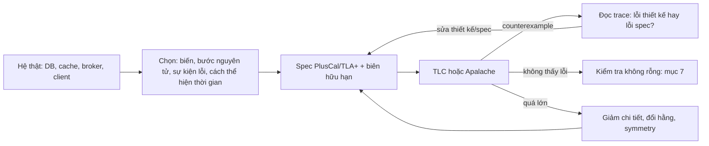
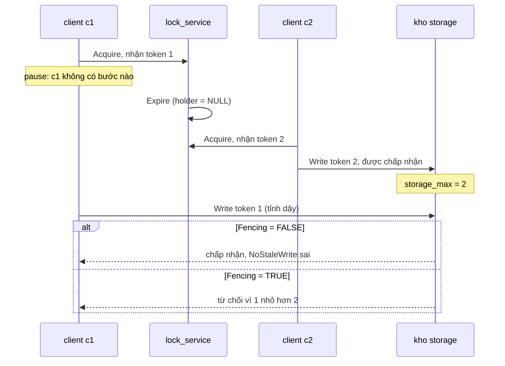
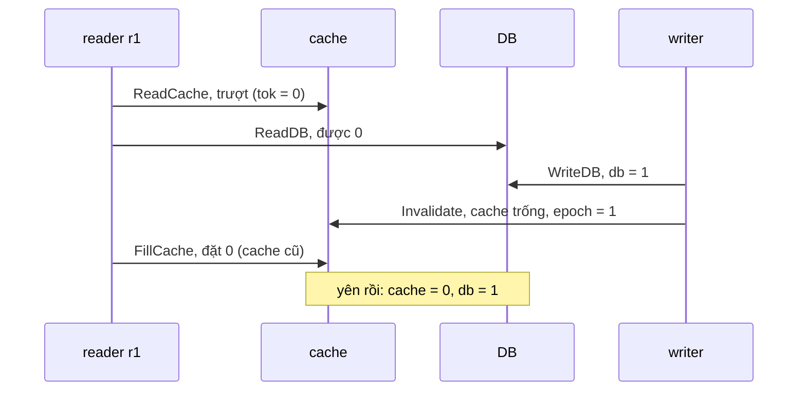
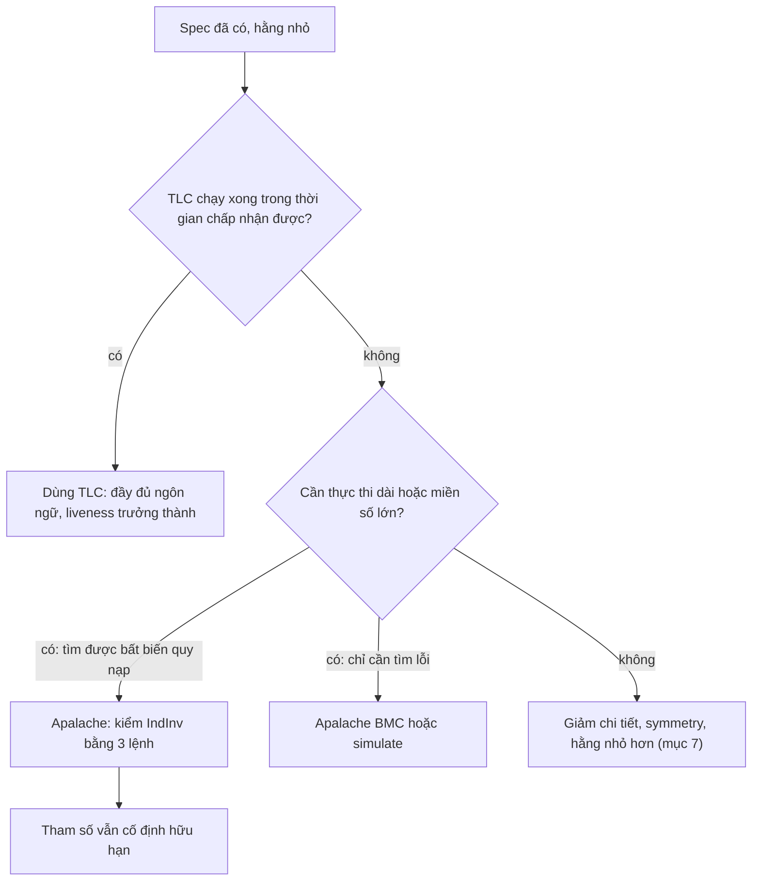

# P13 · Chương 09 — Mô hình hóa hệ backend thực tế

> **Cách đọc chương này.** Mọi đoạn ```` ```tla ```` là **spec minh họa do người soạn viết**; theo quy ước của dự án, chúng **chưa được chạy qua TLC hay Apalache**. Vì vậy mỗi câu dạng "spec này vi phạm invariant X" là *suy luận của người soạn kèm trace viết tay* (ghi nhãn "chưa chạy TLC"), không phải kết quả model checking. Kết quả model checking chỉ được nêu khi nguồn tự ghi (repo `tlaplus/Examples` ghim ở commit `6a7b26a`, bài báo AWS). PlusCal dùng cú pháp P (`begin … end process`) theo PlusCal manual. `learntla.com` và `apalache-mc.org/docs` là **trang sống**, không có số phiên bản: nội dung có thể đổi sau ngày soạn.

## Bạn sẽ hiểu được gì

- **Q1.** Khi mô hình hóa một hệ backend, giữ gì, bỏ gì, và đặt "ranh giới nguyên tử" ở đâu? Crash, pause, timeout, thời gian đi vào spec thế nào? → mục 1
- **Q2.** Distributed lock có lease và fencing token được viết thành spec ra sao; vì sao lease một mình hỏng, và vì sao thêm một bước "kiểm tra còn hạn" vẫn không cứu được? → mục 2
- **Q3.** Hàng đợi at-least-once cộng consumer idempotent được mô hình hóa thế nào; vì sao bản ghi dedup phải nằm *cùng một bước nguyên tử* với tác dụng phụ? → mục 3
- **Q4.** Cache-aside và cuộc đua với DB (stale cache) được viết thành spec ra sao; tính chất đúng cần phát biểu là gì (không phải "cache luôn bằng DB")? → mục 4
- **Q5.** Transactional outbox giải quyết gì so với dual write ở mức spec, và để lại gì (trùng lặp)? → mục 5
- **Q6.** Retry kèm timeout sinh ra tác dụng phụ lặp thế nào, idempotency key sửa ở đâu, và phần nào của vấn đề retry nằm *ngoài* tầm TLA+? → mục 6
- **Q7.** Làm sao giữ không gian trạng thái trong tầm TLC: mô hình nhỏ trước, symmetry, constraint, view, ngân sách lỗi — và làm sao biết một lần "không thấy lỗi" không phải kết quả rỗng? → mục 7
- **Q8.** Apalache (symbolic, SMT) khác TLC ở đâu, kiểm bất biến quy nạp thế nào, cần gì để chạy spec của bạn, và khi nào *không* nên đổi? → mục 8

## Kiến thức cần trước

- [Chương 03 — Trạng thái, hành vi và action](03-trang-thai-hanh-vi-action.md): `Init`, `Next`, `UNCHANGED`, grain of atomicity.
- [Chương 04 — Invariant và TLC](04-invariant-va-tlc.md): cách TLC kiểm invariant, file `.cfg`, đọc counterexample.
- [Chương 05 — Liveness và fairness](05-liveness-va-fairness.md): vì sao chương này gần như chỉ kiểm *safety* và chỉ nhắc liveness.
- [Chương 06 — PlusCal](06-pluscal.md): `process`, label, `await`, `either`, `with`. Mọi spec chương này viết bằng PlusCal (riêng mục 8 dùng TLA+ thuần).
- Phía hệ thống: [P12·08 — Sự cố phân tán](../12-he-thong-du-lieu/08-su-co-he-phan-tan.md) (lease, fencing, process pause), [P12·11 — Stream processing](../12-he-thong-du-lieu/11-stream-processing.md) mục 4 (at-least-once), [P12·12 — Đúng đắn và tích hợp dữ liệu](../12-he-thong-du-lieu/12-dung-dan-va-tich-hop-du-lieu.md) (idempotency, outbox).

(Chương 10 — [Từ đặc tả đến code Rust](10-tu-dac-ta-den-code-rust.md) nói cách nối spec với code; chương 07 — [Refinement](07-refinement.md) nói cách xếp spec thô và spec chi tiết thành bậc thang.)

## 1. Chọn độ trừu tượng: giữ gì, bỏ gì, đặt ranh giới nguyên tử ở đâu (Q1)

> **Trả lời ngắn.** Spec là bản mô tả *thô* của thiết kế, đi kèm một bản mô tả thô của môi trường mà thiết kế chạy trong đó: crash, mạng chậm, process bị treo[^aws-abstract]. Bạn chỉ giữ những gì quyết định đúng hay sai: dữ liệu ở từng kho, thông điệp đang bay, các bước mà hệ thật bảo đảm nguyên tử, và các sự kiện lỗi. Mọi thứ khác nên bỏ, vì spec càng chi tiết thì số state càng phình ra[^lt-detail]. Mức trừu tượng đúng là mức thô nhất mà vẫn còn tái hiện được lỗi bạn đang săn (nhận xét của người soạn).

**Giải thích.**

*Với service `orders`.* Từ đầu đến cuối chương ta bám theo một service giả định tên `orders`, viết bằng Rust, chạy vài replica. Mỗi đơn hàng nó ghi vào DB, đặt một bản vào cache, phát event `OrderPlaced` lên broker, và một consumer lấy event đó để trừ tiền qua cổng thanh toán. Ngoài ra còn một job đối soát mà tại mỗi thời điểm chỉ một replica được chạy, nhờ giữ một lease. Mỗi mục sau lấy một mảnh của `orders` làm đối tượng của một spec (nhận xét của người soạn: đây là ví dụ để giảng, không phải code trong repo). Câu hỏi của mục này đến trước mọi spec: với một hệ như `orders`, trong đầu ta phải giữ gì, vứt gì?

Có sáu quyết định gặp lại ở mọi spec backend. Danh sách là của người soạn tổng hợp, còn từng ý có nguồn riêng.

1. **Biến: mỗi nơi dữ liệu có thể lệch nhau là một biến.** Bảng đơn hàng trong DB, cache, broker, mỗi thứ một biến; thông điệp đang bay là một tập hoặc một dãy. Dữ liệu bên trong thì co lại thật nhỏ: thay vì mô hình tải máy chủ từ 0 đến 100, người có kinh nghiệm chỉ giữ 0..3 hoặc một cờ boolean[^lt-load]. Với `orders`, spec chỉ cần id của đơn, không cần JSON của đơn. Chi tiết nào chưa đụng tới lỗi thì chưa cần giữ.

2. **Label: một label là một bước nguyên tử.** Trong PlusCal, một bước chạy từ label này đến label kế tiếp[^pm-step]. Với thuật toán nhiều process, chính người viết phải chọn grain of atomicity, tức độ thô của một bước[^pm-grain]. Quy tắc thực hành (nhận xét của người soạn): thao tác mà hệ thật *bảo đảm* nguyên tử, như một transaction DB, một lệnh compare-and-set hay một `fetch_max` nguyên tử, là *một* label. Hai thao tác mà giữa chúng process khác chen vào được, như đọc DB rồi mới set cache, hay commit rồi mới publish, là *hai* label. Chọn bước quá thô có thể che mất lỗi thật, còn quá mịn thì model checking chạy quá lâu[^lt-grain].

3. **Môi trường cũng là một phần của spec.** AWS làm như sau: nêu những đặc tính của môi trường mà hệ thống dựa vào ("what must go right"), rồi đặc tả tác động của từng sự kiện có thể xảy ra: lỗi mạng và hồi phục, lỗi đĩa, process crash rồi restart, thao tác của người vận hành[^aws-events]. Họ thấy cách này ít sai sót hơn việc liệt kê "cái gì có thể hỏng"[^aws-needs-right]. Trong PlusCal, crash là một nhánh `either … or` bỏ qua bước (kèm ngân sách, xem mục 3 và 5). Trùng hoặc mất thông điệp cũng là một nhánh nondeterministic, nghĩa là spec không chọn trước nhánh nào mà TLC thử cả hai. Còn **pause thì không cần mô hình riêng**: thuật toán nhiều process được thực thi bằng cách liên tục chọn một process *bất kỳ* rồi chạy một bước của nó[^pm-arbitrary], nên một process đứng yên giữa hai label lâu tùy ý đã là hành vi hợp lệ (suy luận của người soạn từ nguồn).

4. **Thời gian: trừu tượng hóa tối đa.** Các thuật toán trong mô hình bất đồng bộ thường bảo đảm safety mà không cần giả định gì về thời gian; chỉ liveness mới phụ thuộc vào timeout hay failure detector[^kb-safety-liveness]. Vậy lease hết hạn hay RPC timeout chỉ cần là hành động "có thể xảy ra bất cứ lúc nào", không cần đồng hồ (suy luận của người soạn). Khi buộc phải có "thời gian", spec trong repo Examples dùng một *bộ đếm logic* tên `TimeoutCounter`, tăng một đơn vị mỗi lần timeout kích hoạt[^ex-cp-timeout]. Lamport thì dùng biến `now` ở chương real-time của sách[^ss-now]. Ông cũng ghi nhận rằng đặc tả real-time không phổ biến, vì spec thường nói hệ *làm gì* chứ không nói *mất bao lâu*[^ss-realtime-rare].

5. **Tính chất: phân biệt "không bao giờ" với "rồi sẽ".** AWS chia tính chất thành hai loại. Safety cho biết hệ được phép làm gì, ví dụ mọi dữ liệu đã commit luôn còn nguyên và đúng[^aws-safety]. Liveness cho biết hệ phải rồi sẽ làm gì[^aws-liveness]. Chương này chủ yếu kiểm safety; liveness cần fairness, xem [chương 05](05-liveness-va-fairness.md).

6. **Biên hữu hạn.** TLC duyệt từng state nên spec phải có biên: số client, số message, ngân sách crash. Chi tiết ở mục 7.

Cả quy trình gói lại trong sơ đồ sau.



Bảng dưới đây ánh xạ từng thành phần backend sang cấu trúc spec, và ta dùng nó xuyên suốt chương (nhận xét của người soạn).

| Thành phần hệ thật | Trong spec |
| --- | --- |
| Bảng/row trong DB | biến, thường là hàm `Key -> Value` hoặc tập |
| Một DB transaction | **một** label (không thể bị chen) |
| Thông điệp trên mạng | phần tử của tập/dãy `net`; gửi và nhận là hai label |
| Process crash/restart | nhánh `either … or` bỏ qua bước, kèm ngân sách `MaxCrashes` |
| GC pause, preempt, trễ mạng | không cần hành động riêng: interleaving đã cho phép |
| Lease TTL, RPC timeout | hành động có thể xảy ra bất cứ lúc nào (`Expire`, nhánh `skip`) |
| Retry | vòng `while` có trần `MaxRetries` |
| Tải, độ trễ, kích thước payload | bỏ |

*Một spec có thật để đối chiếu: Checkpoint Coordination trong `tlaplus/Examples`.* Tác giả viết nó (2017) khi thiết kế tính năng điều phối checkpoint trên một cluster năm replica có primary được bầu[^ex-cp-intro]. README nêu thẳng mô hình lỗi: replica crash rồi hồi phục, đường mạng giữa hai replica hỏng rồi hồi phục, và tốc độ trôi của thời gian khác nhau giữa các replica[^ex-cp-failure]. Trong spec, mỗi loại lỗi là một hành động riêng của `Next`, như `NodeFailure`, `NodeRecovery`, `NetworkFailure`[^ex-cp-next]. Thời gian thì là bộ đếm `TimeoutCounter`, tăng ở hành động `TriggerTimeout`[^ex-cp-timeout]. Nói cách khác, đúng khuôn của sáu quyết định ở trên.

<details><summary>Đi sâu: luật PlusCal cần nhớ, thứ TLA+ không làm được, và spec không phải code</summary>

- **Kết quả của spec Checkpoint Coordination.** README ghi rằng TLC tìm ra một trace 12 bước cho một lỗi tinh vi do một "tối ưu hóa" gây ra[^ex-cp-12]. File `MCCheckpointCoordinationFailure.cfg` tái hiện đúng trace đó[^ex-cp-failcfg]. Manifest của repo ghi kết quả `safety failure` cho model Failure ấy[^ex-cp-manifest]. Đây là kết quả do repo ghi; chương này không chạy lại.
- **Luật label.** Hai lệnh gán cho cùng một biến không được nằm trong cùng một bước, nên giữa chúng phải có label[^pm-assign-once]. Thân `with` không được chứa label[^pm-with-label]. `either` chọn nondeterministic một nhánh *thực thi được*[^pm-either]. Khi chạy bằng TLC, định danh các process phải so sánh được với nhau[^pm-ids]. TLC coi model value là so sánh được với mọi giá trị và luôn khác chúng[^ss-modelvalue], nên một process tên chuỗi `"lock_service"` sống chung được với một tập process là model value.
- **Deadlock giả.** Khi mọi process đã xong, bộ dịch PlusCal tự thêm một hành động "mọi thứ đã hoàn tất, không có gì xảy ra" để TLC không coi đó là deadlock[^lt-terminating]. Nhưng một process kiểu `while TRUE do await … end while` luôn kẹt ở `await` khi hết việc, và TLC sẽ báo deadlock. Sách mô tả tùy chọn `-deadlock` để tắt kiểm tra này[^ss-deadlock-opt]. Trong file cấu hình, spec Chameneos ở `tlaplus/Examples` dùng dòng `CHECK_DEADLOCK FALSE`[^ex-chameneos-cfg]. Spec ở mục 2, 3, 5, 6 có process như vậy nên cần tắt kiểm tra; spec mục 4 thì không, vì mọi process của nó đều kết thúc (suy luận của người soạn từ cấu trúc spec).
- **Thứ TLA+ không bắt được.** AWS tách hai loại vấn đề: lỗi logic, mà spec bắt được, và suy giảm hiệu năng "nổi lên" từ vòng phản hồi. Ví dụ một server chậm nhất thời làm client timeout, client retry, tải tăng, server càng chậm[^aws-emergent]. Họ viết rằng chưa biết cách khả thi để mô hình hóa một hệ thật nhằm dự đoán hành vi đó[^aws-emergent-no]. Vì vậy mục 6 chỉ mô hình hóa *tác dụng phụ lặp* của retry, không mô hình hóa *bão retry*.
- **Spec không phải code.** Câu hỏi AWS gặp nhiều nhất là làm sao biết code cài đặt đúng thiết kế đã kiểm, và câu trả lời của họ là "không biết"[^aws-code]. Spec vẫn có ích: nó giúp làm đúng thiết kế, bước đầu tiên không thể thiếu để làm đúng code[^aws-code-help]. Ngoài ra, bất biến tìm được có thể đem viết thành assertion trong code (suy luận của người soạn từ cùng đoạn). [Chương 10](10-tu-dac-ta-den-code-rust.md) nói tiếp phần nối spec với code.
- **Bậc thang trừu tượng.** Cùng một hệ có thể mô tả ở nhiều mức, mỗi mức phục vụ một mục đích, chẳng hạn mức mịn hơn để hiểu hệ quả của đồng thời[^aws-ladder]. Cách nối các mức với nhau ở [chương 07](07-refinement.md).

</details>

**Quay lại Q1:** với `orders`, ta giữ biến ở nơi dữ liệu có thể lệch nhau, đặt label ở ranh giới mà hệ thật bảo đảm nguyên tử, biến lỗi môi trường thành hành động và thời gian thành "có thể xảy ra bất cứ lúc nào"; chỉ làm mịn thêm khi trace cần xem bị che mất.

## 2. Distributed lock với lease và fencing token (Q2)

> **Trả lời ngắn.** Lease là khóa có hạn. Nó giải phóng được khóa của một node đã chết, nhưng không ngăn được chủ cũ vừa tỉnh dậy ghi tiếp[^kb-pause-lease]. Trong spec, "hết hạn" là một hành động xảy ra bất cứ lúc nào, còn "pause" là việc một client không được chạy bước kế tiếp; chỉ hai thứ đó đã đủ dựng ra trace ghi sai thứ tự. Fencing token sửa được lỗi này, nhưng chỉ khi *kho lưu trữ* tự kiểm token và từ chối ghi có token đi lùi[^kb-fencing-active]; trong spec dưới đây, việc kiểm và việc ghi nằm trong cùng một bước nguyên tử (lựa chọn mô hình của người soạn).

**Giải thích.**

*Với service `orders`.* Mỗi giờ `orders` chạy một job đối soát: gom các đơn đã thanh toán, tính tổng rồi ghi kết quả vào một kho lưu trữ. Hai replica cùng chạy job thì kết quả của replica này đè lên replica kia, nên các replica tranh nhau một lease trên dịch vụ khóa, và chỉ replica nào giữ lease mới được ghi. Nghe đủ an toàn, vậy mà vẫn hỏng. Replica A lấy được lease rồi bị GC pause quá hạn; lease hết hạn, replica B lấy lease mới, ghi kết quả; A tỉnh dậy, tin rằng mình vẫn là chủ, và ghi đè kết quả mới bằng kết quả cũ. Mục này hỏi: viết kịch bản đó thành spec thì lỗi hiện ra thế nào (nhận xét của người soạn: `orders` và job đối soát là ví dụ giả định)? Cơ chế vận hành đầy đủ của lease và fencing nằm ở [P12·08 mục 7–8](../12-he-thong-du-lieu/08-su-co-he-phan-tan.md).

Lỗi này không do dịch vụ khóa dở: ngay cả với một dịch vụ khóa hoàn hảo, đoạn code "lấy khóa → ghi → nhả khóa" vẫn hỏng nếu client bị pause quá hạn lease[^kb-perfect]. Thêm một lần kiểm tra hạn ngay trước khi ghi cũng không cứu được, vì client có thể bị pause đúng giữa lần kiểm tra và lần ghi[^kb-nocheck]. Lập luận đầy đủ ở [P12·08 mục 7](../12-he-thong-du-lieu/08-su-co-he-phan-tan.md). Hai điều đó chính là thứ spec dưới đây sẽ làm lộ ra.

**Spec minh họa (PlusCal, chưa chạy TLC).** Spec gồm một dịch vụ khóa hoàn hảo (một biến `holder` và một bộ đếm `next_token`), một process `lock_service` có thể làm lease hết hạn bất cứ lúc nào, nhiều client (mỗi client là một replica `orders`), và một kho lưu trữ ghi lại lịch sử các lần ghi được chấp nhận.

Nếu chưa quen ký hiệu: `/\` là "và", `\/` là "hoặc", `~` là phủ định, `/=` là "khác", `<<>>` là dãy rỗng, `\in`/`\notin`/`\union` là "thuộc"/"không thuộc"/"hợp". Chúng được giải nghĩa ở [chương 02](02-toan-nen-tang.md). Các từ khóa PlusCal (`process`, label, `await`, `either`, `with`, `while`, `self`, `pc`) ở [chương 06](06-pluscal.md).

```tla
---- MODULE LeaseFencing ----
EXTENDS Integers, Sequences, TLC

CONSTANTS Clients, NULL, Fencing
ASSUME NULL \notin Clients
ASSUME Fencing \in BOOLEAN

(*--algorithm lease_fencing
variables
  holder      = NULL,   \* người giữ lease theo dịch vụ khóa
  next_token  = 1,      \* token sẽ cấp cho lần acquire kế tiếp
  storage_max = 0,      \* token lớn nhất kho đã chấp nhận (chỉ để fencing)
  log         = <<>>;   \* lịch sử các lần ghi được chấp nhận (biến lịch sử)

define
  \* Không có ghi nào của token cũ xuất hiện SAU ghi của token mới hơn.
  NoStaleWrite ==
    \A i, j \in 1..Len(log) : i < j => log[i].tok <= log[j].tok
end define;

process lock_service = "lock_service"
begin
  Expire:                     \* lease có thể hết hạn bất cứ lúc nào
    while TRUE do
      await holder /= NULL;
      holder := NULL;
    end while;
end process;

process client \in Clients
variable my_tok = 0;
begin
  Acquire:                    \* một bước nguyên tử tại dịch vụ khóa
    await holder = NULL;
    holder := self;
    my_tok := next_token;
    next_token := next_token + 1;
  Write:                      \* một bước nguyên tử tại kho: kiểm token VÀ ghi
    if ~Fencing \/ my_tok >= storage_max then
      storage_max := my_tok;
      log := Append(log, [client |-> self, tok |-> my_tok]);
    end if;
end process;
end algorithm; *)
====
```

Đọc spec theo từng phần:

- *Process `lock_service`.* Nhánh `Expire` bật bất cứ khi nào có người giữ lease. Ta không đếm giờ mà cho phép hết hạn xảy ra *bất cứ lúc nào*, đúng như đã bàn ở mục 1. Nhờ đó mọi lịch hết hạn trong thực tế đều là một lịch của spec, tức spec bao trùm thực tế và không bỏ sót hành vi thật (suy luận của người soạn).
- *Process `client`.* Hai label là hai bước nguyên tử. Giữa `Acquire` và `Write`, TLC được chạy bất kỳ process nào khác với số bước tùy ý. Khoảng đó chính là "pause" (GC, bị preempt, page fault) hay gói ghi bị trễ trên mạng, và Kleppmann liệt kê cả hai là nguyên nhân[^kb-network-delay]. Trong spec, hai nguyên nhân vật lý khác nhau co về *một* cơ chế: client không được chạy bước kế (nhận xét của người soạn).
- *Hằng `Fencing`.* `FALSE` là kho ngây thơ, ghi mọi thứ nó nhận. `TRUE` là kho có kiểm token: chỉ chấp nhận ghi nếu token không nhỏ hơn token lớn nhất đã thấy. Đó đúng là điều cần làm: kho phải chủ động kiểm token và từ chối ghi có token đi lùi[^kb-fencing-active].
- *Biến lịch sử `log` và invariant `NoStaleWrite`.* Tính chất cần bảo vệ không phải "chỉ một client giữ lease", vì dịch vụ khóa luôn bảo đảm điều đó (`holder` chỉ là một biến). Tính chất thật là "kho không áp dụng một ghi của lease cũ sau một ghi của lease mới hơn". Muốn phát biểu được nó phải nhớ thứ tự các lần ghi, nên ta thêm biến `log`. Biến chỉ phục vụ việc kiểm như vậy gọi là biến phụ hay biến lịch sử; mục 7 nói về cái giá của nó.
- Khi chạy, tắt kiểm tra deadlock (mục 1) vì `lock_service` không bao giờ kết thúc, và chạy hai lần: `Fencing = FALSE` (kỳ vọng thấy vi phạm), rồi `Fencing = TRUE`.

**Trace tay khi `Fencing = FALSE` (suy luận của người soạn, chưa chạy TLC).** Lấy `Clients = {c1, c2}`, trong đó `c1` là replica A và `c2` là replica B của `orders`:

1. `c1.Acquire`: `holder = c1`, `my_tok[c1] = 1`, `next_token = 2`.
2. `lock_service.Expire`: `holder = NULL`. Trong lúc đó `c1` đơn giản là không được chạy bước nào (pause).
3. `c2.Acquire`: `holder = c2`, `my_tok[c2] = 2`, `next_token = 3`.
4. `c2.Write`: kho chấp nhận; `log = <<[client |-> c2, tok |-> 2]>>`.
5. `c1.Write`: vì `~Fencing` đúng nên ghi vẫn được chấp nhận; `log = <<(c2, 2), (c1, 1)>>`.

Ở bước 5, với `i = 1` và `j = 2`, ta có `log[1].tok = 2` không `<=` `log[2].tok = 1`, nên `NoStaleWrite` sai. Đây đúng là kịch bản Kleppmann vẽ: client thứ nhất tỉnh dậy sau khi lease hết hạn và vẫn ghi[^kb-pause-lease]. Hai client, mỗi client một lần acquire, là đủ; theo suy luận của người soạn, đó cũng là bản vi phạm nhỏ nhất.

**Cùng trace khi `Fencing = TRUE` (suy luận, chưa chạy TLC).** Sau bước 4, `storage_max = 2`. Ở bước 5, `my_tok[c1] = 1 < 2` và `Fencing` đúng, nên điều kiện `~Fencing \/ my_tok >= storage_max` sai và `log` không đổi. Đó là cơ chế "kho nhớ đã xử lý token cao hơn nên từ chối token thấp hơn"[^kb-fencing].



<details><summary>Đi sâu: thêm bước kiểm tra, tách kiểm tra khỏi ghi, và giả định ẩn của spec</summary>

**(a) Thêm một label `Check` giữa `Acquire` và `Write` không sửa được.** Giả sử client tự kiểm tra mình còn giữ lease trước khi ghi (spec `Fencing = FALSE`):

```tla
  Check:                      \* client tự kiểm tra: "mình còn giữ lease không?"
    await holder = self;
  Write:
    \* như cũ
```

Trace (suy luận của người soạn, chưa chạy TLC): `c1.Acquire`; `c1.Check` thành công vì `holder = c1`; rồi `c1` bị pause; `Expire`; `c2.Acquire`, `c2.Check`, `c2.Write` (`log = <<(c2, 2)>>`); sau đó `c1.Write` chạy tiếp và ghi `(c1, 1)` sau `(c2, 2)`, `NoStaleWrite` sai. Spec tái hiện đúng nhận xét rằng kiểm tra hạn ngay trước khi ghi không sửa được, vì pause có thể rơi vào giữa kiểm tra và ghi[^kb-nocheck]. Bài học chung (nhận xét của người soạn): "check rồi act" qua hai label luôn mở một cửa sổ cho interleaving, và chỉ một bước nguyên tử *ở nơi giữ dữ liệu* mới đóng được cửa sổ đó.

**(b) Tách "kiểm token" khỏi "ghi" ở kho cũng hỏng.** Nếu kho cài đặt thành hai label:

```tla
process client \in Clients
variables my_tok = 0, ok = FALSE;
begin
  Acquire:
    \* như cũ
  CheckToken:
    ok := my_tok >= storage_max;
  Apply:
    if ok then
      storage_max := my_tok;
      log := Append(log, [client |-> self, tok |-> my_tok]);
    end if;
end process;
```

thì trace (suy luận, chưa chạy TLC) là: `c1.Acquire` (token 1); `c1.CheckToken` đặt `ok = TRUE` vì `storage_max = 0`; `c1` pause; `Expire`; `c2.Acquire` (token 2); `c2.CheckToken`, `c2.Apply` làm `storage_max = 2` và `log = <<(c2, 2)>>`; rồi `c1.Apply` chạy với `ok = TRUE` đã cũ, ghi `(c1, 1)` và hạ `storage_max` về 1. `NoStaleWrite` sai. Bài học khi nối với code (xem "Liên hệ với Rust"): kiểm token và ghi phải nằm trong cùng một critical section, hoặc trong cùng một câu lệnh có điều kiện ở kho.

**(c) Giả định ẩn: `next_token` tăng đơn điệu qua mọi lần failover của dịch vụ khóa.** Trong spec, nó chỉ là một biến duy nhất và không bao giờ hỏng. Thực tế khó hơn: khi bàn việc thêm fencing token cho Redlock, Kleppmann nhận xét rằng nhiều khả năng phải có cả một thuật toán consensus chỉ để sinh token[^kb-fencing-consensus]. Giả định tăng đơn điệu qua failover trong spec của ta vì thế chưa được kiểm chứng (nhận xét của người soạn). Cách làm hợp tinh thần AWS là viết giả định này thành *đặc tính môi trường* tường minh trong spec[^aws-env-props], rồi nếu cần thì tinh chỉnh bằng một spec mức thấp hơn ([chương 07](07-refinement.md)).

**(d) Thời gian tường minh.** Có thể thêm biến `now` đếm tới một `MaxTime` hữu hạn, và chỉ cho `Expire` bật khi `now` đã qua hạn, theo tinh thần biến `now` của Lamport[^ss-now]. Lỗi không vì thế mà biến mất, vì pause vẫn chỉ là "không bước"; nhưng số state bị nhân lên với số giá trị của `now` (suy luận của người soạn). Theo lý do ở mục 1, safety không dựa vào thời gian, nên bản nondeterministic là lựa chọn mặc định tốt hơn.

**(e) Liên hệ rộng.** Các ví dụ thực tế về lease có hoặc không có fencing (Kubernetes `leaderelection`, Chubby, etcd) đã được dẫn nguồn ở [P12·08 mục 8](../12-he-thong-du-lieu/08-su-co-he-phan-tan.md). Số thế hệ (term) trong Raft thuộc cùng họ ý tưởng với fencing token; xem [P12·09](../12-he-thong-du-lieu/09-consistency-va-consensus.md) (nhận xét của người soạn).

**(f) Vì sao fencing đúng: lập luận quy nạp (suy luận của người soạn).** Khi `Fencing = TRUE`, ta có bất biến phụ: `storage_max` bằng token của phần tử cuối trong `log` (hoặc 0 nếu `log` rỗng), và `log` không giảm. `Acquire` và `Expire` không đụng tới `log` hay `storage_max`. `Write` chỉ thêm phần tử khi `my_tok >= storage_max`, tức không nhỏ hơn token cuối; ngay sau đó `storage_max = my_tok` chính là token cuối mới. Nếu ghi bị từ chối thì không có gì đổi. Trạng thái đầu (`log` rỗng, `storage_max = 0`) thỏa bất biến. Vậy `NoStaleWrite` đúng ở mọi state, với một điều kiện duy nhất: *kiểm token và ghi là một bước nguyên tử*. Lưu ý lập luận này không dùng tính đơn điệu của `next_token`; nó chỉ chứng minh `log` không giảm theo token. Chính tính đơn điệu của `next_token` (giả định về dịch vụ khóa, xem (c)) mới nối "token nhỏ hơn" với "lease cũ hơn", và nhờ vậy `NoStaleWrite` mới mang nghĩa "không áp dụng ghi của lease cũ sau ghi của lease mới".

</details>

**Quay lại Q2:** với job đối soát của `orders`, hết hạn là hành động tự do và pause là client không được chạy; hai điều đó đủ để lease một mình ghi sai thứ tự, và chỉ kiểm token *ở kho, trong cùng bước nguyên tử với việc ghi* mới đóng được lỗi.


## 3. Hàng đợi at-least-once và consumer idempotent (Q3)

> **Trả lời ngắn.** Hàng đợi at-least-once chỉ hứa không mất tin, không hứa không trùng: nếu consumer xử lý xong nhưng chưa kịp ack thì tin sẽ được giao lại[^k-ack-problem]. Trong spec, "mất ack" là một nhánh nondeterministic và "hết hạn visibility" là một hành động của broker; hệ quả là tác dụng phụ có thể chạy hai lần. Consumer idempotent sửa được chuyện này, miễn là bản ghi "đã xử lý" nằm trong *cùng một bước nguyên tử* với tác dụng phụ.

**Giải thích.**

*Với service `orders`.* Mỗi đơn mới, `orders` phát một event `OrderPlaced`, và một consumer lấy event đó để trừ tiền khách qua cổng thanh toán. Broker chỉ hứa giao ít nhất một lần. Giả sử consumer trừ tiền xong rồi chết trước khi kịp ack: broker không thấy ack nên giao lại event cho một consumer khác, và khách bị trừ tiền lần thứ hai. Mục này hỏi: dựng kịch bản đó thành spec thì lỗi hiện ra ở đâu, và bản ghi "đơn này đã trừ tiền" phải đặt ở chỗ nào (nhận xét của người soạn: ví dụ giả định)?

Broker thật cư xử đúng như vậy. Khi dùng manual acknowledgement, RabbitMQ requeue mọi delivery chưa ack lúc channel hoặc connection đóng[^rmq-requeue]. Vì thế consumer phải sẵn sàng nhận lại tin và thiết kế idempotent[^rmq-idem]. Phần lý thuyết (idempotency, dedup cần bộ nhớ bền) ở [P12·11 mục 4](../12-he-thong-du-lieu/11-stream-processing.md) và [P12·12 mục 4–5](../12-he-thong-du-lieu/12-dung-dan-va-tich-hop-du-lieu.md); dưới đây là spec.

*Chọn cách biểu diễn hàng đợi.* Learntla nêu hai cách. Hàng đợi "phá hủy", đọc xong là tin biến mất khỏi dãy, dễ viết nhưng không phát biểu được tính chất dựa vào lịch sử, như "một tin chưa từng được xếp hàng hai lần"[^lt-queue-mutable]. Hàng đợi bất biến kèm con trỏ đọc `i` giữ nguyên lịch sử nhưng khó viết hơn[^lt-queue-immutable]. Mỗi thông điệp nên có `id` để phân biệt các tin cùng nội dung[^lt-queue-id]. Với bài toán này ta chỉ cần *tập* các id cùng một *trạng thái* cho từng id (`ready`, `inflight`, `acked`); thứ tự giao bị bỏ có chủ ý (xem mục Đi sâu).

**Spec minh họa (PlusCal, chưa chạy TLC).** Mỗi `m` trong `Msgs` là một event `OrderPlaced`, và `effects[m]` đếm số lần tiền thật sự bị trừ cho đơn đó.

```tla
---- MODULE AtLeastOnce ----
EXTENDS Integers, TLC

CONSTANTS Msgs, Consumers, NULL, Dedup, MaxCrashes
ASSUME NULL \notin Msgs
ASSUME Dedup \in BOOLEAN
ASSUME MaxCrashes \in Nat

(*--algorithm at_least_once
variables
  status  = [m \in Msgs |-> "ready"],   \* ở broker: ready | inflight | acked
  effects = [m \in Msgs |-> 0],         \* tác dụng phụ đã áp dụng cho từng tin
  seen    = {},                         \* bảng dedup của consumer, cùng DB với effects
  crashes = 0;                          \* ngân sách crash đã dùng

define
  AtMostOneEffect == \A m \in Msgs : effects[m] <= 1
end define;

process broker = "broker"
begin
  Redeliver:                            \* visibility timeout: tin inflight quay lại ready
    while TRUE do
      with m \in {x \in Msgs : status[x] = "inflight"} do
        status[m] := "ready";
      end with;
    end while;
end process;

process consumer \in Consumers
variable cur = NULL;
begin
  Receive:
    while TRUE do
      with m \in {x \in Msgs : status[x] = "ready"} do
        status[m] := "inflight";
        cur := m;
      end with;
  Handle:                               \* một transaction: tác dụng phụ + bản ghi dedup
      if ~(Dedup /\ cur \in seen) then
        effects[cur] := effects[cur] + 1;
        seen := seen \union {cur};
      end if;
  Ack:
      either
        status[cur] := "acked";
      or
        await crashes < MaxCrashes;     \* crash/mất ack: broker sẽ giao lại
        crashes := crashes + 1;
      end either;
    end while;
end process;
end algorithm; *)
====
```

Chú giải:

- `broker.Redeliver` không có điều kiện thời gian: tin `inflight` có thể quay lại `ready` bất cứ lúc nào. Một hành động gộp được hai chuyện thật, consumer crash và consumer chỉ chậm (nhận xét của người soạn). Khi tập mà `with` chọn rỗng thì bước đó không thực thi được[^lt-with-empty].
- `Handle` là *một* label: kiểm `seen`, tăng `effects` và ghi `seen` xảy ra cùng lúc. Nó mô hình hóa một transaction DB bao quanh "áp dụng tác dụng phụ và ghi bản ghi đã xử lý".
- Nhánh `or` của `Ack` là mất ack, hoặc consumer chết sau khi làm xong. Nó có ngân sách `MaxCrashes` để ta nói được "tối đa K lần crash" thay vì crash vô hạn (xem mục 7).
- `AtMostOneEffect` là tính chất "tác dụng phụ không chạy quá một lần cho mỗi tin". Ta *muốn* nó đúng khi `Dedup = TRUE` và *kỳ vọng* nó sai khi `Dedup = FALSE`.

**Trace tay khi `Dedup = FALSE`, một consumer, `MaxCrashes >= 1` (suy luận của người soạn, chưa chạy TLC).** Với `Msgs = {m1}` (một đơn) và `Consumers = {c1}`:

1. `c1.Receive`: `status[m1] = "inflight"`, `cur = m1`.
2. `c1.Handle`: `effects[m1] = 1`.
3. `c1.Ack`, nhánh `or`: `crashes = 1`, `status[m1]` vẫn `"inflight"`; vòng lặp quay lại `Receive`.
4. `broker.Redeliver`: `status[m1] = "ready"`.
5. `c1.Receive` rồi `c1.Handle`: `effects[m1] = 2`, `AtMostOneEffect` sai.

Một tin, một consumer, một lần crash là đủ. Đây cũng là tình huống tài liệu thiết kế Kafka nêu cho các hệ thống nhắn tin dùng xác nhận: consumer xử lý xong nhưng hỏng trước khi gửi xác nhận thì tin bị tiêu thụ hai lần (Kafka tự xử lý khác, bằng vị trí đọc của consumer)[^k-ack-problem].

**Khi `Dedup = TRUE` (suy luận, chưa chạy TLC).** `Handle` chỉ tăng `effects[cur]` khi `cur \notin seen`, và đồng thời thêm `cur` vào `seen`. Vì vậy bất biến quy nạp là: với mọi `m`, `effects[m] = 1` nếu `m \in seen`, và `effects[m] = 0` nếu không. Bất biến này kéo theo `AtMostOneEffect`, còn mọi bước khác không đụng tới `effects` hay `seen`. Nó đúng *vì* hai biến được cập nhật trong cùng một label.

**Tách dedup khỏi tác dụng phụ thì hỏng.** Thay `Handle` bằng hai label (chưa chạy TLC):

```tla
  Effect:
    if ~(Dedup /\ cur \in seen) then
      effects[cur] := effects[cur] + 1;
    end if;
  Record:
    seen := seen \union {cur};
```

Trace với hai consumer `c1`, `c2` (suy luận): `c1.Receive` (m1 inflight); `c1.Effect` (`effects[m1] = 1`, `seen` vẫn rỗng); `c1` pause; `broker.Redeliver` (m1 ready); `c2.Receive`; `c2.Effect` thấy `m1 \notin seen` nên `effects[m1] = 2`. `AtMostOneEffect` sai dù `Dedup = TRUE` và không có crash nào. Đây là lý do ngoài thực tế, bản ghi dedup và thay đổi dữ liệu phải chung một transaction DB.

<details><summary>Đi sâu: thứ tự, at-most-once, liveness, ack muộn</summary>

- **Thứ tự.** Dùng tập thì bỏ đi thông tin về thứ tự giao. Nếu tính chất cần thứ tự (ví dụ "sự kiện của cùng một khóa được xử lý theo thứ tự gửi"), hàng đợi phải là dãy, hoặc hàng đợi bất biến kèm chỉ số. Cần nhớ rằng hàng đợi bất biến có thể làm mô hình không còn hữu hạn nếu đọc mãi[^lt-queue-warning].
- **At-most-once.** Learntla gợi ý mô hình giao-tối-đa-một-lần bằng cách giao tin cho một *tập con* người nhận hợp lệ: phần nằm ngoài tập con là không nhận được[^lt-amo]. Trong spec trên, đảo thứ tự cho `Ack` chạy trước `Handle` sẽ ra ngữ nghĩa tương ứng: nếu consumer chết giữa hai bước thì tác dụng phụ mất. Tài liệu Kafka gọi đó là at-most-once ở phía consumer[^kafka-consumer-amo]. Muốn thấy điều này trong spec cần thêm một nhánh crash giữa hai label, và tính chất bị vi phạm lúc đó là "tin đã `acked` thì `effects >= 1`" (suy luận của người soạn, chưa chạy TLC).
- **Liveness.** "Mọi tin rồi sẽ được ack" cần `fair process` hoặc khai fairness, cộng ngân sách crash hữu hạn. Nếu không, nhánh crash lặp mãi là một hành vi hợp lệ mà tin không bao giờ được ack. Chi tiết ở [chương 05](05-liveness-va-fairness.md); chương này không khẳng định liveness của spec trên.
- **Ack của consumer chậm.** Spec cho phép một consumer chậm ack một tin mà consumer khác đang xử lý. Đó là hành vi của hàng đợi dùng visibility timeout (nhận xét của người soạn). Nếu hệ của bạn có quy tắc khác, ví dụ ack kèm token của lần giao, hãy viết lại `Ack` theo quy tắc đó.
- **Outbox ở đầu kia.** Nếu *producer* cũng cần bảo đảm "ghi DB và phát tin cùng sống cùng chết" thì đó là chuyện của mục 5.

</details>

**Quay lại Q3:** với `OrderPlaced`, at-least-once nghĩa là spec của bạn *phải* cho phép giao lặp; consumer trừ tiền idempotent chỉ đúng khi bản ghi dedup và tác dụng phụ là một bước nguyên tử, và tách hai label ra là trace trừ tiền hai lần xuất hiện.

## 4. Cache-aside và cuộc đua stale cache (Q4)

> **Trả lời ngắn.** Với cache-aside, ứng dụng đọc cache; nếu trượt thì đọc DB rồi đặt kết quả vào cache, còn khi ghi thì ghi DB rồi xóa mục tương ứng trong cache[^az-order]. Cuộc đua nằm ở chỗ một reader đọc DB được giá trị cũ, writer cập nhật DB và xóa cache, rồi reader mới đặt giá trị cũ vào cache, và cache giữ giá trị cũ cho tới khi hết hạn. Facebook gọi đó là *stale set*[^fb-stale]. Cách họ sửa là lease token gắn với khóa cache[^fb-lease].

**Giải thích.**

*Với service `orders`.* Trang chi tiết đơn của `orders` đọc trạng thái đơn qua cache. Khi một đơn chuyển từ "chờ thanh toán" sang "đã thanh toán", `orders` ghi DB rồi xóa mục cache của đơn. Lúc đó một request khác đang xem trang đơn: nó đọc DB trước khi bản ghi đổi, nên cầm trong tay trạng thái cũ; nó chưa kịp đặt vào cache thì writer đã ghi DB và xóa cache xong; rồi nó mới đặt trạng thái cũ vào. Từ đó khách thấy "chờ thanh toán" cho tới khi mục cache hết hạn, dù DB đã ghi "đã thanh toán" (nhận xét của người soạn: ví dụ giả định). Mục này dựng đúng cuộc đua đó thành spec.

Điều cần chốt trước là spec phải khẳng định *cái gì*. Tài liệu Azure nói rõ rằng giữa lần ghi và lần đọc kế tiếp, reader có thể trượt cache hoặc thoáng thấy dữ liệu cũ[^az-stale-window]. Nghĩa là *một chút* độ cũ là chủ ý của mẫu thiết kế này, nên tính chất đúng không thể là "cache luôn bằng DB" (state nào cũng thế). Nó phải là: **khi hệ đã yên (quiescent), cache hoặc trống hoặc bằng DB**. Cache giữ giá trị cũ *mãi mãi* mới là lỗi, và với cache thật thì "mãi mãi" bị TTL chặn lại (spec này không mô hình hóa TTL; nhận xét của người soạn).

**Spec minh họa (PlusCal, chưa chạy TLC).** Một writer ghi DB rồi xóa cache; mỗi reader đọc một lần theo cache-aside. Giá trị 0 là trạng thái cũ, 1 là trạng thái mới. Biến `epoch` mô phỏng lease token: nó tăng mỗi lần cache bị xóa.

```tla
---- MODULE CacheAside ----
EXTENDS Integers, TLC

CONSTANTS Readers, NULL, UseLease
ASSUME UseLease \in BOOLEAN

(*--algorithm cache_aside
variables
  db    = 0,
  cache = NULL,   \* NULL = trống; ngược lại là giá trị đang được cache
  epoch = 0;      \* số lần cache bị xóa (đóng vai lease token)

define
  Quiescent    == pc["writer"] = "Done" /\ \A r \in Readers : pc[r] = "Done"
  CacheNotStale == Quiescent => (cache = NULL \/ cache = db)
end define;

process writer = "writer"
begin
  WriteDB:
    db := 1;
  Invalidate:
    cache := NULL;
    epoch := epoch + 1;
end process;

process reader \in Readers
variables v = NULL, tok = 0, hit = FALSE;
begin
  ReadCache:                       \* một thao tác tại cache; nhận token nếu trượt
    if cache /= NULL then
      hit := TRUE;
    else
      tok := epoch;
    end if;
  ReadDB:
    if ~hit then
      v := db;
    end if;
  FillCache:                       \* với lease: chỉ đặt nếu token còn hiệu lực
    if ~hit /\ (~UseLease \/ epoch = tok) then
      cache := v;
    end if;
end process;
end algorithm; *)
====
```

`ReadCache` là *một* label vì nó là một thao tác tại cache (kèm nhận token). `ReadDB` và `FillCache` là hai label tách rời, vì giữa "đọc DB" và "đặt cache" process khác chen vào được; đó chính là cửa sổ lỗi. Writer có hai label, ghi DB trước rồi xóa cache sau, đúng thứ tự được khuyến nghị[^az-order].

**Trace tay khi `UseLease = FALSE`, `Readers = {r1}` (suy luận của người soạn, chưa chạy TLC).**

1. `r1.ReadCache`: `cache = NULL` nên trượt; `tok = epoch = 0`.
2. `r1.ReadDB`: `v = db = 0`.
3. `writer.WriteDB`: `db = 1`.
4. `writer.Invalidate`: `cache = NULL` (vốn đã trống), `epoch = 1`.
5. `r1.FillCache`: `~hit` đúng và `~UseLease` đúng nên `cache = 0`.

Lúc này mọi process đã `Done`, tức state yên, mà `cache = 0` khác `NULL` và khác `db = 1`, nên `CacheNotStale` sai. Đó là stale set: một lần đặt cache bị xếp sau lần xóa, giống như Facebook mô tả việc các cập nhật đồng thời vào memcache bị đảo thứ tự[^fb-stale].



**Khi `UseLease = TRUE` (suy luận, chưa chạy TLC).** Ở bước 5, `epoch = 1` khác `tok = 0` nên `FillCache` không đặt gì, và cache vẫn trống. Facebook cũng làm vậy: memcached cấp một token ràng buộc với khóa khi miss, client trình token đó khi set, và memcached có thể từ chối nếu token đã bị vô hiệu bởi một lệnh delete[^fb-lease-verify]. Cơ chế này tương tự load-link/store-conditional[^fb-ll-sc]. Lập luận tổng quát cho `CacheNotStale` khi có lease (suy luận) đi như sau. Nếu `FillCache` đặt giá trị khi `epoch = tok` thì `Invalidate` chưa chạy giữa `ReadCache` và `FillCache`. Có hai khả năng: hoặc `Invalidate` đã chạy *trước* `ReadCache`, khi đó `WriteDB` đã chạy trước nó nên `ReadDB` thấy `db = 1`; hoặc `Invalidate` chưa chạy và sẽ chạy sau, xóa cache trước khi writer `Done`. Ở cả hai trường hợp, state yên đều có `cache = NULL` hoặc `cache = 1 = db`.

**Đảo thứ tự của writer: lease không cứu được (suy luận, chưa chạy TLC).** Giả sử writer xóa cache *trước* rồi mới ghi DB (hoán đổi hai label). Trace là: `writer.Invalidate` (`epoch = 1`); `r1.ReadCache` trượt, `tok = 1`; `r1.ReadDB`, `v = 0`; `writer.WriteDB` (`db = 1`); `r1.FillCache` thấy `epoch = tok = 1` nên đặt `cache = 0`. State yên có `cache = 0 ≠ db = 1`. Tài liệu Azure nói đúng điều này bằng lời: thứ tự các bước quan trọng, và xóa cache trước khi cập nhật kho dữ liệu mở ra một cửa sổ nhỏ để client đọc bản cũ rồi đặt lại vào cache[^az-bad-order]. Một lệnh sửa ở tầng giao thức như lease không bù được lỗi về thứ tự thao tác (nhận xét của người soạn).

<details><summary>Đi sâu: những gì spec này bỏ, thundering herd, và nhiều writer</summary>

- **Thundering herd.** Lease của Facebook giải hai vấn đề: stale set và thundering herd, tức một khóa nóng liên tục bị ghi làm các lần đọc đổ xuống đường tốn kém[^fb-herd]. Spec chỉ bắt được stale set. Thundering herd là vấn đề về tải, ngoài tầm safety hay liveness đơn giản (xem lại giới hạn ở mục 1).
- **Nhiều writer.** Spec có một writer. Với hai writer, DB và cache có thể nhận hai lần ghi xen kẽ theo thứ tự khác nhau ở hai nơi, và đó là một bài toán khác (bất biến "cache theo kịp DB" cần một số phiên bản). Muốn kiểm thì thêm một writer và một biến phiên bản; chương này chưa viết vì chưa có nguồn để đối chiếu.
- **TTL.** Azure khuyên chính sách hết hạn phải khớp với mẫu truy cập; hết hạn quá ngắn thì ứng dụng cứ phải nạp lại liên tục[^az-lifetime]. TTL là một yếu tố thời gian: trong spec, nó là hành động "xóa mục cache bất cứ lúc nào". Thêm hành động đó làm stale set *tự lành*, nhưng không làm trace trên biến mất; nó chỉ đổi "mãi mãi" thành "đến khi TTL chạy" (nhận xét của người soạn).
- **Write-through.** Mẫu này cập nhật cả DB lẫn cache trong cùng một thao tác ghi, để reader thấy giá trị mới ngay sau khi ghi thành công; cache-aside thì không làm vậy[^az-writethrough]. Cái giá (nhận xét của người soạn): hai nơi phải ghi cùng lúc, nên nó thừa hưởng bài toán dual write ở mục 5.
- **Liên hệ P12.** Cache là *dữ liệu dẫn xuất*; xem [P12·12 mục 1](../12-he-thong-du-lieu/12-dung-dan-va-tich-hop-du-lieu.md).

</details>

**Quay lại Q4:** với trang đơn của `orders`, "cache luôn bằng DB" không phải mục tiêu; tính chất đúng là "khi yên, cache trống hoặc bằng DB". Cuộc đua là reader giữ giá trị cũ qua một lần ghi và xóa, và thứ chặn nó là lease token hoặc thứ tự thao tác đúng.


## 5. Transactional outbox (Q5)

> **Trả lời ngắn.** Dual write, tức ghi DB rồi gửi tin bằng hai việc riêng, luôn có một khoảng hở: sập giữa hai việc thì DB đã đổi mà tin biến mất[^msio-fail]. Outbox ghi tin vào một bảng *cùng transaction* với dữ liệu nghiệp vụ, rồi một process riêng đi gửi tin[^msio-solution]. Nhờ vậy tin được gửi nếu và chỉ nếu transaction commit[^msio-benefit]. Cái giá là relay có thể gửi một tin nhiều lần[^msio-dup], nên phía nhận phải idempotent (mục 3).

**Giải thích.**

*Với service `orders`.* Nhận một đơn, `orders` phải làm hai việc: ghi đơn vào DB, và phát `OrderPlaced` để consumer ở mục 3 đi trừ tiền. Nếu viết hai việc này rời nhau thì sẽ có lúc process chết giữa chừng. Chết sau khi commit và trước khi publish thì đơn nằm trong DB mà không ai trừ tiền. Publish trước rồi commit sau thì event đi mà đơn có thể chưa bao giờ tồn tại (nhận xét của người soạn: ví dụ giả định). Ta dựng hai mô hình: dual write, rồi outbox.

Mô hình thứ nhất: dual write (chưa chạy TLC).

```tla
---- MODULE DualWrite ----
CONSTANT Orders

(*--algorithm dual_write
variables
  db_orders = {},    \* các order đã commit trong DB
  published = {};    \* các sự kiện broker đã nhận

define
  Quiescent   == \A o \in Orders : pc[o] = "Done"
  NoLostEvent == Quiescent => db_orders \subseteq published
end define;

process svc \in Orders
begin
  Commit:
    db_orders := db_orders \union {self};
  Publish:
    either
      published := published \union {self};
    or
      skip;          \* service chết giữa commit và publish
    end either;
end process;
end algorithm; *)
====
```

Trace tay (suy luận của người soạn, chưa chạy TLC): `svc[o1].Commit` (`db_orders = {o1}`); `svc[o1].Publish` chọn nhánh `skip`; `svc[o1]` xong. State yên có `db_orders = {o1}` mà `published = {}`, nên `NoLostEvent` sai: một order đã commit mà không có event nào. Một order là đủ. Đảo thứ tự (publish trước, commit sau, kèm một nhánh transaction không commit) thì ra lỗi ngược lại: event về một order chưa từng được commit. Lỗi này vi phạm một tính chất kiểu `published \subseteq db_orders`, không phải `NoLostEvent` (suy luận của người soạn). Hai lỗi đó khớp với hai kịch bản microservices.io nêu: gửi tin giữa transaction thì không có gì bảo đảm transaction sẽ commit, còn gửi sau commit thì không bảo đảm process khỏi sập trước khi gửi[^msio-fail].

Mô hình thứ hai: outbox (chưa chạy TLC).

```tla
---- MODULE Outbox ----
EXTENDS Integers, TLC
CONSTANTS Orders, NULL, MaxCrashes
ASSUME NULL \notin Orders
ASSUME MaxCrashes \in Nat

(*--algorithm outbox
variables
  db_orders = {},                       \* bảng nghiệp vụ
  outbox    = {},                       \* bảng outbox, CÙNG database với db_orders
  sent      = {},                       \* các dòng outbox đã đánh dấu đã gửi
  published = [o \in Orders |-> 0],     \* broker đã nhận sự kiện của o bao nhiêu lần
  crashes   = 0;

define
  Quiescent   == \A o \in Orders : pc[o] = "Done"
  Atomic      == db_orders = outbox
  NoPhantom   == \A o \in Orders : published[o] >= 1 => o \in db_orders
  NoLostEvent == (Quiescent /\ outbox = sent) => \A o \in db_orders : published[o] >= 1
  AtMostOnce  == \A o \in Orders : published[o] <= 1      \* KỲ VỌNG SAI
end define;

process svc \in Orders
begin
  Txn:                                   \* một transaction: dòng nghiệp vụ + dòng outbox
    db_orders := db_orders \union {self};
    outbox    := outbox \union {self};
end process;

process relay = "relay"
variable cur = NULL;
begin
  Poll:
    while TRUE do
      with o \in outbox \ sent do
        cur := o;
      end with;
  Publish:
      published[cur] := published[cur] + 1;
  MarkSent:
      either
        sent := sent \union {cur};
      or
        await crashes < MaxCrashes;      \* relay chết trước khi đánh dấu
        crashes := crashes + 1;
      end either;
    end while;
end process;
end algorithm; *)
====
```

Các tính chất, và lý do mỗi cái thuộc loại nào (suy luận của người soạn, chưa chạy TLC):

- `Atomic` (`db_orders = outbox`) đúng ở mọi state, vì hai biến chỉ đổi cùng nhau trong label `Txn`. Đây là bất biến lõi của outbox; các tính chất còn lại dựa vào nó.
- `NoPhantom` đúng: `published[o]` chỉ tăng khi `cur = o` với `o \in outbox`, mà `outbox = db_orders`.
- `NoLostEvent` đúng: `sent` chỉ thêm `cur` *sau* `Publish`, nên `o \in sent` kéo theo `published[o] >= 1`. Khi mọi `svc` đã xong và `outbox = sent`, mọi order trong `db_orders = outbox` đều đã thuộc `sent`. Lưu ý vế trái `outbox = sent`: đây là tính chất safety "nếu relay đã gửi hết thì không mất", không phải "relay rồi sẽ gửi hết". Cái sau là liveness, cần `relay` được chạy công bằng và ngân sách crash hữu hạn ([chương 05](05-liveness-va-fairness.md)); chương này không khẳng định nó.
- `AtMostOnce` **sai**. Trace (cần `MaxCrashes >= 1`): `svc[o1].Txn`; `relay.Poll` (`cur = o1`); `relay.Publish` (`published[o1] = 1`); `relay.MarkSent` rẽ nhánh `or` (`crashes = 1`, `o1` chưa vào `sent`); vòng lặp lại, `Poll` chọn lại `o1`; `Publish` (`published[o1] = 2`). Đó chính là nhược điểm microservices.io ghi: message relay có thể phát một tin nhiều lần[^msio-dup]. AWS cũng khuyên làm consumer idempotent bằng cách theo dõi các tin đã xử lý[^aws-dup].

Ngân sách `MaxCrashes` giữ cho mô hình hữu hạn. Bỏ nó đi thì relay có thể chết và phát lại mãi, `published[o]` không có trần, và TLC không bao giờ kết thúc (xem "unbound model" ở mục 7). Ngoài ra `relay` kẹt ở `with` khi không còn dòng nào chưa gửi, nên giống mục 1, cần tắt kiểm deadlock.

<details><summary>Đi sâu: thứ tự, CDC, và ghép với consumer idempotent</summary>

- **Thứ tự gửi.** AWS lưu ý outbox nên gửi tin theo cùng thứ tự mà service cập nhật DB[^aws-order]. `outbox` trong spec là một tập nên không biểu diễn được thứ tự. Nếu thứ tự là yêu cầu, hãy thêm một số thứ tự cho mỗi dòng và một tính chất "thứ tự publish không đảo so với thứ tự commit" (chưa viết ở đây).
- **Relay bằng CDC.** Debezium có transform riêng cho outbox: connector chỉ cần bắt thay đổi trong bảng outbox[^debezium-outbox-capture]. Trong spec, "relay đọc outbox rồi publish" và "CDC bắt outbox rồi publish" cùng một khuôn; chỗ khác nhau chỉ là cách đánh dấu `sent`. Xem [P12·12 mục 6](../12-he-thong-du-lieu/12-dung-dan-va-tich-hop-du-lieu.md).
- **Ghép với mục 3.** Hai spec ghép được: `published[o]` của outbox là nguồn của hàng đợi at-least-once ở mục 3, và `Handle` dedup theo `o`. Kết quả mong đợi (suy luận của người soạn) là tác dụng phụ "đúng một lần" ở cuối chuỗi, dù có hai nơi trùng lặp.
- **Trừu tượng hóa broker.** Spec coi broker là một bộ đếm. Thế là đủ để bàn chuyện mất hay trùng, nhưng không đủ để bàn về thứ tự hay phân vùng.

</details>

**Quay lại Q5:** với `orders`, outbox đổi "hai việc rời nhau" thành "một transaction cộng một relay lặp lại được"; bất biến lõi là `db_orders = outbox`, và trùng lặp là cái giá phải trả có chủ ý, bắt bằng idempotent ở phía nhận.

## 6. Retry và timeout (Q6)

> **Trả lời ngắn.** Timeout không cho client biết yêu cầu đã chạy hay chưa: một lần timeout hay lỗi không nhất thiết có nghĩa là tác dụng phụ chưa xảy ra[^abl-sideeffects]. Vì vậy retry một thao tác có tác dụng phụ mà không idempotent sẽ làm tác dụng phụ lặp[^abl-idem]. Spec cho thấy lỗi ở mức logic và chỉ ra chỗ sửa (idempotency key phía server); còn *bão retry* làm quá tải thì nằm ngoài tầm spec[^aws-emergent-no].

**Giải thích.**

*Với service `orders`.* Consumer ở mục 3 gọi cổng thanh toán để trừ tiền, với timeout 2 giây và retry khi quá hạn. Cổng đã nhận yêu cầu và đang trừ tiền, nhưng hồi đáp về chậm hơn 2 giây. Consumer tưởng thất bại, gửi lại, và khách bị trừ hai lần (nhận xét của người soạn: ví dụ giả định, con số 2 giây chỉ để minh họa). Muốn hết chuyện đó, cổng phải nhận ra "đây vẫn là yêu cầu cũ".

Kleppmann mô tả đúng tình huống này: client gửi RPC mà không nhận được hồi đáp thì không biết server đã nhận và xử lý chưa, và gửi lại có thể làm thao tác chạy nhiều lần, như trừ thẻ hai lần[^kleppmann-rpc]. Phía API, idempotency key là một khóa duy nhất do client sinh ra, để server nhận ra các lần retry của cùng một yêu cầu[^stripe-key]. Cơ chế và cách server lưu key ở [P12·12 mục 4](../12-he-thong-du-lieu/12-dung-dan-va-tich-hop-du-lieu.md), phía Rust ở [P7·09 mục 2](../07-io-async/09-async-trong-production.md). Chương này chỉ dựng cơ chế đó thành spec.

**Spec minh họa (PlusCal, chưa chạy TLC).** Một client gửi một yêu cầu logic, tối đa `MaxRetries` lần; mỗi lần gửi là một *attempt* mang số thứ tự. Mạng là hai tập: yêu cầu đang bay và hồi đáp đang bay. Timeout là nhánh `skip`: client bỏ cuộc đợi và gửi lại.

```tla
---- MODULE RetryTimeout ----
EXTENDS Integers, TLC
CONSTANTS MaxRetries, Idem
ASSUME MaxRetries \in Nat
ASSUME Idem \in BOOLEAN

(*--algorithm retry_timeout
variables
  req_net   = {},      \* các attempt đang bay tới server
  resp_net  = {},      \* hồi đáp đang bay về client
  applied   = 0,       \* số lần server THỰC SỰ áp dụng thao tác (ví dụ trừ tiền)
  done      = FALSE,   \* server nhớ "request id này đã chạy" (idempotency key)
  client_ok = FALSE;   \* client tin rằng thao tác thành công

define
  AppliedAtMostOnce    == applied <= 1
  OkImpliesApplied     == client_ok => applied >= 1
end define;

process client = "client"
variable attempt = 0;
begin
  Send:
    while ~client_ok /\ attempt < MaxRetries do
      attempt := attempt + 1;
      req_net := req_net \union {attempt};
  Wait:
      either
        await resp_net /= {};     \* nhận được hồi đáp
        client_ok := TRUE;
      or
        skip;                     \* timeout: không thấy hồi đáp, gửi lại
      end either;
    end while;
end process;

process server = "server"
begin
  Serve:
    while TRUE do
      with a \in req_net do
        req_net := req_net \ {a};
        if Idem /\ done then
          skip;                   \* đã chạy rồi: chỉ trả lời lại
        else
          applied := applied + 1;
          done := TRUE;
        end if;
        resp_net := resp_net \union {a};
      end with;
    end while;
end process;
end algorithm; *)
====
```

Chú giải: timeout là một `skip` không có điều kiện, nên client có thể bỏ cuộc đợi *ngay lập tức*, kể cả khi server sắp trả lời. Đó là mô hình bất đồng bộ không giả định gì về thời gian, nhất quán với mục 1. Hồi đáp "bị mất" không cần hành động riêng: client timeout rồi bỏ qua hồi đáp cũ, hoặc nhận nó ở vòng sau (nhận xét của người soạn). `MaxRetries` giữ mô hình hữu hạn. Process `server` không bao giờ kết thúc nên cần tắt kiểm deadlock (mục 1). Spec này chưa có "crash" riêng cho server hay client; có thể thêm bằng ngân sách như ở mục 3.

**Trace tay khi `Idem = FALSE`, `MaxRetries >= 2` (suy luận của người soạn, chưa chạy TLC).**

1. `client.Send`: `attempt = 1`, `req_net = {1}`.
2. `client.Wait`, nhánh `skip` (timeout): vòng lặp tiếp.
3. `client.Send`: `attempt = 2`, `req_net = {1, 2}`.
4. `server.Serve` chọn `a = 1`: `applied = 1`.
5. `server.Serve` chọn `a = 2`: `Idem` sai nên `applied = 2`.

`AppliedAtMostOnce` sai, và chỉ cần hai attempt cho một yêu cầu logic. Đây là tác dụng phụ lặp mà Kleppmann cảnh báo[^kleppmann-rpc]. AWS cũng cảnh báo retry thao tác không idempotent theo cách tương tự[^abl-idem].

**Khi `Idem = TRUE` (suy luận, chưa chạy TLC).** Bất biến quy nạp: `applied = 1` nếu `done`, và `applied = 0` nếu không. Ở bước 5, server giờ thấy `done` đúng nên chỉ trả lời lại, `applied` vẫn là 1. `OkImpliesApplied` đúng ở cả hai chế độ: `client_ok` chỉ được đặt khi nhận hồi đáp, hồi đáp chỉ sinh ra sau một lần `Serve`, và `Serve` luôn dẫn tới `applied >= 1` (hoặc đã có `done`, tức `applied = 1` từ trước). Tính chất "client tin thành công thì server thật sự đã làm" không phụ thuộc idempotency; idempotency chỉ bảo vệ khỏi việc *làm quá*.

<details><summary>Đi sâu: backoff, bão retry, lưu key, và timeout như failure detector</summary>

- **Backoff không có trong spec, và đó là chủ ý.** Retry làm tăng tải lên một hệ đang quá tải, nên AWS dùng backoff để tải lên backend đều hơn[^abl-backoff]. Backoff chỉ có nghĩa với *tải và thời gian*, thứ mà spec đã bỏ ở mục 1. Spec chỉ bắt được hệ quả logic (tác dụng phụ lặp), không bắt được hiện tượng quá tải tự khuếch đại. AWS tự nhận chưa có cách khả thi để mô hình hóa hiện tượng đó[^aws-emergent-no].
- **Server phải nhớ key ở bộ nhớ bền.** Spec dùng biến `done` bền vĩnh viễn. Thực tế, dedup trong mô hình crash-recovery đòi lưu request hoặc metadata ở stable storage, để phát hiện trùng được cả sau crash[^kleppmann-dedup]. Key thường cũng có hạn dùng (xem [P12·12 mục 4](../12-he-thong-du-lieu/12-dung-dan-va-tich-hop-du-lieu.md)). Nếu lo "retry đến sau khi key đã bị xóa" thì hết hạn key là một hành động mới nên mô hình hóa (nhận xét của người soạn).
- **Timeout là failure detector không hoàn hảo.** Nhánh `skip` nói đúng điều đó: từ một lần timeout, client không thể phân biệt "server chậm" với "server chết". Xem [P12·08 mục 4](../12-he-thong-du-lieu/08-su-co-he-phan-tan.md).
- **Liveness.** "Cuối cùng client có `client_ok`" cần giả định fairness, và không thể bảo đảm khi `MaxRetries` hữu hạn mà mọi attempt đều timeout. Muốn phát biểu đúng, hãy viết thêm giả định "mạng rồi sẽ giao được", theo [chương 05](05-liveness-va-fairness.md).

</details>

**Quay lại Q6:** timeout không cho `orders` biết tiền đã bị trừ hay chưa, nên retry chỉ an toàn khi cổng thanh toán nhận ra yêu cầu lặp; spec bắt được lỗi logic đó (hai attempt, một lần `applied` thừa) nhưng không bắt được hiệu ứng tải của bão retry.

## 7. Giữ không gian trạng thái trong tầm TLC (Q7)

> **Trả lời ngắn.** TLC duyệt mọi state đạt được, và số state thường tăng *mũ* theo tham số của mô hình[^ss-exp]. Cách kiểm soát là bắt đầu từ mô hình thật nhỏ, ít hằng và ít chi tiết nhất có thể[^ss-tiny]. Khi cần mới thêm symmetry, ngân sách lỗi và constraint, và kiểm safety với liveness bằng hai mô hình riêng[^lt-safety-liveness]. Cuối cùng hãy nghi ngờ mọi lần "không thấy lỗi", vì rất dễ thỏa một tính chất safety chỉ bằng cách không làm gì[^ss-suspicious].

**Giải thích.**

*Với service `orders`.* Giả sử bạn đã viết xong spec at-least-once ở mục 3 và muốn kiểm nó với "thật đầy đủ": mười đơn, năm consumer, cho phép ba lần crash. TLC sẽ chạy rất lâu. Trong khi đó lỗi trừ tiền hai lần chỉ cần một đơn, một consumer, một lần crash để lộ ra. Nói cách khác, lỗi thiết kế thường nhỏ hơn nhiều so với mô hình mà ta định dùng để tìm nó, và việc giữ mô hình trong tầm TLC chính là việc chọn đúng cỡ nhỏ đó (nhận xét của người soạn).

*Mô hình nhỏ trước.* Lamport khuyên khi mới thử spec thì bắt đầu bằng mô hình nhỏ xíu: tập process và tập giá trị chỉ một phần tử, hàng đợi độ dài một[^ss-tiny]. Lý do là một spec chưa từng chạy thường còn nhiều lỗi, và mô hình nhỏ bắt nhanh các lỗi đơn giản; khi mô hình rất nhỏ hết lỗi thì mới tăng dần[^ss-small-first]. Learntla nói cùng ý: phần lớn lỗi xuất hiện trong không gian nhỏ, nên hằng khổng lồ không có lợi mấy; hãy giữ cấu hình nhỏ để lặp nhanh, và chỉ chạy cấu hình lớn khi cấu hình nhỏ đã qua[^lt-small].

Điều đó khớp với các spec của chương này (suy luận của người soạn từ trace tay). Lỗi lease cần hai client. Lỗi hàng đợi cần một tin, một consumer, một lần crash. Lỗi cache cần một reader và một writer. Lỗi outbox cần một order và một lần crash relay. Lỗi retry cần một yêu cầu và hai attempt. Mọi con số "hai", "một" đó là tham số mô hình mà TLC chạy xong trong tích tắc.

*Ước lượng cỡ.* Learntla gợi ý ước lượng trước khi chạy: thời gian của mô hình phụ thuộc vào thời gian sinh state và số state, và số state thường là yếu tố lấn át[^lt-two-factors]. Kích cỡ các kiểu tập xếp chồng lên nhau, và một cấu trúc như `[A \X B -> SUBSET C]` thường là nguồn của rắc rối[^lt-stack]. Thử tính thô cho spec hàng đợi ở mục 3 (suy luận của người soạn; đây là cận trên của tích miền giá trị các biến toàn cục, chưa tính `pc`, `cur`, `crashes`, và *không phải* số state đạt được). Với `M` tin, `C` consumer, `K = MaxCrashes`: `status` có 3^M giá trị, `seen` có 2^M, và `effects[m]` có tối đa C + K + 1 giá trị. Con số cuối đến từ chỗ này: mỗi lần một consumer nhận tin `m` kết thúc bằng một crash (tốn ngân sách, tổng cộng K) hoặc bằng một ack; sau ack, `m` không còn `ready` nên không ai nhận được nữa; và mỗi consumer chỉ giữ một lượt nhận tại một thời điểm, nên số lần nhận không quá C + K. Tích các cỡ là (6·(C + K + 1))^M. Với C = 2, K = 2: 30^3 = 27 000 khi M = 3, nhưng 30^4 = 810 000 khi M = 4, tức thêm một tin nhân lên 30 lần. Điều này khớp lời Lamport rằng số state đạt được thường là hàm mũ của tham số[^ss-exp].

*Symmetry.* Nếu spec không phân biệt các client, tin hay consumer với nhau, thì đổi chỗ chúng không làm đổi việc một hành vi có thỏa spec hay không. Lamport chỉ cách tận dụng: ghi `SYMMETRY Perms` với `Perms == Permutations(Proc)` trong file cấu hình, và TLC sẽ không thêm state `s` nếu đã có state tương đương qua một hoán vị. Với n process, số state phải duyệt giảm theo hệ số n!, tức n giai thừa[^ss-sym]. Với spec mục 3 sẽ là:

```tla
Sym == Permutations(Msgs) \union Permutations(Consumers)   \* đặt trong module sau END TRANSLATION; Permutations thuộc module TLC
```

```text
SPECIFICATION Spec
CONSTANTS
    Msgs = {m1, m2}
    Consumers = {c1, c2}
    NULL = NULL
    Dedup = TRUE
    MaxCrashes = 2
INVARIANT AtMostOneEffect
SYMMETRY Sym
CHECK_DEADLOCK FALSE
```

File cấu hình trên là minh họa do người soạn viết, theo khuôn các file `.cfg` trong `tlaplus/Examples`: model KeyValueStore ở đó đặt `SYMMETRY TxIdSymmetric`[^ex-kvs-sym]. Chưa chạy TLC; `Msgs` và `Consumers` được khai là model value. Dùng symmetry cần cẩn thận hai điều. Một: symmetry chỉ đúng khi *spec và tính chất* thật sự đối xứng, nếu không TLC có thể không in nổi trace khi gặp lỗi[^ss-sym-trace]. Spec dùng `CHOOSE` trên model value, hay so sánh thứ tự các id, là dấu hiệu phá đối xứng (nhận xét của người soạn). Hai: với kiểm *liveness*, sách cảnh báo TLC có thể kiểm sai, như bỏ sót lỗi, báo lỗi không có thật hoặc đưa counterexample sai[^ss-sym-liveness]. Learntla cũng nói liveness chậm hơn nhiều và không dùng được symmetry[^lt-safety-liveness]. Vậy hãy giữ hai file cấu hình: một cho safety (có symmetry), một cho liveness (hằng nhỏ hơn).

*Constraint và ngân sách.* Có hai cách chặn một mô hình vô hạn: đặt biên *trong spec* (ngân sách `MaxCrashes`, trần `MaxRetries`, như mục 3, 5, 6), hoặc đặt `CONSTRAINT` ở file cấu hình. Learntla khuyên nên sửa spec trước, vì phần lớn trường hợp mô hình vô hạn là do spec lỗi (quên một phép kiểm)[^lt-unbound-err]. Khi không sửa được thì thêm state constraint, hoặc dùng `TLCGet("level")` để giới hạn độ sâu[^lt-tlcget]. Có hai điểm tinh vi:

- Constraint chặn việc "dừng mở rộng", không chặn việc "kiểm tra". Theo thuật toán trong sách, TLC kiểm invariant trên state mới `t` *trước*, rồi mới xét `Constraint` để quyết định có thêm `t` vào hàng đợi hay không[^ss-alg-inv]. Hệ quả (suy luận của người soạn từ thuật toán): state sát biên vẫn được kiểm invariant, nhưng các state *sau* nó thì không được sinh.
- Constraint cắt bớt hành vi, nên learntla cảnh báo đừng dùng khi kiểm temporal property: cắt đi một phần hành vi thì model checker không còn đủ hành vi để đánh giá liveness[^lt-bound-warning].

*Biến phụ và `VIEW`.* Biến lịch sử như `log` ở mục 2 làm số state nở ra: những hành vi trước đây dẫn tới cùng một state giờ lại khác nhau ở biến phụ. Learntla chỉ ra `VIEW` cho TLC so sánh state *không tính* biến phụ, khử được cái giá đó. Tuy vậy `VIEW` dễ vô tình loại state hợp lệ, nên chỉ dùng rất cẩn thận[^lt-views].

*Giảm chi tiết, gộp action, bỏ "loader".* Heuristic quan trọng nhất của learntla là mô hình càng chi tiết thì càng nhiều state[^lt-detail]. Nếu cần mô hình chi tiết, hãy viết spec đơn giản ở mức cao rồi đặt mô hình chi tiết thành một refinement[^lt-refine]. Gộp hai label thành một làm giảm số chỗ chen vào, nhưng chỉ khi hệ thật *thật sự* nguyên tử ở đó, vì đặt grain quá thô có thể che mất lỗi thật[^lt-grain]. Một process "loader" chỉ để dựng trạng thái đầu có thể thay bằng một `Init` nondeterministic[^lt-loader]. Với hệ ở chương này (nhận xét của người soạn): `Handle` ở mục 3 gộp "tác dụng phụ và dedup" vì DB bảo đảm nguyên tử, nên gộp *đúng*; còn gộp `ReadDB` với `FillCache` ở mục 4 sẽ xóa luôn lỗi cần săn, nên gộp *sai*.

*Không rỗng: đừng tin một lần "thành công".* Có hai kiểu kết quả rỗng thường gặp (nhận xét của người soạn):

1. *Tính chất rỗng.* `CacheNotStale` ở mục 4 chỉ ràng buộc state "yên". Nếu không state yên nào đạt được (ví dụ lỡ một `await` luôn sai), TLC báo "không có lỗi" mà chẳng kiểm gì. Cách thử rẻ là thêm một invariant mà bạn *biết* phải sai khi đạt trạng thái mục tiêu, ví dụ `NotQuiescent == ~Quiescent`, rồi chạy và kỳ vọng TLC báo vi phạm. Nếu không thấy vi phạm, spec chưa bao giờ đến được state yên.
2. *Hành động không bao giờ bật.* Một lỗi phổ biến là một action không bật khi lẽ ra phải bật, làm một số state không bao giờ đạt tới. Lamport khuyên dùng tùy chọn coverage để phát hiện action không bao giờ bật[^ss-coverage]. Learntla cùng tinh thần: nếu đổi spec để một thread lặp mãi không làm gì, thì invariant về kết quả cuối cùng *trivially* qua[^lt-trivial]. Sách nói thẳng safety dễ thỏa bằng cách không làm gì[^ss-suspicious].

<details><summary>Đi sâu: số đo thực tế, mô phỏng ngẫu nhiên, quy trình đề xuất và các cờ</summary>

**Chạy bao lâu, bao nhiêu worker.** Chạy từ dòng lệnh, TLC mặc định dùng một worker và 25% RAM, nên cần truyền `-workers`[^lt-workers]. Số liệu từ repo Examples cho thấy chi phí tăng mạnh theo cỡ mô hình: ba cấu hình cho cùng spec KeyValueStore (snapshot isolation).

- `MCKVSSafetySmall.cfg` có 2 key, 2 giá trị, 3 transaction[^ex-kvs-small-cfg]. Manifest ghi 40 giây[^ex-kvs-small].
- `MCKVSSafetyMedium.cfg` có 3 key, 3 giá trị, 2 transaction, kèm symmetry[^ex-kvs-medium-cfg]. Manifest ghi 4 phút 30 giây[^ex-kvs-medium].
- `MCKVSSafetyLarge.cfg` có 3 key, 2 giá trị, 3 transaction, kèm symmetry[^ex-kvs-large-cfg]. Manifest ghi 7 giờ 16 phút[^ex-kvs-large].

Cả ba đều `success`. Từ Small lên Large là chừng 650 lần (26 160 giây chia 40 giây; số của manifest repo, không rõ phần cứng). Với phần sao chép và chịu lỗi của DynamoDB, AWS chạy phiên bản phân tán của TLC trên cụm mười máy EC2[^aws-distributed]. Mục đích là kiểm một thể hiện "đủ lớn" cho độ tin cậy cao[^aws-sufficient].

**Mô phỏng ngẫu nhiên.** Khi mô hình đã vượt tầm duyệt hết, Lamport khuyên chạy mô hình lớn nhất mà kiên nhẫn cho phép, rồi chạy chế độ simulation trên mô hình lớn hơn. Mô phỏng ngẫu nhiên không hiệu quả để tìm lỗi tinh vi, nhưng đáng thử[^ss-sim]. Con số "35 bước" của lỗi DynamoDB gợi ý vì sao tìm ngẫu nhiên khó (suy luận của người soạn: một trace dài như vậy khó gặp bằng bước chọn ngẫu nhiên; AWS không nói về simulation). AWS ghi rằng trace lỗi ngắn nhất dài 35 bước ở mức cao[^aws-35]. Họ cũng cho rằng sự hiếm gặp của chuỗi sự kiện kép không phải lý do để bỏ qua chúng[^aws-improbable].

**Quy trình đề xuất cho một spec backend** (nhận xét của người soạn, tổng hợp từ các nguồn trên):

1. Viết spec ở mức thô nhất; chạy với `Msgs`, `Clients`, … đều một phần tử và `Fencing`/`Dedup` ở chế độ *sai* — bạn *phải* thấy counterexample. Không thấy: tính chất hoặc spec đang rỗng.
2. Đọc counterexample: đây là lỗi thiết kế, hay lỗi do mô hình môi trường quá hào phóng (ví dụ lease hết hạn *ngay lập tức* khi client chưa kịp làm gì — vẫn là hành vi hợp lệ trong mô hình bất đồng bộ)?
3. Bật cơ chế sửa (`Fencing = TRUE`); tăng dần hằng; thêm symmetry khi spec đối xứng.
4. Tách riêng cấu hình liveness với hằng nhỏ hơn.
5. Khi cấu hình lớn nhất còn chạy được đã xong: thử simulation với cấu hình lớn hơn; thử Apalache (mục 8) nếu tính chất có dạng bất biến quy nạp.
6. Ghi lại *chính xác* cấu hình đã kiểm (hằng, symmetry, constraint); đó là phạm vi khẳng định của bạn — "đã kiểm với hai client" chứ không phải "đúng với mọi số client".

Cờ thực tế: `-deadlock` hoặc `CHECK_DEADLOCK FALSE` (mục 1), `-workers`, `-simulate` (chế độ mô phỏng)[^ss-simulate-opt]. Learntla còn dùng ràng buộc `TLCGet("level") < 12` (trong lời văn của trang; code mẫu trên trang ghi `< 11`) như một mẹo lặp nhanh khi thử các tối ưu hóa[^lt-level-iter].

</details>

**Quay lại Q7:** với `orders`, hãy bắt đầu từ mô hình nhỏ nhất vẫn tái hiện được lỗi. Mỗi lần tăng tham số là nhân mũ số state; symmetry, ngân sách, constraint và view là công cụ chỉnh cỡ, mỗi cái đều có cái giá về độ tin cậy cần ghi lại; và một lần "không thấy lỗi" chỉ đáng tin sau khi bạn đã thấy mô hình *bắt được* lỗi ở chế độ sai.


## 8. Apalache: symbolic, SMT, khi TLC không đủ (Q8)

> **Trả lời ngắn.** TLC liệt kê từng state, còn Apalache dịch bài toán kiểm tra thành các ràng buộc logic rồi giao cho một bộ giải SMT tìm lời giải[^ap-symbolic]. Bộ giải mặc định là Z3, và CVC5 ở mức thử nghiệm[^ap-smt]. Nhờ đó nó kiểm được bất biến quy nạp cho thực thi dài tùy ý và xử lý được miền số lớn mà không cần liệt kê. Đổi lại, spec phải gắn kiểu, không dùng được toàn bộ ngôn ngữ, mô hình vẫn phải hữu hạn, và chính tài liệu của Apalache nói hiệu quả hơn hay kém TLC là tùy spec[^ap-depends].

**Giải thích.**

*Với service `orders`.* Ở mục 2, TLC kiểm fencing của job đối soát với vài replica và token nhỏ. Giả sử giờ bạn muốn hơn thế: token là số nguyên bình thường chứ không bị khóa trong 1..3, và muốn một kết luận cho thực thi dài tùy ý, không chỉ cho phạm vi mà TLC kịp duyệt. TLC đi qua từng state nên đuối ở cả hai chuyện đó. Apalache nhìn bài toán theo hướng khác: "có tồn tại một chuỗi sự kiện nào thỏa các điều kiện này mà dẫn tới vi phạm không?", rồi giao câu hỏi cho bộ giải logic thay vì đi qua từng state (nhận xét của người soạn).

*Cách hoạt động.* Apalache trích các *symbolic transition* từ spec, tức tách `Next` thành tuyển của những action đơn giản hơn, rồi dịch `Init` và các action sang công thức SMT[^ap-theory]. Một chuỗi `k` bước được mã hóa thành `Init(s0) /\ A(s0, s1) /\ ... /\ A(s_{k-1}, s_k)`. Để tìm vi phạm bất biến `Inv`, người ta thêm `~Inv(s0) \/ ... \/ ~Inv(sk)`. Điều quan trọng là giá trị của `s0, …, sk` *không* được liệt kê như ở TLC mà do bộ giải SMT tìm[^ap-theory-enum]. Hệ quả (suy luận của người soạn): việc "duyệt" nằm trong bộ giải, nên chi phí phụ thuộc cấu trúc của công thức chứ không đơn thuần là số state.

*Hai chế độ kiểm.*

- **Bounded model checking (mặc định).** Apalache kiểm các thực thi có độ dài tối đa `--length`, mặc định 10 bước `Next`[^ap-length]. Tài liệu nói thẳng đây là kỹ thuật *không đầy đủ*: nếu một lỗi cần thực thi dài hơn mới lộ ra thì có thể bị bỏ sót[^ap-bmc-incomplete].
- **Bất biến quy nạp.** Để kiểm thực thi dài tùy ý, ta tìm một công thức `IndInv` thỏa hai điều kiện: trạng thái đầu thỏa `TypeOK /\ IndInv`, và từ một state thỏa `TypeOK /\ IndInv`, bước `Next` dẫn tới state cũng thỏa[^ap-ind]. Khi đó chạy hai lệnh `check` ngắn (`--init=Init --inv=IndInv --length=0` và `--init=IndInv --inv=IndInv --length=1`), rồi lệnh thứ ba kiểm `IndInv` kéo theo tính chất an toàn đang quan tâm[^ap-indcmds]. Tài liệu lưu ý rằng nếu `IndInv` quá yếu thì bước ba sẽ cho counterexample, và bạn phải mạnh hóa nó[^ap-ind-weak].

*Spec tương ứng, viết bằng TLA+ thuần có chú thích kiểu (chưa chạy Apalache).* Dưới đây là bản TLA+ của kho có fencing ở mục 2, viết để Apalache kiểm được. Mỗi `CONSTANT` và `VARIABLE` phải có chú thích kiểu `\* @type: …;`[^ap-types]. Mỗi biến phải có *đúng một* phép gán `x' = e` trong mỗi symbolic transition, nếu không Apalache báo lỗi[^ap-assign]; vì vậy các hành động bên dưới liệt kê mọi biến, kể cả bằng `UNCHANGED`. Hằng được khởi tạo qua một toán tử `ConstInit`, hoặc khai như một toán tử (như `N == 3`)[^ap-constops]. Hai toán tử `ConstFenced` và `ConstUnfenced` bên dưới viết theo khuôn `ConstInit` của tài liệu (như `BIRTH_YEAR \in 0..99 /\ …`[^ap-constinit]) nhưng dùng `=` thay cho `\in` (suy luận của người soạn, chưa chạy). Dãy `log` được thay bằng hai biến lịch sử (`applied_max`, `stale_applied`) cho gọn (nhận xét của người soạn), vì Apalache không làm gì được với tập `Seq(S)` vô hạn[^ap-seq].

```tla
---------------------------- MODULE LeaseFencingApa ----------------------------
EXTENDS Integers

CONSTANT
  \* @type: Bool;
  Fencing

N == 3
Clients == 1..N

VARIABLES
  \* @type: Int;
  holder,          \* 0 = không ai giữ lease
  \* @type: Int;
  next_token,
  \* @type: Int;
  storage_max,     \* token lớn nhất kho đã chấp nhận
  \* @type: Int;
  applied_max,     \* biến lịch sử: token lớn nhất từng được áp dụng
  \* @type: Bool;
  stale_applied,   \* biến lịch sử: từng áp dụng ghi có token nhỏ hơn applied_max
  \* @type: Int -> Int;
  my_tok,
  \* @type: Int -> Str;
  pc

vars == <<holder, next_token, storage_max, applied_max, stale_applied, my_tok, pc>>

ConstFenced   == Fencing = TRUE
ConstUnfenced == Fencing = FALSE

TypeOK ==
  /\ holder \in 0..N
  /\ next_token \in Int
  /\ storage_max \in Int
  /\ applied_max \in Int
  /\ stale_applied \in BOOLEAN
  /\ my_tok \in [Clients -> Int]
  /\ pc \in [Clients -> {"idle", "leased", "done"}]

Init ==
  /\ holder = 0
  /\ next_token = 1
  /\ storage_max = 0
  /\ applied_max = 0
  /\ stale_applied = FALSE
  /\ my_tok = [c \in Clients |-> 0]
  /\ pc = [c \in Clients |-> "idle"]

Acquire(c) ==
  /\ pc[c] = "idle"
  /\ holder = 0
  /\ holder' = c
  /\ my_tok' = [my_tok EXCEPT ![c] = next_token]
  /\ next_token' = next_token + 1
  /\ pc' = [pc EXCEPT ![c] = "leased"]
  /\ UNCHANGED <<storage_max, applied_max, stale_applied>>

Expire ==
  /\ holder /= 0
  /\ holder' = 0
  /\ UNCHANGED <<next_token, storage_max, applied_max, stale_applied, my_tok, pc>>

\* Kho chấp nhận ghi: kiểm token VÀ ghi trong cùng một bước.
WriteOk(c) ==
  /\ pc[c] = "leased"
  /\ (~Fencing \/ my_tok[c] >= storage_max)
  /\ pc' = [pc EXCEPT ![c] = "done"]
  /\ storage_max' = my_tok[c]
  /\ applied_max' = IF my_tok[c] > applied_max THEN my_tok[c] ELSE applied_max
  /\ stale_applied' = (stale_applied \/ my_tok[c] < applied_max)
  /\ UNCHANGED <<holder, next_token, my_tok>>

WriteReject(c) ==
  /\ pc[c] = "leased"
  /\ Fencing
  /\ my_tok[c] < storage_max
  /\ pc' = [pc EXCEPT ![c] = "done"]
  /\ UNCHANGED <<holder, next_token, storage_max, applied_max, stale_applied, my_tok>>

Terminated ==
  /\ \A c \in Clients : pc[c] = "done"
  /\ UNCHANGED vars

Next ==
  \/ \E c \in Clients : Acquire(c)
  \/ Expire
  \/ \E c \in Clients : WriteOk(c)
  \/ \E c \in Clients : WriteReject(c)
  \/ Terminated

Spec == Init /\ [][Next]_vars

NoStaleWrite == ~stale_applied

\* Bất biến quy nạp cho Fencing = TRUE
IndInv ==
  /\ TypeOK
  /\ (Fencing => storage_max = applied_max)
  /\ ~stale_applied
=============================================================================
```

*Các lệnh định chạy (cú pháp lấy từ tài liệu Apalache; chưa chạy).*

```text
# Tìm lỗi khi KHÔNG có fencing (BMC, mặc định tối đa 10 bước)
apalache-mc check --cinit=ConstUnfenced --inv=NoStaleWrite LeaseFencingApa.tla

# Chứng minh bằng quy nạp khi CÓ fencing, ba lệnh
apalache-mc check --cinit=ConstFenced --init=Init     --inv=IndInv       --length=0 LeaseFencingApa.tla
apalache-mc check --cinit=ConstFenced --init=IndInv   --inv=IndInv       --length=1 LeaseFencingApa.tla
apalache-mc check --cinit=ConstFenced --init=IndInv   --inv=NoStaleWrite --length=0 LeaseFencingApa.tla
```

*Hai kết quả mong đợi (suy luận của người soạn, chưa chạy Apalache).*

- Với `Fencing = FALSE`: có counterexample dài 5 bước, gồm `Acquire(1)`, `Expire`, `Acquire(2)`, `WriteOk(2)` (`applied_max = 2`), `WriteOk(1)` (`stale_applied = (FALSE \/ 1 < 2) = TRUE`). Dài 5 nằm trong trần mặc định 10[^ap-length].
- Với `Fencing = TRUE`: `IndInv` là bất biến quy nạp. `Init` thỏa (cả `storage_max` và `applied_max` bằng 0, `stale_applied` sai). Với `WriteOk(c)` khi `Fencing` đúng, `my_tok[c] >= storage_max = applied_max`, nên `stale_applied'` vẫn sai, và `storage_max' = applied_max' = my_tok[c]` giữ đẳng thức. `WriteReject` chỉ đổi `pc`; các hành động còn lại không đụng bốn biến đó. Vì vậy ba lệnh trên đều nên báo không có vi phạm. Đây là lập luận tay ở mục 2, viết lại cho bộ giải.

*Giới hạn của Apalache.*

- Mọi tham số phải cố định và hữu hạn, mọi cấu trúc dữ liệu hữu hạn[^ap-assume]. Apalache cũng chỉ phân tích các thực thi hữu hạn, có trần độ dài[^ap-assume-exec]. Với "N client tùy ý", một mình Apalache không trả lời được; ta chỉ kiểm với N cụ thể (ở trên là 3).
- Một số cấu trúc không được hỗ trợ. Tập `Seq(S)` vô hạn là một (tạm thời có `Gen(n)` để sinh dãy tối đa `n` phần tử)[^ap-gen]. Khoảng số nguyên `a..b` với cận không hằng cũng không mã hóa được[^ap-range]. `CHOOSE` không dùng trực tiếp được; từ bản 0.16.1 tài liệu khuyên dùng `Some`, `ApaFoldSet` hoặc `ApaFoldSeqLeft`[^ap-features].
- Với PlusCal, bộ dịch xóa comment nên không gắn được chú thích kiểu ngay trong code PlusCal. Tutorial của Apalache đề xuất tạo một module kiểu riêng[^ap-pluscal]. Module này dùng `INSTANCE` để các `CONSTANT` và `VARIABLE` có kiểu thay thế cho bản gốc, và không bị ảnh hưởng khi PlusCal đổi[^ap-instance]. Vậy spec ở mục 2–6 không chạy thẳng trên Apalache mà cần phiên bản TLA+ đã dịch cộng module kiểu.
- Apalache tự mô tả là còn thử nghiệm, nên hãy chuẩn bị dùng dòng lệnh và giúp tìm lỗi[^ap-experimental].
- Về liveness, Apalache dùng phép biến đổi liveness-to-safety[^ap-liveness]. Vì vậy hãy đọc lại tài liệu hiện hành trước khi dựa vào nó cho liveness (nhận xét của người soạn).

*Nhanh hơn TLC không phải mặc định.* Chính tutorial PlusCal của Apalache có một ví dụ: kiểm tính loại trừ lẫn nhau (mutual exclusion) của thuật toán Bakery với bốn process, tối đa 10 bước, và trang ghi `It took me 0 days 0 hours 32 min 2 sec`, kèm lời rằng phân tích này chưa đầy đủ vì trần 10 bước[^ap-bakery-time]. Số liệu này lấy từ trang tài liệu, không rõ phần cứng, và không so với TLC trên cùng máy. Cũng chính tài liệu đó nêu rằng tùy spec, TLC hoặc Apalache có thể hiệu quả hơn[^ap-depends].



(Sơ đồ là nhận xét của người soạn, không phải quy trình chính thức của Apalache.)

<details><summary>Đi sâu: một ví dụ miền số lớn, simulate, các loại invariant</summary>

- **Miền hằng lớn.** Tài liệu Apalache có ví dụ khởi tạo hằng bằng khoảng: `ConstInit == BIRTH_YEAR \in 0..99 /\ LICENSE_AGE \in 10..99`. Với ràng buộc đó, Apalache tìm thấy vi phạm an toàn, chẳng hạn `BIRTH_YEAR = 89` và `LICENSE_AGE = 10`[^ap-constinit]. Với spec backend, ý nghĩa là (suy luận của người soạn) thay vì chạy TLC cho từng tổ hợp (ví dụ `MaxRetries`, `TTL`, kích thước batch), một lần chạy symbolic có thể quét cả khoảng. Lưu ý giới hạn khoảng với cận không hằng ở trên.
- **`simulate`.** Chế độ này chọn ngẫu nhiên một dãy action rồi kiểm invariant trên tập con các thực thi chỉ dùng thứ tự action đó; tài liệu nói thường nhanh hơn nhiều so với `check`[^ap-simulate].
- **Ba loại invariant.** Ngoài invariant trạng thái, Apalache còn kiểm *action invariant* (dùng biến có dấu phẩy `'`, tức tính chất trên cặp state liền nhau) và *trace invariant* (nhận lịch sử thực thi)[^ap-inv-kinds]. Tài liệu khuyên dùng trace invariant cho kiểm thử, còn để kiểm chứng thì nên dùng temporal property[^ap-trace-warning]. Action invariant là lựa chọn tự nhiên cho tính chất "token không đi lùi" thay cho biến lịch sử `stale_applied` (nhận xét của người soạn, chưa chạy).
- **Trạng thái dự án.** Tài liệu Apalache là trang sống: tên lệnh, cờ và danh sách tính năng hỗ trợ có thể đổi. Hãy kiểm lại trang gốc trước khi dựa vào chi tiết trong chương này.

</details>

**Quay lại Q8:** Apalache là bộ kiểm *bổ sung* cho TLC chứ không thay thế nó: với `orders`, nó mạnh ở bất biến quy nạp cho thực thi dài tùy ý và miền số lớn, nhưng đòi gắn kiểu, cần phiên bản TLA+ của spec PlusCal, vẫn bị giới hạn hữu hạn, và không bảo đảm nhanh hơn.

## Liên hệ với Rust và backend (nhận xét của người soạn)

Phần này chỉ ra Rust và các công cụ backend đứng ở đâu so với các khái niệm trên. Bài học chung: spec chỉ bảo đảm những gì grain of atomicity của nó bảo đảm, nên khi viết code `orders` câu hỏi cần đặt ra là "bước nguyên tử của spec tương ứng với cái gì trong chương trình?".

1. **Một label ứng với một critical section hay một câu lệnh có điều kiện.** Ở mục 2, `Write` kiểm token và ghi trong *một* label. Trong Rust, `AtomicU64::fetch_max` cập nhật giá trị bằng max của giá trị hiện tại và đối số, rồi trả về giá trị cũ[^rust-fetch-max]. Nhưng nếu job đối soát của `orders` dùng `fetch_max` để "kiểm token" rồi *ghi dữ liệu thật* ở một lệnh sau, thì đó là *hai* label, và đúng là lỗi ở trace (b) mục 2: replica token cũ qua phép kiểm, bị replica token mới chen vào, rồi vẫn ghi. Fencing đúng cần kiểm và áp dụng trong cùng một mutex, hoặc trong một câu lệnh có điều kiện ngay ở kho (ví dụ `UPDATE … WHERE fence <= $token`), tức là nơi *giữ dữ liệu* tự làm phép so sánh (nhận xét của người soạn). Memory model của Rust nói thêm về thứ tự các thao tác nguyên tử ở [P4·06](../04-concurrency/06-memory-model.md); lỗi "kiểm rồi mới làm" thuộc họ atomicity violation ở [P4·05 mục 2](../04-concurrency/05-concurrency-bug-va-deadlock.md).
2. **Timeout chỉ hủy phía client, không hủy việc phía server.** `tokio::time::timeout` trả về `Elapsed` và *hủy* future nếu quá hạn[^tokio-timeout]; việc hủy chỉ xảy ra ở phía bạn. Yêu cầu đã gửi tới cổng thanh toán có thể đã chạy xong ở bên kia, đúng chỗ hở mục 6 mô tả. Vì vậy khi gọi API có tác dụng phụ trong `timeout` rồi retry, server phải có idempotency key; xem [P7·09 mục 2](../07-io-async/09-async-trong-production.md) (nhận xét của người soạn).
3. **Pause ứng với điểm chen interleaving.** Spec không cần hành động "pause" vì interleaving đã bao trùm nó (mục 1). Trong code Rust bất đồng bộ, mỗi `.await` là chỗ task khác có thể chạy xen vào; với thread OS, preempt có thể xảy ra ở bất kỳ chỗ nào. Vì thế mỗi "check rồi act" qua `.await` hay qua hai lệnh nên coi là hai label (nhận xét của người soạn).
4. **Outbox và dedup ứng với transaction DB.** Một transaction DB tương ứng với *một* label trong spec. Hệ thống kiểu của Rust không diễn tả được "DB và broker cùng nguyên tử", đó là lý do outbox ghi tin vào cùng transaction với dữ liệu. Phần cài đặt cụ thể (thư viện DB, relay) thuộc chương 10 và [P12·12](../12-he-thong-du-lieu/12-dung-dan-va-tich-hop-du-lieu.md).
5. **Spec kiểm thiết kế, không kiểm code.** AWS thẳng thắn nói họ không có cách để biết chắc code cài đặt đúng thiết kế đã kiểm[^aws-code]. Cách làm cầu nối (sinh test từ trace, `loom`/`shuttle`/`stateright`, assertion lấy từ bất biến) là nội dung của [chương 10](10-tu-dac-ta-den-code-rust.md).

## Tóm tắt

- Mô hình hóa backend là chọn: biến ở nơi dữ liệu có thể lệch nhau, label ở ranh giới nguyên tử của hệ thật, lỗi môi trường thành hành động, thời gian thành "có thể xảy ra bất cứ lúc nào" (mục 1).
- Pause không cần mô hình riêng vì interleaving đã bao trùm nó; "check rồi act" qua hai label luôn là một cửa sổ lỗi.
- Lease một mình hỏng khi chủ cũ bị pause. Fencing token chỉ an toàn khi kho kiểm token *và* ghi trong cùng bước nguyên tử, và token tăng đơn điệu (mục 2).
- At-least-once nghĩa là spec phải cho phép giao lặp; consumer idempotent đúng khi bản ghi dedup nằm cùng bước nguyên tử với tác dụng phụ (mục 3).
- Cache-aside: tính chất đúng là "khi yên, cache trống hoặc bằng DB". Stale set là reader giữ giá trị cũ qua một lần ghi và xóa; lease token hoặc thứ tự thao tác đúng chặn được nó (mục 4).
- Outbox biến dual write thành một transaction cộng một relay lặp lại được; trùng lặp là cái giá, và bất biến lõi là `db_orders = outbox` (mục 5).
- Retry kèm timeout cần idempotency phía server; bão retry (hiệu năng nổi lên) nằm ngoài tầm TLA+ theo chính AWS (mục 6).
- Về không gian trạng thái: mô hình nhỏ trước, số state tăng mũ theo tham số, symmetry, ngân sách, constraint và view đều có cái giá, kiểm safety tách khỏi liveness, và chỉ tin "không lỗi" sau khi thấy mô hình bắt được lỗi ở chế độ sai (mục 7).
- Apalache kiểm bất biến quy nạp và miền số lớn nhờ SMT, nhưng đòi gắn kiểu, vẫn bị giới hạn hữu hạn và không bảo đảm nhanh hơn TLC (mục 8).
- Mọi kết luận "vi phạm" trong chương là suy luận có nhãn kèm trace tay, chưa chạy TLC hay Apalache.

## Câu hỏi tự kiểm tra

1. Vì sao hết hạn lease được mô hình hóa là hành động có thể xảy ra bất cứ lúc nào thay vì một đồng hồ?
2. Viết trace ngắn nhất (theo spec mục 2, `Fencing = FALSE`) làm `NoStaleWrite` sai. Cần tối thiểu mấy client?
3. Vì sao thêm label `Check` ("await holder = self") trước `Write` không sửa được lỗi?
4. Nếu kho kiểm token ở một label và ghi ở label kế, lỗi nào xuất hiện? Nó liên quan gì đến `fetch_max`?
5. Ở spec at-least-once, vì sao `effects` và `seen` phải được cập nhật trong cùng một label? Cho trace khi tách đôi.
6. Vì sao `CacheNotStale` được viết dưới dạng `Quiescent => …` chứ không phải `cache = NULL \/ cache = db` trong mọi state?
7. Nếu writer xóa cache *trước* khi ghi DB và reader dùng lease token, lỗi còn không? Cho trace.
8. Với outbox, bất biến `Atomic` bảo vệ điều gì? Vì sao `AtMostOnce` được kỳ vọng sai?
9. Vì sao spec retry cần `MaxRetries`, và vì sao nó không bắt được bão retry?
10. Theo thuật toán TLC của sách, một state vi phạm `CONSTRAINT` có được kiểm invariant không? Vì sao constraint nguy hiểm khi kiểm liveness?
11. Symmetry giảm bao nhiêu state, và cảnh báo nào khi kết hợp với liveness?
12. Hai điều kiện của bất biến quy nạp trong Apalache là gì; vì sao spec PlusCal cần module `INSTANCE` riêng để chạy Apalache?

<details><summary>Đáp án</summary>

1. Vì các thuật toán trong mô hình bất đồng bộ thường bảo đảm safety mà không cần giả định thời gian; chỉ liveness phụ thuộc timeout hay failure detector[^kb-safety-liveness]. Cho `Expire` bật bất cứ lúc nào bao trùm mọi lịch hết hạn thật; bản có đồng hồ chỉ nhân state lên mà không bỏ lỗi (suy luận của người soạn).
2. `c1.Acquire`; `Expire`; `c2.Acquire`; `c2.Write`; `c1.Write` — `log = <<(c2,2), (c1,1)>>`, `NoStaleWrite` sai (mục 2; suy luận, chưa chạy TLC). Cần hai client: một người bị pause, một người lấy lease mới.
3. `Check` và `Write` là hai label; giữa chúng `Expire` + client khác chạy được. Kiểm hạn ngay trước ghi không đóng được cửa sổ giữa kiểm và ghi[^kb-nocheck].
4. Client token cũ qua phép kiểm với `storage_max` cũ, bị chen bởi client token mới ghi trước, rồi ghi tiếp và còn hạ `storage_max`. `fetch_max` chỉ nguyên tử cho giá trị bộ đếm[^rust-fetch-max]; ghi dữ liệu thật ở lệnh sau thành label thứ hai, nên token check và ghi phải chung critical section hoặc chung câu lệnh có điều kiện (mục 2, đi sâu b; mục "Liên hệ").
5. Nếu tách, `c1.Effect` tăng `effects` khi `seen` còn rỗng; sau `Redeliver`, `c2.Effect` cũng thấy `seen` rỗng và tăng lần nữa — `effects[m1] = 2` dù `Dedup = TRUE`. Vì vậy bản ghi dedup phải nằm cùng một bước nguyên tử (cùng transaction) với tác dụng phụ (suy luận của người soạn từ spec); Kleppmann chỉ nêu thêm điều kiện rằng bản ghi dedup phải ở bộ nhớ bền để phát hiện trùng được cả sau crash[^kleppmann-dedup].
6. Vì cache-aside cho phép độ cũ tạm thời sau một lần ghi: reader có thể trượt cache hoặc thoáng thấy bản cũ[^az-stale-window]. Lỗi thật là cache giữ giá trị cũ *khi hệ đã yên*.
7. Còn. `Invalidate` (`epoch = 1`); `ReadCache` trượt (`tok = 1`); `ReadDB` (`v = 0`); `WriteDB` (`db = 1`); `FillCache` thấy `epoch = tok` nên đặt `cache = 0`: state yên có `cache ≠ db`. Thứ tự thao tác sai không được lease bù[^az-bad-order] (suy luận, chưa chạy TLC).
8. `Atomic` (`db_orders = outbox`) nói dòng nghiệp vụ và dòng outbox chỉ đổi cùng nhau trong `Txn`; mọi tính chất khác (không mất, không "ma") dựa vào nó[^msio-benefit]. `AtMostOnce` sai vì relay có thể chết sau `Publish` trước `MarkSent` và phát lại[^msio-dup].
9. Không có trần thì số attempt và nội dung `req_net` vô hạn: mô hình không hữu hạn. Spec chỉ biểu diễn logic tác dụng phụ; bão retry là hiệu ứng tải/thời gian nổi lên, AWS nói chưa biết cách khả thi để mô hình hóa[^aws-emergent-no].
10. Có: TLC kiểm invariant trên state mới trước, rồi mới xét `Constraint`[^ss-alg-inv]. Nhưng constraint cắt hành vi nên liveness có thể đánh giá sai[^lt-bound-warning].
11. Khoảng n! lần với n process hoán vị được[^ss-sym]. Với liveness, TLC có thể bỏ sót lỗi, báo lỗi không có thật hoặc in counterexample sai[^ss-sym-liveness].
12. (i) Trạng thái đầu thỏa `TypeOK /\ IndInv`; (ii) từ state thỏa `TypeOK /\ IndInv`, bước `Next` dẫn tới state thỏa lại[^ap-ind]. Bộ dịch PlusCal xóa comment nên chú thích kiểu không đặt trực tiếp trong PlusCal[^ap-pluscal]. Module kiểu dùng `INSTANCE` để thay các `CONSTANT`/`VARIABLE` có kiểu, và không bị ghi đè khi PlusCal đổi[^ap-instance].

</details>

## Đọc thêm

- [P12·08 — Sự cố phân tán, mục 7–8](../12-he-thong-du-lieu/08-su-co-he-phan-tan.md): process pause, lease và fencing ở mức hệ thống, nền cho mục 2.
- [P12·11 — Stream processing, mục 4](../12-he-thong-du-lieu/11-stream-processing.md) và [P12·12, mục 4–6](../12-he-thong-du-lieu/12-dung-dan-va-tich-hop-du-lieu.md): at-least-once, idempotency, outbox — phần "hệ thật" của mục 3, 5, 6.
- [P12·05 — Replication](../12-he-thong-du-lieu/05-replication.md), [P12·07 — Transaction](../12-he-thong-du-lieu/07-transaction.md), [P12·09 — Consistency và consensus](../12-he-thong-du-lieu/09-consistency-va-consensus.md): các lược đồ bạn sẽ muốn mô hình hóa tiếp theo.
- [P4·05 — Concurrency bug và deadlock](../04-concurrency/05-concurrency-bug-va-deadlock.md) và [P4·06 — Memory model](../04-concurrency/06-memory-model.md): cùng khuôn "check rồi act" ở mức thread.
- [P7·09 — Async trong production, mục 2](../07-io-async/09-async-trong-production.md): `timeout` không hủy việc phía xa.
- Kleppmann, *How to do distributed locking* — <https://martin.kleppmann.com/2016/02/08/how-to-do-distributed-locking.html>: đọc phần "Making the lock safe with fencing" để đối chiếu mục 2.
- Newcombe et al., *How Amazon Web Services Uses Formal Methods* — <https://lamport.azurewebsites.net/tla/formal-methods-amazon.pdf>: đọc phần "What Formal Specification Is Not Good For" và "Most Frequently Asked Question" cho giới hạn của spec.
- Lamport, *Specifying Systems*, chương 14 — <https://lamport.azurewebsites.net/tla/book-02-08-08.pdf>: TLC, symmetry, constraint, và mục "Be Suspicious of Success".
- Learn TLA+ (trang sống), *Optimizing Model Checking*, *Handling Unbound Models*, *Modelling Message Queues* — <https://learntla.com/topics/index.html>.
- Apalache (trang sống), *Running the Tool*, *Five minutes of theory*, *Tutorial on checking PlusCal specifications* — <https://apalache-mc.org/docs/>.
- `tlaplus/Examples` (commit `6a7b26a`), `specifications/CheckpointCoordination` và `specifications/KeyValueStore` — <https://github.com/tlaplus/Examples/tree/6a7b26a31c1a6aeec789b455e9bbfa3b3ad2728f/specifications>: một spec backend có thật cùng cấu hình model nhỏ/lớn.
- [Chương 07 — Refinement](07-refinement.md) và [Chương 10 — Từ đặc tả đến code Rust](10-tu-dac-ta-den-code-rust.md): bậc thang trừu tượng và cầu nối sang code.

[^aws-abstract]: Newcombe et al., How Amazon Web Services Uses Formal Methods, mục "Side Benefit: A Better Way to Design Systems" — <https://lamport.azurewebsites.net/tla/formal-methods-amazon.pdf> — "we then precisely describe an abstract version of the design along with an abstract version of its operating environment."
[^aws-events]: Newcombe et al., How Amazon Web Services Uses Formal Methods, mục "Side Benefit: A Better Way to Design Systems" — <https://lamport.azurewebsites.net/tla/formal-methods-amazon.pdf> — "Next, with the goal of confirming that our design correctly handles all of the dynamic events in the environment, we specify the effects of each of those possible events; e.g. network errors and repairs, disk errors, process crashes and restarts, data center failures and repairs, and actions by human operators."
[^aws-needs-right]: Newcombe et al., How Amazon Web Services Uses Formal Methods, mục "Side Benefit: A Better Way to Design Systems" — <https://lamport.azurewebsites.net/tla/formal-methods-amazon.pdf> — "We have found this rigorous “what needs to go right?” approach to be significantly less error prone than the ad hoc “what might go wrong?” approach."
[^aws-env-props]: Newcombe et al., How Amazon Web Services Uses Formal Methods, mục "Side Benefit: A Better Way to Design Systems" — <https://lamport.azurewebsites.net/tla/formal-methods-amazon.pdf> — "We express “what must go right” by explicitly specifying all of the properties of the environment on which the system relies."
[^aws-safety]: Newcombe et al., How Amazon Web Services Uses Formal Methods, mục "Side Benefit: A Better Way to Design Systems" — <https://lamport.azurewebsites.net/tla/formal-methods-amazon.pdf> — "Safety properties: “what the system is allowed to do” Example: at all times, all committed data is present and correct."
[^aws-liveness]: Newcombe et al., How Amazon Web Services Uses Formal Methods, mục "Side Benefit: A Better Way to Design Systems" — <https://lamport.azurewebsites.net/tla/formal-methods-amazon.pdf> — "Liveness properties: “what the system must eventually do”"
[^aws-emergent]: Newcombe et al., How Amazon Web Services Uses Formal Methods, mục "What Formal Specification Is Not Good For" — <https://lamport.azurewebsites.net/tla/formal-methods-amazon.pdf> — "A common example is when a momentary slowdown in a server (perhaps due to Java garbage collection) causes timeouts to be breached on clients, which causes the clients to retry requests, which adds more load to the server, which causes further slowdown."
[^aws-emergent-no]: Newcombe et al., How Amazon Web Services Uses Formal Methods, mục "What Formal Specification Is Not Good For" — <https://lamport.azurewebsites.net/tla/formal-methods-amazon.pdf> — "We don’t yet know of a feasible way to model a real system that would enable tools to predict such emergent behavior."
[^aws-code]: Newcombe et al., How Amazon Web Services Uses Formal Methods, mục "The Most Frequently Asked Question" — <https://lamport.azurewebsites.net/tla/formal-methods-amazon.pdf> — "On learning about TLA+, engineers usually ask, “How do we know that the executable code correctly implements the verified design?” The answer is that we don’t."
[^aws-ladder]: Newcombe et al., How Amazon Web Services Uses Formal Methods, mục "Precise Designs" — <https://lamport.azurewebsites.net/tla/formal-methods-amazon.pdf> — "The ladder of abstraction also helps designers to manage the complexity of real-world systems; the designer may choose to describe the system at several ‘middle’ levels of abstraction, with each lower level serving a different purpose, such as understanding the consequences of finer-grain concurrency"
[^aws-distributed]: Newcombe et al., How Amazon Web Services Uses Formal Methods, mục "First Big Success at Amazon" — <https://lamport.azurewebsites.net/tla/formal-methods-amazon.pdf> — "we used the distributed version of the TLC model checker, running on a cluster of ten cc1.4xlarge EC2 instances"
[^aws-sufficient]: Newcombe et al., How Amazon Web Services Uses Formal Methods, mục "First Big Success at Amazon" — <https://lamport.azurewebsites.net/tla/formal-methods-amazon.pdf> — "for a sufficiently large instance of the system to give very high confidence that it is correct."
[^aws-35]: Newcombe et al., How Amazon Web Services Uses Formal Methods, mục "First Big Success at Amazon" — <https://lamport.azurewebsites.net/tla/formal-methods-amazon.pdf> — "the shortest error trace exhibiting the bug contained 35 high level steps."
[^aws-improbable]: Newcombe et al., How Amazon Web Services Uses Formal Methods, mục "First Big Success at Amazon" — <https://lamport.azurewebsites.net/tla/formal-methods-amazon.pdf> — "The improbability of such compound events is not a defense against such bugs"
[^pm-step]: Lamport, PlusCal manual (P-syntax), mục 2.6 — <https://lamport.azurewebsites.net/tla/p-manual.pdf> — "A single step (atomic action) of a PlusCal algorithm consists of the execution from one label to the next."
[^pm-grain]: Lamport, PlusCal manual (P-syntax), mục 1 — <https://lamport.azurewebsites.net/tla/p-manual.pdf> — "For multiprocess (concurrent) algorithms, you will probably want to specify the grain of atomicity explicitly."
[^pm-arbitrary]: Lamport, PlusCal manual (P-syntax), mục 3.3 — <https://lamport.azurewebsites.net/tla/p-manual.pdf> — "A multiprocess algorithm is executed by repeatedly choosing an arbitrary process and executing one step of that process, if that step’s execution is possible."
[^pm-assign-once]: Lamport, PlusCal manual (P-syntax), mục 3.2.1 — <https://lamport.azurewebsites.net/tla/p-manual.pdf> — "Assignments to the same variable cannot be made in two different assignment statements within the same step."
[^pm-with-label]: Lamport, PlusCal manual (P-syntax), mục 3.2.6 — <https://lamport.azurewebsites.net/tla/p-manual.pdf> — "The body of a with statement may not contain a label."
[^pm-either]: Lamport, PlusCal manual (P-syntax), mục 3.2.3 — <https://lamport.azurewebsites.net/tla/p-manual.pdf> — "It is executed by nondeterministically choosing any clause i that is executable and executing it."
[^pm-ids]: Lamport, PlusCal manual (P-syntax), mục 3.3 — <https://lamport.azurewebsites.net/tla/p-manual.pdf> — "For execution by TLC, this means that all process identifiers must be comparable values"
[^ss-modelvalue]: Lamport, Specifying Systems, mục 14.2.1 — <https://lamport.azurewebsites.net/tla/book-02-08-08.pdf> — "TLC considers a model value to be comparable to, and unequal to, any other value."
[^ss-now]: Lamport, Specifying Systems, mục 9.1 — <https://lamport.azurewebsites.net/tla/book-02-08-08.pdf> — "In TLA+ specifications, I prefer to use the variable now rather than t."
[^ss-realtime-rare]: Lamport, Specifying Systems, chương 9 — <https://lamport.azurewebsites.net/tla/book-02-08-08.pdf> — "Formal specifications are most often used to describe what a system does rather than how long it takes to do it."
[^ss-deadlock-opt]: Lamport, Specifying Systems, mục 14.5 — <https://lamport.azurewebsites.net/tla/book-02-08-08.pdf> — "Tells TLC not to check for deadlock. Unless this option is specified, TLC will stop if it finds a deadlock"
[^ss-exp]: Lamport, Specifying Systems, mục 14.5.3 — <https://lamport.azurewebsites.net/tla/book-02-08-08.pdf> — "The number of reachable states is typically an exponential function of the model’s parameters"
[^ss-tiny]: Lamport, Specifying Systems, mục 14.5.3 — <https://lamport.azurewebsites.net/tla/book-02-08-08.pdf> — "You should always begin testing a specification with a tiny model, which TLC can check quickly."
[^ss-small-first]: Lamport, Specifying Systems, mục 14.5.3 — <https://lamport.azurewebsites.net/tla/book-02-08-08.pdf> — "When a very small model reveals no more errors, you can then run TLC with larger models to try to catch more subtle errors."
[^ss-suspicious]: Lamport, Specifying Systems, mục 14.5.3 "Be Suspicious of Success" — <https://lamport.azurewebsites.net/tla/book-02-08-08.pdf> — "It’s very easy to satisfy a safety property by simply doing nothing."
[^ss-sym]: Lamport, Specifying Systems, mục 14.3.4 — <https://lamport.azurewebsites.net/tla/book-02-08-08.pdf> — "If there are n processes, this reduces the number of states that TLC examines by a factor of n !."
[^ss-sym-trace]: Lamport, Specifying Systems, mục 14.3.4 — <https://lamport.azurewebsites.net/tla/book-02-08-08.pdf> — "If the specification and properties are not symmetric with respect to all permutations in the symmetry set, then TLC may be unable to print an error trace if it does find an error."
[^ss-sym-liveness]: Lamport, Specifying Systems, mục 14.3.4 — <https://lamport.azurewebsites.net/tla/book-02-08-08.pdf> — "However, TLC may perform ImpliedTemporal checking incorrectly—it may miss errors, report an error that doesn’t exist, or report a real error with an incorrect counterexample."
[^ss-alg-inv]: Lamport, Specifying Systems, mục 14.3.1 — <https://lamport.azurewebsites.net/tla/book-02-08-08.pdf> — "If Invariant is false in state t or ImpliedAction is false for the step s → t, then report an error and stop."
[^ss-coverage]: Lamport, Specifying Systems, mục 14.1 — <https://lamport.azurewebsites.net/tla/book-02-08-08.pdf> — "You can discover if an action is never enabled by using the coverage option, described on page 252."
[^ss-sim]: Lamport, Specifying Systems, mục 14.5.3 — <https://lamport.azurewebsites.net/tla/book-02-08-08.pdf> — "Random simulation is not an effective way to catch subtle errors, but it’s worth trying; you might get lucky."
[^ss-simulate-opt]: Lamport, Specifying Systems, mục 14.5 — <https://lamport.azurewebsites.net/tla/book-02-08-08.pdf> — "Tells TLC to run in simulation mode, generating randomly chosen behaviors, instead of generating all reachable states."
[^lt-detail]: Learn TLA+ [trang sống], Optimizing Model Checking, mục "Reduce Spec Detail" — <https://learntla.com/topics/optimization.html> — "This is the most important heuristic about state space optimization: the more detailed your model, the more states you will have."
[^lt-load]: Learn TLA+ [trang sống], Optimizing Model Checking, mục "Reduce Spec Detail" — <https://learntla.com/topics/optimization.html> — "I often see beginners model things like load \in [Server -> 0..100]. A more experienced modeller would instead write something like load \in [Server -> 0..3]."
[^lt-grain]: Learn TLA+ [trang sống], Optimizing Model Checking, mục "Do more in each action" — <https://learntla.com/topics/optimization.html> — "Choosing too coarse a grain might hide legitimate errors, while choosing too fine a grain might make model checking take too long."
[^lt-small]: Learn TLA+ [trang sống], Optimizing Model Checking, mục "Use smaller constants" — <https://learntla.com/topics/optimization.html> — "Most bugs appear with small state spaces anyway, so there’s not much benefit to using enormous constant inputs."
[^lt-safety-liveness]: Learn TLA+ [trang sống], Optimizing Model Checking, mục "Separate safety and liveness" — <https://learntla.com/topics/optimization.html> — "Liveness checking is a lot slower than safety and it prevents symmetry set optimizations."
[^lt-two-factors]: Learn TLA+ [trang sống], Optimizing Model Checking, mục "The Basics" — <https://learntla.com/topics/optimization.html> — "In my experience, (2) dominates and deserves the most attention."
[^lt-stack]: Learn TLA+ [trang sống], Optimizing Model Checking, mục "Set Sizes" — <https://learntla.com/topics/optimization.html> — "These stack; if you have something like [A \X B -> SUBSET C] in your spec that’s probably the source of your woes."
[^lt-views]: Learn TLA+ [trang sống], Optimizing Model Checking, mục "Use Views" — <https://learntla.com/topics/optimization.html> — "Views can nullify the state-space impact of adding an aux variable, but it’s also really easy to remove valid states, too, so be very careful when you use them."
[^lt-refine]: Learn TLA+ [trang sống], Optimizing Model Checking, mục "Reduce Spec Detail" — <https://learntla.com/topics/optimization.html> — "If you do need to model a detailed system, it’s often best to first write a simple, high-level specification and then put the detailed system in a refinement."
[^lt-loader]: Learn TLA+ [trang sống], Optimizing Model Checking, mục "Remove “loader” processes" — <https://learntla.com/topics/optimization.html> — "The writer is what I call a “loader” process: all it does is manually set up to_process."
[^lt-workers]: Learn TLA+ [trang sống], Optimizing Model Checking, mục "Before you begin" — <https://learntla.com/topics/optimization.html> — "If you instead run TLA+ from the command line, it will default to using 25% RAM and exactly one worker."
[^lt-level-iter]: Learn TLA+ [trang sống], Optimizing Model Checking, mục "The Spec" — <https://learntla.com/topics/optimization.html> — "I’ll add the constraint TLCGet("level") < 12 to my spec."
[^lt-unbound-err]: Learn TLA+ [trang sống], Handling Unbound Models, mục "Bounding Models" — <https://learntla.com/topics/unbound-models.html> — "Most of the time, an unbound model is a spec error: you left a check off somewhere and the model checker exploited that."
[^lt-tlcget]: Learn TLA+ [trang sống], Handling Unbound Models, mục "TLCGet" — <https://learntla.com/topics/unbound-models.html> — "This is also my favorite way to limit the state space of an unbound model: ModelConstraint == TLCGet("level") < 9"
[^lt-bound-warning]: Learn TLA+ [trang sống], Handling Unbound Models, mục "Bounding Models" — <https://learntla.com/topics/unbound-models.html> — "Don’t do this if you’re also checking temporal properties! You’re effectively “cutting off” part of the behavior, so model checker doesn’t have the whole behavior to evaluate liveness with."
[^lt-terminating]: Learn TLA+ [trang sống], Concurrency, mục "await" — <https://learntla.com/core/concurrency.html> — "All processes finishing (reaching the “Done” state) doesn’t cause a deadlock because the PlusCal translator inserts an extra “everything’s complete and nothing happens” action."
[^lt-with-empty]: Learn TLA+ [trang sống], Concurrency, mục "await" — <https://learntla.com/core/concurrency.html> — "with x \in set also blocks if the set is empty."
[^lt-trivial]: Learn TLA+ [trang sống], Concurrency, mục "Finding More Invariants" — <https://learntla.com/core/concurrency.html> — "If we change the spec in a way that lets a thread noop-loop forever, then the invariant trivially passes."
[^lt-queue-mutable]: Learn TLA+ [trang sống], Modelling Message Queues, mục "The Queue" — <https://learntla.com/topics/message-queues.html> — "The one downside is that you can’t write properties that rely on the queue’s history, like “the same message is never enqueued twice”."
[^lt-queue-immutable]: Learn TLA+ [trang sống], Modelling Message Queues, mục "The Queue" — <https://learntla.com/topics/message-queues.html> — "This is harder to work with, adds variable bloat, and makes a lot of simple queue checks (like getting the length) more awkward. The one upside is that you preserve the whole queue history, making generalized properties easier."
[^lt-queue-id]: Learn TLA+ [trang sống], Modelling Message Queues, mục "The Messages" — <https://learntla.com/topics/message-queues.html> — "Having an id field is good practice because it lets you distinguish difference messages with the same content (make sure to have a MaxId constant!)."
[^lt-queue-warning]: Learn TLA+ [trang sống], Modelling Message Queues, mục "The Queue" — <https://learntla.com/topics/message-queues.html> — "Be careful of unbound models with immutable queues! Even if you bound the maximum number of unread messages, the queue can still grow without, as long as you keep reading old messages."
[^lt-amo]: Learn TLA+ [trang sống], Modelling Message Queues, mục "Multiple Reader Queues" — <https://learntla.com/topics/message-queues.html> — "At-most-once delivery can be modeled as delivering to a subset of a valid recipients."
[^kb-safety-liveness]: Kleppmann, "How to do distributed locking" (2016-02-08) — <https://martin.kleppmann.com/2016/02/08/how-to-do-distributed-locking.html> — "Only liveness properties depend on timeouts or some other failure detector."
[^kb-pause-lease]: Kleppmann, "How to do distributed locking" (2016-02-08) — <https://martin.kleppmann.com/2016/02/08/how-to-do-distributed-locking.html> — "However, if the GC pause lasts longer than the lease expiry period, and the client doesn’t realise that it has expired, it may go ahead and make some unsafe change."
[^kb-perfect]: Kleppmann, "How to do distributed locking" (2016-02-08) — <https://martin.kleppmann.com/2016/02/08/how-to-do-distributed-locking.html> — "Unfortunately, even if you have a perfect lock service, the code above is broken."
[^kb-nocheck]: Kleppmann, "How to do distributed locking" (2016-02-08) — <https://martin.kleppmann.com/2016/02/08/how-to-do-distributed-locking.html> — "You cannot fix this problem by inserting a check on the lock expiry just before writing back to storage."
[^kb-network-delay]: Kleppmann, "How to do distributed locking" (2016-02-08) — <https://martin.kleppmann.com/2016/02/08/how-to-do-distributed-locking.html> — "This means that an application process may send a write request, and it may reach the storage server a minute later when the lease has already expired."
[^kb-fencing]: Kleppmann, "How to do distributed locking" (2016-02-08) — <https://martin.kleppmann.com/2016/02/08/how-to-do-distributed-locking.html> — "the storage server remembers that it has already processed a write with a higher token number (34), and so it rejects the request with token 33"
[^kb-fencing-active]: Kleppmann, "How to do distributed locking" (2016-02-08) — <https://martin.kleppmann.com/2016/02/08/how-to-do-distributed-locking.html> — "Note this requires the storage server to take an active role in checking tokens, and rejecting any writes on which the token has gone backwards."
[^kb-fencing-consensus]: Kleppmann, "How to do distributed locking" (2016-02-08) — <https://martin.kleppmann.com/2016/02/08/how-to-do-distributed-locking.html> — "It’s likely that you would need a consensus algorithm just to generate the fencing tokens."
[^k-ack-problem]: Apache Kafka 3.9.0, design (Consumer Position) — <https://raw.githubusercontent.com/apache/kafka/3.9.0/docs/design.html> — "if the consumer processes the message but fails before it can send an acknowledgement then the message will be consumed twice."
[^rmq-requeue]: RabbitMQ, Consumer Acknowledgements and Publisher Confirms — <https://www.rabbitmq.com/docs/confirms> — "any delivery (message) that was not acked is automatically requeued when the channel (or connection) on which the delivery happened is closed."
[^rmq-idem]: RabbitMQ, Consumer Acknowledgements and Publisher Confirms — <https://www.rabbitmq.com/docs/confirms> — "Due to this behavior, consumers must be prepared to handle redeliveries and otherwise be implemented with idempotence in mind."
[^kleppmann-dedup]: Kleppmann, Distributed Systems lecture notes (Cambridge, 2021–22), mục 5.1 "Manipulating remote state" (tiểu mục "Retrying state updates") — <https://www.cl.cam.ac.uk/teaching/2122/ConcDisSys/dist-sys-notes.pdf> — "However, in a crash-recovery system model, this requires storing requests (or some metadata about requests, such as a vector clock) in stable storage, so that duplicates can be accurately detected even after a crash."
[^kleppmann-rpc]: Kleppmann, Distributed Systems lecture notes (Cambridge, 2021–22), mục 1.3 RPC — <https://www.cl.cam.ac.uk/teaching/2122/ConcDisSys/dist-sys-notes.pdf> — "If the client sends an RPC request but receives no response, it doesn’t know whether or not the server received and processed the request. It could resend the request if it doesn’t hear back for a while, but that might cause the request to be performed more than once (e.g. charging a credit card twice)."
[^kafka-consumer-amo]: Apache Kafka 3.9 documentation, Design, mục Message Delivery Semantics — <https://kafka.apache.org/39/design/design/> — "This corresponds to “at-most-once” semantics as in the case of a consumer failure messages may not be processed."
[^az-order]: Microsoft Learn, Azure Architecture Center, "Cache-Aside pattern" — <https://learn.microsoft.com/en-us/azure/architecture/patterns/cache-aside> — "When an application updates information, it writes the change to the data store and then invalidates the corresponding item in the cache."
[^az-stale-window]: Microsoft Learn, Azure Architecture Center, "Cache-Aside pattern", mục "Staleness after writes" — <https://learn.microsoft.com/en-us/azure/architecture/patterns/cache-aside> — "Between the write and the next read, a reader can experience a cache miss or briefly see stale data."
[^az-bad-order]: Microsoft Learn, Azure Architecture Center, "Cache-Aside pattern", mục ví dụ code — <https://learn.microsoft.com/en-us/azure/architecture/patterns/cache-aside> — "The cache miss causes the application to retrieve the outdated item from the data store and add it back to the cache. This sequence leads to stale data in the cache."
[^az-lifetime]: Microsoft Learn, Azure Architecture Center, "Cache-Aside pattern", mục "Lifetime of cached data" — <https://learn.microsoft.com/en-us/azure/architecture/patterns/cache-aside> — "To make cache-aside effective, ensure that the expiration policy matches the pattern of access for applications that use the data. Don't make the expiration period too short because premature expiration can cause applications to continually retrieve data from the data store and add it to the cache."
[^az-writethrough]: Microsoft Learn, Azure Architecture Center, "Cache-Aside pattern", mục "Staleness after writes" — <https://learn.microsoft.com/en-us/azure/architecture/patterns/cache-aside> — "This behavior distinguishes the Cache-Aside pattern from write-through caching, which updates the data store and the cache in the same write operation so that readers see the new value immediately after a successful write."
[^fb-stale]: Nishtala et al., Scaling Memcache at Facebook (NSDI 2013), mục 3.2.1 Leases — <https://www.usenix.org/system/files/conference/nsdi13/nsdi13-final170_update.pdf> — "A stale set occurs when a web server sets a value in memcache that does not reflect the latest value that should be cached. This can occur when concurrent updates to memcache get reordered."
[^fb-lease]: Nishtala et al., Scaling Memcache at Facebook (NSDI 2013), mục 3.2.1 Leases — <https://www.usenix.org/system/files/conference/nsdi13/nsdi13-final170_update.pdf> — "With the lease token, memcached can verify and determine whether the data should be stored and thus arbitrate concurrent writes."
[^fb-lease-verify]: Nishtala et al., Scaling Memcache at Facebook (NSDI 2013), mục 3.2.1 Leases — <https://www.usenix.org/system/files/conference/nsdi13/nsdi13-final170_update.pdf> — "Verification can fail if memcached has invalidated the lease token due to receiving a delete request for that item."
[^fb-ll-sc]: Nishtala et al., Scaling Memcache at Facebook (NSDI 2013), mục 3.2.1 Leases — <https://www.usenix.org/system/files/conference/nsdi13/nsdi13-final170_update.pdf> — "Leases prevent stale sets in a manner similar to how load-link/storeconditional operates"
[^fb-herd]: Nishtala et al., Scaling Memcache at Facebook (NSDI 2013), mục 3.2.1 Leases — <https://www.usenix.org/system/files/conference/nsdi13/nsdi13-final170_update.pdf> — "A thundering herd happens when a specific key undergoes heavy read and write activity."
[^msio-fail]: Richardson, microservices.io, "Pattern: Transactional outbox" — <https://microservices.io/patterns/data/transactional-outbox.html> — "But without using 2PC, sending a message in the middle of a transaction is not reliable. There’s no guarantee that the transaction will commit. Similarly, if a service sends a message after committing the transaction there’s no guarantee that it won’t crash before sending the message."
[^msio-solution]: Richardson, microservices.io, "Pattern: Transactional outbox" — <https://microservices.io/patterns/data/transactional-outbox.html> — "The solution is for the service that sends the message to first store the message in the database as part of the transaction that updates the business entities. A separate process then sends the messages to the message broker."
[^msio-benefit]: Richardson, microservices.io, "Pattern: Transactional outbox" — <https://microservices.io/patterns/data/transactional-outbox.html> — "Messages are guaranteed to be sent if and only if the database transaction commits"
[^msio-dup]: Richardson, microservices.io, "Pattern: Transactional outbox" — <https://microservices.io/patterns/data/transactional-outbox.html> — "The Message relay might publish a message more than once."
[^aws-dup]: AWS Prescriptive Guidance, Cloud design patterns, "Transactional outbox pattern" — <https://docs.aws.amazon.com/prescriptive-guidance/latest/cloud-design-patterns/transactional-outbox.html> — "The events processing service might send out duplicate messages or events, so we recommend that you make the consuming service idempotent by tracking the processed messages."
[^aws-order]: AWS Prescriptive Guidance, "Transactional outbox pattern" — <https://docs.aws.amazon.com/prescriptive-guidance/latest/cloud-design-patterns/transactional-outbox.html> — "Send messages or events in the same order in which the service updates the database."
[^debezium-outbox-capture]: Debezium 2.7 documentation, "Outbox Event Router" — <https://debezium.io/documentation/reference/2.7/transformations/outbox-event-router.html> — "A Debezium connector that is configured to apply the outbox SMT should capture changes that occur in an outbox table only."
[^abl-sideeffects]: Amazon Builders' Library, "Timeouts, retries and backoff with jitter" — <https://aws.amazon.com/builders-library/timeouts-retries-and-backoff-with-jitter/> — "A timeout or failure doesn't necessarily mean that side effects haven't happened."
[^abl-idem]: Amazon Builders' Library, "Timeouts, retries and backoff with jitter", mục "Deciding when to retry" — <https://aws.amazon.com/builders-library/timeouts-retries-and-backoff-with-jitter/> — "In general, our view is that APIs with side effects aren't safe to retry unless they provide idempotency."
[^abl-backoff]: Amazon Builders' Library, "Timeouts, retries and backoff with jitter" — <https://aws.amazon.com/builders-library/timeouts-retries-and-backoff-with-jitter/> — "To avoid this problem, we implement our clients to use backoff. This increases the time between subsequent retries, which keeps the load on the backend even."
[^stripe-key]: Stripe API Reference, "Idempotent requests" — <https://docs.stripe.com/api/idempotent_requests> — "A client generates an idempotency key, which is a unique key that the server uses to recognize subsequent retries of the same request."
[^ex-cp-intro]: tlaplus/Examples @ 6a7b26a, CheckpointCoordination/README.md — <https://raw.githubusercontent.com/tlaplus/Examples/6a7b26a31c1a6aeec789b455e9bbfa3b3ad2728f/specifications/CheckpointCoordination/README.md> — "There are five replicas in a Ring Master cluster, one of which is elected primary at any given time."
[^ex-cp-failure]: tlaplus/Examples @ 6a7b26a, CheckpointCoordination/README.md, mục Failure Model — <https://raw.githubusercontent.com/tlaplus/Examples/6a7b26a31c1a6aeec789b455e9bbfa3b3ad2728f/specifications/CheckpointCoordination/README.md> — "Replicas crashing, then later recovering * Network links failing between any two replicas in the cluster, then recovering * The rate of passage of time differing between replicas"
[^ex-cp-12]: tlaplus/Examples @ 6a7b26a, CheckpointCoordination/README.md — <https://raw.githubusercontent.com/tlaplus/Examples/6a7b26a31c1a6aeec789b455e9bbfa3b3ad2728f/specifications/CheckpointCoordination/README.md> — "The TLC model checker found a 12-step error trace for a very subtle bug introduced by an attempted optimization"
[^ex-cp-failcfg]: tlaplus/Examples @ 6a7b26a, CheckpointCoordination/README.md — <https://raw.githubusercontent.com/tlaplus/Examples/6a7b26a31c1a6aeec789b455e9bbfa3b3ad2728f/specifications/CheckpointCoordination/README.md> — "The `MCCheckpointCoordinationFailure.cfg` model reproduces the above error trace."
[^ex-cp-manifest]: tlaplus/Examples @ 6a7b26a, CheckpointCoordination/manifest.json — <https://raw.githubusercontent.com/tlaplus/Examples/6a7b26a31c1a6aeec789b455e9bbfa3b3ad2728f/specifications/CheckpointCoordination/manifest.json> — "path": "specifications/CheckpointCoordination/MCCheckpointCoordinationFailure.cfg", "runtime": "00:00:10", "mode": "exhaustive search", "result": "safety failure"
[^ex-cp-timeout]: tlaplus/Examples @ 6a7b26a, CheckpointCoordination/CheckpointCoordination.tla, hành động TriggerTimeout — <https://raw.githubusercontent.com/tlaplus/Examples/6a7b26a31c1a6aeec789b455e9bbfa3b3ad2728f/specifications/CheckpointCoordination/CheckpointCoordination.tla> — "TriggerTimeout == /\ \E n \in Node : ReadLog(n, TimeoutCounter) /= NoNode /\ TimeoutCounter' = TimeoutCounter + 1"
[^ex-cp-next]: tlaplus/Examples @ 6a7b26a, CheckpointCoordination/CheckpointCoordination.tla, định nghĩa Next — <https://raw.githubusercontent.com/tlaplus/Examples/6a7b26a31c1a6aeec789b455e9bbfa3b3ad2728f/specifications/CheckpointCoordination/CheckpointCoordination.tla> — "Next == \/ \E n \in Node : NodeFailure(n) \/ \E n \in Node : NodeRecovery(n) \/ \E src, dst \in Node : NetworkFailure(src, dst)"
[^ex-chameneos-cfg]: tlaplus/Examples @ 6a7b26a, Chameneos/Chameneos.cfg — <https://raw.githubusercontent.com/tlaplus/Examples/6a7b26a31c1a6aeec789b455e9bbfa3b3ad2728f/specifications/Chameneos/Chameneos.cfg> — "INVARIANTS TypeOK SumMet SPECIFICATION Spec CHECK_DEADLOCK FALSE"
[^ex-kvs-sym]: tlaplus/Examples @ 6a7b26a, KeyValueStore/MCKVSSafetyMedium.cfg — <https://raw.githubusercontent.com/tlaplus/Examples/6a7b26a31c1a6aeec789b455e9bbfa3b3ad2728f/specifications/KeyValueStore/MCKVSSafetyMedium.cfg> — "SYMMETRY TxIdSymmetric SPECIFICATION Spec INVARIANTS TypeInvariant TxLifecycle"
[^ex-kvs-small]: tlaplus/Examples @ 6a7b26a, KeyValueStore/manifest.json — <https://raw.githubusercontent.com/tlaplus/Examples/6a7b26a31c1a6aeec789b455e9bbfa3b3ad2728f/specifications/KeyValueStore/manifest.json> — "path": "specifications/KeyValueStore/MCKVSSafetySmall.cfg", "runtime": "00:00:40", "mode": "exhaustive search", "result": "success"
[^ex-kvs-medium]: tlaplus/Examples @ 6a7b26a, KeyValueStore/manifest.json — <https://raw.githubusercontent.com/tlaplus/Examples/6a7b26a31c1a6aeec789b455e9bbfa3b3ad2728f/specifications/KeyValueStore/manifest.json> — "path": "specifications/KeyValueStore/MCKVSSafetyMedium.cfg", "runtime": "00:04:30", "mode": "exhaustive search", "result": "success"
[^ex-kvs-large]: tlaplus/Examples @ 6a7b26a, KeyValueStore/manifest.json — <https://raw.githubusercontent.com/tlaplus/Examples/6a7b26a31c1a6aeec789b455e9bbfa3b3ad2728f/specifications/KeyValueStore/manifest.json> — "path": "specifications/KeyValueStore/MCKVSSafetyLarge.cfg", "runtime": "07:16:00", "mode": "exhaustive search", "result": "success"
[^ex-kvs-small-cfg]: tlaplus/Examples @ 6a7b26a, KeyValueStore/MCKVSSafetySmall.cfg — <https://raw.githubusercontent.com/tlaplus/Examples/6a7b26a31c1a6aeec789b455e9bbfa3b3ad2728f/specifications/KeyValueStore/MCKVSSafetySmall.cfg> — "Key = {k1, k2} Val = {v1, v2} TxId = {t1, t2, t3}"
[^ex-kvs-medium-cfg]: tlaplus/Examples @ 6a7b26a, KeyValueStore/MCKVSSafetyMedium.cfg — <https://raw.githubusercontent.com/tlaplus/Examples/6a7b26a31c1a6aeec789b455e9bbfa3b3ad2728f/specifications/KeyValueStore/MCKVSSafetyMedium.cfg> — "Key = {k1, k2, k3} Val = {v1, v2, v3} TxId = {t1, t2}"
[^ex-kvs-large-cfg]: tlaplus/Examples @ 6a7b26a, KeyValueStore/MCKVSSafetyLarge.cfg — <https://raw.githubusercontent.com/tlaplus/Examples/6a7b26a31c1a6aeec789b455e9bbfa3b3ad2728f/specifications/KeyValueStore/MCKVSSafetyLarge.cfg> — "Key = {k1, k2, k3} Val = {v1, v2} TxId = {t1, t2, t3}"
[^ap-symbolic]: Apalache documentation [trang sống], Getting Started — <https://apalache-mc.org/docs/apalache/index.html> — "Whereas TLC enumerates the states produced by the behaviors of a TLA+ specification, Apalache translates the verification problem to a set of logical constraints."
[^ap-smt]: Apalache documentation [trang sống], Five minutes of theory — <https://apalache-mc.org/docs/apalache/theory.html> — "This allows us to explore bounded executions with an SMT solver. Z3 is the default backend, and CVC5 is also available as an experimental backend."
[^ap-depends]: Apalache documentation [trang sống], Getting Started — <https://apalache-mc.org/docs/apalache/index.html> — "Depending on the specification you wrote, either TLC or Apalache may be more efficient in checking it."
[^ap-experimental]: Apalache documentation [trang sống], Getting Started — <https://apalache-mc.org/docs/apalache/index.html> — "While TLC is a mature tool, Apalache is still experimental, so be prepared to use the command-line and to help us discover bugs."
[^ap-assume]: Apalache documentation [trang sống], Getting Started, mục Assumptions — <https://apalache-mc.org/docs/apalache/index.html> — "As in TLC, all specification parameters are fixed and finite, i.e., the system state is initialized with integers, finite sets, and functions of finite domains and co-domains."
[^ap-assume-exec]: Apalache documentation [trang sống], Getting Started, mục Assumptions — <https://apalache-mc.org/docs/apalache/index.html> — "Only finite executions of bounded length are analyzed."
[^ap-theory]: Apalache documentation [trang sống], Five minutes of theory — <https://apalache-mc.org/docs/apalache/theory.html> — "It automatically extracts symbolic transitions from the specification. This allows us to partition the action Next into a disjunction of simpler actions A_1, ..., A_n."
[^ap-theory-enum]: Apalache documentation [trang sống], Five minutes of theory — <https://apalache-mc.org/docs/apalache/theory.html> — "Importantly, the values for the states s_0, …, s_k are not enumerated as in TLC, but have to be found by the SMT solver."
[^ap-length]: Apalache documentation [trang sống], Running the Tool — <https://apalache-mc.org/docs/apalache/running.html> — "--length specifies the maximal number of Next steps, 10 by default"
[^ap-bmc-incomplete]: Apalache documentation [trang sống], Running the Tool, mục 1.4 Bounded model checking — <https://apalache-mc.org/docs/apalache/running.html> — "If a bug needs a long execution to get revealed, bounded model checking may miss it!"
[^ap-ind]: Apalache documentation [trang sống], Running the Tool, mục 1.5 — <https://apalache-mc.org/docs/apalache/running.html> — "(1) The initial states satisfy the constraint TypeOK /\ IndInv, and (2) whenever the specification makes a step when starting in a state that satisfies TypeOK /\ IndInv, it ends up in a state that again satisfies TypeOK /\ IndInv."
[^ap-indcmds]: Apalache documentation [trang sống], Running the Tool, mục 1.5 — <https://apalache-mc.org/docs/apalache/running.html> — "IndProp: Check that all states captured with IndInv satisfy the predicate Safety:"
[^ap-ind-weak]: Apalache documentation [trang sống], Running the Tool, mục 1.5 — <https://apalache-mc.org/docs/apalache/running.html> — "It may happen that your inductive invariant IndInv is too weak and it violates Safety. In this case, you would have to add additional constraints to IndInv."
[^ap-types]: Apalache documentation [trang sống], How to write type annotations — <https://apalache-mc.org/docs/HOWTOs/howto-write-type-annotations.html> — "You have to write type annotations for CONSTANTS and VARIABLES."
[^ap-assign]: Apalache documentation [trang sống], Assignments and symbolic transitions — <https://apalache-mc.org/docs/apalache/principles/assignments.html> — "For every variable x declared with VARIABLE, there is exactly one assignment of the form x' := e in every symbolic transition A_n."
[^ap-constops]: Apalache documentation [trang sống], Supported features — <https://apalache-mc.org/docs/apalache/features.html> — "Either define a ConstInit operator to initialize the constants, use a .cfg file, or declare operators instead of constants, e.g., C1 == 111"
[^ap-seq]: Apalache documentation [trang sống], Known issues, mục "Using Seq(S)" — <https://apalache-mc.org/docs/apalache/known-issues.html> — "The operator Seq(S) produces an infinite set of unbounded sequences."
[^ap-gen]: Apalache documentation [trang sống], Known issues, mục "Using Seq(S)" — <https://apalache-mc.org/docs/apalache/known-issues.html> — "In the above example, we instruct Apalache to introduce an unrestricted sequence that contains up to 10 elements; this is done with Gen."
[^ap-range]: Apalache documentation [trang sống], Known issues — <https://apalache-mc.org/docs/apalache/known-issues.html> — "When using an integer range a..b, where a or b aren’t constant (or cannot be simplified to a constant), the current encoding fails"
[^ap-features]: Apalache documentation [trang sống], Supported features, mục Logic — <https://apalache-mc.org/docs/apalache/features.html> — "Partial support prior to version 0.16.1. From 0.16.1 and later, use Some, ApaFoldSet, or ApaFoldSeqLeft."
[^ap-pluscal]: Apalache documentation [trang sống], Tutorial on checking PlusCal specifications — <https://apalache-mc.org/docs/tutorials/pluscal-tutorial.html> — "The most straightforward approach would be to add type annotations directly in the PlusCal code. As reported in Issue 1412, this does not work as expected, as the PlusCal translator erases the comments."
[^ap-instance]: Apalache documentation [trang sống], Tutorial on checking PlusCal specifications — <https://apalache-mc.org/docs/tutorials/pluscal-tutorial.html> — "Due to the semantics of INSTANCE, the constants and variables declared in BakeryTyped.tla substitute the constants and variables of BakeryWoTlaps.tla. By doing so, we effectively introduce type annotations. Since we introduce a separate module, any changes in the PlusCal code do not affect our type annotations."
[^ap-bakery-time]: Apalache documentation [trang sống], Tutorial on checking PlusCal specifications, Step 3 — <https://apalache-mc.org/docs/tutorials/pluscal-tutorial.html> — "It took me 0 days 0 hours 32 min 2 sec Apalache reports no violation of MutualExclusion. This is a good start. However, since Apalache only analyzes executions that make up to 10 transitions by default, this analysis is incomplete."
[^ap-liveness]: Apalache documentation [trang sống], Supported features — <https://apalache-mc.org/docs/apalache/features.html> — "To check liveness/temporal properties, we employ a liveness-to-safety transformation."
[^ap-constinit]: Apalache documentation [trang sống], Running the Tool, mục 2.3 — <https://apalache-mc.org/docs/apalache/running.html> — "ConstInit == BIRTH_YEAR \in 0..99 /\ LICENSE_AGE \in 10..99 In this case, Apalache finds a safety violation, e.g., for BIRTH_YEAR=89 and LICENSE_AGE=10."
[^ap-simulate]: Apalache documentation [trang sống], Running the Tool — <https://apalache-mc.org/docs/apalache/running.html> — "This command usually checks randomized symbolic runs much faster than the check command."
[^ap-inv-kinds]: Apalache documentation [trang sống], Invariants: state, action, and trace — <https://apalache-mc.org/docs/apalache/principles/invariants.html> — "Recently, we have added support for action invariants and trace invariants."
[^ap-trace-warning]: Apalache documentation [trang sống], Invariants: state, action, and trace — <https://apalache-mc.org/docs/apalache/principles/invariants.html> — "However, we recommend using trace invariants for testing, as they are too powerful. For verification, you should use temporal properties."
[^rust-fetch-max]: Rust 1.95.0, std::sync::atomic::AtomicU64::fetch_max — <https://doc.rust-lang.org/1.95.0/std/sync/atomic/struct.AtomicU64.html> — "Finds the maximum of the current value and the argument val, and sets the new value to the result. Returns the previous value."
[^tokio-timeout]: docs.rs tokio 1.53.2, tokio::time::timeout — <https://docs.rs/tokio/1.53.2/tokio/time/fn.timeout.html> — "If the future completes before the duration has elapsed, then the completed value is returned. Otherwise, an error is returned and the future is canceled."
[^aws-code-help]: Newcombe et al., How Amazon Web Services Uses Formal Methods, mục "The Most Frequently Asked Question" — <https://lamport.azurewebsites.net/tla/formal-methods-amazon.pdf> — "Formal methods help engineers to get the design right, which is a necessary first step toward getting the code right."
