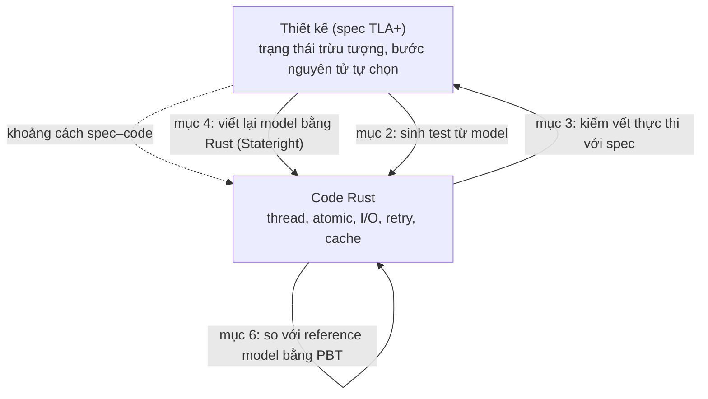
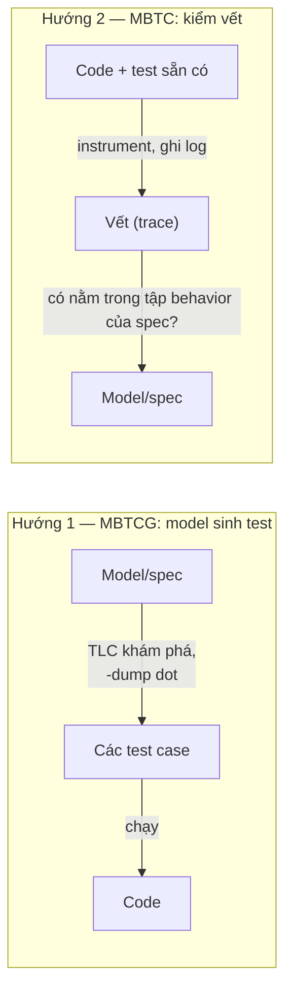
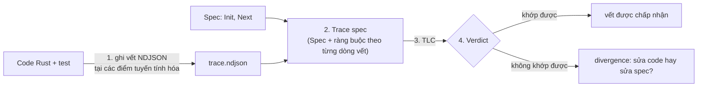
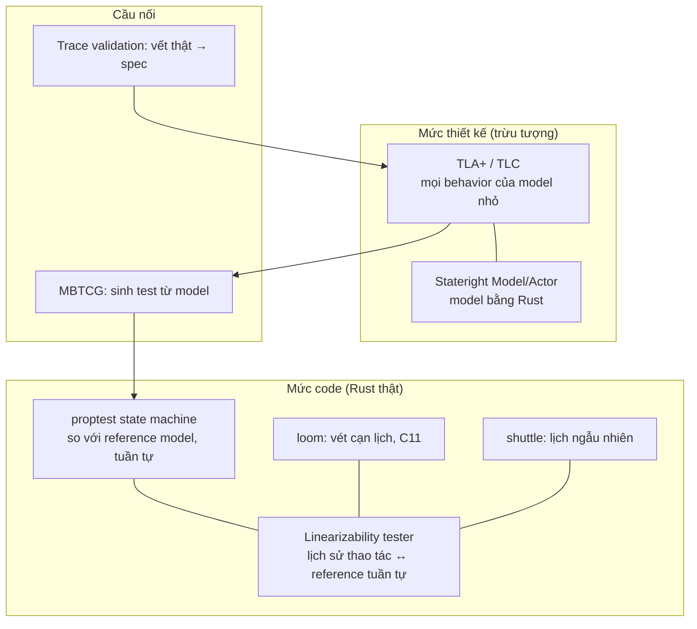
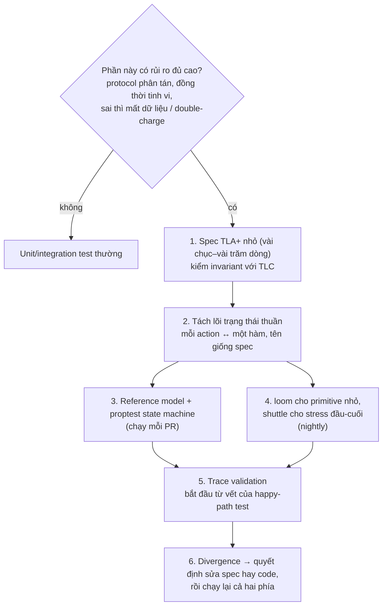

# P13 · Chương 10 — Từ đặc tả đến code Rust

> Nguồn chính: Lamport, *Specifying Systems* (SS, bản PDF miễn phí); Newcombe et al., "Use of Formal Methods at Amazon Web Services" (AWS); Cirstea–Kuppe–Loillier–Merz, "Validating Traces of Distributed Programs Against TLA+ Specifications" (arXiv 2404.16075v2); Howard et al., "Smart Casual Verification of the Confidential Consortium Framework" (CCF, arXiv 2406.17455v2); Davis–Hirschhorn–Schvimer, "eXtreme Modelling in Practice" (MongoDB, arXiv 2006.00915v1); Bornholt et al., "Using Lightweight Formal Methods to Validate a Key-Value Storage Node in Amazon S3" (ShardStore, SOSP 2021); docs.rs `stateright` 0.31.0, `loom` 0.7.2, `shuttle` 0.9.6, `proptest` 1.12.0, `proptest-state-machine` 0.9.0; mã nguồn `tlaplus/tlaplus` tại commit `94d0c5070852b37b801bb8998c436383ab7ee37b` và `tlaplus/Examples` tại commit `6a7b26a31c1a6aeec789b455e9bbfa3b3ad2728f`. Sách Stateright (`stateright.rs`) và sách Proptest (`proptest-rs.github.io`) là **trang sống**, không có số phiên bản; trích tại thời điểm soạn (2026-10-12). Spec TLA+ và code Rust trong chương do **người soạn** tự viết để minh họa; **chương này không chạy TLC, không chạy `cargo`, không biên dịch code**, nên không có kết quả kiểm tra nào được khẳng định trừ chỗ nguồn nói rõ — chỗ nào là suy luận bằng tay thì ghi "(suy luận của người soạn)".

## Bạn sẽ hiểu được gì

- **Q1.** Spec đã model-check xong mà code vẫn có thể sai — khoảng cách spec–code gồm những loại nào? → mục 1
- **Q2.** Model-based testing có hai hướng (sinh test từ model; kiểm vết thực thi với model): khác nhau ra sao, và vì sao MongoDB thành công với một hướng rồi bỏ hướng kia? → mục 2
- **Q3.** Trace validation bằng TLC làm cụ thể những gì (log → trace spec → verdict), cần instrument code thế nào, và "vết được chấp nhận" bảo đảm gì? → mục 3
- **Q4.** Stateright là gì: `Model`, checker BFS/DFS, actor, linearizability tester dùng ra sao, và khác TLC ở đâu? → mục 4
- **Q5.** loom và shuttle kiểm interleaving trong *code thật* thế nào, và khác nhau (cũng như khác TLC) ở độ sound và quy mô? → mục 5
- **Q6.** Property-based testing kiểu state machine (proptest) kiểm code so với một reference model ra sao? → mục 6
- **Q7.** Mỗi công cụ trả lời câu hỏi nào — mức thiết kế (TLA+) so với mức code — và giới hạn của từng cái? → mục 7
- **Q8.** Một quy trình đề xuất cho team backend dùng các công cụ trên cùng nhau (nhận xét của người soạn) → mục 8

## Kiến thức cần trước

- [Chương 01 — Vì sao đặc tả hình thức](01-vi-sao-dac-ta-hinh-thuc.md): động cơ viết spec trước khi code.
- [Chương 02 — Toán nền tảng](02-toan-nen-tang.md): ký hiệu `/\`, `\E`, hàm và `EXCEPT` xuất hiện trong mọi spec của chương này.
- [Chương 03 — Trạng thái, hành vi và action](03-trang-thai-hanh-vi-action.md): state, behavior, step, `Init`/`Next`/`Spec`, stuttering. Chương này dùng lại các khái niệm đó hằng ngày.
- [Chương 04 — Invariant và TLC](04-invariant-va-tlc.md): cách TLC duyệt không gian trạng thái và báo counterexample; [Chương 07 — Refinement](07-refinement.md): "code cài đặt đúng spec" nghĩa hình thức là gì; [Chương 08](08-dac-ta-giao-thuc-phan-tan.md) và [Chương 09](09-mo-hinh-hoa-he-backend.md): các spec giao thức/backend mà chương này muốn nối với code.
- Phía Rust: [Memory model (P4 · 06)](../04-concurrency/06-memory-model.md) và [Lock-free (P4 · 07)](../04-concurrency/07-lock-free.md) cho `Ordering` và `fetch_add`; [Bug concurrency và deadlock (P4 · 05)](../04-concurrency/05-concurrency-bug-va-deadlock.md); [Concurrency trong Rust (P4 · 08)](../04-concurrency/08-rust-concurrency.md).
- Phía hệ phân tán: [Sự cố của hệ phân tán (P12 · 08)](../12-he-thong-du-lieu/08-su-co-he-phan-tan.md), mục 8 về lease và fencing token — ví dụ chạy xuyên chương này là một bộ cấp fencing token; [Consistency và consensus (P12 · 09)](../12-he-thong-du-lieu/09-consistency-va-consensus.md), mục 1 về linearizability.

## Ví dụ chạy xuyên chương: bộ cấp token

Để các công cụ dễ so sánh, cả chương xoay quanh **một** bài toán nhỏ do người soạn chọn: một service cấp *fencing token* tăng dần cho client (đúng loại token ở [P12 · 08, mục 8](../12-he-thong-du-lieu/08-su-co-he-phan-tan.md)). Tính chất cần giữ: **không hai client nào nhận cùng một token** (`Unique`). Ở mức thiết kế, "cấp token" là một bước duy nhất: đọc bộ đếm, giao cho client, tăng bộ đếm. Mọi chỗ lệch giữa "một bước" đó và code thật chính là khoảng cách spec–code mà chương này nói tới.

## 1. Khoảng cách spec–code (Q1)

> **Trả lời ngắn.** Model-check một spec chỉ cho biết điều gì đó về *mô hình* của hệ, không phải về code — tài liệu của AWS ghi rõ phương pháp hình thức làm việc với mô hình chứ không phải chính hệ thống[^aws-model]. Khoảng cách có nhiều dạng: spec cố ý bỏ bớt chi tiết (mỗi chi tiết bỏ là một nguồn lỗi tiềm tàng[^ss-abstraction]); "một bước" của spec không trùng "một bước nguyên tử" của code[^ss-grain]; code đi tắt hoặc spec chặt hơn code[^tv-shortcut][^ewd-self]; và hai bên trôi lệch nhau theo thời gian[^tv-sync].

**Giải thích.**

Hình dung (nhận xét của người soạn): design doc của một tính năng đã qua review kỹ, sequence diagram không có lỗ hổng. Nhưng developer cài đặt bằng một thread pool, một cache và một retry-loop mà sơ đồ không vẽ. Doc đúng không bảo đảm service đúng; và service chạy ổn trong test không bảo đảm doc đúng. Đó là hai loại lỗi khác nhau, cần hai loại công cụ.

*Hai loại lỗi, hai loại công cụ.* AWS mô tả: có những lỗi tinh vi là lỗi *thiết kế* — code cài đặt trung thực thiết kế, nhưng thiết kế không xử lý đúng một tình huống hiếm[^aws-design]; và test code không đủ để tìm lỗi thiết kế vì số trạng thái có thể đạt của code là thiên văn[^aws-testing]. Ngược lại, code cuối cùng thì rõ nghĩa nhưng chứa quá nhiều chi tiết[^aws-exec], nên spec tồn tại để giữ lại phần cốt lõi. Hệ quả hiển nhiên (suy luận của người soạn): spec đúng chỉ bịt được lỗi thiết kế; lỗi cài đặt vẫn cần công cụ chạm vào code.

*Các dạng khoảng cách* (mỗi dạng có nguồn thực tế):

1. **Bỏ chi tiết có chủ đích.** Lamport: spec là một sự trừu tượng hóa, mô tả vài khía cạnh và lờ đi phần còn lại; mỗi khía cạnh bỏ đi là một nguồn lỗi tiềm tàng[^ss-abstraction]. Ví dụ ShardStore cố ý bỏ lỗi I/O và cạn tài nguyên khỏi reference model[^ss21-omit], đổi lại là không suy luận được về phần lớn tính sẵn sàng/hiệu năng[^ss21-avail].
2. **Khác *grain of atomicity*** — chọn thay đổi nào của hệ được coi là một step của behavior[^ss-grain]. Gộp nhiều thao tác vào một step làm spec đơn giản hơn, nhưng spec "mịn" hơn thì mô tả hệ thật chính xác hơn[^ss-grain-fine]. Mục 1.1 bên dưới là ví dụ cụ thể.
3. **Code đi tắt.** Cirstea et al.: cài đặt có thể đếm *số lượng* RM đã gửi Prepared thay vì lưu *danh tính*; chạy đúng khi không mất tin nhắn, nhưng nếu RM gửi lại do timeout thì TM đếm hai lần và commit sớm[^tv-shortcut].
4. **Spec quá chặt.** Ở ví dụ EWD998 của `tlaplus/Examples`, spec không cho node gửi tin nhắn cho chính nó, trong khi cài đặt cho phép; sự khác biệt này an toàn nhưng vẫn là một "divergence" do trace validation phát hiện[^ewd-self].
5. **Sai chép tay (transcription).** Kỹ sư công nghiệp thường nghi ngờ giá trị của model trừ khi chứng minh được model khớp cài đặt, vì rủi ro lỗi chép: lỗi logic khi cài đặt spec[^mdb-transcription].
6. **Trôi lệch theo thời gian.** Khó bảo đảm trong một tổ chức lớn rằng đổi code luôn đi kèm đổi spec[^mdb-drift]; CCF xử lý rủi ro này bằng cách tích hợp việc đối chiếu vào CI của dự án[^ccf-ci].
7. **Phần Rust không nằm trong spec.** Type system của Rust loại data race trong phần safe, nhưng không bảo đảm gì về race condition cấp cao như vi phạm tính nguyên tử[^ss21-datarace] — đúng loại khoảng cách mà mục 5 (loom/shuttle) nhắm vào.



*Sơ đồ: các cây cầu bắc qua khoảng cách, đánh số theo mục của chương. Mũi tên là chiều "kiểm tra", không phải chiều "chứng minh".*

Cirstea et al. nói thẳng vì sao không đi bằng con đường *chứng minh*: TLA+ có khái niệm refinement, nhưng chứng minh cả chuỗi refinement từ thiết kế cấp cao xuống cài đặt thật sẽ là việc cực nhọc[^tv-daunting]; CCF cũng nhận xét rằng chỉ viết spec cấp cao thì không đem lại bảo đảm nào về chính code sản xuất[^ccf-bridge]. Vì thế các nhóm ở đây chọn cách *nhẹ*: không chứng minh, mà kiểm tra có hệ thống từng mặt.

### 1.1 Ví dụ: một bước hay hai bước? (bộ cấp token)

Spec thiết kế (người soạn viết; chương này không chạy TLC). `Issue(c)` là **một** step: gán `next` cho `c` rồi tăng `next`. Nếu ký hiệu TLA+ còn lạ: `/\` là "và"; `\E c \in S : P` là "tồn tại `c` thuộc `S` sao cho `P`"; `x'` là giá trị của `x` ở state kế tiếp; `[f EXCEPT ![k] = v]` là hàm giống `f` trừ giá trị tại `k`; `[][Next]_vars` là "mỗi step hoặc là `Next`, hoặc không đổi `vars`". Định nghĩa có dẫn chứng nằm ở [Chương 02](02-toan-nen-tang.md) (logic, hàm, `EXCEPT`) và [Chương 03](03-trang-thai-hanh-vi-action.md) (state, action, `Spec`).

```tla
------------------------- MODULE TokenIssuer -------------------------
EXTENDS Naturals

CONSTANT Clients

VARIABLES next,   \* token kế tiếp sẽ cấp
          got     \* got[c] = token client c đã nhận, 0 nếu chưa nhận

vars == <<next, got>>

Init == /\ next = 1
        /\ got  = [c \in Clients |-> 0]

\* Một step nguyên tử: đọc bộ đếm, giao cho c, tăng bộ đếm.
Issue(c) == /\ got[c] = 0
            /\ got'  = [got EXCEPT ![c] = next]
            /\ next' = next + 1

Next == \E c \in Clients : Issue(c)

Spec == Init /\ [][Next]_vars

\* Hai client khác nhau đã nhận token thì token phải khác nhau.
Unique == \A c1, c2 \in Clients :
            (c1 # c2 /\ got[c1] # 0 /\ got[c2] # 0) => got[c1] # got[c2]
=====================================================================
```

Lưu ý khi chạy TLC (suy luận của người soạn từ định nghĩa spec): khi mọi client đã nhận token, không còn `Issue(c)` nào enabled; TLC mặc định kiểm deadlock nên sẽ coi trạng thái đó là lỗi, và cờ `-deadlock` tắt việc kiểm tra này[^tlc-deadlock]. Điều tương tự đúng cho spec `TokenIssuerSplit` ở phần "Đi sâu" bên dưới.

Với spec này, `Unique` đúng gần như hiển nhiên (suy luận của người soạn): mỗi step cấp đúng giá trị `next` rồi tăng nó lên, và `Issue(c)` chỉ chạy khi `got[c] = 0`. Code Rust tương ứng, nếu cài bằng một lệnh `fetch_add`, là **một** thao tác atomic — khớp đúng với "một step":

```rust
use std::sync::atomic::{AtomicUsize, Ordering};

pub struct TokenIssuer {
    next: AtomicUsize,
}

impl TokenIssuer {
    pub fn new() -> Self {
        Self { next: AtomicUsize::new(1) }
    }

    /// Khớp action `Issue(c)`: đọc-và-tăng là MỘT thao tác atomic.
    pub fn issue(&self) -> usize {
        // Relaxed đủ cho tính duy nhất vì bộ đếm không dùng để đồng bộ dữ liệu khác.
        self.next.fetch_add(1, Ordering::Relaxed)
    }
}
```

Họ `fetch_*` trả giá trị *trước* khi sửa, và việc "đọc rồi sửa" là một thao tác atomic duy nhất[^ral-fetch]; `AtomicUsize::fetch_add` cộng vào giá trị hiện tại và trả về giá trị trước đó[^std-fetchadd]. Docs Nomicon nói tăng một bộ đếm bằng `fetch_add` `Relaxed` là an toàn nếu bộ đếm không dùng để đồng bộ các truy cập khác[^nomicon-counter] (xem [P4 · 06](../04-concurrency/06-memory-model.md)). Còn phiên bản "tự nhiên" mà nhiều người viết thì khác hẳn:

```rust
    /// KHÔNG khớp `Issue(c)`: hai thao tác atomic riêng rẽ, giữa chúng thread khác chen vào được.
    pub fn issue_buggy(&self) -> usize {
        let t = self.next.load(Ordering::SeqCst);
        self.next.store(t + 1, Ordering::SeqCst);
        t
    }
```

Mỗi bước riêng lẻ đều atomic, nhưng cả cụm không phải một bước: đây là race condition kinh điển chứ không phải data race theo định nghĩa của `std`, đã phân tích ở [P4 · 07, mục 1](../04-concurrency/07-lock-free.md)[^std-datarace]. Điểm của ví dụ: **spec đúng không nói gì về việc code có thật sự là "một bước" hay không**; câu hỏi đó chỉ trả lời được khi công cụ chạm vào code (mục 5). Biến thể mịn của spec, có thể dùng để thấy lỗi ngay ở mức thiết kế, nằm ở phần "Đi sâu" bên dưới.

<details><summary>Đi sâu: biến thể "hai bước" của spec và bốn bước dẫn tới vi phạm (suy luận của người soạn)</summary>

Tách `Issue` thành hai step `Read` rồi `Write` — đúng grain của `issue_buggy` — bằng cách thêm biến `pc` (vị trí của từng client) và `tmp` (giá trị đã đọc). `UNCHANGED <<next, got>>` nghĩa là các biến trong ngoặc giữ nguyên giá trị ở state kế tiếp (xem [Chương 03](03-trang-thai-hanh-vi-action.md)):

```tla
------------------------ MODULE TokenIssuerSplit ------------------------
EXTENDS Naturals

CONSTANT Clients

VARIABLES next, pc, tmp, got
vars == <<next, pc, tmp, got>>

Init == /\ next = 1
        /\ pc  = [c \in Clients |-> "idle"]
        /\ tmp = [c \in Clients |-> 0]
        /\ got = [c \in Clients |-> 0]

Read(c) == /\ pc[c] = "idle"
           /\ tmp' = [tmp EXCEPT ![c] = next]
           /\ pc'  = [pc  EXCEPT ![c] = "read"]
           /\ UNCHANGED <<next, got>>

Write(c) == /\ pc[c] = "read"
            /\ next' = tmp[c] + 1
            /\ got'  = [got EXCEPT ![c] = tmp[c]]
            /\ pc'   = [pc  EXCEPT ![c] = "done"]
            /\ UNCHANGED tmp

Next == \E c \in Clients : Read(c) \/ Write(c)

Spec == Init /\ [][Next]_vars

Unique == \A c1, c2 \in Clients :
            (c1 # c2 /\ got[c1] # 0 /\ got[c2] # 0) => got[c1] # got[c2]
=========================================================================
```

Lập luận bằng tay với hai client `a`, `b` (không chạy TLC): ban đầu `next = 1`. `Read(a)` đặt `tmp[a] = 1`; `Read(b)` đặt `tmp[b] = 1`; `Write(a)` đặt `got[a] = 1` và `next = 2`; `Write(b)` đặt `got[b] = 1`. Bốn step, hai client cùng giữ token 1 — `Unique` bị vi phạm. Bất kỳ model checker nào duyệt hết các behavior sẽ gặp trạng thái này; bài học là *mức mịn của spec quyết định spec có "thấy" được lỗi hay không*: Lamport đã nói spec thô đơn giản hơn nhưng có thể bỏ sót điều xảy ra ở grain mịn[^ss-grain-fine]. Ở mức code, việc `issue` là một hay hai step thì loom (mục 5) kiểm trực tiếp.

</details>

**Quay lại Q1:** spec đúng chỉ đảm bảo *thiết kế* đúng; giữa spec và code có các khe hở — chi tiết bị bỏ, grain of atomicity, đi tắt, spec quá chặt, chép sai, trôi lệch — và mỗi khe cần một cây cầu kiểm tra riêng.

## 2. Model-based testing: sinh test từ model, và kiểm vết với model (Q2)

> **Trả lời ngắn.** *Model-based testing* dùng spec để kiểm code theo hai hướng. Hướng thứ nhất, **model-based test-case generation (MBTCG)**: dùng spec hình thức để sinh test case khẳng định hành vi mong đợi của cài đặt[^mdb-mbtcg-def] (ở Realm Sync, test lấy từ không gian trạng thái mà TLC khám phá — xem bên dưới). Hướng thứ hai, **model-based trace-checking (MBTC)**: chạy code (bằng test sẵn có), ghi lại vết, rồi kiểm xem vết có hợp lệ với spec không. MongoDB thử cả hai: MBTCG rất thành công cho Realm Sync, còn MBTC bị đánh giá là không thực tế cho MongoDB Server và bị bỏ sau 10 tuần[^mdb-abs-1][^mdb-abandon].

**Giải thích.**

Hình dung (nhận xét của người soạn): bạn có contract test cho một API. Hướng 1 giống việc *tự động sinh* bộ contract test từ OpenAPI: spec đi trước, test đi ra. Hướng 2 giống việc *đọc access log production* và hỏi "chuỗi request/response này có hợp lệ theo contract không?": code đi trước, log đi vào, spec là giám khảo.



*Hướng 1: MBTCG.* Nhóm Realm Sync của MongoDB viết một spec TLA+ mới cho thuật toán operational transformation (OT), rồi dùng không gian trạng thái mà TLC khám phá để sinh test case C++ và Golang[^mdb-mbtcg-use]. Cách làm cụ thể: TLC ghi toàn bộ đồ thị trạng thái ra file GraphViz DOT với mỗi cạnh dán nhãn bằng action[^mdb-dot]; một chương trình Golang parse file DOT đó thành test case, mỗi test gồm mảng khởi đầu, thao tác của từng client, thao tác sau khi biến đổi, và trạng thái cuối[^mdb-gen]. (TLC có tùy chọn `-dump dot` ghi các state ra file dạng dot[^tlc-dump].) Với mảng 3 phần tử và 3 client, mỗi client một thao tác, chương trình Golang sinh ra 4.913 test C++[^mdb-4913]; 36 test viết tay chỉ phủ 18/86 nhánh (21%) của luật merge cho các thao tác mảng[^mdb-cov]. Lợi ích dài hạn: test sinh và chạy lại tự động sau mỗi thay đổi model, giữ hai cài đặt (C++ và Golang) tương đương[^mdb-nice].

*Hướng 2: MBTC.* Với MongoDB Server, nhóm không dùng MBTCG vì protocol *bất định*: một leader mới có thể được bầu bất cứ lúc nào, follower tụt hay bắt kịp không đoán trước được[^mdb-nondet]. Muốn ép code đi đúng một chuỗi bước sinh từ model thì phải đổi hành vi hệ quá nhiều[^mdb-force]. Thay vào đó họ chạy 423 test tích hợp viết tay sẵn có, instrument để ghi vết, hậu xử lý thành chuỗi state rồi bắt TLC kiểm chuỗi đó có hợp lệ theo `RaftMongo.tla` không. Kết quả: 120/423 test hỏng vì không tương thích với việc ghi vết[^mdb-120]; rốt cuộc nhóm chỉ kiểm vết cho 5 test viết tay + 1 test ngẫu nhiên, chỉ một test viết tay cho vết hợp lệ; bốn test còn lại cho vết vi phạm spec do hai sai lệch của cài đặt[^mdb-analysis]; họ bỏ dự án sau 10 tuần[^mdb-abandon].

*Vì sao hai hướng cho kết quả ngược nhau?* Bài báo nêu nguyên nhân thất bại của MBTC: mã nguồn khổng lồ, điều khiển concurrency nội bộ phức tạp, và các spec đã bị đơn giản hóa quá mức trước khi ai biết chúng sẽ dùng cho MBTC[^mdb-impeded]. Ngược lại MBTCG thành công khi thuật toán là *hàm xác định trên đầu vào nhỏ* (luật merge giữa hai thao tác) và cả đầu vào lẫn đầu ra đều dễ phát và so sánh (suy luận của người soạn từ phần mô tả Realm Sync ở trên). Hai mặt khác của bức tranh: viết spec cho Realm Sync mất khoảng 40 giờ trong hai tuần, bằng cách chép từ code C++ rồi sửa cú pháp, và TLC bắt được lỗi chép nhiều lần trong quá trình đó[^mdb-40h][^mdb-transcribe-err]; trong khi spec cho Server lại quá trừu tượng.

| | MBTCG (sinh test từ model) | MBTC (kiểm vết với spec) |
|---|---|---|
| Đầu vào | state graph của model | log/vết từ lần chạy thật |
| Ai "lái" | model lái code | code lái, spec là giám khảo |
| Hợp khi | hành vi xác định, đầu vào nhỏ, phát lại được (Realm Sync) | hệ bất định, test sẵn có, muốn giữ nguyên hành vi (MongoDB Server — nhưng đã thất bại ở đó) |
| Cái giá chính | viết bộ chuyển đổi model → test | instrument code, đồng bộ thứ tự log, spec phải đủ mịn |
| Nguồn | MongoDB §5 | MongoDB §4; Cirstea et al.; CCF (mục 3) |

*(Bảng do người soạn tổng hợp từ các chú thích ở trên.)*

<details><summary>Đi sâu: các bài học kỹ thuật của MongoDB về MBTC (cũng áp dụng cho Rust)</summary>

- **Thứ tự sự kiện.** MBTC với hệ phân tán cần một thứ tự (từng phần) của các sự kiện; MongoDB đạt thứ tự chặt bằng cách chạy mọi process trên một máy và ngủ trước khi ghi sự kiện[^mdb-order]. Một giải pháp tổng quát hơn là vector clock (bài báo nhắc nhưng không cần dùng).
- **Tầm nhìn của sự kiện (visibility).** Mỗi sự kiện phải được ghi *sau khi* nó xảy ra nhưng *trước khi* thay đổi hiển thị với node khác; muốn vậy code ghi log phải giữ nhiều lock[^mdb-visibility]. Bài học này quyết định cách đặt `trace_line` trong code Rust ở mục 3.
- **Khoảng cách trừu tượng.** Spec `RaftMongo.tla` rất cấp cao và không mô hình hóa tin nhắn giữa các node[^mdb-abstract]; mức trừu tượng đó phù hợp để kiểm thiết kế gossip commit point, nhưng khó ánh xạ từng sự kiện của code.
- **Hạ tầng.** Phần công cụ MBTC gồm 570 dòng C++ để ghi sự kiện, 252 dòng TLA+ cập nhật spec và 484 dòng Python hậu xử lý[^mdb-loc], do hai kỹ sư làm trong 10 tuần[^mdb-effort].

</details>

**Quay lại Q2:** MBTCG lấy test từ model, MBTC lấy vết từ code; MongoDB thành công với MBTCG ở bài toán xác định, nhỏ, và bỏ MBTC ở bài toán bất định, mã nguồn lớn, spec quá trừu tượng.

## 3. Trace validation bằng TLC (Q3)

> **Trả lời ngắn.** Trace validation lấy một *vết* thực thi của chương trình — chuỗi sự kiện, kèm cập nhật các biến của spec — rồi hỏi TLC: có behavior nào của spec khớp vết này không? Bài toán được quy về một bài model checking có ràng buộc[^tv-constrained]. Nếu TLC tìm được behavior khớp, vết được chấp nhận; đó là một bằng chứng kiểm thử, không phải chứng minh đúng đắn[^tv-nofg], và nếu vết thiếu thông tin thì có thể được chấp nhận oan[^tv-incomplete].

**Giải thích.**

Hình dung (nhận xét của người soạn): bạn có audit log của một workflow engine và muốn biết chuỗi chuyển trạng thái đã ghi có phải một đường đi hợp lệ trong state machine thiết kế không. Bạn không kiểm *mọi* đường đi của engine, chỉ những đường mà lần chạy này thực sự đi qua. Trace validation làm đúng việc đó, nhưng giám khảo là spec TLA+ và người chấm là TLC.



*Sơ đồ: khung của Cirstea et al.; số bước do người soạn đặt.*

**Bài toán, nói bằng lời.** Gọi S là tập các behavior hữu hạn thỏa `Spec`, T là tập các behavior hữu hạn mà vết biểu diễn (biến nào vết không ghi thì nhận giá trị tùy ý). Vết *tương thích* với spec nếu S và T giao nhau khác rỗng[^tv-problem]. Lưu ý: họ **không** đòi T nằm trọn trong S (kiểu refinement), vì điều đó quá mạnh khi có biến không ghi trong vết mà spec chọn bất định[^tv-notrefine]. Atomic step của cài đặt cũng không cần khớp đúng từng step của spec: nó có thể ứng với *không hoặc nhiều* step của spec[^tv-atomicity].

**Instrument ở đâu?** Khó nhất khi instrument là xác định các *điểm tuyến tính hóa* — chỗ chương trình hoàn tất một bước tương ứng với một transition nguyên tử của state machine cấp cao[^tv-lin]. Nguyên tắc dẫn đường của bài báo: ghi sự kiện khi trạng thái chia sẻ đã được cập nhật, như lúc gửi/nhận tin nhắn, thao tác trên lock hay trên lưu trữ bền[^tv-guide]. Vết chỉ cần chứa *cập nhật* của biến spec chứ không phải giá trị đầy đủ, và có thể chỉ ghi một số biến; đổi lại TLC phải tìm kiếm nhiều hơn để điền chỗ thiếu[^tv-partial]. Với hệ phân tán cần đồng hồ logic để sắp thứ tự: thư viện của họ hỗ trợ đồng hồ logic vô hướng, vector clock có thể thêm[^tv-clock].

### 3.1 Cụ thể cho bộ cấp token

**Phía Rust: ghi vết.** Mục tiêu: mỗi lần `issue` xong, ghi một dòng NDJSON (mỗi dòng là một object JSON). Cách ghi *ngây thơ* tưởng đúng nhưng sai:

```rust
// SAI về thứ tự: fetch_add xong rồi mới ghi log; hai thread có thể ghi ngược thứ tự bước.
pub fn issue_logged_naive(&self, client: &str) -> usize {
    let t = self.next.fetch_add(1, Ordering::Relaxed);
    trace_line(client, t);            // thread khác có thể chen vào giữa hai dòng này
    t
}
```

Lập luận bằng tay (suy luận của người soạn): thread A `fetch_add` được 1, thread B `fetch_add` được 2, B ghi log trước A. Vết có dòng `(b, 2)` trước `(a, 1)`. Spec `Issue` ở mục 1.1 chỉ cho cấp `next` hiện tại, mà lúc dòng đầu được xử lý `next = 1`, nên TLC từ chối dòng `(b, 2)` — một cảnh báo giả: code đúng mà vết sai thứ tự. Đây chính là bài học về tầm nhìn của MongoDB: sự kiện phải được ghi trước khi thay đổi hiển thị với bên khác, nên code ghi log phải giữ lock[^mdb-visibility]. Ví dụ EWD998 gặp một vấn đề cùng họ: ghi log ở thread nhận làm hỏng quan hệ happen-before giữa các dòng log, nên họ ghi log vào lúc thông điệp được lấy khỏi `inbox` chứ không phải lúc thread nhận chấp nhận nó[^ewd-log]. Với `fetch_add` thuần không có chỗ nào để "ghi log trong cùng bước"; cách thông thường là, **trong bản build có ghi vết**, thay bộ đếm bằng một `Mutex` và ghi log trước khi nhả lock:

```rust
use std::io::Write;
use std::sync::Mutex;

pub struct TracedIssuer {
    next: Mutex<usize>,                       // build có trace: bộ đếm nằm sau mutex
    sink: Mutex<Box<dyn Write + Send>>,       // nơi ghi NDJSON
}

impl TracedIssuer {
    pub fn issue(&self, client: &str) -> usize {
        let mut next = self.next.lock().unwrap();
        let t = *next;
        *next += 1;
        // Ghi TRƯỚC khi nhả khóa `next`: thứ tự dòng log = thứ tự các step của spec.
        let line = serde_json::json!({ "op": "issue", "client": client, "token": t });
        writeln!(self.sink.lock().unwrap(), "{line}").unwrap();
        t
    }
}
```

Hệ quả cần nói thẳng (nhận xét của người soạn): bản build ghi vết **không còn là chính code production** — nó kiểm đường logic, không kiểm việc `fetch_add` có thật sự là một bước. Việc đó là của loom (mục 5).

**Phía TLA+: trace spec.** Mô-đun dưới đây (người soạn viết; không chạy TLC) có dạng của `TraceSpec` trong Cirstea et al.: một biến `l` đếm dòng vết[^tv-l], `Trace` nạp file NDJSON[^tv-trace-op] bằng module `Json` của TLC (đối số là đường dẫn tuyệt đối), và mỗi action của spec được "ghép" với một dòng vết. Module `Json` có `ndJsonDeserialize` — nạp các giá trị JSON ngăn cách bằng dòng mới[^json-nd]. Cách khai báo `EXTENDS … Json, IOUtils` và đọc đường dẫn vết từ `IOEnv.TRACE_PATH` lấy theo `TraceSpec` của bài báo[^tv-ioenv]; người soạn không tìm thấy `IOUtils.tla` trong thư mục `StandardModules` ở commit đã ghim nên chưa xác nhận nó có sẵn trong `tla2tools.jar` — nếu SANY báo thiếu module, cần thêm gói chứa nó vào classpath.

```tla
---------------------------- MODULE IssuerTrace ----------------------------
EXTENDS TokenIssuer, Json, IOUtils, Sequences, TLC

\* Mỗi dòng vết có dạng {"op":"issue","client":"a","token":1}.
Trace == ndJsonDeserialize(IOEnv.TRACE_PATH)

VARIABLE l            \* số thứ tự của dòng vết sắp xử lý

TraceInit == Init /\ l = 1

\* Dòng thứ l là một sự kiện "issue": cho spec bước Issue(client) rồi
\* kiểm token spec cấp ra có đúng token mà code đã ghi không.
IsIssue ==
    /\ l \in 1..Len(Trace)
    /\ Trace[l].op = "issue"
    /\ Issue(Trace[l].client)
    /\ got'[Trace[l].client] = Trace[l].token
    /\ l' = l + 1

TraceNext == IsIssue

TraceSpec == TraceInit /\ [][TraceNext]_<<vars, l>>

\* Hậu điều kiện: đường dài nhất trong không gian bị ràng buộc phải dài đúng bằng vết.
TraceAccepted == TLCGet("stats").diameter - 1 = Len(Trace)
=============================================================================
```

Dưới đây là file cấu hình (ví dụ) và lệnh chạy. Cờ `-deadlock` tắt kiểm tra deadlock, như mô tả trong chính `TLC.java`[^tlc-deadlock].

```
SPECIFICATION TraceSpec
CONSTANT Clients = {"a", "b"}
POSTCONDITION TraceAccepted
```

```
TRACE_PATH=/tmp/issuer.ndjson java -cp tla2tools.jar tlc2.TLC -deadlock -config IssuerTrace.cfg IssuerTrace
```

Ba chi tiết cần lưu ý (phần lớn từ bài báo):

- **Thứ tự conjunct.** TLC đánh giá công thức từ trái sang phải. Bài báo viết `IsEvent` (cập nhật biến theo vết) *trước* action của spec[^tv-lr]; trong `IsIssue` ở trên người soạn đặt `Issue(...)` trước rồi mới so `got'` với vết, vì `got'` phải được gán trước khi so sánh (suy luận của người soạn về cách TLC xử lý biến có dấu phẩy trên).
- **Không kiểm deadlock.** Ở trạng thái mà vết không đi tiếp được vẫn có thể còn behavior khớp ở nhánh khác của không gian trạng thái, nên không nên bắt TLC kiểm deadlock của spec bị ràng buộc[^tv-nodeadlock].
- **Hậu điều kiện thay vì invariant.** Có thể bắt TLC in ra một behavior khớp bằng cách kiểm invariant `l < Len(Trace)` — vi phạm nó cho ra một behavior của spec khớp vết nếu tồn tại[^tv-inv] — nhưng khi vết *không* khớp thì không có thông tin nào được in ra; vì thế họ dùng hậu điều kiện `TraceAccepted` dựa trên nhận xét rằng độ dài đường dài nhất trong không gian bị ràng buộc bằng đường kính của đồ thị[^tv-diameter][^tv-post].

**Đọc kết quả.** Nếu `TraceAccepted` đúng: tồn tại behavior của spec khớp toàn bộ vết. Nếu sai: spec không có behavior nào có tiền tố độ dài tương ứng khớp log[^tv-post]; TLC không in *counterexample* vì không có một behavior duy nhất giải thích thất bại[^tv-post], đúng như CCF ghi nhận: khác với model checking thường, vết không hợp lệ không có phản ví dụ[^ccf-nocex]. Với ví dụ của ta (suy luận của người soạn): vết do `issue_buggy` sinh ra khi hai thread đọc trùng, `(a,1)` rồi `(b,1)`: dòng thứ hai đòi `got'[b] = 1` nhưng spec cấp `next = 2`, nên chuỗi không khớp được quá dòng 2 và vết bị từ chối.

### 3.2 Khi vết bị từ chối: sửa code hay sửa spec?

Cirstea et al. áp dụng cho 2PC, một kho key-value, EWD998, hai cài đặt Raft và CCF[^tv-cases]; trong mọi trường hợp, trace validation nhanh chóng tìm ra các lần chạy không khớp spec cấp cao[^tv-found]. Họ phân loại các nguyên nhân thường gặp:

1. **Cài đặt đi tắt** — ví dụ đếm RM thay vì nhớ danh tính (mục 1)[^tv-shortcut].
2. **Spec quá chặt** — ví dụ EWD998 cấm gửi cho chính mình[^ewd-self].
3. **Lệch grain of atomicity.** Ngôn ngữ phổ biến không có giao dịch nguyên tử bao nhiều cập nhật, nên chọn lúc nào ghi một action cần cân nhắc[^tv-atomicity2]. Các cách xử lý nêu trong bài báo: gửi lại tin nhắn là *stuttering step* (bước không đổi biến spec), mà spec TLA+ vốn không nhạy với stuttering[^tv-stutter]; hoặc cài đặt gộp nhiều step của spec thành một thì có thể ghi hai transition liên tiếp[^tv-two], hoặc thêm một disjunct dùng toán tử *action composition* vào next-state của spec dành cho validation[^tv-compose]. CCF làm đúng điều này: nhiều cài đặt Raft, kể cả CCF, gói cập nhật term vào `AppendEntries` để giảm số vòng mạng[^ccf-piggy], nên họ ghép `UpdateTerm` với `HandleAppendEntriesReq` thành một action[^ccf-grain], và dùng stuttering hữu hạn khi một action cấp cao ứng với nhiều sự kiện cài đặt[^ccf-stutter]. EWD998 cũng ghi nhận: spec cấp cao coi chuyền token là *một* step nguyên tử, nhưng thực tế token đi qua mạng nên người làm phải thêm stuttering step tường minh[^ewd-token].

Khi phát hiện divergence, tùy trường hợp mà sửa spec hoặc sửa code, rồi chạy lại cả model checking trên spec đã sửa lẫn test trên code đã sửa[^ccf-fix]. CCF còn ghi nhận một thói quen hữu ích: ghi chú tham chiếu chéo giữa code và spec khi tên biến/hàm khác nhau[^ccf-xref].

**Kết quả thực tế.** Ở CCF, trace validation phát hiện một lỗi safety nghiêm trọng ("commit advance on AE-NACK"), khiến nhóm đầu tư thêm vào phương pháp này[^ccf-bug]; việc dựng trace spec đạt tới mức kiểm được phần lớn vết tốn khoảng hai tháng-kỹ sư rải trong bốn tháng[^ccf-effort], trong khi chính trace spec chỉ dài khoảng 400 dòng[^ccf-400]. Sau khi spec consensus được xác nhận khớp cài đặt, nhóm chuyển sang phát triển *theo spec*: spec là nguồn sự thật[^ccf-spec-driven]. Về hiệu năng, họ thêm tìm kiếm DFS vào TLC: kiểm một vết với spec consistency giảm từ khoảng một giờ (BFS) xuống dưới một giây (DFS)[^ccf-dfs]. Ở ví dụ EWD998 trong `tlaplus/Examples`, tác giả cài đặt thuật toán dựa trên spec trong khoảng hai giờ mà chưa chạy hay debug code[^ewd-impl], rồi trace validation lần lượt bắt các sai lệch (spec cấm tự gửi[^ewd-self], thông điệp kết thúc `trm` không có trong spec, và một vòng token bị khởi động lại sai)[^ewd-trm][^ewd-round].

<details><summary>Đi sâu: kiểu ràng buộc của <code>tlaplus/Examples</code> (ACTION_CONSTRAINT + VIEW + POSTCONDITION), BFS/DFS và <code>-loadTrace</code></summary>

- **Hai trường phái viết trace spec.** Bài báo dùng một biến đếm dòng `l` (như trên). Spec EWD998ChanTrace trong `tlaplus/Examples` thì không thêm biến: dùng `TLCGet("level")` làm chỉ số dòng vết (lợi thế: TLC vẫn hiển thị tên action cấp cao thay vì chỉ `Next`[^ewd-level]), nối vào TLC bằng `ACTION_CONSTRAINT TraceNextConstraint`, `VIEW TraceView`, `POSTCONDITION TraceAccepted`, `ALIAS TraceAlias` trong file `.cfg`[^ewd-cfg]. Tác giả giải thích lý do thêm `TraceView`: một state cấp cao có thể xuất hiện nhiều lần trong vết, và nếu không đưa mức (level) hiện tại vào view của TLC thì TLC sẽ dừng khi gặp lại state đã thấy[^ewd-view].
- **Bản chất của việc chấp nhận.** Tác giả viết: một vết được chấp nhận nếu và chỉ nếu TLC khớp được từng dòng vết với state tương ứng trong (tiền tố của) một behavior của spec cấp cao[^ewd-constraint]. Spec này cũng ghi rằng nó được thiết kế cho TLC chạy chế độ model checking mặc định, tức BFS[^ewd-bfs], trong khi CCF thêm DFS vào TLC[^ccf-dfs2] để chạy nhanh hơn — hai lựa chọn khác nhau theo kích thước và độ không đầy đủ của vết (suy luận của người soạn).
- **Vết không đầy đủ.** Dùng bất định để "định nghĩa tiên đề" cho giá trị thiếu dễ vượt khả năng của TLC; tác giả EWD998 chọn viết ràng buộc state/action khớp từng dòng vết với behavior của spec gốc thay cho cách đó[^ewd-nondet]. Cirstea et al. nêu rõ sự đánh đổi giữa độ chính xác của thông tin ghi trong vết (và của verdict) với khối lượng tìm kiếm TLC phải làm[^tv-tradeoff]; với kho key-value, chỉ ghi sự kiện cùng đối số đã đủ vì chúng xác định giá trị các biến[^tv-kv].
- **Chỉ kiểm hữu hạn.** Vì chỉ phân tích vết hữu hạn nên bài báo bỏ qua tính chất liveness[^tv-liveness]. Với liveness xem [Chương 05](05-liveness-va-fairness.md).
- **Tùy chọn TLC liên quan** (đọc từ mã nguồn `TLC.java` tại commit đã ghim): `-dump [dot] file` ghi các state ra file[^tlc-dump]; `-dumpTrace format file` ghi các counterexample theo định dạng cho trước[^tlc-dumptrace]; `-loadTrace format file` nạp một vết từ file để dùng làm ràng buộc[^tlc-loadtrace]. Chương này không đi sâu vào `-loadTrace` vì chưa đọc ngữ nghĩa chi tiết của nó.
- **Coverage.** Một mục TODO ở cuối `EWD998ChanTrace.tla` ghi nhu cầu kiểm một *tập* vết hoặc gộp thống kê coverage từ nhiều lần chạy TLC để biết đã thấy đủ vết chưa[^ewd-todo]; nghĩa là "vết được chấp nhận" chưa nói gì về việc đã *thấy đủ* hành vi của spec.

</details>

**Quay lại Q3:** instrument code tại điểm tuyến tính hóa (ghi log trong cùng critical section), viết trace spec ràng buộc `Spec` theo từng dòng vết, để TLC tìm behavior khớp; "chấp nhận" nghĩa là *vết này* nằm trong spec, không phải code đúng.

## 4. Stateright: model checker viết bằng Rust (Q4)

> **Trả lời ngắn.** Stateright là thư viện Rust để model check hệ thống, thiên về hệ phân tán[^sr-crate]. Bạn mô tả hệ bằng trait `Model` (state, action, bước chuyển) và gắn các *property* (always/eventually/sometimes)[^sr-always]; checker duyệt BFS hoặc DFS để tìm phản ví dụ[^sr-bfs][^sr-dfs]. Khác TLC ở chỗ model viết bằng chính Rust, và Stateright còn chạy được các actor đó trên mạng thật[^sr-spawn-real].

**Giải thích.**

Hình dung (nhận xét của người soạn): TLC giống một công cụ *vẽ và mô phỏng* sơ đồ ở môi trường riêng; Stateright giống một *test harness* nằm trong chính workspace Cargo của bạn, dùng kiểu và thư viện của bạn. Cái lợi: model và code có thể dùng chung kiểu dữ liệu, thậm chí dùng chung logic. Cái hại: model dài hơn spec TLA+, và bạn phải tự gánh phần "kiểu" mà TLA+ cho miễn phí.

**(a) Ánh xạ TLA+ ↔ `Model`.** Trait `Model` là abstraction chính của Stateright, mô hình hóa sự tiến triển của một hệ bất định[^sr-model]. Ba phương thức bắt buộc ứng với `Init`/`Next` của TLA+:

| TLA+ | Stateright `Model` |
|---|---|
| `VARIABLES`, kiểu của state | `type State` |
| mỗi disjunct của `Next` | một biến thể của `type Action` |
| `Init` | `fn init_states(&self) -> Vec<State>` — trả các state khởi đầu[^sr-init] |
| điều kiện enabled của action | `fn actions(&self, state, &mut Vec<Action>)` — thu các action khả dĩ từ một state[^sr-actions] |
| phần hiệu ứng (`x' = …`, `UNCHANGED`) | `fn next_state(&self, last, action) -> Option<State>` — `None` nghĩa là action không làm đổi state[^sr-next] |
| `INVARIANT` | `Property::always(...)` |
| tính chất đạt được ("có thể xảy ra") | `Property::sometimes(...)` |
| `PROPERTY <>P` (liveness) | `Property::eventually(...)`, có hạn chế (xem bên dưới) |

Sách Stateright (trang sống) nói rõ cách tách: trong TLA+ mỗi action tự mang cả điều kiện lẫn hiệu ứng; trong Stateright thì thành ngữ (và hiệu quả hơn) là tách điều kiện (`actions`) khỏi biến đổi trạng thái (`next_state`)[^sr-split]. Lưu ý docs còn yêu cầu thứ tự `init_states` và `actions` phải *xác định* để dựng `Path` theo chỉ số action[^sr-init].

**(b) Property.** Docs gọi property *always* là safety/invariant — kiểm xem một kết cục tồi có thể xảy ra không[^sr-always]; property *sometimes* dùng để chắc rằng một kết cục mong muốn *đạt được*, ví dụ hệ xử lý được một yêu cầu ghi[^sr-sometimes]. Checker tìm phản ví dụ cho mỗi `always` và ví dụ cho mỗi `sometimes`; các ví dụ/phản ví dụ là chuỗi bước hệ thống gọi là `Path`, còn gọi là trace hay behavior[^sr-paths]. Property `sometimes` đóng vai "sanity check" cho các kết cục mong đợi[^sr-book-sometimes]; trong TLC phải mô phỏng bằng invariant giả cố ý vi phạm, vốn phiền hơn vì phải comment ra và chạy định kỳ[^sr-book-fake]. **Cảnh báo:** docs chỉ rõ trong bản cài đặt này, `eventually` chỉ đúng trên các đường *không chu trình*; một đường kết thúc ở chu trình không được coi là kết thúc tại chu trình đó, nên có thể bỏ sót (false negative)[^sr-eventually]. Tức là phần liveness và fairness của TLC ([Chương 05](05-liveness-va-fairness.md)) *không* có tương đương đầy đủ ở Stateright 0.31.0.

**(c) Checker.** `Model::checker()` trả về `CheckerBuilder`[^sr-checker]; từ đó:

- `spawn_bfs()` duyệt theo chiều rộng, tốn bộ nhớ hơn `spawn_dfs`, nhưng tìm được `Path` *ngắn nhất* tới mỗi phát hiện nếu chạy một luồng (mặc định)[^sr-bfs].
- `spawn_dfs()` dùng ít bộ nhớ hơn đáng kể, đổi lại không bảo đảm đường ngắn nhất[^sr-dfs].
- `spawn_simulation(seed, chooser)` đi lặp từ state khởi đầu tới state cuối để phủ nhanh các state sâu của model quá lớn để duyệt hết[^sr-sim] — gần với chế độ simulation của TLC (TLC có `-simulate`)[^tlc-simulate].
- Các nút chỉnh: số luồng (`threads`)[^sr-threads], độ sâu tối đa (`target_max_depth`)[^sr-depth], giảm đối xứng (`symmetry`)[^sr-sym], và `serve` — một web UI để khám phá model tương tác[^sr-serve].
- Sau `join()`, `assert_properties()` kiểm rằng có ví dụ cho mọi property `sometimes` và không có phản ví dụ cho `always`/`eventually`[^sr-assert]; trong test, vi phạm làm test thất bại (suy luận của người soạn từ tên hàm họ `assert_*`).

Đoạn code dưới đây (người soạn viết, **chưa biên dịch**, khớp chữ ký ở docs.rs 0.31.0) mô hình hóa đúng phiên bản *hai bước* `issue_buggy` — tương ứng `TokenIssuerSplit` ở mục 1:

```rust
use std::collections::HashSet;
use stateright::{Checker, Model, Property};

#[derive(Clone, Debug, Eq, Hash, PartialEq)]
enum Pc { Idle, Read(usize), Done }          // client đang ở đâu; Read(t) = đã đọc được t

#[derive(Clone, Debug, Eq, Hash, PartialEq)]
struct State {
    next: usize,                             // bộ đếm chung
    pc: Vec<Pc>,                             // vị trí từng client
    got: Vec<Option<usize>>,                 // token từng client nhận
}

#[derive(Clone, Debug, PartialEq)]
enum Action { Read(usize), Write(usize) }    // client i làm bước đọc / ghi

struct SplitIssuer { clients: usize }

impl Model for SplitIssuer {
    type State = State;
    type Action = Action;

    fn init_states(&self) -> Vec<State> {
        vec![State {
            next: 1,
            pc: vec![Pc::Idle; self.clients],
            got: vec![None; self.clients],
        }]
    }

    fn actions(&self, s: &State, actions: &mut Vec<Action>) {
        for c in 0..self.clients {
            match s.pc[c] {
                Pc::Idle => actions.push(Action::Read(c)),
                Pc::Read(_) => actions.push(Action::Write(c)),
                Pc::Done => {}
            }
        }
    }

    fn next_state(&self, s: &State, action: Action) -> Option<State> {
        let mut n = s.clone();
        match action {
            Action::Read(c) => n.pc[c] = Pc::Read(s.next),
            Action::Write(c) => {
                if let Pc::Read(t) = s.pc[c] {
                    n.next = t + 1;
                    n.got[c] = Some(t);
                    n.pc[c] = Pc::Done;
                }
            }
        }
        Some(n)
    }

    fn properties(&self) -> Vec<Property<Self>> {
        vec![Property::<Self>::always("unique", |_, s: &State| {
            let mut seen = HashSet::new();
            s.got.iter().flatten().all(|t| seen.insert(*t))
        })]
    }
}

#[test]
fn split_issuer_loses_uniqueness() {
    let checker = SplitIssuer { clients: 2 }.checker().spawn_bfs().join();
    // Mong đợi (suy luận của người soạn): property `unique` có phản ví dụ.
    let _path = checker.assert_any_discovery("unique");
}
```

Dự đoán bằng tay (suy luận của người soạn, chưa chạy): phản ví dụ ngắn nhất gồm bốn bước chuyển — cả hai client `Read` trước khi bất kỳ client nào `Write` — và vì BFS một luồng tìm được đường ngắn nhất[^sr-bfs], đường tìm ra dài bốn bước chuyển. Thứ tự cụ thể của các bước phụ thuộc vào thứ tự duyệt, nên đoạn code dùng `assert_any_discovery` thay vì `assert_discovery` với một chuỗi cứng.

**(d) Actor: model và cài đặt cùng một mã.** Trên `Model` thô bạn tự viết toàn bộ mạng. Với hệ phân tán, Stateright cung cấp `Actor`: một actor khởi tạo state (có thể kèm output), rồi chờ sự kiện đến và phản hồi bằng cách cập nhật state và có thể phát thêm output[^sr-actor]. `ActorModel` biểu diễn hệ các actor liên lạc qua mạng[^sr-actormodel]; mạng có thể không thứ tự và có nhân bản[^sr-net-unordered], hoặc có thứ tự theo từng cặp actor[^sr-network]; có thể mất tin nhắn hoặc không, và docs lưu ý rằng nếu invariant không nhìn vào trạng thái mạng thì "mất tin" không khác "trễ vô hạn", nên thường không cần mô hình hóa mất tin để model checker chạy nhanh hơn[^sr-lossy]. Tham số `H` của `ActorModel` là *history*, một biến phụ (auxiliary variable) theo nghĩa TLA+[^sr-history]. Và đây là điểm khác biệt lớn: hàm `actor::spawn` chạy actor thật, gửi tin nhắn qua UDP[^sr-spawn]; sách Stateright coi đó là lợi ích — model và cài đặt cuối được khuyến khích dùng chung code, loại bỏ một kiểu lỗi (model và hệ thật lệch nhau)[^sr-book-share].

Phiên bản actor của bộ cấp token (người soạn viết, **chưa biên dịch**): server giữ `next`; mỗi lần nhận `Request` nó trả `Grant(next)` rồi tăng `next` — việc xử lý *một tin nhắn* là một bước, nên khớp `Issue(c)` ở mức thiết kế:

```rust
use std::borrow::Cow;
use std::collections::HashSet;
use stateright::actor::{Actor, ActorModel, Id, Out};
use stateright::{Checker, Expectation, Model};

#[derive(Clone, Debug, Eq, Hash, Ord, PartialEq, PartialOrd)]   // ActorModel đòi A::Msg: Ord
enum Msg { Request, Grant(usize) }

#[derive(Clone, Debug, Eq, Hash, PartialEq)]
enum NodeState { Server { next: usize }, Client { got: Option<usize> } }

enum Node { Server, Client { server: Id } }

impl Actor for Node {
    type Msg = Msg;
    type State = NodeState;
    type Timer = ();
    type Random = ();
    type Storage = ();

    fn on_start(&self, _id: Id, _storage: &Option<Self::Storage>, o: &mut Out<Self>) -> Self::State {
        match self {
            Node::Server => NodeState::Server { next: 1 },
            Node::Client { server } => {
                o.send(*server, Msg::Request);
                NodeState::Client { got: None }
            }
        }
    }

    fn on_msg(&self, _id: Id, state: &mut Cow<Self::State>, src: Id, msg: Self::Msg, o: &mut Out<Self>) {
        match msg {
            Msg::Request => {
                if let NodeState::Server { next } = &**state {
                    let t = *next;
                    o.send(src, Msg::Grant(t));
                    *state.to_mut() = NodeState::Server { next: t + 1 };
                }
            }
            Msg::Grant(t) => {
                if let NodeState::Client { got: None } = &**state {
                    *state.to_mut() = NodeState::Client { got: Some(t) };
                }
            }
        }
    }
}

#[test]
fn actor_issuer_is_unique() {
    ActorModel::new((), ())
        .actor(Node::Server)                                        // Id 0
        .actor(Node::Client { server: Id::from(0) })
        .actor(Node::Client { server: Id::from(0) })
        .property(Expectation::Always, "unique", |_, s| {
            let mut seen = HashSet::new();
            s.actor_states.iter().all(|a| match &**a {
                NodeState::Client { got: Some(t) } => seen.insert(*t),
                _ => true,
            })
        })
        .property(Expectation::Sometimes, "all clients served", |_, s| {
            s.actor_states.iter().all(|a| !matches!(&**a, NodeState::Client { got: None }))
        })
        .checker().spawn_bfs().join()
        .assert_properties();
}
```

(Hình dạng `on_start`/`on_msg`, `Cow<Self::State>`, `Out::send`, `ActorModel::new(...).actor(...).property(...)` và `state.actor_states` đều theo ví dụ trong docs của module `actor`[^sr-actor-ex].) Kết quả của lần chạy này chương không khẳng định (không chạy); điều đáng chú ý là cùng hàm `on_msg` đó, với `stateright::actor::spawn`, có thể chạy thật.

**(e) Linearizability tester.** Khi hệ có hàm *đồng thời* (không phải mô hình tin nhắn), Stateright có module `semantics`. `SequentialSpec` định nghĩa tính đúng đắn qua một "reference implementation" — ví dụ "hệ này phải cư xử như một hàng đợi"[^sr-seq]. Sau đó một `ConsistencyTester` (như `LinearizabilityTester`) kiểm một lịch sử các thao tác có thể đồng thời so với reference đó[^sr-lintester-use]. Linearizability yêu cầu các thao tác được áp dụng nguyên tử và các thao tác tuần tự (không đồng thời) được áp dụng đúng thứ tự[^sr-lin]. Mỗi thao tác gắn với một "thread id" (một `actor::Id` làm được, miễn actor không phát thao tác thứ hai trước khi thao tác đầu xong)[^sr-threadid]; ghi `on_invoke` lúc gọi, `on_return` lúc trả, rồi `is_consistent()`; hai hàm đầu trả `Ok` nếu lịch sử *hợp lệ*, kể cả khi nó không nhất quán[^sr-oninvoke].

Reference object cho bộ cấp token — "cấp token liên tiếp 1, 2, 3…" — và một harness kiểm trên thread thật (người soạn viết, **chưa biên dịch**):

```rust
use std::sync::{Arc, Mutex};
use stateright::semantics::{ConsistencyTester, LinearizabilityTester, SequentialSpec};

#[derive(Clone, Debug, PartialEq)]
enum IssuerOp { Issue }

#[derive(Clone, Debug, PartialEq)]
enum IssuerRet { Token(usize) }

#[derive(Clone, Debug)]
struct IssuerSpec { next: usize }

impl SequentialSpec for IssuerSpec {
    type Op = IssuerOp;
    type Ret = IssuerRet;

    fn invoke(&mut self, op: &IssuerOp) -> IssuerRet {
        match op {
            IssuerOp::Issue => {
                let t = self.next;
                self.next += 1;
                IssuerRet::Token(t)
            }
        }
    }
}

fn check_linearizable(issuer: Arc<TokenIssuer>, threads: usize) {
    let tester = Arc::new(Mutex::new(LinearizabilityTester::new(IssuerSpec { next: 1 })));
    let handles: Vec<_> = (0..threads)
        .map(|tid| {
            let (issuer, tester) = (issuer.clone(), tester.clone());
            std::thread::spawn(move || {
                tester.lock().unwrap().on_invoke(tid, IssuerOp::Issue).unwrap();
                let t = issuer.issue();
                tester.lock().unwrap().on_return(tid, IssuerRet::Token(t)).unwrap();
            })
        })
        .collect();
    for h in handles {
        h.join().unwrap();
    }
    assert!(tester.lock().unwrap().is_consistent());
}
```

Hai nhận xét của người soạn: (1) việc dùng `LinearizabilityTester` *bên ngoài* `ActorModel` — với thread thật hay trong harness loom/shuttle — là suy luận từ chữ ký API (`LinearizabilityTester::new(init_ref_obj)` không đòi một `Model`). Mục tiêu tương tự có ở ShardStore: về nguyên tắc họ muốn kiểm các thực thi đồng thời là linearizable so với reference model tuần tự[^ss21-lin], nhưng loom không đủ mở rộng cho test đầu-cuối nên họ chuyển sang Shuttle[^ss21-loom-scale]; bài báo không nhắc `LinearizabilityTester`. (2) Ghi `on_invoke` *trước* khi gọi và `on_return` *sau* khi gọi chỉ làm các khoảng thời gian "to ra", tức là có thể bỏ sót một số vi phạm nhưng không tạo cảnh báo giả (suy luận của người soạn). Trong harness loom/shuttle, hãy dùng `Mutex` của chính công cụ đó (mục 5), vì `std::sync::Mutex` là "vô hình" với loom[^loom-intrusive].

**(f) So với TLC.** Sách Stateright liệt kê ưu thế của TLC/TLA+: ngắn gọn hơn Rust[^sr-book-brev]; hỗ trợ các tính chất temporal tùy ý kể cả fairness; hỗ trợ refinement mapping giữa các model[^sr-book-tlc]. Ưu thế của Stateright: model và cài đặt chung code (xem trên); tái sử dụng thư viện của hệ sinh thái Rust[^sr-book-eco], trong khi mẫu tái sử dụng TLA+ là copy-paste-sửa[^sr-book-reuse]; và tốc độ. Số đo do chính tác giả Stateright công bố trên spec Two-Phase Commit, laptop của ông:

| #RM | Số state | TLC | Stateright | Tăng tốc |
|---|---|---|---|---|
| 7 | 296.448 | 3 s | 1,697 s | 1,8× |
| 8 | 1.745.408 | 12 s | 2,566 s | 4,7× |
| 9 | 10.340.352 | 90 s | 8,902 s | 10,1× |
| 10 | 61.515.776 | 674 s | 54,709 s | 12,3× |

(Bảng số liệu của sách Stateright[^sr-book-perf]; **một nguồn, một spec, một máy** — không suy ra cho spec khác hay máy khác.) Ghi chú về độ nhất quán giữa các nguồn: sách (trang sống) liệt kê "symmetry reduction" là ưu thế của TLC[^sr-book-sym], nhưng docs 0.31.0 có `CheckerBuilder::symmetry` ở trên; khi hai nguồn khác nhau, chương này lấy docs bản ghim làm chuẩn cho API.

<details><summary>Đi sâu: <code>Model</code> thô vs <code>ActorModel</code>, history, và những gì Stateright *không* cho bạn</summary>

- **`ActorModel` là một `Model` có sẵn.** Docs liệt kê `impl Model for ActorModel<A, C, H>` với `State = ActorModelState<A, H>` và `Action = ActorModelAction<…>`[^sr-actormodel-impl]; vì vậy mọi cấu hình `checker()` ở trên dùng được cho actor.
- **Trường của `ActorModel`.** Có `init_network`, `lossy_network`, `max_crashes` (số actor đồng thời có thể đã crash), `record_msg_in`/`record_msg_out` (cập nhật history khi nhận/gửi) và `within_boundary` (giới hạn không gian cần duyệt)[^sr-actormodel-fields].
- **Chuẩn bị cho code thật.** `spawn` nhận hàm serialize/deserialize cho `Msg` và `Storage`[^sr-spawn]. Ở stack backend thực tế (gRPC, tokio, queue…) bạn khó giữ nguyên runtime UDP của Stateright; vì vậy mục "Liên hệ với Rust" đề xuất tách *lõi bước chuyển trạng thái* thành hàm thuần mà cả `Model::next_state` lẫn shell async cùng gọi (nhận xét của người soạn).
- **Không phải refinement.** Stateright kiểm `property` trên model của bạn; nó không chứng minh code production (nếu khác code trong `Actor`) "cài đặt đúng" model. Cùng một khoảng cách của mục 1 vẫn còn nếu bạn viết model và code riêng rẽ (nhận xét của người soạn).
- **Phiên bản.** Mọi chữ ký trong mục này theo `stateright` 0.31.0 trên docs.rs; crate này có thể đổi API ở bản sau.

</details>

**Quay lại Q4:** Stateright cho bạn viết model (state, action, property) bằng Rust và duyệt BFS/DFS, có actor chạy được cả trong model lẫn trên mạng thật, và tester kiểm linearizability so với một reference tuần tự; nó mạnh ở chỗ chung code với hệ thật, yếu hơn TLC ở temporal/fairness.

## 5. loom và shuttle: kiểm interleaving trên code thật (Q5)

> **Trả lời ngắn.** Rust chặn data race trong phần safe nhưng không chặn các lỗi race cấp cao như vi phạm tính nguyên tử[^ss21-datarace]. **loom** chạy test của bạn rất nhiều lần, mỗi lần một lịch chạy khác, theo các cách thực thi mà luật bộ nhớ của ngôn ngữ cho phép (mô hình C11), và có kỹ thuật cắt bớt để khỏi bùng nổ[^loom-what] — nên khi chạy vét cạn, một test qua được nghĩa là đúng với *mọi* lịch trong mô hình đó (chặn preempt hay `Relaxed` làm yếu bảo đảm này — xem 5.1). **shuttle** chọn lịch ngẫu nhiên: không sound (qua test không chứng minh code đúng) nhưng chạy được test lớn hơn loom nhiều[^sh-unsound].

**Giải thích.**

Hình dung (nhận xét của người soạn): bạn nghi `issue_buggy` có race. Cách quen thuộc là chạy test trong vòng lặp một triệu lần và hy vọng gặp. loom giống một thanh tra *liệt kê hết* các cách hai request chen nhau; shuttle giống chaos monkey có seed — gặp lỗi thì phát lại được đúng lịch đó.

**Vì sao "chạy lặp và hy vọng" không đủ.** Lịch sử của việc test code concurrent là chạy test trong vòng lặp hoặc đặt máy chủ test dưới tải để sinh ra các thực thi hiếm[^loom-bg]; docs loom đánh giá cách đó không đáng tin, và nếu một lần lặp hỏng thì rất khó tìm nguyên nhân[^loom-bg2]. Khi dùng thứ tự bộ nhớ yếu hơn `SeqCst`, lỗi có thể chỉ xuất hiện trên phần cứng có đặc tính nhất định, nên lặp bao nhiêu lần cũng không chứng minh được gì trên phần cứng khác[^loom-bg3] — xem [P4 · 06, mục 8](../04-concurrency/06-memory-model.md).

### 5.1 loom: duyệt hết các lịch, theo memory model

**Cơ chế.** loom mô phỏng bộ lập lịch của hệ điều hành *và* memory model của Rust, để mọi hành vi hợp lệ đều được khám phá[^loom-sim]. Cụ thể: bạn bọc test trong `loom::model(|| …)`; loom chạy closure đó nhiều lần, mỗi lần dùng một lịch chạy luồng khác[^loom-closure]. Kỹ thuật bên dưới là CDSChecker (kiểm cấu trúc dữ liệu đồng thời viết bằng atomic C/C++)[^loom-cds]; Rust dùng cùng luật atomic như C++20 (không có `consume`)[^std-cpp20], nên mô hình C11 là phần chung — chi tiết ordering ở [P4 · 06](../04-concurrency/06-memory-model.md). ShardStore mô tả loom là *sound model checker* trong mô hình release/acquire và dùng bounded partial-order reduction để giảm bùng nổ trạng thái[^ss21-loom-impl].

**Điều kiện để test hợp lệ.** Test phải hoàn toàn *xác định*: mọi nguồn bất định phải đi qua kiểu của loom, vì thế loom mới phơi ra các giá trị khả dĩ khác nhau ở mỗi lần chạy[^loom-nondet]. Sinh số ngẫu nhiên hay system call không mô hình hóa được trực tiếp, phải mock[^loom-others]. Để dùng được kiểu của loom ở test nhưng `std` ở production, docs khuyên một cờ `cfg(loom)`[^loom-cfg]; mẫu thường dùng là một module `sync` đổi kiểu theo cờ:

```rust
// src/sync.rs — duy nhất chỗ chọn loom hay std
#[cfg(loom)]
pub(crate) use loom::sync::atomic::AtomicUsize;
#[cfg(not(loom))]
pub(crate) use std::sync::atomic::AtomicUsize;
```

```toml
# Cargo.toml
[target.'cfg(loom)'.dependencies]
loom = "0.7"
```

```rust
// src/issuer.rs — code production, chỉ khác dòng import
use crate::sync::AtomicUsize;
use std::sync::atomic::Ordering;

pub struct TokenIssuer { next: AtomicUsize }

impl TokenIssuer {
    pub fn new() -> Self { Self { next: AtomicUsize::new(1) } }
    pub fn issue(&self) -> usize { self.next.fetch_add(1, Ordering::Relaxed) }
    pub fn issue_buggy(&self) -> usize {
        let t = self.next.load(Ordering::SeqCst);
        self.next.store(t + 1, Ordering::SeqCst);
        t
    }
}
```

```rust
// tests/loom_issuer.rs
#![cfg(loom)]
use loom::sync::Arc;
use loom::thread;
use my_crate::TokenIssuer;

#[test]
fn issue_returns_unique_tokens() {
    loom::model(|| {
        let issuer = Arc::new(TokenIssuer::new());
        let (i1, i2) = (issuer.clone(), issuer.clone());
        let a = thread::spawn(move || i1.issue());
        let b = thread::spawn(move || i2.issue());
        let (ta, tb) = (a.join().unwrap(), b.join().unwrap());
        assert_ne!(ta, tb);                 // đúng với MỌI lịch chạy loom khám phá
    });
}
```

Chạy theo hướng dẫn của docs: `RUSTFLAGS="--cfg loom" cargo test --test loom_issuer --release`; docs khuyên dùng `--release` vì loom phải chạy closure rất nhiều lần[^loom-release].

Dự đoán (suy luận của người soạn, **chưa chạy**): với `issue`, mỗi lịch cho hai token khác nhau vì `fetch_add` là một thao tác duy nhất, nên test qua. Nếu thay `issue` bằng `issue_buggy`, tồn tại lịch trong đó cả hai thread `load` được 1 trước khi bất kỳ ai `store`; loom khám phá mọi lịch nên sẽ gặp lịch này và `assert_ne!` sẽ hỏng — đúng cái bốn bước mà spec `TokenIssuerSplit` ở mục 1 mô tả. Điểm quan trọng: **loom trả lời câu hỏi "code có thật sự thực hiện *một bước* như spec giả định không"**.

**Giới hạn đã được docs ghi rõ (loom 0.7.2):**

- *Xâm nhập (intrusive).* loom chỉ chặn các thao tác dùng kiểu thay thế của nó; code không dùng kiểu loom thì "vô hình" và không bị hoán vị[^loom-intrusive]. Thư viện bên thứ ba dùng lock/channel riêng cũng phải hỗ trợ loom mới được phủ đủ[^loom-lib].
- *`Relaxed`.* docs nói loom không thể mô hình hóa hết các interleaving mà `Relaxed` cho phép vì nó cho phép đổi thứ tự thao tác *trong cùng một thread* mà loom không mô phỏng được[^loom-relaxed][^loom-reorder]. Hệ quả: có lớp bug loom không bắt được[^loom-reorder].
- *Bùng nổ.* mặc định loom kiểm *vét cạn*[^loom-exh]; số lịch tăng rất nhanh theo số thread (docs: tăng đáng kể với mỗi thread mới, đến mức việc kiểm không còn khả thi), nên loom giới hạn số thread được mô hình (`MAX_THREADS`)[^loom-maxthreads]. Muốn rẻ hơn, đặt *chặn số lần preempt* (`LOOM_MAX_PREEMPTIONS` hoặc `Builder::preemption_bound`): docs nói đặt 2 hoặc 3 đủ bắt phần lớn bug mà giảm mạnh số lịch[^loom-preempt]. Khi đó kiểm tra không còn vét cạn.
- *Công bằng.* bộ lập lịch của loom cố ý không công bằng[^loom-fair]; vòng chờ kiểu spin lock phải gọi `loom::thread::yield_now` để báo cho loom biết cần chuyển sang thread khác[^loom-yield].

### 5.2 shuttle: lịch ngẫu nhiên, mở rộng được hơn

**Cơ chế.** shuttle lấy cảm hứng từ loom nhưng tập trung vào kiểm thử *ngẫu nhiên*, đổi tính sound lấy khả năng mở rộng[^sh-what]. Docs viết thẳng: shuttle *không sound* — test qua không chứng minh code đúng — nhưng chạy được test lớn hơn loom nhiều[^sh-unsound]; họ dựa vào quan sát rằng kiểm thử ngẫu nhiên tìm được phần lớn bug concurrency vì các bug này thường không "đối kháng"[^sh-nonadv]. Vì shuttle điều khiển lịch chạy của từng thread nên tái hiện được test hỏng một cách xác định[^sh-control].

```rust
// Cargo.toml: shuttle = { version = "0.9", optional = true }, feature "shuttle"
// (giả định module `sync` của crate đã đổi sang `shuttle::sync::atomic` khi bật feature)
#[cfg(feature = "shuttle")]
#[test]
fn issuer_stress_shuttle() {
    use shuttle::{sync::Arc, thread};
    shuttle::check_random(
        || {
            let issuer = Arc::new(my_crate::TokenIssuer::new());
            let handles: Vec<_> = (0..4)
                .map(|_| {
                    let i = issuer.clone();
                    thread::spawn(move || i.issue())
                })
                .collect();
            let mut toks: Vec<usize> = handles.into_iter().map(|h| h.join().unwrap()).collect();
            toks.sort();
            toks.dedup();
            assert_eq!(toks.len(), 4);        // bốn thread, bốn token khác nhau
        },
        1000,                                  // số lần chạy, mỗi lần một lịch ngẫu nhiên
    );
}
```

Để dùng shuttle phải thay mọi kiểu đồng bộ của `std` bằng kiểu của shuttle; docs khuyên làm qua cờ cfg/feature và một module `sync` duy nhất[^sh-replace], giống mẫu của loom. Chữ ký trong docs 0.9.6: `check_random(f, iterations)`[^sh-sig-random], `check_pct(f, iterations, depth)`[^sh-sig-pct], `check_dfs(f, max_iterations: Option<usize>)`[^sh-sig-dfs]. Ba bộ lập lịch chính:

- **Random** (`check_random`): chạy một số lần với lịch ngẫu nhiên.
- **PCT** (`check_pct`): giới hạn số lần preempt mà test khám phá; docs nhận xét thực nghiệm cho thấy phần lớn bug cần rất ít preempt nên PCT tăng xác suất bắt được[^sh-pct].
- **DFS** (`check_dfs`): vét cạn; docs không khuyên dùng vì chỉ khả thi với chương trình rất đơn giản, nhưng hữu ích cho thử kỹ các primitive nhỏ[^sh-dfs].

Khi một test hỏng, shuttle in ra chuỗi mã hóa lịch chạy và hướng dẫn truyền nó vào `shuttle::replay`[^sh-replay]; hàm đó tái hiện đúng lịch, miễn là closure không có bất định nào ngoài bất định do lập lịch[^sh-replay2]:

```rust
// Dán chuỗi lịch shuttle in ra khi test hỏng vào đây để chạy lại đúng một lần.
shuttle::replay(|| { /* cùng thân test */ }, "<chuỗi lịch shuttle in ra>");
```

**Giới hạn quan trọng nhất so với loom: memory model.** Docs của `shuttle::sync::atomic`: shuttle không mô hình trung thực các hành vi của ordering yếu (mọi thứ ngoài `SeqCst`); nó coi *mọi* thao tác atomic như `SeqCst`, nên bug cần hành vi relaxed mới xảy ra thì shuttle không thể tìm thấy[^sh-weak]; docs chỉ sang loom cho việc suy luận về Acquire/Release và hỗ trợ một phần `Relaxed`[^sh-loom-weak]. Về async: shuttle có module `future` — executor async "gần tương đương `futures::executor`"[^sh-async] — nên test được code async trong cùng lịch ngẫu nhiên; shuttle cũng hỗ trợ code dùng dữ liệu ngẫu nhiên (random) miễn qua `shuttle::rand`[^sh-rand]. Cuối cùng, `check_random_with_seed` cho phép một thư viện như proptest lo việc sinh seed[^sh-seed].

### 5.3 Dùng cả hai, và so với TLC

ShardStore dùng *cả hai* và nói rõ vì sao: loom (sound) không đủ mở rộng để kiểm linearizability cho test đầu-cuối của cả hệ[^ss21-loom-scale]; họ dùng loom cho các đoạn code nhỏ, cực kỳ quan trọng như primitive concurrency tự viết, và shuttle để kiểm ngẫu nhiên các test harness lớn hơn[^ss21-loom-shuttle]. Một harness loom cho index LSM chạy ba thread: chunk reclamation, compaction, và ghi-rồi-đọc kiểm read-after-write[^ss21-harness-loom]; lỗi #14 của họ là race trong LSM tree bị harness loom bắt *trước cả khi qua code review*[^ss21-bug14]. Về quy trình, họ tự viết harness cho các tính chất chủ chốt và kiểm bằng stateless model checking, một kỹ thuật khám phá các interleaving của chương trình[^ss21-harness]; stateless model checker cũng tìm được deadlock bằng cách tìm các lịch kết thúc với mọi thread bị chặn[^ss21-deadlock] (khái niệm deadlock: [P4 · 05](../04-concurrency/05-concurrency-bug-va-deadlock.md)).

| | TLC (spec) | loom | shuttle |
|---|---|---|---|
| Kiểm cái gì | model trừu tượng | code Rust thật, dùng kiểu loom | code Rust thật, dùng kiểu shuttle |
| Cách khám phá | TLC tính tập trạng thái reachable của model, dừng được khi tập đó hữu hạn[^ss-tlc-finite] | mọi lịch (có thể bị chặn preempt) + memory model C11[^loom-what] | lịch ngẫu nhiên, hoặc PCT/DFS[^sh-what][^sh-pct][^sh-dfs] |
| Sound? | trong phạm vi model | trong phạm vi mô hình của loom; `Relaxed` chỉ một phần[^loom-reorder] | không[^sh-unsound] |
| Memory model | không có (một state là một phép gán biến) | C11, release/acquire sound[^ss21-loom-impl] | coi mọi atomic là `SeqCst`[^sh-weak] |
| Quy mô | model nhỏ | thread ít, đoạn code nhỏ[^loom-maxthreads] | test lớn hơn nhiều[^sh-unsound] |

*(Bảng do người soạn tổng hợp từ các chú thích; cột TLC để đối chiếu mức thiết kế với mức code.)*

<details><summary>Đi sâu: <code>loom::model::Builder</code>, <code>UnsafeCell</code>, và loom trong Tokio</summary>

- **Builder.** `loom::model` chạy test với `Builder` mặc định chịu ảnh hưởng của biến môi trường[^loom-model]. Các trường của `Builder` (docs 0.7.2): `max_threads`, `max_branches` (số lần chuyển thread tối đa mỗi hoán vị), `max_permutations`, `max_duration`, `preemption_bound`, `checkpoint_file`, `checkpoint_interval`, `location`, `log`[^loom-builder]. Với một lỗi xảy ra ở hoán vị thứ 10 triệu, ghi checkpoint (`LOOM_CHECKPOINT_FILE`, `LOOM_CHECKPOINT_INTERVAL`, tránh ghi file ở mỗi lần lặp[^loom-debug]) để cô lập đường dẫn gây lỗi, rồi bật `LOOM_LOG` để in một dấu mốc ở mỗi lần chuyển thread[^loom-log].
- **`UnsafeCell`.** API của `loom::cell::UnsafeCell` khác `std` ở chỗ dùng `with`/`with_mut` thay vì `get()`; thư viện phải tự cài lớp bọc tương ứng cho `std` dưới `cfg(not(loom))`[^loom-uc].
- **Tokio là ví dụ thật.** Tokio có module `loom` tự "trừu tượng hóa giữa `loom` và `std::sync` tùy chạy test hay không"[^tokio-loom], và có test dùng `loom::model(|| { … })` để kiểm số lần poll tối đa của `block_on` trên runtime current-thread[^tokio-loom-test] (Tokio 1.53.2, cùng phiên bản dùng ở [P7 · 08](../07-io-async/08-tokio.md)). Nghĩa là đây là mẫu "facade `cfg(loom)`" ở quy mô một dự án lớn, không chỉ ví dụ sách vở.
- **Con số trong docs shuttle.** Test mẫu (100 lần chạy) "phát hiện lỗi với xác suất rất cao (trên 99,9999%)"[^sh-prob] chỉ là lập luận cho ví dụ đó, không phải bảo đảm cho test của bạn (nhận xét của người soạn).

</details>

**Quay lại Q5:** loom kiểm vét cạn (có thể chặn preempt) các lịch của một đoạn code nhỏ theo memory model C11; shuttle kiểm ngẫu nhiên các test lớn hơn nhưng không sound và coi atomic là `SeqCst`; ShardStore dùng loom cho primitive nhỏ, shuttle cho stress test lớn.

## 6. Property-based testing kiểu state machine với proptest (Q6)

> **Trả lời ngắn.** Bạn viết một *reference model* đơn giản (tương đương spec viết bằng code) và một bản mô tả cách áp mỗi thao tác lên code thật; `proptest` sinh chuỗi thao tác ngẫu nhiên, so kết quả code với model sau từng bước, và khi thấy sai lệch thì thu nhỏ chuỗi thao tác về dạng ngắn nhất vẫn tái hiện lỗi[^pt-sm-what][^pt-sm-shrink]. ShardStore của AWS dùng đúng ý tưởng này với reference model viết bằng Rust[^ss21-refmodel].

**Giải thích.**

Hình dung (nhận xét của người soạn): bạn thay lớp lưu trữ phía sau API bằng một bản "tối ưu" có cache và compaction. Để chắc nó vẫn cư xử như bản `HashMap` đơn giản, bạn cho cả hai nhận cùng một chuỗi `PUT`/`GET` ngẫu nhiên và so kết quả sau từng bước. Property-based testing kiểu state machine chính là việc tự động hóa đó, cộng thêm khả năng thu nhỏ chuỗi lệnh gây lỗi.

**Cấu trúc.** Proptest chia thành hai nửa. Một là *reference state machine* — định nghĩa trừu tượng, quyết định chuỗi thao tác được sinh ra. Hai là *định nghĩa test* cho SUT (system under test), lặp lại đúng các thao tác đó trên code thật để phát hiện sai lệch hoặc điều kiện làm tính chất bị phá (ở đây gồm post-condition và invariant)[^pt-sm-two]. Ánh xạ với TLA+:

| TLA+ | `proptest-state-machine` |
|---|---|
| `Init` | `ReferenceStateMachine::init_state()` |
| các disjunct (có `\E` tham số) của `Next` | `transitions(&state)` — thường `prop_oneof!`, tham số sinh bằng strategy |
| điều kiện enabled | `preconditions(&state, &transition)` — mặc định `true`[^pt-sm-pre] |
| hiệu ứng của action | `ReferenceStateMachine::apply` (trên model) và `StateMachineTest::apply` (trên SUT) |
| `INVARIANT` | `check_invariants(&sut, &ref_state)` — kiểm sau mỗi transition[^pt-sm-inv] |

Trong `StateMachineTest::apply`, sách hướng dẫn đặt các post-condition của từng transition: sau khi áp transition lên SUT, dùng `assert!` hoặc so với `ref_state` — là trạng thái model *đã* áp transition đó[^pt-sm-apply]. Thu nhỏ: khi thấy phản ví dụ, proptest rút gọn xuống một chuỗi transition tối thiểu vẫn tái hiện lỗi[^pt-sm-shrink]; cụ thể là xóa transition từ cuối danh sách đến hết mức, rồi thu nhỏ từng transition từ đầu, rồi thu nhỏ trạng thái ban đầu[^pt-sm-shrinkorder]. `preconditions` quan trọng ở đây: sau khi thu nhỏ, một transition từng hợp lệ có thể không còn hợp lệ, nên chỉ ràng buộc những transition mà tính hợp lệ phụ thuộc state hiện tại[^pt-sm-pre].

Ví dụ: phía *storage* của mô hình fencing — chỉ nhận ghi nếu token không nhỏ hơn token đã thấy cho khóa đó. Reference model và harness (người soạn viết, **chưa biên dịch**; `FencedStore` là một kiểu giả định):

```rust
use std::collections::HashMap;
use proptest::prelude::*;
use proptest_state_machine::{prop_state_machine, ReferenceStateMachine, StateMachineTest};

// ---- Reference model: "spec bằng code" của storage phía fencing ----
#[derive(Clone, Debug, Default)]
struct RefStore {
    cells: HashMap<u8, (u64, u8)>,   // key -> (token cao nhất đã nhận, giá trị)
}

#[derive(Clone, Debug)]
enum Op {
    Write { key: u8, token: u64, val: u8 },
    Read { key: u8 },
}

impl ReferenceStateMachine for RefStore {
    type State = RefStore;
    type Transition = Op;

    fn init_state() -> BoxedStrategy<Self::State> {
        Just(RefStore::default()).boxed()
    }

    fn transitions(_state: &Self::State) -> BoxedStrategy<Self::Transition> {
        // Miền key và token nhỏ để các lần ghi thật sự va chạm nhau (xem "bias" bên dưới).
        prop_oneof![
            (0u8..4, 0u64..6, any::<u8>())
                .prop_map(|(key, token, val)| Op::Write { key, token, val }),
            (0u8..4).prop_map(|key| Op::Read { key }),
        ]
        .boxed()
    }

    fn apply(mut state: Self::State, transition: &Self::Transition) -> Self::State {
        if let Op::Write { key, token, val } = *transition {
            let accept = state.cells.get(&key).map_or(true, |&(last, _)| token >= last);
            if accept {
                state.cells.insert(key, (token, val));
            }
        }
        state
    }
}

// ---- Test cho code thật ----
struct StoreTest;

impl StateMachineTest for StoreTest {
    type SystemUnderTest = FencedStore;
    type Reference = RefStore;

    fn init_test(_ref_state: &RefStore) -> FencedStore {
        FencedStore::new()
    }

    fn apply(mut sut: FencedStore, ref_state: &RefStore, transition: Op) -> FencedStore {
        match transition {
            Op::Write { key, token, val } => {
                let accepted = sut.write(key, token, val).is_ok();
                // ref_state đã áp transition này: nếu ghi được nhận thì model chứa (token, val).
                assert_eq!(accepted, ref_state.cells.get(&key) == Some(&(token, val)));
            }
            Op::Read { key } => {
                assert_eq!(sut.read(key), ref_state.cells.get(&key).map(|&(_, v)| v));
            }
        }
        sut
    }

    fn check_invariants(sut: &FencedStore, ref_state: &RefStore) {
        for (&key, &(token, val)) in &ref_state.cells {
            assert_eq!(sut.read(key), Some(val));
            assert_eq!(sut.last_token(key), Some(token));
        }
    }
}

prop_state_machine! {
    #[test]
    fn fenced_store_conforms_to_reference(sequential 1..40 => StoreTest);
}
```

Dạng chung của các hàm (`init_state`, `transitions`, `apply`, `preconditions`, `init_test`, `check_invariants`) và macro `prop_state_machine!` với `sequential 1..20 => …` lấy từ sách Proptest (trang sống)[^pt-sm-macro]; sách ghi chú một số kiểu trong phần mô tả đã được đơn giản hóa cho dễ đọc[^pt-sm-simpl], nên chữ ký chính xác phải đối chiếu với docs.rs `proptest-state-machine` 0.9.0[^pt-sm-crate]. Cảnh báo trung thực: bản `proptest-state-machine` này mới hỗ trợ chiến lược **tuần tự**; chiến lược đồng thời được sách ghi là sẽ thêm sau[^pt-sm-seq]. Nghĩa là nó kiểm *logic* của state machine, không phải interleaving — việc đó của loom/shuttle (mục 5).

<details><summary>Đi sâu: bias đối số, độ phủ, shrink, file regressions và giới hạn</summary>

- **Bias đối số (từ ShardStore).** Test ngây thơ chọn key ngẫu nhiên cho `Get`/`Put` sẽ hiếm khi trùng nhau, nên hầu như không bao giờ kiểm đường `Get` thành công. ShardStore thiên vị đối số của `Get` về các key đã `Put`[^ss21-bias]; ví dụ ở trên dùng miền key/token nhỏ cho cùng mục đích là để các lần ghi va chạm nhau (nhận xét của người soạn). Nhưng họ cũng cảnh báo: bias có nguy cơ khắc các giả định của mình vào test, trong khi mục tiêu của phương pháp hình thức là bác bỏ chính các giả định ấy, nên họ ưu tiên dùng ngẫu nhiên mặc định và chỉ thêm bias khi có bằng chứng định lượng[^ss21-default].
- **Bảng chữ cái thao tác gồm cả thao tác nền.** ShardStore đưa vào alphabet cả các thao tác nền như reclaim và reboot; chúng là no-op trên reference model nhưng việc đưa vào kiểm chứng chúng không làm hỏng index[^ss21-bg]. Họ khung hóa việc kiểm như một PBT nhận vào dãy thao tác từ một alphabet tự định nghĩa[^ss21-alphabet], áp từng thao tác lên cả cài đặt và reference rồi so kết quả và kiểm invariant liên hệ giữa hai bên[^ss21-pbt-steps], và dùng một ổ đĩa user-space trong bộ nhớ để bảo đảm xác định và tốc độ trong khi mọi thành phần phía trên đĩa dùng code thật[^ss21-inmemdisk].
- **PBT có thể bỏ sót.** ShardStore thừa nhận PBT chọn chuỗi thao tác ngẫu nhiên nên có thể bỏ sót bug[^ss21-miss]; họ chạy hàng chục triệu chuỗi ngẫu nhiên trước mỗi lần deploy[^ss21-scale], nhưng các test này chỉ kiểm được những trạng thái mà harness chạm tới[^ss21-reach] — nên họ theo dõi code coverage để thấy các điểm mù[^ss21-cov]. Sách Proptest cũng ghi: property testing cực kỳ khó có khả năng tìm ra các trường hợp biên một-giá-trị trong không gian lớn[^pt-limit], nên unit test chọn lọc vẫn cần thiết[^pt-limit2].
- **Shrink.** Việc tìm đầu vào "đơn giản nhất" gây lỗi gọi là shrinking[^pt-shrink]. Với state machine, kết quả thu nhỏ là một *chuỗi lệnh ngắn*, đọc được như một kịch bản tái hiện (nhận xét của người soạn).
- **File regressions.** Mặc định proptest lưu ca lỗi vào thư mục `proptest-regressions` và phát lại ở các lần chạy sau[^pt-persist]; sách khuyên check các file này vào source control để CI và đồng nghiệp cũng phát lại[^pt-persist2]. Proptest lưu *seed* thay vì giá trị[^pt-seed].
- **CI.** State machine test nặng hơn test thường; sách gợi ý chỉnh số `cases` của `proptest_config` hoặc biến môi trường `PROPTEST_CASES` cho CI[^pt-sm-ci].
- **Chia sẻ reference model.** ShardStore chọn viết reference model *cùng ngôn ngữ* với cài đặt vì dễ cho kỹ sư giữ cập nhật hơn[^ss21-samelang], và dùng lại chúng làm mock trong unit test, giúp model luôn mới[^ss21-mock]. Họ cũng cố ý bỏ lỗi I/O, cạn tài nguyên khỏi model[^ss21-omit] — đánh đổi ở mục 1.

</details>

**Quay lại Q6:** viết reference state machine ngắn gọn (`init_state`, `transitions`, `apply`), cho proptest sinh chuỗi thao tác và so code thật với model sau từng bước; nó kiểm logic tuần tự, tự thu nhỏ phản ví dụ, nhưng không thay được kiểm interleaving và chỉ phủ được trạng thái mà harness chạm tới.

## 7. Mỗi công cụ trả lời câu hỏi nào? Mức thiết kế và mức code (Q7)

> **Trả lời ngắn.** TLA+/TLC trả lời "*thiết kế* này có giữ tính chất không khi mọi thứ xen kẽ?" — nhưng trên mô hình. Các công cụ ở mức code trả lời những câu hẹp hơn nhưng *về code thật*: loom/shuttle ("có lịch chạy nào làm code hỏng không?"), proptest ("code có cư xử như reference model không?"), trace validation ("lần chạy này có nằm trong spec không?"). Không công cụ nào thay được công cụ khác (nhận xét của người soạn, từ các nguồn ở mục 1–6).

**Giải thích.**

Hình dung (nhận xét của người soạn): xây cầu. Bản vẽ kết cấu (TLA+) kiểm cầu *đứng được* khi mọi tải trọng xen kẽ; kiểm tra mối hàn tại công trường (loom/shuttle) kiểm từng mối nối thực sự; thử tải xe thật (proptest, trace validation) kiểm cầu thật cư xử đúng như bản vẽ trong những tình huống đã thử.



| Câu hỏi | Công cụ | Cho bạn | Không cho bạn |
|---|---|---|---|
| Thiết kế giao thức có vi phạm invariant khi message trễ/mất/đảo? | TLC trên spec; hoặc Stateright | phản ví dụ ngắn nhất (BFS)[^sr-bfs]; duyệt các trạng thái reachable khi model hữu hạn[^ss-tlc-finite] | bất kỳ bảo đảm nào về code |
| Liveness/fairness của thiết kế? | TLC ([Chương 05](05-liveness-va-fairness.md)) | thuộc tính temporal tùy ý, kể cả fairness[^sr-book-tlc] | (Stateright `eventually` chỉ đúng trên đường không chu trình[^sr-eventually]) |
| Cài đặt có thật sự là "một bước" như spec giả định? | loom (nhỏ), shuttle (lớn) | khám phá lịch chạy trên code thật[^loom-what][^sh-what] | loom: giới hạn ở `Relaxed`[^loom-reorder]; shuttle: không sound[^sh-unsound] |
| Logic tuần tự của một component có đúng reference model? | proptest state machine | chuỗi thao tác tối thiểu tái hiện lỗi[^pt-sm-shrink] | chỉ trạng thái mà harness chạm tới[^ss21-reach]; chưa có chiến lược đồng thời[^pt-sm-seq] |
| Concurrent object có linearizable so với reference tuần tự? | `LinearizabilityTester` + loom/shuttle | kiểm lịch sử thao tác so với `SequentialSpec`[^sr-lintester-use] | phụ thuộc lịch mà harness sinh ra |
| Lần chạy thật này có hợp lệ theo spec? | trace validation | divergence thật giữa code và spec[^tv-found] | không chứng minh; vết thiếu có thể bị chấp nhận oan[^tv-incomplete] |
| Giữ hai cài đặt (hoặc model và code) tương đương khi cả hai đổi? | MBTCG | test sinh tự động chạy lại sau mỗi đổi model[^mdb-nice] | hợp hệ xác định, nhỏ; hệ bất định đã thất bại ở MongoDB[^mdb-nondet] |

*(Bảng do người soạn tổng hợp.)*

**Hai điều rút ra.** (1) *Mức thiết kế và mức code không lấn sân nhau.* AWS: test code không thay được việc kiểm lỗi thiết kế[^aws-testing]; ngược lại spec đúng không nói gì về cài đặt (mục 1). (2) *Phần lớn cây cầu là kiểm chứng, không phải chứng minh.* Cirstea et al. nói rõ phương pháp của họ không cho bảo đảm đúng đắn hình thức, kể cả khi spec đã kiểm kỹ[^tv-nofg]; ShardStore nói họ không nhắm tới verification hình thức đầy đủ mà nhấn mạnh tự động hóa, dễ dùng và khả năng liên tục bảo đảm tính đúng khi cả phần mềm và đặc tả cùng tiến hóa[^ss21-notverify]. Chứng minh (như refinement) là một hướng khác, nặng hơn, được bàn ở [Chương 07](07-refinement.md).

<details><summary>Đi sâu: "smart casual verification" và "lightweight formal methods" — hai tên cho cùng một triết lý</summary>

- CCF gọi cách làm của mình là *smart casual verification*: kết hợp độ chặt chẽ của đặc tả hình thức và model checking với tính thực dụng của kiểm thử tự động, trong trường hợp của họ là buộc đặc tả TLA+ với cài đặt C++[^ccf-hybrid]. Họ tích hợp vào CI để người đóng góp liên tục kiểm tra khi hệ tiến hóa[^ccf-ci], và tìm được sáu lỗi tinh vi trong thiết kế và cài đặt trước khi ảnh hưởng sản xuất[^ccf-6bugs].
- ShardStore gọi là *lightweight formal methods*: phân rã tính đúng thành các tính chất độc lập, mỗi tính chất kiểm bằng công cụ phù hợp nhất, và dùng reference model chạy được làm đặc tả để so với cài đặt[^ss21-abs]; công việc ngăn được 16 vấn đề lên production, gồm cả lỗi crash consistency và concurrency tinh vi[^ss21-16]. Phần định nghĩa tính chất và harness chiếm 12% code của ShardStore[^ss21-12pct].
- CCF cũng nhận xét việc kiểm model exhaustive quá chậm trong CI trừ khi dùng ràng buộc state rất chặt, nên họ thêm một spec *simulation* làm phương án nhẹ thay cho khám phá vét cạn[^ccf-sim] — cùng tinh thần với `spawn_simulation` của Stateright và `-simulate` của TLC (mục 4).
- Chương này không bàn các công cụ chứng minh trên code Rust (ví dụ Prusti, ShardStore từng thử nghiệm cho phần chứng minh reference model[^ss21-prusti]).

</details>

**Quay lại Q7:** TLA+ kiểm thiết kế trên mô hình; loom/shuttle kiểm interleaving của code; proptest kiểm logic tuần tự so reference model; trace validation và MBTCG là cầu nối spec ↔ code; tất cả là kiểm chứng, không phải chứng minh.

## 8. Quy trình đề xuất cho team backend (Q8)

> **Trả lời ngắn.** Đây là *đề xuất của người soạn* dựa trên các nguồn ở mục 1–7, không phải quy trình đã được kiểm chứng ở team của bạn. Ý chính: viết spec nhỏ cho đúng phần khó (protocol phân tán, đồng thời tinh vi); chia code thành lõi trạng thái thuần và vỏ I/O; kiểm lõi bằng proptest + reference model; kiểm đoạn concurrent nhỏ bằng loom, stress lớn bằng shuttle; thêm trace validation cho đúng các protocol quan trọng khi đã quen. Bắt đầu rẻ rồi mới đắt.

**Giải thích.**

Hình dung (nhận xét của người soạn): như quy trình review/test của một API công khai — bạn không tự động hóa mọi thứ từ ngày đầu; bạn chọn chỗ rủi ro cao nhất, đặt contract test ở đó, rồi mở rộng khi thấy giá trị.



*Sơ đồ: đề xuất của người soạn.*

**Các bước và căn cứ.**

1. **Chọn chỗ đáng.** AWS dùng spec để bắt lỗi thiết kế mà test không thấy[^aws-testing]; CCF buộc spec TLA+ với cài đặt C++[^ccf-hybrid], áp dụng trace validation cho spec consensus rồi cho spec consistency[^ccf-happy][^ccf-later]. Ngược lại MongoDB thấy MBTC không thực tế cho cả MongoDB Server do kích thước code, concurrency nội bộ và spec quá đơn giản hóa[^mdb-impeded]. Rút ra (nhận xét của người soạn): đừng bắt đầu bằng thứ lớn nhất.
2. **Spec trước, nhỏ, mục đích rõ.** Nếu định dùng trace validation, *viết spec sao cho dùng được cho nó từ đầu*: MongoDB chỉ ra rằng spec bị đơn giản hóa trước khi biết sẽ dùng cho MBTC là một nguyên nhân thất bại[^mdb-impeded]; Cirstea et al. cho biết phương pháp dễ áp dụng nhất khi spec có trước, người cài đặt hiểu spec và dùng làm bản thiết kế khi viết code[^tv-spec-first].
3. **Tách lõi trạng thái thuần khỏi vỏ I/O** (xem "Liên hệ với Rust"). Mỗi action của spec ứng với một hàm/biến thể của lõi; ghi chú tham chiếu chéo giữa tên trong code và tên trong spec, như CCF[^ccf-xref].
4. **Reference model + proptest ở mỗi PR.** ShardStore chọn viết reference model cùng ngôn ngữ để dễ cập nhật và dùng lại làm mock[^ss21-samelang][^ss21-mock]; phần định nghĩa tính chất và harness chỉ chiếm 12% code[^ss21-12pct].
5. **loom/shuttle ở nightly hoặc job riêng.** loom nên chạy `--release`[^loom-release] và có thể chặn preempt để giữ thời gian chạy trong tầm kiểm soát[^loom-preempt]. Dùng loom cho primitive nhỏ, shuttle cho test lớn[^ss21-loom-shuttle]. (Việc đặt vào CI nightly hay PR là chọn lựa của người soạn, theo chi phí.)
6. **Trace validation sau cùng, tăng dần.** CCF bắt đầu bằng việc ánh xạ từng dòng vết của một *happy-path test* với spec consensus[^ccf-happy] và thêm càng nhiều assertion càng tốt để sớm bắt lệch[^ccf-assert]. Chi phí thực: chỉnh test driver và ghi log chi tiết khoảng một ngày; dựng trace spec validate được phần lớn vết khoảng hai tháng-kỹ sư rải trong bốn tháng[^ccf-effort2]; nhưng sau đó chuyển sang kiểm spec consistency "tốn ít công hơn đáng kể"[^ccf-later]. Với MongoDB: 10 tuần cho hai kỹ sư rồi bỏ[^mdb-effort].
7. **Khi có divergence:** không mặc định sửa code. Cirstea et al. chia nguyên nhân ra *đi tắt trong cài đặt*, *spec quá chặt*, *lệch grain of atomicity*[^tv-reasons]; CCF sửa bên nào sai rồi chạy lại cả model checking lẫn test[^ccf-fix].
8. **Giữ đồng bộ.** Đưa việc kiểm vào CI để người đóng góp liên tục kiểm tra[^ccf-ci]; sau khi spec được xác nhận khớp cài đặt, CCF chuyển sang phát triển theo spec[^ccf-spec-driven] — đổi spec trước, code sau.

**Checklist ngắn cho một PR đụng tới protocol (nhận xét của người soạn).**

- Hành động của spec nào bị đổi? `Next` / invariant có cần đổi cùng PR không?
- Đoạn code nào là "một bước nguyên tử" của spec? Nó có là *một* thao tác atomic/một critical section không (xem `issue` và `issue_buggy`)?
- Có thao tác concurrent mới? Đã có test loom hoặc shuttle cho nó chưa?
- Reference model có cần thêm thao tác mới trong `transitions`? Miền đối số có đủ nhỏ để va chạm?
- Nếu có trace validation: điểm ghi log mới có nằm trong cùng critical section với bước nó mô tả không?
- Báo cáo CI nói gì về *phạm vi*: bao nhiêu thread, bao nhiêu lịch/mẫu, có chặn preempt không? "Xanh" chỉ có nghĩa trong phạm vi đó.

**Nói thẳng về kỳ vọng.** Không bước nào ở trên chứng minh code đúng. Bạn có: một thiết kế đã được kiểm vét cạn trong phạm vi model; nhiều lớp kiểm tra bắt các lệch cụ thể giữa code và thiết kế. Đó là kiểm chứng nhiều tầng, đúng triết lý của hai nguồn công nghiệp chính ở đây[^ccf-hybrid][^ss21-notverify].

<details><summary>Đi sâu: chi phí đã công bố và những chỗ chưa có số liệu</summary>

| Nguồn | Việc | Chi phí được công bố |
|---|---|---|
| MongoDB (MBTCG) | spec TLA+ cho các thao tác mảng của Realm Sync | khoảng 40 giờ trong hai tuần[^mdb-40h] |
| MongoDB (MBTC) | pipeline ghi vết cho MongoDB Server | 10 tuần, hai kỹ sư; rồi bỏ[^mdb-effort][^mdb-abandon] |
| CCF | test driver + ghi log chi tiết | khoảng một ngày[^ccf-effort2] |
| CCF | trace spec validate được phần lớn vết | khoảng hai tháng-kỹ sư, rải trong bốn tháng[^ccf-effort] |
| `tlaplus/Examples` (EWD998) | cài đặt theo spec | khoảng hai giờ (chưa chạy/debug code)[^ewd-impl] |
| ShardStore | harness + định nghĩa tính chất | 12% code base[^ss21-12pct] |

Chưa có nguồn nào ở đây cho: chi phí cho một team backend Rust điển hình; tỉ lệ lỗi do mỗi công cụ bắt được trong hệ của bạn; thời gian chạy loom/shuttle trên code của bạn. Các con số trên là từ hệ rất khác (database, nền tảng consensus, lưu trữ) — dùng để *định cỡ kỳ vọng*, không phải dự toán (nhận xét của người soạn).

</details>

**Quay lại Q8:** chọn phần rủi ro cao, spec nhỏ, tách lõi, kiểm bằng nhiều lớp từ rẻ (proptest) đến đắt (trace validation), luôn nói rõ phạm vi của từng lớp.

## Liên hệ với Rust

*Thiết kế để kiểm tra được.* Các công cụ ở trên đều dễ dùng hơn khi code có hình dạng nhất định (nhận xét của người soạn, trừ chỗ có chú thích):

1. **Lõi trạng thái thuần.** Đặt logic của protocol vào một kiểu thuần với bước chuyển tường minh, để cả `Model::next_state` (Stateright), `StateMachineTest::apply` (proptest) và shell async của service gọi cùng một hàm. Sách Stateright nhấn mạnh lợi ích này: model và cài đặt cuối dùng chung code loại bỏ một kiểu lỗi lệch giữa model và hệ thật[^sr-book-share].

```rust
// Lõi thuần: không I/O, không clock, không thread. Mỗi biến thể Input ↔ một action của spec.
#[derive(Clone, Debug, Eq, Hash, PartialEq)]
pub struct IssuerCore { next: usize }

#[derive(Clone, Debug, PartialEq)]
pub enum Output { Granted(usize) }

impl IssuerCore {
    pub fn new() -> Self { Self { next: 1 } }
    pub fn issue(&mut self) -> Output {          // ↔ Issue(c) trong TokenIssuer.tla
        let t = self.next;
        self.next += 1;
        Output::Granted(t)
    }
}
// Shell production: Mutex<IssuerCore> hoặc một task sở hữu IssuerCore + channel.
// Stateright: Model::next_state gọi IssuerCore::issue trên bản clone của state.
// proptest: StateMachineTest::apply gọi IssuerCore::issue, so với RefStore.
```

   Lưu ý: bản `Mutex<IssuerCore>` khác bản `AtomicUsize::fetch_add` về chi phí, không khác về ngữ nghĩa "một bước"; chọn bản nào là quyết định hiệu năng, và loom kiểm cả hai nếu dùng kiểu loom (suy luận của người soạn).
2. **Một module `sync` duy nhất** chọn kiểu của `std`/loom/shuttle theo `cfg`/feature, theo hướng dẫn của cả hai docs[^loom-cfg][^sh-replace]. Tokio dùng mẫu facade `cfg(loom)` tương tự ở quy mô lớn (facade của Tokio đổi giữa `std` và loom, không đổi sang shuttle)[^tokio-loom]. Kiểm soát thứ gì *không* đi qua facade, vì loom và shuttle không thấy nó[^loom-intrusive].
3. **Async.** Facade loom của Tokio chỉ bật khi biên dịch chính Tokio ở chế độ test cùng cờ `loom`[^tokio-loom-cond], tức là nó phục vụ test bên trong Tokio chứ không biến Tokio runtime mà ứng dụng của bạn dùng thành runtime của loom (suy luận của người soạn từ điều kiện cfg đó). Với code async của bạn, shuttle có executor async riêng ở `shuttle::future`[^sh-async]; để dùng, bạn phải đặt `spawn`/`block_on` sau một facade có thể đổi (suy luận của người soạn từ chữ ký module `future`). Xem [P7 · 08](../07-io-async/08-tokio.md) cho runtime thật.
4. **Cái type system *đã* và *chưa* làm.** `Send`/`Sync` và borrow checker loại data race ở phần safe; chúng không bắt vi phạm tính nguyên tử như `issue_buggy`[^ss21-datarace] ([P4 · 08, mục 10](../04-concurrency/08-rust-concurrency.md) liệt kê Rust chặn gì và không chặn gì). Một phần `unsafe` nhỏ vẫn có thể có: ShardStore chạy test suite dưới Miri để bắt một số lớp hành vi không xác định, và phải mở rộng Miri để hỗ trợ thread và lock[^ss21-miri].
5. **Tính xác định của test.** loom đòi test hoàn toàn xác định[^loom-nondet]; shuttle phát lại lịch chính xác chỉ khi không có bất định nào khác ngoài lịch[^sh-replay2]; proptest phát lại bằng seed trong file regressions[^pt-seed]. Hệ quả: đưa clock, RNG, I/O vào qua tham số/trait để thay được bằng bản giả trong test.
6. **Lệnh chạy.** Cờ loom: `RUSTFLAGS="--cfg loom" cargo test --test <tên> --release`[^loom-release]; shuttle: `cargo test --features shuttle` theo mẫu của docs[^sh-feature]; proptest: bình thường với `cargo test`, kèm `PROPTEST_CASES` cho CI[^pt-sm-ci].

## Tóm tắt

- Spec đúng chỉ bảo đảm *thiết kế*; khoảng cách spec–code gồm chi tiết bị bỏ, lệch grain of atomicity, cài đặt đi tắt, spec quá chặt, lỗi chép và trôi lệch theo thời gian.
- Không đi bằng chứng minh refinement toàn bộ (việc cực nhọc[^tv-daunting]), các nhóm công nghiệp dùng kiểm chứng nhiều lớp: model-based testing, trace validation, reference model + PBT, model checker cho code concurrent.
- MBTCG sinh test từ đồ thị trạng thái của model (thành công với Realm Sync, bài toán xác định, nhỏ); MBTC kiểm vết thật với spec (MongoDB Server: bỏ sau 10 tuần).
- Trace validation quy về model checking có ràng buộc: instrument tại điểm tuyến tính hóa (ghi log trong cùng critical section), viết trace spec, TLC kiểm có behavior khớp không; "được chấp nhận" không phải chứng minh; vết thiếu có thể được chấp nhận oan; vết sai không có phản ví dụ.
- Stateright: `Model` (`init_states`/`actions`/`next_state`/`properties`), checker BFS/DFS/simulation, `Actor` chạy được cả trong model lẫn qua UDP, `LinearizabilityTester` so với `SequentialSpec`; `eventually` chỉ đúng trên đường không chu trình.
- loom vét cạn lịch theo memory model C11 trên code dùng kiểu loom; giới hạn: intrusive, `Relaxed` chỉ một phần, bùng nổ theo số thread, cần `yield_now` cho spin.
- shuttle kiểm lịch ngẫu nhiên/PCT/DFS, phát lại bằng chuỗi lịch; không sound; coi mọi atomic là `SeqCst`; có executor async.
- proptest state machine: reference state machine + test cho SUT, thu nhỏ chuỗi lệnh; hiện chỉ tuần tự; chỉ phủ trạng thái mà harness chạm tới.
- Quy trình đề xuất (người soạn): spec nhỏ cho chỗ rủi ro cao → lõi thuần → proptest mỗi PR → loom/shuttle nightly → trace validation sau cùng; luôn ghi phạm vi của từng lớp kiểm.

## Câu hỏi tự kiểm tra

1. Nêu ít nhất bốn dạng khoảng cách giữa spec và code, mỗi dạng một ví dụ.
2. Vì sao `issue_buggy` có thể vi phạm `Unique` dù spec `TokenIssuer` đúng? Cần đổi gì ở spec để model checker "thấy" lỗi?
3. MBTCG khác MBTC thế nào? Vì sao MongoDB thành công với một hướng và thất bại với hướng kia?
4. Trace validation quy về bài toán gì (nói bằng tập behavior)? Vì sao không đòi vết nằm trọn trong spec?
5. Vì sao ghi log *sau* `fetch_add` có thể làm vết bị từ chối oan? Cách khắc phục?
6. "Vết được chấp nhận" bảo đảm điều gì và không bảo đảm điều gì? Nêu hai lý do nó yếu hơn một chứng minh.
7. `Model` của Stateright ứng với phần nào của spec TLA+? Property `eventually` có hạn chế gì?
8. Vì sao BFS của Stateright cho phản ví dụ ngắn nhất, còn DFS thì không? Khi nào chọn DFS?
9. loom và shuttle khác nhau về tính sound, về memory model và về quy mô như thế nào? ShardStore dùng mỗi cái ở đâu?
10. Kể ba giới hạn của loom được docs ghi rõ. Spin lock cần gì để chạy dưới loom?
11. Trong proptest state machine, vai trò của `preconditions` và của `check_invariants`? Vì sao miền đối số nhỏ lại quan trọng?
12. Với một PR đổi `Next` của spec và code protocol, bạn kiểm tra những lớp nào, và kết quả "xanh" có nghĩa gì?

<details><summary>Đáp án</summary>

1. (i) Bỏ chi tiết: ShardStore bỏ lỗi I/O khỏi model[^ss21-omit]. (ii) Lệch grain of atomicity: spec coi cấp token là một step, code là `load` rồi `store`[^ss-grain]. (iii) Đi tắt: đếm số RM thay vì danh tính[^tv-shortcut]. (iv) Spec quá chặt: EWD998 cấm tự gửi[^ewd-self]. (v) Lỗi chép tay[^mdb-transcription]. (vi) Trôi lệch theo thời gian[^mdb-drift].
2. `issue_buggy` là hai thao tác atomic riêng rẽ; giữa chúng thread khác chen vào được; spec `TokenIssuer` coi cả cụm là một step nên không thể hiện lỗi. Cần tách `Issue` thành `Read`/`Write` (spec `TokenIssuerSplit`) để TLC thấy bốn bước dẫn tới trùng token (suy luận của người soạn); spec mịn hơn mô tả hệ thật chính xác hơn[^ss-grain-fine]. Ở mức code, loom kiểm trực tiếp (mục 5).
3. MBTCG: sinh test từ spec/model[^mdb-mbtcg-def]. MBTC: ghi vết từ code rồi kiểm với spec. Realm Sync (xác định, nhỏ — suy luận của người soạn) thành công với MBTCG[^mdb-abs-1]; MongoDB Server (bất định[^mdb-nondet], code lớn, concurrency phức tạp, spec quá trừu tượng[^mdb-impeded]) bỏ MBTC sau 10 tuần[^mdb-abandon].
4. Gọi S là tập behavior hữu hạn của `Spec`, T là tập behavior hữu hạn khớp vết (biến không ghi nhận giá trị tùy ý); vết tương thích nếu S và T giao nhau khác rỗng[^tv-problem]. Không đòi T ⊆ S vì quá mạnh khi có biến không ghi mà spec chọn bất định[^tv-notrefine].
5. Hai thread `fetch_add` được 1 và 2 nhưng thread nhận 2 có thể ghi log trước, tạo vết đảo thứ tự mà spec không cho (suy luận của người soạn). MongoDB: phải ghi sự kiện trước khi thay đổi hiển thị với bên khác, nên giữ lock khi ghi[^mdb-visibility]; EWD998 cũng gặp việc ghi ở thread nhận làm hỏng happen-before[^ewd-log]. Khắc phục: trong build có vết, ghi log trong cùng critical section với bước.
6. Bảo đảm: tồn tại behavior của spec khớp thông tin đã ghi trong vết đó. Không bảo đảm: code đúng cho các lần chạy khác, liveness (chỉ phân tích vết hữu hạn[^tv-liveness]), hay bất cứ điều gì nếu vết thiếu thông tin[^tv-incomplete]. Cirstea et al. nói rõ phương pháp không cho bảo đảm đúng đắn hình thức[^tv-nofg]; ngoài ra coverage của các vết chưa được đo gộp[^ewd-todo].
7. `type State` ↔ biến; `init_states` ↔ `Init`; `actions` + `next_state` ↔ `Next` (điều kiện enabled và hiệu ứng)[^sr-split]; `properties` ↔ `INVARIANT`[^sr-always] và (hạn chế) liveness. `eventually` chỉ đúng trên đường không chu trình; đường kết thúc ở chu trình có thể bị bỏ sót[^sr-eventually].
8. BFS duyệt theo độ sâu nên (một luồng) tìm `Path` ngắn nhất tới mỗi phát hiện nhưng tốn bộ nhớ; DFS dùng ít bộ nhớ hơn đáng kể nhưng không bảo đảm ngắn nhất[^sr-bfs][^sr-dfs]. Chọn DFS khi không gian trạng thái lớn và bộ nhớ là nút thắt (nhận xét của người soạn).
9. loom sound trong mô hình của nó (vét cạn, release/acquire), nhưng nhỏ; shuttle không sound, mở rộng hơn, coi mọi atomic là `SeqCst`[^sh-weak][^sh-unsound]. ShardStore: loom cho primitive nhỏ, shuttle cho stress đầu-cuối[^ss21-loom-shuttle].
10. Chọn ba trong: intrusive (code không dùng kiểu loom vô hình[^loom-intrusive]); `Relaxed` chỉ một phần[^loom-reorder]; bùng nổ theo số thread, giới hạn `MAX_THREADS`[^loom-maxthreads]; cần cờ `cfg(loom)` và `--release`[^loom-cfg][^loom-release]. Spin lock cần `loom::thread::yield_now` trong vòng chờ[^loom-yield].
11. `preconditions` giữ cho chuỗi sinh ra và thu nhỏ chỉ chứa transition hợp lệ với state hiện tại[^pt-sm-pre]; `check_invariants` kiểm sau mỗi transition[^pt-sm-inv]. Miền nhỏ để lần ghi/đọc va chạm nhau, nếu không các đường như `Get` thành công gần như không bao giờ được kiểm[^ss21-bias].
12. Cập nhật spec và kiểm TLC; chạy proptest với reference model đã đổi; loom/shuttle cho thay đổi concurrent; trace validation nếu có. "Xanh" chỉ có nghĩa trong phạm vi: model đã kiểm, số mẫu/lịch đã chạy, có chặn preempt không; PBT chỉ phủ trạng thái harness chạm tới[^ss21-reach].

</details>

## Đọc thêm

- Cirstea, Kuppe, Loillier, Merz, "Validating Traces of Distributed Programs Against TLA+ Specifications" — <https://arxiv.org/abs/2404.16075>: §4 (bài toán và hiện thực bằng TLC), §4.3 (nguyên nhân divergence); đọc để dựng trace spec cho hệ của bạn.
- Howard et al., "Smart Casual Verification of the Confidential Consortium Framework" — <https://arxiv.org/abs/2406.17455>: §6 (trace validation), §7–8 (kết quả, bài học); đọc để biết chi phí và bài học khi áp dụng vào code sản xuất.
- Davis, Hirschhorn, Schvimer, "eXtreme Modelling in Practice" — <https://arxiv.org/abs/2006.00915>: §4 (MBTC thất bại) và §5 (MBTCG thành công); đọc để biết khi nào *không* nên làm.
- Bornholt et al., "Using Lightweight Formal Methods to Validate a Key-Value Storage Node in Amazon S3" (SOSP 2021) — <https://www.cs.utexas.edu/~bornholt/papers/shardstore-sosp21.pdf>: §3–4 (reference model, PBT), §6 (loom/shuttle); đọc để thấy cả bộ công cụ trong một hệ Rust sản xuất.
- `tlaplus/Examples`, `specifications/ewd998/EWD998ChanTrace.tla` và `.md` (commit `6a7b26a31c1a6aeec789b455e9bbfa3b3ad2728f`) — <https://github.com/tlaplus/Examples/tree/6a7b26a31c1a6aeec789b455e9bbfa3b3ad2728f/specifications/ewd998>: một trace spec đầy đủ với nhật ký các divergence; đọc để học cách viết ràng buộc theo từng dòng vết.
- Lamport, *Specifying Systems*, §7.3 (grain of atomicity) — <https://lamport.azurewebsites.net/tla/book-02-08-08.pdf>: nền lý thuyết cho "một bước hay hai bước".
- docs.rs `stateright` 0.31.0: `Model`, `CheckerBuilder`, `actor`, `semantics` — <https://docs.rs/stateright/0.31.0/stateright/>; và sách Stateright, mục "Comparison with TLA+" (trang sống) — <https://www.stateright.rs/comparison-with-tlaplus.html>: đối chiếu từng dòng một spec 2PC giữa TLA+ và Rust.
- docs.rs `loom` 0.7.2 — <https://docs.rs/loom/0.7.2/loom/>: đọc phần "Limitations and Caveats" và "Debugging Loom Failures" trước khi dùng.
- docs.rs `shuttle` 0.9.6 — <https://docs.rs/shuttle/0.9.6/shuttle/> và <https://docs.rs/shuttle/0.9.6/shuttle/sync/atomic/index.html>: các scheduler và cảnh báo về hành vi relaxed.
- Sách Proptest, "State Machine testing" (trang sống) — <https://proptest-rs.github.io/proptest/proptest/state-machine.html>; docs.rs `proptest-state-machine` 0.9.0 — <https://docs.rs/proptest-state-machine/0.9.0/proptest_state_machine/>: cấu trúc reference/test và cách thu nhỏ.
- [P4 · 06 — Memory model](../04-concurrency/06-memory-model.md) và [P4 · 07 — Lock-free](../04-concurrency/07-lock-free.md): nền cho loom và `fetch_add`.
- [P12 · 08, mục 8 — Lease và fencing token](../12-he-thong-du-lieu/08-su-co-he-phan-tan.md) và [P12 · 09, mục 1 — Linearizability](../12-he-thong-du-lieu/09-consistency-va-consensus.md): ngữ cảnh của bộ cấp token và của `LinearizabilityTester`.

[^aws-model]: Newcombe et al., Use of Formal Methods at Amazon Web Services, Conclusion — <https://lamport.azurewebsites.net/tla/formal-methods-amazon.pdf> — "Formal methods deal with models of systems, not the systems themselves, so the adage applies; “All models are wrong, some are useful.”"
[^ss-abstraction]: Lamport, Specifying Systems, chương 3 (đoạn mở đầu) — <https://lamport.azurewebsites.net/tla/book-02-08-08.pdf> — "But, whenever we omit some aspect of the system from the specification, we admit a potential source of error."
[^ss-grain]: Lamport, Specifying Systems, mục 7.3 — <https://lamport.azurewebsites.net/tla/book-02-08-08.pdf> — "the grain of atomicity, the choice of what system changes are represented as a single step of a behavior."
[^tv-shortcut]: Cirstea et al., Validating Traces of Distributed Programs Against TLA+ Specifications (arXiv 2404.16075v2), mục 4.3 — <https://arxiv.org/pdf/2404.16075v2> — "However, if some RM resends the Prepared message due to a timeout, the TM might count it twice and then commit prematurely."
[^ewd-self]: tlaplus/Examples, EWD998ChanTrace.md, Divergence — SendMsg Action — <https://raw.githubusercontent.com/tlaplus/Examples/6a7b26a31c1a6aeec789b455e9bbfa3b3ad2728f/specifications/ewd998/EWD998ChanTrace.md> — "The SendMsg action in the high-level specification does not allow a message to be sent from a node to itself."
[^tv-sync]: Cirstea et al., Validating Traces of Distributed Programs Against TLA+ Specifications (arXiv 2404.16075v2), mục 1 — <https://arxiv.org/pdf/2404.16075v2> — "Trace validation can also help ensure that the specification and implementation remain in sync over time because it is easy to apply it again in case of changes to the specification or the implementation."
[^aws-design]: Newcombe et al., Use of Formal Methods at Amazon Web Services, Why Use Formal Methods? — <https://lamport.azurewebsites.net/tla/formal-methods-amazon.pdf> — "the code faithfully implements the intended design, but the design fails to correctly handle a particular ‘rare’ scenario."
[^aws-testing]: Newcombe et al., Use of Formal Methods at Amazon Web Services, Why Use Formal Methods? — <https://lamport.azurewebsites.net/tla/formal-methods-amazon.pdf> — "We have found that testing the code is inadequate as a method to find subtle errors in design, as the number of reachable states of the code is astronomical."
[^aws-exec]: Newcombe et al., Use of Formal Methods at Amazon Web Services, Precise Designs — <https://lamport.azurewebsites.net/tla/formal-methods-amazon.pdf> — "At the other end of the spectrum, the final executable code is unambiguous, but contains an overwhelming amount of detail."
[^ss21-omit]: Bornholt et al., ShardStore (SOSP 2021), mục 3.2 — <https://www.cs.utexas.edu/~bornholt/papers/shardstore-sosp21.pdf> — "we choose to omit other implementation failures (IO errors, resource exhaustion, etc.) from the models."
[^ss21-avail]: Bornholt et al., ShardStore (SOSP 2021), mục 3.2 — <https://www.cs.utexas.edu/~bornholt/papers/shardstore-sosp21.pdf> — "precluding us from reasoning about most availability or performance properties."
[^ss-grain-fine]: Lamport, Specifying Systems, mục 7.3 — <https://lamport.azurewebsites.net/tla/book-02-08-08.pdf> — "However, the finer-grained specification more accurately describes the behavior of the actual system."
[^mdb-transcription]: Davis et al., eXtreme Modelling in Practice (arXiv 2006.00915v1), mục 1 — <https://arxiv.org/pdf/2006.00915v1> — "But software engineers in industry are often skeptical of a model’s value unless it is shown to match the implementation [30, 46], due to the risk of transcription bugs; that is, logic errors in the implementation of the specification."
[^mdb-drift]: Davis et al., eXtreme Modelling in Practice (arXiv 2006.00915v1), mục 1 — <https://arxiv.org/pdf/2006.00915v1> — "Furthermore, it can be difficult to ensure in a large engineering organization that changes in code are accompanied by changes in the specification."
[^ccf-ci]: Howard et al., Smart Casual Verification of CCF (arXiv 2406.17455v2), Abstract — <https://arxiv.org/pdf/2406.17455v2> — "we have integrated our smart casual verification approach into CCF’s CI pipeline, allowing contributors to continuously validate CCF as it evolves."
[^ss21-datarace]: Bornholt et al., ShardStore (SOSP 2021), mục 6 — <https://www.cs.utexas.edu/~bornholt/papers/shardstore-sosp21.pdf> — "Rust’s type system guarantees data-race freedom within the safe fragment of the language [52], but cannot make guarantees about higherlevel race conditions (e.g., atomicity violations)"
[^tv-daunting]: Cirstea et al., Validating Traces of Distributed Programs Against TLA+ Specifications (arXiv 2404.16075v2), mục 1 — <https://arxiv.org/pdf/2404.16075v2> — "Although TLA+ supports a notion of refinement, formally proving a chain of refinements from a high-level design of a distributed algorithm to an actual implementation would be a daunting task"
[^ccf-bridge]: Howard et al., Smart Casual Verification of CCF (arXiv 2406.17455v2), mục 1.1 — <https://arxiv.org/pdf/2406.17455v2> — "However, achieving our goals is not simply a matter of writing some high-level specs as this would not provide any guarantees about the production code itself."
[^ral-fetch]: Rust Atomics and Locks, ch.2 Atomics — <https://marabos.nl/atomics/atomics.html> — "also load (fetch) the original value, as a single atomic operation. The most commonly used ones are fetch_add and fetch_sub"
[^std-fetchadd]: Rust std 1.95.0, AtomicUsize, fetch_add — <https://doc.rust-lang.org/1.95.0/std/sync/atomic/struct.AtomicUsize.html> — "Adds to the current value, returning the previous value."
[^nomicon-counter]: The Rustonomicon, Atomics — <https://doc.rust-lang.org/1.95.0/nomicon/atomics.html> — "incrementing a counter can be safely done by multiple threads using a relaxed fetch_add if you’re not using the counter to synchronize any other accesses."
[^std-datarace]: Rust std 1.95.0, module std::sync::atomic, Memory model for atomic accesses — <https://doc.rust-lang.org/1.95.0/std/sync/atomic/index.html> — "The most important aspect of this model is that data races are undefined behavior. A data race is defined as conflicting non-synchronized accesses where at least one of the accesses is non-atomic."
[^mdb-mbtcg-def]: Davis et al., eXtreme Modelling in Practice (arXiv 2006.00915v1), mục 3 — <https://arxiv.org/pdf/2006.00915v1> — "The inverse of MBTC is MBTCG, in which a formal specification is used to generate test cases that assert the expected behavior of the implementation."
[^mdb-abs-1]: Davis et al., eXtreme Modelling in Practice (arXiv 2006.00915v1), Abstract — <https://arxiv.org/pdf/2006.00915v1> — "We found MBTC to be impractical for testing that the Server conformed to a highly abstract specification. MBTCG was highly successful for Realm Sync, however."
[^mdb-abandon]: Davis et al., eXtreme Modelling in Practice (arXiv 2006.00915v1), mục 4.2 — <https://arxiv.org/pdf/2006.00915v1> — "The effort to implement MBTC proved so costly, we abandoned the project after 10 weeks of engineering effort."
[^mdb-mbtcg-use]: Davis et al., eXtreme Modelling in Practice (arXiv 2006.00915v1), mục 5 — <https://arxiv.org/pdf/2006.00915v1> — "We wrote a new TLA+ specification for this purpose and used the state space explored by the TLC model checker to generate C++ and Golang test cases for aspects of the OT algorithm."
[^mdb-dot]: Davis et al., eXtreme Modelling in Practice (arXiv 2006.00915v1), mục 5.2 — <https://arxiv.org/pdf/2006.00915v1> — "The TLC model checker supports writing the graph of all reachable states to a GraphViz DOT file, where each edge is labeled with the action taken to progress from one state to the next."
[^mdb-gen]: Davis et al., eXtreme Modelling in Practice (arXiv 2006.00915v1), mục 5.2 — <https://arxiv.org/pdf/2006.00915v1> — "We wrote a Golang program to parse this file and generate C++ test cases composed of (1) the initial array, (2) the operations each client performed, (3) the transformed version of the operations each client applied after merging the original operations from the other clients, and (4) the final state of the array."
[^tlc-dump]: tlaplus/tlaplus, TLC.java, comment đầu lớp TLC — <https://raw.githubusercontent.com/tlaplus/tlaplus/94d0c5070852b37b801bb8998c436383ab7ee37b/tlatools/org.lamport.tlatools/src/tlc2/TLC.java> — "-dump [dot] file: dump all the states into file."
[^mdb-4913]: Davis et al., eXtreme Modelling in Practice (arXiv 2006.00915v1), mục 5.2 — <https://arxiv.org/pdf/2006.00915v1> — "For an initial array containing three elements and with three clients each performing a single operation, the Golang program generated 4,913 C++ test cases."
[^mdb-cov]: Davis et al., eXtreme Modelling in Practice (arXiv 2006.00915v1), mục 5.2 — <https://arxiv.org/pdf/2006.00915v1> — "The 36 handwritten C++ test cases covered 18 of the 86 branches (21%) within the merge rules for the array-based operations."
[^mdb-nice]: Davis et al., eXtreme Modelling in Practice (arXiv 2006.00915v1), mục 5 — <https://arxiv.org/pdf/2006.00915v1> — "These test cases can be automatically generated and run after any change to the model, and ensure that both the C++ and Golang implementations make appropriate changes to maintain equivalence."
[^mdb-nondet]: Davis et al., eXtreme Modelling in Practice (arXiv 2006.00915v1), mục 4 — <https://arxiv.org/pdf/2006.00915v1> — "MBTCG did not seem appropriate for these protocols due to their non-determinism."
[^mdb-force]: Davis et al., eXtreme Modelling in Practice (arXiv 2006.00915v1), mục 4 — <https://arxiv.org/pdf/2006.00915v1> — "This would require a large investment in test code, however, and it would so dramatically change the system’s behavior under test it would cast doubt on the results."
[^mdb-120]: Davis et al., eXtreme Modelling in Practice (arXiv 2006.00915v1), mục 4.1 — <https://arxiv.org/pdf/2006.00915v1> — "We enabled tracing for our 423 handwritten JavaScript tests. Of these, 120 failed due to incompatibilities with tracing."
[^mdb-analysis]: Davis et al., eXtreme Modelling in Practice (arXiv 2006.00915v1), mục 4.2 — <https://arxiv.org/pdf/2006.00915v1> — "we applied trace-checking to only 5 handwritten tests and one randomized test. Only one handwritten test generated traces that passed the trace-checker; the other 4 produced traces that violated the specification due to two implementation"
[^mdb-impeded]: Davis et al., eXtreme Modelling in Practice (arXiv 2006.00915v1), mục 1.1 — <https://arxiv.org/pdf/2006.00915v1> — "We were impeded by the system’s enormous code size, by its complex internal concurrency control, and by the oversimplifications we had made when writing our TLA+ specifications, before we knew they would be used for MBTC."
[^mdb-40h]: Davis et al., eXtreme Modelling in Practice (arXiv 2006.00915v1), mục 5.1 — <https://arxiv.org/pdf/2006.00915v1> — "Writing the TLA+ specification took approximately 40 hours over the course of two weeks."
[^mdb-transcribe-err]: Davis et al., eXtreme Modelling in Practice (arXiv 2006.00915v1), mục 5.1 — <https://arxiv.org/pdf/2006.00915v1> — "TLC found transcription errors multiple times during this process."
[^mdb-order]: Davis et al., eXtreme Modelling in Practice (arXiv 2006.00915v1), mục 4.1 — <https://arxiv.org/pdf/2006.00915v1> — "MBTC with a distributed system requires a partial order of trace events; we achieved a strict order by running all processes on one machine and sleeping before logging the trace event."
[^mdb-visibility]: Davis et al., eXtreme Modelling in Practice (arXiv 2006.00915v1), mục 4.2.1 — <https://arxiv.org/pdf/2006.00915v1> — "To ensure each state change was logged before it became visible to other nodes, our logging code had to hold several locks."
[^mdb-abstract]: Davis et al., eXtreme Modelling in Practice (arXiv 2006.00915v1), mục 4.1 — <https://arxiv.org/pdf/2006.00915v1> — "RaftMongo.tla is very high-level with few state variables and invariants in order to focus on how the commit point is gossiped. Unlike Ongaro’s work, our specification does not explicitly model messages passed between nodes."
[^mdb-loc]: Davis et al., eXtreme Modelling in Practice (arXiv 2006.00915v1), mục 4.1 — <https://arxiv.org/pdf/2006.00915v1> — "Lines of Code 570 C++ 252 TLA+ 484 Python"
[^mdb-effort]: Davis et al., eXtreme Modelling in Practice (arXiv 2006.00915v1), mục 4.1 — <https://arxiv.org/pdf/2006.00915v1> — "It was implemented by two engineers in 10 weeks."
[^tv-constrained]: Cirstea et al., Validating Traces of Distributed Programs Against TLA+ Specifications (arXiv 2404.16075v2), Abstract — <https://arxiv.org/pdf/2404.16075v2> — "The problem is reduced to a constrained model checking problem, realized using the TLC model checker."
[^tv-nofg]: Cirstea et al., Validating Traces of Distributed Programs Against TLA+ Specifications (arXiv 2404.16075v2), mục 1 — <https://arxiv.org/pdf/2404.16075v2> — "Although this approach does not provide formal correctness guarantees, even when the TLA+ specification has been extensively verified, we have found it very useful for discovering and analyzing discrepancies between the runs of distributed programs and their high-level specifications."
[^tv-incomplete]: Cirstea et al., Validating Traces of Distributed Programs Against TLA+ Specifications (arXiv 2404.16075v2), mục 4.2 — <https://arxiv.org/pdf/2404.16075v2> — "Regardless of whether we use a property or a postcondition, trace validation might incorrectly accept a trace if the trace provides incomplete information."
[^tv-problem]: Cirstea et al., Validating Traces of Distributed Programs Against TLA+ Specifications (arXiv 2404.16075v2), mục 4.1 — <https://arxiv.org/pdf/2404.16075v2> — "Let S be the set of finite behaviors that satisfy the specification Spec, and let T be the set of finite behaviors represented by the trace, with arbitrary values assigned to variables whose values are not recorded."
[^tv-notrefine]: Cirstea et al., Validating Traces of Distributed Programs Against TLA+ Specifications (arXiv 2404.16075v2), mục 4.1 — <https://arxiv.org/pdf/2404.16075v2> — "this condition would be too strong in the presence of non-deterministically chosen values for variables not recorded in the trace."
[^tv-atomicity]: Cirstea et al., Validating Traces of Distributed Programs Against TLA+ Specifications (arXiv 2404.16075v2), mục 4.1 — <https://arxiv.org/pdf/2404.16075v2> — "atomic steps of the implementation need not match precisely those of the specification but may correspond to zero or several steps of the TLA+ specification."
[^tv-lin]: Cirstea et al., Validating Traces of Distributed Programs Against TLA+ Specifications (arXiv 2404.16075v2), mục 1 — <https://arxiv.org/pdf/2404.16075v2> — "The main problem when instrumenting a program is to identify suitable “linearization points” at which the program completes a step that corresponds to an atomic transition of the high-level state machine."
[^tv-guide]: Cirstea et al., Validating Traces of Distributed Programs Against TLA+ Specifications (arXiv 2404.16075v2), mục 1 — <https://arxiv.org/pdf/2404.16075v2> — "Basic guiding principles are to log an event when shared state has been updated, such as when sending or receiving messages, performing operations on locks or on stable data storage."
[^tv-partial]: Cirstea et al., Validating Traces of Distributed Programs Against TLA+ Specifications (arXiv 2404.16075v2), mục 1 — <https://arxiv.org/pdf/2404.16075v2> — "We therefore allow traces to be incomplete and only record some information about the corresponding abstract state."
[^tv-clock]: Cirstea et al., Validating Traces of Distributed Programs Against TLA+ Specifications (arXiv 2404.16075v2), mục 3 — <https://arxiv.org/pdf/2404.16075v2> — "The library currently supports scalar logical clocks but vector clocks can easily be added."
[^ewd-log]: tlaplus/Examples, EWD998ChanTrace.md, Adding JSON Logging — <https://raw.githubusercontent.com/tlaplus/Examples/6a7b26a31c1a6aeec789b455e9bbfa3b3ad2728f/specifications/ewd998/EWD998ChanTrace.md> — "A message is conceptually received, not when the receiver thread accepts the message from the ServerSocket, but when the message is taken out of the `inbox`. Note that logging in the receiver thread would break the happen-before relationship of some log statements due to multithreading, leading to inconsistencies."
[^tv-l]: Cirstea et al., Validating Traces of Distributed Programs Against TLA+ Specifications (arXiv 2404.16075v2), mục 4.2 — <https://arxiv.org/pdf/2404.16075v2> — "The module declares a variable l that will denote the number of the current line of the trace."
[^tv-trace-op]: Cirstea et al., Validating Traces of Distributed Programs Against TLA+ Specifications (arXiv 2404.16075v2), mục 4.2 — <https://arxiv.org/pdf/2404.16075v2> — "The definition of the operator Trace causes the JSON representation of the trace to be internalized as a sequence of records whose fields correspond to the entries of the log file."
[^json-nd]: tlaplus/tlaplus, module Json, ndJsonDeserialize — <https://raw.githubusercontent.com/tlaplus/tlaplus/94d0c5070852b37b801bb8998c436383ab7ee37b/tlatools/org.lamport.tlatools/src/tla2sany/StandardModules/Json.tla> — "Deserializes JSON values from the given file. JSON values must be separated by newlines."
[^tlc-deadlock]: tlaplus/tlaplus, TLC.java, comment đầu lớp TLC — <https://raw.githubusercontent.com/tlaplus/tlaplus/94d0c5070852b37b801bb8998c436383ab7ee37b/tlatools/org.lamport.tlatools/src/tlc2/TLC.java> — "-deadlock: do not check for deadlock."
[^tv-lr]: Cirstea et al., Validating Traces of Distributed Programs Against TLA+ Specifications (arXiv 2404.16075v2), mục 4.2 — <https://arxiv.org/pdf/2404.16075v2> — "Because TLC evaluates formulas from left to right, the effect of these definitions is to first update state variables based on the information in the log and then evaluate the action predicate of the underlying specification."
[^tv-nodeadlock]: Cirstea et al., Validating Traces of Distributed Programs Against TLA+ Specifications (arXiv 2404.16075v2), mục 4.2 — <https://arxiv.org/pdf/2404.16075v2> — "Therefore, we should not direct TLC to check for deadlocks of the constrained specification."
[^tv-inv]: Cirstea et al., Validating Traces of Distributed Programs Against TLA+ Specifications (arXiv 2404.16075v2), mục 4.2 — <https://arxiv.org/pdf/2404.16075v2> — "will cause TLC to output a behavior of the original specification that matches the trace if such a behavior exists."
[^tv-diameter]: Cirstea et al., Validating Traces of Distributed Programs Against TLA+ Specifications (arXiv 2404.16075v2), mục 4.2 — <https://arxiv.org/pdf/2404.16075v2> — "we may observe that the length of the longest path in the constrained state space corresponds to the diameter of the graph"
[^tv-post]: Cirstea et al., Validating Traces of Distributed Programs Against TLA+ Specifications (arXiv 2404.16075v2), mục 4.2 — <https://arxiv.org/pdf/2404.16075v2> — "If the postcondition is violated, S does not contain any behavior whose prefix of appropriate length is in T , i.e., matches the log of the execution. Because there is not a single behavior explaining this failure, TLC cannot generate a counter-example."
[^ccf-nocex]: Howard et al., Smart Casual Verification of CCF (arXiv 2406.17455v2), mục 6.3 — <https://arxiv.org/pdf/2406.17455v2> — "contrary to ordinary model checking, a failure to validate a trace had no counterexample."
[^tv-cases]: Cirstea et al., Validating Traces of Distributed Programs Against TLA+ Specifications (arXiv 2404.16075v2), mục 4.3 — <https://arxiv.org/pdf/2404.16075v2> — "besides the two-phase commit protocol presented here, we experimented with a distributed key-value store ensuring snapshot isolation [7] whose specification was taken from the standard collection of TLA+ specifications [19], the distributed termination detection algorithm EWD 998 [4,15] from the same collection, two existing implementations of the Raft consensus algorithm [22], and the Microsoft Confidential Consortium Framework [11]."
[^tv-found]: Cirstea et al., Validating Traces of Distributed Programs Against TLA+ Specifications (arXiv 2404.16075v2), mục 4.3 — <https://arxiv.org/pdf/2404.16075v2> — "In all cases, trace validation quickly identified executions of the distributed implementations that could not be matched to the high-level specification."
[^tv-atomicity2]: Cirstea et al., Validating Traces of Distributed Programs Against TLA+ Specifications (arXiv 2404.16075v2), mục 4.3 — <https://arxiv.org/pdf/2404.16075v2> — "Mainstream programming languages do not provide atomic transactions encapsulating several updates, so the choice of when to log an action corresponding to the TLA+ specification requires consideration."
[^tv-stutter]: Cirstea et al., Validating Traces of Distributed Programs Against TLA+ Specifications (arXiv 2404.16075v2), mục 4.3 — <https://arxiv.org/pdf/2404.16075v2> — "The fact that TLA+ specifications are insensitive to stuttering steps is helpful in such situations."
[^tv-two]: Cirstea et al., Validating Traces of Distributed Programs Against TLA+ Specifications (arXiv 2404.16075v2), mục 4.3 — <https://arxiv.org/pdf/2404.16075v2> — "In such cases, one may instrument the implementation such that it logs two transitions in succession."
[^tv-compose]: Cirstea et al., Validating Traces of Distributed Programs Against TLA+ Specifications (arXiv 2404.16075v2), mục 4.3 — <https://arxiv.org/pdf/2404.16075v2> — "Alternatively, one may add an explicit disjunct to the next-state relation of the TLA+ specification used for trace validation, making use of the TLA+ action composition operator"
[^ccf-piggy]: Howard et al., Smart Casual Verification of CCF (arXiv 2406.17455v2), mục 6.2.1 — <https://arxiv.org/pdf/2406.17455v2> — "Like many Raft implementations, CCF minimize network round trips by piggybacking term updates on AppendEntries messages."
[^ccf-grain]: Howard et al., Smart Casual Verification of CCF (arXiv 2406.17455v2), mục 6.2.1 — <https://arxiv.org/pdf/2406.17455v2> — "To reconcile these different grains of atomicity, we composed the actions UpdateTerm and HandleAppendEntriesReq, allowing them to occur atomically, i.e., in a single action."
[^ccf-stutter]: Howard et al., Smart Casual Verification of CCF (arXiv 2406.17455v2), mục 6.2.1 — <https://arxiv.org/pdf/2406.17455v2> — "aligning a single high-level action with multiple implementation events is addressed by introducing finite stuttering that does not change the high-level variables."
[^ewd-token]: tlaplus/Examples, EWD998ChanTrace.md, Introducing Stuttering Steps for Token Passing — <https://raw.githubusercontent.com/tlaplus/Examples/6a7b26a31c1a6aeec789b455e9bbfa3b3ad2728f/specifications/ewd998/EWD998ChanTrace.md> — "In the high-level TLA+ specification EWD998Chan, token passing is modeled as a single atomic step. However, in real-world systems, token passing is not atomic and is transmitted via the network."
[^ccf-fix]: Howard et al., Smart Casual Verification of CCF (arXiv 2406.17455v2), mục 6.2.2 — <https://arxiv.org/pdf/2406.17455v2> — "Upon detecting discrepancies, we corrected either the implementation or the spec, subsequently rerunning verification on the revised consensus spec, and executing tests on the updated implementation."
[^ccf-xref]: Howard et al., Smart Casual Verification of CCF (arXiv 2406.17455v2), mục 6.2.2 — <https://arxiv.org/pdf/2406.17455v2> — "Adding cross-references between the implementation and the spec proved useful,"
[^ccf-bug]: Howard et al., Smart Casual Verification of CCF (arXiv 2406.17455v2), mục 6.5 — <https://arxiv.org/pdf/2406.17455v2> — "The discovery of a serious safety bug through trace validation (Commit advance on AE-NACK §7) led to increased investment in trace validation."
[^ccf-effort]: Howard et al., Smart Casual Verification of CCF (arXiv 2406.17455v2), mục 6.5 — <https://arxiv.org/pdf/2406.17455v2> — "The effort to derive a version of the Trace spec that validated the majority of the traces required approximately two engineer-months, spread over four months."
[^ccf-400]: Howard et al., Smart Casual Verification of CCF (arXiv 2406.17455v2), mục 6.5 — <https://arxiv.org/pdf/2406.17455v2> — "Writing the 400 LoC Trace spec itself was a minor task."
[^ccf-spec-driven]: Howard et al., Smart Casual Verification of CCF (arXiv 2406.17455v2), mục 6.5 — <https://arxiv.org/pdf/2406.17455v2> — "we transitioned to a spec-driven development, wherein the spec served as the source of truth."
[^ccf-dfs]: Howard et al., Smart Casual Verification of CCF (arXiv 2406.17455v2), mục 6.4 — <https://arxiv.org/pdf/2406.17455v2> — "For instance, validating a trace against our consistency spec started to take less than a second using DFS, compared to about an hour with BFS."
[^ewd-impl]: tlaplus/Examples, EWD998ChanTrace.md, Implementation Process — <https://raw.githubusercontent.com/tlaplus/Examples/6a7b26a31c1a6aeec789b455e9bbfa3b3ad2728f/specifications/ewd998/EWD998ChanTrace.md> — "I implemented the EWD998 algorithm based on the TLA+ specification EWD998Chan. The implementation took two hours, during which I did not run or debug the code."
[^ewd-trm]: tlaplus/Examples, EWD998ChanTrace.tla, IsTrm — <https://raw.githubusercontent.com/tlaplus/Examples/6a7b26a31c1a6aeec789b455e9bbfa3b3ad2728f/specifications/ewd998/EWD998ChanTrace.tla> — "messages are not part of EWD998, and, thus, not modeled in EWD998Chan."
[^ewd-round]: tlaplus/Examples, EWD998ChanTrace.md, Divergence — Trace Validation Divergence — <https://raw.githubusercontent.com/tlaplus/Examples/6a7b26a31c1a6aeec789b455e9bbfa3b3ad2728f/specifications/ewd998/EWD998ChanTrace.md> — "The initiator initiates another token round even when the previous token round is conclusive."
[^ewd-level]: tlaplus/Examples, EWD998ChanTrace.tla, TraceNextConstraint — <https://raw.githubusercontent.com/tlaplus/Examples/6a7b26a31c1a6aeec789b455e9bbfa3b3ad2728f/specifications/ewd998/EWD998ChanTrace.tla> — "advantage that TLC continues to show the high-level action names instead of just Next."
[^ewd-cfg]: tlaplus/Examples, EWD998ChanTrace.cfg, toàn file — <https://raw.githubusercontent.com/tlaplus/Examples/6a7b26a31c1a6aeec789b455e9bbfa3b3ad2728f/specifications/ewd998/EWD998ChanTrace.cfg> — "VIEW TraceView ACTION_CONSTRAINT TraceNextConstraint POSTCONDITION TraceAccepted ALIAS TraceAlias"
[^ewd-view]: tlaplus/Examples, EWD998ChanTrace.tla, TraceView — <https://raw.githubusercontent.com/tlaplus/Examples/6a7b26a31c1a6aeec789b455e9bbfa3b3ad2728f/specifications/ewd998/EWD998ChanTrace.tla> — "Including the current level in TLC’s view ensures that TLC will not stop model checking when s appears the second time in the trace."
[^ewd-constraint]: tlaplus/Examples, EWD998ChanTrace.md, Trace Validation — <https://raw.githubusercontent.com/tlaplus/Examples/6a7b26a31c1a6aeec789b455e9bbfa3b3ad2728f/specifications/ewd998/EWD998ChanTrace.md> — "A trace is accepted iff TLC can match every line in the trace to the corresponding state in a (prefix of) a high-level spec behavior."
[^ewd-bfs]: tlaplus/Examples, EWD998ChanTrace.tla, đầu file — <https://raw.githubusercontent.com/tlaplus/Examples/6a7b26a31c1a6aeec789b455e9bbfa3b3ad2728f/specifications/ewd998/EWD998ChanTrace.tla> — "Trace validation has been designed for TLC running in default model-checking mode, i.e., breadth-first search."
[^ccf-dfs2]: Howard et al., Smart Casual Verification of CCF (arXiv 2406.17455v2), mục 6.4 — <https://arxiv.org/pdf/2406.17455v2> — "Recognizing that it suffices to find a single behavior in the intersection of T and S to check the validity of a trace, we implemented depth-first search (DFS) in TLC."
[^ewd-nondet]: tlaplus/Examples, EWD998ChanTrace.md, Trace Validation — <https://raw.githubusercontent.com/tlaplus/Examples/6a7b26a31c1a6aeec789b455e9bbfa3b3ad2728f/specifications/ewd998/EWD998ChanTrace.md> — "Using non-determinism to axiomatically define the missing values tends to become impractical, as it quickly results in a TLA+ fragment that TLC cannot handle."
[^tv-tradeoff]: Cirstea et al., Validating Traces of Distributed Programs Against TLA+ Specifications (arXiv 2404.16075v2), mục 1 — <https://arxiv.org/pdf/2404.16075v2> — "This leads to a tradeoff between the precision of information recorded in the trace (and potentially of the verdict of validation) and the amount of search that TLC must perform during model checking."
[^tv-kv]: Cirstea et al., Validating Traces of Distributed Programs Against TLA+ Specifications (arXiv 2404.16075v2), mục 4.3 — <https://arxiv.org/pdf/2404.16075v2> — "For the Key-Value Store, logging events and their arguments is enough because they uniquely determine the corresponding variable values."
[^tv-liveness]: Cirstea et al., Validating Traces of Distributed Programs Against TLA+ Specifications (arXiv 2404.16075v2), mục 2.1 — <https://arxiv.org/pdf/2404.16075v2> — "Since in this work we only analyze finite traces of programs, we ignore liveness properties and are interested in finite behaviors"
[^tlc-dumptrace]: tlaplus/tlaplus, TLC.java, comment đầu lớp TLC — <https://raw.githubusercontent.com/tlaplus/tlaplus/94d0c5070852b37b801bb8998c436383ab7ee37b/tlatools/org.lamport.tlatools/src/tlc2/TLC.java> — "-dumpTrace format file: dump all counter-examples into file in the given format."
[^tlc-loadtrace]: tlaplus/tlaplus, TLC.java, comment đầu lớp TLC — <https://raw.githubusercontent.com/tlaplus/tlaplus/94d0c5070852b37b801bb8998c436383ab7ee37b/tlatools/org.lamport.tlatools/src/tlc2/TLC.java> — "-loadTrace format file: load a trace from file in the given format to use as a constraint"
[^ewd-todo]: tlaplus/Examples, EWD998ChanTrace.tla, phần chú thích cuối file (TODOs) — <https://raw.githubusercontent.com/tlaplus/Examples/6a7b26a31c1a6aeec789b455e9bbfa3b3ad2728f/specifications/ewd998/EWD998ChanTrace.tla> — "Check how useful spec coverage of EWD998Chan is to determine if we've seen enough traces"
[^sr-crate]: docs.rs stateright 0.31.0, crate, Crate docs — <https://docs.rs/stateright/0.31.0/stateright/> — "A library for model checking systems, with an emphasis on distributed systems."
[^sr-always]: docs.rs stateright 0.31.0, crate, Crate docs, Introduction to Model Checking — <https://docs.rs/stateright/0.31.0/stateright/> — "An always Property (also known as a safety property or invariant) indicates that a specific problematic outcome is not possible, such as data inconsistency."
[^sr-spawn-real]: docs.rs stateright 0.31.0, crate, Crate docs, Introduction to Model Checking — <https://docs.rs/stateright/0.31.0/stateright/> — "and unlike many model checkers, Stateright is also able to spawn these actors on a real network."
[^sr-model]: docs.rs stateright 0.31.0, trait Model — <https://docs.rs/stateright/0.31.0/stateright/trait.Model.html> — "This is the primary abstraction for Stateright. Implementations model a nondeterministic system’s evolution."
[^sr-init]: docs.rs stateright 0.31.0, trait Model, init_states — <https://docs.rs/stateright/0.31.0/stateright/trait.Model.html> — "Note: The order of init states must be deterministic so that the action indices (the 0th index is for the init state) based Path construction can work properly."
[^sr-actions]: docs.rs stateright 0.31.0, trait Model, actions — <https://docs.rs/stateright/0.31.0/stateright/trait.Model.html> — "Collects the subsequent possible actions based on a previous state."
[^sr-next]: docs.rs stateright 0.31.0, trait Model, next_state — <https://docs.rs/stateright/0.31.0/stateright/trait.Model.html> — "Converts a previous state and action to a resulting state. None indicates that the action does not change the state."
[^sr-split]: Stateright book, Comparison with TLA+ (trang sống), Code Comparison — <https://www.stateright.rs/comparison-with-tlaplus.html> — "In Stateright it is more idiomatic (and performant) to distinguish between the preconditions (in fn actions...) and state change (in fn next_state...)."
[^sr-sometimes]: docs.rs stateright 0.31.0, crate, Crate docs, Introduction to Model Checking — <https://docs.rs/stateright/0.31.0/stateright/> — "A sometimes property on the other hand is used to ensure a particular outcome is reachable, such as the ability for a distributed system to process a write request."
[^sr-paths]: docs.rs stateright 0.31.0, crate, Crate docs, Introduction to Model Checking — <https://docs.rs/stateright/0.31.0/stateright/> — "and these examples/counterexamples are indicated by sequences of system steps known as Paths (also known as traces or behaviors)."
[^sr-book-sometimes]: Stateright book, Comparison with TLA+ (trang sống), Unique Benefits of Each — <https://www.stateright.rs/comparison-with-tlaplus.html> — "properties that serve to sanity check that expected outcomes are possible."
[^sr-book-fake]: Stateright book, Comparison with TLA+ (trang sống), Unique Benefits of Each — <https://www.stateright.rs/comparison-with-tlaplus.html> — "but they need to be commented out and periodically run, which is more cumbersome."
[^sr-eventually]: docs.rs stateright 0.31.0, Property, Property::eventually — <https://docs.rs/stateright/0.31.0/stateright/struct.Property.html> — "Note that in this implementation eventually properties only work correctly on acyclic paths (those that end in either states with no successors or checking boundaries)."
[^sr-bfs]: docs.rs stateright 0.31.0, CheckerBuilder, spawn_bfs — <https://docs.rs/stateright/0.31.0/stateright/struct.CheckerBuilder.html> — "Spawns a breadth-first search model checker. This traversal strategy uses more memory than CheckerBuilder::spawn_dfs but will find the shortest Path to each discovery if checking is single threaded (the default behavior, which CheckerBuilder::threads overrides)."
[^sr-dfs]: docs.rs stateright 0.31.0, CheckerBuilder, spawn_dfs — <https://docs.rs/stateright/0.31.0/stateright/struct.CheckerBuilder.html> — "This traversal strategy uses dramatically less memory than CheckerBuilder::spawn_bfs at the cost of not finding the shortest Path to each discovery."
[^sr-sim]: docs.rs stateright 0.31.0, CheckerBuilder, spawn_simulation — <https://docs.rs/stateright/0.31.0/stateright/struct.CheckerBuilder.html> — "This repeatedly traverses the model from initial states to a terminal state. This aims to provide faster coverage of deep states for models that cannot practically be checked exhaustively."
[^tlc-simulate]: tlaplus/tlaplus, TLC.java, comment đầu lớp TLC — <https://raw.githubusercontent.com/tlaplus/tlaplus/94d0c5070852b37b801bb8998c436383ab7ee37b/tlatools/org.lamport.tlatools/src/tlc2/TLC.java> — "1. Simulation of TLA+ specs: java tlc2.TLC -simulate spec[.tla]"
[^sr-threads]: docs.rs stateright 0.31.0, CheckerBuilder, threads — <https://docs.rs/stateright/0.31.0/stateright/struct.CheckerBuilder.html> — "Sets the number of threads available for model checking. For maximum performance this should match the number of cores."
[^sr-depth]: docs.rs stateright 0.31.0, CheckerBuilder, target_max_depth — <https://docs.rs/stateright/0.31.0/stateright/struct.CheckerBuilder.html> — "Sets the maximum depth that the checker should aim to explore."
[^sr-sym]: docs.rs stateright 0.31.0, CheckerBuilder, symmetry — <https://docs.rs/stateright/0.31.0/stateright/struct.CheckerBuilder.html> — "Enables symmetry reduction. Requires the model state to implement Representative."
[^sr-serve]: docs.rs stateright 0.31.0, CheckerBuilder, serve — <https://docs.rs/stateright/0.31.0/stateright/struct.CheckerBuilder.html> — "Starts a web service for interactively exploring a model (demo)."
[^sr-assert]: docs.rs stateright 0.31.0, trait Checker, assert_properties — <https://docs.rs/stateright/0.31.0/stateright/trait.Checker.html> — "A helper that verifies examples exist for all sometimes properties and no counterexamples exist for any always/eventually properties."
[^sr-actor]: docs.rs stateright 0.31.0, trait Actor — <https://docs.rs/stateright/0.31.0/stateright/actor/trait.Actor.html> — "An actor initializes internal state optionally emitting outputs; then it waits for incoming events, responding by updating its internal state and optionally emitting outputs."
[^sr-actormodel]: docs.rs stateright 0.31.0, ActorModel, struct ActorModel — <https://docs.rs/stateright/0.31.0/stateright/actor/struct.ActorModel.html> — "Represents a system of Actors that communicate over a network."
[^sr-net-unordered]: docs.rs stateright 0.31.0, enum Network — <https://docs.rs/stateright/0.31.0/stateright/actor/enum.Network.html> — "Indicates that messages have no ordering (racing one another), and can be redelivered."
[^sr-network]: docs.rs stateright 0.31.0, enum Network — <https://docs.rs/stateright/0.31.0/stateright/actor/enum.Network.html> — "Indicates that directed message flows between pairs of actors are ordered. Does not indicate any ordering across different flows."
[^sr-lossy]: docs.rs stateright 0.31.0, module actor, LossyNetwork — <https://docs.rs/stateright/0.31.0/stateright/actor/index.html> — "Indicates whether the network loses messages. Note that as long as invariants do not check the network state, losing a message is indistinguishable from an unlimited delay, so in many cases you can improve model checking performance by not modeling message loss."
[^sr-history]: docs.rs stateright 0.31.0, ActorModel, struct ActorModel — <https://docs.rs/stateright/0.31.0/stateright/actor/struct.ActorModel.html> — "H indicates the type of history to maintain as auxiliary state, if any."
[^sr-spawn]: docs.rs stateright 0.31.0, actor::spawn, fn spawn — <https://docs.rs/stateright/0.31.0/stateright/actor/fn.spawn.html> — "Runs an actor, sending messages over UDP. Blocks the current thread."
[^sr-book-share]: Stateright book, Comparison with TLA+ (trang sống), Unique Benefits of Each — <https://www.stateright.rs/comparison-with-tlaplus.html> — "Additional Verification: With Stateright your model and final implementation are encouraged to share code. This eliminates a possible failure mode whereby a model and it's resulting production system implementation deviate."
[^sr-actor-ex]: docs.rs stateright 0.31.0, module actor, Example — <https://docs.rs/stateright/0.31.0/stateright/actor/index.html> — "fn on_start(&self, _id: Id, _storage: &Option\<Self::Storage>, o: &mut Out\<Self>) -> Self::State {"
[^sr-seq]: docs.rs stateright 0.31.0, module semantics, Defining Correctness Via A Reference Implementation — <https://docs.rs/stateright/0.31.0/stateright/semantics/index.html> — "SequentialSpec is a trait for defining correctness via a “reference implementation” (e.g. “this system should behave like a queue”)."
[^sr-lintester-use]: docs.rs stateright 0.31.0, module semantics, Verifying Concurrent System Implementations — <https://docs.rs/stateright/0.31.0/stateright/semantics/index.html> — "A concurrent system can be verified against an implementation of the SequentialSpec trait by using a ConsistencyTester for an expected consistency model, such as LinearizabilityTester."
[^sr-lin]: docs.rs stateright 0.31.0, LinearizabilityTester, struct LinearizabilityTester — <https://docs.rs/stateright/0.31.0/stateright/semantics/struct.LinearizabilityTester.html> — "This model requires that operations be applied atomically and that sequenced (non-concurrent) operations are applied in order."
[^sr-threadid]: docs.rs stateright 0.31.0, module semantics, Verifying Concurrent System Implementations — <https://docs.rs/stateright/0.31.0/stateright/semantics/index.html> — "An actor::Id for instance can serve as a thread ID as long as the actor does not invoke a second operation in parallel with the first."
[^sr-oninvoke]: docs.rs stateright 0.31.0, trait ConsistencyTester, on_invoke — <https://docs.rs/stateright/0.31.0/stateright/semantics/trait.ConsistencyTester.html> — "Indicates that a thread invoked an operation. Returns Ok(...) if the history is valid, even if it is not consistent."
[^ss21-lin]: Bornholt et al., ShardStore (SOSP 2021), mục 6 — <https://www.cs.utexas.edu/~bornholt/papers/shardstore-sosp21.pdf> — "In principle, we would like to check that concurrent executions of ShardStore are linearizable with respect to the sequential reference models."
[^loom-intrusive]: docs.rs loom 0.7.2, crate, Limitations and Caveats — Intrusive Implementation — <https://docs.rs/loom/0.7.2/loom/> — "Any code that does not use loom’s replacement types is invisible to loom, and thus won’t be subject to the loom model’s permutation."
[^sr-book-brev]: Stateright book, Comparison with TLA+ (trang sống), Unique Benefits of Each — <https://www.stateright.rs/comparison-with-tlaplus.html> — "Brevity: TLA+ is more concise than Rust."
[^sr-book-tlc]: Stateright book, Comparison with TLA+ (trang sống), Unique Benefits of Each — <https://www.stateright.rs/comparison-with-tlaplus.html> — "Features: TLC supports arbitrarily complex temporal properties including fairness. Features: TLC supports refinement mapping between models."
[^sr-book-eco]: Stateright book, Comparison with TLA+ (trang sống), Unique Benefits of Each — <https://www.stateright.rs/comparison-with-tlaplus.html> — "Rust has a far larger library ecosystem and is arguably more amenable to reuse than TLA+."
[^sr-book-reuse]: Stateright book, Comparison with TLA+ (trang sống), Unique Benefits of Each — <https://www.stateright.rs/comparison-with-tlaplus.html> — "In contrast, the pattern for reuse in TLA+ is copy-paste-modify, and the number of reusable modules is relatively small."
[^sr-book-perf]: Stateright book, Comparison with TLA+ (trang sống), Performance Comparison — <https://www.stateright.rs/comparison-with-tlaplus.html> — "7 296,448 3 s 1.697 s 1.8X 8 1,745,408 12 s 2.566 s 4.7X 9 10,340,352 90 s 8.902 s 10.1X 10 61,515,776 674 s 54.709 s 12.3X"
[^sr-book-sym]: Stateright book, Comparison with TLA+ (trang sống), Unique Benefits of Each — <https://www.stateright.rs/comparison-with-tlaplus.html> — "State Reduction: TLC supports symmetry reduction."
[^sr-actormodel-impl]: docs.rs stateright 0.31.0, trait Model, Implementors — <https://docs.rs/stateright/0.31.0/stateright/trait.Model.html> — "impl\<A, C, H> Model for ActorModel\<A, C, H>"
[^sr-actormodel-fields]: docs.rs stateright 0.31.0, ActorModel, struct ActorModel — <https://docs.rs/stateright/0.31.0/stateright/actor/struct.ActorModel.html> — "pub init_network: Network\<A::Msg>, pub lossy_network: LossyNetwork, pub max_crashes: usize,"
[^loom-what]: docs.rs loom 0.7.2, crate, Crate docs — <https://docs.rs/loom/0.7.2/loom/> — "At a high level, it runs tests many times, permuting the possible concurrent executions of each test according to what constitutes valid executions under the C11 memory model. It then uses state reduction techniques to avoid combinatorial explosion of the number of possible executions."
[^sh-unsound]: docs.rs shuttle 0.9.6, crate, Crate docs — <https://docs.rs/shuttle/0.9.6/shuttle/> — "Shuttle is not sound (a passing Shuttle test does not prove the code is correct), but it scales to much larger test cases than Loom."
[^loom-bg]: docs.rs loom 0.7.2, crate, Background — <https://docs.rs/loom/0.7.2/loom/> — "Historically, the strategy for testing concurrent code has been to run tests in loops and hope that an execution fails. Or to place the testing host under load while running the test suite in an attempt to produce less frequently exercised executions."
[^loom-bg2]: docs.rs loom 0.7.2, crate, Background — <https://docs.rs/loom/0.7.2/loom/> — "However, this kind of testing is not reliable, and, in the event an iteration should fail, debugging the cause is exceedingly difficult."
[^loom-bg3]: docs.rs loom 0.7.2, crate, Background — <https://docs.rs/loom/0.7.2/loom/> — "The problem is compounded when other memory orderings than SeqCst are considered, where bugs may only occur on hardware with particular memory characteristics, and thus no amount of iteration will demonstrate the bug on different hardware!"
[^loom-sim]: docs.rs loom 0.7.2, crate, Solution — <https://docs.rs/loom/0.7.2/loom/> — "Loom fixes the problem by simulating the operating system’s scheduler and Rust’s memory model such that all possible valid behaviors are explored and tested."
[^loom-closure]: docs.rs loom 0.7.2, crate, Solution — <https://docs.rs/loom/0.7.2/loom/> — "Loom will run the closure provided to loom::model many times over, and each time a different thread scheduling will be used."
[^loom-cds]: docs.rs loom 0.7.2, crate, Implementation — <https://docs.rs/loom/0.7.2/loom/> — "Loom is an implementation of techniques described in CDSChecker: Checking Concurrent Data Structures Written with C/C++ Atomics."
[^std-cpp20]: Rust std 1.95.0, module std::sync::atomic, Memory model for atomic accesses — <https://doc.rust-lang.org/1.95.0/std/sync/atomic/index.html> — "Rust atomics currently follow the same rules as C++20 atomics, specifically the rules from the intro.races section, without the “consume” memory ordering."
[^ss21-loom-impl]: Bornholt et al., ShardStore (SOSP 2021), mục 6 — <https://www.cs.utexas.edu/~bornholt/papers/shardstore-sosp21.pdf> — "We check such fine-grained concurrency properties using the Loom stateless model checker for Rust [28], which implements the CDSChecker [39] algorithm for sound model checking in the release/acquire memory model, and uses bounded partial-order reduction [10] to reduce state explosion."
[^loom-nondet]: docs.rs loom 0.7.2, crate, Writing tests — <https://docs.rs/loom/0.7.2/loom/> — "Test cases using loom must be fully deterministic. All sources of non-determism must be via loom types so that loom can expose different possible values on each execution of the test closure."
[^loom-others]: docs.rs loom 0.7.2, crate, Writing tests — <https://docs.rs/loom/0.7.2/loom/> — "Other sources of non-determinism like random number generation or system calls cannot be modeled directly by loom, and must be mocked to be testable by loom."
[^loom-cfg]: docs.rs loom 0.7.2, crate, Writing tests — <https://docs.rs/loom/0.7.2/loom/> — "It is recommended to use a loom cfg flag to signal using the loom types."
[^loom-release]: docs.rs loom 0.7.2, crate, Running Loom Tests — <https://docs.rs/loom/0.7.2/loom/> — "Note that you will generally want to run loom tests with --release since loom must execute each test closure a large number of times"
[^loom-lib]: docs.rs loom 0.7.2, crate, Limitations and Caveats — Intrusive Implementation — <https://docs.rs/loom/0.7.2/loom/> — "In such cases, that library must also be augmented to support loom to achieve complete execution coverage."
[^loom-relaxed]: docs.rs loom 0.7.2, crate, Limitations and Caveats — Relaxed Memory Ordering — <https://docs.rs/loom/0.7.2/loom/> — "Unfortunately, it is not possible for loom to completely model all the interleavings that relaxed memory ordering allows."
[^loom-reorder]: docs.rs loom 0.7.2, crate, Limitations and Caveats — Relaxed Memory Ordering — <https://docs.rs/loom/0.7.2/loom/> — "which loom cannot emulate. The same restriction applies to certain reorderings that are possible across different atomic variables with other memory orderings, and means that there are certain concurrency bugs that loom cannot catch."
[^loom-exh]: docs.rs loom 0.7.2, crate, Limitations and Caveats — Large Models — <https://docs.rs/loom/0.7.2/loom/> — "By default, loom runs an exhaustive check of your program’s possible concurrent executions where all possible interleavings are checked."
[^loom-maxthreads]: docs.rs loom 0.7.2, crate, Limitations and Caveats — Combinatorial Explosion with Many Threads — <https://docs.rs/loom/0.7.2/loom/> — "Loom therefore specifically limits the number of threads it will model (see MAX_THREADS), and tailors its implementation to that limit."
[^loom-preempt]: docs.rs loom 0.7.2, crate, Limitations and Caveats — Large Models — <https://docs.rs/loom/0.7.2/loom/> — "In practice, setting the thread pre-emption bound to 2 or 3 is enough to catch most bugs while significantly reducing the number of possible executions."
[^loom-fair]: docs.rs loom 0.7.2, crate, Yielding — <https://docs.rs/loom/0.7.2/loom/> — "This presents a challenge for loom as its scheduler is, by design, not fair."
[^loom-yield]: docs.rs loom 0.7.2, crate, Yielding — <https://docs.rs/loom/0.7.2/loom/> — "In such cases, loops must include calls to loom::thread::yield_now."
[^sh-what]: docs.rs shuttle 0.9.6, crate, Crate docs — <https://docs.rs/shuttle/0.9.6/shuttle/> — "Shuttle focuses on randomized testing, rather than the exhaustive testing that Loom offers."
[^sh-nonadv]: docs.rs shuttle 0.9.6, crate, Crate docs — <https://docs.rs/shuttle/0.9.6/shuttle/> — "Empirically, randomized testing is successful at finding most concurrency bugs, which tend not to be adversarial."
[^sh-control]: docs.rs shuttle 0.9.6, crate, Randomly testing concurrent code with Shuttle — <https://docs.rs/shuttle/0.9.6/shuttle/> — "By controlling the scheduling, Shuttle allows us to reproduce failing tests deterministically."
[^sh-replace]: docs.rs shuttle 0.9.6, crate, Writing Shuttle tests — <https://docs.rs/shuttle/0.9.6/shuttle/> — "To test concurrent code with Shuttle, all uses of synchronization primitives from std must be replaced by their Shuttle equivalents."
[^sh-sig-random]: docs.rs shuttle 0.9.6, fn check_random — <https://docs.rs/shuttle/0.9.6/shuttle/fn.check_random.html> — "pub fn check_random\<F>(f: F, iterations: usize)"
[^sh-sig-pct]: docs.rs shuttle 0.9.6, fn check_pct — <https://docs.rs/shuttle/0.9.6/shuttle/fn.check_pct.html> — "pub fn check_pct\<F>(f: F, iterations: usize, depth: usize)"
[^sh-sig-dfs]: docs.rs shuttle 0.9.6, fn check_dfs — <https://docs.rs/shuttle/0.9.6/shuttle/fn.check_dfs.html> — "pub fn check_dfs\<F>(f: F, max_iterations: Option\<usize>)"
[^sh-pct]: docs.rs shuttle 0.9.6, crate, Choosing a scheduler and running a test — <https://docs.rs/shuttle/0.9.6/shuttle/> — "PCT bounds the number of preemptions a test explores; empirically, most concurrency bugs can be detected with very few preemptions, and so PCT increases the probability of finding such bugs."
[^sh-dfs]: docs.rs shuttle 0.9.6, crate, Choosing a scheduler and running a test — <https://docs.rs/shuttle/0.9.6/shuttle/> — "Exhaustive testing is intractable for all but the very simplest programs, and so using this scheduler is not recommended, but it can be useful to thoroughly test small concurrency primitives."
[^sh-replay]: docs.rs shuttle 0.9.6, crate, Testing non-deterministic code — <https://docs.rs/shuttle/0.9.6/shuttle/> — "pass that schedule string into `shuttle::replay` to reproduce the failure"
[^sh-replay2]: docs.rs shuttle 0.9.6, fn replay — <https://docs.rs/shuttle/0.9.6/shuttle/fn.replay.html> — "This function allows deterministic replay of a failing schedule, as long as f contains no non-determinism other than that introduced by scheduling."
[^sh-weak]: docs.rs shuttle 0.9.6, sync::atomic, Warning about relaxed behaviors — <https://docs.rs/shuttle/0.9.6/shuttle/sync/atomic/index.html> — "Shuttle does not faithfully model behaviors of relaxed atomic orderings (those other than SeqCst). Code that uses these orderings may contain bugs that Shuttle is unable to find if the bug requires the relaxed behavior to occur. Shuttle models all atomic operations as if they were using SeqCst ordering."
[^sh-loom-weak]: docs.rs shuttle 0.9.6, sync::atomic, Warning about relaxed behaviors — <https://docs.rs/shuttle/0.9.6/shuttle/sync/atomic/index.html> — "the Loom crate provides support for reasoning about Acquire and Release orderings and partial support for Relaxed orderings."
[^sh-async]: docs.rs shuttle 0.9.6, module future — <https://docs.rs/shuttle/0.9.6/shuttle/future/index.html> — "Shuttle’s implementation of an async executor, roughly equivalent to futures::executor."
[^sh-rand]: docs.rs shuttle 0.9.6, crate, Testing non-deterministic code — <https://docs.rs/shuttle/0.9.6/shuttle/> — "Shuttle supports testing code that uses data non-determinism (random number generation)."
[^sh-seed]: docs.rs shuttle 0.9.6, crate, Functions — check_random_with_seed — <https://docs.rs/shuttle/0.9.6/shuttle/> — "Therefore, this can be used with a library (like proptest) that takes care of generating the random seeds."
[^ss21-loom-scale]: Bornholt et al., ShardStore (SOSP 2021), mục 6 — <https://www.cs.utexas.edu/~bornholt/papers/shardstore-sosp21.pdf> — "However, sound stateless model checking tools like Loom are not scalable enough to check linearizability of end-to-end ShardStore tests"
[^ss21-loom-shuttle]: Bornholt et al., ShardStore (SOSP 2021), mục 6 — <https://www.cs.utexas.edu/~bornholt/papers/shardstore-sosp21.pdf> — "We use Loom to soundly check all interleavings of small, correctnesscritical code such as custom concurrency primitives, and Shuttle to randomly check interleavings of larger test harnesses to which Loom does not scale such as end-to-end stress tests of the ShardStore stack."
[^ss21-harness-loom]: Bornholt et al., ShardStore (SOSP 2021), mục 6 — <https://www.cs.utexas.edu/~bornholt/papers/shardstore-sosp21.pdf> — "It then spawns three concurrent threads: chunk reclamation for a single arbitrarily chosen extent (line 11), LSM tree compaction for the index (line 14), and a thread that overwrites some keys in the index and then reads them back (line 17)."
[^ss21-bug14]: Bornholt et al., ShardStore (SOSP 2021), mục 6 — <https://www.cs.utexas.edu/~bornholt/papers/shardstore-sosp21.pdf> — "Issue #14 in Fig. 5 was a race condition in the LSM tree implementation that was caught by the Loom test harness in Fig. 4 before even reaching code review."
[^ss21-harness]: Bornholt et al., ShardStore (SOSP 2021), mục 6 — <https://www.cs.utexas.edu/~bornholt/papers/shardstore-sosp21.pdf> — "To extend our approach to check concurrent properties, we hand-wrote harnesses for key properties and validated them using stateless model checking [17], which explores concurrent interleavings of a program."
[^ss21-deadlock]: Bornholt et al., ShardStore (SOSP 2021), mục 6 — <https://www.cs.utexas.edu/~bornholt/papers/shardstore-sosp21.pdf> — "Stateless model checkers can both validate concurrency properties (e.g., consistency) and test for deadlocks (by finding interleavings that end with all threads blocked)."
[^ss-tlc-finite]: Lamport, Specifying Systems, chương 14 (TLC) — <https://lamport.azurewebsites.net/tla/book-02-08-08.pdf> — "The computation of G terminates only if the set of reachable states is finite."
[^loom-model]: docs.rs loom 0.7.2, fn model — <https://docs.rs/loom/0.7.2/loom/fn.model.html> — "Run all concurrent permutations of the provided closure. Uses a default Builder which can be affected by environment variables."
[^loom-builder]: docs.rs loom 0.7.2, model::Builder, struct Builder — <https://docs.rs/loom/0.7.2/loom/model/struct.Builder.html> — "pub struct Builder { pub max_threads: usize, pub max_branches: usize, pub max_permutations: Option\<usize>, pub max_duration: Option\<Duration>, pub preemption_bound: Option\<usize>, pub checkpoint_file: Option\<PathBuf>, pub checkpoint_interval: usize,"
[^loom-debug]: docs.rs loom 0.7.2, crate, Debugging Loom Failures — <https://docs.rs/loom/0.7.2/loom/> — "If the execution fails on the 10,000,000th permutation, it is faster to write to a file every 10,000 iterations instead of every single one."
[^loom-log]: docs.rs loom 0.7.2, crate, Debugging Loom Failures — <https://docs.rs/loom/0.7.2/loom/> — "The first environment variable, LOOM_LOG, outputs a marker on every thread switch."
[^loom-uc]: docs.rs loom 0.7.2, crate, Handling Loom API differences — <https://docs.rs/loom/0.7.2/loom/> — "If your library must use Loom APIs that differ from std types, then the library will be required to implement those APIs for std."
[^tokio-loom]: Tokio 1.53.2, tokio/src/loom/mod.rs, đầu file — <https://raw.githubusercontent.com/tokio-rs/tokio/tokio-1.53.2/tokio/src/loom/mod.rs> — "This module abstracts over `loom` and `std::sync` depending on whether we are running tests or not."
[^tokio-loom-test]: Tokio 1.53.2, runtime/tests/loom_current_thread.rs, fn block_on_num_polls — <https://raw.githubusercontent.com/tokio-rs/tokio/tokio-1.53.2/tokio/src/runtime/tests/loom_current_thread.rs> — "fn block_on_num_polls() { loom::model(|| {"
[^sh-prob]: docs.rs shuttle 0.9.6, crate, Randomly testing concurrent code with Shuttle — <https://docs.rs/shuttle/0.9.6/shuttle/> — "This test detects the assertion failure with extremely high probability (over 99.9999%)."
[^pt-sm-what]: Proptest book, State Machine testing (trang sống), When to use State Machine testing? — <https://proptest-rs.github.io/proptest/proptest/state-machine.html> — "State machine testing automates the checking of properties of a system under test (SUT) against an abstract reference state machine definition."
[^pt-sm-shrink]: Proptest book, State Machine testing (trang sống), When to use State Machine testing? — <https://proptest-rs.github.io/proptest/proptest/state-machine.html> — "It does this by trying to discover a counter-example that breaks the defined properties of the system and attempts to shrink it to a minimal sequence of transitions that still reproduce the issue."
[^ss21-refmodel]: Bornholt et al., ShardStore (SOSP 2021), mục 3.2 — <https://www.cs.utexas.edu/~bornholt/papers/shardstore-sosp21.pdf> — "an executable specification in Rust that provides the same interface as the component but using a simpler implementation."
[^pt-sm-two]: Proptest book, State Machine testing (trang sống), How to use it — <https://proptest-rs.github.io/proptest/proptest/state-machine.html> — "State machine testing is made up of two parts, an abstract reference state machine definition that drives the inputs to a test and a test definition for a SUT that replicates the same transitions as the reference state machine to find any possible divergence or conditions under which the defined properties (in here post-conditions and invariants) start to break."
[^pt-sm-pre]: Proptest book, State Machine testing (trang sống), Reference state machine strategy — <https://proptest-rs.github.io/proptest/proptest/state-machine.html> — "Pre-conditions are a way of restricting what transitions are valid for a given state and you’ll only need to restrict the transitions whose validity depends on the current state."
[^pt-sm-inv]: Proptest book, State Machine testing (trang sống), Definition of a state machine test — <https://proptest-rs.github.io/proptest/proptest/state-machine.html> — "These must always hold and will be checked after every transition."
[^pt-sm-apply]: Proptest book, State Machine testing (trang sống), Definition of a state machine test — <https://proptest-rs.github.io/proptest/proptest/state-machine.html> — "This is also where you’ll want to check any post-conditions that apply to a given transition, so after you apply the transition to the state, you can assert! some properties."
[^pt-sm-shrinkorder]: Proptest book, State Machine testing (trang sống), How does it work — <https://proptest-rs.github.io/proptest/proptest/state-machine.html> — "We start by trying to delete transitions from the back of the list until we can do so no further"
[^pt-sm-macro]: Proptest book, State Machine testing (trang sống), How to use it — <https://proptest-rs.github.io/proptest/proptest/state-machine.html> — "In short, use ReferenceStateMachine and StateMachineTest to implement your state machine test and prop_state_machine! macro to run it."
[^pt-sm-simpl]: Proptest book, State Machine testing (trang sống), Definition of a state machine test — <https://proptest-rs.github.io/proptest/proptest/state-machine.html> — "There are also three associated functions to be implemented here (some types are slightly simplified for clarity):"
[^pt-sm-crate]: docs.rs proptest-state-machine 0.9.0, Crate docs — <https://docs.rs/proptest-state-machine/0.9.0/proptest_state_machine/> — "Strategies and test runners for Proptest State Machine tests."
[^pt-sm-seq]: Proptest book, State Machine testing (trang sống), Similar technologies — <https://proptest-rs.github.io/proptest/proptest/state-machine.html> — "Currently, only sequential strategy is supported, but a concurrent strategy is planned to be added at later point."
[^ss21-bias]: Bornholt et al., ShardStore (SOSP 2021), mục 4.2 — <https://www.cs.utexas.edu/~bornholt/papers/shardstore-sosp21.pdf> — "We instead bias the argument to Get to prefer to choose from keys that were Put earlier."
[^ss21-default]: Bornholt et al., ShardStore (SOSP 2021), mục 4.2 — <https://www.cs.utexas.edu/~bornholt/papers/shardstore-sosp21.pdf> — "Our methodology has settled on trusting default randomness wherever possible, and only introducing bias where we have quantitative evidence that it is beneficial"
[^ss21-bg]: Bornholt et al., ShardStore (SOSP 2021), mục 4.1 — <https://www.cs.utexas.edu/~bornholt/papers/shardstore-sosp21.pdf> — "These background operations are no-ops in the reference model (they do not change the key-value mapping of the index) but including them validates that their implementations do not corrupt the index."
[^ss21-alphabet]: Bornholt et al., ShardStore (SOSP 2021), mục 4.1 — <https://www.cs.utexas.edu/~bornholt/papers/shardstore-sosp21.pdf> — "We frame this check as a property-based test that takes as input a sequence of operations drawn from an alphabet we define."
[^ss21-pbt-steps]: Bornholt et al., ShardStore (SOSP 2021), mục 4.1 — <https://www.cs.utexas.edu/~bornholt/papers/shardstore-sosp21.pdf> — "For each operation in the sequence, the test case applies the operation to both reference model and implementation, compares the output of each for equivalence, and then checks invariants that relate the two systems."
[^ss21-inmemdisk]: Bornholt et al., ShardStore (SOSP 2021), mục 4.1 — <https://www.cs.utexas.edu/~bornholt/papers/shardstore-sosp21.pdf> — "To ensure determinism and testing performance, the implementation under test uses an in-memory user-space disk, but all components above the disk layer use their actual implementation code."
[^ss21-miss]: Bornholt et al., ShardStore (SOSP 2021), mục 4.2 — <https://www.cs.utexas.edu/~bornholt/papers/shardstore-sosp21.pdf> — "Property-based testing selects random sequences of operations to test, and so can miss bugs."
[^ss21-scale]: Bornholt et al., ShardStore (SOSP 2021), mục 4.2 — <https://www.cs.utexas.edu/~bornholt/papers/shardstore-sosp21.pdf> — "we routinely run tens of millions of random test sequences before every ShardStore deployment"
[^ss21-reach]: Bornholt et al., ShardStore (SOSP 2021), mục 4.2 — <https://www.cs.utexas.edu/~bornholt/papers/shardstore-sosp21.pdf> — "but these tests can only ever check system states that the test harness is able to reach."
[^ss21-cov]: Bornholt et al., ShardStore (SOSP 2021), mục 4.2 — <https://www.cs.utexas.edu/~bornholt/papers/shardstore-sosp21.pdf> — "our test harnesses generate code coverage metrics for the implementation code to help us identify blind spots that are not sufficiently checked"
[^pt-limit]: Proptest book, Limitations of Property Testing (trang sống) — <https://proptest-rs.github.io/proptest/proptest/limitations.html> — "This means that property testing is extremely unlikely to find single-value edge cases in a large space."
[^pt-limit2]: Proptest book, Limitations of Property Testing (trang sống) — <https://proptest-rs.github.io/proptest/proptest/limitations.html> — "traditional unit testing with intelligently selected cases is still necessary for many kinds of problems."
[^pt-shrink]: Proptest book, Shrinking Basics (trang sống) — <https://proptest-rs.github.io/proptest/proptest/tutorial/shrinking-basics.html> — "Finding the “simplest” input that causes a test failure is referred to as shrinking."
[^pt-persist]: Proptest book, Failure Persistence (trang sống) — <https://proptest-rs.github.io/proptest/proptest/failure-persistence.html> — "By default, when Proptest finds a failing test case, it persists that failing case in a file named after the source containing the failing test, but in a separate directory tree rooted at proptest-regressions."
[^pt-persist2]: Proptest book, Failure Persistence (trang sống) — <https://proptest-rs.github.io/proptest/proptest/failure-persistence.html> — "It is recommended to check these files in to your source control so that other test runners (e.g., collaborators or a CI system) also replay these cases."
[^pt-seed]: Proptest book, Failure Persistence (trang sống) — <https://proptest-rs.github.io/proptest/proptest/failure-persistence.html> — "The other option is to store the seed that was used to produce the failing test case."
[^pt-sm-ci]: Proptest book, State Machine testing (trang sống), Extra tips — <https://proptest-rs.github.io/proptest/proptest/state-machine.html> — "Because a state machine test may be heavier than regular prop tests, if you’re running your tests in a CI you may want to override the default proptest_config’s cases to include more or fewer cases in a single run."
[^ss21-samelang]: Bornholt et al., ShardStore (SOSP 2021), mục 3.2 — <https://www.cs.utexas.edu/~bornholt/papers/shardstore-sosp21.pdf> — "by writing reference models in the same language as the implementation, we make them easier for engineers to keep up to date."
[^ss21-mock]: Bornholt et al., ShardStore (SOSP 2021), mục 3.2 — <https://www.cs.utexas.edu/~bornholt/papers/shardstore-sosp21.pdf> — "Writing reference models in the implementation language means we can also use them as mocks during unit testing."
[^ss21-notverify]: Bornholt et al., ShardStore (SOSP 2021), Abstract — <https://www.cs.utexas.edu/~bornholt/papers/shardstore-sosp21.pdf> — "We do not aim to achieve full formal verification, but instead emphasize automation, usability, and the ability to continually ensure correctness as both software and its specification evolve over time."
[^ccf-hybrid]: Howard et al., Smart Casual Verification of CCF (arXiv 2406.17455v2), Abstract — <https://arxiv.org/pdf/2406.17455v2> — "We use the term smart casual verification to describe our hybrid approach, which combines the rigor of formal specification and model checking with the pragmatism of automated testing, in our case binding the formal specification in TLA+ to the C++ implementation."
[^ccf-6bugs]: Howard et al., Smart Casual Verification of CCF (arXiv 2406.17455v2), Abstract — <https://arxiv.org/pdf/2406.17455v2> — "find six subtle bugs in the design and implementation before they could impact production."
[^ss21-abs]: Bornholt et al., ShardStore (SOSP 2021), Abstract — <https://www.cs.utexas.edu/~bornholt/papers/shardstore-sosp21.pdf> — "Our approach decomposes correctness into independent properties, each checked by the most appropriate tool, and develops executable reference models as specifications to be checked against the implementation."
[^ss21-16]: Bornholt et al., ShardStore (SOSP 2021), Abstract — <https://www.cs.utexas.edu/~bornholt/papers/shardstore-sosp21.pdf> — "Our work has prevented 16 issues from reaching production, including subtle crash consistency and concurrency problems"
[^ss21-12pct]: Bornholt et al., ShardStore (SOSP 2021), mục 1 — <https://www.cs.utexas.edu/~bornholt/papers/shardstore-sosp21.pdf> — "the combined property definitions and test harnesses comprise 12% of the ShardStore code base"
[^ccf-sim]: Howard et al., Smart Casual Verification of CCF (arXiv 2406.17455v2), mục 4 — <https://arxiv.org/pdf/2406.17455v2> — "We found exhaustive model checking too time-consuming to run with all but the strongest state constraints in our CI pipeline"
[^ss21-prusti]: Bornholt et al., ShardStore (SOSP 2021), mục 3.2 — <https://www.cs.utexas.edu/~bornholt/papers/shardstore-sosp21.pdf> — "We have experimented with writing these proofs using the Prusti [2] verifier for Rust."
[^tv-spec-first]: Cirstea et al., Validating Traces of Distributed Programs Against TLA+ Specifications (arXiv 2404.16075v2), mục 1 — <https://arxiv.org/pdf/2404.16075v2> — "our approach is easiest to apply when the specification exists prior to building the implementation, the implementor is familar with it, and uses it as a blueprint when writing the code."
[^ccf-happy]: Howard et al., Smart Casual Verification of CCF (arXiv 2406.17455v2), mục 6.2.2 — <https://arxiv.org/pdf/2406.17455v2> — "We began to derive Trace by mapping the trace of a straightforward happy-path test line by line to the consensus spec."
[^ccf-assert]: Howard et al., Smart Casual Verification of CCF (arXiv 2406.17455v2), mục 6.2.2 — <https://arxiv.org/pdf/2406.17455v2> — "To proactively catch discrepancies, we added as many assertions as possible to Trace."
[^ccf-effort2]: Howard et al., Smart Casual Verification of CCF (arXiv 2406.17455v2), mục 6.5 — <https://arxiv.org/pdf/2406.17455v2> — "The enhancements to the test driver and the addition of detailed logging were completed in approximately one day. The effort to derive a version of the Trace spec that validated the majority of the traces required approximately two engineer-months, spread over four months."
[^ccf-later]: Howard et al., Smart Casual Verification of CCF (arXiv 2406.17455v2), mục 6.5 — <https://arxiv.org/pdf/2406.17455v2> — "Later, trace validation was also applied to the consistency spec, requiring significantly less effort."
[^tokio-loom-cond]: Tokio 1.53.2, tokio/src/loom/mod.rs, đầu file — <https://raw.githubusercontent.com/tokio-rs/tokio/tokio-1.53.2/tokio/src/loom/mod.rs> — "#[cfg(all(test, loom))] mod mocked;"
[^ss21-miri]: Bornholt et al., ShardStore (SOSP 2021), mục 7 — <https://www.cs.utexas.edu/~bornholt/papers/shardstore-sosp21.pdf> — "we run ShardStore’s test suite under the Miri interpreter [50], a dynamic analysis tool built into the Rust compiler that can detect certain classes of undefined behavior. We had to extend Miri to support basic concurrency primitives (threads and locks)"
[^sh-feature]: docs.rs shuttle 0.9.6, crate, Writing Shuttle tests — <https://docs.rs/shuttle/0.9.6/shuttle/> — "and be executed by running cargo test --features shuttle."
[^tv-reasons]: Cirstea et al., Validating Traces of Distributed Programs Against TLA+ Specifications (arXiv 2404.16075v2), mục 4.3 — <https://arxiv.org/pdf/2404.16075v2> — "In the following, we identify several reasons for such discrepancies."
[^sr-checker]: docs.rs stateright 0.31.0, trait Model, checker — <https://docs.rs/stateright/0.31.0/stateright/trait.Model.html> — "Instantiates a CheckerBuilder for this model."
[^tv-ioenv]: Cirstea et al., Validating Traces of Distributed Programs Against TLA+ Specifications (arXiv 2404.16075v2), mục 4.2 — <https://arxiv.org/pdf/2404.16075v2> — "Trace = ndJsonDeserialize(IOEnv.TRACE_PATH)"
