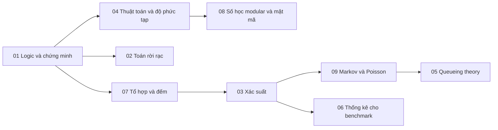

# P14 · Tổng quan — Toán và lý thuyết nền cho hệ thống

> Trang này chỉ điều hướng: mục tiêu, bản đồ chương và thứ tự đọc. Mọi khẳng định kỹ thuật đều nằm trong từng chương, kèm chú thích. Lời khuyên về thứ tự đọc ở đây là của người soạn.

## Mục tiêu của phase

Các phase trước dùng toán khá nhiều mà không dừng lại dạy nó: chứng minh an toàn của Paxos và Raft, xác suất tách phiếu khi bầu leader, tỉ lệ dương tính giả của Bloom filter, chi phí amortized của `Vec::push`, độ trễ tăng vọt khi pool gần đầy. Phase này dạy riêng phần toán đó, theo cách một kỹ sư backend dùng tới: đọc được một chứng minh, tự viết được một chứng minh ngắn, ước lượng được một xác suất hay một độ trễ trước khi đo, và đọc số liệu benchmark mà không tự lừa mình.

Mỗi chương có một ví dụ chạy xuyên suốt lấy từ backend (connection pool, rate limiter, job scheduler, worker pool, cụm cache, Raft năm node). Định lý nào cần thì được chứng minh đầy đủ. Ở nhiều chỗ có thêm một chương trình Rust nhỏ để kiểm lại con số, output dán nguyên văn và ghi rõ là quan sát.

## Các chương

| Chương | Trả lời câu hỏi | Dùng lại ở |
|---|---|---|
| [01. Logic và chứng minh](01-logic-va-chung-minh.md) | Phủ định một khẳng định có ∀/∃, chứng minh trực tiếp, phản đảo, phản chứng; quy nạp thường và mạnh; invariant quy nạp và cách làm mạnh nó; loop invariant cho binary search | [P12·18](../12-he-thong-du-lieu/18-thuat-toan-dong-thuan.md), [P13·02](../13-tla-plus/02-toan-nen-tang.md), mọi chứng minh trong P15 |
| [02. Toán rời rạc](02-toan-roi-rac.md) | Quan hệ, thứ tự bộ phận, happens-before và vector clock, join-semilattice, DAG và sắp xếp topo, wait-for graph, precedence graph | [P12·09](../12-he-thong-du-lieu/09-consistency-va-consensus.md), [P15·04 CRDT](../15-thuat-toan-phan-tan/04-crdt.md), [P15·06](../15-thuat-toan-phan-tan/06-snapshot-toan-cuc.md) |
| [03. Xác suất cho hệ thống](03-xac-suat.md) | Union bound, kỳ vọng, Markov/Chebyshev/Chernoff, balls-into-bins, power of two choices, Bloom filter, xác suất tách phiếu của Raft | [P12·03](../12-he-thong-du-lieu/03-storage-engine.md), [P15·07 gossip](../15-thuat-toan-phan-tan/07-membership-va-gossip.md) |
| [04. Thuật toán và độ phức tạp](04-thuat-toan-va-do-phuc-tap.md) | O/Ω/Θ, recurrence và Master theorem, amortized analysis cho `Vec`, P/NP và phép quy dẫn, xếp lịch NP-hard trong thực tế | [P10](../10-rust-internals/00-tong-quan.md) (`Vec`, `HashMap`) |
| [05. Queueing theory](05-queueing-theory.md) | Little's law, M/M/1, M/M/c và Erlang C, đường cong latency theo utilization, hàng đợi chung so với hàng đợi riêng, giới hạn của mô hình | [P7](../07-io-async/00-tong-quan.md), [P11](../11-do-dac-va-go-loi/00-tong-quan.md) |
| [06. Thống kê cho benchmark](06-thong-ke-cho-benchmark.md) | Warm-up, số lần lặp, percentile, khoảng tin cậy (t và bootstrap), so sánh hai hệ, coordinated omission, Criterion.rs | [P11](../11-do-dac-va-go-loi/00-tong-quan.md) |
| [07. Tổ hợp và đếm](07-to-hop-va-dem.md) | Quy tắc cộng/nhân, hoán vị, tổ hợp, nhị thức, song ánh và đếm hai cách, chuồng bồ câu, bao hàm–loại trừ, chia kẹo, hàm sinh; đếm quorum, đếm interleaving, ma trận kịch bản lỗi | [P12·18](../12-he-thong-du-lieu/18-thuat-toan-dong-thuan.md), [P13](../13-tla-plus/00-tong-quan.md), [P15·03](../15-thuat-toan-phan-tan/03-phan-cap-consistency.md) |
| [08. Số học modular và nền mật mã](08-so-hoc-modular-va-mat-ma.md) | Euclid, đồng dư, Fermat/Euler, định lý phần dư Trung Hoa, RSA, Diffie–Hellman; hàm băm, Merkle tree, chữ ký, MAC, chia sẻ bí mật Shamir, threshold signature | [P15·07](../15-thuat-toan-phan-tan/07-membership-va-gossip.md), [P15·10 BFT](../15-thuat-toan-phan-tan/10-bft-hien-dai.md) |
| [09. Chuỗi Markov và quá trình Poisson](09-chuoi-markov-va-qua-trinh-poisson.md) | Phân phối mũ và tính không nhớ, quá trình Poisson, chuỗi Markov rời rạc và liên tục, phân tích bước đầu, gambler's ruin; availability và MTTF của nhóm 3 replica, gossip, retry/backoff | [P15·07](../15-thuat-toan-phan-tan/07-membership-va-gossip.md), [P12·18](../12-he-thong-du-lieu/18-thuat-toan-dong-thuan.md) |

## Thứ tự đọc

Chương 01 là nền cho cả phase: các chương sau đều viết chứng minh theo cách chương 01 dạy. Đọc xong 01 thì có thể chọn nhánh theo nhu cầu (nhận xét của người soạn):

- Sắp đọc P15 (thuật toán phân tán): đọc 01 → 07 → 02 → 03 → 09; thêm 08 trước P15·10 (BFT).
- Đang chỉnh capacity hoặc pool: đọc 03 → 09 → 05.
- Sắp so sánh hiệu năng hai phiên bản: đọc 03 → 06.

Mỗi chương có mục **Bài tập** (Dễ/Vừa/Khó, lời giải đầy đủ trong khối gập). Chỉ mở lời giải sau khi đã tự làm.

Phase này không bắt buộc đọc trước P1–P13. Khi một chương ở phase khác viện dẫn một kết quả toán, nó link thẳng tới mục tương ứng ở đây.
