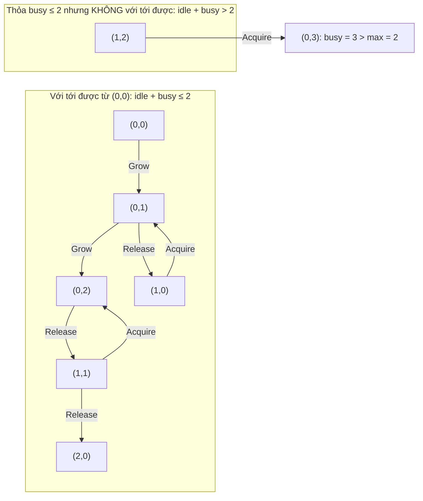

# P14 · Chương 01 — Logic và chứng minh

> Phạm vi: chương này dạy cách *chứng minh bằng tay* một khẳng định về hệ thống; việc nhờ máy kiểm hộ thuộc [P13](../13-tla-plus/00-tong-quan.md). Phần toán bám theo giáo trình MIT 6.042 *Mathematics for Computer Science* (bản 2018) và vài nguồn chuyên về hệ thống. Chứng minh nào mang nhãn "(chứng minh của người soạn)" là do người soạn tự viết hoặc viết lại, và chỉ đáng tin tới mức bạn đọc từng bước thấy đúng. Các chương trình Rust trong chương đã được chạy thật bằng `rustc 1.95.0` (`rustc --edition 2021 file.rs`, build không tối ưu nên `debug_assert!` đang bật) trên macOS arm64. Output ghi dưới nhãn *quan sát* của một lần chạy, và với các chương trình duyệt vét cạn thì chỉ khẳng định trong đúng phạm vi tham số chương trình đã duyệt.

Một backend engineer tám năm kinh nghiệm viết hàng nghìn dòng `if`, `assert!` và `for`, nhưng ít khi có dịp hỏi: *vì sao* đoạn code này đúng, và đúng với *mọi* đầu vào chứ không chỉ những đầu vào ta đã thử? Chương này trả lời bằng bộ công cụ nhỏ nhất của chứng minh: logic, ba cách lập luận (trực tiếp, phản đảo, phản chứng), quy nạp, và invariant. Các chương sau của P14 và toàn bộ P15 đều dựng trên chúng (nhận xét của người soạn).

Để câu trả lời nào cũng có chỗ bám, cả chương dùng một ví dụ giả định là `pay-gw`, một API gateway nội bộ chuyển request thanh toán tới các backend. Nó có ba bộ phận mà ta sẽ chứng minh điều gì đó về chúng: một *connection pool* giữ tối đa `max` kết nối tới database, một *rate limiter* kiểu token bucket cho từng client, và một chuỗi gọi nhiều tầng mà tầng nào cũng retry khi lỗi (nhận xét của người soạn: ví dụ giả định, không phải code trong repo).

## Bạn sẽ hiểu được gì

1. **Q1.** Khi đọc hay viết một khẳng định như "mọi request đều có backend khỏe phục vụ", làm sao biết nó nói gì và phủ định nó đúng ra là gì (phép kéo theo, lượng từ ∀/∃, thứ tự lượng từ, tập rỗng)? → mục 1
2. **Q2.** Khi nào chứng minh trực tiếp, khi nào dùng phản đảo hay phản chứng, và ba cách đó trông thế nào trên một định lý thật của hệ phân tán (hai đa số luôn giao nhau, mỗi term tối đa một leader)? → mục 2
3. **Q3.** Quy nạp thường, quy nạp mạnh và nguyên lý sắp tốt khác nhau ở đâu, và dùng chúng ra sao để chứng minh cận cho retry khuếch đại và cho số vòng lặp của tìm kiếm nhị phân? → mục 3
4. **Q4.** Invariant của một state machine là gì, vì sao một invariant có thể đúng ở mọi trạng thái với tới được mà vẫn không "quy nạp" được, và tăng cường (strengthen) nó thế nào, trên connection pool và rate limiter của `pay-gw`? → mục 4
5. **Q5.** Loop invariant giúp chứng minh code đúng ra sao, thể hiện trên binary search bằng Rust (đúng đắn, kết thúc, và chỗ chứng minh trên giấy không với tới)? → mục 5
6. **Q6.** Những lỗi chứng minh nào hay gặp (suy từ test, nhầm chiều kéo theo, quy nạp hỏng mắt xích, invariant đúng nhưng không quy nạp, mô hình lệch code, giả thiết ngầm), và nhận ra chúng trong công việc backend thế nào? → mục 6

## Kiến thức cần trước

- Đọc được Rust cơ bản (vòng lặp, `usize`, slice, `debug_assert!`) và đại số phổ thông: bất đẳng thức, lũy thừa, phần nguyên ⌊x⌋ và ⌈x⌉. Không cần học trước logic hay chứng minh.
- [P13 · Chương 02, mục 1](../13-tla-plus/02-toan-nen-tang.md): ký hiệu `/\`, `\/`, `~`, `=>`, `\A`, `\E` của TLA+. Chương này dùng ký hiệu toán thông thường (∧, ∨, ¬, ⇒, ∀, ∃) và chỉ nhắc lại phần cần cho lập luận.
- [P12 · Chương 18](../12-he-thong-du-lieu/18-thuat-toan-dong-thuan.md) và [P12 · Chương 09](../12-he-thong-du-lieu/09-consistency-va-consensus.md): quorum và Raft. Mục 2 chứng minh phần lập luận đếm đứng sau chúng; chưa đọc thì bạn vẫn theo được vì mọi thứ cần dùng đều được định nghĩa lại.
- Tùy chọn: [P13 · Chương 04](../13-tla-plus/04-invariant-va-tlc.md) và [P13 · Chương 08, mục 6](../13-tla-plus/08-dac-ta-giao-thuc-phan-tan.md), nơi inductive invariant được nhìn từ phía công cụ (TLC, Apalache). Mục 4 của chương này là phần "vì sao" làm bằng tay của cùng câu chuyện.
- Chương kế: [02 Toán rời rạc](02-toan-roi-rac.md), [03 Xác suất](03-xac-suat.md), [04 Thuật toán và độ phức tạp](04-thuat-toan-va-do-phuc-tap.md). Mục 3 và 5 ở đây mới chứng minh sơ bộ số vòng lặp của binary search; chương 04 phát triển tiếp.

---

## 1. Logic: kéo theo, lượng từ và cách phủ định đúng (Q1)

> **Trả lời ngắn.** Câu "nếu P thì Q" chỉ sai khi P đúng mà Q sai; khi P sai thì cả câu coi như đúng[^mcs-impl-def]. Muốn phủ định câu "với mọi x thì P", ta nói "có một x làm P sai"[^mcs-negq], và đổi chỗ "với mọi" với "tồn tại" tạo ra một câu khác hẳn chứ không phải một cách viết khác[^mcs-counter-model]. Ba lỗi hay gặp khi đọc khẳng định về hệ thống đều từ đây mà ra: nhầm chiều của phép kéo theo, phủ định sai lượng từ, và quên rằng "mọi phần tử của tập rỗng" luôn đúng.

**Giải thích.**

*Với `pay-gw`.* Giả sử runbook của `pay-gw` có dòng: "Mọi request đều có một backend khỏe phục vụ được nó." Câu ngắn này giấu hai lượng từ và thứ tự giữa chúng. Ta cần đọc nó thật chính xác, vì kiểm tra một khẳng định thực chất là đi tìm phản ví dụ của *phủ định* nó, và muốn tìm đúng thì phải phủ định đúng (nhận xét của người soạn). Mục này tách từng mảnh: phép kéo theo trước, lượng từ sau.

### 1.1 Phép kéo theo

"Nếu P thì Q" viết là P ⇒ Q. Nó sai đúng một trường hợp: P đúng mà Q sai. Nói gọn, một phép kéo theo đúng khi vế "nếu" sai hoặc vế "thì" đúng[^mcs-impl-def]. Ví dụ với `pay-gw`: "nếu request có idempotency key thì retry nó là an toàn" (P = có key, Q = retry an toàn). Câu này chỉ bị bác bỏ bởi một request *có key mà retry vẫn không an toàn*. Những request không có key không làm câu sai, kể cả khi retry chúng nguy hiểm.

Chỗ khó chịu là dòng "vế trái sai thì cả câu đúng". Quy ước này trái với lối nói thường ngày, nơi ta chờ giữa hai vế có một quan hệ nhân quả thật[^mcs-false-hyp]. Trong chứng minh, chính quy ước ấy là thứ ta cần: invariant dạng "nếu circuit breaker đang mở thì không request nào được gửi lên upstream" phải đúng cả những lúc breaker đóng, và nó đúng vì vế trái sai (nhận xét của người soạn). Bảng chân trị đầy đủ của `=>` có ở [P13 · Chương 02, mục 1.2](../13-tla-plus/02-toan-nen-tang.md).

Quanh P ⇒ Q có hai câu hay bị lẫn với nó:

| Dạng | Viết | So với P ⇒ Q | Ví dụ ở `pay-gw` |
|---|---|---|---|
| Gốc | P ⇒ Q | — | có key ⇒ retry an toàn |
| Phản đảo (contrapositive) | ¬Q ⇒ ¬P | *tương đương*[^mcs-contra-equiv] | retry không an toàn ⇒ không có key |
| Đảo (converse) | Q ⇒ P | *không* tương đương[^mcs-converse] | retry an toàn ⇒ có key; sai, vì request đọc thuần retry được mà chẳng cần key |

Phản đảo là cùng một khẳng định viết ngược, nên chứng minh được cái này là chứng minh được cái kia. Đảo là khẳng định khác, và nhầm hai thứ này là lỗi suy luận hay gặp nhất khi phân tích sự cố (mục 6).

### 1.2 Lượng từ và cách phủ định

"Với mọi" viết là ∀, "tồn tại" viết là ∃ (định nghĩa và cách gõ trong TLA+ nằm ở [P13 · Chương 02, mục 1.3](../13-tla-plus/02-toan-nen-tang.md)). Dòng runbook viết thành:

> ∀ r ∈ Request. ∃ b ∈ Backend. khỏe(b) ∧ phục_vụ(b, r)

Muốn phủ định, ta đẩy dấu ¬ vào trong; mỗi lần nó đi qua một lượng từ thì ∀ đổi thành ∃ và ngược lại. Hai luật gốc là ¬∀x. P(x) ≡ ∃x. ¬P(x) và ¬∃x. P(x) ≡ ∀x. ¬P(x). Ví dụ đời thường: "không phải ai cũng thích kem" nghĩa là "có người không thích kem"[^mcs-negq]. Áp luật hai lần cho dòng runbook:

> ¬(∀ r. ∃ b. khỏe(b) ∧ phục_vụ(b, r)) ≡ ∃ r. ∀ b. ¬(khỏe(b) ∧ phục_vụ(b, r))

Đọc thành lời: có một request mà *mọi* backend đều hoặc không khỏe, hoặc không phục vụ được nó. Phản ví dụ của runbook vì vậy có hình dạng cụ thể: một request r\*, kèm lý do cho *từng* backend. Nếu bạn phủ định thành "mọi request đều không có backend khỏe", bạn đã đổi ∃r thành ∀r và nói một câu mạnh hơn nhiều (nhận xét của người soạn). Lỗi này hay xuất hiện trên dashboard: "không phải mọi request đều nhanh" không có nghĩa "mọi request đều chậm".

Vì ∀ và ∃ lần lượt là phép AND và phép OR chạy qua cả miền, hai luật trên chính là luật De Morgan nâng lên cho dãy vô hạn[^mcs-demorgan-q]. Với ba backend nó chỉ còn là ¬(h₁ ∧ h₂ ∧ h₃) ≡ ¬h₁ ∨ ¬h₂ ∨ ¬h₃: "không phải cả ba đều khỏe" nghĩa là "có ít nhất một cái không khỏe".

### 1.3 Thứ tự lượng từ

Hai câu dưới đây khác nhau:

- ∀ r ∃ b. phục_vụ(b, r): mọi request có *ít nhất một* backend phục vụ được; backend ấy có thể khác nhau theo từng request.
- ∃ b ∀ r. phục_vụ(b, r): có *một* backend phục vụ được mọi request.

Phản mô hình (counter-model) nhỏ nhất: hai backend A, B và hai request r₁, r₂; A chỉ phục vụ r₁, B chỉ phục vụ r₂. Câu đầu đúng (r₁ → A, r₂ → B), câu sau sai vì không backend nào phục vụ được cả hai. Cách làm này gọi là dựng một counter-model, tức một cách diễn giải khiến khẳng định sai[^mcs-counter-model]. Chiều ngược lại thì luôn đúng: nếu có một backend phục vụ mọi request thì chính nó là b cần tìm cho từng r, nên ∃b ∀r kéo theo ∀r ∃b.

Trong kiến trúc, câu thứ hai mô tả một điểm chịu lỗi duy nhất (single point of failure): một backend gánh mọi request. Câu thứ nhất mới là điều ta muốn ở một cụm có dự phòng (nhận xét của người soạn).

### 1.4 Tập rỗng: ∀ đúng, ∃ sai

Trên tập rỗng, "mọi phần tử đều thỏa P" luôn đúng vì không có phần tử nào để bác bỏ, còn "có phần tử thỏa P" luôn sai. Rust làm đúng như vậy: `all` trên iterator rỗng trả `true`[^rs-all-empty] và `any` trả `false`[^rs-any-empty]. Hệ quả thực tế (nhận xét của người soạn): health check "mọi backend đều khỏe" viết bằng `all` sẽ báo *khỏe* khi service discovery trả về danh sách rỗng, đúng vào lúc hệ thống đang hỏng nặng nhất.

```rust
// Đúng theo logic, sai ý đồ: danh sách rỗng (discovery lỗi) vẫn "khỏe".
let ok = backends.iter().all(|b| b.healthy());

// Đúng ý đồ: tồn tại ít nhất một backend VÀ mọi backend đều khỏe.
let ok = !backends.is_empty() && backends.iter().all(|b| b.healthy());
```

Bản thứ hai viết ra hai lượng từ riêng biệt: ∃ rồi ∀.

<details><summary>Đi sâu: ∀∃ là một thuật toán; ∀ trên miền mở; ∀ kết hợp với ⇒ trên tập rỗng</summary>

- *Chứng minh một câu ∀∃ là viết một thuật toán* (nhận xét của người soạn). Để chứng minh "∀ r ∃ b. phục_vụ(b, r)" bạn phải chỉ cách chọn b từ r, tức một hàm định tuyến `route(r) = b`. Khi miền hữu hạn, chính bảng định tuyến của `pay-gw` là chứng minh. Câu ∃b ∀r mạnh hơn vì chỉ cần *một* b duy nhất, không phụ thuộc r: hàm hằng là một trường hợp riêng của hàm. Cách nhìn này giải thích vì sao chiều ∃∀ ⇒ ∀∃ luôn đúng còn chiều ngược lại thì không.
- *Miền mở.* Trong toán, tập hợp cho trước. Trong hệ thống, "mọi request" là tập chưa biết trước (cả các request tương lai), nên một câu ∀ trên miền ấy chỉ chứng minh được bằng lập luận như quy nạp hay invariant (mục 3 và 4), không kiểm hết được bằng test (mục 6).
- *∀ kết hợp với ⇒.* Câu "mọi request quá hạn đều đã bị hủy", viết là ∀x. (quá_hạn(x) ⇒ bị_hủy(x)), đúng ngay khi chưa có request nào quá hạn: mỗi x làm vế trái sai nên phép kéo theo đúng. Nó cũng đúng khi không có request nào cả, vì miền rỗng. Hai nguồn "đúng rỗng" khác nhau này là lý do một invariant dạng ∀x. (P(x) ⇒ Q(x)) không bị "vi phạm" ở trạng thái đầu, khi hệ thống còn trống (nhận xét của người soạn).

</details>

**Quay lại Q1:** "nếu P thì Q" chỉ sai khi P đúng mà Q sai và tương đương với phản đảo của nó chứ không phải với đảo; phủ định đẩy ¬ vào trong và đổi ∀ ↔ ∃; thứ tự ∀∃ khác ∃∀; tập rỗng làm ∀ đúng và ∃ sai. Với `pay-gw`, phản ví dụ của "mọi request có backend khỏe phục vụ" là một request cụ thể mà *mọi* backend đều không phục vụ được.

---

## 2. Chứng minh trực tiếp, phản đảo và phản chứng (Q2)

> **Trả lời ngắn.** Chứng minh trực tiếp là giả sử vế "nếu" rồi suy ra vế "thì"[^mcs-method1]; chứng minh bằng phản đảo là chứng minh câu "không Q thì không P" thay cho "P thì Q", hai câu tương đương nhau[^mcs-contrapos]; còn phản chứng là giả sử điều cần chứng minh sai rồi suy ra một điều sai hiển nhiên[^mcs-contradiction]. Có cách trực tiếp thì nên dùng, vì chứng minh gián tiếp dễ rối hơn[^mcs-contra-direct]. Ví dụ ngắn nhất trong hệ phân tán: hai đa số bất kỳ luôn có node chung, chứng minh được cả ba cách, và từ đó suy ra "mỗi term có tối đa một leader" bằng một bước phản chứng.

**Giải thích.**

*Với `pay-gw`.* Cấu hình định tuyến của `pay-gw` nằm trong một cụm 5 node chạy Raft, giống `kvmeta` ở [P12 · Chương 18](../12-he-thong-du-lieu/18-thuat-toan-dong-thuan.md) (nhận xét của người soạn: ví dụ giả định). Có hai câu hỏi. Một: một ghi đã được đa số xác nhận có nằm trong mọi đa số bầu leader mới không? Hai: mỗi term có tối đa một leader không? Cả hai quy về một định lý đếm nhỏ. Ta chứng minh nó ba cách để thấy ba kiểu lập luận cùng đi về một chỗ, rồi dùng nó để chứng minh định lý thứ hai bằng phản chứng.

### 2.1 Một định lý, ba chứng minh

**Định lý 2.1 (hai tập đủ lớn phải giao nhau).** Cho tập U có n phần tử và hai tập con A, B ⊆ U. Nếu |A| + |B| > n thì A ∩ B ≠ ∅.

*Chứng minh trực tiếp (chứng minh của người soạn).* Giả sử |A| + |B| > n. Phần tử nằm trong cả A lẫn B bị đếm hai lần khi cộng |A| + |B|, nên |A ∪ B| = |A| + |B| − |A ∩ B|. Mặt khác A ∪ B ⊆ U nên |A ∪ B| ≤ n. Suy ra |A ∩ B| = |A| + |B| − |A ∪ B| ≥ |A| + |B| − n. Vì |A| + |B| > n và cả hai vế là số nguyên nên |A| + |B| − n ≥ 1. Vậy |A ∩ B| ≥ 1. ∎

Đây là khuôn "giả sử vế nếu, chỉ ra vế thì"[^mcs-method1], và nó cho nhiều hơn điều ta hỏi: nó đo luôn được hai tập chung nhau *bao nhiêu* phần tử (ít nhất |A| + |B| − n). Con số ấy là thứ quorum chịu lỗi Byzantine cần; [P12 · Chương 18, mục 1](../12-he-thong-du-lieu/18-thuat-toan-dong-thuan.md) tính n = 3f+1 từ đó.

*Chứng minh phản chứng (chứng minh của người soạn).* Giả sử |A| + |B| > n nhưng A ∩ B = ∅. Hai tập rời nhau nên |A ∪ B| = |A| + |B| > n. Nhưng A ∪ B ⊆ U nên |A ∪ B| ≤ n. Hai điều mâu thuẫn, nên giả sử sai, và A ∩ B ≠ ∅. ∎

*Chứng minh bằng phản đảo (chứng minh của người soạn).* Phản đảo của định lý là: nếu A ∩ B = ∅ thì |A| + |B| ≤ n. Hai tập rời nhau thì |A| + |B| = |A ∪ B|, mà A ∪ B ⊆ U nên |A ∪ B| ≤ n. ∎ Một phép kéo theo và phản đảo của nó tương đương nhau[^mcs-contra-equiv], nên chứng minh phản đảo là chứng minh chính định lý. Bạn thấy nó chỉ là chứng minh phản chứng bỏ đi bước kết luận cuối.

**Hệ quả 2.1 (hai đa số giao nhau).** Một *đa số* của n node là tập có nhiều hơn n/2 node, tức ít nhất ⌊n/2⌋ + 1 node. Hai đa số bất kỳ có |A| + |B| ≥ 2⌊n/2⌋ + 2, bằng n + 2 khi n chẵn và n + 1 khi n lẻ. Cả hai đều lớn hơn n, nên theo Định lý 2.1 chúng giao nhau. Paxos dựa đúng vào tính chất này[^pms-majority]. Với cụm 5 node: đa số là 3 node và 3 + 3 = 6 > 5. Tổng quát hơn, hai quorum cỡ n − f giao nhau khi 2(n − f) > n, tức n ≥ 2f + 1; đó là con số 2f + 1 ở [P12 · Chương 18, mục 1](../12-he-thong-du-lieu/18-thuat-toan-dong-thuan.md), nay đã có chứng minh đầy đủ.

Điều kiện "> n" không nới được thành "≥ n". Cụm 6 node với quorum 3 node có hai quorum rời nhau {1, 2, 3} và {4, 5, 6}; cụm 4 node với quorum 2 cũng vậy. Đó là lý do "nửa số node" không đủ làm đa số khi n chẵn.

### 2.2 Phản chứng kinh điển: √2 là số vô tỉ

Ví dụ này đáng đọc kỹ vì nó dùng cả phản đảo lẫn phản chứng, và vì nó giấu một giả thiết mà mục 3 mới trả.

**Bổ đề 2.2.** Với số nguyên n, nếu n² chẵn thì n chẵn.

*Chứng minh bằng phản đảo (chứng minh của người soạn).* Phản đảo là "n lẻ thì n² lẻ". Nếu n lẻ thì n = 2k + 1 với k nguyên, và n² = 4k² + 4k + 1 = 2(2k² + 2k) + 1, là số lẻ. ∎

**Định lý 2.2.** √2 không viết được dưới dạng n/d với n, d là số nguyên dương.

*Chứng minh bằng phản chứng (theo giáo trình MIT 6.042, người soạn viết lại).* Giả sử √2 = n/d. Ta chọn phân số n/d tối giản, tức n và d không có ước chung lớn hơn 1 (mục 3.3 chứng minh luôn làm được). Bình phương hai vế: 2d² = n². Vậy n² chẵn, theo Bổ đề 2.2 n chẵn, viết n = 2m. Thay vào: 2d² = 4m², tức d² = 2m², nên d² chẵn, và lại theo Bổ đề 2.2 d chẵn. Khi đó n và d cùng chia hết cho 2, mâu thuẫn với "tối giản"[^mcs-sqrt2]. Vậy giả sử sai. ∎

Ba điều đáng thấy. Một, bổ đề dùng phản đảo vì "n² chẵn ⇒ n chẵn" khó tấn công trực tiếp, còn "n lẻ ⇒ n² lẻ" chỉ cần một phép nhân. Hai, mâu thuẫn xảy ra với chính điều ta *tự chọn* (phân số tối giản) chứ không với một sự thật bên ngoài; đó là dáng điển hình của phản chứng. Ba, bước "chọn phân số tối giản" là một giả thiết ngầm: ta đã dùng nguyên lý sắp tốt "lén" từ đầu mà không nói ra[^mcs-wop-sly].

### 2.3 Phản chứng trong hệ phân tán: mỗi term tối đa một leader

**Định lý 2.3.** Giả sử (H1) một server chỉ trở thành leader của term t khi nhận được phiếu bầu cho nó trong term t từ một đa số các server, và (H2) mỗi server bỏ phiếu cho tối đa một ứng viên trong mỗi term. Khi đó mỗi term có tối đa một leader.

*Chứng minh (phản chứng; chứng minh của người soạn).* Giả sử trong term t có hai leader khác nhau c₁ ≠ c₂. Theo H1, có một đa số M₁ đã bầu c₁ và một đa số M₂ đã bầu c₂, cả hai trong term t. Theo Hệ quả 2.1, M₁ ∩ M₂ ≠ ∅; lấy một server s trong giao đó. Server s đã bỏ phiếu cho c₁ và cho c₂ trong cùng term t, với c₁ ≠ c₂: trái với H2. Vậy giả sử sai. ∎

Bài báo Raft nêu H2 như một luật bỏ phiếu[^raft-vote-once] và rút cùng kết luận bằng lời: luật đa số bảo đảm tối đa một ứng viên thắng trong một term[^raft-majority-rule]. Đó là tính chất Election Safety của Raft[^raft-es]. Chứng minh còn cho thấy điều câu chữ không nói: *cái gì phải đúng ở cài đặt*. H2 chỉ đúng nếu server không quên phiếu đã bầu khi khởi động lại, nên Raft xếp `votedFor` vào trạng thái phải ghi bền trước khi trả lời RPC[^raft-persist]. Một cài đặt quên `fsync` phiếu bầu làm giả thiết H2 sai, và từ lúc đó định lý không còn bảo vệ bạn (nhận xét của người soạn; chuyện tương tự với acceptor Paxos nằm ở [P12 · Chương 18, mục 1](../12-he-thong-du-lieu/18-thuat-toan-dong-thuan.md)). Định lý cũng không nói gì về tính sống: một term vẫn có thể không có leader nào.

### 2.4 Chọn cách nào

- *Mặc định là trực tiếp.* Phản chứng luôn dùng được nhưng có thể quanh co, nên chứng minh trực tiếp thường nên được ưu tiên khi có[^mcs-contra-direct].
- *Phản đảo* khi vế "thì" tiện ở dạng phủ định hơn dạng khẳng định (Bổ đề 2.2). Vì hai câu tương đương, đổi sang phản đảo không mất gì[^mcs-contrapos].
- *Phản chứng* khi kết luận nói về cái *không tồn tại* hay *không thể xảy ra* ("không có phân số nào", "không có hai leader"): giả sử nó xảy ra rồi lần theo hậu quả (nhận xét của người soạn).

<details><summary>Đi sâu: kiểm vét cạn Định lý 2.1 cho n ≤ 10, và vì sao nó không thay được chứng minh</summary>

Chương trình dưới đây duyệt mọi cặp tập con (A, B) của {0, …, n−1} với n từ 1 đến 10 (tập biểu diễn bằng bitmask). Với mỗi n nó đếm số cặp có |A| + |B| > n (kỳ vọng: mọi cặp đó giao nhau, tức 0 vi phạm), và số cặp rời nhau có |A| + |B| đúng bằng n (kỳ vọng: khác 0, để thấy cận n là sát).

```rust
// Kiểm vét cạn: với mọi n <= 10, mọi cặp tập con A, B của {0, ..., n-1}:
//  (1) nếu |A| + |B| > n thì A giao B khác rỗng;
//  (2) tồn tại cặp rời nhau với |A| + |B| = n (cận n là sát).
fn main() {
    println!("n   cặp (A,B) có |A|+|B|>n   vi phạm   cặp rời nhau có |A|+|B|=n");
    for n in 1..=10u32 {
        let full = 1u32 << n;
        let (mut big, mut bad, mut tight) = (0u64, 0u64, 0u64);
        for a in 0..full {
            for b in 0..full {
                let s = a.count_ones() + b.count_ones();
                if s > n {
                    big += 1;
                    if a & b == 0 {
                        bad += 1;
                    }
                }
                if s == n && a & b == 0 {
                    tight += 1;
                }
            }
        }
        println!("{n:<3} {big:<24} {bad:<9} {tight}");
        assert!(tight > 0);
    }
}
```

Kết quả chạy thật (quan sát, macOS arm64, `rustc 1.95.0`):

```text
n   cặp (A,B) có |A|+|B|>n   vi phạm   cặp rời nhau có |A|+|B|=n
1   1                        0         2
2   5                        0         4
3   22                       0         8
4   93                       0         16
5   386                      0         32
6   1586                     0         64
7   6476                     0         128
8   26333                    0         256
9   106762                   0         512
10  431910                   0         1024
```

Kết quả khớp định lý cho n ≤ 10, và cột cuối đúng bằng 2ⁿ: với mỗi A, cặp (A, U∖A) rời nhau và có tổng cỡ đúng n. Nhưng đây là một *mẫu hữu hạn*: ta không kiểm được một khẳng định về tập vô hạn bằng một mẫu hữu hạn các phần tử, dù mẫu lớn đến đâu[^mcs-finite-sample]. Chứng minh ở mục 2.1 mới phủ được mọi n; chương trình chỉ cho thấy phát biểu không có lỗi đánh máy (nhận xét của người soạn).

</details>

**Quay lại Q2:** trực tiếp là "giả sử P, suy ra Q"; phản đảo chứng minh "¬Q ⇒ ¬P" tương đương; phản chứng giả sử điều cần chứng minh sai và tìm mâu thuẫn. Với `pay-gw`: hai đa số của cụm 5 node luôn chung ít nhất một node (3 + 3 > 5), nên với H1 và H2 mỗi term có tối đa một leader; H2 buộc cài đặt phải ghi bền phiếu bầu.

---

## 3. Quy nạp, quy nạp mạnh và nguyên lý sắp tốt (Q3)

> **Trả lời ngắn.** Quy nạp thường chứng minh khẳng định đúng với n = 0, rồi chứng minh "đúng với n thì đúng với n + 1"; hai điều ấy cho ta đúng với mọi n[^mcs-induction]. Quy nạp mạnh cho bước thứ hai được dùng mọi trường hợp nhỏ hơn thay vì chỉ trường hợp n[^mcs-strong]. Nguyên lý sắp tốt nói mọi tập khác rỗng các số tự nhiên đều có phần tử nhỏ nhất[^mcs-wop], nên ta có thể chứng minh bằng cách xét "phản ví dụ nhỏ nhất". Ba cách này về bản chất là ba cách trình bày của cùng một lập luận[^mcs-three-formats].

**Giải thích.**

*Với `pay-gw`.* Trong chuỗi gọi nhiều tầng của `pay-gw`, tầng nào cũng retry khi lỗi; câu hỏi "một request của người dùng làm tầng sâu nhất nhận bao nhiêu lần gọi" cần quy nạp theo tầng (3.1). Câu hỏi "binary search trong bảng đã sắp xếp mất tối đa bao nhiêu vòng" cần quy nạp mạnh (3.2). Còn lời hứa "phân số nào cũng rút gọn được", nợ từ mục 2, cần nguyên lý sắp tốt (3.3). Cả ba đều là ví dụ giả định của người soạn.

### 3.1 Quy nạp thường: retry khuếch đại theo tầng

Quy nạp chứng minh một khẳng định đúng với *mọi* số tự nhiên bằng hai việc. Việc thứ nhất là *cơ sở*: nó đúng với n = 0. Việc thứ hai là *bước quy nạp*: nếu nó đúng với n thì đúng với n + 1[^mcs-induction]. Hai việc ấy nối thành một chuỗi: P(0), P(0) ⇒ P(1), P(1) ⇒ P(2), và cứ thế. Một chứng minh quy nạp chuẩn có năm thành phần: nói rõ dùng quy nạp, phát biểu giả thiết quy nạp P(n), chứng minh cơ sở, chứng minh bước quy nạp, rồi kết luận[^mcs-ind-five]. Phần quan trọng nhất là phát biểu P(n) cho rõ, vì bỏ sót nó là nguồn chính của các chứng minh rối[^mcs-ind-hyp]; và nên ghi nhãn "cơ sở", "bước quy nạp" cho khỏi quên kiểm cơ sở[^mcs-ind-template].

**Định lý 3.1 (retry nhân lên theo tầng).** Một request của người dùng vào tầng 0; tầng i gọi tầng i + 1 với 0 ≤ i < L. Mỗi lời gọi mà tầng i nhận được khiến nó thử gọi tầng i + 1 *tối đa k lần* (một lần gốc cộng các lần retry), và không có fan-out nào khác. Khi đó mỗi request của người dùng khiến tầng L nhận tối đa k^L lời gọi.

*Chứng minh (quy nạp theo i; chứng minh của người soạn).* Gọi aᵢ là số lời gọi tối đa mà tầng i nhận được do một request của người dùng. Giả thiết quy nạp P(i): aᵢ ≤ kⁱ.

- *Cơ sở* (i = 0): tầng 0 nhận đúng một lời gọi, a₀ = 1 = k⁰.
- *Bước quy nạp*: giả sử P(i), tức aᵢ ≤ kⁱ. Mỗi lời gọi tầng i nhận được sinh tối đa k lời gọi sang tầng i + 1, nên aᵢ₊₁ ≤ k · aᵢ ≤ k · kⁱ = kⁱ⁺¹. Đó là P(i + 1).

Theo nguyên lý quy nạp, P(i) đúng với mọi i, và đặc biệt a_L ≤ k^L. ∎

Với k = 3 và L = 5 ta được 3⁵ = 243. Đó đúng là con số trong tài liệu của AWS cho một chuỗi gọi sâu năm tầng, mỗi tầng thử ba lần: tải lên database tăng 243 lần[^aws-retry-amp], vì retry ở các tầng *nhân* với nhau (ba lần, rồi chín lần, và cứ thế)[^aws-retry-multiply]. Cận này đạt được khi mọi lời gọi xuống tầng L đều lỗi, tức mọi tầng dùng hết k lần thử.

Chứng minh cho thấy cách phá cấu trúc nhân: nếu tầng i thử kᵢ lần thì cận là k₀ · k₁ ⋯ k_{L−1}, cùng một lập luận quy nạp. Chỉ retry ở một tầng (k₀ = k, mọi kᵢ còn lại bằng 1) thì cận là k. Đó cũng là khuyến nghị của AWS cho các thao tác rẻ: retry tại một điểm duy nhất của stack[^aws-retry-single].

### 3.2 Quy nạp mạnh: số vòng lặp của tìm kiếm nhị phân

Bảng route hay bảng cận của histogram latency ở `pay-gw` là một mảng đã sắp xếp, tìm bằng binary search (code ở mục 5). Mỗi vòng lặp giữ một đoạn [lo, hi) và chọn mid = lo + ⌊(hi − lo)/2⌋. Gọi s = hi − lo là cỡ đoạn. Sau một vòng, cỡ mới s' là ⌊s/2⌋ (nếu hi := mid) hoặc s − ⌊s/2⌋ − 1 = ⌈s/2⌉ − 1 (nếu lo := mid + 1). Vì ⌈s/2⌉ ≤ ⌊s/2⌋ + 1 nên cả hai đều ≤ ⌊s/2⌋.

Tối đa bao nhiêu vòng? Thử quy nạp thường theo s thì giả thiết P(s − 1) chẳng giúp gì: cỡ mới s' nằm đâu đó dưới s/2 chứ không phải s − 1. Ta cần giả thiết cho *mọi* cỡ nhỏ hơn s. Đó là quy nạp mạnh: bước quy nạp được dùng P(t) cho mọi t < s[^mcs-strong].

**Bổ đề 3.2.** Với s ≥ 2: ⌊log₂ ⌊s/2⌋⌋ = ⌊log₂ s⌋ − 1.

*Chứng minh (chứng minh của người soạn).* Đặt k = ⌊log₂ s⌋. Vì s ≥ 2 nên k ≥ 1, và 2ᵏ ≤ s < 2ᵏ⁺¹. Chia đôi: 2ᵏ⁻¹ ≤ s/2 < 2ᵏ. Số nguyên 2ᵏ⁻¹ không vượt quá s/2 nên 2ᵏ⁻¹ ≤ ⌊s/2⌋; và ⌊s/2⌋ ≤ s/2 < 2ᵏ. Vậy 2ᵏ⁻¹ ≤ ⌊s/2⌋ < 2ᵏ, nghĩa là ⌊log₂ ⌊s/2⌋⌋ = k − 1. ∎

**Định lý 3.2.** Mọi lần chạy vòng lặp bắt đầu từ cỡ đoạn s thực hiện tối đa f(s) vòng, với f(0) = 0 và f(s) = ⌊log₂ s⌋ + 1 khi s ≥ 1.

*Chứng minh (quy nạp mạnh theo s; chứng minh của người soạn).* Giả thiết P(s): mọi lần chạy bắt đầu từ cỡ s thực hiện tối đa f(s) vòng.

- *Cơ sở* (s = 0): điều kiện lo < hi sai ngay, 0 vòng = f(0).
- *Bước quy nạp*: lấy s ≥ 1 và giả sử P(t) đúng với mọi t < s. Vòng đầu chắc chắn chạy (vì s > 0), và cỡ mới s' ≤ ⌊s/2⌋ < s. Theo P(s'), phần còn lại tối đa f(s') vòng, nên tổng không quá 1 + f(s').
  - Nếu s' = 0: tổng ≤ 1 ≤ ⌊log₂ s⌋ + 1 = f(s), vì s ≥ 1 nên ⌊log₂ s⌋ ≥ 0.
  - Nếu s' ≥ 1: khi đó ⌊s/2⌋ ≥ s' ≥ 1 nên s ≥ 2. Vì ⌊log₂ ·⌋ không giảm và s' ≤ ⌊s/2⌋, ta có f(s') = ⌊log₂ s'⌋ + 1 ≤ ⌊log₂ ⌊s/2⌋⌋ + 1 = (⌊log₂ s⌋ − 1) + 1 = ⌊log₂ s⌋ (dùng Bổ đề 3.2). Vậy tổng ≤ 1 + ⌊log₂ s⌋ = f(s).

Cả hai trường hợp cho P(s). ∎

Điều đáng nhớ: mọi chứng minh quy nạp mạnh đều viết lại được thành quy nạp thường, chỉ cần đổi giả thiết thành "P(k) đúng với mọi k ≤ n"[^mcs-strong-equiv]. Hai cách chỉ khác ở chỗ báo cho người đọc biết bước n + 1 có cần các trường hợp nhỏ hơn n hay không. Mục 5.4 chạy kiểm vét cạn: số vòng tối đa quan sát được bằng đúng cận này với mọi độ dài tới 8.

### 3.3 Nguyên lý sắp tốt và "phản ví dụ nhỏ nhất"

Nguyên lý sắp tốt (well-ordering principle, WOP) nói: mọi tập khác rỗng các số nguyên không âm đều có phần tử nhỏ nhất[^mcs-wop]. Cả hai điều kiện đều cần: tập rỗng không có phần tử nhỏ nhất, tập các số nguyên âm cũng không, và tập các số hữu tỉ dương cũng không[^mcs-wop-tight].

Cách dùng chuẩn: để chứng minh P(n) đúng với mọi n, ta gọi C là tập các n làm P(n) sai, giả sử C khác rỗng, lấy phần tử nhỏ nhất của C, rồi suy ra mâu thuẫn, thường bằng cách chỉ ra một phản ví dụ còn nhỏ hơn hoặc chỉ ra rằng P(n) thực ra đúng[^mcs-wop-template].

**Bổ đề 3.3 (phân số tối giản tồn tại).** Mọi phân số m/n với m, n nguyên dương đều viết được dưới dạng m'/n' (cùng giá trị) với m', n' nguyên dương không có ước nguyên tố chung.

*Chứng minh (WOP, theo giáo trình, người soạn viết lại).* Giả sử có một phân số không rút gọn được. Gọi C là tập các tử số m sao cho tồn tại n để m/n không viết được dạng tối giản. C khác rỗng, nên có phần tử nhỏ nhất m₀, ứng với một mẫu n₀. Vì m₀/n₀ chưa tối giản nên m₀ và n₀ có một ước nguyên tố chung p. Khi đó (m₀/p)/(n₀/p) = m₀/n₀, nên nếu (m₀/p)/(n₀/p) viết được dạng tối giản thì m₀/n₀ cũng viết được; mà ta biết nó không. Vậy m₀/p ∈ C. Nhưng m₀/p < m₀, mâu thuẫn với tính nhỏ nhất của m₀. Vậy C rỗng. ∎

Đó là khoản nợ của √2 ở mục 2.2. Dạng "phản ví dụ nhỏ nhất" còn xuất hiện ngoài toán: nếu hai log khác nhau thì tập các chỉ số mà hai log khác nhau là một tập khác rỗng các số tự nhiên, nên có một *chỉ số khác đầu tiên* d; mọi bản ghi trước d giống nhau, còn bản ghi d thì khác. Mọi thuật toán so hai bản sao rồi đồng bộ từ chỗ lệch đầu tiên đều ngầm dựa vào điều này (nhận xét của người soạn).

Ba cách (sắp tốt, quy nạp, quy nạp mạnh) về lý thuyết chỉ là các định dạng khác nhau của cùng một lập luận[^mcs-three-formats]; hãy chọn cái làm lập luận rõ nhất.

<details><summary>Đi sâu: nhiều cơ sở trong quy nạp mạnh (lô 3 và lô 5); WOP là quy nạp mạnh nói ngược</summary>

- *Ví dụ cần nhiều cơ sở.* Một producer của `pay-gw` chỉ gửi theo lô đúng 3 hoặc đúng 5 message. Khẳng định: mọi n ≥ 8 message đều chia được thành các lô như vậy, tức n = 3a + 5b với a, b nguyên không âm. Bài này mượn từ ví dụ hai loại xu 3 và 5 cho mọi số từ 8 trở lên của giáo trình MIT[^mcs-making-change]. Chứng minh bằng quy nạp mạnh (người soạn): cơ sở là ba trường hợp 8 = 3 + 5, 9 = 3·3, 10 = 5·2. Bước quy nạp: với n ≥ 11 ta có n − 3 ≥ 8 và n − 3 < n, nên theo giả thiết n − 3 = 3a + 5b, suy ra n = 3(a + 1) + 5b. Cần *ba* cơ sở vì bước quy nạp dựa vào P(n − 3): với n ≥ 11 nó chỉ với tới các giá trị từ 8 trở lên, nên 8, 9, 10 phải được kiểm riêng. Chỉ kiểm n = 8 thì bước quy nạp không với tới 9 và 10.
- *WOP là quy nạp mạnh nói ngược* (người soạn). Phản ví dụ nhỏ nhất c nghĩa là P(k) đúng với mọi k < c mà P(c) sai. Đó đúng là điều bước quy nạp mạnh ("P(k) đúng với mọi k < c thì P(c) đúng") phủ nhận. Vì vậy hai cách viết hoán đổi cho nhau được, như giáo trình nói[^mcs-three-formats].

</details>

**Quay lại Q3:** quy nạp thường đi từng bậc (retry nhân lên theo tầng: aᵢ ≤ kⁱ, 3⁵ = 243); quy nạp mạnh dùng mọi trường hợp nhỏ hơn (binary search tối đa ⌊log₂ s⌋ + 1 vòng); WOP chứng minh bằng "phản ví dụ nhỏ nhất" (phân số tối giản tồn tại). Ba cách là ba định dạng của cùng một lập luận.

---

## 4. Invariant: từ state machine đến inductive invariant (Q4)

> **Trả lời ngắn.** Một state machine là một tập trạng thái, một trạng thái đầu và một quan hệ cho biết từ trạng thái nào đi được sang trạng thái nào[^mcs-sm-def]. Một điều kiện P là *invariant quy nạp* (preserved invariant) khi mọi bước đi xuất phát từ trạng thái thỏa P đều tới trạng thái thỏa P[^mcs-preserved-def]; nếu P còn đúng ở trạng thái đầu thì P đúng ở mọi trạng thái với tới được[^mcs-inv-principle]. Một điều kiện có thể đúng ở mọi trạng thái với tới được mà vẫn không quy nạp, vì bước quy nạp phải đứng vững cả ở những trạng thái *không với tới được* mà vẫn thỏa điều kiện[^mcs-invariant2]. Cách chữa là tìm một điều kiện mạnh hơn rồi chứng minh nó bằng quy nạp, miễn là điều kiện mạnh hơn vẫn đúng[^mcs-stronger-true].

**Giải thích.**

*Với `pay-gw`.* `pay-gw` giữ một pool kết nối tới database payments, tối đa `max` kết nối. Luật không được vi phạm: không bao giờ có quá `max` handler cùng đang cầm kết nối. Ta muốn *chứng minh* luật đó chứ không chỉ test nó. Mục này làm đúng việc ấy, và cho thấy vì sao cách làm "hiển nhiên" thất bại trước khi cách làm đúng thành công (nhận xét của người soạn: ví dụ giả định; [P13 · Chương 04](../13-tla-plus/04-invariant-va-tlc.md) dùng một connection pool tương tự làm ví dụ cho TLC).

### 4.1 State machine, thực thi và trạng thái với tới được

Về hình thức, một state machine chỉ là một quan hệ nhị phân trên một tập: phần tử của tập gọi là *trạng thái*, quan hệ gọi là quan hệ chuyển, và mỗi mũi tên q → r là một *transition*[^mcs-sm-def]. Máy còn có một trạng thái đầu. Một *execution* là dãy trạng thái bắt đầu từ trạng thái đầu, trong đó hai trạng thái liền nhau luôn nối bằng một transition[^mcs-execution]. Một trạng thái *với tới được* (reachable) nếu nó xuất hiện trong một execution nào đó[^mcs-reachable].

Pool của `pay-gw` mô hình hóa như sau (mô hình của người soạn). Trạng thái là cặp (idle, busy) các số tự nhiên, trong đó idle là số kết nối đang rảnh trong pool và busy là số kết nối đang có handler cầm. `max` là hằng. Trạng thái đầu là (0, 0), vì pool tạo kết nối lười. Có bốn transition:

| Tên | Điều kiện (guard) | Từ (idle, busy) sang |
|---|---|---|
| Acquire (lấy kết nối rảnh) | idle ≥ 1 | (idle − 1, busy + 1) |
| Grow (tạo kết nối mới) | idle = 0 và busy < max | (0, busy + 1) |
| Release (trả về pool) | busy ≥ 1 | (idle + 1, busy − 1) |
| Evict (đóng kết nối rảnh quá hạn) | idle ≥ 1 | (idle − 1, busy) |

Cái ta muốn chứng minh là S ≡ busy ≤ max. Lưu ý luật người dùng quan tâm chỉ nhắc `busy`, còn lý do nó đúng sẽ nằm ở quan hệ giữa `idle` và `busy` (nhận xét của người soạn). Hình dưới vẽ một phần đồ thị trạng thái với max = 2 (lược bớt vài cạnh):



(Sơ đồ của người soạn. Trạng thái `(1,2)` thỏa S nhưng nằm ngoài vùng với tới được; từ nó một bước Acquire hợp lệ dẫn tới vi phạm S.)

### 4.2 Nguyên lý invariant

**Định nghĩa.** Một vị từ I trên trạng thái là *invariant quy nạp* nếu với *mọi* cặp trạng thái q → r, hễ I(q) thì I(r)[^mcs-preserved-def]. Chữ "mọi" ở đây không có nghĩa "mọi cặp với tới được"; đó là điểm mấu chốt của cả mục.

**Định lý 4.1 (nguyên lý invariant).** Nếu I là invariant quy nạp và I đúng ở trạng thái đầu thì I đúng ở mọi trạng thái với tới được[^mcs-inv-principle].

*Chứng minh (quy nạp theo độ dài execution; theo giáo trình, người soạn viết lại).* Giả thiết P(n): mọi trạng thái đạt được sau đúng n bước đều thỏa I.

- *Cơ sở* (n = 0): chỉ có trạng thái đầu, và nó thỏa I theo giả thiết.
- *Bước quy nạp*: giả sử P(n), và r là một trạng thái đạt được sau n + 1 bước. Khi đó có trạng thái q đạt được sau n bước với q → r. Theo P(n), I(q). Vì I là invariant quy nạp, I(r). Đó là P(n + 1).

Mọi trạng thái với tới được đều đạt được sau một số hữu hạn bước nào đó, nên I đúng ở mọi trạng thái với tới được. ∎

Nguyên lý này chỉ là nguyên lý quy nạp viết lại cho state machine: "I đúng ở trạng thái đầu" là cơ sở, còn "I là preserved invariant" là bước quy nạp[^mcs-inv-is-induction]. Muốn chứng minh một mục tiêu S bằng invariant I, ta qua ba "cửa":

- **(O1)** I đúng ở trạng thái đầu.
- **(O2)** Mọi transition bảo toàn I, kể cả khi xuất phát từ trạng thái *không với tới được* mà thỏa I.
- **(O3)** I kéo theo S.

Đó cũng là ba điều kiện Lamport viết cho TLA+: Init ⇒ Inv, Inv ∧ [Next] ⇒ Inv', Inv ⇒ P[^ss-inv-proof]. Apalache đặt đúng hai điều kiện đầu cho một công thức quy nạp: trạng thái đầu thỏa nó, và mỗi bước từ một trạng thái thỏa nó dẫn tới trạng thái thỏa nó[^apalache-ind]. Một invariant của đặc tả mà đồng thời là invariant của action kế tiếp được Lamport gọi là *inductive invariant*[^ss-inductive].

### 4.3 Thử trực tiếp: S đúng nhưng không quy nạp

Ta thử I = S, tức busy ≤ max. Cửa (O1): (0, 0) thỏa. Cửa (O2): xét Acquire từ một trạng thái (idle, busy) thỏa busy ≤ max và idle ≥ 1. Sau bước, busy' = busy + 1. Nếu busy < max thì busy' ≤ max, nhưng nếu busy = max thì busy' = max + 1 > max. Trạng thái (1, max) thỏa S, có Acquire hợp lệ (idle = 1 ≥ 1) và dẫn tới (0, max + 1) vi phạm S. Vậy S không phải invariant quy nạp.

Điều này không có nghĩa S sai. S đúng ở mọi trạng thái với tới được; chỉ là trạng thái (1, max) không với tới được từ (0, 0), vì pool ở đó giữ max + 1 kết nối, điều mà ta sắp chứng minh là không xảy ra. Lamport gặp đúng hiện tượng này ở ví dụ cache của ông: `Coherence` là invariant của `Spec` vì những trạng thái xấu không thể xuất hiện trong hành vi thỏa `Spec`[^ss-coh-spec]. Nhưng nó không là invariant của action `Next`[^ss-coh-not]. README của thư mục Paxos trong `tlaplus/Examples` kể một chuyện cùng loại: "bản thử đầu" của một inductive invariant cho Paxos đúng là invariant nhưng không đủ mạnh để quy nạp[^px-readme].

### 4.4 Tăng cường (strengthen) invariant

Phản ví dụ nói gì? (1, max) thỏa S nhưng không thể xảy ra vì pool đang giữ max + 1 kết nối. Điều ta chưa nói ra là: *tổng* số kết nối pool đang giữ không vượt quá max. Thêm điều đó vào:

> Inv ≡ idle + busy ≤ max

**Định lý 4.2.** Inv là invariant quy nạp của pool, đúng ở trạng thái đầu, và kéo theo S. Do đó busy ≤ max ở mọi trạng thái với tới được.

*Chứng minh (chứng minh của người soạn).*

- **(O1)** Trạng thái đầu (0, 0): 0 + 0 = 0 ≤ max.
- **(O2)** Giả sử idle + busy ≤ max. Xét từng transition, với guard của nó đúng:
  - Acquire: tổng mới là (idle − 1) + (busy + 1) = idle + busy ≤ max.
  - Grow: guard cho idle = 0 và busy < max, nên tổng mới là 0 + (busy + 1) ≤ max.
  - Release: tổng mới là (idle + 1) + (busy − 1) = idle + busy ≤ max.
  - Evict: tổng mới là (idle − 1) + busy < idle + busy ≤ max.
- **(O3)** Vì idle ≥ 0 nên busy ≤ idle + busy ≤ max, tức S.

Theo Định lý 4.1, mọi trạng thái với tới được thỏa Inv, nên thỏa S. ∎

Ba điều rút ra từ chứng minh ngắn này.

1. *Guard là một phần của chứng minh.* Ở Grow, bất đẳng thức busy + 1 ≤ max chỉ có nhờ guard busy < max. Bỏ guard ("hết kết nối rảnh thì cứ tạo") thì tại (0, max) bước Grow đưa tới (0, max + 1) và cửa (O2) hỏng. Chứng minh chỉ ra chính xác dòng code gánh luật `max`. Hiện tượng này cũng có trong logic Hoare: một invariant của vòng lặp có thể không được bảo toàn bởi riêng thân vòng, nhưng guard của vòng loại trường hợp xấu[^sf-loop-guard].
2. *Chỗ cần soi đã được khoanh lại.* Acquire và Release chỉ chuyển một kết nối giữa idle và busy nên tổng không đổi. Grow là chỗ duy nhất làm tổng tăng, và Evict làm nó giảm. Thêm một transition thứ năm sau này thì ta chỉ kiểm transition mới đó (nhận xét của người soạn).
3. *Invariant mạnh nói về thứ luật người dùng không nhắc.* Luật gốc chỉ có `busy`; invariant quy nạp phải đếm cả `idle`.

Bảng dưới là phép thử "ba cửa" cho bốn ứng viên I:

| Ứng viên I | (O1) đúng lúc đầu | (O2) bảo toàn | (O3) kéo theo S | Kết luận |
|---|---|---|---|---|
| idle + busy = max | sai ở (0, 0) nếu max > 0 | sai: Evict làm tổng giảm | đúng | không dùng được |
| busy ≤ max (chính S) | đúng | **sai**: Acquire từ (1, max) | đúng | đúng ở mọi trạng thái với tới được nhưng không quy nạp |
| true | đúng | đúng | **sai** | quá yếu |
| idle + busy ≤ max | đúng | đúng | đúng | dùng được |

Còn tìm Inv bằng cách nào? Không có công thức chung: bước khởi đầu thường dùng là liệt kê vài trạng thái với tới được rồi tìm nét chung của chúng[^mcs-find-inv]. Lamport không bàn cách tìm Inv vì sách của ông viết về đặc tả chứ không về chứng minh[^ss-inv-proof]. Nhóm AWS gọi việc tìm một invariant đủ mạnh là thách thức chính[^aws-challenge]. Từ các nguồn trên và ví dụ pool, quy trình sau thường dùng được (nhận xét của người soạn):

1. Chọn mục tiêu S, thử I = S.
2. Nếu cửa (O2) hỏng, lấy phản ví dụ q → r, trong đó q thỏa I còn r thì không.
3. Hỏi *vì sao q không thể với tới được*. Câu trả lời chính là vế còn thiếu của I (ở pool: "tổng không vượt max").
4. Thêm vế đó, kiểm lại cả ba cửa; lặp lại nếu cần.

Hai lời khuyên có nguồn cho bước 3 và 4. Thứ nhất, nếu kẹt ở bước quy nạp thì phương án dự phòng đầu tiên là tìm một giả thiết quy nạp *mạnh hơn*, tức giả thiết kéo theo giả thiết cũ[^mcs-stronger]. Nghe ngược đời, nhưng hợp lý, vì bước quy nạp khi đó được dùng một giả thiết mạnh hơn[^mcs-bizarre]. Thứ hai, mệnh đề mạnh hơn vẫn phải đúng, nếu không thì chẳng còn hy vọng có chứng minh[^mcs-stronger-true]. Công cụ cũng nói cùng một ý: khi Apalache báo `IndInv` quá yếu và vi phạm tính chất cần chứng minh, ta phải thêm ràng buộc vào `IndInv`[^apalache-weak]. Và một invariant tốt, theo nhóm AWS, nêu được lý do cơ bản khiến hệ thống đúng[^aws-invariant]; ở pool, lý do đó là "mọi kết nối pool giữ đều được đếm, và tổng của chúng bị chặn bởi max".

### 4.5 Để máy kiểm hộ: trạng thái với tới được khác với tính quy nạp

Chương trình dưới đây (người soạn viết) làm hai việc khác nhau trên pool với max = 2. Một, duyệt rộng từ (0, 0) để liệt kê trạng thái với tới được, việc TLC làm ([P13 · Chương 04, mục 3](../13-tla-plus/04-invariant-va-tlc.md)). Hai, duyệt *mọi* trạng thái (idle, busy) trong hộp 0..4 × 0..4 thỏa một vị từ, rồi tìm transition đưa ra khỏi vị từ, tức kiểm tính quy nạp (cửa O2), việc Apalache làm[^apalache-ind].

```rust
use std::collections::{BTreeSet, VecDeque};

const MAX: u32 = 2; // số kết nối tối đa của pool
const BOX: u32 = 4; // kiểm "tính quy nạp" trên mọi trạng thái (idle, busy) trong 0..=BOX x 0..=BOX

type State = (u32, u32); // (idle, busy)

fn next(s: State) -> Vec<(&'static str, State)> {
    let (idle, busy) = s;
    let mut v = Vec::new();
    if idle >= 1 {
        v.push(("Acquire", (idle - 1, busy + 1)));
    }
    if idle == 0 && idle + busy < MAX {
        v.push(("Grow", (idle, busy + 1)));
    }
    if busy >= 1 {
        v.push(("Release", (idle + 1, busy - 1)));
    }
    if idle >= 1 {
        v.push(("Evict", (idle - 1, busy)));
    }
    v
}

fn safe(s: State) -> bool {
    s.1 <= MAX // S: busy <= max
}
fn inv(s: State) -> bool {
    s.0 + s.1 <= MAX // Inv: idle + busy <= max
}

fn main() {
    let init = (0, 0);
    let mut seen = BTreeSet::new();
    let mut q = VecDeque::new();
    seen.insert(init);
    q.push_back(init);
    while let Some(s) = q.pop_front() {
        for (_, t) in next(s) {
            if seen.insert(t) {
                q.push_back(t);
            }
        }
    }
    println!("reachable ({}): {:?}", seen.len(), seen);
    println!("all reachable satisfy S:   {}", seen.iter().all(|&s| safe(s)));
    println!("all reachable satisfy Inv: {}", seen.iter().all(|&s| inv(s)));

    let preds: [(&str, fn(State) -> bool); 2] = [("S   = busy <= max", safe), ("Inv = idle + busy <= max", inv)];
    for (name, p) in preds {
        println!("\n{name}");
        println!("  init satisfies it: {}", p(init));
        let mut cti = Vec::new();
        for idle in 0..=BOX {
            for busy in 0..=BOX {
                let s = (idle, busy);
                if !p(s) {
                    continue;
                }
                for (act, t) in next(s) {
                    if !p(t) {
                        cti.push((s, act, t));
                    }
                }
            }
        }
        println!("  counterexamples to induction in the box: {}", cti.len());
        for (s, act, t) in &cti {
            println!("    {:?} --{}--> {:?}   (source reachable: {})", s, act, t, seen.contains(s));
        }
    }
    let implies = (0..=BOX).all(|i| (0..=BOX).all(|b| !inv((i, b)) || safe((i, b))));
    println!("\nInv => S on the whole box: {implies}");
}
```

Kết quả chạy thật (quan sát, macOS arm64, `rustc 1.95.0`):

```text
reachable (6): {(0, 0), (0, 1), (0, 2), (1, 0), (1, 1), (2, 0)}
all reachable satisfy S:   true
all reachable satisfy Inv: true

S   = busy <= max
  init satisfies it: true
  counterexamples to induction in the box: 4
    (1, 2) --Acquire--> (0, 3)   (source reachable: false)
    (2, 2) --Acquire--> (1, 3)   (source reachable: false)
    (3, 2) --Acquire--> (2, 3)   (source reachable: false)
    (4, 2) --Acquire--> (3, 3)   (source reachable: false)

Inv = idle + busy <= max
  init satisfies it: true
  counterexamples to induction in the box: 0

Inv => S on the whole box: true
```

Đọc output. Có sáu trạng thái với tới được, tất cả thỏa cả S lẫn Inv; đó là điều một lần duyệt kiểu TLC sẽ thấy, và nó *không* phân biệt được S với Inv. Nhưng phép kiểm tính quy nạp thì phân biệt: S có bốn phản ví dụ (1, 2), (2, 2), (3, 2), (4, 2), cả bốn đều bắt đầu từ trạng thái không với tới được; Inv không có phản ví dụ nào trong hộp, và Inv ⇒ S đúng trên cả hộp. Đây là kiểm vét cạn *trong hộp 0..4* với max = 2, không phải chứng minh cho mọi max; chứng minh là Định lý 4.2.

### 4.6 Rate limiter: invariant cần biến phụ

*Mô hình.* Mỗi client của `pay-gw` có một token bucket: sức chứa `cap`, mỗi tick (một đơn vị thời gian rời rạc, chẳng hạn một giây) nạp thêm r token nhưng không quá `cap`. Trạng thái thật chỉ có `tokens`. Ba transition:

- Tick: `tokens := min(cap, tokens + r)`.
- Admit: guard `tokens ≥ 1`; `tokens := tokens − 1` và request được cho qua.
- Reject: guard `tokens = 0`; không đổi gì.

Bucket khởi đầu đầy: `tokens = cap`.

*Điều cần chứng minh.* "Trong mọi đoạn của một lần chạy, số request được cho qua không vượt quá cap + r × (số tick của đoạn đó)." Đây không phải vị từ trên *một* trạng thái: nó so sánh hai thời điểm. Cách làm quen thuộc (nhận xét của người soạn; TLA+ gọi là history hay auxiliary variable, xem [P13 · Chương 08, mục 6](../13-tla-plus/08-dac-ta-giao-thuc-phan-tan.md)) là thêm *biến phụ* chỉ để chứng minh, không ảnh hưởng hành vi của máy:

- A: tổng số request đã được cho qua; Admit tăng A thêm 1.
- T: số tick đã trôi; Tick tăng T thêm 1.
- W: tổng số token bị bỏ vì xô đầy; ở mỗi Tick, W tăng thêm phần bị `min` cắt đi, tức `tokens + r − tokens'`.

Cả ba bắt đầu từ 0.

*Invariant quy nạp.* I ≡ 0 ≤ tokens ≤ cap ∧ tokens + A + W = cap + r·T. Đọc thành lời: mọi token từng tồn tại (cap lúc đầu, cộng r mỗi tick) hoặc đang nằm trong xô, hoặc đã dùng cho một request được cho qua, hoặc đã bị bỏ vì tràn.

**Định lý 4.3.** I là invariant quy nạp của rate limiter, đúng ở trạng thái đầu.

*Chứng minh (chứng minh của người soạn).*

- **(O1)** Lúc đầu tokens = cap, A = W = T = 0: 0 ≤ cap ≤ cap, và cap + 0 + 0 = cap + r·0.
- **(O2)** Giả sử I. Với Tick, đặt tokens' = min(cap, tokens + r). Khi đó 0 ≤ tokens' ≤ cap. Tổng mới là tokens' + A + (W + tokens + r − tokens') = tokens + r + A + W = (cap + r·T) + r = cap + r·(T + 1). Với Admit, guard cho tokens ≥ 1 nên tokens − 1 ≥ 0, và tokens − 1 ≤ cap; tổng mới là (tokens − 1) + (A + 1) + W = tokens + A + W, T không đổi. Reject không đổi gì. ∎

**Định lý 4.4 (cận cửa sổ).** Với hai trạng thái sᵢ, sⱼ (i ≤ j) của cùng một execution: Aⱼ − Aᵢ ≤ cap + r·(Tⱼ − Tᵢ).

*Chứng minh (chứng minh của người soạn).* Áp I ở hai trạng thái: Aⱼ = cap + r·Tⱼ − tokensⱼ − Wⱼ và Aᵢ = cap + r·Tᵢ − tokensᵢ − Wᵢ. Trừ vế với vế: Aⱼ − Aᵢ = r·(Tⱼ − Tᵢ) + tokensᵢ − tokensⱼ − (Wⱼ − Wᵢ). Ta có tokensⱼ ≥ 0, và Wⱼ ≥ Wᵢ vì W không bao giờ giảm (mỗi bước hoặc giữ W, hoặc cộng thêm một số không âm). Vậy Aⱼ − Aᵢ ≤ r·(Tⱼ − Tᵢ) + tokensᵢ ≤ r·(Tⱼ − Tᵢ) + cap, dùng tokensᵢ ≤ cap. ∎

*Con số.* Với cap = 10 và r = 5 mỗi tick, tick là một giây: trong mọi cửa sổ 60 giây, tối đa 10 + 5·60 = 310 request được cho qua. Cận này sát: bucket đầy ở đầu cửa sổ cho qua đủ cap request mà không cần tick nào. Chứng minh không giả định gì về client, nên cận đúng với mọi lịch gửi request, kể cả lịch tệ nhất.

*Máy kiểm.* Chương trình duyệt vét cạn mọi lịch gồm đúng 12 bước, mỗi bước là Tick hoặc Admit (khi được phép); Reject không đổi trạng thái nên không cần liệt kê. Với cap = 3 và r = 2, nó kiểm I ở mọi trạng thái và kiểm cận cửa sổ ở mọi cặp (i, j) của mỗi lịch (code ở phần Đi sâu).

```text
CAP = 3, R = 2, độ dài lịch = 12 bước
số lịch đã duyệt:          2807
số trạng thái đã kiểm:    36491
số cặp (i, j) đã kiểm:    255437
vi phạm bất biến:         0
vi phạm cận cửa sổ:       0
max (admitted - R*ticks): 3
```

Đây là kiểm vét cạn cho đúng cap = 3, r = 2 và độ dài 12, không phải chứng minh. Nó khẳng định hai điều thực nghiệm. Một, không có vi phạm nào trong phạm vi đó. Hai, giá trị lớn nhất của A_j − A_i − r·(T_j − T_i) bằng 3 = cap, tức cận là sát ở phạm vi này, đúng như phân tích ở trên.

Hai nhận xét thêm (nhận xét của người soạn). Một: AWS dùng token bucket để giới hạn retry ngay tại chỗ[^aws-retry-bucket]. Ghép với Định lý 3.1, nếu mỗi tầng có một bucket cho retry thì lượng retry tầng đó phát ra trong một cửa sổ bị chặn bởi cap + r·Δt, tức *cộng* thêm chứ không nhân lên theo k (suy luận của người soạn). Hai: mô hình trên rời rạc và dùng số nguyên, còn code thật dùng đồng hồ thực và có thể dùng số thực. Muốn chuyển kết luận sang code, phải chứng minh code đó là một refinement của mô hình ([P13 · Chương 07](../13-tla-plus/07-refinement.md)) hoặc ít nhất kiểm bằng test hay trace.

### 4.7 Mỗi bước trong chứng minh phải là một bước thật trong code

Chứng minh ở 4.4 đúng cho *cỗ máy ta vẽ*, trong đó mỗi transition là nguyên tử: guard và cập nhật xảy ra trong một bước. Phần logic Hoare nói rõ điều này: một invariant của câu lệnh có thể tạm sai ở giữa lệnh, miễn được khôi phục ở cuối[^sf-cmd-inv]. Trong code đa luồng, "giữa lệnh" là lúc luồng khác nhìn vào. Lấy Grow làm ví dụ. Nếu code cài nó thành các bước rời nhau, kiểu `if idle + busy < max`, rồi tạo kết nối, rồi `busy += 1`, mà không giữ lock, thì hai luồng có thể cùng thấy tổng bằng max − 1 và cùng tạo kết nối, đưa tổng lên max + 1. Chứng minh 4.4 không sai; nó chứng minh một cỗ máy khác, nơi Grow là một bước.

Hai cách sửa (nhận xét của người soạn). Cách một: giữ lock suốt Grow, nhưng tạo kết nối là việc I/O chậm. Cách hai: *đặt chỗ trước*, tức trong lock tăng một bộ đếm `pending`, rồi tạo kết nối ngoài lock, và đổi invariant thành idle + busy + pending ≤ max. Cách hai cho thấy chứng minh định hướng thiết kế: invariant mới nói ngay ta cần thêm bộ đếm nào. Chuyện lock và race ở [P4 · Chương 03](../04-concurrency/03-lock.md); chuyện chọn ranh giới nguyên tử khi mô hình hóa ở [P13 · Chương 09](../13-tla-plus/09-mo-hinh-hoa-he-backend.md).

<details><summary>Đi sâu: code kiểm vét cạn rate limiter; hai nghĩa của chữ "invariant"; nguồn gốc nguyên lý</summary>

Code đầy đủ của chương trình ở 4.6 (người soạn viết), biên dịch bằng `rustc --edition 2021`:

```rust
// Token bucket, thời gian rời rạc. Trạng thái thật: tokens.
// Ba biến phụ (ghost) chỉ để chứng minh, không ảnh hưởng hành vi: admitted, ticks, wasted.
#[derive(Clone, Copy)]
struct St {
    tokens: u32,
    admitted: u32, // tổng số request đã được cho qua
    ticks: u32,    // số tick đã trôi
    wasted: u32,   // token nạp mà bị bỏ vì xô đầy
}

const CAP: u32 = 3; // sức chứa xô
const R: u32 = 2; // token nạp mỗi tick
const N: usize = 12; // độ dài lịch (số bước) được duyệt vét cạn

fn init() -> St {
    St { tokens: CAP, admitted: 0, ticks: 0, wasted: 0 }
}

fn tick(s: St) -> St {
    let want = s.tokens + R;
    let tokens = want.min(CAP);
    St { tokens, ticks: s.ticks + 1, wasted: s.wasted + (want - tokens), ..s }
}

fn admit(s: St) -> Option<St> {
    if s.tokens >= 1 {
        Some(St { tokens: s.tokens - 1, admitted: s.admitted + 1, ..s })
    } else {
        None
    }
}

// Bất biến quy nạp: 0 <= tokens <= CAP và tokens + admitted + wasted = CAP + R * ticks
fn inv(s: &St) -> bool {
    s.tokens <= CAP && s.tokens + s.admitted + s.wasted == CAP + R * s.ticks
}

struct Stats {
    schedules: u64,
    states: u64,
    pairs: u64,
    inv_violations: u64,
    window_violations: u64,
    max_slack_used: i64, // max over cặp (i<=j) của (admits - R * ticks) trong cửa sổ
}

fn dfs(trace: &mut Vec<St>, st: &mut Stats) {
    if trace.len() == N + 1 {
        st.schedules += 1;
        for s in trace.iter() {
            st.states += 1;
            if !inv(s) {
                st.inv_violations += 1;
            }
        }
        for i in 0..trace.len() {
            for j in i..trace.len() {
                st.pairs += 1;
                let da = (trace[j].admitted - trace[i].admitted) as i64;
                let dt = (trace[j].ticks - trace[i].ticks) as i64;
                let used = da - R as i64 * dt;
                if da > CAP as i64 + R as i64 * dt {
                    st.window_violations += 1;
                }
                st.max_slack_used = st.max_slack_used.max(used);
            }
        }
        return;
    }
    let last = *trace.last().unwrap();
    trace.push(tick(last));
    dfs(trace, st);
    trace.pop();
    if let Some(a) = admit(last) {
        trace.push(a);
        dfs(trace, st);
        trace.pop();
    }
}

fn main() {
    let mut st = Stats { schedules: 0, states: 0, pairs: 0, inv_violations: 0, window_violations: 0, max_slack_used: i64::MIN };
    let mut trace = vec![init()];
    dfs(&mut trace, &mut st);
    println!("CAP = {CAP}, R = {R}, độ dài lịch = {N} bước");
    println!("số lịch đã duyệt:          {}", st.schedules);
    println!("số trạng thái đã kiểm:    {}", st.states);
    println!("số cặp (i, j) đã kiểm:    {}", st.pairs);
    println!("vi phạm bất biến:         {}", st.inv_violations);
    println!("vi phạm cận cửa sổ:       {}", st.window_violations);
    println!("max (admitted - R*ticks): {}", st.max_slack_used);
}
```

- *Hai nghĩa của chữ "invariant".* Nhiều tài liệu dùng "invariant" cho "điều đúng ở mọi trạng thái với tới được", và nghĩa đó cần tách khỏi preserved invariant, thứ vẫn được bảo toàn kể cả ở trạng thái không với tới được[^mcs-invariant2]. Trong chương này, "invariant quy nạp" (hay inductive invariant) là nghĩa sau, còn S là một tính chất an toàn. Bảng "ba cửa" ở 4.4 chính là sự phân biệt đó.
- *Nguồn gốc.* Nguyên lý do Robert W. Floyd phát biểu năm 1967[^mcs-floyd].
- *Inductive invariant và công cụ.* TLC duyệt các trạng thái với tới được từ `Init` và vì vậy không thấy sự khác nhau giữa S và Inv ở 4.5; kiểm tính quy nạp như Apalache thì thấy ([P13 · Chương 09, mục 8](../13-tla-plus/09-mo-hinh-hoa-he-backend.md) trình bày hai lệnh kiểm).

</details>

**Quay lại Q4:** invariant quy nạp phải được bảo toàn bởi mọi transition từ mọi trạng thái thỏa nó, nên "busy ≤ max" của pool tuy đúng ở mọi trạng thái với tới được vẫn không quy nạp (phản ví dụ (1, max)), và phải tăng cường thành "idle + busy ≤ max". Với rate limiter, cận cửa sổ cap + r·Δt đến từ invariant tokens + A + W = cap + r·T trên các biến phụ A, T, W.

---

## 5. Loop invariant và binary search (Q5)

> **Trả lời ngắn.** *Loop invariant* là điều kiện đúng trước vòng lặp và còn đúng sau mỗi lượt lặp mà guard cho phép chạy[^sf-loop-inv]; về bản chất nó là một invariant quy nạp của state machine do các biến chương trình tạo thành[^mcs-inv-principle]. Chứng minh code đúng chia thành hai việc: *đúng một phần* (nếu thoát thì kết quả đúng) dùng invariant, và *kết thúc* dùng một đại lượng số tự nhiên giảm dần[^mcs-partial]. Với binary search, invariant nói mọi phần tử bên trái `lo` đều nhỏ hơn `x`, mọi phần tử từ `hi` trở đi đều không nhỏ hơn `x`; khi `lo == hi`, kết quả nằm đúng chỗ đó. Chứng minh trên số nguyên toán học chưa bảo đảm gì cho số nguyên máy: bản binary search mà Bentley đã chứng minh đúng và kiểm thử vẫn có lỗi tràn số[^bloch-bug].

**Giải thích.**

*Với `pay-gw`.* `pay-gw` đo latency vào một histogram: một mảng `bounds` các cận trên đã sắp xếp tăng dần (ví dụ 5, 10, 25, 50, 100, 250 ms), và mỗi quan sát `x` phải tìm bucket đầu tiên có cận trên ≥ x. Đó là tìm vị trí đầu tiên i với `bounds[i] >= x`, thường gọi là `lower_bound` (nhận xét của người soạn: ví dụ giả định). Ta chứng minh một bản cài đặt đúng với mọi độ dài mảng.

### 5.1 Vòng lặp là một state machine

Vòng `while lo < hi { … }` là một state machine: trạng thái là (lo, hi) (mảng `a` và `x` cố định), trạng thái đầu là (0, n), và một transition là một lượt thân vòng khi guard `lo < hi` đúng. Loop invariant là invariant quy nạp của máy này, với một khác biệt nhỏ: guard là một phần của giả thiết, tức ta cần "{I và guard} thân vòng {I}"[^sf-loop-inv]. Guard có thể cứu một invariant mà thân vòng một mình không bảo toàn[^sf-loop-guard]; đúng như guard `busy < max` của Grow ở mục 4.

Chứng minh một chương trình đúng gồm hai việc tách bạch. *Partial correctness* nói rằng nếu chương trình cho ra kết quả thì kết quả đúng, còn việc nó có luôn cho ra kết quả hay không thì chưa nói tới[^mcs-partial-def]. *Termination* nói rằng nó luôn dừng. Thông lệ là ghép như sau: partial correctness thường chứng minh bằng nguyên lý invariant, termination thường chứng minh bằng nguyên lý sắp tốt[^mcs-partial]. Công cụ cho termination là một *biến dẫn xuất* (derived variable): nếu một đại lượng nhận giá trị tự nhiên và giảm thật sự ở mỗi transition thì mọi execution bắt đầu từ q dài tối đa giá trị của đại lượng đó tại q[^mcs-derived].

### 5.2 Code và đặc tả

Đặc tả: `lower_bound(a, x)` trả về chỉ số đầu tiên i với a[i] ≥ x, hoặc `a.len()` nếu không có, với điều kiện `a` sắp tăng. Đó chính là `partition_point` của std với vị từ `|v| v < x`. std yêu cầu slice được phân hoạch theo vị từ, nghĩa là mọi phần tử cho `true` nằm đầu và mọi phần tử cho `false` nằm cuối[^rs-partition-point], và nó trả về chỉ số của phần tử đầu tiên của phân vùng thứ hai[^rs-partition-idx].

Bản dưới đây trả thêm số vòng lặp, và các `debug_assert!` chính là invariant viết thành code (người soạn viết):

```rust
/// Vị trí đầu tiên i sao cho a[i] >= x (hoặc a.len() nếu không có). Trả (vị trí, số vòng lặp).
fn lower_bound(a: &[u32], x: u32) -> (usize, u32) {
    let n = a.len();
    let (mut lo, mut hi) = (0usize, n);
    let mut iters = 0u32;
    while lo < hi {
        // Bất biến I: lo <= hi <= n; mọi a[i] < x với i < lo; mọi a[i] >= x với i >= hi.
        debug_assert!(lo <= hi && hi <= n);
        debug_assert!(a[..lo].iter().all(|&v| v < x));
        debug_assert!(a[hi..].iter().all(|&v| v >= x));
        let before = hi - lo; // đại lượng phải giảm thật sự
        let mid = lo + (hi - lo) / 2;
        if a[mid] < x {
            lo = mid + 1;
        } else {
            hi = mid;
        }
        debug_assert!(hi - lo < before);
        iters += 1;
    }
    // Thoát vòng lặp: lo == hi.
    debug_assert!(a[..lo].iter().all(|&v| v < x) && a[lo..].iter().all(|&v| v >= x));
    (lo, iters)
}
```

### 5.3 Chứng minh

Gọi I(lo, hi) là hội của ba điều kiện:

- (I1) lo ≤ hi ≤ n;
- (I2) a[i] < x với mọi i < lo;
- (I3) a[i] ≥ x với mọi i mà hi ≤ i < n.

Giả thiết duy nhất về đầu vào: `a` không giảm, tức i ≤ j kéo theo a[i] ≤ a[j].

**(O1) Trước vòng lặp.** lo = 0, hi = n. (I1) hiển nhiên. (I2) và (I3) là các câu "với mọi i" trên tập rỗng (không có i < 0, và không có i với n ≤ i < n), nên đúng theo nghĩa "đúng rỗng" của mục 1.4.

**(O2) Bảo toàn.** Giả sử I(lo, hi) và lo < hi. Đặt mid = lo + ⌊(hi − lo)/2⌋. Vì hi − lo ≥ 1 nên 0 ≤ ⌊(hi − lo)/2⌋ < hi − lo, suy ra lo ≤ mid < hi. Do đó mid < hi ≤ n và truy cập `a[mid]` hợp lệ.

- *Nếu a[mid] < x*: lo' = mid + 1, hi' = hi. Lấy i < mid + 1, tức i ≤ mid; vì `a` không giảm, a[i] ≤ a[mid] < x. Vậy (I2) đúng với lo'. (I3) không đổi. (I1): lo' = mid + 1 ≤ hi vì mid < hi.
- *Nếu a[mid] ≥ x*: lo' = lo, hi' = mid. Lấy i ≥ mid; a[i] ≥ a[mid] ≥ x. Vậy (I3) đúng với hi'. (I2) không đổi. (I1): lo ≤ mid = hi' ≤ hi ≤ n.

**(O3) Khi thoát.** Guard sai nên lo ≥ hi; cùng (I1) ta có lo = hi. Theo (I2), mọi i < lo có a[i] < x; theo (I3), mọi i ≥ lo (i < n) có a[i] ≥ x. Vậy lo là chỉ số đầu tiên có a[i] ≥ x, hoặc n nếu không có phần tử nào như thế. Đó đúng là đặc tả.

**(O4) Kết thúc.** Đặt d = hi − lo, là số tự nhiên nhờ (I1). Ở mỗi lượt: nhánh một cho d' = hi − (mid + 1) = hi − mid − 1 < hi − lo vì mid ≥ lo; nhánh hai cho d' = mid − lo = ⌊(hi − lo)/2⌋ < hi − lo vì hi − lo ≥ 1. Vậy d giảm thật sự, và theo định lý biến dẫn xuất vòng lặp dừng sau tối đa n lượt[^mcs-derived]. Định lý 3.2 siết cận xuống còn ⌊log₂ n⌋ + 1. ∎

(Chứng minh của người soạn.) Tính sắp xếp chỉ được dùng ở (O2), và chỉ dưới dạng "a[mid] < x thì mọi a[i] với i ≤ mid cũng nhỏ hơn x; a[mid] ≥ x thì mọi a[i] với i ≥ mid cũng không nhỏ hơn x". Vì vậy thuật toán đúng cho mọi mảng *được phân hoạch theo vị từ* `v < x`, đúng điều kiện mà `partition_point` đòi. Còn nếu mảng không sắp xếp thì cửa (O2) hỏng, và std nói rõ kết quả của `binary_search` khi đó là không xác định[^rs-bs-unsorted].

### 5.4 Để máy kiểm hộ

Phần Đi sâu có chương trình kiểm vét cạn: mọi mảng không giảm độ dài từ 0 đến 8 với giá trị trong 0..=3, và mọi x trong 0..=4. Với mỗi cặp, nó so `lower_bound` với phép tìm tuyến tính và với `partition_point` của std, và ghi lại số vòng lặp lớn nhất theo độ dài. Các `debug_assert!` bên trong vòng lặp chạy ở build không tối ưu, nên mỗi lượt đều tự kiểm invariant và kiểm d giảm[^rs-debug-assert].

Kết quả chạy thật (quan sát, macOS arm64, `rustc 1.95.0`):

```text
cases = 2475, mismatches = 0
len  worst-iters  bound(floor(log2 len)+1)
  0            0           0
  1            1           1
  2            2           2
  3            2           2
  4            3           3
  5            3           3
  6            3           3
  7            3           3
  8            4           4
```

2475 trường hợp, không có sai lệch, và không `debug_assert!` nào nổ. Số vòng tối đa quan sát được bằng đúng cận ⌊log₂ len⌋ + 1 ở mọi độ dài từ 1 đến 8, nên cận ở Định lý 3.2 là sát ở phạm vi này. Đó là kiểm trong phạm vi: một mẫu hữu hạn không chứng minh gì về mọi n[^mcs-finite-sample]. Ích lợi của nó là bắt lỗi cài đặt, tức chỗ code lệch khỏi chứng minh (nhận xét của người soạn).

### 5.5 Chỗ chứng minh trên giấy không với tới: số nguyên máy

Trong toán, mid = ⌊(lo + hi)/2⌋ luôn hợp lệ. Trong code, `(lo + hi) / 2` có thể sai. Joshua Bloch kể rằng ông "sốc" khi biết bản binary search mà Bentley đã chứng minh đúng và kiểm thử trong *Programming Pearls* vẫn có lỗi[^bloch-bug]. Dòng gây lỗi là phép tính trung điểm: nó sai với các giá trị lớn của biến `int`[^bloch-overflow]. Bài học ông rút ra từ lớp của Bentley là phải cân nhắc kỹ các invariant trong chương trình[^bloch-lesson].

Trong chứng minh ở 5.3, bước tính `mid = lo + (hi - lo) / 2` cần thêm hai sự thật về số học máy. `hi - lo` không bị trừ tràn dưới: điều này có nhờ (I1), lo ≤ hi. Và `lo + (hi - lo) / 2` không tràn trên: nó nhỏ hơn hi ≤ n, tức nằm trong miền của `usize`. Nghĩa là invariant (I1) không chỉ phục vụ phần logic mà còn *biện minh cho cả số học*; muốn chứng minh nói được điều gì về chương trình thật, invariant phải bao gồm các sự thật kiểu này (nhận xét của người soạn). Rust cho hai hành vi khác nhau khi tràn. Build debug panic[^rs-overflow-debug]. Build release thì cuộn vòng kiểu bù hai[^rs-overflow-release]. Vì vậy một chương trình dựa vào tràn có thể kêu to khi test và im lặng nuốt lỗi khi chạy thật.

<details><summary>Đi sâu: code kiểm vét cạn binary search; invariant trong chính thư viện chuẩn (SAFETY comment của <code>binary_search_by</code>)</summary>

*Phần còn lại của chương trình ở 5.4* (cùng file với `lower_bound` ở trên):

```rust
fn floor_log2(n: usize) -> u32 {
    usize::BITS - 1 - n.leading_zeros()
}

/// Sinh mọi mảng không giảm độ dài len, giá trị trong 0..=vmax.
fn gen(len: usize, vmax: u32, cur: &mut Vec<u32>, out: &mut Vec<Vec<u32>>) {
    if cur.len() == len {
        out.push(cur.clone());
        return;
    }
    let lo = cur.last().copied().unwrap_or(0);
    for v in lo..=vmax {
        cur.push(v);
        gen(len, vmax, cur, out);
        cur.pop();
    }
}

fn main() {
    let vmax = 3;
    let max_len = 8;
    let mut cases = 0u64;
    let mut mismatches = 0u64;
    let mut worst = vec![0u32; max_len + 1];
    for len in 0..=max_len {
        let mut arrays = Vec::new();
        gen(len, vmax, &mut Vec::new(), &mut arrays);
        for a in &arrays {
            for x in 0..=vmax + 1 {
                cases += 1;
                let (pos, iters) = lower_bound(a, x);
                let naive = a.iter().position(|&v| v >= x).unwrap_or(a.len());
                if pos != naive || pos != a.partition_point(|&v| v < x) {
                    mismatches += 1;
                }
                worst[len] = worst[len].max(iters);
            }
        }
    }
    println!("cases = {cases}, mismatches = {mismatches}");
    println!("len  worst-iters  bound(floor(log2 len)+1)");
    for len in 0..=max_len {
        let bound = if len == 0 { 0 } else { floor_log2(len) + 1 };
        println!("{len:>3}  {:>11}  {bound:>10}", worst[len]);
        assert!(worst[len] <= bound);
    }
}
```

*Invariant của std.* `slice::binary_search_by` của Rust 1.95.0 dùng một vòng lặp khác (đây là chi tiết cài đặt của bản 1.95.0, không phải điều docs bảo đảm, nên có thể đổi ở bản sau). Nó cố ý không thoát sớm khi so sánh cho `Equal`, để số vòng chỉ phụ thuộc cỡ mảng và CPU dự đoán được vòng lặp[^rs-std-bs-loop]. Nó gọi `get_unchecked` trong khối `unsafe`; truy cập ngoài miền bằng `get_unchecked` là undefined behavior dù tham chiếu không được dùng[^rs-get-unchecked]. Vì vậy mỗi lời gọi kèm một comment SAFETY mà chính source gọi là các invariant[^rs-std-bs-invariants], và cuối hàm viết rằng `base` luôn nằm trong [0, size)[^rs-std-bs-safety]. Phần cốt lõi của vòng lặp (người soạn trích từ source 1.95.0, bỏ comment và phần xử lý kết quả):

```rust
let mut size = self.len();
if size == 0 { return Err(0); }
let mut base = 0usize;
while size > 1 {
    let half = size / 2;
    let mid = base + half;
    let cmp = f(unsafe { self.get_unchecked(mid) });
    base = hint::select_unpredictable(cmp == Greater, base, mid);
    size -= half;
}
let cmp = f(unsafe { self.get_unchecked(base) });
```

Ta tự suy một invariant cho vòng này (suy luận của người soạn): J ≡ size ≥ 1 ∧ base + size ≤ len.

- *Lúc đầu*: base = 0, size = len ≥ 1 (trường hợp len = 0 đã thoát sớm).
- *Bảo toàn* (khi size ≥ 2): half = ⌊size/2⌋ thỏa 1 ≤ half ≤ size − 1. Vậy mid = base + half ≤ base + size − 1 < len, nên `get_unchecked(mid)` hợp lệ. Sau bước, size' = size − half ≥ 1. Nếu base' = base thì base' + size' = base + size − half ≤ len; nếu base' = mid thì base' + size' = base + half + size − half = base + size ≤ len.
- *Khi thoát*: size = 1, nên base + 1 ≤ len, tức base < len, và `get_unchecked(base)` ở cuối hàm hợp lệ.

Vậy một comment SAFETY là một chứng minh bằng invariant viết gọn: nó là chỗ unsafe code "trả nợ" những điều compiler không kiểm được.

*Số vòng của bản std* (suy luận của người soạn). Mỗi lượt đổi size thành size − ⌊size/2⌋ = ⌈size/2⌉ cho tới khi size = 1, nên số vòng h(s) thỏa h(1) = 0 và h(s) = 1 + h(⌈s/2⌉) với s ≥ 2. Quy nạp mạnh cho h(s) = ⌈log₂ s⌉, dùng đẳng thức ⌈log₂ ⌈s/2⌉⌉ = ⌈log₂ s⌋ − 1 với s ≥ 2. Đẳng thức này suy từ 2ᵏ⁻¹ < s ≤ 2ᵏ (với k = ⌈log₂ s⌉ ≥ 1), kéo theo ⌈s/2⌉ ≤ 2ᵏ⁻¹ và ⌈s/2⌉ ≥ s/2 > 2ᵏ⁻²; riêng s = 2 thì ⌈s/2⌉ = 1 và cả hai vế bằng 0. Nói cách khác, số vòng chỉ phụ thuộc len đúng như comment nói.

</details>

**Quay lại Q5:** loop invariant là invariant quy nạp của vòng lặp; chứng minh binary search gồm bốn cửa (đầu, bảo toàn, thoát, kết thúc), trong đó tính sắp xếp chỉ dùng ở cửa bảo toàn và biến dẫn xuất hi − lo chứng minh vòng lặp dừng. Với `pay-gw`, bản `lower_bound` tìm đúng bucket histogram; chứng minh trên giấy chỉ đúng với máy khi invariant bao luôn cả sự thật về số học máy (lo ≤ hi, không tràn).

---

## 6. Lỗi chứng minh hay gặp (Q6)

> **Trả lời ngắn.** Các lỗi hay gặp đều là chứng minh nhầm một thứ khác thứ mình cần: coi một mẫu hữu hạn là bằng chứng cho "mọi trường hợp"[^mcs-finite-sample], hay dùng phép đảo thay cho phản đảo[^mcs-converse]. Với invariant, lỗi điển hình là lấy một điều kiện đúng nhưng không quy nạp làm giả thiết quy nạp[^mcs-invariant2], hoặc chứng minh cho mô hình lý tưởng rồi áp cho code có số nguyên máy hay bước không nguyên tử[^bloch-overflow]. Quy nạp còn có lỗi riêng: thiếu một mắt xích, thường ở trường hợp nhỏ nhất[^mcs-horses]. Mỗi lỗi đều có dấu hiệu nhận ra được trước khi thành sự cố.

**Giải thích.**

*Với `pay-gw`.* Mỗi lỗi dưới đây đã hoặc dễ xuất hiện quanh pool, limiter hay chuỗi retry của `pay-gw` (nhận xét của người soạn). Ta xem bảng tổng hợp trước, rồi đào sâu ba lỗi tốn kém nhất.

| # | Lỗi | Trông thế nào ở `pay-gw` | Cách bắt |
|---|---|---|---|
| 1 | Từ mẫu hữu hạn sang "mọi" | "Load test 5.000 rps không lỗi nên pool đúng" | Gọi tên phạm vi của khẳng định; muốn "mọi" thì cần chứng minh (mục 3 và 4) |
| 2 | Nhầm đảo với phản đảo | "Pool cạn thì latency tăng; latency tăng nên pool cạn" | Viết P ⇒ Q ra, viết cả phản đảo lẫn đảo, hỏi mình đang dùng cái nào |
| 3 | Quy nạp hỏng mắt xích | Bước quy nạp dùng "…" che trường hợp n = 1 | Kiểm riêng bước đầu tiên P(1) ⇒ P(2); ghi nhãn cơ sở và bước |
| 4 | Dùng điều kiện không quy nạp | Chứng minh S = busy ≤ max trực tiếp (4.3) | Phép thử ba cửa; tìm phản ví dụ; hỏi vì sao nó không với tới được |
| 5 | Mô hình lệch code | `(lo + hi) / 2`; check-then-act ở Grow | Đưa cả sự thật số học máy vào invariant; vẽ ranh giới nguyên tử |
| 6 | Giả thiết ngầm | H2 ở Định lý 2.3 (`votedFor` phải ghi bền); mảng phải sắp xếp | Liệt kê từng giả thiết thành một yêu cầu cho code |
| 7 | Lượng từ và tập rỗng | `all()` trên danh sách rỗng; phủ định ∀ thành ∀ | Mục 1.2 đến 1.4 |

### 6.1 Từ mẫu hữu hạn sang "mọi trường hợp"

Ta không kiểm được một khẳng định về tập vô hạn bằng cách kiểm một mẫu hữu hạn các phần tử, dù mẫu lớn đến đâu[^mcs-finite-sample]. Ví dụ kinh điển là n² + n + 41. Chương trình dưới đây (người soạn viết) kiểm nó:

```rust
fn is_prime(m: u64) -> bool {
    m >= 2 && (2..).take_while(|d| d * d <= m).all(|d| m % d != 0)
}
fn main() {
    let p = |n: u64| n * n + n + 41;
    println!("n = 0..=39: p(n) đều nguyên tố? {}", (0..=39).all(|n| is_prime(p(n))));
    println!("p(40) = {} = 41 * 41 ? {}; nguyên tố? {}", p(40), p(40) == 41 * 41, is_prime(p(40)));
}
```

Kết quả chạy thật (quan sát, macOS arm64, `rustc 1.95.0`):

```text
n = 0..=39: p(n) đều nguyên tố? true
p(40) = 1681 = 41 * 41 ? true; nguyên tố? false
```

Biểu thức cho số nguyên tố ở mọi n từ 0 đến 39, rồi hỏng ở n = 40, nơi nó bằng 41·41. Một test duyệt n = 0..39 đều xanh và vẫn sai cho "mọi n". Phiên bản backend: load test 5.000 rps không lỗi, mô hình TLC với 3 node không lỗi, fuzz một giờ không lỗi (nhận xét của người soạn). Cả ba là bằng chứng về *phạm vi đã kiểm*. Muốn khẳng định cho mọi tải hay mọi số node, ta cần chứng minh như ở mục 3 và 4, hoặc ít nhất ghi rõ phạm vi của khẳng định.

### 6.2 Quy nạp hỏng mắt xích

Ví dụ kinh điển của quy nạp hỏng là "chứng minh" rằng mọi con ngựa cùng màu[^mcs-horses-claim]. Chứng minh đi quy nạp theo số ngựa n: mọi tập n ngựa cùng màu. Bước quy nạp lấy n + 1 ngựa h₁, …, hₙ₊₁, bỏ ngựa cuối để được n ngựa đầu cùng màu, bỏ ngựa đầu để được n ngựa sau cùng màu, rồi kết luận h₁ cùng màu với "các ngựa ở giữa", hₙ₊₁ cũng vậy, nên cả n + 1 ngựa cùng màu. Lỗi nằm ở chữ "các ngựa ở giữa": với n = 1, hai nhóm {h₁} và {h₂} không chung ngựa nào, nên không có gì để truyền màu sang. Nói theo cách của giáo trình, lỗi này đánh bật một mắt xích quan trọng khỏi lập luận quy nạp[^mcs-horses]. Mắt xích hỏng là P(1) ⇒ P(2); các bước sau đó đều đúng, nhưng không có P(2) để bắt đầu.

Bài học thực dụng (nhận xét của người soạn): mỗi bước quy nạp phải đúng *tại giá trị nhỏ nhất của n mà nó được gọi*. Dấu "…" trong một lập luận thường là chỗ giấu trường hợp nhỏ nhất. Hãy viết lại bước quy nạp cho n = 1 và n = 2 cụ thể, rồi mới tin dạng tổng quát. Điều tương tự xảy ra ở quy nạp mạnh nếu thiếu cơ sở: ví dụ lô 3 và 5 ở mục 3.3 cần ba cơ sở vì bước dùng P(n − 3).

### 6.3 Giả thiết ngầm

Mọi chứng minh ở các mục trước đều có giả thiết mà văn bản dễ lướt qua. Chứng minh √2 giả định phân số tối giản tồn tại (mục 3.3 chứng minh, bằng WOP). Chứng minh Election Safety giả định mỗi server bỏ phiếu tối đa một lần *kể cả sau khi khởi động lại*, tức `votedFor` được ghi bền[^raft-persist]. Chứng minh pool giả định mỗi transition là một bước nguyên tử (mục 4.7). Chứng minh binary search giả định mảng đã sắp xếp (hoặc ít nhất đã phân hoạch) và số học không tràn (mục 5.5). Cách rà là liệt kê từng giả thiết và đọc nó như một *yêu cầu cho code*: giả thiết "đã sắp xếp" thành "ai ghi vào mảng này phải giữ thứ tự", giả thiết "ghi bền" thành "phải `fsync` trước khi trả lời" (nhận xét của người soạn).

Checklist khi review một chứng minh hay một lập luận đúng đắn (nhận xét của người soạn):

1. Mệnh đề cần chứng minh viết bằng lượng từ ra sao, và phủ định của nó là gì?
2. Phép kéo theo nào đang dùng; có đang dùng đảo thay cho phản đảo không?
3. Nếu quy nạp: P(n) đã ghi rõ chưa, có cơ sở chưa, bước quy nạp có đúng ở n nhỏ nhất không?
4. Nếu invariant: ba cửa O1, O2 (với *mọi* trạng thái thỏa I), O3 đã qua chưa?
5. Mỗi transition trong chứng minh có ứng với một bước nguyên tử trong code không?
6. Giả thiết nào (đã sắp xếp, ghi bền, không tràn số) là yêu cầu cho code?
7. Phản ví dụ nhỏ nhất của khẳng định là gì, và đã thử tìm nó bằng máy chưa (mục 4.5, 5.4)?

<details><summary>Đi sâu: vì sao phản ví dụ của bước quy nạp có ích kể cả khi nó không với tới được</summary>

Ở 4.5, bốn phản ví dụ của S đều bắt đầu từ trạng thái không với tới được, nghĩa là *không bao giờ xảy ra trong thực tế*. Ta vẫn đọc chúng, vì mỗi phản ví dụ chỉ đúng vào vế còn thiếu của invariant (nhận xét của người soạn). Đây cũng là lý do một invariant "bản thử đầu" của Paxos có thể đúng mà vẫn không quy nạp, như README của `tlaplus/Examples` kể[^px-readme]; và là lý do công cụ báo cáo `IndInv` quá yếu thay vì báo "hệ thống sai"[^apalache-weak]. Nói cách khác, trong chứng minh bằng invariant, một thất bại ở cửa (O2) *không* nói rằng hệ thống có lỗi; nó nói rằng chứng minh chưa đủ mạnh. Chỉ phản ví dụ nào bắt đầu từ trạng thái với tới được mới là lỗi thật.

</details>

**Quay lại Q6:** các lỗi chứng minh phổ biến đều có dạng "chứng minh thứ khác thứ mình cần" (mẫu hữu hạn, phép đảo, điều kiện không quy nạp, mô hình lệch code) hoặc "hỏng một mắt xích" (quy nạp thiếu bước nhỏ nhất, giả thiết ngầm); với `pay-gw`, bảy lỗi ở bảng trên đều có cách bắt cụ thể, và checklist bảy câu là cách rà nhanh.

---

## Liên hệ với Rust

Mỗi khái niệm của chương có một chỗ đứng cụ thể trong Rust:

| Khái niệm | Trong Rust 1.95.0 |
|---|---|
| ∀ trên tập rỗng đúng, ∃ trên tập rỗng sai | `Iterator::all` trả `true` và `Iterator::any` trả `false` cho iterator rỗng[^rs-all-empty][^rs-any-empty] |
| Invariant viết thành code | `debug_assert!` chỉ chạy ở build không tối ưu theo mặc định, và chạy ở build tối ưu nếu bật `-C debug-assertions`[^rs-debug-assert] |
| Đặc tả của binary search | `partition_point` đòi slice được phân hoạch theo vị từ[^rs-partition-point] |
| Chứng minh số học lệch số nguyên máy | build debug panic khi tràn[^rs-overflow-debug], build release cuộn vòng[^rs-overflow-release] |
| Comment SAFETY là chứng minh invariant | `get_unchecked` ngoài miền là undefined behavior[^rs-get-unchecked], nên std kèm invariant cho từng lời gọi[^rs-std-bs-invariants] |

Điều đáng nói nhất là kiểu có trường private chính là một state machine với invariant quy nạp. Constructor là cơ sở (O1), mỗi hàm `&mut self` công khai là một transition cần bảo toàn invariant (O2), và ranh giới của module là danh sách đầy đủ các transition cần kiểm. Nomicon nói chuyện này từ phía `unsafe`: code `unsafe` dựa vào invariant của một trường struct thì "làm ô nhiễm" cả module, và cách duy nhất chắc chắn để giới hạn phạm vi của `unsafe` là dùng privacy ở ranh giới module[^nomicon-boundary]. Pool của `pay-gw` viết theo đúng khuôn đó (người soạn viết):

```rust
pub struct Pool {
    idle: u32,
    busy: u32,
    max: u32,
}

impl Pool {
    /// O1: trạng thái đầu thỏa Inv.
    pub fn new(max: u32) -> Self {
        let p = Pool { idle: 0, busy: 0, max };
        p.check();
        p
    }

    // Inv: idle + busy <= max. Chỉ code trong module này sửa được idle và busy,
    // nên chỉ các hàm bên dưới là "mọi transition" cần kiểm O2.
    fn check(&self) {
        debug_assert!(self.idle + self.busy <= self.max);
    }

    pub fn acquire(&mut self) -> bool {
        let ok = if self.idle > 0 {
            self.idle -= 1; // Acquire
            self.busy += 1;
            true
        } else if self.busy < self.max {
            self.busy += 1; // Grow: idle == 0 nên idle + busy == busy < max
            true
        } else {
            false // đầy: chờ hoặc từ chối
        };
        self.check();
        ok
    }

    pub fn release(&mut self) {
        debug_assert!(self.busy > 0);
        self.busy -= 1;
        self.idle += 1;
        self.check();
    }
}
```

Ba điểm cần soi (nhận xét của người soạn). Một, `check` ở cuối mỗi hàm `&mut self` là cửa (O2) dưới dạng chạy được, và `new` kiểm cửa (O1). Hai, vì `idle` và `busy` là private nên không code nào ngoài module làm tổng vượt `max` được; đó là lý do một chứng minh chỉ cần xét các hàm trong module này. Ba, chính invariant `idle + busy ≤ max` biện minh cho các phép cộng `+= 1` không tràn `u32`: ở `Acquire`, `busy ≤ max − 1` nhờ `idle ≥ 1`; ở `Grow`, `busy < max`; ở `release`, `idle ≤ max − 1` nhờ `busy ≥ 1`. Nếu `acquire` và `release` được gọi từ nhiều luồng thì mỗi hàm phải chạy trọn trong một lần giữ lock, đúng như mục 4.7 đòi (ví dụ đặt `Pool` trong `Mutex`). Chuyện đó nằm ở [P4 · Chương 08](../04-concurrency/08-rust-concurrency.md).

## Tóm tắt

- "Nếu P thì Q" chỉ sai khi P đúng mà Q sai, và tương đương với phản đảo ¬Q ⇒ ¬P chứ không tương đương với đảo Q ⇒ P (mục 1.1).
- Phủ định đẩy ¬ vào trong và đổi ∀ ↔ ∃; ∀∃ khác ∃∀; trên tập rỗng ∀ đúng và ∃ sai, nên health check bằng `all` cần thêm vế "không rỗng" (mục 1.2 đến 1.4).
- Trực tiếp là mặc định; phản đảo khi vế "thì" tiện ở dạng phủ định; phản chứng khi kết luận nói về cái không tồn tại. Hai đa số bất kỳ giao nhau vì |A| + |B| > n, và với H1, H2 suy ra mỗi term tối đa một leader (mục 2).
- Quy nạp thường chứng minh cận retry kᴸ; quy nạp mạnh chứng minh binary search tối đa ⌊log₂ s⌋ + 1 vòng; WOP dùng "phản ví dụ nhỏ nhất" và chỉ là định dạng khác của quy nạp (mục 3).
- Invariant quy nạp phải được bảo toàn bởi mọi transition từ *mọi* trạng thái thỏa nó, kể cả trạng thái không với tới được; vì vậy "busy ≤ max" đúng mà không quy nạp, và phải tăng cường thành "idle + busy ≤ max" qua ba cửa O1, O2, O3 (mục 4.2 đến 4.4).
- Tìm invariant mạnh hơn bằng phản ví dụ của bước quy nạp: hỏi vì sao trạng thái đó không với tới được; vế còn thiếu nằm ở câu trả lời. Với cận theo thời gian (rate limiter), thêm biến phụ để biến nó thành invariant trên một trạng thái (mục 4.4 và 4.6).
- Loop invariant là invariant quy nạp của vòng lặp với guard trong giả thiết; partial correctness dùng invariant, termination dùng biến dẫn xuất; binary search cần bốn cửa và tính sắp xếp chỉ dùng ở cửa bảo toàn (mục 5.1 đến 5.3).
- Chứng minh chỉ đúng cho mô hình: cần invariant bao cả số học máy (`lo ≤ hi`, không tràn), giả thiết ngầm thành yêu cầu cho code (ghi bền, sắp xếp) và mỗi transition là một bước nguyên tử thật; test và kiểm vét cạn chỉ phủ phạm vi đã duyệt (mục 4.5, 4.7, 5.5, 6).

## Câu hỏi tự kiểm tra

1. Phát biểu phủ định của "mọi request đều có một backend khỏe phục vụ được nó". Vì sao câu "mọi request đều không có backend khỏe phục vụ được" không phải phủ định của nó?
2. Cho P ⇒ Q là "request có idempotency key thì retry an toàn". Viết phản đảo và đảo của nó; câu nào tương đương với P ⇒ Q, và đưa một phản ví dụ cho câu còn lại.
3. `backends.iter().all(|b| b.healthy())` trả về gì khi `backends` rỗng, và nên sửa thế nào để biểu đạt đúng "có backend và mọi backend đều khỏe"?
4. Chứng minh bằng hai cách khác nhau rằng hai tập con A, B của một tập n phần tử mà |A| + |B| > n thì giao nhau. Vì sao hai quorum cỡ 3 trong cụm 6 node không đủ?
5. Định lý "mỗi term tối đa một leader" dùng những giả thiết nào, và giả thiết nào đặt ra một yêu cầu về độ bền cho cài đặt?
6. Với chuỗi gọi L = 3 tầng, mỗi tầng thử tối đa k = 4 lần, tầng cuối nhận tối đa bao nhiêu lời gọi cho một request người dùng? Nếu chỉ tầng đầu retry (k₀ = 4, các tầng khác 1) thì sao?
7. Vì sao chứng minh số vòng của binary search dùng quy nạp mạnh thay vì quy nạp thường? Tính cận ⌊log₂ s⌋ + 1 cho s = 1000.
8. Trong pool, vì sao "busy ≤ max" đúng ở mọi trạng thái với tới được mà không phải invariant quy nạp? Chỉ ra một phản ví dụ của bước quy nạp và nói cách tăng cường.
9. Rate limiter có cap = 10 và r = 5 token mỗi tick (tick = 1 giây). Cận nào áp cho số request được qua trong mọi cửa sổ 60 giây, và invariant quy nạp nào cho ra cận đó?
10. Với `lower_bound`, cửa nào dùng đến việc mảng sắp xếp, và biến dẫn xuất nào chứng minh vòng lặp dừng? Vì sao `(lo + hi) / 2` có thể sai trên số nguyên 32 bit, và (I1) giúp gì cho phép tính `lo + (hi - lo) / 2`?
11. Nêu hai giả thiết ngầm của chứng minh Election Safety hoặc của chứng minh binary search, và giả thiết đó trở thành yêu cầu gì cho code.
12. Một test duyệt n = 0 đến 39 cho n² + n + 41 đều nguyên tố. Điều đó nói gì và không nói gì về mọi n?

<details><summary>Đáp án</summary>

1. ∃ r. ∀ b. ¬(khỏe(b) ∧ phục_vụ(b, r)): có một request mà mọi backend đều không khỏe hoặc không phục vụ được nó[^mcs-negq]. Câu "mọi request đều không có backend khỏe" đã đổi ∃r thành ∀r nên nói điều mạnh hơn nhiều, nhận xét của người soạn ở mục 1.2. (Mục 1.2.)
2. Phản đảo: "retry không an toàn thì request không có key", tương đương với P ⇒ Q[^mcs-contra-equiv]. Đảo: "retry an toàn thì có key", không tương đương[^mcs-converse]; phản ví dụ là request đọc thuần, retry an toàn mà không cần key. (Mục 1.1.)
3. Trả `true`, vì `all` trên iterator rỗng trả `true`[^rs-all-empty]. Viết `!backends.is_empty() && backends.iter().all(|b| b.healthy())` để tách ∃ khỏi ∀. (Mục 1.4.)
4. Trực tiếp: |A ∩ B| = |A| + |B| − |A ∪ B| ≥ |A| + |B| − n ≥ 1. Phản chứng: nếu rời nhau thì |A ∪ B| = |A| + |B| > n, trái với A ∪ B ⊆ U. Với 6 node và quorum 3: 3 + 3 = 6, không lớn hơn 6, và {1, 2, 3}, {4, 5, 6} rời nhau. (Mục 2.1.)
5. H1: leader term t phải có phiếu của một đa số trong term t. H2: mỗi server bỏ phiếu tối đa một ứng viên mỗi term[^raft-vote-once]. H2 đòi `votedFor` được ghi bền trước khi trả lời RPC[^raft-persist]. (Mục 2.3.)
6. Tối đa k^L = 4³ = 64 lời gọi. Nếu chỉ tầng đầu retry thì cận là k₀ · 1 · 1 = 4. Cùng lập luận quy nạp ở Định lý 3.1; AWS tính 3⁵ = 243 cho trường hợp k = 3, L = 5[^aws-retry-amp]. (Mục 3.1.)
7. Cỡ mới s' nằm dưới ⌊s/2⌋, không phải s − 1, nên bước quy nạp cần P(t) cho mọi t < s, tức quy nạp mạnh[^mcs-strong]. ⌊log₂ 1000⌋ = 9 vì 2⁹ = 512 ≤ 1000 < 1024 = 2¹⁰, nên cận là 10 vòng. (Mục 3.2.)
8. Vì (1, max) thỏa busy ≤ max nhưng Acquire hợp lệ đưa tới (0, max + 1) vi phạm. Trạng thái (1, max) không với tới được, nên S đúng ở mọi trạng thái với tới được mà không quy nạp[^mcs-invariant2]. Tăng cường thành idle + busy ≤ max. (Mục 4.3 và 4.4.)
9. Tối đa cap + r·Δt = 10 + 5·60 = 310. Invariant quy nạp: 0 ≤ tokens ≤ cap và tokens + A + W = cap + r·T; cận là hệ quả của Định lý 4.4. (Mục 4.6.)
10. Cửa bảo toàn (O2) dùng việc mảng không giảm. Biến dẫn xuất d = hi − lo giảm thật sự, nên vòng dừng[^mcs-derived]. Tổng lo + hi có thể vượt giá trị lớn nhất của kiểu `int` rồi tràn thành số âm[^bloch-overflow]; (I1) cho lo ≤ hi nên `hi - lo` không tràn dưới, và kết quả nhỏ hơn hi nên không tràn trên. (Mục 5.3 và 5.5.)
11. Ví dụ: Election Safety giả định `votedFor` được ghi bền, nên cài đặt phải `fsync` trước khi trả lời RPC[^raft-persist]. Binary search giả định mảng đã sắp xếp (hoặc phân hoạch), nên mọi code ghi vào mảng phải giữ thứ tự; nếu không, kết quả không xác định[^rs-bs-unsorted]. (Mục 6.3.)
12. Nó cho biết n² + n + 41 nguyên tố với n từ 0 đến 39, nhưng không cho biết gì về n = 40 và các n sau: n = 40 cho 1681 = 41·41, không nguyên tố. Ta không kiểm được một khẳng định về tập vô hạn bằng một mẫu hữu hạn[^mcs-finite-sample]. (Mục 6.1.)

</details>

## Bài tập

Mười bài dưới đây xếp từ dễ đến khó và không lặp lại câu hỏi tự kiểm tra: mỗi bài bắt bạn tự chứng minh hoặc tự tính một điều mới bằng đúng các công cụ của chương (phủ định lượng từ, phản đảo và phản chứng, quy nạp thường và mạnh, sắp tốt, invariant quy nạp, loop invariant). Bài 1 đến 3 là bài khởi động, bài 4 đến 7 là bài chính, bài 8 đến 10 là bài khó và đều đặt trong tình huống hệ phân tán hoặc backend. Hãy tự làm trên giấy trước khi mở gợi ý. Mọi lời giải là "lời giải của người soạn"; các chương trình Rust dùng để kiểm số liệu (bài 6, 7, 9, 10) đã được chạy thật bằng `rustc 1.95.0` trên macOS arm64, build không tối ưu.

**Bài 1 (Dễ).** Runbook của `pay-gw` có thêm một dòng: "Mỗi shard có một replica khỏe và replica đó chứa mọi lần ghi đã được xác nhận của shard." Viết thành công thức: ∀ s ∈ Shard. ∃ r ∈ Replica(s). khỏe(r) ∧ (∀ w ∈ Ghi(s). có(r, w)).

a) Viết phủ định của câu này bằng cách đẩy ¬ vào trong, và đọc thành lời.

b) Dựng một counter-model hai replica cho một shard làm câu gốc sai, trong khi câu yếu hơn "mọi lần ghi đã xác nhận đều nằm trên *ít nhất một* replica khỏe", viết là ∀ s ∀ w ∈ Ghi(s) ∃ r. khỏe(r) ∧ có(r, w), vẫn đúng.

c) Câu gốc đúng hay sai với một shard chưa có lần ghi nào? Với một shard không có replica nào?

<details><summary>Gợi ý</summary>

Mỗi lần ¬ đi qua một lượng từ thì ∀ đổi thành ∃ và ngược lại, còn ¬(P ∧ Q) thành ¬P ∨ ¬Q. Ở (b), chia hai lần ghi cho hai replica khác nhau.

</details>

<details><summary>Lời giải</summary>

a) Đẩy ¬ qua ∀ s thành ∃ s, qua ∃ r thành ∀ r, rồi qua phép hội thành phép tuyển[^mcs-negq], và qua ∀ w thành ∃ w:

> ∃ s. ∀ r ∈ Replica(s). ¬khỏe(r) ∨ (∃ w ∈ Ghi(s). ¬có(r, w))

Đọc thành lời: có một shard mà *mọi* replica của nó đều hoặc không khỏe, hoặc thiếu ít nhất một lần ghi đã xác nhận. Đây chính là hình dạng của một phản ví dụ mà dashboard cần tìm: một shard cụ thể, kèm lý do riêng cho *từng* replica của nó. Hai luật ∀/∃ ở đây là De Morgan nâng lên cho miền vô hạn[^mcs-demorgan-q].

b) Lấy một shard s có hai replica r₁, r₂, cả hai đều khỏe, và hai lần ghi đã xác nhận w₁, w₂. Replica r₁ chỉ có w₁, replica r₂ chỉ có w₂. Câu yếu đúng: w₁ nằm trên r₁ khỏe, w₂ nằm trên r₂ khỏe. Câu gốc sai: r₁ thiếu w₂ và r₂ thiếu w₁ nên với cả hai replica vế "∀ w. có(r, w)" đều sai, và phần ∃ r không tìm được r thỏa. Hai câu khác nhau đúng như mục 1.3: ở câu yếu, replica chọn được *phụ thuộc* vào lần ghi w (∀ w ∃ r), còn câu gốc đòi một replica duy nhất cho mọi lần ghi (∃ r ∀ w). Hệ quả thực tế (nhận xét của người soạn): cụm trên vẫn có thể "mất" dữ liệu nếu failover chọn nhầm replica.

c) Shard chưa có lần ghi nào: vế "∀ w ∈ ∅. có(r, w)" đúng rỗng (mục 1.4), nên câu gốc cho shard này rút gọn thành "có một replica khỏe"; đây cũng chính là điều `Iterator::all` làm trên iterator rỗng[^rs-all-empty]. Shard không có replica nào: ∃ r trên tập rỗng sai (`any` trên iterator rỗng trả `false`[^rs-any-empty]), nên câu gốc sai ngay cả khi shard chưa có lần ghi nào. Vì vậy một health check viết `all` cho mọi lần ghi mà quên vế "tồn tại một replica khỏe" sẽ báo xanh với shard không còn replica nào.

</details>

**Bài 2 (Dễ).** Một dịch vụ có m gateway; gateway thứ i đã retry rᵢ lần trong giây vừa rồi (rᵢ là số nguyên không âm). Ngân sách retry của cả cụm là B lần mỗi giây.

a) Chứng minh bằng *phản đảo*: nếu r₁ + r₂ + … + rₘ > B thì có một gateway i với rᵢ > B/m.

b) Viết lại thành chứng minh *phản chứng* và chỉ ra bước nào của nó là thừa so với bản phản đảo.

c) Đảo của phát biểu ở (a) là "nếu có một gateway với rᵢ > B/m thì tổng > B". Nó đúng hay sai? Dựng ví dụ nếu sai.

d) Với m = 8 và B = 1000: khi tổng vượt 1000, gateway nào chắc chắn đã retry bao nhiêu lần?

<details><summary>Lời giải</summary>

a) Phản đảo của "tổng > B ⇒ có i với rᵢ > B/m" là "mọi i đều có rᵢ ≤ B/m ⇒ tổng ≤ B". Giả sử rᵢ ≤ B/m với mọi i. Cộng m bất đẳng thức: r₁ + … + rₘ ≤ m · (B/m) = B. Vậy phản đảo đúng, và vì một phép kéo theo tương đương với phản đảo của nó[^mcs-contra-equiv], phát biểu gốc đúng. ∎ (chứng minh của người soạn)

b) Phản chứng: giả sử tổng > B *và* mọi rᵢ ≤ B/m. Từ vế sau, cộng như ở (a) ta được tổng ≤ B, mâu thuẫn với tổng > B. Vậy giả sử sai. Chứng minh này chứa nguyên chứng minh phản đảo ở (a) rồi thêm một bước cuối: giả thiết "tổng > B" chỉ dùng ở dòng cuối để tạo mâu thuẫn, còn toàn bộ phần suy luận không cần tới nó. Bản phản đảo bỏ bước thừa ấy, đúng như nhận xét ở mục 2.1 rằng phản đảo là phản chứng bỏ đi bước kết luận cuối.

c) Sai: đảo của một phép kéo theo nói chung không tương đương với nó[^mcs-converse]. Lấy m = 2, B = 10, r = (6, 0). Gateway 1 có r₁ = 6 > B/m = 5, nhưng tổng bằng 6 ≤ 10. Về vận hành (nhận xét của người soạn): "tổng retry vượt ngân sách" luôn chỉ ra được một gateway vượt phần chia đều, nhưng một gateway vượt phần chia đều thì không có nghĩa là cụm vượt ngân sách.

d) B/m = 1000/8 = 125. Tổng > 1000 kéo theo có gateway với rᵢ > 125, và vì rᵢ là số nguyên nên rᵢ ≥ 126. Phát biểu không nói *gateway nào*: chỉ có thể kết luận tồn tại, đúng dạng ∃ của phép chứng minh.

</details>

**Bài 3 (Dễ).** Cụm `kvmeta` được dựng bằng cách thêm từng node; mỗi node mới mở một kết nối trực tiếp tới *mỗi* node đã có (full mesh). Gọi L(n) là số kết nối khi cụm có n node (n ≥ 1, L(1) = 0). Chứng minh bằng quy nạp rằng L(n) = n(n − 1)/2, rồi tính L(100).

<details><summary>Gợi ý</summary>

Phát biểu P(n) cho rõ trước khi làm: P(n) là "L(n) = n(n − 1)/2". Node thứ n + 1 thêm đúng n kết nối.

</details>

<details><summary>Lời giải</summary>

Quy nạp theo n với giả thiết P(n): L(n) = n(n − 1)/2[^mcs-ind-five].

- *Cơ sở* (n = 1): cụm một node không có kết nối nào, L(1) = 0 = 1 · 0/2.
- *Bước quy nạp*: giả sử P(n). Cụm n + 1 node có được từ cụm n node bằng cách thêm một node, và node đó mở đúng n kết nối mới (một tới mỗi node cũ); không kết nối nào bị đếm hai lần vì mỗi kết nối mới có một đầu là node mới. Vậy L(n + 1) = L(n) + n = n(n − 1)/2 + n = (n(n − 1) + 2n)/2 = n(n + 1)/2 = (n + 1)((n + 1) − 1)/2. Đó là P(n + 1).

Theo nguyên lý quy nạp[^mcs-induction], P(n) đúng với mọi n ≥ 1. ∎ (chứng minh của người soạn)

L(100) = 100 · 99/2 = 4950. Cụm 5 node có 10 kết nối, nhưng 100 node đã cần 4950, tức số kết nối tăng theo bình phương số node; đó là lý do các hệ thống lớn dùng gossip với fan-out nhỏ thay vì full mesh (nhận xét của người soạn).

</details>

**Bài 4 (Vừa).** Một truy vấn scatter-gather của `pay-gw` chạy trên n ≥ 1 shard theo quy tắc đệ quy: nếu n = 1 thì hỏi thẳng shard đó (không merge); nếu n ≥ 2 thì coordinator chia tập shard thành hai nhóm khác rỗng cỡ a và b với a + b = n (a *bất kỳ*, không nhất thiết cân bằng), xử lý hai nhóm bằng đúng quy tắc này, rồi thực hiện *một* phép merge hai kết quả.

a) Chứng minh bằng quy nạp mạnh rằng, dù chia thế nào, tổng số phép merge là n − 1.

b) Nếu mỗi lần chia cân bằng (a = ⌈n/2⌉, b = ⌊n/2⌋) thì độ sâu của cây đệ quy tối đa là ⌈log₂ n⌉. Chứng minh, rồi tính cho n = 1000.

<details><summary>Gợi ý</summary>

Ở (a), a và b chỉ biết là nhỏ hơn n, không biết bằng n − 1, nên giả thiết P(n − 1) không đủ: cần P(k) cho mọi k < n. Ở (b), dùng n ≤ 2ᵏ ⇒ ⌈n/2⌉ ≤ 2ᵏ⁻¹ với k = ⌈log₂ n⌉.

</details>

<details><summary>Lời giải</summary>

a) Giả thiết P(n): mọi cách chia cho n shard dùng đúng n − 1 phép merge. Quy nạp mạnh: bước quy nạp được dùng P(k) cho mọi k < n[^mcs-strong].

- *Cơ sở* (n = 1): 0 merge = 1 − 1.
- *Bước quy nạp*: lấy n ≥ 2 và giả sử P(k) với mọi 1 ≤ k < n. Coordinator chia thành hai nhóm cỡ a, b với a + b = n và a, b ≥ 1, nên a, b ≤ n − 1 < n. Theo giả thiết, nhóm thứ nhất dùng a − 1 merge, nhóm thứ hai dùng b − 1 merge. Cộng một merge cuối: (a − 1) + (b − 1) + 1 = a + b − 1 = n − 1. Đó là P(n).

Vậy P(n) đúng với mọi n ≥ 1. ∎ (chứng minh của người soạn) Điều đáng để ý là số merge *không phụ thuộc* cách chia; chỉ độ sâu mới phụ thuộc. Hệ quả: chia lệch (a = 1 ở mọi lần) vẫn dùng n − 1 merge nhưng độ sâu n − 1, nên latency tuyến tính theo số shard thay vì logarit (nhận xét của người soạn).

b) Giả thiết Q(n): mọi cây chia cân bằng cho n shard có độ sâu ≤ ⌈log₂ n⌉ (độ sâu của n = 1 là 0, của một cây lớn hơn là 1 cộng độ sâu lớn nhất của hai cây con).

- *Cơ sở* (n = 1): độ sâu 0 = ⌈log₂ 1⌉.
- *Bước quy nạp*: lấy n ≥ 2, đặt k = ⌈log₂ n⌉ ≥ 1, nên n ≤ 2ᵏ. Hai nhóm có cỡ a = ⌈n/2⌉ và b = ⌊n/2⌋, đều trong khoảng [1, n − 1]. Từ n ≤ 2ᵏ ta có n/2 ≤ 2ᵏ⁻¹, và vì 2ᵏ⁻¹ là số nguyên nên ⌈n/2⌉ ≤ 2ᵏ⁻¹; cũng có ⌊n/2⌋ ≤ ⌈n/2⌉. Do ⌈log₂ ·⌉ không giảm, ⌈log₂ a⌉ ≤ k − 1 và ⌈log₂ b⌉ ≤ k − 1. Theo Q(a) và Q(b), cả hai cây con có độ sâu ≤ k − 1, nên cây gốc có độ sâu ≤ 1 + (k − 1) = k = ⌈log₂ n⌉.

Đó là Q(n). ∎ (chứng minh của người soạn) Với n = 1000: 2⁹ = 512 < 1000 ≤ 1024 = 2¹⁰ nên ⌈log₂ 1000⌉ = 10; tức tối đa 10 tầng merge, dù có 999 phép merge tất cả.

</details>

**Bài 5 (Vừa).** Dùng *nguyên lý sắp tốt* (không dùng quy nạp) để chứng minh:

a) Mọi số nguyên n ≥ 1 đều viết được n = 2ᵏ · m với k ≥ 0 nguyên và m lẻ.

b) Cách viết đó là duy nhất: nếu 2ᵏ · m = 2ʲ · m' với m, m' lẻ thì k = j và m = m'.

<details><summary>Gợi ý</summary>

Ở (a), gọi C là tập các n ≥ 1 *không* viết được và xét phần tử nhỏ nhất của C: nó chẵn hay lẻ? Ở (b), giả sử k < j rồi chia hai vế cho 2ᵏ.

</details>

<details><summary>Lời giải</summary>

a) Theo khuôn của nguyên lý sắp tốt[^mcs-wop-template]: gọi C là tập các n ≥ 1 không viết được dưới dạng 2ᵏ · m với m lẻ, và giả sử C khác rỗng. C là tập khác rỗng các số nguyên không âm nên có phần tử nhỏ nhất n₀[^mcs-wop]. Có hai trường hợp.

- n₀ lẻ: n₀ = 2⁰ · n₀ với n₀ lẻ, nên n₀ viết được, mâu thuẫn với n₀ ∈ C.
- n₀ chẵn: n₀ = 2n₁ với n₁ nguyên và 1 ≤ n₁ < n₀ (n₀ ≥ 2 vì n₀ chẵn và dương). Vì n₁ < n₀ và n₀ là phần tử nhỏ nhất của C nên n₁ ∉ C, tức n₁ = 2ᵏ · m với m lẻ. Khi đó n₀ = 2n₁ = 2ᵏ⁺¹ · m viết được, lại mâu thuẫn với n₀ ∈ C.

Cả hai trường hợp đều mâu thuẫn nên C rỗng. ∎

b) Giả sử 2ᵏ · m = 2ʲ · m' với m, m' lẻ và k ≠ j; không mất tổng quát k < j. Chia hai vế cho 2ᵏ: m = 2ʲ⁻ᵏ · m'. Vì j − k ≥ 1 nên vế phải chẵn, trong khi m lẻ: mâu thuẫn. Vậy k = j, và chia hai vế cho 2ᵏ được m = m'. ∎ (chứng minh của người soạn cho cả hai phần)

Ví dụ: 1000 = 2³ · 125, và k = 3 là số bit 0 ở đuôi của 1000 trong biểu diễn nhị phân (1111101000₂). Tính duy nhất cho phép coi k là một hàm của n; tính tồn tại bảo đảm hàm ấy xác định trên mọi n ≥ 1 (nhận xét của người soạn).

</details>

**Bài 6 (Vừa).** Một sender gửi segment qua kênh có cửa sổ cỡ W ≥ 1. Trạng thái là bộ ba số tự nhiên (s, r, a): s là số segment đã gửi, r là số segment receiver đã nhận, a là số segment sender đã nhận ack. Trạng thái đầu là (0, 0, 0). Ba transition:

- Send: guard s < a + W; (s, r, a) → (s + 1, r, a).
- Deliver: guard r < s; (s, r, a) → (s, r + 1, a).
- Ack: guard a < r; (s, r, a) → (s, r, a + 1).

Mục tiêu là T ≡ r ≤ a + W: số segment đã tới receiver nhưng chưa được ack không vượt W.

a) Chứng minh T *không* phải invariant quy nạp: chỉ ra một trạng thái thỏa T mà một transition đưa ra khỏi T, và giải thích vì sao trạng thái đó không với tới được.

b) Tăng cường T thành một invariant quy nạp I, chứng minh I quy nạp, và suy ra T đúng ở mọi trạng thái với tới được.

<details><summary>Gợi ý</summary>

Phản ví dụ nằm ở Deliver. Hỏi: vì sao trạng thái ấy không thể xảy ra? Câu trả lời là một bất đẳng thức giữa s và a mà T không nhắc tới.

</details>

<details><summary>Lời giải</summary>

a) Lấy trạng thái (W + 1, W, 0). Nó thỏa T vì r = W ≤ 0 + W. Guard của Deliver, r < s tức W < W + 1, đúng, và bước Deliver cho (W + 1, W + 1, 0), có r = W + 1 > 0 + W, tức vi phạm T. Vậy T không được bảo toàn bởi mọi transition, nên không phải invariant quy nạp[^mcs-preserved-def]. Trạng thái (W + 1, W, 0) không với tới được vì nó có s = W + 1 > a + W, tức sender đã gửi nhiều hơn W segment chưa ack, điều mà guard của Send không cho phép. Đây đúng là hiện tượng ở mục 4.3: điều kiện đúng ở mọi trạng thái với tới được vẫn có thể không quy nạp[^mcs-invariant2].

b) Vế còn thiếu chính là câu trả lời cho "vì sao trạng thái trên không với tới được": s ≤ a + W. Đặt

> I ≡ (r ≤ a + W) ∧ (s ≤ a + W)

- **(O1)** Ở (0, 0, 0): 0 ≤ 0 + W, đúng cho cả hai vế.
- **(O2)** Giả sử I. Với Send, guard cho s < a + W, nên s + 1 ≤ a + W (số nguyên); r và a không đổi nên r ≤ a + W vẫn đúng. Với Deliver, guard cho r < s nên r + 1 ≤ s ≤ a + W; s và a không đổi nên vế còn lại giữ nguyên. Với Ack, a tăng lên a + 1 nên cả r ≤ a + W lẫn s ≤ a + W còn đúng với a + 1 + W lớn hơn.
- **(O3)** I có sẵn r ≤ a + W, tức T.

Theo nguyên lý invariant, mọi trạng thái với tới được thỏa I, nên thỏa T[^mcs-inv-principle]. ∎ (chứng minh của người soạn) Chú ý guard của Send gánh bước Send và guard của Deliver gánh bước Deliver, giống như guard `busy < max` gánh Grow ở mục 4.4. Người soạn cũng đã kiểm vét cạn trong hộp 0..=3W+3 cho W = 1 đến 4 (quan sát, `rustc 1.95.0`): T có phản ví dụ của bước quy nạp (một trong số đó đúng là (W + 1, W, 0)), I không có phản ví dụ nào, và duyệt rộng từ (0, 0, 0) tới s ≤ 40 mọi trạng thái đều thỏa T. Đó là kiểm trong phạm vi, không thay chứng minh.

</details>

**Bài 7 (Vừa).** Hàm dưới đây tính lũy thừa bằng bình phương liên tiếp, dùng cho bước chờ cấp số nhân của một cơ chế backoff:

```rust
fn pow_fast(base: u64, k: u32) -> u64 {
    let (mut r, mut b, mut e) = (1u64, base, k);
    while e > 0 {
        if e % 2 == 1 {
            r *= b;
        }
        b *= b;
        e /= 2;
    }
    r
}
```

a) Tìm một loop invariant và chứng minh hàm trả đúng baseᵏ (cho số tự nhiên, coi phép nhân là toán học).

b) Chứng minh vòng lặp dừng và chạy tối đa ⌊log₂ k⌋ + 1 lượt với k ≥ 1.

c) Chỉ ra đầu vào mà baseᵏ vừa trong `u64`, nhưng bản build debug panic.

d) Sửa hàm và chứng minh, với base ≥ 1 và baseᵏ ≤ `u64::MAX`, mọi phép nhân trong bản sửa đều không tràn.

<details><summary>Gợi ý</summary>

Ở (a), đại lượng bất biến là r · bᵉ. Ở (c), theo dõi giá trị của b sau mỗi lượt khi k = 63. Ở (d), phép nhân nào là thừa ở lượt cuối?

</details>

<details><summary>Lời giải</summary>

a) Invariant I ≡ r · bᵉ = baseᵏ.

- **(O1)** Trước vòng lặp: r = 1, b = base, e = k nên r · bᵉ = baseᵏ.
- **(O2)** Giả sử I và e > 0. Nếu e chẵn, e = 2q: thân vòng cho r' = r, b' = b², e' = q, nên r' · b'^e' = r · (b²)^q = r · b^(2q) = r · b^e = base^k. Nếu e lẻ, e = 2q + 1: cho r' = r · b, b' = b², e' = q (phép chia nguyên `e / 2` cho q), nên r' · b'^e' = r · b · b^(2q) = r · b^(2q+1) = r · b^e = base^k.
- **(O3)** Khi thoát, e = 0 nên r = r · b⁰ = baseᵏ, tức hàm trả đúng baseᵏ.

Đây là partial correctness: nếu vòng lặp dừng thì kết quả đúng[^mcs-partial-def]. ∎ (chứng minh của người soạn)

b) Dùng đại lượng e làm biến dẫn xuất: e là số tự nhiên và `e /= 2` làm e giảm thật sự khi e > 0, nên mọi execution đều hữu hạn[^mcs-derived]. Để đếm lượt, lập luận của Định lý 3.2 dùng lại nguyên văn: mỗi lượt đưa e về e' = ⌊e/2⌋ (đúng cận s' ≤ ⌊s/2⌋ của mục 3.2) và vòng chạy khi e ≥ 1, nên quy nạp mạnh cho số lượt tối đa ⌊log₂ e⌋ + 1. Với k = 1000 đó là 10 lượt.

c) Với k = 63 = 111111₂, vòng chạy 6 lượt với e = 63, 31, 15, 7, 3, 1 và e lẻ ở mọi lượt. Sau t lần bình phương b = `2^(2^t)`; trước lượt thứ 6, b = 2³², và sau phép `r *= b` của lượt đó r = `2^(1+2+4+8+16+32)` = 2⁶³ ≤ `u64::MAX`. Nhưng ngay sau đó `b *= b` tính (2³²)² = 2⁶⁴, vượt `u64::MAX`, nên `pow_fast(2, 63)` panic ở build debug[^rs-overflow-debug]. Ở build release phép nhân cuộn vòng mà kết quả vẫn đúng, vì b không còn được dùng nữa[^rs-overflow-release]. Người soạn đã chạy cả hai (quan sát, `rustc 1.95.0`, build không tối ưu): `pow_fast(2, 63)` và `pow_fast(1 << 32, 1)` đều panic. Trong 3312 cặp (base, k) với 0 ≤ base ≤ 300, 0 ≤ k ≤ 70 mà baseᵏ vừa `u64`, bản gốc panic ở 814 cặp. Chứng minh ở (a) không sai: nó chứng minh cho số tự nhiên, còn `b *= b` ở lượt cuối là một bước mà chứng minh không cần nhưng máy vẫn thực hiện, đúng bài học ở mục 5.5.

d) Chỉ bình phương khi còn lượt sau:

```rust
fn pow_fast(base: u64, k: u32) -> u64 {
    let (mut r, mut b, mut e) = (1u64, base, k);
    while e > 0 {
        if e % 2 == 1 {
            r *= b;
        }
        e /= 2;
        if e > 0 {
            b *= b;
        }
    }
    r
}
```

Với base = 0 mọi giá trị đều là 0 hoặc 1, không tràn. Với base ≥ 1, r ≥ 1 và b ≥ 1 ở mọi lúc, và I vẫn là loop invariant với cùng chứng minh ở (a). Ta chứng minh mọi phép nhân đều cho kết quả ≤ baseᵏ ≤ `u64::MAX`.

- `r *= b` chạy khi e ≥ 1. Từ I: r · bᵉ = baseᵏ, và vì e ≥ 1, b ≥ 1 nên bᵉ ≥ b, suy ra r · b ≤ r · bᵉ = baseᵏ.
- `b *= b` chạy khi e' = ⌊e/2⌋ ≥ 1, sau khi r được cập nhật thành r'. Tại điểm đó r' · b^(2e') = base^k: nếu e chẵn thì e = 2e' và r' = r; nếu e lẻ thì e = 2e' + 1, r' = r · b, và r · b · b^(2e') = r · b^e. Vì e' ≥ 1, b ≥ 1 nên b^(2e') ≥ b², suy ra b² ≤ b^(2e') ≤ r' · b^(2e') = base^k.

Vậy không phép nhân nào tràn. ∎ (lời giải của người soạn) Kiểm vét cạn cùng khoảng 0 ≤ base ≤ 300, 0 ≤ k ≤ 70: bản sửa không panic và trả đúng kết quả ở cả 3312 cặp mà baseᵏ vừa `u64` (quan sát). Bài học giống mục 5.5: invariant của loop phải kèm điều kiện "không tràn", và ở đây điều kiện ấy đòi bỏ một phép nhân mà logic không cần.

</details>

**Bài 8 (Khó).** Chuỗi gọi `pay-gw` có L + 1 tầng đánh số 0, …, L như ở Định lý 3.1. Mỗi lời gọi tầng i (0 ≤ i < L) nhận được sinh ngay (cùng tick) đúng một *lần thử đầu* xuống tầng i + 1. Ngoài ra tầng i chỉ được retry khi lấy được một token từ bucket riêng của nó (sức chứa `cap`, nạp r token mỗi tick, khởi đầu đầy, mỗi lần retry là một Admit như ở mục 4.6), và mỗi retry cũng đến tầng i + 1 trong cùng tick. Không có nguồn gọi nào khác. Cho một đoạn bất kỳ gồm Δ tick của một execution, gọi Nᵢ là số lời gọi tầng i nhận được trong đoạn đó.

a) Chứng minh số retry tầng i phát ra trong đoạn đó tối đa cap + r·Δ.

b) Chứng minh Nᵢ₊₁ ≤ Nᵢ + cap + r·Δ, rồi bằng quy nạp theo i: Nᵢ ≤ N₀ + i · (cap + r·Δ).

c) Tính cận cho L = 5, cap = 10, r = 5, Δ = 60 và N₀ = 1000 lời gọi của người dùng, so với trường hợp không có bucket và mỗi tầng thử k = 3 lần.

<details><summary>Gợi ý</summary>

Ở (a), Định lý 4.4 áp cho bucket của tầng i, với "request được cho qua" là "retry được cho qua". Ở (b), chia lời gọi mà tầng i + 1 nhận được thành lần thử đầu và retry.

</details>

<details><summary>Lời giải</summary>

a) Bucket của tầng i là đúng mô hình ở mục 4.6, trong đó mỗi lần retry là một Admit và Δ là số tick của đoạn. Theo Định lý 4.4 (cận cửa sổ), số Admit trong đoạn tối đa cap + r·Δ. Chứng minh ấy không giả định gì về chuyện tầng i muốn retry nhiều hay ít, nên cận đúng cho mọi lịch lỗi, kể cả lịch tệ nhất. ∎

b) Tầng i + 1 chỉ nhận lời gọi từ tầng i, nên Nᵢ₊₁ = (số lần thử đầu của tầng i trong đoạn) + (số retry của tầng i trong đoạn), giả sử độ trễ gọi bằng 0 để mọi lời gọi phát ra trong đoạn cũng được nhận trong đoạn. Mỗi lời gọi tầng i nhận được sinh đúng một lần thử đầu, nên số lần thử đầu bằng Nᵢ. Theo (a), số retry ≤ cap + r·Δ. Vậy Nᵢ₊₁ ≤ Nᵢ + cap + r·Δ.

Gọi β = cap + r·Δ. Giả thiết quy nạp P(i): Nᵢ ≤ N₀ + i·β.

- *Cơ sở* (i = 0): N₀ ≤ N₀.
- *Bước quy nạp*: giả sử P(i). Theo (b), Nᵢ₊₁ ≤ Nᵢ + β ≤ N₀ + i·β + β = N₀ + (i + 1)·β. Đó là P(i + 1).

Theo quy nạp thường, P(i) đúng với mọi 0 ≤ i ≤ L; đặc biệt N_L ≤ N₀ + L·β. ∎ (chứng minh của người soạn)

c) β = 10 + 5 · 60 = 310 và N_L ≤ 1000 + 5 · 310 = 2550 lời gọi tới tầng sâu nhất trong 60 giây. Không có bucket, mỗi tầng thử k = 3 lần: tầng cuối nhận tối đa 3⁵ · 1000 = 243000 lời gọi (Định lý 3.1; 3⁵ = 243 là con số AWS nêu cho chuỗi sâu năm tầng, mỗi tầng thử ba lần[^aws-retry-amp]), tức gần 95 lần số trên (243000/2550 ≈ 95,3). Khác biệt về *hình dạng*: cận không bucket *nhân* theo từng tầng[^aws-retry-multiply], cận có bucket chỉ *cộng* thêm L·β. Điều này giải thích vì sao AWS giới hạn retry tại chỗ bằng token bucket[^aws-retry-bucket] (nhận xét của người soạn).

Hai lưu ý về phạm vi (nhận xét của người soạn). Một: chứng minh giả sử độ trễ bằng 0 và các tick của mọi tầng khớp nhau; nếu có độ trễ thì cửa sổ ở tầng i + 1 lệch so với cửa sổ ở tầng i và cận phải cộng thêm phần lệch. Hai: kết luận chỉ cho *retry*; nếu mỗi tầng còn có cơ chế khác sinh thêm lời gọi (hedging, fan-out) thì cận phải cộng cả chúng.

</details>

**Bài 9 (Khó).** Cụm bầu leader có n server. Cải tiến Định lý 2.3: thay "đa số" bằng ngưỡng q tùy ý (1 ≤ q ≤ n): một ứng viên thắng term t khi có phiếu từ ít nhất q server. Mỗi server *trung thực* bỏ phiếu cho tối đa một ứng viên trong term t. Nhưng có tối đa m server *hay quên*: chúng có thể mất `votedFor` khi khởi động lại và vì thế bỏ phiếu cho nhiều ứng viên trong cùng term, giống tình huống `votedFor` không được ghi bền[^raft-persist].

a) Chứng minh: nếu 2q − n ≥ m + 1 thì mỗi term có tối đa một leader.

b) Chứng minh điều ngược lại: nếu 2q − n ≤ m thì có một kịch bản hợp lệ với hai leader trong cùng một term.

c) Suy ra ngưỡng nhỏ nhất qmin theo n và m. Tính cho n = 5 với m = 0 và m = 1, và cho n = 3f + 1 với m = f. Cái giá của ngưỡng lớn hơn là gì?

<details><summary>Gợi ý</summary>

Ở (a), dùng dạng định lượng của chứng minh trực tiếp ở Định lý 2.1: |A ∩ B| ≥ |A| + |B| − n. Ở (b), chọn hai tập phiếu "xếp sát hai đầu" của {1, …, n} để giao của chúng nhỏ nhất có thể.

</details>

<details><summary>Lời giải</summary>

a) Giả sử trong term t có hai leader c₁ ≠ c₂. Gọi V₁, V₂ là tập các server đã bỏ phiếu cho c₁, c₂ trong term t; |V₁| ≥ q và |V₂| ≥ q. Từ chứng minh trực tiếp ở Định lý 2.1, |V₁ ∩ V₂| ≥ |V₁| + |V₂| − n ≥ 2q − n ≥ m + 1. Mỗi server trong V₁ ∩ V₂ đã bỏ phiếu cho cả c₁ lẫn c₂ khác nhau trong cùng term, nên không thể trung thực, tức đều hay quên. Nhưng chỉ có tối đa m server hay quên, mà |V₁ ∩ V₂| ≥ m + 1: mâu thuẫn. Vậy mỗi term có tối đa một leader. ∎ (chứng minh của người soạn; với m = 0 đây là Định lý 2.3, vì 2q − n ≥ 1 ⇔ q > n/2)

b) Giả sử 2q − n ≤ m. Đặt d = max(0, 2q − n); vậy d ≤ m. Xếp V₁ = {1, …, q} và V₂ = {n − q + 1, …, n}, hai tập cỡ q. Nếu 2q > n thì giao của chúng là {n − q + 1, …, q}, gồm q − (n − q) = 2q − n = d phần tử; nếu 2q ≤ n thì chúng rời nhau và d = 0. Coi các server trong V₁ ∩ V₂ là hay quên (đúng d ≤ m, hợp lệ). Kịch bản: mọi server trong V₁ bỏ phiếu cho c₁; mọi server trong V₂ ∖ V₁ bỏ phiếu cho c₂; mỗi server trong V₁ ∩ V₂ trước tiên bỏ phiếu cho c₁, khởi động lại mất `votedFor`, rồi bỏ phiếu cho c₂. Mỗi ứng viên nhận đúng q phiếu, nên cả hai thắng term t. ∎ (chứng minh của người soạn) Khi d = 0, đó là phản ví dụ "nửa số node không đủ" ở mục 2.1 (cụm 6 node, quorum 3).

c) Từ (a) và (b), term an toàn khi và chỉ khi 2q − n ≥ m + 1, tức q ≥ (n + m + 1)/2, nên qmin = ⌈(n + m + 1)/2⌉.

- n = 5, m = 0: qmin = ⌈6/2⌉ = 3, đúng "đa số" của cụm 5 node.
- n = 5, m = 1: qmin = ⌈7/2⌉ = 4.
- n = 3f + 1, m = f: qmin = ⌈(4f + 2)/2⌉ = 2f + 1; đây là con số quorum 2f + 1 trong cụm 3f + 1 node của họ giao thức chịu lỗi Byzantine mà mục 2.1 nhắc tới.

Cái giá: để một ứng viên thắng được phải còn ít nhất q server sống và bỏ phiếu cho nó, nên số server sập tối đa mà cụm còn bầu được là n − q. Với n = 5, quorum 4 chỉ chịu được 1 server sập thay vì 2 như quorum 3. An toàn mạnh hơn mua bằng tính sống yếu hơn; định lý an toàn nói riêng không nói gì về tính sống (nhận xét của người soạn, theo cùng lưu ý ở mục 2.3). Người soạn đã duyệt vét cạn mọi cặp tập con cỡ q của {1, …, n} với n ≤ 10 và xác nhận giao nhỏ nhất đúng bằng max(0, 2q − n) (quan sát, `rustc 1.95.0`).

</details>

**Bài 10 (Khó).** Mô hình rút gọn của two-phase commit với n resource manager (RM) và một transaction manager (TM). Trạng thái: rm[i] ∈ {W, P, C, A} cho mỗi RM (working, prepared, committed, aborted), tm ∈ {I, C, A} (init, committed, aborted), và tập prep ⊆ {1, …, n} gồm các RM đã gửi thông điệp Prepared (thông điệp không mất). Lúc đầu mọi rm[i] = W, tm = I, prep = ∅. Sáu loại transition:

- Prepare(i): rm[i] = W → rm[i] := P và thêm i vào prep.
- SelfAbort(i): rm[i] = W → rm[i] := A.
- TMCommit: tm = I và prep = {1, …, n} → tm := C.
- TMAbort: tm = I → tm := A.
- RcvCommit(i): tm = C → rm[i] := C.
- RcvAbort(i): tm = A → rm[i] := A.

Mục tiêu (Consistent): không có hai RM i, j nào mà rm[i] = C và rm[j] = A.

a) Chứng minh Consistent *không* phải invariant quy nạp.

b) Tìm một invariant quy nạp I kéo theo Consistent, và chứng minh đủ ba cửa. Gợi ý quy trình ở mục 4.4: bắt đầu từ Consistent, lấy phản ví dụ của bước quy nạp, hỏi vì sao nó không với tới được, thêm vế còn thiếu. Gợi ý: I gồm bốn vế, mỗi vế nói về một mối liên hệ giữa rm, tm và prep.

<details><summary>Gợi ý</summary>

Hai quan sát để dựng I: (1) một RM chỉ ở trạng thái C nếu TM đã quyết định commit; (2) một RM ở trạng thái A hoặc là do TM abort, hoặc là do nó tự abort *trước khi* gửi Prepared. Thêm hai vế để các quan sát ấy tự bảo toàn: TM chỉ commit khi mọi RM đã gửi Prepared, và RM đang W thì chưa gửi Prepared.

</details>

<details><summary>Lời giải</summary>

a) Lấy n = 2 và trạng thái rm = (C, W), tm = I, prep = ∅. Nó thỏa Consistent (không có RM nào ở A). Transition SelfAbort(2) hợp lệ (rm[2] = W) và cho rm = (C, A), có hai RM ở C và A: vi phạm. Vậy Consistent không được bảo toàn bởi mọi transition, nên không phải invariant quy nạp[^mcs-preserved-def]. Trạng thái xuất phát không với tới được: rm[1] = C đòi tm = C, và tm = C đòi prep = {1, 2}, trong khi ở đây prep = ∅.

b) Hai vế đầu là hai quan sát trong gợi ý, và chúng chính là câu trả lời cho "vì sao phản ví dụ ở (a) không với tới được":

- K1: với mọi i, rm[i] = C ⇒ tm = C.
- K2: với mọi i, rm[i] = A ⇒ (tm = A hoặc i ∉ prep).
- K3: tm = C ⇒ prep = {1, …, n}.

Thử I = K1 ∧ K2 ∧ K3 và kiểm cửa (O2): có phản ví dụ rm = (W, W, W), tm = I, prep = {1} (n = 3), vì nó thỏa K1, K2, K3 và bước SelfAbort(1) cho rm[1] = A với tm = I và 1 ∈ prep, vi phạm K2. Trạng thái này không với tới được vì RM 1 đã gửi Prepared mà vẫn ở W, trong khi Prepare chuyển W sang P cùng lúc với việc thêm vào prep. Đó là vế còn thiếu:

- K4: với mọi i, rm[i] = W ⇒ i ∉ prep.

Đặt I ≡ K1 ∧ K2 ∧ K3 ∧ K4.

**(O1)** Ở trạng thái đầu: không có RM nào ở C hay A nên K1 và K2 đúng rỗng; tm = I nên K3 đúng rỗng; prep = ∅ nên K4 đúng.

**(O2)** Giả sử I đúng trước bước; xét từng transition với guard của nó đúng.

- *Prepare(i).* Trước bước rm[i] = W. Không RM nào thành C và tm không đổi nên K1 giữ. Với j ≠ i, rm[j] không đổi và j ∈ prep không đổi nên K2 và K4 giữ; với j = i, rm[i] = P nên K2 và K4 không có gì để kiểm. K3: nếu tm = C thì prep đã là toàn bộ tập, và thêm i vẫn là toàn bộ.
- *SelfAbort(i).* Trước bước rm[i] = W nên theo K4, i ∉ prep; vậy rm[i] = A mới thỏa K2 (vế i ∉ prep). K1, K3 không đổi và không có RM mới ở C; K4 giữ vì rm[i] = A ≠ W.
- *TMCommit.* Guard cho tm = I và prep là toàn bộ tập. K3 đúng ngay vì prep là toàn bộ tập, và K1 đúng vì tm' = C. Với K2: nếu có j với rm[j] = A thì trước bước tm = I ≠ A nên theo K2, j ∉ prep, trái với prep là toàn bộ tập; vậy không có RM nào ở A và K2 đúng rỗng. K4 không đổi.
- *TMAbort.* Guard cho tm = I. Theo K1 (dạng phản đảo), trước bước không RM nào ở C, nên K1 đúng rỗng sau bước. K2 đúng vì tm' = A; K3 đúng vì tm' ≠ C; K4 không đổi.
- *RcvCommit(i).* Guard cho tm = C. K1 đúng vì tm = C. Với K2, tm = C ≠ A nên mọi RM ở A (không phải i, vì rm[i] vừa thành C) đã có j ∉ prep trước bước, và điều đó không đổi. K3 không đổi; K4 giữ vì rm[i] = C ≠ W.
- *RcvAbort(i).* Guard cho tm = A. K1: tm không đổi và không RM nào mới thành C. K2 đúng cho i vì tm = A, các RM khác không đổi. K3 đúng vì tm = A ≠ C. K4 giữ vì rm[i] = A ≠ W.

**(O3)** I ⇒ Consistent: giả sử rm[i] = C và rm[j] = A. Theo K1, tm = C. Theo K2 cho j, tm = A hoặc j ∉ prep; vì tm = C ≠ A nên j ∉ prep. Nhưng theo K3, tm = C kéo theo prep = {1, …, n} ∋ j: mâu thuẫn. Vậy không có cặp (i, j) như thế.

Theo nguyên lý invariant, mọi trạng thái với tới được thỏa I nên thỏa Consistent[^mcs-inv-principle]. ∎ (lời giải của người soạn) Người soạn đã kiểm vét cạn mô hình với n = 3 trên cả 4³ · 3 · 2³ = 1536 trạng thái thô (quan sát, `rustc 1.95.0`): Consistent có 1080 phản ví dụ của bước quy nạp; K1 ∧ K2 ∧ K3 còn 102 phản ví dụ, trong đó có (W, W, W), tm = I, prep = {1}; I không có phản ví dụ nào và I ⇒ Consistent đúng trên cả hộp; duyệt rộng từ trạng thái đầu thấy 99 trạng thái với tới được, tất cả thỏa Consistent. Đây là kiểm cho n = 3, còn chứng minh ở trên là cho mọi n. Bài này cho thấy ba nguồn thông tin của một invariant: quan sát trạng thái với tới được (K1, K2), điều kiện của guard (K3), và phản ví dụ của chính bước quy nạp (K4)[^mcs-find-inv].

</details>

## Đọc thêm

- Lehman, Leighton, Meyer, [*Mathematics for Computer Science* (MIT 6.042, 2018)](https://courses.csail.mit.edu/6.042/spring18/mcs.pdf), chương 1 (khuôn chứng minh: kéo theo, phản đảo, phản chứng) và chương 3, mục 3.6 (lượng từ, phủ định, counter-model): nguồn chính của mục 1 và 2, đọc để có thêm bài tập.
- Cùng giáo trình, chương 2 (nguyên lý sắp tốt), chương 5 (quy nạp, quy nạp mạnh, mục 5.1.5 về tăng cường giả thiết quy nạp), chương 6, mục 6.2 và 6.3 (nguyên lý invariant, partial correctness, biến dẫn xuất): nguồn chính của mục 3 đến 5, kèm nhiều ví dụ ngoài hệ thống.
- Pierce và cộng sự, [*Software Foundations*, tập *Programming Language Foundations*, chương Hoare Logic](https://softwarefoundations.cis.upenn.edu/plf-current/Hoare.html), phần loop invariant: đọc để thấy loop invariant được hình thức hóa thế nào.
- Lamport, [*Specifying Systems*](https://lamport.azurewebsites.net/tla/book-02-08-08.pdf), mục 5.7: định nghĩa invariant của đặc tả và invariant của action kế tiếp, kèm ví dụ cache với `Coherence`.
- Bloch, [*Nearly All Binary Searches and Mergesorts are Broken*](https://research.google/blog/extra-extra-read-all-about-it-nearly-all-binary-searches-and-mergesorts-are-broken/): đọc để thấy một lỗi tràn số nằm ngoài tầm của chứng minh trên số nguyên toán học.
- [P13 · Chương 04, mục "invariant của Spec và của Next"](../13-tla-plus/04-invariant-va-tlc.md) và [P13 · Chương 08, mục 6](../13-tla-plus/08-dac-ta-giao-thuc-phan-tan.md): inductive invariant trên spec thật (2PC, Paxos) và vì sao TLC "xanh" chưa thay được chứng minh.
- [P13 · Chương 09, mục 8](../13-tla-plus/09-mo-hinh-hoa-he-backend.md): Apalache kiểm bất biến quy nạp bằng các lệnh tách riêng cho từng cửa: hai lệnh đầu ứng với O1 và O2, lệnh thứ ba ứng với O3 (kéo theo tính chất cần chứng minh).
- [P12 · Chương 18, mục 1 và 4](../12-he-thong-du-lieu/18-thuat-toan-dong-thuan.md): quorum 2f+1, 3f+1 và chứng minh an toàn của Raft; nơi dùng Định lý 2.1 ở quy mô thật.
- Chương kế [02 Toán rời rạc](02-toan-roi-rac.md): quan hệ, thứ tự, lattice và đồ thị, nền cho các chứng minh về thứ tự sự kiện và đồng hồ logic.

[^mcs-impl-def]: MIT 6.042, Mathematics for Computer Science (2018), §3.1 Propositions from Propositions — <https://courses.csail.mit.edu/6.042/spring18/mcs.pdf> — "An implication is true exactly when the if-part is false or the then-part is true."
[^mcs-negq]: MIT 6.042, Mathematics for Computer Science (2018), §3.6.5 Negating Quantifiers — <https://courses.csail.mit.edu/6.042/spring18/mcs.pdf> — "The following two sentences mean the same thing: Not everyone likes ice cream. There is someone who does not like ice cream."
[^mcs-counter-model]: MIT 6.042, Mathematics for Computer Science (2018), §3.6.6 Validity for Predicate Formulas — <https://courses.csail.mit.edu/6.042/spring18/mcs.pdf> — "An interpretation like this that falsifies an assertion is called a counter-model to that assertion."
[^mcs-false-hyp]: MIT 6.042, Mathematics for Computer Science (2018), §3.1 (False Hypotheses) — <https://courses.csail.mit.edu/6.042/spring18/mcs.pdf> — "This mathematical convention—that an implication as a whole is considered true when its hypothesis is false—contrasts with common cases where implications are supposed to have some causal connection between their hypotheses and conclusions."
[^mcs-contra-equiv]: MIT 6.042, Mathematics for Computer Science (2018), §3.3.1 Implications and Contrapositives — <https://courses.csail.mit.edu/6.042/spring18/mcs.pdf> — "The truth table shows that an implication and its contrapositive are equivalent—they are just different ways of saying the same thing."
[^mcs-converse]: MIT 6.042, Mathematics for Computer Science (2018), §3.3.1 — <https://courses.csail.mit.edu/6.042/spring18/mcs.pdf> — "Now the highlighted columns differ in the second and third row, confirming that an implication is generally not equivalent to its converse."
[^mcs-demorgan-q]: MIT 6.042, Mathematics for Computer Science (2018), §3.6.5 — <https://courses.csail.mit.edu/6.042/spring18/mcs.pdf> — "These equivalences are called De Morgan’s Laws for Quantifiers because they can be understood as applying De Morgan’s Laws for propositional formulas to an infinite sequence of AND’s and OR’s."
[^rs-all-empty]: Rust 1.95.0 std, Iterator::all — <https://doc.rust-lang.org/1.95.0/std/iter/trait.Iterator.html> — "An empty iterator returns true."
[^rs-any-empty]: Rust 1.95.0 std, Iterator::any — <https://doc.rust-lang.org/1.95.0/std/iter/trait.Iterator.html> — "An empty iterator returns false."
[^mcs-method1]: MIT 6.042, Mathematics for Computer Science (2018), §1.5.1 Method #1 — <https://courses.csail.mit.edu/6.042/spring18/mcs.pdf> — "In order to prove that P IMPLIES Q: 1. Write, “Assume P.” 2. Show that Q logically follows."
[^mcs-contrapos]: MIT 6.042, Mathematics for Computer Science (2018), §1.5.2 Method #2 - Prove the Contrapositive — <https://courses.csail.mit.edu/6.042/spring18/mcs.pdf> — "Proving one is as good as proving the other, and proving the contrapositive is sometimes easier than proving the original statement."
[^mcs-contradiction]: MIT 6.042, Mathematics for Computer Science (2018), §1.8 Proof by Contradiction — <https://courses.csail.mit.edu/6.042/spring18/mcs.pdf> — "In a proof by contradiction, or indirect proof, you show that if a proposition were false, then some false fact would be true. Since a false fact by definition can’t be true, the proposition must be true."
[^mcs-contra-direct]: MIT 6.042, Mathematics for Computer Science (2018), §1.8 — <https://courses.csail.mit.edu/6.042/spring18/mcs.pdf> — "Proof by contradiction is always a viable approach. However, as the name suggests, indirect proofs can be a little convoluted, so direct proofs are generally preferable when they are available."
[^pms-majority]: Lamport, Paxos Made Simple, §2.2 — <https://lamport.azurewebsites.net/pubs/paxos-simple.pdf> — "Because any two majorities have at least one acceptor in common, this works if an acceptor can accept at most one value."
[^mcs-sqrt2]: MIT 6.042, Mathematics for Computer Science (2018), §1.8, Theorem 1.8.1 — <https://courses.csail.mit.edu/6.042/spring18/mcs.pdf> — "which contradicts the fact that n/d is in lowest terms"
[^mcs-wop-sly]: MIT 6.042, Mathematics for Computer Science (2018), §2.1 Well Ordering Proofs — <https://courses.csail.mit.edu/6.042/spring18/mcs.pdf> — "We’ve been using the Well Ordering Principle on the sly from early on!"
[^raft-vote-once]: Ongaro & Ousterhout, Raft, §5.2 — <https://raft.github.io/raft.pdf> — "Each server will vote for at most one candidate in a given term, on a first-come-first-served basis"
[^raft-majority-rule]: Ongaro & Ousterhout, Raft, §5.2 — <https://raft.github.io/raft.pdf> — "The majority rule ensures that at most one candidate can win the election for a particular term"
[^raft-es]: Ongaro & Ousterhout, In Search of an Understandable Consensus Algorithm (Raft), Hình 3 — <https://raft.github.io/raft.pdf> — "Election Safety: at most one leader can be elected in a given term."
[^raft-persist]: Ongaro & Ousterhout, Raft, Hình 2 (State) — <https://raft.github.io/raft.pdf> — "(Updated on stable storage before responding to RPCs) currentTerm latest term server has seen (initialized to 0 on first boot, increases monotonically) votedFor candidateId that received vote in current term (or null if none)"
[^mcs-finite-sample]: MIT 6.042, Mathematics for Computer Science (2018), §1.1 — <https://courses.csail.mit.edu/6.042/spring18/mcs.pdf> — "in general, you can’t check a claim about an infinite set by checking a finite sample of its elements, no matter how large the sample."
[^mcs-induction]: MIT 6.042, Mathematics for Computer Science (2018), §5 Induction — <https://courses.csail.mit.edu/6.042/spring18/mcs.pdf> — "Induction is a powerful method for showing a property is true for all nonnegative integers."
[^mcs-strong]: MIT 6.042, Mathematics for Computer Science (2018), §5.2.1 A Rule for Strong Induction — <https://courses.csail.mit.edu/6.042/spring18/mcs.pdf> — "The only change from the ordinary induction principle is that strong induction allows you make more assumptions in the inductive step of your proof!"
[^mcs-wop]: MIT 6.042, Mathematics for Computer Science (2018), §2 The Well Ordering Principle — <https://courses.csail.mit.edu/6.042/spring18/mcs.pdf> — "Every nonempty set of nonnegative integers has a smallest element. This statement is known as The Well Ordering Principle (WOP)."
[^mcs-three-formats]: MIT 6.042, Mathematics for Computer Science (2018), §5.3 — <https://courses.csail.mit.edu/6.042/spring18/mcs.pdf> — "The point is that, theoretically, the three proof methods—well ordering, induction, and strong induction—are simply different formats for presenting the same mathematical reasoning!"
[^mcs-ind-five]: MIT 6.042, Mathematics for Computer Science (2018), §5.1.3 A Template for Induction Proofs — <https://courses.csail.mit.edu/6.042/spring18/mcs.pdf> — "but even the most complicated induction proof follows exactly the same template. There are five components:"
[^mcs-ind-hyp]: MIT 6.042, Mathematics for Computer Science (2018), §5.1.3 — <https://courses.csail.mit.edu/6.042/spring18/mcs.pdf> — "A clearly stated induction hypothesis is often the most important part of an induction proof, and its omission is the largest source of confused proofs by students."
[^mcs-ind-template]: MIT 6.042, Mathematics for Computer Science (2018), §5.1.3 A Template for Induction Proofs — <https://courses.csail.mit.edu/6.042/spring18/mcs.pdf> — "Always be sure to explicitly label the base case and the inductive step. Doing so will make your proofs clearer and will decrease the chance that you forget a key step—like checking the base case."
[^aws-retry-amp]: AWS Builders' Library, Timeouts, retries, and backoff with jitter — <https://aws.amazon.com/builders-library/timeouts-retries-and-backoff-with-jitter/> — "Consider a system where the customer's call causes a five-deep stack of service calls. It ends with a query to a database, and three retries at each layer. What happens when the database starts failing queries under load? If each layer retries independently, the load on the database will increase 243x, making it unlikely to ever recover."
[^aws-retry-multiply]: AWS Builders' Library, Timeouts, retries, and backoff with jitter — <https://aws.amazon.com/builders-library/timeouts-retries-and-backoff-with-jitter/> — "This is because the retries at each layer multiply -- first three tries, then nine tries, and so on."
[^aws-retry-single]: AWS Builders' Library, Timeouts, retries, and backoff with jitter — <https://aws.amazon.com/builders-library/timeouts-retries-and-backoff-with-jitter/> — "In general, for low-cost control-plane and data-plane operations, our best practice is to retry at a single point in the stack."
[^mcs-strong-equiv]: MIT 6.042, Mathematics for Computer Science (2018), §5.3 Strong Induction vs. Induction vs. Well Ordering — <https://courses.csail.mit.edu/6.042/spring18/mcs.pdf> — "Anything that can be proved by strong induction can also be proved by ordinary induction using essentially the same proof !"
[^mcs-wop-tight]: MIT 6.042, Mathematics for Computer Science (2018), §2 — <https://courses.csail.mit.edu/6.042/spring18/mcs.pdf> — "And it requires a set of nonnegative integers—it’s false for the set of negative integers and also false for some sets of nonnegative rationals—for example, the set of positive rationals."
[^mcs-wop-template]: MIT 6.042, Mathematics for Computer Science (2018), §2.2 Template for WOP Proofs — <https://courses.csail.mit.edu/6.042/spring18/mcs.pdf> — "Assume for proof by contradiction that C is nonempty. By WOP, there will be a smallest element n in C."
[^mcs-making-change]: MIT 6.042, Mathematics for Computer Science (2018), §5.2.4 Making Change — <https://courses.csail.mit.edu/6.042/spring18/mcs.pdf> — "it turns out that they can collect coins to make change for any number that is at least 8 Strongs."
[^mcs-sm-def]: MIT 6.042, Mathematics for Computer Science (2018), §6.1 States and Transitions — <https://courses.csail.mit.edu/6.042/spring18/mcs.pdf> — "Formally, a state machine is nothing more than a binary relation on a set, except that the elements of the set are called “states,” the relation is called the transition relation, and an arrow in the graph of the transition relation is called a transition."
[^mcs-preserved-def]: MIT 6.042, Mathematics for Computer Science (2018), §6.2.2, Definition 6.2.5 — <https://courses.csail.mit.edu/6.042/spring18/mcs.pdf> — "A preserved invariant of a state machine is a predicate P on states, such that whenever P(q) is true of a state q and q → r for some state r then P(r) holds."
[^mcs-inv-principle]: MIT 6.042, Mathematics for Computer Science (2018), §6.2.2 — <https://courses.csail.mit.edu/6.042/spring18/mcs.pdf> — "If a preserved invariant of a state machine is true for the start state, then it is true for all reachable states."
[^mcs-invariant2]: MIT 6.042, Mathematics for Computer Science (2018), §6.2.2, chú thích 1 — <https://courses.csail.mit.edu/6.042/spring18/mcs.pdf> — "But this confuses the objective of demonstrating that a property is invariant-2 with the method of finding a preserved invariant—which is preserved even at unreachable states—to show that it is invariant-2."
[^mcs-stronger-true]: MIT 6.042, Mathematics for Computer Science (2018), §5.1.5 — <https://courses.csail.mit.edu/6.042/spring18/mcs.pdf> — "But keep in mind that the stronger assertion must actually be true; otherwise, there isn’t much hope of constructing a valid proof."
[^mcs-execution]: MIT 6.042, Mathematics for Computer Science (2018), §6.2.2 Statement of the Invariant Principle — <https://courses.csail.mit.edu/6.042/spring18/mcs.pdf> — "An execution of the state machine is a (possibly infinite) sequence of states with the property that it begins with the start state"
[^mcs-reachable]: MIT 6.042, Mathematics for Computer Science (2018), §6.2.2 — <https://courses.csail.mit.edu/6.042/spring18/mcs.pdf> — "A state is called reachable if it appears in some execution."
[^mcs-inv-is-induction]: MIT 6.042, Mathematics for Computer Science (2018), §6.2.2 — <https://courses.csail.mit.edu/6.042/spring18/mcs.pdf> — "The Invariant Principle is nothing more than the Induction Principle reformulated in a convenient form for state machines. Showing that a predicate is true in the start state is the base case of the induction, and showing that a predicate is a preserved invariant corresponds to the inductive step."
[^ss-inv-proof]: Lamport, Specifying Systems, §5.7 — <https://lamport.azurewebsites.net/tla/book-02-08-08.pdf> — "Init ⇒ Inv , Inv ∧ [Next]v ⇒ Inv 0 , Inv ⇒ P Since our subject is specification, not proof, I won’t discuss how to find Inv ."
[^apalache-ind]: Apalache documentation, Running the Tool, mục 1.5 Checking an inductive invariant — <https://apalache-mc.org/docs/apalache/running.html> — "(1) The initial states satisfy the constraint TypeOK /\ IndInv, and (2) whenever the specification makes a step when starting in a state that satisfies TypeOK /\ IndInv, it ends up in a state that again satisfies TypeOK /\ IndInv."
[^ss-inductive]: Lamport, Specifying Systems, §5.7 (ghi chú lề) — <https://lamport.azurewebsites.net/tla/book-02-08-08.pdf> — "An invariant of a specification S that is also an invariant of its next-state action is sometimes called an inductive invariant of S ."
[^ss-coh-spec]: Lamport, Specifying Systems, §5.7 — <https://lamport.azurewebsites.net/tla/book-02-08-08.pdf> — "Coherence is an invariant of formula Spec because states like s cannot occur in a behavior satisfying Spec."
[^ss-coh-not]: Lamport, Specifying Systems, §5.7 — <https://lamport.azurewebsites.net/tla/book-02-08-08.pdf> — "Predicate Coherence is not an invariant of the next-state action Next."
[^px-readme]: tlaplus/Examples @ 6a7b26a, specifications/Paxos/README — <https://raw.githubusercontent.com/tlaplus/Examples/6a7b26a31c1a6aeec789b455e9bbfa3b3ad2728f/specifications/Paxos/README> — "It contains a "first attempt" at an inductive invariant for the proof of implementation. Tristan, who wrote most of a formal TLA+ proof of implementation, found that, while the invariant is indeed an invariant, it is not strong enough to be inductive."
[^sf-loop-guard]: Software Foundations vol. 2, Hoare Logic, mục Loop Invariants — <https://softwarefoundations.cis.upenn.edu/plf-current/Hoare.html> — "Note that this doesn't contradict the loop guard but neither is it a command invariant of Y := Y - 1; Z := Z + 1 since, if X = 5, Y = 0 and Z = 5, running the command will set Y + Z to 6. The loop guard Y > 10 guarantees that this will not be the case."
[^mcs-find-inv]: MIT 6.042, Mathematics for Computer Science (2018), Problem 6.5 (ghi chú) — <https://courses.csail.mit.edu/6.042/spring18/mcs.pdf> — "Discovering a suitable invariant can be difficult! This is the part of a correctness proof that generally requires some insight, and there is no simple recipe for finding invariants. A standard initial approach is to identify a bunch of reachable states and then look for a pattern—some feature that they all share."
[^aws-challenge]: Newcombe et al., Use of Formal Methods at Amazon Web Services — <https://lamport.azurewebsites.net/tla/formal-methods-amazon.pdf> — "The challenge is to find a good system invariant, one that is strong enough to ensure that no safety properties are violated."
[^mcs-stronger]: MIT 6.042, Mathematics for Computer Science (2018), §5.1.5 — <https://courses.csail.mit.edu/6.042/spring18/mcs.pdf> — "When this happens, your first fallback should be to look for a stronger induction hypothesis; that is, one which implies your previous hypothesis."
[^mcs-bizarre]: MIT 6.042, Mathematics for Computer Science (2018), §5.1.5 — <https://courses.csail.mit.edu/6.042/spring18/mcs.pdf> — "This advice may sound bizarre: “If you can’t prove something, try to prove something grander!” But for induction arguments, this makes sense."
[^apalache-weak]: Apalache documentation, Running the Tool, mục 1.5 — <https://apalache-mc.org/docs/apalache/running.html> — "It may happen that your inductive invariant IndInv is too weak and it violates Safety. In this case, you would have to add additional constraints to IndInv."
[^aws-invariant]: Newcombe et al., Use of Formal Methods at Amazon Web Services — <https://lamport.azurewebsites.net/tla/formal-methods-amazon.pdf> — "A good system invariant captures the fundamental reason why the system works; the system won’t do anything wrong that could violate a safety property as long as it continuously maintains the system invariant."
[^aws-retry-bucket]: AWS Builders' Library, Timeouts, retries, and backoff with jitter — <https://aws.amazon.com/builders-library/timeouts-retries-and-backoff-with-jitter/> — "We have found that we can mitigate this risk by limiting retries locally using a token bucket . This allows all calls to retry as long as there are tokens, and then retry at a fixed rate when the tokens are exhausted."
[^sf-cmd-inv]: Software Foundations vol. 2 (Pierce et al.), Hoare Logic, mục Loop Invariants — <https://softwarefoundations.cis.upenn.edu/plf-current/Hoare.html> — "Note that the command invariant might temporarily become false in the middle of executing c, but by the end of c it must be restored."
[^mcs-floyd]: MIT 6.042, Mathematics for Computer Science (2018), §6.2.2 (Robert W. Floyd) — <https://courses.csail.mit.edu/6.042/spring18/mcs.pdf> — "The Invariant Principle was formulated by Robert W. Floyd at Carnegie Tech in 1967."
[^sf-loop-inv]: Software Foundations vol. 2, Hoare Logic, mục Loop Invariants — <https://softwarefoundations.cis.upenn.edu/plf-current/Hoare.html> — "We call P a loop invariant of while b do c end if {{P ∧ b}} c {{P}} is a valid Hoare triple."
[^mcs-partial]: MIT 6.042, Mathematics for Computer Science (2018), §6.3 — <https://courses.csail.mit.edu/6.042/spring18/mcs.pdf> — "Partial correctness can commonly be proved using the Invariant Principle. Termination can commonly be proved using the Well Ordering Principle."
[^bloch-bug]: Bloch, Nearly All Binary Searches and Mergesorts are Broken (2006) — <https://research.google/blog/extra-extra-read-all-about-it-nearly-all-binary-searches-and-mergesorts-are-broken/> — "I was shocked to learn that the binary search program that Bentley proved correct and subsequently tested in Chapter 5 of Programming Pearls contains a bug."
[^mcs-partial-def]: MIT 6.042, Mathematics for Computer Science (2018), §6.3 Partial Correctness & Termination — <https://courses.csail.mit.edu/6.042/spring18/mcs.pdf> — "Partial correctness means that when there is a result, it is correct, but the process might not always produce a result, perhaps because it gets stuck in a loop."
[^mcs-derived]: MIT 6.042, Mathematics for Computer Science (2018), §6.3.2 Derived Variables, Theorem 6.3.2 — <https://courses.csail.mit.edu/6.042/spring18/mcs.pdf> — "If f is a strictly decreasing N-valued derived variable of a state machine, then the length of any execution starting at state q is at most f(q)."
[^rs-partition-point]: Rust 1.95.0 std, primitive slice, partition_point — <https://doc.rust-lang.org/1.95.0/std/primitive.slice.html> — "The slice is assumed to be partitioned according to the given predicate. This means that all elements for which the predicate returns true are at the start of the slice and all elements for which the predicate returns false are at the end."
[^rs-partition-idx]: Rust 1.95.0 std, primitive slice, partition_point — <https://doc.rust-lang.org/1.95.0/std/primitive.slice.html> — "Returns the index of the partition point according to the given predicate (the index of the first element of the second partition)."
[^rs-bs-unsorted]: Rust 1.95.0 source, library/core/src/slice/mod.rs, doc của binary_search — <https://raw.githubusercontent.com/rust-lang/rust/1.95.0/library/core/src/slice/mod.rs> — "Binary searches this slice for a given element. If the slice is not sorted, the returned result is unspecified and meaningless."
[^rs-debug-assert]: Rust 1.95.0 std, macro debug_assert — <https://doc.rust-lang.org/1.95.0/std/macro.debug_assert.html> — "Unlike assert!, debug_assert! statements are only enabled in non optimized builds by default. An optimized build will not execute debug_assert! statements unless -C debug-assertions is passed to the compiler."
[^bloch-overflow]: Bloch, Nearly All Binary Searches and Mergesorts are Broken (2006) — <https://research.google/blog/extra-extra-read-all-about-it-nearly-all-binary-searches-and-mergesorts-are-broken/> — "On the face of it, this assertion might appear correct, but it fails for large values of the int variables low and high."
[^bloch-lesson]: Bloch, Extra, Extra - Read All About It: Nearly All Binary Searches and Mergesorts are Broken (Google Research, 2006) — <https://research.google/blog/extra-extra-read-all-about-it-nearly-all-binary-searches-and-mergesorts-are-broken/> — "The key lesson was to carefully consider the invariants in your programs."
[^rs-overflow-debug]: Rust 1.95.0 Book, §3.2 Data Types, Integer Overflow — <https://doc.rust-lang.org/1.95.0/book/ch03-02-data-types.html> — "When you’re compiling in debug mode, Rust includes checks for integer overflow that cause your program to panic at runtime if this behavior occurs."
[^rs-overflow-release]: Rust 1.95.0 Book, §3.2 Data Types, Integer Overflow — <https://doc.rust-lang.org/1.95.0/book/ch03-02-data-types.html> — "When you’re compiling in release mode with the --release flag, Rust does not include checks for integer overflow that cause panics. Instead, if overflow occurs, Rust performs two’s complement wrapping."
[^rs-std-bs-loop]: Rust 1.95.0 source, library/core/src/slice/mod.rs, binary_search_by — <https://raw.githubusercontent.com/rust-lang/rust/1.95.0/library/core/src/slice/mod.rs> — "This loop intentionally doesn't have an early exit if the comparison returns Equal. We want the number of loop iterations to depend *only* on the size of the input slice so that the CPU can reliably predict the loop count."
[^rs-get-unchecked]: Rust 1.95.0 std, primitive slice, get_unchecked — <https://doc.rust-lang.org/1.95.0/std/primitive.slice.html> — "Calling this method with an out-of-bounds index is undefined behavior even if the resulting reference is not used."
[^rs-std-bs-invariants]: Rust 1.95.0 source, library/core/src/slice/mod.rs, binary_search_by — <https://raw.githubusercontent.com/rust-lang/rust/1.95.0/library/core/src/slice/mod.rs> — "SAFETY: the call is made safe by the following invariants:"
[^rs-std-bs-safety]: Rust 1.95.0 source, library/core/src/slice/mod.rs, binary_search_by — <https://raw.githubusercontent.com/rust-lang/rust/1.95.0/library/core/src/slice/mod.rs> — "SAFETY: base is always in [0, size) because base <= mid."
[^mcs-horses]: MIT 6.042, Mathematics for Computer Science (2018), §5.1.6 A Faulty Induction Proof — <https://courses.csail.mit.edu/6.042/spring18/mcs.pdf> — "This mistake knocks a critical link out of our induction argument."
[^mcs-horses-claim]: MIT 6.042, Mathematics for Computer Science (2018), §5.1.6 — <https://courses.csail.mit.edu/6.042/spring18/mcs.pdf> — "we will now use induction to “prove” that all horses are the same color"
[^nomicon-boundary]: Rust 1.95.0 Nomicon, Working with Unsafe — <https://doc.rust-lang.org/1.95.0/nomicon/working-with-unsafe.html> — "Because it relies on invariants of a struct field, this unsafe code does more than pollute a whole function: it pollutes a whole module. Generally, the only bullet-proof way to limit the scope of unsafe code is at the module boundary with privacy."
