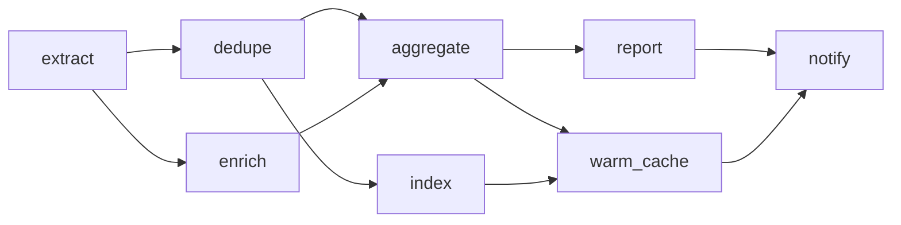
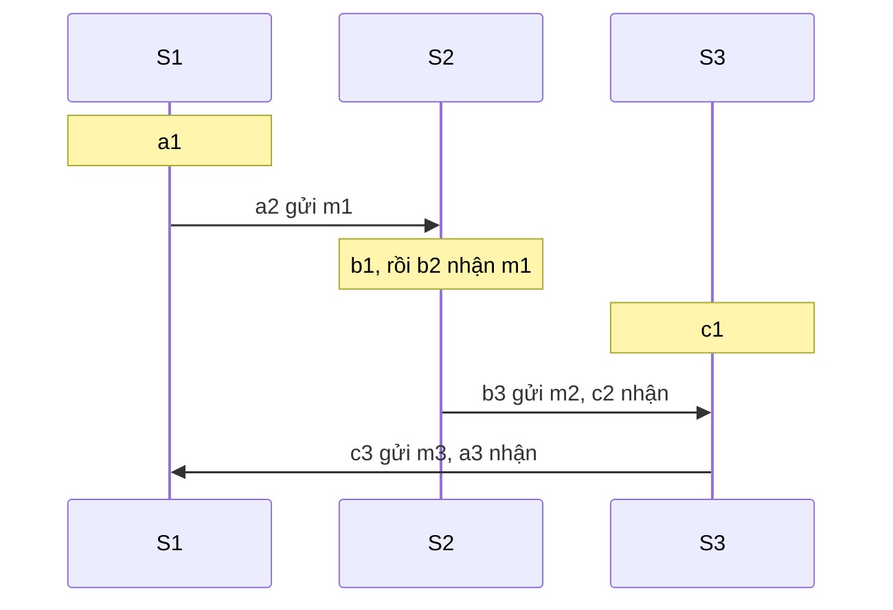
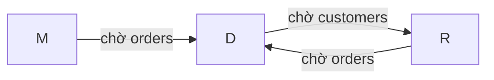

# P14 · Chương 02 — Toán rời rạc: quan hệ, thứ tự bộ phận, lattice, đồ thị

> Phạm vi: đây là chương toán, nên trọng tâm là **chứng minh**. Phát biểu của các định nghĩa và định lý chuẩn có nguồn ở chú thích. Lời chứng minh thì khác: nguồn thường chỉ phát biểu kết quả hoặc để lại làm bài tập, nên chứng minh nào do người soạn tự viết đều gắn nhãn "(chứng minh của người soạn)". Hãy đọc chúng như đọc một pull request: kiểm từng bước. Các chương trình Rust (phụ lục cuối chương và mục "Liên hệ với Rust") đã được chạy thật bằng `rustc 1.95.0` trên macOS arm64; kết quả chúng in ra chỉ là *quan sát* một lần chạy, không thay được chứng minh.

Cả chương bám theo một ví dụ giả định là `jobq`, scheduler job của một đội backend (nhận xét của người soạn: không phải code trong repo). Mục 1 giới thiệu nó. Mỗi khái niệm toán xuất hiện đúng chỗ `jobq` cần: quan hệ "cùng pool" để chia job, quan hệ phụ thuộc để xếp lịch chạy, vector clock để phát hiện hai bản scheduler cùng nhận một job, lattice để các bản scheduler đồng bộ trạng thái mà không cần khóa, và hai loại đồ thị (wait-for, precedence) để bắt deadlock và kiểm tra tính tuần tự hóa.

## Bạn sẽ hiểu được gì

1. **Q1.** Quan hệ hai ngôi là gì; phản xạ, đối xứng, phản đối xứng, bắc cầu nghĩa là gì; vì sao quan hệ tương đương chính là một phân hoạch, và chứng minh điều đó ra sao? → mục 1
2. **Q2.** Thứ tự bộ phận khác thứ tự toàn phần chỗ nào; vì sao mọi DAG hữu hạn xếp topo được, thuật toán bóc đỉnh đúng ở đâu, và đường găng cho biết gì về chạy song song? → mục 2
3. **Q3.** Vì sao happens-before là thứ tự bộ phận chặt, và vì sao so sánh vector clock từng thành phần cho đúng thứ tự đó (chứng minh đầy đủ)? → mục 3
4. **Q4.** Join và join-semilattice là gì; vì sao "giao hoán + kết hợp + lũy đẳng" tương đương với "có cận trên nhỏ nhất", và vì sao phép gộp như vậy làm các replica hội tụ dù tin đến sai thứ tự hay bị lặp? → mục 4
5. **Q5.** Đồ thị có hướng: đường đi, chu trình, DAG, thành phần liên thông mạnh; vì sao DAG và thứ tự bộ phận là hai mặt của một thứ, và các thuật toán chạy trong bao lâu? → mục 5
6. **Q6.** Vì sao chu trình trong wait-for graph đúng là deadlock, phát hiện và chọn nạn nhân ra sao, và vì sao khóa theo thứ tự cố định không bao giờ deadlock? → mục 6
7. **Q7.** Vì sao một lịch chạy tuần tự hóa được theo xung đột khi và chỉ khi precedence graph không có chu trình, và vì sao two-phase locking luôn cho đồ thị không chu trình? → mục 7

## Kiến thức cần trước

- [Chương 01 — Logic và chứng minh](01-logic-va-chung-minh.md): chứng minh phản chứng và quy nạp; chương này dùng cả hai ở hầu hết các bước.
- [P12 · Chương 09, mục 3](../12-he-thong-du-lieu/09-consistency-va-consensus.md): happens-before, Lamport clock, vector clock ở mức mô tả, kèm một ví dụ tính tay. Mục 3 của chương này chứng minh phần chương đó chỉ phát biểu.
- [P12 · Chương 07, mục 6 và 7](../12-he-thong-du-lieu/07-transaction.md): two-phase locking và SSI. Mục 7 chứng minh lý thuyết nằm dưới chúng.
- [P4 · Chương 05](../04-concurrency/05-concurrency-bug-va-deadlock.md): deadlock, lock ordering, detect-and-recover. Mục 6 chứng minh các bảo đảm đó.
- Bạn không cần học toán rời rạc trước; chỉ cần đọc được Rust (phần "Liên hệ với Rust" dùng `PartialOrd`, `Eq`, `Hash`).

Chương này chuẩn bị nền toán cho các chương P15: [CRDT](../15-thuat-toan-phan-tan/04-crdt.md) dùng mục 4, [họ broadcast](../15-thuat-toan-phan-tan/02-ho-broadcast.md) và [phân cấp consistency](../15-thuat-toan-phan-tan/03-phan-cap-consistency.md) dùng thứ tự bộ phận của mục 2 và 3, [giao dịch phân tán](../15-thuat-toan-phan-tan/09-giao-dich-phan-tan.md) dùng mục 6 và 7.

---

## 1. Quan hệ, bốn tính chất, quan hệ tương đương và phân hoạch (Q1)

> **Trả lời ngắn.** Quan hệ hai ngôi trên một tập chính là một đồ thị có hướng mà các đỉnh là phần tử của tập đó[^mcs-digraph-rel]. Bốn tính chất cần nhớ là phản xạ, đối xứng, phản đối xứng và bắc cầu; mỗi tính chất có một "hình dạng" rất rõ trên đồ thị (mục giải thích liệt kê từng cái kèm nguồn). Quan hệ vừa phản xạ, vừa đối xứng, vừa bắc cầu gọi là quan hệ tương đương[^mcs-equiv-def], và nó tương ứng một-một với một cách chia tập thành các khối rời nhau, gọi là phân hoạch[^mcs-equiv-partition].

**Giải thích.**

*Với `jobq`.* `jobq` là scheduler job của một đội backend. Mỗi đêm nó chạy một pipeline 8 job trên một cụm worker, và mỗi job khóa vài bảng database trong lúc chạy (nhận xét của người soạn: ví dụ giả định). Bảng dưới là toàn bộ dữ liệu của ví dụ; ta dùng lại nó đến hết chương.

| Job | Worker pool | Bảng mà job khóa | Phụ thuộc trực tiếp (phải xong trước job này) |
|---|---|---|---|
| `extract` | etl | `orders_raw` | — |
| `dedupe` | etl | `orders_raw`, `orders`, `customers` | `extract` |
| `enrich` | etl | `orders`, `customers` | `extract` |
| `aggregate` | compute | `orders`, `daily` | `dedupe`, `enrich` |
| `index` | compute | `orders`, `customers` | `dedupe` |
| `report` | serve | `daily` | `aggregate` |
| `warm_cache` | serve | `cache` | `aggregate`, `index` |
| `notify` | serve | `outbox` | `report`, `warm_cache` |

Ba cột cuối trả lời ba loại câu hỏi khác nhau: job nào đi chung pool, job nào có thể tranh lock với nhau, job nào phải đợi job nào. Mỗi câu hỏi là một *quan hệ* trên cùng tập 8 job, và chúng có hình dạng toán học rất khác nhau. Mục này gọi tên các hình dạng đó.

### 1.1 Quan hệ là đồ thị có hướng

Quan hệ hai ngôi R trên tập A là một tập các cặp (a, b) với a, b ∈ A; ta viết a R b khi cặp (a, b) thuộc R. Cách hình dung có ích nhất là coi mỗi phần tử của A là một đỉnh và mỗi cặp (a, b) là một cạnh có hướng a → b. Giáo trình MIT 6.042 nói đúng điều này: đồ thị có hướng chỉ là một quan hệ hai ngôi mà miền và đích là cùng một tập đỉnh[^mcs-digraph-rel]. Mọi quan hệ trong chương này đều đọc được theo hai cách, bảng cặp hoặc hình đồ thị, và bốn tính chất dưới đây có hình dạng đồ thị riêng:

- *Phản xạ* (reflexive): a R a với mọi a. Trên đồ thị, mọi đỉnh có một cạnh tự vòng[^mcs-refl].
- *Đối xứng* (symmetric): a R b kéo theo b R a. Cạnh nào cũng có cạnh ngược[^mcs-sym].
- *Phản đối xứng* (antisymmetric): a R b và b R a chỉ xảy ra khi a = b. Hai đỉnh khác nhau có tối đa một chiều, nhưng tự vòng thì vẫn được phép[^mcs-anti].
- *Bắc cầu* (transitive): a R b và b R c kéo theo a R c. Nếu có đường đi độ dài dương từ u tới v thì phải có cạnh trực tiếp u → v[^mcs-trans].

Ta còn cần *không phản xạ* (irreflexive): không đỉnh nào có tự vòng[^mcs-irrefl]. Hai tổ hợp đã có tên sẵn. Quan hệ phản xạ, đối xứng và bắc cầu gọi là quan hệ tương đương[^mcs-equiv-def]. Quan hệ bắc cầu và không phản xạ gọi là thứ tự bộ phận chặt, đề tài của mục 2[^mcs-spo-def].

### 1.2 Bốn quan hệ trên các job của `jobq`

Ta định nghĩa bốn quan hệ trên tập 8 job:

- `same_pool(a, b)`: a và b chạy trên cùng worker pool.
- `shares_table(a, b)`: a và b khóa chung ít nhất một bảng, tức có thể tranh lock.
- `dep(a, b)`: a là phụ thuộc *trực tiếp* của b (cột cuối của bảng): a phải xong trước khi b bắt đầu.
- `before(a, b)`: a phải xong trước b, trực tiếp hoặc qua một chuỗi job trung gian.

| Quan hệ | Phản xạ | Đối xứng | Phản đối xứng | Bắc cầu | Gọi là |
|---|---|---|---|---|---|
| `same_pool` | có | có | không | có | quan hệ tương đương |
| `shares_table` | có | có | không | **không** | (không có tên riêng) |
| `dep` | không | không | có | **không** | (chưa phải thứ tự) |
| `before` | không | không | có | có | thứ tự bộ phận chặt |

Cách kiểm từng ô (tính tay của người soạn từ bảng job). `same_pool` đối xứng và bắc cầu vì "cùng pool" là "cùng giá trị cột pool", nhưng không phản đối xứng: `extract` và `dedupe` cùng pool theo cả hai chiều mà là hai job khác nhau. `shares_table` phản xạ vì job nào cũng khóa ít nhất một bảng; nó không bắc cầu vì `extract` chung `orders_raw` với `dedupe`, `dedupe` chung `orders` với `index`, nhưng `extract` và `index` không chung bảng nào. `dep` không bắc cầu vì `extract` → `dedupe` → `aggregate` mà `extract` không phải phụ thuộc *trực tiếp* của `aggregate`. Còn `before` là bao đóng bắc cầu của `dep`: `a before b` khi có đường đi độ dài dương từ a tới b trên đồ thị `dep`[^mcs-walk]. Bao đóng này bắc cầu (ghép hai đường đi được một đường đi) và là quan hệ bắc cầu nhỏ nhất chứa `dep` (quan hệ bắc cầu nào chứa mọi cạnh thì chứa mọi đường đi độ dài dương, quy nạp theo độ dài; nhận xét của người soạn). Vì pipeline không có vòng, `before` không phản xạ, đó là ý của mục 2.

Sự khác nhau trong bảng quyết định cách dùng. Quan hệ tương đương chia được job thành các khối, nên `same_pool` dùng để gán job vào pool. `shares_table` thì không chia được ngay: nếu A chung bảng với B và B chung bảng với C, ta không kết luận được A chung bảng với C. Mục 1.4 cho cách sửa.

### 1.3 Quan hệ tương đương chính là phân hoạch

Phân hoạch của tập A là một họ các tập con khác rỗng (gọi là khối) sao cho mỗi phần tử của A nằm trong đúng một khối[^mcs-partition-def]. Với quan hệ tương đương ~, *lớp tương đương* của a là [a] = {x ∈ A : a ~ x}. Giáo trình MIT phát biểu rằng các lớp tương đương là các khối của một phân hoạch[^mcs-equiv-partition], nhưng để phần chứng minh làm bài tập[^mcs-equiv-exercise]. Dưới đây là chứng minh đầy đủ cả hai chiều.

**Định lý 1.1.** Cho tập A.
(a) Nếu ~ là quan hệ tương đương trên A thì các lớp tương đương [a] tạo thành một phân hoạch của A.
(b) Ngược lại, với mọi phân hoạch P của A, quan hệ "a và b thuộc cùng một khối của P" là quan hệ tương đương, và các lớp của nó chính là các khối của P.
(c) Hai phép dựng này nghịch đảo nhau: từ ~ lấy phân hoạch các lớp, rồi dựng lại quan hệ "cùng lớp", ta được đúng ~.

**Chứng minh (chứng minh của người soạn).**

(a) Ta cần: mỗi lớp khác rỗng, và mỗi phần tử nằm trong đúng một lớp.

1. a ∈ [a], vì a ~ a (phản xạ). Suy ra mỗi lớp [a] khác rỗng, và mỗi phần tử nằm trong ít nhất một lớp.
2. *Hai lớp có chung một phần tử thì bằng nhau.* Giả sử x ∈ [b] và x ∈ [c], tức b ~ x và c ~ x. Lấy y ∈ [b], tức b ~ y. Từ c ~ x và x ~ b (đối xứng của b ~ x) suy ra c ~ b (bắc cầu). Từ c ~ b và b ~ y suy ra c ~ y (bắc cầu), tức y ∈ [c]. Vậy [b] ⊆ [c]. Đổi vai b và c cho nhau được [c] ⊆ [b].
3. Giả sử a nằm trong một lớp [b] bất kỳ. Bước 2 áp dụng cho phần tử chung a và hai lớp [a], [b] cho [b] = [a]. Vậy a nằm trong đúng một lớp, là [a].

Ba bước cho đúng định nghĩa phân hoạch.

(b) Gọi a ≈ b khi a, b cùng khối của P. Phản xạ: P phủ A nên mỗi a nằm trong một khối, cùng khối với chính nó. Đối xứng: hiển nhiên. Bắc cầu: nếu a ≈ b và b ≈ c thì a, b cùng một khối K₁ và b, c cùng một khối K₂; b nằm trong đúng một khối nên K₁ = K₂, vậy a, c cùng khối. Lớp của a là {x : a ≈ x}, tức khối chứa a; nên các lớp là các khối.

(c) Gọi ≈ là quan hệ "cùng lớp của ~". Nếu a ~ b thì b ∈ [a]; lại có b ∈ [b], nên theo bước 2 của (a) ta có [a] = [b], tức a, b cùng lớp: a ≈ b. Ngược lại, nếu a ≈ b thì a, b cùng một lớp K; theo bước 3 lớp chứa a là [a], nên K = [a] và b ∈ [a], tức a ~ b. Vậy ~ = ≈. ∎

Áp vào `jobq`: `same_pool` chia 8 job thành ba khối `{extract, dedupe, enrich}` (etl), `{aggregate, index}` (compute) và `{report, warm_cache, notify}` (serve). Không còn job nào ngoài các khối, và không job nào nằm trong hai khối (kết quả của người soạn, đọc từ bảng job).

### 1.4 Hai cách tạo quan hệ tương đương trong thực tế

*Cách 1: gán nhãn.* Nếu f là một hàm gán nhãn cho mỗi phần tử, thì "có cùng nhãn" là quan hệ tương đương[^mcs-kernel-def]. Chiều ngược lại cũng đúng: mọi quan hệ tương đương đều là "có cùng nhãn" theo một cách gán nhãn nào đó[^mcs-kernel-label]. Theo Định lý 1.1(c), ta lấy nhãn của a chính là lớp [a]. `same_pool` là "cùng giá trị của hàm pool". Trong sharding, quan hệ "hai key cùng shard" cũng thuộc loại này: `shard(key) = hash(key) % N` là hàm gán nhãn, mỗi shard là một lớp (nhận xét của người soạn; xem [P12 · Chương 06](../12-he-thong-du-lieu/06-partitioning.md)).

*Cách 2: bao đóng tương đương.* `shares_table` không bắc cầu, nhưng ta có thể hỏi "hai job có nối được với nhau qua một dãy job liên tiếp chung bảng không". Quan hệ "nối được" là phản xạ (dãy rỗng), đối xứng (đảo dãy) và bắc cầu (nối hai dãy), nên là quan hệ tương đương. Mỗi lớp của nó là một thành phần liên thông của đồ thị vô hướng "chung bảng", và một lần duyệt DFS từ một đỉnh đi hết đúng thành phần của đỉnh đó[^er-und-comp]. Với `jobq`: `extract`–`dedupe` chung `orders_raw`, `dedupe`–`enrich`, `dedupe`–`aggregate`, `dedupe`–`index` chung `orders`, `aggregate`–`report` chung `daily`; còn `warm_cache` (chỉ khóa `cache`) và `notify` (chỉ khóa `outbox`) không chung bảng với job nào. Vậy có ba "làn" (người soạn tính tay): `{extract, dedupe, enrich, aggregate, index, report}`, `{warm_cache}`, `{notify}`. Job ở hai làn khác nhau không bao giờ khóa cùng một bảng, nên không tranh lock; scheduler có thể xếp mỗi làn độc lập mà không cần phối hợp giữa các làn (suy luận của người soạn).

<details><summary>Đi sâu: đếm bằng vét cạn, phản đối xứng và bất đối xứng, tiền thứ tự</summary>

**Vét cạn trên tập nhỏ (quan sát).** Chương trình ở phụ lục duyệt *mọi* quan hệ trên n phần tử (2^(n²) quan hệ, tới n = 5), đếm quan hệ tương đương, đếm phân hoạch bằng một đường khác (đếm xâu "tăng hạn chế" gán mỗi phần tử vào một khối), và đếm thứ tự bộ phận chặt. Kết quả một lần chạy:

```text
== §1: quan hệ tương đương vs phân hoạch; thứ tự bộ phận chặt (vét cạn) ==
n=1: tương đương=1, phân hoạch=1, thứ tự chặt=1
n=2: tương đương=2, phân hoạch=2, thứ tự chặt=3
n=3: tương đương=5, phân hoạch=5, thứ tự chặt=19
n=4: tương đương=15, phân hoạch=15, thứ tự chặt=219
n=5: tương đương=52, phân hoạch=52, thứ tự chặt=4231
```

Hai cột đầu khớp nhau ở mọi n, đúng như Định lý 1.1 dự đoán (một song ánh giữa hai tập). Đây chỉ là kiểm tra nhỏ, không thay cho chứng minh. Cột cuối cho thấy thứ tự bộ phận chặt nhiều hơn hẳn: mỗi cách xếp "ai trước ai" là một thứ tự khác nhau.

**Phản đối xứng khác bất đối xứng.** Giáo trình MIT gọi quan hệ là *bất đối xứng* (asymmetric) khi a R b kéo theo *không* b R a với mọi a, b kể cả a = b, nên bất đối xứng loại luôn tự vòng. *Phản đối xứng* chỉ cấm hai chiều giữa hai đỉnh khác nhau, nên tự vòng vẫn được phép[^mcs-anti]. Thứ tự bộ phận *yếu* là quan hệ bắc cầu, phản xạ và phản đối xứng[^mcs-wpo-def]; "≤" trên số là ví dụ. Thứ tự bộ phận *chặt* là bắc cầu và không phản xạ[^mcs-spo-def]; "<" là ví dụ. Từ chặt sang yếu: thêm a = b vào quan hệ. Từ yếu sang chặt: bỏ các cặp (a, a).

**Tiền thứ tự (preorder).** Nếu bỏ điều kiện phản đối xứng, chỉ còn phản xạ và bắc cầu, ta có *tiền thứ tự*. Ví dụ quan trọng nhất của chương này là quan hệ "đi được tới" trên một đồ thị *có chu trình*: nó phản xạ, bắc cầu, nhưng hai job nằm trên cùng một chu trình đi được tới nhau theo cả hai chiều. Gộp các phần tử đi được tới nhau lại thành một khối (một quan hệ tương đương!) thì phần còn lại là thứ tự bộ phận thật sự: đó là đồ thị thu gọn các thành phần liên thông mạnh ở mục 5. Cùng cơ chế này xuất hiện ở Rust: `Ord::max` chỉ hành xử đúng khi "bằng nhau" nghĩa là "cùng giá trị"; xem phần Liên hệ với Rust và mục 4.4.

</details>

**Quay lại Q1:** quan hệ là đồ thị có hướng, bốn tính chất là bốn hình dạng của đồ thị đó, và quan hệ phản xạ + đối xứng + bắc cầu chính là một phân hoạch (Định lý 1.1); với `jobq`, `same_pool` chia job thành ba pool, còn `shares_table` chỉ chia được sau khi lấy bao đóng tương đương, ra ba làn.

---

## 2. Thứ tự bộ phận, topological sort và chạy song song (Q2)

> **Trả lời ngắn.** Thứ tự bộ phận chặt là quan hệ bắc cầu và không phản xạ[^mcs-spo-def]; nó là thứ tự *toàn phần* (linear) khi hai phần tử khác nhau nào cũng so sánh được[^mcs-linear]. Quan hệ phụ thuộc của `jobq` là thứ tự bộ phận chứ không toàn phần: `dedupe` và `enrich` không cái nào đứng trước cái nào nên chạy song song được. Mọi DAG hữu hạn đều xếp được thẳng hàng sao cho job nào cũng đứng sau mọi phụ thuộc của nó, gọi là topological sort[^mcs-toposort-thm], và với số worker không giới hạn thì thời gian chạy tối thiểu đúng bằng kích thước đường găng, tức chuỗi phụ thuộc dài nhất[^mcs-parallel-time].

**Giải thích.**

*Với `jobq`.* Người dùng chỉ khai phụ thuộc *trực tiếp* (cột cuối bảng ở mục 1). Scheduler phải trả lời hai câu: chạy job nào trước (một thứ tự chạy hợp lệ), và với W worker thì xong sớm nhất lúc nào (mức độ song song). Cả hai là câu hỏi về thứ tự bộ phận `before` của mục 1.



(Sơ đồ của người soạn: 10 cạnh `dep` của bảng ở mục 1.)

### 2.1 So sánh được, chuỗi và phản chuỗi

Hai job *so sánh được* (comparable) khi job này đi tới được job kia trên đồ thị phụ thuộc[^mcs-comparable]. *Chuỗi* (chain) là tập job đôi một so sánh được[^mcs-chain-def]; *phản chuỗi* (antichain) là tập job đôi một *không* so sánh được[^mcs-antichain]. Trong `jobq`, `extract` → `dedupe` → `aggregate` → `report` → `notify` là một chuỗi 5 job, còn `{dedupe, enrich}` và `{index, report}` là hai phản chuỗi (người soạn kiểm tay trên sơ đồ). Phản chuỗi là các job không ràng buộc nhau, nên đúng là các job có thể chạy cùng lúc.

Thứ tự bộ phận *toàn phần* (linear order) là thứ tự bộ phận trong đó hai phần tử khác nhau nào cũng so sánh được[^mcs-linear]. Phép "≤" trên số nguyên là toàn phần; `before` trên 8 job thì không, vì `dedupe` và `enrich` không so sánh được. Tích của hai thứ tự bộ phận vẫn là thứ tự bộ phận[^mcs-product-order], nhưng tích của hai thứ tự toàn phần thì không còn toàn phần[^mcs-product-nonlinear]. Ví dụ, (1, 0) và (0, 1) trong tích ℕ × ℕ không so sánh được. Mục 3 dùng đúng ví dụ này cho vector clock.

### 2.2 Mọi DAG hữu hạn xếp topo được

Topological sort của một DAG hữu hạn là một danh sách mọi đỉnh sao cho mỗi đỉnh v đứng trước mọi đỉnh khác mà v đi tới được[^mcs-toposort-def]. Với `jobq`, đó là một thứ tự chạy tuần tự (một worker) tôn trọng mọi phụ thuộc. Giáo trình MIT mô tả cách dựng: cứ lấy một phần tử tối tiểu rồi bỏ nó đi[^mcs-toposort-minimal]. Ta chứng minh cách dựng ấy đúng, từ hai bổ đề nhỏ.

**Bổ đề 2.1 (đi ngược tìm chu trình).** Trong một đồ thị có hướng hữu hạn, nếu mọi đỉnh đều có ít nhất một cạnh *vào* thì đồ thị có chu trình. (Đối xứng: nếu mọi đỉnh có ít nhất một cạnh *ra* thì cũng có chu trình.)

**Chứng minh (chứng minh của người soạn).** Đồ thị có n đỉnh. Lấy một đỉnh v₀. Vì v₀ có cạnh vào, chọn v₁ sao cho có cạnh v₁ → v₀; vì v₁ có cạnh vào, chọn v₂ → v₁, và cứ thế. Trong n + 1 đỉnh v₀, …, v_n phải có hai đỉnh trùng nhau (nguyên lý chuồng bồ câu). Gọi j là chỉ số nhỏ nhất sao cho v_j trùng một đỉnh đứng trước, và i < j là chỉ số đó: v_i = v_j. Theo cách chọn j, các đỉnh v_i, …, v_{j−1} đôi một khác nhau. Đi theo chiều cạnh v_j → v_{j−1} → … → v_i = v_j, ta được một đường đi đóng có độ dài j − i ≥ 1 mà các đỉnh khác nhau trừ đỉnh đầu trùng đỉnh cuối. Đó đúng là định nghĩa chu trình[^mcs-cycle-def] (nếu j − i = 1 thì đó là một tự vòng, cũng được tính là chu trình độ dài 1). Chứng minh phần "cạnh ra" làm y hệt, đi theo chiều cạnh thay vì đi ngược. ∎

**Bổ đề 2.2 (phần tử tối tiểu).** Mọi thứ tự bộ phận chặt ≺ trên một tập hữu hạn khác rỗng đều có ít nhất một phần tử tối tiểu, tức phần tử không có phần tử nào đứng trước nó[^mcs-minimal-def].

**Chứng minh (chứng minh của người soạn).** Phản chứng: giả sử mọi phần tử đều có một phần tử đứng trước. Vẽ ≺ thành đồ thị (cạnh a → b khi a ≺ b); khi đó mọi đỉnh có cạnh vào, nên theo Bổ đề 2.1 có chu trình a₀ → a₁ → … → a_k = a₀ với k ≥ 1. Áp dụng bắc cầu k − 1 lần liên tiếp cho a₀ ≺ a₁, a₁ ≺ a₂, …, a_{k−1} ≺ a_k, ta được a₀ ≺ a_k = a₀, tức a₀ ≺ a₀, trái với tính không phản xạ. ∎

**Định lý 2.3.** Mọi thứ tự bộ phận chặt hữu hạn (tương đương: mọi DAG hữu hạn[^mcs-spo-dag]) có một topological sort[^mcs-toposort-thm].

**Chứng minh (chứng minh của người soạn, theo cách dựng của giáo trình).** Quy nạp theo số phần tử n. Với n = 0, danh sách rỗng là một topological sort. Giả sử đúng cho mọi tập có n − 1 phần tử và xét tập A có n ≥ 1 phần tử.

1. Theo Bổ đề 2.2, chọn m là một phần tử tối tiểu của A.
2. Quan hệ ≺ giới hạn lên A \ {m} vẫn bắc cầu và không phản xạ (hai tính chất này chỉ nói về những phần tử có mặt), nên là thứ tự bộ phận chặt trên n − 1 phần tử. Theo giả thiết quy nạp nó có một topological sort L′.
3. Đặt L = m, L′ (m đứng đầu). Lấy một cặp a ≺ b bất kỳ. Nếu b = m thì a ≺ m, trái với m tối tiểu; vậy b ≠ m. Nếu a = m thì a đứng đầu danh sách nên đứng trước b. Nếu cả hai khác m thì L′ đã xếp a trước b. Vậy L là topological sort của A. ∎

(Một danh sách là topological sort của đồ thị phụ thuộc *trực tiếp* khi và chỉ khi nó là topological sort của `before`: mỗi cạnh trực tiếp cũng là một cặp của `before`, và một cặp của `before` là chuỗi các cạnh, mỗi cạnh giữ thứ tự nên cả chuỗi giữ thứ tự.)

**Thuật toán bóc đỉnh.** Chứng minh trên cho một thuật toán chạy được ngay, thứ tự trong đó chính là cách người ta dựng topological sort khi chạy `jobq`:

1. Với mỗi job v, đặt `chờ[v]` bằng số phụ thuộc trực tiếp của v (số cạnh vào v).
2. Cho mọi job có `chờ = 0` vào một hàng đợi Q.
3. Lặp tới khi Q rỗng: lấy một job v khỏi Q và xuất nó; với mỗi job w có v là phụ thuộc trực tiếp, giảm `chờ[w]` đi 1, và nếu về 0 thì cho w vào Q.

**Mệnh đề 2.4 (chứng minh của người soạn).** (i) Dãy xuất ra tôn trọng mọi phụ thuộc. (ii) Nếu thuật toán dừng mà còn một tập S ≠ ∅ job chưa được xuất, thì đồ thị phụ thuộc có chu trình nằm trong S; ngược lại, nếu đồ thị có chu trình thì thuật toán không bao giờ xuất hết. (iii) Thời gian chạy là O(V + E).

*Chứng minh.* (i) `chờ[v]` luôn bằng số cạnh vào v xuất phát từ các job *chưa* xuất. Job chỉ vào Q khi con số đó về 0, tức mọi phụ thuộc trực tiếp của nó đã được xuất; và nó chỉ được xuất sau khi vào Q. Vậy mỗi cạnh u → v có u xuất trước v, và theo chuỗi cạnh thì mọi cặp của `before` đều đúng.

(ii) Giả sử Q rỗng và S ≠ ∅ chưa xuất. Mỗi v ∈ S có `chờ[v] > 0` (nếu bằng 0 nó đã vào Q rồi được xuất). Nghĩa là v có ít nhất một cạnh vào từ một job chưa xuất, tức từ một job của S. Trong đồ thị con trên S, mọi đỉnh có cạnh vào, nên theo Bổ đề 2.1 có chu trình. Chiều ngược lại: giả sử đồ thị có chu trình C và có một đỉnh của C được xuất; xét đỉnh của C được xuất *đầu tiên*, gọi là c. Đỉnh đứng trước c trên C có cạnh tới c và chưa xuất, nên `chờ[c] > 0` tại mọi thời điểm trước đó, và c không thể vào Q: mâu thuẫn. Vậy không đỉnh nào của C được xuất.

(iii) Mỗi đỉnh vào và ra Q đúng một lần: O(V). Mỗi cạnh u → w bị xét đúng một lần, lúc u được xuất: O(E). ∎

Hệ quả thực dụng cho `jobq`: khi người dùng nộp một pipeline, scheduler chạy bóc đỉnh; nếu còn job kẹt thì từ tập kẹt đi ngược theo cạnh vào (đúng cách chứng minh Bổ đề 2.1) sẽ ra một chu trình cụ thể để báo lỗi. Chương trình ở phụ lục làm cả hai việc, và tính luôn độ sâu cùng thời điểm xong sớm nhất của mục 2.3. Kết quả một lần chạy (quan sát, nguyên văn từ chương trình): dòng đầu là thứ tự bóc đỉnh trên pipeline gốc, năm dòng "vòng" và dòng "đường găng" dùng ở mục 2.3, dòng cuối là chạy lại sau khi thêm cạnh sai `aggregate → dedupe`.

```text
== §2: topo sort cho jobq ==
bóc đỉnh: ["extract", "dedupe", "enrich", "index", "aggregate", "report", "warm_cache", "notify"] (kẹt: [])
vòng 0: ["extract"]
vòng 1: ["dedupe", "enrich"]
vòng 2: ["aggregate", "index"]
vòng 3: ["report", "warm_cache"]
vòng 4: ["notify"]
đường găng: ["extract", "enrich", "aggregate", "warm_cache", "notify"], tổng 37 phút
thêm aggregate->dedupe: xếp được ["extract", "enrich"]; kẹt ["dedupe", "aggregate", "index", "report", "warm_cache", "notify"]; chu trình tìm được ["aggregate", "dedupe"]
```

Sau khi thêm cạnh sai, chỉ `extract` và `enrich` xếp được. Sáu job còn lại kẹt, và thuật toán tìm ra đúng chu trình `aggregate → dedupe → aggregate`. Lưu ý tập kẹt gồm cả `index`, `report`, `warm_cache`, `notify`: chúng không nằm trên chu trình mà kẹt theo, vì phụ thuộc vào job trên chu trình (suy ra từ Mệnh đề 2.4(ii): tập kẹt chứa chu trình chứ không *bằng* chu trình).

### 2.3 Chạy song song: độ sâu, đường găng, số worker

Giả sử mỗi job mất một đơn vị thời gian và có đủ worker. *Độ sâu* của một job là số job đứng trước nó trên chuỗi dài nhất kết thúc ở nó; job không có phụ thuộc có độ sâu 0[^mcs-depth]. Chuỗi dài nhất còn gọi là *đường găng* (critical path)[^mcs-critical]. Cách xếp "tham lam" là cho mọi job độ sâu k chạy ở bước k[^mcs-greedy].

**Định lý 2.5.** Gọi t là số job trên chuỗi dài nhất. (a) Mọi lịch hợp lệ cần ít nhất t bước. (b) Xếp mọi job độ sâu k vào bước k cho một lịch hợp lệ dài đúng t bước, trong đó mỗi bước là một phản chuỗi. Vậy với số worker không giới hạn, thời gian song song bằng kích thước đường găng[^mcs-parallel-time].

**Chứng minh (chứng minh của người soạn; giáo trình để phần kiểm tra bước (b) làm bài tập).** (a) Hai job liền nhau trên một chuỗi không thể cùng bước, vì job sau chỉ bắt đầu khi job trước xong[^mcs-chain-lowerbound]. Chuỗi t job vậy cần t bước phân biệt. (b) Nếu a ≺ b thì chuỗi dài nhất kết thúc ở a, nối thêm b, là một chuỗi kết thúc ở b, nên độ sâu(b) ≥ độ sâu(a) + 1. Vậy a nằm ở bước nhỏ hơn b: lịch hợp lệ. Hai job cùng độ sâu thì không so sánh được (vì a ≺ b làm độ sâu khác nhau), nên mỗi bước là một phản chuỗi. Độ sâu lớn nhất là t − 1 (chuỗi dài nhất kết thúc ở một job có độ sâu t − 1), nên có đúng t bước. ∎

Với `jobq`: độ sâu của `extract` là 0; `dedupe` và `enrich` là 1; `aggregate` và `index` là 2; `report` và `warm_cache` là 3; `notify` là 4. Vậy tối thiểu 5 bước, và bước nào cũng có nhiều nhất 2 job, nên 2 worker đã đạt mức 5 bước (tính tay, khớp các dòng "vòng" ở mục 2.2). Với 1 worker thì mất 8 bước. Với W worker hữu hạn, bài toán phức tạp hơn nhiều[^mcs-bounded]; cận dưới hiển nhiên (suy luận của người soạn) là max(t, ⌈số job / W⌉).

Thực tế job có thời lượng khác nhau. Lập luận (a) không đổi, chỉ thay "số job" bằng "tổng thời lượng trên chuỗi": không lịch nào xong trước tổng thời lượng của bất kỳ chuỗi nào. Thời điểm xong sớm nhất tính bằng công thức xong(v) = thời lượng(v) + max xong(u) với u chạy trên mọi phụ thuộc trực tiếp của v, và công thức này chỉ tính được khi mọi phụ thuộc đã có giá trị, tức phải đi theo một topological sort. Với thời lượng giả định (phút) `extract` 10, `dedupe` 5, `enrich` 8, `aggregate` 12, `index` 4, `report` 3, `warm_cache` 6, `notify` 1 (số của người soạn), dòng "đường găng" trong kết quả ở mục 2.2 cho: `extract` → `enrich` → `aggregate` → `warm_cache` → `notify`, cộng 10 + 8 + 12 + 6 + 1 = 37 phút. Muốn pipeline xong sớm hơn thì phải rút ngắn đúng các job trên đường này; tối ưu `index` (4 phút, nằm ngoài đường găng) không đổi tổng thời gian (suy luận của người soạn).

### 2.4 Topological sort không duy nhất, và Lamport clock

Danh sách bóc đỉnh ở trên đặt `dedupe` trước `enrich`; đảo hai job này vẫn hợp lệ. Mỗi lựa chọn như vậy là một cách "phá hòa" giữa hai job không so sánh được. Điều này khớp nhận xét của Lamport về sự kiện: có thể mở rộng thứ tự bộ phận thành thứ tự toàn phần theo nhiều cách, và chỉ thứ tự bộ phận mới do chính hệ thống sự kiện quy định duy nhất[^lam-unique-partial]. Bài giảng Cambridge nói cụ thể: thứ tự toàn phần theo cặp (timestamp Lamport, tên node) là một *linear extension* của happens-before[^kl-linear-ext], và nó phá hòa bằng cách so tên node khi timestamp bằng nhau[^kl-lex-tiebreak]. Nói bằng ngôn ngữ của mục này, đó là một topological sort của đồ thị sự kiện (suy luận của người soạn).

<details><summary>Đi sâu: bổ đề Dilworth, đồ thị phụ thuộc cô đọng nhất</summary>

**Bổ đề Dilworth (dạng yếu).** Với mọi t > 0, mọi DAG n đỉnh đều có chuỗi gồm hơn t đỉnh, hoặc phản chuỗi gồm ít nhất n/t đỉnh[^mcs-dilworth].

*Chứng minh (chứng minh của người soạn, theo ý giáo trình).* Giả sử không có chuỗi nào dài hơn t. Theo Định lý 2.5(b), các đỉnh chia được thành tối đa t lớp độ sâu, mỗi lớp là một phản chuỗi. n đỉnh nằm trong tối đa t lớp nên có một lớp chứa ít nhất n/t đỉnh (nguyên lý chuồng bồ câu). ∎

Ý nghĩa cho `jobq`: pipeline nông thì song song rộng, pipeline sâu thì có "sàn" độ trễ. Một pipeline 100 job mà chuỗi dài nhất chỉ có 10 job chắc chắn chứa một nhóm ít nhất 10 job độc lập có thể chạy cùng lúc; ngược lại pipeline 100 job xếp thành một chuỗi duy nhất không có chỗ nào để song song hóa.

**Đồ thị phụ thuộc cô đọng nhất.** Một thứ tự bộ phận chặt có thể là bao đóng bắc cầu của nhiều đồ thị khác nhau. Với thứ tự hữu hạn, đồ thị ít cạnh nhất sinh ra nó là duy nhất và dễ tìm[^mcs-hasse]. Với `jobq`: nếu người dùng khai thêm `extract → aggregate` thì cạnh này thừa, vì `extract → dedupe → aggregate` đã ép cùng thứ tự (suy luận của người soạn). Scheduler có thể gỡ cạnh thừa trước khi hiển thị DAG cho người dùng; đồ thị còn lại vẽ ra chính là "sơ đồ Hasse" của thứ tự.

</details>

**Quay lại Q2:** thứ tự bộ phận cho phép job độc lập (phản chuỗi), thứ tự toàn phần thì không; mọi DAG hữu hạn xếp topo được vì luôn có một đỉnh để bóc (Bổ đề 2.1, 2.2, Định lý 2.3), và với `jobq` đường găng 37 phút là sàn của cả pipeline dù có bao nhiêu worker.

---

## 3. Happens-before là thứ tự bộ phận chặt, và vector clock (Q3)

> **Trả lời ngắn.** Happens-before (→) là quan hệ *nhỏ nhất* thỏa ba điều: sự kiện đứng trước trong cùng một process thì xảy ra trước, gửi một tin xảy ra trước nhận chính tin đó, và bắc cầu[^lam-def]. Lamport giả định không sự kiện nào xảy ra trước chính nó, nên → là thứ tự bộ phận chặt[^lam-irrefl], và hai sự kiện không có chiều nào là *đồng thời*[^lam-concurrent]. Vector clock gán cho mỗi sự kiện một vector đếm; so sánh vector từng thành phần cho đúng thứ tự →[^kl-vc-corresp]. Mục này chứng minh cả hai điều.

**Giải thích.**

*Với `jobq`.* Để chịu lỗi, `jobq` chạy ba bản scheduler S1, S2, S3, mỗi bản nhận job từ hàng đợi chung rồi nhắn cho các bản kia biết mình đã nhận gì. Nếu S1 và S2 cùng nhận `dedupe` mà chưa bản nào nghe tin của bản kia thì job chạy hai lần. Muốn phát hiện, ta cần biết việc nhận của S1 có xảy ra trước việc nhận của S2 hay không, mà không tin vào đồng hồ vật lý ([P12 · Chương 09, mục 3.1](../12-he-thong-du-lieu/09-consistency-va-consensus.md) giải thích vì sao). Câu trả lời là quan hệ happens-before, và vector clock là cách tính nó.

### 3.1 Mô hình, định nghĩa và một vết chạy

Mỗi *sự kiện* xảy ra ở đúng một process (một node). Ta giả định các sự kiện của cùng một node có thứ tự toàn phần chặt, cái nào trước cái nào[^kl-hb-orders]; một process nhiều thread thì coi mỗi thread là một node[^kl-threads]. Mỗi tin được gửi và nhận đúng một lần theo cặp (gửi, nhận), và ta loại trừ du hành thời gian: không thể nhận một tin chưa gửi[^kl-no-timetravel]. Định nghĩa của Lamport: → là quan hệ nhỏ nhất trên tập sự kiện thỏa (1) a, b cùng process và a đứng trước b thì a → b; (2) a là gửi một tin, b là nhận chính tin đó thì a → b; (3) a → b và b → c thì a → c[^lam-def]. Hai sự kiện khác nhau mà a ↛ b và b ↛ a gọi là đồng thời[^lam-concurrent]. Kết quả là một thứ tự bộ phận: có những cặp sự kiện mà cái nào cũng không xảy ra trước cái kia[^kl-hb-partial]. Bài giảng Cambridge nhắc rằng "đồng thời" không có nghĩa "cùng lúc theo đồng hồ", mà là hai sự kiện độc lập vì không có chuỗi tin nào nối từ sự kiện này sang sự kiện kia[^kl-concurrent].

*Cách nhìn đồ thị (nhận xét của người soạn).* Gọi G là đồ thị trên tập sự kiện với hai loại cạnh: từ mỗi sự kiện tới sự kiện *liền sau* nó ở cùng process, và từ mỗi sự kiện gửi tới sự kiện nhận tương ứng. Điều kiện (1) cho cặp không liền kề được suy từ các cạnh liền kề qua điều kiện (3), nên a → b khi và chỉ khi G có đường đi độ dài dương từ a tới b, tức → là quan hệ đi-được-tới độ dài dương của G[^mcs-walk]. Ký hiệu a ⪯ b là "a = b hoặc a → b".

*Vết chạy.* Chín sự kiện của ba scheduler (ví dụ giả định của người soạn):

| Sự kiện | Process | Việc xảy ra |
|---|---|---|
| a1 | S1 | nhận job `dedupe` (cục bộ) |
| a2 | S1 | gửi m1 "S1 đã nhận `dedupe`" tới S2 |
| a3 | S1 | nhận m3 từ S3 |
| b1 | S2 | nhận job `dedupe` (cục bộ, *trước khi* nghe m1) |
| b2 | S2 | nhận m1 |
| b3 | S2 | gửi m2 tới S3 |
| c1 | S3 | nhận job `index` (cục bộ) |
| c2 | S3 | nhận m2 |
| c3 | S3 | gửi m3 tới S1 |



(Sơ đồ của người soạn, gom các sự kiện cục bộ vào ghi chú; thứ tự trong từng process là a1, a2, a3 / b1, b2, b3 / c1, c2, c3.)

Các quan hệ → trực tiếp: a1 → a2 → a3, b1 → b2 → b3, c1 → c2 → c3 (cùng process), a2 → b2, b3 → c2, c3 → a3 (tin). Hai sự kiện nhận `dedupe` a1 và b1 không nối được bằng chuỗi cạnh nào, nên đồng thời: đó chính là nguy cơ job chạy hai lần.

### 3.2 → là thứ tự bộ phận chặt

Lamport viết rằng một hệ mà sự kiện có thể xảy ra trước chính nó dường như không có ý nghĩa vật lý, và vì thế → là thứ tự bộ phận không phản xạ trên tập sự kiện[^lam-irrefl]. Bài tập của bài giảng Cambridge yêu cầu *chứng minh* điều đó, với gợi ý dùng nguyên lý vật lý rằng thông tin không đi nhanh hơn ánh sáng và hai node cách nhau một khoảng khác 0[^kl-ex8-hint]. Dưới đây là chứng minh.

**Mệnh đề 3.1.** → là thứ tự bộ phận chặt, tức bắc cầu và không phản xạ[^kl-ex8].

**Chứng minh (chứng minh của người soạn).** Bắc cầu là điều kiện (3) của định nghĩa. Phần còn lại là không phản xạ. Giả sử mỗi sự kiện e xảy ra tại một thời điểm vật lý τ(e), là một số thực, với hai tiền đề: (P1) trong cùng một process, sự kiện đứng trước có τ nhỏ hơn; (P2) gửi một tin xảy ra *trước* nhận tin đó theo thời gian vật lý, τ(gửi) < τ(nhận) (đó là nội dung nguyên lý vật lý nêu trên). Đặt R = {(a, b) : τ(a) < τ(b)}. R thỏa cả ba điều kiện của định nghĩa →: điều kiện (1) theo P1, điều kiện (2) theo P2, điều kiện (3) vì "<" trên số thực bắc cầu. Vì → là quan hệ *nhỏ nhất* thỏa ba điều kiện đó[^lam-def], ta có → ⊆ R. Nhưng R không phản xạ (τ(a) < τ(a) là sai), nên → cũng không phản xạ. ∎

**Hệ quả 3.2.** → bất đối xứng: a → b và b → a cho a → a theo bắc cầu, mâu thuẫn. Vậy với hai sự kiện khác nhau a, b, đúng một trong ba điều xảy ra: a → b, b → a, hoặc a và b đồng thời[^kl-ex9] (nhiều nhất một vì bất đối xứng, ít nhất một vì định nghĩa "đồng thời").

*Nhận xét (của người soạn).* Chứng minh dùng thời gian vật lý *chỉ để chứng minh tính chất*; thuật toán không cần đồng hồ. Dùng ngược lại, nếu bạn dựng đồ thị G từ log của `jobq` mà tìm thấy chu trình, thì log sai (đồng hồ ghi nhật ký lệch, hoặc nhận tin trước khi gửi); đó là một phép kiểm tra tính nhất quán của vết rất rẻ nhờ mục 5.

### 3.3 Vector clock và thứ tự từng thành phần

Mỗi process i giữ một vector T gồm n số nguyên không âm (một ô cho mỗi process), ban đầu toàn 0. Khi có sự kiện cục bộ hoặc gửi tin tại i, process tăng T[i] lên 1, đóng dấu sự kiện bằng T, và gắn T vào tin. Khi nhận tin mang vector M, process lấy T := max(T, M) theo từng thành phần rồi tăng T[i] lên 1[^kl-vc-alg]. Với vết ở mục 3.1 (n = 3, thứ tự thành phần là S1, S2, S3), ta được:

| Sự kiện | Cách tính | Vector V |
|---|---|---|
| a1 | cục bộ | ⟨1, 0, 0⟩ |
| a2 | gửi | ⟨2, 0, 0⟩ |
| b1 | cục bộ | ⟨0, 1, 0⟩ |
| b2 | nhận m1: max(⟨0,1,0⟩, ⟨2,0,0⟩) = ⟨2,1,0⟩, rồi tăng ô S2 | ⟨2, 2, 0⟩ |
| b3 | gửi | ⟨2, 3, 0⟩ |
| c1 | cục bộ | ⟨0, 0, 1⟩ |
| c2 | nhận m2: max(⟨0,0,1⟩, ⟨2,3,0⟩) = ⟨2,3,1⟩, rồi tăng ô S3 | ⟨2, 3, 2⟩ |
| c3 | gửi | ⟨2, 3, 3⟩ |
| a3 | nhận m3: max(⟨2,0,0⟩, ⟨2,3,3⟩) = ⟨2,3,3⟩, rồi tăng ô S1 | ⟨3, 3, 3⟩ |

(Người soạn tính tay theo thuật toán trên.) Thứ tự trên vector: T ≤ T′ khi mọi thành phần của T nhỏ hơn hoặc bằng thành phần tương ứng của T′[^kl-vc-order]; T < T′ khi T ≤ T′ và T ≠ T′; hai vector không so sánh được khi mỗi bên có một thành phần lớn hơn bên kia[^kl-vc-incomp]. Hai điểm trên bảng: ⟨1,0,0⟩ (a1) và ⟨0,1,0⟩ (b1) không so sánh được, đúng như a1 ∥ b1; còn ⟨2,0,0⟩ < ⟨2,2,0⟩ cho a2 → b2, đúng như tin m1.

**Mệnh đề 3.3.** (ℕⁿ, ≤ từng thành phần) là thứ tự bộ phận yếu, và không toàn phần khi n ≥ 2.

*Chứng minh (chứng minh của người soạn).* Phản xạ: T[i] ≤ T[i]. Phản đối xứng: T ≤ T′ và T′ ≤ T cho T[i] = T′[i] với mọi i, tức T = T′. Bắc cầu: "≤" trên số tự nhiên bắc cầu ở từng thành phần. (Đó là trường hợp riêng của việc tích các thứ tự bộ phận vẫn là thứ tự bộ phận[^mcs-product-order].) Không toàn phần: ⟨1,0⟩ và ⟨0,1⟩ không so sánh được. ∎

### 3.4 Định lý: a → b khi và chỉ khi V(a) < V(b)

Bài giảng Cambridge nói vector timestamp của sự kiện e biểu diễn một tập sự kiện, gồm e và các phụ thuộc nhân quả của nó[^kl-vc-set], và thứ tự của chúng khớp đúng với happens-before[^kl-vc-corresp]. Dưới đây là chứng minh đầy đủ. Ký hiệu: C(e) = {x : x ⪯ e} là *quá khứ nhân quả* của e; E_j là tập sự kiện của process j; V(e) là vector đóng dấu cho e; với sự kiện e không phải nhận tin ở process i, p là sự kiện liền trước e ở i (hoặc không có), và với sự kiện nhận tin, s là sự kiện gửi tương ứng.

**Bổ đề 3.4 (tiền tố).** Với mọi sự kiện x và process j, tập C(x) ∩ E_j là một *tiền tố* của dãy sự kiện của process j: nếu y thuộc tập và z đứng trước y ở process j thì z thuộc tập. Do đó C(x) ∩ E_j được xác định hoàn toàn bởi kích thước của nó.

*Chứng minh (chứng minh của người soạn).* z đứng trước y ở cùng process nên z → y (điều kiện 1). Vì y ⪯ x, ta được z → x (bắc cầu, hoặc trực tiếp nếu y = x), tức z ∈ C(x). ∎

**Bổ đề 3.5 (vector đếm quá khứ nhân quả).** Với mọi sự kiện e và process j: V(e)[j] = |C(e) ∩ E_j|.

*Chứng minh (chứng minh của người soạn).* Đồ thị G không có chu trình (vì → không phản xạ, Mệnh đề 3.1), nên theo Định lý 2.3 có một topological sort của G; duyệt các sự kiện theo thứ tự đó thì mỗi sự kiện đứng sau sự kiện liền trước nó ở cùng process và, nếu là nhận tin, đứng sau sự kiện gửi tương ứng. Ta quy nạp theo thứ tự đó (quy ước V(không có) = 0 và C(không có) = ∅).

Trước hết, một sự kiện x ≠ e có x → e khi và chỉ khi G có đường đi độ dài dương từ x tới e[^mcs-walk], mà cạnh cuối của đường đi đó là cạnh từ p hoặc từ s. Vậy C(e) = {e} ∪ C(p) nếu e không phải nhận tin, và C(e) = {e} ∪ C(p) ∪ C(s) nếu e là nhận tin. Ngoài ra e không thuộc C(p) ∪ C(s): nếu e ⪯ p thì kết hợp với p → e ta có e → e (và tương tự với s), trái với Mệnh đề 3.1.

*e không phải nhận tin, ở process i.* V(e) = V(p) + 1 ở ô i. Với j ≠ i: e ∉ E_j nên C(e) ∩ E_j = C(p) ∩ E_j, và V(e)[j] = V(p)[j] bằng |C(p) ∩ E_j| theo giả thiết quy nạp. Với j = i: C(e) ∩ E_i = (C(p) ∩ E_i) ∪ {e} và e ∉ C(p), nên kích thước tăng đúng 1, khớp V(e)[i] = V(p)[i] + 1.

*e là nhận tin, ở process i.* V(e) = max(V(p), V(s)) rồi tăng ô i thêm 1. Theo Bổ đề 3.4, C(p) ∩ E_j và C(s) ∩ E_j đều là tiền tố của cùng một dãy, nên hợp của chúng là tiền tố dài hơn, kích thước bằng max(|C(p) ∩ E_j|, |C(s) ∩ E_j|) = max(V(p)[j], V(s)[j]) theo giả thiết quy nạp. Với j ≠ i, đó đúng là |C(e) ∩ E_j|. Với j = i, ta thêm chính e (không thuộc hợp trên) nên kích thước tăng 1, khớp bước "tăng ô i". ∎

**Định lý 3.6.** Với hai sự kiện khác nhau a, b: a → b ⟺ V(a) < V(b). Ngoài ra V(a) = V(b) chỉ khi a = b, và a, b đồng thời ⟺ V(a), V(b) không so sánh được.

*Chứng minh (chứng minh của người soạn).*

(⇒) Giả sử a → b. Với mọi x ⪯ a ta có x ⪯ b (bắc cầu), nên C(a) ⊆ C(b); theo Bổ đề 3.5 đếm từng process ta được V(a) ≤ V(b). Hơn nữa b ∈ C(b) nhưng b ∉ C(a): nếu b ∈ C(a) thì b = a (khi đó a → a, vô lý) hoặc b → a (khi đó a → b → a cho a → a, vô lý). Vậy C(a) ≠ C(b). Theo Bổ đề 3.4, mỗi tập C(·) được xác định bởi các kích thước C(·) ∩ E_j, tức bởi V(·); nên C(a) ≠ C(b) kéo theo V(a) ≠ V(b). Vậy V(a) < V(b).

(⇐) Giả sử V(a) < V(b). Gọi i là process của a và k là vị trí của a trong dãy sự kiện của i (a là sự kiện thứ k). Tập C(a) ∩ E_i chứa k sự kiện đầu của i (đều ⪯ a) và không chứa sự kiện nào sau a (nếu y sau a thuộc C(a) thì a → y ⪯ a cho a → a). Vậy theo Bổ đề 3.5, V(a)[i] = k. Từ V(a) ≤ V(b) ta có V(b)[i] ≥ k, tức |C(b) ∩ E_i| ≥ k. Tập này là tiền tố của dãy sự kiện i (Bổ đề 3.4) nên chứa k sự kiện đầu, trong đó có a. Vậy a ⪯ b. Vì V(a) ≠ V(b) nên a ≠ b, do đó a → b.

Phần còn lại. Nếu V(a) = V(b) thì C(a) = C(b) (Bổ đề 3.4), nên a ∈ C(b): a = b hoặc a → b; trường hợp a → b cho b ∉ C(a) = C(b), vô lý vì b ∈ C(b). Vậy a = b. Hai sự kiện khác nhau đồng thời khi cả a → b lẫn b → a đều sai; theo phần (⇒), (⇐) điều đó tương đương với cả V(a) < V(b) lẫn V(b) < V(a) đều sai, mà V(a) ≠ V(b), nên V(a), V(b) không so sánh được; chiều ngược lại hoàn toàn tương tự. ∎

Áp vào vết ở mục 3.3: b1 = ⟨0,1,0⟩ và c1 = ⟨0,0,1⟩ không so sánh được nên b1 ∥ c1; còn a1 = ⟨1,0,0⟩ < c2 = ⟨2,3,2⟩ nên a1 → c2, thật vậy a1 → a2 → b2 → b3 → c2. Với `jobq`, đây là cơ sở để phát hiện đồng thời: nếu S2 nhận `dedupe` *sau* khi nghe m1 thì vector của sự kiện nhận ở S2 lớn hơn ⟨1,0,0⟩ và S2 biết ngay S1 đã nhận trước; nếu hai vector không so sánh được như a1, b1 thì hai nhận đồng thời và phải có cách phân xử (khóa, lease, hay lấy số lớn hơn theo thứ tự toàn phần phá hòa).

<details><summary>Đi sâu: chi phí, thí nghiệm có sẵn, data race là gì dưới góc nhìn này</summary>

- *Chi phí.* Vector có n ô, n là số process (hoặc thread, hay client) tham gia, nên kích thước tăng theo n. [P12 · Chương 05, mục 8](../12-he-thong-du-lieu/05-replication.md) bàn cách các hệ như Dynamo cắt tỉa và chi phí của việc đó; chương này không lặp lại.
- *Thí nghiệm có sẵn.* Lab (e) trong [lab dữ liệu phân tán](../labs/12b-du-lieu-phan-tan-lab.md) dựng ground truth của happens-before từ thứ tự trong process và cạnh gửi→nhận rồi đối chiếu với vector clock trên nhiều execution ngẫu nhiên. Đó là kiểm tra thực nghiệm cho Định lý 3.6; chứng minh ở trên là lý do kiểm tra không thể tìm ra phản ví dụ.
- *Data race nhìn như thế nào (nhận xét của người soạn).* Trong một process nhiều thread, happens-before của memory model là cùng loại quan hệ: thứ tự trong thread, cộng các cạnh đồng bộ như unlock → lock ([P4 · Chương 06, mục 4](../04-concurrency/06-memory-model.md)). Hai truy cập cùng vị trí nhớ mà không có chiều happens-before nào giữa chúng chính là hai sự kiện *đồng thời* theo nghĩa của mục này; nếu có ít nhất một bên ghi thì đó là data race.
- *Thứ tự toàn phần có đủ để phát hiện đồng thời không?* Không. Thứ tự toàn phần theo timestamp Lamport mở rộng được → nhưng xếp cả hai sự kiện đồng thời vào một thứ tự tùy ý[^kl-linear-ext], nên không phân biệt được "a trước b" với "a đồng thời b". Mục 3.4 cho thấy cần đúng một vector để làm được điều đó.

</details>

**Quay lại Q3:** → là thứ tự bộ phận chặt vì nó chứa trong "τ(a) < τ(b)" của thời gian vật lý (Mệnh đề 3.1); vector clock gán V(e)[j] bằng số sự kiện của process j nằm trong quá khứ nhân quả của e, nhờ đó a → b chính xác khi V(a) < V(b) (Định lý 3.6), và hai vector không so sánh được nghĩa là hai sự kiện đồng thời, như a1 và b1 của `jobq`.

---

## 4. Lattice, join và vì sao phép gộp giao hoán, kết hợp, lũy đẳng làm replica hội tụ (Q4)

> **Trả lời ngắn.** Cận trên nhỏ nhất (least upper bound, gọi tắt là *join*) của hai phần tử là phần tử nhỏ nhất trong các phần tử lớn hơn hoặc bằng cả hai[^nat-lub]; một thứ tự bộ phận mà mọi cặp phần tử đều có join gọi là join-semilattice. Nó tương đương với một cấu trúc đại số chỉ gồm một phép toán duy nhất, kết hợp, giao hoán và lũy đẳng[^nat-semilattice]; mục 4.3 chứng minh hai chiều. Tập hợp với phép ∪, số với phép max, vector clock với max từng thành phần đều là ví dụ. Vì join của một *tập* trạng thái không phụ thuộc thứ tự và số lần gộp, hai replica đã gộp cùng một tập trạng thái thì ở cùng một trạng thái, đúng là điều kiện hội tụ của strong eventual consistency[^kl-sec].

**Giải thích.**

*Với `jobq`.* Ba bản scheduler S1, S2, S3 mỗi bản giữ trạng thái cục bộ gồm ba phần: `done` là tập job đã xong (chỉ thêm, không bớt); `tries` là số lần thử lớn nhất đã thấy của job `dedupe`; `seen` là vector ⟨s1, s2, s3⟩ đếm số sự kiện mỗi scheduler đã làm (cùng dạng với vector clock ở mục 3). Định kỳ mỗi bản gửi *toàn bộ* trạng thái cho một bản khác, bản nhận gộp vào trạng thái của mình (kiểu anti-entropy, xem [P12 · Chương 05](../12-he-thong-du-lieu/05-replication.md)). Tin có thể đến sai thứ tự, bị lặp, hoặc mất. Phép gộp cần thỏa điều kiện gì để mọi bản cuối cùng giống hệt nhau mà không cần khóa hay consensus? Đó là câu hỏi của mục này, và câu trả lời là nền toán của state-based CRDT, xây tiếp ở [P15 · Chương 04](../15-thuat-toan-phan-tan/04-crdt.md).

### 4.1 Cận trên nhỏ nhất và join-semilattice

Cho một thứ tự bộ phận (S, ≤) và hai phần tử x, y. Phần tử z là *cận trên* của {x, y} khi x ≤ z và y ≤ z. Cận trên z là *nhỏ nhất* khi z ≤ w với mọi cận trên w khác của {x, y}. Cận trên nhỏ nhất, nếu tồn tại, là duy nhất[^nat-lub]; ta viết nó là x ⊔ y. Một thứ tự bộ phận mà *mọi* cặp phần tử đều có cận trên nhỏ nhất gọi là *join-semilattice*. Giáo trình lattice của Nation định nghĩa bán lattice theo cách đại số và gọi nó là "join" khi đảo chiều thứ tự[^nat-dual]; hai cách định nghĩa này tương đương, như mục 4.3 sẽ chứng minh. Nếu có thêm một phần tử nhỏ nhất ⊥ (x ⊔ ⊥ = x với mọi x) thì ta có *bounded* join-semilattice, và ⊥ chính là trạng thái khởi đầu của replica (cách gọi của người soạn).

### 4.2 Ba ví dụ, kèm chứng minh

*(i) Tập hợp với ∪.* Trên các tập con của X với thứ tự ⊆, join của A và B là A ∪ B. Chứng minh: A ∪ B chứa cả A lẫn B nên là cận trên; nếu tập W chứa cả A lẫn B thì mọi phần tử của A ∪ B nằm trong W, nên A ∪ B ⊆ W: nó nhỏ nhất. (Chứng minh của người soạn.)

*(ii) Số với max.* Trên (ℕ, ≤), hay mọi thứ tự toàn phần, join của x và y là max(x, y). Chứng minh: max(x, y) là một trong hai số nên lớn hơn hoặc bằng cả hai; và mọi cận trên w của {x, y} lớn hơn hoặc bằng số lớn hơn trong hai số, tức w ≥ max(x, y). (Chứng minh của người soạn.)

*(iii) Vector với max từng thành phần.* Trên (ℕⁿ, ≤ từng thành phần) của mục 3, join của x và y là vector m với m[i] = max(x[i], y[i]). Chứng minh: m[i] ≥ x[i] và m[i] ≥ y[i] nên m ≥ x, m ≥ y. Nếu z ≥ x và z ≥ y thì z[i] ≥ x[i] và z[i] ≥ y[i], nên z[i] ≥ max(x[i], y[i]) = m[i] với mọi i, tức z ≥ m. (Chứng minh của người soạn.) Đây chính là bước "lấy max từng phần tử" của thuật toán vector clock[^kl-vc-alg]: nhận tin là join, rồi tăng ô của mình.

*(iv) Tích.* Bộ ba (done, tries, seen) của `jobq` nằm trong 𝒫(Job) × ℕ × ℕ³ với thứ tự từng thành phần, và join cũng làm từng thành phần: chứng minh y hệt (iii). Trạng thái khởi đầu ⊥ = (∅, 0, ⟨0,0,0⟩). Ví dụ: nếu `done` ở S1 là {extract, dedupe}, ở S2 là {extract, enrich}, ở S3 là {extract, index}, thì tập gộp là {extract, dedupe, enrich, index} bất kể gộp theo thứ tự nào (người soạn tính tay).

### 4.3 Hai cách nhìn tương đương: thứ tự và phép toán

Nation phát biểu cho bán lattice dạng "meet": nếu phép toán ∗ kết hợp, giao hoán, lũy đẳng thì x ≤ y ⟺ x ∗ y = x là một thứ tự bộ phận trong đó mọi cặp có cận *dưới* lớn nhất[^nat-thm21]. Dưới đây là bản "join", chứng minh cả hai chiều. Ký hiệu: ⊔ là phép toán; ta nói nó thỏa ACI nếu thỏa ba luật: kết hợp (x ⊔ y) ⊔ z = x ⊔ (y ⊔ z), giao hoán x ⊔ y = y ⊔ x, lũy đẳng x ⊔ x = x.

**Định lý 4.1 (ACI ⟹ thứ tự).** Nếu ⊔ thỏa ACI trên S, định nghĩa x ≤ y khi x ⊔ y = y. Khi đó ≤ là thứ tự bộ phận và x ⊔ y là cận trên nhỏ nhất của {x, y}.

**Chứng minh (chứng minh của người soạn; dạng đối ngẫu của chứng minh trong tài liệu của Nation).**
- *Phản xạ:* x ⊔ x = x (lũy đẳng) nên x ≤ x.
- *Phản đối xứng:* x ≤ y và y ≤ x cho y = x ⊔ y = y ⊔ x = x (giao hoán).
- *Bắc cầu:* x ≤ y ≤ z cho x ⊔ z = x ⊔ (y ⊔ z) = (x ⊔ y) ⊔ z = y ⊔ z = z, tức x ≤ z (dùng z = y ⊔ z, kết hợp, rồi y = x ⊔ y).
- *Cận trên:* x ⊔ (x ⊔ y) = (x ⊔ x) ⊔ y = x ⊔ y, nên x ≤ x ⊔ y; đổi chỗ x, y bằng giao hoán được y ≤ x ⊔ y.
- *Nhỏ nhất:* nếu x ≤ z và y ≤ z thì (x ⊔ y) ⊔ z = x ⊔ (y ⊔ z) = x ⊔ z = z, tức x ⊔ y ≤ z. ∎

**Định lý 4.2 (thứ tự ⟹ ACI).** Nếu (S, ≤) là thứ tự bộ phận mà mọi cặp có cận trên nhỏ nhất, và ta đặt x ⊔ y = cận trên nhỏ nhất của {x, y}, thì ⊔ thỏa ACI và x ≤ y ⟺ x ⊔ y = y.

**Chứng minh (chứng minh của người soạn).**
- *Giao hoán:* {x, y} = {y, x}.
- *Lũy đẳng:* x là cận trên của {x}, và mọi cận trên w của {x} thỏa w ≥ x; vậy x ⊔ x = x.
- *Kết hợp:* đặt u = (x ⊔ y) ⊔ z. Vì u ≥ x ⊔ y ≥ x, y và u ≥ z, u là cận trên của {x, y, z}. Nếu w là cận trên của {x, y, z} thì w ≥ x, y nên w ≥ x ⊔ y; cùng w ≥ z nên w ≥ (x ⊔ y) ⊔ z = u. Vậy u là cận trên nhỏ nhất của {x, y, z}. Lập luận y hệt cho x ⊔ (y ⊔ z) cũng ra cận trên nhỏ nhất của cùng tập; cận trên nhỏ nhất là duy nhất[^nat-lub], nên hai vế bằng nhau.
- *Đồng nhất hai thứ tự:* nếu x ≤ y thì y là cận trên của {x, y}, nên x ⊔ y ≤ y; mặt khác y ≤ x ⊔ y, nên x ⊔ y = y. Ngược lại nếu x ⊔ y = y thì x ≤ x ⊔ y = y. ∎

Hai định lý nói rằng "thứ tự có join" và "phép toán ACI" là hai ngôn ngữ cho cùng một thứ. Tài liệu về lập trình phân tán cũng dùng đúng cách nói này: nếu hàm gộp giao hoán, kết hợp và lũy đẳng thì nó là cận trên nhỏ nhất và xác định một thứ tự bộ phận trên kiểu dữ liệu[^bl-aci]. Vì vậy khi người ta bảo "đây là một CRDT trạng thái, merge phải là ACI", thực chất họ đòi "trạng thái nằm trong một join-semilattice và merge là join".

### 4.4 Hội tụ, và ba phản ví dụ

**Định lý 4.3.** Cho một join-semilattice có phần tử nhỏ nhất ⊥. Với mọi dãy hữu hạn x₁, …, x_m (có thể lặp, thứ tự tùy ý), gộp lần lượt r = (…((⊥ ⊔ x₁) ⊔ x₂) …) ⊔ x_m bằng cận trên nhỏ nhất của *tập* {⊥, x₁, …, x_m}. Nói cách khác kết quả chỉ phụ thuộc tập các giá trị đã gộp, không phụ thuộc thứ tự và số lần lặp.

**Chứng minh (chứng minh của người soạn).** Quy nạp theo m. Với m = 0: r = ⊥, đúng là cận trên nhỏ nhất của {⊥}. Bước quy nạp: giả sử r_{m−1} = LUB(A) với A = {⊥, x₁, …, x_{m−1}}; ta cần r_m = r_{m−1} ⊔ x_m = LUB(A ∪ {x_m}). Chính là lập luận ở phần "kết hợp" của Định lý 4.2: LUB(A) ⊔ x_m là cận trên của A ∪ {x_m} (vì nó ≥ LUB(A) ≥ mọi phần tử của A, và ≥ x_m); và nếu w là cận trên của A ∪ {x_m} thì w ≥ LUB(A) và w ≥ x_m, nên w ≥ LUB(A) ⊔ x_m. ∎

Hệ quả cho `jobq`, nếu mỗi thay đổi cục bộ của một scheduler có dạng s ↦ s ⊔ δ (chỉ đẩy trạng thái *lên* theo thứ tự) và mỗi bản gộp trạng thái nhận được bằng ⊔: trạng thái của một bản bằng cận trên nhỏ nhất của tập các δ và trạng thái đã gộp vào nó. Hai bản đã "thấy" cùng một tập thì ở cùng một trạng thái, dù thứ tự thấy khác nhau, dù tin bị lặp. Đó chính là tính chất Convergence của strong eventual consistency: hai replica đã xử lý cùng một tập cập nhật thì cùng trạng thái, kể cả khi xử lý theo thứ tự khác nhau[^kl-sec]. Tính chất còn lại, Eventual delivery, là điều kiện về mạng: mọi cập nhật ở một replica sống rồi cũng được mọi replica sống xử lý[^kl-sec-eventual]. Join lo phần "cùng tập thì cùng trạng thái"; mạng lo phần "rồi cũng cùng tập". Bài giảng Cambridge tóm lại ưu điểm của cách làm này: nó chịu được tin mất và tin lặp, vì chỉ cần hai replica rốt cuộc trao đổi được trạng thái mới nhất của nhau, và tin lặp vô hại vì phép gộp lũy đẳng[^kl-state-crdt].

Quan sát một lần chạy: chương trình ở phụ lục kiểm *vét cạn* trên 27 vector trong {0,1,2}³ rằng max từng thành phần giao hoán, kết hợp, lũy đẳng, là cận trên nhỏ nhất, và x ≤ y ⟺ x ⊔ y = y; rồi gộp ba trạng thái s1 = ⟨2,0,0⟩, s2 = ⟨0,1,0⟩, s3 = ⟨1,0,2⟩ theo cả 6 hoán vị và theo một dãy có lặp tin:

```text
== §4: join là ACI và là cận trên nhỏ nhất ==
giao hoán=true, kết hợp=true, lũy đẳng=true, là LUB=true, a<=b <=> a⊔b=b: true
6 hoán vị: [[2, 1, 2], [2, 1, 2], [2, 1, 2], [2, 1, 2], [2, 1, 2], [2, 1, 2]]; có lặp tin: [2, 1, 2]
gộp bằng cộng: s1+s1 = [4, 0, 0] (s1 = [2, 0, 0]), nên không lũy đẳng
hòa ts: a.max(b).val = off, b.max(a).val = on
```

Hai dòng đầu khớp Định lý 4.1–4.3 (đây là kiểm tra trên một tập hữu hạn nhỏ, không thay chứng minh). Hai dòng cuối là hai phản ví dụ, và ta thêm một cái thứ ba không cần chạy:

1. **Gộp bằng cộng không hội tụ.** Nếu merge của bộ đếm là phép cộng thì gửi lặp một tin làm đếm hai lần: dòng "gộp bằng cộng" cho s1 + s1 = ⟨4,0,0⟩ ≠ s1. Bài giảng Cambridge nêu đúng ý này: tăng bộ đếm không lũy đẳng, còn thêm một phần tử vào tập thì lũy đẳng[^kl-idem-counter]. Tài liệu về Bloom^L cũng nói cộng số lần xuất hiện của multiset không phải một cận trên nhỏ nhất hợp lệ vì nó không lũy đẳng[^bl-sum].
2. **Hòa timestamp phá antisymmetry.** Giả sử scheduler giữ một cờ `paused` kiểu last-write-wins, mỗi bản ghi là (ts, val) và merge lấy max theo ts. Trong chương trình, kiểu `Reg` chỉ so `ts` (trường `val` bị bỏ qua), và hai bản ghi cùng ts = 7 nhưng val khác nhau ("on" và "off"). Docs `Ord::max` của Rust nói nó trả về *đối số thứ hai* khi hai giá trị so sánh bằng nhau[^rs-ord-max], nên `a.max(b)` ra "off" còn `b.max(a)` ra "on": hai replica chọn khác nhau và không bao giờ hội tụ (dòng cuối của kết quả). Lý do toán học: so sánh chỉ theo ts là *tiền thứ tự* (phản xạ, bắc cầu, nhưng hai giá trị khác nhau mà "bằng nhau"), không phải thứ tự bộ phận; Định lý 4.1 cần phản đối xứng, và ở đó nó đến từ giao hoán. Cách sửa là so cặp (ts, id replica) theo thứ tự từ điển: khi timestamp bằng nhau thì phá hòa bằng định danh node[^kl-lex-tiebreak], và đó là thứ tự toàn phần. Docs Rust nói thẳng giới hạn này: toán tử `<` của `Ord` là thứ tự yếu chặt, và chỉ khi `==` đúng là bằng nhau về mặt toán học nó mới là thứ tự toàn phần chặt[^rs-ord-weak].
3. **Ghi đè theo thứ tự đến không giao hoán** (người soạn): merge kiểu "bên nhận lấy giá trị của tin vừa đến" cho x ⊔ y = y, nên x ⊔ y ≠ y ⊔ x khi x ≠ y, và kết quả phụ thuộc thứ tự mạng.

<details><summary>Đi sâu: lattice đầy đủ, đọc "ngưỡng" an toàn, và ba điều chưa nói</summary>

- **Lattice đầy đủ.** Một lattice có *cả* join và meet (cận dưới lớn nhất): theo Nation, ba cặp tiên đề đầu (kết hợp, giao hoán, lũy đẳng cho từng phép) nói L vừa là bán lattice meet vừa là bán lattice join[^nat-lattice]. Chương này chỉ cần nửa join, vì replica chỉ bao giờ đi *lên*.
- **Đọc ngưỡng là an toàn, đọc giá trị chính xác thì không (nhận xét của người soạn, dựa trên ví dụ của Bloom^L).** Với `done` chỉ lớn lên, câu hỏi "đã có ít nhất 2 job xong chưa" có đáp án chỉ đổi một lần từ sai sang đúng: tài liệu Bloom^L mô tả đúng hiện tượng này với quorum, tập phiếu chỉ lớn lên và kích thước của nó chỉ tăng nên một khi đã đủ quorum thì không bao giờ rút lại[^bl-quorum]. Còn "đúng 2 job xong" thì đổi từ đúng sang sai khi job thứ ba xong, nên hai replica đọc ở hai thời điểm có thể thấy hai đáp án khác nhau và không hội tụ về một kết luận. Quy tắc dùng: phép đọc phải *đơn điệu* theo thứ tự của lattice.
- **Cập nhật phải đẩy lên.** Định lý 4.3 chỉ áp dụng khi mỗi cập nhật cục bộ là s ↦ s ⊔ δ. Muốn "xóa job khỏi `done`" thì không thể bớt phần tử; cần một lattice khác (chẳng hạn gắn thêm "bia mộ"), việc của [P15 · Chương 04](../15-thuat-toan-phan-tan/04-crdt.md).
- **Ba điều chưa nói.** (1) Hội tụ không có nghĩa là *đúng* theo ý ứng dụng: nó chỉ nói mọi replica cùng đáp án. (2) Join lo phần an toàn, còn tính sống đòi mạng cuối cùng giao hết tin (Eventual delivery ở trên). (3) Kích thước trạng thái: gửi toàn bộ trạng thái mỗi lần là đắt; các biến thể gửi phần thay đổi nằm ở P15.

</details>

**Quay lại Q4:** join là cận trên nhỏ nhất, và "mọi cặp có join" tương đương "phép toán kết hợp, giao hoán, lũy đẳng" (Định lý 4.1, 4.2); vì kết quả gộp một tập trạng thái chỉ phụ thuộc tập đó (Định lý 4.3), các bản `jobq` gộp `done` bằng ∪ và `seen` bằng max từng thành phần sẽ hội tụ dù tin đến sai thứ tự hay bị lặp, còn gộp bằng cộng, ghi đè, hay `max` trên khóa có thể hòa thì không.

---

## 5. Đồ thị có hướng: chu trình, DAG và thành phần liên thông mạnh (Q5)

> **Trả lời ngắn.** Đồ thị có hướng chỉ là một quan hệ trên tập đỉnh[^mcs-digraph-rel]; DAG là đồ thị không có chu trình[^mcs-dag-def]. Quan hệ "đi được tới bằng đường đi độ dài dương" của một đồ thị là thứ tự bộ phận chặt đúng khi đồ thị đó là DAG[^mcs-spo-dag]. Hai đỉnh đi được tới nhau theo cả hai chiều thì liên thông mạnh với nhau; quan hệ đó là quan hệ tương đương[^er-scc-equiv], và đồ thị thu mỗi lớp thành một đỉnh luôn là DAG[^er-scc-dag]. Phát hiện chu trình chạy trong O(V + E)[^er-dag-on], và tìm mọi thành phần liên thông mạnh cũng chạy trong O(V + E)[^er-scc-lin].

**Giải thích.**

*Với `jobq`.* Đồ thị phụ thuộc của mục 2 trả lời được bốn câu hỏi vận hành. (1) Nếu `dedupe` lỗi thì job nào phải bỏ qua? Đó là các đỉnh đi tới được từ `dedupe`. (2) Pipeline người dùng vừa nộp có vòng không? (3) Nếu có, nhóm job nào dính vào nhau trong vòng? (4) Có thể vẽ một bản tóm tắt của pipeline mà không có vòng không? Câu (1) là đi-được-tới, câu (2) là phát hiện chu trình, câu (3) và (4) là thành phần liên thông mạnh.

### 5.1 Đường đi, chu trình, đi-được-tới

*Đường đi* (walk) là dãy xen kẽ đỉnh và cạnh theo đúng chiều cạnh; một đường đi đóng là đường đi bắt đầu và kết thúc ở cùng một đỉnh; *chu trình* là đường đi đóng độ dài dương mà các đỉnh khác nhau trừ đỉnh đầu trùng đỉnh cuối[^mcs-cycle-def]. Khi có đường đi từ v tới w, ta nói w *đi tới được* từ v[^mcs-reachable]. Tập reach(v) các đỉnh đi tới được từ v tìm được bằng một lần duyệt từ v: sau khi bỏ đánh dấu mọi đỉnh rồi gọi DFS(v), các đỉnh được đánh dấu chính xác là reach(v)[^er-reach]. Việc này tốn O(V + E)[^er-reach-time].

Với `jobq`: reach(`dedupe`) = {`dedupe`, `aggregate`, `index`, `report`, `warm_cache`, `notify`} (người soạn đi tay theo sơ đồ ở mục 2). Vậy nếu `dedupe` lỗi, 5 job phải bỏ qua (`aggregate`, `index`, `report`, `warm_cache`, `notify`) và `enrich` vẫn chạy được. Nếu `extract` lỗi thì cả 7 job còn lại bị bỏ qua.

### 5.2 DAG và thứ tự bộ phận là hai mặt của một thứ

**Định lý 5.1.** Với mọi đồ thị có hướng G, quan hệ G⁺ ("có đường đi độ dài dương từ u tới v"[^mcs-walk]) bắc cầu, và nó không phản xạ khi và chỉ khi G không có chu trình. Vậy G⁺ là thứ tự bộ phận chặt khi và chỉ khi G là DAG; và mọi thứ tự bộ phận chặt R là G⁺ của chính đồ thị R. Giáo trình MIT phát biểu điều này như một định lý[^mcs-spo-dag].

**Chứng minh (chứng minh của người soạn).** *Bắc cầu:* ghép một đường đi độ dài dương từ u tới v với một đường đi độ dài dương từ v tới w được một đường đi độ dài dương từ u tới w. *Không phản xạ ⟺ không chu trình:* nếu G có chu trình qua a thì đó là một đường đi đóng độ dài dương, nên a G⁺ a và G⁺ không phản xạ sai. Ngược lại, nếu a G⁺ a thì có đường đi đóng độ dài dương qua a, và đường đi đóng độ dài dương *ngắn nhất* qua a là một chu trình[^mcs-shortest-cycle]; vậy G có chu trình. *Chiều cuối:* cho R là thứ tự bộ phận chặt, coi R là đồ thị. R ⊆ R⁺ (mỗi cạnh là đường đi độ dài 1), và R⁺ ⊆ R bằng quy nạp theo độ dài đường đi nhờ bắc cầu; nên R⁺ = R. Vì R không phản xạ nên R⁺ không phản xạ, và theo phần trên R không có chu trình. ∎

Đây là chỗ mục 2 dựa vào: `before` là thứ tự bộ phận chặt *vì* đồ thị `dep` là DAG, và ngược lại một pipeline mà `before` có a before a (đi vòng quay lại chính nó) không xếp được topo.

### 5.3 Phát hiện chu trình bằng DFS

Ngoài thuật toán bóc đỉnh (mục 2.2), cách phổ biến là DFS với ba trạng thái: một đỉnh *new* nếu DFS chưa gọi tới nó, *active* nếu DFS đã gọi nhưng chưa trả về, *finished* nếu đã trả về. Thuật toán báo có chu trình ngay khi gặp một cạnh dẫn tới đỉnh active, và chạy trong O(V + E)[^er-active-edge]. Ta chứng minh nó đúng, dựa trên bổ đề của bài giảng Erickson: u là tổ tiên của v trong rừng DFS khi và chỉ khi ngay trước khi gọi DFS(u) có một đường đi từ u tới v chỉ gồm các đỉnh new[^er-white-path].

**Định lý 5.2.** DFS ba trạng thái gặp một cạnh tới đỉnh active khi và chỉ khi đồ thị có chu trình.

**Chứng minh (chứng minh của người soạn).** (⇒) Giả sử khi DFS xét cạnh v → w thì w đang active. Các đỉnh active nằm trên ngăn xếp đệ quy, nên w là tổ tiên của v (hoặc chính v): có đường đi cây từ w tới v. Cộng cạnh v → w ta được đường đi đóng độ dài dương qua w, và đường đi đóng độ dài dương ngắn nhất qua w là một chu trình (bổ đề đã dùng ở mục 5.2).

(⇐) Giả sử G có chu trình C. Trong các đỉnh của C, gọi c là đỉnh mà DFS gọi tới *đầu tiên*. Ngay trước DFS(c), mọi đỉnh khác của C còn new, và phần còn lại của C là đường đi từ c tới từng đỉnh đó, qua toàn đỉnh new. Theo bổ đề trên, mọi đỉnh khác của C trở thành hậu duệ của c. Gọi u là đỉnh đứng trước c trên C (nếu C là tự vòng thì u = c). Khi DFS xét cạnh u → c, u đang được xử lý, nên c (là tổ tiên của u, hoặc chính u) vẫn đang active: cạnh này bị phát hiện. ∎

Đây chính là thuật toán mà lock manager chạy trên wait-for graph ở mục 6.

### 5.4 Thành phần liên thông mạnh

Hai đỉnh u, v *liên thông mạnh* nếu u đi tới được v và v đi tới được u[^er-scc-def].

**Định lý 5.3.** Liên thông mạnh là quan hệ tương đương trên tập đỉnh[^er-scc-equiv]. Các lớp của nó gọi là *thành phần liên thông mạnh* (SCC).

**Chứng minh (chứng minh của người soạn).** Phản xạ: đường đi độ dài 0 từ v tới v. Đối xứng: định nghĩa đối xứng sẵn. Bắc cầu: u ↔ v và v ↔ w; ghép đường u ⇝ v với v ⇝ w được u ⇝ w, ghép w ⇝ v với v ⇝ u được w ⇝ u. ∎

Theo Định lý 1.1, các SCC chia tập đỉnh thành các khối rời nhau. Nếu gộp mỗi SCC thành một đỉnh và giữ các cạnh giữa các SCC khác nhau, ta được *đồ thị thu gọn* (condensation).

**Định lý 5.4.** Đồ thị thu gọn luôn là DAG[^er-scc-dag].

**Chứng minh (chứng minh của người soạn).** Phản chứng: giả sử đồ thị thu gọn có chu trình C₁ → C₂ → … → C_k → C₁ (k ≥ 2, các SCC khác nhau; tự vòng đã bị bỏ). Mỗi mũi tên C_i → C_{i+1} đến từ một cạnh u_i → v_{i+1} của đồ thị gốc với u_i ∈ C_i và v_{i+1} ∈ C_{i+1} (chỉ số tính vòng, v₁ := v_{k+1}). Trong mỗi C_i, v_i đi tới được u_i vì cùng một SCC. Ghép lại: v₁ ⇝ u₁ → v₂ ⇝ u₂ → … → v_k ⇝ u_k → v₁. Vậy v₁ đi tới được v₂ (đoạn đầu) và v₂ đi tới được v₁ (phần còn lại của vòng): v₁ ↔ v₂, nên C₁ = C₂, mâu thuẫn. ∎

Với đồ thị không có tự vòng, G là DAG khi và chỉ khi mọi SCC chỉ có một đỉnh[^er-dag-scc] (nhận xét của người soạn: nếu một đỉnh có tự vòng thì nó vẫn là chu trình dù SCC chỉ có một đỉnh). Cách tính tất cả SCC trong O(V + E) có nhiều thuật toán[^er-scc-lin]; Elle, công cụ kiểm tra isolation của Jepsen, dùng thuật toán Tarjan cho việc này khi tìm chu trình trong đồ thị phụ thuộc giữa các transaction[^elle-scc]. Mục 7 quay lại Elle.

*Với `jobq`.* Với cạnh sai `aggregate → dedupe` ở mục 2.2, SCC là `{dedupe, aggregate}` cùng sáu SCC một đỉnh `{extract}`, `{enrich}`, `{index}`, `{report}`, `{warm_cache}`, `{notify}` (người soạn tính tay: từ `aggregate` không đi ngược về `enrich`, `index`... được). Đồ thị thu gọn có 7 đỉnh và là DAG theo Định lý 5.4. Scheduler báo lỗi "các job `dedupe` và `aggregate` phụ thuộc vòng vào nhau" thay vì liệt kê cả 6 job kẹt theo ở mục 2.2: SCC cho đúng nhóm cần sửa.

<details><summary>Đi sâu: DFS cho topological sort, SCC ứng dụng ở đâu</summary>

- *Topological sort bằng DFS.* Ngoài thuật toán bóc đỉnh, Erickson chỉ ra rằng đảo ngược thứ tự "kết thúc" (postorder) của một lần duyệt DFS trên DAG cho một topological ordering[^er-topo-dfs]. Ông cũng nêu điều ngược lại, khớp Mệnh đề 2.4: không thể có topological ordering nếu đồ thị có chu trình[^er-topo-cycle].
- *SCC trong các hệ thật.* Phát hiện chu trình qua SCC nằm trong Elle (mục 7). Thực thi lệnh trong EPaxos cũng dựng đồ thị phụ thuộc, tìm SCC rồi chạy theo thứ tự topo; phần đó đã trình bày với nguồn ở [P12 · Chương 18, mục 7](../12-he-thong-du-lieu/18-thuat-toan-dong-thuan.md), chương này không lặp lại.
- *Nguồn của một đỉnh không có cạnh vào.* Mọi DAG có ít nhất một đỉnh nguồn (không cạnh vào) và một đỉnh đích (không cạnh ra)[^er-source-sink]; đó chính là nội dung Bổ đề 2.1 nhìn từ phía ngược (đồ thị không chu trình thì không thể mọi đỉnh đều có cạnh vào).

</details>

**Quay lại Q5:** đồ thị có hướng là một quan hệ, DAG là chính xác trường hợp mà quan hệ đi-được-tới là thứ tự bộ phận chặt (Định lý 5.1), chu trình tìm được bằng DFS trong O(V + E) (Định lý 5.2), và SCC chia đồ thị thành các khối liên thông mạnh mà đồ thị thu gọn của chúng là DAG (Định lý 5.3, 5.4); với `jobq` đó là cách trả lời "job nào bị bỏ qua", "pipeline có vòng không" và "nhóm job nào dính vào nhau".

---

## 6. Wait-for graph: vì sao chu trình là deadlock (Q6)

> **Trả lời ngắn.** Wait-for graph (WFG) có một đỉnh cho mỗi transaction hoặc job, và một cạnh A → B khi A đang chờ một lock mà B giữ[^cmu-wfg]. PostgreSQL phát biểu rằng có deadlock khi và chỉ khi WFG có chu trình[^pgr-iff]; mục này chứng minh điều đó cho mô hình lock độc quyền (chứng minh của người soạn). Phát hiện deadlock là tìm chu trình, sau đó chọn một nạn nhân để hủy[^cmu-victim]. Hủy một yêu cầu trong chu trình là đủ để gỡ chu trình ấy[^pgr-one-cancel]. Nếu mọi job lấy lock theo cùng một thứ tự toàn phần thì WFG không bao giờ có chu trình (mục 6.3).

**Giải thích.**

*Với `jobq`.* Hai job `dedupe` (D) và `enrich` (R) không có cái nào đứng trước cái nào (mục 2), nên scheduler cho chạy song song. Cả hai khóa các bảng `orders` và `customers` (bảng ở mục 1). D lấy lock `orders` trước rồi `customers`; R lấy `customers` trước rồi `orders`. Nếu hai job chạy xen kẽ đúng lúc, mỗi job giữ một lock và chờ lock của job kia. Thêm một job thứ ba, M, là lệnh bảo trì `vacuum_orders` do người vận hành chạy tay ngoài pipeline, cũng xin lock `orders` (ví dụ giả định của người soạn).

### 6.1 Mô hình và định lý

Ta nói chặt mô hình, để phép chứng minh có chỗ đứng (mô hình của người soạn, tương ứng lock độc quyền của một lock manager):

- **M1.** Mỗi bảng có nhiều nhất một job giữ lock độc quyền.
- **M2.** Một job đang chờ chỉ chạy tiếp được khi mọi job đang giữ lock xung đột với yêu cầu của nó đã nhả.
- **M3.** Job chỉ nhả lock khi hoàn tất hoặc bị hủy, và một job đang chờ thì không tự hoàn tất.

WFG có cạnh A → B khi A đang chờ một lock mà B đang giữ[^pgr-wfg]. Một tập job S ≠ ∅ là *bị deadlock* khi mọi job trong S đang chờ một tài nguyên do một job khác trong S giữ[^bell-def].

**Định lý 6.1.** Trong mô hình M1–M3, WFG có chu trình khi và chỉ khi tồn tại một tập job bị deadlock; và không job nào trong tập đó chạy tiếp được nếu không có can thiệp từ ngoài.

**Chứng minh (chứng minh của người soạn).**

(⇒) Giả sử WFG có chu trình v₀ → v₁ → … → v_{k−1} → v₀. Đặt S = {v₀, …, v_{k−1}}. Mỗi v_i đang chờ một lock do v_{i+1} giữ, và v_{i+1} ∈ S. Vậy S là tập bị deadlock.

(⇐) Giả sử S bị deadlock. Mỗi s ∈ S đang chờ một lock do một job t ∈ S giữ, tức WFG có cạnh s → t với t ∈ S. Xét đồ thị con trên S: nó hữu hạn và mọi đỉnh có ít nhất một cạnh ra. Theo Bổ đề 2.1 (phiên bản "cạnh ra") nó có chu trình.

*Không chạy tiếp được.* Giả sử một job s ∈ S chạy tiếp *trước tiên* trong S. Theo M2, mọi job giữ lock xung đột với yêu cầu của s đã nhả. Nhưng s có một job chặn t ∈ S; theo M3, t chỉ nhả khi hoàn tất hoặc bị hủy, mà t đang chờ nên không hoàn tất, và theo giả thiết t chưa bị can thiệp. Mâu thuẫn với việc s là job đầu tiên chạy tiếp. ∎

Hai lưu ý. Thứ nhất, định lý dùng M1: mỗi tài nguyên một chủ. Tài liệu về deadlock nói rõ giới hạn này: với đồ thị cấp phát tài nguyên mà mỗi loại tài nguyên chỉ có một bản, chu trình bảo đảm deadlock[^bell-single]. Còn khi loại tài nguyên có nhiều bản thì chu trình chỉ cho thấy *khả năng* deadlock, không bảo đảm[^bell-multi]. Thứ hai, tập bị deadlock không duy nhất: ngoài lõi là chu trình còn có những job kẹt theo, như M ở mục 6.2.

### 6.2 Một vết chạy, phát hiện và chọn nạn nhân

Kịch bản (ví dụ giả định): D khóa `orders`; R khóa `customers`; D xin `customers`; R xin `orders`; M xin `orders`. Chương trình ở phụ lục mô phỏng bảng lock (chỉ lock độc quyền), dựng WFG, tìm chu trình bằng DFS ba trạng thái của mục 5.3, chọn nạn nhân là job *trẻ nhất* trong chu trình (giả định D bắt đầu trước R), hủy nó, rồi cấp lại lock. Kết quả một lần chạy (quan sát):

```text
== §6: lock manager và wait-for graph ==
D khóa orders: cấp
R khóa customers: cấp
D xin customers (đang do R giữ): chờ
R xin orders (đang do D giữ): chờ
M xin orders (đang do D giữ): chờ
WFG: ["D->R", "R->D", "M->D"]
chu trình: ["D", "R"]
nạn nhân (trẻ nhất trong chu trình): R
D được cấp customers
sau khi hủy: còn chu trình? false
```



(Sơ đồ của người soạn, vẽ lại ba cạnh của dòng `WFG`.) Đọc kết quả: D và R chặn nhau thành chu trình, đúng chiều (⇒) của Định lý 6.1. M không nằm trên chu trình: nó chờ D, và D chờ R, R chờ D, nên M kẹt theo. Hủy M không giải quyết gì; hủy một job *trong chu trình* thì có. Chương trình hủy R, lock `customers` nhả ra và D được cấp nó, D chạy tiếp, nên đồ thị không còn chu trình. Sau khi D xong, lock `orders` được nhả và M được chạy (suy luận của người soạn từ kịch bản, chương trình không mô phỏng bước này).

Về chọn nạn nhân, bài giảng của CMU liệt kê các tiêu chí thường dùng: tuổi (mới nhất hay cũ nhất), tiến độ (đã chạy bao nhiêu truy vấn), số mục đã khóa, và số transaction phải rollback theo[^cmu-victim-crit]. Việc hủy chỉ cần nhắm vào một yêu cầu trong chu trình[^pgr-one-cancel]. Về tần suất kiểm tra: kiểm tra thường xuyên tốn CPU, kiểm tra thưa thì deadlock tồn tại lâu hơn[^cmu-trade-off]. PostgreSQL chọn cách chờ lạc quan: tiến trình không lấy được lock thì ngủ ngay và chỉ chạy mã phát hiện sau `deadlock_timeout`; chi tiết nằm ở [P12 · Chương 15](../12-he-thong-du-lieu/15-postgresql-ben-trong.md) và [P4 · Chương 05, mục 5](../04-concurrency/05-concurrency-bug-va-deadlock.md), chương này không lặp lại.

### 6.3 Khóa theo thứ tự cố định thì không bao giờ có chu trình

Cách phòng deadlock phổ biến nhất là gán một thứ tự toàn phần cho các tài nguyên và bắt mọi job lấy lock theo thứ tự tăng ([P4 · Chương 05, mục 4.2](../04-concurrency/05-concurrency-bug-va-deadlock.md) trình bày cách làm). Dưới đây là chứng minh rằng quy tắc đó đủ.

**Định lý 6.2.** Giả sử các bảng được gán hạng bằng một hàm đơn ánh `rank` và mọi job lấy lock theo hạng *tăng dần* (mỗi lần xin lock mới, hạng của nó lớn hơn hạng mọi lock job đang giữ). Khi đó WFG không bao giờ có chu trình.

**Chứng minh (chứng minh của người soạn).** Phản chứng: giả sử WFG có chu trình v₀ → v₁ → … → v_{k−1} → v₀. Gọi r_i là bảng mà v_i đang chờ; cạnh v_i → v_{i+1} nghĩa là v_{i+1} đang giữ r_i. Job v_{i+1} cũng đang chờ r_{i+1} (vì nó nằm trong chu trình) trong khi đang giữ r_i. Theo quy tắc hạng tăng dần, rank(r_{i+1}) > rank(r_i). Đi hết vòng: rank(r₀) < rank(r₁) < … < rank(r_{k−1}) < rank(r₀), tức rank(r₀) < rank(r₀), vô lý. ∎

Với `jobq`: gán hạng theo thứ tự chữ cái `customers` < `orders` < `orders_raw`; D và R cùng khóa `customers` trước `orders`, nên kịch bản ở mục 6.2 không thể xảy ra: job nào cũng xin `customers` trước, job thứ hai phải chờ ngay từ lock đầu tiên, khi chưa giữ gì nên không chặn ai (suy luận của người soạn). Cùng ý với topological sort ở mục 2: hạng của lock mà mỗi job đang chờ tăng nghiêm ngặt dọc mọi cạnh của WFG, và một đại lượng như vậy không thể quay về giá trị cũ. Điều kiện của định lý đòi *mọi* job tuân theo, kể cả lệnh bảo trì chạy tay như M; chỉ cần một job khóa sai thứ tự là mất bảo đảm.

<details><summary>Đi sâu: cạnh mềm của PostgreSQL, và chu trình không đi qua lock</summary>

- **Cạnh mềm.** Hàng đợi chờ lock khiến một job có thể bị chặn vì đứng sau một job khác trong hàng chứ không vì lock đang bị giữ. PostgreSQL gọi đó là block "mềm" (soft): nó có cùng khả năng gây deadlock như block cứng, nhưng đôi khi gỡ được mà không hủy transaction nào, chỉ bằng cách sắp xếp lại hàng đợi[^pgr-soft]. Mô hình M1–M3 ở trên không có hàng đợi nên không có cạnh mềm.
- **Chu trình không nằm trong bảng lock.** Mô hình trên chỉ đếm lock của database. Một chu trình qua tài nguyên khác (connection pool, thread pool) cũng là deadlock nhưng detector của database không thấy; [P4 · Chương 05, mục 7](../04-concurrency/05-concurrency-bug-va-deadlock.md) bàn ba dạng này. Định lý 6.1 vẫn dùng được nếu bạn tự dựng WFG qua *mọi* loại chờ.
- **Deadlock phân tán.** Khi các lock nằm trên nhiều node, mỗi node chỉ thấy một mảnh của WFG, và chu trình có thể không nằm gọn ở node nào. Đó là đề tài của [P15 · Chương 09](../15-thuat-toan-phan-tan/09-giao-dich-phan-tan.md).

</details>

**Quay lại Q6:** trong mô hình lock độc quyền, "có chu trình trong WFG" và "có tập job tự kẹt nhau" là một (Định lý 6.1), nên phát hiện deadlock là tìm chu trình bằng DFS và gỡ bằng cách hủy một job trong chu trình; còn nếu mọi job khóa theo hạng tăng dần thì không có chu trình nào để tìm (Định lý 6.2).

---

## 7. Precedence graph: tuần tự hóa được khi và chỉ khi không có chu trình (Q7)

> **Trả lời ngắn.** Hai thao tác xung đột khi chúng thuộc hai transaction khác nhau, truy cập cùng một đối tượng, và ít nhất một bên là ghi[^cmu-conflict]. Đồ thị tiền tố (precedence hay dependency graph) có một đỉnh cho mỗi transaction và một cạnh Ti → Tj khi một thao tác của Ti xung đột với một thao tác của Tj và đứng trước nó trong lịch; lịch tuần tự hóa được theo xung đột khi và chỉ khi đồ thị này không có chu trình[^cmu-dg]. Two-phase locking (2PL) luôn sinh lịch có đồ thị không chu trình[^cmu-2pl-suff]. Mục này chứng minh cả hai (chứng minh của người soạn).

**Giải thích.**

*Với `jobq`.* Mỗi job chạy như một transaction trên các bảng nó khóa (mục 1). Hai job chạy xen kẽ có kết quả "như thể" chạy lần lượt không? Đây là câu hỏi mà `jobq` phải trả lời khi nó cho hai job chạy song song và không muốn chúng phá dữ liệu của nhau. Ta dùng hai job ở mục 6, D (`dedupe`) và R (`enrich`), cùng `index` (I), trên hai bảng x = `orders` và y = `customers`. Ký hiệu r_D(x) là D đọc x, w_D(x) là D ghi x.

### 7.1 Lịch, xung đột và tương đương

Một *lịch* (schedule) là một dãy các thao tác đọc/ghi của nhiều transaction, trong đó mỗi transaction giữ nguyên thứ tự thao tác của riêng nó. Hai thao tác *xung đột* khi chúng thuộc hai transaction khác nhau, truy cập cùng một đối tượng, và ít nhất một bên là ghi[^cmu-conflict]. Suy ra từ định nghĩa: có ba kiểu xung đột là đọc–ghi, ghi–đọc, ghi–ghi, còn hai thao tác cùng đọc thì không xung đột. Hai lịch là *tương đương theo xung đột* khi chúng gồm cùng các thao tác của cùng các transaction và mọi cặp thao tác xung đột đều được xếp cùng thứ tự trong cả hai lịch[^cmu-equiv]. Một lịch là *tuần tự hóa được theo xung đột* (conflict serializable) khi nó tương đương theo xung đột với một lịch *nối tiếp* nào đó[^cmu-serializable], tức một lịch trong đó các transaction chạy lần lượt, không xen kẽ.

Hai lịch của `jobq` (người soạn đặt; thao tác ghi liên tiếp theo từng dòng):

| Lịch | Dãy thao tác |
|---|---|
| S_xấu | r_D(x) w_D(x) r_R(x) w_R(x) r_R(y) w_R(y) r_D(y) w_D(y) |
| S_tốt | r_D(x) r_R(y) w_D(x) r_I(x) w_R(y) r_I(y) |

### 7.2 Định lý precedence graph

Đồ thị tiền tố PG(S) của lịch S: mỗi transaction một đỉnh; cạnh Ti → Tj khi tồn tại thao tác o_i của Ti và o_j của Tj (i ≠ j) xung đột, với o_i đứng trước o_j trong S[^cmu-dg].

**Định lý 7.1.** Lịch S tuần tự hóa được theo xung đột khi và chỉ khi PG(S) không có chu trình. Nếu không có chu trình thì mọi topological sort của PG(S) cho một lịch nối tiếp tương đương.

**Chứng minh (chứng minh của người soạn; định lý được phát biểu ở nguồn[^cmu-dg]).**

(⇒) Giả sử S tương đương theo xung đột với lịch nối tiếp S′, trong đó các transaction chạy theo thứ tự π. Lấy một cạnh Ti → Tj của PG(S): có o_i ∈ Ti và o_j ∈ Tj xung đột với o_i đứng trước o_j trong S. Vì S, S′ tương đương theo xung đột nên o_i cũng đứng trước o_j trong S′. Trong lịch nối tiếp, mọi thao tác của Ti đứng trước mọi thao tác của Tj hoặc ngược lại; vì o_i đứng trước o_j, Ti đứng trước Tj trong π. Vậy *mọi cạnh của PG(S) đi tới một transaction đứng sau theo π*. Nếu có chu trình T₁ → T₂ → … → T_k → T₁, thì T₁ đứng trước chính nó trong π, vô lý.

(⇐) Giả sử PG(S) không có chu trình (là DAG). Theo Định lý 2.3, nó có một topological sort π của các transaction. Gọi S′ là lịch nối tiếp chạy các transaction theo thứ tự π, mỗi transaction giữ nguyên thứ tự thao tác của nó. S và S′ gồm cùng các thao tác. Lấy hai thao tác xung đột o, p, thuộc hai transaction Ti ≠ Tj, và giả sử o đứng trước p trong S. Khi đó PG(S) có cạnh Ti → Tj, nên Ti đứng trước Tj trong π, nên trong S′ mọi thao tác của Ti, kể cả o, đứng trước mọi thao tác của Tj, kể cả p. Vậy mọi cặp xung đột có cùng thứ tự ở S và S′: hai lịch tương đương theo xung đột, và S tuần tự hóa được. Phần "mọi topological sort" là vì π được chọn tùy ý. ∎

Áp vào `jobq`. Kết quả một lần chạy chương trình ở phụ lục (quan sát):

```text
== §7: precedence graph ==
S_xấu: cạnh ["D->R", "R->D"]; có chu trình, không tuần tự hóa được (kẹt ["D", "R"])
S_tốt: cạnh ["D->I", "R->I"]; tuần tự hóa được, thứ tự nối tiếp ["D", "R", "I"]
```

Đọc S_xấu: trên x, thao tác ghi của D đứng trước thao tác của R nên có cạnh D → R; trên y, thao tác ghi của R đứng trước thao tác của D nên có cạnh R → D. Hai cạnh tạo chu trình, nên không tồn tại thứ tự nối tiếp nào tương đương: nếu D chạy hết trước R thì R phải thấy x do D ghi nhưng *không* được để D thấy y do R ghi, mà lịch lại cho D thấy y đã bị R ghi; đảo thứ tự thì hỏng chiều còn lại (suy luận của người soạn từ chứng minh (⇒)). Đọc S_tốt: chỉ có cạnh D → I (ghi x của D trước đọc x của I) và R → I (ghi y của R trước đọc y của I); D và R không đụng nhau nên thứ tự giữa chúng tùy ý, và chương trình in D, R, I (R, D, I cũng hợp lệ).

Về chi phí: cách đơn giản nhất là xét mọi cặp thao tác, O(n²) trên n thao tác, rồi chạy bóc đỉnh hoặc DFS O(V + E) trên đồ thị transaction (phân tích của người soạn).

### 7.3 Two-phase locking luôn sinh đồ thị không chu trình

2PL chia đời mỗi transaction thành hai pha: pha *growing*, chỉ xin lock; và pha *shrinking*, bắt đầu ngay sau lần nhả lock đầu tiên, chỉ được nhả, không được xin thêm[^cmu-2pl-phases].

**Định lý 7.2.** Giả sử mọi transaction tuân thủ 2PL, mỗi thao tác chỉ được thực hiện khi transaction đang giữ lock phù hợp trên đối tượng, và hai lock trên cùng một đối tượng xung đột nếu ít nhất một bên là lock ghi. Khi đó PG(S) của mọi lịch S được sinh ra không có chu trình. Nguồn phát biểu kết luận này dưới dạng: tự thân 2PL đủ để bảo đảm conflict serializability, và nó sinh lịch có precedence graph không chu trình[^cmu-2pl-suff].

**Chứng minh (chứng minh của người soạn).** Với mỗi transaction T, gọi L(T) là thời điểm T xin lock *cuối cùng*, tức cuối pha growing. Theo định nghĩa 2PL, mọi lần xin lock của T xảy ra trước mọi lần nhả lock của T, nên L(T) ≤ thời điểm T nhả lock đầu tiên.

Giả sử PG(S) có cạnh Ti → Tj, với thao tác xung đột o_i ∈ Ti đứng trước o_j ∈ Tj trên đối tượng z. Ti thực hiện o_i khi đang giữ một lock trên z, Tj thực hiện o_j khi đang giữ một lock trên z, và hai lock đó xung đột nên không được cùng tồn tại. Vì o_i đứng trước o_j, khoảng thời gian giữ lock của Ti trên z kết thúc trước khi khoảng của Tj bắt đầu: Ti nhả lock trên z rồi Tj mới xin được. Suy ra

L(Ti) ≤ (lúc Ti nhả lock trên z) < (lúc Tj xin lock trên z) ≤ L(Tj).

Vậy cạnh Ti → Tj luôn có L(Ti) < L(Tj). Nếu PG(S) có chu trình T₁ → T₂ → … → T_k → T₁ thì L(T₁) < L(T₂) < … < L(T₁), vô lý. ∎

Đây lại là một lập luận "hàm tăng dọc theo mọi cạnh thì không có chu trình", đúng như Định lý 6.2. Hai chứng minh chung một cấu trúc: ở mục 6.3 hàm là hạng của lock; ở đây là "điểm khóa" L(T).

*Quan hệ giữa precedence graph và wait-for graph (nhận xét của người soạn).* Tại sao S_xấu không xảy ra dưới 2PL? Để R đọc x sau khi D ghi x, D phải nhả lock trên x trước đó; nhưng D còn truy cập y ở cuối lịch, tức xin lock mới sau khi đã nhả: vi phạm pha shrinking. Dưới 2PL, kịch bản "D và R mỗi bên cầm một lock" của mục 6.2 mới là điều xảy ra: D giữ x, R giữ y, mỗi bên chờ bên kia. Vậy 2PL biến *chu trình trong precedence graph* (kết quả sai đã xảy ra) thành *chu trình trong wait-for graph* (chờ nhau, chưa có gì sai và phát hiện được). Nguồn ghi nhận hai mặt còn lại của 2PL: nó có thể dẫn tới deadlock, và có những lịch tuần tự hóa được mà 2PL không cho phép[^cmu-2pl-deadlock].

### 7.4 Ngoài đời: kiểm tra lịch sử của database bằng chu trình

Cùng ý tưởng này nằm trong Elle, bộ kiểm tra của Jepsen cho isolation. Elle tổng quát hóa precedence graph thành *direct serialization graph* (DSG) của Adya: đồ thị trên các transaction của một lịch sử, với cạnh theo các loại phụ thuộc[^elle-dsg]. Các anomaly được định nghĩa là chu trình trong đồ thị đó: G0 là chu trình chỉ gồm phụ thuộc ghi, G1c có thêm phụ thuộc đọc, và G2 có ít nhất một anti-dependency[^elle-g0]. Ngay khi đồ thị đã dựng xong, việc tìm chu trình giải được trong O(đỉnh + cạnh) nhờ thuật toán Tarjan cho thành phần liên thông mạnh[^elle-scc], đúng những khái niệm của mục 5. Cách SSI của PostgreSQL dùng đồ thị loại này đã được trình bày ở [P12 · Chương 07, mục 7](../12-he-thong-du-lieu/07-transaction.md); mục này cho bạn ngôn ngữ để đọc nó.

<details><summary>Đi sâu: conflict serializability chỉ là điều kiện đủ, và tính duy nhất</summary>

- **Conflict serializability là điều kiện đủ, không cần.** Serializability theo nghĩa "tương đương với một lịch nối tiếp nào đó về kết quả" rộng hơn conflict serializability. Bài giảng CMU gọi dạng rộng hơn là view serializability: nó cho phép nhiều lịch hơn nhưng khó cưỡng chế hiệu quả[^cmu-view]. Trong thực tế DBMS dùng conflict serializability vì cưỡng chế được hiệu quả[^cmu-practice]. Hệ quả cho `jobq` (suy luận của người soạn): nếu kiểm tra của bạn báo "có chu trình" thì lịch có thể vẫn đúng ở nghĩa rộng; nhưng báo "không chu trình" thì chắc chắn tuần tự hóa được.
- **Thứ tự nối tiếp không duy nhất.** Mỗi topological sort của PG(S) là một thứ tự nối tiếp tương đương. Số lượng của chúng bằng số topological sort của PG(S); ở S_tốt có hai (D, R, I và R, D, I; người soạn đếm tay).
- **Bước từ lịch sang hệ thật.** Chương này chỉ xét quan hệ giữa thứ tự thao tác và đồ thị. Việc lock manager thực sự cấp lock thế nào (chế độ lock, hàng đợi, nâng cấp) nằm ở [P12 · Chương 15](../12-he-thong-du-lieu/15-postgresql-ben-trong.md), còn việc đồ thị này khác ra sao khi hệ dùng nhiều phiên bản dữ liệu (MVCC) nằm ở [P12 · Chương 07, mục 4 và 7](../12-he-thong-du-lieu/07-transaction.md).

</details>

**Quay lại Q7:** lịch tuần tự hóa được theo xung đột khi và chỉ khi precedence graph của nó không có chu trình, và khi đó mọi topological sort của đồ thị là một thứ tự nối tiếp tương đương (Định lý 7.1); 2PL luôn cho đồ thị không chu trình vì điểm khóa L(T) tăng dọc mọi cạnh (Định lý 7.2), nên với `jobq` S_xấu không thể xảy ra dưới 2PL, và cái giá phải trả là khả năng deadlock của mục 6.

---

## Liên hệ với Rust

Các khái niệm của chương nằm sẵn trong thư viện chuẩn của Rust dưới dạng *hợp đồng* mà kiểu của bạn phải giữ. Hiểu toán ở đây là hiểu vì sao docs đòi những điều đó.

**`Eq` và `PartialEq`: quan hệ tương đương (mục 1).** Docs `Eq` mô tả nó là trait cho các phép so sánh tương ứng với quan hệ tương đương[^rs-eq], và nói điểm khác `PartialEq` là yêu cầu thêm tính phản xạ[^rs-eq-refl]. `PartialEq` đòi đối xứng và bắc cầu. Số thực là ví dụ chuẩn của "không phản xạ": NaN != NaN, nên kiểu số thực chỉ cài `PartialEq` mà không cài `Eq`[^rs-peq-nan]. Trong ngôn ngữ của mục 1, `f64` với `==` chỉ là quan hệ đối xứng và bắc cầu chứ chưa phản xạ, nên không chia được tập `f64` thành các lớp tương đương (suy luận của người soạn từ docs). `HashMap` đòi thêm một điều: hai khóa bằng nhau thì băm bằng nhau[^rs-hash-eq]. Nói theo Định lý 1.1, hàm băm phải là hằng số trên mỗi lớp tương đương của `==`, nên cái nó "nhìn thấy" chỉ là lớp chứ không phải từng phần tử (nhận xét của người soạn).

**`PartialOrd` và `Ord`: thứ tự bộ phận và toàn phần (mục 2, 3).** Docs mô tả `PartialOrd` là trait cho các kiểu tạo thành một thứ tự bộ phận[^rs-pord], và `partial_cmp` trả về thứ tự giữa hai giá trị nếu nó tồn tại[^rs-pord-cmp]. Kiểu trả về là `Option<Ordering>`: `None` nghĩa là hai giá trị *không so sánh được*, đúng khái niệm "đồng thời" của mục 3 (nhận xét của người soạn). Docs cũng chỉ ra một sai lệch tinh tế: toán tử `<` và `>` hành xử như thứ tự bộ phận *chặt*, còn `<=` và `>=` không hẳn là thứ tự bộ phận không chặt vì thiếu tính phản xạ ở một số kiểu[^rs-pord-strict]. `Ord` dành cho thứ tự toàn phần[^rs-ord]. `#[derive(PartialOrd)]` trên struct cho thứ tự từ điển theo thứ tự khai báo trường[^rs-pord-derive]. Đó là thứ tự toàn phần nếu các trường toàn phần, *không phải* thứ tự từng thành phần của vector clock (nhận xét của người soạn). Vì vậy vector clock phải cài `PartialOrd` bằng tay.

**Một `VClock` nhỏ.** Đoạn dưới cài thứ tự từng thành phần của mục 3.3 và join của mục 4.2(iii). `PartialEq` được định nghĩa qua `partial_cmp` vì docs đòi hai phương thức nhất quán: `a == b` khi và chỉ khi `partial_cmp(a, b) == Some(Equal)`[^rs-pord-eq]. Cài kiểu này để một ô vắng mặt và một ô bằng 0 là như nhau.

```rust
use std::cmp::Ordering;
use std::collections::BTreeMap;

#[derive(Clone, Debug, Default)]
struct VClock(BTreeMap<&'static str, u64>);

impl VClock {
    fn get(&self, node: &str) -> u64 {
        self.0.get(node).copied().unwrap_or(0)
    }
    fn tick(&mut self, node: &'static str) {
        *self.0.entry(node).or_insert(0) += 1;
    }
    /// join: max từng thành phần, tức cận trên nhỏ nhất theo thứ tự từng thành phần.
    fn join(&self, other: &Self) -> Self {
        let mut out = self.clone();
        for (&node, &n) in &other.0 {
            let slot = out.0.entry(node).or_insert(0);
            *slot = (*slot).max(n);
        }
        out
    }
}

impl PartialOrd for VClock {
    fn partial_cmp(&self, other: &Self) -> Option<Ordering> {
        let (mut le, mut ge) = (true, true);
        for node in self.0.keys().chain(other.0.keys()) {
            match self.get(node).cmp(&other.get(node)) {
                Ordering::Less => ge = false,
                Ordering::Greater => le = false,
                Ordering::Equal => {}
            }
        }
        match (le, ge) {
            (true, true) => Some(Ordering::Equal),
            (true, false) => Some(Ordering::Less),
            (false, true) => Some(Ordering::Greater),
            (false, false) => None, // hai vector không so sánh được: sự kiện đồng thời
        }
    }
}

impl PartialEq for VClock {
    fn eq(&self, other: &Self) -> bool {
        self.partial_cmp(other) == Some(Ordering::Equal)
    }
}

fn main() {
    let mut a = VClock::default();
    a.tick("S1"); // S1 nhận job dedupe
    let mut b = VClock::default();
    b.tick("S2"); // S2 nhận job dedupe, chưa nghe tin của S1
    assert_eq!(a.partial_cmp(&b), None); // đồng thời
    assert!(!(a < b) && !(a > b) && a != b);

    let merged = a.join(&b);
    assert!(a < merged && b < merged); // join lớn hơn cả hai
    assert_eq!(a.join(&b), b.join(&a)); // giao hoán
    assert_eq!(a.join(&a), a); // lũy đẳng
    assert_eq!(merged.partial_cmp(&merged.join(&a)), Some(Ordering::Equal));
    println!("a={a:?} b={b:?} join={merged:?}");
    println!("a.partial_cmp(b) = {:?}", a.partial_cmp(&b));
    println!("a.partial_cmp(join) = {:?}", a.partial_cmp(&merged));
}
```

Đã biên dịch và chạy bằng `rustc 1.95.0` (macOS arm64); mọi `assert` đều qua. Kết quả in ra (quan sát một lần chạy):

```text
a=VClock({"S1": 1}) b=VClock({"S2": 1}) join=VClock({"S1": 1, "S2": 1})
a.partial_cmp(b) = None
a.partial_cmp(join) = Some(Less)
```

Dòng thứ hai là mục 3 bằng code: hai sự kiện nhận `dedupe` ở hai scheduler là đồng thời, `partial_cmp` trả về `None`. Dòng thứ ba cho thấy `a` nhỏ hơn join của nó với `b`. Cũng nhờ vậy `a < merged` và `b < merged` chạy đúng mà không cài thêm gì: các toán tử so sánh của Rust chỉ dựa trên `partial_cmp`.

**`max` và hòa (mục 4.4).** `Ord::max` trả về đối số thứ hai khi hai giá trị so sánh bằng nhau[^rs-ord-max]; đó là lý do dòng cuối kết quả ở mục 4.4 cho `a.max(b)` khác `b.max(a)`. Nếu kiểu của bạn có `Ord` chỉ so một phần dữ liệu thì `max` không phải một join: hãy so cả danh tính (ví dụ cặp `(ts, replica_id)`) để `==` đúng là "cùng giá trị".

**Đồ thị: crate `petgraph`.** Với đồ thị thật, bạn không cần tự viết bóc đỉnh hay DFS. Crate `petgraph` (bản 0.8.3, docs.rs) có `toposort`, thực hiện topological sort cho đồ thị có hướng[^pg-toposort]. Nó trả về danh sách đỉnh theo thứ tự topo nếu đồ thị không có chu trình, trong đó mỗi đỉnh đứng trước các đỉnh kề sau nó[^pg-toposort-ok]. Nếu có chu trình thì nó trả `Err(Cycle)`, và tự vòng cũng được tính là chu trình[^pg-toposort-err]; đây chính là kết luận của Mệnh đề 2.4 và Bổ đề 2.1, đặt trong một kiểu `Result`. Còn `is_cyclic_directed` trả `true` nếu đồ thị có chu trình[^pg-cyclic], và `condensation` gộp mỗi thành phần liên thông mạnh thành một đỉnh[^pg-condense], tức đồ thị thu gọn của Định lý 5.4. Chương này không chạy `petgraph`; các câu trên chỉ dựa trên docs.

---

## Tóm tắt

- Quan hệ hai ngôi là đồ thị có hướng. Bốn tính chất (phản xạ, đối xứng, phản đối xứng, bắc cầu) là bốn hình dạng của đồ thị. Quan hệ phản xạ + đối xứng + bắc cầu *chính là* phân hoạch (Định lý 1.1), và bao đóng tương đương của một quan hệ chia job thành các làn không tranh chấp.
- Thứ tự bộ phận chặt là quan hệ bắc cầu và không phản xạ; nó cũng chính là quan hệ "đi-được-tới" của một DAG (Định lý 5.1). Hai phần tử không so sánh được là hai việc độc lập, nên chạy song song được.
- Mọi DAG hữu hạn xếp topo được vì luôn có đỉnh để bóc (Bổ đề 2.1, 2.2, Định lý 2.3). Bóc đỉnh chạy trong O(V + E), và khi kẹt nó trả về một chu trình cụ thể (Mệnh đề 2.4).
- Với số worker không giới hạn, thời gian chạy tối thiểu bằng đường găng (Định lý 2.5): `jobq` có sàn 37 phút dù thêm bao nhiêu worker.
- Happens-before là thứ tự bộ phận chặt (Mệnh đề 3.1), và vector clock gán V(e)[j] = số sự kiện của process j trong quá khứ nhân quả của e, nên a → b ⟺ V(a) < V(b) (Định lý 3.6). Hai vector không so sánh được nghĩa là đồng thời.
- Join-semilattice: "mọi cặp có cận trên nhỏ nhất" tương đương "phép toán kết hợp, giao hoán, lũy đẳng" (Định lý 4.1, 4.2). Gộp một tập trạng thái chỉ phụ thuộc tập đó (Định lý 4.3), nên các replica gộp bằng join hội tụ dù tin sai thứ tự hay lặp. Cộng, ghi đè theo thứ tự đến, và `max` trên khóa có thể hòa thì không phải join.
- DFS ba trạng thái tìm chu trình trong O(V + E) (Định lý 5.2). Liên thông mạnh là quan hệ tương đương, và đồ thị thu gọn các thành phần của nó luôn là DAG (Định lý 5.3, 5.4).
- Trong mô hình lock độc quyền, chu trình trong wait-for graph khi và chỉ khi có deadlock (Định lý 6.1); khóa theo hạng tăng dần thì không bao giờ có chu trình (Định lý 6.2).
- Lịch tuần tự hóa được theo xung đột khi và chỉ khi precedence graph không có chu trình (Định lý 7.1); 2PL luôn cho đồ thị không chu trình (Định lý 7.2), và đổi chu trình precedence thành chu trình wait-for.
- Một kỹ thuật lặp lại khắp chương: một hàm *tăng nghiêm ngặt dọc mọi cạnh* (độ sâu, hạng lock, điểm khóa L(T), τ(e)) chứng minh đồ thị không có chu trình; ngược lại đồ thị không chu trình luôn có hàm như vậy (topological sort).

## Câu hỏi tự kiểm tra

1. Quan hệ `shares_table` của `jobq` có phải quan hệ tương đương không? Nếu không, vì sao, và lấy bao đóng thì được gì?
2. Một sinh viên "chứng minh": quan hệ vừa đối xứng vừa bắc cầu thì phản xạ, vì a ~ b kéo theo b ~ a, rồi bắc cầu cho a ~ a. Sai ở đâu? Cho một phản ví dụ.
3. Thêm cạnh `report → extract` vào pipeline của `jobq`. Thuật toán bóc đỉnh xuất được job nào? Tập kẹt là gì, và một chu trình tìm được ra sao?
4. Sau sự kiện a3 ở mục 3.3, S1 gửi tin m4 cho S2 (sự kiện a4), rồi S2 nhận (sự kiện b4). Tính V(a4) và V(b4); so V(c3) với V(b4) và nói c3, b4 có quan hệ gì.
5. Vì sao một timestamp Lamport không phát hiện được hai sự kiện đồng thời, còn vector clock thì được? Trả lời dựa trên Định lý 3.6.
6. Hai replica hòa timestamp trong một last-write-wins register. Chỉ ra vì sao có thể không hội tụ, và sửa thế nào dựa trên Định lý 4.1.
7. Chứng minh lại ngắn gọn: nếu ⊔ kết hợp, giao hoán, lũy đẳng và ta đặt x ≤ y khi x ⊔ y = y, thì x ⊔ y là cận trên nhỏ nhất của {x, y}.
8. WFG có các cạnh A → B, B → C, C → A và D → A. Tập job bị deadlock nhỏ nhất là gì? Hủy D có gỡ deadlock không? Hủy C thì sao?
9. Vì sao quy tắc "luôn khóa `customers` trước `orders`" loại được deadlock giữa D và R? Dùng Định lý 6.2.
10. Lịch S có PG(S) với các cạnh T1 → T3 và T2 → T3 (không có cạnh nào khác). Có bao nhiêu thứ tự nối tiếp tương đương? Nếu thêm cạnh T3 → T1 thì sao?
11. Vì sao S_xấu không thể xảy ra dưới 2PL, và điều gì xảy ra thay thế?

<details><summary>Đáp án</summary>

1. Không. Nó phản xạ và đối xứng nhưng không bắc cầu: `extract` chung `orders_raw` với `dedupe`, `dedupe` chung `orders` với `index`, nhưng `extract` và `index` không chung bảng nào (mục 1.2). Quan hệ tương đương phải phản xạ, đối xứng và bắc cầu[^mcs-equiv-def]. Lấy bao đóng tương đương (nối được qua dãy job chung bảng) thì được ba làn rời nhau; job ở hai làn khác nhau không bao giờ tranh lock (mục 1.4).
2. Lập luận chỉ cho a ~ a *khi a có quan hệ với một phần tử nào đó*. Phần tử không có quan hệ gì thì không suy ra được. Phản ví dụ: quan hệ rỗng trên tập {1}: vacuously đối xứng và bắc cầu, nhưng 1 ~ 1 sai nên không phản xạ. Phản xạ là một tiên đề độc lập trong định nghĩa quan hệ tương đương[^mcs-equiv-def]; xem cách Định lý 1.1(a) dùng phản xạ ở bước 1 để chứng minh lớp khác rỗng.
3. Mọi job có ít nhất một cạnh vào (`extract` giờ có cạnh vào từ `report`), nên hàng đợi ban đầu rỗng và *không job nào* xuất được: cả 8 job kẹt. Mọi đỉnh trong tập kẹt có cạnh vào từ tập kẹt nên theo Bổ đề 2.1 có chu trình, ví dụ `extract → dedupe → aggregate → report → extract` (chu trình cụ thể phụ thuộc thứ tự đi ngược; người soạn tính tay từ danh sách cạnh).
4. a4 gửi tin: V(a4) = ⟨4, 3, 3⟩ (tăng ô S1 của ⟨3,3,3⟩). S2 đang ở ⟨2, 3, 0⟩ sau b3; nhận m4: max(⟨2,3,0⟩, ⟨4,3,3⟩) = ⟨4,3,3⟩, rồi tăng ô S2: V(b4) = ⟨4, 4, 3⟩. V(c3) = ⟨2, 3, 3⟩ < ⟨4, 4, 3⟩ nên theo Định lý 3.6 c3 → b4; thật vậy c3 → a3 → a4 → b4 (người soạn tính tay theo thuật toán[^kl-vc-alg]).
5. Timestamp Lamport là một số, xếp tất cả sự kiện vào thứ tự toàn phần, tức một linear extension của → mà xếp hai sự kiện đồng thời theo một thứ tự tùy ý[^kl-linear-ext]; nên không thể đọc "đồng thời" từ hai số. Vector clock cho hai vector khác nhau mà không so sánh được khi và chỉ khi hai sự kiện đồng thời (Định lý 3.6), vì vector biểu diễn trọn quá khứ nhân quả.
6. Nếu merge chỉ so `ts` thì hai giá trị khác nhau có cùng `ts` "bằng nhau", mà `max` của Rust trả về đối số thứ hai khi hòa[^rs-ord-max], nên `a.max(b)` khác `b.max(a)` và hai replica chọn khác nhau. Về mặt toán đó là tiền thứ tự, không phản đối xứng; Định lý 4.1 cần giao hoán, tức cần `max` đối xứng. Sửa: so cặp `(ts, id replica)` theo thứ tự từ điển, một thứ tự toàn phần[^kl-lex-tiebreak].
7. Xem chứng minh Định lý 4.1. Nội dung chính: x ⊔ (x ⊔ y) = (x ⊔ x) ⊔ y = x ⊔ y cho x ≤ x ⊔ y, và y ≤ x ⊔ y nhờ giao hoán; nếu x ≤ z và y ≤ z thì (x ⊔ y) ⊔ z = x ⊔ (y ⊔ z) = x ⊔ z = z, tức x ⊔ y ≤ z.
8. Tập bị deadlock nhỏ nhất là {A, B, C}: đó là chu trình A → B → C → A (Định lý 6.1). Hủy D không gỡ gì, vì D không nằm trong chu trình; D chỉ là job kẹt theo. Hủy C phá chu trình, vì nhả lock cho B (B từng chờ C); sau đó B chạy tiếp, nhả lock cho A, và D chờ A tiếp tục chạy sau A (suy luận của người soạn từ mô hình M1–M3).
9. Gán `rank(customers) < rank(orders)`. Cả D lẫn R khóa theo hạng tăng dần, nên theo Định lý 6.2 WFG không có chu trình. Cụ thể kịch bản mục 6.2 cần R giữ `customers` mà chờ `orders` trong khi D giữ `orders` mà chờ `customers`; nhưng D không bao giờ giữ `orders` rồi xin `customers` (hạng giảm), nên không có cạnh D → R.
10. PG(S) chỉ ràng buộc T1 và T2 đứng trước T3: hai thứ tự nối tiếp, T1, T2, T3 và T2, T1, T3 (mọi topological sort là một thứ tự tương đương theo Định lý 7.1). Thêm T3 → T1 tạo chu trình T1 → T3 → T1, nên lịch không tuần tự hóa được theo xung đột (Định lý 7.1, chiều ⇒).
11. Để R đọc x sau khi D ghi x, D phải đã nhả lock trên x; nhưng D còn truy cập y ở cuối lịch, tức xin lock mới sau khi nhả, vi phạm pha shrinking của 2PL[^cmu-2pl-phases]. Thay vào đó D giữ x và R giữ y, mỗi bên chờ bên kia: chu trình trong WFG, tức deadlock của mục 6.2. Nguồn ghi nhận đúng cái giá này: 2PL có thể dẫn tới deadlock[^cmu-2pl-deadlock].

</details>

## Đọc thêm

- Lehman, Leighton, Meyer, [*Mathematics for Computer Science* (MIT 6.042, bản 2018)](https://courses.csail.mit.edu/6.042/spring18/mcs.pdf), **chương 10** (Directed graphs & Partial Orders): đọc mục 10.5 (DAG và scheduling), 10.6 (thứ tự bộ phận), 10.10 (quan hệ tương đương) để có bản gốc của các định nghĩa ở mục 1, 2, 5.
- Lamport, [*Time, Clocks, and the Ordering of Events in a Distributed System* (1978)](https://lamport.azurewebsites.net/pubs/time-clocks.pdf), mục "The Partial Ordering": định nghĩa happens-before ở mục 3.1.
- Kleppmann, [*Distributed Systems* (Cambridge, 2021–22)](https://www.cl.cam.ac.uk/teaching/2122/ConcDisSys/dist-sys-notes.pdf), §3.3 (happens-before, kèm bài tập chứng minh thứ tự bộ phận chặt), §4.1 (vector clock), §8 (CRDT trạng thái, merge giao hoán, kết hợp, lũy đẳng).
- Nation, [*Notes on Lattice Theory* (Univ. of Hawaii)](https://math.hawaii.edu/~jb/math618/Nation-LatticeTheory.pdf), chương 1–2: thứ tự, cận trên nhỏ nhất, bán lattice và lattice; mục 4.1, 4.3.
- Conway và cộng sự, [*Logic and Lattices for Distributed Programming* (SoCC 2012)](https://www.neilconway.org/docs/socc2012_bloom_lattices.pdf), mục 3: lattice dưới góc nhìn hệ phân tán, merge ACI và các hàm đơn điệu.
- Erickson, [*Algorithms*, chương 6 (Depth-First Search)](https://jeffe.cs.illinois.edu/teaching/algorithms/book/06-dfs.pdf): DFS, phát hiện chu trình, topological sort, thành phần liên thông mạnh; mục 5.
- CMU 15-445, [ghi chú bài 16 (concurrency control theory)](https://15445.courses.cs.cmu.edu/spring2024/notes/16-concurrencycontrol.pdf) và [bài 17 (two-phase locking)](https://15445.courses.cs.cmu.edu/spring2024/notes/17-twophaselocking.pdf): conflict serializability, dependency graph, 2PL, waits-for graph.
- Kingsbury và Alvaro, [*Elle: Inferring Isolation Anomalies from Experimental Observations*](https://arxiv.org/pdf/2003.10554): precedence graph tổng quát (DSG của Adya) trong một công cụ kiểm tra thật; mục 7.4.
- PostgreSQL, [`src/backend/storage/lmgr/README` (REL_16_4)](https://raw.githubusercontent.com/postgres/postgres/REL_16_4/src/backend/storage/lmgr/README): thuật toán phát hiện deadlock trên waits-for graph, kể cả cạnh mềm.
- Trong sách này: [P12 · Chương 09](../12-he-thong-du-lieu/09-consistency-va-consensus.md) (Lamport clock, vector clock), [P12 · Chương 07](../12-he-thong-du-lieu/07-transaction.md) (2PL, SSI), [P4 · Chương 05](../04-concurrency/05-concurrency-bug-va-deadlock.md) (deadlock, lock ordering), [P15 · Chương 04](../15-thuat-toan-phan-tan/04-crdt.md) (CRDT trên nền mục 4).

## Phụ lục: chương trình kiểm tra của chương

<details><summary>Mã nguồn đầy đủ (một file <code>main.rs</code>, chỉ dùng thư viện chuẩn)</summary>

Biên dịch và chạy: `rustc --edition 2021 -O main.rs -o jobq_check && ./jobq_check` (rustc 1.95.0, macOS arm64). Các khối kết quả ở mục 1, 2.2, 4.4, 6.2 và 7.2 là output nguyên văn của chương trình này; chương trình tự chứa dữ liệu của `jobq` nên không cần file nào khác.

```rust
use std::cmp::Ordering;
use std::collections::{BTreeMap, VecDeque};

// ---------- §1: đếm quan hệ trên n phần tử bằng vét cạn ----------
fn count_relations(n: usize) -> (u64, u64) {
    let (mut equiv, mut strict) = (0u64, 0u64);
    for m in 0u64..(1u64 << (n * n)) {
        let row = |i: usize| ((m >> (i * n)) & ((1 << n) - 1)) as u32;
        let has = |i: usize, j: usize| (row(i) >> j) & 1 == 1;
        let refl = (0..n).all(|i| has(i, i));
        let irrefl = (0..n).all(|i| !has(i, i));
        let sym = (0..n).all(|i| (0..n).all(|j| !has(i, j) || has(j, i)));
        let trans = (0..n).all(|i| (0..n).all(|j| !has(i, j) || (row(j) & !row(i)) == 0));
        if refl && sym && trans {
            equiv += 1;
        }
        if irrefl && trans {
            strict += 1;
        }
    }
    (equiv, strict)
}

// số phân hoạch của tập n phần tử: đếm xâu "tăng hạn chế" (k = số khối đã dùng)
fn count_partitions(i: usize, n: usize, k: usize) -> u64 {
    if i == n {
        return 1;
    }
    (0..=k).map(|v| count_partitions(i + 1, n, k.max(v + 1))).sum()
}

// ---------- §2: bóc đỉnh theo số cạnh vào ----------
fn peel(n: usize, edges: &[(usize, usize)]) -> (Vec<usize>, Vec<usize>) {
    let mut indeg = vec![0usize; n];
    let mut adj = vec![vec![]; n];
    for &(a, b) in edges {
        adj[a].push(b);
        indeg[b] += 1;
    }
    let mut q: VecDeque<usize> = (0..n).filter(|&v| indeg[v] == 0).collect();
    let mut out = vec![];
    while let Some(v) = q.pop_front() {
        out.push(v);
        for &w in &adj[v] {
            indeg[w] -= 1;
            if indeg[w] == 0 {
                q.push_back(w);
            }
        }
    }
    let stuck = (0..n).filter(|&v| indeg[v] > 0).collect();
    (out, stuck)
}

// từ tập "kẹt" (mọi đỉnh còn ít nhất một cạnh vào từ chính tập đó) đi ngược theo cạnh vào tới khi lặp đỉnh
fn cycle_in_stuck(stuck: &[usize], edges: &[(usize, usize)]) -> Vec<usize> {
    let pred = |v: usize| edges.iter().find(|&&(a, b)| b == v && stuck.contains(&a)).map(|&(a, _)| a).unwrap();
    let mut path = vec![stuck[0]];
    loop {
        let p = pred(*path.last().unwrap());
        if let Some(pos) = path.iter().position(|&x| x == p) {
            let mut c = path[pos..].to_vec();
            c.reverse();
            return c;
        }
        path.push(p);
    }
}

// ---------- §5/§6: tìm chu trình bằng DFS ba màu ----------
fn find_cycle(adj: &[Vec<usize>]) -> Option<Vec<usize>> {
    fn dfs(v: usize, adj: &[Vec<usize>], color: &mut [u8], stack: &mut Vec<usize>) -> Option<Vec<usize>> {
        color[v] = 1;
        stack.push(v);
        for &w in &adj[v] {
            if color[w] == 1 {
                let pos = stack.iter().position(|&x| x == w).unwrap();
                return Some(stack[pos..].to_vec());
            }
            if color[w] == 0 {
                if let Some(c) = dfs(w, adj, color, stack) {
                    return Some(c);
                }
            }
        }
        stack.pop();
        color[v] = 2;
        None
    }
    let mut color = vec![0u8; adj.len()];
    for s in 0..adj.len() {
        if color[s] == 0 {
            let mut stack = vec![];
            if let Some(c) = dfs(s, adj, &mut color, &mut stack) {
                return Some(c);
            }
        }
    }
    None
}

// ---------- §4: join = max từng thành phần ----------
type V3 = [u8; 3];
fn join(a: V3, b: V3) -> V3 {
    [a[0].max(b[0]), a[1].max(b[1]), a[2].max(b[2])]
}
fn leq(a: V3, b: V3) -> bool {
    (0..3).all(|i| a[i] <= b[i])
}

#[derive(Clone, Copy, Debug)]
struct Reg {
    ts: u64,
    val: &'static str,
}
impl PartialEq for Reg {
    fn eq(&self, o: &Self) -> bool {
        self.ts == o.ts
    }
}
impl Eq for Reg {}
impl PartialOrd for Reg {
    fn partial_cmp(&self, o: &Self) -> Option<Ordering> {
        Some(self.cmp(o))
    }
}
impl Ord for Reg {
    fn cmp(&self, o: &Self) -> Ordering {
        self.ts.cmp(&o.ts) // chỉ so ts: hòa ts thì "bằng nhau" dù val khác nhau
    }
}

fn main() {
    println!("== §1: quan hệ tương đương vs phân hoạch; thứ tự bộ phận chặt (vét cạn) ==");
    for n in 1..=5 {
        let (eq, sp) = count_relations(n);
        println!("n={n}: tương đương={eq}, phân hoạch={}, thứ tự chặt={sp}", count_partitions(0, n, 0));
    }

    println!("\n== §2: topo sort cho jobq ==");
    let names = ["extract", "dedupe", "enrich", "aggregate", "index", "report", "warm_cache", "notify"];
    let dur = [10u32, 5, 8, 12, 4, 3, 6, 1];
    let id = |s: &str| names.iter().position(|&x| x == s).unwrap();
    let deps = [
        ("extract", "dedupe"), ("extract", "enrich"), ("dedupe", "aggregate"), ("enrich", "aggregate"),
        ("dedupe", "index"), ("aggregate", "report"), ("aggregate", "warm_cache"), ("index", "warm_cache"),
        ("report", "notify"), ("warm_cache", "notify"),
    ];
    let edges: Vec<(usize, usize)> = deps.iter().map(|&(a, b)| (id(a), id(b))).collect();
    let (order, stuck) = peel(names.len(), &edges);
    println!("bóc đỉnh: {:?} (kẹt: {:?})", order.iter().map(|&v| names[v]).collect::<Vec<_>>(), stuck);
    // độ sâu (số vòng) và thời điểm xong sớm nhất theo thứ tự topo
    let mut depth = vec![0usize; names.len()];
    let mut fin = vec![0u32; names.len()];
    let mut best_pred = vec![None; names.len()];
    for &v in &order {
        for &(a, b) in &edges {
            if b == v {
                depth[v] = depth[v].max(depth[a] + 1);
                if best_pred[v].map_or(true, |p| fin[a] > fin[p]) {
                    best_pred[v] = Some(a);
                }
            }
        }
        fin[v] = dur[v] + best_pred[v].map_or(0, |p| fin[p]);
    }
    let rounds = depth.iter().max().unwrap() + 1;
    for k in 0..rounds {
        let layer: Vec<_> = (0..names.len()).filter(|&v| depth[v] == k).map(|v| names[v]).collect();
        println!("vòng {k}: {:?}", layer);
    }
    let last = (0..names.len()).max_by_key(|&v| fin[v]).unwrap();
    let mut path = vec![last];
    while let Some(p) = best_pred[*path.last().unwrap()] {
        path.push(p);
    }
    path.reverse();
    println!("đường găng: {:?}, tổng {} phút", path.iter().map(|&v| names[v]).collect::<Vec<_>>(), fin[last]);
    // thêm cạnh sai aggregate -> dedupe tạo chu trình
    let mut bad = edges.clone();
    bad.push((id("aggregate"), id("dedupe")));
    let (out2, stuck2) = peel(names.len(), &bad);
    let cyc = cycle_in_stuck(&stuck2, &bad);
    println!(
        "thêm aggregate->dedupe: xếp được {:?}; kẹt {:?}; chu trình tìm được {:?}",
        out2.iter().map(|&v| names[v]).collect::<Vec<_>>(),
        stuck2.iter().map(|&v| names[v]).collect::<Vec<_>>(),
        cyc.iter().map(|&v| names[v]).collect::<Vec<_>>()
    );

    println!("\n== §6: lock manager và wait-for graph ==");
    let jobs = ["D", "R", "M"]; // dedupe, enrich, vacuum_orders (D bắt đầu sớm nhất, M muộn nhất)
    let jid = |s: &str| jobs.iter().position(|&x| x == s).unwrap();
    let mut holder: BTreeMap<&str, &str> = BTreeMap::new();
    let mut waiting: Vec<(&str, &str)> = vec![];
    for (t, r) in [("D", "orders"), ("R", "customers"), ("D", "customers"), ("R", "orders"), ("M", "orders")] {
        match holder.get(r) {
            None => {
                holder.insert(r, t);
                println!("{t} khóa {r}: cấp");
            }
            Some(h) => {
                println!("{t} xin {r} (đang do {h} giữ): chờ");
                waiting.push((t, r));
            }
        }
    }
    let build = |holder: &BTreeMap<&str, &str>, waiting: &[(&str, &str)]| {
        let mut adj = vec![vec![]; jobs.len()];
        for &(t, r) in waiting {
            adj[jid(t)].push(jid(holder[r]));
        }
        adj
    };
    let adj = build(&holder, &waiting);
    let edges_s: Vec<String> = (0..jobs.len())
        .flat_map(|a| adj[a].iter().map(move |&b| (a, b)))
        .map(|(a, b)| format!("{}->{}", jobs[a], jobs[b]))
        .collect();
    println!("WFG: {:?}", edges_s);
    let cycle = find_cycle(&adj).unwrap();
    println!("chu trình: {:?}", cycle.iter().map(|&v| jobs[v]).collect::<Vec<_>>());
    let victim = *cycle.iter().max().unwrap(); // chỉ số lớn = bắt đầu muộn hơn
    println!("nạn nhân (trẻ nhất trong chu trình): {}", jobs[victim]);
    holder.retain(|_, h| *h != jobs[victim]);
    waiting.retain(|&(t, _)| t != jobs[victim]);
    // cấp lại lock cho người chờ đầu tiên của mỗi tài nguyên đã rảnh
    let mut still = vec![];
    for &(t, r) in &waiting {
        if holder.contains_key(r) {
            still.push((t, r));
        } else {
            holder.insert(r, t);
            println!("{t} được cấp {r}");
        }
    }
    let adj2 = build(&holder, &still);
    println!("sau khi hủy: còn chu trình? {}", find_cycle(&adj2).is_some());

    println!("\n== §7: precedence graph ==");
    let jobs = ["D", "R", "I"]; // dedupe, enrich, index
    let jid = |s: &str| jobs.iter().position(|&x| x == s).unwrap();
    let schedules: [(&str, Vec<(&str, char, &str)>); 2] = [
        ("S_xấu", vec![("D", 'r', "x"), ("D", 'w', "x"), ("R", 'r', "x"), ("R", 'w', "x"), ("R", 'r', "y"), ("R", 'w', "y"), ("D", 'r', "y"), ("D", 'w', "y")]),
        ("S_tốt", vec![("D", 'r', "x"), ("R", 'r', "y"), ("D", 'w', "x"), ("I", 'r', "x"), ("R", 'w', "y"), ("I", 'r', "y")]),
    ];
    for (name, s) in &schedules {
        let mut es: Vec<(usize, usize)> = vec![];
        for i in 0..s.len() {
            for j in i + 1..s.len() {
                let (ti, ki, oi) = s[i];
                let (tj, kj, oj) = s[j];
                if ti != tj && oi == oj && (ki == 'w' || kj == 'w') && !es.contains(&(jid(ti), jid(tj))) {
                    es.push((jid(ti), jid(tj)));
                }
            }
        }
        let (ord, st) = peel(jobs.len(), &es);
        let shown: Vec<String> = es.iter().map(|&(a, b)| format!("{}->{}", jobs[a], jobs[b])).collect();
        if st.is_empty() {
            println!("{name}: cạnh {:?}; tuần tự hóa được, thứ tự nối tiếp {:?}", shown, ord.iter().map(|&v| jobs[v]).collect::<Vec<_>>());
        } else {
            println!("{name}: cạnh {:?}; có chu trình, không tuần tự hóa được (kẹt {:?})", shown, st.iter().map(|&v| jobs[v]).collect::<Vec<_>>());
        }
    }

    println!("\n== §4: join là ACI và là cận trên nhỏ nhất ==");
    let all: Vec<V3> = (0..27u8).map(|k| [k % 3, (k / 3) % 3, k / 9]).collect();
    let comm = all.iter().all(|&a| all.iter().all(|&b| join(a, b) == join(b, a)));
    let idem = all.iter().all(|&a| join(a, a) == a);
    let assoc = all.iter().all(|&a| all.iter().all(|&b| all.iter().all(|&c| join(join(a, b), c) == join(a, join(b, c)))));
    let lub = all.iter().all(|&a| {
        all.iter().all(|&b| {
            let m = join(a, b);
            leq(a, m) && leq(b, m) && all.iter().all(|&z| !(leq(a, z) && leq(b, z)) || leq(m, z))
        })
    });
    let order_back = all.iter().all(|&a| all.iter().all(|&b| leq(a, b) == (join(a, b) == b)));
    println!("giao hoán={comm}, kết hợp={assoc}, lũy đẳng={idem}, là LUB={lub}, a<=b <=> a⊔b=b: {order_back}");
    let (s1, s2, s3): (V3, V3, V3) = ([2, 0, 0], [0, 1, 0], [1, 0, 2]);
    let perms = [[s1, s2, s3], [s1, s3, s2], [s2, s1, s3], [s2, s3, s1], [s3, s1, s2], [s3, s2, s1]];
    let fold = |xs: &[V3]| xs.iter().fold([0u8; 3], |acc, &x| join(acc, x));
    let results: Vec<V3> = perms.iter().map(|p| fold(p)).collect();
    let mut dup = vec![s1, s2, s3, s2, s1, s3, s3];
    dup.reverse();
    println!("6 hoán vị: {:?}; có lặp tin: {:?}", results, fold(&dup));
    let sum = |a: V3, b: V3| [a[0] + b[0], a[1] + b[1], a[2] + b[2]];
    println!("gộp bằng cộng: s1+s1 = {:?} (s1 = {:?}), nên không lũy đẳng", sum(s1, s1), s1);
    let a = Reg { ts: 7, val: "on" };
    let b = Reg { ts: 7, val: "off" };
    println!("hòa ts: a.max(b).val = {}, b.max(a).val = {}", a.max(b).val, b.max(a).val);
}
```

</details>

[^bell-def]: J. Bell (UIC), Operating Systems course notes, ch.7 Deadlocks, 7.2 Deadlock Characterization — <https://www.cs.uic.edu/~jbell/CourseNotes/OperatingSystems/7_Deadlocks.html> — "A set of processes is deadlocked when every process in the set is waiting for a resource that is currently allocated to another process in the set ( and which can only be released when that other waiting process makes progress. )"
[^bell-multi]: J. Bell (UIC), Operating Systems course notes, ch.7 Deadlocks, 7.2.2 Resource-Allocation Graph — <https://www.cs.uic.edu/~jbell/CourseNotes/OperatingSystems/7_Deadlocks.html> — "If a resource category contains more than one instance, then the presence of a cycle in the resource-allocation graph indicates the possibility of a deadlock, but does not guarantee one."
[^bell-single]: J. Bell (UIC), Operating Systems course notes, ch.7 Deadlocks, 7.2.2 Resource-Allocation Graph — <https://www.cs.uic.edu/~jbell/CourseNotes/OperatingSystems/7_Deadlocks.html> — "If a resource-allocation graph does contain cycles AND each resource category contains only a single instance, then a deadlock exists."
[^bl-aci]: Conway et al., Logic and Lattices for Distributed Programming (SoCC 2012), mục 1.1 — <https://www.neilconway.org/docs/socc2012_bloom_lattices.pdf> — "as long as they have commutative, associative, and idempotent merge functions (“least upper bound”) for pairs of items. Such a merge function defines a partial order for its type."
[^bl-quorum]: Conway et al., Logic and Lattices for Distributed Programming (SoCC 2012), mục 3.1 — <https://www.neilconway.org/docs/socc2012_bloom_lattices.pdf> — "the set of received votes grows and the size of the votes collection can only increase, so once a quorum has been reached it will never be retracted."
[^bl-sum]: Conway et al., Logic and Lattices for Distributed Programming (SoCC 2012), mục 3.2 — <https://www.neilconway.org/docs/socc2012_bloom_lattices.pdf> — "However, this behavior would not be a valid least upper bound (because it is not idempotent)."
[^cmu-2pl-deadlock]: CMU 15-445/645 (Spring 2024), ghi chú bài 17 Two-Phase Locking, Two-Phase Locking — <https://15445.courses.cs.cmu.edu/spring2024/notes/17-twophaselocking.pdf> — "2PL can still have dirty reads and it can also lead to deadlocks. There are also potential schedules that are serializable but would not be allowed by 2PL (locking can limit concurrency)."
[^cmu-2pl-phases]: CMU 15-445/645 (Spring 2024), ghi chú bài 17 Two-Phase Locking, Two-Phase Locking — <https://15445.courses.cs.cmu.edu/spring2024/notes/17-twophaselocking.pdf> — "Transactions enter the shrinking phase immediately after they release their first lock. In the shrinking phase, transactions are only allowed to release locks. They are not allowed to acquire new ones."
[^cmu-2pl-suff]: CMU 15-445/645 (Spring 2024), ghi chú bài 17 Two-Phase Locking, Two-Phase Locking — <https://15445.courses.cs.cmu.edu/spring2024/notes/17-twophaselocking.pdf> — "On its own, 2PL is sufficient to guarantee conflict serializability. It generates schedules whose precedence graph is acyclic."
[^cmu-conflict]: CMU 15-445/645 (Spring 2024), ghi chú bài 16 Concurrency Control Theory, Concurrency Control Theory — <https://15445.courses.cs.cmu.edu/spring2024/notes/16-concurrencycontrol.pdf> — "A conflict between two operations occurs if the operations are for different transactions, they are performed on the same object, and at least one of the operations is a write."
[^cmu-dg]: CMU 15-445/645 (Spring 2024), ghi chú bài 16 Concurrency Control Theory, Conflict Serializability — <https://15445.courses.cs.cmu.edu/spring2024/notes/16-concurrencycontrol.pdf> — "There exists a directed edge from node Ti to Tj iff an operation Oi from Ti conflicts with an operation Oj from Tj and Oi occurs before Oj in the schedule. Then, a schedule is conflict serializable iff the dependency graph is acyclic."
[^cmu-equiv]: CMU 15-445/645 (Spring 2024), ghi chú bài 16 Concurrency Control Theory, Conflict Serializability — <https://15445.courses.cs.cmu.edu/spring2024/notes/16-concurrencycontrol.pdf> — "Two schedules are conflict equivalent iff they involve the same operations of the same transactions and every pair of conflicting operations is ordered in the same way in both schedules."
[^cmu-practice]: CMU 15-445/645 (Spring 2024), ghi chú bài 16 Concurrency Control Theory, Concurrency Control Theory — <https://15445.courses.cs.cmu.edu/spring2024/notes/16-concurrencycontrol.pdf> — "In practice, DBMSs support conflict serializability because it can be enforced efficiently."
[^cmu-serializable]: CMU 15-445/645 (Spring 2024), ghi chú bài 16 Concurrency Control Theory, Conflict Serializability — <https://15445.courses.cs.cmu.edu/spring2024/notes/16-concurrencycontrol.pdf> — "serializable if it is conflict equivalent to some serial schedule."
[^cmu-trade-off]: CMU 15-445/645 (Spring 2024), ghi chú bài 17 Two-Phase Locking, Deadlock Handling — <https://15445.courses.cs.cmu.edu/spring2024/notes/17-twophaselocking.pdf> — "Note that there is a trade-off between the frequency of deadlock checks (uses CPU cycles) and the wait time until a deadlock is broken."
[^cmu-victim]: CMU 15-445/645 (Spring 2024), ghi chú bài 17 Two-Phase Locking, Deadlock Handling — <https://15445.courses.cs.cmu.edu/spring2024/notes/17-twophaselocking.pdf> — "When the DBMS detects a deadlock, it will select a “victim” transaction to abort to break the cycle."
[^cmu-victim-crit]: CMU 15-445/645 (Spring 2024), ghi chú bài 17 Two-Phase Locking, Deadlock Handling — <https://15445.courses.cs.cmu.edu/spring2024/notes/17-twophaselocking.pdf> — "By age (newest or oldest timestamp). 2. By progress (least/most queries executed). 3. By the # of items already locked. 4. By the # of transactions needed to rollback with it."
[^cmu-view]: CMU 15-445/645 (Spring 2024), ghi chú bài 16 Concurrency Control Theory, View Serializability — <https://15445.courses.cs.cmu.edu/spring2024/notes/16-concurrencycontrol.pdf> — "Thus, it allows for more schedules than conflict serializability, but is difficult to enforce efficiently."
[^cmu-wfg]: CMU 15-445/645 (Spring 2024), ghi chú bài 17 Two-Phase Locking, Deadlock Handling — <https://15445.courses.cs.cmu.edu/spring2024/notes/17-twophaselocking.pdf> — "To detect deadlocks, the DBMS creates a waits-for graph where transactions are nodes (slide 29), and there exists a directed edge from Ti to Tj if transaction Ti is waiting for transaction Tj to release a lock."
[^elle-dsg]: Kingsbury & Alvaro, Elle (VLDB 2020), mục 2 Background — <https://arxiv.org/pdf/2003.10554> — "The direct serialization graph DSG(H) is a graph over transactions in some history H, whose edges are given by these dependencies."
[^elle-g0]: Kingsbury & Alvaro, Elle (VLDB 2020), mục 2 Background — <https://arxiv.org/pdf/2003.10554> — "A G0 anomaly is a cycle in the DSG comprised entirely of write dependencies. G1c anomalies include read dependencies. Instances of G2 involve at least one anti-dependency (those with exactly one are G-single)."
[^elle-scc]: Kingsbury & Alvaro, Elle (VLDB 2020), mục 1 Introduction — <https://arxiv.org/pdf/2003.10554> — "once we’ve constructed the dependency graph, cycle detection is solvable in O(vertices + edges) time, thanks to Tarjan’s algorithm for strongly connected components"
[^er-active-edge]: Erickson, Algorithms, chương 6 Depth-First Search, mục 6.4 Detecting Cycles — <https://jeffe.cs.illinois.edu/teaching/algorithms/book/06-dfs.pdf> — "if we ever discover an edge to an active vertex. This algorithm also runs in O(V + E) time"
[^er-dag-on]: Erickson, Algorithms, chương 6 Depth-First Search, mục 6.4 Detecting Cycles — <https://jeffe.cs.illinois.edu/teaching/algorithms/book/06-dfs.pdf> — "we can determine whether a given directed graph G is a dag in O(V + E) time by computing a postordering of the vertices and then checking each edge by brute force."
[^er-dag-scc]: Erickson, Algorithms, chương 6 Depth-First Search, mục 6.6 — <https://jeffe.cs.illinois.edu/teaching/algorithms/book/06-dfs.pdf> — "G is a dag if and only if every strong component of G consists of a single vertex."
[^er-reach]: Erickson, Algorithms, chương 6 Depth-First Search, mục 6.1 — <https://jeffe.cs.illinois.edu/teaching/algorithms/book/06-dfs.pdf> — "If we unmark all vertices in G, and then call DFS(v), the set of marked vertices is precisely reach(v)."
[^er-reach-time]: Erickson, Algorithms, chương 6 Depth-First Search, mục 6.6 — <https://jeffe.cs.illinois.edu/teaching/algorithms/book/06-dfs.pdf> — "It is straightforward to compute the strong component of a single vertex v in O(V + E) time. First we compute reach(v) via whatever-first search."
[^er-scc-dag]: Erickson, Algorithms, chương 6 Depth-First Search, mục 6.6 — <https://jeffe.cs.illinois.edu/teaching/algorithms/book/06-dfs.pdf> — "It’s not hard to prove (hint, hint) that scc(G) is always a dag."
[^er-scc-def]: Erickson, Algorithms, chương 6 Depth-First Search, mục 6.6 Strong Connectivity — <https://jeffe.cs.illinois.edu/teaching/algorithms/book/06-dfs.pdf> — "Two vertices u and v are strongly connected if u can reach v and v can reach u."
[^er-scc-equiv]: Erickson, Algorithms, chương 6 Depth-First Search, mục 6.6 — <https://jeffe.cs.illinois.edu/teaching/algorithms/book/06-dfs.pdf> — "Tedious definition-chasing implies that strong connectivity is an equivalence relation over the set of vertices of any directed graph"
[^er-scc-lin]: Erickson, Algorithms, chương 6 Depth-First Search, mục 6.6 — <https://jeffe.cs.illinois.edu/teaching/algorithms/book/06-dfs.pdf> — "In fact, there are several algorithms to compute strong components in O(V + E) time"
[^er-source-sink]: Erickson, Algorithms, chương 6 Depth-First Search, mục 6.4 — <https://jeffe.cs.illinois.edu/teaching/algorithms/book/06-dfs.pdf> — "Every dag has at least one source and one sink, but may have more than one of each."
[^er-topo-cycle]: Erickson, Algorithms, chương 6 Depth-First Search, mục 6.5 — <https://jeffe.cs.illinois.edu/teaching/algorithms/book/06-dfs.pdf> — "A topological ordering is clearly impossible if the graph G has a directed cycle"
[^er-topo-dfs]: Erickson, Algorithms, chương 6 Depth-First Search, mục 6.5 Topological Sort — <https://jeffe.cs.illinois.edu/teaching/algorithms/book/06-dfs.pdf> — "every directed acyclic graph G has a topological ordering; in particular, the reversal of any postordering of G is a topological ordering of G."
[^er-und-comp]: Erickson, Algorithms, chương 6 Depth-First Search, mục 6.2 — <https://jeffe.cs.illinois.edu/teaching/algorithms/book/06-dfs.pdf> — "after unmarking all vertices of an undirected graph G, calling DFS(v) traverses the entire component of v"
[^er-white-path]: Erickson, Algorithms, chương 6 Depth-First Search, mục 6.3 — <https://jeffe.cs.illinois.edu/teaching/algorithms/book/06-dfs.pdf> — "Just before DFS(u) is called, there is a path from u to v in which every vertex (including u and v) is new."
[^kl-concurrent]: Kleppmann, Distributed Systems (Cambridge 2021/22), §3.3 — <https://www.cl.cam.ac.uk/teaching/2122/ConcDisSys/dist-sys-notes.pdf> — "Note that here, “concurrent” does not mean literally “at the same time”, but rather that a and b are independent in the sense that there is no sequence of messages leading from one to the other."
[^kl-ex8]: Kleppmann, Distributed Systems (Cambridge 2021/22), §3.3, Exercise 8 — <https://www.cl.cam.ac.uk/teaching/2122/ConcDisSys/dist-sys-notes.pdf> — "Prove that the happens-before relation is a strict partial order."
[^kl-ex8-hint]: Kleppmann, Distributed Systems (Cambridge 2021/22), §3.3, Exercise 8 — <https://www.cl.cam.ac.uk/teaching/2122/ConcDisSys/dist-sys-notes.pdf> — "You may assume that any two nodes are a nonzero distance apart, as well as the physical principle that information cannot travel faster than the speed of light."
[^kl-ex9]: Kleppmann, Distributed Systems (Cambridge 2021/22), §3.3, Exercise 9 — <https://www.cl.cam.ac.uk/teaching/2122/ConcDisSys/dist-sys-notes.pdf> — "Show that for any two events a and b, exactly one of the three following statements must be true"
[^kl-hb-orders]: Kleppmann, Distributed Systems (Cambridge 2021/22), §3.3 Causality and happens-before — <https://www.cl.cam.ac.uk/teaching/2122/ConcDisSys/dist-sys-notes.pdf> — "More formally, we assume that there is a strict total order on the events that occur at the same node."
[^kl-hb-partial]: Kleppmann, Distributed Systems (Cambridge 2021/22), §3.3 — <https://www.cl.cam.ac.uk/teaching/2122/ConcDisSys/dist-sys-notes.pdf> — "Finally, we take the transitive closure, and the result is the happens-before relation. This is a partial order, which means that it is possible that for some events a and b, neither a happened before b, nor b happened before a."
[^kl-idem-counter]: Kleppmann, Distributed Systems (Cambridge 2021/22), §5.1 Idempotence — <https://www.cl.cam.ac.uk/teaching/2122/ConcDisSys/dist-sys-notes.pdf> — "Incrementing a counter is not idempotent, but adding an element to a set is."
[^kl-lex-tiebreak]: Kleppmann, Distributed Systems (Cambridge 2021/22), §4.1 — <https://www.cl.cam.ac.uk/teaching/2122/ConcDisSys/dist-sys-notes.pdf> — "We use the lexicographic order over (timestamp, node name) pairs: that is, we first compare the timestamps, and if they are the same, we break ties by comparing the node names."
[^kl-linear-ext]: Kleppmann, Distributed Systems (Cambridge 2021/22), §4.1 — <https://www.cl.cam.ac.uk/teaching/2122/ConcDisSys/dist-sys-notes.pdf> — "In other words, ≺ is a linear extension of the partial order →."
[^kl-no-timetravel]: Kleppmann, Distributed Systems (Cambridge 2021/22), §3.3 — <https://www.cl.cam.ac.uk/teaching/2122/ConcDisSys/dist-sys-notes.pdf> — "we rule out time travel: it is not possible to receive a message that has not yet been sent"
[^kl-sec]: Kleppmann, Distributed Systems (Cambridge 2021/22), §7.3 Eventual consistency (slide 140) — <https://www.cl.cam.ac.uk/teaching/2122/ConcDisSys/dist-sys-notes.pdf> — "Convergence: any two replicas that have processed the same set of updates are in the same state (even if updates were processed in a different order)."
[^kl-sec-eventual]: Kleppmann, Distributed Systems (Cambridge 2021/22), §7.3 Eventual consistency (slide 140) — <https://www.cl.cam.ac.uk/teaching/2122/ConcDisSys/dist-sys-notes.pdf> — "Eventual delivery: every update made to one non-faulty replica is eventually processed by every non-faulty replica."
[^kl-state-crdt]: Kleppmann, Distributed Systems (Cambridge 2021/22), §8.1 Collaboration and conflict resolution — <https://www.cl.cam.ac.uk/teaching/2122/ConcDisSys/dist-sys-notes.pdf> — "The advantage of the state-based approach is that it can tolerate lost or duplicated messages: as long as two replicas eventually succeed in exchanging their latest states, they will converge to the same state, even if some earlier messages were lost. Duplicated messages are also fine because the merge operator is idempotent"
[^kl-threads]: Kleppmann, Distributed Systems (Cambridge 2021/22), §3.3 — <https://www.cl.cam.ac.uk/teaching/2122/ConcDisSys/dist-sys-notes.pdf> — "A multithreaded process can be modelled by using a separate node to represent each thread."
[^kl-vc-alg]: Kleppmann, Distributed Systems (Cambridge 2021/22), §4.1 Logical time — <https://www.cl.cam.ac.uk/teaching/2122/ConcDisSys/dist-sys-notes.pdf> — "the recipient merges the vector timestamp in the message with its local timestamp by taking the element-wise maximum of the two vectors, and then the recipient increments its own entry."
[^kl-vc-corresp]: Kleppmann, Distributed Systems (Cambridge 2021/22), §4.1 — <https://www.cl.cam.ac.uk/teaching/2122/ConcDisSys/dist-sys-notes.pdf> — "The partial order over vector timestamps corresponds exactly to the partial order defined by the happens-before relation."
[^kl-vc-incomp]: Kleppmann, Distributed Systems (Cambridge 2021/22), §4.1 — <https://www.cl.cam.ac.uk/teaching/2122/ConcDisSys/dist-sys-notes.pdf> — "However, two vectors are incomparable if one vector has a greater value in one element, and the other has a greater value in a different element."
[^kl-vc-order]: Kleppmann, Distributed Systems (Cambridge 2021/22), §4.1 — <https://www.cl.cam.ac.uk/teaching/2122/ConcDisSys/dist-sys-notes.pdf> — "We say that one vector is less than or equal to another vector if every element of the first vector is less than or equal to the corresponding element of the second vector."
[^kl-vc-set]: Kleppmann, Distributed Systems (Cambridge 2021/22), §4.1 — <https://www.cl.cam.ac.uk/teaching/2122/ConcDisSys/dist-sys-notes.pdf> — "The vector timestamp of an event e represents a set of events, e and its causal dependencies"
[^lam-concurrent]: Lamport 1978, Time, Clocks, and the Ordering of Events in a Distributed System, mục The Partial Ordering — <https://lamport.azurewebsites.net/pubs/time-clocks.pdf> — "Two distinct events a and b are said to be concurrent if a ↛ b and b ↛ a."
[^lam-def]: Lamport 1978, Time, Clocks, and the Ordering of Events in a Distributed System, mục The Partial Ordering — <https://lamport.azurewebsites.net/pubs/time-clocks.pdf> — "The relation “→” on the set of events of a system is the smallest relation satisfying the following three conditions"
[^lam-irrefl]: Lamport 1978, Time, Clocks, and the Ordering of Events in a Distributed System, mục The Partial Ordering — <https://lamport.azurewebsites.net/pubs/time-clocks.pdf> — "(Systems in which an event can happen before itself do not seem to be physically meaningful.) This implies that → is an irreflexive partial ordering on the set of all events in the system."
[^lam-unique-partial]: Lamport 1978, Time, Clocks, and the Ordering of Events in a Distributed System, mục Logical Clocks — <https://lamport.azurewebsites.net/pubs/time-clocks.pdf> — "It is only the partial ordering which is uniquely determined by the system of events."
[^mcs-anti]: MIT 6.042J Mathematics for Computer Science (Lehman, Leighton, Meyer; bản 2018-06-06), mục 10.11 — <https://courses.csail.mit.edu/6.042/spring18/mcs.pdf> — "There is at most one directed edge between any two distinct vertices, but there may be self-loops."
[^mcs-antichain]: MIT 6.042J Mathematics for Computer Science (Lehman, Leighton, Meyer; bản 2018-06-06), mục 10.5.3 (Definition 10.5.10) — <https://courses.csail.mit.edu/6.042/spring18/mcs.pdf> — "An antichain in a DAG is a set of vertices such that no two elements in the set are comparable"
[^mcs-bounded]: MIT 6.042J Mathematics for Computer Science (Lehman, Leighton, Meyer; bản 2018-06-06), mục 10.5.2 — <https://courses.csail.mit.edu/6.042/spring18/mcs.pdf> — "Things get more complex when the number of processors is bounded"
[^mcs-chain-def]: MIT 6.042J Mathematics for Computer Science (Lehman, Leighton, Meyer; bản 2018-06-06), mục 10.5.1 (Definition 10.5.5) — <https://courses.csail.mit.edu/6.042/spring18/mcs.pdf> — "A chain in a DAG is a set of vertices such that any two of them are comparable."
[^mcs-chain-lowerbound]: MIT 6.042J Mathematics for Computer Science (Lehman, Leighton, Meyer; bản 2018-06-06), mục 10.5.2 — <https://courses.csail.mit.edu/6.042/spring18/mcs.pdf> — "The time it takes to schedule tasks, even with an unlimited number of processors, is at least as large as the number of vertices in any chain."
[^mcs-comparable]: MIT 6.042J Mathematics for Computer Science (Lehman, Leighton, Meyer; bản 2018-06-06), mục 10.5.1 (Definition 10.5.5) — <https://courses.csail.mit.edu/6.042/spring18/mcs.pdf> — "Two vertices in a DAG are comparable when one of them is reachable from the other."
[^mcs-critical]: MIT 6.042J Mathematics for Computer Science (Lehman, Leighton, Meyer; bản 2018-06-06), mục 10.5.2 — <https://courses.csail.mit.edu/6.042/spring18/mcs.pdf> — "a largest chain is also known as a critical path."
[^mcs-cycle-def]: MIT 6.042J Mathematics for Computer Science (Lehman, Leighton, Meyer; bản 2018-06-06), mục 10.2 Walks and Paths — <https://courses.csail.mit.edu/6.042/spring18/mcs.pdf> — "A cycle is a positive length closed walk whose vertices are distinct except for the beginning and end vertices."
[^mcs-dag-def]: MIT 6.042J Mathematics for Computer Science (Lehman, Leighton, Meyer; bản 2018-06-06), mục 10.5 (Definition 10.5.1) — <https://courses.csail.mit.edu/6.042/spring18/mcs.pdf> — "A directed acyclic graph (DAG) is a directed graph with no cycles."
[^mcs-depth]: MIT 6.042J Mathematics for Computer Science (Lehman, Leighton, Meyer; bản 2018-06-06), mục 10.5.2 Parallel Task Scheduling — <https://courses.csail.mit.edu/6.042/spring18/mcs.pdf> — "A largest chain ending at an element a is called a critical path to a, and the number of elements less than a in the chain is called the depth of a."
[^mcs-digraph-rel]: MIT 6.042J Mathematics for Computer Science (Lehman, Leighton, Meyer; bản 2018-06-06), chương 10, mở đầu (Definition 10.0.1) — <https://courses.csail.mit.edu/6.042/spring18/mcs.pdf> — "a digraph is just a binary relation whose domain and codomain are the same set V"
[^mcs-dilworth]: MIT 6.042J Mathematics for Computer Science (Lehman, Leighton, Meyer; bản 2018-06-06), mục 10.5.3 (Lemma 10.5.12, Dilworth) — <https://courses.csail.mit.edu/6.042/spring18/mcs.pdf> — "every DAG with n vertices must have either a chain of size greater than t or an antichain of size at least"
[^mcs-equiv-def]: MIT 6.042J Mathematics for Computer Science (Lehman, Leighton, Meyer; bản 2018-06-06), mục 10.10 Equivalence Relations — <https://courses.csail.mit.edu/6.042/spring18/mcs.pdf> — "A relation is an equivalence relation iff it is reflexive, symmetric, and transitive."
[^mcs-equiv-exercise]: MIT 6.042J Mathematics for Computer Science (Lehman, Leighton, Meyer; bản 2018-06-06), mục 10.10.1 (sau Theorem 10.10.4) — <https://courses.csail.mit.edu/6.042/spring18/mcs.pdf> — "We’ll leave the proof of Theorem 10.10.4 as a basic exercise in axiomatic reasoning"
[^mcs-equiv-partition]: MIT 6.042J Mathematics for Computer Science (Lehman, Leighton, Meyer; bản 2018-06-06), mục 10.10.1 Equivalence Classes — <https://courses.csail.mit.edu/6.042/spring18/mcs.pdf> — "There is an exact correspondence between equivalence relations on A and partitions of A."
[^mcs-greedy]: MIT 6.042J Mathematics for Computer Science (Lehman, Leighton, Meyer; bản 2018-06-06), mục 10.5.2 — <https://courses.csail.mit.edu/6.042/spring18/mcs.pdf> — "Schedule all the elements of depth k at step k."
[^mcs-hasse]: MIT 6.042J Mathematics for Computer Science (Lehman, Leighton, Meyer; bản 2018-06-06), mục 10.6.2 — <https://courses.csail.mit.edu/6.042/spring18/mcs.pdf> — "For finite strict partial orders, the smallest such DAG turns out to be unique and easy to find"
[^mcs-irrefl]: MIT 6.042J Mathematics for Computer Science (Lehman, Leighton, Meyer; bản 2018-06-06), mục 10.11 — <https://courses.csail.mit.edu/6.042/spring18/mcs.pdf> — "There are no self-loops in R."
[^mcs-kernel-def]: MIT 6.042J Mathematics for Computer Science (Lehman, Leighton, Meyer; bản 2018-06-06), mục 10.10 — <https://courses.csail.mit.edu/6.042/spring18/mcs.pdf> — "If we think of a total function f as attaching a label to each element in its domain, then “having the same label” defines an equivalence relation."
[^mcs-kernel-label]: MIT 6.042J Mathematics for Computer Science (Lehman, Leighton, Meyer; bản 2018-06-06), mục 10.10 — <https://courses.csail.mit.edu/6.042/spring18/mcs.pdf> — "So every equivalence relation can actually be understood as being the relation of “having the same label” according to some labelling scheme."
[^mcs-linear]: MIT 6.042J Mathematics for Computer Science (Lehman, Leighton, Meyer; bản 2018-06-06), mục 10.8 (Definition 10.8.1) — <https://courses.csail.mit.edu/6.042/spring18/mcs.pdf> — "A partial order for which every two different elements are comparable is called a linear order."
[^mcs-minimal-def]: MIT 6.042J Mathematics for Computer Science (Lehman, Leighton, Meyer; bản 2018-06-06), mục 10.5.1 (Definition 10.5.3) — <https://courses.csail.mit.edu/6.042/spring18/mcs.pdf> — "A vertex v is minimal iff v is not reachable from any other vertex."
[^mcs-parallel-time]: MIT 6.042J Mathematics for Computer Science (Lehman, Leighton, Meyer; bản 2018-06-06), mục 10.5.2 (trước Corollary 10.5.9) — <https://courses.csail.mit.edu/6.042/spring18/mcs.pdf> — "with an unlimited number of processors, the parallel time to complete all tasks is simply the size of a critical path"
[^mcs-partition-def]: MIT 6.042J Mathematics for Computer Science (Lehman, Leighton, Meyer; bản 2018-06-06), mục 10.5.2 (Definition 10.5.6) — <https://courses.csail.mit.edu/6.042/spring18/mcs.pdf> — "such that every element of A is in exactly one block."
[^mcs-product-order]: MIT 6.042J Mathematics for Computer Science (Lehman, Leighton, Meyer; bản 2018-06-06), mục 10.9 Product Orders — <https://courses.csail.mit.edu/6.042/spring18/mcs.pdf> — "This implies that if R1 and R2 are both partial orders, then so is R1 × R2."
[^mcs-reachable]: MIT 6.042J Mathematics for Computer Science (Lehman, Leighton, Meyer; bản 2018-06-06), mục 10.4 (Definition 10.4.1) — <https://courses.csail.mit.edu/6.042/spring18/mcs.pdf> — "When there is a walk from vertex v to vertex w, we say that w is reachable from v, or equivalently, that v is connected to w."
[^mcs-refl]: MIT 6.042J Mathematics for Computer Science (Lehman, Leighton, Meyer; bản 2018-06-06), mục 10.11 Summary of Relational Properties — <https://courses.csail.mit.edu/6.042/spring18/mcs.pdf> — "Every vertex in R has a self-loop."
[^mcs-shortest-cycle]: MIT 6.042J Mathematics for Computer Science (Lehman, Leighton, Meyer; bản 2018-06-06), mục 10.2 (Lemma 10.2.6) — <https://courses.csail.mit.edu/6.042/spring18/mcs.pdf> — "The shortest positive length closed walk through a vertex is a cycle through that vertex."
[^mcs-spo-dag]: MIT 6.042J Mathematics for Computer Science (Lehman, Leighton, Meyer; bản 2018-06-06), mục 10.6.2 (Theorem 10.6.8) — <https://courses.csail.mit.edu/6.042/spring18/mcs.pdf> — "A relation R is a strict partial order iff R is the positive walk relation of a DAG."
[^mcs-spo-def]: MIT 6.042J Mathematics for Computer Science (Lehman, Leighton, Meyer; bản 2018-06-06), mục 10.6.2 Strict Partial Orders (Definition 10.6.7) — <https://courses.csail.mit.edu/6.042/spring18/mcs.pdf> — "A relation that is transitive and irreflexive is called a strict partial order."
[^mcs-sym]: MIT 6.042J Mathematics for Computer Science (Lehman, Leighton, Meyer; bản 2018-06-06), mục 10.11 — <https://courses.csail.mit.edu/6.042/spring18/mcs.pdf> — "If there is an edge from x to y in R, then there is an edge back from y to x as well."
[^mcs-toposort-def]: MIT 6.042J Mathematics for Computer Science (Lehman, Leighton, Meyer; bản 2018-06-06), mục 10.5.1 (Definition 10.5.2) — <https://courses.csail.mit.edu/6.042/spring18/mcs.pdf> — "A topological sort of a finite DAG is a list of all the vertices such that each vertex v appears earlier in the list than every other vertex reachable from v."
[^mcs-toposort-minimal]: MIT 6.042J Mathematics for Computer Science (Lehman, Leighton, Meyer; bản 2018-06-06), mục 10.5.1 — <https://courses.csail.mit.edu/6.042/spring18/mcs.pdf> — "Topological sorts for finite DAGs are easy to construct by starting from minimal elements"
[^mcs-toposort-thm]: MIT 6.042J Mathematics for Computer Science (Lehman, Leighton, Meyer; bản 2018-06-06), mục 10.5.1 (Theorem 10.5.4) — <https://courses.csail.mit.edu/6.042/spring18/mcs.pdf> — "Every finite DAG has a topological sort."
[^mcs-trans]: MIT 6.042J Mathematics for Computer Science (Lehman, Leighton, Meyer; bản 2018-06-06), mục 10.11 — <https://courses.csail.mit.edu/6.042/spring18/mcs.pdf> — "If there is a positive length path from u to v, then there is an edge from u to v."
[^mcs-walk]: MIT 6.042J Mathematics for Computer Science (Lehman, Leighton, Meyer; bản 2018-06-06), mục 10.4 Walk Relations — <https://courses.csail.mit.edu/6.042/spring18/mcs.pdf> — "there is a positive length walk in G from u to v"
[^mcs-wpo-def]: MIT 6.042J Mathematics for Computer Science (Lehman, Leighton, Meyer; bản 2018-06-06), mục 10.6.3 Weak Partial Orders (Definition 10.6.13) — <https://courses.csail.mit.edu/6.042/spring18/mcs.pdf> — "A binary relation on a set is a weak partial order iff it is transitive, reflexive, and antisymmetric."
[^nat-dual]: Nation, Notes on Lattice Theory (Univ. of Hawaii), chương 2 — <https://math.hawaii.edu/~jb/math618/Nation-LatticeTheory.pdf> — "Sometimes it is more natural to use the dual order, setting x ≥ y iff x ∗ y = x. In that case, S is referred to as a join semilattice, and the operation is denoted by ∨ or +."
[^nat-lattice]: Nation, Notes on Lattice Theory (Univ. of Hawaii), chương 2 — <https://math.hawaii.edu/~jb/math618/Nation-LatticeTheory.pdf> — "The first three pairs of axioms say that L is both a meet and join semilattice."
[^nat-lub]: Nation, Notes on Lattice Theory (Univ. of Hawaii), chương 1 — <https://math.hawaii.edu/~jb/math618/Nation-LatticeTheory.pdf> — "We say that x is the least upper bound for S if x is an upper bound for S and x ≤ y for every upper bound y of S. If the least upper bound of S exists, then it is unique."
[^nat-semilattice]: Nation, Notes on Lattice Theory (Univ. of Hawaii), chương 2 — <https://math.hawaii.edu/~jb/math618/Nation-LatticeTheory.pdf> — "In other words, a semilattice is an idempotent commutative semigroup."
[^nat-thm21]: Nation, Notes on Lattice Theory (Univ. of Hawaii), chương 2, Theorem 2.1 — <https://math.hawaii.edu/~jb/math618/Nation-LatticeTheory.pdf> — "In a semilattice S, define x ≤ y if and only if x ∗ y = x. Then (S, ≤) is an ordered set in which every pair of elements has a greatest lower bound."
[^pg-condense]: petgraph 0.8.3 (docs.rs), `algo::condensation`, Functions — <https://docs.rs/petgraph/0.8.3/petgraph/algo/index.html> — "Condense every strongly connected component into a single node and return the result."
[^pg-cyclic]: petgraph 0.8.3 (docs.rs), `algo::is_cyclic_directed`, mô tả hàm — <https://docs.rs/petgraph/0.8.3/petgraph/algo/fn.is_cyclic_directed.html> — "Return true if the input directed graph contains a cycle."
[^pg-toposort]: petgraph 0.8.3 (docs.rs), `algo::toposort`, mô tả hàm — <https://docs.rs/petgraph/0.8.3/petgraph/algo/fn.toposort.html> — "Perform a topological sort of a directed graph."
[^pg-toposort-err]: petgraph 0.8.3 (docs.rs), `algo::toposort`, Returns — <https://docs.rs/petgraph/0.8.3/petgraph/algo/fn.toposort.html> — "Err: Cycle if the graph was not acyclic. Self loops are also cycles this case."
[^pg-toposort-ok]: petgraph 0.8.3 (docs.rs), `algo::toposort`, Returns — <https://docs.rs/petgraph/0.8.3/petgraph/algo/fn.toposort.html> — "Ok: a vector of nodes in topological order: each node is ordered before its successors (if the graph was acyclic)."
[^pgr-iff]: PostgreSQL REL_16_4, src/backend/storage/lmgr/README, The Deadlock Detection Algorithm — <https://raw.githubusercontent.com/postgres/postgres/REL_16_4/src/backend/storage/lmgr/README> — "There is a deadlock condition if and only if the WFG contains a cycle."
[^pgr-one-cancel]: PostgreSQL REL_16_4, src/backend/storage/lmgr/README, The Deadlock Detection Algorithm — <https://raw.githubusercontent.com/postgres/postgres/REL_16_4/src/backend/storage/lmgr/README> — "Note that it's sufficient to cancel one request to remove the cycle; we don't need to kill all the transactions involved."
[^pgr-soft]: PostgreSQL REL_16_4, src/backend/storage/lmgr/README, The Deadlock Detection Algorithm — <https://raw.githubusercontent.com/postgres/postgres/REL_16_4/src/backend/storage/lmgr/README> — "A "soft" block, or wait-priority block, has the same potential for inducing deadlock as a hard block. However, we may be able to resolve a soft block without aborting the transactions involved: we can instead rearrange the order of the wait queue."
[^pgr-wfg]: PostgreSQL REL_16_4, src/backend/storage/lmgr/README, The Deadlock Detection Algorithm — <https://raw.githubusercontent.com/postgres/postgres/REL_16_4/src/backend/storage/lmgr/README> — "To perform deadlock checking, we use the standard method of viewing the various processes as nodes in a directed graph (the waits-for graph or WFG). There is a graph edge leading from process A to process B if A waits for B, ie, A is waiting for some lock and B holds a conflicting lock."
[^rs-eq]: Rust std 1.95.0, `std::cmp::Eq`, mô tả trait — <https://doc.rust-lang.org/1.95.0/std/cmp/trait.Eq.html> — "Trait for comparisons corresponding to equivalence relations."
[^rs-eq-refl]: Rust std 1.95.0, `std::cmp::Eq`, mô tả trait — <https://doc.rust-lang.org/1.95.0/std/cmp/trait.Eq.html> — "The primary difference to PartialEq is the additional requirement for reflexivity."
[^rs-hash-eq]: Rust std 1.95.0, `std::hash::Hash`, Hash and Eq — <https://doc.rust-lang.org/1.95.0/std/hash/trait.Hash.html> — "In other words, if two keys are equal, their hashes must also be equal."
[^rs-ord]: Rust std 1.95.0, `std::cmp::Ord`, mô tả trait — <https://doc.rust-lang.org/1.95.0/std/cmp/trait.Ord.html> — "Trait for types that form a total order."
[^rs-ord-max]: Rust std 1.95.0, `std::cmp::Ord::max`, max — <https://doc.rust-lang.org/1.95.0/std/cmp/trait.Ord.html> — "Returns the second argument if the comparison determines them to be equal."
[^rs-ord-weak]: Rust std 1.95.0, `std::cmp::Ord`, Corollaries — <https://doc.rust-lang.org/1.95.0/std/cmp/trait.Ord.html> — "Mathematically speaking, the < operator defines a strict weak order. In cases where == conforms to mathematical equality, it also defines a strict total order."
[^rs-peq-nan]: Rust std 1.95.0, `std::cmp::PartialEq`, mô tả trait — <https://doc.rust-lang.org/1.95.0/std/cmp/trait.PartialEq.html> — "This trait allows for comparisons using the equality operator, for types that do not have a full equivalence relation. For example, in floating point numbers NaN != NaN, so floating point types implement PartialEq but not Eq."
[^rs-pord]: Rust std 1.95.0, `std::cmp::PartialOrd`, mô tả trait — <https://doc.rust-lang.org/1.95.0/std/cmp/trait.PartialOrd.html> — "Trait for types that form a partial order."
[^rs-pord-cmp]: Rust std 1.95.0, `std::cmp::PartialOrd::partial_cmp`, partial_cmp — <https://doc.rust-lang.org/1.95.0/std/cmp/trait.PartialOrd.html> — "This method returns an ordering between self and other values if one exists."
[^rs-pord-eq]: Rust std 1.95.0, `std::cmp::PartialOrd`, mô tả trait — <https://doc.rust-lang.org/1.95.0/std/cmp/trait.PartialOrd.html> — "a == b if and only if partial_cmp(a, b) == Some(Equal)."
[^rs-pord-strict]: Rust std 1.95.0, `std::cmp::PartialOrd`, Strict and non-strict partial orders — <https://doc.rust-lang.org/1.95.0/std/cmp/trait.PartialOrd.html> — "The < and > operators behave according to a strict partial order. However, <= and >= do not behave according to a non-strict partial order."
[^mcs-product-nonlinear]: MIT 6.042J Mathematics for Computer Science (Lehman, Leighton, Meyer; bản 2018-06-06), mục 10.9 (sau Example 10.9.2) — <https://courses.csail.mit.edu/6.042/spring18/mcs.pdf> — "On the other hand, the property of being a linear order is not preserved."
[^rs-pord-derive]: Rust std 1.95.0, `std::cmp::PartialOrd`, Derivable — <https://doc.rust-lang.org/1.95.0/std/cmp/trait.PartialOrd.html> — "When derived on structs, it will produce a lexicographic ordering based on the top-to-bottom declaration order of the struct’s members."
