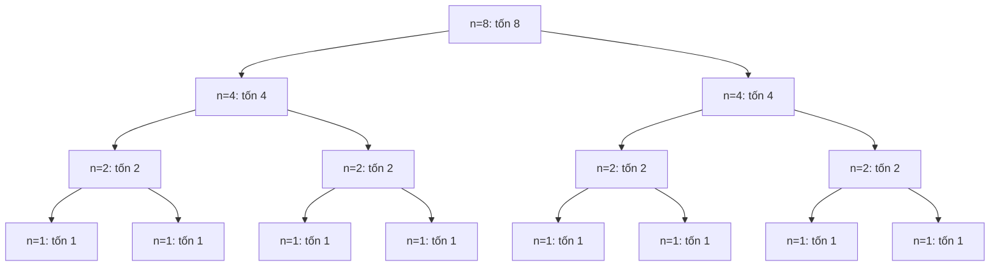
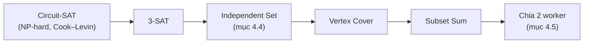

# P14 · Chương 04 — Thuật toán và độ phức tạp

> Phạm vi: chương này dạy cách *chứng minh* một khẳng định về thời gian chạy, không chỉ cách thuộc bảng O(·). Chứng minh nào do người soạn tự dựng được ghi "(chứng minh của người soạn)"; chứng minh theo nguồn thì có chú thích. Các khối "quan sát" là output thật của những chương trình Rust nhỏ chạy trên macOS arm64 với `rustc 1.95.0` (mã nguồn nằm trong các khối Đi sâu). Chúng kiểm lại lý thuyết trên một số trường hợp, không thay thế chứng minh.

Mỗi lần bạn đọc `O(n log n)` trong docs, hay nghe ai đó nói "bài toán này NP-hard" trong buổi design review, đằng sau là một chứng minh khá ngắn. Chương này đi qua những chứng minh đó để bạn tự kiểm được thay vì chỉ tin (nhận xét của người soạn). Cả chương bám theo một ví dụ giả định là `jobq`, một job scheduler nhỏ cho backend: nhận job (render báo cáo, gửi email hàng loạt, build artifact…), mỗi job có thời lượng ước tính `p` tính bằng ms và một deadline, giữ các job chờ trong một `Vec`, sắp theo deadline rồi giao cho `m` worker (nhận xét của người soạn: ví dụ giả định, không phải code trong repo). Mục 1 hỏi vì sao bản `jobq` đầu tiên chậm và dạy ký hiệu để nói về chuyện đó. Mục 2 sửa nó bằng sort và binary search. Mục 3 đếm chi phí ghi sự kiện vào một `Vec`. Mục 4 hỏi liệu hai bài toán xếp lịch của `jobq` có thuật toán nhanh không. Mục 5 nói phải làm gì khi câu trả lời là "gần như chắc chắn không".

## Bạn sẽ hiểu được gì

1. **Q1.** O, Ω, Θ chính xác nghĩa là gì, chứng minh một cận tiệm cận thế nào (cặp `c`, `n₀`), và người ta hay nhầm ở đâu (hằng số, "O là trường hợp xấu nhất", 4ⁿ so với 2ⁿ)? → mục 1
2. **Q2.** Thời gian chạy của thuật toán chia để trị (merge sort, binary search) viết thành recurrence ra sao, và giải bằng cây đệ quy, substitution (quy nạp) và Master theorem thế nào? → mục 2
3. **Q3.** Amortized analysis là gì; ba phương pháp aggregate, accounting, potential chứng minh `Vec::push` là O(1) amortized ra sao; vì sao capacity phải nhân lên chứ không cộng thêm hằng số; bảng băm co giãn có bẫy gì? → mục 3
4. **Q4.** P, NP, NP-hard, NP-complete định nghĩa thế nào; reduction đa thức là gì; chứng minh đầy đủ 3-SAT quy về Independent Set, rồi Subset Sum quy về xếp lịch 2 worker? → mục 4
5. **Q5.** Vì sao điều đó quan trọng với backend: xếp lịch và bin packing là NP-hard thì làm gì (greedy có bảo đảm `2 − 1/m`, DP pseudo-polynomial), và Kubernetes xử lý ra sao? → mục 5

## Kiến thức cần trước

- [Chương 01 — Logic và chứng minh](01-logic-va-chung-minh.md): quy nạp và chứng minh phản chứng. Mọi chứng minh dưới đây dùng một trong hai.
- [Chương 02 — Toán rời rạc](02-toan-roi-rac.md): đồ thị, đỉnh, cạnh (dùng ở mục 4).
- [P10 · Chương 09 — Collections](../10-rust-internals/09-collections-internals.md): mục 2 đọc source `Vec` tăng capacity, mục 4 đọc `HashMap` băm lại, mục 8 đọc bảng độ phức tạp trong docs. Chương này *chứng minh* những điều chương đó chỉ phát biểu.
- [P11 · Chương 03 — Hiệu năng service Rust](../11-do-dac-va-go-loi/03-hieu-nang-service-rust.md): ký hiệu O cho biết tốc độ tăng, đo đạc cho biết hằng số; cần cả hai.
- Chỉ cần nhớ thêm một phép tính: `1 + 1/2 + 1/4 + … < 2` (tổng cấp số nhân).

---

## 1. Ký hiệu tiệm cận: định nghĩa chính xác và cách chứng minh một cận (Q1)

> **Trả lời ngắn.** Ký hiệu tiệm cận so sánh *tốc độ tăng* của hai hàm khi `n` lớn: `f = O(g)` nghĩa là từ một ngưỡng `n₀` trở đi, `f` không vượt quá `c·g` với một hằng số `c` nào đó[^mcs-bigo-def]. `Ω` nói chiều ngược lại (cận dưới)[^mcs-omega], còn `Θ` là cả hai chiều cùng lúc: hai hàm bằng nhau chỉ sai một hằng số nhân[^mcs-theta]. Muốn chứng minh một cận thì chỉ cần chỉ ra cặp `(c, n₀)` rồi kiểm tra bất đẳng thức; mục này làm việc đó cho đa thức, logarit và hàm mũ, kèm những chỗ người ta hay nhầm.

**Giải thích.**

*Với `jobq`.* Bản `jobq` đầu tiên giữ job chờ trong một `Vec` chưa sắp. Mỗi lần có worker rảnh, nó quét cả `Vec` để tìm job có deadline sớm nhất rồi lấy job đó ra. Với `n` job chờ, lần quét đầu tốn `n` phép so sánh, lần sau `n − 1`, và cứ thế; rút hết `n` job tốn `n(n+1)/2` phép so sánh. Một đồng nghiệp gọi đó là "O(n²)", người khác bảo "cỡ nửa n bình phương", người thứ ba đếm ra "n²/2 + n/2 bước". Cả ba đều đúng. Ký hiệu tiệm cận là ngôn ngữ cho phép nói gọn mà không sai: nó bỏ hằng số nhân và các số hạng bậc thấp, chỉ giữ tốc độ tăng. Mục này định nghĩa nó cho chặt rồi chứng minh vài cận mẫu (nhận xét của người soạn).

### 1.1 Bốn định nghĩa

Xét các hàm `f, g` từ số tự nhiên vào số thực không âm; số bước chạy của một thuật toán luôn thuộc loại này. Ta cần bốn quan hệ:

| Ký hiệu | Định nghĩa | Đọc là |
|---|---|---|
| `f = O(g)` | tồn tại `c > 0` và `n₀` sao cho với mọi `n ≥ n₀`: `f(n) ≤ c·g(n)` | `f` tăng không nhanh hơn `g` |
| `f = Ω(g)` | tồn tại `c > 0` và `n₀` sao cho với mọi `n ≥ n₀`: `f(n) ≥ c·g(n)` | `f` tăng không chậm hơn `g` |
| `f = Θ(g)` | `f = O(g)` và `f = Ω(g)` | `f` và `g` tăng cùng tốc độ |
| `f = o(g)` | với *mọi* `c > 0` tồn tại `n₀` sao cho với mọi `n ≥ n₀`: `f(n) ≤ c·g(n)` | `f` tăng chậm hơn hẳn `g` |

`O` là cận trên: ta đòi `f` không vượt quá `g` sai một hằng số nhân, và cho phép ngoại lệ ở `n` nhỏ[^mcs-bigo-def]. `o` nói `f` tăng chậm hơn hẳn `g`[^mcs-oh-idea]. `Ω` là cận dưới[^mcs-omega]. Vì `f ≥ c·g` tương đương `g ≤ (1/c)·f`, nên `f = Ω(g)` đúng khi và chỉ khi `g = O(f)`; từ đó `f = Θ(g)` nghĩa là hai hàm chặn nhau hai chiều, tức bằng nhau tới một hằng số nhân[^mcs-theta].

Phần dễ sai nhất là thứ tự lượng từ. `c` và `n₀` được chọn *sau khi* đã biết `f` và `g`, nhưng *trước* khi chọn `n`, và chúng không được phụ thuộc `n`. Mọi chứng minh sai trong mục này và mục 2 đều vi phạm đúng câu đó. Còn dấu `=` trong `f = O(g)` chỉ là cách viết: `O(g)` đứng một mình không có nghĩa, nên đừng viết `O(n) = 2n` (nhận xét của người soạn).

### 1.2 Chứng minh mẫu: vòng quét của `jobq`

Số phép so sánh của bản `jobq` đầu tiên là `T(n) = n(n+1)/2`. Ta chứng minh `T(n) = Θ(n²)` bằng cách chỉ ra hai cặp hằng số:

- Cận trên. Với `n ≥ 1` ta có `n + 1 ≤ 2n`, nên `T(n) = n(n+1)/2 ≤ n·2n/2 = n²`. Chọn `c = 1`, `n₀ = 1`.
- Cận dưới. Vì `n + 1 ≥ n`, ta có `T(n) ≥ n²/2` với mọi `n ≥ 1`. Chọn `c = 1/2`, `n₀ = 1`.

Nếu máy nhanh gấp 10 lần thì `T` chỉ đổi hằng số; hình dạng `n²` thì không đổi. Đó chính xác là điều `Θ` nắm bắt: nó giữ lại hình dạng tăng trưởng và bỏ đi những thứ phần cứng làm thay đổi được[^mcs-theta-use].

### 1.3 Đa thức: bỏ số hạng bậc thấp có chính đáng không?

Ở ví dụ trên ta bỏ `n/2` mà không lăn tăn. Định lý dưới đây nói điều đó đúng cho mọi đa thức. Tài liệu MIT phát biểu cận trên cho đa thức tổng quát rồi bỏ qua phần chứng minh vì coi đó là "routine"[^mcs-routine-proof]; ở đây ta viết ra cả hai chiều.

**Định lý 1** (chứng minh của người soạn). Cho `p(n) = a_d·nᵈ + … + a₁·n + a₀` với `a_d > 0`. Khi đó `p(n) = Θ(nᵈ)`.

*Chứng minh.* Đặt `A = |a₀| + … + |a_{d−1}|` (với `d = 0` thì `A = 0` và định lý hiển nhiên).

1. *Cận trên.* Với `n ≥ 1`, `nⁱ ≤ nᵈ` mọi `i ≤ d`, nên `p(n) ≤ (|a₀| + … + |a_d|)·nᵈ`. Chọn `c = |a₀| + … + |a_d|` và `n₀ = 1`.
2. *Cận dưới.* Với `n ≥ 1`, `nⁱ ≤ n^(d−1)` mọi `i ≤ d−1`, nên các số hạng bậc thấp cộng lại không nhỏ hơn `−A·n^(d−1)`; tức `p(n) ≥ a_d·nᵈ − A·n^(d−1)`. Nếu thêm điều kiện `n ≥ 2A/a_d` thì `A ≤ a_d·n/2`, suy ra `A·n^(d−1) ≤ (a_d/2)·nᵈ`, và do đó `p(n) ≥ (a_d/2)·nᵈ`. Chọn `c = a_d/2` và `n₀ = max(1, ⌈2A/a_d⌉)`. ∎

Hằng số mà chứng minh cho ra không phải tốt nhất. Với `3n² + 10n + 7` chẳng hạn, mọi số hạng đều dương nên `c = 3`, `n₀ = 1` đã đủ cho cận dưới, còn cận trên cần `c = 20`, `n₀ = 1`. Định lý chỉ đảm bảo hằng số tồn tại; chọn hằng số đẹp là việc khác (nhận xét của người soạn).

### 1.4 Ba so sánh hay nhầm

**Cơ số logarit không quan trọng.** Vì `log_a n = log_b n / log_b a`, đổi cơ số chỉ nhân với một hằng số, nên `log_a n = Θ(log_b n)` với mọi cơ số `a, b > 1`. Vì vậy ta viết `O(log n)` mà không ghi cơ số.

**`n·log n` tăng chậm hơn hẳn `n²`.**

**Mệnh đề 2** (chứng minh của người soạn). `n·log₂ n = O(n²)` nhưng `n² ≠ O(n·log₂ n)`.

*Chứng minh.* Trước hết, `n < 2ⁿ` với mọi `n ≥ 1`: quy nạp, `1 < 2`; nếu `n < 2ⁿ` thì `n + 1 < 2ⁿ + 1 ≤ 2ⁿ + 2ⁿ = 2ⁿ⁺¹`. Lấy logarit cơ số 2 được `log₂ n < n`, nên `n·log₂ n ≤ n²` với `n ≥ 1`: chọn `c = 1`, `n₀ = 1`.

Chiều ngược lại ta chứng minh bằng phản chứng. Giả sử `n² ≤ c·n·log₂ n` với mọi `n ≥ n₀`. Chia hai vế cho `n` được `n ≤ c·log₂ n`. Chọn số nguyên `k ≥ 4` đủ lớn để `2ᵏ ≥ n₀` và `k > c`, rồi đặt `n = 2ᵏ`: ta được `2ᵏ ≤ c·k`. Nhưng `2ᵏ ≥ k²` với mọi `k ≥ 4` (quy nạp: `16 ≥ 16`; nếu `2ᵏ ≥ k²` thì `2ᵏ⁺¹ ≥ 2k² ≥ (k+1)²`, vì `k² ≥ 2k + 1` khi `k ≥ 3`). Suy ra `k² ≤ c·k`, tức `k ≤ c`, mâu thuẫn với `k > c`. ∎

Vậy `n log n` tăng chậm hơn `n²` thật sự, không chỉ "một hằng số". Cũng theo hướng đó, logarit tăng chậm hơn mọi căn `n^ε` với `ε > 0`[^mcs-log-roots].

**Hàm mũ: cơ số không giấu được vào hằng số.**

**Mệnh đề 3** (chứng minh của người soạn). `2ⁿ⁺¹ = Θ(2ⁿ)` nhưng `4ⁿ ≠ O(2ⁿ)`.

*Chứng minh.* `2ⁿ⁺¹ = 2·2ⁿ`, nên cả hai chiều đúng với hằng số 2 và `1/2`. Còn nếu `4ⁿ ≤ c·2ⁿ` với mọi `n ≥ n₀` thì chia hai vế cho `2ⁿ` được `2ⁿ ≤ c` với mọi `n ≥ n₀`, vô lý vì `2ⁿ` không bị chặn. ∎

Lỗi nghĩ "4 chỉ gấp 2 một hằng số" là một cái bẫy có tên riêng trong giáo trình MIT[^mcs-expfiasco]. Với `jobq`: vét cạn việc gán `n` job cho 2 worker có `2ⁿ` cách, cho 3 worker có `3ⁿ` cách. Với `n = 30`, đó là khoảng `1,07·10⁹` so với `2,06·10¹⁴`. Đổi từ 2 lên 3 worker không phải một hằng số nhân bị nuốt vào `O`: nó làm hàm mũ tăng nhanh hơn hẳn (phép tính của người soạn).

Bảng dưới cho cảm giác về thang tăng trưởng (phép tính của người soạn, làm tròn):

| `n` | `log₂ n` | `n` | `n·log₂ n` | `n²` | `2ⁿ` |
|---|---|---|---|---|---|
| 10 | 3,3 | 10 | 33 | 100 | 1.024 |
| 100 | 6,6 | 100 | 664 | 10.000 | ≈ 1,3·10³⁰ |
| 1.000 | 10,0 | 1.000 | 9.966 | 1.000.000 | ≈ 1,1·10³⁰¹ |

### 1.5 Bốn điều ký hiệu O không nói

1. **O không phải "trường hợp xấu nhất".** `O`, `Ω`, `Θ` là quan hệ giữa hai hàm. "Trường hợp xấu nhất", "tốt nhất", "trung bình" và "amortized" là những *hàm chi phí* khác nhau, và hàm nào cũng có thể có cận `O`, `Ω` hay `Θ` (nhận xét của người soạn). Ví dụ: tìm job theo `id` trong `pending` chưa sắp bằng quét tuyến tính tốn 1 bước ở trường hợp tốt nhất (job nằm đầu) và `n` bước ở trường hợp xấu nhất. Hàm xấu nhất là `Θ(n)`, hàm tốt nhất là `Θ(1)`; nói "tìm tuyến tính là `O(n)`" đúng cho cả hai, nhưng chỉ chặt cho hàm xấu nhất.
2. **"Ít nhất O(n²)" là câu vô nghĩa.** `O` chỉ dùng cho cận trên; muốn nói cận dưới phải dùng `Ω`[^mcs-lower-blunder].
3. **Nhanh hơn tiệm cận chưa chắc nhanh hơn ở `n` của bạn.** Giáo trình MIT lấy nhân ma trận làm ví dụ: có thuật toán nhanh hơn về tiệm cận nhưng gần như không dùng, vì chỉ hiệu quả ở cỡ ma trận không thực tế[^mcs-faster-not-better]. Trong backend, hằng số ẩn gồm cả cache miss và cấp phát bộ nhớ (xem [P2 · Chương 06](../02-cpu/06-cache-va-numa.md)); muốn biết thật thì phải đo (xem [P11 · Chương 03](../11-do-dac-va-go-loi/03-hieu-nang-service-rust.md)). Ký hiệu O trả lời "tăng thế nào khi dữ liệu lớn lên", đo đạc trả lời "bao nhiêu mili giây" (nhận xét của người soạn).
4. **`n` là cỡ đầu vào, và cỡ đầu vào tính bằng bit.** Mục 4 và 5 sẽ dựa vào điều này: một con số như `10⁶` ms chỉ chiếm khoảng 20 bit, không phải một triệu đơn vị, và nhờ đó kết luận về "nhanh" đổi hẳn.

<details><summary>Đi sâu: chứng minh giả "1 + 2 + … + n = O(n)", quy tắc cộng và nhân, mô hình máy</summary>

**Chứng minh giả.** Giáo trình MIT đưa ra một "định lý" sai để minh họa lỗi lượng từ: `1 + 2 + … + n = O(n)`. "Chứng minh": mỗi số hạng `i` là `O(1)`, nên tổng `n` số hạng là `O(1) + … + O(1) = O(n)`. Chỗ sai: `i = O(1)` chỉ đúng khi `i` là một hằng số cố định. Ở đây `i` chạy từ 1 tới `n`, tức phụ thuộc `n`, nên không có một `c` chung nào[^mcs-false-theorem]. Thực tế tổng bằng `n(n+1)/2 = Θ(n²)`, và `O(n)` sai theo phản chứng: nếu `n(n+1)/2 ≤ c·n` với mọi `n ≥ n₀` thì `n + 1 ≤ 2c`, vô lý khi `n` lớn. Cái bẫy này hay xuất hiện khi đếm vòng lặp lồng nhau, đúng như vòng quét của `jobq` ở mục 1.2.

**Ba quy tắc dùng hằng ngày** (người soạn viết lại từ định nghĩa):

- *Bắc cầu.* Nếu `f ≤ c₁·g` từ `n₁` và `g ≤ c₂·h` từ `n₂` thì `f ≤ c₁c₂·h` từ `max(n₁, n₂)`.
- *Tổng.* Nếu `f₁ = O(g₁)` và `f₂ = O(g₂)` thì `f₁ + f₂ = O(max(g₁, g₂))` (với `c = c₁ + c₂`). Dùng khi `jobq` chạy hai pha tuần tự: sort `O(n log n)` rồi quét một lượt `O(n)` cho tổng `O(n log n)`.
- *Tích.* `f₁·f₂ = O(g₁·g₂)`. Dùng cho vòng lặp lồng nhau, nhưng nhớ rằng nhân hai cận trên có thể cho cận không chặt, đúng như chứng minh giả ở trên.

**Cách dùng giới hạn.** Nếu `lim f(n)/g(n) = L` tồn tại thì: `L = 0` suy ra `f = o(g)`; `0 < L < ∞` suy ra `f = Θ(g)`; `L = ∞` suy ra `g = o(f)` (hệ quả trực tiếp của định nghĩa, nhận xét của người soạn). Giáo trình MIT cũng định nghĩa `o` bằng giới hạn[^mcs-oh-idea].

**Mô hình máy.** Mọi số bước ở trên đếm theo mô hình máy RAM, trong đó mỗi lệnh tốn một đơn vị thời gian[^eri-ram-unit]. Phép cộng trên `u64` đúng mô hình đó. Số nguyên lớn tùy ý (big integer) thì không còn, nên khi mô tả thuật toán bằng pseudocode phải cẩn thận với độ chính xác của số học[^eri-ram-precision].

</details>

**Quay lại Q1:** `f = O(g)` nghĩa là tồn tại `c` và `n₀` (chọn sau `f`, `g`, độc lập với `n`) để `f(n) ≤ c·g(n)` từ `n₀` trở đi; chứng minh một cận chỉ là chỉ ra cặp ấy, như `n(n+1)/2 = Θ(n²)` với `(1, 1)` và `(1/2, 1)`, và hai cái bẫy lớn nhất là cho `c` phụ thuộc `n` và coi `4ⁿ` như `2ⁿ`.

---

## 2. Recurrence: giải thời gian chạy của chia để trị (Q2)

> **Trả lời ngắn.** Thuật toán chia để trị chia bài toán cỡ `n` thành các bài toán nhỏ hơn, giải từng phần rồi gộp kết quả[^mcs-dc-merge], nên số bước của nó thỏa một recurrence như `T(n) = 2T(n/2) + n`. Có ba cách giải: vẽ cây đệ quy rồi cộng chi phí từng tầng[^er-rectree], đoán nghiệm rồi chứng minh bằng quy nạp (substitution), hoặc dùng Master theorem cho dạng `T(n) = a·T(n/b) + g(n)`[^mcs-master]. Merge sort ra `Θ(n log n)`, đúng lớp mà docs của `slice::sort` hứa[^rs-sort-stable]; binary search ra `Θ(log n)`, cụ thể tối đa `⌊log₂ n⌋ + 1` lần so sánh.

**Giải thích.**

*Với `jobq`.* Sau mỗi đợt job mới, `jobq` sắp lại `pending` theo deadline, rồi tìm vị trí đầu tiên có deadline không nhỏ hơn thời điểm hiện tại để biết job nào còn kịp chạy. Hai thao tác này thay cho vòng quét `Θ(n²)` ở mục 1. Câu hỏi của mục này: chúng tốn bao nhiêu, và làm sao *chứng minh* con số đó thay vì thuộc lòng (nhận xét của người soạn).

### 2.1 Từ code ra recurrence

*Merge sort.* Sắp hai nửa, rồi trộn hai nửa đã sắp bằng một lượt duyệt, tốn nhiều nhất `n` phép so sánh (trộn thật tốn `n − 1`; ta lấy `n` cho gọn, không đổi bậc). Gọi `T(n)` là số bước trong trường hợp xấu nhất:

```text
T(1) = 1
T(n) = T(⌊n/2⌋) + T(⌈n/2⌉) + n      với n ≥ 2
```

*Binary search.* So sánh với phần tử giữa, rồi tìm tiếp trong nửa có thể chứa đáp án. Nửa đó có tối đa `⌊n/2⌋` phần tử, nên số lần so sánh trong trường hợp xấu nhất `B(n)` thỏa:

```text
B(1) = 1
B(n) = B(⌊n/2⌋) + 1                  với n ≥ 2
```

Binary search chỉ có nghĩa nếu mảng đã được sắp: docs của `binary_search` nói rõ rằng với slice chưa sắp, kết quả là "unspecified and meaningless"[^rs-binsearch]. Phép tìm vị trí đầu tiên có deadline `≥ t` trong `jobq` dùng `partition_point`, mà docs mô tả là một kiểu binary search và đòi slice đã được phân hoạch theo điều kiện[^rs-partition-point].

### 2.2 Cách 1: cây đệ quy

Cây đệ quy có một nút cho mỗi lần gọi đệ quy; giá trị của nút là thời gian làm việc *riêng* của nó, không tính các lời gọi con; tổng thời gian là tổng giá trị mọi nút[^er-rectree]. Với `T(n) = 2T(n/2) + n` và `n = 8`, cây trông như sau:



(Sơ đồ của người soạn.) Đọc theo tầng: tầng 0 có 1 nút tốn 8, tầng 1 có 2 nút tốn 4, tầng 2 có 4 nút tốn 2. Mỗi tầng nút trong (không tính tầng lá) cộng lại đều bằng `n = 8`. Có 3 tầng như thế, cộng với 8 lá tốn 1: `3·8 + 8 = 32`. Tổng quát với `n = 2ᵏ`, tầng `i` có `2ⁱ` nút, mỗi nút tốn `n/2ⁱ`, nên mọi tầng nút trong đều tốn `n`; có `k` tầng như vậy và `n` lá tốn 1 mỗi lá, tổng `n·k + n = n(log₂ n + 1)`. Đây là trường hợp "mọi tầng bằng nhau" của cây đệ quy, cho kết quả `O(f(n)·log n)` với `f(n) = n`[^er-equal].

Cây đệ quy giúp *tìm ra* đáp án; chứng minh thì cần quy nạp. Với `n` là lũy thừa của 2, chứng minh gọn: `T(2⁰) = 1 = 2⁰·(0+1)`, và nếu `T(2ᵏ⁻¹) = 2ᵏ⁻¹·k` thì `T(2ᵏ) = 2·2ᵏ⁻¹·k + 2ᵏ = 2ᵏ(k+1)`.

### 2.3 Cách 2: substitution, đúng với mọi `n`

Phần lớn tài liệu làm cây đệ quy cho `n = 2ᵏ` rồi nói "sàn và trần không ảnh hưởng". Ta kiểm điều đó thật cho mọi `n`, bằng hai đẳng thức về sàn và trần của logarit.

**Bổ đề 1** (chứng minh của người soạn). Với mọi `n ≥ 2`: (a) `⌊lg⌊n/2⌋⌋ = ⌊lg n⌋ − 1`; (b) `⌈lg⌈n/2⌉⌉ = ⌈lg n⌉ − 1`. (Ở đây `lg` là `log₂`.)

*Chứng minh.* (a) Đặt `k = ⌊lg n⌋ ≥ 1`, tức `2ᵏ ≤ n < 2ᵏ⁺¹`. Chia đôi: `2ᵏ⁻¹ ≤ n/2 < 2ᵏ`. `2ᵏ⁻¹` là số nguyên không vượt quá `n/2` nên cũng không vượt quá `⌊n/2⌋`; còn `⌊n/2⌋ ≤ n/2 < 2ᵏ`. Vậy `2ᵏ⁻¹ ≤ ⌊n/2⌋ < 2ᵏ`, tức `⌊lg⌊n/2⌋⌋ = k − 1`.
(b) Đặt `k = ⌈lg n⌉ ≥ 1`, tức `2ᵏ⁻¹ < n ≤ 2ᵏ`. Chia đôi: `2ᵏ⁻² < n/2 ≤ 2ᵏ⁻¹`. Vì `⌈n/2⌉ ≥ n/2 > 2ᵏ⁻²`, và `2ᵏ⁻¹` là số nguyên không nhỏ hơn `n/2` nên `⌈n/2⌉ ≤ 2ᵏ⁻¹`. Vậy `2ᵏ⁻² < ⌈n/2⌉ ≤ 2ᵏ⁻¹`, tức `⌈lg⌈n/2⌉⌉ = k − 1`. ∎

**Mệnh đề 4** (chứng minh của người soạn). Với mọi `n ≥ 1`:

```text
n·(⌊lg n⌋ + 1)  ≤  T(n)  ≤  n·(⌈lg n⌉ + 1)        và        B(n) = ⌊lg n⌋ + 1
```

*Chứng minh.* Quy nạp mạnh theo `n`. Với `n = 1`: `T(1) = 1` và cả hai vế đều bằng `1·(0 + 1) = 1`; `B(1) = 1 = ⌊lg 1⌋ + 1`. Với `n ≥ 2`, đặt `a = ⌊n/2⌋ ≥ 1` và `b = ⌈n/2⌉`; khi đó `a + b = n`, `a ≤ b < n`, nên giả thiết quy nạp áp dụng được cho cả `a` và `b`.

- *Cận trên.* `T(n) = T(a) + T(b) + n ≤ a(⌈lg a⌉ + 1) + b(⌈lg b⌉ + 1) + n`. Vì `a ≤ b` nên `⌈lg a⌉ ≤ ⌈lg b⌉ = ⌈lg n⌉ − 1` (Bổ đề 1b). Thay vào: `T(n) ≤ a·⌈lg n⌉ + b·⌈lg n⌉ + n = n·⌈lg n⌉ + n = n(⌈lg n⌉ + 1)`.
- *Cận dưới.* `T(n) ≥ a(⌊lg a⌋ + 1) + b(⌊lg b⌋ + 1) + n`. Vì `b ≥ a` nên `⌊lg b⌋ ≥ ⌊lg a⌋ = ⌊lg n⌋ − 1` (Bổ đề 1a). Thay vào: `T(n) ≥ (a + b)·⌊lg n⌋ + n = n(⌊lg n⌋ + 1)`.
- *Binary search.* `B(n) = B(a) + 1 = (⌊lg a⌋ + 1) + 1 = (⌊lg n⌋ − 1) + 2 = ⌊lg n⌋ + 1`, lại theo Bổ đề 1a. ∎

Hệ quả: `T(n) = Θ(n log n)`. Cận dưới: `⌊lg n⌋ + 1 > lg n` nên `T(n) ≥ n·lg n` (chọn `c = 1`, `n₀ = 1`). Cận trên: `⌈lg n⌉ ≤ lg n + 1` nên `T(n) ≤ n(lg n + 2) ≤ 3n·lg n` với `n ≥ 2` vì lúc đó `lg n ≥ 1` (chọn `c = 3`, `n₀ = 2`). Tương tự `B(n) = Θ(log n)`.

Quan sát (chương trình ở phần Đi sâu cuối mục, chạy trên macOS arm64, `rustc 1.95.0`): tính `T(n)` và `B(n)` bằng đúng hai recurrence trên cho mọi `n` từ 1 đến 2²⁰ thì cả hai cận của Mệnh đề 4 đều đúng ở 1.048.576/1.048.576 giá trị, và `T(n) = n(lg n + 1)` đúng tại cả 21 lũy thừa của 2. Cụ thể `T(1024) = 11264` và `B(10⁶) = 20`.

Với `jobq` có `10⁶` job chờ, kết quả thành con số cụ thể. Mỗi lần tra theo deadline, quét tuyến tính tốn tới `10⁶` phép so sánh, còn binary search tốn tối đa `⌊lg 10⁶⌋ + 1 = 20`. Sắp xếp bằng merge sort tốn giữa `2,0·10⁷` và `2,1·10⁷` bước (cận của Mệnh đề 4; quan sát cho `T(10⁶) = 20951424`), trong khi sắp bằng vòng quét `Θ(n²)` của mục 1 tốn cỡ `n(n+1)/2 ≈ 5·10¹¹` phép so sánh, gấp khoảng 24.000 lần (phép tính của người soạn).

*Hai cái bẫy khi dùng substitution.* Thứ nhất, bước quy nạp phải ra *đúng* bất đẳng thức với *cùng* `c`. Có một "chứng minh" sai kinh điển cho `T(n) = 2T(n/2) + n`: "giả sử `T(n/2) ≤ c·n/2`; khi đó `T(n) ≤ 2c·n/2 + n = c·n + n = O(n)`". Sai ở chỗ đáng lẽ phải chứng minh `T(n) ≤ c·n`, nhưng ta chỉ chứng minh `T(n) ≤ (c+1)·n`: hằng số đã đổi ở mỗi bước, giống hệt lỗi của "1 + 2 + … + n = O(n)" ở mục 1. Và kết luận sai thật, vì `T(n) = Θ(n log n)`. Thứ hai, giả thiết quy nạp đôi khi phải *mạnh hơn* điều ta muốn; ví dụ ở phần Đi sâu.

### 2.4 Cách 3: Master theorem

Hầu hết recurrence chia để trị có dạng `T(n) = a·T(n/b) + g(n)` với `a ≥ 1`, `b > 1`: giải `a` bài toán con, mỗi bài cỡ `n/b`, rồi tốn `g(n)` để gộp. Đặt `p = log_b a`. Cây đệ quy có `a` nhánh mỗi nút nên tầng `i` có `aⁱ` nút cỡ `n/bⁱ`, và số lá là `n^p`. Master theorem[^mcs-master] nói:

| Trường hợp | Điều kiện trên `g(n)` | Kết luận |
|---|---|---|
| 1 | `g(n) = O(n^(p−ε))` với một `ε > 0` | `T(n) = Θ(n^p)` |
| 2 | `g(n) = Θ(n^p · logᵏ n)` với một `k ≥ 0` | `T(n) = Θ(n^p · logᵏ⁺¹ n)` |
| 3 | `g(n) = Ω(n^(p+ε))` với một `ε > 0`, và `a·g(n/b) < c·g(n)` với một `c < 1` khi `n` đủ lớn | `T(n) = Θ(g(n))` |

Ba trường hợp là ba kịch bản xem ai thống trị tổng theo tầng. Ở trường hợp 1, chi phí cộng theo tầng tăng dần xuống phía dưới, nên các lá chiếm phần lớn[^er-increasing]. Ở trường hợp 2, mọi tầng bằng nhau, nên tổng bằng một tầng nhân số tầng[^er-equal]. Ở trường hợp 3, chi phí giảm dần theo tầng, nên gốc thống trị[^er-decreasing].

Giáo trình gốc không chứng minh định lý này mà chỉ nói nó có thể chứng minh bằng quy nạp, hoặc dễ hơn là như hệ quả của công thức Akra–Bazzi[^mcs-master-proof]. Ta chứng minh trường hợp thường gặp nhất, `g(n) = nᶜ` với `c ≥ 0` hằng số, để thấy rõ cơ chế. Đây là cách cộng theo tầng của cây đệ quy.

**Mệnh đề 5** (chứng minh của người soạn). Với `n = b^L` (`L` nguyên), `T(1) = t₁ > 0` và `T(n) = a·T(n/b) + nᶜ`, đặt `p = log_b a`:

- nếu `c > p` thì `T(n) = Θ(nᶜ)`;
- nếu `c = p` thì `T(n) = Θ(n^p · log n)`;
- nếu `c < p` thì `T(n) = Θ(n^p)`.

*Chứng minh.* Khai triển `L` lần: `T(n) = nᶜ + a·T(n/b) = nᶜ + a(n/b)ᶜ + a²·T(n/b²) = …`, tức

```text
T(n) = Σ_{i=0}^{L−1} aⁱ·(n/bⁱ)ᶜ  +  a^L·T(1)
```

(quy nạp theo `L` cho đẳng thức này là hiển nhiên). Đặt `r = a/bᶜ`. Số hạng thứ `i` bằng `nᶜ·rⁱ`. Số hạng cuối là `t₁·a^L = t₁·n^p`, vì `a^L = a^(log_b n) = n^(log_b a)`. Vậy `T(n) = nᶜ·(1 + r + … + r^(L−1)) + t₁·n^p`.

1. *`c > p`, tức `r < 1`.* Tổng `1 + r + … + r^(L−1)` nằm giữa `1` và `1/(1−r)`, nên số hạng đầu là `Θ(nᶜ)`. Số hạng cuối `t₁·n^p ≤ t₁·nᶜ` vì `p < c`. Vậy `T(n) = Θ(nᶜ)`.
2. *`c = p`, tức `r = 1`.* Tổng bằng `L = log_b n`, nên `T(n) = n^p·log_b n + t₁·n^p = Θ(n^p·log n)`.
3. *`c < p`, tức `r > 1`.* Tổng là `(r^L − 1)/(r − 1)`, và `r^L = a^L/b^(cL) = n^p/nᶜ`. Do đó `nᶜ·(r^L − 1)/(r − 1) = (n^p − nᶜ)/(r − 1)`, và `T(n) = (n^p − nᶜ)/(r − 1) + t₁·n^p`. Số này không vượt quá `n^p·(1/(r−1) + t₁)` và không nhỏ hơn `t₁·n^p`, nên `T(n) = Θ(n^p)`. ∎

Chứng minh này mới làm cho `n` là lũy thừa của `b`; định lý trong giáo trình phát biểu cho mọi `n`. Với merge sort ta đã làm trực tiếp cho mọi `n` ở Mệnh đề 4.

Áp dụng (`p = log_b a`, so sánh `c` với `p`):

| Recurrence | `a` | `b` | `c` | `p` | Trường hợp | Kết quả |
|---|---|---|---|---|---|---|
| merge sort: `T(n) = 2T(n/2) + n` | 2 | 2 | 1 | 1 | `c = p` | `Θ(n log n)` |
| binary search: `T(n) = T(n/2) + 1` | 1 | 2 | 0 | 0 | `c = p` | `Θ(log n)` |
| duyệt cây nhị phân cân bằng, mỗi nút `O(1)`: `T(n) = 2T(n/2) + 1` | 2 | 2 | 0 | 1 | `c < p` | `Θ(n)` |
| chọn job trung vị, giả sử pivot luôn chia đôi: `T(n) = T(n/2) + n` | 1 | 2 | 1 | 0 | `c > p` | `Θ(n)` |
| `T(n) = 4T(n/2) + n` | 4 | 2 | 1 | 2 | `c < p` | `Θ(n²)` |

(Bảng do người soạn áp Mệnh đề 5; dòng thứ tư là giả định lý tưởng, không phải bảo đảm của thuật toán chọn thật.) Hai dòng đầu khớp với kết quả trực tiếp ở Mệnh đề 4. Dòng thứ ba cho thấy một điều đáng nhớ: duyệt toàn bộ `n` phần tử bằng chia để trị không rẻ hơn vòng lặp thẳng, vì mọi phần tử đều phải được thăm.

*Khi Master theorem không áp dụng được.* `T(n) = T(n − 1) + 1` không có dạng `T(n/b)`; khai triển thẳng cho `Θ(n)`. `T(n) = 2T(n/2) + n/lg n` rơi vào khoảng trống giữa trường hợp 1 và 2. Chia không đều như `T(n) = T(n/3) + T(2n/3) + n` cũng ngoài dạng. Với các trường hợp đó, công thức Akra–Bazzi là công cụ mạnh hơn, giải được "hầu hết mọi" recurrence chia để trị[^mcs-akra]; ví dụ kết quả của hai recurrence sau ở phần Đi sâu.

### 2.5 Hợp đồng độ phức tạp trong std

Docs `slice::sort` hứa rằng sắp xếp này stable và `O(n * log(n))` trong trường hợp xấu nhất[^rs-sort-stable]; với `sort_by_key` thì thêm một thừa số `m` nếu hàm lấy khóa tốn `O(m)`[^rs-sort-key]. Đó đúng là lớp ta vừa chứng minh cho merge sort. Cài đặt hiện tại là driftsort, kết hợp trường hợp trung bình nhanh của quicksort với trường hợp xấu nhất tốt của mergesort và khả năng nhận ra các đoạn đã sắp sẵn, nên chạy tuyến tính trên đầu vào đã sắp hoặc sắp ngược[^rs-sort-impl]. Với `jobq`, nơi `pending` thường gần như đã sắp theo deadline, đó là tin tốt (nhận xét của người soạn). `sort_unstable` không giữ thứ tự các phần tử bằng nhau, sắp tại chỗ không cấp phát, và cũng `O(n * log(n))` worst-case[^rs-sort-unstable]. Hợp đồng ở đây là `O(n log n)` chứ không phải "merge sort": tên thuật toán là chi tiết cài đặt, có thể đổi giữa các phiên bản.

<details><summary>Đi sâu: giả thiết quy nạp phải đủ mạnh, Akra–Bazzi cho hai recurrence khó, chương trình kiểm chứng</summary>

**Giả thiết quy nạp quá yếu.** Xét `T(1) = 1`, `T(n) = 2T(n/2) + 1` với `n = 2ᵏ`. Theo Mệnh đề 5 (`a = 2`, `b = 2`, `c = 0 < p = 1`) thì `T(n) = Θ(n)`. Nhưng nếu thử chứng minh `T(n) ≤ c·n` bằng quy nạp, bước quy nạp cho `T(n) ≤ 2·c·(n/2) + 1 = c·n + 1`, lớn hơn `c·n`: không đóng được vòng, dù kết luận `Θ(n)` đúng. Cách chữa là *mạnh hơn* giả thiết bằng cách trừ một số hạng bậc thấp: chứng minh `T(n) ≤ 2n − 1`. Cơ sở: `T(1) = 1 ≤ 1`. Bước: `T(n) = 2T(n/2) + 1 ≤ 2(2·n/2 − 1) + 1 = 2n − 1`. Đóng được vòng, và vì chứng minh dùng đúng dấu bằng nên thực ra `T(n) = 2n − 1` (người soạn).

**Cơ sở quy nạp.** Cũng vì lý do tương tự, giả thiết `T(n) ≤ d·n·lg n` không dùng được ở `n = 1` (vì `lg 1 = 0` mà `T(1) = 1`). Đó là lý do Mệnh đề 4 dùng dạng `n(⌈lg n⌉ + 1)` có thêm số `+1`, hoặc phải đặt `n₀ = 2` và kiểm riêng vài giá trị đầu.

**Akra–Bazzi cho hai recurrence ở trên.** Công thức Akra–Bazzi nói nghiệm của `T(n) = Σ aᵢ·T(bᵢ·n) + g(n)` là `Θ(n^p·(1 + ∫₁ⁿ g(u)/u^(p+1) du))` với `p` thỏa `Σ aᵢ·bᵢ^p = 1`[^mcs-akra]. Với `T(n) = T(n/3) + T(2n/3) + n`: `(1/3)^p + (2/3)^p = 1` cho `p = 1`; tích phân `∫₁ⁿ u/u² du = ln n`, nên `T(n) = Θ(n(1 + ln n)) = Θ(n log n)`. Đây cũng là dạng recurrence của quicksort khi pivot luôn chia theo tỉ lệ 1:2. Với `T(n) = 2T(n/2) + n/lg n`: `p = 1`, tích phân `∫₁ⁿ du/(u·lg u) = Θ(log log n)`, nên `T(n) = Θ(n·log log n)` (cả hai kết quả do người soạn tính từ công thức, không chạy thử).

**Chương trình kiểm chứng Mệnh đề 4** (`recur.rs`, biên dịch bằng `rustc -O --edition 2024`):

```rust
// Kiểm tra cận chặt cho recurrence của merge sort và binary search trên mọi n ≤ 2^20.
fn floor_lg(n: u64) -> u64 {
    63 - n.leading_zeros() as u64
}
fn ceil_lg(n: u64) -> u64 {
    if n <= 1 { 0 } else { floor_lg(n - 1) + 1 }
}

fn main() {
    const MAX: usize = 1 << 20;
    // T(1) = 1; T(n) = T(⌊n/2⌋) + T(⌈n/2⌉) + n.
    let mut t = vec![0u64; MAX + 1];
    t[1] = 1;
    // B(1) = 1; B(n) = B(⌊n/2⌋) + 1.
    let mut b = vec![0u64; MAX + 1];
    b[1] = 1;
    for n in 2..=MAX {
        t[n] = t[n / 2] + t[n - n / 2] + n as u64;
        b[n] = b[n / 2] + 1;
    }
    let (mut ok_sandwich, mut ok_binary, mut exact_pow2) = (0u64, 0u64, 0u64);
    for n in 1..=MAX {
        let nn = n as u64;
        let lo = nn * (floor_lg(nn) + 1);
        let hi = nn * (ceil_lg(nn) + 1);
        if lo <= t[n] && t[n] <= hi {
            ok_sandwich += 1;
        }
        if b[n] == floor_lg(nn) + 1 {
            ok_binary += 1;
        }
        if n.is_power_of_two() && t[n] == lo && lo == hi {
            exact_pow2 += 1;
        }
    }
    println!("n = 1..={MAX}: sandwich đúng {ok_sandwich}/{MAX}; B(n) = ⌊lg n⌋+1 đúng {ok_binary}/{MAX}; T(n) = n(lg n + 1) đúng tại {exact_pow2} lũy thừa của 2");
    let n = 1_000_000usize;
    println!("T(10^6) = {}; cận dưới = {}; cận trên = {}; B(10^6) = {}", t[n], 1_000_000 * (floor_lg(n as u64) + 1), 1_000_000 * (ceil_lg(n as u64) + 1), b[n]);
    println!("T(1024) = {}; T(1000) = {}; B(1000) = {}", t[1024], t[1000], b[1000]);
}
```

Quan sát (macOS arm64, một lần chạy):

```text
n = 1..=1048576: sandwich đúng 1048576/1048576; B(n) = ⌊lg n⌋+1 đúng 1048576/1048576; T(n) = n(lg n + 1) đúng tại 21 lũy thừa của 2
T(10^6) = 20951424; cận dưới = 20000000; cận trên = 21000000; B(10^6) = 20
T(1024) = 11264; T(1000) = 10976; B(1000) = 10
```

</details>

**Quay lại Q2:** merge sort có `T(n) = T(⌊n/2⌋) + T(⌈n/2⌉) + n` thỏa `n(⌊lg n⌋+1) ≤ T(n) ≤ n(⌈lg n⌉+1)` với mọi `n`, nên là `Θ(n log n)`; binary search có `B(n) = ⌊lg n⌋ + 1` đúng; Master theorem cho cùng kết quả vì cả hai rơi vào trường hợp `c = log_b a`; với `jobq` `10⁶` job, sort tốn cỡ `2·10⁷` bước còn mỗi lần tra tốn tối đa 20 so sánh.

---

## 3. Amortized analysis: vì sao `Vec::push` là O(1) (Q3)

> **Trả lời ngắn.** Phân tích amortized tính chi phí trung bình *trên một chuỗi thao tác*, không dựa vào xác suất: vài thao tác đắt được bù bằng nhiều thao tác rẻ đi trước[^eri-am-noprob]. Có ba cách chứng minh, gồm gộp tổng chi phí rồi chia (aggregate), trả trước bằng "đồng xu" (accounting) và hàm thế (potential)[^m6-methods]. Với `Vec` tăng capacity gấp đôi, cả ba cho chi phí amortized không quá 3 mỗi `push`, khớp lời hứa `O(1)` amortized của docs[^rs-vec-guarantee]; còn nếu mỗi lần chỉ cộng thêm một hằng số thì tổng chi phí thành bậc hai. Con số amortized không nói gì về độ trễ của *một* `push`: có lần nó chép cả buffer.

**Giải thích.**

*Với `jobq`.* Mọi thay đổi trạng thái của job (đến, bắt đầu, xong, lỗi) `jobq` ghi vào `events: Vec<Event>` để audit; số sự kiện không biết trước. Hầu hết lần `push` chỉ là ghi một phần tử vào ô còn trống. Nhưng thỉnh thoảng `Vec` đầy, phải xin vùng nhớ lớn hơn rồi chép toàn bộ sự kiện sang. Có hai câu hỏi khác nhau. Một: tổng chi phí của `n` lần `push` là bao nhiêu, tức trung bình mỗi `push` tốn bao nhiêu? Hai: một lần `push` xui xẻo tốn nhiều nhất bao nhiêu, tức độ trễ tệ nhất? Amortized analysis trả lời câu một và *không* trả lời câu hai; ta chứng minh câu một rồi quay lại câu hai ở 3.5 (nhận xét của người soạn).

### 3.1 Mô hình chi phí và luật tăng của `Vec`

Ta đếm theo đơn vị: ghi một phần tử tốn 1, chép một phần tử sang vùng nhớ mới tốn 1. Một `push` vào `Vec` còn chỗ tốn 1. Một `push` vào `Vec` đầy (`len == cap`) tốn `1 + len`: chép `len` phần tử rồi ghi phần tử mới. Đây là cận trên, vì allocator có thể mở rộng vùng nhớ tại chỗ mà không chép (xem [P10 · Chương 09, mục 2](../10-rust-internals/09-collections-internals.md)).

Docs không hứa chiến lược tăng nào, chỉ hứa `push` là O(1) amortized[^rs-vec-guarantee]. Phần docs của `push` giải thích thêm: chi phí `O(capacity)` của lần chép được bù bởi `capacity` lần chèn `O(1)` mà vùng mới cho phép[^rs-vec-push]. Source 1.95.0 hiện lấy capacity mới là số lớn hơn giữa `2 × cap` và `len + 1`, rồi lấy tiếp số lớn hơn giữa kết quả đó và một mức sàn[^rs-grow-src]. Mức sàn là 8 nếu phần tử 1 byte, 4 nếu phần tử không quá 1 KiB, và 1 nếu lớn hơn[^rs-mincap-src]. Với `push` đơn lẻ vào `Vec` đầy có `cap ≥ 1`, công thức đó cho đúng `2 × cap`; riêng lần cấp phát đầu tiên (`cap = 0`) cho `m`, chính là mức sàn. Đó là chi tiết cài đặt, có thể đổi; phân tích dưới đây chỉ dùng hai tính chất: *capacity ít nhất nhân với một hệ số `g > 1` mỗi lần đầy*, và *`Vec` không tự co*.

### 3.2 Phương pháp aggregate: cộng tất cả rồi chia

Phương pháp aggregate là cộng tổng chi phí của mọi thao tác rồi chia cho số thao tác[^eri-am-aggregate].

**Định lý 2** (aggregate; chứng minh của người soạn). Giả sử mỗi lần `push` vào `Vec` đầy (khi `cap ≥ 1`), capacity mới ít nhất `g·cap` với `g > 1`. Khi đó `n` lần `push` liên tiếp vào `Vec` rỗng tốn tổng cộng chưa tới `n·(2g − 1)/(g − 1)`. Với `g = 2` (Rust 1.95.0): chưa tới `3n`.

*Chứng minh.* Gọi `ℓ₁ < ℓ₂ < … < ℓ_t` là các giá trị `len` tại những lần `push` gây tăng capacity (`ℓ₁ = 0` là lần cấp phát đầu, chép 0 phần tử). Gọi `cap_j` là capacity sau lần tăng thứ `j`. Capacity chỉ tăng khi `Vec` đầy, nên `ℓ_(j+1) = cap_j`. Từ lần tăng thứ 2 trở đi, capacity trước đó khác 0 nên `cap_j ≥ g·cap_(j−1)`; vì `cap_(j−1) = ℓ_j` (với `j ≥ 2`), ta có `ℓ_(j+1) ≥ g·ℓ_j`. Suy ra `ℓ_j ≤ ℓ_t / g^(t−j)` với mọi `2 ≤ j ≤ t`.

Lần tăng thứ `j` chép `ℓ_j` phần tử. Tổng số phần tử bị chép là

```text
ℓ₂ + … + ℓ_t  ≤  ℓ_t·(1 + 1/g + 1/g² + …)  =  ℓ_t · g/(g − 1)  <  n · g/(g − 1)
```

vì `ℓ_t ≤ n − 1` (đó là `len` ngay trước một `push` không muộn hơn lần thứ `n`). Cộng thêm `n` lần ghi: tổng chi phí `< n + n·g/(g−1) = n·(2g−1)/(g−1)`. ∎

Nghĩa là mỗi `push` tốn trung bình chưa tới 3 đơn vị khi `g = 2`, bất kể `n`. Hệ số 2 là điều Rust 1.95.0 đang dùng; `g = 1,5` cho cận 4 và `g = 1,1` cho cận 12 (phép tính của người soạn từ định lý), tức hệ số nhỏ hơn tốn thêm thời gian chép để đổi lấy ít bộ nhớ trống hơn.

### 3.3 Phương pháp accounting: trả trước bằng đồng xu

Accounting cho mỗi thao tác một chi phí *được tính* (amortized cost), cho phép thu nhiều hơn chi phí thật rồi gửi phần dư vào "ngân hàng", và dùng ngân hàng trả cho thao tác sau đắt hơn[^m6-accounting]. Điều kiện duy nhất là ngân hàng không bao giờ âm; khi đó tổng chi phí thật không vượt tổng chi phí tính[^eri-am-tax].

Với `Vec`, ta tính mỗi `push` là **3 đồng xu**: 1 xu trả cho việc ghi phần tử, 2 xu gửi vào ngân hàng. Khi gặp `Vec` đầy, rút `len` xu để trả cho việc chép. Phải chứng minh ngân hàng đủ tiền. Ta giữ một bất biến (chứng minh của người soạn):

> Sau mỗi `push`, số xu trong ngân hàng không nhỏ hơn `max(0, 2·len − cap)`.

- *Ban đầu:* `len = cap = 0`, ngân hàng 0, vế phải 0. Đúng.
- *`push` vào `Vec` còn chỗ:* `len` tăng 1 nên vế phải tăng nhiều nhất 2, còn ngân hàng tăng đúng 2. Bất biến giữ.
- *`push` vào `Vec` đầy (`len = cap = c`):* ngay trước đó ngân hàng có ít nhất `max(0, 2c − c) = c` xu, đúng bằng số xu cần để chép `c` phần tử. Rút `c` xu, còn không âm; nạp 2 xu của `push` này. Capacity mới `c' ≥ 2c` (hoặc `c' = m` nếu `c = 0`), `len = c + 1`, nên vế phải là `max(0, 2c + 2 − c') ≤ 2` hoặc `≤ 1` ở lần đầu; ngân hàng có ít nhất 2 xu. Bất biến giữ. ∎

Vì ngân hàng không bao giờ âm, tổng chi phí thật của `n` lần `push` không vượt `3n`. Hình dung: sau mỗi lần tăng chỉ có 2 xu trong ngân hàng, nhưng phải qua `cap` lần `push` nữa `Vec` mới đầy lại, và mỗi lần nạp thêm 2 xu, nên đến lúc đầy ngân hàng có khoảng `2·cap` xu, đúng bằng số phần tử phải chép.

### 3.4 Phương pháp potential: một hàm của cả cấu trúc

Potential dùng một hàm `Φ` gán một số không âm cho *trạng thái* của cấu trúc dữ liệu; `Φ` là phần công việc đã "trả trước" và chưa dùng[^eri-am-potential]. Chi phí amortized của một thao tác bằng chi phí thật cộng độ tăng của `Φ`. Nếu `Φ` bắt đầu bằng 0 và không bao giờ âm thì tổng chi phí thật không vượt tổng chi phí amortized[^m6-potential-valid]. Một hàm thế tốt tăng chút ít qua thao tác rẻ và giảm mạnh qua thao tác đắt[^eri-am-good-potential]. Hai phương pháp tương đương nhau: accounting chọn `ΔΦ`, potential chọn `Φ`, cái này quyết định cái kia[^m6-potential-equiv].

Với `Vec`, ta chọn đúng số dư ngân hàng ở 3.3: `Φ = max(0, 2·len − cap)`. `Vec` rỗng có `Φ = 0` và `Φ` luôn không âm. Có ba trường hợp (người soạn tính):

| Trường hợp | Chi phí thật | `Φ` trước → sau | Chi phí amortized |
|---|---|---|---|
| `push` vào `Vec` còn chỗ | 1 | tăng nhiều nhất 2 (`len` tăng 1 thì `2·len − cap` tăng 2, mà `max(0, ·)` chỉ làm mức tăng nhỏ hơn) | `≤ 1 + 2 = 3` |
| `push` vào `Vec` đầy, `cap = c ≥ 1`, capacity mới `2c` | `c + 1` | `c` → `max(0, 2(c+1) − 2c) = 2` | `c + 1 + (2 − c) = 3` |
| `push` đầu tiên, `cap = 0`, capacity mới `m` | 1 | `0` → `max(0, 2 − m) ≤ 1` | `≤ 1 + 1 = 2` |

Cả ba dòng cho chi phí amortized không quá 3, nên `n` lần `push` tốn không quá `3n`.

Quan sát (chương trình ở phần Đi sâu cuối mục, macOS arm64, `rustc 1.95.0`): đẩy `10⁶` phần tử `u64` vào một `Vec` thật, ghi lại `len` và `capacity` trước và sau mỗi `push`, rồi tính chi phí amortized theo đúng `Φ` ở trên cho từng lần. Kết quả: capacity đi qua `4, 8, 16, …, 1048576` (19 lần tăng), chi phí amortized lớn nhất là 3, và tổng số phần tử phải chép (tính cận trên là `len` mỗi lần tăng) là 1.048.572, tức 1,0486 mỗi `push`. Trên mọi tiền tố `1..=n`, tỉ lệ chép trên `push` lớn nhất là 1,999989, tiến sát tới 2 nhưng luôn dưới 2, khớp với `ℓ_t·g/(g−1) < 2n`.

### 3.5 Hai điều amortized không nói

**Nó không phải độ trễ của từng `push`.** Cũng trong lần chạy trên, `push` đắt nhất tốn 524.289 đơn vị, trong khi `push` thường tốn 1. Con số 3 là trung bình trên cả chuỗi; nó không loại trừ việc *một* request của `jobq` gặp đúng lần `push` đó. Nếu `events` đã dài hàng trăm MB thì lần chép ấy là một cú giật độ trễ (p99, p999) thật. Cách xử lý thường dùng là `Vec::with_capacity` hoặc `reserve` khi biết trước cỡ ([P10 · Chương 09, mục 2.6](../10-rust-internals/09-collections-internals.md)), hoặc dùng cấu trúc tăng dần từng bước. Chương về Redis mô tả cách `dict` của nó băm lại tăng dần thay vì một lần (xem [P12 · Chương 16](../12-he-thong-du-lieu/16-redis-ben-trong.md)); đó là một cách tránh đúng kiểu cú giật này (suy luận của người soạn).

**Nó không phải kỳ vọng xác suất.** Phân tích amortized không có xác suất nào cả: ta lấy trung bình trên một chuỗi thao tác, không phải trên các thời gian chạy có thể của một thao tác[^eri-am-noprob]. Docs `std::collections` phân biệt rõ hai thứ. Dấu `*` đánh dấu chi phí amortized[^rs-coll-star]. Dấu `~` đánh dấu chi phí kỳ vọng[^rs-coll-tilde]. `HashMap::insert` mang cả hai (mục 3.7).

### 3.6 Vì sao nhân capacity, không cộng thêm hằng số

**Mệnh đề 6** (chứng minh của người soạn). Nếu mỗi lần `Vec` đầy, capacity chỉ tăng thêm một hằng số `k ≥ 1` (capacity mới `= cap + k`), thì sau `n` lần `push` liên tiếp, tổng số phần tử bị chép là `k·t(t+1)/2` với `t = ⌊(n−1)/k⌋`. Khi `n ≥ 2k + 1` con số đó không nhỏ hơn `(n−1)²/(4k)`, tức `Θ(n²/k)`, nên chi phí amortized là `Θ(n/k)` chứ không phải `O(1)`.

*Chứng minh.* Capacity qua các giá trị `0, k, 2k, …`, nên lần tăng thứ `j` (`j ≥ 1`) xảy ra khi `len = (j−1)k` và chép `(j−1)k` phần tử. Nó xảy ra trong `n` lần `push` đầu tiên khi và chỉ khi `(j−1)k ≤ n − 1`, tức `j − 1 ≤ t`. Tổng số phần tử bị chép là `Σ_{j=1}^{t+1} (j−1)k = k·t(t+1)/2`. Vì `t ≥ (n−1)/k − 1`, ta có `k·t(t+1)/2 ≥ k·((n−1)/k − 1)·((n−1)/k)/2 = (n−1)(n−1−k)/(2k)`. Khi `n − 1 ≥ 2k` thì `n − 1 − k ≥ (n−1)/2`, nên biểu thức không nhỏ hơn `(n−1)²/(4k)`. ∎

Quan sát (cùng chương trình, phần mô hình đối chứng; đây là mô hình tính toán chứ *không* phải `Vec` của std): với `k = 4` và `n = 100000`, tổng số phần tử bị chép là 1.249.950.000, tức 12.499,5 mỗi `push`, đúng bằng `4·24999·25000/2` theo công thức. Cho `10⁶` `push` vào `Vec` thật ở trên, con số tương ứng chỉ là 1,0486. Vì vậy docs hứa O(1) amortized cho bất kỳ chiến lược nào mà `Vec` chọn[^rs-vec-guarantee], và mọi chiến lược hợp lệ phải tăng capacity theo cấp số nhân (suy luận của người soạn từ Mệnh đề 6).

### 3.7 Bảng băm: co giãn và cái bẫy của luật co

Bảng băm khi đầy cũng nhân đôi kích thước rồi băm lại mọi phần tử, tốn `Θ(m)` cho bảng cỡ `m`, và chứng minh amortized y hệt `Vec`[^m6-table-doubling]. Docs `std::collections` ghi điều này thành quy ước: chi phí amortized được tính để gánh những lần resize thưa thớt, và một thao tác riêng lẻ có thể chậm hoặc nhanh hơn trung bình[^rs-coll-amortized]. Chi tiết `HashMap` của Rust (hashbrown, băm lại khi nào) nằm ở [P10 · Chương 09, mục 4](../10-rust-internals/09-collections-internals.md); ở đây ta chỉ hỏi chuyện gì xảy ra khi bảng *co lại* sau khi xóa.

Luật co tự nhiên nhất là "đầy thì nhân đôi, còn một nửa thì co một nửa". Luật này có phản ví dụ. Bảng đầy: `n = m = 1024`. Chèn một phần tử: bảng nhân đôi lên 2048, tốn 1025. Xóa một phần tử: còn `n = 1024`, đúng một nửa của 2048, nên bảng co về 1024, tốn 1025. Chèn tiếp: bảng đầy nên lại nhân đôi, và cứ thế: mỗi thao tác tốn `Θ(m)` mãi mãi, không còn amortized `O(1)`. Cách chữa trong giáo trình MIT là chỉ co khi bảng còn một phần tư; khi đó sau mỗi lần đổi kích thước (nhân đôi hay co), bảng đầy đúng một nửa, nên lần đổi kích thước kế tiếp luôn cách ít nhất `m/4` thao tác[^m6-halving].

Quan sát (chương trình ở phần Đi sâu cuối mục): cho bảng đầy `n = m = 1024` rồi chạy 1000 thao tác chèn và xóa xen kẽ. Luật "co khi còn 1/2" tốn tổng 1.025.000, trung bình 1025,0 mỗi thao tác. Luật "co khi còn 1/4" tốn tổng 2.024, trung bình 2,0 mỗi thao tác; lần đắt nhất của cả hai đều là 1025 (lần nhân đôi đầu tiên). Hàm thế cho luật 1/4 và kết quả kiểm vét cạn nằm ở phần Đi sâu.

Rust né hẳn bài toán này bằng cách không bao giờ tự co: docs ghi rằng các collection của Rust không tự động co, nên thao tác xóa không được tính là amortized[^rs-coll-noshrink]. Docs giải thích đó là vì hiệu năng, và nếu cần trả bộ nhớ thì gọi `shrink_to_fit`[^rs-coll-avoid-shrink]. Cái giá là một batch lớn đột biến giữ nguyên bộ nhớ sau khi qua đi (xem [P10 · Chương 09, mục 2.6](../10-rust-internals/09-collections-internals.md)); cái lợi là mọi `pop` và `remove` đều có chi phí xấu nhất bằng chi phí thật, không có cú co bất ngờ (nhận xét của người soạn).

<details><summary>Đi sâu: hàm thế cho luật co 1/4, hàng đợi bằng hai stack, hai chương trình kiểm chứng</summary>

**Hàm thế cho luật "co khi còn 1/4"** (chứng minh của người soạn; mô hình và luật co theo giáo trình MIT[^m6-halving]). Bảng có `n` phần tử và kích thước `m` (lũy thừa của 2). Chèn: nếu `n = m` thì nhân đôi, chép `n` phần tử rồi thêm 1 (tốn `n + 1`), nếu không thì tốn 1. Xóa: bỏ một phần tử (tốn 1); nếu số phần tử còn lại bằng `m/4` thì co về `m/2` và chép số phần tử đó. Chọn

```text
Φ(n, m) = 2n − m     nếu n ≥ m/2
Φ(n, m) = m/2 − n    nếu n < m/2
```

`Φ ≥ 0` và `Φ = 0` khi `n = m/2`. Các trường hợp:

| Thao tác | Chi phí thật | `ΔΦ` | Amortized |
|---|---|---|---|
| chèn, không nhân đôi, `n ≥ m/2` | 1 | `+2` | 3 |
| chèn, không nhân đôi, `n + 1 ≤ m/2` | 1 | `−1` | 0 |
| chèn có nhân đôi (`n = m`) | `m + 1` | `Φ` từ `m` xuống `2`: `2 − m` | 3 |
| xóa, không co, còn `n − 1 ≥ m/2` | 1 | `−2` | −1 |
| xóa, không co, `n ≤ m/2` (trước khi xóa) | 1 | `+1` | 2 |
| xóa có co (còn `m/4` phần tử) | `1 + m/4` | `Φ` từ `m/4 − 1` xuống `0`: `1 − m/4` | 2 |

Vậy chèn amortized không quá 3 và xóa không quá 2. Người soạn kiểm bằng chương trình `table.rs` mọi trạng thái `(n, m)` với `m ∈ {8, 16, …, 4096}` và `m/4 < n ≤ m` (6138 trạng thái): amortized lớn nhất của chèn là 3 và của xóa là 2.

**Hàng đợi FIFO bằng hai stack** (người soạn; ví dụ thứ hai cho potential). Giữ hai `Vec`: `inbox` để `push`, `outbox` để `pop`. Khi `outbox` rỗng, chuyển toàn bộ `inbox` sang `outbox` (đảo thứ tự) rồi `pop`. Chọn `Φ = len(inbox)`. `push` tốn 1 và tăng `Φ` thêm 1: amortized 2. `pop` phải chuyển `k` phần tử tốn `k + 1` và giảm `Φ` đi `k`: amortized 1. `pop` không phải chuyển tốn 1 và `Φ` không đổi: amortized 1. Vậy mọi thao tác amortized không quá 2, dù một `pop` đơn lẻ có thể tốn `Θ(n)`. (Thư viện chuẩn dùng `VecDeque`, một ring buffer, cho cả hai đầu O(1); xem [P10 · Chương 09, mục 7](../10-rust-internals/09-collections-internals.md).)

**Chương trình kiểm chứng `Vec` thật** (`vecgrow.rs`, `rustc -O --edition 2024`):

```rust
// Quan sát Vec<u64> thật và kiểm tra hàm thế Φ = max(0, 2·len − cap) trên capacity thật.
fn phi(len: i64, cap: i64) -> i64 {
    (2 * len - cap).max(0)
}

fn main() {
    const N: usize = 1_000_000;
    let mut v: Vec<u64> = Vec::new();
    let mut caps: Vec<usize> = Vec::new();
    let mut moved: u64 = 0; // tổng len tại mỗi lần capacity đổi: cận trên số phần tử bị chép
    let mut worst_ratio = 0.0f64;
    let mut max_amortized = 0i64;
    let mut max_single = 0u64;
    for i in 0..N {
        let (len0, cap0) = (v.len() as i64, v.capacity() as i64);
        v.push(i as u64);
        let (len1, cap1) = (v.len() as i64, v.capacity() as i64);
        let grew = cap1 != cap0;
        let cost = 1 + if grew { len0 } else { 0 }; // 1 lần ghi + len0 phần tử bị chép
        let amortized = cost + phi(len1, cap1) - phi(len0, cap0);
        max_amortized = max_amortized.max(amortized);
        max_single = max_single.max(cost as u64);
        if grew {
            moved += len0 as u64;
            caps.push(cap1 as usize);
        }
        worst_ratio = worst_ratio.max(moved as f64 / len1 as f64);
    }
    println!("capacity sau mỗi lần tăng: {:?}", caps);
    println!("n = {N}; tổng phần tử chép (cận trên) = {moved}; chép/push = {:.4}", moved as f64 / N as f64);
    println!("chép/push lớn nhất trên mọi tiền tố 1..=n: {:.6}", worst_ratio);
    println!("amortized lớn nhất theo Φ: {max_amortized}; chi phí một push đắt nhất: {max_single}");

    // Mô hình đối chứng (KHÔNG phải Vec của std): mỗi lần đầy chỉ tăng thêm 4 ô.
    let n = 100_000u64;
    let (mut cap, mut m) = (0u64, 0u64);
    for len in 0..n {
        if len == cap {
            m += len;
            cap += 4;
        }
    }
    println!("mô hình +4 ô: n = {n}, tổng phần tử chép = {m}, chép/push = {:.1}", m as f64 / n as f64);
}
```

Quan sát (macOS arm64, một lần chạy):

```text
capacity sau mỗi lần tăng: [4, 8, 16, 32, 64, 128, 256, 512, 1024, 2048, 4096, 8192, 16384, 32768, 65536, 131072, 262144, 524288, 1048576]
n = 1000000; tổng phần tử chép (cận trên) = 1048572; chép/push = 1.0486
chép/push lớn nhất trên mọi tiền tố 1..=n: 1.999989
amortized lớn nhất theo Φ: 3; chi phí một push đắt nhất: 524289
mô hình +4 ô: n = 100000, tổng phần tử chép = 1249950000, chép/push = 12499.5
```

Dãy capacity bắt đầu từ 4 khớp mức sàn của phần tử `u64` (8 byte, không quá 1 KiB) ở source 1.95.0[^rs-mincap-src]. Con số "phần tử bị chép" ở đây là cận trên, vì `realloc` có thể mở rộng tại chỗ.

**Chương trình kiểm chứng bảng co giãn** (`table.rs`):

```rust
// Bảng băm co giãn: hàm thế Φ cho luật "co khi còn 1/4", và phản ví dụ cho luật "co khi còn 1/2".
fn phi(n: i64, m: i64) -> i64 {
    if 2 * n >= m { 2 * n - m } else { m / 2 - n }
}

#[derive(Clone, Copy)]
struct Table {
    n: i64,
    m: i64,
}

fn insert(t: &mut Table) -> i64 {
    if t.n == t.m {
        let cost = t.n + 1; // chép n phần tử sang bảng gấp đôi, rồi thêm 1
        t.m *= 2;
        t.n += 1;
        cost
    } else {
        t.n += 1;
        1
    }
}

fn delete(t: &mut Table, quarter: bool) -> i64 {
    t.n -= 1;
    let shrink = if quarter { 4 * t.n <= t.m } else { 2 * t.n <= t.m };
    if shrink && t.m > 2 {
        let cost = 1 + t.n; // chép n phần tử còn lại sang bảng nhỏ một nửa
        t.m /= 2;
        cost
    } else {
        1
    }
}

fn main() {
    // Kiểm tra vét cạn: mọi trạng thái (n, m) với m = 8..4096 (lũy thừa của 2), m/4 < n ≤ m.
    let (mut max_ins, mut max_del, mut states) = (i64::MIN, i64::MIN, 0u64);
    let mut m = 8i64;
    while m <= 4096 {
        for n in (m / 4 + 1)..=m {
            let before = phi(n, m);
            let mut t = Table { n, m };
            let c = insert(&mut t);
            max_ins = max_ins.max(c + phi(t.n, t.m) - before);
            let mut t = Table { n, m };
            let c = delete(&mut t, true);
            max_del = max_del.max(c + phi(t.n, t.m) - before);
            states += 1;
        }
        m *= 2;
    }
    println!("{states} trạng thái: amortized lớn nhất của insert = {max_ins}, của delete = {max_del} (luật co khi còn 1/4)");

    // Phản ví dụ: bảng đầy (n = m = 1024), rồi xen kẽ insert, delete 1000 lần.
    for (name, quarter) in [("co khi còn 1/2", false), ("co khi còn 1/4", true)] {
        let mut t = Table { n: 1024, m: 1024 };
        let mut total = 0i64;
        let mut worst = 0i64;
        for i in 0..1000 {
            let c = if i % 2 == 0 { insert(&mut t) } else { delete(&mut t, quarter) };
            total += c;
            worst = worst.max(c);
        }
        println!("luật {name}: 1000 thao tác xen kẽ tốn {total}, trung bình {:.1} mỗi thao tác, đắt nhất {worst}", total as f64 / 1000.0);
    }
}
```

Quan sát (macOS arm64, một lần chạy):

```text
6138 trạng thái: amortized lớn nhất của insert = 3, của delete = 2 (luật co khi còn 1/4)
luật co khi còn 1/2: 1000 thao tác xen kẽ tốn 1025000, trung bình 1025.0 mỗi thao tác, đắt nhất 1025
luật co khi còn 1/4: 1000 thao tác xen kẽ tốn 2024, trung bình 2.0 mỗi thao tác, đắt nhất 1025
```

</details>

**Quay lại Q3:** amortized tính trung bình trên một chuỗi thao tác bằng aggregate, accounting hoặc potential; với `Vec` nhân capacity lên `g = 2` mỗi lần đầy, `n` lần `push` tốn chưa tới `3n` (hàm thế `Φ = max(0, 2·len − cap)` cho đúng con số 3), còn cộng thêm hằng số `k` thì tốn `Θ(n²/k)`; con số trung bình đó không giới hạn độ trễ của từng `push`, và luật co của bảng băm phải đặt ở 1/4 chứ không phải 1/2.

---

## 4. P, NP, NP-complete và reduction (Q4)

> **Trả lời ngắn.** P là lớp bài toán có/không giải được trong thời gian đa thức theo cỡ đầu vào[^eri-p]. NP là lớp bài toán mà khi đáp án là "có" thì tồn tại một bằng chứng kiểm tra được trong thời gian đa thức[^eri-np]. Bài toán NP-hard là bài toán mà nếu giải nhanh được nó thì giải nhanh được mọi bài toán trong NP[^eri-np-hard]; NP-complete là bài toán vừa NP-hard vừa thuộc NP. Để chứng minh một bài toán khó, ta *quy* (reduce) một bài toán đã biết là khó về nó trong thời gian đa thức; mục này làm đầy đủ 3-SAT → Independent Set, rồi Subset Sum → xếp lịch 2 worker.

**Giải thích.**

*Với `jobq`.* `jobq` có hai yêu cầu nghe rất tự nhiên. Một: mỗi lượt chọn tập job *lớn nhất* chạy song song mà không đụng nhau, biết rằng hai job xung đột nếu cùng cần khóa độc quyền trên một bảng hay một tài nguyên (nhận xét của người soạn: mô hình đơn giản hóa). Hai: chia job cho 2 worker sao cho cả hai xong trước hạn `D`. Cả hai trông như bài toán "thử các tổ hợp", mà số tổ hợp là `2ⁿ`. Liệu có lối tắt đa thức? Lý thuyết độ phức tạp trả lời: rất có thể không, và có một cách *có hệ thống* để chứng minh điều đó là reduction.

### 4.1 Bài toán quyết định và "nhanh" nghĩa là gì

Lý thuyết làm việc với *bài toán quyết định*, đầu ra chỉ là có hoặc không. Bài toán tối ưu quy về bài toán quyết định bằng một ngưỡng: thay vì hỏi "tập job song song lớn nhất có bao nhiêu job", ta hỏi "có tập song song gồm ít nhất `k` job không". Một thuật toán được coi là hiệu quả khi thời gian chạy bị chặn bởi một đa thức theo cỡ đầu vào[^eri-poly-eff]. Cỡ đầu vào tính bằng số bit mã hóa (xem mục 5.3 để thấy vì sao điều này quan trọng).

### 4.2 P và NP

P là tập các bài toán quyết định giải được trong thời gian đa thức[^eri-p]. NP là tập các bài toán quyết định mà nếu đáp án là "có" thì có một *bằng chứng* (certificate) kiểm tra được trong thời gian đa thức[^eri-np]. Ba ví dụ, trong đó bài toán thứ nhất và thứ ba là của `jobq`:

- *Tập độc lập cỡ `k`:* cho đồ thị xung đột `G` và số `k`, có `k` job đôi một không xung đột không? Bằng chứng là chính `k` job đó; kiểm tra là xét mọi cặp, tốn `O(k²)`. Một *tập độc lập* (independent set) của đồ thị là tập đỉnh không có cạnh nào nối giữa chúng[^eri-is-def].
- *3-SAT:* cho một công thức logic, có phép gán biến làm nó đúng không? Bằng chứng là phép gán; kiểm tra là tính giá trị công thức, tuyến tính theo cỡ công thức.
- *Chia 2 worker:* cho thời lượng `p₁…pₙ` và hạn `D`, có cách gán job cho hai worker sao cho cả hai tổng không quá `D` không? Bằng chứng là cách gán; kiểm tra là cộng tải mỗi worker, `O(n)`.

Chỗ khó của NP nằm ở việc *tìm* bằng chứng; *kiểm tra* nó thì dễ. Mọi bài toán trong P đều nằm trong NP[^eri-p-in-np]: kiểm tra bằng cách giải lại từ đầu. Chữ "NP" không có nghĩa "không đa thức". Câu hỏi P có bằng NP hay không là một câu hỏi chưa ai giải được[^eri-open]. Viện Clay mô tả cốt lõi của nó là: nếu kiểm tra một lời giải dễ thì tìm lời giải có dễ không[^clay-pnp].

### 4.3 Reduction và NP-complete

Một *reduction đa thức* từ bài toán `A` về bài toán `B` (viết `A ≤ₚ B`, đọc là "`A` không khó hơn `B`") là một thuật toán chạy trong thời gian đa thức, biến mỗi input `x` của `A` thành input `f(x)` của `B` sao cho `x` có đáp án "có" khi và chỉ khi `f(x)` có đáp án "có". Hệ quả: nếu có thuật toán đa thức cho `B` thì ghép nó với `f` được thuật toán đa thức cho `A`, vì kích thước `f(x)` bị chặn bởi một đa thức theo kích thước `x` và hợp của hai đa thức vẫn là đa thức (chứng minh của người soạn). Lấy phản đảo: nếu `A` khó thì `B` cũng khó.

Một chứng minh NP-hard thường theo đúng một khuôn gồm ba việc: mô tả thuật toán đa thức biến instance của `A` thành instance của `B`; chứng minh instance "có" của `A` cho ra instance "có" của `B`; và chứng minh chiều ngược lại[^eri-reduction-outline]. Một bài toán NP-hard là bài toán mà nếu giải được nó trong thời gian đa thức thì P = NP[^eri-np-hard]. Một bài toán NP-complete là bài toán vừa NP-hard vừa thuộc NP[^eri-np-complete].

Cần một điểm xuất phát: bài toán NP-hard đầu tiên. Định lý Cook–Levin nói rằng bài toán thỏa mãn mạch logic (circuit satisfiability) là NP-hard[^eri-cook-levin]. Từ đó mọi bài toán khác được chứng minh bằng chuỗi reduction. Chuỗi ta dùng trong mục này:



Mũi tên `Circuit-SAT → 3-SAT` lấy từ nguồn: mạch được biến thành công thức CNF trong thời gian đa thức mà không đổi tính thỏa được[^eri-circuit-3sat]. Mũi tên `Independent Set → Vertex Cover` cũng vậy: phần bù của tập độc lập lớn nhất là tập phủ nhỏ nhất[^eri-ind-vc]. Mũi tên `Vertex Cover → Subset Sum` biến đồ thị và `k` thành một tập số và một số `T` sao cho có tập con tổng `T` khi và chỉ khi có tập phủ cỡ `k`[^eri-ss-reduction]. Hai mũi tên còn lại (mục 4.4 và 4.5) ta chứng minh đầy đủ ở dưới. Đọc cả chuỗi: nếu có thuật toán đa thức cho "chia 2 worker" thì có thuật toán đa thức cho Subset Sum, rồi cho Vertex Cover, Independent Set, 3-SAT và Circuit-SAT, tức cho mọi bài toán trong NP.

### 4.4 3-SAT quy về Independent Set (chứng minh đầy đủ)

*Định nghĩa.* Một công thức logic ở dạng chuẩn hội (CNF) là phép AND của các mệnh đề (clause), mỗi mệnh đề là phép OR của các literal, mỗi literal là một biến hoặc phủ định của nó[^eri-cnf-def]. 3-SAT là bài toán thỏa mãn cho công thức mà mỗi mệnh đề có đúng ba literal[^eri-3cnf]. Bài toán Independent Set: cho đồ thị `G` và số `k`, `G` có tập độc lập cỡ ít nhất `k` không?

*Phép dựng.* Cho `φ = C₁ ∧ … ∧ C_k`, mỗi `C_i` có ba literal. Đồ thị `G_φ` có đúng `3k` đỉnh, mỗi đỉnh ứng với một literal trong một mệnh đề cụ thể[^eri-mis-vertices]. Hai đỉnh có cạnh khi và chỉ khi một trong hai điều sau đúng: chúng ứng với literal cùng một mệnh đề (ta gọi ba đỉnh của một mệnh đề là một "tam giác")[^eri-mis-edges-same], hoặc chúng ứng với một biến và phủ định của nó (gọi là cạnh xung đột)[^eri-mis-edges-neg]. Đặt `k` làm ngưỡng. Phép dựng tốn thời gian đa thức, vì chỉ cần xét mọi cặp trong `3k` đỉnh[^eri-mis-poly].

**Định lý 7.** `φ` thỏa mãn được khi và chỉ khi `G_φ` có tập độc lập cỡ `k` (và khi đó cũng là cỡ lớn nhất có thể).

*Chứng minh* (theo cấu trúc chứng minh của nguồn[^eri-mis-claim], người soạn viết lại). Trước hết, mỗi tập độc lập chứa tối đa một đỉnh từ mỗi tam giác, vì hai đỉnh bất kỳ trong một tam giác đã có cạnh[^eri-mis-triangle]. Có `k` tam giác nên tập độc lập nào cũng có cỡ không quá `k`.

(⇒) Giả sử có phép gán làm `φ` đúng. Mỗi mệnh đề có ít nhất một literal đúng; từ mỗi tam giác chọn đúng một đỉnh ứng với một literal đúng. Ta được tập `S` gồm `k` đỉnh. Hai đỉnh khác nhau của `S` không cùng tam giác, nên không có cạnh loại "cùng mệnh đề" giữa chúng. Nếu giữa chúng có cạnh xung đột thì nhãn của chúng là `x` và `¬x` của cùng một biến, nhưng cả hai literal đều đúng dưới cùng một phép gán, vô lý. Vậy `S` là tập độc lập cỡ `k`.

(⇐) Giả sử `S` là tập độc lập cỡ `k`. Theo nhận xét đầu, `S` có tối đa một đỉnh mỗi tam giác; có `k` tam giác và `|S| = k` nên có *đúng* một đỉnh mỗi tam giác. Gán `đúng` cho mọi literal có đỉnh trong `S`. Phép gán này nhất quán: nếu `x` và `¬x` cùng có đỉnh trong `S` thì hai đỉnh đó nối nhau bằng cạnh xung đột, trái với tính độc lập. Biến nào chưa bị ràng buộc thì gán tùy ý. Mỗi mệnh đề có một đỉnh trong `S`, tức có một literal đúng, nên `φ` đúng. ∎

*Ví dụ.* Lấy `φ = (x ∨ y ∨ z) ∧ (¬x ∨ ¬y ∨ z) ∧ (¬x ∨ y ∨ ¬z)`, có `k = 3` mệnh đề, nên `G_φ` có 9 đỉnh. Gọi `a₁, a₂, a₃` là ba đỉnh của mệnh đề 1 (nhãn `x, y, z`), `b₁, b₂, b₃` của mệnh đề 2 (`¬x, ¬y, z`), `c₁, c₂, c₃` của mệnh đề 3 (`¬x, y, ¬z`). Có 9 cạnh tam giác (3 mỗi mệnh đề) và 6 cạnh xung đột:

| Biến | Cạnh xung đột |
|---|---|
| `x` | `a₁–b₁`, `a₁–c₁` (`x` ở mệnh đề 1 đối với `¬x` ở mệnh đề 2 và 3) |
| `y` | `a₂–b₂`, `c₂–b₂` |
| `z` | `a₃–c₃`, `b₃–c₃` |

Phép gán `x = sai`, `y = đúng`, `z = sai` làm `φ` đúng (mệnh đề 1 đúng nhờ `y`, mệnh đề 2 và 3 đúng nhờ `¬x`). Nó cho tập độc lập `S = {a₂, b₁, c₁}`: ba đỉnh, mỗi tam giác một đỉnh, không có cạnh nào giữa chúng (`b₁` và `c₁` cùng là `¬x` nhưng cùng dấu nên không có cạnh).

Trường hợp vô nghiệm: `(x ∨ x ∨ x) ∧ (¬x ∨ ¬x ∨ ¬x)` (cho phép lặp literal để ví dụ gọn) cho đồ thị 6 đỉnh mà mọi cặp đỉnh đều có cạnh: hai tam giác cộng 9 cạnh xung đột giữa mọi `x` và mọi `¬x`. Tập độc lập lớn nhất chỉ có 1 đỉnh, nhỏ hơn `k = 2`, đúng như `φ` vô nghiệm.

Quan sát (chương trình `sat_is.rs` ở phần Đi sâu cuối mục, macOS arm64, `rustc 1.95.0`): với ví dụ thỏa mãn được, đồ thị có 9 đỉnh, 15 cạnh, tập độc lập lớn nhất cỡ 3 `= k`; với ví dụ vô nghiệm, 6 đỉnh, 15 cạnh, tập độc lập lớn nhất cỡ 1 `< k = 2`. Chương trình còn sinh 200.000 công thức ngẫu nhiên (2 đến 4 biến, 1 đến 6 mệnh đề, cho phép lặp biến), tính `φ` thỏa được bằng vét cạn các phép gán và tập độc lập lớn nhất bằng vét cạn có nhánh, không dùng cấu trúc tam giác. Kết quả: 197.900 công thức thỏa được, 2.100 vô nghiệm, không công thức nào có tập độc lập lớn hơn `k`, và 0 trường hợp hai bên không khớp. Đây là kiểm tra trên các trường hợp nhỏ, không thay cho chứng minh ở trên.

*Hệ quả cho `jobq`.* Independent Set thuộc NP (bằng chứng ở 4.2) và NP-hard (vì 3-SAT quy về nó, mà 3-SAT NP-hard theo chuỗi ở 4.3), nên NP-complete. Với bài toán "chọn tập job lớn nhất không xung đột" trên đồ thị xung đột *bất kỳ*, điều đó nghĩa là không có thuật toán đa thức chính xác trừ khi P = NP. Điều này chưa nói gì về đồ thị xung đột thực của bạn nếu nó có cấu trúc đặc biệt, hay nếu chỉ vài chục job (nhận xét của người soạn; mục 5 quay lại).

### 4.5 Subset Sum quy về xếp lịch 2 worker (chứng minh đầy đủ)

Chuỗi ở 4.3 đã đưa ta tới Subset Sum: cho tập số nguyên dương `X` và số `T`, có tập con của `X` có tổng đúng `T` không[^eri-subsetsum-def]? Giờ ta quy nó về bài toán xếp lịch của `jobq`.

**Bài toán `SCHED-2`.** Cho thời lượng nguyên dương `p₁, …, pₙ` và hạn `D`. Có cách chia các job cho hai worker giống nhau sao cho mỗi worker tổng thời lượng không quá `D` (tức job cuối cùng xong trước thời điểm `D`) không? `SCHED-2` thuộc NP: bằng chứng là cách gán, kiểm tra là cộng hai tải.

*Phép dựng* (chứng minh của người soạn). Cho `(X = {x₁, …, xₙ}, T)`, đặt `S = x₁ + … + xₙ`. Nếu `T = 0` thì đáp án luôn là "có" (tập rỗng), nếu `T > S` thì luôn là "không"; hai trường hợp đó ta ánh xạ sang một instance "có" hoặc "không" cố định. Giả sử `1 ≤ T ≤ S`. Tạo `n + 2` job: `n` job có thời lượng `x₁, …, xₙ`, thêm job `a` thời lượng `S + 1` và job `b` thời lượng `2T + 1`, và đặt `D = S + T + 1`. Phép dựng tốn `O(n)` phép tính số học trên các số `O(log S)` bit, tức thời gian đa thức.

**Định lý 8.** `X` có tập con tổng `T` khi và chỉ khi các job trên chia được cho hai worker với mỗi worker không quá `D`.

*Chứng minh.* Tổng thời lượng mọi job là `S + (S+1) + (2T+1) = 2S + 2T + 2 = 2D`. Do đó "mỗi worker không quá `D`" đồng nghĩa với "mỗi worker có tải *đúng* `D`".

(⇒) Giả sử `X' ⊆ X` có tổng `T`. Cho worker 1 chạy job `a` và các job của `X'`: tải `(S+1) + T = D`. Cho worker 2 chạy job `b` và các job còn lại của `X`: tải `(2T+1) + (S − T) = S + T + 1 = D`.

(⇐) Giả sử có cách chia với mỗi worker tải đúng `D`. Hai job `a` và `b` không thể nằm cùng một worker, vì `(S+1) + (2T+1) = S + 2T + 2 > S + T + 1 = D` (do `T + 1 > 0`). Giả sử `a` ở worker 1 (trường hợp `a` ở worker 2 hoàn toàn đối xứng). Khi đó `b` ở worker 2, và worker 1 chạy `a` cùng một tập con `X'` của `X`, tải `(S + 1) + sum(X') = D`, suy ra `sum(X') = D − S − 1 = T`. ∎

*Ví dụ trên `jobq`.* Lấy `X = {90, 80, 70, 60, 50, 40, 30, 20}` ms, `S = 440`, `T = 220`. Phép dựng cho các job `X` cộng `a = 441`, `b = 441` và `D = 661`. Chia: worker 1 chạy `441 + {90, 80, 50} = 661`, worker 2 chạy `441 + {70, 60, 40, 30, 20} = 661`. Còn với `T = 221` (không có tập con nào có tổng 221 vì mọi số đều là bội của 10), phép dựng cho `a = 441`, `b = 443`, `D = 662`, và quả thật không chia được: `a` đi cùng tập con tổng 221, `b` đi cùng tập con tổng 219, đều không tồn tại.

Quan sát (chương trình `sched.rs` ở phần Đi sâu của mục 5): với 30.000 instance ngẫu nhiên (1 đến 8 số trong khoảng 1..15, `T` ngẫu nhiên trong `1..=S`), có tập con tổng `T` ở 15.725 instance và không có ở 14.275 instance. Đáp án Subset Sum tính bằng DP, đáp án xếp lịch tính bằng vét cạn có cắt nhánh, và hai đáp án khớp ở mọi instance: 0 sai lệch.

Vì `SCHED-2` thuộc NP và Subset Sum quy được về nó, `SCHED-2` là NP-complete. Bài toán tổng quát hơn (số worker `m` là một phần của đầu vào, mục tiêu là làm job cuối cùng xong sớm nhất) chứa `SCHED-2` như trường hợp `m = 2` nên cũng NP-hard.

<details><summary>Đi sâu: bài báo gốc, NP-hard khác gì NP-complete, quyết định và tối ưu, chương trình kiểm chứng 3-SAT → Independent Set</summary>

**Bài báo gốc.** Định lý Cook–Levin do Stephen Cook công bố trước và Leonid Levin độc lập tìm ra[^eri-cook-levin-history]. Nguyên bản: Cook, *The Complexity of Theorem-Proving Procedures* (1971), <https://www.cs.toronto.edu/~sacook/homepage/1971.pdf>; Karp, *Reducibility Among Combinatorial Problems* (1972), <https://link.springer.com/chapter/10.1007/978-1-4684-2001-2_9>. Chương này không trích hai bài báo đó vì bản tải được không cho văn bản máy đọc được; mọi khẳng định ở trên dựa vào giáo trình mở của Erickson và Williamson–Shmoys.

**NP-hard khác NP-complete.** NP-hard chỉ đòi "khó ít nhất bằng mọi bài toán trong NP"; bài toán NP-hard không nhất thiết thuộc NP, ví dụ bài toán tối ưu (mục tiêu là một con số chứ không phải có/không) không phải bài toán quyết định. NP-complete đòi thêm việc thuộc NP[^eri-np-complete].

**Quyết định và tối ưu.** Nếu giải được bài toán tối ưu "tập độc lập lớn nhất bao nhiêu" trong thời gian đa thức thì trả lời được ngay bài toán quyết định "có tập độc lập cỡ `k` không" bằng cách so với `k`. Vậy bản tối ưu khó ít nhất bằng bản quyết định, và đó là lý do ta chứng minh độ khó trên bản quyết định.

**Chương trình kiểm chứng Định lý 7** (`sat_is.rs`, `rustc -O --edition 2024`):

```rust
// Kiểm tra phép quy 3-SAT -> Independent Set trên công thức ngẫu nhiên nhỏ.
struct Rng(u64);
impl Rng {
    fn next(&mut self) -> u64 {
        self.0 ^= self.0 << 13;
        self.0 ^= self.0 >> 7;
        self.0 ^= self.0 << 17;
        self.0
    }
    fn below(&mut self, n: u64) -> u64 {
        self.next() % n
    }
}
type Lit = (usize, bool); // (biến, true nếu không phủ định)

fn satisfiable(n: usize, clauses: &[[Lit; 3]]) -> bool {
    (0u32..(1 << n)).any(|a| {
        clauses.iter().all(|c| c.iter().any(|&(v, pos)| ((a >> v) & 1 == 1) == pos))
    })
}

// Đỉnh 3*i + j là literal thứ j của mệnh đề i. Có cạnh nếu cùng mệnh đề, hoặc là x và ¬x.
fn build(clauses: &[[Lit; 3]]) -> Vec<u32> {
    let k = clauses.len();
    let mut adj = vec![0u32; 3 * k];
    for u in 0..3 * k {
        for w in 0..3 * k {
            if u == w {
                continue;
            }
            let (lu, lw) = (clauses[u / 3][u % 3], clauses[w / 3][w % 3]);
            if u / 3 == w / 3 || (lu.0 == lw.0 && lu.1 != lw.1) {
                adj[u] |= 1 << w;
            }
        }
    }
    adj
}

// Kích thước tập độc lập lớn nhất, vét cạn có nhánh: không dùng cấu trúc mệnh đề.
fn mis(adj: &[u32], mask: u32) -> u32 {
    if mask == 0 {
        return 0;
    }
    let v = mask.trailing_zeros() as usize;
    let without = mis(adj, mask & !(1 << v));
    let with = 1 + mis(adj, mask & !(1 << v) & !adj[v]);
    without.max(with)
}

fn edges(adj: &[u32]) -> u32 {
    adj.iter().map(|a| a.count_ones()).sum::<u32>() / 2
}

fn main() {
    // Ví dụ trong chương: (x ∨ y ∨ z) ∧ (¬x ∨ ¬y ∨ z) ∧ (¬x ∨ y ∨ ¬z), x=0 y=1 z=2.
    let ex: Vec<[Lit; 3]> = vec![
        [(0, true), (1, true), (2, true)],
        [(0, false), (1, false), (2, true)],
        [(0, false), (1, true), (2, false)],
    ];
    let adj = build(&ex);
    println!("ví dụ thỏa được: đỉnh = {}, cạnh = {}, MIS = {}, k = {}, thỏa được = {}",
        adj.len(), edges(&adj), mis(&adj, (1 << adj.len()) - 1), ex.len(), satisfiable(3, &ex));
    // Ví dụ vô nghiệm: (x ∨ x ∨ x) ∧ (¬x ∨ ¬x ∨ ¬x).
    let un: Vec<[Lit; 3]> = vec![[(0, true); 3], [(0, false); 3]];
    let adj = build(&un);
    println!("ví dụ vô nghiệm: đỉnh = {}, cạnh = {}, MIS = {}, k = {}, thỏa được = {}",
        adj.len(), edges(&adj), mis(&adj, (1 << adj.len()) - 1), un.len(), satisfiable(1, &un));

    let mut rng = Rng(0x9E37_79B9_7F4A_7C15);
    let (mut total, mut sat, mut mismatch, mut over) = (0u32, 0u32, 0u32, 0u32);
    for _ in 0..200_000 {
        let n = 2 + rng.below(3) as usize; // 2..4 biến
        let k = 1 + rng.below(6) as usize; // 1..6 mệnh đề
        let clauses: Vec<[Lit; 3]> = (0..k)
            .map(|_| {
                let mut c = [(0, true); 3];
                for l in c.iter_mut() {
                    *l = (rng.below(n as u64) as usize, rng.below(2) == 1);
                }
                c
            })
            .collect();
        let adj = build(&clauses);
        let m = mis(&adj, (1u32 << (3 * k)) - 1) as usize;
        let s = satisfiable(n, &clauses);
        if m > k {
            over += 1;
        }
        if s != (m == k) {
            mismatch += 1;
        }
        total += 1;
        if s {
            sat += 1;
        }
    }
    println!("ngẫu nhiên: {total} công thức, thỏa được {sat}, vô nghiệm {}, MIS > k: {over}, sai lệch: {mismatch}", total - sat);
}
```

Quan sát (macOS arm64, một lần chạy):

```text
ví dụ thỏa được: đỉnh = 9, cạnh = 15, MIS = 3, k = 3, thỏa được = true
ví dụ vô nghiệm: đỉnh = 6, cạnh = 15, MIS = 1, k = 2, thỏa được = false
ngẫu nhiên: 200000 công thức, thỏa được 197900, vô nghiệm 2100, MIS > k: 0, sai lệch: 0
```

</details>

**Quay lại Q4:** P là bài toán có/không giải được nhanh, NP là bài toán có/không kiểm tra được nhanh bằng một bằng chứng, NP-complete là bài toán NP khó nhất; reduction đa thức chuyển độ khó từ bài toán này sang bài toán khác, như 3-SAT → Independent Set (mỗi mệnh đề thành một tam giác, `x` nối với `¬x`) và Subset Sum → xếp lịch 2 worker (thêm hai job `S+1` và `2T+1`, hạn `S+T+1`).

---

## 5. Vì sao điều này quan trọng với backend: xếp lịch, bin packing và cách sống chung (Q5)

> **Trả lời ngắn.** Khi bài toán của bạn là NP-hard, như xếp job lên worker hay xếp pod lên node, đừng tìm thuật toán chính xác nhanh cho mọi input; hãy dùng heuristic có bảo đảm (nhận xét của người soạn). Greedy "giao job cho worker đang nhẹ nhất" luôn cho thời điểm xong không quá `2 − 1/m` lần tối ưu[^ws-list-2], và sắp job giảm dần trước thì còn chặt hơn (mục 5.2). Khi các con số trong input nhỏ, quy hoạch động pseudo-polynomial vẫn giải chính xác được. Kubernetes cũng không tìm cách xếp pod tối ưu toàn cục mà lọc node khả thi rồi chấm điểm[^k8s-feasible-score], một cách sống chung với bài toán khó (suy luận của người soạn).

**Giải thích.**

*Với `jobq`.* Giả sử `jobq` có 3 worker và 8 job với thời lượng `90, 80, 70, 60, 50, 40, 30, 20` ms. Tổng là 440 ms, nên 3 worker xong sớm nhất cũng không thể trước `440/3 ≈ 146,7` ms. Làm sao chia để job cuối cùng xong sớm nhất? Với 8 job còn vét cạn được. Với 800 job đến mỗi giây thì không, và mục 4 vừa cho thấy bài toán này NP-hard. Mục này trả lời: vậy thì làm gì (nhận xét của người soạn).

### 5.1 Bài toán và hai họ hàng của nó

Bài toán của `jobq` là: có `m` máy giống nhau và `n` job, job `j` cần `pⱼ` đơn vị thời gian chạy liên tục trên một máy; mục tiêu là cực tiểu hóa thời điểm xong của job cuối cùng, gọi là *makespan*[^ws-makespan]. Mục 4.5 đã chứng minh bản quyết định của nó là NP-complete.

Họ hàng thứ nhất là *bin packing*: cho các món có kích thước `a₁, …, aₙ` (mỗi món nhỏ hơn 1), xếp chúng vào số thùng ít nhất, mỗi thùng chứa tổng không quá 1. Trong backend, đó là xếp container hay instance vào node theo một tài nguyên (nhận xét của người soạn). Bài toán chia đôi (Partition) NP-complete[^ws-partition-npc], và quy được về bin packing: đặt kích thước mỗi món là `2bᵢ/B` rồi hỏi có xếp được vào hai thùng không[^ws-partition-binpack]. Họ hàng thứ hai là bài toán tập độc lập ở mục 4.4.

### 5.2 Greedy có bảo đảm: list scheduling

Một thuật toán xấp xỉ (approximation algorithm) hệ số `α` chạy trong thời gian đa thức và với *mọi* input cho lời giải có giá trị không quá `α` lần giá trị tối ưu[^ws-approx-def]. *List scheduling* là thuật toán mà `jobq` thật sự dùng được: lấy các job theo thứ tự trong danh sách và giao job kế tiếp cho worker đang có tải nhẹ nhất[^ws-list-greedy]. Nó chạy online (không cần biết job tương lai), và có bảo đảm sau.

**Định lý 9** (list scheduling; chứng minh theo nguồn[^ws-list-2], người soạn viết lại). Gọi `C*` là makespan tối ưu và `C` là makespan của list scheduling. Khi đó `C ≤ (2 − 1/m)·C*`.

*Chứng minh.* Hai cận dưới cho `C*`:

- (LB1) `C* ≥ max pⱼ`, vì job dài nhất phải chạy trọn trên một worker nào đó.
- (LB2) `C* ≥ (Σ pⱼ)/m`, vì tổng công việc là `Σ pⱼ`, mà `m` worker, nên có một worker nhận ít nhất mức trung bình[^ws-lb-avg].

Gọi `ℓ` là một job xong cuối cùng trong lịch của list scheduling, bắt đầu ở thời điểm `S_ℓ`, nên `C = S_ℓ + p_ℓ`. Lúc `ℓ` được giao, nó đi vào worker nhẹ nhất, có tải `S_ℓ`; do đó *mọi* worker lúc đó có tải ít nhất `S_ℓ`. Tổng tải của `m` worker lúc đó, tức tổng thời lượng các job đã giao trước `ℓ`, ít nhất là `m·S_ℓ`. Các job ấy đều khác `ℓ`, nên `m·S_ℓ ≤ Σ_{j≠ℓ} pⱼ = Σ pⱼ − p_ℓ`, tức `S_ℓ ≤ (Σ pⱼ − p_ℓ)/m`. Vậy

```text
C = S_ℓ + p_ℓ  ≤  (Σ pⱼ)/m + (1 − 1/m)·p_ℓ  ≤  C* + (1 − 1/m)·C*  =  (2 − 1/m)·C*
```

ở bước thứ hai dùng (LB2) cho số hạng đầu và (LB1) (`p_ℓ ≤ max pⱼ ≤ C*`) cho số hạng sau. ∎

Hệ số `2 − 1/m` là chặt. Với `m = 4`, cho 12 job độ dài 1 rồi một job độ dài 4, theo thứ tự đó. List scheduling trải 12 job đơn vị đều lên 4 worker (mỗi worker tải 3) rồi nhét job dài vào một worker, được makespan `3 + 4 = 7`. Tối ưu cho job dài một worker riêng và 12 job đơn vị lên ba worker còn lại, được `4`. Tỉ lệ `7/4 = 2 − 1/4` đúng bằng cận (suy ra tay; chương trình ở Đi sâu xác nhận).

Muốn tốt hơn thì sắp job theo thời lượng giảm dần trước khi chạy list scheduling (quy tắc LPT, longest processing time). Williamson và Shmoys chứng minh LPT là thuật toán xấp xỉ hệ số `4/3`[^ws-lpt]; chứng minh dài (chia trường hợp) nên chương này chỉ trích kết quả.

Quan sát (chương trình `sched.rs` ở Đi sâu, macOS arm64, một lần chạy). Ví dụ chặt của Graham: list scheduling 7, LPT 4, tối ưu 4. Với 8 job của `jobq` trên 3 worker: list scheduling cho 160, LPT cho 160 (danh sách đã sắp giảm dần nên hai thuật toán trùng nhau), vét cạn cho tối ưu 150. Cụ thể list scheduling giao `90, 80, 70` cho ba worker rồi `60, 50, 40` cho đúng worker nhẹ nhất mỗi lần (mỗi worker lên 130), sau đó `30` và `20` làm hai worker lên 160 và 150, còn worker thứ ba dừng ở 130. Lịch tối ưu là `{90, 60}`, `{80, 70}`, `{50, 40, 30, 20}` với tải 150, 150, 140. Tỉ lệ `160/150 ≈ 1,07`, xa cận `2 − 1/3 ≈ 1,67`. Trên 20.000 instance ngẫu nhiên (`m` từ 2 đến 4, `n` từ 3 đến 10, thời lượng 1..20), tỉ lệ list/tối ưu lớn nhất là 1,7000 (cận lớn nhất trong các `m` đã thử là `2 − 1/4 = 1,75`) và tỉ lệ LPT/tối ưu lớn nhất là 1,2000 (dưới `4/3`).

### 5.3 Pseudo-polynomial: NP-hard nhưng vẫn giải được khi số nhỏ

Bài toán chia đôi cho 2 worker giải được chính xác bằng quy hoạch động: gọi `reach[s]` là "có tập con của các job đã xét có tổng đúng `s` không"; thêm job thứ `i` với thời lượng `x` thì `reach[s]` trở thành đúng nếu nó đã đúng hoặc `reach[s − x]` đúng. Mỗi job quét `T` ô, tổng cộng `O(n·T)` bước, với `T` là tổng cần đạt. Đúng đắn: bằng quy nạp theo số job đã xét, `reach[s]` đúng khi và chỉ khi tồn tại tập con có tổng `s` (người soạn).

`O(n·T)` trông như đa thức, nhưng không phải. Theo lập luận của Williamson và Shmoys, cỡ đầu vào của số `T` là `log₂ T` bit, nên thời gian `O(n·T)` là *hàm mũ* theo cỡ của số đó, không phải đa thức[^ws-dp-exp]. Thuật toán chạy đa thức khi số được viết ở dạng đơn phân gọi là pseudo-polynomial[^ws-pseudo].

Quan sát (`sched.rs`): với 8 job của `jobq`, `T = 220`, DP dùng 1.328 bước và trả lời "chia đôi được". Nhân thời lượng mỗi job với 1024, tức thêm đúng 10 bit mỗi số mà số job không đổi, DP dùng 1.351.688 bước, gấp khoảng 1018 lần. Với `jobq` thật: nếu thời lượng tính bằng ms và nhỏ (dưới vài chục nghìn), `n = 40` job cho bảng cỡ vài chục triệu ô, giải được; nếu tính bằng micro giây thì thêm 3 chữ số, chậm gấp nghìn lần (nhận xét của người soạn). Bài học: "NP-hard" là phát biểu về trường hợp xấu nhất trên mọi input; cỡ các con số trong input thật của bạn quyết định chuyện giải chính xác có khả thi không.

### 5.4 Kubernetes: lọc, chấm điểm và dừng sớm

Kubernetes là ví dụ sống nhất của hiện tượng này. `kube-scheduler` tìm các node khả thi cho một pod rồi chạy các hàm chấm điểm trên những node đó và chọn node điểm cao nhất[^k8s-feasible-score]. Tài liệu của Kubernetes nói thẳng về sự đánh đổi: ở cụm lớn, bạn có thể cân giữa độ trễ (pod mới được đặt nhanh) và độ chính xác (scheduler hiếm khi đặt sai chỗ)[^k8s-latency-accuracy]. Để nhanh, scheduler có thể ngừng tìm node khả thi khi đã đủ nhiều[^k8s-stop-early]. Mặc định ngưỡng đó là 50% số node với cụm 100 node và 10% với cụm 5000 node, tối thiểu 5%[^k8s-default-threshold]. Về bin packing, plugin `NodeResourcesFit` của scheduler có hai chiến lược chấm điểm hỗ trợ việc dồn tài nguyên: `MostAllocated` và `RequestedToCapacityRatio`[^k8s-binpack].

Phần tiếp theo là đọc hiểu của người soạn, không phải điều tài liệu nói: việc xếp pod lên node theo tài nguyên là một dạng bin packing có ràng buộc, nên NP-hard theo mục 5.1; scheduler chọn xếp từng pod một bằng chấm điểm, không tìm phương án tối ưu toàn cục, là kiểu thiết kế ta mong đợi khi biết bài toán khó (suy luận của người soạn). Cụ thể hơn, mỗi pod được quyết định một lần khi nó đến, giống list scheduling ở 5.2: online, rẻ, không có bảo đảm tối ưu nhưng không dại (nhận xét của người soạn).

### 5.5 Quy trình khi gặp bài toán mới (nhận xét của người soạn)

1. *Nhận mặt bài toán khó đội lốt.* Nếu mô hình hóa được thành chia số thành hai nửa bằng nhau, xếp món vào thùng, chọn tập không xung đột lớn nhất, hay thỏa một đống ràng buộc đúng/sai, hãy nghi nó là NP-hard trước khi dành cả sprint tìm thuật toán chính xác nhanh.
2. *Hỏi ba câu về input thật:* bao nhiêu phần tử (vài chục thì vét cạn hoặc DP được), các con số có nhỏ không (pseudo-polynomial), và đồ thị hay cấu trúc có dạng đặc biệt không (bài toán trên cấu trúc đặc biệt có thể thuộc P).
3. *Chọn một trong ba hướng:* giải chính xác cho cỡ nhỏ; heuristic có bảo đảm như list scheduling hay LPT cho cỡ lớn; hoặc đổi bài toán (nới ràng buộc) để nó rẻ đi.
4. *Ghi hợp đồng ra:* thuật toán của bạn hứa "tối ưu", "không quá `α` lần tối ưu", hay "tốt nhất có thể trong thời hạn"? Docs của std làm đúng việc này cho `sort` và `push`; scheduler của bạn cũng nên có câu tương tự.

<details><summary>Đi sâu: First-Fit và First-Fit-Decreasing, chương trình kiểm chứng xếp lịch</summary>

**First-Fit cho bin packing** (theo Williamson–Shmoys[^ws-binpack-ff], người soạn viết lại). Xếp từng món vào thùng đầu tiên còn đủ chỗ, mở thùng mới khi không thùng nào vừa. Nếu dùng `ℓ` thùng, ghép các thùng thành cặp (1 và 2, 3 và 4, …). Món đầu tiên của thùng `2k` không vừa thùng `2k − 1`, nên tổng nội dung của hai thùng này lớn hơn 1. Có `⌊ℓ/2⌋` cặp rời nhau như thế, nên tổng kích thước các món `SIZE > ⌊ℓ/2⌋`, tức `ℓ < 2·SIZE + 1`. Vì mỗi thùng của lời giải tối ưu chứa không quá 1, `OPT ≥ SIZE`, và vậy `ℓ ≤ 2·OPT + 1`. Cận này dùng rất ít thông tin về thuật toán: chỉ cần không có hai thùng nào có thể gộp lại thành một.

**First-Fit-Decreasing** (sắp món giảm dần rồi chạy First-Fit) tốt hơn hẳn: một kết quả kinh điển cho `FFD(I) ≤ (11/9)·OPT(I) + 4`[^ws-binpack-ffd]. Chứng minh dài, ta chỉ trích kết quả.

**Chương trình kiểm chứng mục 4.5 và 5** (`sched.rs`, `rustc -O --edition 2024`):

```rust
// List scheduling, LPT, vét cạn OPT; DP cho Partition; phép quy SubsetSum -> 2 worker.
fn list_sched(jobs: &[u32], m: usize) -> u32 {
    let mut load = vec![0u32; m];
    for &p in jobs {
        let i = (0..m).min_by_key(|&i| load[i]).unwrap();
        load[i] += p;
    }
    *load.iter().max().unwrap()
}

fn lpt(jobs: &[u32], m: usize) -> u32 {
    let mut s = jobs.to_vec();
    s.sort_unstable_by(|a, b| b.cmp(a));
    list_sched(&s, m)
}

fn opt(jobs: &[u32], m: usize) -> u32 {
    fn go(jobs: &[u32], i: usize, load: &mut Vec<u32>, best: &mut u32) {
        if *load.iter().max().unwrap() >= *best {
            return;
        }
        if i == jobs.len() {
            *best = *load.iter().max().unwrap();
            return;
        }
        let mut seen: Vec<u32> = vec![];
        for k in 0..load.len() {
            if seen.contains(&load[k]) {
                continue;
            }
            seen.push(load[k]);
            load[k] += jobs[i];
            go(jobs, i + 1, load, best);
            load[k] -= jobs[i];
        }
    }
    let mut best = u32::MAX;
    go(jobs, 0, &mut vec![0; m], &mut best);
    best
}

// DP pseudo-polynomial: có tập con tổng đúng target không? O(n · target) bước.
fn subset_sum(xs: &[u32], target: u32) -> (bool, u64) {
    let t = target as usize;
    let mut reach = vec![false; t + 1];
    reach[0] = true;
    let mut steps = 0u64;
    for &x in xs {
        for s in (x as usize..=t).rev() {
            steps += 1;
            if reach[s - x as usize] {
                reach[s] = true;
            }
        }
    }
    (reach[t], steps)
}

struct Rng(u64);
impl Rng {
    fn next(&mut self) -> u64 {
        self.0 ^= self.0 << 13;
        self.0 ^= self.0 >> 7;
        self.0 ^= self.0 << 17;
        self.0
    }
    fn below(&mut self, n: u64) -> u64 {
        self.next() % n
    }
}

fn main() {
    // 1. Ví dụ chặt của Graham: m = 4, 12 job độ dài 1 rồi một job độ dài 4.
    let m = 4;
    let mut tight = vec![1u32; 12];
    tight.push(4);
    println!("Graham m=4: list = {}, LPT = {}, OPT = {}", list_sched(&tight, m), lpt(&tight, m), opt(&tight, m));

    // 2. Ví dụ job của jobq (ms): 8 job, 3 worker.
    let jobs = [90u32, 80, 70, 60, 50, 40, 30, 20];
    println!("jobq 8 job/3 worker: list = {}, LPT = {}, OPT = {}, tổng/m = {}",
        list_sched(&jobs, 3), lpt(&jobs, 3), opt(&jobs, 3), jobs.iter().sum::<u32>() / 3);

    // 3. Tỉ lệ xấu nhất quan sát trên instance ngẫu nhiên (không phải chứng minh).
    let mut rng = Rng(0xDEAD_BEEF_CAFE_F00D);
    let (mut wl, mut wp) = (0.0f64, 0.0f64);
    let mut count = 0;
    for _ in 0..20_000 {
        let m = 2 + rng.below(3) as usize;
        let n = 3 + rng.below(8) as usize;
        let js: Vec<u32> = (0..n).map(|_| 1 + rng.below(20) as u32).collect();
        let o = opt(&js, m) as f64;
        wl = wl.max(list_sched(&js, m) as f64 / o);
        wp = wp.max(lpt(&js, m) as f64 / o);
        count += 1;
    }
    println!("ngẫu nhiên {count} instance (m 2..4, n 3..10): list/OPT lớn nhất = {wl:.4}, LPT/OPT lớn nhất = {wp:.4}");

    // 4. DP Partition cho 8 job ở trên và số bước theo độ lớn số.
    let (ok, steps) = subset_sum(&jobs, jobs.iter().sum::<u32>() / 2);
    println!("Partition 8 job: chia đôi được = {ok}, số bước DP = {steps}");
    let big: Vec<u32> = jobs.iter().map(|x| x * 1024).collect();
    let (ok2, steps2) = subset_sum(&big, big.iter().sum::<u32>() / 2);
    println!("Cùng 8 job nhân 1024 (thêm 10 bit): chia đôi được = {ok2}, số bước DP = {steps2}");

    // 5. Kiểm tra phép quy SubsetSum -> 2 worker với hạn D = S + T + 1.
    let (mut total, mut yes, mut bad) = (0, 0, 0);
    for _ in 0..30_000 {
        let n = 1 + rng.below(8) as usize;
        let xs: Vec<u32> = (0..n).map(|_| 1 + rng.below(15) as u32).collect();
        let s: u32 = xs.iter().sum();
        let t = 1 + rng.below(s as u64) as u32; // 1..=S
        let (has, _) = subset_sum(&xs, t);
        let mut js = xs.clone();
        js.push(s + 1);
        js.push(2 * t + 1);
        let fits = opt(&js, 2) <= s + t + 1;
        total += 1;
        if has { yes += 1; }
        if has != fits { bad += 1; }
    }
    println!("SubsetSum -> 2 worker: {total} instance, có tập con {yes}, không {}, sai lệch: {bad}", total - yes);
}
```

Quan sát (macOS arm64, một lần chạy):

```text
Graham m=4: list = 7, LPT = 4, OPT = 4
jobq 8 job/3 worker: list = 160, LPT = 160, OPT = 150, tổng/m = 146
ngẫu nhiên 20000 instance (m 2..4, n 3..10): list/OPT lớn nhất = 1.7000, LPT/OPT lớn nhất = 1.2000
Partition 8 job: chia đôi được = true, số bước DP = 1328
Cùng 8 job nhân 1024 (thêm 10 bit): chia đôi được = true, số bước DP = 1351688
SubsetSum -> 2 worker: 30000 instance, có tập con 15725, không 14275, sai lệch: 0
```

(Dòng `tổng/m = 146` là phép chia nguyên 440/3.)

</details>

**Quay lại Q5:** xếp job lên worker và xếp món vào thùng là NP-hard, nên với `jobq` ta không đòi lịch tối ưu mà dùng list scheduling (không quá `2 − 1/m` lần tối ưu, chứng minh ở Định lý 9) hay LPT (`4/3`), giải chính xác bằng DP khi các con số nhỏ, và học từ Kubernetes cách chấp nhận "đủ tốt, nhanh" thay cho "tối ưu, chậm".

---

## Liên hệ với Rust

Chương này không đổi dòng code Rust nào. Nó giúp bạn đọc được *lời hứa* trong docs `std` và biết phần nào là hợp đồng, phần nào là chi tiết cài đặt (nhận xét của người soạn).

**Hợp đồng độ phức tạp nằm trong docs.** `Vec::push` hứa `O(1)` amortized và không hứa chiến lược tăng[^rs-vec-guarantee]. `slice::sort` hứa stable và `O(n * log(n))` worst-case[^rs-sort-stable]. `sort_unstable` hứa sắp tại chỗ và `O(n * log(n))` worst-case[^rs-sort-unstable]. Việc source 1.95.0 nhân đôi capacity là chi tiết cài đặt có thể đổi[^rs-grow-src]. Việc `sort` hiện là driftsort cũng vậy[^rs-sort-impl]. Phân tích ở mục 2 và 3 chỉ dựa vào hợp đồng và vào việc capacity tăng theo cấp số nhân, nên vẫn đúng khi hằng số hay thuật toán cụ thể đổi, miễn là hợp đồng còn nguyên.

**Bảng `std::collections`.** Docs đánh dấu chi phí amortized bằng `*`[^rs-coll-star]. Chi phí kỳ vọng được đánh dấu bằng `~`[^rs-coll-tilde]. Cách đọc bảng nằm ở [P10 · Chương 09, mục 8](../10-rust-internals/09-collections-internals.md); chương này cho bạn cách *chứng minh* một dấu `*` thay vì chỉ đọc nó.

**Ba bước của `jobq` bằng std.** Đoạn dưới minh họa `push`, `sort_by_key` và `partition_point`. Đoạn này biên dịch được với `rustc 1.95.0`; chạy cho `Some(3)` (job `3` có deadline 600 là job đầu tiên có deadline không nhỏ hơn 500 sau khi sắp; quan sát một lần chạy trên macOS arm64). Docs không nêu `O(log n)` cho `partition_point`, nên độ phức tạp ở mục 2 là của thuật toán binary search, không phải lời hứa của API.

```rust
struct Job {
    id: u64,
    deadline_ms: u64,
}

fn main() {
    let mut pending: Vec<Job> = Vec::new();
    pending.push(Job { id: 1, deadline_ms: 900 });
    pending.push(Job { id: 2, deadline_ms: 300 });
    pending.push(Job { id: 3, deadline_ms: 600 });

    // Bước 1: sắp theo deadline. Docs hứa sort_by_key stable và O(m · n · log n) worst-case.
    pending.sort_by_key(|j| j.deadline_ms);

    // Bước 2: vị trí job đầu tiên có deadline >= t. Chỉ có nghĩa khi pending đã sắp.
    let t = 500;
    let first = pending.partition_point(|j| j.deadline_ms < t);
    println!("{:?}", pending.get(first).map(|j| j.id));
}
```

**Rust không kiểm độ phức tạp lúc biên dịch.** Trình biên dịch không biết `push` trong vòng lặp của bạn là amortized O(1) hay một cú chép `Θ(n)`; hợp đồng chỉ có trong docs và trong đầu người viết. Vì vậy các bất biến ở mục 3.5 (amortized không phải độ trễ) là việc của bạn khi thiết kế service.

---

## Tóm tắt

- `f = O(g)` nghĩa là tồn tại `c` và `n₀`, chọn sau `f`, `g` và độc lập với `n`, để `f(n) ≤ c·g(n)` từ `n₀` trở đi; `Ω` là cận dưới và `Θ` là cả hai chiều[^mcs-bigo-def]. Mọi lỗi chứng minh tiệm cận kinh điển là cho `c` phụ thuộc `n`[^mcs-false-theorem].
- Đa thức bậc `d` với hệ số cao nhất dương là `Θ(nᵈ)` (Định lý 1); `n log n = o(n²)` (Mệnh đề 2); `4ⁿ ≠ O(2ⁿ)` (Mệnh đề 3), nên cơ số của hàm mũ không bỏ được[^mcs-expfiasco].
- `O` không phải "trường hợp xấu nhất": worst-case, best-case, average-case và amortized là các hàm chi phí khác nhau, mỗi hàm có cận `O`, `Ω`, `Θ` riêng. Nhanh hơn tiệm cận chưa chắc nhanh hơn ở `n` của bạn[^mcs-faster-not-better].
- Merge sort có `n(⌊lg n⌋+1) ≤ T(n) ≤ n(⌈lg n⌉+1)` với mọi `n` (Mệnh đề 4), tức `Θ(n log n)`, đúng lớp docs của `slice::sort` hứa[^rs-sort-stable]; binary search có `B(n) = ⌊lg n⌋ + 1`.
- Master theorem đọc theo ba kịch bản: lá thống trị, mọi tầng bằng nhau, hoặc gốc thống trị[^mcs-master]; Mệnh đề 5 chứng minh nó cho `g(n) = nᶜ`. Khi không áp dụng được thì dùng Akra–Bazzi[^mcs-akra].
- Amortized là trung bình trên chuỗi thao tác, không có xác suất[^eri-am-noprob]. Aggregate, accounting và potential đều chứng minh `Vec::push` tốn chưa tới 3 đơn vị mỗi lần với hàm thế `Φ = max(0, 2·len − cap)`; docs hứa `O(1)` amortized cho mọi chiến lược[^rs-vec-guarantee].
- Capacity phải tăng theo cấp số nhân: cộng thêm hằng số `k` cho `Θ(n²/k)` tổng chi phí (Mệnh đề 6). Bảng băm co giãn phải co khi còn 1/4, không phải 1/2[^m6-halving]. Amortized không giới hạn độ trễ của *một* thao tác.
- P là bài toán có/không giải được trong thời gian đa thức[^eri-p]. NP là bài toán có bằng chứng kiểm tra được trong thời gian đa thức[^eri-np]. NP-complete là NP và NP-hard[^eri-np-complete]. P có bằng NP không là câu hỏi mở[^eri-open].
- Reduction đa thức chuyển độ khó từ bài toán này sang bài toán khác. Ta đã chứng minh đầy đủ 3-SAT ≤ₚ Independent Set (Định lý 7) và Subset Sum ≤ₚ xếp lịch 2 worker (Định lý 8).
- Với bài toán NP-hard trong backend, list scheduling không quá `2 − 1/m` lần tối ưu (Định lý 9)[^ws-list-2]. LPT không quá `4/3`[^ws-lpt]. DP pseudo-polynomial giải chính xác khi các con số nhỏ[^ws-pseudo]. Kubernetes lọc, chấm điểm và dừng sớm[^k8s-stop-early].

---

## Câu hỏi tự kiểm tra

1. Viết định nghĩa `f = O(g)` với đủ lượng từ. Vì sao `c` và `n₀` không được phụ thuộc `n`? Chỉ chỗ sai của "chứng minh" `1 + 2 + … + n = O(n)`.

<details><summary>Đáp án</summary>

Tồn tại `c > 0` và `n₀` sao cho với mọi `n ≥ n₀`: `f(n) ≤ c·g(n)`[^mcs-bigo-def]. Nếu `c` được phép phụ thuộc `n` thì mọi hàm đều `O(1)`, vì với mỗi `n` ta chọn `c = f(n)`. "Chứng minh" sai ở chỗ coi mỗi số hạng `i` là `O(1)`; điều đó chỉ đúng khi `i` là hằng số, còn ở đây `i` chạy từ 1 tới `n` nên phụ thuộc `n`[^mcs-false-theorem]. Tổng thật là `n(n+1)/2 = Θ(n²)`.

</details>

2. Chứng minh `3n² + 10n + 7 = Θ(n²)` bằng cách đưa ra các hằng số.

<details><summary>Đáp án</summary>

Cận trên: với `n ≥ 1`, `10n ≤ 10n²` và `7 ≤ 7n²`, nên `3n² + 10n + 7 ≤ 20n²`: `c = 20`, `n₀ = 1`. Cận dưới: mọi số hạng đều dương nên `3n² + 10n + 7 ≥ 3n²`: `c = 3`, `n₀ = 1`. Vậy `Θ(n²)` (Định lý 1 cho cách làm tổng quát).

</details>

3. `2ⁿ⁺¹ = O(2ⁿ)` không? `4ⁿ = O(2ⁿ)` không? Chứng minh cả hai.

<details><summary>Đáp án</summary>

`2ⁿ⁺¹ = 2·2ⁿ` nên có, với `c = 2`. `4ⁿ = O(2ⁿ)` thì sai: nếu `4ⁿ ≤ c·2ⁿ` với mọi `n ≥ n₀` thì `2ⁿ ≤ c` với mọi `n ≥ n₀`, vô lý vì `2ⁿ` không bị chặn (Mệnh đề 3). Đây là "Exponential Fiasco"[^mcs-expfiasco].

</details>

4. Câu "thuật toán A chạy trong thời gian ít nhất O(n²)" sai ở đâu? Và "O là trường hợp xấu nhất" sai ở đâu?

<details><summary>Đáp án</summary>

`O` chỉ dùng được cho cận trên; cận dưới phải viết bằng `Ω`[^mcs-lower-blunder]. Còn `O`, `Ω`, `Θ` là quan hệ giữa hai hàm; "trường hợp xấu nhất" hay "tốt nhất" là một hàm chi phí, và hàm nào cũng có thể có cận `O`, `Ω` hay `Θ`. Ví dụ tìm tuyến tính có hàm xấu nhất `Θ(n)` và hàm tốt nhất `Θ(1)` (nhận xét của người soạn, mục 1.5).

</details>

5. Dùng Master theorem giải `T(n) = 3T(n/3) + n`, `T(n) = 4T(n/2) + n` và `T(n) = T(n/2) + n`. Mỗi cái rơi vào trường hợp nào?

<details><summary>Đáp án</summary>

Với `T(n) = 3T(n/3) + n`: `a = 3`, `b = 3`, `p = log₃ 3 = 1`, `c = 1 = p`, nên trường hợp 2, `Θ(n log n)`. Với `T(n) = 4T(n/2) + n`: `p = log₂ 4 = 2 > c = 1`, trường hợp 1, `Θ(n²)`. Với `T(n) = T(n/2) + n`: `p = log₂ 1 = 0 < c = 1`; điều kiện chính quy `a·g(n/b) = n/2 ≤ (1/2)·n` thỏa nên trường hợp 3, `Θ(n)`[^mcs-master]. Mệnh đề 5 chứng minh cả ba cho `n` là lũy thừa của `b`.

</details>

6. Binary search trên `pending` có `10⁶` job cần tối đa bao nhiêu lần so sánh? Vì sao?

<details><summary>Đáp án</summary>

`⌊lg 10⁶⌋ + 1 = 19 + 1 = 20`. Số so sánh trường hợp xấu nhất thỏa `B(1) = 1`, `B(n) = B(⌊n/2⌋) + 1`, và Mệnh đề 4 chứng minh `B(n) = ⌊lg n⌋ + 1` bằng quy nạp mạnh với Bổ đề 1a. Chương trình ở phần Đi sâu mục 2 cũng cho `B(10⁶) = 20` (quan sát). Điều kiện: slice phải đã sắp[^rs-binsearch].

</details>

7. Nếu `Vec` nhân capacity với `g = 3` thay vì 2, chi phí amortized của `push` bị chặn bởi bao nhiêu?

<details><summary>Đáp án</summary>

Theo Định lý 2: `n` lần `push` tốn chưa tới `n·(2g − 1)/(g − 1) = n·5/2`, tức amortized không quá 2,5 mỗi `push`. Đổi lại bộ nhớ trống có thể lên tới hai phần ba capacity thay vì một nửa (suy ra từ định nghĩa, người soạn). Docs không hứa hệ số cụ thể, chỉ hứa `O(1)` amortized[^rs-vec-guarantee].

</details>

8. Nếu `Vec` chỉ tăng capacity thêm `k = 1024` mỗi lần đầy, `10⁶` lần `push` chép tối đa khoảng bao nhiêu phần tử? So với nhân đôi?

<details><summary>Đáp án</summary>

Theo Mệnh đề 6: `t = ⌊(10⁶ − 1)/1024⌋ = 976`, tổng chép `k·t(t+1)/2 = 1024·976·977/2 = 488.218.624` (phép tính của người soạn), khoảng 488 phần tử chép mỗi `push`. Nhân đôi thì chỉ khoảng 1,05 mỗi `push` (quan sát ở mục 3.4: 1.048.572 phần tử chép cho `10⁶` lần `push`).

</details>

9. Vì sao luật "co bảng băm một nửa khi còn đầy một nửa" cho chi phí xấu, và luật "co khi còn 1/4" chữa được ra sao?

<details><summary>Đáp án</summary>

Với luật 1/2, bảng đầy `n = m` rồi chèn, xóa, chèn, xóa… làm bảng nhân đôi rồi co đi co lại, mỗi thao tác chép `Θ(m)` phần tử (quan sát: 1000 thao tác xen kẽ tốn 1.025.000). Luật 1/4 làm bảng đầy đúng một nửa sau mỗi lần đổi kích thước, nên lần đổi kế tiếp cần ít nhất `m/4` thao tác[^m6-halving] (quan sát: tổng 2.024). Rust né hẳn bằng cách không tự co[^rs-coll-noshrink].

</details>

10. "NP" có nghĩa là "không giải được trong thời gian đa thức" không? Chứng minh P ⊆ NP.

<details><summary>Đáp án</summary>

Không. NP là lớp bài toán có/không mà đáp án "có" kiểm tra được trong thời gian đa thức[^eri-np]. Mọi bài toán trong P nằm trong NP vì ta kiểm tra bằng cách giải lại từ đầu[^eri-p-in-np]. Còn P = NP hay không là câu hỏi mở[^eri-open].

</details>

11. Áp dụng phép quy 3-SAT → Independent Set cho `(a ∨ b ∨ c) ∧ (¬a ∨ ¬b ∨ ¬c)`. Đồ thị có bao nhiêu đỉnh, bao nhiêu cạnh, và tập độc lập cỡ `k` là gì?

<details><summary>Đáp án</summary>

Có `k = 2` mệnh đề nên `3k = 6` đỉnh. Cạnh tam giác: 3 mỗi mệnh đề, tổng 6. Cạnh xung đột: `a` ở mệnh đề 1 nối `¬a` ở mệnh đề 2, tương tự `b` và `c`, tổng 3. Vậy 9 cạnh. Công thức thỏa được, ví dụ `a = đúng`, `b = sai` (khi đó mệnh đề 2 đúng nhờ `¬b`); tập độc lập `{a ở mệnh đề 1, ¬b ở mệnh đề 2}` cỡ `2 = k`, không có cạnh giữa hai đỉnh này (khác biến). Chứng minh ở Định lý 7[^eri-mis-claim]; số đỉnh và cạnh do người soạn đếm.

</details>

12. Dựng ví dụ chặt cho cận `2 − 1/m` của list scheduling với `m = 3`.

<details><summary>Đáp án</summary>

Lấy `m(m−1) = 6` job độ dài 1 rồi một job độ dài `m = 3`, theo thứ tự đó. List scheduling trải 6 job đơn vị đều lên 3 worker (mỗi worker tải 2) rồi giao job dài cho một worker, được makespan `2 + 3 = 5`. Tối ưu cho job dài một worker riêng (3) và 6 job đơn vị chia đều cho hai worker còn lại (3 mỗi worker), được `3`. Tỉ lệ `5/3 = 2 − 1/3`, đúng bằng cận ở Định lý 9[^ws-list-2] (người soạn suy ra; cùng mẫu với ví dụ `m = 4` đã chạy).

</details>

## Bài tập

Mười một bài dưới đây dùng đúng công cụ của chương: chọn cặp `(c, n₀)`, giải recurrence, chọn hàm thế, dựng reduction và chứng minh hệ số xấp xỉ. Mỗi bài chia ba nấc: Dễ (làm lại kỹ thuật đã thấy trên số liệu mới), Vừa (tự dựng chứng minh ngắn), Khó (nhiều bước, hoặc một kết luận ngược trực giác). Các bài 5, 8, 9 và 10 đặt trong tình huống backend; mô hình trong đó là giả định của người soạn, không phải code trong repo. Hãy tự làm trước khi mở lời giải. Mọi lời giải đều là lời giải của người soạn, và các con số trong đó đã được người soạn kiểm lại bằng một chương trình Rust nhỏ (`rustc 1.95.0`, macOS arm64; chương trình không đính kèm).

**Bài 1 (Dễ).** Một đợt dọn dẹp của `jobq` tốn `T(n) = n²/2 − 3n + 10` bước với `n` job.

(a) Chứng minh `T(n) = Θ(n²)` bằng cách chỉ ra hằng số cụ thể: cận trên với `c = 1/2`, cận dưới với `c = 1/4`. Với mỗi cận, nêu `n₀` nhỏ nhất bạn tìm được và chứng minh rằng với `c = 1/2` thì `n₀ = 3` không dùng được.

(b) Chứng minh `√n · lg n = O(n)` với `c` và `n₀` tường minh (`lg` là `log₂`).

<details><summary>Gợi ý</summary>

(a) Nhân hai vế với 2 hoặc 4 để bỏ phân số, rồi đưa về một tam thức bậc hai theo `n`; với cận dưới, thử viết nó dưới dạng bình phương cộng một số dương. (b) Chặn `lg n` bằng một căn của `n`: đặt `k = ⌈√n⌉` rồi dùng `k < 2ᵏ` ở Mệnh đề 2.

</details>

<details><summary>Lời giải</summary>

(a) *Cận trên.* `T(n) ≤ n²/2` tương đương `−3n + 10 ≤ 0`, tức `n ≥ 10/3`. Với `n` nguyên điều đó nghĩa là `n ≥ 4`, nên `c = 1/2`, `n₀ = 4` dùng được. Còn `n₀ = 3` thì không: `T(3) = 4,5 − 9 + 10 = 5,5 > 4,5 = 3²/2`. Vậy `n₀ = 4` là nhỏ nhất cho `c = 1/2`.

*Cận dưới.* `T(n) ≥ n²/4` tương đương `n²/4 − 3n + 10 ≥ 0`, tức `n² − 12n + 40 ≥ 0`. Mà `n² − 12n + 40 = (n − 6)² + 4 > 0` với mọi `n`. Vậy `c = 1/4`, `n₀ = 1` dùng được. Hai cận cùng nhau cho `T(n) = Θ(n²)`[^mcs-bigo-def].

Lưu ý: không thể chọn `c = 1/2` cho cận dưới. Với `n ≥ 4` ta có `T(n) = n²/2 − 3n + 10 < n²/2` (vì `3n > 10`), nên `T(n) ≥ n²/2` sai ở mọi `n ≥ 4`. Hằng số của cận dưới phải nhỏ hơn hệ số cao nhất.

(b) Với `n ≥ 1`, đặt `k = ⌈√n⌉`, là số nguyên `≥ 1`. Vì `k ≥ √n` nên `n ≤ k²`, suy ra `lg n ≤ 2·lg k`. Mệnh đề 2 cho `k < 2ᵏ`, tức `lg k < k`. Mặt khác `k < √n + 1 ≤ 2√n` vì `√n ≥ 1`. Ghép lại: `lg n < 2k < 4√n`. Nhân hai vế với `√n`: `√n · lg n < 4n` với mọi `n ≥ 1`, tức `c = 4`, `n₀ = 1`. Đây là một trường hợp cụ thể của việc logarit tăng chậm hơn mọi căn[^mcs-log-roots]. Hằng số 4 rộng tay; số đo trực tiếp cho tỉ số `√n·lg n / n` lớn nhất khoảng `1,06` trên `n < 2·10⁶`.

</details>

**Bài 2 (Dễ).** `jobq` giữ một bộ đếm thế hệ gồm `k` bit trong mảng `[bool; k]`, khởi đầu toàn 0. Phép `increment` lật tất cả các bit 1 ở cuối về 0 rồi lật bit 0 đứng ngay trước chúng thành 1. Chi phí một `increment` là số bit bị lật. Giả sử không bao giờ tràn.

(a) Chọn `Φ` = số bit 1 trong bộ đếm. Chứng minh chi phí amortized của mỗi `increment` bằng đúng 2, rồi suy ra `n` lần `increment` liên tiếp từ 0 tốn đúng `2n − s(n)` lần lật bit, với `s(n)` là số bit 1 của `n` trong hệ nhị phân.

(b) Nếu có thêm phép `decrement` (đối xứng: lật các bit 0 ở cuối thành 1 rồi lật bit 1 ngay trước chúng thành 0), chứng minh không còn chặn được chi phí trung bình bởi một hằng số: dựng một chuỗi thao tác mà mỗi thao tác đều tốn `k`.

<details><summary>Lời giải</summary>

(a) Giả sử giá trị hiện tại có `t` bit 1 ở cuối (`t ≥ 0`), và vì không tràn nên ngay trước chúng có một bit 0. `increment` lật `t` bit 1 thành 0 và một bit 0 thành 1: chi phí thật `t + 1`. Số bit 1 giảm `t` rồi tăng 1, nên `ΔΦ = 1 − t`. Chi phí amortized là `(t + 1) + (1 − t) = 2`, bất kể `t`. `Φ` không âm và bằng 0 lúc đầu, nên tổng chi phí thật không vượt tổng amortized[^m6-potential-valid]. Cụ thể hơn, cộng đẳng thức "thật = amortized − `ΔΦ`" qua `n` thao tác thì các `ΔΦ` triệt tiêu từng đôi và còn lại `Φ₀ − Φₙ`[^eri-am-potential]: tổng chi phí thật `= 2n − Φₙ + Φ₀ = 2n − s(n)`, vì sau `n` lần đếm thì bộ đếm chứa số `n`. Kiểm bằng tay với `n = 7`: các lần `increment` lật `1, 2, 1, 3, 1, 2, 1` bit, tổng 11, và `2·7 − s(7) = 14 − 3 = 11`.

(b) Lấy giá trị `x = 2ᵏ⁻¹ − 1`, gồm `k − 1` bit 1 rồi tới bit 0 ở vị trí cao nhất. `increment` đưa `x` tới `2ᵏ⁻¹`: `k − 1` bit 1 về 0 và bit cao nhất lên 1, tổng `k` lần lật. `decrement` đưa `2ᵏ⁻¹` về `x`, cũng lật đúng `k` bit. Xen kẽ hai phép này thì *mỗi* thao tác tốn `k`, nên `m` thao tác tốn `m·k`, và chi phí trung bình không thể bị chặn bởi hằng số độc lập với `k`. Lý do: hàm thế `Φ` = số bit 1 giảm `k − 2` ở `increment` nhưng tăng `k − 2` ở `decrement`, nên `decrement` có amortized `k + (k − 2) = 2k − 2`. Hai thao tác ngược nhau không thể cùng dùng một hàm thế như vậy.

</details>

**Bài 3 (Dễ).** Cho `T(0) = 0` và `T(n) = T(⌊n/2⌋) + T(⌊n/4⌋) + n` với `n ≥ 1`. (Một thủ tục giả định của `jobq` xử lý nửa đầu và một phần tư đầu của hàng đợi rồi quét thêm `n` phần tử.)

(a) Giải thích vì sao Master theorem không áp dụng trực tiếp.

(b) Chứng minh bằng substitution rằng `T(n) = Θ(n)`, và chỉ ra hằng số cận trên.

(c) Vì sao bước quy nạp không đóng được nếu bạn giả sử `T(n) ≤ 3n`? Kết luận `T(n) ≤ 3n` có thật sự sai không?

<details><summary>Gợi ý</summary>

Cây đệ quy: tổng chi phí tầng 0 là `n`, tầng 1 là `n/2 + n/4 = 3n/4`, và mỗi tầng chỉ bằng `3/4` tầng trên. Tổng cấp số nhân giảm nên gốc thống trị; hãy đoán `T(n) ≤ c·n` rồi tìm `c`.

</details>

<details><summary>Lời giải</summary>

(a) Master theorem xét dạng `T(n) = a·T(n/b) + g(n)`, tức mọi bài toán con cùng cỡ `n/b`[^mcs-master]. Ở đây hai bài toán con có cỡ khác nhau, `n/2` và `n/4`, nên không có cặp `(a, b)` nào. Công thức Akra–Bazzi xử lý được dạng này[^mcs-akra], nhưng bài này đủ dễ để làm bằng quy nạp.

(b) *Cận dưới.* Bằng quy nạp mạnh, `T(n) ≥ 0` với mọi `n` (tổng của các số không âm), nên `T(n) ≥ n` với `n ≥ 1`: `c = 1`, `n₀ = 1`.

*Cận trên.* Ta chứng minh `T(n) ≤ 4n` với mọi `n ≥ 0` bằng quy nạp mạnh. Cơ sở: `T(0) = 0 ≤ 0`. Bước: với `n ≥ 1`, cả `⌊n/2⌋` và `⌊n/4⌋` nhỏ hơn `n` nên giả thiết quy nạp dùng được cho chúng:

```text
T(n) = T(⌊n/2⌋) + T(⌊n/4⌋) + n ≤ 4⌊n/2⌋ + 4⌊n/4⌋ + n ≤ 4·(n/2) + 4·(n/4) + n = 2n + n + n = 4n
```

Vậy `T(n) = Θ(n)` với `c = 1` và `c = 4`, `n₀ = 1`.

(c) Giả sử `T(m) ≤ 3m` cho mọi `m < n`. Bước quy nạp cho `T(n) ≤ 3·(n/2) + 3·(n/4) + n = 3,25·n`, lớn hơn `3n`, nên vòng không đóng. Hằng số `c` đóng được khi `3c/4 + 1 ≤ c`, tức `c ≥ 4`; giá trị 4 là chặt nhất mà cách chứng minh này cho được. Trong trường hợp này lỗi không chỉ ở cách chứng minh: chương trình của người soạn tính `T(10⁶) / 10⁶ ≈ 3,933`, tức `T(n) ≤ 3n` thật sự sai ở `n = 10⁶`. Điều này khớp với tiên đoán từ cây đệ quy: tổng `n·(1 + 3/4 + (3/4)² + …) = 4n`.

</details>

**Bài 4 (Vừa).** (a) Chứng minh `lg(n!) = Θ(n log n)`: cận trên `lg(n!) ≤ n·lg n`, cận dưới `lg(n!) ≥ (n/4)·lg n` với `n ≥ 4`.

(b) Mọi thuật toán sắp xếp chỉ dựa trên so sánh hai phần tử, chạy trên `n` khóa phân biệt, cần ít nhất `lg(n!)` phép so sánh trong trường hợp xấu nhất. Chứng minh điều đó, rồi kết luận gì về lời hứa `O(n log n)` của `slice::sort`?

<details><summary>Gợi ý</summary>

(a) Cận dưới: `n!` là tích của `n` thừa số; chỉ giữ lại nửa lớn nhất của chúng. (b) Mỗi phép so sánh có hai kết quả; hỏi xem `k` phép so sánh phân biệt được tối đa bao nhiêu thứ tự ban đầu.

</details>

<details><summary>Lời giải</summary>

(a) *Cận trên.* Mỗi thừa số của `n! = 1·2·…·n` không vượt quá `n`, nên `n! ≤ nⁿ`; lấy `lg` hai vế được `lg(n!) ≤ n·lg n`.

*Cận dưới.* Chỉ giữ các thừa số từ `⌈n/2⌉` tới `n`: `n! ≥ ∏_{i=⌈n/2⌉}^{n} i`. Có `n − ⌈n/2⌉ + 1 = ⌊n/2⌋ + 1 ≥ n/2` thừa số, mỗi thừa số `≥ ⌈n/2⌉ ≥ n/2`. Với `n ≥ 2` ta có `n/2 ≥ 1`, nên tích không nhỏ hơn `(n/2)^(n/2)` (đáy `≥ 1` và số mũ thật lớn hơn `n/2`). Lấy `lg`: `lg(n!) ≥ (n/2)·lg(n/2) = (n/2)(lg n − 1)`. Với `n ≥ 4` có `lg n ≥ 2`, nên `lg n − 1 ≥ (lg n)/2`, suy ra `lg(n!) ≥ (n/4)·lg n`. Chọn `c = 1/4`, `n₀ = 4`; chiều ngược lại dùng `c = 1`, `n₀ = 1`. Vậy `lg(n!) = Θ(n log n)`.

(b) Xét một thuật toán xác định chỉ đọc thứ tự qua các phép so sánh. Nếu nó dùng không quá `k` phép so sánh trên mọi đầu vào, dãy `k` kết quả đúng/sai nhiều nhất là `2ᵏ` khả năng, và thuật toán đi theo cùng một đường chạy khi gặp cùng dãy kết quả. Hai thứ tự ban đầu khác nhau của `n` khóa phân biệt đòi hai hoán vị đầu ra khác nhau; nếu chúng dẫn tới cùng dãy kết quả so sánh thì thuật toán xuất cùng một hoán vị cho cả hai, sai ở ít nhất một. Vậy `n!` thứ tự phải cho `n!` dãy kết quả khác nhau: `2ᵏ ≥ n!`, tức `k ≥ lg(n!) ≥ (n/4)·lg n` với `n ≥ 4`.

Kết luận: không có thuật toán sắp theo so sánh nào có trường hợp xấu nhất `o(n log n)`. Vì vậy lời hứa `O(n * log(n))` worst-case của `slice::sort`[^rs-sort-stable] là tối ưu về bậc cho lớp thuật toán đó. Tối ưu hóa tiếp chỉ làm thay đổi hằng số hoặc khai thác cấu trúc đầu vào, như driftsort chạy tuyến tính trên dữ liệu đã sắp[^rs-sort-impl]; nó không phá được cận này.

</details>

**Bài 5 (Vừa, hệ thống).** Lịch sử của `jobq` nằm trong `k` file đã sắp theo thời gian, mỗi file `s` bản ghi (`n = k·s`), giống các run của một LSM-tree (nhận xét của người soạn: mô hình giả định). Việc dọn dẹp gộp `k` file thành một file đã sắp bằng phép trộn hai dãy đã sắp, và ta đếm chi phí là số bản ghi được ghi ra: trộn hai dãy cỡ `p` và `q` tốn đúng `p + q`.

(a) Cách tuần tự: trộn file 1 với file 2, kết quả trộn với file 3, và cứ thế. Tính chi phí chính xác theo `s` và `k`, và chứng minh nó là `Θ(n·k)`.

(b) Cách chia để trị với `k = 2ʲ`: chia `k` file thành hai nhóm một nửa, gộp mỗi nhóm đệ quy, rồi trộn hai kết quả. Chứng minh chi phí đúng `n·lg k`.

(c) Với `s = 10⁶` và `k = 64`, hai cách chênh nhau bao nhiêu lần?

<details><summary>Lời giải</summary>

(a) Ở bước `i` (`i = 2, …, k`), ta trộn kết quả `(i − 1)·s` bản ghi của các bước trước với file thứ `i` cỡ `s`, nên ghi `i·s` bản ghi. Tổng:

```text
Σ_{i=2}^{k} i·s = s·(k(k+1)/2 − 1) = s·(k² + k − 2)/2
```

Với `k ≥ 2` có `k² + k − 2 ≥ k²/2` (vì `k²/2 + k − 2 ≥ 0` khi `k ≥ 2`) và `k² + k − 2 ≤ 2k²`, nên chi phí nằm giữa `s·k²/4` và `s·k²`. Với `n = s·k`, đó là `Θ(n·k)`.

(b) Gọi `C(k)` là chi phí gộp `k` file cỡ `s`. Hai nhóm mỗi nhóm `k/2` file tốn `2·C(k/2)`, rồi phép trộn cuối ghi toàn bộ `k·s` bản ghi: `C(1) = 0`, `C(k) = 2·C(k/2) + k·s`. Quy nạp theo `j` với `k = 2ʲ`: `C(1) = 0 = s·1·0`. Nếu `C(2ʲ⁻¹) = 2ʲ⁻¹·s·(j−1)` thì `C(2ʲ) = 2·2ʲ⁻¹·s·(j−1) + 2ʲ·s = 2ʲ·s·j = n·lg k`. Đây là trường hợp "mọi tầng bằng nhau" của cây đệ quy: `lg k` tầng, mỗi tầng ghi `n`[^er-equal].

(c) Tuần tự: `10⁶·(64·65/2 − 1) = 10⁶·2079 = 2,079·10⁹` bản ghi. Chia để trị: `64·10⁶·6 = 3,84·10⁸`. Tỉ số `2079/384 ≈ 5,41`. Khoảng cách tăng như `k / lg k`: với `k = 1024` file thì tuần tự tốn khoảng 51 lần cách còn lại (phép tính của người soạn, cùng công thức). Một bài học cho thiết kế: khi gộp nhiều nguồn đã sắp, đừng để một "bộ tích lũy" ngày càng lớn đi trộn lại với từng nguồn mới.

</details>

**Bài 6 (Vừa).** Trong mô hình chi phí của mục 3.1 (ghi một phần tử tốn 1, chép một phần tử tốn 1), giả sử mỗi lần `Vec` đầy với `cap = c ≥ 1`, capacity mới là `c' ≥ g·c` với `g > 1` thực. Lần cấp phát đầu (`cap = 0`) cho capacity `m ≥ 1` và tốn 1. Tìm hàm thế `Φ` để chứng minh chi phí amortized của `push` không quá `(2g − 1)/(g − 1)`, bằng đúng cận mà Định lý 2 cho theo phương pháp aggregate. Kiểm lại với `g = 2`.

<details><summary>Gợi ý</summary>

Thử `Φ = max(0, a·len − b·cap)`. Hai điều kiện: ở lần tăng capacity, `Φ` trước đó phải đúng bằng `c` (để trả cho `c` phần tử bị chép), và `Φ` sau đó không phụ thuộc `c`. Giải hai điều kiện đó cho `a` và `b`.

</details>

<details><summary>Lời giải</summary>

Đặt `a = g/(g − 1)` và `b = 1/(g − 1)`; khi đó `a − b = 1` và `b·g = a`. Chọn `Φ = max(0, a·len − b·cap)`. `Φ ≥ 0` và `Φ = 0` với `Vec` rỗng, nên tổng chi phí thật không vượt tổng amortized[^m6-potential-valid]. Ba trường hợp:

- *`push` vào `Vec` còn chỗ.* Chi phí thật 1; `len` tăng 1 nên `a·len − b·cap` tăng `a`. Vì `max(0, x + a) ≤ max(0, x) + a` với `a ≥ 0`, `Φ` tăng nhiều nhất `a`. Amortized `≤ 1 + a`.
- *`push` vào `Vec` đầy, `len = cap = c ≥ 1`.* Chi phí thật `c + 1`. Trước đó `Φ = max(0, (a − b)·c) = c`. Sau đó `len = c + 1`, `cap = c' ≥ g·c`, và vì `b > 0`: `a(c + 1) − b·c' ≤ a(c + 1) − b·g·c = a(c + 1) − a·c = a`. Vậy `Φ` sau `≤ a`. Amortized `≤ (c + 1) + a − c = 1 + a`.
- *`push` đầu tiên (`cap = 0`).* Chi phí thật 1, `Φ` trước bằng 0, `Φ` sau `= max(0, a − b·m) ≤ a`. Amortized `≤ 1 + a`.

Cả ba trường hợp cho amortized `≤ 1 + a = (2g − 1)/(g − 1)`, nên `n` lần `push` tốn không quá `n·(2g − 1)/(g − 1)`, đúng cận của Định lý 2. Với `g = 2`: `a = 2`, `b = 1`, `Φ = max(0, 2·len − cap)` là hàm thế ở mục 3.4, và cận là 3, khớp hệ số 2 mà source Rust 1.95.0 đang dùng[^rs-grow-src]. Với `g = 1,5` cận là 4, với `g = 1,1` cận là 12 (chương trình của người soạn mô phỏng bốn trường hợp `g = 1,1; 1,5; 2; 3` và thấy amortized lớn nhất đúng bằng 12, 4, 3 và 2,5). Khi `g → 1` cận tăng không giới hạn: bộ nhớ trống ít hơn được đổi bằng việc chép nhiều hơn. Docs `Vec` chỉ hứa `O(1)` amortized cho bất kỳ chiến lược nào, không hứa hằng số[^rs-vec-guarantee].

</details>

**Bài 7 (Vừa).** `jobq` có đồ thị xung đột `G = (V, E)`: hai job có cạnh nếu không được chạy song song. Một *vertex cover* của `G` là tập `C ⊆ V` sao cho mọi cạnh có ít nhất một đầu mút trong `C`. Trong `jobq`, nếu hoãn mọi job trong `C` thì các job còn lại không xung đột và chạy song song được.

(a) Chứng minh `S ⊆ V` là tập độc lập khi và chỉ khi `V ∖ S` là vertex cover.

(b) Dùng (a) để viết hai reduction đa thức: Independent Set quy về Vertex Cover và Vertex Cover quy về Independent Set, và chứng minh cả hai đúng.

(c) Kết luận gì về độ khó của "tối thiểu hóa số job phải hoãn"? Kiểm trên đồ thị hình sao một tâm và 5 lá.

<details><summary>Lời giải</summary>

(a) (⇒) Giả sử `S` độc lập và `{u, v}` là một cạnh. Nếu cả `u` và `v` nằm trong `S` thì giữa hai đỉnh của `S` có cạnh, trái giả thiết. Vậy ít nhất một đầu mút nằm trong `V ∖ S`, tức `V ∖ S` phủ cạnh đó. (⇐) Giả sử `V ∖ S` là vertex cover và `S` chứa hai đỉnh `u, v` kề nhau. Khi đó cạnh `{u, v}` không có đầu mút nào trong `V ∖ S`, trái với việc `V ∖ S` là vertex cover. ∎ Hệ quả: tập độc lập lớn nhất là phần bù của vertex cover nhỏ nhất[^eri-ind-vc].

(b) Đặt `n = |V|`. *Independent Set → Vertex Cover:* ánh xạ `(G, k)` thành `(G, n − k)`. Theo (a), `G` có tập độc lập cỡ `≥ k` khi và chỉ khi có vertex cover cỡ `≤ n − k`: nếu `S` độc lập và `|S| ≥ k` thì `|V ∖ S| ≤ n − k`; nếu `C` là vertex cover với `|C| ≤ n − k` thì `V ∖ C` độc lập và `|V ∖ C| ≥ k`. *Vertex Cover → Independent Set:* ánh xạ `(G, k')` thành `(G, n − k')`, chứng minh đối xứng. Cả hai phép ánh xạ chỉ tốn một phép trừ nên rõ ràng đa thức. Chú ý hai đầu ngưỡng `k` và `n − k` đổi chiều bất đẳng thức; đây là chỗ hay sai.

(c) Independent Set thuộc NP và NP-hard (Định lý 7 và hệ quả của nó), nên NP-complete. Vertex Cover thuộc NP vì bằng chứng là tập `C`, kiểm tra bằng một lượt qua mọi cạnh trong `O(|E|)`[^eri-np]. Nó NP-hard vì Independent Set quy về nó (theo (b)) mà Independent Set NP-hard: nếu giải được Vertex Cover nhanh thì giải được Independent Set nhanh. Vậy Vertex Cover NP-complete, và "tối thiểu số job phải hoãn để các job còn lại không xung đột" là bản tối ưu của nó, không có thuật toán đa thức chính xác trừ khi P = NP. Kiểm: hình sao có tâm `x` và 5 lá `ℓ₁…ℓ₅` có `n = 6` đỉnh; tập độc lập lớn nhất là 5 lá, vertex cover nhỏ nhất là `{x}` cỡ 1, và `6 − 5 = 1`.

</details>

**Bài 8 (Vừa, hệ thống).** Một scheduler đặt pod lên node theo kiểu online: các pod đến lần lượt với yêu cầu CPU `aᵢ` (tính theo phần của một node, `0 < aᵢ ≤ 1`). Quy tắc *Next-Fit*: giữ đúng một node "đang mở"; nếu pod mới vừa node đang mở thì đặt vào đó, nếu không thì đóng node đó vĩnh viễn và mở node mới cho pod này (nhận xét của người soạn: mô hình rất đơn giản hóa, chỉ một tài nguyên). Gọi `NF` là số node Next-Fit dùng và `OPT` là số node tối thiểu cần cho cùng tập pod.

(a) Chứng minh `NF ≤ 2·OPT`.

(b) Chứng minh hệ số 2 là chặt: dựng họ đầu vào với `NF / OPT → 2`.

<details><summary>Gợi ý</summary>

Mục 5 chứng minh `ℓ ≤ 2·OPT + 1` cho First-Fit bằng cách ghép các thùng thành cặp rời nhau. Ở đây hãy ghép các thùng *liên tiếp*, không cần rời nhau: pod đầu của thùng `i + 1` không vừa thùng `i`.

</details>

<details><summary>Lời giải</summary>

(a) Giả sử Next-Fit dùng `ℓ` node với tải `c₁, …, c_ℓ`. Với mỗi `i < ℓ`, pod đầu tiên của node `i + 1` có kích thước `x ≤ c_{i+1}` và không vừa node `i` lúc đó đang mở, nên `c_i + x > 1`; vậy `c_i + c_{i+1} > 1`. Cộng `ℓ − 1` bất đẳng thức đó:

```text
ℓ − 1 < Σ_{i=1}^{ℓ−1} (c_i + c_{i+1}) ≤ 2·SIZE
```

bất đẳng thức cuối vì mỗi tải `cᵢ` được cộng nhiều nhất hai lần, với `SIZE = Σ aᵢ` là tổng yêu cầu. Mỗi node của lời giải tối ưu chứa không quá 1 nên `OPT ≥ SIZE`. Vậy `ℓ − 1 < 2·OPT`; vì cả hai vế nguyên nên `ℓ − 1 ≤ 2·OPT − 1`, tức `ℓ ≤ 2·OPT`. (Nếu `ℓ = 1` thì hiển nhiên.) Theo định nghĩa của nguồn, đây là thuật toán xấp xỉ hệ số 2[^ws-approx-def]; cận của First-Fit `2·OPT + 1` trong chương cùng mẫu lập luận[^ws-binpack-ff].

(b) Lấy `N` chẵn và kích thước node là `2N`, pod có kích thước `N` hoặc `1`, đến theo thứ tự `N, 1, N, 1, …` (mỗi loại `N` pod). Next-Fit: node 1 nhận pod `N` rồi pod `1` (tải `N + 1`); pod `N` kế tiếp cần `N + 1 + N = 2N + 1 > 2N` nên đóng node 1 và mở node 2. Cứ thế mỗi node chứa đúng một pod `N` và một pod `1`, nên `NF = N`. Tối ưu: ghép các pod `N` thành `N/2` cặp, mỗi cặp vừa khít một node, và `N` pod `1` cộng lại `N ≤ 2N` nằm gọn trong một node nữa: `OPT ≤ N/2 + 1`. Tỉ số `N / (N/2 + 1) → 2` khi `N → ∞`. Với `N = 10` đó là 10 node so với 6 (chương trình của người soạn xác nhận `NF = 10`; ngoài ra `NF ≤ 2·OPT` đúng trên 20.000 instance ngẫu nhiên nhỏ với `OPT` vét cạn, tỉ số lớn nhất quan sát là 1,75). Kết luận thực tế: quy tắc "không bao giờ quay lại node đã đóng" tiện cho online nhưng có thể lãng phí tới một nửa; First-Fit và First-Fit-Decreasing tốt hơn bằng cách nhìn lại các node cũ[^ws-binpack-ff].

</details>

**Bài 9 (Khó, hệ thống).** Một hệ thống giám sát cần đặt agent lên ít node nhất sao cho *mỗi liên kết mạng có agent ở ít nhất một đầu*. Mạng được mô tả bằng đồ thị `G`, node là đỉnh, liên kết là cạnh.

(a) Nhận ra đây là bài toán nào, và nói điều gì về khả năng giải chính xác nhanh.

(b) Xét thuật toán: duyệt các cạnh theo thứ tự bất kỳ; gặp cạnh `{u, v}` mà cả `u` lẫn `v` chưa có agent thì đặt agent lên *cả hai*. Chứng minh kết quả là một vertex cover và có kích thước không quá `2·OPT`, và thuật toán chạy trong `O(|V| + |E|)`.

(c) Chứng minh hệ số 2 không cải thiện được cho thuật toán này (dựng đồ thị cụ thể). Rồi giải thích vì sao thuật toán cho (a) không cho một xấp xỉ tương ứng cho Independent Set, dù Bài 7 nói hai bài toán là "phần bù của nhau".

<details><summary>Lời giải</summary>

(a) Đặt agent lên tập `C` sao cho mọi cạnh có đầu mút trong `C` chính là vertex cover (định nghĩa ở Bài 7), và ta muốn `C` nhỏ nhất. Theo Bài 7 bài toán này NP-complete ở dạng quyết định, nên không nên mong thuật toán chính xác đa thức cho đồ thị bất kỳ. Với mạng có cấu trúc đặc biệt (ví dụ cây) vẫn có thể giải nhanh, nhưng đó là một câu hỏi khác (nhận xét của người soạn).

(b) Gọi `C` là tập agent cuối cùng và `M` là tập các cạnh mà thuật toán đã "chọn" (cạnh có cả hai đầu chưa có agent lúc duyệt tới).

*Đúng đắn.* Sau khi duyệt một cạnh, nó có ít nhất một đầu trong `C`: hoặc đã có sẵn, hoặc ta vừa đặt. `C` chỉ lớn lên theo thời gian nên cạnh đó vẫn được phủ đến cuối. Vậy mọi cạnh được phủ: `C` là vertex cover.

*`M` là một matching* (các cạnh đôi một không chung đầu mút). Khi cạnh `e = {u, v}` được chọn, `u` và `v` đi vào `C`. Một cạnh `e' ≠ e` chọn sau đó phải có cả hai đầu mút ngoài `C` lúc đó, nên không chứa `u` hay `v`. Vì mỗi cạnh chọn thêm hai đỉnh mới vào `C` và các cạnh chọn rời nhau, `|C| = 2·|M|`.

*Chặn dưới cho `OPT`.* Mọi vertex cover phải chứa ít nhất một đầu mút của mỗi cạnh trong `M`; các cạnh của `M` rời nhau nên những đầu mút đó khác nhau đôi một. Vậy mọi vertex cover có ít nhất `|M|` đỉnh, tức `OPT ≥ |M|`. Do đó `|C| = 2·|M| ≤ 2·OPT`, đúng định nghĩa thuật toán xấp xỉ hệ số 2[^ws-approx-def].

*Thời gian.* Một lượt qua danh sách cạnh, mỗi cạnh kiểm hai cờ "đã có agent" trong `O(1)`: tổng `O(|V| + |E|)`.

(c) Lấy đồ thị đường đi `v₁ – v₂ – v₃ – v₄ – v₅ – v₆` (5 cạnh), duyệt theo thứ tự dọc đường. Thuật toán chọn `{v₁, v₂}`; cạnh `v₂v₃` đã phủ; chọn `{v₃, v₄}`; cạnh `v₄v₅` đã phủ; chọn `{v₅, v₆}`. Kết quả `|C| = 6`. Tối ưu là `{v₂, v₄, v₅}` cỡ 3 (cỡ 3 là nhỏ nhất vì `M` có 3 cạnh rời nhau và `OPT ≥ |M| = 3`). Tỉ số đúng bằng 2. Họ vô hạn: đồ thị hai phía đầy đủ `K_{n,n}` có `OPT = n` (mỗi vertex cover chứa `≥ n` đỉnh vì tồn tại matching hoàn hảo cỡ `n`, và một phía là một cover), còn thuật toán luôn trả `2n` đỉnh vì mọi matching cực đại của `K_{n,n}` đều hoàn hảo. Vậy phân tích trên không cải thiện được.

Về Independent Set: lấy phần bù của `C` ở `K_{n,n}` ta được tập rỗng, trong khi tập độc lập lớn nhất có `n` đỉnh. Hệ số 2 cho `|C|` không biến thành hệ số hằng nào cho `|V ∖ C|`, vì `|V ∖ C| = |V| − |C|` là *hiệu*, còn bảo đảm của ta là về *tỉ số*. Bài 7 nói hai bài toán tương đương về độ khó chính xác (có reduction đa thức cho bài toán quyết định); điều đó không kéo theo chúng xấp xỉ được ở cùng mức. Chương trình của người soạn kiểm thuật toán trên 20.000 đồ thị ngẫu nhiên nhỏ (đến 9 đỉnh) với `OPT` vét cạn: luôn `|C| ≤ 2·OPT`, và tỉ số lớn nhất quan sát đúng bằng 2.

</details>

**Bài 10 (Khó, hệ thống).** Hàng đợi bằng hai stack ở phần Đi sâu của mục 3 có `push` amortized 2 và `pop` amortized 1 với `Φ = len(inbox)`. Bây giờ `jobq` dùng một bản *bất biến* (persistent) của nó để nhiều reader cùng giữ snapshot: `push(q, x)` và `pop(q)` không sửa `q` mà trả về hàng đợi mới, hai danh sách liên kết `inbox` và `outbox` được chia sẻ giữa các phiên bản. Khi `outbox` rỗng, `pop(q)` đảo `inbox` thành một `outbox` mới (tốn `|inbox|`) rồi lấy phần tử đầu (tốn 1).

(a) Dựng một dãy `2n` thao tác trên các phiên bản có tổng chi phí `Θ(n²)`. Điều đó mâu thuẫn với chặn amortized "mọi thao tác không quá 2" chứng minh bằng `Φ = len(inbox)` ở chỗ nào?

(b) Điều kiện nào của phép phân tích potential bị vi phạm, và hàng đợi hai stack bằng `Vec` với `pop(&mut self)` thì thỏa điều kiện đó như thế nào?

<details><summary>Lời giải</summary>

(a) Thực hiện `n` lần `push` liên tiếp từ hàng đợi rỗng, được phiên bản `Q` với `inbox` cỡ `n` và `outbox` rỗng; chi phí `n`. Rồi gọi `pop(Q)` *`n` lần, mỗi lần trên chính `Q`* (đây là hợp lệ vì `Q` bất biến, ví dụ `n` reader mỗi người lấy một phần tử từ cùng snapshot). Mỗi lần đảo `inbox` cỡ `n` rồi lấy một phần tử: tốn `n + 1`. Tổng `n + n(n + 1) = n² + 2n` cho `2n` thao tác, tức trung bình `n/2 + 1` mỗi thao tác. Với `n = 1000` đó là 1.002.000 trên 2.000 thao tác, 501 mỗi thao tác. Chặn "amortized `≤ 2` mỗi thao tác" chỉ cho phép tối đa `4n`.

Chứng minh amortized dựa trên việc cộng chi phí amortized `chi phí thật + Φ_sau − Φ_trước` dọc theo dãy thao tác để các số hạng `Φ` triệt tiêu từng đôi[^eri-am-potential]. Với `pop(Q)` đầu tiên, `Φ` giảm từ `n` về 0 và "trả" cho việc đảo: amortized 1. Nhưng ở lần `pop(Q)` thứ hai, phiên bản đầu vào lại là `Q` với `Φ(Q) = n`, không phải trạng thái mà thao tác trước vừa để lại. Mỗi lần ta lại "rút" `n` đơn vị thế năng từ cùng một khoản `n` duy nhất, và tổng không còn triệt tiêu.

(b) Điều kiện bị vi phạm: phép cộng dồn chỉ hợp lệ khi các thao tác tạo thành *một chuỗi tuyến tính*, mỗi thao tác bắt đầu từ trạng thái mà thao tác trước kết thúc. Với `Vec`, `pop(&mut self)` sửa tại chỗ nên trạng thái cũ không còn; muốn có hai nhánh phải gọi `clone` (tốn `O(n)`, tức tự trả đúng phần việc chép mà dữ liệu chia sẻ đã né), nên lịch sử luôn tuyến tính. Với `Rc` chia sẻ ta có thể rẽ nhánh miễn phí và chi phí amortized không còn đúng. Đây là suy luận của người soạn từ chứng minh, không phải trích nguồn: khi dùng cấu trúc bất biến cần bảo đảm amortized (ví dụ trong MVCC hay snapshot), ta phải dùng cấu trúc được thiết kế để chịu truy cập bất tuần tự, hoặc chấp nhận chi phí xấu nhất.

</details>

**Bài 11 (Khó).** Giải `T(n) = 2T(n/2) + n/lg n` cho `n = 2ᵏ`, `k ≥ 2`, với `T(2) = 1`.

(a) Giải thích vì sao cả ba trường hợp của Master theorem đều không áp dụng.

(b) Dùng cây đệ quy tính `T(n)` chính xác, rồi chứng minh `T(n) = Θ(n log log n)` với hằng số tường minh cho `k ≥ 3`.

<details><summary>Gợi ý</summary>

Tầng `i` của cây có `2ⁱ` nút, mỗi nút tốn `(n/2ⁱ) / lg(n/2ⁱ) = n / (2ⁱ·(k − i))`. Tổng một tầng là `n/(k − i)`: vẽ ra thì thấy tổng các tầng là một số điều hòa. Dùng so sánh với tích phân `∫ dx/x` để chặn nó.

</details>

<details><summary>Lời giải</summary>

(a) Ở đây `a = b = 2`, `p = log₂ 2 = 1`, `g(n) = n/lg n`. Trường hợp 1 đòi `g(n) = O(n^(1−ε))` với `ε > 0`; nhưng `n/lg n` lớn hơn `n^(1−ε)` từ một `n` nào đó trở đi, vì `lg n` tăng chậm hơn `nᵋ`[^mcs-log-roots]. Trường hợp 2 đòi `g(n) = Θ(n · logᵐ n)` với `m ≥ 0`; nhưng `n/lg n` ứng với `m = −1`, và nó nhỏ hơn hẳn `n`, không cùng bậc với `n·logᵐ n` nào có `m ≥ 0`. Trường hợp 3 đòi `g(n) = Ω(n^(1+ε))`, lại càng không. Nó rơi vào khoảng trống giữa trường hợp 1 và 2[^mcs-master].

(b) *Cây đệ quy.* Các nút trong ở tầng `i = 0, …, k − 2` (cỡ `n/2ⁱ ≥ 4`) có `2ⁱ` nút, mỗi nút tốn `(n/2ⁱ)/lg(n/2ⁱ) = n/(2ⁱ·(k − i))`, nên tầng `i` tốn `n/(k − i)`. Các nút ở tầng `k − 1` có cỡ 2 và tốn `T(2) = 1` mỗi nút, có `2ᵏ⁻¹ = n/2` nút, tổng `n/2`[^er-rectree]. Gọi `H_k = 1 + 1/2 + … + 1/k`. Khi đó

```text
T(n) = Σ_{i=0}^{k−2} n/(k − i) + n/2 = n·(1/2 + 1/3 + … + 1/k) + n/2 = n·(H_k − 1/2)
```

Kiểm bằng quy nạp: `T(2) = 2·(H₁ − 1/2) = 1`, và nếu `T(2ᵏ⁻¹) = 2ᵏ⁻¹·(H_{k−1} − 1/2)` thì `T(2ᵏ) = 2ᵏ·(H_{k−1} − 1/2) + 2ᵏ/k = 2ᵏ·(H_k − 1/2)`.

*Chặn `H_k`.* Vì `1/i ≥ ∫_i^{i+1} dx/x` nên `H_k ≥ ln(k + 1)`. Vì `1/i ≤ ∫_{i−1}^{i} dx/x` với `i ≥ 2` nên `H_k ≤ 1 + ln k`. Từ đó, với `k ≥ 3`:

- cận dưới: `H_k − 1/2 ≥ ln(k + 1) − 1/2 ≥ (1/2)·ln(k + 1) ≥ (1/2)·ln k` (bước giữa đúng khi `ln(k + 1) ≥ 1`, tức `k + 1 ≥ e`);
- cận trên: `H_k − 1/2 ≤ H_k ≤ 1 + ln k ≤ 2·ln k` (bước cuối đúng khi `ln k ≥ 1`, tức `k ≥ 3`).

Với `k = lg n`: `(1/2)·n·ln(lg n) ≤ T(n) ≤ 2·n·ln(lg n)` cho `n = 2ᵏ ≥ 8`. Vậy `T(n) = Θ(n log log n)`, đúng kết quả mà công thức Akra–Bazzi cho ở Đi sâu mục 2[^mcs-akra], nhưng lần này có chứng minh cụ thể. Con số: `n = 2²⁰` cho `T(n)/n = H₂₀ − 1/2 ≈ 3,098`, so với `lg n = 20` của merge sort ở cùng `n`; chương trình của người soạn tính theo recurrence trực tiếp cho cùng giá trị. Ý nghĩa: thêm một nhân tử `1/lg n` vào chi phí gộp làm tổng giảm từ `n·lg n` xuống gần tuyến tính, nhưng không đủ để biến nó thành `Θ(n)`.

</details>

---

## Đọc thêm

- [MIT 6.042J, *Mathematics for Computer Science* (2018), mục 14.7 và 22.4](https://courses.csail.mit.edu/6.042/spring18/mcs.pdf): định nghĩa chính thức của O, o, Θ, Ω cùng các cái bẫy; Akra–Bazzi và Master theorem. Đọc để thấy định lý ở dạng tổng quát và chứng minh mà chương này chỉ làm cho trường hợp `g(n) = nᶜ`.
- [Erickson, *Algorithms*, chương Recursion](https://jeffe.cs.illinois.edu/teaching/algorithms/book/01-recursion.pdf): cây đệ quy với ba trường hợp giảm, bằng nhau, tăng. Đọc để luyện vẽ cây cho thuật toán lạ.
- [Erickson, *Algorithms*, ghi chú Amortized Analysis](https://jeffe.cs.illinois.edu/teaching/algorithms/notes/09-amortize.pdf): các phương pháp tổng, thuế, charging và potential trên bộ đếm nhị phân. Đọc để thấy cùng bốn phương pháp trên một ví dụ khác `Vec`.
- [MIT 6.046J, bài giảng 5: Amortization](https://ocw.mit.edu/courses/6-046j-design-and-analysis-of-algorithms-spring-2015/13e2c7d165259712327af0af312a068e_MIT6_046JS15_lec05.pdf): table doubling và halving, cây 2-3. Đọc để luyện chọn hàm thế.
- [Erickson, *Algorithms*, chương NP-Hardness](https://jeffe.cs.illinois.edu/teaching/algorithms/book/12-nphard.pdf): chuỗi reduction từ Circuit-SAT tới 3-SAT, Independent Set, Vertex Cover, Subset Sum và nhiều bài toán khác. Đọc để thấy cách dựng gadget cho các bài toán khác.
- [Williamson và Shmoys, *The Design of Approximation Algorithms*, mục 2.3 và 3.3](https://www.designofapproxalgs.com/book.pdf): list scheduling, LPT, bin packing, First-Fit. Đọc tiếp phần xấp xỉ và PTAS cho scheduling.
- [Cook (1971), *The Complexity of Theorem-Proving Procedures*](https://www.cs.toronto.edu/~sacook/homepage/1971.pdf) và [Karp (1972), *Reducibility Among Combinatorial Problems*](https://link.springer.com/chapter/10.1007/978-1-4684-2001-2_9): hai bài báo gốc. Đọc nếu bạn muốn thấy kết quả ở dạng nguyên bản; chương này không trích hai bài này.
- [`Vec` trong docs Rust 1.95.0](https://doc.rust-lang.org/1.95.0/std/vec/struct.Vec.html), mục Guarantees: nguyên văn lời hứa về capacity và amortized. Đọc để biết chính xác API hứa gì.
- [Docs `kube-scheduler`](https://kubernetes.io/docs/concepts/scheduling-eviction/kube-scheduler/) và [Scheduler Performance Tuning](https://kubernetes.io/docs/concepts/scheduling-eviction/scheduler-perf-tuning/): lọc, chấm điểm và dừng sớm. Đọc để nối lý thuyết ở mục 5 với một hệ thống bạn đang chạy.
- [P10 · Chương 09 — Collections](../10-rust-internals/09-collections-internals.md): `Vec`, `HashMap`, `VecDeque` ở mức source. Đọc để có hằng số và chi tiết cài đặt đi kèm các chứng minh ở mục 3.
- [Chương 06 — Thống kê cho benchmark](06-thong-ke-cho-benchmark.md): cách đo để kiểm lại ký hiệu O trên máy thật.

[^mcs-bigo-def]: MIT 6.042J, Mathematics for Computer Science (2018), §14.7.2 Big Oh — <https://courses.csail.mit.edu/6.042/spring18/mcs.pdf> — "means f(x) is less than or equal to g(x), except that we’re willing to ignore a constant factor, namely c, and to allow exceptions for small x"
[^mcs-oh-idea]: MIT 6.042J, Mathematics for Computer Science (2018), §14.7 Asymptotic Notation — <https://courses.csail.mit.edu/6.042/spring18/mcs.pdf> — "There is also a binary relation “little oh” indicating that one function grows at a significantly slower rate than another and “Big Oh” indicating that one function grows not much more rapidly than another."
[^mcs-omega]: MIT 6.042J, Mathematics for Computer Science (2018), §14.7.5 Omega — <https://courses.csail.mit.edu/6.042/spring18/mcs.pdf> — "The lower bound can also be described with another special notation “big Omega.”"
[^mcs-theta]: MIT 6.042J, Mathematics for Computer Science (2018), §14.7.3 Theta — <https://courses.csail.mit.edu/6.042/spring18/mcs.pdf> — "can be paraphrased intuitively as “f and g are equal to within a constant factor.”"
[^mcs-theta-use]: MIT 6.042J, Mathematics for Computer Science (2018), §14.7.3 Theta — <https://courses.csail.mit.edu/6.042/spring18/mcs.pdf> — "The Theta notation allows us to highlight growth rates and suppress distracting factors and low-order terms."
[^mcs-routine-proof]: MIT 6.042J, Mathematics for Computer Science (2018), Proposition 14.7.12 — <https://courses.csail.mit.edu/6.042/spring18/mcs.pdf> — "We’ll omit the routine proof."
[^mcs-log-roots]: MIT 6.042J, Mathematics for Computer Science (2018), §14.7.1 Little Oh — <https://courses.csail.mit.edu/6.042/spring18/mcs.pdf> — "Also, log’s grow more slowly than roots:"
[^mcs-expfiasco]: MIT 6.042J, Mathematics for Computer Science (2018), §14.7.4 Pitfalls, The Exponential Fiasco — <https://courses.csail.mit.edu/6.042/spring18/mcs.pdf> — "Sometimes relationships involving big O are not so obvious."
[^mcs-lower-blunder]: MIT 6.042J, Mathematics for Computer Science (2018), §14.7.5 Omega — <https://courses.csail.mit.edu/6.042/spring18/mcs.pdf> — "This is another blunder! Big Oh can only be used for upper bounds."
[^mcs-faster-not-better]: MIT 6.042J, Mathematics for Computer Science (2018), §14.7.2 Big Oh — <https://courses.csail.mit.edu/6.042/spring18/mcs.pdf> — "But being asymptotically faster does not mean that it is a better choice."
[^mcs-false-theorem]: MIT 6.042J, Mathematics for Computer Science (2018), §14.7.4 Pitfalls, Constant Confusion — <https://courses.csail.mit.edu/6.042/spring18/mcs.pdf> — "But in this False Theorem, i is not constant—it ranges over a set of values 0, 1, . . . , n that depends on n."
[^mcs-dc-merge]: MIT 6.042J, Mathematics for Computer Science (2018), §22.4 Divide-and-Conquer Recurrences — <https://courses.csail.mit.edu/6.042/spring18/mcs.pdf> — "Merge Sort is an example of a divide-and-conquer algorithm: it divides the input, “conquers” the pieces, and combines the results."
[^mcs-master]: MIT 6.042J, Mathematics for Computer Science (2018), §22.4.4 The Master Theorem — <https://courses.csail.mit.edu/6.042/spring18/mcs.pdf> — "There is a special case of the Akra-Bazzi formula known as the Master Theorem that handles some of the recurrences that commonly arise in computer science."
[^mcs-master-proof]: MIT 6.042J, Mathematics for Computer Science (2018), §22.4.4 The Master Theorem — <https://courses.csail.mit.edu/6.042/spring18/mcs.pdf> — "The Master Theorem can be proved by induction on n or, more easily, as a corollary of Theorem 22.4.1. We will not include the details here."
[^mcs-akra]: MIT 6.042J, Mathematics for Computer Science (2018), §22.4.1 The Akra-Bazzi Formula — <https://courses.csail.mit.edu/6.042/spring18/mcs.pdf> — "The solution to virtually all divide and conquer solutions is given by the amazing Akra-Bazzi formula."
[^er-rectree]: Erickson, Algorithms, chương Recursion, mục Recursion Trees — <https://jeffe.cs.illinois.edu/teaching/algorithms/book/01-recursion.pdf> — "A recursion tree is a rooted tree with one node for each recursive subproblem. The value of each node is the amount of time spent on the corresponding subproblem excluding recursive calls. Thus, the overall running time of the algorithm is the sum of the values of all nodes in the tree."
[^er-decreasing]: Erickson, Algorithms, chương Recursion, mục Recursion Trees — <https://jeffe.cs.illinois.edu/teaching/algorithms/book/01-recursion.pdf> — "Decreasing: If the series decays exponentially—every term is a constant factor smaller than the previous term—then T(n) = O(f(n)). In this case, the sum is dominated by the value at the root of the recursion tree."
[^er-equal]: Erickson, Algorithms, chương Recursion, mục Recursion Trees — <https://jeffe.cs.illinois.edu/teaching/algorithms/book/01-recursion.pdf> — "Equal: If all terms in the series are equal, we immediately have T(n) = O(f(n)· L) = O(f(n) log n)."
[^er-increasing]: Erickson, Algorithms, chương Recursion, mục Recursion Trees — <https://jeffe.cs.illinois.edu/teaching/algorithms/book/01-recursion.pdf> — "In this case, the sum is dominated by the number of leaves in the recursion tree."
[^eri-poly-eff]: Erickson, Algorithms, chương NP-Hardness, mục P versus NP — <https://jeffe.cs.illinois.edu/teaching/algorithms/book/12-nphard.pdf> — "A minimal requirement for an algorithm to be considered “efficient” is that its running time is bounded by a polynomial function of the input size"
[^eri-ram-unit]: Erickson, Algorithms, chương NP-Hardness, phần giới thiệu mô hình random-access machine — <https://jeffe.cs.illinois.edu/teaching/algorithms/book/12-nphard.pdf> — "By definition, each instruction executes in unit time."
[^eri-ram-precision]: Erickson, Algorithms, chương NP-Hardness, phần giới thiệu mô hình random-access machine — <https://jeffe.cs.illinois.edu/teaching/algorithms/book/12-nphard.pdf> — "In practice, RAM algorithms can be faithfully described using higher-level pseudocode, as long as we’re careful about arithmetic precision."
[^eri-p]: Erickson, Algorithms, chương NP-Hardness, mục P versus NP — <https://jeffe.cs.illinois.edu/teaching/algorithms/book/12-nphard.pdf> — "P is the set of decision problems that can be solved in polynomial time."
[^eri-np]: Erickson, Algorithms, chương NP-Hardness, mục P versus NP — <https://jeffe.cs.illinois.edu/teaching/algorithms/book/12-nphard.pdf> — "there is a proof of this fact that can be checked in polynomial time"
[^eri-p-in-np]: Erickson, Algorithms, chương NP-Hardness, mục P versus NP — <https://jeffe.cs.illinois.edu/teaching/algorithms/book/12-nphard.pdf> — "Every decision problem in P is also in NP."
[^eri-open]: Erickson, Algorithms, chương NP-Hardness, mục P versus NP — <https://jeffe.cs.illinois.edu/teaching/algorithms/book/12-nphard.pdf> — "Perhaps the single most important unanswered question in theoretical computer science—if not all of computer science—if not all of science—is whether the complexity classes P and NP are actually different."
[^clay-pnp]: Clay Mathematics Institute, P vs NP — <https://www.claymath.org/millennium/p-vs-np/> — "If it is easy to check that a solution to a problem is correct, is it also easy to solve the problem? This is the essence of the P vs NP question."
[^eri-np-hard]: Erickson, Algorithms, chương NP-Hardness, mục NP-hard, NP-easy, and NP-complete — <https://jeffe.cs.illinois.edu/teaching/algorithms/book/12-nphard.pdf> — "A problem Π is NP-hard if a polynomial-time algorithm for Π would imply a polynomial-time algorithm for every problem in NP."
[^eri-np-complete]: Erickson, Algorithms, chương NP-Hardness, mục NP-hard, NP-easy, and NP-complete — <https://jeffe.cs.illinois.edu/teaching/algorithms/book/12-nphard.pdf> — "Finally, a problem is NP-complete if it is both NP-hard and an element of NP (or “NP-easy”)."
[^eri-cook-levin]: Erickson, Algorithms, chương NP-Hardness, mục NP-hard, NP-easy, and NP-complete — <https://jeffe.cs.illinois.edu/teaching/algorithms/book/12-nphard.pdf> — "The Cook-Levin Theorem. Circuit satisfiability is NP-hard."
[^eri-cook-levin-history]: Erickson, Algorithms, chương NP-Hardness, mục NP-hard, NP-easy, and NP-complete — <https://jeffe.cs.illinois.edu/teaching/algorithms/book/12-nphard.pdf> — "The following remarkable theorem was first published by Stephen Cook in"
[^eri-reduction-outline]: Erickson, Algorithms, chương NP-Hardness, mục The General Pattern — <https://jeffe.cs.illinois.edu/teaching/algorithms/book/12-nphard.pdf> — "All NP-hardness proofs—and more generally, all polynomial-time reductions— follow the same general outline. To reduce problem X to problem Y in polynomial time, we need to do three things:"
[^eri-circuit-3sat]: Erickson, Algorithms, chương NP-Hardness, mục 3SAT (from CircuitSAT) — <https://jeffe.cs.illinois.edu/teaching/algorithms/book/12-nphard.pdf> — "Our reduction transforms an arbitrary boolean circuit K into a CNF formula"
[^eri-cnf-def]: Erickson, Algorithms, chương NP-Hardness, mục 3SAT (from CircuitSAT) — <https://jeffe.cs.illinois.edu/teaching/algorithms/book/12-nphard.pdf> — "A boolean formula is in conjunctive normal form (CNF) if it is a conjunction (∧) of several clauses, each of which is the disjunction (∨) of several literals, each of which is either a variable or its negation."
[^eri-3cnf]: Erickson, Algorithms, chương NP-Hardness, mục 3SAT (from CircuitSAT) — <https://jeffe.cs.illinois.edu/teaching/algorithms/book/12-nphard.pdf> — "a CNF formula with exactly three literals per clause"
[^eri-is-def]: Erickson, Algorithms, chương NP-Hardness, mục Maximum Independent Set (from 3SAT) — <https://jeffe.cs.illinois.edu/teaching/algorithms/book/12-nphard.pdf> — "An independent set in G is a subset of the vertices of G with no edges between them."
[^eri-mis-vertices]: Erickson, Algorithms, chương NP-Hardness, mục Maximum Independent Set (from 3SAT) — <https://jeffe.cs.illinois.edu/teaching/algorithms/book/12-nphard.pdf> — "The graph G contains exactly 3k vertices, one for each literal in Φ."
[^eri-mis-edges-same]: Erickson, Algorithms, chương NP-Hardness, mục Maximum Independent Set (from 3SAT) — <https://jeffe.cs.illinois.edu/teaching/algorithms/book/12-nphard.pdf> — "they correspond to literals in the same clause, or"
[^eri-mis-edges-neg]: Erickson, Algorithms, chương NP-Hardness, mục Maximum Independent Set (from 3SAT) — <https://jeffe.cs.illinois.edu/teaching/algorithms/book/12-nphard.pdf> — "they correspond to a variable and its inverse."
[^eri-mis-triangle]: Erickson, Algorithms, chương NP-Hardness, mục Maximum Independent Set (from 3SAT) — <https://jeffe.cs.illinois.edu/teaching/algorithms/book/12-nphard.pdf> — "Each independent set in G contains at most one vertex from each clause triangle, because any two vertices in each triangle are connected."
[^eri-mis-claim]: Erickson, Algorithms, chương NP-Hardness, mục Maximum Independent Set (from 3SAT) — <https://jeffe.cs.illinois.edu/teaching/algorithms/book/12-nphard.pdf> — "I claim that G contains an independent set of size exactly k if and only if the original formula is satisfiable."
[^eri-mis-poly]: Erickson, Algorithms, chương NP-Hardness, mục Maximum Independent Set (from 3SAT) — <https://jeffe.cs.illinois.edu/teaching/algorithms/book/12-nphard.pdf> — "Transforming the CNF formula into the graph G takes polynomial time, even if we do everything by brute force."
[^eri-ind-vc]: Erickson, Algorithms, chương NP-Hardness, mục Clique and Vertex Cover (from Independent Set) — <https://jeffe.cs.illinois.edu/teaching/algorithms/book/12-nphard.pdf> — "Thus, the largest independent set in any graph is the complement of the smallest vertex cover of the same graph!"
[^eri-subsetsum-def]: Erickson, Algorithms, chương NP-Hardness, mục Subset Sum (from Vertex Cover) — <https://jeffe.cs.illinois.edu/teaching/algorithms/book/12-nphard.pdf> — "Given a set X of positive integers and an integer T, determine whether X has a subset whose elements sum to T."
[^eri-ss-reduction]: Erickson, Algorithms, chương NP-Hardness, mục Subset Sum (from Vertex Cover) — <https://jeffe.cs.illinois.edu/teaching/algorithms/book/12-nphard.pdf> — "such that X has a subset that sums to T if and only if G has an vertex cover of size k."
[^eri-am-aggregate]: Erickson, Algorithms, ghi chú Lecture 9: Amortized Analysis, mục 9.2.1 Summation — <https://jeffe.cs.illinois.edu/teaching/algorithms/notes/09-amortize.pdf> — "Most textbooks call this particular technique “the aggregate method”, or “aggregate analysis”, but these are just fancy names for computing the total cost of all operations and then dividing by the number of operations."
[^eri-am-noprob]: Erickson, Algorithms, ghi chú Lecture 9: Amortized Analysis, mục 9.2.1 Summation — <https://jeffe.cs.illinois.edu/teaching/algorithms/notes/09-amortize.pdf> — "There is no probability involved; we are averaging over a sequence of operations, not the possible running times of a single operation."
[^eri-am-tax]: Erickson, Algorithms, ghi chú Lecture 9: Amortized Analysis, mục 9.2.2 Taxation — <https://jeffe.cs.illinois.edu/teaching/algorithms/notes/09-amortize.pdf> — "Certain steps in the algorithm charge you taxes, so that the total cost incurred by the algorithm is never more than the total tax you pay. The amortized cost of an operation is the overall tax charged to you during that operation."
[^eri-am-potential]: Erickson, Algorithms, ghi chú Lecture 9: Amortized Analysis, mục 9.2.4 Potential — <https://jeffe.cs.illinois.edu/teaching/algorithms/notes/09-amortize.pdf> — "Define a potential function for the data structure that is initially equal to zero and is always non-negative. The amortized cost of an operation is its actual cost plus the change in potential."
[^eri-am-good-potential]: Erickson, Algorithms, ghi chú Lecture 9: Amortized Analysis, mục 9.2.4 Potential — <https://jeffe.cs.illinois.edu/teaching/algorithms/notes/09-amortize.pdf> — "A good potential function goes up a little during any cheap/fast operation, and goes down a lot during any expensive/slow operation."
[^m6-methods]: MIT 6.046J (Spring 2015), Lecture 5: Amortization — <https://ocw.mit.edu/courses/6-046j-design-and-analysis-of-algorithms-spring-2015/13e2c7d165259712327af0af312a068e_MIT6_046JS15_lec05.pdf> — "Different techniques of amortized analysis – aggregate method – accounting method – charging method – potential method"
[^m6-table-doubling]: MIT 6.046J (Spring 2015), Lecture 5: Amortization, Table doubling — <https://ocw.mit.edu/courses/6-046j-design-and-analysis-of-algorithms-spring-2015/13e2c7d165259712327af0af312a068e_MIT6_046JS15_lec05.pdf> — "One idea is to double m whenever n becomes larger than m (due to insertions). The cost to double a table of size m is clearly Θ(m) = Θ(n), which is also the worse case cost of an insertion."
[^m6-accounting]: MIT 6.046J (Spring 2015), Lecture 5: Amortization, Accounting Method — <https://ocw.mit.edu/courses/6-046j-design-and-analysis-of-algorithms-spring-2015/13e2c7d165259712327af0af312a068e_MIT6_046JS15_lec05.pdf> — "This method allows an operation to store credit into a bank for future use, if its assigned amortized cost > its actual cost; it also allows an operation to pay for its extra actual cost using existing credit, if its assigned amortized cost < its actual cost."
[^m6-halving]: MIT 6.046J (Spring 2015), Lecture 5: Amortization, Table doubling and halving — <https://ocw.mit.edu/courses/6-046j-design-and-analysis-of-algorithms-spring-2015/13e2c7d165259712327af0af312a068e_MIT6_046JS15_lec05.pdf> — "If the table is down to 1/4 full, n = m/4, we shrink the table size from m to m/2 at Θ(m) cost. This way, the table is half full again after any resize (doubling or shrinking)."
[^m6-potential-valid]: MIT 6.046J (Spring 2015), Lecture 5: Amortization, Potential Method — <https://ocw.mit.edu/courses/6-046j-design-and-analysis-of-algorithms-spring-2015/13e2c7d165259712327af0af312a068e_MIT6_046JS15_lec05.pdf> — "In order for the amortized bound to hold, Φ should never go below Φ(initial DS) at any point."
[^m6-potential-equiv]: MIT 6.046J (Spring 2015), Lecture 5: Amortization, Relation to accounting method — <https://ocw.mit.edu/courses/6-046j-design-and-analysis-of-algorithms-spring-2015/13e2c7d165259712327af0af312a068e_MIT6_046JS15_lec05.pdf> — "In accounting method, we specify ΔΦ, while in potential method, we specify Φ. One determines the other, so the two methods are equivalent."
[^ws-approx-def]: Williamson và Shmoys, The Design of Approximation Algorithms, Definition 1.1 — <https://www.designofapproxalgs.com/book.pdf> — "algorithm that for all instances of the problem produces a solution whose value is within a factor of α of the value of an optimal solution."
[^ws-makespan]: Williamson và Shmoys, The Design of Approximation Algorithms, §2.3 Scheduling jobs on identical parallel machines — <https://www.designofapproxalgs.com/book.pdf> — "which is often called the makespan or length of the schedule"
[^ws-lb-avg]: Williamson và Shmoys, The Design of Approximation Algorithms, §2.3 Scheduling jobs on identical parallel machines — <https://www.designofapproxalgs.com/book.pdf> — "Hence, on average, a machine will be assigned P/m units of work, and consequently, there must exist one machine that is assigned at least that much work."
[^ws-list-greedy]: Williamson và Shmoys, The Design of Approximation Algorithms, §2.3 Scheduling jobs on identical parallel machines — <https://www.designofapproxalgs.com/book.pdf> — "the next job on the list is assigned to the machine that is currently the least heavily loaded."
[^ws-list-2]: Williamson và Shmoys, The Design of Approximation Algorithms, Theorem 2.6 — <https://www.designofapproxalgs.com/book.pdf> — "The list scheduling algorithm for the problem of minimizing the makespan on m identical parallel machines is a 2-approximation algorithm."
[^ws-lpt]: Williamson và Shmoys, The Design of Approximation Algorithms, Theorem 2.7 — <https://www.designofapproxalgs.com/book.pdf> — "The longest processing time rule is a 4/3-approximation algorithm for scheduling jobs to minimize the makespan on identical parallel machines."
[^ws-partition-npc]: Williamson và Shmoys, The Design of Approximation Algorithms, §3.3 The bin-packing problem — <https://www.designofapproxalgs.com/book.pdf> — "The partition problem is well known to be NP-complete."
[^ws-partition-binpack]: Williamson và Shmoys, The Design of Approximation Algorithms, §3.3 The bin-packing problem — <https://www.designofapproxalgs.com/book.pdf> — "Notice that we can reduce this problem to a bin-packing problem by setting ai = 2bi /B and checking whether we can pack all the pieces into two bins or not."
[^ws-binpack-ff]: Williamson và Shmoys, The Design of Approximation Algorithms, §3.3 The bin-packing problem — <https://www.designofapproxalgs.com/book.pdf> — "the number of bins used by First-Fit is FF(I) = ℓ ≤ 2 SIZE(I) + 1 ≤ 2 OPT(I) + 1."
[^ws-binpack-ffd]: Williamson và Shmoys, The Design of Approximation Algorithms, §3.3 The bin-packing problem — <https://www.designofapproxalgs.com/book.pdf> — "a celebrated classic result shows that that FFD(I) ≤ (11/9) OPT(I) + 4 for any input I."
[^ws-pseudo]: Williamson và Shmoys, The Design of Approximation Algorithms, Definition 3.2 — <https://www.designofapproxalgs.com/book.pdf> — "An algorithm for a problem Π is said to be pseudopolynomial if its running time is polynomial in the size of the input when the numeric part of the input is encoded in unary."
[^ws-dp-exp]: Williamson và Shmoys, The Design of Approximation Algorithms, §3.1 The knapsack problem — <https://www.designofapproxalgs.com/book.pdf> — "the size of the input number B is essentially log2 B, and so the running time O(nB) is exponential in the size of the input number B, not polynomial."
[^k8s-feasible-score]: Kubernetes docs, Scheduler Performance Tuning — <https://kubernetes.io/docs/concepts/scheduling-eviction/scheduler-perf-tuning/> — "The scheduler finds feasible Nodes for a Pod and then runs a set of functions to score the feasible Nodes, picking a Node with the highest score among the feasible ones to run the Pod."
[^k8s-latency-accuracy]: Kubernetes docs, Scheduler Performance Tuning — <https://kubernetes.io/docs/concepts/scheduling-eviction/scheduler-perf-tuning/> — "In large clusters, you can tune the scheduler's behaviour balancing scheduling outcomes between latency (new Pods are placed quickly) and accuracy (the scheduler rarely makes poor placement decisions)."
[^k8s-stop-early]: Kubernetes docs, Scheduler Performance Tuning, Node scoring threshold — <https://kubernetes.io/docs/concepts/scheduling-eviction/scheduler-perf-tuning/> — "To improve scheduling performance, the kube-scheduler can stop looking for feasible nodes once it has found enough of them."
[^k8s-default-threshold]: Kubernetes docs, Scheduler Performance Tuning, Default threshold — <https://kubernetes.io/docs/concepts/scheduling-eviction/scheduler-perf-tuning/> — "If you don't specify a threshold, Kubernetes calculates a figure using a linear formula that yields 50% for a 100-node cluster and yields 10% for a 5000-node cluster. The lower bound for the automatic value is 5%."
[^k8s-binpack]: Kubernetes docs, Resource Bin Packing — <https://kubernetes.io/docs/concepts/scheduling-eviction/resource-bin-packing/> — "In the scheduling-plugin NodeResourcesFit of kube-scheduler, there are two scoring strategies that support the bin packing of resources: MostAllocated and RequestedToCapacityRatio."
[^rs-vec-guarantee]: Rust std 1.95.0, Vec, Guarantees — <https://doc.rust-lang.org/1.95.0/std/vec/struct.Vec.html> — "Vec does not guarantee any particular growth strategy when reallocating when full, nor when reserve is called. The current strategy is basic and it may prove desirable to use a non-constant growth factor. Whatever strategy is used will of course guarantee O(1) amortized push."
[^rs-vec-push]: Rust std 1.95.0, Vec::push, Time complexity — <https://doc.rust-lang.org/1.95.0/std/vec/struct.Vec.html> — "Takes amortized O(1) time. If the vector’s length would exceed its capacity after the push, O(capacity) time is taken to copy the vector’s elements to a larger allocation. This expensive operation is offset by the capacity O(1) insertions it allows."
[^rs-grow-src]: Rust 1.95.0 source, library/alloc/src/raw_vec/mod.rs, grow_amortized — <https://raw.githubusercontent.com/rust-lang/rust/1.95.0/library/alloc/src/raw_vec/mod.rs> — "This guarantees exponential growth. The doubling cannot overflow because `cap <= isize::MAX` and the type of `cap` is `usize`."
[^rs-mincap-src]: Rust 1.95.0 source, library/alloc/src/raw_vec/mod.rs, min_non_zero_cap — <https://raw.githubusercontent.com/rust-lang/rust/1.95.0/library/alloc/src/raw_vec/mod.rs> — "Tiny Vecs are dumb. Skip to: - 8 if the element size is 1, because any heap allocator is likely to round up a request of less than 8 bytes to at least 8 bytes. - 4 if elements are moderate-sized (<= 1 KiB). - 1 otherwise, to avoid wasting too much space for very short Vecs."
[^rs-coll-star]: Rust std 1.95.0, std::collections, Performance — <https://doc.rust-lang.org/1.95.0/std/collections/index.html> — "Operations which have an amortized cost are suffixed with a *."
[^rs-coll-tilde]: Rust std 1.95.0, std::collections, Performance — <https://doc.rust-lang.org/1.95.0/std/collections/index.html> — "Operations with an expected cost are suffixed with a ~."
[^rs-coll-amortized]: Rust std 1.95.0, std::collections, Performance — <https://doc.rust-lang.org/1.95.0/std/collections/index.html> — "Amortized costs are calculated to account for the time cost of such resize operations over a sufficiently large series of operations. An individual operation may be slower or faster due to the sporadic nature of collection resizing, however the average cost per operation will approach the amortized cost."
[^rs-coll-noshrink]: Rust std 1.95.0, std::collections, Performance — <https://doc.rust-lang.org/1.95.0/std/collections/index.html> — "Rust’s collections never automatically shrink, so removal operations aren’t amortized."
[^rs-coll-avoid-shrink]: Rust std 1.95.0, std::collections, Capacity management — <https://doc.rust-lang.org/1.95.0/std/collections/index.html> — "For optimal performance, collections will generally avoid shrinking themselves."
[^rs-sort-stable]: Rust std 1.95.0, slice::sort — <https://doc.rust-lang.org/1.95.0/std/primitive.slice.html> — "This sort is stable (i.e., does not reorder equal elements) and O(n * log(n)) worst-case."
[^rs-sort-key]: Rust std 1.95.0, slice::sort_by_key — <https://doc.rust-lang.org/1.95.0/std/primitive.slice.html> — "This sort is stable (i.e., does not reorder equal elements) and O(m * n * log(n)) worst-case, where the key function is O(m)."
[^rs-sort-impl]: Rust std 1.95.0, slice::sort, Current implementation — <https://doc.rust-lang.org/1.95.0/std/primitive.slice.html> — "The current implementation is based on driftsort by Orson Peters and Lukas Bergdoll, which combines the fast average case of quicksort with the fast worst case and partial run detection of mergesort, achieving linear time on fully sorted and reversed inputs."
[^rs-sort-unstable]: Rust std 1.95.0, slice::sort_unstable — <https://doc.rust-lang.org/1.95.0/std/primitive.slice.html> — "This sort is unstable (i.e., may reorder equal elements), in-place (i.e., does not allocate), and O(n * log(n)) worst-case."
[^rs-binsearch]: Rust std 1.95.0, slice::binary_search — <https://doc.rust-lang.org/1.95.0/std/primitive.slice.html> — "Binary searches this slice for a given element. If the slice is not sorted, the returned result is unspecified and meaningless."
[^rs-partition-point]: Rust std 1.95.0, slice::partition_point — <https://doc.rust-lang.org/1.95.0/std/primitive.slice.html> — "If this slice is not partitioned, the returned result is unspecified and meaningless, as this method performs a kind of binary search."
