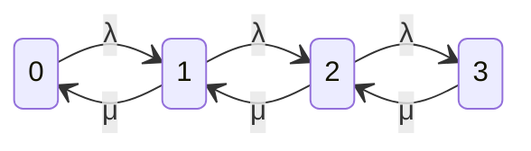

# P14 · Chương 05 — Queueing theory cho backend

Đến giờ bạn đã quen với một hiện tượng: service chạy ở 50% CPU thì p99 hiền lành, lên 90% thì p99 vọt lên gấp nhiều lần dù code không đổi một dòng. Chương này giải thích hiện tượng đó bằng toán, đủ để bạn *tính trước* chứ không chỉ *đo sau* (nhận xét của người soạn). Ta dựng mô hình hàng đợi, chứng minh vài công thức nền (Little, M/M/1, M/M/c, so sánh gộp hàng đợi), rồi chạy một chương trình mô phỏng bằng Rust để đối chiếu kết quả với lý thuyết.

Cả chương dùng một ví dụ giả định là `orders-api`, một service Rust nhận request đặt hàng và giao cho một worker pool gồm 10 worker (mỗi worker là một thread, hoặc một "slot" xử lý). Mỗi request chiếm một worker trung bình 10 ms, gồm cả thời gian tính toán lẫn thời gian chờ database. Lưu lượng điển hình là 800 request mỗi giây (nhận xét của người soạn: các con số này là giả định cho dễ tính, không phải số đo thật).

## Bạn sẽ hiểu được gì

1. **Q1.** Một hàng đợi gồm những thành phần nào (arrival process, service time, số server, kỷ luật phục vụ), utilization ρ là gì, ký hiệu Kendall `M/M/1`, `M/M/c`, `M/G/1` đọc ra sao, và vì sao vẫn có hàng đợi khi ρ < 1? → mục 1
2. **Q2.** Định luật Little $L = \lambda W$ phát biểu thế nào, chứng minh ra sao, và áp vào thread pool, connection pool thế nào? → mục 2
3. **Q3.** Với M/M/1, phân phối dừng được suy ra từ cân bằng sinh–tử (birth–death) ra sao, và từ đó $E[N] = \rho/(1-\rho)$, $E[T] = 1/(\mu-\lambda)$ ra sao? → mục 3
4. **Q4.** Vì sao latency "nổ" khi utilization tiến tới 100%, vì sao đuôi (p99) còn tệ hơn trung bình, và mô phỏng Rust có khớp lý thuyết không? → mục 4
5. **Q5.** M/M/c và công thức Erlang C là gì, tính tay ra sao cho worker pool của `orders-api`, và chọn số worker thế nào? → mục 5
6. **Q6.** Một hàng đợi chung cho c worker hơn c hàng đợi riêng bao nhiêu (M/M/2 so với 2 × M/M/1), và vì sao? → mục 6
7. **Q7.** Các mô hình trên sai ở đâu khi arrival không Poisson, service time đuôi nặng (heavy tail), và công thức nào còn dùng được? → mục 7

## Kiến thức cần trước

- [Chương 03 — Xác suất cho hệ thống](03-xac-suat.md): phân phối mũ (exponential), tính không nhớ (memoryless), quá trình Poisson, kỳ vọng. Chương này dùng chúng mà không dựng lại.
- [Chương 01 — Logic và chứng minh](01-logic-va-chung-minh.md): quy nạp, vì các chứng minh dưới đây dùng quy nạp đơn giản.
- [P12 · Chương 01 — Reliability, scalability, maintainability](../12-he-thong-du-lieu/01-reliability-scalability-maintainability.md), mục 4–5: percentile và tail latency amplification. Chương này cho bạn *cơ chế* đứng sau những quan sát ở đó.
- [P11 · Chương 03 — Hiệu năng service Rust](../11-do-dac-va-go-loi/03-hieu-nang-service-rust.md): cách đo p50/p99 bằng histogram.
- [P4 · Chương 01 — Thread](../04-concurrency/01-thread.md): thread của OS, vì worker pool của `orders-api` là các thread này.

Chương kế tiếp, [Chương 06 — Thống kê cho benchmark](06-thong-ke-cho-benchmark.md), dạy cách đo để số liệu thực tế có ý nghĩa; chương này dạy các con số đó *nên* trông thế nào.

---

## 1. Hàng đợi, utilization và ký hiệu Kendall (Q1)

> **Trả lời ngắn.** Một mô hình hàng đợi gồm quá trình khách đến (arrival process), thời gian phục vụ mỗi khách (service time), số server, kỷ luật chọn ai được phục vụ trước và sức chứa của phòng chờ[^k-model]. Utilization ρ là phần thời gian một server bận; nó phải nhỏ hơn 1 thì hàng đợi mới không phình mãi[^k-single]. Ký hiệu Kendall `a/b/c` ghi gọn ba thứ đầu: phân phối khoảng cách giữa hai lần đến, phân phối service time, số server[^k-notation]. Ngay cả khi ρ < 1, hàng đợi vẫn hình thành vì các thời gian đến và phục vụ dao động ngẫu nhiên[^hb-var].

**Giải thích.**

*Với `orders-api`.* Mỗi request vào service đi qua một cổng nhận kết nối rồi nằm chờ trong một hàng đợi cho tới khi một trong 10 worker rảnh. Worker lấy request ra, xử lý khoảng 10 ms, trả kết quả, rồi quay lại lấy request kế. "Hàng đợi" ở đây có thể là channel nội bộ, backlog của socket `accept`, hay hàng đợi của runtime (nhận xét của người soạn), nhưng cấu trúc thì luôn như nhau: có chỗ chờ, có chỗ phục vụ. Mục này đặt tên cho từng phần để các mục sau tính được.

### 1.1 Năm thành phần của mô hình

Mỗi mô hình hàng đợi được xác định bởi vài lựa chọn[^k-model]. Ta ghi lại cùng với ý nghĩa cho `orders-api`:

| Thành phần | Ý nghĩa tổng quát | Với `orders-api` |
|---|---|---|
| **Arrival process** | Khoảng cách giữa hai lần khách đến, thường giả định độc lập và cùng phân phối[^k-arrival] | Request đến với tốc độ trung bình λ = 800/s |
| **Service time** | Thời gian một khách chiếm một server, thường giả định độc lập, cùng phân phối và độc lập với arrival[^k-service] | Trung bình E[S] = 10 ms, tức tốc độ phục vụ μ = 1/E[S] = 100 request/s cho *mỗi worker* |
| **Số server** | Một hay nhiều server song song | c = 10 worker |
| **Service discipline** | Thứ tự chọn khách: FCFS (đến trước phục vụ trước), ngẫu nhiên, LIFO, ưu tiên, processor sharing (chia đều năng lực cho mọi khách đang có)[^k-discipline] | FCFS, trừ khi nói khác |
| **Waiting room** | Có giới hạn số khách trong hệ thống hay không[^k-discipline] | Chưa giới hạn (mục 7 nói về trường hợp có giới hạn) |

Hai chữ viết tắt sẽ dùng suốt chương. *Sojourn time* hay *response time*, ký hiệu T, là tổng thời gian khách ở trong hệ thống: thời gian chờ (waiting time, $W_q$) cộng thời gian phục vụ[^k-perf]. Với `orders-api`, T là latency mà client thấy ở phía server (chưa tính mạng). N là số khách có mặt trong hệ thống tại một thời điểm, gồm cả người đang được phục vụ[^adan-state].

### 1.2 Utilization ρ

Hãy đếm xem `orders-api` nhận bao nhiêu "công việc" mỗi giây. Mỗi request đòi 10 ms thời gian worker; 800 request mỗi giây đòi 800 × 10 ms = 8 giây thời gian worker trong mỗi giây thực. Nói cách khác, trung bình luôn có 8 worker bận. Đại lượng $a = \lambda/\mu = \lambda E[S]$ này gọi là *offered load* (tải chào), đo bằng đơn vị "số server" và tên đơn vị là erlang (nhận xét của người soạn: cách gọi `erlang` là quy ước của viễn thông, các tài liệu nguồn dùng kí hiệu khác nhau cho a).

Với c server giống nhau, *utilization* trên mỗi server là $\rho = \lambda E[S]/c = \lambda/(c\mu)$[^k-multi]. Với một server, ρ cũng chính là phần thời gian server đang làm việc[^hb-util]. Pool của `orders-api` có $a = 8$, $c = 10$ nên $\rho = 0.8$.

Điều kiện ổn định là $\rho < 1$. Nếu $\rho > 1$, công việc đến nhanh hơn khả năng xử lý và hàng đợi dài ra mãi. Nguồn còn nhấn mạnh trường hợp $\rho = 1$ cũng không cứu được, trừ hệ không có tí ngẫu nhiên nào[^k-single].

### 1.3 Vì sao ρ < 1 mà vẫn có hàng đợi

Hệ D/D/1 (khoảng cách đến cố định, service time cố định, một server) với $\rho < 1$ không bao giờ có hàng đợi: mỗi request đến đúng lúc worker vừa rảnh. Hàng đợi chỉ xuất hiện nhờ *dao động*: hàng đợi sinh ra do sự biến thiên của service time hoặc của khoảng cách giữa các lần đến[^hb-var]. Ví dụ, nếu ba request đến trong 10 ms trong khi worker chỉ làm xong một, hai request kia phải chờ, dù trung bình 1 giây worker vẫn rảnh 20%. Đây là điểm mấu chốt của cả chương: **trung bình công suất đủ chưa đủ; độ dao động mới quyết định độ dài hàng đợi**. Mục 7 định lượng chính xác sự dao động đó (qua $c^2$).

### 1.4 Ký hiệu Kendall

Kendall đề xuất bộ ba `a/b/c`: chữ đầu là phân phối khoảng cách giữa hai lần đến, chữ thứ hai là phân phối service time, chữ thứ ba là số server[^k-notation]. Các chữ cái hay gặp: `G` cho phân phối tổng quát, `M` cho phân phối mũ (M là *memoryless*, không nhớ), `D` cho hằng số, cố định[^k-letters]. Với `M` ở vị trí arrival, ta có quá trình Poisson, tức khoảng cách giữa hai lần đến là các biến mũ độc lập[^k-arrival]. Gallager cũng giới thiệu quy ước này theo cách tương tự[^g-notation].

| Ký hiệu | Đọc là | Ví dụ backend |
|---|---|---|
| M/M/1 | Poisson arrival, service mũ, 1 server | một thread xử lý tuần tự mọi request; xấp xỉ đầu tiên, dễ giải |
| M/M/c | Poisson arrival, service mũ, c server, một hàng đợi chung | worker pool dùng chung một queue (mục 5) |
| M/G/1 | Poisson arrival, service tùy ý, 1 server | một thread, service time đo được từ production (mục 7) |
| G/G/c | Tổng quát | thực tế; chỉ có xấp xỉ (Kingman, mục 7) |

Vì sao chọn `M` làm điểm xuất phát? Phân phối mũ không nhớ: biết một request đã được phục vụ 5 ms không giúp dự đoán nó còn bao lâu nữa[^adan-state]. Nhờ đó trạng thái của hệ chỉ cần ghi số khách N, không cần ghi mỗi người đã được phục vụ bao lâu, và ta giải được bằng cân bằng sinh–tử (mục 3). Cái giá là giả định mạnh; mục 7 nói khi nào nó vỡ.

<details><summary>Đi sâu: các phần mở rộng của Kendall, và "công thức không dùng cho worker nhỏ"</summary>

Ký hiệu có thể thêm chữ thứ tư: `M/M/1/N` là hệ M/M/1 mà phòng chờ chỉ chứa tối đa N khách kể cả người đang được phục vụ[^k-letters]. Với `orders-api`, một channel có biên (bounded channel) hay `listen` backlog hữu hạn chính là hệ có phòng chờ hữu hạn: khi đầy, khách mới bị chặn hoặc bị từ chối. Mục 7 quay lại điểm này.

Cũng đáng nhớ: trong hệ nhiều server, "utilization" của cả hệ thường được định nghĩa bằng utilization của *một* server khi tải được chia đều, tức $\lambda/(c\mu)$[^hb-util-sys]. Đó là cách ρ được dùng suốt chương này khi $c > 1$.

</details>

**Quay lại Q1:** hàng đợi gồm arrival process, service time, số server, discipline và waiting room; ρ = λ/(cμ) phải dưới 1; Kendall `a/b/c` ghi gọn ba thứ đầu; và hàng đợi tồn tại nhờ độ dao động chứ không chỉ nhờ trung bình, với `orders-api` $a = 8$ erlang, $c = 10$, $\rho = 0.8$.

---

## 2. Định luật Little: $L = \lambda W$ (Q2)

> **Trả lời ngắn.** Định luật Little nói số khách trung bình trong một hệ thống bằng tốc độ khách đến trung bình nhân thời gian trung bình mỗi khách ở trong hệ[^little-stmt]. Nó đúng không cần giả định gì về arrival, số server, phân phối service time hay thứ tự phục vụ[^hb-gen]. Chứng minh chỉ là tính cùng một diện tích theo hai cách[^little-proof]. Với service của bạn, nó cho phép suy ra số request đang bay, số worker bận hay số kết nối DB đang giữ chỉ từ throughput và latency trung bình.

**Giải thích.**

*Với `orders-api`.* Đồng nghiệp hỏi: "Pool 10 kết nối Postgres đủ không?" Bạn chưa cần mô hình xác suất nào. Chỉ cần biết throughput (800 request/s) và mỗi request giữ kết nối trung bình bao lâu. Định luật Little biến hai con số đó thành số kết nối bận trung bình. Mục này phát biểu, chứng minh, rồi áp vào đúng câu hỏi ấy.

### 2.1 Phát biểu

Đặt L là số khách trung bình trong hệ, λ là tốc độ khách đến trung bình (đơn vị khách/giây), W là thời gian trung bình một khách ở trong hệ (giây)[^little-stmt]. Khi đó

$$L = \lambda W.$$

"Hệ" ở đây là *bất kỳ vùng nào bạn vẽ ranh giới*: cả service, riêng hàng đợi, riêng phần đang phục vụ, hay cả một mạng nhiều hàng đợi. Định luật áp dụng cho từng phần, vì bất kỳ phần nào của một mạng hàng đợi lại là một mạng hàng đợi[^hb-gen]. Nó cũng độc lập với kỷ luật phục vụ[^little-gen].

### 2.2 Chứng minh (theo Little, khoảng thời gian hữu hạn)

Ta chứng minh trên một khoảng quan sát $[0, T]$ cố định, bắt đầu và kết thúc lúc hệ rỗng (trường hợp tổng quát bên dưới). Chứng minh này tính cùng một diện tích hai lần[^little-proof].

Đặt n(t) là số khách có mặt tại thời điểm t. Gọi N là số khách đến trong $[0, T]$, và $W_i$ là thời gian khách thứ i ở trong hệ. Định nghĩa diện tích $A = \int_0^T n(t)\,dt$.

1. **Cách thứ nhất: cắt theo thời gian.** Diện tích dưới đường n(t) chia cho độ dài T chính là số khách trung bình: $L = A/T$. Đây là định nghĩa "trung bình theo thời gian" của n(t).
2. **Cách thứ hai: cắt theo khách.** Mỗi khách i đóng góp vào diện tích một hình chữ nhật cao 1 và rộng $W_i$, vì khách đó được tính là "1" trong n(t) suốt đúng $W_i$ giây. Nếu hệ rỗng ở 0 và T thì không còn khách nào dở dang, nên mọi hình chữ nhật nằm trọn trong $[0, T]$ và $A = \sum_{i=1}^{N} W_i$. Chia cho N: $W = A/N$, đúng là thời gian trung bình mỗi khách ở trong hệ.
3. **Ghép.** Tốc độ đến là $\lambda = N/T$. Vậy $L = A/T = (N/T)\cdot(A/N) = \lambda W$. ∎

Ý nghĩa vật lý, theo Little: ta dùng diện tích A hai lần, một lần để tính L và một lần để tính W; điều đó làm được vì một khách đang xếp hàng *cũng đang* tích lũy thời gian chờ[^little-proof].

*Trường hợp tổng quát.* Nếu hệ không rỗng ở 0 hoặc T, đặt S(T) là số khách xuất hiện trong $[0, T]$ *kể cả những người đã có mặt ở thời điểm 0*; viết $\lambda = S(T)/T$ và $W = A/S(T)$, rồi lập luận y hệt cho $L = \lambda W$ đúng chính xác trên $[0, T]$[^little-ll2]. Điều này có hai hệ quả thực tế. Thứ nhất, công thức là *đẳng thức tất định trên một sample path*, không phải xấp xỉ xác suất, nên đúng ngay trên log của một ngày thật[^little-det]. Thứ hai, khi $T \to \infty$ và các trung bình hội tụ, ta được dạng quen thuộc cho hệ ở trạng thái dừng.

### 2.3 Áp dụng cho `orders-api`

Ba hệ quả hay dùng, tất cả đều chỉ là Little áp lên vùng khác nhau:

- **Cả hệ.** Áp vào hệ gồm hàng đợi và các server, $E[N] = \lambda E[T]$[^adan-little-sub]. Nếu `orders-api` có latency trung bình 12 ms ở 800 req/s thì trung bình có $800 \times 0.012 \approx 9.6$ request đang "bay" trong service. Nếu sự cố đẩy latency lên 200 ms mà client vẫn gửi 800 req/s, số request bay là $800 \times 0.2 = 160$. Không cần biết cơ chế gì, số này cho bạn kích cỡ bộ nhớ, số fd, số future cần chứa (nhận xét của người soạn).
- **Chỉ hàng đợi.** Áp vào hàng đợi (không tính server): $E[L_q] = \lambda E[W_q]$[^adan-little-sub]. Gauge "độ dài queue" chia cho throughput cho bạn thời gian chờ trung bình mà không cần đo từng request.
- **Chỉ phần phục vụ (Utilization Law).** Áp vào riêng các server: số khách trung bình đang được phục vụ chính là số server bận. Với một server, nó là 0 hoặc 1, nên kỳ vọng bằng ρ, và Little cho $\rho = \lambda E[S] = \lambda/\mu$[^hb-utlaw]. Với c server, số worker bận trung bình là $\lambda E[S] = a$. Pool 10 worker của `orders-api` có $a = 800 \times 0.01 = 8$ worker bận trung bình, vậy $\rho = 0.8$.

Áp vào *connection pool*: mỗi request giữ một kết nối DB trong $h$ giây (thời gian giữ kết nối, kể cả thời gian chờ DB trả lời). Số kết nối bận trung bình là $a = \lambda h$:

| Thời gian giữ kết nối h | Kết nối bận $a = 800 h$ | ρ của pool 10 kết nối |
|---|---|---|
| 4 ms | 3.2 | 0.32 |
| 8 ms | 6.4 | 0.64 |
| 11 ms | 8.8 | 0.88 |
| 12 ms | 9.6 | 0.96 |

Mỗi hàng chỉ là một phép nhân, nhưng nó trả lời câu hỏi ban đầu: pool 10 kết nối thoải mái ở h = 4 ms, nhưng khi DB chậm tới 11–12 ms thì pool gần cạn. Mục 5 tính thời gian chờ thật sự từ các ρ này bằng Erlang C.

Một lưu ý khi dùng: Little nối ba *trung bình* với nhau, nên nó không cho biết p99. Nó cũng đòi các trung bình ổn định trên cùng một khoảng thời gian; đo λ trong 1 phút nhưng W trong 1 giờ thì phép nhân vô nghĩa (nhận xét của người soạn).

<details><summary>Đi sâu: Little trên tập con khách, và các tổng quát hóa</summary>

Định luật không chỉ áp cho cả quần thể khách. Với từng *lớp* khách (ví dụ riêng request `POST /orders` hay riêng request chậm), nếu tách các tập con tách biệt thì $L_k = \lambda_k W_k$ cho từng lớp k, và tổng hợp lại $L = \sum L_k$, $\lambda = \sum \lambda_k$, $W = \sum (\lambda_k/\lambda) W_k$[^little-classes]. Little (2011) còn phát biểu dạng tổng quát hơn $H = \lambda G$, trong đó mỗi khách được gán một hàm trọng số theo thời gian ở trong hệ; $L = \lambda W$ là trường hợp trọng số bằng 1[^little-hg].

Chứng minh gốc năm 1961 là chứng minh *dừng* (stationary), dựa trên các giả định xác suất; Stidham (1972, 1974) đưa ra chứng minh sample path đầu tiên cho độ tổng quát hiện nay[^little-stidham]. Bài này chọn dạng sample path của Little (2011) vì nó chỉ cần đại số trên diện tích. Harchol-Balter chứng minh cũng bằng diện tích, nhưng cho hệ ergodic và ở dạng giới hạn[^hb-little-area].

</details>

**Quay lại Q2:** $L = \lambda W$ đúng cho mọi vùng bạn chọn làm "hệ", vì chứng minh chỉ là tính một diện tích hai cách; với `orders-api` nó cho 9.6 request bay ở latency 12 ms, 8 worker bận ở service 10 ms, và cho biết pool 10 kết nối DB sẽ gần cạn khi giữ kết nối lâu hơn khoảng 11 ms.

---

## 3. M/M/1: phân phối dừng từ cân bằng sinh–tử (Q3)

> **Trả lời ngắn.** Với một server, arrival Poisson tốc độ λ và service mũ tốc độ μ, số khách trong hệ là một chuỗi sinh–tử: tăng 1 với tốc độ λ, giảm 1 với tốc độ μ. Cân bằng dòng qua từng "lát cắt" cho $\lambda p_{n-1} = \mu p_n$[^adan-global], suy ra $p_n = (1-\rho)\rho^n$, một phân phối hình học (geometric)[^adan-geom]. Từ đó số khách trung bình là $\rho/(1-\rho)$ và, qua định luật Little, thời gian trung bình ở trong hệ là $1/(\mu-\lambda)$[^adan-explode].

**Giải thích.**

*Với `orders-api` rút gọn.* Hãy bắt đầu từ trường hợp đơn giản nhất: thu pool về *một* worker (một thread duy nhất xử lý tuần tự), service time trung bình 10 ms (μ = 100/s) và request đến Poisson với λ. Ta hỏi: sau một thời gian dài, xác suất đang có đúng n request trong hệ là bao nhiêu? Câu trả lời cho mọi thứ còn lại.

### 3.1 Mô hình sinh–tử

Gọi N(t) là số request trong hệ lúc t (đang chạy cộng đang chờ). Vì khoảng cách đến và service time đều là phân phối mũ, tính không nhớ cho phép mô tả trạng thái chỉ bằng N(t): không cần nhớ request cuối đến lúc nào hay request đang chạy đã chạy bao lâu[^adan-state]. Các bước nhảy chỉ có hai kiểu:

- N tăng 1 (một request đến) với tốc độ λ, ở mọi trạng thái.
- N giảm 1 (một request xong) với tốc độ μ, chỉ khi $N \ge 1$.



(Sơ đồ chuyển trạng thái của người soạn, vẽ lại cấu trúc ở nguồn[^adan-flow]; chuỗi kéo dài sang phải đến vô hạn.)

Gọi $p_n$ là phần thời gian hệ ở trạng thái n khi chạy lâu dài (phân phối dừng). Số bước chuyển từ n sang n+1 mỗi đơn vị thời gian bằng $p_n$ (phần thời gian hệ ở n) nhân λ (tốc độ khách đến khi hệ ở n)[^adan-flow].

### 3.2 Cân bằng dòng và nghiệm hình học (chứng minh)

**Nguyên lý cân bằng.** Với mọi tập trạng thái A, dòng đi ra khỏi A bằng dòng đi vào A[^adan-global]. Ta áp nguyên lý này cho tập $A = \{0, 1, \dots, n-1\}$ (người soạn trình bày lại lý do bên dưới).

*Vì sao đúng:* N chỉ đổi ±1 mỗi lần, nên mỗi lần N đi từ $n-1$ lên $n$ (vượt "lát cắt" giữa $n-1$ và $n$ theo chiều lên) thì muốn đi lên nữa nó phải quay xuống qua đúng lát cắt đó. Trong một khoảng dài, số lần vượt lên và số lần vượt xuống chênh nhau nhiều nhất 1, nên tốc độ hai chiều bằng nhau khi chạy lâu dài (lập luận của người soạn).

**Bước 1: Hệ thức cắt.** Tốc độ vượt lên qua lát cắt giữa $n-1$ và $n$ là $\lambda p_{n-1}$ (đang ở $n-1$ và có khách đến). Tốc độ vượt xuống là $\mu p_n$ (đang ở n và có khách xong). Cân bằng:

$$\lambda\, p_{n-1} = \mu\, p_n, \qquad n = 1, 2, \dots$$

**Bước 2: Giải đệ quy.** Đặt $\rho = \lambda/\mu$. Từ bước 1, $p_n = \rho\, p_{n-1}$. Quy nạp: $p_0$ đã cho; nếu $p_{n-1} = \rho^{n-1} p_0$ thì $p_n = \rho \cdot \rho^{n-1} p_0 = \rho^n p_0$. Vậy $p_n = \rho^n p_0$ với mọi $n \ge 0$[^adan-global].

**Bước 3: Chuẩn hóa.** Tổng xác suất phải bằng 1: $\sum_{n \ge 0} p_n = p_0 \sum_{n\ge 0} \rho^n = 1$. Chuỗi hình học hội tụ khi và chỉ khi $\rho < 1$, với tổng $1/(1-\rho)$. Vậy nếu $\rho < 1$ thì $p_0 = 1 - \rho$ và

$$p_n = (1-\rho)\,\rho^n, \qquad n = 0, 1, 2, \dots$$

Nếu $\rho \ge 1$ thì tổng phân kỳ, không có phân phối dừng nào thỏa hệ thức cắt: hàng đợi không ổn định. Đây là lý do toán học của điều kiện $\rho < 1$ ở mục 1. Nhận xét thêm: phân phối này chỉ phụ thuộc λ và μ qua tỉ số ρ[^adan-geom]. Cũng nhận ngay $p_0 = 1 - \rho$: xác suất server rảnh là $1 - \rho$, khớp với "ρ là phần thời gian server bận"[^hb-util].

Ví dụ số: một worker, μ = 100/s, λ = 80/s, ρ = 0.8. Xác suất hệ rỗng là 0.2; có đúng 1 request là $0.2 \times 0.8 = 0.16$; có từ 5 request trở lên là $\rho^5 = 0.8^5 \approx 0.328$ (vì $P(N \ge n) = \sum_{k\ge n}(1-\rho)\rho^k = \rho^n$).

### 3.3 Số khách trung bình và thời gian trung bình (chứng minh)

**Bước 4: Số khách trung bình.** $E[N] = \sum_{n\ge 0} n\,(1-\rho)\rho^n = (1-\rho)\rho \sum_{n \ge 1} n \rho^{n-1}$. Với $|\rho| < 1$, đạo hàm từng số hạng của $\sum_{n\ge0}\rho^n = 1/(1-\rho)$ cho $\sum_{n\ge1} n\rho^{n-1} = 1/(1-\rho)^2$. Thay vào:

$$E[N] = (1-\rho)\,\rho\,\frac{1}{(1-\rho)^2} = \frac{\rho}{1-\rho}.$$

Số lượng này nhận cùng kết quả mà nguồn tính[^adan-explode].

**Bước 5: Thời gian trung bình qua định luật Little.** Áp Little lên cả hệ: $E[T] = E[N]/\lambda$. Vậy

$$E[T] = \frac{1}{\lambda}\cdot\frac{\rho}{1-\rho} = \frac{1}{\lambda}\cdot\frac{\lambda/\mu}{1-\rho} = \frac{1/\mu}{1-\rho} = \frac{1}{\mu - \lambda}.$$

Hai dạng cuối khớp với kết quả của nguồn: $E[T] = (1/\mu)/(1-\rho)$[^adan-explode]. Phần chờ: $E[W_q] = E[T] - 1/\mu = \rho/(\mu-\lambda)$, và số khách trong hàng chờ (không tính người đang chạy) là $E[L_q] = E[N] - \rho = \rho^2/(1-\rho)$ (người soạn rút ra bằng cách trừ; nguồn cũng cho cùng kết quả)[^adan-explode].

Với ví dụ μ = 100/s, λ = 80/s: $E[N] = 0.8/0.2 = 4$ request; $E[T] = 1/(100 - 80) = 50$ ms, gấp **5 lần** service time 10 ms; $E[W_q] = 40$ ms.

**Cách khác, không cần $p_n$.** Nếu Poisson arrival thì khách đến thấy hệ y như một người quan sát bất kỳ thời điểm (PASTA): *Poisson Arrivals See Time Averages*. Tính chất này chỉ đúng cho arrival Poisson[^pasta]. Khách đến thấy trung bình $E[N]$ người trong hệ, mỗi người cần trung bình $1/\mu$ (người đang chạy cũng vậy, nhờ tính không nhớ), rồi tới phần chính mình: $E[T] = E[N]/\mu + 1/\mu$. Ghép với Little $E[N] = \lambda E[T]$ cho $E[T]\,(1-\rho) = 1/\mu$, tức công thức trên[^adan-meanvalue].

### 3.4 Cả phân phối của T, không chỉ trung bình

Trung bình chưa đủ để nói chuyện p99; ta cần phân phối. Với M/M/1 FCFS, khách đến thấy $n$ khách với xác suất $(1-\rho)\rho^n$ (PASTA), và T là tổng $n+1$ service time mũ độc lập tốc độ μ (người đang chạy có thời gian còn lại cũng mũ nhờ tính không nhớ)[^adan-sojourn]. Tính biến đổi Laplace: $E[e^{-sT}] = \sum_n (1-\rho)\rho^n\left(\frac{\mu}{\mu+s}\right)^{n+1} = \frac{(1-\rho)\mu/(\mu+s)}{1-\rho\mu/(\mu+s)} = \frac{\mu(1-\rho)}{\mu(1-\rho)+s}$. Đây là biến đổi của phân phối mũ tốc độ $\mu(1-\rho) = \mu - \lambda$, nên

$$P(T > t) = e^{-(\mu-\lambda)\,t}.$$

Hệ quả cho đuôi, dùng lại ở mục 4: $P(T > a\,E[T]) = e^{-a}$[^adan-sojourn], nên $p99 = \ln(100)\,E[T] \approx 4.6\,E[T]$ ở *mọi* ρ.

<details><summary>Đi sâu: cách khác tới cùng nghiệm, và vì sao "chuỗi sinh–tử" là chuỗi Markov</summary>

Nguồn trình bày bốn cách tới $p_n = (1-\rho)\rho^n$: giải trực tiếp hệ phương trình cân bằng từng trạng thái (phương trình hồi quy bậc hai có hai nghiệm $x = 1$ và $x = \rho$), thế đệ quy, hàm sinh xác suất, và nguyên lý cân bằng toàn cục áp lên tập $\{0,\dots,n-1\}$ như trên[^adan-direct]. Cách ta chọn (cắt tập) là cách ngắn nhất.

Phương trình cân bằng *từng trạng thái* (flow ra khỏi n bằng flow vào n) là $0 = -\lambda p_0 + \mu p_1$ cho $n=0$ và $0 = \lambda p_{n-1} - (\lambda+\mu)p_n + \mu p_{n+1}$ cho $n\ge1$[^adan-limit]. Phương trình cắt tập $\lambda p_{n-1} = \mu p_n$ là tổng của các phương trình này từ 0 đến $n-1$, nên đơn giản hơn.

Phân phối của N(t) *tại mọi thời điểm t* (không chỉ trạng thái dừng) thỏa một hệ phương trình vi phân cho $p_n(t)$; nghiệm tường minh là một tổng vô hạn các hàm Bessel biến dạng. Vì vậy chỉ trạng thái dừng là phù hợp để làm việc[^adan-transient].

</details>

**Quay lại Q3:** cân bằng dòng qua lát cắt cho $\lambda p_{n-1} = \mu p_n$, suy ra $p_n = (1-\rho)\rho^n$ khi $\rho < 1$, rồi $E[N] = \rho/(1-\rho)$ và, qua Little, $E[T] = 1/(\mu-\lambda)$; với một worker 10 ms ở ρ = 0.8, `orders-api` rút gọn có trung bình 4 request trong hệ và latency trung bình 50 ms.

---

## 4. Đường cong latency–utilization và đuôi (Q4)

> **Trả lời ngắn.** Ở M/M/1, thời gian trung bình ở trong hệ gấp $1/(1-\rho)$ lần service time, nên nó tăng chậm khi ρ thấp và vọt lên khi ρ gần 1: 2 lần ở ρ = 0.5, 10 lần ở ρ = 0.9, 100 lần ở ρ = 0.99[^adan-explode]. Cả E[N] lẫn E[T] tiến tới vô cùng khi ρ tiến tới 1, và nguồn gọi đây là hành vi đặc trưng của hầu hết hệ hàng đợi, gây ra bởi sự dao động của arrival và service[^adan-explode]. Đuôi còn xấu hơn vì T có phân phối mũ với tốc độ $\mu - \lambda$, nên p99 gấp khoảng 4.6 lần trung bình[^adan-sojourn]. Chương trình mô phỏng ở dưới khớp lý thuyết ở cả mức trung bình lẫn p99.

**Giải thích.**

*Với `orders-api`.* Ban đầu bạn chạy 1 worker (μ = 100/s) và đo p99 ở lưu lượng thấp: p99 chỉ khoảng 46 ms. Bạn tăng lưu lượng lên 90% công suất, và p99 đột ngột thành 460 ms, gấp 10 lần dù worker không đổi. Không có gì "hỏng" cả. Đây là đúng hình dạng của công thức ở mục 3.

### 4.1 Đường cong

Đặt $\mu = 100$/s (service time trung bình 10 ms). Công thức $E[T] = (1/\mu)/(1-\rho)$ và $p99 = \ln(100)\,E[T]$ cho:

| ρ | $E[T]$ / E[S] | E[T] (ms) | p99 (ms) | Khoảng trống còn lại $\mu-\lambda$ (req/s) |
|---|---|---|---|---|
| 0.50 | 2 | 20 | 92.1 | 50 |
| 0.70 | 3.33 | 33.3 | 153.5 | 30 |
| 0.80 | 5 | 50 | 230.3 | 20 |
| 0.90 | 10 | 100 | 460.5 | 10 |
| 0.95 | 20 | 200 | 921.0 | 5 |
| 0.99 | 100 | 1000 | 4605.2 | 1 |

(Bảng của người soạn tính từ công thức mục 3. Ví dụ ρ = 0.9: $E[T] = 0.01/0.1 = 0.1$ s, $p99 = 4.605 \times 100\text{ ms} = 460.5$ ms.)

Ba cách nhìn cho thấy vì sao đường cong dốc đứng:

1. **Công suất dư là cơ chế duy nhất tháo hàng đợi.** Một cụm request đến dồn dập tạo ra backlog; backlog chỉ giảm nhờ worker làm nhanh hơn tốc độ đến, tức với tốc độ $\mu - \lambda$ (giải thích của người soạn, khớp với $E[T] = 1/(\mu-\lambda)$). Ở ρ = 0.99 tốc độ tháo chỉ 1 request mỗi giây, nên một cụm 20 request cần cỡ 20 giây để tan.
2. **Phân phối $p_n = (1-\rho)\rho^n$ có đuôi hình học chậm tắt.** $P(N \ge n) = \rho^n$ (mục 3.2): ở ρ = 0.5, xác suất có từ 10 request trở lên là $0.5^{10} \approx 0.001$; ở ρ = 0.95 là $0.95^{10} \approx 0.60$. Chính vì chỉ số mũ nằm ở ρ, "gần 1" làm hàng đợi dài chớp nhoáng.
3. **Độ nhạy.** $\partial E[T]/\partial\lambda = 1/(\mu-\lambda)^2$ (đạo hàm của $1/(\mu-\lambda)$). Ở ρ = 0.5, tăng λ thêm 1 request/s làm E[T] tăng $1/50^2 = 0.4$ ms; ở ρ = 0.9, cùng bước tăng đó làm E[T] tăng $1/10^2 = 10$ ms, gấp 25 lần. Tức là *càng đầy, mỗi request thêm càng đắt*.

Nguồn nhấn mạnh rằng hành vi này không riêng M/M/1; nó đặc trưng cho hầu hết hệ hàng đợi, và nguyên nhân là sự dao động của quá trình đến và phục vụ[^adan-explode]. Vì sao hệ không dao động (D/D/1) thì không nổ: không có dao động thì không có backlog để tháo (mục 1.3).

### 4.2 Vì sao đuôi tệ hơn trung bình

Có ba nguyên nhân khác nhau, và cần tách chúng ra vì cách chữa khác nhau.

**(a) Bản thân phân phối T đã có đuôi.** Ở M/M/1, T là biến mũ tốc độ $\mu-\lambda$, nên một khách chờ lâu hơn $a$ lần mức trung bình với xác suất $e^{-a}$; chờ lâu hơn 2, 3 hay 4 lần mức trung bình là chuyện không hiếm[^adan-sojourn]. $e^{-a} = 0.01$ cho $a = \ln 100 \approx 4.6$, vậy p99 gấp 4.6 lần trung bình, ở mọi ρ. Điều đáng chú ý cho SLO là số p99 *tuyệt đối* tăng cùng đường cong của trung bình: nếu service time là 10 ms và SLO là p99 ≤ 100 ms, ta cần $\ln(100)/(\mu-\lambda) \le 0.1$ s, tức $\mu - \lambda \ge 46.05$, $\lambda \le 53.95$ và $\rho \le 0.54$. Một worker không được chạy quá khoảng 54% mới giữ được SLO đó (tính của người soạn từ công thức mục 3.4).

**(b) Dao động của chính service time.** Mục 7 chứng minh công thức Pollaczek–Khinchine: thời gian chờ trung bình tỉ lệ với $(1 + c^2)/2$ với $c^2$ là bình phương hệ số biến thiên của service time[^adan-pk-two]. Service time đuôi dài (một request chậm hiếm hoi) làm cả hàng đợi sau nó chờ.

**(c) Khuếch đại qua nhiều tầng.** Nhiều lớp hàng đợi ở server trung gian và thiết bị mạng khuếch đại độ biến thiên của latency[^tail-queue]. Khi một request phải gom kết quả từ nhiều server chạy song song, tỉ lệ chậm nhân lên: nếu mỗi server chậm một giây ở 1% request thì với 100 server, 63% request người dùng sẽ lâu hơn một giây[^tail-fanout]. Chủ đề này đã được trình bày ở [P12 · Chương 01](../12-he-thong-du-lieu/01-reliability-scalability-maintainability.md); ở đây ta chỉ chốt rằng hàng đợi là một trong các nguồn gây biến thiên đó.

### 4.3 Mô phỏng sự kiện rời rạc (discrete-event) bằng Rust

Công thức đẹp thì cũng cần kiểm bằng chương trình. Chương trình dưới đây mô phỏng hàng đợi FCFS với arrival Poisson, c server và service time chọn được (mũ, hằng số, hoặc lognormal). Cách làm: ở mỗi job, lấy khoảng cách đến mũ, chọn server rảnh sớm nhất, bắt đầu phục vụ lúc $\max(\text{thời điểm đến}, \text{lúc server rảnh})$, rồi cập nhật lúc server rảnh. Cách này cho đúng kết quả FCFS (người soạn). Số khách trung bình theo thời gian được tính *độc lập* bằng cách quét các sự kiện đến và đi theo thứ tự thời gian, không dùng Little, nên so sánh $E[N]$ với $\lambda E[T]$ là một phép kiểm thật sự.

Mã đầy đủ nằm trong khối bên dưới (khoảng 150 dòng, đã chạy trên macOS, `rustc 1.95.0`, tối ưu `-O`):

<details><summary>Mã nguồn đầy đủ: <code>mm1.rs</code> (mô phỏng M/M/1, M/M/c, M/G/1)</summary>

```rust
// Mô phỏng hàng đợi FCFS: arrival Poisson, service tùy phân phối, c server.
// Mỗi job: arrival_i, service_i; chọn server rảnh sớm nhất (đúng FCFS cho c server).

struct Rng(u64);
impl Rng {
    fn next_u64(&mut self) -> u64 {
        // xorshift64*
        let mut x = self.0;
        x ^= x >> 12;
        x ^= x << 25;
        x ^= x >> 27;
        self.0 = x;
        x.wrapping_mul(0x2545F4914F6CDD1D)
    }
    fn unif(&mut self) -> f64 {
        // (0,1]
        ((self.next_u64() >> 11) as f64 + 1.0) / ((1u64 << 53) as f64)
    }
    fn exp(&mut self, rate: f64) -> f64 {
        -self.unif().ln() / rate
    }
    fn normal(&mut self) -> f64 {
        let (u1, u2) = (self.unif(), self.unif());
        (-2.0 * u1.ln()).sqrt() * (2.0 * std::f64::consts::PI * u2).cos()
    }
}

#[derive(Clone, Copy)]
enum Svc {
    Exp,
    Det,
    LogNormal(f64), // c^2 mong muốn
}

fn svc(r: &mut Rng, kind: Svc, mean: f64) -> f64 {
    match kind {
        Svc::Exp => r.exp(1.0 / mean),
        Svc::Det => mean,
        Svc::LogNormal(c2) => {
            let s2 = (1.0 + c2).ln();
            let mu = mean.ln() - s2 / 2.0;
            (mu + s2.sqrt() * r.normal()).exp()
        }
    }
}

struct Out {
    mean_t: f64,
    mean_w: f64,
    mean_n: f64,
    p50: f64,
    p99: f64,
    p_wait: f64,
}

fn run(seed: u64, lambda: f64, mean_s: f64, c: usize, kind: Svc, jobs: usize) -> Out {
    let mut r = Rng(seed);
    let mut free = vec![0.0f64; c];
    let mut t_arr = 0.0;
    let mut soj = Vec::with_capacity(jobs);
    let mut sum_w = 0.0;
    let mut waited = 0usize;
    let mut arrs = Vec::with_capacity(jobs);
    let mut deps = Vec::with_capacity(jobs);
    for _ in 0..jobs {
        t_arr += r.exp(lambda);
        let s = svc(&mut r, kind, mean_s);
        // server rảnh sớm nhất
        let (k, &f) = free
            .iter()
            .enumerate()
            .min_by(|a, b| a.1.partial_cmp(b.1).unwrap())
            .unwrap();
        let start = if f > t_arr { f } else { t_arr };
        let dep = start + s;
        free[k] = dep;
        let w = start - t_arr;
        sum_w += w;
        if w > 0.0 {
            waited += 1;
        }
        soj.push(dep - t_arr);
        arrs.push(t_arr);
        deps.push(dep);
    }
    // N(t) trung bình theo thời gian trên [0, T_end], T_end = departure cuối: tích phân độc lập với Little
    deps.sort_by(|a, b| a.partial_cmp(b).unwrap());
    let (mut i, mut j, mut n, mut last, mut area) = (0usize, 0usize, 0i64, 0.0f64, 0.0f64);
    while j < jobs {
        let next_arr = if i < jobs { arrs[i] } else { f64::INFINITY };
        let (tt, d) = if next_arr <= deps[j] { (next_arr, 1) } else { (deps[j], -1) };
        area += n as f64 * (tt - last);
        last = tt;
        n += d;
        if d == 1 { i += 1 } else { j += 1 }
    }
    let t_end = last;
    soj.sort_by(|a, b| a.partial_cmp(b).unwrap());
    let q = |p: f64| soj[((jobs as f64) * p) as usize];
    Out {
        mean_t: soj.iter().sum::<f64>() / jobs as f64,
        mean_w: sum_w / jobs as f64,
        mean_n: area / t_end,
        p50: q(0.50),
        p99: q(0.99),
        p_wait: waited as f64 / jobs as f64,
    }
}

fn erlang_c(c: usize, a: f64) -> f64 {
    // Erlang B đệ quy rồi đổi sang C
    let mut b = 1.0;
    for k in 1..=c {
        b = a * b / (k as f64 + a * b);
    }
    let rho = a / c as f64;
    b / (1.0 - rho * (1.0 - b))
}

fn main() {
    let mu = 100.0; // 100 req/s mỗi worker => E[S] = 10 ms
    let es = 1.0 / mu;
    let jobs = 4_000_000;

    println!("== M/M/1, mu=100/s, {jobs} job ==");
    println!("rho   | E[T] sim (ms) | E[T] lý thuyết | E[N] sim | E[N] lt | lambda*E[T] sim | p50 sim/lt (ms) | p99 sim/lt (ms)");
    for &rho in &[0.5, 0.7, 0.8, 0.9, 0.95] {
        let lam = rho * mu;
        let o = run(42, lam, es, 1, Svc::Exp, jobs);
        let t_th = 1.0 / (mu - lam);
        println!(
            "{:.2}  | {:8.2}      | {:8.2}       | {:6.3}   | {:6.3}  | {:8.3}        | {:5.1}/{:5.1}      | {:6.1}/{:6.1}",
            rho, o.mean_t * 1e3, t_th * 1e3, o.mean_n, rho / (1.0 - rho), lam * o.mean_t,
            o.p50 * 1e3, 2f64.ln() * t_th * 1e3, o.p99 * 1e3, 100f64.ln() * t_th * 1e3
        );
    }

    println!("\n== Erlang C: c=10 worker, lambda=800/s, mu=100/s (a=8, rho=0.8) ==");
    let (c, a) = (10usize, 8.0f64);
    let cc = erlang_c(c, a);
    let wq = cc / (c as f64 * mu - 800.0);
    println!("lý thuyết: C(10,8)={:.4}, E[Wq]={:.3} ms, E[T]={:.3} ms", cc, wq * 1e3, (wq + es) * 1e3);
    let o = run(7, 800.0, es, 10, Svc::Exp, jobs);
    println!("mô phỏng : P(wait)={:.4}, E[Wq]={:.3} ms, E[T]={:.3} ms, p99 T={:.2} ms", o.p_wait, o.mean_w * 1e3, o.mean_t * 1e3, o.p99 * 1e3);
    let o1 = run(7, 800.0, 1.0 / 1000.0, 1, Svc::Exp, jobs);
    println!("1 worker nhanh gấp 10 (mu=1000/s): E[T]={:.3} ms (lt {:.3}), p99 T={:.2} ms", o1.mean_t * 1e3, 1e3 / (1000.0 - 800.0), o1.p99 * 1e3);

    println!("\n== Gộp hàng đợi: M/M/2 vs 2 x M/M/1 (mu=100/s) ==");
    println!("rho  | E[T] gộp sim/lt (ms) | E[T] tách sim/lt (ms) | p99 gộp | p99 tách");
    for &rho in &[0.5, 0.8, 0.9, 0.95] {
        let lam2 = 2.0 * rho * mu;
        let pooled = run(11, lam2, es, 2, Svc::Exp, jobs);
        let sep = run(13, lam2 / 2.0, es, 1, Svc::Exp, jobs);
        let t_p = 1.0 / (mu * (1.0 - rho * rho));
        let t_s = 1.0 / (mu * (1.0 - rho));
        println!(
            "{:.2} | {:6.2}/{:6.2}        | {:6.2}/{:6.2}         | {:6.1}  | {:6.1}",
            rho, pooled.mean_t * 1e3, t_p * 1e3, sep.mean_t * 1e3, t_s * 1e3, pooled.p99 * 1e3, sep.p99 * 1e3
        );
    }

    println!("\n== M/G/1, rho=0.8, E[S]=10 ms: ảnh hưởng của c^2 (Pollaczek-Khinchin) ==");
    println!("dạng service       | c^2 | E[Wq] sim (ms) | E[Wq] P-K (ms) | p99 T sim (ms)");
    for (name, kind, c2) in [("deterministic", Svc::Det, 0.0), ("exponential", Svc::Exp, 1.0), ("lognormal c^2=4", Svc::LogNormal(4.0), 4.0)] {
        let rho = 0.8;
        let pk = rho / (1.0 - rho) * (1.0 + c2) / 2.0 * es;
        let o = run(99, rho * mu, es, 1, kind, 8_000_000);
        println!("{:<18} | {:3.0} | {:10.2}     | {:10.2}     | {:8.1}", name, c2, o.mean_w * 1e3, pk * 1e3, o.p99 * 1e3);
    }
}
```

</details>

Phần M/M/1 của đầu ra, với μ = 100/s, 4 triệu job mỗi hàng, bắt đầu từ hệ rỗng (**quan sát một lần chạy, không phải bảo đảm**):

```text
== M/M/1, mu=100/s, 4000000 job ==
rho   | E[T] sim (ms) | E[T] lý thuyết | E[N] sim | E[N] lt | lambda*E[T] sim | p50 sim/lt (ms) | p99 sim/lt (ms)
0.50  |    19.96      |    20.00       |  0.998   |  1.000  |    0.998        |  13.9/ 13.9      |   91.6/  92.1
0.70  |    33.26      |    33.33       |  2.329   |  2.333  |    2.328        |  23.1/ 23.1      |  153.1/ 153.5
0.80  |    49.85      |    50.00       |  3.989   |  4.000  |    3.988        |  34.5/ 34.7      |  229.3/ 230.3
0.90  |    99.40      |   100.00       |  8.948   |  9.000  |    8.946        |  68.9/ 69.3      |  464.4/ 460.5
0.95  |   197.18      |   200.00       | 18.737   | 19.000  |   18.732        | 137.1/138.6      |  910.5/ 921.0
```

Cách đọc: cột "sim" là mô phỏng, "lt" là lý thuyết; $\lambda E[T]$ là vế phải của Little tính từ mô phỏng.

Ba nhận xét. Một, trung bình khớp lý thuyết trong khoảng 1.5% ở mọi ρ thử; sai lệch nhỏ và luôn *thấp hơn* lý thuyết. Mô phỏng bắt đầu từ hệ rỗng và chạy hữu hạn, nên các job đầu chưa thấy hàng đợi đầy đủ; ảnh hưởng này lớn hơn khi ρ cao và hệ hội tụ chậm (giải thích của người soạn, chưa kiểm riêng). Hai, $E[N]$ tính bằng tích phân theo thời gian và $\lambda E[T]$ khác nhau chỉ ở chữ số thứ ba (ví dụ 3.989 và 3.988 ở ρ = 0.8), như Little dự đoán. Ba, p50 và p99 khớp công thức mũ $\ln 2/(\mu-\lambda)$ và $\ln 100/(\mu-\lambda)$, ví dụ ở ρ = 0.9: 464.4 ms mô phỏng so với 460.5 ms lý thuyết, và ở ρ = 0.5 p99 chỉ 91.6 ms. Vậy p99 *thật sự* nhảy 5 lần khi ρ từ 0.5 lên 0.9, đúng như mục 4.1.

<details><summary>Đi sâu: vì sao đưa ρ lên 0.99 là việc nguy hiểm trong cả thực tế lẫn mô phỏng</summary>

Với ρ → 1 phương sai của ước lượng trung bình mẫu cũng tăng, vì các giá trị trong cùng một "chu kỳ bận" tương quan mạnh và chu kỳ bận kéo dài. Vì vậy ta dừng ở 0.95 trong bảng; còn việc đưa ra khoảng tin cậy cho các số này (batch means, nhiều seed độc lập) là chủ đề của [Chương 06](06-thong-ke-cho-benchmark.md), không làm ở đây. Chạy lại với seed khác sẽ cho các con số hơi khác ở chữ số cuối (suy luận của người soạn, chưa chạy thêm seed).

Một lưu ý khác về đo thực tế: nếu bộ sinh tải của bạn là *vòng kín* (mỗi client chờ response rồi mới gửi tiếp, số client cố định), tốc độ đến tự giảm khi server chậm, nên bạn không bao giờ đẩy được hệ vào vùng ρ gần 1 như mô hình mở ở trên, và p99 bạn đo sẽ đẹp hơn thực tế khi lưu lượng thật đến độc lập (suy luận của người soạn; dẫn nguồn sẽ ở chương 06).

</details>

**Quay lại Q4:** $E[T] = (1/\mu)/(1-\rho)$ dốc đứng vì công suất dư $\mu - \lambda$ là cách duy nhất tháo backlog, và đuôi tệ hơn vì T là biến mũ tốc độ $\mu-\lambda$ (p99 ≈ 4.6 × trung bình), cộng thêm dao động service time và khuếch đại nhiều tầng; mô phỏng Rust khớp lý thuyết trong khoảng 1.5% ở trung bình (ví dụ p99 ≈ 464 ms so với 460.5 ms ở ρ = 0.9).

---

## 5. M/M/c và công thức Erlang C (Q5)

> **Trả lời ngắn.** M/M/c là hệ có c server giống nhau chia chung một hàng đợi, arrival Poisson và service mũ. Xác suất một request đến phải chờ (tức cả c server đều bận) gọi là Erlang C[^wolfram-erlangc]; từ nó ra thời gian chờ trung bình $E[W_q] = C/(c\mu - \lambda)$ (chứng minh ở dưới). Với `orders-api` (10 worker, λ = 800/s, E[S] = 10 ms), Erlang C bằng 0.409, chờ trung bình 2.05 ms và latency trung bình 12.05 ms. Muốn chắc ăn nên cộng thêm cỡ $\sqrt{a}$ worker ngoài mức $a$ worker bận trung bình[^emu-sqrt].

**Giải thích.**

*Với `orders-api` thật.* Giờ ta quay lại pool 10 worker. Câu hỏi: ở 800 req/s, bao nhiêu phần request phải xếp hàng, và họ chờ bao lâu? Câu hỏi thứ hai quyết định có cần thêm worker hay không.

### 5.1 Chuỗi sinh–tử của M/M/c (chứng minh của người soạn)

Trạng thái vẫn là N, số request trong hệ. Tốc độ đến vẫn là λ. Nhưng tốc độ xong thì phụ thuộc số worker đang bận: với $n \le c$ request trong hệ, đang có n worker bận và tổng tốc độ xong là $n\mu$; với $n \ge c$, cả c worker đều bận và tốc độ xong là $c\mu$. Tức tốc độ xong là $\min(n, c)\,\mu$.

Áp nguyên lý cắt như ở mục 3: $\lambda p_{n-1} = \min(n,c)\,\mu\, p_n$. Đặt $a = \lambda/\mu$ và $\rho = a/c$.

- Với $1 \le n \le c$: $p_n = \dfrac{a}{n}\,p_{n-1}$, nên quy nạp cho $p_n = \dfrac{a^n}{n!}\,p_0$.
- Với $n \ge c$: $p_n = \dfrac{a}{c}\,p_{n-1} = \rho\,p_{n-1}$, nên $p_n = p_c\,\rho^{\,n-c} = \dfrac{a^c}{c!}\,\rho^{\,n-c}\,p_0$.

Chuẩn hóa: $p_0^{-1} = \sum_{n=0}^{c-1}\dfrac{a^n}{n!} + \dfrac{a^c}{c!}\sum_{k\ge0}\rho^k = \sum_{n=0}^{c-1}\dfrac{a^n}{n!} + \dfrac{a^c}{c!\,(1-\rho)}$, hữu hạn khi và chỉ khi $\rho < 1$, tức $\lambda < c\mu$, đúng điều kiện ổn định ở mục 1.2.

**Erlang C.** Một request đến phải chờ khi cả c worker đang bận, tức khi nó thấy $N \ge c$. Nhờ PASTA, xác suất đó bằng phần thời gian hệ có $N\ge c$[^pasta]; thư viện toán Wolfram cũng định nghĩa Erlang C đúng như vậy: xác suất phải chờ khác không của M/c[^wolfram-erlangc]. Cộng các $p_n$ với $n \ge c$:

$$C(c, a) = P(N \ge c) = \frac{\dfrac{a^c}{c!\,(1-\rho)}}{\displaystyle\sum_{n=0}^{c-1}\frac{a^n}{n!} + \frac{a^c}{c!\,(1-\rho)}}.$$

**Độ dài hàng chờ.** $E[L_q] = \sum_{n\ge c}(n-c)\,p_n = p_0\dfrac{a^c}{c!}\sum_{k\ge0}k\rho^k = p_0\dfrac{a^c}{c!}\cdot\dfrac{\rho}{(1-\rho)^2} = C\cdot\dfrac{\rho}{1-\rho}$ (dùng $\sum k\rho^k = \rho/(1-\rho)^2$ như mục 3.3 và định nghĩa $C = p_0 a^c/(c!(1-\rho))$).

**Thời gian chờ.** Little cho hàng chờ: $E[W_q] = E[L_q]/\lambda = C\rho/(\lambda(1-\rho))$. Thay $\rho = \lambda/(c\mu)$: $\lambda(1-\rho)/\rho = c\mu(1-\rho) = c\mu - \lambda$. Vậy

$$E[W_q] = \frac{C(c,a)}{c\mu - \lambda}, \qquad E[T] = E[W_q] + \frac{1}{\mu}.$$

*Kiểm tra với c = 1.* Khi c = 1, $a = \rho$ và $p_0^{-1} = 1 + \rho/(1-\rho) = 1/(1-\rho)$, nên $p_0 = 1-\rho$ và $C = p_0\,\rho/(1-\rho) = \rho$; khi đó $E[W_q] = \rho/(\mu-\lambda)$, đúng công thức M/M/1 của mục 3.3. ∎

Thêm một dữ kiện: khi bị chờ, thời gian chờ có phân phối mũ, giống M/M/1[^emu-exp-wait]. Vì $E[W_q] = C\cdot E[W_q \mid \text{chờ}]$, ta suy ra thời gian chờ trung bình *của người phải chờ* là $1/(c\mu-\lambda)$, vậy tốc độ mũ là $c\mu - \lambda$ và $P(W_q > t) = C\,e^{-(c\mu-\lambda)t}$ (suy luận của người soạn từ hai dữ kiện trên).

### 5.2 Tính tay cho `orders-api` (c = 10, a = 8)

λ = 800/s, μ = 100/s, nên $a = 8$, $\rho = 0.8$. Ta cần $a^n/n!$ cho $n = 0..9$ rồi số hạng n = 10. Dùng $a^n/n! = (a^{n-1}/(n-1)!)\cdot a/n$:

| n | $a^n/n!$ | n | $a^n/n!$ |
|---|---|---|---|
| 0 | 1 | 5 | 273.0667 |
| 1 | 8 | 6 | 364.0889 |
| 2 | 32 | 7 | 416.1016 |
| 3 | 85.3333 | 8 | 416.1016 |
| 4 | 170.6667 | 9 | 369.8681 |

Tổng $n = 0..9$: $1 + 8 + 32 + 85.3333 + 170.6667 + 273.0667 + 364.0889 + 416.1016 + 416.1016 + 369.8681 = 2136.2269$. Số hạng cuối: $a^{10}/10! = 369.8681 \times 8/10 = 295.8945$, chia cho $(1-\rho) = 0.2$ được $1479.4725$. Vậy

$$C(10, 8) = \frac{1479.4725}{2136.2269 + 1479.4725} = \frac{1479.4725}{3615.6994} \approx 0.4092.$$

Khoảng 41% request phải chờ ở ρ = 0.8. Chờ trung bình $E[W_q] = 0.4092/(1000 - 800) = 2.046$ ms, và $E[T] = 2.046 + 10 = 12.046$ ms. Số request đang chờ trung bình là $E[L_q] = \lambda E[W_q] = 800 \times 0.002046 = 1.64$ (kiểm bằng công thức $C\rho/(1-\rho) = 0.4092 \times 4 = 1.64$ ✓), và số trong hệ là $E[N] = \lambda E[T] = 9.64$, trong đó 8 đang chạy, khớp Utilization Law ở mục 2.3.

Với 10 worker, thời gian chờ trung bình chỉ 2 ms trong khi E[S] là 10 ms: chờ chiếm một phần nhỏ latency. Ở một worker (mục 3) cùng ρ = 0.8, chờ trung bình là 40 ms, gấp 4 lần E[S]. Gộp nhiều server vào một hàng làm *thời gian chờ* giảm mạnh ở cùng ρ; mục 6 giải thích vì sao.

### 5.3 Chọn số worker

Cùng λ = 800/s, thử đổi c, chương trình ở khối Đi sâu cho (**quan sát, một lần chạy, tính bằng hệ thức đệ quy Erlang B → C**):

```text
# Bảng 1: worker pool, lambda=800/s, mu=100/s mỗi worker (E[S]=10 ms)
c  | rho   | C(c,a) | E[Wq] ms | E[T] ms
 9 | 0.889 | 0.6533 |   6.533  |  16.533
10 | 0.800 | 0.4092 |   2.046  |  12.046
11 | 0.727 | 0.2450 |   0.817  |  10.817
12 | 0.667 | 0.1398 |   0.350  |  10.350
13 | 0.615 | 0.0760 |   0.152  |  10.152
14 | 0.571 | 0.0393 |   0.065  |  10.065
```

Quy tắc ngón tay cái "square-root staffing": cần khoảng $c \approx a + z\sqrt{a}$ server, với z ≈ 1 cho chất lượng tốt và z ≈ 2 cho chất lượng rất tốt[^emu-sqrt]. Với $a = 8$: $8 + 2.83 = 10.8$, nên làm tròn lên 11 worker; bảng cho c = 11 thì xác suất chờ 0.245 và chờ trung bình 0.82 ms, còn c = 9 cho ρ = 0.889 và chờ 6.5 ms. Mỗi worker thêm giúp nhiều nhất khi ρ còn cao: từ 9 lên 10 worker giảm chờ 4.5 ms, từ 13 lên 14 chỉ giảm 0.09 ms.

Đặt ngược lại: nếu muốn tăng lưu lượng, cần giữ khoảng $\sqrt{a}$ worker "dự phòng" dù ρ trên giấy trông còn rộng. Ở $a = 8$, 10 worker là ρ = 0.8, và dự phòng chỉ 2 worker, khoảng 0.7 lần $\sqrt{a}$.

### 5.4 Kiểm bằng mô phỏng, và một bẫy: một worker nhanh hơn

Chạy cùng chương trình mô phỏng ở mục 4.3 với c = 10, λ = 800/s (**quan sát**):

```text
== Erlang C: c=10 worker, lambda=800/s, mu=100/s (a=8, rho=0.8) ==
lý thuyết: C(10,8)=0.4092, E[Wq]=2.046 ms, E[T]=12.046 ms
mô phỏng : P(wait)=0.4082, E[Wq]=2.014 ms, E[T]=12.010 ms, p99 T=49.28 ms
1 worker nhanh gấp 10 (mu=1000/s): E[T]=4.970 ms (lt 5.000), p99 T=22.65 ms
```

Xác suất chờ mô phỏng 0.4082 so với lý thuyết 0.4092, chờ trung bình 2.014 ms so với 2.046 ms; hai số khớp nhau trong khoảng 2%.

Dòng cuối là một lưu ý: nếu thay 10 worker (mỗi cái 10 ms) bằng *một* worker nhanh gấp 10 (μ = 1000/s, E[S] = 1 ms), latency trung bình là 4.97 ms (lý thuyết 5.000), tốt hơn hẳn 12.0 ms. Lý do không phải gộp hàng đợi tốt hơn mà là *service time ngắn hơn 10 lần*: khoảng 1 ms trong 5 ms là chạy, phần còn lại là chờ. Ở pool 10 worker, mỗi request mất ít nhất 10 ms chỉ để chạy. Nguồn cũng đưa ví dụ tương tự (57 server so với một server nhanh gấp 57 lần): nếu xấp xỉ nhiều server bằng một server nhanh, xác suất không phải chờ và chờ trung bình khác hẳn nhau, nên không phải xấp xỉ tốt[^emu-approx]. Bài học thiết kế: thêm worker *giảm chờ* nhưng không bao giờ làm một request chạy nhanh hơn; muốn giảm phần "10 ms" thì phải tối ưu code (nhận xét của người soạn).

<details><summary>Đi sâu: tính Erlang C ổn định bằng Rust, và pool kết nối DB</summary>

Công thức tổng có $a^n/n!$ tràn số khi c lớn (nguồn lưu ý công thức này khó dùng và không tính được với hơn khoảng 170 server)[^emu-erlang-hard]. Hệ thức đệ quy Erlang B, $B(0)=1$, $B(k) = aB(k-1)/(k + aB(k-1))$, rồi đổi sang Erlang C bằng $C = B/(1-\rho(1-B))$, không dùng giai thừa nên ổn định (đây là hệ thức Erlang B–C quen thuộc; người soạn không chứng minh lại ở đây mà kiểm chéo bằng kết quả tính tay mục 5.2, cho cùng 0.4092 với c = 10).

```rust
// Máy tính Erlang C: xác suất phải chờ và thời gian chờ trung bình của M/M/c.
fn erlang_c(c: usize, a: f64) -> f64 {
    // Erlang B theo hệ thức đệ quy B(k) = a*B(k-1) / (k + a*B(k-1)), rồi đổi sang Erlang C.
    let mut b = 1.0;
    for k in 1..=c {
        b = a * b / (k as f64 + a * b);
    }
    let rho = a / c as f64;
    b / (1.0 - rho * (1.0 - b))
}

fn main() {
    let lambda = 800.0; // req/s

    println!("# Bảng 1: worker pool, lambda=800/s, mu=100/s mỗi worker (E[S]=10 ms)");
    println!("c  | rho   | C(c,a) | E[Wq] ms | E[T] ms");
    let mu = 100.0;
    let a = lambda / mu;
    for c in 9..=14usize {
        let rho = a / c as f64;
        let ec = erlang_c(c, a);
        let wq = ec / (c as f64 * mu - lambda);
        println!("{:2} | {:.3} | {:.4} | {:7.3}  | {:7.3}", c, rho, ec, wq * 1e3, (wq + 1.0 / mu) * 1e3);
    }

    println!("\n# Bảng 2: pool 10 kết nối DB, lambda=800/s, thời gian giữ kết nối trung bình h");
    for h_ms in [4.0f64, 8.0, 11.0, 12.0] {
        let a = lambda * h_ms / 1000.0;
        let c = 10;
        let ec = erlang_c(c, a);
        let mu = 1000.0 / h_ms;
        let wq = ec / (c as f64 * mu - lambda);
        println!("h={:4.1} ms: a={:.2}, rho={:.3}, C={:.4}, E[Wq]={:.3} ms", h_ms, a, a / c as f64, ec, wq * 1e3);
    }
}
```

Kết quả (**quan sát**):

```text
# Bảng 1: worker pool, lambda=800/s, mu=100/s mỗi worker (E[S]=10 ms)
c  | rho   | C(c,a) | E[Wq] ms | E[T] ms
 9 | 0.889 | 0.6533 |   6.533  |  16.533
10 | 0.800 | 0.4092 |   2.046  |  12.046
11 | 0.727 | 0.2450 |   0.817  |  10.817
12 | 0.667 | 0.1398 |   0.350  |  10.350
13 | 0.615 | 0.0760 |   0.152  |  10.152
14 | 0.571 | 0.0393 |   0.065  |  10.065

# Bảng 2: pool 10 kết nối DB, lambda=800/s, thời gian giữ kết nối trung bình h
h= 4.0 ms: a=3.20, rho=0.320, C=0.0019, E[Wq]=0.001 ms
h= 8.0 ms: a=6.40, rho=0.640, C=0.1420, E[Wq]=0.316 ms
h=11.0 ms: a=8.80, rho=0.880, C=0.6110, E[Wq]=5.601 ms
h=12.0 ms: a=9.60, rho=0.960, C=0.8591, E[Wq]=25.772 ms
```

Bảng 2 áp cho pool 10 kết nối ở mục 2.3: khi $h$ tăng từ 4 ms lên 12 ms, ρ tăng từ 0.32 lên 0.96, và thời gian chờ kết nối từ 0.001 ms lên 25.8 ms. Đây là điểm mà Little và Erlang C làm việc cùng nhau: Little cho biết ρ, Erlang C cho biết ρ đó kéo theo bao nhiêu thời gian chờ. Lưu ý chờ chỉ 5.6 ms ở ρ = 0.88 nhưng 25.8 ms ở ρ = 0.96: lại là đường cong dốc đứng của mục 4.

</details>

**Quay lại Q5:** M/M/c có $p_n = \frac{a^n}{n!}p_0$ cho $n \le c$ rồi giảm hình học với tỉ số ρ; Erlang C là $P(N \ge c)$, và $E[W_q] = C/(c\mu-\lambda)$; với `orders-api` $C(10,8) = 0.409$, chờ 2.05 ms, latency 12.05 ms, và 11 worker đưa xác suất chờ xuống 0.245.

---

## 6. Gộp hàng đợi hay tách hàng đợi: M/M/2 so với 2 × M/M/1 (Q6)

> **Trả lời ngắn.** Hai worker chung một hàng đợi (M/M/2) luôn nhanh hơn hai worker mỗi người một hàng riêng (2 × M/M/1) khi tải mỗi worker như nhau. Ở M/M/2, thời gian ở trong hệ trung bình là $1/(\mu(1-\rho^2))$ so với $1/(\mu(1-\rho))$ ở hệ tách, tức giảm hệ số $1/(1+\rho)$; thời gian *chờ* chỉ còn $\rho/(1+\rho)$ so với hệ tách. Lý do là hàng chung không bao giờ để một worker rảnh trong khi có request đang chờ ở nơi khác (lập luận của người soạn).

**Giải thích.**

*Với `orders-api`.* Có hai cách bố trí 2 worker: cả hai lấy việc từ một queue chung, hoặc load balancer chia ngẫu nhiên từng request vào hàng riêng của mỗi worker. Cả hai đều có ρ = λ/(2μ) trên mỗi worker, cùng năng lực tổng. Câu hỏi: hai cách có tương đương không?

### 6.1 Chứng minh của người soạn

**Hệ tách.** Chia ngẫu nhiên đều một dòng Poisson tốc độ λ thành hai dòng thì mỗi dòng vẫn là Poisson tốc độ $\lambda/2$ (tính chất chia dòng Poisson, đã dùng ở [Chương 03](03-xac-suat.md)). Mỗi hàng là M/M/1 với $\rho = (\lambda/2)/\mu = \lambda/(2\mu)$. Theo mục 3.3,

$$E[T_{\text{tách}}] = \frac{1}{\mu - \lambda/2} = \frac{1}{\mu(1-\rho)}.$$

**Hệ gộp (M/M/2).** Dùng công thức mục 5.1 với c = 2, $a = 2\rho$:

1. $p_0^{-1} = 1 + a + \dfrac{a^2}{2(1-\rho)} = 1 + 2\rho + \dfrac{2\rho^2}{1-\rho} = \dfrac{(1+2\rho)(1-\rho)+2\rho^2}{1-\rho} = \dfrac{1+\rho}{1-\rho}$ (số hạng $a^2/2 = 2\rho^2$ và khai triển $(1+2\rho)(1-\rho) = 1 + \rho - 2\rho^2$).
2. Vậy $p_0 = \dfrac{1-\rho}{1+\rho}$ và $C = p_0\cdot\dfrac{a^2}{2(1-\rho)} = \dfrac{1-\rho}{1+\rho}\cdot\dfrac{2\rho^2}{1-\rho} = \dfrac{2\rho^2}{1+\rho}$.
3. $E[L_q] = C\,\dfrac{\rho}{1-\rho} = \dfrac{2\rho^3}{(1+\rho)(1-\rho)}$ và $E[N] = E[L_q] + a = \dfrac{2\rho^3}{1-\rho^2} + 2\rho = \dfrac{2\rho^3 + 2\rho(1-\rho^2)}{1-\rho^2} = \dfrac{2\rho}{1-\rho^2}$.
4. Little với $\lambda = 2\rho\mu$: $E[T_{\text{gộp}}] = \dfrac{E[N]}{\lambda} = \dfrac{2\rho/(1-\rho^2)}{2\rho\mu} = \dfrac{1}{\mu(1-\rho^2)}$.

So sánh: $\dfrac{E[T_{\text{gộp}}]}{E[T_{\text{tách}}]} = \dfrac{1-\rho}{1-\rho^2} = \dfrac{1}{1+\rho}$. Với $E[W_q] = E[T] - 1/\mu$: gộp $\dfrac{\rho^2}{\mu(1-\rho^2)}$, tách $\dfrac{\rho}{\mu(1-\rho)}$, tỉ số $\dfrac{\rho}{1+\rho}$. ∎

*Vì sao.* Trong hệ tách, hoàn toàn có thể một worker đang rảnh trong khi hàng bên kia có ba request đang chờ; năng lực của worker rảnh bị bỏ phí. Hệ gộp có tính *bảo toàn công việc* (work-conserving): worker rảnh luôn lấy request đang chờ nếu có (lập luận của người soạn).

### 6.2 Kiểm bằng mô phỏng

Với μ = 100/s, mỗi hàng là kết quả mô phỏng 4 triệu job (**quan sát**; "gộp" là M/M/2 với λ tổng $2\rho\mu$, "tách" là một M/M/1 với $\lambda = \rho\mu$):

```text
== Gộp hàng đợi: M/M/2 vs 2 x M/M/1 (mu=100/s) ==
rho  | E[T] gộp sim/lt (ms) | E[T] tách sim/lt (ms) | p99 gộp | p99 tách
0.50 |  13.32/ 13.33        |  20.00/ 20.00         |   56.5  |   92.1
0.80 |  27.59/ 27.78        |  49.78/ 50.00         |  116.2  |  227.9
0.90 |  51.98/ 52.63        |  99.18/100.00         |  224.9  |  458.6
0.95 | 100.34/102.56        | 197.64/200.00         |  442.9  |  912.0
```

Ở ρ = 0.9: gộp 51.98 ms, tách 99.18 ms, đúng tỉ lệ $1/(1+0.9) \approx 0.526$ (lý thuyết: $52.63$ so với $100$); p99 gộp 224.9 ms so với 458.6 ms tách. Ở ρ = 0.5 gộp chỉ giảm từ 20 xuống 13.3 ms. Hiệu ứng là lớn nhất ở ρ lớn: hệ số giảm thời gian chờ $\rho/(1+\rho)$ tiến tới 1/2 khi ρ tiến tới 1. Cả hai hệ đều nổ khi ρ → 1, gộp chỉ làm đường cong thấp hơn một nửa, chứ không đổi dạng.

### 6.3 Ý nghĩa cho thiết kế

Bài học áp vào backend (nhận xét của người soạn, không phải kết quả của nguồn):

- Worker pool dùng một queue chung cho mọi worker thì tốt hơn mỗi worker một queue riêng với cùng số worker. Rust std cung cấp kênh `mpsc` là *nhiều producer, một consumer*[^rust-mpsc], tức một `Receiver` không tự nhiên chia cho nhiều worker; muốn mô hình M/M/c thật sự thì phải nghĩ đến cách chia sẻ một nguồn việc (ví dụ bọc trong khóa, hoặc dùng queue nhiều consumer) và tính cả giá của việc chia sẻ đó.
- Phân phối request ngẫu nhiên vào nhiều instance, mỗi instance có hàng riêng, gần mô hình tách; nếu cần giảm latency ở tải cao, cân nhắc chính sách chia việc nhìn được độ dài hàng của từng instance. Mô hình ở chương này không chứng minh điều đó, chỉ nói rằng hàng đợi *tách* chịu thiệt hơn hàng *gộp*.
- Lợi ích của việc gộp không miễn phí: hàng chung đòi đồng bộ hóa (lock, cache line chia sẻ) và có thể mất tính cục bộ cache; các chi phí đó nằm ngoài mô hình M/M/c.

<details><summary>Đi sâu: tách ngẫu nhiên đều có phải tệ nhất không, và hàng có biên trong Rust</summary>

Hệ tách ở trên giả định mỗi request được gán *ngẫu nhiên, độc lập với trạng thái hàng*, nên tạo hai dòng Poisson độc lập. Nếu thay bằng round-robin thì mỗi hàng nhận dòng đến đều hơn Poisson (khoảng cách đến bớt dao động), và theo công thức Kingman ở mục 7 thì chờ giảm; nếu bằng chính sách "gửi vào hàng ngắn hơn" thì ta tiến gần hệ gộp. Công thức mục 6.1 chỉ áp cho gán ngẫu nhiên và không nói gì về hai chính sách kia (suy luận của người soạn).

Về hàng có biên: `std::sync::mpsc::sync_channel(bound)` cho một kênh có đệm hữu hạn; khi đệm đầy, lời gọi `send` chặn cho tới khi có chỗ[^rust-sync-channel]. Đó là một M/M/c/K (hệ có phòng chờ hữu hạn): thay vì hàng phình mãi, bên gửi bị chặn, gọi là *backpressure*. Mô hình hàng đợi mở ở mục 3–6 không tính việc này; mục 7 nêu hệ quả.

</details>

**Quay lại Q6:** gộp hai worker vào một hàng giảm thời gian ở trong hệ xuống còn $1/(1+\rho)$ và thời gian chờ xuống còn $\rho/(1+\rho)$ so với hai hàng riêng, vì hàng chung không để worker rảnh khi còn việc; mô phỏng ở ρ = 0.9 cho 52 ms so với 99 ms.

---

## 7. Giới hạn của mô hình: arrival không Poisson, service time đuôi nặng (Q7)

> **Trả lời ngắn.** Các công thức M/M/· dựa vào hai giả định mạnh: arrival Poisson và service mũ. Với service time bất kỳ, công thức Pollaczek–Khinchine cho thời gian chờ trung bình chỉ phụ thuộc vào trung bình và độ lệch chuẩn của service time[^adan-pk-two], và lớn gấp $(1+c^2)/2$ lần M/M/1. Khi service time có đuôi nặng (heavy tail), một phần rất nhỏ job lớn nhất chiếm cỡ một nửa tổng khối lượng việc[^ht-hv], và các chính sách tối ưu cho phân phối mũ có thể rất xa tối ưu[^ht-abstract]. Công thức Kingman xấp xỉ cho hệ tổng quát, nhưng mọi công thức đều giả định hệ không đổi theo thời gian, độc lập, không có phản hồi (retry); khi đó chỉ nên coi chúng là *cận dưới về độ tệ*.

**Giải thích.**

*Với `orders-api` thật.* Bạn đo thời gian xử lý trong production: phần lớn request 5 ms, nhưng có một ít request `GET /orders?customer=...` quét cả nghìn dòng mất 500 ms. Giả định "service mũ, trung bình 10 ms" đã sai ở chỗ nào, và sai có hệ quả gì cho hàng đợi? Mục này cho công thức chính xác cho trường hợp service tùy ý, rồi nói rõ phần còn lại chỉ là xấp xỉ.

### 7.1 Pollaczek–Khinchine: service time tùy ý, arrival vẫn Poisson (M/G/1)

Ta bỏ giả định service mũ, giữ arrival Poisson. Một khách đến phải chờ phần *thời gian còn lại* (residual) của việc đang chạy, nếu có, rồi chờ tất cả những khách đang đứng trước trong hàng[^adan-pk-res]. Gọi R là thời gian còn lại của việc đang chạy khi khách đến. Chứng minh theo cách của nguồn:

1. Nhờ PASTA, với xác suất ρ máy đang bận lúc khách đến, nên $E[W_q] = E[L_q]\,E[S] + \rho\,E[R]$[^adan-pk-res].
2. Little áp cho hàng chờ: $E[L_q] = \lambda E[W_q]$.
3. Thế bước 2 vào bước 1: $E[W_q] = \lambda E[S] E[W_q] + \rho E[R] = \rho E[W_q] + \rho E[R]$. Chuyển vế:

$$E[W_q] = \frac{\rho\,E[R]}{1-\rho}.$$

Còn lại là tính $E[R]$. Nguồn chứng minh $E[R] = E[S^2]/(2E[S])$, và viết lại theo bình phương hệ số biến thiên $c^2 = \sigma_S^2/E[S]^2$ thành $E[R] = \tfrac12(1+c^2)E[S]$[^adan-pk-two]. Vậy

$$E[W_q] = \frac{1+c^2}{2}\cdot\frac{\rho}{1-\rho}\cdot E[S].$$

Hai hệ quả. Thứ nhất, thời gian chờ trung bình chỉ phụ thuộc vào hai moment đầu của service time, không phụ thuộc dạng phân phối[^adan-pk-two]. Thứ hai, ba trường hợp: mũ có $c^2 = 1$ nên $E[R] = E[S]$ và công thức trở về M/M/1; hằng số có $c^2 = 0$ nên $E[R] = E[S]/2$ và chờ giảm một nửa so với mũ[^adan-pk-ex]. Service time dao động mạnh hơn mũ ($c^2 > 1$) thì chờ *tăng* theo $(1+c^2)/2$.

**Kiểm bằng mô phỏng.** Cùng chương trình, ρ = 0.8, E[S] = 10 ms, 8 triệu job, một server (**quan sát**; "lognormal c²=4" là service lognormal chọn để có $c^2=4$; cột P-K là $\tfrac{1+c^2}{2}\cdot\tfrac{\rho}{1-\rho}\cdot E[S]$):

```text
== M/G/1, rho=0.8, E[S]=10 ms: ảnh hưởng của c^2 (Pollaczek-Khinchin) ==
dạng service       | c^2 | E[Wq] sim (ms) | E[Wq] P-K (ms) | p99 T sim (ms)
deterministic      |   0 |      19.99     |      20.00     |    113.7
exponential        |   1 |      40.10     |      40.00     |    231.3
lognormal c^2=4    |   4 |     100.75     |     100.00     |    759.7
```

Chờ trung bình khớp P-K trong 1%, và nhìn cột cuối: service lognormal với cùng trung bình 10 ms nhưng $c^2 = 4$ làm chờ trung bình gấp 5 lần so với service hằng số (100.8 so với 20.0 ms) và p99 của latency gấp 6.7 lần (759.7 so với 113.7 ms). Cùng ρ = 0.8, cùng service trung bình, kết quả khác hẳn chỉ vì dao động.

### 7.2 Kingman cho hệ tổng quát G/G/1

Khi cả arrival lẫn service tùy ý, không còn công thức đóng; ta có xấp xỉ Kingman: $W_q \approx \dfrac{c_a^2 + c_s^2}{2}\cdot\dfrac{\rho}{1-\rho}\cdot\dfrac{1}{\mu}$, với $c_a^2$ và $c_s^2$ là bình phương hệ số biến thiên của khoảng cách đến và service time[^emu-kingman]. Kiểm cho dễ hiểu: với arrival Poisson ($c_a^2 = 1$) công thức trở thành $\tfrac{1+c_s^2}{2}\cdot\tfrac{\rho}{1-\rho}\cdot\tfrac1\mu$ đúng như P-K ở trên (kiểm bằng đại số của người soạn; Kingman nói là *xấp xỉ* cho G/G/1, còn P-K chính xác cho M/G/1). Cho nhiều server, nguồn gợi ý thay thừa số ρ bằng Erlang C, tức xác suất cả các server đều bận[^emu-kingman-c]. Ý nghĩa thực hành: *arrival đều hơn Poisson* ($c_a^2 < 1$, ví dụ bộ điều tốc rate limiter làm mượt lưu lượng) giảm chờ; *arrival dồn cục* ($c_a^2 > 1$, ví dụ batch job gửi hàng nghìn request cùng lúc) làm chờ tăng, và mô hình M/M/· sẽ *đánh giá thấp* hàng đợi.

### 7.3 Service time đuôi nặng

Phân phối đuôi nặng (power-law) hay gặp ở kích cỡ job trong hệ thống máy tính: một phần rất nhỏ (dưới 1%) các job lớn nhất chiếm một phần lớn (cỡ một nửa) tổng khối lượng việc, còn với phân phối mũ thì 1% job lớn nhất chỉ chiếm cỡ 5%[^ht-hv]. Phân phối đuôi nặng còn có tính *tỉ lệ hỏng giảm dần*: job đã chạy càng lâu thì dự kiến còn chạy càng lâu, trái với tính không nhớ của phân phối mũ[^ht-dfr]. Hệ quả với hàng đợi: một job khổng lồ chặn mọi request sau nó trong hàng FCFS; trong công thức P-K, $c^2$ rất lớn (và với đuôi đủ nặng có thể vô hạn) làm $E[W_q]$ lớn, ngay cả ở ρ vừa phải. Một thuật toán tối ưu với workload phân phối mũ có thể rất xa tối ưu khi workload đuôi nặng[^ht-abstract].

Với `orders-api` (nhận xét của người soạn): nếu có thể, hãy *đo phân phối service time*, không chỉ trung bình; nếu endpoint chậm hiếm hoi chiếm nhiều thời gian worker thì tách nó sang pool riêng (đưa $c^2$ của pool chính xuống) hoặc đặt timeout/giới hạn. Đây là suy luận từ P-K, mô hình ở đây không chứng minh pool riêng luôn tốt hơn.

### 7.4 Các giả định còn lại

- **Độc lập và dừng.** Arrival Poisson giả định tốc độ không đổi theo thời gian; lưu lượng thật có chu kỳ ngày đêm và đột biến. Các công thức dùng trạng thái dừng cho tốc độ không đổi, nên cần áp theo từng khoảng đủ ổn định (nhận xét của người soạn). Nếu arrival *không* Poisson thì PASTA không còn đúng: nguồn lấy ví dụ D/D/1 có mọi khách đến thấy hệ rỗng trong khi hệ rỗng chỉ một nửa thời gian[^pasta].
- **Service time phụ thuộc tải.** Khi nhiều worker chạy cùng lúc, contention (khóa, cache, DB) làm E[S] tăng theo ρ. M/M/c coi μ là hằng số. Trường hợp E[S] tăng theo tải thì đường cong thật *dốc hơn* mô hình (suy luận của người soạn).
- **Phản hồi (retry).** Client gửi lại khi quá thời gian làm λ tăng đúng lúc hệ chậm, tạo vòng khuếch đại không có trong mô hình mở (nhận xét của người soạn).
- **Phòng chờ hữu hạn.** Hàng có biên (kênh có đệm, `listen` backlog) từ chối hoặc chặn khi đầy, nên số khách không phình mãi ngay cả khi ρ > 1, nhưng đổi lại là mất request hoặc backpressure (xem phần Đi sâu của mục 6). Mô hình mục 3–6 chỉ cho hàng chưa giới hạn.
- **Ngưỡng của mô hình.** Mô hình hàng đợi cho *xu hướng và độ lớn*, không thay cho đo thật. Dùng nó để biết đường cong có hình gì, để đặt giả thuyết, và để phát hiện số đo sai lệch bất thường (nhận xét của người soạn); sau đó đo, như [Chương 06](06-thong-ke-cho-benchmark.md) mô tả.

<details><summary>Đi sâu: ví dụ Pollaczek–Khinchine với service hằng số, và vì sao "mũ" là trường hợp giữa</summary>

Với service hằng số ($c^2=0$), chờ trung bình $E[W_q] = \dfrac{\rho}{1-\rho}\cdot\dfrac{E[S]}{2}$ và số khách trung bình trong hàng $E[L_q] = \dfrac{\rho^2}{2(1-\rho)}$[^adan-pk-ex]. Với μ = 100/s và ρ = 0.8, $E[W_q] = 4 \times 5 = 20$ ms, khớp mô phỏng 19.99 ms ở bảng 7.1.

Nên xem phân phối mũ là *trường hợp giữa* trong thang $c^2$: $c^2 = 0$ (không dao động) là cận dưới, $c^2 = 1$ (mũ) là mốc quen thuộc, và $c^2 > 1$ là vùng đuôi dài của traffic thật. Nguồn nhắc rằng nhiều hệ thực tế có hệ số biến thiên service time nhỏ hơn *hoặc lớn hơn* 1, nên cần khái quát hóa lý thuyết từ mũ sang tùy ý[^adan-mg1-intro].

Một hệ quả đáng nhớ của công thức ở 7.1: $E[R]$ tính từ $E[S^2]$, nên nếu $E[S^2]$ vô hạn (đuôi quá nặng) thì $E[W_q]$ vô hạn dù ρ < 1 (suy luận của người soạn từ công thức). Công trình về đuôi nặng cũng dùng đúng công thức Pollaczek–Khinchine này để phân tích hàng M/G/1 FCFS[^ht-pk].

</details>

**Quay lại Q7:** khi service time không mũ, thời gian chờ trung bình thành $(1+c^2)/2$ lần M/M/1 (Pollaczek–Khinchine), nên service đuôi nặng làm hàng đợi tệ hơn nhiều dù cùng ρ (mô phỏng: $c^2=4$ cho chờ 100.8 ms so với 40.1 ms mũ); các giả định Poisson, không đổi theo thời gian, không retry là chỗ mô hình vỡ trước tiên.

---

## Liên hệ với Rust

Chương này không có API Rust nào đứng trên nó, nhưng có hai điểm chạm:

- **`std::sync::mpsc` là kênh nhiều producer, một consumer**[^rust-mpsc]. Nó là hàng đợi tự nhiên cho mô hình "nhiều nguồn request, một worker", tức M/·/1 phía consumer. Chia cho c worker (M/M/c) cần thêm một cơ chế chia sẻ `Receiver`, và cơ chế đó là nơi chi phí đồng bộ nằm (nhận xét của người soạn).
- **`sync_channel(bound)` có đệm hữu hạn và chặn bên gửi khi đầy**[^rust-sync-channel]. Đây là cách tự nhiên để có phòng chờ hữu hạn (M/M/c/K) và backpressure thay vì hàng phình mãi (nhận xét của người soạn). Kích thước `bound` nên tính từ Little: số request chờ tối đa muốn chấp nhận bằng tốc độ đến nhân thời gian chờ tối đa chịu được.

Chương trình mô phỏng của mục 4.3 tự viết bộ sinh số ngẫu nhiên xorshift64* và không dùng crate ngoài, để chạy được chỉ với `rustc`. Với kết quả cần tin cậy hơn (khoảng tin cậy, nhiều seed), xem [Chương 06](06-thong-ke-cho-benchmark.md).

## Tóm tắt

- Hàng đợi sinh ra từ *dao động* của arrival và service, không chỉ từ trung bình; điều kiện ổn định là ρ = λ/(cμ) < 1.
- Ký hiệu Kendall `a/b/c` ghi gọn phân phối arrival, phân phối service, số server; `M` là mũ (không nhớ), `D` hằng số, `G` tùy ý.
- Định luật Little $L = \lambda W$ đúng cho mọi vùng làm "hệ", chứng minh bằng một diện tích tính hai cách. Từ nó có Utilization Law: số server bận trung bình = $\lambda E[S]$.
- M/M/1: cân bằng cắt $\lambda p_{n-1} = \mu p_n$ cho $p_n = (1-\rho)\rho^n$, $E[N] = \rho/(1-\rho)$, $E[T] = 1/(\mu-\lambda)$, và T là biến mũ tốc độ $\mu-\lambda$.
- Latency tăng như $1/(1-\rho)$: gấp 2 ở ρ = 0.5, gấp 10 ở ρ = 0.9, gấp 100 ở ρ = 0.99; p99 ≈ 4.6 × trung bình; SLO p99 ≤ 10 × service time giới hạn ρ ≲ 0.54 ở M/M/1.
- M/M/c: Erlang C $= P(N \ge c)$, $E[W_q] = C/(c\mu-\lambda)$. Với 10 worker, λ = 800/s, E[S] = 10 ms: C = 0.409, chờ 2.05 ms.
- Gộp hàng đợi hơn tách: với 2 worker, thời gian ở trong hệ giảm hệ số $1/(1+\rho)$, thời gian chờ còn $\rho/(1+\rho)$.
- Service time dao động làm hàng đợi dài hơn theo $(1+c^2)/2$ (Pollaczek–Khinchine); đuôi nặng và burst làm mô hình M/M/· đánh giá thấp. Mô hình cho xu hướng, không thay cho đo.
- Mô phỏng Rust (xorshift, 4–8 triệu job) khớp lý thuyết ở trung bình trong khoảng 2% và ở p99 trong khoảng 1% tại ρ = 0.9.

## Câu hỏi tự kiểm tra

1. Một service nhận 500 request/s, mỗi request chiếm worker trung bình 4 ms. Có bao nhiêu worker bận trung bình, và cần ít nhất bao nhiêu worker để hệ ổn định?
2. Phát biểu định luật Little. Vì sao nó đúng dù arrival không Poisson và service time tùy ý?
3. Service của bạn có latency trung bình 80 ms ở 1500 req/s. Trung bình có bao nhiêu request đang bay? Nếu latency lên 400 ms và lưu lượng không đổi thì sao?
4. Dựng và giải hệ thức cắt của M/M/1 để tìm $p_n$. Điều gì xảy ra với phép chuẩn hóa nếu ρ ≥ 1?
5. Một worker, μ = 200/s, λ = 180/s. Tính ρ, $E[N]$, $E[T]$, $E[W_q]$ và p99 của T.
6. Vì sao p99 của T ở M/M/1 luôn bằng khoảng 4.6 lần trung bình, và điều đó có nghĩa là ta *không* cứu được tail latency chỉ bằng cách giảm "độ dao động" của hàng đợi M/M/1?
7. Với μ = 100/s ở M/M/1, SLO là p99 ≤ 200 ms. Tải tối đa λ là bao nhiêu và ρ tối đa là bao nhiêu?
8. Định nghĩa Erlang C. Viết công thức $E[W_q]$ qua Erlang C và chứng minh nó khớp M/M/1 khi c = 1.
9. Trong ví dụ `orders-api` (c = 10, a = 8), thêm worker thứ 11 giảm chờ trung bình từ bao nhiêu xuống bao nhiêu, và vì sao chờ chỉ chiếm phần nhỏ latency dù C = 0.41?
10. Chứng minh tỉ số thời gian chờ của M/M/2 so với 2 × M/M/1 là $\rho/(1+\rho)$ (cho phép dùng $C = 2\rho^2/(1+\rho)$ và công thức mục 5).
11. Một worker, E[S] = 10 ms, ρ = 0.8. Chờ trung bình thay đổi thế nào khi service time đổi từ mũ sang hằng số, và sang phân phối có $c^2 = 4$?
12. Kể ba giả định của M/M/c mà hệ thật thường vi phạm, và với mỗi giả định, mô hình sẽ đánh giá thấp hay cao latency.

<details><summary>Đáp án</summary>

1. Số worker bận trung bình là $a = \lambda E[S] = 500 \times 0.004 = 2$ (Utilization Law)[^hb-utlaw]. Cần $c\mu > \lambda$ tức $c > a = 2$, nên ít nhất 3 worker (ρ = 2/3 ≈ 0.67)[^k-multi]. Với đúng 2 worker thì ρ = 1, hàng không ổn định[^k-single].
2. Số khách trung bình trong hệ bằng tốc độ đến nhân thời gian trung bình ở trong hệ[^little-stmt]. Chứng minh chỉ dùng một diện tích tính hai cách[^little-proof], và vì không cần giả định nào về arrival hay service nên nó đúng cho mọi hệ[^hb-gen].
3. $L = 1500 \times 0.08 = 120$ request bay. Ở 400 ms: $1500 \times 0.4 = 600$ request bay[^little-stmt]. Latency tăng 5 lần thì số request đang bay tăng 5 lần.
4. $\lambda p_{n-1} = \mu p_n$ cho $p_n = \rho^n p_0$[^adan-global]; chuẩn hóa $\sum p_n = 1$ cho $p_0 = 1-\rho$ khi ρ < 1. Nếu ρ ≥ 1 thì $\sum\rho^n$ phân kỳ, không có phân phối dừng: hàng đợi không ổn định[^adan-explode].
5. ρ = 0.9; $E[N] = 0.9/0.1 = 9$; $E[T] = 1/(200-180) = 50$ ms; $E[W_q] = E[T] - 1/\mu = 50 - 5 = 45$ ms; p99 = $\ln(100) \times 50 \approx 230.3$ ms[^adan-sojourn].
6. $P(T > a E[T]) = e^{-a}$ nên $e^{-a} = 0.01$ cho $a = \ln 100 \approx 4.6$ ở mọi ρ[^adan-sojourn]. Hệ số này không phụ thuộc ρ; p99 tuyệt đối vẫn tăng như $1/(1-\rho)$. Cách giảm thực tế là giảm ρ (thêm công suất) hoặc giảm $c^2$ ở service, chứ không "làm mượt" thêm hàng đợi của chính nó.
7. $p99 = \ln(100)/(\mu-\lambda) \le 0.2$ nên $\mu - \lambda \ge 23.03$, vậy $\lambda \le 76.97$/s và $\rho \le 0.77$ (tính của người soạn từ mục 3.4).
8. Erlang C là xác suất một request đến phải chờ, tức xác suất cả c server đều bận[^wolfram-erlangc]. $E[W_q] = C/(c\mu-\lambda)$; với c = 1, $C = \rho$ nên $E[W_q] = \rho/(\mu-\lambda)$, đúng M/M/1 (xem mục 5.1).
9. Bảng mục 5.3: từ 2.046 ms (c = 10) xuống 0.817 ms (c = 11). Chờ chỉ chiếm phần nhỏ vì dù 41% request phải chờ, họ chờ trung bình ngắn (cỡ vài ms), trong khi mọi request đều mất 10 ms để chạy: E[T] = 12.05 ms.
10. Gộp: $E[W_q] = \dfrac{\rho^2}{\mu(1-\rho^2)}$; tách: $\dfrac{\rho}{\mu(1-\rho)}$. Tỉ số $= \dfrac{\rho^2}{(1-\rho^2)}\cdot\dfrac{(1-\rho)}{\rho} = \dfrac{\rho(1-\rho)}{(1-\rho)(1+\rho)} = \dfrac{\rho}{1+\rho}$. Có thể suy gộp bằng $E[W_q] = C/(2\mu-\lambda)$ với $\lambda = 2\rho\mu$: $\dfrac{2\rho^2/(1+\rho)}{2\mu(1-\rho)} = \dfrac{\rho^2}{\mu(1-\rho^2)}$.
11. Từ P-K: $E[W_q] = \tfrac{1+c^2}{2}\cdot 4 \cdot 10 = 20(1+c^2)$ ms. Mũ ($c^2=1$): 40 ms; hằng số ($c^2=0$): 20 ms; $c^2=4$: 100 ms[^adan-pk-two].
12. Ví dụ: (a) arrival không Poisson, dồn cục: mô hình đánh giá *thấp* latency (Kingman, mục 7.2)[^emu-kingman]; (b) service time đuôi nặng ($c^2$ lớn): đánh giá *thấp*[^adan-pk-two]; (c) service time tăng theo tải do contention: đánh giá *thấp* (suy luận của người soạn); (d) retry làm λ tăng khi chậm: đánh giá *thấp*; (e) hàng đợi hữu hạn: mô hình có thể đánh giá *cao* số khách trong hệ vì request bị chặn hoặc từ chối.

</details>

## Bài tập

Mười một bài dưới đây xếp từ dễ đến khó. Bạn nên tự làm trước, rồi mới mở gợi ý và lời giải. Mỗi bài dùng đúng công cụ của chương: Little, utilization, M/M/1, Erlang C, gộp hàng đợi, Pollaczek–Khinchine. Các con số tính bằng Erlang C, Pollaczek–Khinchine, quorum và điểm bất động ở dưới đã được kiểm lại bằng một chương trình Rust nhỏ chạy bằng `rustc` (đệ quy Erlang B → C của mục 5.3 và công thức đóng của các mục 3–7); chương trình không kèm trong chương. Các bài 1, 2, 6, 9, 10, 11 đặt trong bối cảnh backend và hệ phân tán. Bài 5 và bài 10 là hai chỗ dùng sai định luật Little.

**Bài 1 (Dễ).** `orders-api` chạy 6 replica, tổng cộng nhận 1200 request/s. Mỗi request mở một transaction và giữ một kết nối Postgres trung bình $h = 15$ ms: hai truy vấn 6 ms, cộng 3 ms transaction đang mở trong lúc code Rust xử lý ở giữa.

(a) Trung bình có bao nhiêu kết nối đang bận?
(b) Pool kết nối *tổng* (cộng các replica) tối thiểu là bao nhiêu để hệ ổn định? Với cỡ đó, request chờ kết nối trung bình bao lâu?
(c) Chọn cỡ pool sao cho ρ ≤ 0.75 rồi tính lại thời gian chờ. So với quy tắc căn bậc hai.
(d) Một sự cố làm DB chậm khiến $h$ lên 45 ms mà lưu lượng không đổi. Throughput tối đa của pool ở (c) là bao nhiêu, và hàng chờ dài ra với tốc độ nào?
(e) Thay vì một pool chung, mỗi replica giữ pool riêng gồm 4 kết nối (tổng vẫn 24). ρ của mỗi pool là bao nhiêu và thời gian chờ trung bình thay đổi thế nào?

Coi thời gian giữ kết nối là phân phối mũ và request đến Poisson, để dùng được Erlang C.

<details><summary>Gợi ý</summary>

Ở (a), Utilization Law cho $a = \lambda h$ trực tiếp. Ở (d), pool có $c$ kết nối thì tối đa $c$ request đang được phục vụ cùng lúc, mỗi request giữ kết nối $h$ giây. Ở (e), tính Erlang C cho từng replica với $c = 4$.

</details>

<details><summary>Lời giải</summary>

(Lời giải của người soạn.)

(a) Số kết nối bận trung bình là $a = \lambda h = 1200 \times 0.015 = 18$[^hb-utlaw].

(b) Hệ ổn định khi $\lambda < c\mu$, tức $c > a = 18$[^k-multi]. Vậy tối thiểu $c = 19$ kết nối, khi đó $\rho = 18/19 = 0.947$. Với $\mu = 1/h = 66.67$ kết nối/s mỗi kết nối, đệ quy Erlang B → C ở mục 5.3 cho $C(19, 18) = 0.750$ và $E[W_q] = C/(c\mu - \lambda) = 0.750/(1266.7 - 1200) = 11.2$ ms[^wolfram-erlangc]. Pool "ổn định" nhưng ba phần tư request phải chờ kết nối, tức không dùng được.

(c) Cần $c \ge a/0.75 = 24$. Khi đó $C(24, 18) = 0.1275$ và $E[W_q] = 0.1275/(1600 - 1200) = 0.32$ ms. Quy tắc căn bậc hai cho $c \approx a + z\sqrt{a}$ với $z \in \{1, 2\}$[^emu-sqrt], tức $18 + 4.24 = 22.2$ (z = 1) đến $18 + 8.49 = 26.5$ (z = 2). Chọn 24 tương ứng $z = 6/\sqrt{18} = 1.41$, nằm giữa hai mức "tốt" và "rất tốt".

(d) Số request đang được phục vụ không vượt quá số kết nối, mà mỗi request giữ kết nối $h$ giây. Áp Little lên riêng phần phục vụ: $\lambda_{\max} \cdot h \le c$, nên $\lambda_{\max} = c/h = 24/0.045 = 533.3$ request/s[^hb-utlaw]. Offered load lúc này là $a = 1200 \times 0.045 = 54 > 24$, tức $\rho = 2.25$, quá ngưỡng ổn định[^k-single]. Hàng chờ dài ra khoảng $1200 - 533.3 = 666.7$ request mỗi giây (xấp xỉ tất định, bỏ qua dao động quanh trung bình, vì khi ρ > 1 xu hướng tất định lấn át). Sau 10 giây là gần 6700 request đang chờ kết nối. Cũng theo Little (mục 2.3), số request đang bay bằng λ nhân latency, nên khi hàng chờ phình ra như vậy thì số request đang bay, và bộ nhớ service phải giữ cho chúng, tăng theo (nhận xét của người soạn).

(e) Mỗi replica nhận $\lambda = 200$ request/s, pool 4 kết nối, $\mu = 66.67$/s, nên $a = 3$ và $\rho = 3/4 = 0.75$, đúng bằng ρ của pool chung. Nhưng Erlang C khác hẳn. Tính tay: $\sum_{n=0}^{3} 3^n/n! = 1 + 3 + 4.5 + 4.5 = 13$; số hạng cuối $3^4/(4!\,(1 - 0.75)) = 3.375/0.25 = 13.5$. Vậy $C(4, 3) = 13.5/(13 + 13.5) = 0.509$ và $E[W_q] = 0.509/(4 \times 66.67 - 200) = 7.64$ ms, gấp khoảng 24 lần 0.32 ms của pool chung. Cùng ρ, cùng tổng kết nối, nhưng chia nhỏ pool làm chờ tệ đi hai bậc độ lớn. Đây là hiệu ứng của mục 6, bài 7 sẽ định lượng thêm.

</details>

**Bài 2 (Dễ).** Một pipeline xử lý đơn hàng có ba tầng nối tiếp, mỗi tầng một hàng đợi riêng phía trước: (A) parse và xác thực, 1 worker, $E[S] = 1.2$ ms; (B) truy vấn DB, pool 4 kết nối, mỗi request giữ kết nối 6 ms; (C) gọi cổng thanh toán, 2 slot, mỗi lần gọi 3.5 ms. Lưu lượng vào là $\lambda = 500$ request/s.

(a) Tính ρ và số worker bận trung bình của từng tầng. Tầng nào là nút cổ chai, throughput tối đa của cả pipeline là bao nhiêu và còn dư bao nhiêu phần trăm?
(b) Nếu lưu lượng tăng lên 600 request/s thì tầng nào mất ổn định, hàng chờ ở đó dài ra thế nào, và các tầng còn lại có sao không?
(c) Muốn chịu 600 request/s, thêm một slot vào tầng C có đủ không? Nút cổ chai mới là gì?

<details><summary>Lời giải</summary>

(Lời giải của người soạn.)

(a) Mỗi tầng ổn định khi $\rho = \lambda E[S]/c < 1$[^k-multi], và số worker bận trung bình là $a = \lambda E[S]$[^hb-utlaw]. Khi tầng đầu đủ công suất, mọi request đi qua mọi tầng, nên mỗi tầng thấy cùng $\lambda = 500$.

| Tầng | $c$ | $E[S]$ | $a = 500\,E[S]$ | ρ | Throughput tối đa $c/E[S]$ |
|---|---|---|---|---|---|
| A | 1 | 1.2 ms | 0.6 | 0.60 | 833.3/s |
| B | 4 | 6 ms | 3.0 | 0.75 | 666.7/s |
| C | 2 | 3.5 ms | 1.75 | 0.875 | 571.4/s |

Nút cổ chai là tầng C, nơi ρ lớn nhất, và đó cũng là tầng có throughput tối đa nhỏ nhất: $2/0.0035 = 571.4$/s. Cả pipeline không thể ổn định ở quá 571.4 request/s. Còn dư $571.4/500 - 1 = 14.3\%$, ít hơn nhiều so với con số 25% mà ρ = 0.75 của tầng B gợi ý.

(b) Ở $\lambda = 600$, tầng C có $\rho = 600/571.4 = 1.05 > 1$, nên hàng đợi ở đó không ổn định[^k-single]. Xấp xỉ tất định: hàng dài ra $600 - 571.4 = 28.6$ request/s, sau một phút khoảng $28.6 \times 60 \approx 1714$ request chờ. Tầng A (ρ = 0.72) và B (ρ = 0.90) vẫn ổn định vì chúng chưa phải gánh quá công suất của chính mình. Nhưng B ở 0.90 đã nằm trong vùng dốc của đường cong mục 4: latency của B tăng nhanh ngay cả khi chưa quá tải.

(c) Với 3 slot, C có throughput tối đa $3/0.0035 = 857.1$/s, ρ ở 600 request/s chỉ còn $600/857.1 = 0.70$. Nút cổ chai chuyển sang tầng B ($666.7$/s, ρ = 0.90). Vậy thêm slot vào C đủ để *ổn định* ở 600 nhưng không làm pipeline có dư địa: nút cổ chai mới chỉ cao hơn 600 khoảng 11%. Bài học: ρ của từng tầng riêng lẻ không đủ, phải so ρ giữa các tầng và nhìn tầng cao nhất (nhận xét của người soạn).

</details>

**Bài 3 (Dễ).** Một worker xử lý tuần tự với $\mu = 250$/s và nhận $\lambda = 200$/s (M/M/1). Tính ρ, $E[N]$, $E[T]$, $E[W_q]$, median và p99 của $T$, rồi $P(T > 50\text{ ms})$ và $P(W_q > 50\text{ ms})$. Với $P(W_q > t)$, dùng kết quả của bài 4 (hoặc làm bài 4 trước).

<details><summary>Lời giải</summary>

(Lời giải của người soạn.)

$\rho = 200/250 = 0.8$. $E[N] = \rho/(1-\rho) = 4$ request. Khoảng trống $\mu - \lambda = 50$/s, nên $E[T] = 1/(\mu - \lambda) = 20$ ms và $E[W_q] = E[T] - 1/\mu = 20 - 4 = 16$ ms (hoặc $\rho/(\mu-\lambda) = 0.8/50 = 16$ ms), như mục 3.3[^adan-explode].

$T$ là biến mũ tốc độ $\mu - \lambda = 50$/s[^adan-sojourn], nên $P(T > t) = e^{-50t}$. Median: $e^{-50t} = 0.5$ cho $t = \ln 2/50 = 13.86$ ms. p99: $e^{-50t} = 0.01$ cho $t = \ln 100/50 = 92.1$ ms, bằng $4.6 \times 20$ ms. Hệ số p99/trung bình vẫn là 4.6 và $E[T]$ bằng 5 lần service time 4 ms, đúng $1/(1-\rho)$ của mục 4.1 với ρ = 0.8.

$P(T > 50\text{ ms}) = e^{-50 \times 0.05} = e^{-2.5} = 0.0821$, khoảng 8.2%. Với thời gian *chờ*, bài 4 cho $P(W_q > t) = \rho e^{-(\mu-\lambda)t}$, nên $P(W_q > 50\text{ ms}) = 0.8 \times 0.0821 = 0.0657$, khoảng 6.6%, nhỏ hơn 8.2% vì có 20% request không phải chờ.

</details>

**Bài 4 (Vừa).** Chứng minh rằng ở M/M/1 FCFS ổn định, thời gian chờ trong hàng (không tính phục vụ) có $P(W_q > t) = \rho\,e^{-(\mu - \lambda)t}$ với mọi $t \ge 0$. Rồi, với $\mu = 100$/s và $\lambda = 90$/s, tính $P(W_q = 0)$, $E[W_q]$, median và p99 của $W_q$, và so p99 của $W_q$ với p99 của $T$.

<details><summary>Gợi ý</summary>

Dùng PASTA: một request đến thấy $n$ request trong hệ với xác suất $(1-\rho)\rho^n$. Nếu $n \ge 1$, thời gian chờ là tổng $n$ biến mũ tốc độ $\mu$ độc lập (phần còn lại của việc đang chạy cũng mũ, nhờ tính không nhớ). Tính biến đổi Laplace như ở mục 3.4 rồi nhận dạng phân phối.

</details>

<details><summary>Lời giải</summary>

(Chứng minh của người soạn.)

Đặt $\delta = \mu - \lambda = \mu(1-\rho)$. Nhờ PASTA, một request đến thấy $n$ request trong hệ với xác suất $(1-\rho)\rho^n$[^pasta]. Nếu $n = 0$ thì nó được phục vụ ngay, $W_q = 0$. Nếu $n \ge 1$ thì nó phải chờ phần còn lại của việc đang chạy, rồi $n - 1$ việc đang đứng trong hàng. Nhờ tính không nhớ, phần còn lại của việc đang chạy cũng là mũ tốc độ $\mu$, nên $W_q$ là tổng $n$ biến mũ tốc độ $\mu$ độc lập[^adan-sojourn]. Mỗi biến như vậy có biến đổi Laplace $r = \mu/(\mu + s)$.

Lấy kỳ vọng theo $n$:

$$E\!\left[e^{-sW_q}\right] = (1-\rho) + \sum_{n \ge 1} (1-\rho)\rho^n r^n = (1-\rho) + (1-\rho)\,\frac{\rho r}{1 - \rho r}.$$

Vì $\rho r/(1 - \rho r) = \rho\mu/(\mu + s - \rho\mu) = \rho\mu/(\delta + s)$ và $(1-\rho)\mu = \delta$, số hạng thứ hai bằng $\rho\delta/(\delta + s)$. Vậy

$$E\!\left[e^{-sW_q}\right] = (1-\rho)\cdot 1 + \rho\cdot\frac{\delta}{\delta + s}.$$

Đây là biến đổi Laplace của một hỗn hợp: với xác suất $1-\rho$ thì $W_q = 0$ (biến đổi bằng 1), với xác suất $\rho$ thì $W_q$ là mũ tốc độ $\delta$ (biến đổi $\delta/(\delta+s)$). Biến đổi Laplace xác định duy nhất phân phối trên $[0, \infty)$, nên $P(W_q > t) = \rho\,e^{-\delta t}$. ∎ Với $c = 1$ thì $C = \rho$, đây đúng là $P(W_q > t) = C\,e^{-(c\mu-\lambda)t}$ của mục 5.1.

*Số.* $\mu = 100$, $\lambda = 90$: $\rho = 0.9$, $\delta = 10$/s. $P(W_q = 0) = 1 - \rho = 0.1$. $E[W_q] = \rho/\delta = 0.09$ s $= 90$ ms (tích phân $\int_0^\infty \rho e^{-\delta t}\,dt$; khớp $E[T] - 1/\mu = 100 - 10$ ms). Median: $0.9\,e^{-10t} = 0.5$ cho $t = \ln(1.8)/10 = 58.8$ ms. p99: $0.9\,e^{-10t} = 0.01$ cho $t = \ln(90)/10 = 450.0$ ms. p99 của $T$ là $\ln(100)/10 = 460.5$ ms. Hai p99 khác nhau 10.5 ms, không phải 10 ms (bằng $E[S]$): percentile không cộng được như trung bình. Cũng chú ý: mọi phân vị ở mức $q \le 10\%$ của $W_q$ đều bằng 0, vì 10% request không phải chờ.

</details>

**Bài 5 (Vừa).** `orders-api` có 20 worker, mỗi request chạy $E[S] = 20$ ms (công suất tối đa $20/0.02 = 1000$ request/s). Lưu lượng chào là 1200 request/s; hàng chờ có biên, khi đầy thì request mới bị trả 503 ngay lập tức, và 240 request/s bị từ chối như vậy. Gauge cho thấy trung bình 30 request nằm trong hệ (đang chạy cộng đang chờ). Một đồng nghiệp tính: "Little cho $W = L/\lambda = 30/1200 = 25$ ms, nên latency trung bình là 25 ms, đạt SLO 30 ms."

(a) Chỉ ra chỗ sai. (b) Latency trung bình thật của các request *được nhận* là bao nhiêu, và SLO có đạt không? (c) Con số 25 ms đo đại lượng gì? (d) Tính số worker bận trung bình và ρ thật, rồi thời gian chờ trung bình trong hàng.

<details><summary>Lời giải</summary>

(Lời giải của người soạn.)

(a) Định luật Little nối ba trung bình *của cùng một hệ với cùng một tập khách*: $L$ là số khách trung bình trong hệ, $\lambda$ là tốc độ khách *đi vào* hệ, $W$ là thời gian trung bình mỗi khách ở trong hệ[^little-stmt]. Chứng minh cũng chỉ đếm những khách có hình chữ nhật diện tích nằm trong $[0, T]$[^little-proof]. Một request bị 503 ngay lập tức không bao giờ vào hệ: nó đóng góp 0 vào $L$ và không có $W_i$ để đưa vào trung bình. Đồng nghiệp lấy $L$ của các request được nhận nhưng chia cho $\lambda$ của tất cả request chào, nên mẫu số sai.

(b) Tốc độ vào hệ là $\lambda_{\text{vào}} = 1200 - 240 = 960$ request/s. Áp Little cho hệ gồm hàng chờ và 20 worker: $W = L/\lambda_{\text{vào}} = 30/960 = 31.25$ ms. Latency trung bình thật của request được nhận là 31.25 ms, *vượt* SLO 30 ms. Con số 25 ms đẹp hơn thực tế khoảng 20%, và nó đẹp nhờ chính các request bị từ chối.

(c) Chia $L$ cho tất cả 1200 request chào/s tương ứng cách coi mỗi request bị từ chối như một khách ở trong hệ 0 giây: trung bình theo mọi request chào là $(960 \times 31.25 + 240 \times 0)/1200 = 25$ ms. Đó là một con số hợp lệ (Little vẫn đúng với $\lambda = 1200$, $W = 25$ ms, $L = 30$), nhưng nó là *thời gian trong hệ trung bình, tính cả 0 giây của request bị từ chối*, không phải latency của request được phục vụ. Nó vô nghĩa khi đem so với SLO latency. Còn với client, 503 là một lần thất bại; SLO nghiêm túc phải tính cả tỉ lệ lỗi 20% (nhận xét của người soạn).

(d) Áp Little lên riêng phần phục vụ: số worker bận trung bình là $a = \lambda_{\text{vào}}\,E[S] = 960 \times 0.02 = 19.2$[^hb-utlaw], nên $\rho = 19.2/20 = 0.96$. Số request đang chờ trung bình là $L_q = L - a = 30 - 19.2 = 10.8$ và, Little cho hàng chờ[^adan-little-sub], $E[W_q] = 10.8/960 = 11.25$ ms. Kiểm: $11.25 + 20 = 31.25$ ms ✓. Hệ đã ở ρ = 0.96 chỉ nhờ việc từ chối bớt tải: nếu nhận hết 1200 request/s thì ρ = 1.2 và hàng không ổn định.

</details>

**Bài 6 (Vừa).** Xét worker pool của `orders-api` khi lưu lượng được dự báo lên $\lambda = 1500$ request/s với $E[S] = 8$ ms (nên $\mu = 125$/s mỗi worker, $a = 12$). Dùng M/M/c với một hàng đợi chung và Erlang C.

(a) Cần tối thiểu bao nhiêu worker để ổn định?
(b) Chọn $c$ nhỏ nhất sao cho thời gian chờ trung bình $E[W_q] \le 1$ ms.
(c) Chọn $c$ nhỏ nhất sao cho $P(W_q > 5\text{ ms}) \le 1\%$, với $P(W_q > t) = C(c, a)\,e^{-(c\mu - \lambda)t}$ (mục 5.1).
(d) So hai kết quả với quy tắc $c \approx a + z\sqrt{a}$.

<details><summary>Gợi ý</summary>

Tính $B(k)$ theo đệ quy $B(0) = 1$, $B(k) = aB(k-1)/(k + aB(k-1))$ với $a = 12$, rồi đổi sang $C = B/(1 - \rho(1 - B))$, $\rho = a/c$ (mục 5.3). Không cần tính giai thừa.

</details>

<details><summary>Lời giải</summary>

(Lời giải của người soạn.)

(a) Cần $c\mu > \lambda$, tức $c > a = 12$[^k-multi], nên tối thiểu 13 worker; khi đó $\rho = 12/13 = 0.923$.

Đệ quy Erlang B với $a = 12$ cho $B(12) = 0.19857$, $B(13) = 12 \times 0.19857/(13 + 12 \times 0.19857) = 2.3828/15.3828 = 0.15490$, $B(14) = 1.8588/15.8588 = 0.11721$, rồi $B(15) = 0.08573$, $B(16) = 0.06041$, $B(17) = 0.04090$. Đổi sang Erlang C, ví dụ $c = 17$: $\rho = 12/17 = 0.7059$, $C = 0.04090/(1 - 0.7059 \times (1 - 0.04090)) = 0.04090/0.32299 = 0.1266$. Làm vậy cho từng $c$, và $E[W_q] = C/(125c - 1500)$, $P(W_q > 5\text{ ms}) = C\,e^{-0.005(125c - 1500)}$:

| $c$ | ρ | $C(c, 12)$ | $E[W_q]$ (ms) | $P(W_q > 5\text{ ms})$ |
|---|---|---|---|---|
| 13 | 0.923 | 0.7044 | 5.635 | 0.3770 |
| 14 | 0.857 | 0.4817 | 1.927 | 0.1380 |
| 15 | 0.800 | 0.3192 | 0.851 | 0.0489 |
| 16 | 0.750 | 0.2046 | 0.409 | 0.0168 |
| 17 | 0.706 | 0.1266 | 0.203 | 0.0056 |
| 18 | 0.667 | 0.0756 | 0.101 | 0.0018 |
| 19 | 0.632 | 0.0435 | 0.050 | 0.0005 |

(b) $E[W_q] \le 1$ ms: $c = 15$ (0.851 ms); $c = 14$ chưa đạt (1.927 ms).

(c) $P(W_q > 5\text{ ms}) \le 1\%$: $c = 17$ (0.56%); $c = 16$ còn 1.68%. Ví dụ ở $c = 17$, $c\mu - \lambda = 625$/s và $P = 0.1266 \times e^{-3.125} = 0.1266 \times 0.04394 = 0.0056$; ở $c = 16$, $c\mu - \lambda = 500$/s và $P = 0.2046 \times e^{-2.5} = 0.0168$[^emu-exp-wait].

(d) Với $a = 12$, $\sqrt{a} = 3.46$: $z = 1$ cho $15.5$, $z = 2$ cho $18.9$[^emu-sqrt]. Đáp án (b) là $c = 15$ (z = 0.87) và đáp án (c) là $c = 17$ (z = 1.44), đều nằm trong khoảng "tốt" đến "rất tốt" của quy tắc. Quy tắc gần đúng nhưng không thay được tính trực tiếp: yêu cầu về *đuôi* của thời gian chờ ở (c) cần 2 worker nhiều hơn yêu cầu về trung bình ở (b). Nhận xét thêm: với $c \ge 22$ thì $C < 0.01$, tức dưới 1% request phải chờ, nên p99 của thời gian *chờ* bằng 0, dù p99 của $T$ vẫn lớn hơn $E[S]$ (nhận xét của người soạn).

</details>

**Bài 7 (Vừa).** Xét ba cách dùng tổng năng lực $2\mu$ với tải $\lambda = 2\rho\mu$ và arrival Poisson: (i) hai worker, mỗi worker một hàng, chia request ngẫu nhiên đều (2 × M/M/1); (ii) hai worker chung một hàng (M/M/2); (iii) một worker nhanh gấp đôi (M/M/1 với tốc độ $2\mu$).

(a) Chứng minh $E[T_{\text{(iii)}}]/E[T_{\text{(ii)}}] = (1+\rho)/2$ và $E[T_{\text{(iii)}}]/E[T_{\text{(i)}}] = 1/2$ với mọi $\rho \in (0, 1)$. Suy ra thứ tự (iii) < (ii) < (i) về latency trung bình.
(b) Chứng minh rằng *thời gian chờ* của (iii), tuy vậy, *lớn hơn* thời gian chờ của (ii), và tính tỉ số. Vì sao điều đó không mâu thuẫn với (a)?
(c) Với $\mu = 100$/s, $\rho = 0.8$ tính $E[T]$ của ba cách. Rồi: pool $10$ worker ($\mu = 100$/s, $\lambda = 800$/s, $E[W_q] = 2.046$ ms, mục 5.2) bị chia thành hai pool $5 + 5$ theo lớp request, mỗi pool có hàng riêng. Tính $E[W_q]$ nếu tải chia 50/50, rồi nếu chia 60/40.

<details><summary>Lời giải</summary>

(Lời giải của người soạn.)

(a) Từ mục 6.1: $E[T_{\text{(i)}}] = \dfrac{1}{\mu(1-\rho)}$ và $E[T_{\text{(ii)}}] = \dfrac{1}{\mu(1-\rho^2)}$. Với (iii), hệ là M/M/1 có $\mu' = 2\mu$ và $\lambda = 2\rho\mu$, nên cùng ρ và, theo mục 3.3, $E[T_{\text{(iii)}}] = \dfrac{1}{\mu' - \lambda} = \dfrac{1}{2\mu - 2\rho\mu} = \dfrac{1}{2\mu(1-\rho)}$. Vậy

$$\frac{E[T_{\text{(iii)}}]}{E[T_{\text{(i)}}]} = \frac{1}{2}, \qquad \frac{E[T_{\text{(iii)}}]}{E[T_{\text{(ii)}}]} = \frac{\mu(1-\rho^2)}{2\mu(1-\rho)} = \frac{1+\rho}{2}.$$

Vì $0 < \rho < 1$ nên $(1+\rho)/2 < 1$, và mục 6.1 cho $E[T_{\text{(ii)}}]/E[T_{\text{(i)}}] = 1/(1+\rho) < 1$. Vậy (iii) < (ii) < (i). ∎

(b) Phần chờ của (iii) là $E[T_{\text{(iii)}}] - \dfrac{1}{2\mu} = \dfrac{1}{2\mu}\left(\dfrac{1}{1-\rho} - 1\right) = \dfrac{\rho}{2\mu(1-\rho)}$. Phần chờ của (ii), từ mục 6.1, là $\dfrac{\rho^2}{\mu(1-\rho^2)}$. Tỉ số:

$$\frac{W_q^{\text{(iii)}}}{W_q^{\text{(ii)}}} = \frac{\rho}{2\mu(1-\rho)}\cdot\frac{\mu(1-\rho)(1+\rho)}{\rho^2} = \frac{1+\rho}{2\rho} > 1 \quad\text{vì } \rho < 1.$$

Vậy hàng của worker nhanh chờ *lâu hơn* hàng chung của hai worker chậm. Không mâu thuẫn với (a): worker nhanh thắng nhờ phần *phục vụ* ngắn một nửa ($\tfrac{1}{2\mu}$ so với $\tfrac{1}{\mu}$), phần lợi đó lớn hơn phần thiệt ở hàng chờ. Đây đúng là điều mục 5.4 nói với `orders-api`: gộp hàng đợi giảm chờ, còn muốn giảm thời gian chạy thì phải có server nhanh hơn[^emu-approx].

(c) Với $\mu = 100$, $\rho = 0.8$: (i) $1/(100 \times 0.2) = 50$ ms; (ii) $1/(100 \times 0.36) = 27.78$ ms; (iii) $1/(200 \times 0.2) = 25$ ms. Thứ tự đúng như (a): $25 < 27.78 < 50$. Phần chờ của (iii) là $25 - 5 = 20$ ms, của (ii) là $27.78 - 10 = 17.78$ ms, tỉ số $1.125 = 1.8/1.6$ ✓.

Chia pool 10 worker thành $5 + 5$. *Chia 50/50:* mỗi pool nhận $\lambda = 400$, $c = 5$, $a = 4$, $\rho = 0.8$, cùng ρ với pool 10. Tính tay: $\sum_{n=0}^{4} 4^n/n! = 1 + 4 + 8 + 10.667 + 10.667 = 34.333$; số hạng cuối $4^5/(5!\,\times 0.2) = 8.533/0.2 = 42.667$. $C(5, 4) = 42.667/(34.333 + 42.667) = 0.554$ và $E[W_q] = 0.554/(500 - 400) = 5.54$ ms, gấp 2.7 lần 2.046 ms của pool chung. *Chia 60/40:* pool A nhận $480$/s, $a = 4.8$, $\rho = 0.96$: $\sum_{n=0}^{4} 4.8^n/n! = 57.870$, số hạng cuối $22.118 \times 4.8/5 = 21.234$, chia cho $1-\rho = 0.04$ được $530.84$, nên $C = 530.84/588.71 = 0.902$ và $E[W_q] = 0.902/(500 - 480) = 45.1$ ms. Pool B nhận 320/s, $a = 3.2$, $\rho = 0.64$: $C = 0.289$ và $E[W_q] = 0.289/(500 - 320) = 1.60$ ms. Trung bình theo request: $0.6 \times 45.1 + 0.4 \times 1.60 = 27.7$ ms, gấp 13.5 lần 2.046 ms của pool chung. Cùng tổng 10 worker và cùng ρ tổng 0.8, pool chung chờ 2.0 ms; tách theo lớp chờ 5.5 ms nếu chia đều và 27.7 ms nếu lệch 60/40. Nếu lớp A nhận 70% tải, tức $560$/s lên 5 worker ($\rho = 1.12$), pool A mất ổn định dù tổng ρ vẫn 0.8 (nhận xét của người soạn; công thức mục 5.1 chỉ đúng khi $\rho < 1$).

</details>

**Bài 8 (Vừa).** Một worker xử lý tuần tự (M/G/1), arrival Poisson $\lambda = 80$/s. Service time có hai loại: 95% request nhanh, đúng 5 ms; 5% request chậm, đúng 100 ms.

(a) Tính $E[S]$, $E[S^2]$, $c^2$ và ρ.
(b) Dùng Pollaczek–Khinchine tính $E[W_q]$, rồi so với M/M/1 có cùng $E[S]$ và cùng λ.
(c) Chứng minh $E[W_q] = \dfrac{\lambda E[S^2]}{2(1-\rho)}$ từ công thức dạng $c^2$ ở mục 7.1.
(d) Một request nhanh 5 ms chờ trung bình bao lâu, và nó nên đổi cách nghĩ về SLO của endpoint nhanh thế nào? Nếu tách request chậm sang một worker riêng (mỗi lớp một worker, mỗi lớp xử lý thời gian hằng số, arrival Poisson), thời gian chờ trung bình của từng lớp thành bao nhiêu?

<details><summary>Lời giải</summary>

(Lời giải của người soạn.)

(a) $E[S] = 0.95 \times 5 + 0.05 \times 100 = 9.75$ ms. $E[S^2] = 0.95 \times 25 + 0.05 \times 10\,000 = 23.75 + 500 = 523.75$ ms². $\mathrm{Var}(S) = 523.75 - 9.75^2 = 523.75 - 95.0625 = 428.6875$. $c^2 = 428.6875/95.0625 = 4.51$. $\rho = \lambda E[S] = 0.08 \times 9.75 = 0.78$ (λ = 0.08 request/ms).

(b) Công thức mục 7.1: $E[W_q] = \dfrac{1+c^2}{2}\cdot\dfrac{\rho}{1-\rho}\cdot E[S] = 2.7548 \times 3.5455 \times 9.75 = 95.2$ ms[^adan-pk-two]. M/M/1 cùng $E[S]$ và ρ có $c^2 = 1$: $E[W_q] = 3.5455 \times 9.75 = 34.6$ ms. Hệ số là $(1 + c^2)/2 = 2.75$: đúng bằng thừa số $95.2/34.6$. Chỉ vì 5% request chậm, chờ trung bình đã gấp 2.75 lần mô hình mũ, dù ρ và $E[S]$ giống hệt nhau.

(c) Vì $c^2 = \mathrm{Var}(S)/E[S]^2 = (E[S^2] - E[S]^2)/E[S]^2$, ta có $1 + c^2 = E[S^2]/E[S]^2$. Thế vào:

$$E[W_q] = \frac{1}{2}\cdot\frac{E[S^2]}{E[S]^2}\cdot\frac{\rho}{1-\rho}\cdot E[S] = \frac{E[S^2]}{2E[S]}\cdot\frac{\rho}{1-\rho} = \frac{\lambda E[S^2]}{2(1-\rho)},$$

vì $\rho/E[S] = \lambda$. ∎ Số: $0.08 \times 523.75/(2 \times 0.22) = 41.9/0.44 = 95.2$ ms ✓.

(d) FCFS không phân biệt loại request: mọi request, nhanh hay chậm, chờ cùng trung bình 95.2 ms, vì chúng đều đứng sau cùng một hàng. Request nhanh chỉ cần 5 ms để chạy nhưng thực tế mất trung bình khoảng $95.2 + 5 = 100.2$ ms, gấp 20 lần thời gian chạy. SLO của endpoint nhanh phụ thuộc vào endpoint chậm đi chung hàng (nhận xét của người soạn).

Nếu tách thành hai worker, mỗi worker một lớp: lớp nhanh có $\lambda_f = 0.95 \times 80 = 76$/s, $\rho_f = 0.38$, $c^2 = 0$, nên $E[W_q] = \tfrac12 \times \dfrac{0.38}{0.62} \times 5 = 1.53$ ms[^adan-pk-ex]. Lớp chậm có $\lambda_s = 4$/s, $\rho_s = 0.4$, $E[W_q] = \tfrac12 \times \dfrac{0.4}{0.6} \times 100 = 33.3$ ms. Trung bình theo request: $0.95 \times 1.53 + 0.05 \times 33.3 = 3.12$ ms, thay vì 95.2 ms. Lưu ý đây không phải so sánh công bằng: ta dùng 2 worker thay vì 1, nên ρ mỗi worker chỉ còn 0.38 và 0.40. Cái bài này muốn cho thấy là *phần $c^2$*: mỗi lớp riêng có $c^2 = 0$ nên thừa số $(1+c^2)/2$ chỉ còn 0.5, trong khi pool trộn có 2.75. Một so sánh công bằng cần M/G/2 hoặc thêm giả định, nằm ngoài công cụ của chương (nhận xét của người soạn).

</details>

**Bài 9 (Khó).** Một lần đọc quorum trong hệ lưu trữ có 3 replica. Mỗi replica, độc lập với nhau (giả định để tính được), là một M/M/1 với $\mu = 100$/s và $\lambda = 80$/s, nên thời gian trả lời của mỗi replica là biến mũ tốc độ $\delta = \mu - \lambda = 20$/s, trung bình 50 ms. Coordinator gửi request đến cả 3 replica cùng lúc.

(a) Chứng minh rằng nếu coordinator chờ phản hồi *nhanh thứ hai* trong ba (quorum đọc $R = 2$ của 3), thì $P(T_{\text{quorum}} > t) = 3x^2 - 2x^3$ với $x = e^{-\delta t}$.
(b) Tính trung bình và p99 của $T_{\text{quorum}}$, rồi so với: một replica; chờ cả 3 phản hồi; chỉ chờ phản hồi nhanh nhất.
(c) Giả định "các replica độc lập" có hợp lý không? Chiều của sai số nếu nó sai?

<details><summary>Gợi ý</summary>

Phản hồi nhanh thứ hai đến *sau* thời điểm $t$ khi và chỉ khi tại $t$ có tối đa một phản hồi đã đến. Mỗi replica đã trả lời trước $t$ với xác suất $1 - x$.

</details>

<details><summary>Lời giải</summary>

(Lời giải của người soạn.)

(a) Mỗi replica có $P(T_i > t) = e^{-\delta t} = x$[^adan-sojourn], và ba biến $T_i$ độc lập. Phản hồi nhanh thứ hai đến sau $t$ nếu và chỉ nếu tại $t$ chưa có phản hồi nào đến, hoặc có đúng một phản hồi đã đến. Xác suất không phản hồi nào đến: $x^3$. Xác suất đúng một: $3(1-x)x^2$ (chọn replica đã trả lời, nó xong trước $t$ với xác suất $1-x$, hai replica còn lại chưa xong với xác suất $x^2$). Cộng: $x^3 + 3x^2 - 3x^3 = 3x^2 - 2x^3$. ∎

(b) *Trung bình.* $E[T] = \int_0^\infty P(T > t)\,dt = \int_0^\infty (3e^{-2\delta t} - 2e^{-3\delta t})\,dt = \dfrac{3}{2\delta} - \dfrac{2}{3\delta} = \dfrac{5}{6\delta} = 41.7$ ms, thấp hơn 50 ms của một replica. *p99.* Giải $3x^2 - 2x^3 = 0.01$: $x = 0.0589$ (kiểm: $3 \times 0.003469 - 2 \times 0.000204 = 0.010407 - 0.000409 = 0.009998$), nên $t = -\ln(0.0589)/20 = 2.832/20 = 141.6$ ms.

Với các lựa chọn khác (cùng giả định độc lập): chờ một replica, $P(T > t) = x$, p99 là $\ln 100/20 = 230.3$ ms[^adan-sojourn]. Chờ cả 3: $P(\max > t) = 1 - (1-x)^3$; đặt bằng 0.01 cho $(1-x)^3 = 0.99$, $x = 0.003345$, $t = 285.0$ ms, và trung bình $\tfrac{1}{\delta}(1 + \tfrac12 + \tfrac13) = 91.7$ ms. Chờ phản hồi nhanh nhất: $P(\min > t) = x^3$, đặt bằng 0.01 cho $x = 0.2154$, $t = 76.7$ ms, trung bình $1/(3\delta) = 16.7$ ms.

| Chờ | Trung bình (ms) | p99 (ms) |
|---|---|---|
| một replica | 50 | 230.3 |
| nhanh nhất trong 3 | 16.7 | 76.7 |
| nhanh thứ hai trong 3 (quorum) | 41.7 | 141.6 |
| cả 3 | 91.7 | 285.0 |

Quorum 2/3 cắt p99 khoảng 39% so với một replica, và chờ cả ba thì p99 tệ hơn 24% so với một replica: đúng hướng mà mục 4.2(c) cảnh báo về khuếch đại đuôi khi phải gom kết quả từ nhiều server[^tail-fanout].

(c) Các replica đều phục vụ cùng một dòng request đến (cùng thời điểm đến), nên đợt tải dồn cục ảnh hưởng cả ba, và nếu cả ba chia sẻ cùng một thứ phía dưới (mạng, đĩa, một replica đang bị GC) thì các $T_i$ có tương quan dương. Tương quan dương làm các phản hồi "chậm cùng nhau", nên việc chọn nhanh thứ hai hay nhanh nhất giúp được *ít hơn* so với bảng trên: bảng nên coi là cận *lạc quan* về lợi ích của quorum (suy luận của người soạn, không chứng minh ở đây).

</details>

**Bài 10 (Khó).** Bạn đánh giá `orders-api` (10 worker, $\mu = 100$/s mỗi worker, tổng công suất 1000 request/s) bằng một bộ sinh tải *vòng kín* kiểu `wrk`: 40 kết nối, mỗi kết nối gửi request kế ngay khi nhận response (không có thời gian nghỉ). Công cụ báo throughput 1000 request/s. Một đồng nghiệp viết: "Little cho latency $= 40/1000 = 40$ ms ở 1000 request/s, nặng hơn nhiều so với 12 ms ở 800 request/s mà ta đo ở production. Vậy từ 800 lên 1000 request/s latency chỉ tăng 3.3 lần, chấp nhận được."

(a) Chứng minh luật phản hồi tổng quát cho hệ vòng kín: $N$ client, mỗi client có thời gian nghỉ trung bình $Z$ giữa hai request, throughput $X$, thời gian phản hồi trung bình $R$ thì $N = X(R + Z)$. Rồi giải thích vì sao 40 ms ở trên đúng với *thí nghiệm này*.
(b) Vì sao kết luận "latency chỉ tăng 3.3 lần" sai? Tính $E[T]$ của hệ *mở* M/M/10 ở $\lambda = 900, 950, 990$ request/s để so.
(c) Nếu bạn tăng lên 80 kết nối thì công cụ báo gì? Nó nói gì về server?

<details><summary>Gợi ý</summary>

Ở (a), lấy "hệ" là tất cả client cộng server: số khách trong hệ luôn đúng bằng $N$. Ở (b), dùng bảng Erlang C bằng đệ quy của mục 5.3 cho $c = 10$.

</details>

<details><summary>Lời giải</summary>

(Lời giải của người soạn.)

(a) Lấy hệ là toàn bộ vòng: mỗi client luân phiên giữa trạng thái "nghỉ" (kéo dài $Z$ trung bình) và trạng thái "đang có request trong server" (kéo dài $R$ trung bình). Vì có $N$ client và mỗi client luôn ở đúng một trong hai trạng thái, số khách trong hệ luôn bằng $N$, nên $L = N$. Tốc độ khách đi qua hệ là throughput $X$, và mỗi khách ở trong hệ trung bình $R + Z$. Little cho cả hệ[^little-stmt], vì định luật đúng với hệ và vùng bất kỳ[^hb-gen], cho $N = X(R + Z)$. ∎

Ở thí nghiệm này $Z = 0$ và $N = 40 \ge 10$ nên luôn có ít nhất 10 request trong hệ, mọi worker luôn bận, và throughput bằng công suất tối đa $X = 10 \times 100 = 1000$/s. Vậy $R = N/X = 40/1000 = 40$ ms, gồm 10 ms chạy và 30 ms chờ. Kết quả đúng, và không phụ thuộc phân phối service hay arrival[^hb-gen].

(b) Con số 40 ms là latency của hệ khi đang có *đúng 40 request cùng bay* và server *đang bão hòa*. Nó không phải latency ở một tốc độ đến cho trước. Hệ mở ở $\lambda = 1000$ có $\rho = 1$ nên hàng không ổn định và $E[T]$ vô hạn[^k-single]. Với hệ mở M/M/10 ($\mu = 100$, $E[W_q] = C/(1000 - \lambda)$):

| $\lambda$ (req/s) | $C(10, a)$ | $E[W_q]$ (ms) | $E[T]$ (ms) |
|---|---|---|---|
| 800 | 0.4092 | 2.05 | 12.05 |
| 900 | 0.6687 | 6.69 | 16.69 |
| 950 | 0.8256 | 16.51 | 26.51 |
| 990 | 0.9637 | 96.37 | 106.37 |

Ở 990 request/s ($\rho = 0.99$, chỉ 1% dưới ngưỡng) latency trung bình đã là 106 ms, gấp 2.7 lần con số 40 ms. Kết luận "chấp nhận được" sai vì đồng nghiệp đã lấy số của một chế độ vòng kín bão hòa làm đại diện cho chế độ mở ở gần ρ = 1, nơi latency nổ theo đường cong mục 4. Ở vòng kín, khi server chậm đi thì các client tự đợi và tốc độ đến giảm, nên hệ không bao giờ vào vùng latency nổ (xem phần Đi sâu cuối mục 4).

(c) Với $N = 80$ thì $X$ vẫn là 1000/s (đã bão hòa) và $R = 80/1000 = 80$ ms: latency tăng gấp đôi chỉ vì bạn thêm client, trong khi server không đổi một dòng nào. Khi $X$ đã bị chặn bởi công suất, $R = N/X$ chỉ phản ánh tham số $N$ do bạn chọn, không phản ánh năng lực của server. Để đo latency ở một lưu lượng thực tế, cần bộ sinh tải *vòng mở* (gửi request theo lịch đến, không chờ response), và cách đo đó là chủ đề của [Chương 06](06-thong-ke-cho-benchmark.md) (nhận xét của người soạn).

</details>

**Bài 11 (Khó).** Một service tối giản (một worker, M/M/1, $\mu = 100$/s) nhận $\lambda = 70$ request/s từ client. Client đặt timeout $\tau = 100$ ms và, nếu quá hạn, gửi lại *đúng một lần* ngay tức thì. Server không hủy việc của request đã quá hạn, nên mỗi lần quá hạn tạo thêm một request vào hàng. Mô hình đơn giản hóa (của người soạn): coi tổng dòng đến là Poisson tốc độ $\lambda_{\text{eff}} = \lambda(1 + p)$, trong đó $p = P(T > \tau)$ và $T$ là biến mũ tốc độ $\mu - \lambda_{\text{eff}}$ như mục 3.4.

(a) Nếu không có retry, $p_0 = P(T > \tau)$ bằng bao nhiêu?
(b) Với retry, $p$ thỏa phương trình điểm bất động $p = f(p) = e^{-(\mu - \lambda(1+p))\tau}$. Chứng minh phương trình có đúng hai nghiệm $p_1 < p_2$ trong khoảng $(0, 3/7)$ và tính chúng.
(c) Chứng minh rằng phép lặp $p \leftarrow f(p)$ ổn định quanh nghiệm $r$ khi và chỉ khi $7r < 1$, và xác định nghiệm nào ổn định. Giải thích hệ quả: một sự cố tạm thời có thể làm hệ rơi vào trạng thái quá tải kéo dài kể cả khi nguyên nhân đã mất.

<details><summary>Gợi ý</summary>

Thế số: $(\mu - \lambda(1+p))\tau = (100 - 70 - 70p) \times 0.1 = 3 - 7p$, nên $f(p) = e^{-3+7p}$. Xét $g(p) = f(p) - p$; $g$ là hàm lồi chặt vì $g'' = 49\,e^{-3+7p} > 0$. Nghiệm hợp lệ cần $\lambda(1+p) < \mu$, tức $p < 3/7$.

</details>

<details><summary>Lời giải</summary>

(Lời giải của người soạn, trên mô hình đơn giản hóa nêu trong đề.)

(a) Không retry: $\mu - \lambda = 30$/s, $p_0 = e^{-30 \times 0.1} = e^{-3} = 0.0498$, khoảng 5% request quá hạn, với $E[T] = 1/30 = 33.3$ ms[^adan-sojourn].

(b) Với retry, $f(p) = e^{-3+7p}$ (thế số như gợi ý), cần $g(p) = e^{-3+7p} - p = 0$ với $p \in (0, 3/7)$ (ngoài khoảng đó $\lambda_{\text{eff}} \ge \mu$ nên không có phân phối dừng[^k-single]). Vì $g'' = 49\,e^{-3+7p} > 0$, $g$ lồi chặt nên có tối đa hai nghiệm. $g'(p) = 7e^{-3+7p} - 1 = 0$ tại $e^{-3+7p} = 1/7$, tức $p_m = (3 - \ln 7)/7 = 0.1506$; giá trị nhỏ nhất là $g(p_m) = 1/7 - p_m = 0.1429 - 0.1506 = -0.0077 < 0$. Mà $g(0) = e^{-3} = 0.0498 > 0$ và $g(0.3) = e^{-0.9} - 0.3 = 0.1066 > 0$. Theo định lý giá trị trung gian, có một nghiệm trong $(0, p_m)$ và một nghiệm trong $(p_m, 0.3)$: đúng hai nghiệm. ∎ Chia đôi số cho $p_1 = 0.1009$ và $p_2 = 0.1951$.

Tại $p_1$: $\lambda_{\text{eff}} = 70 \times 1.1009 = 77.06$/s, $\rho = 0.771$, $E[T] = 1/(100 - 77.06) = 43.6$ ms. Tại $p_2$: $\lambda_{\text{eff}} = 83.66$/s, $\rho = 0.837$, $E[T] = 61.2$ ms.

(c) Phép lặp $p_{k+1} = f(p_k)$ có nghiệm $r$ là điểm bất động. Quanh $r$, $p_{k+1} - r \approx f'(r)(p_k - r)$, nên phép lặp co về $r$ khi $|f'(r)| < 1$ và rời xa $r$ khi $|f'(r)| > 1$. Vì $f'(p) = 7e^{-3+7p} = 7f(p)$ và $f(r) = r$ nên $f'(r) = 7r$, dương, nên ổn định khi và chỉ khi $7r < 1$, tức $r < 1/7 = 0.1429$. Vậy $p_1 = 0.1009$ ($7p_1 = 0.706$) ổn định và $p_2 = 0.1951$ ($7p_2 = 1.366$) không ổn định. Số: bắt đầu từ $p = 0$, phép lặp tiến tới $0.1009$ sau khoảng 25 bước. Bắt đầu từ $p = 0.18 < p_2$ phép lặp quay về $p_1$ ($0.176, 0.170, 0.164, 0.157, 0.149, 0.141, \dots$); bắt đầu từ $p = 0.25 > p_2$ nó đi $0.287, 0.370, 0.663$ rồi vượt $3/7$, nơi $\rho_{\text{eff}} \ge 1$ và mọi request đều quá hạn.

Hệ quả: hệ có hai chế độ. Ở chế độ lành mạnh ($p_1$), retry chỉ tăng tải 10%. Nhưng $p_2$ đóng vai một *ngưỡng*: nếu một cú dừng ngắn (GC pause, failover) khiến tỉ lệ quá hạn tạm thời vượt 19.5%, thì retry thêm tải đủ để giữ tỉ lệ quá hạn cao hơn ngưỡng, và hệ trôi về ρ ≥ 1 *ngay cả khi nguyên nhân gây ra cú dừng đã hết* (mô hình đơn giản hóa; nhận xét của người soạn, không phải kết quả của nguồn). Đây là lý do cần ngân sách retry, backoff và giảm tải chủ động trong thực tế, và là minh họa cho điểm "phản hồi (retry)" ở mục 7.4.

</details>

## Đọc thêm

- [Adan và Resing, *Queueing Systems*, chương 2 và 4](https://iadan.win.tue.nl/que/h4.pdf): đọc chương 4 để thấy bốn cách khác nhau tới nghiệm M/M/1 và phân phối T; chương 2 cho Kendall, Little và PASTA.
- [Harchol-Balter, *Introduction to Probability for Computing*, chương 27](https://www.cs.cmu.edu/~harchol/Probability/chapters/chpt27.pdf): đọc mục 27.7–27.11 để thấy chứng minh Little rõ hơn bằng hình, cùng Utilization Law.
- [Little, "Little's Law as Viewed on its 50th Anniversary" (2011)](https://projectproduction.org/journal/reprint-littles-law-as-viewed-on-its-50th-anniversary): đọc mục 2 để có chứng minh trên khoảng thời gian hữu hạn và mục 4 cho ứng dụng với server.
- [Adan và Resing, chương 9 (M/G/1)](https://iadan.win.tue.nl/que/h9.pdf): đọc để hiểu đầy đủ chứng minh Pollaczek–Khinchine và các biến thể.
- [Harchol-Balter, "The Effect of Heavy-Tailed Job Size Distributions on Computer System Design"](https://www.cs.cmu.edu/~harchol/Papers/h-t.pdf): đọc mục 1 để hiểu ba tính chất của phân phối đuôi nặng và vì sao nó đổi thiết kế hệ thống.
- [Dean và Barroso, "The Tail at Scale"](https://www.barroso.org/publications/TheTailAtScale.pdf): đọc để thấy hàng đợi và dao động latency khuếch đại thế nào ở dịch vụ nhiều server, cùng các kỹ thuật chống đuôi.
- [P12 · Chương 01, mục 4–5](../12-he-thong-du-lieu/01-reliability-scalability-maintainability.md): percentile và tail latency amplification ở góc nhìn hệ dữ liệu.
- [Chương 06 — Thống kê cho benchmark](06-thong-ke-cho-benchmark.md): cách đo p99 đúng để so sánh với mô hình ở chương này.

---

[^k-model]: Adan & Resing, Queueing Systems, 2.1 Queueing models and Kendall's notation — <https://iadan.win.tue.nl/que/h2.pdf> — "Among others, a queueing model is characterized by: The arrival process of customers."
[^k-arrival]: Adan & Resing, Queueing Systems, 2.1 — <https://iadan.win.tue.nl/que/h2.pdf> — "Usually we assume that the interarrival times are independent and have a common distribution. In many practical situations customers arrive according to a Poisson stream (i.e., exponential interarrival times)."
[^k-service]: Adan & Resing, Queueing Systems, 2.1 — <https://iadan.win.tue.nl/que/h2.pdf> — "Usually we assume that the service times are independent and identically distributed, and that they are independent of the interarrival times."
[^k-discipline]: Adan & Resing, Queueing Systems, 2.1 — <https://iadan.win.tue.nl/que/h2.pdf> — "last come first served (e.g., in a computer stack or a shunt buffer in a production line); priorities (e.g., rush orders first, shortest processing time first); processor sharing (in computers that equally divide their processing power over all jobs in the system)."
[^k-notation]: Adan & Resing, Queueing Systems, 2.1 — <https://iadan.win.tue.nl/que/h2.pdf> — "Kendall introduced a shorthand notation to characterize a range of these queueing models. It is a three-part code a/b/c. The first letter specifies the interarrival time distribution and the second one the service time distribution."
[^k-letters]: Adan & Resing, Queueing Systems, 2.1 — <https://iadan.win.tue.nl/que/h2.pdf> — "For example, for a general distribution the letter G is used, M for the exponential distribution (M stands for Memoryless) and D for deterministic times. The third and last letter specifies the number of servers."
[^k-perf]: Adan & Resing, Queueing Systems, 2.3 Performance measures — <https://iadan.win.tue.nl/que/h2.pdf> — "The sojourn time is the waiting time plus the service time."
[^k-multi]: Adan & Resing, Queueing Systems, 2.2 Occupation rate — <https://iadan.win.tue.nl/que/h2.pdf> — "In a multi-server system G/G/c we have to require that λE(B) < c. Here the occupation rate per server is ρ = λE(B)/c."
[^k-single]: Adan & Resing, Queueing Systems, 2.2 — <https://iadan.win.tue.nl/que/h2.pdf> — "Without going into details, we note that the mean queue length also explodes when λE(B) = 1, except in the D/D/1 system, i.e., the system with no randomness at all."
[^hb-util]: Harchol-Balter, Introduction to Probability for Computing, 27.6 Utilization — <https://www.cs.cmu.edu/~harchol/Probability/chapters/chpt27.pdf> — "The device utilization, denoted by ρ, is the long-run fraction of time the device is busy. This is also called the device load."
[^hb-util-sys]: Harchol-Balter, Introduction to Probability for Computing, 27.6 — <https://www.cs.cmu.edu/~harchol/Probability/chapters/chpt27.pdf> — "Although utilization almost always refers to a single device, if all the devices in a system are homogeneous and receive stochastically the same arrivals, then we often define the system load to be the same as a single server load."
[^hb-var]: Harchol-Balter, Introduction to Probability for Computing, 27.4 — <https://www.cs.cmu.edu/~harchol/Probability/chapters/chpt27.pdf> — "Therefore queueing (waiting) results from variability in service time and/or interarrival time distributions."
[^g-notation]: Gallager, Discrete Stochastic Processes, 2.3 Combining and Splitting Poisson Processes, Example 2.3.1 — <https://batch.libretexts.org/print/Letter/Finished/eng-43982/Full.pdf> — "Queueing theorists use a standard notation of characters separated by slashes to describe common types of queueing systems."
[^adan-state]: Adan & Resing, Queueing Systems, 4.1 Time-dependent behaviour — <https://iadan.win.tue.nl/que/h4.pdf> — "The exponential distribution allows for a very simple description of the state of the system at time t, namely the number of customers in the system (i.e. the customers waiting in the queue and the one being served)."
[^pasta]: Adan & Resing, Queueing Systems, 2.5 PASTA property — <https://iadan.win.tue.nl/que/h2.pdf> — "In general this property is not true. For instance, in a D/D/1 system which is empty at time 0, and with arrivals at 1, 3, 5, . . . and service times 1, every arriving customer finds an empty system, whereas the fraction of time the system is empty is 1/2."
[^little-stmt]: Little, Little's Law as Viewed on its 50th Anniversary, 1 Introduction — <https://projectproduction.org/journal/reprint-littles-law-as-viewed-on-its-50th-anniversary> — "Little’s Law says that the average number of items in a queuing system, denoted L, equals the average arrival rate of items to the system, λ, multiplied by the average waiting time of an item in the system, W."
[^little-proof]: Little, Little's Law as Viewed on its 50th Anniversary, 2 Queuing Process Over a Finite Time Period — <https://projectproduction.org/journal/reprint-littles-law-as-viewed-on-its-50th-anniversary> — "Notice that the proof uses the area “A” twice, once to calculate L, the average number of items in the system, and again to calculate W, the average wait for an item. This dual use is possible because of a simple physical fact. An item in queue is also waiting."
[^little-ll2]: Little, Little's Law as Viewed on its 50th Anniversary, Theorem LL.2 — <https://projectproduction.org/journal/reprint-littles-law-as-viewed-on-its-50th-anniversary> — "This permits S(0) = n(0) > 0 and n(T) > 0 in contrast to LL.1. The definition A = ∫0T n(t)dt = area under n(t) over [0, T], however, continues as in LL.1."
[^little-det]: Little, Little's Law as Viewed on its 50th Anniversary, 2 — <https://projectproduction.org/journal/reprint-littles-law-as-viewed-on-its-50th-anniversary> — "Under the conditions of Theorem LL.1, the formula L = λW is deterministic and holds exactly. In other words, we assume that we have a particular sample path."
[^little-gen]: Little, Little's Law as Viewed on its 50th Anniversary, 3 — <https://projectproduction.org/journal/reprint-littles-law-as-viewed-on-its-50th-anniversary> — "It holds for subclasses of items as well as the whole population and is independent of queue discipline."
[^little-classes]: Little, Little's Law as Viewed on its 50th Anniversary, 2 — <https://projectproduction.org/journal/reprint-littles-law-as-viewed-on-its-50th-anniversary> — "letting λ = Σk λk, L = Σk Lk, and W = Σ k(λk,/λ)Wk, it follows that"
[^little-hg]: Little, Little's Law as Viewed on its 50th Anniversary, 3 — <https://projectproduction.org/journal/reprint-littles-law-as-viewed-on-its-50th-anniversary> — "L = λW turns out to be a special case of the more general H = λG, as defined below."
[^little-stidham]: Little, Little's Law as Viewed on its 50th Anniversary, 3 — <https://projectproduction.org/journal/reprint-littles-law-as-viewed-on-its-50th-anniversary> — "The first really rigorous proof of L = λW in the generality we know today was a sample path version given by Stidham (1972)."
[^hb-gen]: Harchol-Balter, Introduction to Probability for Computing, 27.9 Statement of Little's Law — <https://www.cs.cmu.edu/~harchol/Probability/chapters/chpt27.pdf> — "It is important to note that Little’s Law makes no assumptions about the arrival process, the number of servers or queues, the service time distributions at the servers, the network topology, the service order, or anything!"
[^hb-little-area]: Harchol-Balter, Introduction to Probability for Computing, 27.10 Proof of Little's Law — <https://www.cs.cmu.edu/~harchol/Probability/chapters/chpt27.pdf> — "The key idea in proving Little’s Law is that this area A is the same, whether we view it by summing horizontally or by summing vertically."
[^hb-utlaw]: Harchol-Balter, Introduction to Probability for Computing, 27.11 Important Corollaries of Little's Law — <https://www.cs.cmu.edu/~harchol/Probability/chapters/chpt27.pdf> — "Let the “system” consist of just the “service facility” (the server part without the associated queue), as shown in the shaded box of Figure 27.11. Now the number of jobs in the “system” is always just 0 or 1."
[^adan-little-sub]: Adan & Resing, Queueing Systems, 2.4 Little's law — <https://iadan.win.tue.nl/que/h2.pdf> — "Application of Little’s law to the system consisting of queue plus server yields relation (1). Applying Little’s law to the queue (excluding the server) yields a relation between the queue length Lq and the waiting time W"
[^adan-flow]: Adan & Resing, Queueing Systems, 4.2 Limiting behavior — <https://iadan.win.tue.nl/que/h4.pdf> — "The rate at which a transition occurs is λ for a transition from n to n+1 (an arrival) and µ for a transition from n+1 to n (a departure)."
[^adan-limit]: Adan & Resing, Queueing Systems, 4.2 — <https://iadan.win.tue.nl/que/h4.pdf> — "The equilibrium equations (2) and (3) follow by equating the flow out of state n and the flow into state n."
[^adan-direct]: Adan & Resing, Queueing Systems, 4.2.1 Direct approach — <https://iadan.win.tue.nl/que/h4.pdf> — "This equation has two zeros, namely x = 1 and x = λ/µ = ρ."
[^adan-transient]: Adan & Resing, Queueing Systems, 4.1 — <https://iadan.win.tue.nl/que/h4.pdf> — "The expression presented there is an infinite sum of modified Bessel functions. So already one of the simplest interesting queueing models leads to a difficult expression for the time-dependent behavior of its state probabilities."
[^adan-global]: Adan & Resing, Queueing Systems, 4.2.4 Global balance principle — <https://iadan.win.tue.nl/que/h4.pdf> — "The global balance principle states that for each set of states A, the flow out of set A is equal to the flow into that set."
[^adan-geom]: Adan & Resing, Queueing Systems, 4.2.1 — <https://iadan.win.tue.nl/que/h4.pdf> — "Apparantly, the equilibrium distribution depends upon λ and µ only through their ratio ρ."
[^adan-explode]: Adan & Resing, Queueing Systems, 4.3 Mean performance measures — <https://iadan.win.tue.nl/que/h4.pdf> — "If we look at the expressions for E(L) and E(S) we see that both quantities grow to infinity as ρ approaches unity. The dramatic behavior is caused by the variation in the arrival and service process. This type of behavior with respect to ρ is characteristic for almost every queueing system."
[^adan-meanvalue]: Adan & Resing, Queueing Systems, 4.3 — <https://iadan.win.tue.nl/que/h4.pdf> — "Based on PASTA we know that the average number of customers in the system seen by an arriving customer equals E(L) and each of them (also the one in service) has a (residual) service time with mean 1/µ."
[^adan-sojourn]: Adan & Resing, Queueing Systems, 4.4 Distribution of the sojourn time and the waiting time — <https://iadan.win.tue.nl/que/h4.pdf> — "So, for this system, the probability that the actual sojourn time of a customer is larger than a times the mean sojourn time is given by P (S > aE(S)) = e−a. Hence, sojourn times of 2, 3 and even 4 times the mean sojourn time are not uncommon."
[^wolfram-erlangc]: Wolfram Language documentation, ErlangC — <https://reference.wolfram.com/language/ref/ErlangC.html> — "computes the Erlang C probability for nonzero waiting time in an M/M/c queue."
[^emu-sqrt]: Ross, Math 419 Chapter 8 Queueing Theory, 3 Laws of Applied Queueing Theory — <https://emunix.emich.edu/~aross15/math419/chapter8queueing.pdf> — "For M/M/c, you need approximately #servers = rho + z*sqrt(rho) Where z is 1 or 2: 1=good service, 2=great service."
[^emu-exp-wait]: Ross, Math 419 Chapter 8 Queueing Theory, Other M/M/k facts — <https://emunix.emich.edu/~aross15/math419/chapter8queueing.pdf> — "Waiting time (if you are delayed) has an exponential distribution – similar to M/M/1"
[^emu-approx]: Ross, Math 419 Chapter 8 Queueing Theory, Approximate as single-server — <https://emunix.emich.edu/~aross15/math419/chapter8queueing.pdf> — "Approximate with a single really fast server? mu=57, lambda=50, k=1 server? rho=50/57, Wq=(1/mu)*rho/(1-rho)= 0.1253 minutes=7.5 seconds Pr(not delayed)=1-rho=12% Not a good approximation at all."
[^emu-erlang-hard]: Ross, Math 419 Chapter 8 Queueing Theory, M/M/c formula — <https://emunix.emich.edu/~aross15/math419/chapter8queueing.pdf> — "Hard to use—an ungainly sum Impossible to use for more than 170 servers, though real call centers can have thousands of servers."
[^emu-kingman]: Ross, Math 419 Chapter 8 Queueing Theory, G/G/k Approximation — <https://emunix.emich.edu/~aross15/math419/chapter8queueing.pdf> — "Kingman's equation (approximate): Wq = (SCVa+SCVs)/2 * rho/(1-rho) * 1/mu"
[^emu-kingman-c]: Ross, Math 419 Chapter 8 Queueing Theory, G/G/k Approximation — <https://emunix.emich.edu/~aross15/math419/chapter8queueing.pdf> — "Replace with Pr(all servers busy)=Erlang-C for multiserver system"
[^adan-pk-res]: Adan & Resing, Queueing Systems, 9.4 Mean value approach — <https://iadan.win.tue.nl/que/h9.pdf> — "A newly arriving customer first has to wait for the residual service time of the job in service (if there is one) and then continues to wait for the servicing of all customers which are already waiting in the queue on arrival."
[^adan-pk-two]: Adan & Resing, Queueing Systems, 9.4 — <https://iadan.win.tue.nl/que/h9.pdf> — "An important observation is that, clearly, the mean waiting time only depends upon the first two moments of the service time (and not upon its distribution)."
[^adan-pk-ex]: Adan & Resing, Queueing Systems, 9.4 — <https://iadan.win.tue.nl/que/h9.pdf> — "For deterministic service times we have c2B = 0 and hence E(R) = E(B)/2."
[^adan-mg1-intro]: Adan & Resing, Queueing Systems, 9 The M/G/1 system — <https://iadan.win.tue.nl/que/h9.pdf> — "In many systems the coefficient of variation of the service times will be smaller (or geater) than 1. Therefore it is essential to extend the theory to the case of generally distributed service times."
[^ht-hv]: Harchol-Balter, The Effect of Heavy-Tailed Job Size Distributions on Computer System Design, 1 Introduction — <https://www.cs.cmu.edu/~harchol/Papers/h-t.pdf> — "The property that a very small fraction (< 1%) of the very largest jobs make up a large fraction (half) of the workload. We will refer to this key property throughout the paper as the heavytailed property. Contrast this with the exponential distribution where the largest 1% of the very largest jobs make up about 5% of the total workload."
[^ht-dfr]: Harchol-Balter, The Effect of Heavy-Tailed Job Size Distributions on Computer System Design, 1 — <https://www.cs.cmu.edu/~harchol/Papers/h-t.pdf> — "Decreasing failure rate: In particular, the longer a task has run, the longer it is expected to continue running."
[^ht-abstract]: Harchol-Balter, The Effect of Heavy-Tailed Job Size Distributions on Computer System Design, Abstract — <https://www.cs.cmu.edu/~harchol/Papers/h-t.pdf> — "We argue that an algorithm which is optimal under an exponentially distributed workload may be very far from optimal when the workload is heavy-tailed."
[^ht-pk]: Harchol-Balter, The Effect of Heavy-Tailed Job Size Distributions on Computer System Design, 3 — <https://www.cs.cmu.edu/~harchol/Papers/h-t.pdf> — "In the analysis below we will repeatedly make use of the Pollaczek-Kinchin formula below which analyzes the M/G/1 FCFS queue"
[^tail-queue]: Dean & Barroso, The Tail at Scale, Why Variability Exists — <https://www.barroso.org/publications/TheTailAtScale.pdf> — "Queueing. Multiple layers of queueing in intermediate servers and network switches amplify this variability."
[^tail-fanout]: Dean & Barroso, The Tail at Scale, Component-Level Variability Is Amplified By Scale — <https://www.barroso.org/publications/TheTailAtScale.pdf> — "If a user request must collect responses from 100 such servers in parallel, then 63% of user requests will take more than one second"
[^rust-mpsc]: Rust std 1.95.0, std::sync::mpsc — <https://doc.rust-lang.org/1.95.0/std/sync/mpsc/index.html> — "Multi-producer, single-consumer FIFO queue communication primitives."
[^rust-sync-channel]: Rust std 1.95.0, std::sync::mpsc::sync_channel — <https://doc.rust-lang.org/1.95.0/std/sync/mpsc/fn.sync_channel.html> — "bound specifies the buffer size. When the internal buffer becomes full, future sends will block waiting for the buffer to open up."
