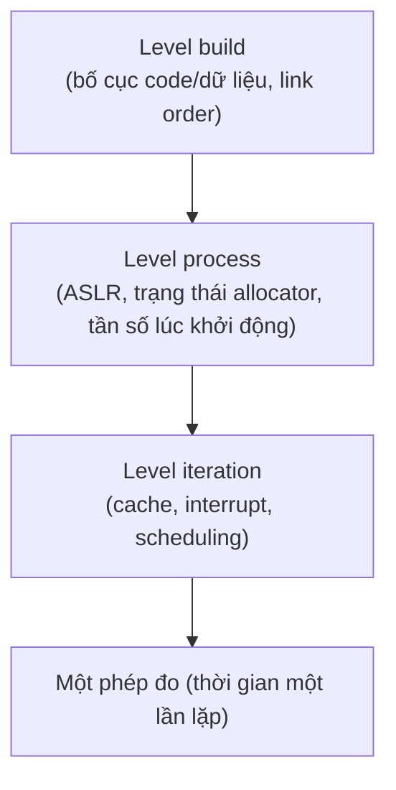

# P14 · Chương 06 — Thống kê cho benchmark

> Phạm vi: chương này nói về **cách đọc và cách tin** một con số benchmark, không đưa ra con số hiệu năng của thư viện thật nào. Dữ liệu trong ví dụ số là **dữ liệu tổng hợp** do một chương trình Rust nhỏ sinh ra (chạy thật bằng `rustc 1.95.0` trên macOS arm64, kết quả dán nguyên văn ở mục 4–6 và ghi là quan sát). Các nguồn Criterion được ghim ở tag `0.5.1`; riêng sách SRE/Prometheus là trang sống, được ghi rõ ở chú thích.

## Bạn sẽ hiểu được gì

1. **Q1.** Vì sao cùng một benchmark chạy hai lần cho hai con số khác nhau: warm-up, cache, frequency scaling, nhiễu và "bias" cố định theo binary đóng góp thế nào? → mục 1
2. **Q2.** Làm sao biết benchmark đã "nóng" xong, và cần bao nhiêu lần lặp để một khoảng tin cậy đủ hẹp (có chứng minh)? → mục 2
3. **Q3.** Trung bình, trung vị và percentile trả lời những câu hỏi khác nhau thế nào; vì sao trung bình các percentile là sai (có phản ví dụ tính tay)? → mục 3
4. **Q4.** Khoảng tin cậy (confidence interval) là gì; tính bằng phân phối t và bằng bootstrap ra sao, khi nào cái nào hỏng? → mục 4
5. **Q5.** So sánh hai hệ thống thì phải xét khoảng tin cậy của *hiệu* (hoặc tỉ số), vì sao nhìn hai khoảng "chồng nhau" dễ kết luận sai (có chứng minh), và effect size là gì? → mục 5
6. **Q6.** Coordinated omission làm số đo latency đẹp giả như thế nào, và sửa ra sao? → mục 6
7. **Q7.** Criterion.rs làm gì từng bước (warm-up, lấy mẫu hồi quy, bootstrap, phân loại outlier, so sánh với lần trước), và các mặc định của nó có nghĩa gì? → mục 7
8. **Q8.** Một checklist benchmark tái lập được gồm những gì? → mục 8

## Kiến thức cần trước

- [P14 · Chương 03 — Xác suất cho hệ thống](03-xac-suat.md): biến ngẫu nhiên, kỳ vọng, phương sai, phân phối. Chương này dùng các khái niệm đó mà không dựng lại từ đầu.
- [P14 · Chương 04 — Thuật toán và độ phức tạp](04-thuat-toan-va-do-phuc-tap.md): để phân biệt "chi phí lý thuyết" với "thời gian đo được".
- [P14 · Chương 05 — Queueing theory](05-queueing-theory.md): mục 6 (coordinated omission) dùng ý hàng đợi và hệ số sử dụng.
- [P11 · Chương 03 — Đo và cải thiện hiệu năng service Rust](../11-do-dac-va-go-loi/03-hieu-nang-service-rust.md): mục 1 đã nói `black_box`, warm-up và nhiễu ở mức thực hành; mục 2 đã nói histogram và `hdrhistogram`. Chương này **không lặp lại** những điều đó mà đi sâu vào phần thống kê đứng sau.
- [P12 · Chương 01](../12-he-thong-du-lieu/01-reliability-scalability-maintainability.md): mục 4 đã nêu coordinated omission và việc không trung bình percentile; mục 6 dưới đây chứng minh và mô phỏng cụ thể.
- [P11 · Chương 01 — perf và sampling profiler](../11-do-dac-va-go-loi/01-perf-va-sampling-profiler.md): khi benchmark cho thấy "chậm" thì profiler cho biết *chậm ở đâu*; thống kê chỉ trả lời "có thật sự khác không".

**Ví dụ chạy xuyên suốt.** `orders` là một service Rust nhận đơn hàng và serialize mỗi đơn thành bytes để ghi vào queue (nhận xét của người soạn: ví dụ giả định, không phải code trong repo). Nhóm `orders` đang cân nhắc thay serializer hiện tại (gọi là **A**) bằng một serializer mới (**B**), và về sau là thay allocator. Câu hỏi thống kê của cả chương: *B có thật sự nhanh hơn A không, nhanh hơn bao nhiêu, và ta chắc đến đâu?*

---

## 1. Biến thiên đến từ đâu (Q1)

> **Trả lời ngắn.** Cùng một đoạn code chạy nhiều lần cho thời gian khác nhau vì máy không ở trạng thái cố định: cache còn lạnh lúc đầu, tần số CPU đổi theo tải và nhiệt, các process và interrupt khác chen vào[^crit-outliers-cause][^cf-boost]. Có thêm một loại sai lệch *không ngẫu nhiên*: cách binary được link và kích thước môi trường quyết định bố cục bộ nhớ, và bố cục đó làm một hệ thống thắng hoặc thua có hệ thống[^kj-bias]. Vì mỗi nguồn nằm ở một tầng khác nhau (iteration, lần chạy process, lần build), phải lặp lại ở đúng tầng có biến thiên[^kj-levels2].

**Giải thích.**

*Với `orders`.* Bạn chạy `cargo bench` cho serializer A, ra 102 µs mỗi đơn; chạy lại sau khi pha cà phê, ra 97 µs. Chưa ai đổi dòng code nào. Trước khi nói "B nhanh hơn A 5%", ta phải biết con số 5% đó có lớn hơn mức dao động tự nhiên của chính phép đo không. Mục này liệt kê các nguồn dao động; các mục sau dạy cách lượng hóa chúng.

### 1.1 Bốn nhóm nguồn biến thiên

**Trạng thái "lạnh" lúc đầu.** Lần chạy đầu của một hàm thường chậm hơn: cache CPU chưa có dữ liệu, một số trang bộ nhớ chưa được map, trạng thái allocator chưa ổn định (nhận xét của người soạn). Criterion gọi đây là bước warm-up và dùng nó để làm nóng cache của bộ xử lý và, nếu có, cache của file system[^crit-warm-phase]. Với ngôn ngữ có JIT thì còn thêm thời gian biên dịch lúc chạy: nghiên cứu về Java chỉ ra rằng hiệu năng giai đoạn khởi động chịu ảnh hưởng của JIT nhiều hơn hẳn hiệu năng ở trạng thái ổn định[^g-startup-steady]. Rust biên dịch trước nên không có pha JIT, nhưng phần "lạnh" của cache và allocator vẫn còn.

**Tần số CPU không cố định.** Linux điều chỉnh tần số xung nhịp theo tải; hoạt động này gọi là CPU performance scaling hay CPU frequency scaling[^cf-def]. Tài liệu kernel cảnh báo thẳng: tính năng boost phụ thuộc tải của cả package, nên hiệu năng single-thread có thể dao động và đôi khi cho kết quả không tái lập, và cách tránh là tắt boost trước khi chạy benchmark nhạy với nó[^cf-boost]. Với `orders`: serializer chạy trên một core trong khi các core khác rảnh sẽ được boost cao hơn so với lúc cả máy bận, nên so A (chạy lúc rảnh) với B (chạy lúc bận) là so hai tần số khác nhau (suy luận của người soạn từ lời cảnh báo trên).

**Nhiễu từ phần còn lại của máy.** Criterion nêu nguyên nhân của các mẫu chậm bất thường: tải không đoán trước trên máy chạy benchmark, thread hoặc process scheduling, hoặc sự bất thường trong thời gian của chính code được đo[^crit-outliers-cause]. Lời khuyên của sách là chạy trên máy yên tĩnh và thiết kế để mỗi lần lặp làm khối lượng việc xấp xỉ nhau[^crit-quiet].

**Bias cố định theo binary.** Đây là loại nguy hiểm nhất, vì lặp lại trong cùng một binary *không* làm nó mất đi. Khi đo các benchmark SPEC CPU, người ta thấy kích thước biến môi trường Unix và thứ tự link các file `.o` ảnh hưởng đáng kể đến kết quả, vì chúng làm đổi bố cục dữ liệu và code trong bộ nhớ, từ đó đổi hiệu năng cache và bộ nhớ ảo[^kj-bias]. Các cải tiến hiệu năng trong lĩnh vực này thường nhỏ (trung vị 10% theo một khảo sát) nên rất dễ nằm trong biên sai số đo[^kj-small]. Với `orders`: B có thể "nhanh hơn" chỉ vì lần build đó vô tình đặt hàm nóng trùng một cache line thuận lợi (suy luận của người soạn).

### 1.2 Lặp lại ở đúng tầng

Từ đó rút ra một nguyên tắc thiết kế thí nghiệm. Mỗi tầng của quá trình đo có thể đưa vào biến thiên riêng: lần build, lần khởi chạy process, và từng iteration của benchmark. Các tác giả gọi những điểm có thể lặp lại này là các *level* của thí nghiệm[^kj-levels]. Tối thiểu, bạn phải lặp ở level cao nhất còn biến thiên ngẫu nhiên; lặp ở level thấp hơn đôi khi rẻ hơn mà không mất độ chính xác[^kj-levels2].



*(Sơ đồ của người soạn, theo ý tưởng về "level" trong bài về benchmarking đã dẫn: biến thiên có thể đến từ từng tầng, và mỗi tầng cần được lặp lại nếu nó có biến thiên ngẫu nhiên.)*

Hệ quả thực tế cho `orders`: một benchmark Criterion chạy một process, một binary, nên nó chỉ lặp ở level iteration. Nếu nghi ngờ bias bố cục, bạn phải tự lặp ở level cao hơn (build lại với thay đổi vô hại, chạy process nhiều lần) (nhận xét của người soạn).

<details><summary>Đi sâu: Rust không có JIT, nhưng vẫn có "phase" khi đo</summary>

Bài về Java phân biệt hai kiểu hiệu năng: *startup* (một lần chạy ngắn, gồm cả load class và JIT) và *steady-state* (chương trình chạy lâu, khởi động không đáng kể)[^g-startup-steady]. Với service Rust như `orders`, hiệu năng bạn quan tâm thường là steady-state của một process chạy nhiều giờ, còn thời gian khởi động (đọc config, mở pool kết nối) là một thứ khác cần đo riêng. Gộp hai thứ vào một con số là nguồn nhầm lẫn phổ biến (nhận xét của người soạn).

Nghiên cứu nói trên cũng chỉ ra rằng phương pháp "báo cáo lần chạy tốt nhất trong 30 lần" (kiểu quy tắc SPEC) không kiểm soát được non-determinism, và so sánh với khoảng tin cậy 95% cho thấy hai cách có thể cho kết luận khác nhau[^g-best]. Tóm lại: đừng lấy `min` rồi gọi là kết quả; hãy lấy phân phối.

</details>

**Quay lại Q1:** biến thiên đến từ trạng thái lạnh, tần số CPU động, nhiễu hệ thống và bias bố cục cố định theo binary; ba nguồn đầu giảm được bằng warm-up và máy yên tĩnh, nguồn cuối chỉ lộ ra khi lặp ở level cao hơn iteration.

---

## 2. Warm-up và số lần lặp (Q2)

> **Trả lời ngắn.** Benchmark được coi là "nóng" khi các lần lặp không còn dấu hiệu khởi tạo và có thể xem là độc lập, cùng phân phối[^kj-iid]; cách thực dụng là nhìn đồ thị thời gian theo số thứ tự lần lặp rồi kiểm tra tính độc lập của phần còn lại[^kj-manual], hoặc dùng ngưỡng hệ số biến thiên (CoV) trên một cửa sổ lần lặp[^g-cov]. Số lần lặp cần thiết suy ra từ độ rộng khoảng tin cậy mong muốn: $n \ge (z \cdot \mathrm{CoV} / r)^2$ cho sai số tương đối $r$ (chứng minh của người soạn bên dưới). Muốn hẹp gấp đôi phải lặp gấp bốn.

**Giải thích.**

*Với `orders`.* Giả sử bạn đo `serialize(order)` bằng một vòng lặp tự viết. Những lần lặp đầu chậm, rồi thời gian dần ổn định quanh một giá trị. Hai câu hỏi: (1) từ lần lặp thứ mấy thì bắt đầu ghi số đo; (2) ghi bao nhiêu lần thì đủ.

### 2.1 Khi nào coi là "đã nóng"

Một định nghĩa chặt: nhóm Kalibera–Jones gọi một trạng thái là *độc lập* nếu thời gian các lần lặp là độc lập và cùng phân phối (i.i.d.)[^kj-iid], và là *đã khởi tạo* khi các lần lặp không còn chịu overhead khởi tạo rõ rệt (linking động, nạp buffer I/O, JIT)[^kj-init]. Độc lập kéo theo đã khởi tạo, và hầu hết người làm benchmark sẽ coi trạng thái độc lập là "ổn định"; đây là điều kiện *đủ* được định nghĩa rõ cho steady state[^kj-iid].

Họ làm thực tế như sau. Bước một, vẽ đồ thị thời gian từng lần lặp theo số thứ tự, tìm điểm sau đó dữ liệu trông ổn định, không có quy luật hay xu hướng; bỏ phần đầu không ổn định[^kj-manual]. Bước hai, kiểm tra phần còn lại có độc lập thống kê không[^kj-second]. Nếu không, kết luận là benchmark không đạt trạng thái độc lập trong thời gian chấp nhận được.

Một cách tự động hơn, đề xuất cho Java: với mỗi lần chạy, tìm lần lặp mà tại đó hệ số biến thiên (CoV, tức độ lệch chuẩn chia trung bình) của $k$ lần lặp liên tiếp tụt dưới một ngưỡng đặt trước, chẳng hạn 0,01 hoặc 0,02[^g-cov]. Chính nhóm này thừa nhận câu "cần bao nhiêu lần lặp mới tới steady state" khó trả lời tổng quát, vì đáp án khác nhau giữa các ứng dụng và đôi khi rất lâu[^g-hard].

Criterion chọn cách đơn giản hơn: **không** dò warm-up mà chạy theo thời gian cấu hình được (mặc định 3 giây). Nó chạy hàm một lần, hai lần, bốn lần, v.v. cho tới khi tổng thời gian tích lũy vượt ngưỡng warm-up[^crit-warmalg]. Nghĩa là nếu `orders` cần lâu hơn 3 giây mới ổn (ví dụ cache của một bảng tra lớn), Criterion sẽ không biết, bạn phải tự tăng `warm_up_time` (nhận xét của người soạn).

### 2.2 Cần bao nhiêu lần lặp

Giả sử sau warm-up các lần lặp $X_1,\dots,X_n$ là i.i.d. với trung bình $\mu$ và phương sai $\sigma^2$. Ta muốn biết trung bình mẫu $\bar X$ lệch khỏi $\mu$ bao nhiêu.

**Mệnh đề 1 (chứng minh của người soạn).** $\mathrm{Var}(\bar X)=\sigma^2/n$, nên độ lệch chuẩn của $\bar X$ là $\sigma/\sqrt n$.

*Chứng minh.* Có $\bar X = \frac1n\sum_i X_i$. Vì $\mathrm{Var}(aY)=a^2\mathrm{Var}(Y)$ nên $\mathrm{Var}(\bar X)=\frac1{n^2}\mathrm{Var}\!\left(\sum_i X_i\right)$. Các $X_i$ độc lập nên phương sai của tổng bằng tổng các phương sai (hiệp phương sai giữa các cặp bằng 0), tức $n\sigma^2$. Vậy $\mathrm{Var}(\bar X)=n\sigma^2/n^2=\sigma^2/n$. ∎

**Hệ quả (số lần lặp).** Khoảng tin cậy xấp xỉ của $\mu$ có nửa độ rộng $h = z\,\sigma/\sqrt n$, với $z\approx1{,}96$ cho mức 95% khi $n$ đủ lớn (giá trị $z$ này là quy ước của phân phối chuẩn, mục 4 nói lại). Gọi $r = h/\mu$ là sai số tương đối chấp nhận được và $\mathrm{CoV}=\sigma/\mu$. Thế vào được $r = z\,\mathrm{CoV}/\sqrt n$, tức
$$ n \;\ge\; \left(\frac{z\cdot \mathrm{CoV}}{r}\right)^2. $$
Hai điều đọc ra ngay: $n$ tỉ lệ với bình phương CoV (benchmark ồn gấp đôi cần nhiều gấp bốn lần lặp), và $n$ tỉ lệ nghịch với bình phương $r$ (muốn hẹp gấp đôi phải lặp gấp bốn). Điều này khớp với nhận xét chung rằng lặp càng nhiều, khoảng tin cậy càng hẹp[^kj-levels].

*Ví dụ số.* Trong lần chạy $n=30$ ở mục 4, serializer A có trung bình 102,68 µs và độ lệch chuẩn 11,58 µs, nên CoV $=11{,}58/102{,}68\approx0{,}113$. Muốn sai số tương đối $r=1\%$: $n\ge(1{,}96\times0{,}113/0{,}01)^2\approx 489$ lần lặp. Muốn $r=5\%$: khoảng 20. Công thức này giả định i.i.d., nên nếu các lần lặp tương quan dương với nhau thì khoảng thực tế rộng hơn công thức cho (suy luận của người soạn; hệ quả của việc điều kiện i.i.d. bị vi phạm).

<details><summary>Đi sâu: vì sao đừng đo "10 lần lặp" rồi chia 10 để gom lặp</summary>

Một thói quen phổ biến là gom nhiều lần lặp vào một phép đo (đo cả 10 lần rồi chia 10) để giảm sai số của đồng hồ. Kalibera–Jones lưu ý rằng khi đó phương sai bạn thấy là của "10 lần lặp" chứ không phải của "một lần lặp", và cách làm này vẫn đòi hỏi lặp ở level đó[^kj-batch]. Criterion cũng đo theo mẫu gồm nhiều lần lặp chứ không đo từng lần[^crit-sample]; mục 7 giải thích vì sao nó vẫn lấy ra được ước lượng thời gian một lần lặp.

</details>

**Quay lại Q2:** benchmark đã nóng khi các lần lặp không còn trend và độc lập; dò bằng đồ thị theo thứ tự lần lặp hoặc ngưỡng CoV, và số lần lặp cần là $n\ge(z\,\mathrm{CoV}/r)^2$, nên giảm một nửa sai số tốn gấp bốn thời gian.

---

## 3. Trung bình, trung vị, percentile (Q3)

> **Trả lời ngắn.** Trung bình trả lời "tổng thời gian trên $n$ lần là bao nhiêu" nhưng bị outlier kéo lệch; trung vị bền với outlier nhưng bỏ qua đuôi; percentile cao (p99, p99,9) mô tả đuôi. Percentile **không cộng, không trung bình được**: nhiều máy mỗi máy có p99 riêng thì p99 chung không phải trung bình của chúng, và muốn có nó phải gộp phân phối (histogram) rồi mới hỏi[^prom-agg]. Dưới đây là một phản ví dụ tính tay cho thấy lệch tới 25 lần.

**Giải thích.**

*Với `orders`.* Hai nhu cầu đo khác nhau dùng hai thống kê khác nhau. Khi so serializer trong benchmark vi mô, bạn có vài chục đến vài trăm mẫu "thời gian một lần lặp", và câu hỏi là *giá trị điển hình* của từng cái. Khi vận hành, bạn có hàng triệu request với latency khác nhau, và câu hỏi là *đuôi*. Hai tình huống này hay bị lẫn.

### 3.1 Ba thống kê, ba câu hỏi

- **Trung bình** $\bar x=\frac1n\sum x_i$: tỉ lệ với tổng thời gian, nên đúng cho câu hỏi "chạy $n$ lần mất bao lâu, cần bao nhiêu CPU" (nhận xét của người soạn). Nó nhạy với outlier: một mẫu chậm bất thường kéo cả trung bình. Chính Criterion ghi nhận phương pháp ước lượng thời gian trung bình mỗi lần lặp của nó nhạy với outlier[^crit-sens].
- **Trung vị** (median, p50): giá trị mà một nửa mẫu nhỏ hơn. Bền với outlier vì thay đổi một mẫu cực đoan không đổi vị trí giữa (nhận xét của người soạn). Criterion báo cả trung bình, độ lệch chuẩn, trung vị và median absolute deviation (MAD) của thời gian mỗi lần lặp[^crit-boot-stats]; trong source, MAD được nhân hằng số 1,4826[^crit-mad] (nhận xét của người soạn: hằng số này làm MAD ước lượng được độ lệch chuẩn nếu dữ liệu xấp xỉ chuẩn).
- **Percentile thứ $q$**: với tập đã sắp xếp $x_{(1)}\le\dots\le x_{(n)}$, theo quy ước *nearest-rank* (dùng trong ví dụ dưới), percentile $q$ là $x_{(k)}$ với $k=\lceil q\cdot n\rceil$. Đây là một định nghĩa trong số nhiều; thư viện khác nội suy khác nhau (nhận xét của người soạn).

Cách đọc phân phối latency, vì sao p99 của một service quan trọng khi có fan-out, và `hdrhistogram`: xem [P11 · Chương 03, mục 2](../11-do-dac-va-go-loi/03-hieu-nang-service-rust.md) và [P12 · Chương 01, mục 4–5](../12-he-thong-du-lieu/01-reliability-scalability-maintainability.md). Phần dưới chỉ chứng minh điều những chương đó khẳng định.

### 3.2 Vì sao trung bình các percentile là sai

Tài liệu của Prometheus nói thẳng: không thể aggregate các quantile (ví dụ tính p90 tổng của một service có nhiều worker nhân bản), vì quantile tính sẵn không giữ lại phân phối; đó là lý do dùng histogram, loại biểu diễn có thể cộng gộp với nhau[^prom-agg]. Ta chứng minh bằng một phản ví dụ cụ thể.

**Mệnh đề 2 (phản ví dụ, chứng minh của người soạn).** Tồn tại hai tập mẫu mà trung bình (kể cả trung bình có trọng số theo số request) hai p99 riêng lệch xa p99 của tập gộp.

*Chứng minh.* Dùng nearest-rank. Máy 1 xử lý 1.000 request: 980 request mất 10 ms và 20 request mất 500 ms. Máy 2 xử lý 9.000 request, tất cả mất 10 ms.

1. p99 của máy 1: $k=\lceil0{,}99\times1000\rceil=990$. Sắp xếp tăng dần thì 980 phần tử đầu là 10 ms, các phần tử từ thứ 981 đến 1000 là 500 ms. Phần tử thứ 990 nằm trong nhóm sau, nên p99 máy 1 $=500$ ms.
2. p99 của máy 2: mọi phần tử bằng 10 ms, nên p99 $=10$ ms.
3. Trung bình hai p99: $(500+10)/2=255$ ms. Trung bình có trọng số theo số request: $(1000\times500+9000\times10)/10000=59$ ms.
4. Tập gộp có 10.000 request, trong đó $20$ request chậm (500 ms) và $9.980$ request nhanh (10 ms). p99: $k=\lceil0{,}99\times10000\rceil=9900\le9980$, nên phần tử thứ 9900 là 10 ms. Vậy p99 gộp $=10$ ms.

Kết luận: 255 ms (hoặc 59 ms) so với 10 ms. Lệch 25 lần theo cách trung bình thường, và 5,9 lần theo cách có trọng số. ∎

Chiều ngược lại cũng xảy ra: p99,9 của tập gộp là $x_{(9990)}$, và vì $9990>9980$ nên nó bằng 500 ms; một dashboard trung bình p99,9 của hai máy sẽ cho $(500+10)/2$ hoặc 59 ms tùy cách, tức thấp hơn hẳn thực tế đuôi (cùng phép tính). Sai hướng nào cũng sai, vì nguyên nhân là percentile không phải hàm tuyến tính của dữ liệu.

**Quan sát (chương trình ở Đi sâu, `rustc 1.95.0`, macOS arm64):**

```text
p99 s1 = 500, p99 s2 = 10, TB cong = 255, p99 gop = 10, p99.9 gop = 500
```

Cách đúng: mỗi worker giữ một histogram, rồi gộp histogram trước khi truy vấn quantile. `hdrhistogram::Histogram::add` cộng nội dung một histogram vào histogram khác[^hdr-add], đúng thao tác này.

<details><summary>Đi sâu: percentile cực cao cần bao nhiêu mẫu</summary>

Với $n$ mẫu, p99,9 theo nearest-rank là phần tử thứ $\lceil0{,}999\,n\rceil$. Khi $n=1000$ đó là phần tử thứ 999, tức gần như mẫu chậm nhất, một thống kê rất nhiễu (suy luận của người soạn từ định nghĩa nearest-rank). Vì thế benchmark vi mô với 100 mẫu (mặc định của Criterion[^crit-defaults]) **không** nói được gì về p99; nó chỉ nói được về vị trí giữa và độ phân tán. Muốn nói về đuôi hệ thống phải đo request thật qua histogram, với cửa sổ đủ dài.

Prometheus còn lưu ý quantile nhận được từ histogram là xấp xỉ, sai số phụ thuộc cách chia bucket (xem trang đã dẫn ở chú thích); đây là đánh đổi để có khả năng gộp[^prom-agg].

</details>

**Quay lại Q3:** trung bình cho tổng chi phí, trung vị cho giá trị điển hình bền vững, percentile cho đuôi; percentile không trung bình được (phản ví dụ: 255 ms hoặc 59 ms so với 10 ms thật), phải gộp histogram.

---

## 4. Khoảng tin cậy: phân phối t và bootstrap (Q4)

> **Trả lời ngắn.** Khoảng tin cậy 95% cho trung bình là khoảng mà quy trình lấy mẫu của bạn sẽ chứa giá trị thật trong 95% số lần lặp lại thí nghiệm[^crit-cl]. Với mẫu nhỏ ($n<30$) và độ lệch chuẩn phải ước lượng từ mẫu, khoảng này tính bằng phân phối t của Student với $n-1$ bậc tự do thay vì phân phối chuẩn[^g-t]. Bootstrap thì không cần giả định hình dạng phân phối: nó lấy mẫu có hoàn lại từ chính dữ liệu và dùng độ biến thiên của thống kê trên các lần lấy lại để ước lượng độ biến thiên thật[^mit-principle].

**Giải thích.**

*Với `orders`.* Bạn có 30 thời gian đo của serializer A, trung bình 102,68 µs. Con số "102,68" chỉ là một lần rút mẫu; nếu đo lại 30 lần khác sẽ ra số khác. Khoảng tin cậy là cách nói "con số thật nằm ở khoảng nào" thay vì đưa một con số trơ trụi. Nghiên cứu về hiệu năng Java nhấn mạnh: các phương pháp phổ biến lúc đó có thể gây hiểu lầm và thậm chí dẫn đến kết luận sai, chính vì thiếu phân tích thống kê chặt chẽ[^g-misleading]; còn một khảo sát bài báo hệ thống cho thấy 71 trong 90 bài đo thời gian chạy không báo bất kỳ thước đo biến thiên nào[^kj-novar].

### 4.1 Phân phối t

Với $n$ mẫu có trung bình $\bar x$ và độ lệch chuẩn mẫu $s$, nếu $n$ đủ lớn (thường coi là $n\ge30$) thì $(\bar x-\mu)/(s/\sqrt n)$ xấp xỉ chuẩn tắc. Với $n$ nhỏ hơn, $s^2$ có thể lệch đáng kể so với phương sai thật, và đại lượng đó theo phân phối t của Student với $n-1$ bậc tự do[^g-t]. Khoảng tin cậy 95% là
$$ \bar x \;\pm\; t_{0{,}975;\,n-1}\cdot \frac{s}{\sqrt n}. $$
Khi $n$ tăng, phân phối t tiến về phân phối chuẩn[^g-t2], nên $t_{0{,}975;\,n-1}$ giảm dần về 1,96. Giá trị $t$ được tra từ bảng; chương trình bên dưới nhập tay $t_{0{,}975;29}=2{,}045$ (giá trị tra bảng của người soạn, không có nguồn trong chương). Nửa độ rộng của khoảng chính là đại lượng $h=z\sigma/\sqrt n$ đã dùng ở mục 2, nay với $s$ thay $\sigma$ và $t$ thay $z$.

*Ví dụ số.* $n=30$, $\bar x=102{,}68$, $s=11{,}58$: $h=2{,}045\times11{,}58/\sqrt{30}=4{,}32$, nên khoảng là $[98{,}35;\,107{,}00]$ µs, khớp với dòng `A:` của lần chạy $n=30$ bên dưới. Độ rộng này bằng $\pm4{,}2\%$ trung bình: nghĩa là một chênh lệch 3–4% giữa A và B, ở cỡ mẫu này, chưa phân biệt được với nhiễu.

### 4.2 Bootstrap

Giả thiết của khoảng t (xấp xỉ chuẩn của $\bar x$) khó đỡ khi thống kê bạn quan tâm là **trung vị**, **tỉ số hai trung bình**, hay khi dữ liệu lệch nặng. Bootstrap tránh giả thiết đó. Ý tưởng của nó gồm ba điểm: phân phối thực nghiệm của dữ liệu xấp xỉ phân phối thật, thống kê trên lần lấy lại xấp xỉ thống kê trên mẫu gốc, và độ biến thiên của thống kê trên lần lấy lại xấp xỉ độ biến thiên thật; điểm thứ ba mới là thứ ta cần để dựng khoảng tin cậy[^mit-principle]. "Lấy lại" nghĩa là rút có hoàn lại từ dữ liệu quan sát[^mit-resample], với cỡ bằng mẫu gốc, vì độ biến thiên của thống kê phụ thuộc cỡ mẫu[^mit-size].

Thuật toán *percentile bootstrap* cho một thống kê $T$:

1. Lặp $B$ lần: rút $n$ phần tử có hoàn lại từ mẫu, tính $T^{\ast}$ trên lần rút đó.
2. Sắp xếp $B$ giá trị $T^{\ast}$.
3. Khoảng tin cậy $1-\alpha$ là hai percentile $\alpha/2$ và $1-\alpha/2$ của $T^{\ast}$.

Criterion làm đúng bước 3: nó tính khoảng tin cậy bằng percentile của phân phối bootstrap[^crit-ci-pct], và bước 1 là chọn chỉ số ngẫu nhiên đều trong mẫu rồi sao giá trị đó[^crit-resample]. Mặc định 100.000 lần lấy lại[^crit-defaults], và nhiều lần lấy lại hơn giảm sai số ngẫu nhiên vốn có của bootstrap nhưng tốn thời gian phân tích hơn[^crit-nres].

Trong Rust, vòng lõi của chương trình mô phỏng (đủ nguồn ở Đi sâu) có dạng:

```rust
// Bootstrap percentile CI cho tỉ số mean(B)/mean(A); a, b là hai mẫu đã đo.
for _ in 0..nres {
    for i in 0..n {
        ra[i] = a[rng.below(n)];   // rút có hoàn lại
        rb[i] = b[rng.below(n)];
    }
    ratios.push(mean(&rb) / mean(&ra));
}
ratios.sort_by(|x, y| x.partial_cmp(y).unwrap());
// khoảng 95% = [ratios[2,5%], ratios[97,5%]]
```

**Quan sát** (dữ liệu tổng hợp: A lognormal trung vị 100 µs, B lognormal trung vị 94 µs, cùng $\sigma=0{,}10$ trên thang log; `rustc 1.95.0`; mỗi nhóm cỡ $n$ là một lần rút mới):

```text
--- n = 30 ---
A: mean 102.68 sd 11.58 CI95 t [98.35, 107.00]
B: mean 98.96 sd 10.56 CI95 t [95.02, 102.90]
CI chong lan nhau: true
hieu mean 3.72, se 2.86, CI95 hieu (Welch) [-2.01, 9.45]
ti so B/A: diem 0.9638, bootstrap CI95 [0.9124, 1.0169]
Cohen d = 0.336
--- n = 100 ---
A: mean 99.29 sd 8.67 CI95 t [97.57, 101.01]
B: mean 95.57 sd 10.25 CI95 t [93.54, 97.60]
CI chong lan nhau: true
hieu mean 3.72, se 1.34, CI95 hieu (Welch) [1.07, 6.37]
ti so B/A: diem 0.9625, bootstrap CI95 [0.9366, 0.9887]
Cohen d = 0.392
--- n = 300 ---
A: mean 100.39 sd 9.20 CI95 t [99.34, 101.43]
B: mean 94.21 sd 9.55 CI95 t [93.13, 95.30]
CI chong lan nhau: false
hieu mean 6.17, se 0.77, CI95 hieu (Welch) [4.67, 7.67]
ti so B/A: diem 0.9385, bootstrap CI95 [0.9242, 0.9534]
Cohen d = 0.658
```

(Nhớ rằng dữ liệu tổng hợp được sinh với tỉ số trung vị thật là $94/100=0{,}94$; điểm ước lượng ở $n=30$ là 0,9638, ở $n=300$ là 0,9385. Khoảng bootstrap ở $n=30$ chứa cả giá trị 1,0 ("không khác biệt"), còn ở $n=100$ và $n=300$ thì không.)

Bootstrap không phải phép màu. Nó giả định các mẫu gốc đại diện cho phân phối thật và độc lập với nhau, nên dữ liệu có autocorrelation (vi phạm điều kiện i.i.d. ở mục 2) làm khoảng bootstrap quá hẹp (suy luận của người soạn từ tiền đề của nguyên lý bootstrap). Với mẫu rất nhỏ hoặc thống kê cực trị (như p99,9), bootstrap cũng kém tin cậy (nhận xét của người soạn).

<details><summary>Đi sâu: toàn bộ chương trình mô phỏng (121 dòng)</summary>

Chương trình này sinh dữ liệu tổng hợp, tính khoảng tin cậy t, khoảng Welch cho hiệu, bootstrap cho tỉ số, Cohen's d; sau đó chạy phản ví dụ percentile (mục 3) và mô phỏng coordinated omission (mục 6). Đầu ra ở trên và ở mục 3, 6 là kết quả lần chạy duy nhất, hạt giống cố định.

```rust
// Mô phỏng thống kê benchmark: dữ liệu tổng hợp, không đo máy thật.
struct Rng(u64);
impl Rng {
    fn next_u64(&mut self) -> u64 {
        let mut x = self.0;
        x ^= x >> 12;
        x ^= x << 25;
        x ^= x >> 27;
        self.0 = x;
        x.wrapping_mul(0x2545F4914F6CDD1D)
    }
    fn unif(&mut self) -> f64 {
        ((self.next_u64() >> 11) as f64 + 0.5) / (1u64 << 53) as f64
    }
    fn normal(&mut self) -> f64 {
        let (u1, u2) = (self.unif(), self.unif());
        (-2.0 * u1.ln()).sqrt() * (2.0 * std::f64::consts::PI * u2).cos()
    }
    fn lognormal(&mut self, median: f64, sigma: f64) -> f64 {
        median * (sigma * self.normal()).exp()
    }
    fn below(&mut self, n: usize) -> usize {
        (self.next_u64() % n as u64) as usize
    }
}

fn mean(x: &[f64]) -> f64 {
    x.iter().sum::<f64>() / x.len() as f64
}
fn var(x: &[f64]) -> f64 {
    let m = mean(x);
    x.iter().map(|v| (v - m) * (v - m)).sum::<f64>() / (x.len() - 1) as f64
}
fn pct(sorted: &[f64], q: f64) -> f64 {
    // nearest-rank: phần tử thứ ceil(q*n) (đếm từ 1)
    let k = (q * sorted.len() as f64).ceil() as usize;
    sorted[k.max(1) - 1]
}

fn compare(n: usize, t: f64, tw: f64, rng: &mut Rng) {
    // So sánh hai serializer (dữ liệu tổng hợp, lognormal)
    let a: Vec<f64> = (0..n).map(|_| rng.lognormal(100.0, 0.10)).collect(); // µs
    let b: Vec<f64> = (0..n).map(|_| rng.lognormal(94.0, 0.10)).collect();
    let (ma, mb) = (mean(&a), mean(&b));
    let (sa, sb) = (var(&a).sqrt(), var(&b).sqrt());
    let ci = |m: f64, s: f64| (m - t * s / (n as f64).sqrt(), m + t * s / (n as f64).sqrt());
    let (ca, cb) = (ci(ma, sa), ci(mb, sb));
    println!("--- n = {n} ---");
    println!("A: mean {:.2} sd {:.2} CI95 t [{:.2}, {:.2}]", ma, sa, ca.0, ca.1);
    println!("B: mean {:.2} sd {:.2} CI95 t [{:.2}, {:.2}]", mb, sb, cb.0, cb.1);
    println!("CI chong lan nhau: {}", ca.0 <= cb.1 && cb.0 <= ca.1);
    // Welch: CI của hiệu, dùng t xấp xỉ 2.0 cho ndf lớn
    let se = (sa * sa / n as f64 + sb * sb / n as f64).sqrt();
    let d = ma - mb;
    println!("hieu mean {:.2}, se {:.2}, CI95 hieu (Welch) [{:.2}, {:.2}]", d, se, d - tw * se, d + tw * se);
    // bootstrap percentile CI cho ti so mean(B)/mean(A)
    let nres = 10_000;
    let mut ratios = Vec::with_capacity(nres);
    let mut ra = vec![0.0; n];
    let mut rb = vec![0.0; n];
    for _ in 0..nres {
        for i in 0..n {
            ra[i] = a[rng.below(n)];
            rb[i] = b[rng.below(n)];
        }
        ratios.push(mean(&rb) / mean(&ra));
    }
    ratios.sort_by(|x, y| x.partial_cmp(y).unwrap());
    println!(
        "ti so B/A: diem {:.4}, bootstrap CI95 [{:.4}, {:.4}]",
        mb / ma,
        ratios[(0.025 * nres as f64) as usize],
        ratios[(0.975 * nres as f64) as usize - 1]
    );
    let sd_pooled = ((sa * sa + sb * sb) / 2.0).sqrt();
    println!("Cohen d = {:.3}", d / sd_pooled);
}

fn main() {
    let mut rng = Rng(0x9E3779B97F4A7C15);
    compare(30, 2.045, 2.002, &mut rng);
    compare(100, 1.984, 1.972, &mut rng);
    compare(300, 1.968, 1.964, &mut rng);

    // ---------- Phần B: trung bình các percentile ----------
    let mut s1: Vec<f64> = vec![10.0; 980];
    s1.extend(vec![500.0; 20]);
    let s2: Vec<f64> = vec![10.0; 9000];
    let mut all = s1.clone();
    all.extend(&s2);
    s1.sort_by(|x, y| x.partial_cmp(y).unwrap());
    all.sort_by(|x, y| x.partial_cmp(y).unwrap());
    let p1 = pct(&s1, 0.99);
    let p2 = 10.0;
    println!("p99 s1 = {p1}, p99 s2 = {p2}, TB cong = {}, p99 gop = {}, p99.9 gop = {}", (p1 + p2) / 2.0, pct(&all, 0.99), pct(&all, 0.999));

    // ---------- Phần C: coordinated omission ----------
    // Mục tiêu 1000 req/s trong 20 s (đơn vị ms). Server đứng từ t=10000 đến t=11000, dịch vụ 0,5 ms.
    let complete = |start: f64| -> f64 {
        let s = if start >= 10_000.0 && start < 11_000.0 { 11_000.0 } else { start };
        s + 0.5
    };
    let total = 20_000usize;
    let mut closed = Vec::new(); // đo từ lúc gửi thật
    let mut corrected = Vec::new(); // đo từ lúc lẽ ra phải gửi
    let mut free_at = 0.0f64;
    for i in 0..total {
        let intended = i as f64;
        let send = intended.max(free_at);
        let done = complete(send);
        closed.push(done - send);
        corrected.push(done - intended);
        free_at = done;
    }
    closed.sort_by(|x, y| x.partial_cmp(y).unwrap());
    corrected.sort_by(|x, y| x.partial_cmp(y).unwrap());
    println!("so mau: {} ; cham nhat dong: {}, hieu chinh: {}", closed.len(), closed[total - 1], corrected[total - 1]);
    for q in [0.5, 0.99, 0.999, 0.9999] {
        println!("q={q}: dong {:.1} ms, hieu chinh {:.1} ms", pct(&closed, q), pct(&corrected, q));
    }
}
```

</details>

**Quay lại Q4:** khoảng tin cậy cho trung bình là $\bar x\pm t\,s/\sqrt n$ (t của Student với $n-1$ bậc tự do khi mẫu nhỏ); bootstrap thay giả thiết hình dạng bằng việc rút có hoàn lại từ dữ liệu và lấy percentile của thống kê, dùng được cho trung vị và tỉ số.

---

## 5. So sánh hai hệ thống (Q5)

> **Trả lời ngắn.** Đừng so hai con số, và đừng chỉ nhìn xem hai khoảng tin cậy có chồng nhau không: hãy dựng khoảng tin cậy của **hiệu** (hoặc của tỉ số) hai hệ thống; nếu khoảng đó chứa 0 (hoặc 1 với tỉ số) thì chưa kết luận được có khác biệt[^g-diff]. Hai khoảng riêng lẻ có thể chồng nhau mà khoảng của hiệu vẫn loại được 0, vì cách chồng nhau là một kiểm định bảo thủ hơn[^kj-visual]. Ngoài "có khác không", phải báo "khác bao nhiêu" (effect size), vì cỡ mẫu đủ lớn sẽ làm gần như mọi chênh lệch đều "có ý nghĩa thống kê"[^kj-sigtest].

**Giải thích.**

*Với `orders`.* Từ mục 4 ta có hai mẫu đo A và B. Câu hỏi của team là "có nên đổi sang B không". Câu trả lời cần ba thứ: B có khác A không, khác theo hướng nào, và khác đủ lớn để đáng đổi không.

### 5.1 Khoảng tin cậy của hiệu

Với hai mẫu cỡ $n_1,n_2$, trung bình $\bar x_1,\bar x_2$ và độ lệch chuẩn $s_1,s_2$, ta tính hiệu $\bar x=\bar x_1-\bar x_2$ và độ lệch chuẩn của hiệu đó là $s_{\bar x}=\sqrt{s_1^2/n_1+s_2^2/n_2}$[^g-sx]. Khoảng tin cậy của hiệu là $\bar x\pm z\,s_{\bar x}$; nếu nó chứa 0 thì ở mức tin cậy đã chọn không có khác biệt có ý nghĩa thống kê giữa hai hệ thống[^g-diff]. Với một trong hai mẫu nhỏ hơn 30, ta không còn coi hiệu là phân phối chuẩn và phải thay $z$ bằng $t$ với số bậc tự do xấp xỉ theo công thức Welch–Satterthwaite[^g-ndf]. Chương trình dùng $t\approx2{,}002;\,1{,}972;\,1{,}964$ cho ba cỡ mẫu (tra bảng, giá trị của người soạn).

Nhìn vào ba lần chạy ở mục 4:

| $n$ mỗi nhóm | Hiệu trung bình (µs) | Khoảng 95% của hiệu | Hai khoảng riêng chồng nhau? | Bootstrap 95% của B/A |
|---|---|---|---|---|
| 30 | 3,72 | $[-2{,}01;\ 9{,}45]$ chứa 0 | có | $[0{,}9124;\ 1{,}0169]$ chứa 1 |
| 100 | 3,72 | $[1{,}07;\ 6{,}37]$ **loại 0** | **có** | $[0{,}9366;\ 0{,}9887]$ loại 1 |
| 300 | 6,17 | $[4{,}67;\ 7{,}67]$ loại 0 | không | $[0{,}9242;\ 0{,}9534]$ loại 1 |

(Bảng tổng hợp của người soạn từ đầu ra chương trình.) Hàng giữa là chỗ bẫy: nếu chỉ nhìn "hai khoảng chồng nhau" thì kết luận là "chưa phân biệt được", nhưng khoảng của hiệu loại được 0.

### 5.2 Vì sao nhìn chồng nhau là sai

Kiểm tra bằng mắt là xem hai khoảng tin cậy có chồng nhau không. Nó có ưu điểm là cho thấy kích cỡ chênh lệch và độ không chắc của từng hệ thống, nhưng nó vẫn không cho ta ước lượng tỉ số hiệu năng và biên sai số của tỉ số, và về mặt kiểm định thì nó không có ngữ nghĩa chặt vì sai số của nó không được biết; nó khá bảo thủ, với khoảng 95% thì xác suất sai không phải 5% mà dưới 1% trong giả định chuẩn[^kj-visual]. Ta chứng minh phần "bảo thủ" bằng đại số.

**Mệnh đề 3 (chứng minh của người soạn).** Gọi $se_A,se_B>0$ là sai số chuẩn của hai trung bình, $t$ là hệ số tin cậy (coi chung cho đơn giản), $d=|\bar x_A-\bar x_B|$. Khi đó:

(a) Hai khoảng tin cậy rời nhau $\iff d>t\,(se_A+se_B)$.
(b) Khoảng tin cậy của hiệu loại 0 $\iff d>t\sqrt{se_A^2+se_B^2}$.
(c) (a) kéo theo (b), nhưng (b) không kéo theo (a).

*Chứng minh.* (a) Hai khoảng là $[\bar x_A\pm t\,se_A]$ và $[\bar x_B\pm t\,se_B]$. Chúng rời nhau khi khoảng cách giữa hai tâm lớn hơn tổng hai nửa độ rộng, tức $d>t\,se_A+t\,se_B$. (b) Sai số chuẩn của hiệu hai mẫu độc lập là $\sqrt{se_A^2+se_B^2}$ (mục 5.1, đồng nhất $se^2=s^2/n$). Khoảng $d\pm t\sqrt{se_A^2+se_B^2}$ loại 0 khi $d>t\sqrt{se_A^2+se_B^2}$. (c) Với $a,b>0$ ta có $(a+b)^2=a^2+b^2+2ab>a^2+b^2$, nên $a+b>\sqrt{a^2+b^2}$. Áp dụng với $a=se_A$, $b=se_B$: $t(se_A+se_B)>t\sqrt{se_A^2+se_B^2}$. Do đó nếu $d>t(se_A+se_B)$ thì chắc chắn $d>t\sqrt{se_A^2+se_B^2}$, tức (a) kéo theo (b). Ngược lại, mọi $d$ nằm giữa $t\sqrt{se_A^2+se_B^2}$ và $t(se_A+se_B)$ thỏa (b) mà không thỏa (a). Khoảng trống này khác rỗng vì bất đẳng thức ở trên là chặt. ∎

Khi $se_A=se_B$, cửa sổ đó là $d\in(\sqrt2\,t\,se,\ 2\,t\,se]$, tức rộng khoảng 41% so với ngưỡng đúng. **Kiểm chứng bằng số** (lần chạy $n=100$): $se_A=8{,}67/10=0{,}867$, $se_B=10{,}25/10=1{,}025$; $t(se_A+se_B)=1{,}984\times1{,}892=3{,}75$ nên khoảng riêng chồng nhau vì $d=3{,}72<3{,}75$; trong khi $t\sqrt{se_A^2+se_B^2}=1{,}972\times1{,}342=2{,}65<3{,}72$, nên khoảng của hiệu loại 0. Đúng bảng trên.

Hệ quả thực hành: "chồng nhau" không phải bằng chứng "không khác nhau"; chỉ "rời nhau" mới là bằng chứng mạnh (vì (a) kéo theo (b)). Kết luận chắc nhất vẫn là khoảng của hiệu.

### 5.3 Effect size và kiểm định ý nghĩa

Kiểm định ý nghĩa thống kê có một điểm yếu cơ bản với benchmark: cỡ mẫu rất dễ tăng, và mẫu đủ lớn thì hầu như luôn đi tới kết luận có khác biệt có ý nghĩa thống kê, kể cả khi chênh lệch thật nhỏ không đáng quan tâm[^kj-sigtest]. Cái ta thật sự cần là ước lượng tỉ số hiệu năng giữa hai hệ thống kèm biên sai số, thứ mà theo các tác giả này hiếm khi được báo[^kj-ratio]. Nên báo **tỉ số B/A với khoảng tin cậy** (cột bootstrap ở trên): ở $n=100$, B nhanh hơn A khoảng 3,8%, với khoảng 95% từ 1,1% đến 6,3% nhanh hơn. Đó là câu mà người quyết định đọc được ("đổi sang B đáng giá không nếu mức nhanh hơn thật nằm trong khoảng đó?").

Một số đo effect size khác trong thống kê là **Cohen's d**: hiệu trung bình chia độ lệch chuẩn gộp, $d=(\bar x_A-\bar x_B)/\sqrt{(s_A^2+s_B^2)/2}$ (định nghĩa chuẩn trong thống kê, của người soạn, không trích nguồn). Nó không có đơn vị nên so được giữa các benchmark, nhưng với benchmark tôi khuyên (nhận xét của người soạn) ưu tiên tỉ số: $d$ đổi theo độ ồn của máy, trong khi tỉ số B/A cho biết trực tiếp "nhanh hơn bao nhiêu phần trăm". Ở các lần chạy trên, $d$ là 0,336; 0,392; 0,658 với cùng khác biệt thật; chênh lệch giữa chúng do rút mẫu, minh họa vì sao một con số $d$ từ một lần đo đơn lẻ cũng cần khoảng tin cậy (suy luận của người soạn từ đầu ra).

Criterion xử lý vấn đề "khác biệt nhỏ nhưng có ý nghĩa thống kê" bằng một ngưỡng nhiễu (noise threshold): các thay đổi trong ±1% được coi là nhiễu và bỏ qua[^crit-noise]. Tài liệu hàm giải thích: đo cùng một code hai lần có thể ra khác biệt nhỏ nhưng có ý nghĩa thống kê chỉ vì nhiễu, và ngưỡng này lọc bớt dương tính giả, đổi lại khó phát hiện thay đổi nhỏ thật[^crit-noisedef].

<details><summary>Đi sâu: thiết kế thí nghiệm so sánh, và nhiều hơn hai hệ thống</summary>

**Thứ tự chạy là một nguồn nhiễu.** Criterion mặc định so sánh phép đo hiện tại với **lần chạy trước**[^crit-compare-prev], có thể lưu baseline có tên và so với nó[^crit-base]. Nghĩa là A và B được đo ở hai thời điểm khác nhau. Nếu giữa hai lần máy đổi trạng thái (nhiệt, tần số, tiến trình nền) thì sự khác biệt đó bị tính cho code (suy luận của người soạn). Kỹ thuật phòng: chạy xen kẽ A, B, A, B, ... và/hoặc ngẫu nhiên hóa thứ tự, rồi so theo cặp (nhận xét của người soạn). Criterion cũng có API để benchmark nhiều cài đặt của một hàm trong cùng một nhóm và vẽ đồ thị so sánh[^crit-multi], nhưng các phép đo trong nhóm vẫn chạy lần lượt, không xen kẽ mịn (suy luận của người soạn từ cách tài liệu mô tả vòng lặp qua các cài đặt).

**Nhiều hơn hai hệ thống.** So từng cặp bằng nhiều khoảng tin cậy làm tăng xác suất ít nhất một khoảng sai. Georges và cộng sự đề xuất ANOVA kèm kiểm định Tukey HSD để xác định cặp nào khác nhau có ý nghĩa, với giả định phương sai sai số đo như nhau và phân phối chuẩn độc lập[^g-anova]. Đó là hướng đi cho bài toán so nhiều allocator cùng lúc; chương này không đi sâu.

</details>

**Quay lại Q5:** dựng khoảng tin cậy của hiệu (hoặc tỉ số B/A) thay vì nhìn hai khoảng chồng nhau, vì rời nhau là điều kiện mạnh hơn khoảng của hiệu loại 0; và báo effect size (tỉ số kèm khoảng) thay vì chỉ "có ý nghĩa thống kê".

---

## 6. Coordinated omission (Q6)

> **Trả lời ngắn.** Nếu bộ sinh tải chỉ gửi request kế tiếp sau khi nhận phản hồi request trước, thì mỗi lần server đứng khựng chỉ tạo ra *một* mẫu chậm, dù lẽ ra nhiều request đã đến trong khoảng đó; bộ sinh tải đã "phối hợp" với server để tránh đo đúng lúc server tệ[^wrk2-co]. Cách sửa là đo latency từ thời điểm request *lẽ ra phải được gửi* theo tốc độ dự định[^wrk2-fix]. Mô phỏng bên dưới cho p99 thật là 900 ms trong khi cách đo sai báo 0,5 ms.

**Giải thích.**

*Với `orders`.* Bạn load-test endpoint nhận đơn ở 1.000 request/giây mục tiêu, dùng một client mở một kết nối và gửi tuần tự. Giữa chừng, server bị GC pause hoặc đĩa đứng (với service Rust thì có thể là một lần fsync hoặc chờ khóa) 1 giây. Người dùng thật, đến theo lịch riêng, sẽ có khoảng 1.000 request kẹt trong 1 giây đó. Nhưng client tuần tự không *gửi* được 1.000 request đó: nó đang chờ phản hồi của request đầu tiên. Nên nó chỉ ghi một mẫu chậm 1 giây, rồi quay lại đo các request nhanh bình thường.

### 6.1 Cơ chế và mô phỏng

Ví dụ trong README của HdrHistogram: một hệ thống lấy mẫu mỗi 10 ms chạy hoàn hảo trong 100 giây rồi đứng 100 giây; histogram thô chỉ ghi một mẫu chậm (suy luận của người soạn từ cách đếm mẫu). Sau khi bù, chỉ khoảng 50% kết quả ở mức 1 ms hoặc dưới, nửa còn lại là các bản ghi tự sinh cho phần bị thiếu trải từ 10 ms tới 100 giây[^hdrj-co]. Mô phỏng của ta có cùng cấu trúc nhưng chạy trên `orders`:

- Mục tiêu 1.000 request/giây, tổng 20.000 request (20 giây), thời gian phục vụ 0,5 ms.
- Server đứng hoàn toàn từ $t=10\,000$ ms đến $11\,000$ ms: request bắt đầu trong khoảng đó chỉ hoàn thành sau $11\,000$ ms.
- Hai cách ghi latency: *đóng* (từ lúc gửi thật) và *hiệu chỉnh* (từ lúc lẽ ra phải gửi, tức $i$ ms với request thứ $i$).

Vòng lõi (đủ nguồn ở Đi sâu của mục 4):

```rust
for i in 0..total {
    let intended = i as f64;           // lịch dự định: request i lúc i ms
    let send = intended.max(free_at);  // client tuần tự chỉ gửi khi request trước xong
    let done = complete(send);         // server đứng thì hoàn thành muộn
    closed.push(done - send);          // latency theo cách đo sai
    corrected.push(done - intended);   // latency tính từ lúc lẽ ra phải gửi
    free_at = done;
}
```

**Quan sát** (cùng chương trình, `rustc 1.95.0`):

```text
so mau: 20000 ; cham nhat dong: 1000.5, hieu chinh: 1000.5
q=0.5: dong 0.5 ms, hieu chinh 0.5 ms
q=0.99: dong 0.5 ms, hieu chinh 900.5 ms
q=0.999: dong 0.5 ms, hieu chinh 990.5 ms
q=0.9999: dong 0.5 ms, hieu chinh 999.5 ms
```

Mẫu chậm nhất đúng bằng nhau (1.000,5 ms) trong hai cách; khác nhau là có bao nhiêu mẫu chậm. Cách đo đóng chỉ có đúng một mẫu, nên mọi percentile từ p50 đến p99,99 đều là 0,5 ms. Cách hiệu chỉnh cho thấy khoảng 1.000 request bị ảnh hưởng, nên p99 là 900,5 ms. (Mô hình này tự quy ước: số request cố định, 20.000, nên cách đo đóng "đuổi kịp" lịch sau khi server hồi phục; một bộ sinh tải thật chạy theo thời gian cố định sẽ gửi ít request hơn. Điều đó không đổi kết luận.)

### 6.2 Cách sửa

Có hai hướng. Một: thiết kế bộ sinh tải gửi theo lịch cố định, độc lập với phản hồi, và đo từ thời điểm lẽ ra phải gửi; đó là cách `wrk2` làm, đo latency từ lúc lẽ ra gửi theo throughput cấu hình thay vì lúc truyền thật[^wrk2-fix]. Hai: nếu bộ sinh tải đã tuần tự và biết khoảng cách mong đợi giữa các mẫu, bù sau khi ghi. `hdrhistogram` có hàm làm việc đó: khi một giá trị ghi lại lớn hơn khoảng mong đợi giữa các mẫu, nó tự sinh thêm một chuỗi bản ghi nhỏ dần (xuống tới khoảng mong đợi) để bù cho các mẫu bị mất[^hdr-rc]. Hiệu chỉnh khi ghi (`record_correct`) và hiệu chỉnh sau khi ghi (`clone_correct`) loại trừ nhau, chỉ dùng một trong hai cho cùng một vấn đề[^hdr-exclusive].

Ý nghĩa với queueing ([Chương 05](05-queueing-theory.md)): bộ sinh tải đóng (closed loop) có số request đang xử lý bị chặn bởi số kết nối, nên nó không bao giờ thấy hàng đợi dài mà một hệ thống mở (request đến độc lập với phục vụ) sẽ thấy. Mục đích của hiệu chỉnh là mô phỏng lại hệ thống mở đó (nhận xét của người soạn).

<details><summary>Đi sâu: khi nào coordinated omission không xảy ra, và hạn chế của việc bù</summary>

Tác giả `wrk2` nêu rằng một số bộ sinh tải hoàn toàn bất đồng bộ tránh được hiện tượng này vì gửi request mà không chờ phản hồi trước đó, nhưng với các giao thức tuần tự trên mỗi kết nối (như phần lớn HTTP/TCP) cách này thường không khả thi[^wrk2-limit]. Nghĩa là với HTTP/1.1 một-request-mỗi-kết nối, bạn cần nhiều kết nối đủ để mô phỏng tải mở, hoặc phải đo từ lịch dự định (suy luận của người soạn).

Bù bằng `record_correct` giả định khoảng mong đợi là biết trước và đều. Với tải đến ngẫu nhiên kiểu Poisson, "lịch dự định" cần là lịch của từng request cụ thể; `wrk2` cũng ghi chú rằng kỹ thuật cần một mô hình/kế hoạch cho thời điểm bắt đầu dự định của mỗi request, dễ với tốc độ cố định và khó hơn với mô hình ngẫu nhiên[^wrk2-note]. Khi so sánh với số đo của bộ sinh tải khác, luôn kiểm tra xem nó có hiệu chỉnh không.

</details>

**Quay lại Q6:** bộ sinh tải chờ phản hồi rồi mới gửi tiếp sẽ ghi một mẫu chậm thay cho hàng nghìn request lẽ ra bị kẹt; sửa bằng cách tính latency từ thời điểm lẽ ra phải gửi, và với `orders` mô phỏng, p99 thật là 900,5 ms thay vì 0,5 ms.

---

## 7. Criterion.rs làm gì (Q7)

> **Trả lời ngắn.** Mỗi benchmark Criterion đi qua bốn pha: warm-up, đo, phân tích, so sánh với lần chạy trước[^crit-phases]. Nó đo theo *mẫu* gồm số lần lặp tăng dần chứ không đo từng lần[^crit-iters], ước lượng thời gian mỗi lần lặp bằng độ dốc của đường thẳng hồi quy đi qua gốc[^crit-origin], dựng khoảng tin cậy bằng bootstrap[^crit-slope-boot], phân loại outlier theo phương pháp Tukey (nhưng không loại chúng)[^crit-tukey]. Mặc định: 100 mẫu, warm-up 3 giây, đo 5 giây, 100.000 lần lấy lại, tin cậy 95%, ngưỡng nhiễu 1%[^crit-defaults].

**Giải thích.**

*Với `orders`.* Đây là công cụ bạn sẽ dùng để so A và B, nên đáng hiểu từng bước nó làm, và biết nó **không** làm gì. Các trích dẫn bên dưới là từ sách và source Criterion.rs ghim ở tag `0.5.1`.

### 7.1 Bốn pha

1. **Warm-up.** Chạy 1, 2, 4, 8, ... lần cho tới khi tổng thời gian vượt `warm_up_time`; ghi lại số lần lặp đã chạy và thời gian đã trôi[^crit-warmalg].
2. **Đo.** Chia thành `sample_size` mẫu. Mẫu thứ $i$ gồm $i\cdot d$ lần lặp, tức các số lần lặp là $d,2d,\dots,Nd$; $d$ được tính từ ước lượng thô thời gian một lần lặp ở warm-up sao cho vừa khớp `measurement_time`. Vì $d\ge1$, thời gian đo thực có thể vượt thời gian cấu hình nếu mỗi lần lặp quá lâu hoặc thời gian cấu hình quá thấp[^crit-d]. Mỗi mẫu ghi tổng thời gian của cả mẫu[^crit-sample].
3. **Phân tích.** Phân loại outlier, hồi quy tuyến tính, bootstrap.
4. **So sánh.** So với lần chạy trước (hoặc baseline)[^crit-compare-prev] bằng bootstrap kiểm định t và ngưỡng nhiễu.

### 7.2 Outlier: cảnh báo chứ không xóa

Mỗi mẫu được phân loại theo biến thể của phương pháp Tukey: tính khoảng tứ phân vị IQR (hiệu giữa percentile 25 và 75), rồi các giá trị ngoài $[Q_1-1{,}5\,\mathrm{IQR},\ Q_3+1{,}5\,\mathrm{IQR}]$ là outlier, ngoài $[Q_1-3\,\mathrm{IQR},\ Q_3+3\,\mathrm{IQR}]$ là outlier nặng[^crit-tukey]. Có outlier thì Criterion in cảnh báo vì benchmark có thể kém tin cậy, nhưng không loại outlier khỏi dữ liệu[^crit-nodrop]. Lý do giữ lại: việc loại điểm do mình tự chọn là một cách thao túng kết quả (nhận xét của người soạn).

### 7.3 Vì sao hồi quy đi qua gốc? (chứng minh của người soạn)

Criterion ước lượng thời gian một lần lặp là độ dốc của đường thẳng trên đồ thị số lần lặp–thời gian của các mẫu[^crit-slope-boot]; trong source đường đó đi qua gốc và được khớp bằng bình phương tối thiểu[^crit-origin]. Tài liệu không nêu lý do chọn cách này, nên phần sau là suy luận của người soạn nhằm cho thấy nó có lợi thế gì so với việc chia thời gian cho số lần lặp rồi lấy trung bình.

*Mô hình.* Giả sử mẫu thứ $i$ có $x_i=i\,d$ lần lặp và thời gian đo $y_i=m\,x_i+\varepsilon$, với $m$ là thời gian thật một lần lặp và $\varepsilon>0$ là overhead cố định mỗi mẫu (hai lần đọc đồng hồ, v.v.). Bỏ qua nhiễu ngẫu nhiên để chỉ xét độ chệch.

*Ước lượng hồi quy đi qua gốc.* Cực tiểu $S(\hat m)=\sum_i (y_i-\hat m x_i)^2$ theo $\hat m$: $S'(\hat m)=-2\sum_i x_i(y_i-\hat m x_i)=0$ cho $\hat m=\dfrac{\sum x_iy_i}{\sum x_i^2}$ (đây là cực tiểu vì $S''=2\sum x_i^2>0$). Thế $y_i$: $\hat m=m+\varepsilon\,\dfrac{\sum x_i}{\sum x_i^2}$. Với $x_i=id$, $i=1..N$ dùng $\sum i=\frac{N(N+1)}2$ và $\sum i^2=\frac{N(N+1)(2N+1)}6$:
$$ \frac{\sum x_i}{\sum x_i^2}=\frac{d\,N(N+1)/2}{d^2N(N+1)(2N+1)/6}=\frac{3}{d(2N+1)}, $$
nên độ chệch của hồi quy là $\dfrac{3\varepsilon}{d(2N+1)}$.

*Ước lượng "chia từng mẫu rồi lấy trung bình".* $\frac1N\sum_i \frac{y_i}{x_i}=m+\frac{\varepsilon}{dN}\sum_{i=1}^N\frac1i=m+\frac{\varepsilon H_N}{dN}$, với $H_N$ là số điều hòa.

*So sánh với $N=100$.* $H_{100}\approx5{,}187$, nên độ chệch của cách chia là $\approx0{,}0519\,\varepsilon/d$; của hồi quy là $3/201\approx0{,}0149\,\varepsilon/d$. Hồi quy chệch ít hơn khoảng 3,5 lần. Cả hai đều tiến về 0 khi $d$ lớn (nhiều lần lặp mỗi mẫu làm overhead cố định loãng ra). ∎

Điều này giải thích cả lý do Criterion tăng dần số lần lặp từ $d$ đến $Nd$: mẫu có nhiều số lần lặp khác nhau mới tách được phần tỉ lệ với số lần lặp (độ dốc) khỏi phần cố định (suy luận của người soạn; một mô hình có hệ số chặn sẽ tách tường minh, nhưng source dùng đường qua gốc nên phần overhead dồn vào độ dốc với độ chệch như tính ở trên).

### 7.4 Bootstrap và so sánh

Để có khoảng tin cậy, Criterion lấy nhiều mẫu bootstrap từ các mẫu đã đo, khớp đường thẳng cho từng mẫu bootstrap, và phân phối các độ dốc cho khoảng tin cậy quanh ước lượng gốc[^crit-slope-boot]. Quá trình lấy lại tương tự tạo trung bình, độ lệch chuẩn, trung vị, MAD[^crit-boot-stats].

Ở pha so sánh, Criterion bootstrap thống kê t giữa hai lần chạy; phần các giá trị t bootstrap cực đoan hơn t của hai mẫu gốc chính là xác suất để khác biệt thấy được chỉ là do ngẫu nhiên[^crit-p]. Nếu xác suất đó rất thấp, nó bootstrap tiếp sự khác biệt của trung bình và trung vị để in ra[^crit-p]. Khác biệt được tính là thay đổi *tương đối*, `mean_new / mean_old - 1` và `median_new / median_old - 1`[^crit-rel]; đúng ý "tỉ số kèm khoảng" của mục 5. Tài liệu cảnh báo quy trình này rất nhạy với thay đổi nhỏ khi benchmark nhỏ và có tính xác định cao, nên mới có ngưỡng nhiễu[^crit-noise].

### 7.5 Các tham số mặc định có nghĩa gì

| Tham số | Mặc định | Ý nghĩa |
|---|---|---|
| `sample_size` | 100 | Số mẫu; lớn hơn thì chính xác hơn nếu kèm thời gian đo đủ dài[^crit-samplesize] |
| `warm_up_time` | 3 s | Thời gian warm-up |
| `measurement_time` | 5 s | Thời gian đo; tăng lên làm kết quả bền hơn trước tải đỉnh thoáng qua từ chương trình khác[^crit-mt] |
| `nresamples` | 100.000 | Số lần lấy lại bootstrap |
| `confidence_level` | 0,95 | Khoảng tin cậy nên chứa giá trị thật 95% số lần[^crit-cl] |
| `significance_level` | 0,05 | Khoảng 5% benchmark giống hệt nhau vẫn bị báo "khác" do nhiễu[^crit-sigdef] |
| `noise_threshold` | 0,01 | Thay đổi dưới 1% bị bỏ qua |

Các giá trị mặc định nằm trong source[^crit-defaults]. Một nhận xét đáng nhớ: `significance_level = 0,05` nghĩa là chạy hai benchmark *giống hệt nhau* thì vẫn khoảng 5% số lần Criterion báo có khác biệt (đó là định nghĩa của mức ý nghĩa[^crit-sigdef]); ngưỡng nhiễu 1% là lớp lọc thứ hai.

### 7.6 Criterion không làm gì

- Không đo từng lần lặp[^crit-sample], nên không cho phân phối latency từng request; cần `hdrhistogram` cho việc đó ([P11 · Chương 03](../11-do-dac-va-go-loi/03-hieu-nang-service-rust.md)).
- Không dò warm-up theo độ ổn định; chỉ dùng thời gian đặt trước (mục 2).
- Không lặp ở level process hoặc build (mục 1.2).
- Không xen kẽ A và B; so sánh lần chạy với lần chạy trước hoặc baseline.
- Không giải quyết coordinated omission: nó là công cụ benchmark vi mô, không phải bộ sinh tải.

<details><summary>Đi sâu: cách dùng, và xem lại cờ baseline</summary>

Một benchmark so hai serializer trong Criterion có dạng sau (minh họa, chưa biên dịch trong chương này; `json` và `binary` là module giả định của `orders`):

```rust
use criterion::{criterion_group, criterion_main, Criterion};
use std::hint::black_box;

fn bench_serialize(c: &mut Criterion) {
    let order = sample_order(); // một đơn đại diện, tạo ngoài vòng đo
    let mut group = c.benchmark_group("orders/serialize");
    group.sample_size(100);
    group.bench_function("A_json", |b| b.iter(|| json::to_vec(black_box(&order))));
    group.bench_function("B_binary", |b| b.iter(|| binary::to_vec(black_box(&order))));
    group.finish();
}

criterion_group!(benches, bench_serialize);
criterion_main!(benches);
```

Lưu một baseline và so sánh sau: `cargo bench -- --save-baseline <tên>` rồi `cargo bench -- --baseline <tên>`; tùy chọn sau so sánh với baseline đã đặt tên mà không ghi đè nó[^crit-base]. Lý do `black_box` bọc đầu vào và kết quả: [P11 · Chương 03, mục 1](../11-do-dac-va-go-loi/03-hieu-nang-service-rust.md).

</details>

**Quay lại Q7:** Criterion = warm-up theo thời gian → các mẫu có số lần lặp tăng dần → hồi quy qua gốc lấy độ dốc → bootstrap cho khoảng tin cậy → so với lần trước bằng bootstrap kiểm định t cộng ngưỡng nhiễu 1%; nó cảnh báo outlier chứ không xóa, và không thay thế một bộ sinh tải hay một thiết kế thí nghiệm xen kẽ.

---

## 8. Checklist benchmark tái lập được (Q8)

> **Trả lời ngắn.** Một benchmark tái lập được ghi lại môi trường và cách chạy, kiểm soát những nguồn nhiễu có thể kiểm soát (tần số, máy yên tĩnh), lặp ở đúng level, báo khoảng tin cậy của hiệu hoặc tỉ số thay vì một con số, và với latency thì đo từ lịch dự định. Mỗi mục trong checklist dưới đây truy về một mục của chương.

**Giải thích.**

Checklist tổng hợp của người soạn từ các mục 1–7; mỗi dòng ghi nguồn gốc kiểm chứng ở mục tương ứng.

| # | Việc cần làm | Vì sao | Mục |
|---|---|---|---|
| 1 | Build `--release`; bọc đầu vào và kết quả bằng `black_box` | Tránh đo code đã bị tối ưu mất | [P11 · Ch.03 mục 1](../11-do-dac-va-go-loi/03-hieu-nang-service-rust.md) |
| 2 | Chạy trên máy yên tĩnh; mỗi lần lặp làm khối lượng việc xấp xỉ nhau | Giảm nhiễu từ process khác và scheduling[^crit-quiet] | 1.1 |
| 3 | Cố định hoặc tắt boost tần số; ghi governor | Tần số động làm single-thread dao động, kết quả không tái lập[^cf-boost]; governor `performance` yêu cầu tần số cao nhất trong giới hạn[^cf-perf] | 1.1 |
| 4 | Warm-up đủ dài; kiểm tra đồ thị thời gian theo lần lặp không còn trend | Điều kiện "đã khởi tạo/độc lập"[^kj-manual] | 2.1 |
| 5 | Tính số lần lặp từ CoV và sai số mong muốn | $n\ge(z\,\mathrm{CoV}/r)^2$ | 2.2 |
| 6 | Lặp ở level process (và build, nếu nghi bias bố cục), không chỉ iteration | Bias cố định theo binary không mất khi lặp iteration[^kj-bias] | 1.2 |
| 7 | Không báo `min` hay "lần tốt nhất"; báo trung bình/trung vị kèm khoảng tin cậy | Lấy tốt nhất không kiểm soát non-determinism[^g-best] | 3, 4 |
| 8 | Không trung bình percentile; gộp histogram | Percentile không cộng được[^prom-agg] | 3.2 |
| 9 | Khoảng tin cậy cho hiệu hoặc tỉ số, không nhìn "chồng nhau" | Chồng nhau là kiểm định bảo thủ[^kj-visual] | 5 |
| 10 | Báo effect size (tỉ số B/A kèm khoảng), không chỉ p-value | Mẫu lớn thì mọi khác biệt đều "có ý nghĩa"[^kj-sigtest] | 5.3 |
| 11 | Xen kẽ hoặc ngẫu nhiên hóa thứ tự A/B; chạy lặp theo cặp | Tách trôi dạt của máy khỏi khác biệt của code | 5 (Đi sâu) |
| 12 | Cảnh báo outlier là tín hiệu máy ồn, không xóa chúng | Criterion giữ outlier trong phân tích[^crit-nodrop] | 7.2 |
| 13 | Đo latency từ lịch dự định (open loop) hoặc bù `record_correct` | Tránh coordinated omission[^wrk2-fix] | 6 |
| 14 | Ghi lại: phiên bản `rustc`, `Cargo.lock`, cờ build, CPU, kernel, governor, hạt giống, lệnh chạy | Để người khác chạy lại được (nhận xét của người soạn) | — |
| 15 | Ghim phiên bản Criterion và cấu hình (`sample_size`, thời gian, `nresamples`) | Mặc định có thể đổi giữa các bản | 7.5 |

*Ghi chú thực dụng.* Mục 14 không có nguồn trích dẫn; đó là kinh nghiệm chung của người soạn: một con số benchmark không kèm môi trường thì không tái lập được.

**Quay lại Q8:** checklist 15 mục ở trên là điều kiện tối thiểu để người khác (hoặc chính bạn sáu tháng sau) chạy lại và đi tới cùng kết luận, kèm khoảng tin cậy.

---

## Liên hệ với Rust

| Nhu cầu | API / công cụ | Bảo đảm / lưu ý | Mục |
|---|---|---|---|
| Benchmark vi mô với thống kê | crate `criterion` (`Criterion`, `benchmark_group`, `bench_function`) | Warm-up theo thời gian, hồi quy, bootstrap, ngưỡng nhiễu[^crit-phases] | 7 |
| Chống tối ưu mất code đang đo | `std::hint::black_box` | Xem P11 · Ch.03 mục 1 | 8 |
| Ghi phân phối latency, gộp, bù CO | `hdrhistogram::Histogram`: `record`, `add`, `record_correct` | Gộp bằng `add`[^hdr-add]; chỉ hiệu chỉnh một lần[^hdr-exclusive] | 3, 6 |
| So nhiều cài đặt trong cùng nhóm | `benchmark_group` + `bench_function` | Có biểu đồ so sánh[^crit-multi] | 5, 7 |
| Lưu và so baseline | `--save-baseline`, `--baseline` | Không ghi đè khi dùng `--baseline`[^crit-base] | 7 |

Criterion tự cài đặt thống kê bên trong crate thay vì dùng thư viện thống kê ngoài: trong source, bootstrap nằm ở `stats::univariate::bootstrap` và khoảng tin cậy lấy bằng percentile của `Distribution`[^crit-ci-pct]. Việc này hữu ích cho bạn: toàn bộ chuỗi phân tích đọc được và kiểm chứng được, như mục 7 đã làm.

## Tóm tắt

- Biến thiên đến từ trạng thái lạnh, tần số CPU động, nhiễu hệ thống và bias bố cục cố định theo binary; ba nguồn đầu giảm bằng warm-up và máy yên tĩnh, nguồn cuối cần lặp ở level cao hơn[^kj-levels2].
- "Đã nóng" nghĩa là các lần lặp không còn trend và độc lập, kiểm bằng đồ thị theo thứ tự lần lặp và kiểm tra độc lập[^kj-manual].
- Số lần lặp cần là $n\ge(z\,\mathrm{CoV}/r)^2$; muốn khoảng tin cậy hẹp gấp đôi phải lặp gấp bốn (chứng minh ở mục 2).
- Percentile không trung bình được; phản ví dụ: 255 ms (hoặc 59 ms có trọng số) so với 10 ms thật; gộp histogram trước khi hỏi quantile[^prom-agg].
- Khoảng tin cậy dùng phân phối t cho mẫu nhỏ[^g-t]; bootstrap rút có hoàn lại và lấy percentile, dùng được cho trung vị và tỉ số[^mit-principle].
- So hai hệ thống bằng khoảng tin cậy của hiệu hoặc tỉ số; "chồng nhau" là kiểm định bảo thủ vì $a+b>\sqrt{a^2+b^2}$ (chứng minh ở mục 5)[^kj-visual].
- Báo effect size (tỉ số kèm khoảng): mẫu lớn làm gần như mọi chênh lệch có ý nghĩa thống kê[^kj-sigtest].
- Coordinated omission làm đuôi latency biến mất khi bộ sinh tải chờ phản hồi; sửa bằng đo từ lịch dự định[^wrk2-fix].
- Criterion: warm-up theo thời gian, mẫu có số lần lặp tăng dần, hồi quy qua gốc, bootstrap, Tukey, so sánh với lần trước cộng ngưỡng nhiễu; nó không loại outlier và không giải quyết coordinated omission[^crit-nodrop].
- Checklist ở mục 8 là điều kiện tối thiểu để benchmark tái lập được.

## Câu hỏi tự kiểm tra

1. Kể bốn nhóm nguồn biến thiên của một benchmark và nói nhóm nào không mất đi khi bạn tăng số lần lặp iteration.
2. Chứng minh $\mathrm{Var}(\bar X)=\sigma^2/n$ cho i.i.d., và dùng nó suy ra công thức số lần lặp $n\ge(z\,\mathrm{CoV}/r)^2$.
3. Với CoV $=0{,}2$ và sai số tương đối mong muốn $r=2\%$ ($z=1{,}96$), cần ít nhất bao nhiêu lần lặp? Nếu muốn $r=1\%$ thì sao?
4. Cho hai máy: máy 1 có 500 request, trong đó 10 request chậm 400 ms còn lại 20 ms; máy 2 có 4.500 request đều 20 ms. Tính p99 mỗi máy (nearest-rank), trung bình hai p99, và p99 của tập gộp.
5. Vì sao dùng phân phối t thay vì chuẩn khi $n$ nhỏ? Khi $n$ tăng thì $t_{0{,}975;n-1}$ tiến về đâu?
6. Mô tả thuật toán percentile bootstrap cho tỉ số hai trung bình; vì sao cỡ mỗi lần rút phải bằng cỡ mẫu gốc?
7. Chứng minh: nếu hai khoảng tin cậy rời nhau thì khoảng tin cậy của hiệu loại 0; nêu một trường hợp ngược lại không đúng.
8. Một báo cáo nói "B nhanh hơn A, p < 0,001, $n=10^6$ mẫu mỗi nhóm, nhanh hơn 0,05%". Vì sao kết luận "nên đổi sang B" chưa được suy ra từ đây?
9. Coordinated omission là gì? Tại sao p99 đo bằng bộ sinh tải tuần tự có thể thấp hơn p99 thật hàng nghìn lần? `wrk2` và `hdrhistogram` sửa thế nào?
10. Criterion ước lượng thời gian một lần lặp bằng gì, và vì sao đường hồi quy đi qua gốc chệch ít hơn việc lấy trung bình thời gian chia số lần lặp khi có overhead cố định mỗi mẫu?
11. Criterion có loại outlier không? Nó dùng ngưỡng nào để phân loại, và `noise_threshold` làm gì?
12. Nêu năm mục trong checklist benchmark mà benchmark của bạn đang vi phạm (nếu có) và cách sửa mỗi mục.

<details><summary>Đáp án</summary>

1. Trạng thái lạnh, tần số CPU động, nhiễu hệ thống và bias bố cục/binary (mục 1.1). Bias cố định theo binary không mất khi lặp iteration vì mọi lần lặp dùng cùng bố cục; phải lặp ở level cao hơn[^kj-bias][^kj-levels2].
2. Xem chứng minh Mệnh đề 1 (mục 2.2): $\mathrm{Var}(\bar X)=\frac1{n^2}\cdot n\sigma^2$. Nửa độ rộng $h=z\sigma/\sqrt n$, chia cho $\mu$ được $r=z\,\mathrm{CoV}/\sqrt n$, suy ra $n\ge(z\,\mathrm{CoV}/r)^2$.
3. $r=2\%$: $n\ge(1{,}96\times0{,}2/0{,}02)^2=19{,}6^2\approx384$. $r=1\%$: $(39{,}2)^2\approx1537$, gấp bốn.
4. Máy 1: $k=\lceil0{,}99\times500\rceil=495$; có 490 request 20 ms nên phần tử thứ 495 là 400 ms, p99 $=400$. Máy 2: p99 $=20$. Trung bình: 210 ms. Gộp 5.000 request: 10 chậm, $k=\lceil0{,}99\times5000\rceil=4950\le4990$, nên p99 gộp $=20$ ms. Lệch hơn 10 lần[^prom-agg].
5. Với $n$ nhỏ, $s^2$ có thể lệch đáng kể so với phương sai thật, và đại lượng $(\bar x-\mu)/(s/\sqrt n)$ theo phân phối t với $n-1$ bậc tự do; khi $n$ tăng nó tiến về phân phối chuẩn, nên $t$ tiến về 1,96[^g-t][^g-t2].
6. Rút $n$ phần tử có hoàn lại từ mỗi mẫu, tính tỉ số hai trung bình, lặp $B$ lần, lấy percentile 2,5% và 97,5%. Cỡ bằng mẫu gốc vì độ biến thiên của thống kê phụ thuộc cỡ mẫu[^mit-size].
7. Chứng minh ở Mệnh đề 3 (mục 5.2): rời nhau $\iff d>t(se_A+se_B)$, mà $se_A+se_B>\sqrt{se_A^2+se_B^2}$. Ngược lại không đúng: lần chạy $n=100$ ở mục 4–5 chồng nhau nhưng khoảng của hiệu $[1{,}07;6{,}37]$ loại 0[^kj-visual].
8. Vì mẫu cực lớn làm gần như mọi khác biệt đều có ý nghĩa thống kê, kể cả khi quá nhỏ để quan tâm[^kj-sigtest]; 0,05% có thể nằm dưới ngưỡng nhiễu 1% của Criterion[^crit-noise]. Cần biết khác biệt có đáng so với chi phí đổi và so với biến thiên của bias bố cục hay không.
9. Bộ sinh tải chờ phản hồi mới gửi tiếp nên không đo lúc server tệ[^wrk2-co]. Khi server đứng $T$ giây thì chỉ một mẫu chậm thay vì $T\times$ tốc độ mẫu. `wrk2` đo từ lịch dự định[^wrk2-fix]; `hdrhistogram` tự sinh thêm bản ghi để bù[^hdr-rc].
10. Bằng độ dốc của đường thẳng qua gốc khớp bình phương tối thiểu trên (số lần lặp, thời gian mẫu)[^crit-origin]. Độ chệch do overhead cố định $\varepsilon$ là $3\varepsilon/(d(2N+1))$ so với $\varepsilon H_N/(dN)$ của cách chia (mục 7.3, chứng minh của người soạn); với $N=100$ là 0,0149 so với 0,0519 (đơn vị $\varepsilon/d$).
11. Không, chỉ cảnh báo[^crit-nodrop]. Ngưỡng: ngoài $\pm1{,}5\,\mathrm{IQR}$ là outlier, ngoài $\pm3\,\mathrm{IQR}$ là nặng[^crit-tukey]. `noise_threshold` bỏ qua thay đổi dưới ngưỡng (mặc định 1%) dù có ý nghĩa thống kê[^crit-noisedef].
12. Mở checklist mục 8; ví dụ: không `black_box`, chạy khi máy bận, chỉ báo một con số trung bình, so hai khoảng chồng nhau, load-test bằng client tuần tự không hiệu chỉnh.

</details>

## Bài tập

Các bài dưới đây bắt bạn tự tính, tự chứng minh hoặc tự thiết kế bằng đúng công cụ của chương. Số liệu trong đề là số liệu giả định do người soạn đặt ra (không phải đo máy thật); đáp số trong lời giải đã được tính lại bằng một chương trình Rust nhỏ (`rustc 1.95.0`, macOS arm64, không đưa vào chương). Percentile dùng nearest-rank như ở mục 3.1; các giá trị $t$ là giá trị tra bảng của người soạn, như ở mục 4.1.

**Bài 1 (Dễ).** Một benchmark vi mô của `orders` ghi được 10 thời gian một lần lặp (ms): 12, 15, 11, 14, 13, 90, 12, 16, 13, 14. Lần 90 ms là lần scheduler đẩy thread ra khỏi CPU giữa chừng.

(a) Tính trung bình, độ lệch chuẩn mẫu $s$ và hệ số biến thiên CoV.
(b) Tính trung vị và MAD, cả khi chưa nhân lẫn khi đã nhân hằng số 1,4826 mà Criterion dùng.
(c) Tính p50, p90, p95 theo nearest-rank. Vì sao p50 không trùng trung vị?
(d) Bỏ mẫu 90 ms ra thì trung bình và trung vị đổi bao nhiêu phần trăm? Bỏ mẫu đó khỏi báo cáo có đúng không?

<details><summary>Gợi ý</summary>

Sắp xếp mẫu tăng dần trước. MAD là trung vị của các giá trị tuyệt đối $|x_i-\text{trung vị}|$.

</details>

<details><summary>Lời giải</summary>

*(Lời giải của người soạn.)* Mẫu đã sắp xếp: 11, 12, 12, 13, 13, 14, 14, 15, 16, 90.

(a) Tổng bằng $11+12+12+13+13+14+14+15+16+90=210$, nên $\bar x=21$ ms. Các độ lệch $x_i-21$ lần lượt là $-10,-9,-9,-8,-8,-7,-7,-6,-5,+69$; bình phương cộng lại được $100+81+81+64+64+49+49+36+25+4761=5310$. Vậy $s^2=5310/9=590$, $s\approx24{,}29$ ms và $\mathrm{CoV}=24{,}29/21\approx1{,}157$. Độ lệch chuẩn lớn hơn cả trung bình: dấu hiệu rõ nhất của một outlier cực đoan.

(b) $n=10$ chẵn nên trung vị là trung bình của phần tử thứ 5 và thứ 6: $(13+14)/2=13{,}5$ ms. Các $|x_i-13{,}5|$ sắp tăng dần là 0,5; 0,5; 0,5; 0,5; 1,5; 1,5; 1,5; 2,5; 2,5; 76,5, và trung vị của chúng là $(1{,}5+1{,}5)/2=1{,}5$ ms. Đó là MAD thô. Nhân 1,4826 được $2{,}22$ ms[^crit-mad]: ước lượng "độ lệch chuẩn nếu dữ liệu xấp xỉ chuẩn" mà không bị mẫu 90 ms kéo lệch, so với $s=24{,}29$ ms.

(c) Với $n=10$: p50 có $k=\lceil0{,}5\times10\rceil=5$ nên bằng $x_{(5)}=13$; p90 có $k=9$ nên bằng $x_{(9)}=16$; p95 có $k=\lceil9{,}5\rceil=10$ nên bằng $x_{(10)}=90$. Nearest-rank luôn trả về một phần tử có thật của mẫu, còn trung vị của mẫu chẵn là trung điểm hai phần tử giữa, nên p50 $=13$ khác trung vị $13{,}5$. Lưu ý p95 chính là giá trị lớn nhất: với 10 mẫu, các percentile cao không mang thêm thông tin gì ngoài "mẫu chậm nhất" (cùng lý do với Đi sâu của mục 3).

(d) Còn 9 mẫu: 11, 12, 12, 13, 13, 14, 14, 15, 16, tổng 120. Trung bình $=120/9\approx13{,}33$ ms, giảm $36{,}5\%$ so với 21; trung vị là phần tử thứ 5, bằng 13 ms, giảm $3{,}7\%$ so với 13,5. Một mẫu trong 10 đã kéo trung bình lên gần 58%, còn trung vị gần như đứng yên: đây là điều mục 3.1 nói về độ bền với outlier. Dù vậy, không nên lặng lẽ bỏ mẫu đó. Theo luật Tukey (với nearest-rank: $Q_1=x_{(3)}=12$, $Q_3=x_{(8)}=15$, $\mathrm{IQR}=3$) hàng rào ngoài của outlier nặng là $15+3\times3=24$, nên 90 ms là outlier nặng[^crit-tukey]; Criterion cảnh báo nhưng vẫn giữ nó trong phân tích[^crit-nodrop]. Cách báo cáo đúng là đưa cả trung bình lẫn trung vị, ghi rõ có một outlier nặng, và tìm xem 90 ms đến từ đâu.

</details>

**Bài 2 (Dễ).** Dùng công thức số lần lặp của mục 2.2.

(a) Pilot cho CoV $=0{,}15$ (15%). Cần bao nhiêu lần lặp để nửa độ rộng khoảng tin cậy 95% không vượt quá 3% trung bình ($z=1{,}96$)?
(b) Nếu muốn 1,5% thì sao? Có gấp bốn lần câu (a) không?
(c) Ở mục 4, mẫu $n=30$ của serializer A có $s=11{,}58$ µs. Cần bao nhiêu lần lặp để khoảng tin cậy 95% của trung bình A có **độ rộng toàn phần** không quá 2 µs?
(d) Nếu muốn độ rộng toàn phần 1 µs?

<details><summary>Lời giải</summary>

*(Lời giải của người soạn.)* Từ $h=z\sigma/\sqrt n$ (mục 2.2) suy ra $n\ge(z\sigma/h)^2$; với sai số tương đối thì $\sigma/h=\mathrm{CoV}/r$.

(a) $n\ge(1{,}96\times0{,}15/0{,}03)^2=9{,}8^2=96{,}04$, vậy cần ít nhất **97** lần lặp.

(b) $n\ge(1{,}96\times0{,}15/0{,}015)^2=19{,}6^2=384{,}16$, vậy **385** lần lặp. Con số chính xác là $4\times96{,}04=384{,}16$: giảm $r$ một nửa thì $n$ tăng đúng gấp bốn (làm tròn lên mới ra 97 và 385).

(c) Độ rộng toàn phần 2 µs nghĩa là nửa độ rộng $h=1$ µs, nên $n\ge(1{,}96\times11{,}58/1)^2=22{,}70^2\approx515{,}1$, tức **516** lần lặp. Công thức này dùng độ lệch chuẩn của pilot như thể nó là $\sigma$ thật; vì $n$ ở đây lớn, $t$ xấp xỉ $z$ (mục 4.1) nên sai khác chỉ vài lần lặp.

(d) Độ rộng toàn phần 1 µs nghĩa là $h=0{,}5$: $n\ge(1{,}96\times11{,}58/0{,}5)^2=45{,}39^2\approx2060{,}6$, tức **2.061** lần lặp, đúng gấp bốn câu (c). Chi phí tăng theo bình phương độ chính xác muốn có.

</details>

**Bài 3 (Dễ).** Một lần chạy 8 process cho 8 thời gian trung bình (µs) của serializer A: 98, 104, 101, 97, 110, 100, 103, 99.

(a) Tính khoảng tin cậy 95% của trung bình bằng phân phối t, biết $t_{0{,}975;7}=2{,}365$.
(b) Nếu dùng nhầm $z=1{,}96$ thì khoảng hẹp đi bao nhiêu phần trăm?
(c) Đội nghi serializer A "mất 100 µs mỗi đơn". Dữ liệu có bác bỏ giả thuyết đó ở mức 95% không?

<details><summary>Lời giải</summary>

*(Lời giải của người soạn.)* (a) Tổng bằng 812 nên $\bar x=812/8=101{,}5$ µs. Các độ lệch $x_i-101{,}5$ là $-3{,}5;\ 2{,}5;\ -0{,}5;\ -4{,}5;\ 8{,}5;\ -1{,}5;\ 1{,}5;\ -2{,}5$, bình phương cộng lại $12{,}25+6{,}25+0{,}25+20{,}25+72{,}25+2{,}25+2{,}25+6{,}25=122$. Vậy $s^2=122/7\approx17{,}43$, $s\approx4{,}175$ và sai số chuẩn $s/\sqrt8=4{,}175/2{,}828\approx1{,}476$. Nửa độ rộng $h=2{,}365\times1{,}476\approx3{,}49$, nên khoảng 95% là $[98{,}01;\ 104{,}99]$ µs, tức $\pm3{,}4\%$ trung bình[^g-t].

(b) Với $z=1{,}96$ thì $h=1{,}96\times1{,}476\approx2{,}89$, hẹp hơn $1-2{,}89/3{,}49\approx17\%$ (đúng bằng $1-1{,}96/2{,}365$). Khoảng chuẩn hẹp hơn mức cần vì nó bỏ qua việc $s$ cũng chỉ là ước lượng từ 8 mẫu; $n$ càng nhỏ thì sai lệch càng lớn, và khi $n$ tăng thì $t$ tiến về $z$[^g-t2].

(c) Giá trị 100 nằm trong $[98{,}01;\ 104{,}99]$, nên dữ liệu **không** bác bỏ được giả thuyết trung bình bằng 100 µs ở mức 95%. Điều đó khác với việc chứng minh A "đúng bằng 100": khoảng này vẫn chứa mọi giá trị từ 98,01 đến 104,99.

</details>

**Bài 4 (Vừa).** Dashboard của `orders` vẽ "p99 của dịch vụ" bằng cách lấy trung bình p99 của từng pod. Ta muốn biết cách đó sai thế nào, và có cách nào cứu được không nếu chỉ còn p99 của từng pod. Dùng nearest-rank, $k=\lceil qn\rceil$.

(a) Chứng minh rằng với hai tập mẫu bất kỳ, p99 của tập gộp luôn nằm trong đoạn $[\min(v_1,v_2),\ \max(v_1,v_2)]$, trong đó $v_i$ là p99 của tập thứ $i$.
(b) Chứng minh rằng bên trong đoạn đó, p99 gộp **không** là hàm của $(v_1,v_2,n_1,n_2)$: dựng hai cặp tập mẫu có cùng bốn đại lượng này nhưng p99 gộp khác nhau.
(c) Kết luận gì về cách dashboard làm, và nên lưu gì thay vào?

<details><summary>Gợi ý</summary>

Với một tập cỡ $n$ có $k=\lceil qn\rceil$ và $v=x_{(k)}$: có nhiều nhất $n-k$ phần tử lớn hơn $v$ và nhiều nhất $k-1$ phần tử nhỏ hơn $v$. Ngoài ra $qn\le k\lt qn+1$.

</details>

<details><summary>Lời giải</summary>

*(Lời giải của người soạn.)* (a) Hai nhận xét trong gợi ý đúng vì các phần tử lớn hơn $v=x_{(k)}$ chỉ có thể nằm ở vị trí $k+1,\dots,n$ và các phần tử nhỏ hơn chỉ nằm ở vị trí $1,\dots,k-1$. Gọi $k_i=\lceil qn_i\rceil$, tập gộp có $n=n_1+n_2$ phần tử và $k=\lceil qn\rceil$.

*Cận trên.* Đặt $M=\max(v_1,v_2)$. Số phần tử lớn hơn $M$ trong tập thứ $i$ không vượt quá số phần tử lớn hơn $v_i$, tức nhiều nhất $n_i-k_i$. Vậy trong tập gộp có nhiều nhất $n-(k_1+k_2)$ phần tử lớn hơn $M$. Vì $k_i\ge qn_i$ nên $k_1+k_2\ge qn$, và là số nguyên nên $k_1+k_2\ge\lceil qn\rceil=k$. Do đó có nhiều nhất $n-k$ phần tử lớn hơn $M$. Nếu $x_{(k)}\gt M$ thì cả $n-k+1$ phần tử $x_{(k)},\dots,x_{(n)}$ đều lớn hơn $M$, mâu thuẫn. Vậy $x_{(k)}\le M$.

*Cận dưới.* Đặt $m=\min(v_1,v_2)$. Số phần tử nhỏ hơn $m$ trong tập thứ $i$ nhiều nhất $k_i-1$, nên trong tập gộp nhiều nhất $k_1+k_2-2$. Vì $k_i\lt qn_i+1$ nên $k_1+k_2\lt qn+2\le k+2$, và là số nguyên nên $k_1+k_2\le k+1$. Do đó có nhiều nhất $k-1$ phần tử nhỏ hơn $m$. Nếu $x_{(k)}\lt m$ thì cả $k$ phần tử $x_{(1)},\dots,x_{(k)}$ đều nhỏ hơn $m$, mâu thuẫn. Vậy $x_{(k)}\ge m$. ∎

(b) Lấy $q=0{,}99$, $n_1=n_2=1000$, nên $k_1=k_2=990$ và $k=1980$. Pod 2 gồm 989 request 10 ms và 11 request 500 ms: 11 request chậm chiếm vị trí 990 đến 1000, nên $v_2=x_{(990)}=500$. Pod 1 có hai phương án:

- Pod 1a gồm 990 request 10 ms và 10 request 500 ms. 10 request chậm chiếm vị trí 991 đến 1000, nên $v_1=x_{(990)}=10$. Tập gộp 1a+2 có 21 request chậm ở vị trí 1980 đến 2000, nên p99 gộp $=x_{(1980)}=500$.
- Pod 1b gồm 1000 request đều 10 ms, cũng có $v_1=10$. Tập gộp 1b+2 chỉ có 11 request chậm ở vị trí 1990 đến 2000, nên p99 gộp $=x_{(1980)}=10$.

Cả hai trường hợp có cùng $(v_1,v_2,n_1,n_2)=(10,500,1000,1000)$ nhưng p99 gộp là 500 và 10. Cho nên mọi công thức tính p99 gộp từ bốn đại lượng đó (trung bình, trung bình có trọng số, hay gì khác) đều sai ở ít nhất một trong hai trường hợp: trung bình hai p99 là 255 ms, lệch 245 ms ở cả hai.

(c) Đoạn $[\min,\max]$ ở câu (a) chỉ là cận, còn vị trí thật trong đoạn phụ thuộc vào *phân phối* mà p99 từng pod đã vứt đi, đúng như tài liệu Prometheus nói: quantile không aggregate được[^prom-agg]. Cách đúng là mỗi pod giữ một histogram rồi gộp trước khi truy vấn quantile; với `hdrhistogram` đó là `Histogram::add`[^hdr-add].

</details>

**Bài 5 (Vừa).** Hai serializer, mỗi cái đo $n=50$ lần. A: trung bình 120 µs, $s=14$ µs. B: trung bình 114 µs, $s=12$ µs. Để tính gọn, dùng $t=2{,}0$ cho mọi khoảng.

(a) Dựng khoảng tin cậy 95% của từng trung bình. Chúng có chồng nhau không?
(b) Dựng khoảng tin cậy 95% của hiệu $\bar x_A-\bar x_B$. Nó có chứa 0 không?
(c) Hiệu quan sát $d$ phải nằm trong khoảng nào thì xảy ra đúng cái bẫy "chồng nhau nhưng hiệu vẫn loại 0" với hai sai số chuẩn này? $d=6$ có thuộc khoảng đó không?
(d) Nếu hiệu quan sát chỉ là $d=5$ (các số khác giữ nguyên) thì kết luận thế nào?

<details><summary>Lời giải</summary>

*(Lời giải của người soạn.)* Sai số chuẩn của từng trung bình: $se_A=14/\sqrt{50}\approx1{,}980$, $se_B=12/\sqrt{50}\approx1{,}697$.

(a) Nửa độ rộng của A là $2{,}0\times1{,}980=3{,}96$, của B là $2{,}0\times1{,}697=3{,}39$. Vậy khoảng của A là $[116{,}04;\ 123{,}96]$, của B là $[110{,}61;\ 117{,}39]$. Vì $116{,}04\le117{,}39$ nên hai khoảng **chồng nhau** (theo Mệnh đề 3(a), chúng sẽ rời nhau khi $d\gt t(se_A+se_B)=2\times3{,}677=7{,}35$, mà $d=6\lt7{,}35$).

(b) Sai số chuẩn của hiệu là $s_{\bar x}=\sqrt{14^2/50+12^2/50}=\sqrt{196/50+144/50}=\sqrt{6{,}8}\approx2{,}608$[^g-sx]. Nửa độ rộng $2{,}0\times2{,}608=5{,}215$, nên khoảng của hiệu là $6\pm5{,}215=[0{,}785;\ 11{,}215]$ µs: **loại 0**, tức B nhanh hơn A có ý nghĩa thống kê ở mức 95%[^g-diff]. (Với giá trị tra bảng thật, khoảng 2,010 cho mỗi mẫu và khoảng 1,985 cho hiệu theo công thức Welch–Satterthwaite[^g-ndf], khoảng của hiệu là $[0{,}82;\ 11{,}18]$ và hai khoảng riêng vẫn chồng nhau: kết luận không đổi.)

(c) Theo Mệnh đề 3, cái bẫy xảy ra khi $t\sqrt{se_A^2+se_B^2}\lt d\le t(se_A+se_B)$, tức $5{,}215\lt d\le7{,}354$. $d=6$ nằm trong khoảng đó, đúng như (a) và (b). Cửa sổ này rộng $7{,}354-5{,}215\approx2{,}14$ µs, tức hơn 40% so với ngưỡng đúng 5,215; đây là phần "bảo thủ" của kiểm tra bằng mắt[^kj-visual].

(d) Với $d=5$: $5\lt5{,}215$ nên khoảng của hiệu là $5\pm5{,}215=[-0{,}215;\ 10{,}215]$ chứa 0; ở mức 95% chưa kết luận được có khác biệt[^g-diff]. Hai khoảng riêng lẻ cũng chồng nhau (vì $5\lt7{,}354$), nên lần này kết luận "chưa phân biệt được" đúng. Điểm chốt: chồng nhau chỉ là điều kiện cần của "chưa phân biệt được", không đủ; phải xét khoảng của hiệu.

</details>

**Bài 6 (Vừa).** Đội `orders` load-test endpoint nhận đơn bằng một script tự viết, chạy 60 giây. Script dùng **một** kết nối và gửi theo lịch 500 req/s (request thứ $i$ lẽ ra gửi lúc $2i$ ms), nhưng chỉ gửi request kế tiếp khi đã nhận phản hồi request trước; nếu trễ lịch thì gửi ngay khi rảnh. Báo cáo của script:

```text
requests: 30000   duration: 60 s   target: 500 req/s
latency (ms): p50 = p90 = p99 = p99.99 = 1    max = 2001
```

Log phía server cho biết nó đứng hoàn toàn đúng một lần, từ giây thứ 20,000 đến 22,000 (tức 2 s, đơn vị dưới đây là ms), mọi request bắt đầu được xử lý trong khoảng đó chỉ hoàn thành lúc 22.001, và ngoài ra mỗi request mất đúng 1 ms. Server xử lý từng request một.

(a) Nêu hai dấu hiệu trong báo cáo cho thấy script bị coordinated omission.
(b) Tính latency hiệu chỉnh (đo từ lịch dự định) của mọi request. Bao nhiêu request thực sự bị ảnh hưởng?
(c) Tính p50, p95, p99, p99,9 và trung bình hiệu chỉnh; so với trung bình của báo cáo.
(d) SLO của `orders` là p99 dưới 50 ms. Kết luận trước và sau khi hiệu chỉnh?

<details><summary>Gợi ý</summary>

Gọi $j$ là số thứ tự request kể từ request đầu tiên bị kẹt ($i=10.000+j$, lịch dự định $20.000+2j$). Hãy tìm thời điểm hoàn thành $22.001+j$ và chỉ ra nó đúng đến khi nào.

</details>

<details><summary>Lời giải</summary>

*(Lời giải của người soạn.)* (a) Dấu hiệu thứ nhất: server đứng 2 s ở tốc độ 500 req/s thì lẽ ra có $2\times500=1000$ request đang đến trong lúc đó, tức hơn 3% của 30.000. Báo cáo lại cho p99 $=1$ ms và p99,99 $=1$ ms; p99,99 bằng 1 ms nghĩa là chỉ nhiều nhất $0{,}01\%\times30.000=3$ request chậm hơn 1 ms. Hai con số mâu thuẫn nhau. Dấu hiệu thứ hai: có đúng một con số chậm (max $=2001$ ms, khớp với độ dài lần đứng cộng 1 ms phục vụ) còn mọi percentile khác bằng 1 ms: script chờ phản hồi trước khi gửi tiếp nên chỉ ghi được một mẫu chậm, đúng cơ chế coordinated omission[^wrk2-co].

(b) *Tính hiệu chỉnh.* Trước lần đứng, request $i$ lẽ ra gửi lúc $2i$ và request trước đã xong lúc $2(i-1)+1\lt2i$, nên mọi request đó mất 1 ms. Request $i=10.000$ có lịch $20.000$, gửi đúng lúc đó, rơi vào khoảng đứng nên hoàn thành lúc $22.001$: latency $2001$ ms (cả hai cách đo đều ra số này). Khẳng định: với $0\le j\le2000$, request $i=10.000+j$ hoàn thành lúc $22.001+j$ và có latency hiệu chỉnh $2001-j$ ms.

*Chứng minh quy nạp.* $j=0$: vừa tính. Giả sử đúng cho $j-1$ (với $1\le j\le2000$), tức request trước xong lúc $22.001+(j-1)=22.000+j$. Request $j$ gửi lúc $\max(20.000+2j,\ 22.000+j)$. Vì $j\le2000$ nên $22.000+j\ge20.000+2j$, thời điểm gửi là $22.000+j\ge22.000$, nằm ngoài khoảng đứng, nên hoàn thành lúc $22.001+j$. Latency hiệu chỉnh $=(22.001+j)-(20.000+2j)=2001-j$. ∎ Còn latency "đóng" mà script ghi (từ lúc gửi thật) là 1 ms cho mọi $j\ge1$.

Với $j=2000$ thì latency hiệu chỉnh là 1 ms, và từ $j=2001$ trở đi server đã đuổi kịp lịch (gửi đúng lịch, 1 ms). Vậy các latency hiệu chỉnh lớn hơn 1 ms là $2001,2000,\dots,2$ ($j=0,\dots,1999$): **2.000 request**, tức 6,7% của 30.000. Trong đó 1.000 request có lịch rơi vào đúng 2 s đứng, 1.000 request còn lại đến sau nhưng phải xếp sau hàng đợi tích lại (server xử lý 1 ms mỗi request trong khi lịch chỉ đến mỗi 2 ms, nên mỗi request xóa được 1 ms nợ).

(c) Sắp xếp tăng dần: 28.000 giá trị đầu bằng 1 ms; giá trị ở vị trí $28.000+m$ bằng $m+1$ ms ($m=1,\dots,2000$). Nearest-rank:

| Thống kê | $k=\lceil qn\rceil$ | Giá trị hiệu chỉnh | Báo cáo của script |
|---|---|---|---|
| p50 | 15.000 | 1 ms | 1 ms |
| p95 | 28.500 ($m=500$) | 501 ms | 1 ms |
| p99 | 29.700 ($m=1700$) | 1.701 ms | 1 ms |
| p99,9 | 29.970 ($m=1970$) | 1.971 ms | 1 ms |

Tổng latency hiệu chỉnh là $28.000\times1+\sum_{v=2}^{2001}v=28.000+(2001\cdot2002/2-1)=28.000+2.003.000=2.031.000$ ms, nên trung bình $=2.031.000/30.000=67{,}7$ ms. Script ghi $(29.999\times1+2001)/30.000\approx1{,}07$ ms, chênh khoảng 63 lần.

(d) Trước hiệu chỉnh: p99 $=1$ ms, "đạt" SLO. Sau hiệu chỉnh: p99 $=1.701$ ms, vượt SLO gần 34 lần, và ngay p95 $=501$ ms cũng đã vượt. Bản sửa đúng là gửi theo lịch cố định và đo từ lịch dự định, như `wrk2`[^wrk2-fix]; hoặc bù sau khi ghi bằng `record_correct` của `hdrhistogram`[^hdr-rc], lưu ý mô hình bù đó sinh bản ghi giảm dần theo khoảng mong đợi nên số liệu sẽ không khớp từng con số với phép tính ở trên (suy luận của người soạn từ mô tả hàm).

</details>

**Bài 7 (Vừa).** Bạn thay serializer A bằng B trong benchmark `orders/serialize/encode` rồi chạy lại `cargo bench`. Criterion in ra (số liệu giả định, dạng đầu ra theo sách Criterion.rs):

```text
orders/serialize/encode
                        time:   [95.31 µs 96.40 µs 97.62 µs]
                        change: [-9.2013% -7.4890% -5.6271%] (p = 0.00 < 0.05)
                        Performance has improved.
Found 9 outliers among 100 measurements (9.00%)
  2 (2.00%) low mild
  4 (4.00%) high mild
  3 (3.00%) high severe
mean   [95.46 µs 98.40 µs] std. dev.      [3.81 µs 9.72 µs]
median [95.22 µs 96.35 µs] med. abs. dev. [1.52 µs 2.64 µs]
```

(a) Đọc dòng `time` và nói độ rộng tương đối của nó.
(b) Đọc dòng `change` và dòng bên dưới. Hai lần chạy cách nhau bao nhiêu µs, xấp xỉ?
(c) Giả sử tứ phân vị là $Q_1=95{,}8$ µs, $Q_3=98{,}2$ µs. Tính các hàng rào Tukey và phân loại các mẫu 90,5; 99,0; 102,3; 106,0 µs. Criterion có bỏ các mẫu outlier không?
(d) Dòng `std. dev.` và `med. abs. dev.` cho biết gì về độ ồn?
(e) Đội kết luận "B nhanh hơn A 7,5%". Nêu ít nhất bốn lý do kết luận này chưa chắc.
(f) Một benchmark khác in `change: [-0.9% -0.5% -0.1%] (p = 0.01 < 0.05)`. Criterion kết luận gì, và vì sao?

<details><summary>Lời giải</summary>

*(Lời giải của người soạn.)* (a) Ba số của dòng `time` là cận dưới, ước lượng tốt nhất và cận trên của khoảng tin cậy quanh thời gian một lần lặp[^crit-cli-time]; ở mục 7, ước lượng đó là độ dốc đường hồi quy, khoảng được dựng bằng bootstrap[^crit-slope-boot]. Nửa độ rộng là $(97{,}62-95{,}31)/2=1{,}155$ µs, tức $1{,}155/96{,}40\approx1{,}2\%$ của ước lượng: rất hẹp.

(b) Dòng `change` là khoảng tin cậy của hiệu giữa lần chạy này và lần chạy trước, kèm xác suất khác biệt quan sát được chỉ là do ngẫu nhiên[^crit-cli-change]. Theo mục 7.4 đó là thay đổi tương đối `mean_new / mean_old - 1`[^crit-rel]: ước lượng $-7{,}49\%$, khoảng 95% từ $-9{,}20\%$ đến $-5{,}63\%$. Toàn bộ khoảng nằm dưới $-1\%$ (ngưỡng nhiễu[^crit-noise]) và $p=0{,}00$ nhỏ hơn mức ý nghĩa 0,05, nên Criterion kết luận "Performance has improved". Từ $\text{mới}=\text{cũ}\times(1+c)$ suy ra $\text{cũ}=\text{mới}/(1+c)$: với $c=-7{,}49\%$ thì cũ $\approx96{,}40/0{,}9251\approx104{,}2$ µs; cho $c$ chạy từ $-9{,}20\%$ đến $-5{,}63\%$ thì cũ nằm khoảng 102,2 đến 106,2 µs (xấp xỉ, coi 96,40 là trung bình mới).

(c) $\mathrm{IQR}=98{,}2-95{,}8=2{,}4$. Hàng rào outlier: $[Q_1-1{,}5\,\mathrm{IQR},\ Q_3+1{,}5\,\mathrm{IQR}]=[92{,}2;\ 101{,}8]$. Hàng rào outlier nặng: $[Q_1-3\,\mathrm{IQR},\ Q_3+3\,\mathrm{IQR}]=[88{,}6;\ 105{,}4]$[^crit-tukey]. Phân loại: 90,5 nằm dưới 92,2 nhưng trên 88,6, là *low mild*; 99,0 nằm trong hàng rào, bình thường; 102,3 vượt 101,8 nhưng không vượt 105,4, là *high mild*; 106,0 vượt 105,4, là *high severe*. Criterion không bỏ outlier, chỉ cảnh báo, và vẫn dùng chúng ở các bước phân tích sau[^crit-nodrop].

(d) Sách Criterion nói nếu độ lệch chuẩn lớn so với các giá trị thời gian thì benchmark ồn[^crit-cli-noisy]. Cận trên của độ lệch chuẩn là $9{,}72$ µs, gần 10% của 96,40 µs, nên đáng ngờ. Nhưng MAD chỉ $1{,}52$ đến $2{,}64$ µs, nhỏ hơn nhiều: phần lớn mẫu rất chặt, vài mẫu xa (9 outlier ở câu (c)) kéo độ lệch chuẩn lên. Hợp với ghi nhận ở mục 1.1 rằng nhiễu từ scheduling gây ra mẫu chậm bất thường[^crit-outliers-cause]. Cũng vì thế, cận trên của trung bình (98,40) cao hơn cận trên của trung vị (96,35).

(e) Có thể kể năm lý do. (1) `change` so với **lần chạy trước**[^crit-compare-prev], tức A và B đo ở hai thời điểm; nhiệt độ, tần số CPU hoặc process nền có thể đã khác đi[^cf-boost]. (2) Khoảng tin cậy này chỉ phản ánh biến thiên giữa các lần lặp trong **một** process, một binary; bias do bố cục code và dữ liệu, cố định theo binary, không lộ ra ở đây[^kj-bias]. (3) Mức ý nghĩa 0,05 nghĩa là khoảng 5% benchmark giống hệt nhau vẫn bị báo "khác" vì nhiễu[^crit-sigdef]; một lần chạy chưa đủ để loại khả năng đó. (4) 9% mẫu là outlier và std. dev. lớn, nghĩa là máy chưa thật yên tĩnh[^crit-quiet]. (5) Một benchmark chỉ dùng một đơn hàng mẫu, không nói được gì về phân phối kích thước đơn trong production (nhận xét của người soạn). Kết luận hợp lý: đây là một dấu hiệu đáng theo dõi, chưa phải bằng chứng; bước tiếp theo là thiết kế như Bài 10.

(f) Toàn bộ khoảng $[-0{,}9\%;\ -0{,}1\%]$ nằm trong $\pm1\%$, tức trong ngưỡng nhiễu; Criterion coi thay đổi trong ngưỡng này là nhiễu và bỏ qua, dù $p=0{,}01\lt0{,}05$[^crit-noise]. Lý do: benchmark nhỏ và có tính xác định cao dễ cho khác biệt "có ý nghĩa thống kê" chỉ vì nhiễu rất nhỏ[^crit-noisedef].

</details>

**Bài 8 (Khó).** Ta muốn khoảng tin cậy 95% của hiệu $\bar x_A-\bar x_B$ có nửa độ rộng không quá $h$, dùng xấp xỉ chuẩn ($z=1{,}96$, $n$ lớn). Hai mẫu độc lập.

(a) Nếu cả hai có độ lệch chuẩn $\sigma$ và cùng cỡ $n$, chứng minh cần $n\ge2(z\sigma/h)^2$ mỗi nhóm. Tính $n$ khi $\sigma=10$ µs với $h=1$ µs và $h=3$ µs.
(b) Nếu $\sigma_A\neq\sigma_B$ và tổng ngân sách là $N=n_A+n_B$ lần đo, chứng minh phương sai của hiệu $\sigma_A^2/n_A+\sigma_B^2/n_B$ nhỏ nhất đúng khi $n_A:n_B=\sigma_A:\sigma_B$, với giá trị nhỏ nhất $(\sigma_A+\sigma_B)^2/N$.
(c) Với $\sigma_A=12$ µs, $\sigma_B=6$ µs, $h=1$ µs: tổng số lần đo tối thiểu khi chia đều, và khi chia tối ưu? Tiết kiệm bao nhiêu?

<details><summary>Gợi ý</summary>

Câu (b): nhân biểu thức phương sai với $n_A+n_B$, khai triển, rồi dùng bất đẳng thức AM–GM cho hai số hạng chéo.

</details>

<details><summary>Lời giải</summary>

*(Lời giải của người soạn.)* (a) Hai mẫu độc lập nên $\mathrm{Var}(\bar x_A-\bar x_B)=\sigma^2/n+\sigma^2/n=2\sigma^2/n$[^g-sx]. Nửa độ rộng là $h=z\sqrt{2\sigma^2/n}=z\sigma\sqrt2/\sqrt n$; bình phương hai vế và giải theo $n$ được $n=2(z\sigma/h)^2$, nên $n\ge2(z\sigma/h)^2$ là điều kiện để $h$ không vượt mức cho trước. Hệ số 2 so với công thức một trung bình ở mục 2.2 đến từ việc hiệu cộng *hai* phương sai. Với $\sigma=10$: $h=1$ cho $n\ge2\times(19{,}6)^2=768{,}32$, tức **769** lần đo mỗi nhóm; $h=3$ cho $n\ge2\times(19{,}6/3)^2\approx85{,}37$, tức **86** mỗi nhóm. So với mục 4: ở $n=100$, sai số chuẩn của hiệu là 1,34 µs, nửa độ rộng khoảng 2,6 µs, hợp với việc cần ít nhất 86 để đạt $\pm3$ µs.

(b) Đặt $a=\sigma_A$, $b=\sigma_B$, $m=n_A$, $n=n_B$ (dương, $m+n=N$) và $V=a^2/m+b^2/n$. Khi đó
$$ V\,(m+n)=a^2+b^2+\frac{a^2n}{m}+\frac{b^2m}{n}. $$
Hai số hạng cuối dương và có tích bằng $a^2b^2$, nên theo AM–GM, tổng của chúng $\ge2ab$, đẳng thức khi $a^2n/m=b^2m/n$. Vậy $V\,N\ge a^2+b^2+2ab=(a+b)^2$, tức $V\ge(a+b)^2/N$. Đẳng thức khi $a^2n^2=b^2m^2$, tức $an=bm$, hay $m:n=a:b$. ∎ Nghĩa là nên đo nhiều hơn ở hệ thống ồn hơn, theo tỉ lệ độ lệch chuẩn. (Khi $n_A,n_B$ phải là số nguyên thì làm tròn tỉ lệ này; ở câu (c) các số vừa khéo là số nguyên.)

(c) Chia đều: $V=(\sigma_A^2+\sigma_B^2)/n=180/n$ với $n$ mỗi nhóm, và $h=z\sqrt V$ cho $n\ge z^2\times180/h^2=3{,}8416\times180\approx691{,}5$, tức 692 mỗi nhóm, **1.384** lần đo. Chia tối ưu: $V=(12+6)^2/N=324/N$ nên $N\ge3{,}8416\times324\approx1244{,}7$, tức **1.245** lần đo, chia $n_A=830$ và $n_B=415$ (tỉ lệ 12:6). Kiểm tra: $V=144/830+36/415\approx0{,}2602$, $h=1{,}96\sqrt{0{,}2602}\approx0{,}9999$ µs. Tiết kiệm $(1384-1245)/1384\approx10\%$ số lần đo cho cùng độ chính xác. Với cùng ngân sách $N=300$, $n_A=200$, $n_B=100$ cho phương sai $0{,}72+0{,}36=1{,}08$, còn chia đều 150/150 cho $0{,}96+0{,}24=1{,}20$; khoảng tin cậy chia đều rộng hơn khoảng $\sqrt{1{,}20/1{,}08}\approx1{,}054$ lần.

</details>

**Bài 9 (Khó).** `orders` chạy trên hai pod. Mỗi pod xuất histogram độ trễ (ms) với bucket có cận trên 1, 2, 4, 8, 16, 32, 64 (bucket $j$ là $(2^{j-1},2^j]$, bucket đầu là $(0,1]$). Số request mỗi bucket trong một phút:

| Cận trên bucket (ms) | 1 | 2 | 4 | 8 | 16 | 32 | 64 |
|---|---|---|---|---|---|---|---|
| Pod A (9.000 request) | 6.000 | 2.500 | 400 | 80 | 15 | 4 | 1 |
| Pod B (1.000 request, pod chậm) | 300 | 200 | 150 | 100 | 80 | 100 | 70 |

Ước lượng quantile từ histogram (định nghĩa của người soạn, đơn giản hơn phép nội suy tuyến tính trong bucket): lấy $k=\lceil qn\rceil$, và trả về **cận trên của bucket đầu tiên có số đếm tích lũy $\ge k$**.

(a) Tính p99 của từng pod và p99 của histogram gộp. Làm tương tự với p99,9.
(b) So với trung bình thường và trung bình có trọng số của hai p99 (và hai p99,9).
(c) Chứng minh gộp histogram bằng cách cộng số đếm từng bucket cho đúng histogram của tập gộp, và ước lượng ở trên luôn lớn hơn hoặc bằng quantile thật và nhỏ hơn hai lần nó (với quantile thật nằm ở bucket $j\ge1$).
(d) Giả sử pod A nhận gấp ba lưu lượng (cùng phân phối, 27.000 request), pod B giữ nguyên. Trung bình hai p99 đổi thế nào, p99 của histogram gộp đổi thế nào?

<details><summary>Lời giải</summary>

*(Lời giải của người soạn.)* (a) Số đếm tích lũy của A: 6.000; 8.500; 8.900; 8.980; 8.995; 8.999; 9.000. Của B: 300; 500; 650; 750; 830; 930; 1.000. Cộng từng bucket được histogram gộp 6.300; 2.700; 550; 180; 95; 104; 71 (tổng 10.000) với tích lũy 6.300; 9.000; 9.550; 9.730; 9.825; 9.929; 10.000.

- p99: pod A có $k=\lceil0{,}99\times9000\rceil=8910$, tích lũy đầu tiên $\ge8910$ là 8.980 ở bucket 8, nên p99 của A là 8 ms. Pod B có $k=990$, tích lũy đầu tiên $\ge990$ là 1.000 ở bucket 64, nên p99 của B là 64 ms. Gộp: $k=9900$, tích lũy đầu tiên $\ge9900$ là 9.929 ở bucket 32, nên p99 gộp $=32$ ms.
- p99,9: A có $k=\lceil0{,}999\times9000\rceil=8991$, tích lũy 8.995 ở bucket 16 $\Rightarrow16$ ms. B có $k=999$ $\Rightarrow64$ ms. Gộp $k=9990$, tích lũy 10.000 ở bucket 64 $\Rightarrow64$ ms.

(b) Trung bình hai p99 là $(8+64)/2=36$ ms; có trọng số theo số request là $(9000\times8+1000\times64)/10.000=13{,}6$ ms; so với 32 ms của p99 gộp. Với p99,9: trung bình $(16+64)/2=40$ ms, có trọng số $(9000\times16+1000\times64)/10.000=20{,}8$ ms, so với 64 ms. Cả hai cách đều lệch: ở p99,9 cả hai đều thấp hơn thực tế, còn ở p99 con số 36 gần 32 chỉ do trùng hợp (xem (d)).

(c) *Gộp.* Gọi $c_j(S)$ là số phần tử của $S$ rơi vào bucket $j$. Các bucket rời nhau và phủ $(0,64]$, nên mỗi phần tử của tập gộp $S_1\uplus S_2$ rơi vào đúng một bucket, và $c_j(S_1\uplus S_2)=c_j(S_1)+c_j(S_2)$; vậy histogram của tập gộp đúng là tổng hai histogram, và ước lượng quantile trên histogram gộp là ước lượng cho *tập gộp*, không phải ước lượng từ các quantile con. Đây là lý do histogram gộp được còn quantile thì không[^prom-agg].

*Cận sai số.* Gọi $C_j=\sum_{i\le j}c_i$ là tích lũy và $j^{\ast}$ là chỉ số bucket đầu tiên có $C_{j^{\ast}}\ge k$, nên $C_{j^{\ast}-1}\lt k\le C_{j^{\ast}}$. Các bucket sắp theo thứ tự giá trị nên $x_{(1)},\dots,x_{(C_{j^{\ast}-1})}$ ở các bucket trước và $x_{(C_{j^{\ast}-1}+1)},\dots,x_{(C_{j^{\ast}})}$ ở bucket $j^{\ast}$; vì $C_{j^{\ast}-1}\lt k\le C_{j^{\ast}}$, phần tử $x_{(k)}$ nằm ở bucket $j^{\ast}$, tức $2^{j^{\ast}-1}\lt x_{(k)}\le2^{j^{\ast}}$ (với $j^{\ast}\ge1$). Ước lượng là $2^{j^{\ast}}$, nên nó $\ge x_{(k)}$ và $2^{j^{\ast}}/x_{(k)}\lt2^{j^{\ast}}/2^{j^{\ast}-1}=2$. ∎ Với p99 gộp ở trên: quantile thật nằm trong $(16;\ 32]$ và ước lượng là 32. Đây là đánh đổi mà tài liệu Prometheus nhắc: quantile từ histogram là xấp xỉ, sai số phụ thuộc cách chia bucket[^prom-agg].

(d) Pod A ba lần lưu lượng có số đếm 18.000; 7.500; 1.200; 240; 45; 12; 3 (tích lũy 18.000; 25.500; 26.700; 26.940; ...). $k=\lceil0{,}99\times27.000\rceil=26.730$ nên p99 của A vẫn là 8 ms (cùng phân phối), còn p99 của B là 64 ms. Trung bình hai p99 **vẫn là 36 ms**, vì nó không hề biết lưu lượng. Histogram gộp là 18.300; 7.700; 1.350; 340; 125; 112; 73 (tổng 28.000), tích lũy 18.300; 26.000; 27.350; 27.690; 27.815; 27.927; 28.000; $k=\lceil0{,}99\times28.000\rceil=27.720$ nên tích lũy đầu tiên $\ge27.720$ là 27.815 ở bucket 16, p99 gộp $=16$ ms, giảm một nửa so với 32 ms. Đúng hướng trực giác: pod chậm B chiếm tỉ lệ nhỏ hơn thì đuôi chung ngắn lại, nhưng trung bình p99 không phản ứng (36 ms trong cả hai trường hợp). Con số 36 gần 32 ở tình huống đầu chỉ là trùng hợp. Trung bình có trọng số đổi theo lưu lượng nhưng vẫn lệch: $(27.000\times8+1000\times64)/28.000=10$ ms so với 16 ms.

</details>

**Bài 10 (Khó).** Bạn phải so serializer A (JSON) với B (nhị phân) và đưa ra quyết định có nên đổi hay không, trên một máy dùng chung với đội khác.

(a) Thiết kế một A/B benchmark công bằng: liệt kê các quyết định thiết kế quan trọng và lý do, mỗi quyết định gắn với một mục của chương.
(b) Pilot gồm 10 *cặp* lần chạy: mỗi cặp là một lần khởi chạy process cho A và một lần cho B, chạy liền nhau theo thứ tự ngẫu nhiên (AB hoặc BA), mỗi lần ghi thời gian trung bình mỗi đơn (µs). Kết quả:

| Cặp | 1 | 2 | 3 | 4 | 5 | 6 | 7 | 8 | 9 | 10 |
|---|---|---|---|---|---|---|---|---|---|---|
| A | 102 | 99 | 105 | 101 | 98 | 104 | 103 | 100 | 106 | 102 |
| B | 97 | 96 | 101 | 96 | 95 | 99 | 100 | 95 | 100 | 98 |

Tính khoảng tin cậy 95% của hiệu $\bar x_A-\bar x_B$ theo hai cách: (i) coi hai nhóm độc lập (Welch, $t\approx2{,}105$ cho bậc tự do xấp xỉ 17,6); (ii) theo cặp ($t_{0{,}975;9}=2{,}262$). So sánh độ rộng và giải thích.
(c) Cần bao nhiêu cặp để nửa độ rộng của khoảng theo cặp không quá 0,5 µs?
(d) Quy tắc quyết định chốt trước: "đổi sang B nếu cận dưới của mức nhanh hơn tương đối lớn hơn 2%". Áp dụng cho pilot.

<details><summary>Gợi ý</summary>

Câu (b): với phép ghép cặp, tính hiệu $d_i=A_i-B_i$ cho từng cặp rồi áp dụng khoảng t của mục 4.1 cho 10 giá trị $d_i$. Phương sai của hiệu là $\mathrm{Var}(A)+\mathrm{Var}(B)-2\,\mathrm{Cov}(A,B)$.

</details>

<details><summary>Lời giải</summary>

*(Lời giải của người soạn.)* (a) Các quyết định:

| Quyết định | Lý do | Mục |
|---|---|---|
| Cùng một bộ đơn hàng đại diện (lấy mẫu từ log production, nhiều kích cỡ), tạo ngoài vòng đo; `--release` và `black_box` đầu vào lẫn kết quả | Chi phí serializer phụ thuộc kích thước đơn, và code bị tối ưu mất thì không còn là phép đo (nhận xét của người soạn) | 8 |
| Cùng harness, cùng cấu hình Criterion cho A và B (cùng `warm_up_time`, `sample_size`), ghim phiên bản | Khác cấu hình thì khác phép đo | 7.5 |
| Máy yên tĩnh, ghi lại hoặc cố định governor và tắt boost | Tần số động làm hiệu năng single-thread dao động, kết quả có thể không tái lập[^cf-boost]; benchmark nên chạy trên máy yên tĩnh[^crit-quiet] | 1.1 |
| Lặp ở **level process** (khởi chạy nhiều lần), và nếu nghi bias bố cục thì cả level build (link order khác) | Bias cố định theo binary không mất khi chỉ lặp iteration[^kj-bias]; phải lặp ở level cao nhất còn biến thiên ngẫu nhiên[^kj-levels2] | 1.2 |
| Xen kẽ A và B, thứ tự AB/BA ngẫu nhiên, ghép cặp theo khoảng thời gian | Tách trôi dạt của máy khỏi khác biệt của code; không dựa vào so sánh "với lần chạy trước" của Criterion[^crit-compare-prev] | 5 (Đi sâu) |
| Mỗi process là **một** quan sát (trung bình của nó); khoảng t cho hiệu theo cặp | Các lần lặp trong một process không độc lập với nhau về bias của process đó; quan sát độc lập mới là cấp process (suy luận của người soạn từ mục 1.2) | 4.1, 5.1[^g-diff] |
| Báo tỉ số B/A kèm khoảng, không chỉ p-value | Tỉ số hiếm khi được kèm biên sai số[^kj-ratio]; mẫu đủ lớn thì mọi khác biệt đều "có ý nghĩa"[^kj-sigtest] | 5.3 |
| Quy tắc quyết định chốt **trước** khi đo (ngưỡng đáng đổi, ví dụ 2%) | Tránh chọn kết luận sau khi nhìn số; ngưỡng cao hơn ngưỡng nhiễu 1% của Criterion[^crit-noise] | 5.3 |

(b) Hiệu $d_i=A_i-B_i$ theo từng cặp: 5, 3, 4, 5, 3, 5, 3, 5, 6, 4. Tổng 43, nên $\bar d=4{,}3$ µs (cũng bằng $\bar A-\bar B=102{,}0-97{,}7$).

*(ii) Theo cặp.* Các độ lệch $d_i-4{,}3$ là $0{,}7;\ -1{,}3;\ -0{,}3;\ 0{,}7;\ -1{,}3;\ 0{,}7;\ -1{,}3;\ 0{,}7;\ 1{,}7;\ -0{,}3$, bình phương cộng lại $10{,}10$. Vậy $s_d^2=10{,}10/9\approx1{,}122$, $s_d\approx1{,}059$, sai số chuẩn $s_d/\sqrt{10}\approx0{,}335$ và nửa độ rộng $2{,}262\times0{,}335\approx0{,}758$. Khoảng 95%: $[3{,}54;\ 5{,}06]$ µs.

*(i) Coi độc lập.* Độ lệch chuẩn của A: tổng bình phương lệch quanh 102,0 bằng 60 nên $s_A^2=60/9\approx6{,}667$, $s_A\approx2{,}582$. Của B: quanh 97,7 bằng $44{,}10$ nên $s_B^2=4{,}9$, $s_B\approx2{,}214$. Sai số chuẩn của hiệu là $\sqrt{(6{,}667+4{,}9)/10}\approx1{,}076$[^g-sx]; nửa độ rộng $2{,}105\times1{,}076\approx2{,}26$. Khoảng 95%: $[2{,}04;\ 6{,}56]$ µs[^g-ndf].

Khoảng theo cặp rộng $\pm0{,}76$, hẹp hơn khoảng độc lập $\pm2{,}26$ gần ba lần. Lý do: $\mathrm{Var}(A-B)=\mathrm{Var}(A)+\mathrm{Var}(B)-2\,\mathrm{Cov}(A,B)$. Khi cả A lẫn B cùng cao hoặc cùng thấp trong một cặp (máy nóng hoặc bận, cùng một khoảng thời gian), hiệp phương sai lớn và hiệu gần như triệt tiêu phần trôi chung. Ở đây hệ số tương quan $\rho\approx(6{,}667+4{,}9-1{,}122)/(2\times2{,}582\times2{,}214)\approx0{,}91$, nên phương sai của hiệu chỉ còn $1{,}12$ thay vì $11{,}57$. Phép ghép cặp chỉ có giá trị khi hai phần tử của cặp thực sự đo trong cùng điều kiện, nên phải xen kẽ và ngẫu nhiên hóa thứ tự (AB hoặc BA). Nếu A luôn chạy trước thì khác biệt hệ thống do thứ tự bị tính cho code (suy luận của người soạn).

(c) Cần $n\ge(t\,s_d/h)^2$ với $t$ phụ thuộc $n-1$. Dùng $z$ trước: $(1{,}96\times1{,}059/0{,}5)^2\approx17{,}2$. Thử $n=20$ ($t_{0{,}975;19}=2{,}093$): $(2{,}093\times1{,}059/0{,}5)^2\approx19{,}7\le20$, thỏa. Thử $n=19$ ($t_{0{,}975;18}=2{,}101$): $(2{,}101\times1{,}059/0{,}5)^2\approx19{,}8\gt19$, không thỏa. Vậy cần **20 cặp**. (Giả sử độ lệch chuẩn của pilot là $\sigma$ thật; pilot chỉ 10 cặp nên con số này cũng chỉ là ước lượng.)

(d) Mức nhanh hơn tương đối $=\bar d/\bar A=4{,}3/102{,}0\approx4{,}2\%$ (tương đương B/A $=97{,}7/102{,}0\approx0{,}958$). Chia khoảng của hiệu cho $\bar A=102{,}0$ được khoảng xấp xỉ $[3{,}5\%;\ 5{,}0\%]$ (bỏ qua độ bất định của mẫu số, nhận xét của người soạn; bootstrap theo cặp sẽ chặt chẽ hơn). Cận dưới 3,5% lớn hơn 2% nên quy tắc cho kết luận **đổi sang B**. Cũng nên kiểm tra thêm bằng build link order khác trước khi tin hoàn toàn, vì pilot chỉ có một bản build mỗi bên (mục 1.2).

</details>

## Đọc thêm

- [P11 · Chương 03 — Đo và cải thiện hiệu năng service Rust](../11-do-dac-va-go-loi/03-hieu-nang-service-rust.md): đọc để làm phần thực hành (black_box, warm-up, histogram, `hdrhistogram`) mà chương này đã giả định.
- [P12 · Chương 01, mục 4–5](../12-he-thong-du-lieu/01-reliability-scalability-maintainability.md): đọc để thấy percentile và tail latency amplification trong bối cảnh SLO.
- [P14 · Chương 03 — Xác suất cho hệ thống](03-xac-suat.md) và [Chương 05 — Queueing theory](05-queueing-theory.md): đọc để hiểu nền xác suất của khoảng tin cậy và vì sao hàng đợi làm đuôi dài.
- Georges, Buytaert, Eeckhout (OOPSLA 2007), mục 3 và 6: đọc để thấy các công thức khoảng tin cậy, so sánh hai hệ thống, ANOVA và minh họa kết luận sai[^g-misleading].
- Kalibera, Jones (ISMM 2013), mục 2–4: đọc để hiểu mô hình level lặp và vì sao phải báo tỉ số kèm khoảng[^kj-ratio].
- MIT 18.05, Reading 24 (bootstrap): đọc để nắm nguyên lý bootstrap và khoảng percentile/basic[^mit-principle].
- Sách Criterion.rs, mục Analysis Process, bản `0.5.1`: đọc để đối chiếu từng bước với mục 7[^crit-phases].

[^crit-phases]: Criterion.rs Book (tag 0.5.1), Analysis Process — <https://raw.githubusercontent.com/bheisler/criterion.rs/0.5.1/book/src/analysis.md> — "Each benchmark in Criterion.rs goes through four phases:"
[^crit-warm-phase]: Criterion.rs Book (tag 0.5.1), Command-Line Output, Warmup — <https://raw.githubusercontent.com/bheisler/criterion.rs/0.5.1/book/src/user_guide/command_line_output.md> — "For Rust function benchmarks, this is to warm up the processor caches and (if applicable) file system caches."
[^crit-quiet]: Criterion.rs Book (tag 0.5.1), Command-Line Output, Detecting Outliers — <https://raw.githubusercontent.com/bheisler/criterion.rs/0.5.1/book/src/user_guide/command_line_output.md> — "In order to ensure reliable results, benchmarks should be run on a quiet computer and should be designed to do approximately the same amount of work for each iteration."
[^crit-outliers-cause]: Criterion.rs Book (tag 0.5.1), Command-Line Output, Detecting Outliers — <https://raw.githubusercontent.com/bheisler/criterion.rs/0.5.1/book/src/user_guide/command_line_output.md> — "This might be caused by unpredictable load on the computer running the benchmarks, thread or process scheduling, or irregularities in the time taken by the code being benchmarked."
[^crit-warmalg]: Criterion.rs Book (tag 0.5.1), Analysis Process, Warmup — <https://raw.githubusercontent.com/bheisler/criterion.rs/0.5.1/book/src/analysis.md> — "The routine is executed once, then twice, four times and so on until the total accumulated execution time is greater than the configured warm up time."
[^crit-iters]: Criterion.rs Book (tag 0.5.1), Analysis Process, Measurement — <https://raw.githubusercontent.com/bheisler/criterion.rs/0.5.1/book/src/analysis.md> — "As measurement progresses, the sample iteration counts are increased. Suppose that the first sample contains 10 iterations. The second sample will contain 20, the third will contain 30 and so on."
[^crit-d]: Criterion.rs Book (tag 0.5.1), Analysis Process, Measurement — <https://raw.githubusercontent.com/bheisler/criterion.rs/0.5.1/book/src/analysis.md> — "Note that d cannot be less than 1, and therefore the actual measurment time may exceed the configured measurement time if the iteration time is large or the configured measurement time is small."
[^crit-sample]: Criterion.rs Book (tag 0.5.1), Analysis Process, Measurement — <https://raw.githubusercontent.com/bheisler/criterion.rs/0.5.1/book/src/analysis.md> — "Note that Criterion.rs does not measure each individual iteration, only the complete sample."
[^crit-tukey]: Criterion.rs Book (tag 0.5.1), Analysis Process, Outlier Classification — <https://raw.githubusercontent.com/bheisler/criterion.rs/0.5.1/book/src/analysis.md> — "In Tukey's Method, values less than (25th percentile - 1.5 * IQR) or greater than (75th percentile + 1.5 * IQR) are considered outliers. Criterion.rs creates additional fences at (25pct - 3 * IQR) and (75pct + 3 * IQR); values outside that range are considered severe outliers."
[^crit-nodrop]: Criterion.rs Book (tag 0.5.1), Analysis Process, Outlier Classification — <https://raw.githubusercontent.com/bheisler/criterion.rs/0.5.1/book/src/analysis.md> — "Note, however, that outlier samples are _not_ dropped from the data, and are used in the following analysis steps along with all other samples."
[^crit-sens]: Criterion.rs Book (tag 0.5.1), Analysis Process, Outlier Classification — <https://raw.githubusercontent.com/bheisler/criterion.rs/0.5.1/book/src/analysis.md> — "Outlier classification is important because the analysis method used to estimate the average iteration time is sensitive to outliers."
[^crit-slope-boot]: Criterion.rs Book (tag 0.5.1), Analysis Process, Linear Regression — <https://raw.githubusercontent.com/bheisler/criterion.rs/0.5.1/book/src/analysis.md> — "A line is fitted to each of the bootstrap samples, and the result is a statistical distribution of slopes that gives a reliable confidence interval around the single estimate calculated from the measured samples."
[^crit-boot-stats]: Criterion.rs Book (tag 0.5.1), Analysis Process, Linear Regression — <https://raw.githubusercontent.com/bheisler/criterion.rs/0.5.1/book/src/analysis.md> — "This resampling process is repeated to generate the mean, standard deviation, median and median absolute deviation of the measured iteration times as well."
[^crit-p]: Criterion.rs Book (tag 0.5.1), Analysis Process, Comparison — <https://raw.githubusercontent.com/bheisler/criterion.rs/0.5.1/book/src/analysis.md> — "The fraction of the bootstrapped T scores which are more extreme than the T score calculated by comparing the two measured samples gives the probability that the observed difference between the two sets of samples is merely by chance."
[^crit-noise]: Criterion.rs Book (tag 0.5.1), Analysis Process, Comparison — <https://raw.githubusercontent.com/bheisler/criterion.rs/0.5.1/book/src/analysis.md> — "Optimizations or regressions within (for example) +-1% are considered noise and ignored."
[^crit-compare-prev]: Criterion.rs Book (tag 0.5.1), Command-Line Options, Baselines — <https://raw.githubusercontent.com/bheisler/criterion.rs/0.5.1/book/src/user_guide/command_line_options.md> — "By default, Criterion.rs will compare the measurements against the previous run (if any)."
[^crit-base]: Criterion.rs Book (tag 0.5.1), Command-Line Options, Baselines — <https://raw.githubusercontent.com/bheisler/criterion.rs/0.5.1/book/src/user_guide/command_line_options.md> — "will compare against the named baseline without overwriting it. Will fail if the specified baseline is missing any benchmark results."
[^crit-multi]: Criterion.rs Book (tag 0.5.1), Comparing Functions — <https://raw.githubusercontent.com/bheisler/criterion.rs/0.5.1/book/src/user_guide/comparing_functions.md> — "Criterion.rs can automatically benchmark multiple implementations of a function and produce summary graphs to show the differences in performance between them."
[^crit-defaults]: criterion 0.5.1, src/lib.rs, Default for Criterion — <https://raw.githubusercontent.com/bheisler/criterion.rs/0.5.1/src/lib.rs> — "confidence_level: 0.95, measurement_time: Duration::from_secs(5), noise_threshold: 0.01, nresamples: 100_000, sample_size: 100, significance_level: 0.05, warm_up_time: Duration::from_secs(3),"
[^crit-samplesize]: criterion 0.5.1, src/lib.rs, Criterion::sample_size — <https://raw.githubusercontent.com/bheisler/criterion.rs/0.5.1/src/lib.rs> — "A bigger sample should yield more accurate results if paired with a sufficiently large measurement time."
[^crit-mt]: criterion 0.5.1, src/lib.rs, Criterion::measurement_time — <https://raw.githubusercontent.com/bheisler/criterion.rs/0.5.1/src/lib.rs> — "With a longer time, the measurement will become more resilient to transitory peak loads caused by external programs"
[^crit-nres]: criterion 0.5.1, src/lib.rs, Criterion::nresamples — <https://raw.githubusercontent.com/bheisler/criterion.rs/0.5.1/src/lib.rs> — "A larger number of resamples reduces the random sampling errors, which are inherent to the bootstrap method, but also increases the analysis time"
[^crit-cl]: criterion 0.5.1, src/lib.rs, Criterion::confidence_level — <https://raw.githubusercontent.com/bheisler/criterion.rs/0.5.1/src/lib.rs> — "The default is 0.95, meaning that the confidence interval should capture the true value 95% of the time."
[^crit-sigdef]: criterion 0.5.1, src/lib.rs, Criterion::significance_level — <https://raw.githubusercontent.com/bheisler/criterion.rs/0.5.1/src/lib.rs> — "The default value is 0.05, meaning that approximately 5% of identical benchmarks will register as different due to noise."
[^crit-noisedef]: criterion 0.5.1, src/lib.rs, Criterion::noise_threshold — <https://raw.githubusercontent.com/bheisler/criterion.rs/0.5.1/src/lib.rs> — "Sometimes benchmarking the same code twice will result in small but statistically significant differences solely because of noise."
[^crit-ci-pct]: criterion 0.5.1, src/stats/mod.rs, Distribution::confidence_interval — <https://raw.githubusercontent.com/bheisler/criterion.rs/0.5.1/src/stats/mod.rs> — "Computes the confidence interval of the population parameter using percentiles"
[^crit-origin]: criterion 0.5.1, src/stats/bivariate/regression.rs, Slope::fit — <https://raw.githubusercontent.com/bheisler/criterion.rs/0.5.1/src/stats/bivariate/regression.rs> — "Fits the data to a straight line that passes through the origin using ordinary least squares"
[^crit-resample]: criterion 0.5.1, src/stats/univariate/resamples.rs, Resamples::next — <https://raw.githubusercontent.com/bheisler/criterion.rs/0.5.1/src/stats/univariate/resamples.rs> — "let idx = rng.rand_range(0u64..(self.sample.len() as u64)); stage.push(self.sample[idx as usize])"
[^crit-rel]: criterion 0.5.1, src/analysis/compare.rs, estimates — <https://raw.githubusercontent.com/bheisler/criterion.rs/0.5.1/src/analysis/compare.rs> — "a.mean() / b.mean() - 1., a.percentiles().median() / b.percentiles().median() - 1."
[^crit-mad]: criterion 0.5.1, src/stats/univariate/sample.rs, Sample::median_abs_dev — <https://raw.githubusercontent.com/bheisler/criterion.rs/0.5.1/src/stats/univariate/sample.rs> — "abs_devs.percentiles().median() * A::cast(1.4826)"
[^g-misleading]: Georges, Buytaert, Eeckhout, "Statistically Rigorous Java Performance Evaluation" (OOPSLA 2007), Abstract — <https://dri.es/files/oopsla07-georges.pdf> — "This paper shows that prevalent methodologies can be misleading, and can even lead to incorrect conclusions."
[^g-best]: Georges et al. (OOPSLA 2007), Introduction, Figure 1 — <https://dri.es/files/oopsla07-georges.pdf> — "the prevalent ‘best’ method which reports the best performance number (or smallest execution time) among 30 measurements against a statistically rigorous method which reports 95% confidence intervals"
[^g-startup-steady]: Georges et al. (OOPSLA 2007), Section 4, Startup versus steady-state — <https://dri.es/files/oopsla07-georges.pdf> — "startup performance includes class loading whereas steady-state performance does not, and, second, startup performance is affected by JIT compilation, substantially more than"
[^g-hard]: Georges et al. (OOPSLA 2007), Section 4, Steady-state performance — <https://dri.es/files/oopsla07-georges.pdf> — "This is a difficult question to answer in general; the answer will differ from application to application, and in some cases it may take a very long time before steady-state is reached."
[^g-cov]: Georges et al. (OOPSLA 2007), Section 4, Steady-state performance — <https://dri.es/files/oopsla07-georges.pdf> — "falls below a preset threshold, say 0.01 or 0.02."
[^g-t]: Georges et al. (OOPSLA 2007), Section 3.2.2 — <https://dri.es/files/oopsla07-georges.pdf> — "However, for a relatively small number of samples, which is typically assumed to mean n < 30,"
[^g-t2]: Georges et al. (OOPSLA 2007), Section 3.2.2 — <https://dri.es/files/oopsla07-georges.pdf> — "It is interesting to note that as the number of measurements n increases, the Student t-distribution approaches the Gaussian distribution."
[^g-sx]: Georges et al. (OOPSLA 2007), Section 3.3 — <https://dri.es/files/oopsla07-georges.pdf> — "The standard deviation sx of this difference of the mean values is then computed as:"
[^g-diff]: Georges et al. (OOPSLA 2007), Section 3.3 — <https://dri.es/files/oopsla07-georges.pdf> — "If this confidence interval includes zero, we can conclude, at the confidence level chosen, that there is no statistically significant difference between the two alternatives."
[^g-ndf]: Georges et al. (OOPSLA 2007), Section 3.3 — <https://dri.es/files/oopsla07-georges.pdf> — "In case the number of measurements on at least one of the two systems is smaller than 30, then we can no longer assume that the difference of the means is normally distributed."
[^g-anova]: Georges et al. (OOPSLA 2007), Section 3.4 — <https://dri.es/files/oopsla07-georges.pdf> — "ANOVA assumes that the variance in measurement error is the same for all of the alternatives."
[^kj-novar]: Kalibera, Jones, "Rigorous Benchmarking in Reasonable Time" (ISMM 2013), Introduction — <https://kar.kent.ac.uk/33611/45/p63-kaliber.pdf> — "71 failed to provide any measure of variation (such as variance or a confidence interval) for their results."
[^kj-small]: Kalibera, Jones (ISMM 2013), Introduction — <https://kar.kent.ac.uk/33611/45/p63-kaliber.pdf> — "Advances in performance in our field are often small (Mytkowicz et al [20] report a median of 10%) and so can fall within the bounds of measurement error."
[^kj-bias]: Kalibera, Jones (ISMM 2013), Introduction — <https://kar.kent.ac.uk/33611/45/p63-kaliber.pdf> — "These included the Unix environment size and the link order (the order in which .o files are given to the linker), which affect the memory layout of data and code, and hence memory hierarchy (cache, virtual memory) performance."
[^kj-levels]: Kalibera, Jones (ISMM 2013), Section 3 — <https://kar.kent.ac.uk/33611/45/p63-kaliber.pdf> — "Through repetition we get a number of measurements and typically we calculate a confidence interval. The more repetitions made, the narrower (‘more precise’) is the interval."
[^kj-levels2]: Kalibera, Jones (ISMM 2013), Section 3 — <https://kar.kent.ac.uk/33611/45/p63-kaliber.pdf> — "At the very least, repetition must be done at the highest level that has random variation to avoid bias, but sometimes repeating at lower levels can reduce experimentation time without sacrificing precision."
[^kj-iid]: Kalibera, Jones (ISMM 2013), Repeating Iterations — <https://kar.kent.ac.uk/33611/45/p63-kaliber.pdf> — "We call a state independent if the execution times of the benchmark iterations are (statistically) independent and identically distributed."
[^kj-init]: Kalibera, Jones (ISMM 2013), Repeating Iterations — <https://kar.kent.ac.uk/33611/45/p63-kaliber.pdf> — "A state is initialised — the lower bar — when iterations are no longer subject to obvious and significant initialisation overhead."
[^kj-manual]: Kalibera, Jones (ISMM 2013), Repeating Iterations — <https://kar.kent.ac.uk/33611/45/p63-kaliber.pdf> — "In the first step, we inspect run-sequence plots (of iteration duration against iteration number), looking for an iteration after which the data seem stable, that is with no regularities or patterns."
[^kj-second]: Kalibera, Jones (ISMM 2013), Repeating Iterations — <https://kar.kent.ac.uk/33611/45/p63-kaliber.pdf> — "In the second step we check whether the remaining data are statistically independent."
[^kj-batch]: Kalibera, Jones (ISMM 2013), Repeating Iterations — <https://kar.kent.ac.uk/33611/45/p63-kaliber.pdf> — "Any variance then relates to the ‘10 iterations’ rather than the ‘one iteration’."
[^kj-sigtest]: Kalibera, Jones (ISMM 2013), Section 4 — <https://kar.kent.ac.uk/33611/45/p63-kaliber.pdf> — "In practice this means that a large sample size (and in our field it is easy to generate very large samples) will nearly always lead to the decision that there is a ‘statistically significant’ difference in performance"
[^kj-ratio]: Kalibera, Jones (ISMM 2013), Introduction — <https://kar.kent.ac.uk/33611/45/p63-kaliber.pdf> — "such ratios are commonly used but hardly ever qualified with error bounds."
[^kj-visual]: Kalibera, Jones (ISMM 2013), Section 4, Visual tests — <https://kar.kent.ac.uk/33611/45/p63-kaliber.pdf> — "It is actually rather conservative. For example, with 95% confidence intervals, the probability of error is not 5%, but less than 1% under the normality assumption"
[^mit-resample]: MIT 18.05 (Spring 2022), Reading 24, Bootstrap confidence intervals — <https://ocw.mit.edu/courses/18-05-introduction-to-probability-and-statistics-spring-2022/mit18_05_s22_class24-prep.pdf> — "To resample is to sample with replacement from the empirical distribution"
[^mit-principle]: MIT 18.05 (Spring 2022), Reading 24, The bootstrap principle — <https://ocw.mit.edu/courses/18-05-introduction-to-probability-and-statistics-spring-2022/mit18_05_s22_class24-prep.pdf> — "It turns out that, in practice, the bootstrap gives a reasonable approximation of the variation. We will exploit this to estimate the size of confidence intervals."
[^mit-size]: MIT 18.05 (Spring 2022), Reading 24, Why the resample is the same size — <https://ocw.mit.edu/courses/18-05-introduction-to-probability-and-statistics-spring-2022/mit18_05_s22_class24-prep.pdf> — "If we want to approximate this variation we need to use resamples of the same size."
[^prom-agg]: Prometheus docs, Histograms and summaries (trang sống, không ghim phiên bản) — <https://prometheus.io/docs/practices/histograms/> — "you cannot aggregate quantiles (e.g. to calculate the total 90th percentile latency for a service backed by multiple replicated workers)."
[^hdr-add]: hdrhistogram 7.5.4, Histogram::add — <https://docs.rs/hdrhistogram/7.5.4/hdrhistogram/struct.Histogram.html> — "Add the contents of another histogram to this one."
[^hdr-rc]: hdrhistogram 7.5.4, Histogram::record_n_correct — <https://docs.rs/hdrhistogram/7.5.4/hdrhistogram/struct.Histogram.html> — "To compensate for the loss of sampled values when a recorded value is larger than the expected interval between value samples, this method will auto-generate and record an additional series of decreasingly-smaller (down to interval) value records."
[^hdr-exclusive]: hdrhistogram 7.5.4, Histogram::record_n_correct — <https://docs.rs/hdrhistogram/7.5.4/hdrhistogram/struct.Histogram.html> — "The two methods are mutually exclusive, and only one of the two should be be used on a given data set to correct for the same coordinated omission issue."
[^hdrj-co]: HdrHistogram (Java), README tag HdrHistogram-2.1.12 — <https://raw.githubusercontent.com/HdrHistogram/HdrHistogram/HdrHistogram-2.1.12/README.md> — "Only ~50% of results will be at 1 msec or below, with the remaining 50% coming from the auto-generated value records covering the missing increments spread between 10msec and 100 sec."
[^wrk2-co]: wrk2 README (commit 44a94c1), latency measurement note — <https://raw.githubusercontent.com/giltene/wrk2/44a94c17d8e6a0bac8559b53da76848e430cb7a7/README.md> — "Since each connection will only begin to send a request after receiving a response, high latency responses result in the load generator coordinating with the server to avoid measurement during high latency periods."
[^wrk2-fix]: wrk2 README (commit 44a94c1), latency measurement note — <https://raw.githubusercontent.com/giltene/wrk2/44a94c17d8e6a0bac8559b53da76848e430cb7a7/README.md> — "wrk2 measures response latency from the time the transmission *should* have occurred according to the constant throughput configured for the run."
[^wrk2-limit]: wrk2 README (commit 44a94c1), latency measurement note — <https://raw.githubusercontent.com/giltene/wrk2/44a94c17d8e6a0bac8559b53da76848e430cb7a7/README.md> — "this completely asynchronous behavior is usually not a viable option."
[^wrk2-note]: wrk2 README (commit 44a94c1), latency measurement note — <https://raw.githubusercontent.com/giltene/wrk2/44a94c17d8e6a0bac8559b53da76848e430cb7a7/README.md> — "It requires a "model" or "plan" that can provide the intended start time if each request."
[^cf-def]: Linux kernel docs, CPU Performance Scaling (bản hiện hành, không ghim) — <https://docs.kernel.org/admin-guide/pm/cpufreq.html> — "The activity by which this happens is referred to as CPU performance scaling or CPU frequency scaling (because it involves adjusting the CPU clock frequency)."
[^cf-boost]: Linux kernel docs, CPU Performance Scaling, Frequency Boost Support (bản hiện hành, không ghim) — <https://docs.kernel.org/admin-guide/pm/cpufreq.html> — "Since the boosting functionality depends on the load of the whole package, single-thread performance may vary because of it which may lead to unreproducible results sometimes."
[^cf-perf]: Linux kernel docs, CPU Performance Scaling, performance governor (bản hiện hành, không ghim) — <https://docs.kernel.org/admin-guide/pm/cpufreq.html> — "When attached to a policy object, this governor causes the highest frequency, within the scaling_max_freq policy limit, to be requested for that policy."
[^crit-cli-time]: Criterion.rs Book (tag 0.5.1), Command-Line Output, Time — <https://raw.githubusercontent.com/bheisler/criterion.rs/0.5.1/book/src/user_guide/command_line_output.md> — "This shows a confidence interval over the measured per-iteration time for this benchmark."
[^crit-cli-change]: Criterion.rs Book (tag 0.5.1), Command-Line Output, Change — <https://raw.githubusercontent.com/bheisler/criterion.rs/0.5.1/book/src/user_guide/command_line_output.md> — "This shows a confidence interval over the difference between this run of the benchmark and the last one, as well as the probability that the measured difference could have occurred by chance."
[^crit-cli-noisy]: Criterion.rs Book (tag 0.5.1), Command-Line Output, Additional Statistics — <https://raw.githubusercontent.com/bheisler/criterion.rs/0.5.1/book/src/user_guide/command_line_output.md> — "If std. dev. is large compared to the time values from above, the benchmarks are noisy."
