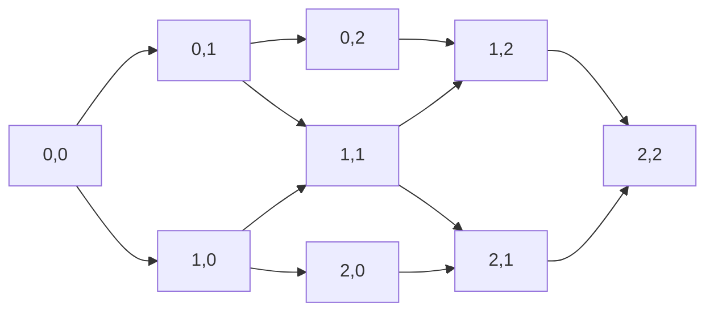

# P14 · Chương 07 — Tổ hợp và đếm

> Phạm vi: chương này dạy *đếm chính xác*: bao nhiêu cấu hình, bao nhiêu thứ tự xen kẽ, bao nhiêu quorum, cùng vài kết luận kiểu "chắc chắn có" suy ra từ phép đếm (nguyên lý chuồng bồ câu). Phần xác suất đứng trên chính các phép đếm này nằm ở [chương 03](03-xac-suat.md); việc nhờ máy duyệt hết các cấu hình thuộc [P13](../13-tla-plus/00-tong-quan.md). Phần toán bám theo giáo trình MIT 6.042 *Mathematics for Computer Science* (bản 2018), chương 15 và 16, cùng vài nguồn chuyên về hệ thống. Chứng minh nào mang nhãn "(chứng minh của người soạn)" là do người soạn tự viết hoặc viết lại, và chỉ đáng tin tới mức bạn đọc từng bước thấy đúng. Các chương trình Rust trong chương đã được chạy thật bằng `rustc 1.95.0` (`rustc --edition 2021 file.rs`, build không tối ưu) trên macOS arm64; output ghi dưới nhãn *quan sát* của một lần chạy. Các con số khác là phép tính của người soạn, và những con số đủ nhỏ để duyệt vét cạn đều đã được đối chiếu bằng chương trình.

Hầu hết quyết định thiết kế trong hệ phân tán là một phép đếm được viết gọn. "Quorum 3 trên 5 node" nghĩa là hai tập con cỡ 3 của một tập 5 phần tử luôn có phần tử chung. Con số 9,85·10⁻⁶ mỗi ngày ở chương 03 là một tổng các hệ số nhị thức. Câu "bộ test chịu lỗi chạy mất vài năm" là một ước lượng về số kịch bản. Chương này dạy bộ công cụ nhỏ nhất để những con số như thế đi kèm chứng minh: quy tắc cộng, nhân, chia; tổ hợp; đếm cùng một tập theo hai cách; chuồng bồ câu; bù trừ; hệ thức truy hồi và hàm sinh. Sau đó ta dùng chúng để trả lời ba câu hỏi rất thực dụng: quorum nào giao nhau và có bao nhiêu quorum; hash va chạm lúc nào là chắc chắn và lúc nào là hay xảy ra; và vì sao không bộ test nào phủ nổi không gian cấu hình của một hệ phân tán (nhận xét của người soạn).

Cả chương bám theo `kvmeta`, cụm Raft 5 node `N1`…`N5` đã gặp ở [P12 · Chương 18](../12-he-thong-du-lieu/18-thuat-toan-dong-thuan.md) và [chương 03](03-xac-suat.md), giữ feature flag và khóa leader cho các service backend (nhận xét của người soạn: ví dụ giả định, không phải code trong repo). Ta thêm vào nó hai thứ để có cái mà đếm: một bộ test chịu lỗi, tức ma trận các kịch bản crash, chia mạng và thứ tự sự kiện (mục 1 và 7), và về sau một tầng shard trong đó mỗi shard sao ba bản lên 3 trong 5 máy (mục 4).

## Bạn sẽ hiểu được gì

1. **Q1.** Làm sao đếm số cấu hình của một hệ thống (tập node có thể hỏng, thứ tự khởi động lại, cách chọn leader và follower) bằng quy tắc cộng, nhân và chia, và công thức hoán vị $n!$, tổ hợp $\binom{n}{k}$ từ đâu ra? → mục 1
2. **Q2.** "Đếm cùng một tập theo hai cách" là gì; Pascal, định lý nhị thức và $\sum_k \binom nk = 2^n$ được chứng minh thế nào; và cụm 5 node có bao nhiêu quorum đa số, mỗi node nằm trong bao nhiêu quorum? → mục 2
3. **Q3.** Nguyên lý chuồng bồ câu và dạng tổng quát của nó nói gì; vì sao hai đa số luôn giao nhau (và ngưỡng $a+b>n$ chặt đến đâu); và "va chạm hash chắc chắn tồn tại" khác "va chạm hash gần như chắc chắn xảy ra" ở đâu? → mục 3
4. **Q4.** Quy tắc bù trừ phát biểu và chứng minh ra sao; dùng nó thế nào để đếm toàn ánh, hoán vị không điểm bất động và tính xác suất "ít nhất một replica set mất trọn"? → mục 4
5. **Q5.** Stars and bars là gì; đếm số cách chia $m$ shard giống nhau cho $k$ node và số cách cắt một chuỗi entry thành các batch ra sao? → mục 5
6. **Q6.** Hệ thức truy hồi và hàm sinh cơ bản giải bài toán đếm thế nào, trên ví dụ lịch tiêm lỗi "không hai khe liền nhau" và dãy Fibonacci? → mục 6
7. **Q7.** Có bao nhiêu cách xen kẽ các bước của những tiến trình đồng thời, vì sao số kịch bản test nổ tung, và vì sao model checker đếm trạng thái chứ không đếm đường đi? → mục 7

## Kiến thức cần trước

- [Chương 01 — Logic và chứng minh](01-logic-va-chung-minh.md): phản chứng và quy nạp. Định lý 2.1 ở đó (hai tập đủ lớn phải giao nhau) được chứng minh lại ở mục 3 của chương này bằng chuồng bồ câu, kèm chiều ngược lại.
- [Chương 02 — Toán rời rạc](02-toan-roi-rac.md), mục 2 và 3: tập hợp, thứ tự bộ phận, happens-before. Mục 7 coi một xen kẽ hợp lệ là một thứ tự toàn phần giữ nguyên thứ tự trong từng tiến trình.
- [Chương 03 — Xác suất](03-xac-suat.md), mục 1.3, 1.4 và 4.3: xác suất mất quorum $9{,}85\cdot10^{-6}$, union bound, birthday. Chương này giải thích phần *đếm* mà chương 03 dùng nhưng chưa chứng minh ($\binom nk$, số cặp).
- [P12 · Chương 18, mục 1](../12-he-thong-du-lieu/18-thuat-toan-dong-thuan.md): quorum $2f+1$ và Flexible Paxos. Chương này không dạy lại mà bổ sung phần đếm.
- Tùy chọn: [P13 · Chương 01, mục 1.1](../13-tla-plus/01-vi-sao-dac-ta-hinh-thuc.md) và [P13 · Chương 04, mục 3](../13-tla-plus/04-invariant-va-tlc.md) (số xen kẽ, TLC duyệt trạng thái); [P15 · Chương 03, mục 2](../15-thuat-toan-phan-tan/03-phan-cap-consistency.md) (sequential và linearizable).
- Đọc được Rust cơ bản (vòng lặp, `u32`, bitmask với `&` và `>>`).

---

## 1. Đếm cấu hình: quy tắc cộng, nhân, chia; hoán vị và tổ hợp (Q1)

> **Trả lời ngắn.** Khi một cấu hình được chọn qua nhiều bước nối tiếp thì ta nhân số cách của từng bước[^mcs-product]; khi nó rơi vào một trong vài nhóm rời nhau thì ta cộng số cách của từng nhóm[^mcs-sum]. Chọn có thứ tự $k$ trong $n$ phần tử cho $n(n-1)\cdots(n-k+1)$ cách, và bỏ thứ tự đi thì chia cho $k!$ theo quy tắc chia[^mcs-division], ra $\binom{n}{k} = \dfrac{n!}{k!(n-k)!}$. Với `kvmeta`: có $2^5 = 32$ tập node có thể đang hỏng, trong đó 16 tập (tối đa 2 node) còn quorum.

**Giải thích.**

*Với `kvmeta`.* Giả sử bạn viết bộ test chịu lỗi cho `kvmeta`. Trước khi chạy test nào, câu hỏi đầu tiên là bảng test có bao nhiêu ô, và đó là một câu hỏi đếm. Đoán "chắc vài chục" thường dẫn tới bộ test hoặc thừa hoặc thiếu mà không ai biết (nhận xét của người soạn). Mục này dựng ba quy tắc và hai công thức để trả lời chính xác, trên những cấu hình đơn giản nhất của cụm 5 node.

### 1.1 Quy tắc nhân và quy tắc cộng

Mỗi node của `kvmeta` ở một trong hai trạng thái: sống hoặc hỏng. Một "cấu hình hỏng" là việc chọn trạng thái cho cả 5 node: node đầu có 2 cách, node thứ hai 2 cách, và cứ thế. Quy tắc nhân nói số cấu hình bằng tích $2\cdot2\cdot2\cdot2\cdot2 = 2^5 = 32$[^mcs-product]. Điều kiện dùng là số cách chọn ở mỗi bước không phụ thuộc vào các bước trước; mục 1.2 sẽ nới điều kiện này.

Quy tắc cộng dùng khi ta chia các cấu hình thành các nhóm *rời nhau*. Chính 32 cấu hình hỏng ở trên chia được theo số node hỏng: 0 node có 1 cấu hình, 1 node có 5, 2 node có 10, 3 node có 10, 4 node có 5, cả 5 node có 1 (mục 1.3 giải thích các số này). Cộng lại: $1+5+10+10+5+1 = 32$, khớp với quy tắc nhân. Cụm còn quorum khi có tối đa 2 node hỏng, tức $1+5+10 = 16$ cấu hình. Quy tắc cộng chỉ đúng khi các nhóm rời nhau[^mcs-sum]; nếu hai nhóm có phần chung thì phần đó bị đếm hai lần, và việc sửa lỗi ấy là chủ đề của mục 4.

### 1.2 Chọn có thứ tự: hoán vị

Bây giờ xét test *rolling restart*: khởi động lại lần lượt cả 5 node, mỗi lần một node. Node đầu tiên có 5 cách chọn. Sau đó chỉ còn 4 node chưa restart, rồi 3, 2, 1. Mỗi bước có một tập lựa chọn khác nhau, vì node đã restart thì không chọn lại, nhưng *số* lựa chọn không phụ thuộc bạn đã chọn node nào ở các bước trước. Vì vậy ta vẫn nhân được, và đó là quy tắc nhân tổng quát[^mcs-genprod]. Số thứ tự restart là $5\cdot4\cdot3\cdot2\cdot1 = 5! = 120$. Một dãy chứa mỗi phần tử của tập đúng một lần gọi là *hoán vị*[^mcs-perm], và theo lập luận trên tập $n$ phần tử có $n!$ hoán vị.

Nếu chỉ chọn $k$ trong $n$ phần tử mà vẫn tính thứ tự thì ta dừng sau $k$ bước: $P(n,k) = n(n-1)\cdots(n-k+1) = \dfrac{n!}{(n-k)!}$. Ví dụ, chọn có thứ tự bộ (leader, follower ưu tiên 1, follower ưu tiên 2) trong 5 node có $5\cdot4\cdot3 = 60$ cách.

### 1.3 Bỏ thứ tự: quy tắc chia và hệ số nhị thức

Không phải cấu hình nào cũng có thứ tự. Khi test "hai node hỏng cùng lúc", việc node nào hỏng trước không có nghĩa gì: $\lbrace N1, N2\rbrace$ và $\lbrace N2, N1\rbrace$ là một cấu hình. Có $P(5,2) = 20$ cặp có thứ tự, và mỗi cấu hình không thứ tự bị đếm đúng hai lần, nên có $20/2 = 10$ cấu hình. Đó là *quy tắc chia*: nếu một hàm từ tập $A$ sang tập $B$ là $c$-to-1, nghĩa là mỗi phần tử của $B$ có đúng $c$ phần tử của $A$ trỏ tới, thì $|A| = c|B|$. Nhiều bài toán dễ hơn hẳn khi ta cứ đếm thừa rồi chia lại[^mcs-division].

Gọi $\binom{n}{k}$ ("n chọn k") là số tập con $k$ phần tử của một tập $n$ phần tử.

**Định lý 1.1.** Với $0\le k\le n$: $\dbinom{n}{k} = \dfrac{n!}{k!(n-k)!}$.

*Chứng minh (chứng minh của người soạn; cùng ý với giáo trình[^mcs-subset]).* Xét $n!$ hoán vị của một tập $n$ phần tử, và hàm $f$ biến hoán vị $(a_1,\dots,a_n)$ thành tập $\lbrace a_1,\dots,a_k\rbrace$ gồm $k$ phần tử đầu. Cố định một tập $S$ có $k$ phần tử. Hoán vị có $f = S$ khi và chỉ khi $k$ phần tử đầu của nó là các phần tử của $S$ theo một thứ tự nào đó ($k!$ cách) và $n-k$ phần tử sau là các phần tử còn lại theo một thứ tự nào đó ($(n-k)!$ cách). Theo quy tắc nhân có đúng $k!(n-k)!$ hoán vị cho cùng một $S$. Vậy $f$ là hàm $k!(n-k)!$-to-1 từ $n!$ hoán vị xuống $\binom nk$ tập, và quy tắc chia cho $n! = k!(n-k)!\binom nk$. ∎

Vì $\binom nk$ là một phép đếm nên nó luôn là số nguyên, dù công thức viết dưới dạng phân số. Công thức cũng cho $\binom nk = \binom n{n-k}$; mục 2 chứng minh điều này mà không cần đại số. Với `kvmeta`, số tập có đúng $j$ node hỏng là $\binom5j$, tức $1,5,10,10,5,1$ cho $j=0,\dots,5$: đúng các số ở mục 1.1.

Bảng dưới gom các phép đếm của mục này thành "ma trận test" đầu tiên của `kvmeta`; các mục sau thêm dần cột (số liệu là phép tính của người soạn):

| Việc cần đếm | Cách đếm | Số cấu hình |
|---|---|---|
| Tập node hỏng cùng lúc (kể cả tập rỗng) | quy tắc nhân, $2^5$ | 32 |
| trong đó còn quorum (tối đa 2 node hỏng) | quy tắc cộng, $\binom50+\binom51+\binom52$ | 16 |
| Thứ tự restart cuốn chiếu cả 5 node | hoán vị, $5!$ | 120 |
| Bộ (leader, follower ưu tiên 1, follower ưu tiên 2) | $P(5,3)$ | 60 |
| Cặp node hỏng cùng lúc | $\binom52$ | 10 |

<details><summary>Đi sâu: tính C(n, k) trong Rust mà không tràn số</summary>

Công thức $n!/(k!(n-k)!)$ tràn rất sớm: $20!$ còn vừa `u64`, $21!$ thì không (xem mục "Liên hệ với Rust"). Cách an toàn hơn là nhân dần: $c \leftarrow c\cdot(n-i)/(i+1)$ cho $i = 0,\dots,k-1$. Phép chia luôn chẵn vì sau bước $i$ giá trị $c$ chính là $\binom n{i+1}$. Thật vậy, $\binom ni\cdot\dfrac{n-i}{i+1} = \dfrac{n!}{(i+1)!(n-i-1)!} = \binom n{i+1}$, và $\binom n{i+1}$ là số nguyên vì nó đếm tập con (chứng minh của người soạn). Tích trung gian $c\cdot(n-i)$ vẫn có thể tràn dù kết quả cuối vừa kiểu số, nên hàm `binom` ở mục 7 dùng `u128` và `checked_mul`. Lấy $k \leftarrow \min(k, n-k)$ trước khi nhân cũng làm các tích trung gian nhỏ hơn, nhờ $\binom nk = \binom n{n-k}$.

</details>

**Quay lại Q1:** quy tắc nhân đếm các lựa chọn nối tiếp, quy tắc cộng đếm các nhóm rời nhau, quy tắc chia sửa phần đếm thừa khi bỏ thứ tự; từ đó $P(n,k) = n!/(n-k)!$ và $\binom nk = n!/(k!(n-k)!)$. Với `kvmeta`: 32 tập node hỏng, 16 tập còn quorum, 120 thứ tự restart cuốn chiếu và 10 cặp node hỏng cùng lúc.

---

## 2. Song ánh, đếm hai cách và các hằng đẳng thức (Q2)

> **Trả lời ngắn.** Hai tập có một song ánh giữa chúng, tức một phép ghép đôi từng phần tử một–một, thì cùng cỡ; muốn đếm một tập khó ta tìm song ánh sang một tập dễ đếm[^mcs-bijection]. Muốn chứng minh một đẳng thức, ta chọn một tập rồi đếm nó theo hai cách; hai kết quả buộc phải bằng nhau, và đó là một chứng minh tổ hợp[^mcs-combproof]. Cách đó cho đẳng thức Pascal $\binom{n}{k} = \binom{n-1}{k-1} + \binom{n-1}{k}$, định lý nhị thức và $\sum_k\binom nk = 2^n$. Trên `kvmeta`: cụm 5 node có 16 quorum đa số (đúng một nửa của 32 tập con), 10 quorum tối thiểu, và mỗi node nằm trong đúng 6 quorum tối thiểu.

**Giải thích.**

*Với `kvmeta`.* Tới đây bạn đã đếm được số cấu hình hỏng. Bây giờ ta cần chứng minh *điều gì đó* về các con số ấy, chẳng hạn vì sao có đúng 16 tập hỏng mà cụm còn quorum và 16 tập hỏng mà cụm mất quorum. Cách nhanh nhất không phải liệt kê cả 32 tập mà là ghép chúng thành từng cặp: mỗi tập node hỏng ứng với đúng một tập node *sống*. Phép ghép đúng một–một như vậy là công cụ đầu tiên của mục này (nhận xét của người soạn).

### 2.1 Song ánh: đếm cái này bằng cách đếm cái kia

*Song ánh* giữa hai tập là cách ghép mỗi phần tử của tập này với đúng một phần tử của tập kia và ngược lại. Hai tập có song ánh thì cùng cỡ, và đó là cách trực tiếp nhất để đếm một thứ qua một thứ khác[^mcs-bijection]. Ví dụ đầu tiên: ghép mỗi tập con của $\lbrace N1,\dots,N5\rbrace$ với một xâu 5 bit, bit thứ $i$ bằng 1 nếu $Ni$ thuộc tập[^mcs-subsets-bits]. Phép ghép này là song ánh, nên số tập con bằng số xâu 5 bit, và quy tắc nhân cho $2^5 = 32$, đúng con số ở mục 1.

Ví dụ thứ hai là phép lấy phần bù. Hàm $S \mapsto S^c$ biến một tập node thành tập các node còn lại. Vì $(S^c)^c = S$ nên nó tự nghịch đảo, và vì $|S^c| = n-|S|$ nên nó ghép các tập cỡ $k$ với các tập cỡ $n-k$. Vậy $\binom nk = \binom n{n-k}$ mà không cần viết giai thừa: "chọn $k$ node hỏng" và "chọn $n-k$ node sống" là cùng một việc nhìn từ hai phía.

Ví dụ thứ ba dùng phép bù để đếm quorum. *Quorum đa số* là tập có nhiều hơn $n/2$ node (chương 01, Hệ quả 2.1).

**Định lý 2.1.** Với $n = 2m+1$ lẻ, số tập con có nhiều hơn $n/2$ phần tử đúng bằng $2^{n-1}$.

*Chứng minh (chứng minh của người soạn).* Gọi $\mathcal M$ là họ các tập con có ít nhất $m+1$ phần tử, và $\mathcal L$ là họ các tập con có nhiều nhất $m$ phần tử. Cỡ của một tập là số nguyên nên mỗi tập thuộc đúng một trong hai họ, và theo quy tắc cộng $|\mathcal M| + |\mathcal L| = 2^n$. Phép lấy phần bù đổi cỡ $s$ thành $n-s$: nếu $s\ge m+1$ thì $n-s\le m$, và nếu $s\le m$ thì $n-s\ge m+1$. Vậy nó ghép $\mathcal M$ với $\mathcal L$ và là song ánh, nên $|\mathcal M| = |\mathcal L|$, tức mỗi họ có $2^{n-1}$ tập. ∎

Với $n=5$ có 16 quorum đa số: $\binom53 = 10$ tập cỡ 3, $\binom54 = 5$ tập cỡ 4 và 1 tập cỡ 5. Mười tập cỡ 3 là các quorum *tối thiểu*: chúng không chứa quorum đa số nhỏ hơn, và mọi quorum còn lại chứa một trong chúng. Với $n$ chẵn phép chia đôi này không còn sạch, vì phần bù của một tập cỡ $n/2$ cũng cỡ $n/2$. Chẳng hạn $n=4$ chỉ có 5 tập cỡ $\ge3$ chứ không phải 8; bài tập 9 khai thác chỗ lệch đó.

### 2.2 Đếm hai cách: đẳng thức Pascal

Một *chứng minh tổ hợp* chứng minh một đẳng thức đại số bằng cách chọn một tập, đếm nó theo hai cách khác nhau rồi cho hai kết quả bằng nhau[^mcs-combproof]. Ví dụ quen thuộc nhất là đẳng thức Pascal. Ta lấy đúng tình huống test: chọn $k$ node cho một cấu hình hỏng trong cụm $n$ node, và để ý riêng $N1$ (chẳng hạn vì nó đang là leader).

**Bổ đề 2.2 (Pascal).** Với $1\le k\le n$: $\dbinom nk = \dbinom{n-1}{k-1} + \dbinom{n-1}{k}$, với quy ước $\binom{n-1}{n} = 0$.

*Chứng minh tổ hợp (chứng minh của người soạn; cùng khuôn với giáo trình[^mcs-pascal]).* Gọi $\mathcal S$ là tập mọi tập con $k$ phần tử của $\lbrace N1,\dots,Nn\rbrace$. Cách đếm thứ nhất cho $|\mathcal S| = \binom nk$. Cách đếm thứ hai chia $\mathcal S$ thành hai nhóm rời nhau tùy $N1$ có thuộc tập hay không. Nhóm có $N1$: $k-1$ node còn lại chọn từ $n-1$ node khác, $\binom{n-1}{k-1}$ cách. Nhóm không có $N1$: cả $k$ node chọn từ $n-1$ node khác, $\binom{n-1}{k}$ cách. Quy tắc cộng cho $|\mathcal S| = \binom{n-1}{k-1}+\binom{n-1}{k}$. Hai cách đếm cùng một tập nên bằng nhau. ∎

Kiểm với $n=5$, $k=2$: các cặp node hỏng chứa $N1$ là $\lbrace N1,N2\rbrace,\dots,\lbrace N1,N5\rbrace$, tức 4 cặp; các cặp không chứa $N1$ là $\binom42 = 6$; và $4+6 = 10 = \binom52$. Áp dụng lặp đẳng thức này ta dựng được tam giác Pascal, nơi mỗi số bằng tổng hai số ở hàng trên:

| $n$ | $\binom n0,\ \binom n1,\ \dots,\ \binom nn$ | tổng |
|---|---|---|
| 0 | 1 | 1 |
| 1 | 1, 1 | 2 |
| 2 | 1, 2, 1 | 4 |
| 3 | 1, 3, 3, 1 | 8 |
| 4 | 1, 4, 6, 4, 1 | 16 |
| 5 | 1, 5, 10, 10, 5, 1 | 32 |

Tổng mỗi hàng là $2^n$; mục tiếp theo giải thích vì sao.

### 2.3 Định lý nhị thức

**Định lý 2.3 (nhị thức).** Với số nguyên $n\ge0$: $(a+b)^n = \displaystyle\sum_{k=0}^{n}\dbinom nk a^{n-k}b^{k}$.

*Chứng minh (chứng minh của người soạn; cùng ý với giáo trình).* Khai triển tích $n$ thừa số $(a+b)(a+b)\cdots(a+b)$ bằng luật phân phối: mỗi số hạng thu được bằng cách chọn từ mỗi thừa số một trong hai chữ $a$ hoặc $b$. Vậy có đúng một số hạng cho mỗi dãy $n$ chữ cái $a$, $b$, trước khi gom các số hạng giống nhau[^mcs-binom-terms]. Số hạng có đúng $k$ chữ $b$ ứng với một tập gồm $k$ thừa số đã đóng góp chữ $b$, nên có $\binom nk$ số hạng như vậy, mỗi số hạng bằng $a^{n-k}b^k$. Gom lại ta được công thức, và đó là lý do $\binom nk$ còn gọi là hệ số nhị thức[^mcs-binom-coef]. ∎

**Hệ quả 2.4.** (i) Với $a=b=1$: $\sum_{k=0}^{n}\binom nk = 2^n$, khớp với quy tắc nhân ở mục 1. (ii) Với $a=1$, $b=-1$ và $n\ge1$: $\sum_{k=0}^{n}(-1)^k\binom nk = 0$. (iii) Với $a=1-p$, $b=p$: $\sum_{k=0}^{n}\binom nk p^k(1-p)^{n-k} = 1$.

Số hạng thứ $k$ của (iii) là xác suất đúng $k$ trong $n$ node hỏng khi mỗi node hỏng độc lập với xác suất $p$. Vậy tổng $\binom53p^3(1-p)^2 + \binom54p^4(1-p) + p^5$ ở [chương 03, mục 1.3](03-xac-suat.md) chính là phần đuôi của khai triển này. Còn hệ quả (ii) là thứ ta cần cho chứng minh bù trừ ở mục 4.

### 2.4 Đếm theo cặp: quorum đa số của `kvmeta`

Đếm hai cách còn dùng được khi không có đẳng thức nào đứng đích. Cho một họ $\mathcal Q$ các quorum trên tập node $V$, và xét tập các cặp $(v, Q)$ với $Q\in\mathcal Q$ và $v\in Q$.

**Bổ đề 2.5 (đếm theo cặp).** $\displaystyle\sum_{Q\in\mathcal Q}|Q| = \sum_{v\in V}d(v)$, trong đó $d(v)$ là số quorum chứa $v$.

*Chứng minh (chứng minh của người soạn).* Vế trái đếm các cặp $(v,Q)$ bằng cách nhóm theo quorum $Q$: mỗi quorum cho $|Q|$ cặp. Vế phải đếm cùng tập cặp đó bằng cách nhóm theo node $v$: mỗi node cho $d(v)$ cặp. ∎

Áp dụng cho 10 quorum tối thiểu (cỡ 3) của cụm 5 node: vế trái là $10\times3 = 30$. Hoán vị tên node biến họ này thành chính nó, nên mọi node có cùng $d$, và $5d = 30$ cho $d = 6$. Kiểm trực tiếp: quorum tối thiểu chứa $N1$ gồm $N1$ cùng 2 node chọn từ 4 node còn lại, $\binom42 = 6$ cách. Vậy mỗi node nằm trong đúng 6 trong 10 quorum tối thiểu.

Kết quả này có hệ quả về *tải*. Naor và Wool định nghĩa tải của một hệ quorum là xác suất truy cập của phần tử bận nhất, tối thiểu hóa theo mọi chiến lược chọn quorum[^nw-load]. Nếu client chọn đều một trong 10 quorum tối thiểu thì mỗi node tham gia $6/10 = 3/5$ số thao tác. Không chiến lược nào tốt hơn: tổng xác suất tham gia của 5 node bằng kỳ vọng cỡ quorum được chọn, mà cỡ đó luôn $\ge3$, nên node bận nhất có xác suất tham gia $\ge3/5$ (chứng minh của người soạn, bằng đếm theo cặp). Vậy tải của hệ quorum đa số 5 node đúng bằng $3/5$. Với $n=2m+1$ bất kỳ, cùng lập luận cho tải $\ge(m+1)/n > 1/2$: thêm node vào một cụm quorum đa số không đưa phần thao tác mỗi node phải gánh xuống dưới một nửa (nhận xét của người soạn).

<details><summary>Đi sâu: kiểm bằng bitmask, và hai quorum tối thiểu chung bao nhiêu node</summary>

Chương trình dưới đây (người soạn viết) biểu diễn mỗi tập node bằng một số `u32`, bit $i$ bằng 1 nếu node $N(i+1)$ có mặt. Nó liệt kê cả 32 tập, đếm quorum đa số và quorum tối thiểu, kiểm mọi cặp quorum đa số có node chung không, đếm số quorum tối thiểu chứa từng node, và xếp các cặp quorum tối thiểu khác nhau theo số node chung.

```rust
// Quorum của cụm 5 node: mỗi tập node là một số u32, bit i = node N(i+1) có mặt.
fn main() {
    let n = 5u32;
    let moi_tap: Vec<u32> = (0..(1u32 << n)).collect(); // 2^n tập con, kể cả tập rỗng
    let da_so: Vec<u32> = moi_tap.iter().copied().filter(|s| s.count_ones() > n / 2).collect();
    let toi_thieu: Vec<u32> = moi_tap.iter().copied().filter(|s| s.count_ones() == n / 2 + 1).collect();
    println!("tập con: {}  quorum đa số: {}  quorum tối thiểu: {}", moi_tap.len(), da_so.len(), toi_thieu.len());

    // Hai quorum đa số bất kỳ có node chung không?
    let giao_nhau = da_so.iter().all(|a| da_so.iter().all(|b| a & b != 0));
    println!("mọi cặp quorum đa số đều giao nhau: {giao_nhau}");

    // Mỗi node nằm trong bao nhiêu quorum tối thiểu?
    let moi_node: Vec<usize> = (0..n).map(|i| toi_thieu.iter().filter(|q| *q >> i & 1 == 1).count()).collect();
    println!("số quorum tối thiểu chứa từng node: {moi_node:?}");

    // Các cặp có thứ tự (A, B), A khác B, của quorum tối thiểu, xếp theo số node chung.
    let mut so_cap = [0usize; 4];
    for a in &toi_thieu {
        for b in &toi_thieu {
            if a != b {
                so_cap[(a & b).count_ones() as usize] += 1;
            }
        }
    }
    println!("cặp có thứ tự chung 1 node: {}  chung 2 node: {}", so_cap[1], so_cap[2]);
}
```

Kết quả chạy thật (quan sát, macOS arm64, `rustc 1.95.0`):

```text
tập con: 32  quorum đa số: 16  quorum tối thiểu: 10
mọi cặp quorum đa số đều giao nhau: true
số quorum tối thiểu chứa từng node: [6, 6, 6, 6, 6]
cặp có thứ tự chung 1 node: 30  chung 2 node: 60
```

Các số khớp lập luận tay. Hai quorum tối thiểu khác nhau trong 5 node chung ít nhất $3+3-5 = 1$ node (mục 3) và nhiều nhất 2. Cố định $A$ (10 cách chọn). Quorum $B \ne A$ chung đúng 2 node với $A$ khi $B$ giữ 2 trong 3 node của $A$ ($\binom32 = 3$ cách) rồi thêm 1 trong 2 node ngoài $A$ (2 cách): 6 quorum. Chung đúng 1 node khi $B$ giữ 1 trong 3 node của $A$ (3 cách) rồi lấy cả 2 node ngoài $A$ (1 cách): 3 quorum. Vậy có $10\times6 = 60$ cặp có thứ tự chung 2 node và $10\times3 = 30$ cặp chung 1 node; $60+30 = 90 = 10\times9$. Chương trình chỉ kiểm $n=5$; phát biểu cho mọi $n$ là Định lý 3.3 ở mục sau (người soạn).

</details>

**Quay lại Q2:** song ánh cho phép đếm qua một tập dễ hơn, và đếm cùng một tập theo hai cách cho Pascal, định lý nhị thức, $\sum_k\binom nk = 2^n$ cùng lượng quorum. Với `kvmeta`: phép lấy phần bù chia đôi 32 tập thành 16 quorum đa số và 16 tập thiểu số, có 10 quorum tối thiểu, và đếm theo cặp cho thấy mỗi node nằm trong 6 quorum tối thiểu, tải tối ưu $3/5$.

---

## 3. Nguyên lý chuồng bồ câu: quorum giao nhau và va chạm hash (Q3)

> **Trả lời ngắn.** Nếu nhét nhiều bồ câu hơn số chuồng thì có ít nhất một chuồng chứa từ hai bồ câu trở lên[^mcs-pigeon]; nếu số bồ câu vượt $c$ lần số chuồng thì có chuồng chứa ít nhất $c+1$ bồ câu[^mcs-gpp]. Từ đó, hai quorum cỡ $a$ và $b$ trong $n$ node luôn giao nhau khi $a+b>n$, và ngưỡng này chặt: nếu $a+b\le n$ thì có hai quorum rời nhau. Cũng từ đó, mọi hàm băm đều có va chạm khi số khóa vượt số giá trị băm, nhưng "tồn tại" khác xa "hay xảy ra": hash 32 bit gần như chắc chắn va chạm từ cỡ 77 000 khóa chứ không phải từ 4,3 tỉ.

**Giải thích.**

*Với `kvmeta`.* Hai câu hỏi sau trông chẳng liên quan, nhưng cùng một lập luận. Một: `put` đã được 3 node xác nhận, rồi leader chết; leader mới hỏi 3 node bất kỳ; chắc chắn có node nào trong số đó biết về `put` ấy không? Hai: tầng `kvmeta-cache` khử trùng lặp request bằng hash 64 bit của khóa; hai khóa khác nhau có thể cùng hash không, và khi nào thì chuyện đó đáng lo? Cả hai quy về một ý: nhét nhiều thứ vào ít chỗ thì có chỗ chứa hai thứ (nhận xét của người soạn).

### 3.1 Phát biểu và chứng minh

**Định lý 3.1 (chuồng bồ câu).** Nếu $|A|>|B|$ thì với mọi hàm $f:A\to B$ có hai phần tử khác nhau của $A$ cùng ảnh[^mcs-pigeon].

*Chứng minh (chứng minh của người soạn).* Giả sử không có hai phần tử khác nhau nào cùng ảnh. Khi đó $f$ đơn ánh, nên ghép $A$ song ánh với tập ảnh $f(A)\subseteq B$, và $|A| = |f(A)|\le|B|$, trái giả thiết. ∎

Khi dùng nguyên lý này, giáo trình khuyên xác định rõ ba thứ: bồ câu (tập $A$), chuồng (tập $B$) và luật xếp bồ câu vào chuồng (hàm $f$)[^mcs-pigeon-tip]. Muốn dùng đúng, hãy viết ra cả ba trước khi lập luận (nhận xét của người soạn).

**Định lý 3.2 (dạng tổng quát).** Nếu $|A|>c|B|$ với $c$ nguyên dương thì mọi hàm $f:A\to B$ đưa ít nhất $c+1$ phần tử của $A$ vào cùng một phần tử của $B$[^mcs-gpp].

*Chứng minh (chứng minh của người soạn).* Giả sử mọi $b\in B$ nhận nhiều nhất $c$ phần tử. Các tập nghịch ảnh $f^{-1}(b)$ rời nhau và hợp lại bằng $A$, nên theo quy tắc cộng $|A| = \sum_{b\in B}|f^{-1}(b)|\le c|B|$, trái giả thiết. ∎

Nói cách khác, luôn có một chuồng chứa ít nhất $\lceil |A|/|B|\rceil$ bồ câu. Ví dụ: 100 partition được gán cho 8 consumer. Vì $100>12\cdot8 = 96$, có consumer giữ ít nhất 13 partition, bất kể giao thức rebalance làm gì. Cận này chặt: $100 = 8\cdot12+4$, nên gán 13 partition cho 4 consumer và 12 partition cho 4 consumer là cách đều nhất có thể. "Đều tuyệt đối" bất khả khi 8 không chia hết 100 (nhận xét của người soạn). Đây là sàn *tất định* cho mọi cách gán, khác với mất cân bằng *ngẫu nhiên* mà [chương 03, mục 4.2](03-xac-suat.md) tính cho băm đều.

### 3.2 Hai quorum luôn giao nhau, và ngưỡng chặt

[Chương 01](01-logic-va-chung-minh.md) đã chứng minh hai đa số giao nhau bằng ba cách, đều dựa vào $|A\cup B|\le n$. Chuồng bồ câu cho cách thứ tư; ta thêm cả chiều ngược lại để biết ngưỡng chặt đến đâu.

**Định lý 3.3 (ngưỡng giao nhau).** Cho tập $V$ gồm $n$ node và hai số nguyên $1\le a,b\le n$. Mọi cặp tập $A,B\subseteq V$ với $|A| = a$ và $|B| = b$ đều giao nhau khi và chỉ khi $a+b>n$.

*Chứng minh (chứng minh của người soạn).* ($\Leftarrow$) Giả sử $a+b>n$. Gọi "chỗ" là cặp $(X,v)$ với $X\in\lbrace A,B\rbrace$ và $v\in X$; có $|A|+|B| = a+b$ chỗ. Hàm $f$ gửi chỗ $(X,v)$ tới node $v$. Vì $a+b>n=|V|$, nguyên lý chuồng bồ câu cho hai chỗ khác nhau cùng ảnh $v$. Hai chỗ cùng $X$ mà cùng $v$ thì là một chỗ, vì một tập không chứa $v$ hai lần; vậy hai chỗ ấy phải là $(A,v)$ và $(B,v)$, tức $v\in A\cap B$. ($\Rightarrow$) Giả sử $a+b\le n$. Lấy $A$ là $a$ node bất kỳ. Phần bù của $A$ có $n-a\ge b$ node, nên chọn được $B$ gồm $b$ node nằm trong phần bù, và $A\cap B = \varnothing$. ∎

Với 5 node và quorum cỡ 3: $3+3=6>5$ nên hai quorum luôn giao nhau. Với 6 node và quorum cỡ 3: $3+3=6\not>6$, và $\lbrace N1,N2,N3\rbrace$, $\lbrace N4,N5,N6\rbrace$ rời nhau, đúng ví dụ ở chương 01. Ba hệ thống thật dùng đúng phép đếm này. Paxos dựa vào việc hai đa số bất kỳ có ít nhất một acceptor chung[^pms-majority]. Flexible Paxos bỏ yêu cầu quorum đa số và chỉ đòi quorum của hai pha khác nhau giao nhau, và với quorum đếm theo số node thì điều kiện là $|Q_1|+|Q_2|>N$[^fpx-simple]. Dynamo cho người dùng chọn $R$ (số replica tham gia một lần đọc) và $W$ (số replica tham gia một lần ghi), và đặt $R+W>N$ thì thu được hệ quorum[^dynamo-rw]. Cấu hình phổ biến của nó là $(N,R,W) = (3,2,2)$[^dynamo-322], với $2+2>3$. Với $N=5$, các cặp $(R,W)$ vừa đủ là $(1,5)$, $(2,4)$, $(3,3)$, $(4,2)$, $(5,1)$: tổng đúng bằng 6.

### 3.3 Nhiều quorum cùng lúc

Đôi khi cần một node thuộc nhiều quorum cùng lúc, chứ không chỉ hai. Dạng tổng quát của Định lý 3.3 dùng đếm theo cặp (Bổ đề 2.5).

**Hệ quả 3.4.** Với $A_1,\dots,A_k\subseteq V$ và $|V|=n$: $\ \bigl|A_1\cap\dots\cap A_k\bigr| \ge \sum_{i=1}^{k}|A_i| - (k-1)n$.

*Chứng minh (chứng minh của người soạn).* Đặt $m = |A_1\cap\dots\cap A_k|$ và $d(v)$ là số tập $A_i$ chứa $v$. Theo Bổ đề 2.5, $\sum_i|A_i| = \sum_{v}d(v)$. Một node trong giao có $d(v) = k$, và có $m$ node như vậy. Một node ngoài giao nằm trong nhiều nhất $k-1$ tập, và có $n-m$ node như vậy. Vậy $\sum_i|A_i|\le km+(k-1)(n-m) = (k-1)n+m$, tức $m\ge\sum_i|A_i|-(k-1)n$. ∎

Với $k=2$ ta được $|A\cap B|\ge|A|+|B|-n$ của chương 01. Với $k=3$, ba quorum cùng cỡ $a$ chắc chắn có node chung khi $3a>2n$. Ba đa số của cụm 5 node ($3\cdot3 = 9\le10$) thì không chắc có; bài tập 10 dựng phản ví dụ và hỏi vì sao điều đó quan trọng cho chứng minh của Raft.

### 3.4 Va chạm hash: chắc chắn tồn tại, hiếm khi là vấn đề

Quay lại câu hỏi thứ hai. Hash 32 bit cho $d = 2^{32}$ giá trị. Theo chuồng bồ câu, mọi tập có hơn $2^{32}$ khóa phân biệt đều chứa hai khóa cùng hash, *dù hàm băm là hàm nào*. Đó là bảo đảm tuyệt đối, nhưng nó chỉ nói va chạm *tồn tại*: nó không chỉ ra cặp nào, và giáo trình gọi kiểu lập luận này là chứng minh không kiến thiết (nonconstructive)[^mcs-nonconstr].

Câu hỏi thực dụng khác: hệ thật hiếm khi có hơn $2^{32}$ khóa, vậy các khóa thường va chạm lúc nào? Nếu hash đều và độc lập thì đây là bài toán birthday, mà giáo trình coi là mô hình tốt cho va chạm giữa các phần tử ngẫu nhiên chèn vào một bảng băm[^mcs-bday-model]. $n$ khóa tạo ra $\binom n2$ cặp (quy tắc chọn tập con ở mục 1), mỗi cặp trùng với xác suất $1/d$, nên số cặp trùng kỳ vọng là $\binom n2/d$, và xác suất có va chạm đạt một nửa khi $n\approx\sqrt{2\ln2\cdot d}\approx1{,}18\sqrt d$; [chương 03, mục 4.3](03-xac-suat.md) chứng minh các điều này. Đặt hai ngưỡng cạnh nhau:

| Số giá trị băm $d$ | Chuồng bồ câu: chắc chắn có va chạm khi $n>$ | Birthday: xác suất 50% khi $n\approx$ |
|---|---|---|
| $2^{32}$ | 4 294 967 296 | 77 163 |
| $2^{64}$ | $1{,}8\cdot10^{19}$ | $5{,}06\cdot10^{9}$ |
| $2^{122}$ (UUIDv4[^uuid-122]) | $5{,}3\cdot10^{36}$ | $2{,}7\cdot10^{18}$ |

(Cột cuối: người soạn tính lại từ công thức của chương 03; hai số đầu trùng bảng ở đó.) Với hash 32 bit, hai ngưỡng cách nhau cỡ 55 000 lần. Chuồng bồ câu là bảo đảm *trường hợp xấu nhất* nhưng quá lỏng để dùng làm ước lượng; birthday là bảo đảm *xác suất* chặt hơn nhiều nhưng chỉ đúng khi giả thiết "đều và độc lập" đúng. Hệ quả cho người làm backend (nhận xét của người soạn): đừng bao giờ coi hai hash bằng nhau là hai khóa bằng nhau, và chọn độ rộng hash theo $n^2/(2d)$ chứ không theo $n/d$.

<details><summary>Đi sâu: hai quorum khác pha, sloppy quorum, và Byzantine</summary>

- *Hai quorum cỡ khác nhau.* Định lý 3.3 đúng cho cỡ $a\ne b$, nên nó cũng là lý do Flexible Paxos cho phép quorum pha ghi nhỏ: với $N=5$ và $|Q_2|=2$ thì $|Q_1|\ge4$, như ví dụ ở [P12 · Chương 18, mục 1](../12-he-thong-du-lieu/18-thuat-toan-dong-thuan.md). Chiều ($\Rightarrow$) của định lý cho biết thêm: nếu $|Q_1|+|Q_2|\le N$ thì *tồn tại* hai quorum rời nhau, tức đó không chỉ là điều kiện đủ mà còn là điều kiện cần cho hệ quorum đếm theo số node.
- *Sloppy quorum phá phép đếm.* Dynamo không bắt buộc quorum chặt: khi có node hỏng, mọi thao tác chạy trên $N$ node *khỏe* đầu tiên của danh sách ưu tiên, có thể không phải $N$ node đầu tiên trên vòng băm[^dynamo-sloppy]. Khi đó hai quorum không còn lấy từ cùng một tập $N$ node cố định, nên lập luận $R+W>N$ không còn cho giao nhau (suy luận của người soạn). Đây là chỗ "đúng trong toán, không đúng trong hệ thống" vì tập $V$ của định lý đã bị đổi mất.
- *Byzantine.* Với $n=3f+1$ và quorum cỡ $2f+1$, Hệ quả 3.4 cho $|A\cap B|\ge 2(2f+1)-(3f+1) = f+1$ node chung, con số mà [P12 · Chương 18, mục 1](../12-he-thong-du-lieu/18-thuat-toan-dong-thuan.md) dùng để bảo đảm trong giao có ít nhất một node đúng. Bài tập 10 hỏi tiếp trường hợp ba quorum.

</details>

**Quay lại Q3:** hơn $c$ lần số chuồng bồ câu thì có chuồng chứa ít nhất $c+1$ con; nhờ vậy hai quorum cỡ $a$ và $b$ trong $n$ node giao nhau *khi và chỉ khi* $a+b>n$, và $k$ quorum có giao ít nhất $\sum|A_i|-(k-1)n$ node. Với `kvmeta`: $3+3>5$ nên hai quorum 3 node luôn giao nhau; còn hash thì va chạm là *chắc chắn tồn tại* khi $n>d$ nhưng *hay xảy ra* từ cỡ $\sqrt d$, nên hash 32 bit không đủ để khử trùng lặp quá vài chục nghìn khóa.

---

## 4. Bù trừ: đếm hợp, toàn ánh, hoán vị không điểm bất động và "một replica set mất trọn" (Q4)

> **Trả lời ngắn.** Để đếm hợp của các tập có thể chồng nhau, quy tắc bù trừ cộng cỡ từng tập, trừ cỡ các giao đôi, cộng cỡ các giao ba, và cứ thế đan dấu[^mcs-ie-alt]. Nó đúng vì mỗi phần tử của hợp được đếm đúng một lần, và ta chứng minh điều đó bằng định lý nhị thức. Quy tắc này cho ra số cách gán $n$ request lên $k$ replica sao cho replica nào cũng nhận ít nhất một request, số hoán vị không điểm bất động, và xác suất để ít nhất một replica set mất trọn khi các replica set dùng chung máy: với 5 máy và ba replica set xếp thành chuỗi, kết quả là $3p^3-2p^4$ chứ không phải $3p^3$.

**Giải thích.**

*Với `kvmeta`.* Dữ liệu của `kvmeta` lớn dần nên được chia thành nhiều shard. Giả sử mỗi shard là một nhóm Raft ba bản đặt trên 3 trong 5 máy `N1`…`N5`; ba máy đó là *replica set* của shard (nhận xét của người soạn: ví dụ giả định). Dữ liệu của shard không truy cập được khi cả ba máy của nó cùng hỏng. Câu hỏi vận hành là xác suất để ít nhất một shard mất cả ba bản. Mỗi shard riêng lẻ có xác suất $p^3$. Nhưng các shard dùng chung máy, nên biến cố "shard A mất hết" và "shard B mất hết" chồng lên nhau, và cộng xác suất sẽ đếm thừa phần chồng: đúng lỗi mà quy tắc cộng ở mục 1 đã cảnh báo. Mục này dạy cách trừ phần chồng đó cho đúng.

### 4.1 Hợp của hai và ba tập

Giáo trình gọi bù trừ là quy tắc đếm phức tạp nhất trong các quy tắc đếm: nó cho cỡ của một hợp mà các tập không nhất thiết rời nhau[^mcs-ie-union]. Với hai tập, $|S_1\cup S_2| = |S_1|+|S_2|-|S_1\cap S_2|$: phần tử chung bị đếm hai lần ở hai số hạng đầu, và số hạng cuối sửa lại[^mcs-ie-two]. Với ba tập, ta cộng ba cỡ, trừ ba giao đôi rồi cộng lại giao ba: một phần tử nằm trong cả ba tập bị đếm 3 lần, bị trừ 3 lần, rồi được cộng 1 lần, tức đúng 1 lần. Phần tử nằm trong đúng hai tập bị đếm 2 lần và trừ 1 lần, cũng đúng 1 lần. Quy tắc tổng quát chỉ là mở rộng cùng cách tính ấy.

### 4.2 Quy tắc tổng quát và chứng minh

**Định lý 4.1 (bù trừ).** Với các tập hữu hạn $S_1,\dots,S_n$:

$$\Bigl|\bigcup_{i=1}^{n}S_i\Bigr| = \sum_{\varnothing\ne I\subseteq\lbrace1,\dots,n\rbrace}(-1)^{|I|+1}\Bigl|\bigcap_{i\in I}S_i\Bigr|.$$

Nhóm các số hạng theo cỡ $|I|$ ta có dạng quen thuộc: tổng các cỡ, trừ tổng các giao đôi, cộng tổng các giao ba, các tổng đan dấu[^mcs-ie-alt].

*Chứng minh (chứng minh của người soạn; giáo trình chứng minh bằng đại số ở Bài 15.59).* Ta đếm theo từng phần tử. Lấy $x$ trong hợp, đặt $T=\lbrace i: x\in S_i\rbrace$ và $t=|T|\ge1$. Phần tử $x$ nằm trong $\bigcap_{i\in I}S_i$ khi và chỉ khi $I\subseteq T$. Vậy $x$ đóng góp vào vế phải đúng $\sum_{\varnothing\ne I\subseteq T}(-1)^{|I|+1} = \sum_{j=1}^{t}(-1)^{j+1}\binom tj$, vì có $\binom tj$ tập $I\subseteq T$ cỡ $j$. Theo Hệ quả 2.4(ii), $\sum_{j=0}^{t}(-1)^j\binom tj = 0$ khi $t\ge1$; số hạng $j=0$ bằng 1, nên $\sum_{j=1}^{t}(-1)^{j+1}\binom tj = 1$. Mỗi phần tử của hợp đóng góp đúng 1 vào vế phải, phần tử ngoài hợp đóng góp 0, nên vế phải bằng $|\bigcup S_i|$. ∎

Hai nhận xét. Thứ nhất, nếu có một vũ trụ $U\supseteq\bigcup S_i$ thì số phần tử *không* thuộc tập nào là $|U|-|\bigcup S_i| = \sum_{I\subseteq\lbrace1,\dots,n\rbrace}(-1)^{|I|}\bigl|\bigcap_{i\in I}S_i\bigr|$, với quy ước giao của họ rỗng là $U$; đó là dạng ta dùng ở 4.3 và 4.4. Thứ hai, chứng minh làm từng phần tử nên vẫn đúng khi mỗi phần tử mang một trọng số không âm, chẳng hạn xác suất của kết cục: bù trừ cũng đúng cho xác suất của các biến cố.

### 4.3 Đếm toàn ánh

Năm request đồng thời tới 3 follower, mỗi request đến đúng một follower. Một cách gán là một hàm từ 5 request sang 3 follower, và có $3^5=243$ hàm (quy tắc nhân). Test "cả ba follower đều bận" cần mỗi follower nhận ít nhất một request: hàm phải *toàn ánh*, tức nhận mọi giá trị. Gọi $A_i$ là các hàm bỏ sót follower $i$. Một hàm không toàn ánh nằm trong $A_1\cup A_2\cup A_3$. Mỗi $A_i$ có $2^5=32$ hàm (mỗi request chọn trong hai follower còn lại), mỗi $A_i\cap A_j$ có $1^5=1$ hàm, và $A_1\cap A_2\cap A_3=\varnothing$. Bù trừ cho $|A_1\cup A_2\cup A_3| = 3\cdot32-3\cdot1+0 = 93$, nên số toàn ánh là $243-93=150$.

**Hệ quả 4.2.** Số hàm $f:\lbrace1,\dots,n\rbrace\to\lbrace1,\dots,k\rbrace$ nhận mọi giá trị là $\mathrm{surj}(n,k) = \displaystyle\sum_{j=0}^{k}(-1)^j\binom kj(k-j)^n$.

*Chứng minh (chứng minh của người soạn).* Vũ trụ $U$ là mọi hàm, có $k^n$ phần tử. Gọi $S_i$ là các hàm không nhận giá trị $i$. Giao của $j$ tập như vậy (cố định $j$ giá trị bị bỏ) là các hàm chỉ nhận $k-j$ giá trị còn lại, tức $(k-j)^n$ hàm, và có $\binom kj$ cách chọn $j$ giá trị. Dạng bù của Định lý 4.1 cho công thức. ∎

Với $n=5$ ta có bảng sau. Hàng cuối là số cách chia 5 phần tử thành $k$ nhóm không rỗng *không đánh nhãn*: mỗi cách chia ứng với đúng $k!$ toàn ánh, vì đánh nhãn $1..k$ cho các nhóm theo thứ tự nào cũng được, nên quy tắc chia cho $\mathrm{surj}(5,k)/k!$.

| $k$ | 1 | 2 | 3 | 4 | 5 |
|---|---|---|---|---|---|
| $\mathrm{surj}(5,k)$ | 1 | 30 | 150 | 240 | 120 |
| chia cho $k!$ | 1 | 15 | 25 | 10 | 1 |

Tổng hàng cuối là $1+15+25+10+1 = 52$. Nếu ta mô hình hóa mạng bị chia *sạch* (mỗi node thuộc đúng một nhóm mà các node trong nhóm liên lạc được với nhau) thì mỗi kiểu chia mạng của 5 node là một cách chia thành các nhóm không rỗng, và có đúng 52 kiểu, trong đó 15 kiểu chia hai nhóm; mục 7 dùng con số 15 cho thực đơn sự kiện lỗi của ma trận test (nhận xét của người soạn: mô hình sạch bỏ qua partition một phần của [P12 · Chương 18, mục 6.1](../12-he-thong-du-lieu/18-thuat-toan-dong-thuan.md)).

### 4.4 Hoán vị không điểm bất động

Sau một đợt rolling deploy, scheduler xếp lại 5 pod lên 5 node, mỗi node một pod. Giả sử ta mô hình hóa việc xếp là một hoán vị đều ngẫu nhiên (nhận xét của người soạn: scheduler thật không làm vậy). Pod nào quay về đúng node cũ thì cache cục bộ của nó còn nóng. Có bao nhiêu hoán vị mà *không* pod nào về node cũ? Những hoán vị như vậy gọi là hoán vị không điểm bất động (derangement).

**Hệ quả 4.3.** Số hoán vị của $n$ phần tử không có điểm bất động là $D_n = \displaystyle\sum_{j=0}^{n}(-1)^j\frac{n!}{j!}$.

*Chứng minh (chứng minh của người soạn).* Vũ trụ là $n!$ hoán vị $\pi$, và $S_i$ là các hoán vị có $\pi(i)=i$. Giao của các $S_i$ với $i\in I$ gồm các hoán vị cố định mọi phần tử của $I$ và xếp tự do $n-|I|$ phần tử còn lại, tức $(n-|I|)!$ hoán vị. Có $\binom nj$ tập $I$ cỡ $j$. Dạng bù cho $D_n = \sum_j(-1)^j\binom nj(n-j)!$, và $\binom nj(n-j)! = n!/j!$. ∎

Với $n=5$: $D_5 = 120-120+60-20+5-1 = 44$. Các giá trị đầu là $D_1,\dots,D_8 = 0, 1, 2, 9, 44, 265, 1854, 14833$. Vì $D_n/n! = \sum_{j=0}^{n}(-1)^j/j!$ là tổng riêng của chuỗi Taylor của $e^{-1}\approx0{,}367879$, các số hạng đan dấu và giảm dần, nên sai khác với $e^{-1}$ nhỏ hơn số hạng kế tiếp $1/(n+1)!$ (người soạn). Chẳng hạn $44/120\approx0{,}3667$ và $14833/40320\approx0{,}36788$. Vậy với $n\ge5$, xác suất để ít nhất một pod giữ node cũ là $1-D_n/n!\approx63{,}2$%, gần như không phụ thuộc $n$.

### 4.5 Ít nhất một replica set mất trọn

Trở lại 5 máy và các shard ba bản. Gọi $X$ là tập máy đang hỏng, giả sử mỗi máy hỏng độc lập với xác suất $p$ trong khung thời gian đang xét (chương 03, mục 1.3 đã cảnh báo giả thiết độc lập là chỗ dễ sai nhất). Gọi $E_R$ là biến cố "mọi máy của replica set $R$ đều hỏng", tức $R\subseteq X$.

**Mệnh đề 4.4.** Với họ $\mathcal F$ các replica set:

$$\Pr\Bigl[\bigcup_{R\in\mathcal F}E_R\Bigr] = \sum_{\varnothing\ne\mathcal S\subseteq\mathcal F}(-1)^{|\mathcal S|+1}p^{|\bigcup\mathcal S|},$$

trong đó $\bigcup\mathcal S$ là hợp các máy của các replica set trong $\mathcal S$.

*Chứng minh (chứng minh của người soạn).* Biến cố "mọi $E_R$ với $R\in\mathcal S$ cùng xảy ra" nghĩa là mọi máy trong $\bigcup\mathcal S$ đều hỏng; nhờ các máy hỏng độc lập, xác suất của nó là $p^{|\bigcup\mathcal S|}$. Phần còn lại là Định lý 4.1 cho xác suất, như nhận xét ở mục 4.2. ∎

Ví dụ: ba replica set xếp chuỗi $R_1=\lbrace N1,N2,N3\rbrace$, $R_2=\lbrace N2,N3,N4\rbrace$, $R_3=\lbrace N3,N4,N5\rbrace$. Có $2^3-1=7$ họ con $\mathcal S$ khác rỗng:

| Họ con $\mathcal S$ | Hợp các máy | Cỡ hợp | Số hạng |
|---|---|---|---|
| $\lbrace R_1\rbrace$, $\lbrace R_2\rbrace$, $\lbrace R_3\rbrace$ | 3 máy mỗi hợp | 3 | $+p^3$ (3 số hạng) |
| $\lbrace R_1,R_2\rbrace$ | $\lbrace N1,N2,N3,N4\rbrace$ | 4 | $-p^4$ |
| $\lbrace R_2,R_3\rbrace$ | $\lbrace N2,N3,N4,N5\rbrace$ | 4 | $-p^4$ |
| $\lbrace R_1,R_3\rbrace$ | cả 5 máy | 5 | $-p^5$ |
| $\lbrace R_1,R_2,R_3\rbrace$ | cả 5 máy | 5 | $+p^5$ |

Cộng lại: $3p^3-2p^4-p^5+p^5 = 3p^3-2p^4$. Kiểm bằng cách đếm trực tiếp theo tập máy hỏng $X$: $X$ chứa một replica set khi $X$ là một trong ba tập $R_i$ (3 tập cỡ 3), hoặc $X$ có 4 máy và không phải $\lbrace N1,N2,N4,N5\rbrace$ (4 trong 5 tập cỡ 4; tập đó không chứa $R_1$, $R_2$ hay $R_3$), hoặc $X$ là cả 5 máy. Vậy $P = 3p^3(1-p)^2+4p^4(1-p)+p^5$, và khai triển cho $3p^3-2p^4+0\cdot p^5$, khớp. Với $p=1$%: $3\cdot10^{-6}-2\cdot10^{-8} = 2{,}98\cdot10^{-6}$. Union bound $3p^3=3\cdot10^{-6}$ ở đây chỉ lệch khoảng 0,7%, vì phần chồng chỉ xảy ra khi từ 4 máy hỏng trở lên.

Bảng dưới so sánh năm cách đặt replica set trên cùng 5 máy với $p=1$% (phép tính của người soạn; viết gọn $123$ cho $\lbrace N1,N2,N3\rbrace$; chương trình ở phần Đi sâu kiểm cả bốn hàng cuối bằng bù trừ lẫn đếm trực tiếp):

| Cách đặt (các replica set) | Số replica set | $P$ = xác suất ít nhất một replica set mất trọn | Nếu biết chắc đúng 3 máy hỏng, chọn đều |
|---|---|---|---|
| một nhóm $123$ | 1 | $p^3 = 1{,}00\cdot10^{-6}$ | 1/10 |
| hai nhóm $123$, $345$ | 2 | $2p^3-p^5\approx2{,}00\cdot10^{-6}$ | 2/10 |
| chuỗi $123$, $234$, $345$ | 3 | $3p^3-2p^4 = 2{,}98\cdot10^{-6}$ | 3/10 |
| vòng 5 nhóm $\lbrace i,i+1,i+2\rbrace$ | 5 | $5p^3-5p^4+p^5\approx4{,}95\cdot10^{-6}$ | 5/10 |
| mọi bộ ba máy | 10 | $10p^3-15p^4+6p^5\approx9{,}85\cdot10^{-6}$ | 10/10 |

Cột cuối là trường hợp đơn giản nhất. Nếu biết chắc đúng 3 máy hỏng cùng lúc và bộ ba hỏng chọn đều trong $\binom53=10$ bộ ba, thì xác suất mất dữ liệu bằng số replica set chia 10. Đó là cách tính của bài báo Copysets: khi ba node hỏng đồng thời, xác suất mất dữ liệu bằng số copyset chia cho số tập ba node tối đa[^cs-3fail]. Ở đó copyset là một tập node chứa đủ mọi bản sao của một chunk dữ liệu[^cs-def]. Với cụm 9 node bài báo có 54 copyset khi đặt ngẫu nhiên, ứng với $54/\binom93=54/84\approx0{,}64$[^cs-54]. Khi đặt có kiểm soát chỉ còn 6 copyset, ứng với $6/84\approx0{,}07$[^cs-6].

Hàng cuối của bảng trùng với $9{,}85\cdot10^{-6}$ ở chương 03. Nếu *mọi* bộ ba máy đều là replica set của một shard nào đó thì "một replica set mất trọn" đồng nghĩa với "có ít nhất 3 máy hỏng"; bài Copysets nói đó chính là tình trạng của đặt ngẫu nhiên khi có đủ nhiều chunk[^cs-random]. Bài học là số replica set *phân biệt* mới quyết định, chứ không phải số shard: hai shard đặt trên cùng ba máy chỉ góp một biến cố. Càng nhiều copyset thì xác suất mất dữ liệu khi sự cố tương quan càng cao[^cs-freq]. Nhưng đừng kết luận "càng ít copyset càng tốt": bài báo cũng nói đây là một đánh đổi, vì kỳ vọng lượng dữ liệu mất không đổi dù chính sách nhân bản thế nào[^cs-tradeoff], nên ít copyset chỉ làm sự kiện mất dữ liệu hiếm hơn nhưng mỗi lần mất nhiều hơn.

Cùng công thức, đổi vai: thay "hỏng" bằng "sống" và replica set bằng quorum thì Mệnh đề 4.4 cho *availability* của một hệ quorum, tức xác suất ít nhất một quorum còn sống trọn vẹn khi các phần tử hỏng độc lập[^nw-avail]. Với hệ quorum đa số 5 node, tổng 1023 số hạng của 10 quorum tối thiểu bằng xác suất có ít nhất 3 node sống; bài tập 9 so sánh nó với một hệ quorum "độc tài" có cùng số quorum nhưng availability tệ.

Cái giá của bù trừ là $2^m-1$ số hạng cho $m$ replica set: $m=10$ cho 1023 số hạng thì còn cộng được, nhưng $m=100$ cho $2^{100}-1\approx1{,}3\cdot10^{30}$ (người soạn tính) thì không. Khi đó ta đổi cách đếm: đếm theo tập máy hỏng ($2^N$ tập, chỉ 32 với $N=5$), hoặc dùng cận từ vài số hạng đầu (phần Đi sâu).

<details><summary>Đi sâu: cận Bonferroni và chương trình kiểm bù trừ</summary>

**Cắt bù trừ cho cận.** Đặt $T_1=\sum_i|S_i|$ và $T_2=\sum_{i \lt j}|S_i\cap S_j|$. Một phần tử nằm trong đúng $t\ge1$ tập đóng góp $t$ vào $T_1$ và $\binom t2$ vào $T_2$. Vì $t\ge1$ nên $1\le t$, và vì $(t-1)(t-2)\ge0$ với mọi số nguyên $t$ nên $t-\binom t2 = \frac{t(3-t)}{2}\le1$. Cộng theo mọi phần tử của hợp: $T_1-T_2\le|\bigcup S_i|\le T_1$ (chứng minh của người soạn). Số hạng đầu chính là union bound ở [chương 03, mục 1.4](03-xac-suat.md), và nó đếm thừa đúng ở các phần tử nằm trong từ hai tập trở lên. Với chuỗi ba replica set: $T_1=3p^3$ và $T_2=2p^4+p^5$, nên $3p^3-2p^4-p^5\le P\le3p^3$; giá trị đúng $3p^3-2p^4$ nằm trong khoảng ấy.

**Chương trình kiểm.** Chương trình dưới đây (người soạn viết) tính ba thứ: số toàn ánh theo công thức bù trừ, $D_n$ theo công thức bù trừ, và xác suất mất trọn một replica set dưới dạng đa thức theo $p$ bằng hai cách độc lập. Cách thứ nhất cộng $\pm p^{|\bigcup\mathcal S|}$ trên mọi họ con khác rỗng; cách thứ hai duyệt 32 tập máy hỏng $X$, giữ những $X$ chứa ít nhất một replica set, và khai triển $p^{|X|}(1-p)^{5-|X|}$ bằng định lý nhị thức.

```rust
// Bù trừ ba lần: toàn ánh, hoán vị không điểm bất động, replica set mất trọn.
fn binom(n: u32, k: u32) -> i64 {
    (0..k).fold(1i64, |c, i| c * (n - i) as i64 / (i + 1) as i64)
}
fn giai_thua(n: u32) -> i64 {
    (1..=n as i64).product()
}

// Số hàm từ n phần tử lên k phần tử: sum_j (-1)^j C(k,j) (k-j)^n.
fn toan_anh(n: u32, k: u32) -> i64 {
    (0..=k).map(|j| (if j % 2 == 0 { 1 } else { -1 }) * binom(k, j) * ((k - j) as i64).pow(n)).sum()
}

// Hoán vị không điểm bất động: sum_j (-1)^j n!/j!.
fn khong_diem_bat_dong(n: u32) -> i64 {
    (0..=n).map(|j| (if j % 2 == 0 { 1 } else { -1 }) * giai_thua(n) / giai_thua(j)).sum()
}

// P(ít nhất một replica set mất trọn) dưới dạng đa thức theo p: hs[e] = hệ số của p^e.
// Mỗi replica set là bitmask 5 bit; sau đây là hai cách tính.
fn bu_tru(sets: &[u32]) -> [i64; 6] {
    let mut hs = [0i64; 6];
    for mask in 1u32..(1 << sets.len()) {
        let hop = (0..sets.len()).filter(|i| mask >> i & 1 == 1).fold(0u32, |u, i| u | sets[i]);
        let dau = if mask.count_ones() % 2 == 1 { 1 } else { -1 };
        hs[hop.count_ones() as usize] += dau; // số hạng ±p^{|hợp|}
    }
    hs
}
fn truc_tiep(sets: &[u32]) -> [i64; 6] {
    let mut hs = [0i64; 6];
    for x in 0u32..32 {
        // x = tập node hỏng; trọng số p^|x| (1-p)^(5-|x|), khai triển (1-p)^(5-|x|)
        if sets.iter().any(|&r| r & x == r) {
            let s = x.count_ones();
            for j in 0..=(5 - s) {
                let dau = if j % 2 == 0 { 1 } else { -1 };
                hs[(s + j) as usize] += dau * binom(5 - s, j);
            }
        }
    }
    hs
}

fn main() {
    println!("toàn ánh 5 -> k, k=1..5: {:?}", (1..=5).map(|k| toan_anh(5, k)).collect::<Vec<_>>());
    println!("chia cho k! (Stirling hạng hai): {:?}", (1..=5).map(|k| toan_anh(5, k) / giai_thua(k)).collect::<Vec<_>>());
    println!("D_n, n=1..8: {:?}", (1..=8).map(khong_diem_bat_dong).collect::<Vec<_>>());

    let ba_bo: Vec<u32> = (0u32..32).filter(|s| s.count_ones() == 3).collect(); // mọi bộ ba
    let cac_cach: [(&str, Vec<u32>); 4] = [
        ("hai nhóm 123,345", vec![0b00111, 0b11100]),
        ("chuỗi 123,234,345", vec![0b00111, 0b01110, 0b11100]),
        ("vòng 5 nhóm", (0..5).map(|i| (0..3).fold(0u32, |m, j| m | 1 << ((i + j) % 5))).collect()),
        ("mọi bộ ba (10)", ba_bo),
    ];
    for (ten, sets) in &cac_cach {
        let (a, b) = (bu_tru(sets), truc_tiep(sets));
        let p = 0.01f64;
        let gia_tri: f64 = a.iter().enumerate().map(|(e, &h)| h as f64 * p.powi(e as i32)).sum();
        println!("{ten:<18} số hạng {:<5} hệ số p^3..p^5 {:?} khớp trực tiếp: {}  P(p=1%) = {gia_tri:.4e}",
            (1u32 << sets.len()) - 1, &a[3..], a == b);
    }
}
```

Kết quả chạy thật (quan sát, macOS arm64, `rustc 1.95.0`):

```text
toàn ánh 5 -> k, k=1..5: [1, 30, 150, 240, 120]
chia cho k! (Stirling hạng hai): [1, 15, 25, 10, 1]
D_n, n=1..8: [0, 1, 2, 9, 44, 265, 1854, 14833]
hai nhóm 123,345   số hạng 3     hệ số p^3..p^5 [2, 0, -1] khớp trực tiếp: true  P(p=1%) = 1.9999e-6
chuỗi 123,234,345  số hạng 7     hệ số p^3..p^5 [3, -2, 0] khớp trực tiếp: true  P(p=1%) = 2.9800e-6
vòng 5 nhóm        số hạng 31    hệ số p^3..p^5 [5, -5, 1] khớp trực tiếp: true  P(p=1%) = 4.9501e-6
mọi bộ ba (10)     số hạng 1023  hệ số p^3..p^5 [10, -15, 6] khớp trực tiếp: true  P(p=1%) = 9.8506e-6
```

Các hàng khớp bảng ở 4.5: hai cách tính cho cùng đa thức, kể cả với 1023 số hạng. Giá trị $9{,}8506\cdot10^{-6}$ của hàng cuối làm tròn thành $9{,}851\cdot10^{-6}$, đúng con số "độc lập, $\ge3$ trong 5 máy hỏng" mà chương trình ở chương 03 in ra. Chương trình chỉ kiểm 5 máy với $p$ cố định; công thức cho mọi họ replica set và mọi $p$ là Mệnh đề 4.4.

</details>

**Quay lại Q4:** bù trừ đếm hợp bằng tổng đan dấu các giao, đúng vì mỗi phần tử của hợp đóng góp $\sum_{j\ge1}(-1)^{j+1}\binom tj=1$; nó cho số toàn ánh $\sum_j(-1)^j\binom kj(k-j)^n$, số hoán vị không điểm bất động $D_n = \sum_j(-1)^jn!/j!\approx n!/e$, và xác suất mất trọn một replica set. Với `kvmeta-store` trên 5 máy, $p=1$%: ba replica set xếp chuỗi cho $3p^3-2p^4 = 2{,}98\cdot10^{-6}$, còn mọi bộ ba máy cho $9{,}85\cdot10^{-6}$, gấp 3,3 lần; số replica set *phân biệt* mới là thứ quyết định.

---

## 5. Stars and bars: chia tài nguyên giống nhau và cắt chuỗi thành batch (Q5)

> **Trả lời ngắn.** Số cách chia $m$ vật giống nhau cho $k$ ô khác nhau (ô nào cũng được nhận 0 hoặc nhiều vật) là $\binom{m+k-1}{k-1}$, và nếu mỗi ô phải nhận ít nhất một vật thì là $\binom{m-1}{k-1}$. Lý do là một song ánh giữa mỗi cách chia với một dãy gồm $m$ ngôi sao và $k-1$ vạch ngăn[^mcs-donut-bij]. Với `kvmeta`: chia 12 shard giống nhau cho 5 node có 1820 cách, bắt mỗi node có ít nhất một shard thì còn 330 cách; cắt một chuỗi 10 entry liên tiếp thành các batch có $2^9=512$ cách.

**Giải thích.**

*Với `kvmeta`.* Tầng lưu trữ cần đặt 12 shard lên 5 node. Nếu bạn chỉ quan tâm *mỗi node giữ bao nhiêu* shard, tức kế hoạch cân bằng tải, chứ chưa quan tâm *shard nào*, thì mỗi kế hoạch là một bộ năm số không âm cộng lại bằng 12. Có bao nhiêu kế hoạch như vậy (nhận xét của người soạn: ví dụ giả định)?

### 5.1 Song ánh sao và vạch

Viết $x_i$ là số shard của node $i$. Ta ghép bộ $(x_1,\dots,x_5)$ với một dãy ký tự: viết $x_1$ ngôi sao `*`, rồi một vạch `|`, rồi $x_2$ ngôi sao, một vạch, và cứ thế, kết thúc bằng $x_5$ ngôi sao. Ví dụ $(2,3,0,5,2)$ ứng với `**|***||*****|**`. Dãy luôn có $m=12$ ngôi sao và $k-1=4$ vạch, tức dài $16$ ký tự. Ngược lại mỗi dãy 16 ký tự gồm 12 sao và 4 vạch cho đúng một bộ $(x_1,\dots,x_5)$ (số sao giữa hai vạch liên tiếp). Giáo trình dùng đúng song ánh này cho bài toán chọn 12 chiếc donut trong 5 loại[^mcs-donut-bij].

**Định lý 5.1 (sao và vạch).** Số bộ $(x_1,\dots,x_k)$ gồm các số nguyên không âm có tổng $m$ là $\dbinom{m+k-1}{k-1}$. Số bộ gồm các số nguyên *dương* có tổng $m$ là $\dbinom{m-1}{k-1}$.

*Chứng minh (chứng minh của người soạn).* Theo song ánh trên, số bộ bằng số dãy dài $m+k-1$ có đúng $k-1$ vạch. Một dãy như vậy hoàn toàn xác định bởi tập $k-1$ vị trí đặt vạch trong $m+k-1$ vị trí, nên có $\binom{m+k-1}{k-1}$ dãy theo định nghĩa của $\binom nk$. Với bộ số dương, đặt $y_i=x_i-1\ge0$; phép đổi này là song ánh từ các bộ dương có tổng $m$ sang các bộ không âm có tổng $m-k$, nên số bộ là $\binom{(m-k)+k-1}{k-1}=\binom{m-1}{k-1}$. ∎

Với $m=12$, $k=5$: $\binom{16}{4}=1820$ kế hoạch tải; bắt mỗi node giữ ít nhất một shard thì $\binom{11}{4}=330$.

### 5.2 Đếm cái gì? Phép gán và hình dạng tải

Con số 1820 đếm *hình dạng tải*, không đếm phép gán. Nếu 12 shard là 12 đối tượng phân biệt và mỗi shard chọn một trong 5 node thì có $5^{12}=244\ 140\ 625$ phép gán (quy tắc nhân). Bắt mỗi node có ít nhất một shard, tức một toàn ánh từ 12 shard lên 5 node, thì còn $\mathrm{surj}(12,5)=165\ 528\ 000$ phép gán (Hệ quả 4.2). Hàng trăm triệu phép gán đó chỉ cho 330 hình dạng tải, nên trung bình mỗi hình dạng ứng với khoảng 501 600 phép gán (người soạn tính). Chọn đúng đối tượng để đếm theo câu hỏi đang cần trả lời: test cân bằng tải chỉ cần phủ các hình dạng, còn test di chuyển dữ liệu mới cần các phép gán (nhận xét của người soạn).

### 5.3 Cắt chuỗi entry thành batch

Leader nhận một chuỗi 10 entry liên tiếp rồi gói chúng thành các batch để gửi bằng `AppendEntries`; mỗi batch gồm ít nhất một entry, các entry trong batch liền nhau, và thứ tự được giữ nguyên (nhận xét của người soạn: ví dụ giả định). Một cách gói được xác định hoàn toàn bởi việc chọn các *khe* giữa hai entry liền nhau mà ở đó ta cắt. Chuỗi 10 entry có 9 khe, mỗi khe cắt hoặc không, nên có $2^9=512$ cách gói (quy tắc nhân; cũng là một song ánh giữa cách gói và tập con của 9 khe). Cách gói có đúng $k$ batch cần chọn $k-1$ khe cắt, nên có $\binom{9}{k-1}$ cách: đúng trường hợp "mỗi ô nhận ít nhất một vật" của Định lý 5.1, với 10 entry là 10 "vật" và $k$ batch là $k$ "ô". Cộng theo $k$ ta lại được $\sum_{k=1}^{10}\binom{9}{k-1}=2^9$, khớp Hệ quả 2.4(i).

Con số $2^{n-1}$ cho biết vì sao chỉ test vét cạn được mọi cách gói với chuỗi ngắn. Với 10 entry là 512; với 20 entry là $2^{19}=524\ 288$; với 30 entry là $2^{29}=536\ 870\ 912$. Nếu thêm luật "mỗi batch tối đa 2 entry" thì số cách gói là một số Fibonacci, và ta tính nó ở mục 6.

<details><summary>Đi sâu: kiểm vét cạn bộ số có tổng cho trước</summary>

Chương trình dưới đây (người soạn viết) đếm bộ $(x_1,\dots,x_5)$ có tổng 12 bằng đệ quy theo từng ô, không dùng công thức: ô cuối lấy phần còn lại, các ô trước thử mọi giá trị từ mức tối thiểu tới phần còn lại.

```rust
// Đếm bộ (x1..xk) số nguyên không âm có tổng m, mỗi phần tử >= toi_thieu, bằng đệ quy từng ô.
fn dem(con_lai: usize, o: usize, toi_thieu: usize) -> u64 {
    if o == 1 {
        return u64::from(con_lai >= toi_thieu);
    }
    (toi_thieu..=con_lai).map(|x| dem(con_lai - x, o - 1, toi_thieu)).sum()
}

fn main() {
    let (m, k) = (12, 5); // 12 shard giống nhau, 5 node
    println!("mỗi node >= 0: {}  mỗi node >= 1: {}", dem(m, k, 0), dem(m, k, 1));
}
```

Kết quả chạy thật (quan sát, macOS arm64, `rustc 1.95.0`):

```text
mỗi node >= 0: 1820  mỗi node >= 1: 330
```

Hai số khớp $\binom{16}{4}$ và $\binom{11}{4}$. Giới hạn trên cho từng node (mỗi node tối đa $c$ shard) làm phép đếm khó hơn một bậc: ta phải trừ các bộ có node vượt $c$ bằng bù trừ (mục 4), là nội dung của bài tập 6.

</details>

**Quay lại Q5:** mỗi cách chia $m$ vật giống nhau cho $k$ ô ứng với một dãy $m$ sao và $k-1$ vạch, nên có $\binom{m+k-1}{k-1}$ cách (và $\binom{m-1}{k-1}$ nếu mỗi ô phải có vật). Với `kvmeta`: 12 shard cho 5 node là 1820 hình dạng tải (330 nếu node nào cũng có shard), trong khi 12 shard *phân biệt* có hơn 244 triệu phép gán; một chuỗi $n$ entry có $2^{n-1}$ cách cắt thành batch.

---

## 6. Hệ thức truy hồi và hàm sinh cơ bản (Q6)

> **Trả lời ngắn.** Khi một phép đếm chia được thành các trường hợp ứng với những bài toán nhỏ hơn cùng loại, ta thu được một hệ thức truy hồi. Ví dụ, số lịch tiêm lỗi $n$ khe mà không có hai khe tiêm liền nhau thỏa $a_n=a_{n-1}+a_{n-2}$, tức là dãy Fibonacci. Hàm sinh gói cả dãy $a_0,a_1,\dots$ vào một chuỗi lũy thừa $A(x)=\sum a_nx^n$ để biến phép đếm thành đại số[^mcs-gf-intro]; nhờ đó hệ thức truy hồi tuyến tính thành một phân thức, ở đây là $(1+x)/(1-x-x^2)$, và tốc độ tăng của dãy đọc ra từ nghiệm của mẫu số.

**Giải thích.**

*Với `kvmeta`.* Bộ test chịu lỗi tiêm lỗi vào các khe thời gian, mỗi khe vài giây. Để cụm kịp phục hồi giữa hai lần tiêm, ta cấm tiêm ở hai khe liền nhau (nhận xét của người soạn: ví dụ giả định). Với $n$ khe, có bao nhiêu lịch tiêm hợp lệ? Không có công thức nhìn là ra như tổ hợp, nhưng có một cấu trúc đệ quy rõ ràng: nhìn vào khe cuối cùng.

### 6.1 Truy hồi bằng cách chia theo khe cuối

Biểu diễn một lịch là xâu $n$ bit, bit $i$ bằng 1 nếu tiêm lỗi ở khe $i$. Gọi $a_n$ là số xâu $n$ bit không có hai bit 1 liền nhau. Xâu rỗng hợp lệ nên $a_0=1$; xâu 1 bit nào cũng hợp lệ nên $a_1=2$.

**Mệnh đề 6.1.** Với $n\ge2$: $a_n=a_{n-1}+a_{n-2}$.

*Chứng minh (chứng minh của người soạn).* Chia các xâu hợp lệ độ dài $n$ theo bit cuối. Nếu bit cuối là 0, thì $n-1$ bit đầu là một xâu hợp lệ bất kỳ độ dài $n-1$, và ngược lại thêm 0 vào cuối xâu hợp lệ nào cũng vẫn hợp lệ: có $a_{n-1}$ xâu. Nếu bit cuối là 1, thì bit thứ $n-1$ bắt buộc là 0, và $n-2$ bit đầu là một xâu hợp lệ bất kỳ độ dài $n-2$; ngược lại thêm "01" vào cuối xâu hợp lệ độ dài $n-2$ thì vẫn hợp lệ: có $a_{n-2}$ xâu. Hai nhóm rời nhau vì bit cuối khác nhau và phủ mọi xâu hợp lệ, nên quy tắc cộng cho $a_n=a_{n-1}+a_{n-2}$. ∎

Điều kiện đầu quan trọng không kém hệ thức: $a_0=1$, $a_1=2$ rồi $a_2=3$ (các xâu `00`, `01`, `10`; xâu `11` bị cấm). Dãy là $1,2,3,5,8,13,21,34,55,89,144$, đúng dãy Fibonacci $F_{n+2}$ với $F_0=0$, $F_1=1$. So với $2^n$ không có luật cấm ($1024$ lịch cho $n=10$), luật cấm giảm số lịch xuống 144. Nhưng nó không đổi bản chất mũ của phép đếm: với $n=30$ vẫn có $a_{30}=2\ 178\ 309$ lịch (so với $2^{30}=1\ 073\ 741\ 824$, ít hơn khoảng 493 lần), nghĩa là vét cạn mọi lịch hợp lệ chỉ khả thi cho $n$ nhỏ.

### 6.2 Hàm sinh

Với một dãy $a_0,a_1,a_2,\dots$ ta gọi $A(x)=\sum_{n\ge0}a_nx^n$ là *hàm sinh* của nó, và viết $[x^n]A(x)=a_n$ cho hệ số của $x^n$[^mcs-gf-intro]. Ta coi $A(x)$ là một đối tượng đại số hình thức, không cần quan tâm chuỗi có hội tụ hay không[^mcs-gf-formal]. Hai phép toán đủ dùng cho chương này. Cộng hai hàm sinh là cộng từng hệ số. Nhân hai hàm sinh là *tích chập*: $[x^n]\bigl(A(x)B(x)\bigr)=\sum_{k=0}^{n}a_kb_{n-k}$. Ý nghĩa đếm của nó: nếu có $a_k$ cách chọn $k$ thứ từ loại A và $b_j$ cách chọn $j$ thứ từ loại B thì số cách chọn tổng cộng $n$ thứ là $\sum_ka_kb_{n-k}$, vì ta quyết định trước chọn bao nhiêu thứ từ loại A rồi cộng theo mọi cách chia[^mcs-gf-conv].

Ba hàm sinh đáng nhớ:

1. $\dfrac1{1-x}=1+x+x^2+\cdots$: dãy toàn số 1, tức đúng một cách chọn $n$ vật giống nhau từ một loại. Kiểm tra bằng tích chập: $(1-x)\cdot(1+x+x^2+\cdots)=1$, vì hệ số $x^n$ của tích là $1-1=0$ với $n\ge1$.
2. $(1+x)^n=\sum_k\binom nkx^k$: mỗi node đóng góp một thừa số $1+x$ ("sống" là 1, "hỏng" là $x$), và tích chập cho số tập hỏng theo cỡ. Đây là định lý nhị thức nhìn qua hàm sinh: phép đếm dựng nên phép tính đại số, và ngược lại đại số cho ra đẳng thức tổ hợp[^mcs-gf-binom].
3. $\Bigl(\dfrac1{1-x}\Bigr)^k$: mỗi ô nhận số vật tùy ý, và $[x^m]$ của nó là số bộ $(x_1,\dots,x_k)$ không âm có tổng $m$, tức $\binom{m+k-1}{k-1}$ theo mục 5.

Bây giờ giải hệ thức của $a_n$. Nhân $a_n=a_{n-1}+a_{n-2}$ với $x^n$ rồi cộng theo $n\ge2$:

$$\sum_{n\ge2}a_nx^n = x\sum_{n\ge2}a_{n-1}x^{n-1}+x^2\sum_{n\ge2}a_{n-2}x^{n-2}\quad\Longrightarrow\quad A(x)-a_0-a_1x = x\bigl(A(x)-a_0\bigr)+x^2A(x).$$

Chuyển vế: $A(x)(1-x-x^2)=a_0+(a_1-a_0)x=1+x$. Vậy

$$A(x)=\frac{1+x}{1-x-x^2}.$$

Đây là hàm sinh của $F_{n+2}$. Giáo trình dựng hàm sinh của chính dãy Fibonacci, $F(x)=x/(1-x-x^2)$, rồi phân tích thành phân thức đơn giản để đi tới công thức Binet[^mcs-binet], $F_n=\dfrac1{\sqrt5}\bigl[\varphi^n-\psi^n\bigr]$ với $\varphi=\frac{1+\sqrt5}2\approx1{,}618$ và $\psi=\frac{1-\sqrt5}2$. Vì $\sum_nF_{n+2}x^n=(F(x)-x)/x^2=(1+x)/(1-x-x^2)$ (người soạn tính), ta có $a_n=F_{n+2}$. Do $|\psi|<1$ nên $a_n\approx\varphi^{n+2}/\sqrt5$: dãy tăng theo hàm mũ với cơ số $\varphi\approx1{,}618$ thay vì 2[^mcs-binet-growth]. Luật "không hai khe liền nhau" đổi cơ số của phép đếm, không làm nó thôi bùng nổ.

Cùng một hệ thức xuất hiện ở bài toán batch của mục 5. Gọi $c_n$ là số cách cắt $n$ entry liên tiếp thành các batch gồm 1 hoặc 2 entry. Batch cuối có 1 entry thì $n-1$ entry trước cắt tùy ý: $c_{n-1}$ cách; batch cuối có 2 entry thì còn $c_{n-2}$ cách. Với $c_0=1$, $c_1=1$ ta được $c_n=F_{n+1}$, nên 10 entry với batch tối đa 2 entry có $F_{11}=89$ cách cắt, so với $2^9=512$ khi không giới hạn (người soạn tính).

<details><summary>Đi sâu: chương trình kiểm, và chỗ u64 tràn</summary>

Chương trình dưới đây (người soạn viết) làm ba việc. Một, đếm vét cạn các lịch tiêm lỗi bằng bitmask, với mẹo: một số $s$ có hai bit 1 liền nhau khi và chỉ khi `s & (s >> 1)` khác 0. Hai, so với hệ thức truy hồi và công thức Binet. Ba, chạy truy hồi bằng `checked_add` cho tới khi `u64` tràn, để thấy một phép đếm tổ hợp vượt kiểu số nguyên nhanh thế nào.

```rust
// a_n = số lịch tiêm lỗi n khe, không có hai khe tiêm liền nhau: a_0 = 1, a_1 = 2, a_n = a_(n-1) + a_(n-2).
fn truy_hoi(n: u32) -> u64 {
    let (mut x, mut y) = (1u64, 2u64); // a_0, a_1
    for _ in 0..n {
        (x, y) = (y, x + y);
    }
    x
}

fn main() {
    // Vét cạn bằng bitmask: bit i = 1 nếu khe i tiêm lỗi; có hai bit 1 liền nhau <=> s & (s >> 1) != 0.
    for n in 0..=10u32 {
        let vet_can = (0u32..(1 << n)).filter(|s| s & (s >> 1) == 0).count();
        println!("n={n:<2} vét cạn {vet_can:<4} truy hồi {:<4} 2^n = {}", truy_hoi(n), 1u32 << n);
    }
    // Binet: a_n = F_(n+2) = làm tròn phi^(n+2) / sqrt(5); thử với n = 30.
    let phi = (1.0 + 5f64.sqrt()) / 2.0;
    println!("a_30: truy hồi {}, Binet {}", truy_hoi(30), (phi.powi(32) / 5f64.sqrt()).round());
    // Chạy truy hồi tới khi u64 tràn: checked_add trả None thay vì cuộn vòng.
    let (mut x, mut y, mut n) = (1u64, 2u64, 1u32); // a_0, a_1; y = a_n
    while let Some(z) = x.checked_add(y) {
        (x, y, n) = (y, z, n + 1);
    }
    println!("a_{n} = {y} là giá trị cuối còn vừa u64; a_{} tràn", n + 1);
}
```

Kết quả chạy thật (quan sát, macOS arm64, `rustc 1.95.0`):

```text
n=0  vét cạn 1    truy hồi 1    2^n = 1
n=1  vét cạn 2    truy hồi 2    2^n = 2
n=2  vét cạn 3    truy hồi 3    2^n = 4
n=3  vét cạn 5    truy hồi 5    2^n = 8
n=4  vét cạn 8    truy hồi 8    2^n = 16
n=5  vét cạn 13   truy hồi 13   2^n = 32
n=6  vét cạn 21   truy hồi 21   2^n = 64
n=7  vét cạn 34   truy hồi 34   2^n = 128
n=8  vét cạn 55   truy hồi 55   2^n = 256
n=9  vét cạn 89   truy hồi 89   2^n = 512
n=10 vét cạn 144  truy hồi 144  2^n = 1024
a_30: truy hồi 2178309, Binet 2178309
a_91 = 12200160415121876738 là giá trị cuối còn vừa u64; a_92 tràn
```

Vét cạn khớp hệ thức truy hồi với mọi $n\le10$, và công thức Binet khớp ở $n=30$. Dòng cuối cho thấy $a_{91}$ là số lịch cuối cùng còn vừa `u64`; từ $a_{92}$ trở đi một bộ đếm `u64` viết bằng phép cộng trần sẽ panic ở build debug và cuộn vòng ở build release (xem mục "Liên hệ với Rust").

Lưu ý hai chỗ dễ sai. Hệ thức $a_n=a_{n-1}+a_{n-2}$ chỉ đúng từ $n\ge2$ và phải đi kèm $a_0$, $a_1$: dùng cùng hệ thức với $a_0=0$, $a_1=1$ cho dãy $F_n$ chứ không phải số lịch. Và công thức Binet ở dạng số thực chỉ dùng được để ước lượng độ lớn (số mũ 1,618), không dùng để đếm chính xác khi $n$ lớn vì sai số làm tròn của `f64`.

</details>

**Quay lại Q6:** chia các lịch hợp lệ theo khe cuối cho $a_n=a_{n-1}+a_{n-2}$; nhân hệ thức với $x^n$ rồi cộng cho hàm sinh $A(x)=(1+x)/(1-x-x^2)$, và nghiệm của mẫu số cho cơ số tăng $\varphi\approx1{,}618$. Với `kvmeta`: 10 khe có 144 lịch tiêm lỗi hợp lệ (so với 1024), 30 khe có 2 178 309, và luật cấm chỉ đổi cơ số của phép bùng nổ chứ không chặn nó.

---

## 7. Bùng nổ tổ hợp: xen kẽ, ma trận test và vì sao model checker đếm trạng thái (Q7)

> **Trả lời ngắn.** Nếu $n$ tiến trình chạy đồng thời và tiến trình thứ $i$ gồm $k_i$ bước nối tiếp, thì số thứ tự xen kẽ các bước, giữ nguyên thứ tự trong từng tiến trình, là hệ số đa thức $\frac{(k_1+\cdots+k_n)!}{k_1!\cdots k_n!}$[^mcs-bookkeeper]; với ba tiến trình mười bước, đó là 5 550 996 791 340. Thêm các sự kiện lỗi chen vào bất cứ chỗ nào, số kịch bản test nhanh chóng vượt khả năng chạy. Lối thoát là đếm *trạng thái* thay vì đường đi, như model checker làm khi nó chỉ đưa một trạng thái vào hàng đợi nếu chưa gặp nó[^ss-tlc-seen], hoặc chỉ xét các lịch có ít lần preempt.

**Giải thích.**

*Với `kvmeta`.* Hai hình dung. Một: ba service cùng giành khóa `lock/billing-cron`, mỗi service chạy bốn bước không nguyên tử (đọc khóa, so sánh, ghi, đọc lại để xác nhận). Hai: bộ test chịu lỗi của mục 1, nơi crash và chia mạng chen vào giữa các bước ấy. Cả hai cùng hỏi: có bao nhiêu thứ tự (nhận xét của người soạn: ví dụ giả định).

### 7.1 Đếm xen kẽ

Mô hình: tiến trình $i$ có $k_i$ bước nguyên tử nối tiếp. Một *xen kẽ* (interleaving) là một thứ tự toàn phần của mọi bước mà các bước của cùng một tiến trình giữ nguyên thứ tự ban đầu. Ta coi mọi bước là độc lập và mọi xen kẽ đều chạy được, nên phép đếm là cận trên của số lịch chạy thật; [P13 · Chương 01, mục 1](../13-tla-plus/01-vi-sao-dac-ta-hinh-thuc.md) cũng nói vậy ở phần Đi sâu.

**Định lý 7.1 (xen kẽ).** Số xen kẽ là $\dbinom{K}{k_1,\dots,k_n}=\dfrac{K!}{k_1!\cdot k_2!\cdots k_n!}$ với $K=k_1+\dots+k_n$.

*Chứng minh (chứng minh của người soạn; theo "Bookkeeper Rule" của giáo trình[^mcs-bookkeeper]).* Ghép mỗi xen kẽ với một dãy độ dài $K$ gồm các số hiệu tiến trình: vị trí thứ $t$ của dãy cho biết bước thứ $t$ của xen kẽ thuộc tiến trình nào. Số hiệu $i$ xuất hiện đúng $k_i$ lần, và lần xuất hiện thứ $j$ của $i$ là bước thứ $j$ của tiến trình $i$, nên thứ tự trong từng tiến trình được giữ. Ngược lại mỗi dãy như vậy cho đúng một xen kẽ, nên phép ghép là song ánh. Đếm các dãy: chọn $k_1$ vị trí cho số hiệu 1 trong $K$ vị trí, $\binom K{k_1}$ cách; rồi $k_2$ vị trí cho số hiệu 2 trong $K-k_1$ vị trí còn lại, $\binom{K-k_1}{k_2}$ cách; và cứ thế. Theo quy tắc nhân, tổng là $\binom K{k_1}\binom{K-k_1}{k_2}\cdots=\dfrac{K!}{k_1!\cdots k_n!}$, vì các giai thừa của $K-k_1-\dots-k_i$ triệt tiêu theo từng cặp. ∎

Với $n$ tiến trình, mỗi tiến trình $k$ bước, công thức là $\dfrac{(nk)!}{(k!)^n}$, đúng công thức ở P13. Bảng dưới là các giá trị (phép tính của người soạn; mọi ô trừ hai ô $k=10$ của $n=3$ và $n=4$ đã được đối chiếu bằng vét cạn):

| $n$ tiến trình | $k=2$ | $k=3$ | $k=4$ | $k=10$ |
|---|---|---|---|---|
| 2 | 6 | 20 | 70 | 184 756 |
| 3 | 90 | 1 680 | 34 650 | 5 550 996 791 340 |
| 4 | 2 520 | 369 600 | 63 063 000 | 4 705 360 871 073 570 227 520 |

Ba service giành khóa với bốn bước mỗi service có 34 650 xen kẽ, đã vượt xa những gì một người tự liệt kê. Còn nếu hai tiến trình chỉ cần đọc rồi ghi một biến chung (hai bước mỗi tiến trình) thì có $\binom42=6$ xen kẽ, và đó là con số 6 trong ví dụ "kiểm tra còn hàng rồi mới trừ" của P13; bài tập 3 làm tương tự cho một bộ đếm đọc rồi ghi.

Khi giữa các tiến trình có thêm ràng buộc "gửi trước nhận" (happens-before, [chương 02, mục 3](02-toan-roi-rac.md)), các xen kẽ hợp lệ chỉ còn là những cách xếp topo của thứ tự bộ phận đó ([chương 02, mục 2.4](02-toan-roi-rac.md)), ít hơn công thức trên. Ví dụ, một vòng bầu cử có 4 lời xin phiếu, mỗi lời kèm một câu trả lời đứng sau nó. Nếu mạng giao tin theo bất kỳ thứ tự nào thì 8 tin có $8!=40\ 320$ thứ tự; nhưng mỗi câu trả lời phải đứng sau lời xin tương ứng, tức bốn chuỗi độc lập mỗi chuỗi 2 bước, nên chỉ có $\dfrac{8!}{(2!)^4}=2520$ thứ tự (người soạn tính).

**Liên hệ với consistency ([P15 · Chương 03, mục 2.1](../15-thuat-toan-phan-tan/03-phan-cap-consistency.md)).** Lamport định nghĩa sequential consistency là: kết quả của mọi lần chạy giống như khi mọi thao tác chạy theo *một* thứ tự tuần tự nào đó, và thao tác của từng processor xuất hiện đúng thứ tự chương trình của nó[^lamport-sc]. "Một thứ tự tuần tự nào đó" chính là một xen kẽ. Vì vậy một lịch sử $n$ process, mỗi process $k$ thao tác, có $\dfrac{(nk)!}{(k!)^n}$ ứng viên mà một checker vét cạn phải thử; ràng buộc thời gian thực của linearizability loại bớt một phần. Với lịch sử W3 của P15 (An ghi rồi đọc, Bình đọc; ký hiệu A là An, B là Bình), chỉ có $\frac{3!}{2!\cdot1!}=3$ xen kẽ: $\langle W,R_A,R_B\rangle$, $\langle W,R_B,R_A\rangle$ và $\langle R_B,W,R_A\rangle$. Chỉ xen kẽ thứ ba hợp lệ cho sequential, vì lần đọc của Bình trả giá trị khởi tạo nên phải đứng trước lần ghi; và nó bị linearizable loại vì lần ghi kết thúc trước khi lần đọc của Bình bắt đầu. Với lịch sử vài trăm thao tác, công thức trên cho thấy vét cạn là vô vọng (nhận xét của người soạn).

### 7.2 Từ đường đi đến trạng thái

Hai tiến trình A và B, mỗi tiến trình $k$ bước, có một cách nhìn hình học. Gọi trạng thái là cặp $(i,j)$: A đã chạy $i$ bước, B đã chạy $j$ bước, với $0\le i,j\le k$. Một xen kẽ là một đường đi từ $(0,0)$ tới $(k,k)$ mà mỗi lần chỉ tăng $i$ hoặc $j$ thêm 1. Với $k=2$:



**Mệnh đề 7.2.** Số đường đi từ $(0,0)$ tới $(k,k)$ là $\binom{2k}k$, trong khi số trạng thái chỉ là $(k+1)^2$ (chứng minh của người soạn).

*Chứng minh.* Mỗi đường đi gồm $2k$ bước, $k$ bước "A chạy" và $k$ bước "B chạy", và đường đi hoàn toàn xác định bởi tập $k$ vị trí của các bước "A chạy" trong $2k$ vị trí: $\binom{2k}k$ đường (đó là Định lý 7.1 với $n=2$). Các trạng thái là các cặp $(i,j)$ với $i,j\in\lbrace0,\dots,k\rbrace$, tức $(k+1)^2$ cặp theo quy tắc nhân. ∎

Với $k=10$: 184 756 đường đi nhưng chỉ 121 trạng thái. Với ba tiến trình mỗi tiến trình 10 bước: 5 550 996 791 340 đường đi nhưng chỉ $11^3=1331$ trạng thái. Đây là lý do model checker không đếm đường đi. TLC chỉ đưa một trạng thái vào hàng đợi khi nó chưa có trong đồ thị các trạng thái đã thấy[^ss-tlc-seen], nên mỗi trạng thái được mở rộng đúng một lần, dù có hàng triệu đường dẫn tới nó; đó cũng là chỗ khác nhau giữa "distinct" và "generated" ở [P13 · Chương 04, mục 3.4](../13-tla-plus/04-invariant-va-tlc.md). Chương trình ở phần Đi sâu đếm bằng cách duyệt thật: nó cho 121 và 1331, khớp công thức.

Phải đọc đúng phạm vi của mức tiết kiệm này. Nó đúng khi trạng thái chỉ gồm vị trí của từng tiến trình. Hệ thật còn có dữ liệu chung, nên số trạng thái là tích của số vị trí chương trình với số giá trị dữ liệu khả đạt, và theo Lamport số trạng thái khả đạt thường vẫn là hàm mũ của các tham số mô hình[^ss-exp]. Cái đếm trạng thái cho ta là đổi *siêu mũ* (giai thừa theo số bước) thành *mũ* (theo số tiến trình), một món hời lớn nhưng không phải phép màu (suy luận của người soạn).

### 7.3 Ma trận test của kvmeta

Trở lại bộ test chịu lỗi. Ta cần một "thực đơn" các sự kiện lỗi. AWS liệt kê những sự kiện mà đặc tả của họ phải mô tả: lỗi và phục hồi mạng, lỗi đĩa, process crash và restart, sự cố data center, và thao tác của người vận hành[^aws-events]. Với `kvmeta`, ta chọn một thực đơn trừu tượng gồm 26 loại sự kiện (phép đếm của người soạn):

- `crash(Ni)`: 5 loại, mỗi node một loại.
- `restart(Ni)`: 5 loại.
- chia mạng thành hai phía không rỗng: $(2^5-2)/2=15$ loại. Mỗi cách chia ứng với đúng hai tập con thật sự không rỗng (phía này hoặc phía kia), nên quy tắc chia cho 15.
- nối mạng lại: 1 loại.

Tổng $5+5+15+1=26$. Một *kịch bản* gồm một workload $W$ thao tác theo thứ tự cố định, cộng $L$ sự kiện lỗi chen vào bất kỳ vị trí nào giữa chúng, mỗi sự kiện là một trong 26 loại. Chọn $L$ trong $W+L$ vị trí của dãy kết quả làm vị trí các sự kiện lỗi: $\binom{W+L}{L}$ cách, và các thao tác workload lấp những vị trí còn lại theo đúng thứ tự. Rồi điền các vị trí lỗi bằng $L$ sự kiện có thứ tự: $26^L$ (quy tắc nhân). Số kịch bản là $\binom{W+L}{L}\cdot26^L$. Bảng dưới lấy $W=20$; cột cuối là phép tính của người soạn với giả định mỗi kịch bản chạy 10 giây trên một máy:

| $L$ | $\binom{20+L}{L}$ | $26^L$ | Số kịch bản | Chạy hết |
|---|---|---|---|---|
| 1 | 21 | 26 | 546 | 1,5 giờ |
| 2 | 231 | 676 | 156 156 | 18 ngày |
| 3 | 1 771 | 17 576 | 31 127 096 | 9,9 năm |
| 4 | 10 626 | 456 976 | 4 855 826 976 | 1 539 năm |
| 5 | 53 130 | 11 881 376 | 631 257 506 880 | 200 000 năm |

Chỉ với ba lỗi chen vào một workload 20 thao tác, vét cạn đã mất cỡ mười năm. Chạy ngẫu nhiên 1000 kịch bản chỉ phủ $1000/31\ 127\ 096\approx3\cdot10^{-5}$, tức dưới 0,01% (người soạn tính). Đó là nghĩa cụ thể của câu AWS viết: test không đủ để tìm lỗi tinh vi trong thiết kế vì số trạng thái khả đạt của code là "thiên văn"[^aws-astronomical].

Mô hình đếm này lỏng theo cả hai chiều (nhận xét của người soạn). Nó coi mọi dãy là khác nhau, kể cả dãy vô nghĩa như restart một node đang sống, nên là cận trên. Ngược lại, nó coi thời gian rời rạc và bỏ qua thứ tự giao tin giữa các node, nên bỏ sót phần lớn không gian thật. Đối xứng giữa 5 node chia con số trên cho tối đa $5!=120$, vì mỗi lớp tương đương có nhiều nhất 120 phần tử; với $L=5$ vẫn còn khoảng 1 700 năm.

### 7.4 Cắt không gian: giới hạn số lần preempt

Hai cách thực dụng để sống chung với bùng nổ. Cách thứ nhất là lấy mẫu ngẫu nhiên và chấp nhận không phủ hết ([P13 · Chương 10, mục 5](../13-tla-plus/10-tu-dac-ta-den-code-rust.md) nói về `shuttle`). Cách thứ hai là vét cạn nhưng chỉ trong một phạm vi hẹp. `loom` làm vét cạn mặc định: nó kiểm mọi interleaving của chương trình[^loom-exh]. Tài liệu của nó nói thẳng số interleaving tăng theo hàm mũ với số thread[^loom-explosion]. Với model lớn, `loom` cho đặt một *preemption bound*: chỉ kiểm các lần chạy có tối đa $b$ lần preempt, tức lần một thread bị dừng cưỡng bức và thread khác chạy thay, và theo tài liệu thì $b=2$ hay 3 đủ bắt phần lớn bug mà giảm mạnh số lần chạy[^loom-preempt].

Phép đếm giải thích vì sao giới hạn này hiệu quả. Trong mô hình của mục 7.1, gọi *preempt* là một lần chuyển từ thread đang chạy sang thread khác trong khi thread đang chạy vẫn còn bước chưa chạy; chuyển khi thread vừa chạy xong thì không tính.

**Mệnh đề 7.3.** Với $n\ge2$ thread, tổng $K$ bước và nhiều nhất $b$ lần preempt, số lịch không vượt quá $\displaystyle\sum_{j=0}^{b}\binom{K-1}{j}n^{j+n+1}$, một đa thức bậc $b$ theo $K$ khi $n$ và $b$ cố định.

*Chứng minh (chứng minh của người soạn).* Chia lịch thành các đoạn liên tiếp mà mỗi đoạn là các bước của cùng một thread. Hai đoạn liền nhau cách nhau một lần chuyển; lần chuyển ấy hoặc là preempt (thread cũ còn bước), hoặc là thread cũ vừa chạy xong. Mỗi thread chạy xong đúng một lần nên có nhiều nhất $n-1$ lần chuyển kiểu sau. Vậy lịch có $j\le b$ preempt có nhiều nhất $j+1+(n-1)=j+n$ đoạn. Lịch hoàn toàn xác định bởi hai thứ: tập $j$ vị trí preempt trong $K-1$ khe giữa các bước ($\binom{K-1}j$ cách), và dãy thread của các đoạn ($\sum_{r\le j+n}n^r\le n^{j+n+1}$ cách). Thật vậy, biết thread của mỗi đoạn và các vị trí preempt thì mỗi đoạn kéo dài cho tới khi gặp một vị trí preempt hoặc thread của nó chạy xong, nên các điểm cắt còn lại được suy ra. Cộng theo $j=0,\dots,b$ cho cận trên. ∎

Cận này khá lỏng, nhưng nó đủ để thấy dạng đa thức. Với $n=3$ thread, mỗi thread $k=10$ bước ($K=30$), đếm chính xác bằng quy hoạch động (chương trình ở phần Đi sâu) cho:

| Số lần preempt tối đa $b$ | 0 | 1 | 2 | 3 | 4 | không giới hạn |
|---|---|---|---|---|---|---|
| Số lịch | 6 | 168 | 3 300 | 44 610 | 460 626 | 5 550 996 791 340 |

Với $b=2$ chỉ còn 3 300 lịch, nhỏ hơn tổng số lịch khoảng $1{,}7\cdot10^{9}$ lần (người soạn tính). Lưu ý đây là mô hình đếm của người soạn; số lần chạy thật của `loom` còn bị cắt thêm bởi các kỹ thuật loại bỏ chạy tương đương, và còn tùy chương trình.

<details><summary>Đi sâu: hai chương trình đã chạy (đếm xen kẽ và trạng thái, đếm theo số lần preempt)</summary>

**Chương trình 1: xen kẽ, trạng thái và ma trận test.** Hàm `binom` dùng công thức nhân ở mục 1 với `u128` và `checked_mul`; `multinomial` là tích các `binom`; `vet_can` sinh mọi dãy số hiệu tiến trình rồi đếm; `so_trang_thai` duyệt thật các trạng thái $(i,j,\dots)$ bằng một tập đã thấy, giống cách TLC tránh mở rộng lại.

```rust
use std::collections::HashSet;

// C(n, k) bằng công thức nhân: sau bước i, c = C(n, i+1) nên phép chia luôn chẵn.
// u128 + checked_mul: tràn thì panic rõ ràng thay vì cuộn vòng.
fn binom(n: u128, k: u128) -> u128 {
    let k = k.min(n - k);
    (0..k).fold(1u128, |c, i| c.checked_mul(n - i).expect("tràn u128") / (i + 1))
}

// Hệ số đa thức K!/(k1!...kn!) = tích các C(tổng lũy tiến, ki).
fn multinomial(ks: &[u128]) -> u128 {
    let mut tong = 0;
    ks.iter().fold(1u128, |r, &k| {
        tong += k;
        r * binom(tong, k)
    })
}

// Vét cạn: đếm mọi dãy id tiến trình mà tiến trình i xuất hiện đúng con_lai[i] lần.
fn vet_can(con_lai: &mut Vec<usize>) -> u64 {
    if con_lai.iter().all(|&r| r == 0) {
        return 1;
    }
    let mut dem = 0;
    for i in 0..con_lai.len() {
        if con_lai[i] > 0 {
            con_lai[i] -= 1;
            dem += vet_can(con_lai);
            con_lai[i] += 1;
        }
    }
    dem
}

// Số trạng thái phân biệt khi n tiến trình, mỗi tiến trình k bước, trạng thái = vị trí của từng tiến trình.
fn so_trang_thai(n: usize, k: usize) -> usize {
    let dau = vec![0usize; n];
    let mut da_thay = HashSet::from([dau.clone()]);
    let mut chua_mo = vec![dau];
    while let Some(s) = chua_mo.pop() {
        for i in 0..n {
            if s[i] < k {
                let mut t = s.clone();
                t[i] += 1;
                if da_thay.insert(t.clone()) {
                    chua_mo.push(t);
                }
            }
        }
    }
    da_thay.len()
}

fn main() {
    println!("n  k   vét cạn   công thức");
    for (n, k) in [(2usize, 3usize), (3, 3), (3, 4)] {
        println!("{n}  {k}   {:<9} {}", vet_can(&mut vec![k; n]), multinomial(&vec![k as u128; n]));
    }
    println!("2 tiến trình x 10 bước: {} xen kẽ, {} trạng thái", binom(20, 10), so_trang_thai(2, 10));
    println!("3 tiến trình x 10 bước: {} xen kẽ, {} trạng thái", multinomial(&[10, 10, 10]), so_trang_thai(3, 10));
    println!("4 cặp request-reply: {} thứ tự giao tin", multinomial(&[2, 2, 2, 2]));
    // Ma trận test: C(W+L, L) cách chen L sự kiện lỗi vào W bước, nhân 26^L dãy sự kiện.
    for l in 1..=5u32 {
        let w = 20u128;
        println!("W=20 L={l}: {}", binom(w + l as u128, l as u128) * 26u128.pow(l));
    }
}
```

Kết quả chạy thật (quan sát, macOS arm64, `rustc 1.95.0`):

```text
n  k   vét cạn   công thức
2  3   20        20
3  3   1680      1680
3  4   34650     34650
2 tiến trình x 10 bước: 184756 xen kẽ, 121 trạng thái
3 tiến trình x 10 bước: 5550996791340 xen kẽ, 1331 trạng thái
4 cặp request-reply: 2520 thứ tự giao tin
W=20 L=1: 546
W=20 L=2: 156156
W=20 L=3: 31127096
W=20 L=4: 4855826976
W=20 L=5: 631257506880
```

Vét cạn khớp công thức ở ba cỡ nhỏ; số trạng thái duyệt thật là $11^2=121$ và $11^3=1331$; các số của ma trận test khớp bảng ở 7.3. Vét cạn cho $3\times10$ không chạy nổi (5,5 nghìn tỉ dãy), nên số $5\ 550\ 996\ 791\ 340$ ở đây chỉ đến từ công thức, đã được kiểm ở các cỡ nhỏ; còn con số 1331 thì duyệt thật.

**Chương trình 2: đếm lịch theo số lần preempt.** Quy hoạch động theo trạng thái (số bước còn lại của từng thread, thread vừa chạy) và trả về mảng `kq[b]` là số lịch có đúng $b$ lần preempt. Ở cuối nó cộng dồn để ra cột "tối đa $b$ preempt".

```rust
use std::collections::HashMap;

// Đếm các lịch của n thread, mỗi thread k bước, theo số lần preempt: chuyển từ một thread
// còn bước chưa chạy sang thread khác. Trả về hs[b] = số lịch có đúng b lần preempt.
fn dem(con_lai: &mut Vec<usize>, cuoi: Option<usize>, nho: &mut HashMap<(Vec<usize>, Option<usize>), Vec<u128>>) -> Vec<u128> {
    let tong: usize = con_lai.iter().sum();
    if tong == 0 {
        return vec![1];
    }
    if let Some(v) = nho.get(&(con_lai.clone(), cuoi)) {
        return v.clone();
    }
    let mut kq = vec![0u128; tong]; // tối đa tong-1 lần preempt
    for t in 0..con_lai.len() {
        if con_lai[t] == 0 {
            continue;
        }
        let preempt = match cuoi {
            Some(c) if c != t && con_lai[c] > 0 => 1,
            _ => 0,
        };
        con_lai[t] -= 1;
        let con = dem(con_lai, Some(t), nho);
        con_lai[t] += 1;
        for (b, &so) in con.iter().enumerate() {
            kq[b + preempt] += so;
        }
    }
    nho.insert((con_lai.clone(), cuoi), kq.clone());
    kq
}

fn main() {
    let (n, k) = (3usize, 10usize);
    let hs = dem(&mut vec![k; n], None, &mut HashMap::new());
    let tong: u128 = hs.iter().sum();
    println!("n={n}, k={k}: tổng số lịch = {tong}");
    let mut tich_luy = 0u128;
    for (b, &so) in hs.iter().enumerate().take(6) {
        tich_luy += so;
        println!("đúng {b} preempt: {so:>8}   tối đa {b} preempt: {tich_luy:>8}");
    }
}
```

Kết quả chạy thật (quan sát, macOS arm64, `rustc 1.95.0`):

```text
n=3, k=10: tổng số lịch = 5550996791340
đúng 0 preempt:        6   tối đa 0 preempt:        6
đúng 1 preempt:      162   tối đa 1 preempt:      168
đúng 2 preempt:     3132   tối đa 2 preempt:     3300
đúng 3 preempt:    41310   tối đa 3 preempt:    44610
đúng 4 preempt:   416016   tối đa 4 preempt:   460626
đúng 5 preempt:  3333312   tối đa 5 preempt:  3793938
```

Tổng theo mọi số lần preempt bằng 5 550 996 791 340, đúng số xen kẽ của Định lý 7.1. Với $b=0$ có $3!=6$ lịch: mỗi thread chạy trọn một mạch theo một thứ tự nào đó. Người soạn cũng đối chiếu quy hoạch động này với vét cạn cho $n=3$, $k=4$ (34 650 lịch) và hai bảng khớp từng ô; chương trình đối chiếu không đưa vào chương.

</details>

**Quay lại Q7:** $n$ tiến trình với $k_i$ bước có $K!/(k_1!\cdots k_n!)$ xen kẽ, nhưng chỉ $\prod(k_i+1)$ trạng thái nếu trạng thái chỉ là vị trí; model checker lưu mỗi trạng thái một lần nên chi phí theo số trạng thái chứ không theo số đường đi. Với `kvmeta`: ba service giành khóa với bốn bước mỗi service có 34 650 xen kẽ; thêm $L$ lỗi vào workload 20 thao tác cho $\binom{20+L}{L}\cdot26^L$ kịch bản, đã là 31 triệu ở $L=3$; vét cạn bất khả, nên phải lấy mẫu, đếm trạng thái, hoặc giới hạn số lần preempt (3 300 lịch thay vì 5,5 nghìn tỉ khi $b=2$).

---

## Liên hệ với Rust

Mỗi khái niệm của chương có một chỗ đứng cụ thể trong Rust 1.95.0:

| Khái niệm | Trong Rust |
|---|---|
| Tập con $\leftrightarrow$ xâu bit; cỡ tập; hai quorum giao nhau | `u32` làm bitmask: `0..(1u32 << n)` liệt kê $2^n$ tập, `count_ones()` trả số bit 1 tức cỡ tập[^rs-count-ones], và `a & b != 0` kiểm hai tập giao nhau |
| Phép đếm tràn số | build debug panic khi tràn[^rs-overflow-debug], build release cuộn vòng[^rs-overflow-release] |
| Nhận `None` thay vì kết quả sai | họ `checked_*` trả `None` khi tràn[^rs-checked-methods], chẳng hạn `checked_mul` cho phép nhân[^rs-checked-mul] |
| Hàm băm trả `u64`, nên va chạm là tất yếu | `Hasher::finish` trả `u64`[^rs-hasher-finish]; hợp đồng `Hash` và `Eq` chỉ đòi khóa bằng nhau thì hash bằng nhau[^rs-hash-eq] |
| Duyệt mọi xen kẽ trong code | `loom` vét cạn và cho đặt preemption bound[^loom-preempt]; số xen kẽ tăng theo hàm mũ với số thread[^loom-explosion]; xem [P13 · Chương 10, mục 5](../13-tla-plus/10-tu-dac-ta-den-code-rust.md) |

Ba điểm đáng nói (nhận xét của người soạn).

**Giai thừa tràn rất sớm.** $20!=2\ 432\ 902\ 008\ 176\ 640\ 000$ còn vừa `u64`, vì `u64::MAX` là $2^{64}-1=18\ 446\ 744\ 073\ 709\ 551\ 615$; còn $21!=51\ 090\ 942\ 171\ 709\ 440\ 000$ thì không. `u128` chứa được tới $34!\approx2{,}95\cdot10^{38}$, vì $2^{128}-1\approx3{,}40\cdot10^{38}$; $35!$ đã vượt. Vì vậy đừng tính $\binom nk$ bằng ba giai thừa. Dùng công thức nhân ở mục 1 với `u128` và `checked_mul`, như hàm `binom` ở mục 7, hoặc tích các hệ số nhị thức như `multinomial`. Bộ đếm kịch bản cũng vậy: ở mục 6, $a_{92}$ đã tràn `u64`, nên một bộ đếm viết bằng phép cộng trần sẽ panic ở build debug và lặng lẽ sai ở build release.

**Chuồng bồ câu nằm ngay trong API băm.** `Hasher::finish` trả một `u64`, nên mọi `Hasher` chỉ có $2^{64}$ giá trị. Một kiểu có nhiều giá trị hơn thế, chẳng hạn mảng `[u8; 9]` với $2^{72}$ giá trị, bắt buộc có va chạm: vì $2^{72}=256\cdot2^{64}>255\cdot2^{64}$, dạng tổng quát cho một giá trị hash là của ít nhất 256 mảng, bất kể `Hasher` nào. Hợp đồng chỉ đòi chiều xuôi (bằng nhau thì hash bằng nhau); chiều ngược không thể đòi vì chuồng bồ câu, nên `HashMap` buộc phải so sánh bằng `Eq` để phân biệt hai khóa cùng hash (suy luận của người soạn). Còn giả thiết "băm đều và độc lập" của birthday thì sụp khi kẻ tấn công chọn được khóa; vì thế `HashMap` mặc định dùng thuật toán chống HashDoS và được seed ngẫu nhiên[^rust-hashmap] (xem thêm [chương 03, phần Liên hệ với Rust](03-xac-suat.md)).

**Đếm xen kẽ giải thích vì sao công cụ kiểm tra nào cũng có giới hạn.** `loom` vét cạn nên phải giới hạn số thread và cho đặt preemption bound; `shuttle` tập trung vào kiểm thử ngẫu nhiên thay vì vét cạn[^sh-what]; TLC duyệt trạng thái. Mục 7 cho thấy mỗi lựa chọn đánh đổi gì về phép đếm: đường đi (siêu mũ), trạng thái (mũ), hay lịch có ít preempt (đa thức theo độ dài). [P13 · Chương 10](../13-tla-plus/10-tu-dac-ta-den-code-rust.md) so sánh các công cụ ấy theo câu hỏi mà mỗi công cụ trả lời được.

## Tóm tắt

- Quy tắc nhân đếm các lựa chọn nối tiếp, quy tắc cộng đếm các nhóm rời nhau, quy tắc chia sửa phần đếm thừa khi bỏ thứ tự; từ đó $P(n,k)=n!/(n-k)!$ và $\binom nk=n!/(k!(n-k)!)$. Cụm 5 node có 32 tập node hỏng, trong đó 16 tập còn quorum (mục 1).
- Song ánh và đếm hai cách cho Pascal, định lý nhị thức và $\sum_k\binom nk=2^n$. Với $n$ lẻ có đúng $2^{n-1}$ quorum đa số (16 khi $n=5$); đếm theo cặp cho mỗi node nằm trong 6 trong 10 quorum tối thiểu, và tải tối ưu của hệ đa số là $\ge(m+1)/n>1/2$ (mục 2).
- Chuồng bồ câu và dạng tổng quát: hai quorum cỡ $a$, $b$ giao nhau chắc chắn *khi và chỉ khi* $a+b>n$; $k$ quorum chung ít nhất $\sum|A_i|-(k-1)n$ node. Va chạm hash là "tồn tại" khi $n>d$ nhưng "hay xảy ra" từ cỡ $\sqrt d$ (mục 3).
- Bù trừ là tổng đan dấu các giao, đúng vì $\sum_{j\ge1}(-1)^{j+1}\binom tj=1$ cho mỗi phần tử của hợp. Nó cho số toàn ánh, $D_n\approx n!/e$, và xác suất mất trọn một replica set: ba replica set xếp chuỗi trên 5 máy cho $3p^3-2p^4$, và số replica set *phân biệt* mới quyết định (mục 4).
- Stars and bars: $\binom{m+k-1}{k-1}$ cách chia $m$ vật giống nhau cho $k$ ô, và $\binom{m-1}{k-1}$ nếu ô nào cũng phải có vật; phân biệt phép gán với hình dạng tải; một chuỗi $n$ entry có $2^{n-1}$ cách cắt thành batch (mục 5).
- Hệ thức truy hồi đến từ việc chia theo phần tử cuối; hàm sinh biến nó thành phân thức. Số lịch tiêm lỗi "không hai khe liền nhau" là Fibonacci, tăng như $1{,}618^n$: luật cấm đổi cơ số chứ không chặn bùng nổ (mục 6).
- $n$ tiến trình có $K!/\prod k_i!$ xen kẽ nhưng chỉ $\prod(k_i+1)$ trạng thái; ma trận test $\binom{W+L}{L}\cdot26^L$ vượt khả năng chạy từ $L=3$; model checker đếm trạng thái, còn `loom` giới hạn số lần preempt (mục 7).
- Trong Rust: bitmask và `count_ones` cho tập con; `u128` cùng `checked_*` cho phép đếm; `Hasher::finish` trả `u64` nên va chạm là tất yếu.

## Câu hỏi tự kiểm tra

1. Cụm 6 node có bao nhiêu tập node hỏng (kể cả tập rỗng), và bao nhiêu tập trong đó còn quorum đa số?
2. Từ hàng $n=5$ của tam giác Pascal, tính hàng $n=6$. Giải thích bằng cách đếm vì sao $\binom63=\binom52+\binom53$.
3. Cụm 7 node: có bao nhiêu quorum đa số, bao nhiêu quorum tối thiểu, và mỗi node nằm trong bao nhiêu quorum tối thiểu?
4. Cụm 7 node dùng Flexible Paxos với $|Q_2|=3$. $|Q_1|$ nhỏ nhất là bao nhiêu, và vì sao $|Q_1|=4$ không đủ?
5. Hash 32 bit: với bao nhiêu khóa phân biệt thì chắc chắn có va chạm, và với cỡ bao nhiêu khóa ngẫu nhiên thì xác suất va chạm khoảng 50%? Hai con số này nói về hai loại bảo đảm khác nhau thế nào?
6. Ba tập $A,B,C$ đều có 10 phần tử, mỗi giao đôi có 4 phần tử, giao ba có 1 phần tử. $|A\cup B\cup C|$ bằng bao nhiêu?
7. Có bao nhiêu cách gán 4 request cho 2 replica sao cho cả hai replica đều nhận ít nhất một request?
8. Hai shard dùng cùng một replica set $\lbrace N1,N2,N3\rbrace$. Xác suất để ít nhất một trong hai shard mất trọn dữ liệu là $p^3$ hay $2p^3$? Vì sao?
9. Chia 8 partition giống nhau cho 3 consumer: có bao nhiêu hình dạng tải, và bao nhiêu hình dạng nếu consumer nào cũng phải có ít nhất một partition?
10. Lịch tiêm lỗi 8 khe, không có hai khe tiêm liền nhau: có bao nhiêu lịch? Viết hệ thức dùng để tính.
11. Ba tiến trình, mỗi tiến trình 3 bước nguyên tử: có bao nhiêu xen kẽ, và nếu trạng thái chỉ gồm vị trí của từng tiến trình thì có bao nhiêu trạng thái?
12. Ma trận test dùng thực đơn 26 loại sự kiện lỗi. Với workload 10 thao tác và 2 sự kiện lỗi chen vào, có bao nhiêu kịch bản?

<details><summary>Đáp án</summary>

1. $2^6=64$ tập node hỏng, theo quy tắc nhân[^mcs-product]. Quorum đa số của 6 node là 4, nên còn quorum khi có tối đa 2 node hỏng: $\binom60+\binom61+\binom62=1+6+15=22$ tập, theo quy tắc cộng[^mcs-sum]. (Mục 1.)
2. Hàng 5 là 1, 5, 10, 10, 5, 1 nên hàng 6 là 1, 6, 15, 20, 15, 6, 1 (mỗi số là tổng hai số ở hàng trên). Tập 3 node trong 6 node hoặc chứa $N1$ (chọn thêm 2 node trong 5 node còn lại: $\binom52$ cách) hoặc không (chọn cả 3 node trong 5 node còn lại: $\binom53$ cách), nên $\binom63=10+10=20$[^mcs-pascal]. (Mục 2.2.)
3. Quorum đa số: $2^6=64$ (Định lý 2.1). Quorum tối thiểu có cỡ 4: $\binom74=35$. Mỗi node nằm trong $35\cdot4/7=20=\binom63$ quorum tối thiểu, theo đếm theo cặp (Bổ đề 2.5). (Mục 2.)
4. $|Q_1|+|Q_2|>N$ nên $|Q_1|>7-3=4$, tức $|Q_1|\ge5$[^fpx-simple]. Với $|Q_1|=4$: $4+3=7\le7$, nên theo Định lý 3.3 tồn tại hai quorum rời nhau (chẳng hạn $\lbrace N1,\dots,N4\rbrace$ và $\lbrace N5,N6,N7\rbrace$). (Mục 3.2.)
5. Chắc chắn có va chạm khi số khóa vượt $2^{32}=4\ 294\ 967\ 296$, theo chuồng bồ câu[^mcs-pigeon]; xác suất va chạm khoảng 50% khi $n\approx\sqrt{2\ln2\cdot2^{32}}\approx77\ 163$ khóa đều và độc lập (chương 03, mục 4.3). Con số đầu là bảo đảm tuyệt đối cho mọi hàm băm nhưng chỉ nói va chạm tồn tại; con số sau là bảo đảm xác suất, chỉ đúng khi giả thiết đều và độc lập đúng; hai số cách nhau khoảng 55 000 lần. (Mục 3.4.)
6. $|A\cup B\cup C|=3\cdot10-3\cdot4+1=19$[^mcs-ie-alt]. (Mục 4.1.)
7. Có $2^4=16$ hàm; hai hàm không toàn ánh (mọi request tới replica 1, hoặc mọi request tới replica 2). Vậy $16-2=14$, và công thức bù trừ cho $\sum_j(-1)^j\binom2j(2-j)^4=16-2\cdot1+0=14$. (Mục 4.3.)
8. $p^3$. Biến cố "shard thứ nhất mất trọn" và "shard thứ hai mất trọn" cùng là biến cố "cả $N1$, $N2$, $N3$ đều hỏng", nên hợp của chúng chính là biến cố đó. Cộng $p^3+p^3$ đếm thừa toàn bộ phần chồng. Số replica set *phân biệt* mới quyết định, không phải số shard[^cs-freq]. (Mục 4.5.)
9. Không ràng buộc: $\binom{8+2}{2}=45$. Mỗi consumer $\ge1$: $\binom72=21$[^mcs-donut-bij]. (Mục 5.1.)
10. $a_8=55$, từ $a_n=a_{n-1}+a_{n-2}$ với $a_0=1$, $a_1=2$: $1,2,3,5,8,13,21,34,55$. (Mục 6.1.)
11. $\dfrac{9!}{(3!)^3}=1680$ xen kẽ, theo Định lý 7.1[^mcs-bookkeeper]; số trạng thái $(3+1)^3=64$. (Mục 7.1 và 7.2.)
12. $\binom{12}{2}\cdot26^2=66\cdot676=44\ 616$ kịch bản. (Mục 7.3.)

</details>

## Bài tập

Mười một bài, xếp từ dễ đến khó, đều dùng công cụ của chương. Mỗi bài có lời giải đầy đủ trong khối ẩn; hãy tự làm trước khi mở. Lời giải do người soạn viết, và các con số trong phạm vi đủ nhỏ để duyệt vét cạn đều đã được đối chiếu bằng chương trình.

**Bài 1 (Dễ). Leader và hai follower ưu tiên.** Sau mỗi lần bầu cử, `kvmeta` (5 node) chọn một leader và hai follower *ưu tiên* nhận `AppendEntries` trước; hai node còn lại nhận sau. Hai follower ưu tiên không phân biệt thứ tự. Có bao nhiêu cấu hình (leader, tập hai follower ưu tiên)? Giải bằng hai cách: (a) quy tắc nhân kết hợp tổ hợp; (b) đếm các bộ có thứ tự rồi dùng quy tắc chia.

<details><summary>Gợi ý</summary>

Ở (b), đếm các bộ (leader, ưu tiên 1, ưu tiên 2) rồi xem mỗi cấu hình bị đếm mấy lần.

</details>

<details><summary>Lời giải</summary>

*(lời giải của người soạn)* (a) Chọn leader: 5 cách. Với mỗi leader, chọn tập hai follower ưu tiên trong 4 node còn lại: $\binom42=6$ cách. Quy tắc nhân cho $5\cdot6=30$[^mcs-product].

(b) Số bộ có thứ tự (leader, ưu tiên 1, ưu tiên 2) là $5\cdot4\cdot3=60$ theo quy tắc nhân tổng quát[^mcs-genprod]. Hàm gửi bộ $(l,f_1,f_2)$ tới cấu hình $(l,\lbrace f_1,f_2\rbrace)$ là 2-to-1: đổi chỗ $f_1$ và $f_2$ cho cùng một cấu hình, và chỉ có hai thứ tự. Quy tắc chia cho $60/2=30$[^mcs-division]. Hai cách cùng cho 30. Nhận xét: 30 cũng bằng $3\binom53$, số cách chọn một tập 3 node rồi đánh dấu một leader trong đó; Bài 4 chứng minh sự trùng này.

</details>

**Bài 2 (Dễ). Kẻ tấn công và 64 shard.** Một cụm cache có 64 shard; shard của một khóa là $h(\text{khóa})\bmod64$, với $h$ là hàm băm công khai.

(a) Kẻ tấn công thử $M$ khóa phân biệt bất kỳ. Chứng minh rằng nếu $M\ge1217$ thì chắc chắn có ít nhất 20 khóa rơi vào cùng một shard, *bất kể $h$ là hàm gì*.

(b) Chứng minh 1217 là giá trị nhỏ nhất có tính chất đó: với mọi $M\le1216$ có một hàm $h$ không cho 20 khóa nào cùng shard.

<details><summary>Gợi ý</summary>

Xác định ba thứ: bồ câu, chuồng và luật xếp bồ câu vào chuồng. Dùng dạng tổng quát (Định lý 3.2) với $c=19$.

</details>

<details><summary>Lời giải</summary>

*(lời giải của người soạn)* (a) Bồ câu là $M$ khóa, chuồng là 64 shard, luật xếp là $f(\text{khóa})=h(\text{khóa})\bmod64$. Vì $19\cdot64=1216<1217\le M$, dạng tổng quát của chuồng bồ câu với $c=19$ cho một shard nhận ít nhất $19+1=20$ khóa[^mcs-gpp].

(b) Với $M\le1216$, xếp khóa thứ $i$ ($i=0,\dots,M-1$) vào shard $i\bmod64$. Mỗi shard nhận nhiều nhất $\lceil M/64\rceil\le19$ khóa vì $M\le19\cdot64$, nên không shard nào có 20 khóa. Vậy 1217 là ngưỡng nhỏ nhất mà phép đếm một mình bảo đảm cho *mọi* hàm $h$. Nhận xét: kẻ tấn công biết $h$ không cần thử bừa, nó *chọn* khóa để dồn vào một shard; con số 1217 chỉ nói điều chắc chắn xảy ra mà không cần biết $h$.

</details>

**Bài 3 (Dễ). Lost update.** Hai thread cùng chạy `counter += 1`, tách thành hai bước nguyên tử: `r = load(counter)` rồi `store(counter, r + 1)`; `counter` ban đầu bằng 0.

(a) Có bao nhiêu xen kẽ của 4 bước?

(b) Liệt kê chúng và cho biết trong bao nhiêu xen kẽ kết quả cuối là 1 (mất một lần cập nhật).

(c) Nếu mỗi thread bọc cả hai bước trong một mutex thì còn bao nhiêu xen kẽ?

(d) Với ba thread: có bao nhiêu xen kẽ, và bao nhiêu xen kẽ cho `counter = 3`?

<details><summary>Gợi ý</summary>

Gọi $A_1,A_2$ là hai bước của thread A và $B_1,B_2$ của thread B. Với (d), `counter = 3` đòi mỗi lần `store` ghi một giá trị lớn hơn lần `store` liền trước.

</details>

<details><summary>Lời giải</summary>

*(lời giải của người soạn)* (a) $\binom42=6$ theo Định lý 7.1 với $k_1=k_2=2$.

(b) Sáu xen kẽ và kết quả:

| Xen kẽ | Diễn biến | `counter` cuối |
|---|---|---|
| $A_1A_2B_1B_2$ | A đọc 0, ghi 1; B đọc 1, ghi 2 | 2 |
| $A_1B_1A_2B_2$ | A và B cùng đọc 0; A ghi 1; B ghi 1 | 1 |
| $A_1B_1B_2A_2$ | A và B cùng đọc 0; B ghi 1; A ghi 1 | 1 |
| $B_1A_1A_2B_2$ | B và A cùng đọc 0; A ghi 1; B ghi 1 | 1 |
| $B_1A_1B_2A_2$ | B và A cùng đọc 0; B ghi 1; A ghi 1 | 1 |
| $B_1B_2A_1A_2$ | B đọc 0, ghi 1; A đọc 1, ghi 2 | 2 |

Bốn trong sáu xen kẽ mất một lần cập nhật.

(c) Mutex buộc hai bước của mỗi thread đứng liền nhau, nên chỉ còn $A_1A_2B_1B_2$ và $B_1B_2A_1A_2$: 2 xen kẽ, cùng cho kết quả 2.

(d) Có $\dfrac{6!}{(2!)^3}=90$ xen kẽ. Gọi ba lần `store` theo thời gian là $s_1,s_2,s_3$ và $v_t$ là giá trị $s_t$ ghi, bằng giá trị thread đó đọc cộng 1. Lần `store` đầu tiên chỉ có thể đứng sau lần `load` thấy 0, nên $v_1=1$. `counter = 3` nghĩa là $v_3=3$, tức thread của $s_3$ đã đọc giá trị 2; giá trị 2 chỉ do $s_2$ ghi (vì $s_1$ ghi 1), nên `load` đó đứng sau $s_2$. Tương tự $v_2=2$ đòi thread của $s_2$ đã đọc giá trị 1 do $s_1$ ghi, nên `load` của nó đứng sau $s_1$. Vậy cặp (load, store) của thread thứ nhất kết thúc trước khi cặp của thread thứ hai bắt đầu, và cặp thứ hai kết thúc trước cặp thứ ba: ba cặp không chồng nhau, tức xen kẽ tuần tự. Có $3!=6$ xen kẽ tuần tự và mỗi cái cho 3. Nếu mọi xen kẽ khả năng như nhau (một mô hình đếm, scheduler thật không đều), xác suất đúng là $6/90\approx6{,}7$%.

</details>

**Bài 4 (Vừa). Đếm theo cặp.** (a) Chứng minh $k\binom nk=n\binom{n-1}{k-1}$ bằng cách đếm một tập theo hai cách.

(b) Suy ra $\sum_{k=0}^{n}k\binom nk=n\cdot2^{n-1}$, và nói con số này nghĩa là gì với 32 tập node hỏng của cụm 5 node.

(c) Giải thích vì sao đáp số 30 của Bài 1 bằng $3\binom53$.

<details><summary>Gợi ý</summary>

Đếm các cặp $(S,v)$ trong đó $S$ là một tập $k$ node và $v\in S$ là node được đánh dấu (chẳng hạn làm coordinator).

</details>

<details><summary>Lời giải</summary>

*(lời giải của người soạn)* (a) Gọi $\mathcal P$ là tập các cặp $(S,v)$ với $S\subseteq V$, $|S|=k$ và $v\in S$. Đếm theo $S$ trước: $\binom nk$ cách chọn $S$, rồi $k$ cách chọn $v$ trong $S$, nên $|\mathcal P|=k\binom nk$. Đếm theo $v$ trước: $n$ cách chọn $v$, rồi chọn $k-1$ node còn lại của $S$ trong $n-1$ node, nên $|\mathcal P|=n\binom{n-1}{k-1}$. Hai cách đếm cùng một tập nên bằng nhau.

(b) $\sum_{k=0}^{n}k\binom nk=\sum_{k=1}^{n}n\binom{n-1}{k-1}=n\sum_{j=0}^{n-1}\binom{n-1}{j}=n\cdot2^{n-1}$ theo Hệ quả 2.4(i). Với $n=5$ tổng là $5\cdot16=80$: cộng số node hỏng của cả 32 tập hỏng được 80. Mỗi node hỏng trong đúng $2^4=16$ trong 32 tập (một nửa), nên trung bình một tập có $80/32=2{,}5$ node hỏng.

(c) Cấu hình (leader, tập hai follower ưu tiên) ứng một–một với cặp (tập 3 node gồm leader và hai follower ưu tiên, node được đánh dấu là leader): đó chính là các cặp $(S,v)$ với $k=3$, $n=5$. Số cấu hình là $3\binom53=30$ theo cách đếm thứ nhất và $5\binom42=30$ theo cách thứ hai. Cách (a) của Bài 1 chính là cách đếm thứ hai; cách đếm thứ nhất cho cùng con số 30 từ một hướng khác.

</details>

**Bài 5 (Vừa). Toàn ánh từ $k+1$ phần tử lên $k$ phần tử.** $k+1$ request đồng thời tới $k$ replica, mỗi request đến đúng một replica.

(a) Chứng minh bằng đếm trực tiếp rằng số cách để *mọi* replica nhận ít nhất một request là $k!\binom{k+1}{2}$.

(b) Kiểm bằng công thức bù trừ (Hệ quả 4.2) cho $k=3$ và $k=4$.

<details><summary>Gợi ý</summary>

Trong một toàn ánh từ $k+1$ phần tử lên $k$ phần tử, có đúng một replica nhận 2 request. Gộp hai request đó thành một "request kép".

</details>

<details><summary>Lời giải</summary>

*(lời giải của người soạn)* (a) Số request vượt số replica đúng 1 và mỗi replica nhận ít nhất 1, nên đúng một replica nhận 2 request và các replica còn lại nhận đúng 1. Chọn cặp request chung replica: $\binom{k+1}2$ cách. Gộp cặp đó thành một "request kép": ta có $k$ đối tượng (request kép và $k-1$ request lẻ) và $k$ replica. Mỗi cách gán một–một $k$ đối tượng cho $k$ replica cho đúng một toàn ánh, và có $k!$ cách gán như vậy. Mỗi toàn ánh sinh ra từ đúng một lựa chọn, vì cặp request chung replica được xác định duy nhất bởi toàn ánh, nên có $k!\binom{k+1}2$ toàn ánh.

(b) Với $k=3$: $\sum_j(-1)^j\binom3j(3-j)^4=81-3\cdot16+3\cdot1-0=36$, và $3!\binom42=6\cdot6=36$. Với $k=4$: $4^5-4\cdot3^5+6\cdot2^5-4\cdot1^5=1024-972+192-4=240$, và $4!\binom52=24\cdot10=240$. Hai cách khớp.

</details>

**Bài 6 (Vừa). Stars and bars có giới hạn dung lượng.** 12 shard giống nhau chia cho 5 node, mỗi node giữ tối đa 4 shard.

(a) Có bao nhiêu hình dạng tải $(x_1,\dots,x_5)$ hợp lệ?

(b) Kiểm lại bằng hàm sinh: hệ số của $x^{12}$ trong $(1+x+x^2+x^3+x^4)^5$.

<details><summary>Gợi ý</summary>

Gọi $A_i$ là các hình dạng tải mà node $i$ có từ 5 shard trở lên; dùng bù trừ (Định lý 4.1) và sao–vạch (Định lý 5.1) để đếm các giao.

</details>

<details><summary>Lời giải</summary>

*(lời giải của người soạn)* (a) Không giới hạn có $\binom{16}4=1820$ hình dạng. Với $A_i$: đặt $x_i'=x_i-5\ge0$, tổng còn $12-5=7$ chia cho 5 node, nên $|A_i|=\binom{7+4}4=\binom{11}4=330$. Với $A_i\cap A_j$: tổng còn $12-10=2$, nên $|A_i\cap A_j|=\binom{2+4}4=\binom64=15$. Ba node cùng có từ 5 shard cần ít nhất 15 shard, nhiều hơn 12, nên mọi giao ba là rỗng. Dạng bù của Định lý 4.1 cho số hình dạng hợp lệ $=1820-5\cdot330+\binom52\cdot15=1820-1650+150=320$.

(b) $1+x+\dots+x^4$ là hàm sinh của một node (nhận 0 đến 4 shard), và tích 5 node theo quy tắc tích chập có hệ số $x^{12}$ là số hình dạng hợp lệ. Vì $1+x+\dots+x^4=(1-x^5)/(1-x)$, ta có $(1+\dots+x^4)^5=(1-x^5)^5(1-x)^{-5}$. Khai triển $(1-x^5)^5=\sum_j(-1)^j\binom5jx^{5j}$ và dùng $[x^m]\bigl(1-x\bigr)^{-5}=\binom{m+4}4$ (hàm sinh thứ ba ở mục 6.2) cho $[x^{12}]=\sum_j(-1)^j\binom5j\binom{12-5j+4}4$, tức đúng tổng bù trừ ở trên: $1820-1650+150=320$. Người soạn cũng đối chiếu 320 bằng vét cạn.

</details>

**Bài 7 (Vừa). Đặt node lên rack.** Đặt 5 node phân biệt $N1,\dots,N5$ vào 3 rack có nhãn A, B, C; mỗi node vào đúng một rack, rack nào chứa mấy node cũng được. Ta muốn mất bất kỳ một rack nào cũng còn quorum (3 trong 5), tức mỗi rack chứa tối đa 2 node.

(a) Chứng minh bằng chuồng bồ câu rằng không thể làm được nếu chỉ có 2 rack.

(b) Với 3 rack, có bao nhiêu cách đặt thỏa yêu cầu, trong tổng số $3^5$? Giải bằng hai cách: đếm trực tiếp theo cỡ rack, và bù trừ.

<details><summary>Gợi ý</summary>

Với (b), ba cỡ rack cộng lại bằng 5 và mỗi cỡ $\le2$. Khi bù trừ, gọi $A_r$ là các cách đặt mà rack $r$ có từ 3 node trở lên.

</details>

<details><summary>Lời giải</summary>

*(lời giải của người soạn)* (a) 5 node vào 2 rack: $5>2\cdot2$, nên theo Định lý 3.2 với $c=2$ có một rack chứa ít nhất 3 node[^mcs-gpp]. Mất rack đó chỉ còn tối đa 2 node, dưới quorum.

(b) *Trực tiếp.* Ba cỡ rack $(a,b,c)$ đều $\le2$ và cộng lại bằng 5, nên là hoán vị của $(2,2,1)$: có 3 vector cỡ. Với mỗi vector cỡ, số cách chia 5 node phân biệt vào ba rack có cỡ đó là hệ số đa thức $\frac{5!}{2!\cdot2!\cdot1!}=30$ (Định lý 7.1), nên tổng là $3\cdot30=90$. *Bù trừ.* $|A_r|$ là số cách chọn $j\ge3$ node vào rack $r$, rồi $5-j$ node còn lại tự do vào hai rack kia: $\sum_{j=3}^{5}\binom5j2^{5-j}=10\cdot4+5\cdot2+1=51$. Hai rack không thể cùng có từ 3 node (cần 6 node), nên các $A_r$ rời nhau, và số cách đặt hợp lệ là $243-3\cdot51=90$. Vậy 90 trong 243 cách, tức $10/27\approx37$% cách đặt đều ngẫu nhiên là an toàn trước việc mất một rack (mô hình đếm của người soạn).

</details>

**Bài 8 (Vừa). Lịch tiêm lỗi không ba khe liền nhau.** Bộ test cho phép tiêm lỗi ở các khe, nhưng cấm tiêm ở *ba* khe liên tiếp (hai khe liền nhau vẫn được). Gọi $a_n$ là số lịch hợp lệ cho $n$ khe, tức số xâu $n$ bit không chứa `111`.

(a) Chứng minh $a_n=a_{n-1}+a_{n-2}+a_{n-3}$ với $n\ge3$ và cho các điều kiện đầu.

(b) Tính $a_{10}$ và so với $2^{10}$.

(c) Tìm hàm sinh $A(x)$.

<details><summary>Gợi ý</summary>

Chia các xâu hợp lệ theo hậu tố: kết thúc bằng `0`, bằng `01` hay bằng `011`.

</details>

<details><summary>Lời giải</summary>

*(lời giải của người soạn)* (a) $a_0=1$, $a_1=2$, $a_2=4$ (xâu ngắn hơn 3 bit không thể chứa `111`). Với $n\ge3$, xâu hợp lệ không kết thúc bằng `111`, nên trong ba bit cuối có một bit 0. Xét bit 0 cuối cùng của xâu: nó là bit cuối (xâu kết thúc bằng `0`), hoặc cách bit cuối một vị trí (kết thúc bằng `01`), hoặc cách hai vị trí (kết thúc bằng `011`); ba trường hợp rời nhau và phủ mọi xâu hợp lệ. Bỏ hậu tố `0`, `01` hoặc `011` còn một xâu hợp lệ độ dài $n-1$, $n-2$ hoặc $n-3$. Ngược lại thêm hậu tố nào vào xâu hợp lệ cũng vẫn hợp lệ, vì mỗi hậu tố chứa một bit 0 chặn chuỗi 1. Quy tắc cộng cho $a_n=a_{n-1}+a_{n-2}+a_{n-3}$.

(b) $a_3=4+2+1=7$, rồi $13,24,44,81,149,274,504$: $a_{10}=504$, gần một nửa của $2^{10}=1024$.

(c) $A(x)(1-x-x^2-x^3)=a_0+(a_1-a_0)x+(a_2-a_1-a_0)x^2=1+x+x^2$, nên $A(x)=\dfrac{1+x+x^2}{1-x-x^2-x^3}$. Tỉ số $a_{10}/a_9=504/274\approx1{,}839$ cho thấy cơ số tăng thấp hơn 2 nhưng vẫn là hàm mũ, như ở mục 6. Người soạn đã đối chiếu dãy này bằng vét cạn bitmask.

</details>

**Bài 9 (Khó). Hệ quorum giao nhau có tối đa $2^{n-1}$ quorum.** Một *hệ quorum giao nhau* trên tập $V$ gồm $n$ node là một họ $\mathcal F$ các tập con khác rỗng của $V$ mà hai tập bất kỳ trong họ giao nhau[^nw-def].

(a) Chứng minh $|\mathcal F|\le2^{n-1}$.

(b) Với $n=5$, họ quorum đa số đạt đúng cận này.

(c) Với $n=4$, họ quorum đa số (cỡ $\ge3$) chỉ có 5 tập. Xây một họ giao nhau có $2^3=8$ tập chứa mọi quorum đa số, và nói nó hơn quorum đa số ở chỗ nào.

(d) Họ $\mathcal D$ gồm mọi tập con chứa $N1$ cũng có $2^{n-1}$ tập. So availability của nó với availability của quorum đa số 5 node khi mỗi node hỏng độc lập với xác suất $p=1$%[^nw-avail].

<details><summary>Gợi ý</summary>

Ghép mỗi tập với phần bù của nó, rồi dùng chuồng bồ câu.

</details>

<details><summary>Lời giải</summary>

*(lời giải của người soạn)* (a) Các tập con của $V$ chia thành $2^{n-1}$ cặp $\lbrace S,S^c\rbrace$, vì một tập không bao giờ bằng phần bù của chính nó khi $n\ge1$. Hai tập cùng một cặp rời nhau, nên $\mathcal F$ chứa nhiều nhất một tập từ mỗi cặp: nếu $|\mathcal F|>2^{n-1}$ thì theo chuồng bồ câu có hai tập thuộc cùng một cặp, chúng rời nhau, mâu thuẫn.

(b) Họ quorum đa số của 5 node có $2^4=16$ tập (Định lý 2.1) và giao nhau theo Định lý 3.3 vì $3+3>5$, nên đạt cận.

(c) Lấy $\mathcal F=\lbrace S:|S|\ge3\rbrace\cup\lbrace S:|S|=2,\ N1\in S\rbrace$. Số tập là $5+\binom31=8=2^3$. Giao nhau: hai tập cỡ $\ge3$ có $3+3>4$; một tập cỡ $\ge3$ và một tập cỡ 2 có $3+2>4$; hai tập cỡ 2 cùng chứa $N1$ thì chung $N1$. Họ này hơn quorum đa số ở chỗ mọi tập sống từng đủ quorum vẫn đủ, và có thêm các tập sống 2 node chứa $N1$: khi mạng chia 2–2, nửa chứa $N1$ vẫn có quorum thay vì cả hai nửa cùng dừng (nhận xét của người soạn: đây là dạng tie-breaker). Vì cỡ họ đã bằng $2^{n-1}$, theo (a) không thể thêm quorum nào nữa mà vẫn giao nhau.

(d) $\mathcal D$ giao nhau vì mọi tập đều chứa $N1$, và có $2^{n-1}$ tập. Nhưng nó chỉ còn một quorum sống khi $N1$ còn sống, nên availability bằng $1-p=0{,}99$. Quorum đa số 5 node còn sống khi có ít nhất 3 node sống, nên availability bằng $1-9{,}85\cdot10^{-6}\approx0{,}99999015$ (mục 4.5). Xác suất mất availability là $10^{-2}$ so với $9{,}85\cdot10^{-6}$, tức hơn một nghìn lần. Hai họ có cùng số quorum mà chất lượng khác xa: số quorum không đo chất lượng, availability mới đo.

</details>

**Bài 10 (Khó). Ba quorum.** Hệ quả 3.4 cho $|A_1\cap A_2\cap A_3|\ge|A_1|+|A_2|+|A_3|-2n$.

(a) Chứng minh cận này chặt theo nghĩa: nếu $1\le a,b,c\le n$ và $a+b+c\le2n$ thì tồn tại $A,B,C\subseteq V$ có $|A|=a$, $|B|=b$, $|C|=c$ mà $A\cap B\cap C=\varnothing$.

(b) Với $n=5$: tìm ba quorum đa số (cỡ 3) không có node chung, và tìm cỡ $s$ nhỏ nhất sao cho ba tập cỡ $s$ bất kỳ đều có node chung.

(c) Với $n=3f+1$ và quorum cỡ $2f+1$ (cỡ quorum của PBFT), ba quorum bất kỳ có node chung không?

(d) Chứng minh Leader Completeness của Raft ở [P12 · Chương 18, mục 4](../12-he-thong-du-lieu/18-thuat-toan-dong-thuan.md) dùng giao của *hai* đa số. Vì sao nó không thể dựa vào "ba đa số có node chung"?

<details><summary>Gợi ý</summary>

Với (a), lấy phần bù: cần ba tập $A^c,B^c,C^c$ có cỡ $n-a$, $n-b$, $n-c$ mà hợp của chúng phủ kín $V$.

</details>

<details><summary>Lời giải</summary>

*(lời giải của người soạn)* (a) $A\cap B\cap C=\varnothing$ khi và chỉ khi $A^c\cup B^c\cup C^c=V$. Ba cỡ $n-a$, $n-b$, $n-c$ cộng lại bằng $3n-(a+b+c)\ge n$. Xếp các node $v_1,\dots,v_n$ quanh một vòng tròn; lấy $A^c$ là $n-a$ node liên tiếp bắt đầu từ $v_1$, $B^c$ là $n-b$ node liên tiếp ngay sau đó (đi vòng nếu cần), rồi $C^c$ là $n-c$ node liên tiếp tiếp theo. Ba đoạn nối tiếp nhau trên vòng, tổng độ dài $\ge n$ và mỗi đoạn dài nhiều nhất $n$, nên chúng phủ kín cả vòng, tức $A^c\cup B^c\cup C^c=V$.

(b) Lấy $A=\lbrace N1,N2,N3\rbrace$, $B=\lbrace N3,N4,N5\rbrace$, $C=\lbrace N1,N2,N4\rbrace$. Mỗi node vắng mặt ở ít nhất một tập: $N1,N2\notin B$; $N3\notin C$; $N4,N5\notin A$; nên $A\cap B\cap C=\varnothing$. Với $s=4$: ba tập cỡ 4 có $|A\cap B\cap C|\ge12-10=2$ theo Hệ quả 3.4; với $s=3$ thì phản ví dụ vừa dựng. Vậy $s=4$ nhỏ nhất.

(c) $3(2f+1)-2(3f+1)=1\ge1$, nên có: ba quorum bất kỳ cỡ $2f+1$ trong $3f+1$ node có ít nhất một node chung.

(d) Chứng minh trong P12 chọn $U$ là term nhỏ nhất có leader thiếu entry $e$, rồi chỉ dùng giao của hai nhóm: đa số đã chép $e$ và đa số đã bầu leader của term $U$. Các term ở giữa được xử lý bằng việc chọn $U$ nhỏ nhất, chứ không bằng một node chung của nhiều đa số. Nếu muốn một node chung của ba đa số (đa số đã commit, đa số của một term trung gian, đa số bầu leader $U$) thì (b) cho thấy cận $3\cdot3-10=-1$ không bảo đảm gì: ba đa số của cụm 5 node có thể không có node chung (nhận xét của người soạn).

</details>

**Bài 11 (Khó). Replica set xếp vòng.** Năm shard của `kvmeta-store` dùng replica set $R_i=\lbrace N_i,N_{i+1},N_{i+2}\rbrace$ với $i=1,\dots,5$, chỉ số tính theo modulo 5 (tức $R_4=\lbrace N4,N5,N1\rbrace$ và $R_5=\lbrace N5,N1,N2\rbrace$). Mỗi máy hỏng độc lập với xác suất $p$.

(a) Tính xác suất $P$ để ít nhất một replica set mất trọn, bằng bù trừ.

(b) Kiểm lại bằng cách đếm theo tập máy hỏng.

(c) Với $p=1$%, so $P$ với union bound, với ba replica set xếp chuỗi (mục 4.5) và với "mọi bộ ba".

(d) Nhận xét về mối quan hệ giữa $P$ và số replica set phân biệt.

<details><summary>Gợi ý</summary>

Tính cỡ hợp của hai replica set liền kề và của hai replica set không liền kề. Trong 5 replica set xếp vòng, ba replica set bất kỳ chứa hai cái không liền kề.

</details>

<details><summary>Lời giải</summary>

*(lời giải của người soạn)* (a) Có $2^5-1=31$ họ con khác rỗng; ta nhóm theo cỡ họ. Họ một replica set: 5 họ, hợp cỡ 3, cho $+5p^3$. Họ hai replica set: $\binom52=10$ cặp. Năm cặp liền kề $(R_i,R_{i+1})$ có hợp $\lbrace N_i,\dots,N_{i+3}\rbrace$ cỡ 4, cho $-5p^4$. Năm cặp không liền kề $(R_i,R_{i+2})$ có hợp $\lbrace N_i,N_{i+1},N_{i+2}\rbrace\cup\lbrace N_{i+2},N_{i+3},N_{i+4}\rbrace$ là cả 5 máy, cho $-5p^5$. Từ ba replica set trở lên: 5 replica set xếp vòng như các đỉnh của một vòng 5 cạnh, và vòng 5 cạnh không có ba đỉnh đôi một liền kề, nên mọi họ ba replica set trở lên chứa một cặp không liền kề, tức hợp là cả 5 máy. Họ ba: $\binom53=10$ họ, cho $+10p^5$; họ bốn: 5 họ, cho $-5p^5$; họ năm: 1 họ, cho $+p^5$. Cộng lại: $5p^3-5p^4+(-5+10-5+1)p^5=5p^3-5p^4+p^5$.

(b) Tập máy hỏng $X$ chứa ít nhất một replica set khi: $|X|=3$ và $X$ là ba máy liên tiếp (5 tập); $|X|=4$, luôn đúng, vì máy vắng mặt nằm trong đúng 3 trong 5 replica set nên có 2 replica set tránh nó (5 tập); và $|X|=5$ (1 tập). Vậy $P=5p^3(1-p)^2+5p^4(1-p)+p^5=5p^3-10p^4+5p^5+5p^4-5p^5+p^5=5p^3-5p^4+p^5$, khớp (a).

(c) Với $p=1$%: $P=5\cdot10^{-6}-5\cdot10^{-8}+10^{-10}=4{,}9501\cdot10^{-6}$. Union bound $5p^3=5\cdot10^{-6}$ lệch khoảng 1%. Ba replica set xếp chuỗi cho $2{,}98\cdot10^{-6}$, và mọi bộ ba máy cho $9{,}85\cdot10^{-6}$.

(d) Xác suất tăng theo số replica set phân biệt: $2{,}98$, $4{,}95$ rồi $9{,}85$ (đơn vị $10^{-6}$) cho 3, 5 và 10 replica set, nhất quán với nhận xét của bài Copysets rằng nhiều copyset hơn thì xác suất mất dữ liệu khi sự cố tương quan cao hơn[^cs-freq]. Nhưng đây là đánh đổi chứ không phải quy tắc "càng ít càng tốt": kỳ vọng lượng dữ liệu mất không đổi, nên ít replica set hơn chỉ làm mỗi lần mất lớn hơn[^cs-tradeoff].

</details>

## Đọc thêm

- Lehman, Leighton, Meyer, [*Mathematics for Computer Science* (MIT 6.042, 2018)](https://courses.csail.mit.edu/6.042/spring18/mcs.pdf), chương 15 (*Cardinality Rules*): §15.1–15.6 (song ánh, quy tắc nhân, cộng, chia, tập con, Bookkeeper, nhị thức), §15.8 (chuồng bồ câu), §15.9 (bù trừ), §15.10 (chứng minh tổ hợp). Nguồn chính của mục 1 đến 5, kèm nhiều bài tập có lời giải ngắn.
- Cùng giáo trình, chương 16 (*Generating Functions*): §16.1–16.2 (hàm sinh, tích chập, nhị thức qua hàm sinh) và §16.4.1 (Fibonacci). Nguồn chính của mục 6; §17.4 (*The Birthday Principle*) là nền của mục 3.4 và của [chương 03, mục 4.3](03-xac-suat.md).
- Naor, Wool, [*The Load, Capacity and Availability of Quorum Systems*](https://www.wisdom.weizmann.ac.il/~naor/PAPERS/quor_abs.html) (trang tóm tắt, có link bản đầy đủ): định nghĩa quorum system, load và availability mà mục 2.4 và 4.5 dùng.
- Cidon và cộng sự, [*Copysets: Reducing the Frequency of Data Loss in Cloud Storage*](https://www.usenix.org/system/files/conference/atc13/atc13-cidon.pdf), mục 3: phép đếm copyset ở mục 4.5, kèm đánh đổi giữa tần suất và lượng dữ liệu mất.
- Howard, Malkhi, Spiegelman, [*Flexible Paxos*](https://arxiv.org/pdf/1608.06696), mục 4.2, và DeCandia và cộng sự, [*Dynamo*](https://www.allthingsdistributed.com/files/amazon-dynamo-sosp2007.pdf), mục 4.5 và 4.6: hai nơi dùng điều kiện giao nhau $|Q_1|+|Q_2|>N$, $R+W>N$ và nơi nó bị nới (sloppy quorum).
- [P13 · Chương 01, mục 1.1](../13-tla-plus/01-vi-sao-dac-ta-hinh-thuc.md) (công thức số xen kẽ), [P13 · Chương 04, mục 3](../13-tla-plus/04-invariant-va-tlc.md) (TLC duyệt trạng thái, "distinct" và "generated") và [P13 · Chương 10, mục 5](../13-tla-plus/10-tu-dac-ta-den-code-rust.md) (`loom`, `shuttle`): phía công cụ của mục 7.
- [P15 · Chương 03, mục 2](../15-thuat-toan-phan-tan/03-phan-cap-consistency.md): sequential và linearizable, nơi một xen kẽ hợp lệ là bằng chứng cho một lịch sử.
- [Chương 03 — Xác suất](03-xac-suat.md), mục 1.3 và 4.3, và [P12 · Chương 18, mục 1](../12-he-thong-du-lieu/18-thuat-toan-dong-thuan.md): phần xác suất và phần quorum đứng trên các phép đếm của chương này.
- Chương kế: [08 Số học modular và nền mật mã](08-so-hoc-modular-va-mat-ma.md) và [09 Chuỗi Markov và quá trình Poisson](09-chuoi-markov-va-qua-trinh-poisson.md).

[^mcs-product]: MIT 6.042, Mathematics for Computer Science (2018), §15.2.1 The Product Rule — <https://courses.csail.mit.edu/6.042/spring18/mcs.pdf> — "The Product Rule gives the size of a product of sets."
[^mcs-sum]: MIT 6.042, Mathematics for Computer Science (2018), §15.2.3 The Sum Rule — <https://courses.csail.mit.edu/6.042/spring18/mcs.pdf> — "Notice that the Sum Rule holds only for a union of disjoint sets."
[^mcs-genprod]: MIT 6.042, Mathematics for Computer Science (2018), §15.3 The Generalized Product Rule — <https://courses.csail.mit.edu/6.042/spring18/mcs.pdf> — "Unfortunately, the Product Rule does not apply directly to counting sequences of this type because the entries depend on one another; in particular, they must all be different. However, a slightly sharper tool does the trick."
[^mcs-perm]: MIT 6.042, Mathematics for Computer Science (2018), §15.3.3 Permutations — <https://courses.csail.mit.edu/6.042/spring18/mcs.pdf> — "A permutation of a set S is a sequence that contains every element of S exactly once."
[^mcs-division]: MIT 6.042, Mathematics for Computer Science (2018), §15.4 The Division Rule — <https://courses.csail.mit.edu/6.042/spring18/mcs.pdf> — "Unlikely as it may seem, many counting problems are made much easier by initially counting every item multiple times and then correcting the answer using the Division Rule."
[^mcs-subset]: MIT 6.042, Mathematics for Computer Science (2018), §15.5.1 The Subset Rule — <https://courses.csail.mit.edu/6.042/spring18/mcs.pdf> — "We can derive a simple formula for the n choose k number using the Division Rule."
[^mcs-bijection]: MIT 6.042, Mathematics for Computer Science (2018), §15.1 Counting One Thing by Counting Another — <https://courses.csail.mit.edu/6.042/spring18/mcs.pdf> — "The most direct way to count one thing by counting another is to find a bijection between them, since if there is a bijection between two sets, then the sets have the same size."
[^mcs-subsets-bits]: MIT 6.042, Mathematics for Computer Science (2018), §15.2.2 Subsets of an n-element Set — <https://courses.csail.mit.edu/6.042/spring18/mcs.pdf> — "by setting up a bijection between the subsets and the length-n bit-strings."
[^mcs-combproof]: MIT 6.042, Mathematics for Computer Science (2018), §15.10.2 Giving a Combinatorial Proof — <https://courses.csail.mit.edu/6.042/spring18/mcs.pdf> — "A combinatorial proof is an argument that establishes an algebraic fact by relying on counting principles."
[^mcs-pascal]: MIT 6.042, Mathematics for Computer Science (2018), §15.10.1 Pascal’s Triangle Identity — <https://courses.csail.mit.edu/6.042/spring18/mcs.pdf> — "We proved Pascal’s Triangle Identity without any algebra! Instead, we relied purely on counting techniques."
[^mcs-binom-terms]: MIT 6.042, Mathematics for Computer Science (2018), §15.6.3 The Binomial Theorem — <https://courses.csail.mit.edu/6.042/spring18/mcs.pdf> — "Notice that there is one term for every sequence of a’s and b’s."
[^mcs-binom-coef]: MIT 6.042, Mathematics for Computer Science (2018), §15.6.3 The Binomial Theorem — <https://courses.csail.mit.edu/6.042/spring18/mcs.pdf> — "The Binomial Theorem explains why the n choose k number is called a binomial coefficient."
[^mcs-pigeon]: MIT 6.042, Mathematics for Computer Science (2018), §15.8 The Pigeonhole Principle — <https://courses.csail.mit.edu/6.042/spring18/mcs.pdf> — "If there are more pigeons than holes they occupy, then at least two pigeons must be in the same hole."
[^mcs-pigeon-tip]: MIT 6.042, Mathematics for Computer Science (2018), §15.8 The Pigeonhole Principle — <https://courses.csail.mit.edu/6.042/spring18/mcs.pdf> — "when you try to solve a problem with the pigeonhole principle, the key is to clearly identify three things"
[^mcs-gpp]: MIT 6.042, Mathematics for Computer Science (2018), §15.8.1 Hairs on Heads — <https://courses.csail.mit.edu/6.042/spring18/mcs.pdf> — "There are a number of generalizations of the pigeonhole principle."
[^mcs-nonconstr]: MIT 6.042, Mathematics for Computer Science (2018), §15.8.2 Subsets with the Same Sum — <https://courses.csail.mit.edu/6.042/spring18/mcs.pdf> — "Notice that this proof gives no indication which two sets of numbers have the same sum. This frustrating variety of argument is called a nonconstructive proof."
[^mcs-ie-union]: MIT 6.042, Mathematics for Computer Science (2018), §15.9 Inclusion-Exclusion — <https://courses.csail.mit.edu/6.042/spring18/mcs.pdf> — "Our most-complicated counting rule determines the size of a union of sets that are not necessarily disjoint."
[^mcs-ie-two]: MIT 6.042, Mathematics for Computer Science (2018), §15.9.1 Union of Two Sets — <https://courses.csail.mit.edu/6.042/spring18/mcs.pdf> — "Elements in both S1 and S2 are counted twice—once in the first term and once in the second. This double-counting is corrected by the final term."
[^mcs-ie-alt]: MIT 6.042, Mathematics for Computer Science (2018), §15.9.4 Union of n Sets — <https://courses.csail.mit.edu/6.042/spring18/mcs.pdf> — "These sums have alternating signs in the Inclusion-Exclusion formula"
[^mcs-donut-bij]: MIT 6.042, Mathematics for Computer Science (2018), §15.1.1 The Bijection Rule — <https://courses.csail.mit.edu/6.042/spring18/mcs.pdf> — "The resulting sequence always has 16 bits and exactly 4 ones, and thus is an element of B. Moreover, the mapping is a bijection: every such bit sequence comes from exactly one order of a dozen donuts."
[^mcs-gf-intro]: MIT 6.042, Mathematics for Computer Science (2018), §16 Generating Functions — <https://courses.csail.mit.edu/6.042/spring18/mcs.pdf> — "Roughly speaking, generating functions transform problems about sequences into problems about algebra."
[^mcs-gf-formal]: MIT 6.042, Mathematics for Computer Science (2018), §16.1.1 Never Mind Convergence — <https://courses.csail.mit.edu/6.042/spring18/mcs.pdf> — "But in the context of generating functions, we regard infinite series as formal algebraic objects."
[^mcs-gf-conv]: MIT 6.042, Mathematics for Computer Science (2018), §16.2 Counting with Generating Functions — <https://courses.csail.mit.edu/6.042/spring18/mcs.pdf> — "So how many ways are there to select a mix of n apples and bananas? First, we decide how many apples to select."
[^mcs-gf-binom]: MIT 6.042, Mathematics for Computer Science (2018), §16.2.5 The Binomial Theorem from the Convolution Rule — <https://courses.csail.mit.edu/6.042/spring18/mcs.pdf> — "Generating functions can allow counting problems to be solved by algebraic manipulation, and conversely, they can allow algebraic identities to be derived by counting techniques."
[^mcs-binet]: MIT 6.042, Mathematics for Computer Science (2018), §16.4.1 A Generating Function for the Fibonacci Numbers — <https://courses.csail.mit.edu/6.042/spring18/mcs.pdf> — "we arrive at what is called Binet’s formula"
[^mcs-binet-growth]: MIT 6.042, Mathematics for Computer Science (2018), §16.4.1 A Generating Function for the Fibonacci Numbers — <https://courses.csail.mit.edu/6.042/spring18/mcs.pdf> — "It also make explicit the exponential growth of these numbers."
[^mcs-bookkeeper]: MIT 6.042, Mathematics for Computer Science (2018), §15.6.2 The Bookkeeper Rule — <https://courses.csail.mit.edu/6.042/spring18/mcs.pdf> — "The Bookkeeper Rule is sometimes called the “formula for permutations with indistinguishable objects.”"
[^mcs-bday-model]: MIT 6.042, Mathematics for Computer Science (2018), §17.4 The Birthday Principle — <https://courses.csail.mit.edu/6.042/spring18/mcs.pdf> — "birthday matching is a good model for collisions between items randomly inserted into a hash table."
[^nw-def]: Naor & Wool, The Load, Capacity and Availability of Quorum Systems (tóm tắt) — <https://www.wisdom.weizmann.ac.il/~naor/PAPERS/quor_abs.html> — "A quorum system is a collection S of sets (quorums), every two of which intersect."
[^nw-load]: Naor & Wool, The Load, Capacity and Availability of Quorum Systems (tóm tắt) — <https://www.wisdom.weizmann.ac.il/~naor/PAPERS/quor_abs.html> — "Given a strategy to pick quorums, the load L(S) is the minimal access probability of the busiest element, minimizing over the strategies."
[^nw-avail]: Naor & Wool, The Load, Capacity and Availability of Quorum Systems (tóm tắt) — <https://www.wisdom.weizmann.ac.il/~naor/PAPERS/quor_abs.html> — "The availability of a quorum system S is the probability that at least one quorum survives, assuming the elements fail independently with probability p."
[^pms-majority]: Lamport, Paxos Made Simple, §2.2 — <https://lamport.azurewebsites.net/pubs/paxos-simple.pdf> — "Because any two majorities have at least one acceptor in common, this works if an acceptor can accept at most one value."
[^fpx-simple]: Howard, Malkhi & Spiegelman, Flexible Paxos, §4.2 — <https://arxiv.org/pdf/1608.06696> — "FPaxos with simple quorums must require that |Q1| + |Q2| > N"
[^dynamo-rw]: DeCandia et al., Dynamo: Amazon’s Highly Available Key-value Store (SOSP 2007), §4.5 — <https://www.allthingsdistributed.com/files/amazon-dynamo-sosp2007.pdf> — "Setting R and W such that R + W > N yields a quorum-like system."
[^dynamo-322]: DeCandia et al., Dynamo (SOSP 2007), §6.1 — <https://www.allthingsdistributed.com/files/amazon-dynamo-sosp2007.pdf> — "The common (N,R,W) configuration used by several instances of Dynamo is (3,2,2)."
[^dynamo-sloppy]: DeCandia et al., Dynamo (SOSP 2007), §4.6 — <https://www.allthingsdistributed.com/files/amazon-dynamo-sosp2007.pdf> — "all read and write operations are performed on the first N healthy nodes from the preference list, which may not always be the first N nodes encountered while walking the consistent hashing ring."
[^cs-def]: Cidon et al., Copysets: Reducing the Frequency of Data Loss in Cloud Storage (USENIX ATC 2013), §3 — <https://www.usenix.org/system/files/conference/atc13/atc13-cidon.pdf> — "We define a copyset as a distinct set of nodes that contain all copies of a given chunk."
[^cs-freq]: Cidon et al., Copysets (USENIX ATC 2013), §3 — <https://www.usenix.org/system/files/conference/atc13/atc13-cidon.pdf> — "Increasing the number of copysets will increase the probability of data loss under a correlated failure, because there is a higher probability that the failed nodes will include at least one copyset."
[^cs-random]: Cidon et al., Copysets (USENIX ATC 2013), §1 — <https://www.usenix.org/system/files/conference/atc13/atc13-cidon.pdf> — "In contrast, with random replication and a sufficient number of chunks, any combination of 3 nodes would be a copyset, and any combination of 3 nodes that fail simultaneously would cause data loss."
[^cs-3fail]: Cidon et al., Copysets (USENIX ATC 2013), §3.2 — <https://www.usenix.org/system/files/conference/atc13/atc13-cidon.pdf> — "In the case of a simultaneous failure of three nodes, the probability of data loss is the number of copysets divided by the maximum number of sets"
[^cs-54]: Cidon et al., Copysets (USENIX ATC 2013), §3.2 — <https://www.usenix.org/system/files/conference/atc13/atc13-cidon.pdf> — "Therefore, if our system has a large number of chunks, it will create 54 distinct copysets."
[^cs-6]: Cidon et al., Copysets (USENIX ATC 2013), §3.2 — <https://www.usenix.org/system/files/conference/atc13/atc13-cidon.pdf> — "The new scheme created only 6 copysets."
[^cs-tradeoff]: Cidon et al., Copysets (USENIX ATC 2013), §4.3 Expected Amount of Data Lost — <https://www.usenix.org/system/files/conference/atc13/atc13-cidon.pdf> — "Copyset Replication trades off the probability of data loss with the amount of data lost in each incident. The expected amount of data lost remains constant regardless of the replication policy."
[^aws-astronomical]: Newcombe et al., Use of Formal Methods at AWS (2014), phần mở đầu — <https://lamport.azurewebsites.net/tla/formal-methods-amazon.pdf> — "We have found that testing the code is inadequate as a method to find subtle errors in design, as the number of reachable states of the code is astronomical."
[^aws-events]: Newcombe et al. (2014), Side Benefit: A Better Way to Design Systems — <https://lamport.azurewebsites.net/tla/formal-methods-amazon.pdf> — "we specify the effects of each of those possible events; e.g. network errors and repairs, disk errors, process crashes and restarts, data center failures and repairs, and actions by human operators."
[^ss-tlc-seen]: Specifying Systems, §14.3.1 — <https://lamport.azurewebsites.net/tla/book-02-08-08.pdf> — "If t is not in G, then add it to the tail of U"
[^ss-exp]: Specifying Systems, §14.5.3 — <https://lamport.azurewebsites.net/tla/book-02-08-08.pdf> — "The number of reachable states is typically an exponential function of the model’s parameters"
[^lamport-sc]: Jepsen, Sequential Consistency (trích Lamport 1979) — <https://jepsen.io/consistency/models/sequential> — "the result of any execution is the same as if the operations of all the processors were executed in some sequential order, and the operations of each individual processor appear in this sequence in the order specified by its program."
[^loom-exh]: docs.rs loom 0.7.2, crate, Limitations and Caveats — Large Models — <https://docs.rs/loom/0.7.2/loom/> — "By default, loom runs an exhaustive check of your program’s possible concurrent executions where all possible interleavings are checked."
[^loom-explosion]: docs.rs loom 0.7.2, crate, Limitations and Caveats — Combinatorial Explosion with Many Threads — <https://docs.rs/loom/0.7.2/loom/> — "The number of possible execution interleavings grows exponentially with the number of threads, as each possible execution of each additional thread must be taken into account for each possible execution of the current threads."
[^loom-preempt]: docs.rs loom 0.7.2, crate, Limitations and Caveats — Large Models — <https://docs.rs/loom/0.7.2/loom/> — "If you set such a bound, loom will check all possible executions that include at most n thread pre-emptions (where one thread is forcibly stopped and another one runs in its place. In practice, setting the thread pre-emption bound to 2 or 3 is enough to catch most bugs while significantly reducing the number of possible executions."
[^sh-what]: docs.rs shuttle 0.9.6, crate — <https://docs.rs/shuttle/0.9.6/shuttle/> — "Shuttle focuses on randomized testing, rather than the exhaustive testing that Loom offers."
[^rs-count-ones]: Rust 1.95.0 std, u32::count_ones — <https://doc.rust-lang.org/1.95.0/std/primitive.u32.html> — "Returns the number of ones in the binary representation of self."
[^rs-overflow-debug]: Rust 1.95.0 Book, §3.2 Data Types, Integer Overflow — <https://doc.rust-lang.org/1.95.0/book/ch03-02-data-types.html> — "When you’re compiling in debug mode, Rust includes checks for integer overflow that cause your program to panic at runtime if this behavior occurs."
[^rs-overflow-release]: Rust 1.95.0 Book, §3.2 Data Types, Integer Overflow — <https://doc.rust-lang.org/1.95.0/book/ch03-02-data-types.html> — "When you’re compiling in release mode with the --release flag, Rust does not include checks for integer overflow that cause panics. Instead, if overflow occurs, Rust performs two’s complement wrapping."
[^rs-checked-methods]: Rust 1.95.0 Book, §3.2 Data Types, Integer Overflow — <https://doc.rust-lang.org/1.95.0/book/ch03-02-data-types.html> — "Return the None value if there is overflow with the checked_* methods."
[^rs-checked-mul]: Rust 1.95.0 std, u32::checked_mul — <https://doc.rust-lang.org/1.95.0/std/primitive.u32.html> — "Checked integer multiplication. Computes self * rhs, returning None if overflow occurred."
[^rs-hasher-finish]: Rust 1.95.0 std, trait Hasher, finish — <https://doc.rust-lang.org/1.95.0/std/hash/trait.Hasher.html> — "fn finish(&self) -> u64 Returns the hash value for the values written so far."
[^rs-hash-eq]: Rust 1.95.0 std, trait Hash, Hash and Eq — <https://doc.rust-lang.org/1.95.0/std/hash/trait.Hash.html> — "When implementing both Hash and Eq, it is important that the following property holds: k1 == k2 -> hash(k1) == hash(k2)"
[^rust-hashmap]: Rust std 1.95.0, std::collections::HashMap — <https://doc.rust-lang.org/1.95.0/std/collections/struct.HashMap.html> — "By default, HashMap uses a hashing algorithm selected to provide resistance against HashDoS attacks. The algorithm is randomly seeded"
[^uuid-122]: RFC 9562, §5.4 UUID Version 4 — <https://www.rfc-editor.org/rfc/rfc9562.html> — "randomly generate the exact required number of bits for random_a, random_b, and random_c (122 bits total) and then concatenate the version and variant in the required position."
