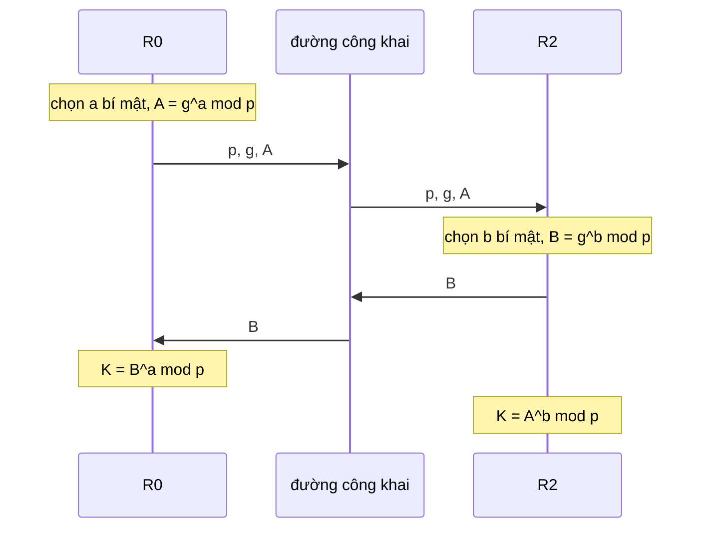
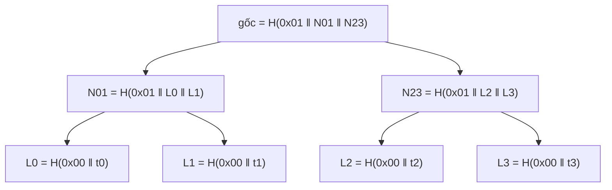

# P14 · Chương 08 — Số học modular và nền mật mã cho hệ phân tán

> Phạm vi: chương này dạy số học modular đủ để hiểu vì sao RSA và Diffie–Hellman chạy được (ước chung lớn nhất, số nguyên tố, đồng dư, định lý Fermat, định lý Euler và định lý phần dư Trung Hoa), rồi đứng trên đó để định nghĩa chính xác những đối tượng mật mã mà một kỹ sư hệ phân tán dùng hằng ngày như hộp đen: hàm băm, cây Merkle, MAC, chữ ký số, chia sẻ bí mật Shamir và chữ ký ngưỡng. Phần toán bám theo giáo trình MIT 6.042 *Mathematics for Computer Science* (bản 2018) và giáo trình số học của Shoup; phần định nghĩa mật mã bám theo Boneh–Shoup *A Graduate Course in Applied Cryptography*, RFC 8017 (PKCS #1), RFC 6962 và các chuẩn FIPS. Chứng minh nào mang nhãn "(chứng minh của người soạn)" là do người soạn tự viết hoặc viết lại, và chỉ đáng tin tới mức bạn đọc từng bước thấy đúng. Mọi con số trong ví dụ đã được kiểm lại bằng các chương trình Rust ở phần Phụ lục (`rustc 1.95.0`, macOS arm64; chương trình 6 dùng thêm hai crate đã ghim phiên bản); output ghi dưới nhãn *quan sát* của một lần chạy. **Cảnh báo:** mọi cài đặt trong chương này (RSA, Diffie–Hellman, Shamir với số nhỏ) là đồ chơi để hiểu toán, hoàn toàn không an toàn khi dùng thật. Hệ thống thật dùng thư viện mật mã đã được kiểm chứng; đừng tự viết.

Một backend engineer tám năm kinh nghiệm đã viết `hash(key) % n` không biết bao nhiêu lần, gọi `sha256` để lấy checksum, bật TLS cho service nội bộ và đọc dòng log "signature verified". Phần lớn thời gian, những thứ đó là hộp đen. Khi chuyển sang hệ phân tán, hộp đen ấy lộ ra những câu hỏi không né được. Vì sao thêm một shard làm gần như mọi khóa đổi chỗ khi chia bằng `%`? Một cây Merkle chứng minh được chính xác điều gì, và hàm băm bên dưới cần có tính chất nào? Vì sao PBFT dùng MAC chứ không dùng chữ ký ở trường hợp thường? Vì sao HotStuff gom được 2f+1 phiếu thành một chữ ký? Vì sao khóa gốc của Vault bị cắt thành nhiều mảnh theo kiểu Shamir? Tất cả đều là số học modular ở dạng này hay dạng khác (nhận xét của người soạn). Chương này đi từ phép chia có dư qua Euclid, Fermat, Euler tới RSA và Diffie–Hellman, rồi dùng những công cụ đó để định nghĩa chính xác các đối tượng mật mã của hệ phân tán, kèm chứng minh ở mọi chỗ có thể.

Cả chương dùng lại `settle`, sổ cái thanh toán bù trừ liên ngân hàng giả định đã gặp ở [P15 · Chương 10](../15-thuat-toan-phan-tan/10-bft-hien-dai.md): bốn validator `R0`…`R3` do bốn ngân hàng vận hành, ngân hàng gửi vào những lệnh như `transfer(acct:7 → acct:9, 120)`, và các validator chạy một giao thức BFT để đồng ý về thứ tự. Chương đó coi chữ ký, MAC và hàm băm là hộp đen; ở đây ta mở chúng ra. Để làm vậy, ta giả định thêm vài chi tiết: sổ cái chia thành 12 shard theo số tài khoản; hai validator cần một kênh riêng mà trước đó không có khóa chung; ngân hàng ký lệnh của mình; validator xác thực thông điệp đồng thuận; replica nào tụt lại thì so trạng thái với replica khác; và khóa ký chung của cụm được chia 3-trên-4 (nhận xét của người soạn: toàn bộ là ví dụ giả định, không phải code trong repo). Mục 1 đến 3 dựng số học, mục 4 và 5 dùng nó cho RSA và Diffie–Hellman, mục 6 đến 8 chuyển sang các đối tượng mật mã mà hệ phân tán dùng thường xuyên nhất.

## Bạn sẽ hiểu được gì

1. **Q1.** Làm sao tính ước chung lớn nhất của hai số rất lớn trong vài nghìn bước, vì sao thuật toán Euclid đúng và dừng nhanh, và thuật toán Euclid mở rộng cho thêm gì (đẳng thức Bézout, nghịch đảo)? → mục 1
2. **Q2.** Số nguyên tố là gì, vì sao mọi số nguyên dương phân tích thành thừa số nguyên tố theo đúng một cách, và vì sao "phân tích thừa số khó" là chỗ dựa của RSA? → mục 2
3. **Q3.** Tính toán theo modulus $n$ hoạt động ra sao, khi nào chia được (nghịch đảo modular), và ba định lý nền (Fermat, Euler, phần dư Trung Hoa) nói gì và chứng minh thế nào? → mục 3
4. **Q4.** Tính $a^e \bmod n$ với $e$ cỡ $2^{2048}$ bằng vài nghìn phép nhân ra sao, RSA mã hóa và giải mã đúng vì sao, và vì sao RSA "đồ chơi" trong sách giáo khoa không dùng được? → mục 4
5. **Q5.** Hai bên chưa từng gặp nhau thỏa thuận được một khóa chung qua đường công khai thế nào (logarit rời rạc, Diffie–Hellman), và vì sao vẫn cần xác thực? → mục 5
6. **Q6.** Hàm băm mật mã khác hàm băm thường (băm modular, SipHash trong `HashMap`) ở chỗ nào, ba tính chất preimage, second-preimage, collision nghĩa chính xác là gì, và dùng nhầm loại thì hỏng gì? → mục 6
7. **Q7.** Cây Merkle chứng minh một phần tử thuộc một tập chỉ bằng $\lceil \log_2 n \rceil$ băm như thế nào, vì sao an toàn, và dùng ra sao trong anti-entropy của Dynamo và Cassandra? → mục 7
8. **Q8.** "Chữ ký không giả mạo được" nghĩa chính xác là gì, MAC và chữ ký khác nhau ra sao (vì sao PBFT dùng MAC), và chia sẻ bí mật Shamir cùng chữ ký ngưỡng (QC của HotStuff) hoạt động trên đa thức modulo $p$ thế nào? → mục 8

## Kiến thức cần trước

- [Chương 01 — Logic và chứng minh](01-logic-va-chung-minh.md): quy nạp thường và mạnh, phản chứng, nguyên lý sắp tốt, invariant. Chứng minh Euclid đúng dùng invariant, định lý cơ bản của số học dùng quy nạp mạnh, chứng minh độ dài đường kiểm Merkle cũng vậy.
- [Chương 02 — Toán rời rạc, mục 1](02-toan-roi-rac.md): quan hệ tương đương và phân hoạch. Đồng dư modulo $n$ là một quan hệ tương đương, và các lớp dư là các khối của phân hoạch đó.
- [Chương 03 — Xác suất, mục 4.3](03-xac-suat.md): birthday paradox, nền cho độ dài digest ở mục 6. [Chương 04 — Thuật toán và độ phức tạp](04-thuat-toan-va-do-phuc-tap.md): "nhanh" tính theo số bit của đầu vào.
- Đọc được Rust cơ bản (`u64`, vòng lặp, hàm đệ quy, `HashMap`) và đại số phổ thông: lũy thừa, logarit, phần nguyên $\lfloor x \rfloor$ và $\lceil x \rceil$. Không cần học trước số học hay mật mã.
- Bối cảnh, không bắt buộc: [P6 · Chương 08](../06-networking/08-dns-http-tls.md) (TLS, mục 5), [P12 · Chương 05, mục 7](../12-he-thong-du-lieu/05-replication.md) (anti-entropy, mục 7), [P12 · Chương 06, mục 3](../12-he-thong-du-lieu/06-partitioning.md) (`hash mod N` và consistent hashing, mục 3 và 6), [P15 · Chương 10](../15-thuat-toan-phan-tan/10-bft-hien-dai.md) (PBFT, HotStuff, mục 8). Chương kế [07 Tổ hợp và đếm](07-to-hop-va-dem.md) cho các phép đếm tổ hợp mà mục 8 và phần Bài tập thỉnh thoảng cần.

---


## 1. Ước chung lớn nhất, thuật toán Euclid và Euclid mở rộng (Q1)

> **Trả lời ngắn.** Ước chung lớn nhất $\gcd(a, b)$ không đổi khi ta thay cặp $(a, b)$ bằng $(b, a \bmod b)$, nên chỉ cần lặp phép thay đó tới khi số thứ hai về 0: đó là thuật toán Euclid[^mcs-euclid-lemma]. Nó dừng sau tối đa cỡ $2\log_2 a$ bước, nên chạy nhanh ngay cả với số hàng trăm chữ số[^mcs-euclid-steps]. Ghi thêm một chút sổ sách ở mỗi bước (thuật toán Euclid mở rộng) thì ta thu được hai số nguyên $s, t$ với $\gcd(a, b) = s \cdot a + t \cdot b$[^mcs-bezout]; đẳng thức này cho ta nghịch đảo modular ở mục 3 và khóa riêng RSA ở mục 4.

**Giải thích.**

*Với `settle`.* Sổ cái `settle` chia thành 12 shard, và một worker rải các lô giao dịch lên shard theo vòng: lô thứ $i$ vào shard $(i \cdot s) \bmod 12$ với bước nhảy $s$ cố định. Với $s = 5$, mười hai lô liên tiếp phủ đủ mười hai shard. Với $s = 8$, chỉ ba shard (0, 4, 8) nhận việc còn chín shard khác ngồi không. Vì sao 5 tốt còn 8 tệ? Câu trả lời là ước chung lớn nhất của bước nhảy và số shard, và mục này dựng đủ công cụ để chứng minh điều đó (nhận xét của người soạn: ví dụ giả định; cùng cấu trúc xuất hiện khi dò bảng băm địa chỉ mở theo một bước cố định).

### 1.1 Chia hết, chia có dư, ước chung

Ta nói $a$ chia hết $b$, viết $a \mid b$, khi tồn tại số nguyên $k$ để $b = k \cdot a$[^mcs-divides]. Tính chất dùng nhiều nhất của quan hệ này là bổ đề sau.

**Bổ đề 1.1.** Nếu $a \mid b$ và $a \mid c$ thì $a \mid s \cdot b + t \cdot c$ với mọi số nguyên $s, t$[^mcs-lincomb].

*Chứng minh (chứng minh của người soạn).* Viết $b = k_1 \cdot a$ và $c = k_2 \cdot a$. Khi đó $s \cdot b + t \cdot c = (s \cdot k_1 + t \cdot k_2) \cdot a$. ∎

Biểu thức dạng $s \cdot b + t \cdot c$ với $s, t$ nguyên gọi là *tổ hợp tuyến tính* của $b$ và $c$. Bổ đề nói gọn: một ước chung của $b$ và $c$ chia hết mọi tổ hợp tuyến tính của chúng.

Phép chia có dư: với mọi số nguyên $n$ và $d > 0$ có đúng một cặp số nguyên $(q, r)$ sao cho $n = q \cdot d + r$ và $0 \le r < d$. Số dư $r$ ký hiệu $n \bmod d$ và luôn không âm. Giáo trình MIT dặn bám theo quy ước đó, dù ngôn ngữ lập trình quen thuộc xử lý số âm theo cách khác[^mcs-rem-conv]; Rust cũng nằm trong số đó, xem mục "Liên hệ với Rust". *Ước chung* của $a$ và $b$ là số chia hết cả hai; khi $a, b$ không đồng thời bằng 0, *ước chung lớn nhất* $\gcd(a, b)$ là ước chung lớn nhất trong số đó. Hai số có $\gcd = 1$ gọi là *nguyên tố cùng nhau*.

### 1.2 Thuật toán Euclid

**Bổ đề 1.2.** Với $b > 0$, $\gcd(a, b) = \gcd(b, a \bmod b)$[^mcs-euclid-lemma].

*Chứng minh.* Đặt $r = a \bmod b$, nên $a = q \cdot b + r$ với $q$ nguyên. Theo Bổ đề 1.1, mọi ước chung của $b$ và $r$ chia hết $a = q \cdot b + r$, nên là ước chung của $a$ và $b$. Ngược lại, mọi ước chung của $a$ và $b$ chia hết $r = a - q \cdot b$, nên là ước chung của $b$ và $r$. Hai cặp có cùng tập ước chung, nên có cùng ước chung lớn nhất. ∎

Lặp bổ đề này cho ta thuật toán Euclid, ba dòng Rust (trích từ chương trình 1 ở Phụ lục):

```rust
fn gcd(a: u64, b: u64) -> u64 {
    if b == 0 { a } else { gcd(b, a % b) }
}
```

Ví dụ với $a = 3120$ và $b = 17$, hai số sẽ trở lại ở RSA (mục 4):

| Bước | Phép chia | Số dư |
|---|---|---|
| 1 | $3120 = 183 \cdot 17 + 9$ | 9 |
| 2 | $17 = 1 \cdot 9 + 8$ | 8 |
| 3 | $9 = 1 \cdot 8 + 1$ | 1 |
| 4 | $8 = 8 \cdot 1 + 0$ | 0 |

Số dư khác 0 cuối cùng là 1, nên $\gcd(3120, 17) = 1$, sau bốn phép chia.

*Vì sao đúng và vì sao dừng.* Coi thuật toán là một state machine có trạng thái $(x, y)$, trạng thái đầu $(a, b)$ và bước chuyển $(x, y) \to (y, x \bmod y)$ khi $y > 0$. Theo Bổ đề 1.2, điều kiện $\gcd(x, y) = \gcd(a, b)$ được bảo toàn qua mọi bước, nên là một invariant quy nạp theo nghĩa của [chương 01, mục 4](01-logic-va-chung-minh.md). Khi $y$ về 0 thì $x = \gcd(x, 0) = \gcd(a, b)$[^mcs-euclid-inv]. Thuật toán dừng vì $0 \le x \bmod y < y$: thành phần thứ hai là một số tự nhiên giảm ngặt ở mỗi bước, đúng loại biến dẫn xuất ở [chương 01, mục 5](01-logic-va-chung-minh.md). Còn bao nhiêu bước thì định lý sau trả lời.

**Định lý 1.3 (số bước).** Nếu $a \ge b > 0$ thì thuật toán Euclid thực hiện tối đa $2\log_2 a + 1$ phép chia có dư[^mcs-euclid-steps].

*Chứng minh (chứng minh của người soạn).* Đặt $(x_0, y_0) = (a, b)$ và $(x_{i+1}, y_{i+1}) = (y_i, x_i \bmod y_i)$. Ta chứng minh trước: nếu $y_i > 0$ thì $x_{i+2} < x_i / 2$. Ta có $x_{i+2} = y_{i+1} = x_i \bmod y_i$, và $x_i \ge y_i$ (với $i = 0$ là giả thiết, với $i \ge 1$ vì $x_i = y_{i-1} > y_i$). Có hai trường hợp. Nếu $y_i \le x_i / 2$ thì $x_i \bmod y_i < y_i \le x_i / 2$. Nếu $y_i > x_i / 2$ thì $y_i \le x_i < 2 y_i$, thương bằng 1 và $x_i \bmod y_i = x_i - y_i < x_i / 2$. Cả hai trường hợp cho kết quả cần có.

Gọi $k$ là số phép chia cho tới khi $y_k = 0$; mọi $x_i$ với $i \le k$ là số nguyên dương. Nếu $k \le 1$ thì bất đẳng thức của định lý hiển nhiên đúng. Nếu $k \ge 2$, đặt $j = \lfloor k / 2 \rfloor \ge 1$. Áp dụng kết quả trên $j$ lần cho các chỉ số $0, 2, \ldots, 2j-2$ (đều nhỏ hơn $k$ nên $y_i > 0$) ta được $1 \le x_{2j} < a / 2^j$, tức $2^j < a$, tức $j < \log_2 a$. Vậy $k \le 2j + 1 < 2\log_2 a + 1$. ∎

Với $a$ dài 2048 bit, $\log_2 a < 2048$ nên Euclid chạy chưa tới 4100 phép chia (suy luận của người soạn từ định lý). Đó là lý do ta tìm được ước chung lớn nhất của hai số hàng trăm chữ số mà không cần phân tích thừa số, thứ không ai biết làm nhanh (mục 2).

### 1.3 Euclid mở rộng và đẳng thức Bézout

Euclid cho ta giá trị $\gcd(a, b)$. Điều mật mã cần là cách *viết* nó thành tổ hợp tuyến tính của $a$ và $b$.

**Định lý 1.4 (Bézout).** Với $a, b \ge 0$ không đồng thời bằng 0, tồn tại số nguyên $s, t$ sao cho $\gcd(a, b) = s \cdot a + t \cdot b$[^mcs-bezout]. Thuật toán Euclid mở rộng, còn gọi là Pulverizer[^mcs-pulverizer], tìm ra chúng với đúng số phép chia của thuật toán Euclid (chứng minh bên dưới).

Mã Rust (trích từ chương trình 1), kèm phần giải thích bước đệ quy trong comment:

```rust
/// Với a, b >= 0: trả về (g, s, t) sao cho g = gcd(a, b) và a*s + b*t = g.
fn ext_gcd(a: i64, b: i64) -> (i64, i64, i64) {
    if b == 0 {
        (a, 1, 0)
    } else {
        let (g, s, t) = ext_gcd(b, a % b);
        // g = b*s + (a % b)*t = a*t + b*(s - (a / b)*t)
        (g, t, s - (a / b) * t)
    }
}
```

*Chứng minh (chứng minh của người soạn).* Ta chứng minh `ext_gcd(a, b)` trả về $(g, s, t)$ với $g = \gcd(a, b)$ và $g = s \cdot a + t \cdot b$, bằng quy nạp mạnh theo $b$. Nếu $b = 0$, hàm trả $(a, 1, 0)$, và $a = 1 \cdot a + 0 \cdot b$ với $a = \gcd(a, 0)$. Nếu $b > 0$, hàm gọi `ext_gcd(b, a % b)`; đối số thứ hai $a \bmod b < b$ nên giả thiết quy nạp áp dụng được: kết quả $(g, s, t)$ của lời gọi con thỏa $g = \gcd(b, a \bmod b)$, bằng $\gcd(a, b)$ theo Bổ đề 1.2, và $g = s \cdot b + t \cdot (a \bmod b)$. Thay $a \bmod b = a - \lfloor a / b \rfloor \cdot b$ ta có $g = t \cdot a + (s - \lfloor a / b \rfloor \cdot t) \cdot b$, đúng là bộ ba mà hàm trả về. Số lời gọi bằng số phép chia của Euclid. ∎

Chạy trên $(3120, 17)$, chương trình 1 in `ext_gcd(3120, 17) = (g=1, s=2, t=-367)` (quan sát). Có thể kiểm bằng tay bằng cách thế ngược các phép chia ở bảng trên:

$$1 = 9 - 8 = 9 - (17 - 9) = 2 \cdot 9 - 17 = 2 \cdot (3120 - 183 \cdot 17) - 17 = 2 \cdot 3120 - 367 \cdot 17.$$

Đẳng thức trên nói $17 \cdot (-367) = 1 - 2 \cdot 3120$, tức $17 \cdot (-367)$ và 1 hơn kém nhau một bội của 3120. Cộng 3120 vào $-367$ ta được số dương 2753, nên nghịch đảo của 17 modulo 3120 là $2753$ (chương trình in `Some(2753)`), đúng số $d$ sẽ dùng ở RSA.

**Hệ quả 1.5.** Một số nguyên là tổ hợp tuyến tính của $a$ và $b$ khi và chỉ khi nó là bội của $\gcd(a, b)$[^mcs-bezout].

*Chứng minh (chứng minh của người soạn).* Đặt $g = \gcd(a, b)$. Một chiều: $g$ chia hết $a$ và $b$ nên theo Bổ đề 1.1 chia hết mọi tổ hợp tuyến tính của chúng. Chiều kia: nhân đẳng thức Bézout $g = s \cdot a + t \cdot b$ với $k$ ta có $k \cdot g = (k s) \cdot a + (k t) \cdot b$. ∎

### 1.4 Quay lại vòng 12 shard

**Định lý 1.6 (bước nhảy trên vòng).** Trên vòng $n$ khe đánh số $0, \ldots, n-1$, đứng ở khe 0 và nhảy mỗi lần $s$ khe, khe thứ $i$ được thăm là $(i \cdot s) \bmod n$. Tập các khe được thăm là đúng các bội của $g = \gcd(s, n)$ trong $[0, n)$. Vậy có $n / g$ khe khác nhau, và mọi khe đều được thăm khi và chỉ khi $\gcd(s, n) = 1$.

*Chứng minh (chứng minh của người soạn).* Ký hiệu $r_i = (i \cdot s) \bmod n$, nên $r_i = i \cdot s - q \cdot n$ với $q$ nguyên. Đó là tổ hợp tuyến tính của $s$ và $n$, nên theo Bổ đề 1.1, $g \mid r_i$: mọi khe được thăm đều là bội của $g$. Ngược lại, lấy một bội $m = k \cdot g$ với $0 \le m < n$. Theo Định lý 1.4 có số nguyên $u, v$ với $g = u \cdot s + v \cdot n$, nên $m = (k u) \cdot s + (k v) \cdot n$. Đặt $i$ là số dư của $k u$ khi chia cho $n$, tức $i = k u + j \cdot n$ với $j$ nguyên và $0 \le i < n$. Khi đó $i \cdot s - m = j \cdot n \cdot s - k v \cdot n$ chia hết cho $n$; vì $0 \le m < n$ nên $(i \cdot s) \bmod n = m$, tức khe $m$ được thăm ở bước $i$. Số bội của $g$ trong $[0, n)$ là $n / g$ (vì $g \mid n$). ∎

Áp dụng cho `settle`: $n = 12$. Bước $s = 8$ có $g = 4$, nên chỉ các khe $0, 4, 8$ được thăm; bước $s = 5$ có $g = 1$ nên đủ 12 khe. Chương trình 1 in đúng như vậy (quan sát). Phần "$\subseteq$" của chứng minh còn dùng được cho một lỗi quen thuộc của băm modular: nếu mã tài khoản được cấp theo bước 8 (0, 8, 16, …) và shard chọn bằng `acct % 12` thì mọi tài khoản rơi vào shard 0, 4 hoặc 8, vì số dư luôn là bội của $\gcd(8, 12) = 4$; đổi thành `% 13` thì cả 13 shard đều được dùng (quan sát của chương trình 1, với 1000 tài khoản đầu). Số nguyên tố giúp ở chỗ ước dương của nó chỉ là 1 và chính nó[^mcs-prime-def], nên mọi bước nhảy $1 \le s < p$ đều nguyên tố cùng nhau với $p$; đó là một lý do người ta hay chọn kích thước bảng băm nguyên tố (nhận xét của người soạn).

<details><summary>Đi sâu: trường hợp xấu nhất của Euclid (Fibonacci), và độ chính xác của số liệu</summary>

- *Cận $2\log_2 a$ không sát.* Trường hợp xấu nhất của Euclid là hai số Fibonacci liên tiếp. Đặt $F_0 = 0$, $F_1 = 1$, $F_{k+2} = F_{k+1} + F_k$. **Mệnh đề.** Nếu $a > b \ge 1$ và Euclid thực hiện đúng $k \ge 1$ phép chia thì $b \ge F_{k+1}$ và $a \ge F_{k+2}$. *Chứng minh (chứng minh của người soạn), quy nạp theo $k$.* Với $k = 1$: $b \mid a$ và $a > b$ nên $a \ge 2b \ge 2 = F_3$ và $b \ge 1 = F_2$. Với $k \ge 2$: phép chia đầu cho $(a, b) \to (b, r)$ với $r = a \bmod b$; vì còn $k - 1 \ge 1$ phép chia nữa nên $r \ge 1$, và $b > r$. Giả thiết quy nạp cho $(b, r)$ cho $b \ge F_{k+1}$ và $r \ge F_k$. Vì $a > b$ nên thương $\ge 1$, do đó $a \ge b + r \ge F_{k+1} + F_k = F_{k+2}$. ∎ Từ $F_{k+2} \ge \varphi^k$ với $\varphi = (1 + \sqrt 5) / 2$ (quy nạp, dùng $\varphi^2 = \varphi + 1$) suy ra $k \le \log_\varphi a \approx 1{,}44 \log_2 a$. Chương trình 1 kiểm: Euclid trên $(F_{k+2}, F_{k+1})$ mất đúng $k$ bước với $k = 1, \ldots, 40$; và trên mọi cặp $1 \le b < a \le 2000$, số bước tối đa là 15, đúng bằng $k$ lớn nhất có $F_{k+2} \le 2000$ (vì $F_{17} = 1597 \le 2000 < 2584 = F_{18}$). Đó là các quan sát cho đúng phạm vi tham số đã duyệt.
- *Mỗi bước là một phép chia số lớn.* Với số 2048 bit, mỗi bước Euclid là một phép chia số lớn trong thư viện bignum, không phải một lệnh chia của CPU. Đoạn Rust ở trên chỉ chạy trên `u64`/`i64` và đủ cho ví dụ đồ chơi; hệ thống thật dùng thư viện số nguyên lớn.
- *Hệ số Bézout có thể âm.* Ở $(3120, 17)$ ta có $t = -367$. Muốn nghịch đảo không âm thì lấy số dư theo modulus bằng `rem_euclid` (mục 3.2 và "Liên hệ với Rust").

</details>

**Quay lại Q1:** $\gcd(a, b) = \gcd(b, a \bmod b)$ cho thuật toán Euclid, đúng nhờ invariant và dừng sau tối đa $2\log_2 a + 1$ bước; ghi sổ sách thêm ở mỗi bước cho Euclid mở rộng và đẳng thức Bézout $\gcd(a, b) = s \cdot a + t \cdot b$. Với `settle`: bước nhảy $s$ trên vòng $n$ shard thăm đủ mọi shard khi và chỉ khi $\gcd(s, n) = 1$; $s = 8$ trên 12 shard chỉ thăm ba shard.

---


## 2. Số nguyên tố, định lý cơ bản của số học và chỗ dựa của RSA (Q2)

> **Trả lời ngắn.** Số nguyên tố là số lớn hơn 1 chỉ chia hết cho 1 và chính nó[^mcs-prime-def]. Mọi số nguyên dương là tích các số nguyên tố theo đúng một cách nếu không kể thứ tự[^mcs-fta]; phần "tồn tại" chứng minh được bằng nguyên lý sắp tốt[^mcs-existence], còn phần "duy nhất" dựa vào bổ đề Euclid ($p \mid a \cdot b$ thì $p \mid a$ hoặc $p \mid b$), mà đẳng thức Bézout chứng minh được[^mcs-euclid-lemma2]. Nhân hai số nguyên tố lớn thì dễ, nhưng tách lại hai thừa số từ tích thì không ai biết làm nhanh, và RSA đứng trên sự bất đối xứng đó.

**Giải thích.**

*Với `settle`.* Hai chuyện của `settle` nằm trong mục này. Chuyện thứ nhất là con số 12 shard ở mục 1: $12 = 2^2 \cdot 3$ có nhiều ước nên có nhiều bước nhảy xấu, còn 13 chỉ có hai ước (1 và 13) nên mọi bước nhảy từ 1 đến 12 đều tốt. Chuyện thứ hai quan trọng hơn: ở mục 4, khóa công khai của một validator chứa tích $n = p \cdot q$ của hai số nguyên tố mà chỉ chủ khóa biết, và toàn bộ an ninh của khóa đó dựa vào việc không ai tách được $n$ ra $p$ và $q$ (nhận xét của người soạn: ví dụ giả định).

### 2.1 Bổ đề Euclid

**Bổ đề 2.1 (Euclid).** Nếu $p$ nguyên tố và $p \mid a \cdot b$ thì $p \mid a$ hoặc $p \mid b$. Hệ quả: nếu $p \mid a_1 \cdot a_2 \cdots a_m$ thì $p \mid a_i$ với một $i$ nào đó.

*Chứng minh (chứng minh của người soạn, theo khuôn của giáo trình MIT[^mcs-euclid-lemma2]).* Giả sử $p \nmid a$; ta chứng minh $p \mid b$. Ước dương của $p$ chỉ có 1 và $p$, nên $\gcd(a, p) \in \lbrace 1, p \rbrace$; nó không bằng $p$ vì $p \nmid a$, nên $\gcd(a, p) = 1$. Theo Định lý 1.4 có số nguyên $s, t$ để $1 = s \cdot a + t \cdot p$. Nhân hai vế với $b$ ta được $b = s \cdot (a b) + (t b) \cdot p$. Cả $a b$ lẫn $p$ đều chia hết cho $p$, nên theo Bổ đề 1.1, $p \mid b$. Phần hệ quả suy ra bằng quy nạp theo $m$: viết tích là $(a_1 \cdots a_{m-1}) \cdot a_m$ rồi áp dụng bổ đề và giả thiết quy nạp. ∎

Bổ đề này nghe hiển nhiên, nhưng nó là cánh cửa của định lý tiếp theo: ta cần nó để chứng minh tính duy nhất, nên không được chứng minh nó *bằng* tính duy nhất (làm vậy là lập luận vòng tròn). Đẳng thức Bézout của mục 1 là chỗ ta dựa vào để thoát vòng đó.

### 2.2 Định lý cơ bản của số học

**Định lý 2.2.** Mọi số nguyên $n \ge 1$ là tích của các số nguyên tố (với $n = 1$ là tích rỗng), và hai cách viết bất kỳ chỉ khác nhau về thứ tự các thừa số[^mcs-fta].

*Chứng minh (chứng minh của người soạn).* *Tồn tại*, bằng quy nạp mạnh theo $n$ (chương 01, mục 3). Với $n = 1$ ta có tích rỗng. Với $n \ge 2$ nguyên tố ta có tích một thừa số. Với $n \ge 2$ không nguyên tố, $n$ có ước $a$ với $1 < a < n$; viết $n = a \cdot b$ thì $1 < b < n$, nên theo giả thiết quy nạp cả $a$ lẫn $b$ là tích các số nguyên tố, và nối hai tích đó lại ta có tích cho $n$[^mcs-existence].

*Duy nhất*, cũng bằng quy nạp mạnh theo $n$. Giả sử $n = p_1 \cdots p_j = q_1 \cdots q_k$ là hai cách viết thành tích số nguyên tố. Nếu $n = 1$ thì cả hai tích đều rỗng, vì tích của ít nhất một số nguyên tố thì không nhỏ hơn 2. Nếu $n \ge 2$ thì $j, k \ge 1$ và $p_1 \mid q_1 \cdots q_k$, nên theo Bổ đề 2.1, $p_1 \mid q_i$ với một $i$ nào đó. Vì $q_i$ nguyên tố và $p_1 > 1$ nên $p_1 = q_i$. Chia hai vế cho $p_1$: số $n / p_1 < n$ có hai cách viết, một cách là $p_2 \cdots p_j$ và cách kia là các $q$ còn lại sau khi bỏ $q_i$. Theo giả thiết quy nạp hai cách này chỉ khác thứ tự, nên hai cách viết ban đầu cũng vậy. ∎

Số 1 không được tính là số nguyên tố chính vì lý do này: nếu tính, $15 = 5 \cdot 3 = 5 \cdot 3 \cdot 1$ sẽ phá tính duy nhất.

### 2.3 Có vô hạn số nguyên tố

**Định lý 2.3.** Có vô hạn số nguyên tố.

*Chứng minh (chứng minh của người soạn, bằng phản chứng).* Giả sử chỉ có hữu hạn số nguyên tố $p_1, \ldots, p_m$. Đặt $N = p_1 \cdots p_m + 1 \ge 2$. Theo Định lý 2.2, $N$ có một ước nguyên tố $p$; theo giả sử, $p = p_i$ với một $i$ nào đó. Khi đó $p$ chia hết cả $p_1 \cdots p_m$ lẫn $N$, nên theo Bổ đề 1.1 chia hết hiệu của chúng là 1: vô lý. ∎

Định lý này có hệ quả thực tế: luôn còn số nguyên tố mới để làm khóa, không "cạn".

### 2.4 Tìm số nguyên tố lớn

Số nguyên tố thưa dần nhưng không quá thưa: quy tắc ngón tay cái rút từ định lý số nguyên tố nói rằng quanh $n$, cỡ 1 trên $\ln n$ số nguyên là số nguyên tố[^mcs-pnt]. Với số 1024 bit ($n \approx 2^{1024}$), $\ln n \approx 1024 \cdot 0{,}693 \approx 710$. Nếu chỉ thử số lẻ thì tỉ lệ nhân đôi, cỡ 1 trên 355 (suy luận của người soạn từ quy tắc trên). Vậy bốc ngẫu nhiên vài trăm ứng viên lẻ là kỳ vọng gặp một số nguyên tố, miễn là có cách kiểm tra "số này có nguyên tố không" thật nhanh. Cách đó có: phép thử xác suất Miller–Rabin chạy trong thời gian đa thức[^shoup-mr]. Chương này không trình bày nó, vì sinh khóa là việc của thư viện mật mã (nhận xét của người soạn).

### 2.5 Phân tích thừa số: dễ nhân, khó tách

Chiều ngược lại mới là chuyện: tách $n = p \cdot q$ thành $p$ và $q$. Chia thử các số từ 2 tới $\sqrt n$ tốn cỡ $\sqrt n$ phép chia; với $n$ dài 2048 bit đó là cỡ $2^{1024}$ phép chia, rõ ràng không thể. Thuật toán tốt nhất đã biết là sàng trường số (number field sieve)[^mcs-nfs-name]. Thời gian chạy của nó tăng nhanh hơn mọi đa thức theo độ dài của $n$, và giáo trình MIT coi nó bất khả thi khi $n$ có từ 300 chữ số thập phân trở lên[^mcs-nfs]. Một số 2048 bit có khoảng 617 chữ số thập phân ($2048 \cdot \log_{10} 2 \approx 616{,}5$), vượt xa mốc đó.

Cần nói rõ điều này không phải một định lý. *Không ai chứng minh rằng phân tích thừa số khó.* RSA dựa trên giả thuyết ấy, và ngay cả mệnh đề "bẻ RSA bằng cách nào cũng kéo theo phân tích thừa số được" cũng mới là một giả thuyết chưa chứng minh[^mcs-rsa-unproven]. Mục 4 trở lại chuyện này.

<details><summary>Đi sâu: vì sao chia thử chỉ cần tới căn bậc hai, Euclid so với phân tích thừa số, độ dài khóa</summary>

- *Chia thử tới $\sqrt n$ là đủ.* Nếu $n$ là hợp số thì $n = a \cdot b$ với $1 < a \le b$, nên $a^2 \le a \cdot b = n$, tức $a \le \sqrt n$. Theo Định lý 2.2, $a$ có một ước nguyên tố, và ước đó cũng $\le \sqrt n$ (chứng minh của người soạn). Vậy nếu mọi số từ 2 tới $\sqrt n$ đều không chia hết $n$ thì $n$ nguyên tố. Với $n = 3233$ thì $\sqrt n \approx 56{,}9$: chương trình 2 tìm ra thừa số 53 sau 52 phép chia (quan sát, mục 4.3).
- *Ước chung lớn nhất không cần phân tích thừa số.* Nếu biết phân tích $a$ và $b$ ra thừa số nguyên tố thì đọc được $\gcd$ từ số mũ nhỏ nhất của từng số nguyên tố. Nhưng chính bước phân tích đó là thứ ta không làm nhanh được. Euclid vòng qua nó hoàn toàn, nên ước chung lớn nhất của hai số hàng trăm chữ số tính trong vài nghìn bước (Định lý 1.3). Đó là lý do mật mã dùng Euclid chứ không dùng thừa số (nhận xét của người soạn).
- *Đổi đơn vị.* Bit và chữ số thập phân khác nhau hệ số $\log_2 10 \approx 3{,}32$. Mốc "300 chữ số" của giáo trình MIT tương đương khoảng 997 bit; khi đọc khuyến nghị độ dài khóa trong tài liệu khác, hãy kiểm tra đơn vị trước.

</details>

**Quay lại Q2:** số nguyên tố chỉ chia hết cho 1 và chính nó; bổ đề Euclid (từ Bézout) cho tính duy nhất của phân tích thừa số; có vô hạn số nguyên tố và cỡ 1 trên $\ln n$ số quanh $n$ là nguyên tố nên tìm được số nguyên tố lớn bằng cách thử ngẫu nhiên; còn tách $n = p \cdot q$ thì không ai biết làm nhanh, và đó là giả thuyết mà RSA dựa vào.

---


## 3. Đồng dư, nghịch đảo modular, Fermat, Euler và phần dư Trung Hoa (Q3)

> **Trả lời ngắn.** Hai số đồng dư modulo $n$ khi hiệu của chúng chia hết cho $n$. Làm toán modulo $n$ là làm toán trên các số dư $0, \ldots, n-1$: cộng, trừ, nhân đều lấy dư ở từng bước[^mcs-rem-arith], nhưng số mũ thì không được rút theo modulus[^mcs-exp-blunder]. Chia cho $a$ chỉ được khi $\gcd(a, n) = 1$, và nghịch đảo tính được bằng Euclid mở rộng[^mcs-inv-pulv]. Ba định lý nền là Fermat ($a^{p-1} \equiv 1 \pmod p$ khi $p$ nguyên tố không chia $a$)[^mcs-fermat], Euler (tổng quát hóa cho modulus bất kỳ, qua hàm $\varphi$)[^mcs-euler-stated], và phần dư Trung Hoa (hệ đồng dư với các modulus nguyên tố cùng nhau luôn có nghiệm, duy nhất modulo tích các modulus)[^shoup-crt].

**Giải thích.**

*Với `settle`.* Mọi chuyện bắt đầu từ một dòng quen thuộc: `shard = hash(acct) % n`. Mục này làm hai việc. Việc thứ nhất là dựng công cụ cho RSA ở mục 4 (Fermat, Euler). Việc thứ hai là trả lời ngay một câu hỏi vận hành của `settle`: khi cụm tăng từ $n$ lên $n + 1$ shard và vẫn chia bằng `%`, bao nhiêu khóa phải đổi chỗ (nhận xét của người soạn: ví dụ giả định)? Câu trả lời đến từ phần dư Trung Hoa ở mục 3.5.

### 3.1 Đồng dư và số học trên số dư

Ta viết $a \equiv b \pmod n$ khi $n \mid a - b$. Quan hệ này tương đương với "$a$ và $b$ có cùng số dư khi chia cho $n$". *Chứng minh (chứng minh của người soạn).* Viết $a = q_1 n + r_1$ và $b = q_2 n + r_2$ với $0 \le r_1, r_2 < n$. Khi đó $a - b = (q_1 - q_2) n + (r_1 - r_2)$, nên $n \mid a - b$ khi và chỉ khi $n \mid r_1 - r_2$. Nhưng $-n < r_1 - r_2 < n$, bội duy nhất của $n$ trong khoảng đó là 0, nên $n \mid r_1 - r_2$ khi và chỉ khi $r_1 = r_2$. ∎

Đồng dư là quan hệ tương đương, và các lớp tương đương chia $\mathbb Z$ thành đúng $n$ khối ứng với $n$ số dư[^mcs-n-kinds]; phân hoạch và quan hệ tương đương đã được nói ở [chương 02, mục 1](02-toan-roi-rac.md). Điều làm đồng dư hữu ích cho tính toán là nó tương thích với phép cộng và phép nhân.

**Bổ đề 3.1.** Nếu $a \equiv a'$ và $b \equiv b' \pmod n$ thì $a + b \equiv a' + b'$ và $a \cdot b \equiv a' \cdot b' \pmod n$.

*Chứng minh (chứng minh của người soạn).* Viết $a' - a = k n$ và $b' - b = l n$. Phép cộng: $(a' + b') - (a + b) = (k + l) n$. Phép nhân: $a' b' - a b = a'(b' - b) + b (a' - a) = n (a' l + b k)$. ∎

Hệ quả thực hành: muốn biết một biểu thức gồm cộng và nhân modulo $n$, ta được phép lấy dư ở *từng bước*, và mọi số trung gian luôn nhỏ hơn $n$[^mcs-rem-arith]. Đó chính là cách `mod_pow` ở mục 4 giữ số trung gian không phình ra. Nhưng quy tắc này chỉ áp cho các toán hạng của phép cộng và nhân, không áp cho số mũ[^mcs-exp-blunder]. Ví dụ nhỏ nhất: $2^{10} = 1024 \equiv 2 \pmod 7$, trong khi rút số mũ $10 \bmod 7 = 3$ cho $2^3 = 8 \equiv 1 \pmod 7$, sai. Số mũ chỉ rút được theo một modulus khác, qua định lý Euler ở mục 3.4.

### 3.2 Nghịch đảo modular

Nghịch đảo của $a$ modulo $n$ là số $x$ sao cho $a \cdot x \equiv 1 \pmod n$. Đó là phép "chia cho $a$" trong số học modular.

**Định lý 3.2.** $a$ có nghịch đảo modulo $n$ khi và chỉ khi $\gcd(a, n) = 1$; khi đó nghịch đảo duy nhất theo modulo $n$ và tìm được bằng Euclid mở rộng[^mcs-inv-pulv].

*Chứng minh (chứng minh của người soạn).* ($\Leftarrow$) Theo Định lý 1.4 có $s, t$ với $1 = s \cdot a + t \cdot n$, nên $s \cdot a \equiv 1 \pmod n$ và $x = s$ là một nghịch đảo. ($\Rightarrow$) Nếu $a \cdot x \equiv 1$ thì $a \cdot x - 1 = k \cdot n$; một ước chung $d$ của $a$ và $n$ chia hết $a \cdot x - k \cdot n = 1$ (Bổ đề 1.1), nên $\gcd(a, n) = 1$. Duy nhất: nếu $a x \equiv 1$ và $a x' \equiv 1$ thì theo Bổ đề 3.1, $x \equiv x \cdot (a x') = (x a) \cdot x' \equiv x' \pmod n$. ∎

Mã Rust của phép tính (trích từ chương trình 1; `rem_euclid` đưa kết quả về $[0, n)$ như quy ước của giáo trình MIT, xem mục "Liên hệ với Rust"):

```rust
/// Nghịch đảo của a modulo m, nếu có (khi và chỉ khi gcd(a, m) = 1).
fn mod_inv(a: i64, m: i64) -> Option<i64> {
    let (g, s, _) = ext_gcd(a.rem_euclid(m), m);
    if g == 1 { Some(s.rem_euclid(m)) } else { None }
}
```

Hai hệ quả. Thứ nhất, luật giản ước chỉ đúng khi nhân với số có nghịch đảo: $3 \cdot 10 \equiv 3 \cdot 5 \pmod{15}$ mà $10 \not\equiv 5$, đúng vì $\gcd(3, 15) = 3 \ne 1$; đây là chỗ số học modular khác số học thường nhiều nhất[^mcs-cancel]. Thứ hai, khi modulus là số nguyên tố thì mọi số khác 0 đều có nghịch đảo[^mcs-prime-inverse], và các số dư lập thành một *trường*: ta cần điều này ở mục 8.

Quay lại vòng shard của mục 1 với $n = 30$ và bước $s = 7$, $\gcd(7, 30) = 1$. Sau $k$ bước ta ở khe $7k \bmod 30$. Muốn tới khe 11 thì giải $7k \equiv 11 \pmod{30}$; nghịch đảo của 7 là 13 (vì $7 \cdot 13 = 91 = 3 \cdot 30 + 1$), nên $k \equiv 11 \cdot 13 = 143 \equiv 23 \pmod{30}$. Chương trình 1 kiểm: $7 \cdot 23 \bmod 30 = 11$ (quan sát).

### 3.3 Định lý nhỏ Fermat

**Định lý 3.3 (Fermat).** Nếu $p$ nguyên tố và $p \nmid a$ thì $a^{p-1} \equiv 1 \pmod p$[^mcs-fermat]. Hệ quả: $a^p \equiv a \pmod p$ với mọi số nguyên $a$.

*Chứng minh (chứng minh của người soạn).* Xét $p - 1$ số $a, 2a, 3a, \ldots, (p-1)a$. Không số nào chia hết cho $p$: $p \nmid i$ vì $0 < i < p$ và $p \nmid a$, nên theo Bổ đề 2.1, $p \nmid i \cdot a$. Chúng cũng đôi một không đồng dư: nếu $i \cdot a \equiv j \cdot a \pmod p$ với $1 \le i < j \le p - 1$ thì $p \mid (j - i) \cdot a$, nên theo Bổ đề 2.1, $p \mid j - i$, vô lý vì $0 < j - i < p$. Vậy số dư của $a, 2a, \ldots, (p-1)a$ khi chia cho $p$ là $p - 1$ giá trị khác nhau trong tập $\lbrace 1, \ldots, p-1 \rbrace$, tức là một hoán vị của $1, 2, \ldots, p-1$; đây cũng là ý của giáo trình MIT khi chứng minh định lý Euler, rằng nhân với một phần tử khả nghịch chỉ xáo trộn tập các số dư khả nghịch[^mcs-euler-perm]. Nhân tất cả lại và dùng Bổ đề 3.1: $a^{p-1} \cdot (p-1)! \equiv (p-1)! \pmod p$, tức $p \mid (p-1)! \cdot (a^{p-1} - 1)$. Vì $(p-1)!$ là tích các số không chia hết cho $p$ nên theo Bổ đề 2.1, $p \nmid (p-1)!$, và cũng theo Bổ đề 2.1, $p \mid a^{p-1} - 1$.

Hệ quả: nếu $p \mid a$ thì cả $a^p$ lẫn $a$ đồng dư 0; nếu không thì nhân đồng dư thức vừa chứng minh với $a$. ∎

### 3.4 Định lý Euler

Với $n \ge 1$, đặt $\varphi(n)$ là số các số trong $\lbrace 1, \ldots, n \rbrace$ nguyên tố cùng nhau với $n$ (hàm $\varphi$ của Euler, một số sách gọi là hàm totient[^mcs-phi-name]). Với $p$ nguyên tố, $\varphi(p) = p - 1$. Với tích hai số nguyên tố, ta đếm được trực tiếp, và đây là con số RSA cần.

**Bổ đề 3.4.** Với $p \ne q$ nguyên tố, $\varphi(p \cdot q) = (p-1)(q-1)$[^mcs-phi-pq].

*Chứng minh (chứng minh của người soạn).* Một số $k \in \lbrace 1, \ldots, pq \rbrace$ không nguyên tố cùng nhau với $pq$ khi và chỉ khi nó chia hết cho $p$ hoặc cho $q$ (một ước chung lớn hơn 1 có ước nguyên tố, ước đó chia hết $p \cdot q$ nên theo Bổ đề 2.1 bằng $p$ hoặc $q$). Có $q$ bội của $p$ và $p$ bội của $q$ trong khoảng này. Một số chia hết cả $p$ lẫn $q$, viết $k = p j$, thì $q \mid p j$ và $q \nmid p$ nên $q \mid j$ và $p q \mid k$: chỉ có $k = pq$. Vậy có $q + p - 1$ số không nguyên tố cùng nhau với $pq$, và $\varphi(pq) = pq - (p + q - 1) = (p-1)(q-1)$. ∎

**Định lý 3.5 (Euler).** Nếu $\gcd(a, n) = 1$ thì $a^{\varphi(n)} \equiv 1 \pmod n$[^mcs-euler-stated]. Định lý Fermat là trường hợp $n = p$.

*Chứng minh (chứng minh của người soạn, theo ý của giáo trình MIT[^mcs-euler-perm]).* Với $n = 1$ định lý tầm thường; ta xét $n \ge 2$ và có thể giả sử $1 \le a < n$ (thay $a$ bằng số dư của nó, không đổi $\gcd$ với $n$). Gọi $U$ là tập các số trong $\lbrace 1, \ldots, n \rbrace$ nguyên tố cùng nhau với $n$, nên $|U| = \varphi(n)$, và $a \in U$. Ta dùng ba bước. (1) *Tích của hai phần tử của $U$, lấy dư modulo $n$, lại thuộc $U$.* Nếu $\gcd(x, n) = \gcd(y, n) = 1$ thì có $1 = s x + t n$ và $1 = s' y + t' n$; nhân hai đẳng thức, $1 = (s s') \cdot (x y) + n \cdot (\ldots)$, nên $\gcd(x y, n) = 1$, và $x y \bmod n$ có cùng ước chung với $n$ như $x y$. (2) *Phép $x \mapsto (a x) \bmod n$ là một song ánh từ $U$ vào chính nó.* Giá trị của nó nằm trong $U$ theo (1). Nó đơn ánh vì $a$ có nghịch đảo (Định lý 3.2): nếu $a x \equiv a x'$ thì nhân với nghịch đảo của $a$ được $x \equiv x'$, mà hai phần tử của $U$ đồng dư thì bằng nhau. Một đơn ánh từ tập hữu hạn vào chính nó là song ánh. (3) Vậy nhân mọi phần tử của $U$ với $a$ chỉ xáo trộn $U$: $\prod_{x \in U} (a x) \equiv \prod_{x \in U} x \pmod n$. Vế trái là $a^{\varphi(n)} \cdot P$ với $P = \prod_{x \in U} x$. Theo (1) lặp lại, $P$ nguyên tố cùng nhau với $n$ nên có nghịch đảo; nhân hai vế với nghịch đảo đó ta có $a^{\varphi(n)} \equiv 1$. ∎

Hai cách dùng, và một giới hạn. Một: nếu $\gcd(a, n) = 1$ thì $a^e \equiv a^{e \bmod \varphi(n)} \pmod n$ (viết $e = q \cdot \varphi(n) + r$ rồi dùng định lý), đây là cách rút số mũ *hợp lệ*. Hai: $a^{\varphi(n) - 1}$ là nghịch đảo của $a$. Giới hạn: tính $\varphi(n)$ cần biết thừa số của $n$, nên Euclid mở rộng vẫn là cách rẻ để tìm nghịch đảo[^mcs-euler-inv].

### 3.5 Phần dư Trung Hoa

**Định lý 3.6 (phần dư Trung Hoa, hai modulus).** Cho $m, n$ nguyên dương nguyên tố cùng nhau và số nguyên $a, b$ bất kỳ. Hệ $x \equiv a \pmod m$, $x \equiv b \pmod n$ có nghiệm, và hai nghiệm bất kỳ đồng dư modulo $m n$[^shoup-crt]. Vì thế phép gán $x \mapsto (x \bmod m, x \bmod n)$ là song ánh từ $\lbrace 0, \ldots, mn - 1 \rbrace$ lên $\lbrace 0, \ldots, m-1 \rbrace \times \lbrace 0, \ldots, n-1 \rbrace$.

*Chứng minh (chứng minh của người soạn).* *Tồn tại.* Theo Định lý 1.4 có $u, v$ với $1 = u m + v n$. Đặt $x = a \cdot v n + b \cdot u m$. Modulo $m$: $v n = 1 - u m \equiv 1$ nên $x \equiv a \cdot v n \equiv a$ (số hạng chứa $m$ đồng dư 0). Modulo $n$: tương tự $u m = 1 - v n \equiv 1$ nên $x \equiv b$. *Duy nhất.* Nếu $x, x'$ cùng là nghiệm thì $m \mid x - x'$ và $n \mid x - x'$. Viết $x - x' = m k$; vì $n \mid m k$ và $\gcd(n, m) = 1$ nên $n \mid k$ (nhân $1 = u m + v n$ với $k$: $k = u \cdot (m k) + (v k) \cdot n$, cả hai số hạng chia hết cho $n$). Vậy $m n \mid x - x'$. *Song ánh.* Hai nghiệm cùng nằm trong $\lbrace 0, \ldots, mn - 1 \rbrace$ mà đồng dư modulo $mn$ thì bằng nhau, nên phép gán là đơn ánh; hai tập có cùng $mn$ phần tử nên nó là song ánh. ∎

Ví dụ với $m = 3$, $n = 5$: $1 = 2 \cdot 3 - 1 \cdot 5$ nên $u = 2$, $v = -1$. Hệ $x \equiv 2 \pmod 3$, $x \equiv 3 \pmod 5$ cho $x = 2 \cdot (-5) + 3 \cdot 6 = 8$, và chương trình 1 in `crt(2 mod 3, 3 mod 5) = 8` (quan sát); thêm $x \equiv 2 \pmod 7$ thì ra 23.

**Hệ quả 3.7 (đổi từ $n$ lên $n + 1$ shard).** Giả sử giá trị băm $h$ phân bố đều trên các lớp dư modulo $n(n+1)$. Khi cụm đổi từ $n$ lên $n+1$ shard và shard vẫn chọn bằng $h \bmod n$ rồi $h \bmod (n+1)$, đúng $1/(n+1)$ số khóa giữ nguyên shard, và $n/(n+1)$ số khóa phải đổi chỗ.

*Chứng minh (chứng minh của người soạn).* $\gcd(n, n+1) = 1$ vì một ước chung chia hết $(n+1) - n = 1$. Đặt $r = h \bmod n(n+1)$; $h \bmod n$ và $h \bmod (n+1)$ chính là $r \bmod n$ và $r \bmod (n+1)$. Theo Định lý 3.6, $r \mapsto (r \bmod n, r \bmod (n+1))$ là song ánh lên $\lbrace 0..n-1 \rbrace \times \lbrace 0..n \rbrace$. Khóa giữ nguyên shard khi hai thành phần bằng nhau, tức cặp có dạng $(s, s)$ với $0 \le s \le n - 1$ (thành phần thứ nhất nhỏ hơn $n$). Có đúng $n$ cặp như vậy trong $n(n+1)$ cặp, tương ứng $n$ giá trị $r$ trong $n(n+1)$ giá trị đồng khả năng. ∎

Với $n = 4$ lên 5 shard, 80% số khóa phải đổi chỗ; chương trình 1 đếm trên 2000 giá trị $h$ liên tiếp và thấy 400 giá trị giữ nguyên, đúng 20% (quan sát). [P12 · Chương 06, mục 3.1](../12-he-thong-du-lieu/06-partitioning.md) đã tính trường hợp 10 lên 12 shard ra $5/6$; đó là trường hợp hai modulus *không* nguyên tố cùng nhau, và Bài tập 4 chứng minh công thức chung $\min(n, m) / \operatorname{lcm}(n, m)$ cho khóa giữ nguyên. Cả hai con số giải thích vì sao `hash mod N` không dùng được khi $N$ đổi, và vì sao người ta dùng consistent hashing hay lớp partition trung gian (mục 6.4). Phần dư Trung Hoa còn là cách giải mã RSA nhanh hơn: tính riêng modulo $p$ và modulo $q$ rồi ghép lại, nhanh khoảng bốn lần theo Boneh–Shoup[^bs-rsa-crt-speed] (Đi sâu của mục 4).

<details><summary>Đi sâu: nhân với hằng số lẻ modulo $2^{64}$, và vì sao phép thử Fermat không đủ làm phép thử nguyên tố</summary>

- *Nhân với hằng số lẻ là một hoán vị của các giá trị `u64`.* Ở build release, phép nhân `u64` tràn thì cuộn vòng[^rs-overflow-release], tức Rust đang làm số học modulo $2^{64}$. Theo Định lý 3.2, $c$ có nghịch đảo modulo $2^{64}$ khi và chỉ khi $\gcd(c, 2^{64}) = 1$, tức $c$ lẻ. Khi $c$ lẻ, phép $x \mapsto c \cdot x \bmod 2^{64}$ có phép ngược $x \mapsto c^{-1} \cdot x$ nên là hoán vị. Khi $c$ chẵn, mọi giá trị $c \cdot x \bmod 2^{64}$ đều chẵn nên ảnh có tối đa $2^{63}$ phần tử và phép nhân không phải hoán vị (chứng minh của người soạn). Chương trình 1 kiểm trên modulus $2^{10}$: mọi $c$ lẻ cho hoán vị, mọi $c$ chẵn thì không (quan sát). Hệ quả: các hàm trộn bit dạng nhân với hằng số cần hằng số lẻ để không mất thông tin (nhận xét của người soạn).
- *Phép thử Fermat không phải phép thử nguyên tố.* Phép thử "$a^{n-1} \equiv 1 \pmod n$ với vài $a$" luôn chấp nhận số nguyên tố (Định lý 3.3), nhưng có hợp số lọt qua. Số $341 = 11 \cdot 31$ lọt qua với cơ sở 2 ($2^{340} \equiv 1 \pmod{341}$) nhưng bị cơ sở 3 loại ($3^{340} \equiv 56$); đó là quan sát của chương trình 1. Tệ hơn, $561 = 3 \cdot 11 \cdot 17$ lọt qua với *mọi* cơ sở nguyên tố cùng nhau với nó: nó là số nhỏ nhất như vậy, gọi là số Carmichael[^shoup-carmichael]. *Chứng minh $561$ lọt qua (chứng minh của người soạn).* $560 = 2^4 \cdot 5 \cdot 7$ chia hết cho $3 - 1 = 2$, $11 - 1 = 10$ và $17 - 1 = 16$. Nếu $\gcd(a, 561) = 1$ thì với mỗi $p \in \lbrace 3, 11, 17 \rbrace$ ta có $p \nmid a$ và theo Định lý 3.3, $a^{560} = (a^{p-1})^{560/(p-1)} \equiv 1 \pmod p$. Ba số nguyên tố đó khác nhau đôi một nên theo Bổ đề 2.1 tích của chúng, $561$, chia hết $a^{560} - 1$. ∎ Chương trình 1 kiểm $a^{560} \equiv 1 \pmod{561}$ với mọi $a \in [1, 560]$ nguyên tố cùng nhau với 561 (quan sát). Vì vậy kiểm tra nguyên tố trong thực tế dùng Miller–Rabin chứ không dùng riêng phép thử Fermat[^shoup-mr], và do thư viện làm (nhận xét của người soạn).

</details>

**Quay lại Q3:** đồng dư là "cùng số dư", tương thích với cộng và nhân nhưng không với số mũ; $a$ có nghịch đảo modulo $n$ khi và chỉ khi $\gcd(a, n) = 1$; Fermat và Euler cho $a^{\varphi(n)} \equiv 1$ khi $\gcd(a, n) = 1$ (với $\varphi(pq) = (p-1)(q-1)$); phần dư Trung Hoa nói cặp số dư modulo hai số nguyên tố cùng nhau xác định duy nhất số dư modulo tích. Với `settle`: thêm một shard khi dùng `%` làm $n / (n+1)$ số khóa đổi chỗ.

---


## 4. Lũy thừa modular nhanh và RSA (Q4)

> **Trả lời ngắn.** Lũy thừa modular nhanh (bình phương liên tiếp) tính $a^e \bmod n$ chỉ bằng cỡ $2\log_2 e$ phép nhân modulo $n$ thay vì $e$ phép nhân[^mcs-fastexp]. RSA chọn hai số nguyên tố lớn $p, q$, công bố $(n = p \cdot q, e)$ và giữ $d$ là nghịch đảo của $e$ modulo $(p-1)(q-1)$; mã hóa là $c = m^e \bmod n$ và giải mã là $c^d \bmod n$[^mcs-rsa-exp]. Giải mã đúng với mọi $m$ nhờ định lý Fermat áp cho từng số nguyên tố rồi ghép lại[^bs-rsa-thm]. Nhưng đó mới chỉ là phép toán nền: nếu không có đệm ngẫu nhiên thì nó mang tính xác định và dễ bị biến đổi, nên hệ thống thật chỉ dùng RSA qua các sơ đồ chuẩn như OAEP và PSS trong thư viện đã kiểm chứng[^rfc8017-oaep].

**Giải thích.**

*Với `settle`.* Validator `R2` muốn nhận từ `R0` một khóa đối xứng 128 bit cho kênh riêng giữa hai bên. Để `R0` gửi khóa đó qua đường công khai, `R2` công bố khóa công khai $(n, e)$; chỉ `R2` giữ khóa riêng $d$ để mở. Bọc một thông điệp ngắn như khóa đối xứng bằng khóa công khai là cách dùng điển hình của mã hóa khóa công khai[^bs-pkcs1-short]. Mục này dựng RSA từ đầu bằng số nhỏ để thấy toán, rồi nói rõ vì sao bản đồ chơi không an toàn (nhận xét của người soạn: ví dụ giả định).

### 4.1 Bình phương liên tiếp

Muốn có $a^e \bmod n$ với $e$ cỡ $2^{2048}$, tính $a^e$ trước rồi lấy dư là bất khả thi vì $a^e$ dài cỡ $e \cdot \log_2 a$ bit. Lấy dư ở từng bước (Bổ đề 3.1) giữ số trung gian nhỏ hơn $n$, nhưng nhân tuần tự $e$ lần thì vẫn cần cỡ $2^{2048}$ phép nhân. Bình phương liên tiếp tránh cả hai: viết $e$ ở dạng nhị phân, lần lượt tính $a, a^2, a^4, a^8, \ldots$ bằng cách bình phương, và nhân vào kết quả những lũy thừa ứng với bit 1 của $e$. Mã Rust (trích từ chương trình 2); tích của hai số nhỏ hơn $2^{64}$ nhỏ hơn $2^{128}$ nên `u128` đủ chứa phép nhân trung gian, còn khóa thật dài hàng nghìn bit cần thư viện số nguyên lớn:

```rust
/// base^exp mod m bằng bình phương liên tiếp. Bất biến: result * x^exp = base^exp0 (mod m).
fn mod_pow(base: u64, mut exp: u64, m: u64) -> u64 {
    let m = m as u128;
    let mut result: u128 = 1 % m;
    let mut x: u128 = base as u128 % m;
    while exp > 0 {
        if exp & 1 == 1 {
            result = result * x % m;
        }
        x = x * x % m;
        exp >>= 1;
    }
    result as u64
}
```

*Vì sao đúng.* Đây là bài toán điển hình của phương pháp invariant: giáo trình MIT chứng minh một thủ tục tương tự bằng nguyên lý invariant[^mcs-fastexp-inv]. Gọi $e_0$ là số mũ ban đầu. Ta khẳng định $\text{result} \cdot x^{\text{exp}} \equiv a^{e_0} \pmod m$ trước mỗi vòng lặp. Lúc đầu $\text{result} = 1$, $x = a$, $\text{exp} = e_0$ nên đúng. Viết $\text{exp} = 2k + r$ với $r \in \lbrace 0, 1 \rbrace$ là bit thấp nhất. Sau một vòng, $\text{result}' = \text{result} \cdot x^r$, $x' = x^2$, $\text{exp}' = k$, và $\text{result}' \cdot (x')^{k} = \text{result} \cdot x^{r + 2k} = \text{result} \cdot x^{\text{exp}}$, nên invariant giữ nguyên (cộng với Bổ đề 3.1 cho phần lấy dư). Khi $\text{exp} = 0$ thì $\text{result} \equiv a^{e_0}$ (chứng minh của người soạn). *Vì sao nhanh.* Số mũ $\text{exp}$ giảm một nửa (làm tròn xuống) ở mỗi vòng, nên số vòng bằng độ dài nhị phân của $e_0$[^mcs-fastexp-halve]. Mỗi vòng có tối đa hai phép nhân, nên với $e_0$ dài 2048 bit có tối đa $2 \cdot 2048 = 4096$ phép nhân modulo $n$, thay vì cỡ $2^{2048}$ (suy luận của người soạn từ invariant trên).

Ví dụ với $65^{17} \bmod 3233$, $17 = 10001_2$. Chương trình 2 in ra các dòng sau, đọc từ bit thấp lên bit cao (quan sát):

| Bit của $e = 17$ | $x = 65^{2^i} \bmod 3233$ | `result` sau bước |
|---|---|---|
| bit 0 = 1 | 65 | 65 |
| bit 1 = 0 | 992 | 65 |
| bit 2 = 0 | 1232 | 65 |
| bit 3 = 0 | 1547 | 65 |
| bit 4 = 1 | 789 | 2790 |

Vậy $65^{17} \bmod 3233 = 2790$, với bốn phép bình phương ($65^2, 65^4, 65^8, 65^{16}$) và hai phép nhân vào kết quả (ở dòng đầu và dòng cuối).

### 4.2 RSA: tạo khóa, mã hóa, giải mã và chứng minh đúng đắn

*Tạo khóa.* (1) Chọn hai số nguyên tố khác nhau $p, q$, mỗi số dài hàng trăm chữ số thập phân[^mcs-rsa-product], và đặt $n = p \cdot q$. (2) Chọn $e$ nguyên tố cùng nhau với $(p-1)(q-1)$; khi đó $e$ có nghịch đảo modulo $(p-1)(q-1)$[^bs-rsa-inv], và ta tìm $d$ bằng Euclid mở rộng[^bs-rsa-extgcd]. (3) Công bố khóa công khai $(n, e)$, giữ bí mật $d$ cùng $p, q$. RFC 8017 định nghĩa khóa tổng quát hơn một chút: modulus là tích của $u \ge 2$ số nguyên tố lẻ khác nhau và $e$ nguyên tố cùng nhau với $\lambda(n)$, bội chung nhỏ nhất của các $r_i - 1$[^rfc8017-pub]; Bài tập 5 chứng minh rằng chọn $d$ theo $\lambda(n)$ vẫn giải mã đúng.

*Mã hóa và giải mã.* Thông điệp là một số nguyên $m$ với $0 \le m < n$. Bản mã là $c = m^e \bmod n$ và giải mã là $m' = c^d \bmod n$; cả hai là một lũy thừa modulo $n$, tính bằng `mod_pow` ở trên.

**Định lý 4.1 (RSA giải mã đúng).** Cho $n = p \cdot q$ với $p \ne q$ nguyên tố và số nguyên dương $e, d$ thỏa $e \cdot d \equiv 1 \pmod{(p-1)(q-1)}$[^bs-rsa-thm]. Khi đó $m^{e d} \equiv m \pmod n$ với *mọi* số nguyên $m$, kể cả khi $m$ không nguyên tố cùng nhau với $n$[^mcs-rsa-always]. Do đó với $0 \le m < n$ ta có $(m^e \bmod n)^d \bmod n = m$.

*Chứng minh (chứng minh của người soạn, theo khuôn của Boneh–Shoup).* Từ giả thiết, $e d = 1 + k (p-1)(q-1)$ với $k \ge 0$ nguyên. Xét modulo $p$. Nếu $p \mid m$ thì cả $m^{e d}$ lẫn $m$ đồng dư 0. Nếu $p \nmid m$ thì theo Định lý 3.3, $m^{p-1} \equiv 1$, nên $m^{e d} = m \cdot (m^{p-1})^{k (q-1)} \equiv m \pmod p$. Vậy $p \mid m^{e d} - m$. Lập luận y hệt với $q$ cho $q \mid m^{e d} - m$. Viết $m^{e d} - m = p \cdot j$; vì $q \mid p \cdot j$ và $q \nmid p$ (hai số nguyên tố khác nhau) nên theo Bổ đề 2.1, $q \mid j$, tức $p q \mid m^{e d} - m$. Vậy $m^{e d} \equiv m \pmod n$. Cuối cùng, theo Bổ đề 3.1, $(m^e \bmod n)^d \equiv (m^e)^d = m^{e d} \equiv m \pmod n$; cả hai vế nằm trong $[0, n)$ khi $0 \le m < n$ nên bằng nhau. ∎

Chứng minh *không* giả sử $\gcd(m, n) = 1$, đúng như giáo trình MIT nói về chuyện giải mã luôn thành công. Đây là chỗ khác với cách nhìn "chỉ dùng định lý Euler": nhánh $p \mid m$ được xử lý riêng.

*Ví dụ số.* Lấy $p = 61$, $q = 53$, nên $n = 3233$ và $(p-1)(q-1) = 3120$. Chọn $e = 17$ (nguyên tố cùng nhau với 3120: bảng Euclid ở mục 1.2) và $d = 2753$, nghịch đảo của 17 modulo 3120 đã tính ở mục 1.3. Với $m = 65$: bản mã là $c = 65^{17} \bmod 3233 = 2790$ (bảng ở mục 4.1), và $2790^{2753} \bmod 3233 = 65$. Chương trình 2 in đúng các số đó, và còn kiểm rằng giải mã trả lại $m$ với *mọi* $m \in [0, 3233)$, trong đó có 113 giá trị $m$ không nguyên tố cùng nhau với $n$ (quan sát). Tính $d$ cần biết $(p-1)(q-1)$, tức biết $p, q$: đây đúng là việc người nhận làm bằng Euclid mở rộng[^mcs-rsa-factor]; kẻ khác phải tách $n$ (mục 2.5).

### 4.3 Vì sao RSA đồ chơi không dùng được

Mọi bản RSA trong chương này chỉ là phép toán nền $m \mapsto m^e \bmod n$. Năm lý do khiến nó không dùng được nguyên như vậy:

1. *Modulus quá nhỏ.* $n = 3233$ bị tách bằng chia thử: chương trình 2 tìm ra thừa số 53 sau 52 phép chia (quan sát). Mục 2.5 đã nói vì sao cỡ $n$ thật khiến chuyện đó bất khả thi.
2. *Mã hóa xác định.* Cùng $m$ luôn cho cùng $c$. Mọi sơ đồ mã hóa khóa công khai xác định đều không an toàn về ngữ nghĩa (semantic security), vì kẻ tấn công tự mã hóa và so sánh[^bs-det-enc]; giáo trình Boneh–Shoup cũng nêu riêng biến thể RSA trần này là "không an toàn về ngữ nghĩa"[^bs-broken-rsa]. Khi không gian thông điệp nhỏ, chuyện còn tệ hơn: nếu số tiền chuyển nằm trong $0..1000$, kẻ tấn công mã hóa lần lượt từng giá trị bằng khóa công khai và so với bản mã. Chương trình 2 làm đúng vậy với số tiền bí mật 730 (bản mã 2457) và tìm ra sau 731 lần mã hóa (quan sát).
3. *Dễ bị biến đổi (malleable).* Vì $(m_1)^e \cdot (m_2)^e = (m_1 m_2)^e$, ta có $E(m_1) \cdot E(m_2) \equiv E(m_1 m_2) \pmod n$ (Bổ đề 3.1). Kẻ chen giữa không cần khóa riêng: nhân bản mã $c = E(65) = 2790$ với $E(2) = 1752$ được $3017$, và $3017^{2753} \bmod 3233 = 130$, tức số gốc đã bị nhân đôi (quan sát của chương trình 2). Trong `settle`, một lệnh mà số tiền được bọc bằng RSA trần sẽ bị sửa số tiền kiểu đó (nhận xét của người soạn).
4. *Hệ thống thật thêm bước mã hóa thông điệp trước.* RFC 8017 mô tả mọi sơ đồ mã hóa RSA gồm một phép mã hóa (encoding) thông điệp thành số nguyên rồi mới áp phép toán nền lên số nguyên đó[^rfc8017-encode]. Với ứng dụng mới, OAEP là bắt buộc phải hỗ trợ, còn PKCS1-v1_5 chỉ giữ để tương thích[^rfc8017-oaep]. Ngay cả sơ đồ đệm cũng có thể bị phá khi cài đặt để lộ lỗi giải mã: với PKCS1-v1_5, có thể sinh bản mã hợp lệ mà không biết bản rõ, và điều đó dẫn tới tấn công bản mã chọn trước[^rfc8017-bleich].
5. *Lỗi cài đặt nhỏ lộ cả khóa.* Một bit lật sai trong phép tính RSA-CRT đủ để một chữ ký sai làm lộ thừa số của $n$[^bs-fault]; Bài tập 9 chứng minh điều này bằng đúng các công cụ của chương. Lỗi phần cứng như vậy xảy ra tự nhiên chứ không chỉ do kẻ tấn công gây ra[^bs-fault-organic]. Vì thế nhiều cài đặt kiểm lại chữ ký trước khi trả ra ngoài[^bs-fault-verify].

Từ năm điểm đó, kết luận thực hành là một: *đừng tự cài đặt RSA*. Dùng thư viện mật mã đã được kiểm chứng và các sơ đồ chuẩn (OAEP để mã hóa, PSS để ký[^rfc8017-pss]), và coi mọi đoạn mã trong chương này là giáo cụ (nhận xét của người soạn).

<details><summary>Đi sâu: RSA-CRT với số đồ chơi, và khóa theo $\lambda(n)$</summary>

- *Dạng khóa riêng có phần dư Trung Hoa.* RFC 8017 cho phép khóa riêng ở dạng $(p, q, dP, dQ, qInv)$[^rfc8017-crt-key]. Ở đây $dP$ và $dQ$ là nghịch đảo của $e$ modulo $p-1$ và modulo $q-1$ (bằng $d \bmod (p-1)$ và $d \bmod (q-1)$ với khóa tạo như ở mục 4.2), còn $qInv = q^{-1} \bmod p$. RFC nêu lợi ích của dạng này là chi phí giải mã và ký thấp hơn khi dùng CRT[^rfc8017-crt-benefit]. Giải mã tính $m_1 = c^{dP} \bmod p$ và $m_2 = c^{dQ} \bmod q$[^rfc8017-crt-m12]. Sau đó nó tính $h = (m_1 - m_2) \cdot qInv \bmod p$[^rfc8017-crt-h]. Kết quả là $m = m_2 + q \cdot h$[^rfc8017-crt-m]. Với khóa đồ chơi ($p = 61$, $q = 53$, $d = 2753$) ta có $dP = 53$, $dQ = 49$, $qInv = 38$. Giải mã $c = 2790$ cho $m_1 = 4$, $m_2 = 12$, $h = 1$ và $m = 12 + 53 \cdot 1 = 65$, đúng bản rõ ban đầu; chương trình 2 còn kiểm rằng cách này khớp $c^d \bmod n$ với mọi $c \in [0, 3233)$ (quan sát). Boneh–Shoup nói cài đặt tối ưu này chạy nhanh khoảng bốn lần cài đặt trực tiếp[^bs-rsa-crt-speed]. Chứng minh phần ghép lại đúng, và chứng minh vì sao một lỗi ở một nửa phép tính làm lộ khóa, nằm ở Bài tập 9.
- *$\lambda(n)$ thay cho $(p-1)(q-1)$.* Với khóa đồ chơi, $\lambda(n) = \operatorname{lcm}(60, 52) = 780$ và nghịch đảo của 17 modulo 780 là $d' = 413$, nhỏ hơn 2753. Chương trình 2 kiểm: giải mã bằng $d'$ cũng trả lại $m$ với mọi $m \in [0, 3233)$ (quan sát; chứng minh ở Bài tập 5).
- *Vì sao chương trình chỉ chạy với $n < 2^{64}$.* Hàm `mod_pow` dùng `u128` cho tích trung gian, nên modulus phải nhỏ hơn $2^{64}$; mọi khóa thật vượt xa giới hạn đó và cần số nguyên lớn của thư viện.

</details>

**Quay lại Q4:** bình phương liên tiếp tính $a^e \bmod n$ bằng cỡ $2\log_2 e$ phép nhân nhờ invariant $\text{result} \cdot x^{\text{exp}} \equiv a^{e_0}$; RSA đúng vì $m^{e d} \equiv m$ modulo $p$ và modulo $q$ (Fermat) rồi ghép lại, không cần $\gcd(m, n) = 1$. Bản "sách giáo khoa" này xác định, dễ biến đổi và dễ gãy bởi lỗi cài đặt, nên hệ thống thật dùng thư viện đã kiểm chứng với OAEP và PSS.

---


## 5. Logarit rời rạc và trao đổi khóa Diffie–Hellman (Q5)

> **Trả lời ngắn.** Tính $g^x \bmod p$ rất nhanh nhờ bình phương liên tiếp, còn phép ngược, tìm $x$ từ kết quả, gọi là logarit rời rạc[^bs-dlog-def]. Diffie–Hellman dựa trên việc phép ngược đó phải khó: A gửi $g^a$, B gửi $g^b$, cả hai cùng tính ra $g^{a b}$, còn người nghe lén chỉ thấy $g^a$ và $g^b$[^bs-dh-hard]. Bản trần an toàn trước kẻ nghe lén thụ động nhưng sụp đổ trước kẻ chen giữa chủ động, vì thiếu xác thực[^bs-mitm]. Vì vậy giao thức thật như TLS 1.3 ký lên toàn bộ handshake[^tls-certverify].

**Giải thích.**

*Với `settle`.* `R0` và `R2` chưa có khóa chung nhưng cần một kênh riêng, trong khi mọi gói tin giữa họ đều có thể bị kẻ khác nhìn thấy. RSA ở mục 4 là một cách: `R0` mã hóa khóa phiên bằng khóa công khai của `R2`. Diffie–Hellman là cách thứ hai, không bên nào "gửi" khóa: mỗi bên đóng góp một nửa bí mật và cả hai tự tính ra cùng một khóa (nhận xét của người soạn: ví dụ giả định).

### 5.1 Các số dư khác 0 modulo một số nguyên tố

Với $p$ nguyên tố, mọi số dư khác 0 có nghịch đảo (Định lý 3.2) và tích của hai số dư khác 0 vẫn khác 0 (Bổ đề 2.1). *Cấp* của $g$ là số nguyên dương $k$ nhỏ nhất thỏa $g^k \equiv 1 \pmod p$; nó tồn tại và không vượt quá $p - 1$ vì $g^{p-1} \equiv 1$ (Định lý 3.3). Nếu cấp của $g$ đúng bằng $p - 1$ thì $g$ gọi là *phần tử sinh*: các lũy thừa $g^0, g^1, \ldots, g^{p-2}$ đôi một khác nhau modulo $p$ (nếu $g^i \equiv g^j$ với $i < j$ thì giản ước $g^i$ được $g^{j-i} \equiv 1$ với $0 < j - i < p - 1$, trái với tính nhỏ nhất của cấp), nên chúng chạy qua đủ $p - 1$ số dư khác 0. Ví dụ $g = 5$ modulo $p = 23$ có cấp 22 (chương trình 2, quan sát). Khi đó $x \mapsto g^x \bmod p$ là song ánh từ $\lbrace 0, \ldots, p-2 \rbrace$ lên $\lbrace 1, \ldots, p-1 \rbrace$, và ngược của nó là logarit rời rạc.

### 5.2 Giao thức

Hai bên thống nhất công khai một số nguyên tố $p$ và một phần tử sinh $g$. Alice, ở đây là `R0`, chọn bí mật $a$ và gửi $A = g^a \bmod p$. Bob, ở đây là `R2`, chọn bí mật $b$ và gửi $B = g^b \bmod p$. Alice tính $K = B^a \bmod p$; Bob tính $K = A^b \bmod p$.



**Định lý 5.1.** Hai bên tính ra cùng một khóa: $B^a \equiv A^b \equiv g^{a b} \pmod p$.

*Chứng minh (chứng minh của người soạn).* Theo Bổ đề 3.1, từ $B \equiv g^b$ ta có $B^a \equiv (g^b)^a = g^{b a}$; tương tự $A^b \equiv (g^a)^b = g^{a b}$; và $g^{b a} = g^{a b}$ vì phép nhân số nguyên giao hoán. ∎

Ví dụ với $p = 23$, $g = 5$, $a = 4$, $b = 3$: $A = 5^4 \bmod 23 = 4$, $B = 5^3 \bmod 23 = 10$, và $B^a = 10^4 \bmod 23 = 18 = 4^3 \bmod 23 = A^b$ (chương trình 2, quan sát). Kẻ nghe lén thấy $(p, g, A, B) = (23, 5, 4, 10)$ và cần tính $K = 18$.

### 5.3 Vì sao khó, và vì sao $p$ phải lớn

Muốn có $K$, kẻ nghe lén có một đường rõ ràng: giải $g^x \equiv A$ để tìm $a$ rồi tính $B^a$. Phép tính xuôi thì rẻ: bài báo gốc của Diffie và Hellman đếm được rằng lũy thừa mất tối đa $2b$ phép nhân modulo khi $q$ gần $2^b$[^dh-cost]. Họ *giả thiết* thuật toán tốt nhất để lấy logarit chỉ gần tối ưu[^dh-assume]. Từ đó công sức của kẻ phá tăng theo cấp mũ so với công sức của người dùng hợp lệ[^dh-asym]. Giả thuyết đó vẫn chưa được chứng minh; Boneh–Shoup lưu ý thêm rằng chỉ riêng giả thuyết logarit rời rạc khó chưa đủ để chứng minh giao thức an toàn[^bs-dl-notenough].

Cách phá tổng quát nhất là dò. Với $p = 23$ kẻ tấn công thử cả 22 số mũ. Có cách nhanh hơn dò từng số mũ mà vẫn chạy trên mọi $p$: *baby-step giant-step*.

**Định lý 5.2 (baby-step giant-step).** Nếu $g$ là phần tử sinh modulo $p$ thì có thể tìm $x \in [0, p-2]$ thỏa $g^x \equiv A$ bằng $O(\sqrt p)$ phép nhân modulo và bảng $O(\sqrt p)$ phần tử.

*Chứng minh (chứng minh của người soạn).* Đặt $s = \lceil \sqrt{p - 1} \rceil$, nên $s^2 \ge p - 1$. Mọi $x \in [0, p-2]$ viết được dạng $x = i \cdot s + j$ với $0 \le j < s$ và $0 \le i \le s$. Khi đó $A = g^x$ tương đương $A \cdot (g^{-s})^i \equiv g^j$, với $g^{-s}$ là nghịch đảo của $g^s$ (tính bằng Định lý 3.2). Lập bảng "bước con" $\lbrace g^j : 0 \le j < s \rbrace$ gồm $s$ phần tử. Rồi lần lượt tính "bước lớn" $A \cdot (g^{-s})^i$ với $i = 0, 1, \ldots, s$, mỗi bước một phép nhân, và tra bảng. Khi một giá trị trùng với $g^j$ trong bảng ta được $x = i \cdot s + j$. Tổng cộng $O(s) = O(\sqrt p)$ phép nhân và bảng $s$ phần tử. ∎

Chương trình 2 chạy đúng thuật toán này với $p = 2^{31} - 1 = 2147483647$, $g = 7$ và bí mật $x = 1234567890$: bảng có 46341 phần tử và thuật toán trả về đúng $x = 1234567890$ gần như tức thì (quan sát; chương trình cũng kiểm 7 là phần tử sinh modulo $p$ theo tiêu chí ở phần Đi sâu). Một số nguyên tố 31 bit vì thế bị phá ngay trên laptop. Boneh–Shoup tin rằng bài toán chỉ khó trong những nhóm được chọn cẩn thận, ví dụ nhóm con bậc $q$ của các số dư modulo $p$, với $p$ ít nhất 2048 bit và $q$ ít nhất 256 bit[^bs-dl-sizes]. Lý do $q$ cỡ 256 bit, theo suy luận của người soạn, là cách dò tổng quát như trên tốn cỡ $\sqrt q = 2^{128}$ bước.

### 5.4 Kẻ chen giữa: vì sao vẫn cần xác thực

Diffie–Hellman trần an toàn trước kẻ nghe lén *thụ động*; thường thì kẻ nghe được lưu lượng cũng chèn được thông điệp của chính nó[^bs-dh-passive]. Giả sử `M` (Mallory) nằm trên đường giữa `R0` và `R2`. `M` chọn một số bí mật $m$ và thay cả hai thông điệp bằng $M = g^m \bmod p$: gửi $M$ cho `R2` thay cho $A$, và gửi $M$ cho `R0` thay cho $B$. Khi đó `R0` tính $K_0 = M^a = g^{m a}$ và `R2` tính $K_2 = M^b = g^{m b}$. `M` tính được cả hai (vì $K_0 = A^m$ và $K_2 = B^m$), nên đọc, sửa rồi mã hóa lại mọi gói tin giữa hai bên mà cả hai tưởng mình đang nói chuyện riêng với nhau. Với $p = 23$, $g = 5$, $a = 4$, $b = 3$ và $m = 6$: $M = 5^6 \bmod 23 = 8$, `R0` tính ra $K_0 = 8^4 \bmod 23 = 2 = A^m$, `R2` tính ra $K_2 = 8^3 \bmod 23 = 6 = B^m$ (quan sát của chương trình 2). Hai khóa khác nhau, mỗi khóa chung với `M`.

Cuộc tấn công này chạy được với mọi giao thức trao đổi khóa không có xác thực[^bs-mitm], không phụ thuộc $p$ lớn hay nhỏ. Cách sửa là xác thực chính cuộc trao đổi. TLS 1.3 làm vậy bằng một chữ ký trên toàn bộ handshake, dưới khóa riêng ứng với khóa công khai trong chứng chỉ[^tls-certverify]. Phần trao đổi khóa của nó là (EC)DHE, tức Diffie–Hellman trên trường hữu hạn hoặc trên đường cong elliptic[^tls-ecdhe]. Mọi cơ chế trao đổi khóa dựa trên khóa công khai của TLS 1.3 còn cho forward secrecy[^tls-fs]. Chi tiết handshake nằm ở [P6 · Chương 08](../06-networking/08-dns-http-tls.md). Ngay bài báo gốc cũng đã nêu cách tương tự: gắn việc dùng khóa với một danh bạ công khai làm nhiệm vụ xác thực hai bên[^dh-auth]. Với `settle`, `R0` và `R2` mỗi bên giữ một khóa ký riêng, có chứng chỉ do hạ tầng của các ngân hàng cấp (giả định của người soạn); họ ký $(A, B)$ cùng danh tính của nhau, rồi mới dùng $K$ để dẫn xuất khóa MAC cho thông điệp đồng thuận ở mục 8.

<details><summary>Đi sâu: kiểm phần tử sinh bằng các ước nguyên tố của $p - 1$, và vì sao số mũ tính modulo $p - 1$</summary>

- *Tiêu chí phần tử sinh.* $g$ là phần tử sinh modulo $p$ khi và chỉ khi $g^{(p-1)/r} \not\equiv 1$ với mọi ước nguyên tố $r$ của $p - 1$. *Chứng minh (chứng minh của người soạn).* Nếu cấp của $g$ đúng bằng $p - 1$ thì $g^{(p-1)/r} \not\equiv 1$ vì $(p-1)/r < p - 1$. Ngược lại giả sử $g$ có cấp $k < p - 1$. Ta cần $k \mid p - 1$ (xem bullet dưới). Khi đó $(p-1)/k > 1$ có một ước nguyên tố $r$, và $k \mid (p-1)/r$, nên $g^{(p-1)/r} \equiv 1$. ∎ Với $p = 2^{31} - 1$, ta có $p - 1 = 2 \cdot 3^2 \cdot 7 \cdot 11 \cdot 31 \cdot 151 \cdot 331$, và chương trình 2 kiểm $7^{(p-1)/r} \not\equiv 1$ với cả bảy số nguyên tố $r$ này (quan sát).
- *Cấp chia $p - 1$, nên số mũ tính modulo $p - 1$.* Nếu $g^m \equiv 1$, viết $m = q \cdot k + r$ với $k$ là cấp của $g$ và $0 \le r < k$, thì $1 \equiv g^m = (g^k)^q \cdot g^r \equiv g^r$; vì $k$ nhỏ nhất nên $r = 0$. Áp cho $m = p - 1$ ta có $k \mid p - 1$ (chứng minh của người soạn). Hệ quả: $g^x \bmod p$ chỉ phụ thuộc $x \bmod k$, nên chọn $a$ trong $[1, p-2]$ là đủ.
- *Đường cong elliptic.* Cùng khuôn giao thức, thay nhóm các số dư bằng nhóm điểm trên một đường cong elliptic; TLS 1.3 liệt kê cả hai biến thể dưới tên (EC)DHE[^tls-ecdhe]. Đại số khác, nhưng bố cục bốn thông điệp, kiểu tấn công chen giữa và nhu cầu xác thực đều như trên (nhận xét của người soạn).

</details>

**Quay lại Q5:** lũy thừa modulo $p$ dễ, logarit rời rạc được tin là khó, và Diffie–Hellman cho hai bên cùng tính $g^{a b}$ từ $g^a$ và $g^b$ công khai; tham số nhỏ bị baby-step giant-step phá trong cỡ $\sqrt p$ bước. Bản trần không có xác thực nên kẻ chen giữa tạo hai khóa riêng với hai bên; giao thức thật xác thực trao đổi khóa bằng chữ ký.

---


## 6. Hàm băm mật mã và hàm băm thường (Q6)

> **Trả lời ngắn.** Hàm băm ánh xạ đầu vào độ dài tùy ý thành digest độ dài cố định, nên va chạm luôn tồn tại[^bs-cr-exists]. Hàm băm mật mã là hàm mà việc *tìm* đầu vào cho một digest cho trước, hay tìm hai đầu vào cùng digest, được coi là bất khả thi về mặt tính toán[^fips180]. Có ba tính chất khác nhau: kháng preimage (một chiều), kháng second-preimage và kháng collision; collision resistance kéo theo second-preimage resistance chứ không ngược lại[^bs-cr-implies], và đòi digest dài gấp đôi mức an toàn mong muốn vì birthday attack[^bs-birthday]. Hàm băm "thường" như băm modular hay SipHash trong `HashMap` được thiết kế cho tốc độ và phân phối đều, không cho các tính chất đó; SipHash còn tự nói rõ rằng nó không chống va chạm[^sip-nocr].

**Giải thích.**

*Với `settle`.* `settle` dùng băm ở ba việc khác hẳn nhau (nhận xét của người soạn: ví dụ giả định). Việc thứ nhất là chọn shard từ số tài khoản. Việc thứ hai là bảng băm `HashMap` trong tiến trình validator, nơi khóa do client gửi lên. Việc thứ ba là mã số của một block giao dịch, thứ mà các validator ký và so sánh với nhau. Ba việc đòi ba thứ khác nhau, và dùng nhầm công cụ cho việc nào cũng gây lỗi:

| Việc | Kẻ tấn công chọn được đầu vào? | Cần gì | Công cụ phù hợp |
|---|---|---|---|
| Chọn shard cho tài khoản | Có thể (mở tài khoản tùy ý) | Nhanh, phân phối đều, *giống nhau trên mọi node và mọi bản phát hành* | Hàm băm không mật mã, được chỉ định rõ và có phiên bản |
| Bảng băm trong tiến trình | Có (khóa do client chọn) | Nhanh, và kẻ tấn công không đoán được cặp khóa va chạm | Băm có khóa bí mật ngẫu nhiên, như SipHash trong `HashMap` |
| Mã số block, gốc Merkle, thứ được ký | Có (bên gian lận muốn hai block cùng mã) | Kháng preimage, second-preimage và collision | Hàm băm mật mã (SHA-256 và họ hàng) |

### 6.1 Va chạm luôn tồn tại

Đầu vào có độ dài tùy ý, còn digest 256 bit chỉ có $2^{256}$ giá trị, nên theo nguyên lý chuồng bồ câu có rất nhiều cặp đầu vào khác nhau cùng digest[^bs-cr-exists]. Hàm băm tốt không làm va chạm biến mất; nó làm cho việc *tìm* một va chạm vượt khả năng tính toán. Chữ "tìm" quan trọng: vì va chạm tồn tại, một kẻ tấn công "in sẵn" hai đầu vào va chạm vào chương trình của mình là một thuật toán hiệu quả. Boneh–Shoup giải quyết khó khăn hình thức này bằng cách định nghĩa hàm băm như một họ hàm theo tham số hệ thống, để kẻ tấn công không "nhúng cứng" sẵn được một va chạm vào mã của mình[^bs-cr-param].

### 6.2 Ba tính chất

Gọi $H$ là hàm băm. Ba tính chất mật mã quan trọng nhất, định nghĩa theo Boneh–Shoup:

- *Kháng preimage (một chiều).* Cho $t = H(m)$ với $m$ ngẫu nhiên, khó tìm $m'$ nào đó có $H(m') = t$. Nói gọn, $H$ dễ tính nhưng khó đảo ngược[^bs-oneway].
- *Kháng second-preimage.* Cho một $m$ ngẫu nhiên, khó tìm $m' \ne m$ có $H(m') = H(m)$[^bs-spr].
- *Kháng collision.* Khó tìm *cặp* hai đầu vào phân biệt nào đó có cùng digest[^bs-cr-def].

"Khó" nghĩa là không có thuật toán hiệu quả nào thành công với xác suất đáng kể; Boneh–Shoup viết định nghĩa hình thức bằng "adversary hiệu quả" và xác suất "negligible". Chuẩn FIPS 180-4 nói cùng ý theo cách mô tả: với các hàm SHA nó chuẩn hóa, việc tìm thông điệp ứng với một digest cho trước, hay tìm hai thông điệp cùng digest, là bất khả thi về mặt tính toán[^fips180].

**Mệnh đề 6.1.** Kháng collision kéo theo kháng second-preimage.

*Chứng minh (chứng minh của người soạn; Boneh–Shoup nêu rằng chiều kéo theo này đúng không cần điều kiện phụ[^bs-cr-implies]).* Giả sử có thuật toán $\mathcal A$ tìm được second-preimage $m'$ cho một $m$ ngẫu nhiên với xác suất $\epsilon$. Dựng thuật toán tìm va chạm $\mathcal B$: chọn $m$ ngẫu nhiên, chạy $\mathcal A$ trên $m$ để được $m'$, rồi xuất cặp $(m, m')$. Mỗi khi $\mathcal A$ thắng, $\mathcal B$ thắng, nên $\mathcal B$ tìm được va chạm với xác suất ít nhất $\epsilon$ và chạy hiệu quả không kém $\mathcal A$ bao nhiêu. Nếu $H$ kháng collision thì $\epsilon$ không thể đáng kể. ∎

Chiều ngược lại sai: một hàm có thể kháng second-preimage mà không kháng collision, và giáo trình lấy SHA-1 làm ví dụ[^bs-cr-impl]. Vì vậy ba tính chất không thay nhau được, và hệ thống cần ghi rõ nó dựa vào tính chất nào.

Ba tính chất xuất hiện trực tiếp trong các giao thức của chương. Mô hình của PBFT giả định kẻ tấn công không thể giả chữ ký của node đúng, không thể suy ra thông điệp từ digest, và không thể tìm hai thông điệp cùng digest[^pbft-adversary]: đó là chữ ký không giả mạo được (mục 8), kháng preimage và kháng collision. Chữ ký trên thông điệp dài thường được tính trên digest của nó (hash-and-sign), và chứng minh an toàn của cách đó đòi hàm băm kháng collision[^bs-hash-sign-thm]; PBFT ký digest đúng như vậy[^pbft-sign-digest]. Cây Merkle ở mục 7 cũng dựng trên collision resistance.

### 6.3 Birthday bound và độ dài digest

Digest càng ngắn thì tìm va chạm càng dễ[^bs-birthday-short]. Cách thô nhất, thử $2^L + 1$ đầu vào với digest $L$ bit, luôn tìm ra va chạm, vì chỉ có $2^L$ giá trị[^bs-birthday-brute]. Birthday attack làm tốt hơn nhiều[^bs-birthday]; phân tích xác suất nằm ở [chương 03, mục 4.3](03-xac-suat.md). Nó tìm ra va chạm sau cỡ $2^{L/2}$ phép băm, và RFC 8017 viết đúng điều này cho họ SHA-2: các tấn công va chạm tốt nhất đã biết là tấn công tổng quát với độ phức tạp $2^{L/2}$, $L$ là độ dài digest tính bằng bit[^rfc8017-sha]. Vì vậy muốn kháng collision ở mức $s$ bit cần digest khoảng $2s$ bit (suy luận của người soạn).

Chương trình 3 minh họa tác động bằng một digest 32 bit lấy từ 32 bit đầu của một hàm trộn đồ chơi, băm lần lượt các chuỗi `transfer-0`, `transfer-1`, … và dừng ở lần trùng đầu tiên. Nó trùng giữa `transfer-16797` và `transfer-76257`, sau 76258 lần băm (quan sát, một lần chạy). Điểm 50% của birthday bound với $2^{32}$ giá trị là cỡ 77 163 (cách tính ở chương 03), nên kết quả khớp. Điều rút ra không phụ thuộc hàm băm tốt đến đâu: *mọi* digest 32 bit đều bị va chạm sau cỡ $10^5$ lần băm. Nếu mã số block của `settle` chỉ dài 64 bit thì kẻ tấn công cần cỡ $2^{32}$ lần băm để tạo va chạm, và đó là chủ đề của Bài tập 11.

### 6.4 Hàm băm thường: băm modular, băm đa thức và `HashMap`

Hàm băm không mật mã cố gắng làm đúng hai việc: nhanh, và rải đều đầu vào ra các bucket. Dạng phổ biến nhất của việc chọn bucket là $h(k) \bmod n$ với $n$ là số bucket hay số shard. Cách này có ba cái bẫy, và mỗi bẫy đã gặp ở một mục trước.

- *Khóa có cấu trúc.* Nếu $h$ gần như là hàm đồng nhất thì lập luận của Định lý 1.6 vẫn đúng: khóa cách đều 8 trên 12 shard chỉ dùng ba shard. Một hàm băm thật sự trộn đều giảm nhiều rủi ro này; nó không thay được việc chọn $n$ cẩn thận.
- *Đổi $n$.* Hệ quả 3.7 cho thấy từ $n$ lên $n + 1$ làm $n / (n+1)$ số khóa đổi chỗ. [P12 · Chương 06, mục 3](../12-he-thong-du-lieu/06-partitioning.md) trình bày consistent hashing, cách tránh chuyện đó.
- *Kẻ tấn công chọn khóa.* Hash flooding là tấn công từ chối dịch vụ nhắm vào bảng băm[^sip-flood-def]. Kẻ tấn công gửi vào nhiều khóa rơi cùng bucket, và hiệu năng bảng suy thoái thành hiệu năng của một danh sách liên kết[^sip-flood-effect]. Tấn công này nhắm vào các server dùng hàm băm công khai không mật mã[^sip-public]. Một trường hợp thật: 500 KB dữ liệu POST được chọn cẩn thận giữ một server PHP5 bận trong cả phút CPU[^sip-klink].

Để thấy một hàm băm không mật mã bị bẻ dễ đến mức nào, lấy băm đa thức quen thuộc của chuỗi: tài liệu Java của `String.hashCode` ghi công thức $h(s) = s_0 \cdot 31^{n-1} + s_1 \cdot 31^{n-2} + \cdots + s_{n-1}$ với số học 32 bit[^java-hash]. Chuỗi `"Aa"` có $h = 65 \cdot 31 + 97 = 2112$ và chuỗi `"BB"` có $h = 66 \cdot 31 + 66 = 2112$: hai chuỗi khác nhau cùng băm.

**Mệnh đề 6.2 (đa va chạm).** Mọi chuỗi gồm $k$ khối, mỗi khối là `"Aa"` hoặc `"BB"`, có cùng giá trị băm. Vậy có $2^k$ chuỗi độ dài $2k$ cùng một băm.

*Chứng minh (chứng minh của người soạn).* Mỗi khối dài 2, đóng góp $s_0 \cdot 31 + s_1 = 2112$ vào băm của chính khối đó dù là khối nào. Trong chuỗi $k$ khối, khối thứ $t$ ($t = 0, \ldots, k-1$) bị đẩy lùi $2(k - 1 - t)$ ký tự, nên đóng góp $2112 \cdot 31^{2(k-1-t)}$ vào băm toàn chuỗi. Tổng là $2112 \cdot \sum_{t=0}^{k-1} 31^{2(k-1-t)}$ (modulo $2^{32}$), không phụ thuộc việc ta chọn khối nào ở từng vị trí. ∎

Chương trình 3 xác nhận với $k = 10$: 1024 chuỗi dài 20 ký tự cùng một giá trị băm, $-1253014912$ khi đọc như số 32 bit có dấu (quan sát). Vì hai chuỗi cùng băm thì cùng bucket với *mọi* kích thước bảng, kẻ tấn công chỉ cần ghép khối là có hàng loạt khóa cùng bucket: đúng cơ chế của hash flooding.

Trong Rust, `HashMap` chọn một hướng phòng thủ khác. Tài liệu ghi rằng mặc định `HashMap` dùng thuật toán băm được chọn để chống HashDoS[^rs-hm-hashdos]. Thuật toán hiện là SipHash 1-3, nhưng có thể đổi bất cứ lúc nào[^rs-hm-siphash]. Các hàm băm khác nhanh hơn với khóa nhỏ như số nguyên hay khóa dài như chuỗi dài, nhưng thường không chống được HashDoS[^rs-hm-alt]. SipHash là họ hàm giả ngẫu nhiên (PRF) tối ưu cho đầu vào ngắn, nhắm tới bảng băm được bảo vệ chống hash flooding[^sip-abstract]. Cách dùng mà các tác giả đề xuất là chương trình đọc một khóa bí mật cho SipHash từ bộ sinh số ngẫu nhiên mật mã của hệ điều hành khi khởi động[^sip-key]. Vậy an toàn của nó dựa vào việc kẻ tấn công *không biết khóa*, chứ không phải vào việc không tìm được va chạm khi biết hết mọi tham số (suy luận của người soạn). Chính các tác giả viết rằng SipHash không có ý định, và hiển nhiên không phải, hàm kháng va chạm[^sip-nocr]. Hệ quả trực tiếp cho `settle` (nhận xét của người soạn):

- *Không dùng `HashMap`, `RandomState` hay `DefaultHasher` để chia shard hoặc tính mã số block.* Hai instance `RandomState` khác nhau không băm cùng một khóa ra cùng một giá trị[^rs-rs-diff]; chương trình 3 xác nhận: hai instance băm `42u64` ra hai giá trị khác nhau (quan sát). Còn `DefaultHasher::new()` hai lần cho cùng kết quả trong một lần chạy, nhưng thuật toán bên trong không được đặc tả và không được phụ thuộc giữa các bản phát hành[^rs-dh-unspec].
- *Chia shard cần một hàm băm được chỉ định rõ, cố định và có phiên bản,* lưu cùng dữ liệu (ví dụ ghi "băm: tên-hàm-v1" vào metadata). Nếu không, hai node hay hai bản phát hành sẽ đặt cùng một khóa vào hai shard khác nhau.
- *Mã số block, thứ được ký hoặc so sánh giữa các node phải dùng hàm băm mật mã,* không dùng băm của bảng băm (mục 7 và 8).

<details><summary>Đi sâu: "kháng collision" chỉ định nghĩa chặt cho một họ hàm, hàm băm không mật mã và hàm băm cũ</summary>

- *Một hàm cố định không thể "kháng collision" theo nghĩa hình thức.* Với một hàm cố định, va chạm có tồn tại, và một thuật toán in ra hai đầu vào va chạm là hiệu quả; cho nên Boneh–Shoup nhận xét rằng thoạt nhìn hàm kháng va chạm dường như không tồn tại[^bs-cr-nonexist], rồi giải quyết bằng họ hàm có tham số hệ thống[^bs-cr-param]. Với kỹ sư, điều này nghĩa là "SHA-256 kháng va chạm" luôn là một *giả thuyết tính toán* về chi phí tìm va chạm, không phải một định lý (nhận xét của người soạn).
- *Hàm băm cũ.* RFC 8017 khuyến nghị họ SHA-2 cho ứng dụng mới và chỉ giữ MD2, MD5, SHA-1 cho tương thích với ứng dụng PKCS #1 v1.5 cũ[^rfc8017-sha-old]. Khi đọc một hệ thống cũ dùng MD5 hay SHA-1 làm định danh nội dung, câu hỏi đầu tiên là tính chất nào của hàm băm hệ thống đó đang dựa vào (nhận xét của người soạn).
- *Digest không giấu được đầu vào nhỏ.* Kháng preimage được định nghĩa cho đầu vào ngẫu nhiên từ một không gian lớn[^bs-oneway]. Nếu đầu vào đến từ một không gian nhỏ, như số tài khoản 8 chữ số, kẻ tấn công băm lần lượt mọi giá trị và so, đúng như cách ta dò bản mã RSA ở mục 4.3. Băm số tài khoản không "ẩn danh hóa" nó (nhận xét của người soạn).

</details>

**Quay lại Q6:** va chạm luôn tồn tại; hàm băm mật mã khiến việc tìm preimage, second-preimage và collision bất khả thi, với collision resistance mạnh nhất và đòi digest dài gấp đôi vì birthday bound. Hàm băm thường (băm modular, băm đa thức, SipHash) tối ưu cho tốc độ và phân phối; chúng dễ bị đa va chạm hoặc, như SipHash, chỉ an toàn nhờ khóa bí mật. Với `settle`: shard dùng băm cố định có phiên bản, bảng trong tiến trình dùng băm có khóa, mã số block dùng băm mật mã.

---


## 7. Cây Merkle: chứng minh một phần tử thuộc tập và so khớp replica (Q7)

> **Trả lời ngắn.** Cây Merkle băm từng khối dữ liệu ở lá rồi băm các cặp băm lên dần tới một băm gốc; ai giữ băm gốc đáng tin có thể kiểm tra một khối bất kỳ nhờ các băm anh em dọc đường từ lá lên gốc[^bs-merkle-proof], tức tối đa $\lceil \log_2 n \rceil$ băm cho $n$ lá. Nếu hàm băm kháng collision thì không ai dựng được bằng chứng giả cho một khối khác[^bs-merkle-secure]. Hai replica so cây từ gốc xuống và chỉ đi vào những nhánh có băm khác nhau, nên tìm ra $d$ khóa lệch trong $n$ khóa chỉ tốn cỡ $d \log_2 n$ băm thay vì $n$. Dynamo dùng đúng cách đó cho anti-entropy[^d-merkle-walk]; Cassandra làm tương tự khi repair (mục 7.4).

**Giải thích.**

*Với `settle`.* Mỗi block của `settle` gồm vài chục nghìn giao dịch, và có hai tình huống. Tình huống thứ nhất: một kiểm toán viên của một ngân hàng chỉ biết băm gốc của block $B$ (đã được các validator ký) muốn kiểm tra giao dịch $t$ có nằm trong $B$ không, mà không tải cả block. Tình huống thứ hai: replica `R2` tắt máy một giờ, bật lại và muốn biết nó thiếu những khóa nào so với `R1`, mà không muốn so từng khóa một. Cùng một cấu trúc dữ liệu giải cả hai (nhận xét của người soạn: ví dụ giả định).

### 7.1 Định nghĩa

Cho danh sách $n$ mục $d_0, \ldots, d_{n-1}$ (ở đây mỗi mục là một giao dịch) và một hàm băm mật mã $H$. RFC 6962, đặc tả cây Merkle của Certificate Transparency, định nghĩa băm của cây theo đệ quy. Danh sách rỗng có băm là $H$ của chuỗi rỗng. Danh sách một mục có băm `H(0x00 || d)`. Với $n > 1$, gọi $k$ là lũy thừa của 2 lớn nhất nhỏ hơn $n$[^ct-split], thì băm của cây là `H(0x01 || MTH(D[0:k]) || MTH(D[k:n]))`, với `MTH(D[a:b])` là băm của cây dựng từ các mục $d_a, \ldots, d_{b-1}$. Hình dạng của cây hoàn toàn do $n$ quyết định, kể cả khi $n$ không phải lũy thừa của 2[^ct-shape]. Hai tiền tố khác nhau, `0x00` cho lá và `0x01` cho nút trong, là *domain separation*; RFC nói việc tách này cần để có second preimage resistance[^ct-mth-sep], và Mệnh đề 7.3 bên dưới cho thấy vì sao.

Với $n = 4$ giao dịch $t_0, \ldots, t_3$ cây có hình sau; $L_i$ là băm lá, $N_{01}$ và $N_{23}$ là băm của hai nút giữa:



### 7.2 Đường kiểm (audit path) và độ dài của nó

Đường kiểm của một lá là danh sách ngắn nhất các nút bổ sung cần có để tính ra băm gốc[^ct-audit]. Người kiểm đi từ lá lên: băm lá, ghép với nút anh em đầu tiên của đường kiểm rồi băm, ghép với nút anh em tiếp theo, và cứ thế tới gốc. Nếu gốc tính ra khớp gốc thật thì đường kiểm là bằng chứng rằng lá nằm trong cây[^ct-audit-proof]. Boneh–Shoup mô tả đúng như vậy: bằng chứng là các băm trung gian anh em của các nút trên đường từ lá tới gốc[^bs-merkle-proof].

Ví dụ ở cây trên, kiểm tra $t_2$ (lá chỉ số 2). Đường kiểm là $[L_3, N_{01}]$, từ dưới lên. Người kiểm tính $L_2 = H(\texttt{0x00} \parallel t_2)$, rồi $N_{23}' = H(\texttt{0x01} \parallel L_2 \parallel L_3)$ (vì $t_2$ là con trái của $N_{23}$), rồi gốc $H(\texttt{0x01} \parallel N_{01} \parallel N_{23}')$ (vì $N_{01}$ là con trái của gốc), và so với gốc đáng tin. Chỉ hai băm được gửi, thay vì cả bốn giao dịch.

Mã Rust (trích từ chương trình 3; hàm băm `h` là tham số, chương trình dùng một hàm đồ chơi chỉ để kiểm cấu trúc, còn hệ thống thật dùng SHA-256 từ một thư viện đã kiểm chứng):

```rust
type Digest = Vec<u8>;
type HashFn<'a> = &'a dyn Fn(&[u8]) -> Digest;

fn leaf_hash(h: HashFn, data: &[u8]) -> Digest {
    let mut buf = vec![0x00];
    buf.extend_from_slice(data);
    h(&buf)
}

fn node_hash(h: HashFn, left: &[u8], right: &[u8]) -> Digest {
    let mut buf = vec![0x01];
    buf.extend_from_slice(left);
    buf.extend_from_slice(right);
    h(&buf)
}

/// Lũy thừa của 2 lớn nhất nhỏ hơn n (n >= 2).
fn split_point(n: usize) -> usize {
    1usize << (usize::BITS - 1 - (n - 1).leading_zeros())
}

/// MTH(D[n]) của RFC 6962.
fn mth(h: HashFn, d: &[Vec<u8>]) -> Digest {
    match d.len() {
        0 => h(&[]),
        1 => leaf_hash(h, &d[0]),
        n => {
            let k = split_point(n);
            node_hash(h, &mth(h, &d[..k]), &mth(h, &d[k..]))
        }
    }
}

/// PATH(m, D[n]) của RFC 6962: các nút anh em dọc đường từ lá m lên gốc, từ dưới lên.
fn path(h: HashFn, m: usize, d: &[Vec<u8>]) -> Vec<Digest> {
    let n = d.len();
    if n == 1 {
        return vec![];
    }
    let k = split_point(n);
    let mut p;
    if m < k {
        p = path(h, m, &d[..k]);
        p.push(mth(h, &d[k..]));
    } else {
        p = path(h, m - k, &d[k..]);
        p.push(mth(h, &d[..k]));
    }
    p
}

/// Người kiểm biết (m, n, lá, đường kiểm, gốc) và tính lại gốc từ lá lên.
fn verify(h: HashFn, m: usize, n: usize, leaf: &[u8], proof: &[Digest], root: &[u8]) -> bool {
    fn up(h: HashFn, m: usize, n: usize, cur: Digest, proof: &[Digest]) -> Option<Digest> {
        if n == 1 {
            return if proof.is_empty() { Some(cur) } else { None };
        }
        let (sib, rest) = proof.split_last()?;
        let k = split_point(n);
        if m < k {
            Some(node_hash(h, &up(h, m, k, cur, rest)?, sib))
        } else {
            Some(node_hash(h, sib, &up(h, m - k, n - k, cur, rest)?))
        }
    }
    m < n && up(h, m, n, leaf_hash(h, leaf), proof).as_deref() == Some(root)
}
```

Người kiểm cần biết cả chỉ số $m$ lẫn kích thước $n$ của cây, vì hai số đó quyết định lá nằm ở nhánh trái hay phải ở từng tầng (nhận xét của người soạn).

**Định lý 7.1 (độ dài đường kiểm).** Với mọi $n \ge 1$ và mọi lá, đường kiểm theo định nghĩa trên có tối đa $\lceil \log_2 n \rceil$ phần tử. Khi $n$ là lũy thừa của 2, nó có đúng $\log_2 n$ phần tử[^bs-merkle-log].

*Chứng minh (chứng minh của người soạn, quy nạp mạnh theo $n$).* Với $n = 1$ đường kiểm rỗng, độ dài $0 = \lceil \log_2 1 \rceil$. Với $n \ge 2$, gọi $k$ là lũy thừa của 2 lớn nhất nhỏ hơn $n$, nên $k < n \le 2k$ và $\lceil \log_2 n \rceil = \log_2 k + 1$. Đường kiểm của lá $m$ gồm đường kiểm của lá đó trong cây con trái (cỡ $k$) hoặc cây con phải (cỡ $n - k$), cộng thêm một phần tử. Cả hai cỡ đều nằm trong $[1, k]$. Theo giả thiết quy nạp, đường kiểm trong cây con dài tối đa $\lceil \log_2 \max(k, n-k) \rceil \le \lceil \log_2 k \rceil = \log_2 k$. Vậy độ dài tổng tối đa $\log_2 k + 1 = \lceil \log_2 n \rceil$. Khi $n$ là lũy thừa của 2, cả hai cây con đều cỡ $n/2$ và mỗi lá có đúng $\log_2 n$ tầng. ∎

Chương trình 3 kiểm với mọi $n = 1, \ldots, 200$ và mọi lá: đường kiểm đúng được chấp nhận và không bao giờ dài hơn $\lceil \log_2 n \rceil$; sửa một byte của lá hoặc dùng chỉ số khác thì bị từ chối (quan sát, đúng phạm vi tham số đó). Với $n = 10^6$, $\lceil \log_2 n \rceil = 20$; chương trình tạo cây $10^6$ lá và đo đường kiểm của năm lá, cho độ dài 20, 20, 20, 20 và 12, tức không vượt 20 nhưng cũng không phải lá nào cũng đúng 20 vì cây không cân bằng (quan sát). Với SHA-256, mỗi băm dài 32 byte[^ct-32], nên một đường kiểm 20 băm nặng 640 byte, bất kể block dài bao nhiêu megabyte.

### 7.3 Vì sao bằng chứng không giả được

**Định lý 7.2.** Giả sử mọi băm có độ dài cố định, như SHA-256. Cho danh sách $D$ có $n$ mục và $R = \text{MTH}(D)$. Nếu thủ tục `verify` chấp nhận $(m, n, x', \pi')$ với gốc $R$ mà $x' \ne d_m$, thì ta chỉ ra được hai đầu vào phân biệt của $H$ có cùng đầu ra, tức một va chạm của $H$.

*Chứng minh (chứng minh của người soạn, quy nạp theo $n$).* Với $n = 1$, `verify` chấp nhận khi $\pi'$ rỗng và `H(0x00 || x')` $= R =$ `H(0x00 || d_0)`. Vì $x' \ne d_0$ nên hai đầu vào `0x00 || x'` và `0x00 || d_0` phân biệt nhưng cùng băm: một va chạm. Với $n > 1$, gọi $k$ là điểm tách, $A$ và $B$ là hai băm mà `verify` ghép ở tầng trên cùng (một trong hai tính đệ quy từ lá, cái còn lại lấy từ phần tử cuối của $\pi'$). Khi `verify` chấp nhận, `H(0x01 || A || B)` $= R =$ `H(0x01 || MTH(D[0:k]) || MTH(D[k:n]))`. Nếu $(A, B) \ne (\text{MTH}(D[0:k]), \text{MTH}(D[k:n]))$ thì hai đầu vào của $H$ khác nhau (cùng độ dài vì băm có độ dài cố định) mà cùng băm: một va chạm. Ngược lại $A$ và $B$ bằng băm thật của hai cây con; đặc biệt, nhánh chứa lá $m$ được tính đệ quy ra đúng băm gốc của cây con thật ở nhánh đó, tức `verify` cũng chấp nhận $x'$ ở vị trí tương ứng trong cây con (cỡ $k$ hoặc $n - k$, nhỏ hơn $n$) với đường kiểm con. Theo giả thiết quy nạp ta có một va chạm. ∎

Nói ngược lại: nếu $H$ kháng collision thì không ai dựng được bằng chứng giả. Boneh–Shoup phát biểu đúng kết quả đó cho cây Merkle với hàm băm kháng collision[^bs-merkle-secure]. Ý nghĩa thực tế (nhận xét của người soạn): bằng chứng không cần được tin cậy, người gửi bằng chứng có thể là một node đang bị nghi ngờ; chỉ cần băm gốc đáng tin. Nhưng làm sao có được gốc đáng tin? Boneh–Shoup chỉ ra một cách đơn giản là *ký* lên dữ liệu bằng chữ ký số, giữ khóa ký ngoại tuyến[^bs-merkle-sign]; với `settle`, đó là các chữ ký của validator trên gốc băm của block (mục 8).

**Mệnh đề 7.3 (thiếu domain separation thì cây không xác định duy nhất dữ liệu).** Nếu bỏ hai tiền tố `0x00` và `0x01`, tức băm lá là $H(d)$ và băm nút là $H(\text{trái} \parallel \text{phải})$, thì gốc của cây 4 giao dịch $t_0, \ldots, t_3$ bằng gốc của một cây 2 "giao dịch" $x_{01} = H(t_0) \parallel H(t_1)$ và $x_{23} = H(t_2) \parallel H(t_3)$.

*Chứng minh (chứng minh của người soạn).* Gốc cây 4 giao dịch là $H(N_{01} \parallel N_{23})$ với $N_{01} = H(H(t_0) \parallel H(t_1)) = H(x_{01})$ và $N_{23} = H(x_{23})$. Gốc cây 2 mục $x_{01}, x_{23}$ cũng là $H(H(x_{01}) \parallel H(x_{23})) = H(N_{01} \parallel N_{23})$. Hai gốc bằng nhau. ∎

Hậu quả: cùng một gốc xác thực hai tập dữ liệu khác nhau, với số lá khác nhau, và một bằng chứng ngắn hơn có thể "chứng minh" rằng $x_{01}$, một chuỗi gồm hai băm, là một giao dịch của block. Chương trình 3 xác nhận bằng một hàm băm đồ chơi: gốc hai cây bằng nhau khi không có tiền tố, và khác nhau khi dùng tiền tố của RFC 6962 (quan sát). Cùng lý do đó RFC 6962 nói tiền tố là *cần thiết* để có second preimage resistance[^ct-mth-sep].

### 7.4 Anti-entropy: so hai replica bằng cây Merkle

Anti-entropy là tiến trình nền đưa hai replica về cùng trạng thái. Dynamo mô tả cách dùng cây Merkle: lá là băm giá trị của từng khóa, nút cha là băm của các con[^d-merkle]. Hai node trao đổi băm gốc; nếu hai gốc bằng nhau thì lá của hai cây bằng nhau và không cần đồng bộ gì[^d-merkle-walk]. Nếu khác, chúng trao đổi băm của các con và đi xuống tới lá, rồi nhận ra các khóa "lệch" cần đồng bộ[^d-merkle-descend]. Lợi ích là giảm lượng dữ liệu phải chuyển và số lần đọc đĩa trong quá trình đó[^d-merkle-benefit]. Cassandra cài đặt cùng ý tưởng: repair đầy đủ làm các replica băm toàn bộ dữ liệu, dựng cây Merkle, gửi cho nhau và đồng bộ những khoảng không khớp[^c-repair-full]. Bức tranh đầy đủ của read repair, hinted handoff và anti-entropy nằm ở [P12 · Chương 05, mục 7](../12-he-thong-du-lieu/05-replication.md); ở đây ta chứng minh một cận chi phí.

**Định lý 7.4.** Hai cây Merkle đầy đủ cùng hình dạng với $2^{\ell}$ lá, khác nhau ở đúng $d \ge 1$ lá. Giả sử $H$ là hàm băm mật mã (một nút lệch khi và chỉ khi cây con của nó chứa lá lệch). Thủ tục sau, "$A$ gửi gốc; với mỗi nút lệch không phải lá, $A$ gửi hai băm con và $B$ so với băm của mình", gửi tổng cộng tối đa $1 + 2d\ell$ băm và tìm ra đúng $d$ lá lệch.

*Chứng minh (chứng minh của người soạn).* Nút trong của cây là lệch khi và chỉ khi cây con của nó chứa ít nhất một lá lệch: nếu không chứa thì mọi lá giống nhau nên băm giống nhau, còn nếu chứa mà băm vẫn bằng nhau thì có một va chạm, điều ta loại trừ khi $H$ kháng collision. Mỗi lá lệch có đúng $\ell$ tổ tiên là nút trong (từ cha của nó lên tới gốc), và tất cả chúng đều lệch. Vậy số nút trong lệch là hợp của các tập tổ tiên, tối đa $d \cdot \ell$. Thủ tục gửi hai băm con cho mỗi nút trong lệch và 1 băm cho gốc, nên tổng không quá $1 + 2 d \ell$. Nó chỉ đi xuống nhánh lệch nên tìm ra mọi lá lệch và chỉ chúng. ∎

Chương trình 3 mô phỏng với $2^{16} = 65\,536$ lá, $d$ lá lệch được chọn giả ngẫu nhiên (seed cố định); số băm gửi đi so với cận và với phương án gửi hết băm lá (quan sát, một lần chạy):

| $d$ (số lá lệch) | Băm gửi đi | Cận $1 + 2d\ell$ với $\ell = 16$ | Gửi hết băm lá |
|---|---|---|---|
| 1 | 33 | 33 | 65 536 |
| 10 | 253 | 321 | 65 536 |
| 100 | 1941 | 3201 | 65 536 |
| 1000 | 12 291 | 32 001 | 65 536 |

Mọi dòng đều tìm đúng tập lá lệch. Với $d = 10$, 253 băm thay cho 65 536, gấp khoảng 260 lần ít hơn. Khi $d$ lớn dần, cận tuyến tính theo $d$ không còn sát (các đường lên gốc chung nhau nhiều), nhưng lợi thế vẫn còn đến $d$ khoảng một nghìn.

Có hai điều kiện ngầm (nhận xét của người soạn). Một: hai replica phải dựng cây trên *cùng khoảng khóa, cùng hình dạng và cùng cách mã hóa giá trị ở lá*, nếu không băm của chúng không so được với nhau. Dynamo cũng nêu cái giá liên quan: khi node vào hoặc rời, nhiều khoảng khóa đổi và cây phải tính lại[^d-merkle-cost]. Hai: thủ tục chỉ tìm ra *khác biệt*, không nói bên nào đúng; chọn bản đúng là việc của phiên bản và vector clock, không phải của cây.

<details><summary>Đi sâu: ví dụ bảy lá của RFC 6962, consistency proof, và cây Merkle ngoài anti-entropy</summary>

- *Ví dụ bảy lá của RFC 6962.* RFC vẽ cây 7 lá và liệt kê đường kiểm của $d_0$ là $[b, h, l]$[^ct-example]; các đường còn lại là $d_3$: $[c, g, l]$, $d_4$: $[f, j, k]$, $d_6$: $[i, k]$. Chương trình 3 dựng cây bằng một "băm ký hiệu" giữ nguyên cấu trúc dưới dạng chuỗi (lá là chính dữ liệu, nút trong là cặp ngoặc quanh hai con) và in ra đúng các đường đó: với $d_0$ là `["d1", "(d2d3)", "((d4d5)d6)"]`, ứng với $b, h, l$; với $d_6$ là `["(d4d5)", "((d0d1)(d2d3))"]`, ứng với $i, k$ (quan sát). Cây 7 lá không cân bằng nên đường kiểm của $d_6$ chỉ có hai phần tử.
- *Consistency proof.* Cùng bản RFC còn định nghĩa bằng chứng cho phép kiểm cây mới là mở rộng của cây cũ, tức "append-only"[^ct-consistency]. Chương này không đi vào chứng minh đó.
- *Dùng ngoài anti-entropy.* Boneh–Shoup nêu ví dụ nhân bản một tập dữ liệu lên các cache server không đáng tin: nhờ cây Merkle, không cache nào nói dối được về việc một phần tử có thuộc tập hay không[^bs-merkle-untrusted]. Cách này không đòi khóa bí mật trực tuyến, khác với việc lưu một thẻ MAC cho từng khối[^bs-merkle-nokey].

</details>

**Quay lại Q7:** cây Merkle băm lá, rồi băm cặp băm lên gốc; bằng chứng thuộc là đường kiểm gồm tối đa $\lceil \log_2 n \rceil$ băm anh em, và an toàn vì một bằng chứng giả cho khối khác kéo theo một va chạm của hàm băm (cần tiền tố tách lá và nút). Hai replica so cây từ gốc xuống, tìm $d$ khóa lệch trong cỡ $d \log_2 n$ băm thay vì $n$.

---


## 8. MAC, chữ ký số, chia sẻ bí mật Shamir và chữ ký ngưỡng (Q8)

> **Trả lời ngắn.** MAC dùng một khóa chung: ai giữ khóa đều tạo và kiểm được thẻ, nên nó chỉ cho người nhận biết thông điệp đến từ một thành viên của nhóm giữ khóa[^fips198]. Chữ ký số tách khóa ký (riêng) khỏi khóa kiểm (công khai); "không giả mạo được" nghĩa là kẻ tấn công đã xin chữ ký cho những thông điệp tùy chọn vẫn không tạo nổi chữ ký hợp lệ cho một thông điệp mới[^bs-sig-game]. PBFT dùng MAC ở ca thường vì rẻ hơn hàng nghìn lần, và chỉ dùng chữ ký ở view change, nơi cần bằng chứng cho bên thứ ba[^pbft-sig-vc]. Chia sẻ bí mật Shamir cắt một khóa thành $n$ mảnh bằng đa thức bậc $k-1$ modulo $p$: $k$ mảnh khôi phục được khóa, $k-1$ mảnh không tiết lộ gì[^shamir-def]. Chữ ký ngưỡng dùng các mảnh đó để ký mà không bao giờ ghép lại khóa, và đó là cách HotStuff nén $2f+1$ phiếu thành một QC[^h-qc].

**Giải thích.**

*Với `settle`.* Bốn ngân hàng gửi lệnh vào sổ cái, bốn validator trao đổi thông điệp đồng thuận, và khóa ký chung của cụm được chia cho bốn validator. Ba đối tượng khác nhau cùng xuất hiện: MAC cho thông điệp giữa hai validator, chữ ký cho lệnh của ngân hàng (ai cũng kiểm được, kể cả kiểm toán viên), và chia sẻ bí mật cho khóa chung của cụm (nhận xét của người soạn: ví dụ giả định).

### 8.1 MAC: xác thực bằng khóa chung

Một MAC gồm thuật toán ký (tạo thẻ) $t = S(k, m)$ và thuật toán kiểm $V(k, m, t)$, cả hai dùng chung khóa bí mật $k$[^bs-mac-def]. Nó an toàn khi kẻ tấn công xin được thẻ cho các thông điệp tùy chọn của mình mà vẫn không tạo được thẻ hợp lệ cho một thông điệp mới, gọi là giả mạo tồn tại (existential forgery)[^bs-mac-secure]. Chuẩn FIPS 198-1 nói gọn điều người nhận học được: nếu thẻ khớp thì thông điệp đã nhận đúng và người nhận yên tâm rằng người gửi là một thành viên của nhóm người chung khóa[^fips198]. Chữ "một thành viên" là chỗ yếu: Bob nhận thẻ từ Alice không dùng thẻ đó thuyết phục được người khác, vì Bob tự tạo ra thẻ y hệt được[^bs-mac-nonrep].

### 8.2 Chữ ký số và nghĩa chính xác của "không giả mạo được"

Chữ ký số tách hai khóa: thuật toán ký dùng khóa riêng $sk$, thuật toán kiểm dùng khóa công khai $pk$[^bs-sig-vs-mac]. Chuẩn FIPS 186-5 mô tả: ký bằng khóa riêng, kiểm bằng khóa công khai tương ứng nhưng khác khóa riêng[^fips186]. Ai cũng kiểm được, chỉ người giữ khóa riêng ký được[^fips186-who].

An toàn được định nghĩa bằng một trò chơi giữa người thách đấu và kẻ tấn công. Người thách đấu sinh $(pk, sk)$ và gửi $pk$. Kẻ tấn công được xin chữ ký cho bao nhiêu thông điệp $m_1, m_2, \ldots$ tùy ý, lần lượt, người thách đấu trả $\sigma_i = S(sk, m_i)$. Cuối cùng kẻ tấn công xuất một cặp $(m, \sigma)$. Nó thắng khi $V(pk, m, \sigma)$ chấp nhận và $m$ là thông điệp *mới*, tức khác mọi $m_i$ đã xin[^bs-sig-new]. Hệ thống ký an toàn khi không kẻ tấn công hiệu quả nào thắng với xác suất đáng kể; Boneh–Shoup gọi đó là "không giả mạo tồn tại được dưới tấn công thông điệp chọn trước"[^bs-sig-unforg]. Cuốn sách cũng nêu đúng ý đó: dù có quyền xin chữ ký, kẻ tấn công không xuất được cặp thông điệp–chữ ký hợp lệ cho một thông điệp mới[^bs-sig-game].

Định nghĩa này chặt hơn trực giác ở một chỗ, và *lỏng* hơn ở ba chỗ mà hệ phân tán hay quên:

- *Chặt: thông điệp "vô nghĩa" cũng tính.* Chỉ cần ra một cặp hợp lệ cho một thông điệp mới, dù thông điệp là chuỗi bit tùy ý, là kẻ tấn công thắng. Bản RSA "trần" thua ngay không cần xin chữ ký nào.

**Mệnh đề 8.1 (chữ ký RSA trần bị giả mạo).** Nếu "chữ ký" của $m$ là $m^d \bmod n$ và kiểm bằng $\sigma^e \bmod n = m$, thì ai biết $(n, e)$ cũng tạo được cặp hợp lệ mà không xin chữ ký nào; và chữ ký nhân tính: $S(m_1) \cdot S(m_2) \equiv S(m_1 m_2) \pmod n$.

*Chứng minh (chứng minh của người soạn).* Chọn $\sigma$ bất kỳ trong $[0, n)$ và đặt $m = \sigma^e \bmod n$. Khi đó $\sigma^e \bmod n = m$ nên phép kiểm chấp nhận. Hơn nữa, theo Định lý 4.1, $m^d \equiv \sigma^{e d} \equiv \sigma$, nên $\sigma$ đúng là chữ ký thật của $m$. Tính nhân tính: $(m_1^d)(m_2^d) = (m_1 m_2)^d$. ∎

Với khóa đồ chơi $n = 3233$, $e = 17$: chọn $\sigma = 1000$ cho $m = 1000^{17} \bmod 3233 = 175$, và chương trình 2 kiểm $\sigma = 175^{2753} \bmod 3233$; đồng thời $S(12) \cdot S(34) \bmod n = 3187 = S(408)$ (quan sát). Vì vậy chữ ký RSA thật không ký trên $m$ trần mà ký trên một bản mã hóa có cấu trúc của băm của $m$; RFC 8017 đòi RSASSA-PSS cho ứng dụng mới[^rfc8017-pss]. Giả mạo trên kia thất bại vì người kiểm tính lại phép mã hóa từ thông điệp thật nên kẻ tấn công phải tìm được thông điệp có băm khớp (suy luận của người soạn).
- *Lỏng: chữ ký không chống phát lại.* Một cặp $(m, \sigma)$ hợp lệ thì hợp lệ mãi. Lệnh `transfer(acct:7 → acct:9, 120)` đã ký, bị gửi lại năm lần, là năm lệnh nếu giao thức không khử trùng. Số thứ tự hay nonce phải nằm *trong* thông điệp được ký, như `(acct, seq)` (nhận xét của người soạn).
- *Lỏng: "không từ chối được" có điều kiện.* Alice vẫn có thể nói khóa của mình đã bị đánh cắp và chữ ký do kẻ cắp tạo ra[^bs-nonrep-caveat]. Chữ ký chứng minh khóa riêng đã được dùng, không chứng minh ai cầm nó.
- *Lỏng: ký trên băm đòi hàm băm kháng collision.* Ký thông điệp dài bằng cách ký băm của nó an toàn khi sơ đồ ký ngắn an toàn và hàm băm kháng collision[^bs-hash-sign-thm]; PBFT ký digest của thông điệp theo đúng cách đó[^pbft-sign-digest]. Hệ quả cho `settle` ở Bài tập 11: ký trên digest quá ngắn thì kẻ tấn công không cần phá chữ ký, chỉ cần tạo va chạm.

### 8.3 MAC hay chữ ký trong BFT: vì sao PBFT dùng cả hai

Thông điệp của PBFT mang chữ ký khóa công khai, MAC và digest tạo bởi hàm băm kháng va chạm[^pbft-crypto]. Chọn giữa MAC và chữ ký là chọn giữa chi phí và khả năng chuyển tiếp bằng chứng. Về chi phí, bài báo PBFT cho rằng MAC tính nhanh hơn chữ ký ba bậc độ lớn, theo đo đạc trên phần cứng năm 1999[^pbft-mac-fast]; con số tuyệt đối đã cũ, chỉ có tỉ lệ cỡ hàng nghìn lần là bài học (nhận xét của người soạn). Mỗi cặp node dùng chung một khóa phiên[^pbft-keys]. Một thông điệp mang một *authenticator*, vector MAC có một ô cho mỗi replica khác ngoài người gửi[^pbft-auth]. Thời gian kiểm một authenticator là hằng số, nhưng thời gian tạo nó tăng tuyến tính theo số replica[^pbft-auth-cost].

Cái giá của MAC là bài báo nêu thẳng: MAC không chứng minh được tính xác thực của thông điệp cho bên thứ ba[^pbft-mac-limit]; luận án của Castro nói cùng ý[^t-mac-limit]. Lý do chứng minh được trong một dòng (suy luận của người soạn): thẻ $t_{02}$ của `R0` gửi `R2` dùng khóa $k_{02}$ mà cả hai biết; `R2` tự tạo được thẻ hợp lệ cho mọi $m$, nên một thẻ hợp lệ không phân biệt được "`R0` gửi" với "`R2` bịa". Còn `R3` không biết $k_{02}$ nên không kiểm nổi thẻ đó. Vì vậy PBFT chỉ dùng chữ ký ở view change và new-view, những thông điệp hiếm và phải chuyển tiếp làm bằng chứng[^pbft-sig-vc]; phần Đi sâu của mục 3 ở [P15 · Chương 10](../15-thuat-toan-phan-tan/10-bft-hien-dai.md) bàn bản MAC của view change.

| | Hàm băm | MAC | Chữ ký số | Chữ ký ngưỡng |
|---|---|---|---|---|
| Khóa | không | một khóa chung | $sk$ riêng, $pk$ công khai | $pk$ chung, mỗi người một mảnh $sk_i$ |
| Ai tạo được | ai cũng được | ai giữ khóa chung | chỉ chủ $sk$ | cần đủ $k$ trong $n$ người |
| Ai kiểm được | ai cũng được | ai giữ khóa chung | ai cũng được | ai cũng được |
| Thuyết phục bên thứ ba | có (không có bí mật) | không | có | có |
| Trong `settle` | mã số block, gốc Merkle | thông điệp đồng thuận giữa hai validator | lệnh của ngân hàng, gốc block | chứng nhận của cụm (QC) |

(Bảng là tổng hợp của người soạn từ các định nghĩa ở mục này.)

### 8.4 Chia sẻ bí mật Shamir

Bài toán: giữ một bí mật $s$ (ví dụ khóa gốc của cụm) sao cho $k$ trong $n$ người ghép lại được, còn $k - 1$ người thì không biết gì về nó. Shamir mô tả đúng yêu cầu đó: chia dữ liệu $D$ thành $n$ mảnh sao cho từ $k$ mảnh khôi phục được dễ dàng, còn biết trọn $k - 1$ mảnh không cho thêm thông tin nào về $D$[^shamir-def]. Boneh–Shoup phát biểu bằng ngôn ngữ hiện đại: bất kỳ $t$ trong $N$ mảnh đủ để dựng lại, mọi tập $t - 1$ mảnh không tiết lộ gì[^bs-shamir-def]. Vault dùng đúng kỹ thuật này: nó cắt khóa mở niêm phong (unseal key) thành các mảnh theo Shamir's Secret Sharing[^vault-shamir]. Nó đòi đủ ngưỡng mảnh để dựng lại khóa[^vault-threshold].

*Cách làm.* Chọn số nguyên tố $p$ lớn hơn cả $s$ lẫn $n$[^shamir-prime]. Trên các số dư modulo $p$ phép nội suy đa thức làm được vì chúng lập thành một trường[^shamir-field]. Chọn ngẫu nhiên đều $k - 1$ hệ số $a_1, \ldots, a_{k-1}$ trong $[0, p)$, đặt $q(x) = s + a_1 x + \cdots + a_{k-1} x^{k-1} \bmod p$, và phát mảnh $(i, q(i))$ cho người thứ $i$, $i = 1, \ldots, n$. Điều kiện $p > n$ là cần thiết, vì cần $n$ hoành độ khác nhau và khác 0 trong $[0, p)$; Shamir viết rằng giá trị $p$ nhỏ nhất dùng được là $n + 1$[^shamir-smallp].

**Định lý 8.1 (số nghiệm).** Trên các số dư modulo một số nguyên tố $p$, đa thức khác 0 bậc $d$ có tối đa $d$ nghiệm.

*Chứng minh (chứng minh của người soạn, quy nạp theo $d$).* Với $d = 0$, đa thức là hằng số khác 0 nên không có nghiệm. Với $d \ge 1$, nếu không có nghiệm thì xong. Nếu $a$ là một nghiệm thì $f(x) = f(x) - f(a) = \sum_i c_i (x^i - a^i)$ chia hết cho $x - a$ (mỗi $x^i - a^i$ chia hết cho $x - a$), nên $f(x) = (x - a) \cdot g(x)$ với $g$ khác 0 bậc $d - 1$. Với một nghiệm khác $b \ne a$ ta có $0 = f(b) = (b - a) \cdot g(b)$; vì $p$ nguyên tố nên $b - a$ có nghịch đảo (Định lý 3.2) và $g(b) = 0$. Theo giả thiết quy nạp $g$ có tối đa $d - 1$ nghiệm, nên $f$ có tối đa $1 + (d - 1) = d$ nghiệm. ∎

Điều kiện "$p$ nguyên tố" dùng thật: modulo 8 (hợp số), $x^2 - 1$ bậc 2 mà có 4 nghiệm $1, 3, 5, 7$; chương trình 4 kiểm cả hai phía, và kiểm rằng modulo 7 không đa thức khác 0 bậc $\le 3$ nào có nhiều nghiệm hơn bậc (quan sát).

**Định lý 8.2 (nội suy duy nhất).** Cho $k$ điểm $(x_1, y_1), \ldots, (x_k, y_k)$ với $x_i$ đôi một khác nhau modulo $p$. Có đúng một đa thức $q$ bậc không quá $k - 1$ thỏa $q(x_i) = y_i$ với mọi $i$[^shamir-interp].

*Chứng minh (chứng minh của người soạn).* *Tồn tại.* Đặt $q(x) = \sum_{j} y_j \prod_{m \ne j} (x - x_m) \cdot (x_j - x_m)^{-1}$; các nghịch đảo tồn tại vì $x_j - x_m \not\equiv 0$ và $p$ nguyên tố. Mỗi số hạng triệt tiêu tại mọi $x_i$ trừ $i = j$ (nơi nó bằng $y_j$), nên $q(x_i) = y_i$; bậc không quá $k - 1$. *Duy nhất.* Nếu $q, q'$ cùng thỏa thì $q - q'$ có bậc không quá $k - 1$ và $k$ nghiệm $x_1, \ldots, x_k$; theo Định lý 8.1 nó phải là đa thức 0. ∎

**Định lý 8.3 (Shamir).** (a) Từ $k$ mảnh bất kỳ, $s = \sum_j \lambda_j \cdot y_j$ với $\lambda_j = \prod_{m \ne j} x_m \cdot (x_m - x_j)^{-1}$. (b) $k - 1$ mảnh bất kỳ không cho thêm thông tin nào: với mọi bí mật giả định $s'$, phân phối của $k - 1$ mảnh như nhau.

*Chứng minh (chứng minh của người soạn).* (a) Theo Định lý 8.2, $k$ mảnh xác định duy nhất $q$, và công thức Lagrange ở trên cho $q(0) = \sum_j y_j \prod_{m \ne j} (0 - x_m)(x_j - x_m)^{-1} = \sum_j \lambda_j y_j$, vì $(0 - x_m)(x_j - x_m)^{-1} = x_m (x_m - x_j)^{-1}$. (b) Cố định hoành độ $x_1, \ldots, x_{k-1}$ (khác nhau và khác 0) và bí mật $s$. Phép $(a_1, \ldots, a_{k-1}) \mapsto (q(x_1), \ldots, q(x_{k-1}))$ từ $[0, p)^{k-1}$ vào chính nó là song ánh: cho trước $k - 1$ giá trị đó cùng $q(0) = s$, Định lý 8.2 cho đúng một đa thức, tức đúng một bộ hệ số. Vì hệ số được chọn đều, $k - 1$ mảnh phân phối đều trên $[0, p)^{k-1}$ *bất kể $s$*, nên không chứa thông tin nào về $s$. Đó là ý của Shamir: có $p$ đa thức khả dĩ, tương ứng $p$ bí mật khả dĩ, và chúng đồng khả năng[^shamir-secrecy]. Boneh–Shoup dùng định nghĩa chặt hơn: mọi tập $t - 1$ mảnh không tiết lộ gì về bí mật[^bs-shamir-def]. ∎

*Ví dụ số.* $p = 97$, $k = 3$, $n = 4$: đúng con số $2f + 1$ trong $3f + 1$ của `settle` khi $f = 1$. Bí mật $s = 42$, các hệ số "ngẫu nhiên" $a_1 = 17$, $a_2 = 5$: $q(x) = 42 + 17x + 5x^2$. Bốn mảnh cho `R0`…`R3` là $(1, 64), (2, 96), (3, 41), (4, 93)$. Khôi phục từ `R0`, `R1`, `R3` (hoành độ 1, 2, 4): $\lambda = (35, 95, 65)$, tổng bằng 1 modulo 97 (phải vậy, vì hằng số 1 là đa thức có $q(0) = 1$); $35 \cdot 64 + 95 \cdot 96 + 65 \cdot 93 = 17405 \equiv 42 \pmod{97}$. Cả bốn tập con ba mảnh đều cho 42. Chương trình 4 in đúng các số đó (quan sát). Hai mảnh `R0`, `R1` thì không đủ: với *mỗi* trong 97 giá trị $s'$ có đúng một đa thức bậc $\le 2$ đi qua $(0, s')$, $(1, 64)$, $(2, 96)$; ví dụ $s' = 0$ cho $80x + 81x^2$ và $s' = 42$ cho đa thức thật (quan sát).

Ba lưu ý. Một: Shamir *không phát hiện mảnh sai*. Nếu `R2` gửi $(3, 42)$ thay cho $(3, 41)$ thì bốn tập con ba mảnh cho các "bí mật" $43, 42, 40, 34$; chương trình 4 in đúng bốn số đó, nên khôi phục từ ba mảnh bất kỳ có thể im lặng cho ra khóa sai (quan sát; Bài tập 7 chứng minh rằng với $k + 1$ mảnh thì phát hiện được một mảnh sai). Hai: người ghép mảnh thấy cả khóa, và người chia ban đầu cũng vậy; Boneh–Shoup nhận xét đúng điểm yếu này của việc sinh khóa rồi chia: khóa đã nằm ở một chỗ khi được tạo ra[^bs-dkg]. Ba: mọi con số ở đây là đồ chơi; hệ thống thật dùng trường nguyên tố cỡ 256 bit trong thư viện, và Shamir nhấn mạnh tiện ích của kỹ thuật cho quản lý khóa mật mã[^shamir-keymgmt].

### 8.5 Chữ ký ngưỡng và QC của HotStuff

Chia sẻ bí mật dừng ở chỗ ghép khóa lại một nơi để dùng. *Chữ ký ngưỡng* đi xa hơn: khóa ký bị chia thành $N$ mảnh[^bs-thresh-def]. Khóa *không bao giờ được ghép lại tại một chỗ*[^bs-thresh-never]. Mỗi bên ký bằng mảnh của mình, một bộ ghép (combiner) gộp $t$ chữ ký từng phần thành một chữ ký hợp lệ dưới một khóa công khai duy nhất. An toàn nghĩa là: kẻ tấn công đã chiếm $t - 1$ bên và được xin chữ ký từng phần của các bên còn lại trên thông điệp tùy chọn vẫn không giả được chữ ký cho một thông điệp khác[^bs-thresh-sec].

Cách đơn giản nhất là bắt $t$ bên ký riêng rồi nộp cả $t$ chữ ký. Boneh–Shoup nhận xét cách này có nhược điểm: kích thước chữ ký tăng tuyến tính theo $t$, thời gian kiểm cũng vậy[^bs-thresh-generic]. Mục tiêu là sơ đồ mà kích thước và thời gian kiểm không phụ thuộc $N$ và $t$[^bs-thresh-goal]. Chữ ký BLS ngưỡng đạt mục tiêu đó bằng cách áp chia sẻ Shamir lên khóa ký và sinh chữ ký mà không bao giờ dựng lại khóa ở một nơi[^bs-thresh-bls]. Phép tính dựa vào "nội suy trong số mũ"[^bs-expo]. Phần toán của nó chỉ là Định lý 8.3 đặt vào số mũ.

**Mệnh đề 8.4 (nội suy trong số mũ).** Cho nhóm có cấp nguyên tố $r$ (số mũ tính modulo $r$), $q$ là đa thức bậc không quá $t - 1$ modulo $r$ với $q(0) = s$, phần tử $H$ của nhóm, và chữ ký từng phần $\sigma_i = H^{q(i)}$. Với $t$ hoành độ $x_1, \ldots, x_t$ và $\lambda_j$ như ở Định lý 8.3 (tính modulo $r$) ta có $\prod_j \sigma_{x_j}^{\lambda_j} = H^s$.

*Chứng minh (chứng minh của người soạn).* $\prod_j H^{\lambda_j q(x_j)} = H^{\sum_j \lambda_j q(x_j)} = H^{q(0)} = H^s$, vì $\sum_j \lambda_j q(x_j) = q(0)$ theo Định lý 8.3(a), và số mũ chỉ cần đúng modulo $r$ vì $H^r = 1$. ∎

Ví dụ đồ chơi: nhóm con cấp $r = 11$ của các số dư modulo 23 sinh bởi $g = 2$, $H = 8$, bí mật $s = 7$ và $q(x) = 7 + 5x \bmod 11$ ($t = 2$). Hai bên có mảnh $q(1) = 1$ và $q(2) = 6$, nên chữ ký từng phần là $\sigma_1 = 8^1 = 8$ và $\sigma_2 = 8^6 \bmod 23 = 13$. Hệ số Lagrange cho hoành độ $\lbrace 1, 2 \rbrace$ là $\lambda_1 = 2$ và $\lambda_2 = -1 \equiv 10 \pmod{11}$, và $\sigma_1^2 \cdot \sigma_2^{10} \bmod 23 = 12 = 8^7 \bmod 23 = H^s$ (quan sát của chương trình 4). Bộ ghép chỉ thấy $\sigma_1, \sigma_2$ và các $\lambda_j$; nó không bao giờ biết $s = 7$.

HotStuff dùng đúng công cụ này. Bài báo mô tả sơ đồ chữ ký ngưỡng $(k, n)$: một khóa công khai chung cho mọi replica, mỗi replica một khóa riêng khác nhau[^h-threshold]. Ngưỡng là $k = 2f + 1$[^h-k2f1]. Một QC là tập $n - f$ phiếu cho cùng đề xuất; hàm `tcombine` dùng chữ ký ngưỡng để biến $n - f$ phiếu thành một authenticator duy nhất[^h-qc]. Đó là chỗ PBFT mang cả bó $2f + 1$ chữ ký trong chứng chỉ prepared còn HotStuff mang một chữ ký (mục 6 và 8 của [P15 · Chương 10](../15-thuat-toan-phan-tan/10-bft-hien-dai.md)). Cái giá nằm ở vận hành: cần sinh khóa phân tán (DKG) hoặc một người chia đáng tin, như nhận xét ở mục 8.4 (nhận xét của người soạn).

<details><summary>Đi sâu: nhiều hơn $k$ mảnh, đếm các tập đủ thẩm quyền, và nhóm cấp nguyên tố</summary>

- *Có bao nhiêu tập đủ thẩm quyền.* Với $(k, n) = (3, 4)$ có $\binom{4}{3} = 4$ tập ba validator đủ khôi phục khóa, cộng một tập bốn; cách đếm tổ hợp ở [chương 07](07-to-hop-va-dem.md). Mọi tập ba khóa đều cho cùng bí mật (Định lý 8.3(a)); điều đó đúng khi *mọi mảnh trung thực*, và bị phá bởi một mảnh sai như ở ví dụ trên.
- *Số mũ chỉ cần đúng modulo cấp của nhóm.* Ở Mệnh đề 8.4 ta tính các $\lambda_j$ modulo $r$ chứ không phải modulo $p$, vì $H^r = 1$ nên $H^x$ chỉ phụ thuộc $x \bmod r$ (cấp của một phần tử chia mọi số mũ cho kết quả 1, xem Đi sâu ở mục 5). Đây là lý do chia sẻ Shamir ở chữ ký ngưỡng chạy trên trường các số dư modulo $r$ (nguyên tố), không phải modulo số nguyên tố của nhóm.
- *Giới hạn của chương này.* Chương không trình bày cách kiểm một chữ ký BLS (cần phép ghép cặp trên đường cong elliptic), không trình bày sinh khóa phân tán, và không chứng minh an toàn của chữ ký ngưỡng; Boneh–Shoup trình bày cả ba ở chương về mật mã ngưỡng.

</details>

**Quay lại Q8:** MAC chỉ chứng minh "một thành viên của nhóm chung khóa" và không chuyển tiếp được; chữ ký số không giả mạo được theo nghĩa kẻ xin chữ ký tùy ý vẫn không ra được chữ ký cho thông điệp mới, nhưng không chống phát lại và cần ký trên băm kháng collision. PBFT dùng MAC cho ca thường và chữ ký cho view change. Shamir chia khóa bằng đa thức modulo $p$ (hai điểm không đủ, $k$ điểm xác định duy nhất đa thức vì đa thức bậc $d$ có tối đa $d$ nghiệm trên trường), và chữ ký ngưỡng nội suy trong số mũ để mỗi QC của HotStuff chỉ là một chữ ký.

---


## Liên hệ với Rust

Toán của chương này gặp Rust ở bốn chỗ cụ thể.

| Khái niệm | Trong Rust 1.95.0 |
|---|---|
| Số dư với số âm | Toán tử `%` cho số dư cùng dấu với số bị chia[^rs-ref-rem] |
| Số dư không âm, đúng quy ước toán | `i64::rem_euclid` cho số dư nhỏ nhất không âm, thỏa $0 \le r < \mathrm{abs}(\mathrm{rhs})$[^rs-rem-euclid] |
| Số học modulo $2^{64}$ | Build debug panic khi tràn[^rs-overflow-debug] |
| Cuộn vòng ở build release | Build release không kiểm tràn mà cuộn vòng theo bù hai[^rs-overflow-release] |
| Bảng băm mặc định | `HashMap` chọn thuật toán chống HashDoS[^rs-hm-hashdos] |
| Băm giữa hai instance | Hai `RandomState` khác nhau không cho cùng kết quả cho cùng giá trị[^rs-rs-diff] |
| Hasher mặc định | Thuật toán của `DefaultHasher` không được đặc tả, không nên dựa vào giữa các bản phát hành[^rs-dh-unspec] |
| SHA-256 | Không nằm trong std; crate `sha2` cài đặt họ SHA-2[^rs-sha2] |
| HMAC | Crate `hmac` cài đặt HMAC[^rs-hmac] |

*Số dư.* Mục 3 và toàn bộ RSA cần $n \bmod d \in [0, d)$ cho mọi dấu của $n$. `-7 % 3` trong Rust là $-1$ còn `(-7i64).rem_euclid(3)` là $2$; chương trình 1 in đúng hai số đó (quan sát). Giáo trình MIT dặn bám theo quy ước số dư không âm[^mcs-rem-conv], nên mã modular nên dùng `rem_euclid` (như `mod_inv` ở mục 3.2) thay cho `%` khi số có thể âm.

*Tràn số.* Tích hai số `u64` có thể dài 128 bit; với modulus nhỏ hơn $2^{64}$, `u128` chứa trọn tích (mục 4.1). Nếu viết `a * b % m` trên `u64`, build debug sẽ panic khi tràn[^rs-overflow-debug] còn build release trả kết quả sai lặng lẽ[^rs-overflow-release]: một lỗi chỉ lộ ra ở một trong hai chế độ là loại lỗi tệ nhất trong mã mật mã (nhận xét của người soạn).

*Băm.* `HashMap` mặc định chống HashDoS[^rs-hm-hashdos] bằng SipHash có khóa ngẫu nhiên, và là lựa chọn đúng cho bảng trong tiến trình. Nó không phải công cụ để chia shard giữa các node hay để tính mã số block (mục 6.4).

*Thư viện mật mã.* Theo hiểu biết của người soạn, Rust std không có SHA-256 hay HMAC (chưa đối chiếu với docs std, nên đây chỉ là nhận xét của người soạn); hệ thống thật dùng các crate đã kiểm chứng như `sha2`[^rs-sha2] và `hmac`[^rs-hmac]. Đoạn dưới đây là chương trình 6 ở Phụ lục, xây bằng `cargo` với hai crate ghim phiên bản (`sha2 =0.10.8`, `hmac =0.12.1`):

```rust
use hmac::{Hmac, Mac};
use sha2::{Digest, Sha256};

type HmacSha256 = Hmac<Sha256>;

fn tag(key: &[u8], msg: &[u8]) -> Vec<u8> {
    let mut mac = HmacSha256::new_from_slice(key).expect("HMAC nhận khóa độ dài bất kỳ");
    mac.update(msg);
    mac.finalize().into_bytes().to_vec()
}

fn check(key: &[u8], msg: &[u8], tag: &[u8]) -> bool {
    let mut mac = HmacSha256::new_from_slice(key).expect("HMAC nhận khóa độ dài bất kỳ");
    mac.update(msg);
    mac.verify_slice(tag).is_ok()
}

fn block_id(block: &[u8]) -> [u8; 32] {
    Sha256::digest(block).into()
}
```

Chạy với khóa và thông điệp thử, chương trình in tag dài 32 byte, `check` trả `true` với đúng thông điệp và `false` khi sửa một ký tự, và `block_id` dài 32 byte (quan sát). Tài liệu của `hmac` ghi rằng kết quả `finalize` có kiểu bọc mảng byte để so sánh bằng thời gian không đổi[^rs-hmac-ct]; vì vậy hãy kiểm thẻ bằng `verify_slice` thay vì so hai mảng byte bằng `==` (nhận xét của người soạn).

## Tóm tắt

- $\gcd(a, b) = \gcd(b, a \bmod b)$ cho thuật toán Euclid, đúng nhờ invariant và dừng sau tối đa $2\log_2 a + 1$ phép chia; Euclid mở rộng cho đẳng thức Bézout $\gcd(a, b) = s \cdot a + t \cdot b$, và từ đó cho nghịch đảo modular (mục 1).
- Số nguyên tố, bổ đề Euclid và tính duy nhất của phân tích thừa số; tách $n = p \cdot q$ là bài toán không ai biết giải nhanh và là giả thuyết RSA dựa vào, nhưng nó *không* phải một định lý (mục 2).
- Đồng dư tương thích với cộng và nhân nhưng không với số mũ; $a$ khả nghịch modulo $n$ khi và chỉ khi $\gcd(a, n) = 1$; Fermat và Euler cho $a^{\varphi(n)} \equiv 1$; phần dư Trung Hoa cho thấy thêm một shard khi dùng `%` làm $n / (n + 1)$ số khóa đổi chỗ (mục 3).
- Bình phương liên tiếp tính $a^e \bmod n$ bằng tối đa $2 \cdot$ (độ dài nhị phân của $e$) phép nhân; RSA giải mã đúng với mọi $m$ vì $m^{e d} \equiv m$ modulo từng số nguyên tố; bản đồ chơi xác định, dễ biến đổi và dễ gãy bởi lỗi cài đặt, nên hệ thống thật dùng thư viện với OAEP và PSS (mục 4).
- Diffie–Hellman cho hai bên cùng tính $g^{a b}$, an toàn trước kẻ nghe lén thụ động; tham số nhỏ bị baby-step giant-step phá trong cỡ $\sqrt p$ bước, và bản trần không có xác thực nên kẻ chen giữa tạo hai khóa riêng; TLS 1.3 ký lên toàn bộ handshake (mục 5).
- Hàm băm mật mã có ba tính chất preimage, second-preimage và collision; collision resistance mạnh nhất và đòi digest dài gấp đôi vì birthday bound. Hàm băm thường (băm modular, băm đa thức, SipHash) tối ưu cho tốc độ; băm đa thức bị đa va chạm, SipHash an toàn nhờ khóa bí mật chứ không nhờ kháng va chạm (mục 6).
- Cây Merkle cho bằng chứng thuộc dài tối đa $\lceil \log_2 n \rceil$ băm, an toàn vì giả bằng chứng kéo theo va chạm (cần tiền tố tách lá và nút); anti-entropy so cây từ gốc xuống tốn cỡ $d \log_2 n$ băm (mục 7).
- MAC chỉ chứng minh "một thành viên của nhóm chung khóa" nên PBFT dùng chữ ký ở nơi cần chuyển tiếp bằng chứng; chữ ký số "không giả mạo được" theo nghĩa trò chơi chọn-thông-điệp, không chống phát lại; Shamir dùng đa thức modulo $p$ (hai điểm không đủ, $k$ điểm xác định duy nhất) và chữ ký ngưỡng nội suy trong số mũ để QC của HotStuff chỉ là một chữ ký (mục 8).
- Mọi cài đặt số nhỏ trong chương là đồ chơi để hiểu toán; hệ thống thật dùng thư viện mật mã đã kiểm chứng (mục 4.3, Liên hệ với Rust).

## Câu hỏi tự kiểm tra

1. Dùng thuật toán Euclid tính $\gcd(252, 105)$, nêu số phép chia, và tìm $s, t$ với $252 \cdot s + 105 \cdot t = \gcd(252, 105)$.
2. Vì sao vòng 12 shard với bước nhảy 8 chỉ thăm ba khe còn bước nhảy 5 thăm đủ cả 12 khe?
3. Tìm nghịch đảo của 3 modulo 11 bằng Euclid mở rộng. Số 4 có nghịch đảo modulo 10 không, vì sao?
4. Vì sao không được rút gọn số mũ theo modulus của phép tính, cho ví dụ nhỏ; cách rút gọn số mũ hợp lệ là gì?
5. Với khóa đồ chơi $n = 3233$, $e = 17$, $d = 2753$, bản rõ $m = 61$ (không nguyên tố cùng nhau với $n$) có giải mã đúng không? Chứng minh ở đâu bảo đảm điều đó?
6. Bình phương liên tiếp với số mũ dài 1024 bit cần tối đa bao nhiêu phép nhân modulo?
7. Nêu ba lý do RSA "sách giáo khoa" không dùng được nguyên như vậy trong hệ thống thật, và hệ thống thật xử lý chúng ra sao.
8. Trong Diffie–Hellman với $p = 23$, $g = 5$, Alice chọn $a = 6$, Bob chọn $b = 15$. Tính hai thông điệp công khai và khóa chung. Kẻ nghe lén thấy gì, và kẻ chen giữa cần làm gì để biết khóa?
9. Phân biệt kháng preimage, kháng second-preimage và kháng collision. Vì sao digest 128 bit chưa cho mức kháng collision 128 bit?
10. Cây Merkle có 1 000 000 lá cho đường kiểm dài tối đa bao nhiêu băm? Vì sao RFC 6962 dùng hai tiền tố `0x00` và `0x01`?
11. Vì sao `R2` không thể chuyển tiếp thẻ MAC mà `R0` gửi cho nó để thuyết phục `R3` rằng `R0` đã gửi thông điệp? PBFT dùng chữ ký ở đâu?
12. Muốn chia sẻ bí mật kiểu Shamir theo $(k, n) = (3, 5)$ thì số nguyên tố $p$ nhỏ nhất dùng được là bao nhiêu, và vì sao?

<details><summary>Đáp án</summary>

1. $252 = 2 \cdot 105 + 42$, $105 = 2 \cdot 42 + 21$, $42 = 2 \cdot 21 + 0$: $\gcd = 21$ sau 3 phép chia[^mcs-euclid-lemma]. Thế ngược: $21 = 105 - 2 \cdot 42 = 105 - 2 \cdot (252 - 2 \cdot 105) = 5 \cdot 105 - 2 \cdot 252$, nên $s = -2$, $t = 5$[^mcs-bezout]. (Mục 1.)
2. Các khe được thăm là đúng các bội của $\gcd(s, n)$. Với $s = 8$, $\gcd(8, 12) = 4$, nên chỉ 0, 4, 8; với $s = 5$, $\gcd = 1$ nên đủ 12 khe. (Định lý 1.6, mục 1.4.)
3. $11 = 3 \cdot 3 + 2$, $3 = 1 \cdot 2 + 1$, nên $1 = 3 - 2 = 3 - (11 - 3 \cdot 3) = 4 \cdot 3 - 11$; vậy $3^{-1} \equiv 4 \pmod{11}$ (kiểm: $3 \cdot 4 = 12 \equiv 1$). Số 4 không có nghịch đảo modulo 10 vì $\gcd(4, 10) = 2 \ne 1$[^mcs-inv-pulv]. (Mục 3.2.)
4. Vì quy tắc lấy dư chỉ áp cho toán hạng của cộng và nhân, không áp cho số mũ[^mcs-exp-blunder]: $2^{10} \equiv 2 \pmod 7$ nhưng $2^{10 \bmod 7} = 2^3 \equiv 1$. Rút gọn hợp lệ: nếu $\gcd(a, n) = 1$ thì $a^e \equiv a^{e \bmod \varphi(n)} \pmod n$, theo Định lý Euler. (Mục 3.1, 3.4.)
5. Có. Định lý 4.1 không giả sử $\gcd(m, n) = 1$: nhánh $p \mid m$ xử lý riêng[^mcs-rsa-always]; chương trình 2 kiểm giải mã đúng với mọi $m \in [0, 3233)$. (Mục 4.2.)
6. Mỗi vòng có tối đa hai phép nhân và số vòng bằng độ dài nhị phân của số mũ[^mcs-fastexp-halve], nên tối đa $2 \cdot 1024 = 2048$ phép nhân. (Mục 4.1.)
7. Ví dụ: (i) mã hóa xác định, nên kẻ tấn công thử mọi bản rõ khả dĩ, và mã hóa khóa công khai xác định không an toàn về ngữ nghĩa[^bs-det-enc]; (ii) dễ biến đổi, $E(m_1) \cdot E(m_2) \equiv E(m_1 m_2)$, nên nhân bản mã với $E(2)$ làm gấp đôi bản rõ; (iii) lỗi cài đặt như một bit sai trong RSA-CRT làm lộ thừa số[^bs-fault]. Hệ thống thật thêm bước mã hóa thông điệp (OAEP, bắt buộc hỗ trợ cho ứng dụng mới[^rfc8017-oaep]) và dùng thư viện đã kiểm chứng. (Mục 4.3.)
8. $A = 5^6 \bmod 23 = 8$, $B = 5^{15} \bmod 23 = 19$, khóa chung $K = B^a \bmod 23 = 19^6 \bmod 23 = 2 = A^b \bmod 23 = 8^{15} \bmod 23$ (chương trình 2, quan sát). Kẻ nghe lén thấy $(p, g, A, B) = (23, 5, 8, 19)$ và chỉ có thể lấy được $K$ bằng cách giải logarit rời rạc[^bs-dh-hard]. Kẻ chen giữa thay $A$ và $B$ bằng $g^m$ của mình và có hai khóa riêng, mỗi khóa chung với một bên[^bs-mitm]. (Mục 5.)
9. Preimage: cho $t = H(m)$ khó tìm $m'$ với $H(m') = t$[^bs-oneway]; second-preimage: cho $m$ khó tìm $m' \ne m$ cùng băm[^bs-spr]; collision: khó tìm *một cặp* bất kỳ cùng băm[^bs-cr-def]. Birthday attack tìm va chạm sau cỡ $2^{L/2}$ phép băm, nên digest $L$ bit chỉ cho cỡ $L/2$ bit an toàn về va chạm[^rfc8017-sha]: digest 128 bit chỉ cho cỡ 64 bit. (Mục 6.)
10. Tối đa $\lceil \log_2 10^6 \rceil = 20$ băm (Định lý 7.1); với SHA-256 mỗi băm 32 byte[^ct-32], tức 640 byte. Hai tiền tố là domain separation, cần để có second preimage resistance[^ct-mth-sep]: không có chúng, cây 4 giao dịch và cây 2 "giao dịch" (mỗi cái là hai băm nối nhau) có cùng gốc (Mệnh đề 7.3). (Mục 7.)
11. Vì `R2` và `R0` dùng chung khóa $k_{02}$: `R2` tự tạo được thẻ hợp lệ cho mọi thông điệp, và `R3` không biết $k_{02}$ nên không kiểm được thẻ[^pbft-mac-limit]; luận án của Castro nói cùng ý[^t-mac-limit]. PBFT dùng chữ ký ở view change và new-view, những thông điệp hiếm phải chuyển tiếp làm bằng chứng[^pbft-sig-vc]. (Mục 8.3.)
12. $p$ phải là số nguyên tố lớn hơn $n = 5$: cần $n$ hoành độ khác nhau và khác 0 trong $[0, p)$, và Shamir viết rằng giá trị nhỏ nhất dùng được là $n + 1$[^shamir-smallp]. Vì $n + 1 = 6$ không nguyên tố nên $p = 7$ (còn phải lớn hơn bí mật). (Mục 8.4.)

</details>

## Bài tập

Mười một bài dưới đây bắt bạn tự chứng minh hoặc tự tính một điều mới bằng đúng các công cụ của chương, trên các tình huống quanh `settle`; chúng không lặp lại câu hỏi tự kiểm tra. Bài nào cũng có lời giải đầy đủ trong thẻ gập, nên hãy tự làm trước rồi mới mở. Mọi con số trong đề là giả định của người soạn. Các kết quả số trong lời giải đã được kiểm bằng chương trình 5 (hoặc chương trình 1 và 2) ở Phụ lục, ghi là quan sát của một lần chạy; mọi lời giải là lời giải của người soạn. Các cài đặt số nhỏ chỉ là đồ chơi để hiểu toán.

**Bài 1 (Dễ). Chọn bước nhảy cho vòng 20 shard**

Worker của `settle` rải lô thứ $i$ lên shard $(i \cdot s) \bmod 20$ với bước nhảy $s$ cố định. (a) Những bước $s \in [1, 19]$ nào thăm đủ cả 20 shard, và có bao nhiêu bước như vậy? (b) Với $s = 12$, những shard nào được dùng? (c) Với $s = 7$, lô nhỏ nhất ($i \ge 0$) nào vào shard 13?

<details><summary>Gợi ý</summary>

Dùng Định lý 1.6 cho (a) và (b), và nghịch đảo modulo 20 cho (c).

</details>

<details><summary>Lời giải</summary>

(lời giải của người soạn) (a) Theo Định lý 1.6, mọi shard được thăm khi và chỉ khi $\gcd(s, 20) = 1$, tức $s \in \lbrace 1, 3, 7, 9, 11, 13, 17, 19 \rbrace$: có 8 bước, bằng $\varphi(20) = 8$ (chương trình 5, quan sát).

(b) $g = \gcd(12, 20) = 4$, nên các shard được thăm là các bội của 4 trong $[0, 20)$: $0, 4, 8, 12, 16$, tức $20 / 4 = 5$ shard (quan sát).

(c) $\gcd(7, 20) = 1$ và $7 \cdot 3 = 21 \equiv 1 \pmod{20}$, nên $7^{-1} \equiv 3$. Giải $7 i \equiv 13 \pmod{20}$ cho $i \equiv 13 \cdot 3 = 39 \equiv 19 \pmod{20}$. Kiểm: $7 \cdot 19 = 133 = 6 \cdot 20 + 13$, nên $i = 19$ là lô nhỏ nhất (vì các $i$ trong $[0, 20)$ cho 20 giá trị khác nhau của $7 i \bmod 20$).

</details>

**Bài 2 (Dễ). Lũy thừa modulo bằng tay**

(a) Tính $3^{45} \bmod 17$ bằng bình phương liên tiếp, ghi từng bước. (b) Kiểm lại bằng định lý Fermat. (c) Tính $7^{1000} \bmod 40$ bằng định lý Euler. (d) Tính $2^{100} \bmod 13$.

<details><summary>Lời giải</summary>

(lời giải của người soạn) (a) $45 = 101101_2$; đọc bit từ thấp lên: $1, 0, 1, 1, 0, 1$. Các giá trị $x$ (bình phương liên tiếp modulo 17) là $3, 9, 13, 16, 1, 1$, vì $3^2 = 9$, $9^2 = 81 \equiv 13$, $13^2 = 169 \equiv 16$, $16^2 = 256 \equiv 1$. Nhân vào `result` ở các bit 1: $3$; rồi $3 \cdot 13 = 39 \equiv 5$; rồi $5 \cdot 16 = 80 \equiv 12$; rồi $12 \cdot 1 = 12$. Vậy $3^{45} \equiv 12 \pmod{17}$.

(b) Theo Fermat, $3^{16} \equiv 1 \pmod{17}$, nên $3^{45} = (3^{16})^2 \cdot 3^{13} \equiv 3^{13} = 3^8 \cdot 3^4 \cdot 3 \equiv 16 \cdot 13 \cdot 3 = 624 = 36 \cdot 17 + 12$. Kết quả 12, khớp (a), và khớp chương trình 1 (quan sát).

(c) $\gcd(7, 40) = 1$ và $\varphi(40) = 16$ (vì $\varphi(8) \varphi(5) = 4 \cdot 4$, Bài tập 10). $1000 = 62 \cdot 16 + 8$, nên $7^{1000} \equiv 7^8 \pmod{40}$. $7^2 = 49 \equiv 9$ và $7^4 \equiv 81 \equiv 1$, nên $7^8 \equiv 1$. Đáp án 1 (chương trình 1, quan sát).

(d) $\varphi(13) = 12$, $100 = 8 \cdot 12 + 4$, nên $2^{100} \equiv 2^4 = 16 \equiv 3 \pmod{13}$ (quan sát).

</details>

**Bài 3 (Dễ). RSA đồ chơi với $n = 143$ và cách phá nó**

Một validator đồ chơi chọn $p = 11$, $q = 13$ và $e = 7$. (a) Tính $\varphi(n)$ và khóa riêng $d$. (b) Mã hóa $m = 9$. (c) Kẻ tấn công chỉ biết khóa công khai $(143, 7)$ lấy được $d$ như thế nào? (d) Bản rõ $m = 11$ có giải mã đúng không?

<details><summary>Lời giải</summary>

(lời giải của người soạn) (a) $\varphi(143) = (11 - 1)(13 - 1) = 120$ (Bổ đề 3.4). $120 = 17 \cdot 7 + 1$ nên $1 = 120 - 17 \cdot 7$ và $7^{-1} \equiv -17 \equiv 103 \pmod{120}$: $d = 103$ ($7 \cdot 103 = 721 = 6 \cdot 120 + 1$).

(b) $9^2 = 81$, $9^4 = 6561 \equiv 126$, nên $9^7 = 9^4 \cdot 9^2 \cdot 9 \equiv 126 \cdot 81 \cdot 9 \equiv 48 \pmod{143}$. Bản mã là $c = 48$ (chương trình 5, quan sát), và $48^{103} \bmod 143 = 9$ (quan sát).

(c) Chia thử $n = 143$ cho 2, 3, …: tìm ra thừa số 11 sau 10 phép chia (quan sát), nên $q = 13$. Từ đó kẻ tấn công tính $\varphi = 120$ và $d = 7^{-1} \bmod 120 = 103$ bằng đúng cách ở (a): người nhận làm sao thì kẻ tách được $n$ cũng làm vậy[^mcs-rsa-factor]. Đây là lý do modulus phải đủ lớn để tách không khả thi (mục 2.5).

(d) Có. $m = 11 = p$ không nguyên tố cùng nhau với $n$, nhưng Định lý 4.1 không đòi điều đó[^mcs-rsa-always]: $11^7 \bmod 143 = 132$ và $132^{103} \bmod 143 = 11$ (quan sát).

</details>

**Bài 4 (Vừa). Đổi từ $n$ sang $m$ shard: tỉ lệ khóa giữ nguyên**

Shard của khóa là $h \bmod n$; cụm đổi sang $m$ shard và shard mới là $h \bmod m$. Giả sử $h$ phân bố đều trên các lớp dư modulo $L = \operatorname{lcm}(n, m)$. (a) Chứng minh tỉ lệ khóa giữ nguyên shard là $\min(n, m) / L$. (b) Tính tỉ lệ đó cho $4 \to 6$, $10 \to 12$, $8 \to 16$ và $7 \to 8$. (c) Khi tăng từ $n$ lên $m > n$ shard, mức tối thiểu khóa phải đổi chỗ để mỗi shard giữ $1/m$ số khóa là bao nhiêu, và so với `mod` thì sao?

<details><summary>Gợi ý</summary>

Với (a), đặt $r = h \bmod L$ và dùng việc mọi bội chung của $n$ và $m$ là bội của $L$.

</details>

<details><summary>Lời giải</summary>

(lời giải của người soạn) (a) Vì $n \mid L$ và $m \mid L$, ta có $h \bmod n = r \bmod n$ và $h \bmod m = r \bmod m$ với $r = h \bmod L$. Khóa giữ nguyên khi $r \bmod n = r \bmod m =: s$; khi đó $s < \min(n, m)$, và $n \mid r - s$, $m \mid r - s$. Mọi bội chung của $n$ và $m$ là bội của $L$ (viết bội chung $c = q \cdot L + c'$ với $0 \le c' < L$ thì $c'$ cũng là bội chung và nhỏ hơn $L$ nên $c' = 0$). Vậy $L \mid r - s$, và vì $0 \le r, s < L$ nên $r = s$. Ngược lại mọi $r = s$ với $0 \le s < \min(n, m)$ thỏa điều kiện. Có đúng $\min(n, m)$ giá trị $r$ trong $L$ giá trị đồng khả năng. ∎

(b) $4 \to 6$: $L = 12$, tỉ lệ $4/12 = 1/3$. $10 \to 12$: $L = 60$, tỉ lệ $10/60 = 1/6$, tức $5/6$ số khóa đổi chỗ, khớp phép tính ở [P12 · Chương 06, mục 3.1](../12-he-thong-du-lieu/06-partitioning.md). $8 \to 16$: $8/16 = 1/2$. $7 \to 8$: $L = 56$, tỉ lệ $7/56 = 1/8$. Chương trình 1 đếm trực tiếp và cho các số trùng khớp (quan sát).

(c) Mỗi một trong $m - n$ shard mới phải nhận $1/m$ số khóa, và tất cả số khóa đó đến từ shard khác, nên ít nhất $(m - n) / m$ số khóa phải đổi chỗ. Với $10 \to 12$ mức tối thiểu là $2/12 = 1/6$, trong khi `mod` đổi chỗ $5/6$, gấp năm lần. Với $7 \to 8$, tối thiểu $1/8$ còn `mod` đổi chỗ $7/8$. Trường hợp duy nhất của bảng mà `mod` chạm mức tối thiểu là gấp đôi $8 \to 16$: mỗi khóa hoặc ở yên, hoặc sang đúng shard mới $h \bmod 8 + 8$, và mỗi shard mới nhận đúng $1/16$ (nhận xét của người soạn).

</details>

**Bài 5 (Vừa). RSA với $\lambda(n)$ thay cho $(p-1)(q-1)$**

RFC 8017 chọn $d$ theo $\lambda(n) = \operatorname{lcm}(p - 1, q - 1)$[^rfc8017-pub]. (a) Chứng minh rằng nếu $e \cdot d \equiv 1 \pmod{\lambda(n)}$ thì $m^{e d} \equiv m \pmod n$ với mọi $m$. (b) Với $p = 61$, $q = 53$, $e = 17$ tính $\lambda(n)$ và $d'$.

<details><summary>Lời giải</summary>

(lời giải của người soạn) (a) Đặt $\lambda = \operatorname{lcm}(p-1, q-1)$. Vì $e d \equiv 1 \pmod{\lambda}$ và $e, d > 0$ nên $e d = 1 + k \lambda$ với $k \ge 0$. Do $(p-1) \mid \lambda$, ta có $e d = 1 + k_1 (p - 1)$ và tương tự $e d = 1 + k_2 (q - 1)$ với $k_1, k_2 \ge 0$. Modulo $p$: nếu $p \mid m$ thì cả hai vế đồng dư 0; nếu không, theo Định lý 3.3, $m^{e d} = m \cdot (m^{p-1})^{k_1} \equiv m$. Vậy $p \mid m^{e d} - m$; tương tự $q \mid m^{e d} - m$. Hai số nguyên tố khác nhau cùng chia một số thì tích chia số đó (như ở chứng minh Định lý 4.1), nên $m^{e d} \equiv m \pmod n$. ∎

(b) $\lambda = \operatorname{lcm}(60, 52) = 780$ ($60 = 2^2 \cdot 3 \cdot 5$ và $52 = 2^2 \cdot 13$). Euclid mở rộng: $780 = 45 \cdot 17 + 15$, $17 = 1 \cdot 15 + 2$, $15 = 7 \cdot 2 + 1$, nên $1 = 15 - 7 \cdot 2 = 15 - 7 (17 - 15) = 8 \cdot 15 - 7 \cdot 17 = 8 (780 - 45 \cdot 17) - 7 \cdot 17 = 8 \cdot 780 - 367 \cdot 17$. Vậy $d' \equiv -367 \equiv 413 \pmod{780}$, kiểm $17 \cdot 413 = 7021 = 9 \cdot 780 + 1$. Chương trình 2 kiểm giải mã bằng $413$ trả lại $m$ với mọi $m \in [0, 3233)$ (quan sát). Khóa riêng $d' = 413$ nhỏ hơn $d = 2753$ nhưng cùng chức năng.

</details>

**Bài 6 (Vừa). Block có số giao dịch lẻ và quy tắc "nhân đôi lá cuối"**

Một cài đặt cây Merkle cho block của `settle` xử lý số lá lẻ bằng cách nhân đôi lá cuối (coi $(a, b, c)$ như $(a, b, c, c)$); băm lá và băm nút vẫn dùng tiền tố `0x00`, `0x01` như RFC 6962. (a) Chứng minh hai block khác nhau $(a, b, c)$ và $(a, b, c, c)$ có cùng gốc. (b) Hệ quả cho `settle`? (c) Chứng minh rằng với quy tắc của RFC 6962 hai gốc đó khác nhau, trừ khi hàm băm có va chạm.

<details><summary>Lời giải</summary>

(lời giải của người soạn) (a) Gọi $L_x = H(\texttt{0x00} \parallel x)$ và $N_{ab} = H(\texttt{0x01} \parallel L_a \parallel L_b)$. Theo quy tắc nhân đôi, gốc của $(a, b, c)$ được tính trên cây của $(a, b, c, c)$, tức $H(\texttt{0x01} \parallel N_{ab} \parallel N_{cc})$ với $N_{cc} = H(\texttt{0x01} \parallel L_c \parallel L_c)$. Đó chính xác là gốc của danh sách bốn mục $(a, b, c, c)$ (số lá chẵn nên không nhân đôi). Hai gốc bằng nhau.

(b) Một proposer (hoặc một lỗi) có thể thêm vào block một bản sao của giao dịch cuối mà không đổi gốc mà các validator đã ký, tức phát lại giao dịch $c$ dưới cùng một chữ ký. Phòng thủ: khử trùng theo $(acct, seq)$ ở tầng giao thức (mục 8.2) và dùng quy tắc không có lỗ hổng này như dưới đây.

(c) Theo RFC 6962, gốc của $(a, b, c)$ là $H(\texttt{0x01} \parallel N_{ab} \parallel L_c)$ (điểm tách $k = 2$) và gốc của $(a, b, c, c)$ là $H(\texttt{0x01} \parallel N_{ab} \parallel N_{cc})$[^ct-split]. Giả sử hai gốc bằng nhau. Nếu hai đầu vào của $H$ ở tầng trên cùng khác nhau thì ta có một va chạm. Nếu chúng bằng nhau thì $L_c = N_{cc}$, tức $H(\texttt{0x00} \parallel c) = H(\texttt{0x01} \parallel L_c \parallel L_c)$: hai đầu vào khác nhau ngay ở byte đầu, nên lại là một va chạm. Vậy hai gốc khác nhau trừ khi $H$ có va chạm. Hình dạng cây do $n$ quyết định (nên $n$ khác nhau cho hình khác nhau)[^ct-shape] và tiền tố làm cho lá không bị lẫn với nút trong[^ct-mth-sep].

</details>

**Bài 7 (Vừa). Shamir $(3, 4)$ với bí mật khác, và một mảnh hỏng**

Trên các số dư modulo $p = 97$, cụm `settle` chia bí mật $s = 10$ bằng $q(x) = 10 + 3x + 8x^2$; validator thứ $i$ ($i = 1, \ldots, 4$) giữ $(i, q(i))$. (a) Tính bốn mảnh. (b) Khôi phục bí mật từ ba mảnh $x = 2, 3, 4$ bằng công thức Lagrange. (c) Giả sử mảnh của $x = 2$ bị gửi sai thành 49. Chứng minh rằng với cả bốn mảnh, người ghép *luôn phát hiện* có mảnh sai, và nói vì sao với đúng bốn mảnh chưa chỉ ra được mảnh nào sai.

<details><summary>Lời giải</summary>

(lời giải của người soạn) (a) $q(1) = 10 + 3 + 8 = 21$; $q(2) = 10 + 6 + 32 = 48$; $q(3) = 10 + 9 + 72 = 91$; $q(4) = 10 + 12 + 128 = 150 \equiv 53 \pmod{97}$. Bốn mảnh: $(1, 21), (2, 48), (3, 91), (4, 53)$ (chương trình 5, quan sát).

(b) Với hoành độ $\lbrace 2, 3, 4 \rbrace$, $\lambda_j = \prod_{m \ne j} x_m \cdot (x_m - x_j)^{-1}$ (Định lý 8.3): $\lambda_2 = \frac{3 \cdot 4}{(3 - 2)(4 - 2)} = 6$; $\lambda_3 = \frac{2 \cdot 4}{(2 - 3)(4 - 3)} = -8 \equiv 89$; $\lambda_4 = \frac{2 \cdot 3}{(2 - 4)(3 - 4)} = 3$. Tổng $6 - 8 + 3 = 1$, đúng như phải có. Bí mật là $6 \cdot 48 + 89 \cdot 91 + 3 \cdot 53 = 288 + 8099 + 159 = 8546 = 88 \cdot 97 + 10 \equiv 10$. Chương trình 5 in $\lambda = (6, 89, 3)$ và bí mật 10 (quan sát).

(c) Giả sử cả bốn điểm, kể cả $(2, 49)$, cùng nằm trên một đa thức $q'$ bậc không quá 2. Ba điểm đúng $(1, 21)$, $(3, 91)$, $(4, 53)$ cũng nằm trên $q'$, và theo Định lý 8.2 chúng xác định duy nhất một đa thức bậc không quá 2, chính là $q$. Vậy $q' = q$ và $q'(2) = q(2) = 48 \ne 49$: mâu thuẫn. Do đó không có đa thức bậc không quá 2 nào đi qua cả bốn điểm, và người ghép phát hiện được sự không nhất quán (ví dụ bằng cách khôi phục từ hai tập con ba mảnh rồi thấy hai kết quả khác nhau). Chương trình 5 in bốn kết quả $7, 8, 10, 16$ cho bốn tập ba mảnh (quan sát): chỉ tập $\lbrace 1, 3, 4 \rbrace$ không chứa mảnh sai cho đúng 10, nhưng người ghép chỉ thấy bốn giá trị khác nhau và không có thêm thông tin để chọn giá trị nào là thật. Muốn *sửa* chứ không chỉ phát hiện thì cần thêm mảnh (hoặc mã sửa lỗi, hoặc sơ đồ chia sẻ có kiểm chứng, nằm ngoài chương này).

</details>

**Bài 8 (Vừa). Authenticator hay chữ ký trong cụm $n = 3f + 1$**

(a) Cụm $n = 4$ replica ($f = 1$): để gửi một thông điệp đồng thuận tới ba replica còn lại, người gửi cần bao nhiêu phép tạo MAC nếu dùng authenticator, và mỗi người nhận cần kiểm bao nhiêu MAC? Nếu dùng chữ ký thì cần bao nhiêu phép ký và kiểm? (b) Giả sử một MAC rẻ hơn một chữ ký 1000 lần, như bài báo PBFT đo trên phần cứng năm 1999[^pbft-mac-fast]. Cụm lớn cỡ nào thì chi phí tạo một authenticator bằng chi phí một chữ ký? (c) Giải thích vì sao `R2` không dùng được thẻ $t_{02}$ để thuyết phục `R3`. (d) Một `R0` Byzantine gửi authenticator có ô hợp lệ cho `R1` nhưng ô sai cho `R2`. Điều gì xảy ra và vì sao giao thức không thể dựa vào lời khai của một replica đơn lẻ?

<details><summary>Lời giải</summary>

(lời giải của người soạn) (a) Authenticator có một ô cho mỗi replica khác ngoài người gửi[^pbft-auth]: người gửi tạo $3$ MAC, mỗi người nhận kiểm đúng $1$ MAC (ô của mình), tổng $3$ phép tạo và $3$ phép kiểm. Chữ ký: $1$ phép ký và $3$ phép kiểm chữ ký (mỗi người nhận một phép). Thời gian tạo authenticator tăng tuyến tính theo số replica còn thời gian kiểm là hằng số[^pbft-auth-cost].

(b) Chi phí tạo authenticator là $n - 1$ đơn vị MAC; một chữ ký là $1000$ đơn vị. Hai chi phí bằng nhau khi $n - 1 = 1000$, tức $n = 1001$; với $n = 3f + 1$ thì cần $f \ge 334$ ($n = 1003$). Với các cụm BFT thực tế nhỏ hơn nhiều, authenticator rẻ hơn hẳn; con số 1000 lấy từ đo đạc cũ nên kết luận định tính (MAC thắng ở cụm nhỏ) mới đáng tin hơn con số 1001 (nhận xét của người soạn).

(c) $t_{02}$ được tính bằng khóa $k_{02}$ mà chỉ `R0` và `R2` biết. `R3` không biết $k_{02}$ nên không kiểm được thẻ. Dù `R3` tin `R2`, bản thân thẻ không phải bằng chứng, vì `R2` tự tạo được thẻ hợp lệ cho mọi thông điệp: một thẻ hợp lệ không phân biệt được "`R0` gửi" với "`R2` bịa"[^pbft-mac-limit]. Đó chính là lý do `R2` chỉ có thể *tự* tin thẻ của mình chứ không chuyển tiếp thành bằng chứng.

(d) `R1` kiểm ô của mình, thấy hợp lệ và chấp nhận; `R2` kiểm ô của mình, thấy sai và từ chối. Mỗi replica chỉ kiểm được ô của chính nó, nên `R1` không thể chứng minh cho `R2` rằng ô của `R0` đúng (không biết $k_{02}$) và `R2` không thể chứng minh cho `R1` rằng ô của `R0` sai (cũng không biết $k_{01}$; hơn nữa `R2` có thể nói dối). Một lời khai đơn lẻ không kiểm chứng được, nên giao thức phải dựa vào quorum: nhiều replica độc lập cùng xác nhận (mục 1 và 3 ở [P15 · Chương 10](../15-thuat-toan-phan-tan/10-bft-hien-dai.md)), hoặc dùng chữ ký ở nơi cần bằng chứng chuyển tiếp[^pbft-sig-vc] (suy luận của người soạn).

</details>

**Bài 9 (Khó). RSA-CRT: ghép đúng, và một lỗi ở một nửa phép tính làm lộ khóa**

Một service ký của `settle` dùng RSA-CRT với khóa $(p, q, dP, dQ, qInv)$ (Đi sâu mục 4): $x_p = H^{dP} \bmod p$, $x_q = H^{dQ} \bmod q$, $h = (x_p - x_q) \cdot qInv \bmod p$, chữ ký $\sigma = x_q + q \cdot h$. (a) Chứng minh $\sigma$ là chữ ký đúng $H^d \bmod n$. (b) Giả sử một bit lật làm $x_p$ sai (nhưng $x_q$ đúng). Chứng minh $\gcd(\hat\sigma^e - H, n) = q$ với $\hat\sigma$ là chữ ký sai. (c) Kiểm trên $p = 61$, $q = 53$, $e = 17$, $H = 1000$.

<details><summary>Gợi ý</summary>

Cho (a), kiểm $\sigma \bmod q$, $\sigma \bmod p$ và $0 \le \sigma < n$ rồi dùng tính duy nhất của phần dư Trung Hoa. Cho (b), xét $\hat\sigma^e - H$ modulo $q$ và modulo $p$.

</details>

<details><summary>Lời giải</summary>

(lời giải của người soạn) (a) Theo Định lý 4.1, $H^d \equiv x_p'$ với $x_p' := H^d \bmod p$ và $H^d \equiv x_q'$ modulo $q$. Vì $d \equiv dP \pmod{p-1}$ nên theo Định lý 3.3, $H^d \equiv H^{dP} = x_p \pmod p$ (nếu $p \mid H$ thì cả hai bên $\equiv 0$), tương tự $H^d \equiv x_q \pmod q$. Với $\sigma = x_q + q \cdot h$: modulo $q$, $\sigma \equiv x_q$; modulo $p$, $\sigma \equiv x_q + q \cdot (x_p - x_q) \cdot qInv \equiv x_q + (x_p - x_q) = x_p$ vì $q \cdot qInv \equiv 1 \pmod p$. Ngoài ra $0 \le x_q < q$ và $0 \le h < p$ nên $0 \le \sigma \le (q - 1) + q (p - 1) = pq - 1$. Theo tính duy nhất của phần dư Trung Hoa (Định lý 3.6), $\sigma = H^d \bmod n$. ∎

(b) Với $x_p$ sai và $x_q$ đúng, chữ ký sai $\hat\sigma$ thỏa $\hat\sigma \equiv x_q \equiv H^d \pmod q$ và $\hat\sigma \equiv \hat x_p \not\equiv H^d \pmod p$. Modulo $q$: $\hat\sigma^e \equiv H^{d e} \equiv H$ (Định lý 4.1), nên $q \mid \hat\sigma^e - H$. Modulo $p$: nếu $p \mid \hat\sigma^e - H$ thì $\hat\sigma \equiv \hat\sigma^{e d} \equiv H^d \pmod p$ (lại theo Định lý 4.1 áp cho $\hat\sigma$), trái với $\hat\sigma \not\equiv H^d \pmod p$; vậy $p \nmid \hat\sigma^e - H$. Một số chia hết cho $q$ mà không chia hết cho $p$, lấy $\gcd$ với $n = p q$, cho đúng $q$ (các ước của $n$ là $1, p, q, n$). ∎ Ai biết $(n, e)$, thông điệp $H$ và chữ ký sai đều tính được $q$, tách $n$, rồi dựng lại khóa riêng; Boneh–Shoup nêu đúng kết luận này: một chữ ký sai trên thông điệp đã biết làm lộ khóa[^bs-fault].

(c) Chương trình 2 tính chữ ký đúng $= 2951$; với $x_p$ cộng thêm 1 (modulo 61) chữ ký trở thành $1732$, và $\gcd(1732^{17} - 1000 \bmod 3233, 3233) = 53 = q$ (quan sát). Phòng thủ: kiểm lại chữ ký (tính $\sigma^e \bmod n$ và so với $H$) trước khi trả ra ngoài, như nhiều cài đặt vẫn làm[^bs-fault-verify]; lỗi bit lật xảy ra tự nhiên chứ không chỉ do kẻ tấn công gây[^bs-fault-organic].

</details>

**Bài 10 (Khó). Hàm $\varphi$ nhân tính và công thức $\varphi(n) = n \prod (1 - 1/p)$**

(a) Chứng minh: nếu $\gcd(m, n) = 1$ thì $\varphi(m n) = \varphi(m) \cdot \varphi(n)$. (b) Chứng minh $\varphi(p^k) = p^k - p^{k-1}$ với $p$ nguyên tố. (c) Suy ra $\varphi(n) = n \prod_{p \mid n} (1 - 1/p)$ và tính $\varphi(105)$ và $\varphi(2^{10} \cdot 3^4 \cdot 5)$.

<details><summary>Gợi ý</summary>

Với (a), dùng song ánh của phần dư Trung Hoa (Định lý 3.6) và chứng minh rằng $x$ nguyên tố cùng nhau với $m n$ khi và chỉ khi nguyên tố cùng nhau với cả $m$ lẫn $n$.

</details>

<details><summary>Lời giải</summary>

(lời giải của người soạn) (a) Với $x \in [0, mn)$, ta khẳng định $\gcd(x, m n) = 1$ khi và chỉ khi $\gcd(x, m) = \gcd(x, n) = 1$. Chiều thuận: một ước chung của $x$ và $m$ cũng là ước chung của $x$ và $m n$. Chiều nghịch: từ $1 = s x + t m$ và $1 = s' x + t' n$ nhân hai đẳng thức được $1 = x \cdot (\ldots) + t t' \cdot m n$, nên một ước chung của $x$ và $m n$ chia hết 1. Vì $\gcd(x, m) = \gcd(x \bmod m, m)$ và tương tự cho $n$, song ánh $x \mapsto (x \bmod m, x \bmod n)$ của Định lý 3.6 gửi tập các $x$ nguyên tố cùng nhau với $m n$ lên đúng tập các cặp $(u, v)$ với $\gcd(u, m) = 1$ và $\gcd(v, n) = 1$. Tập này có $\varphi(m) \cdot \varphi(n)$ phần tử, nên $\varphi(m n) = \varphi(m) \varphi(n)$. ∎

(b) Trong $\lbrace 1, \ldots, p^k \rbrace$, số không nguyên tố cùng nhau với $p^k$ là số có ước chung lớn hơn 1 với $p^k$; ước nguyên tố của ước đó chia $p^k$ nên theo Bổ đề 2.1 bằng $p$. Vậy đó đúng là các bội của $p$: có $p^{k-1}$ số. Do đó $\varphi(p^k) = p^k - p^{k-1} = p^k (1 - 1/p)$.

(c) Viết $n = p_1^{k_1} \cdots p_r^{k_r}$ (Định lý 2.2); các lũy thừa nguyên tố đôi một nguyên tố cùng nhau, nên áp (a) nhiều lần rồi (b): $\varphi(n) = \prod_i p_i^{k_i} (1 - 1/p_i) = n \prod_i (1 - 1/p_i)$. Tính: $\varphi(105) = \varphi(3) \varphi(5) \varphi(7) = 2 \cdot 4 \cdot 6 = 48$, và chương trình 5 đếm trực tiếp được 48 (quan sát). $\varphi(2^{10} \cdot 3^4 \cdot 5) = 2^9 \cdot (3^4 - 3^3) \cdot 4 = 512 \cdot 54 \cdot 4 = 110592$, và chương trình 1 đếm trực tiếp cũng được 110592 (quan sát).

</details>

**Bài 11 (Khó). Ký trên digest 64 bit**

Một thiết kế của `settle` ký trên digest 64 bit của lệnh thay vì trên chính lệnh. (a) Điểm 50% của birthday bound cho digest 64 bit là bao nhiêu lần băm? (b) Mô tả một cuộc tấn công không phá sơ đồ ký mà vẫn khiến chữ ký của ngân hàng trên lệnh lương thiện hợp lệ cho một lệnh gian lận, và ước lượng chi phí. (c) Cần digest tối thiểu bao nhiêu bit để với $10^{12}$ thông điệp xác suất có va chạm không quá $2^{-40}$?

<details><summary>Gợi ý</summary>

Với (b), kẻ tấn công chuẩn bị hai tập biến thể: các lệnh lương thiện, các lệnh gian lận, rồi tìm một cặp khác tập cùng digest. Dùng linearity of expectation (chương 03) cho số cặp trùng. Với (c) dùng xấp xỉ $n^2 / (2N)$.

</details>

<details><summary>Lời giải</summary>

(lời giải của người soạn) (a) Điểm 50% là $2^{32} \cdot \sqrt{2 \ln 2} \approx 5{,}06 \cdot 10^9$ lần băm (chương trình 5 in $5{,}057 \cdot 10^9$, quan sát); cách tính ở [chương 03, mục 4.3](03-xac-suat.md).

(b) Kẻ tấn công (một bên có quyền soạn lệnh) tạo $s$ biến thể $t_1, \ldots, t_s$ của một lệnh lương thiện (khác nhau ở trường ghi chú bị bỏ qua) và $s$ biến thể $t'_1, \ldots, t'_s$ của lệnh gian lận, rồi tính digest 64 bit của cả hai tập và tìm $i, j$ với $\text{digest}(t_i) = \text{digest}(t'_j)$. Nếu các digest ứng xử như ngẫu nhiên đều thì mỗi cặp $(i, j)$ trùng với xác suất $2^{-64}$, nên kỳ vọng số cặp trùng là $s \cdot s \cdot 2^{-64}$ (linearity of expectation, không cần độc lập), bằng 1 khi $s = 2^{32}$. Khi tìm được cặp, ngân hàng ký digest của $t_i$ lương thiện; chữ ký đó cũng hợp lệ cho $t'_j$, vì người kiểm chỉ so chữ ký với digest. Kẻ tấn công không phá sơ đồ ký, không xin chữ ký nào ngoài lệnh lương thiện: nó chỉ phá tính kháng collision của hàm băm, đúng điều kiện mà định lý hash-and-sign đòi[^bs-hash-sign-thm]. Chi phí: cỡ $2 \cdot 2^{32}$ phép băm và một bảng cỡ $2^{32}$ digest (cỡ chục GiB nếu mỗi mục 8 byte), tức trong tầm một kẻ tấn công có nguồn lực, không như $2^{128}$ của SHA-256[^rfc8017-sha]. Digest quá ngắn là lỗi thiết kế, không phải lỗi sơ đồ ký (nhận xét của người soạn).

(c) Với $n$ giá trị trong không gian $N = 2^L$, xác suất có va chạm xấp xỉ $n^2 / (2N)$ (chương 03). Muốn không quá $2^{-40}$: $2^L \ge n^2 \cdot 2^{40} / 2 = n^2 \cdot 2^{39}$, tức $L \ge 2 \log_2 n + 39$. Với $n = 10^{12}$, $2 \log_2 n \approx 79{,}73$ và $L \ge 118{,}73$ (chương trình 5, quan sát), nên cần ít nhất 119 bit; trong thực tế chọn cỡ chuẩn từ 128 bit trở lên, và SHA-256 cho 256 bit.

</details>

## Đọc thêm

- Lehman, Leighton, Meyer, [*Mathematics for Computer Science* (MIT 6.042, 2018)](https://courses.csail.mit.edu/6.042/spring18/mcs.pdf), chương 9 (Number Theory: ước chung lớn nhất, Pulverizer, định lý cơ bản, modular, Euler, RSA) và mục 6.3.1 (lũy thừa nhanh bằng invariant): nguồn chính của mục 1 đến 4, kèm nhiều bài tập.
- Shoup, [*A Computational Introduction to Number Theory and Algebra*](https://shoup.net/ntb/ntb-v2.pdf), mục 2.4 (phần dư Trung Hoa) và chương 10 (Miller–Rabin, số Carmichael): bản đầy đủ của các kết quả mà mục 3 và Đi sâu chỉ chạm tới.
- Boneh, Shoup, [*A Graduate Course in Applied Cryptography*](https://toc.cryptobook.us/): chương 8 (hàm băm kháng va chạm, birthday, cây Merkle ở mục 8.9), chương 10 (RSA, Diffie–Hellman, tấn công chen giữa), chương 13 (chữ ký số), chương 22 (chia sẻ bí mật Shamir và chữ ký ngưỡng): nguồn định nghĩa chính của mục 5 đến 8.
- [RFC 8017 (PKCS #1 v2.2)](https://www.rfc-editor.org/rfc/rfc8017.html), mục 3 đến 8: định nghĩa khóa RSA, dạng khóa CRT, OAEP và PSS; đọc để thấy khoảng cách giữa "RSA trong sách" và RSA ngoài đời.
- [RFC 6962](https://www.rfc-editor.org/rfc/rfc6962.html), mục 2.1: định nghĩa cây Merkle, đường kiểm và consistency proof, kèm ví dụ bảy lá.
- Shamir, [*How to Share a Secret*](https://web.mit.edu/6.857/OldStuff/Fall03/ref/Shamir-HowToShareASecret.pdf) (1979), và Diffie, Hellman, [*New Directions in Cryptography*](https://ee.stanford.edu/~hellman/publications/24.pdf) (1976): hai bài báo gốc, ngắn và đọc được.
- Aumasson, Bernstein, [*SipHash*](https://cr.yp.to/siphash/siphash-20120918.pdf), mục 7: hash flooding và vì sao bảng băm cần hàm có khóa.
- Castro, Liskov, [*Practical Byzantine Fault Tolerance*](https://css.csail.mit.edu/6.824/2014/papers/castro-practicalbft.pdf), mục 5 (MAC và chữ ký) và [P15 · Chương 10](../15-thuat-toan-phan-tan/10-bft-hien-dai.md): PBFT và HotStuff ở đúng chỗ chương này mở các hộp đen.
- [P12 · Chương 05, mục 7](../12-he-thong-du-lieu/05-replication.md) và [P12 · Chương 06, mục 3](../12-he-thong-du-lieu/06-partitioning.md): anti-entropy với cây Merkle ở quy mô thật, và consistent hashing thay cho `hash mod N`.
- Chương kế [07 Tổ hợp và đếm](07-to-hop-va-dem.md) và [09 Chuỗi Markov và quá trình Poisson](09-chuoi-markov-va-qua-trinh-poisson.md).

## Phụ lục: các chương trình kiểm tra của chương

Sáu chương trình dưới đây là toàn bộ code đã chạy để kiểm các con số trong chương. Chương trình 1 đến 5 biên dịch bằng `rustc --edition 2021 -O file.rs` (`rustc 1.95.0`, macOS arm64); chương trình 6 xây bằng `cargo build --release` với hai crate ghim phiên bản. Output dán nguyên văn là quan sát của một lần chạy. Mọi số đều nhỏ: đây là đồ chơi để kiểm toán, không phải cài đặt dùng thật.

### Chương trình 1: gcd, Euclid mở rộng, nghịch đảo, CRT (mục 1 đến 3)

```rust
// Chương trình 1: gcd, Euclid mở rộng, nghịch đảo modular, CRT, và các kiểm tra số của mục 1 đến 3.

fn gcd(a: u64, b: u64) -> u64 {
    if b == 0 { a } else { gcd(b, a % b) }
}

/// Số lần chia có dư mà thuật toán Euclid thực hiện trên (a, b).
fn euclid_steps(mut a: u64, mut b: u64) -> u32 {
    let mut steps = 0;
    while b != 0 {
        (a, b) = (b, a % b);
        steps += 1;
    }
    steps
}

/// Với a, b >= 0: trả về (g, s, t) sao cho g = gcd(a, b) và a*s + b*t = g.
fn ext_gcd(a: i64, b: i64) -> (i64, i64, i64) {
    if b == 0 {
        (a, 1, 0)
    } else {
        let (g, s, t) = ext_gcd(b, a % b);
        // g = b*s + (a % b)*t = a*t + b*(s - (a / b)*t)
        (g, t, s - (a / b) * t)
    }
}

/// Nghịch đảo của a modulo m, nếu có (khi và chỉ khi gcd(a, m) = 1).
fn mod_inv(a: i64, m: i64) -> Option<i64> {
    let (g, s, _) = ext_gcd(a.rem_euclid(m), m);
    if g == 1 { Some(s.rem_euclid(m)) } else { None }
}

/// Nghiệm x duy nhất trong [0, n1*n2) của x = a1 (mod n1), x = a2 (mod n2); gcd(n1, n2) = 1.
fn crt(a1: i64, n1: i64, a2: i64, n2: i64) -> i64 {
    let inv = mod_inv(n1, n2).expect("n1, n2 phải nguyên tố cùng nhau");
    let k = ((a2 - a1).rem_euclid(n2) * inv).rem_euclid(n2);
    a1 + n1 * k
}

fn phi(n: u64) -> u64 {
    (1..=n).filter(|&k| gcd(k, n) == 1).count() as u64
}

fn main() {
    // --- Mục 1.2: Euclid trên (1147, 899) và số bước ---
    println!("gcd(1147, 899) = {}, {} bước", gcd(1147, 899), euclid_steps(1147, 899));

    // --- Mục 1.3: Euclid mở rộng trên (3120, 17) ---
    let (g, s, t) = ext_gcd(3120, 17);
    println!("ext_gcd(3120, 17) = (g={g}, s={s}, t={t}); kiểm: 3120*{s} + 17*{t} = {}", 3120 * s + 17 * t);
    println!("17^-1 mod 3120 = {:?}", mod_inv(17, 3120));
    let (g2, s2, t2) = ext_gcd(259, 70);
    println!("ext_gcd(259, 70) = (g={g2}, s={s2}, t={t2})");

    // --- Mục 1.4: bước nhảy trên vòng n khe ---
    for &(n, stride) in &[(12u64, 8u64), (12, 5), (30, 12), (30, 7)] {
        let mut seen = vec![false; n as usize];
        let mut slot = 0u64;
        let mut period = 0;
        loop {
            seen[slot as usize] = true;
            slot = (slot + stride) % n;
            period += 1;
            if slot == 0 {
                break;
            }
        }
        let visited: Vec<usize> = (0..n as usize).filter(|&i| seen[i]).collect();
        println!(
            "vòng {n}, bước {stride}: gcd = {}, thăm {} khe {:?}, quay về khe 0 sau {period} bước",
            gcd(n, stride),
            visited.len(),
            visited
        );
    }
    // 7k = 11 (mod 30): k = 11 * 7^-1
    let inv7 = mod_inv(7, 30).unwrap();
    let k = (11 * inv7).rem_euclid(30);
    println!("7^-1 mod 30 = {inv7}; k = {k}; kiểm 7*{k} mod 30 = {}", (7 * k) % 30);

    // id cách đều 8, chia 12 shard so với 13 shard
    let used = |n: u64| {
        let mut seen = vec![false; n as usize];
        for i in 0..1000u64 {
            seen[((8 * i) % n) as usize] = true;
        }
        seen.iter().filter(|&&b| b).count()
    };
    println!("id = 8i, i < 1000: id % 12 dùng {} shard; id % 13 dùng {} shard", used(12), used(13));

    // --- Mục 3.1: toán tử % của Rust ---
    println!("-7 % 3 = {}, (-7).rem_euclid(3) = {}", -7i64 % 3, (-7i64).rem_euclid(3));

    // --- Mục 3.4: phi ---
    println!(
        "phi(7)={}, phi(12)={}, phi(300)={}, phi(3233)={}, phi(61)*phi(53)={}",
        phi(7), phi(12), phi(300), phi(3233), phi(61) * phi(53)
    );

    // --- Mục 3.5: CRT ---
    println!("crt(2 mod 3, 3 mod 5) = {}", crt(2, 3, 3, 5));
    println!("crt(2 mod 3, 3 mod 5, 2 mod 7) = {}", crt(crt(2, 3, 3, 5), 15, 2, 7));

    // --- Mục 3.5: đổi từ n sang m shard, tỉ lệ khóa giữ nguyên ---
    println!("n -> m: giữ nguyên / tổng (h chạy qua 0..lcm*100) và min(n,m)/lcm(n,m)");
    for &(n, m) in &[(4u64, 5u64), (4, 6), (6, 9), (8, 16), (10, 12), (7, 8)] {
        let l = n / gcd(n, m) * m;
        let total = l * 100;
        let stay = (0..total).filter(|h| h % n == h % m).count() as u64;
        println!(
            "  {n} -> {m}: {stay}/{total} = {:.4}; min/lcm = {}/{} = {:.4}",
            stay as f64 / total as f64,
            n.min(m),
            l,
            n.min(m) as f64 / l as f64
        );
    }

    // --- Mục 2 (Đi sâu): Carmichael 561 và giả nguyên tố ---
    let coprime_ok = (1..561u64).filter(|&a| gcd(a, 561) == 1).all(|a| pow_mod_small(a, 560, 561) == 1);
    let noncoprime_fail = (1..561u64).filter(|&a| gcd(a, 561) != 1).all(|a| pow_mod_small(a, 560, 561) != 1);
    println!("561: a^560 = 1 (mod 561) với mọi a nguyên tố cùng nhau: {coprime_ok}; sai với mọi a còn lại: {noncoprime_fail}");
    println!("341 = 11*31: 2^340 mod 341 = {}, 3^340 mod 341 = {}", pow_mod_small(2, 340, 341), pow_mod_small(3, 340, 341));

    // --- Mục 3 (Đi sâu): nhân với hằng số c modulo 2^10 là hoán vị khi và chỉ khi c lẻ ---
    let m = 1u32 << 10;
    let is_perm = |c: u32| {
        let mut seen = vec![false; m as usize];
        (0..m).all(|x| {
            let y = ((c as u64 * x as u64) % m as u64) as usize;
            !std::mem::replace(&mut seen[y], true)
        })
    };
    let odd_all = (1..m).step_by(2).all(|c| is_perm(c));
    let even_none = (0..m).step_by(2).all(|c| !is_perm(c));
    println!("Z_(2^10): x -> c*x là hoán vị với mọi c lẻ: {odd_all}; không là hoán vị với mọi c chẵn: {even_none}");

    // --- Bài tập: Fermat/Euler tay ---
    println!("3^45 mod 17 = {}, 7^1000 mod 40 = {}, 2^100 mod 13 = {}", pow_mod_small(3, 45, 17), pow_mod_small(7, 1000, 40), pow_mod_small(2, 100, 13));
    println!("phi(2^10 * 3^4 * 5) = phi(414720) = {} ; 512*54*4 = {}", phi(414_720), 512 * 54 * 4);

    // --- Fibonacci: Fibonacci là trường hợp xấu nhất ---
    let mut f = vec![0u64, 1];
    for i in 2..60 {
        let x = f[i - 1] + f[i - 2];
        f.push(x);
    }
    let lame_ok = (1..=40usize).all(|k| euclid_steps(f[k + 2], f[k + 1]) as usize == k);
    println!("Fibonacci: Euclid(F(k+2), F(k+1)) mất đúng k bước với mọi k = 1..40: {lame_ok}");
    let mut worst = 0;
    for a in 1..=2000u64 {
        for b in 1..a {
            worst = worst.max(euclid_steps(a, b));
        }
    }
    println!("max số bước trên mọi 1 <= b < a <= 2000 là {worst}; F(17) = {}, F(18) = {}", f[17], f[18]);
}

fn pow_mod_small(base: u64, mut exp: u64, m: u64) -> u64 {
    let (mut r, mut x) = (1 % m, base % m);
    while exp > 0 {
        if exp & 1 == 1 {
            r = r * x % m;
        }
        x = x * x % m;
        exp >>= 1;
    }
    r
}
```

Output (quan sát):

```text
gcd(1147, 899) = 31, 6 bước
ext_gcd(3120, 17) = (g=1, s=2, t=-367); kiểm: 3120*2 + 17*-367 = 1
17^-1 mod 3120 = Some(2753)
ext_gcd(259, 70) = (g=7, s=3, t=-11)
vòng 12, bước 8: gcd = 4, thăm 3 khe [0, 4, 8], quay về khe 0 sau 3 bước
vòng 12, bước 5: gcd = 1, thăm 12 khe [0, 1, 2, 3, 4, 5, 6, 7, 8, 9, 10, 11], quay về khe 0 sau 12 bước
vòng 30, bước 12: gcd = 6, thăm 5 khe [0, 6, 12, 18, 24], quay về khe 0 sau 5 bước
vòng 30, bước 7: gcd = 1, thăm 30 khe [0, 1, 2, 3, 4, 5, 6, 7, 8, 9, 10, 11, 12, 13, 14, 15, 16, 17, 18, 19, 20, 21, 22, 23, 24, 25, 26, 27, 28, 29], quay về khe 0 sau 30 bước
7^-1 mod 30 = 13; k = 23; kiểm 7*23 mod 30 = 11
id = 8i, i < 1000: id % 12 dùng 3 shard; id % 13 dùng 13 shard
-7 % 3 = -1, (-7).rem_euclid(3) = 2
phi(7)=6, phi(12)=4, phi(300)=80, phi(3233)=3120, phi(61)*phi(53)=3120
crt(2 mod 3, 3 mod 5) = 8
crt(2 mod 3, 3 mod 5, 2 mod 7) = 23
n -> m: giữ nguyên / tổng (h chạy qua 0..lcm*100) và min(n,m)/lcm(n,m)
  4 -> 5: 400/2000 = 0.2000; min/lcm = 4/20 = 0.2000
  4 -> 6: 400/1200 = 0.3333; min/lcm = 4/12 = 0.3333
  6 -> 9: 600/1800 = 0.3333; min/lcm = 6/18 = 0.3333
  8 -> 16: 800/1600 = 0.5000; min/lcm = 8/16 = 0.5000
  10 -> 12: 1000/6000 = 0.1667; min/lcm = 10/60 = 0.1667
  7 -> 8: 700/5600 = 0.1250; min/lcm = 7/56 = 0.1250
561: a^560 = 1 (mod 561) với mọi a nguyên tố cùng nhau: true; sai với mọi a còn lại: true
341 = 11*31: 2^340 mod 341 = 1, 3^340 mod 341 = 56
Z_(2^10): x -> c*x là hoán vị với mọi c lẻ: true; không là hoán vị với mọi c chẵn: true
3^45 mod 17 = 12, 7^1000 mod 40 = 1, 2^100 mod 13 = 3
phi(2^10 * 3^4 * 5) = phi(414720) = 110592 ; 512*54*4 = 110592
Fibonacci: Euclid(F(k+2), F(k+1)) mất đúng k bước với mọi k = 1..40: true
max số bước trên mọi 1 <= b < a <= 2000 là 15; F(17) = 1597, F(18) = 2584
```

### Chương trình 2: lũy thừa nhanh, RSA đồ chơi, tấn công, Diffie–Hellman (mục 4 và 5)

```rust
// Chương trình 2: lũy thừa modular nhanh, RSA đồ chơi, RSA-CRT, tấn công lên RSA đồ chơi, Diffie–Hellman đồ chơi.
// Mọi số nguyên đều nhỏ: ĐÂY LÀ ĐỒ CHƠI, không dùng cho hệ thống thật.

use std::collections::HashMap;

fn gcd(a: u64, b: u64) -> u64 {
    if b == 0 { a } else { gcd(b, a % b) }
}

fn ext_gcd(a: i64, b: i64) -> (i64, i64, i64) {
    if b == 0 { (a, 1, 0) } else { let (g, s, t) = ext_gcd(b, a % b); (g, t, s - (a / b) * t) }
}

fn mod_inv(a: u64, m: u64) -> Option<u64> {
    let (g, s, _) = ext_gcd((a % m) as i64, m as i64);
    if g == 1 { Some(s.rem_euclid(m as i64) as u64) } else { None }
}

/// base^exp mod m bằng bình phương liên tiếp. Bất biến: result * x^exp = base^exp0 (mod m).
/// Tích hai số < 2^64 nhỏ hơn 2^128 nên phép nhân trung gian dùng u128 không tràn.
fn mod_pow(base: u64, mut exp: u64, m: u64) -> u64 {
    let m = m as u128;
    let mut result: u128 = 1 % m;
    let mut x: u128 = base as u128 % m;
    while exp > 0 {
        if exp & 1 == 1 {
            result = result * x % m;
        }
        x = x * x % m;
        exp >>= 1;
    }
    result as u64
}

fn main() {
    // --- Mục 4.1: dấu vết bình phương liên tiếp của 65^17 mod 3233 ---
    println!("== 65^17 mod 3233, 17 = 10001 (nhị phân)");
    let (n, e) = (3233u64, 17u64);
    let mut x = 65u64;
    let mut result = 1u64;
    let mut exp = e;
    let mut bit = 0;
    while exp > 0 {
        let low = exp & 1;
        if low == 1 {
            result = result * x % n;
        }
        println!("bit {bit} = {low}: x = 65^{} = {x}, result = {result}", 1u32 << bit);
        x = x * x % n;
        exp >>= 1;
        bit += 1;
    }
    assert_eq!(result, mod_pow(65, 17, 3233));

    // --- Mục 4.2: RSA đồ chơi p = 61, q = 53 ---
    println!("== RSA đồ chơi");
    let (p, q) = (61u64, 53u64);
    let n = p * q;
    let phi = (p - 1) * (q - 1);
    let e = 17u64;
    let d = mod_inv(e, phi).unwrap();
    println!("n = {n}, phi = {phi}, e = {e}, d = {d}, e*d mod phi = {}", e * d % phi);
    let m = 65u64;
    let c = mod_pow(m, e, n);
    println!("m = {m}, c = m^e mod n = {c}, c^d mod n = {}", mod_pow(c, d, n));
    // giải mã đúng với MỌI m trong [0, n), kể cả m chia hết cho p hoặc q
    let all_ok = (0..n).all(|m| mod_pow(mod_pow(m, e, n), d, n) == m);
    let non_coprime = (0..n).filter(|&m| gcd(m, n) != 1).count();
    println!("giải mã đúng với mọi m trong [0, {n}): {all_ok} (trong đó {non_coprime} giá trị m không nguyên tố cùng nhau với n)");
    // dùng lambda(n) = lcm(p-1, q-1) thay cho phi(n)
    let lam = (p - 1) / gcd(p - 1, q - 1) * (q - 1);
    let d2 = mod_inv(e, lam).unwrap();
    let all_ok2 = (0..n).all(|m| mod_pow(mod_pow(m, e, n), d2, n) == m);
    println!("lambda = {lam}, d' = {d2}; giải mã bằng d' đúng với mọi m: {all_ok2}");

    // --- Mục 3.5 / 4 (Đi sâu): RSA-CRT theo RFC 8017, mục 5.1.2 ---
    println!("== RSA-CRT");
    let dp = d % (p - 1);
    let dq = d % (q - 1);
    let qinv = mod_inv(q, p).unwrap();
    println!("dP = {dp}, dQ = {dq}, qInv = {qinv}");
    let crt_dec = |c: u64| {
        let m1 = mod_pow(c, dp, p);
        let m2 = mod_pow(c, dq, q);
        let h = ((m1 + p - m2 % p) % p) * qinv % p;
        (m1, m2, h, m2 + q * h)
    };
    let (m1, m2, h, mm) = crt_dec(c);
    println!("c = {c}: m1 = {m1}, m2 = {m2}, h = {h}, m = m2 + q*h = {mm}");
    println!("RSA-CRT khớp c^d mod n với mọi c trong [0, n): {}", (0..n).all(|c| crt_dec(c).3 == mod_pow(c, d, n)));

    // --- Bài tập (Khó): lỗi một nửa phép tính làm lộ thừa số ---
    println!("== Lỗi trong RSA-CRT");
    let digest = 1000u64; // đóng vai H(m) đã ánh xạ vào Z_n
    let sig_ok = mod_pow(digest, d, n);
    let xp_ok = mod_pow(digest, dp, p);
    let xq = mod_pow(digest, dq, q);
    let combine = |xp: u64, xq: u64| xq + q * (((xp + p - xq % p) % p) * qinv % p);
    assert_eq!(combine(xp_ok, xq), sig_ok);
    let xp_bad = (xp_ok + 1) % p; // một bit hỏng trong phép tính theo modulo p
    let sig_bad = combine(xp_bad, xq);
    let diff = (mod_pow(sig_bad, e, n) + n - digest % n) % n;
    println!("chữ ký đúng = {sig_ok}, chữ ký lỗi = {sig_bad}, gcd(sig_bad^e - H, n) = {}", gcd(diff, n));

    // --- Mục 4.3: các điểm yếu của RSA đồ chơi ---
    println!("== Tấn công RSA đồ chơi");
    // (a) phân tích n bằng chia thử
    let mut f = 2;
    while n % f != 0 {
        f += 1;
    }
    println!("chia thử tìm ra thừa số nhỏ nhất của {n} là {f} sau {} phép chia", f - 1);
    // (b) mã hóa xác định: thử mọi số tiền 0..=1000
    let amount = 730u64;
    let ct = mod_pow(amount, e, n);
    let guess = (0..=1000u64).find(|&a| mod_pow(a, e, n) == ct).unwrap();
    println!("số tiền bí mật {amount} -> bản mã {ct}; kẻ tấn công thử lần lượt 0..=1000 và tìm ra {guess} sau {} lần mã hóa", guess + 1);
    // (c) dễ biến đổi: nhân bản mã với E(2) làm số tiền gấp đôi
    let c65 = mod_pow(65, e, n);
    let e2 = mod_pow(2, e, n);
    let forged = c65 * e2 % n;
    println!("E(2) = {e2}; c = E(65) = {c65}; c * E(2) mod n = {forged}; giải mã = {}", mod_pow(forged, d, n));

    // (d) chữ ký RSA "trần" (ký m bằng m^d): chọn sigma tùy ý, đặt m = sigma^e mod n thì (m, sigma) hợp lệ mà không cần hỏi ký
    let sigma_f = 1000u64;
    let m_f = mod_pow(sigma_f, e, n);
    println!("giả mạo chữ ký trần: sigma = {sigma_f}, m = sigma^e mod n = {m_f}; sigma^e mod n = m: {}; sigma = m^d mod n (chữ ký thật của m): {}",
        mod_pow(sigma_f, e, n) == m_f, mod_pow(m_f, d, n) == sigma_f);
    // chữ ký trần cũng nhân tính: S(m1) * S(m2) = S(m1 * m2)
    let (m1, m2) = (12u64, 34u64);
    println!("S(12)*S(34) mod n = {}, S(12*34 mod n) = {}", mod_pow(m1, d, n) * mod_pow(m2, d, n) % n, mod_pow(m1 * m2 % n, d, n));

    // --- Mục 5: Diffie–Hellman đồ chơi ---
    println!("== Diffie–Hellman p = 23, g = 5");
    let (p, g) = (23u64, 5u64);
    let order_g = (1..p).find(|&k| mod_pow(g, k, p) == 1).unwrap();
    println!("cấp của g = 5 modulo 23 là {order_g}");
    let (a, b) = (4u64, 3u64);
    let (ga, gb) = (mod_pow(g, a, p), mod_pow(g, b, p));
    println!("A = g^a = {ga}, B = g^b = {gb}, B^a = {}, A^b = {}", mod_pow(gb, a, p), mod_pow(ga, b, p));
    let (a2, b2) = (6u64, 15u64);
    let (ga2, gb2) = (mod_pow(g, a2, p), mod_pow(g, b2, p));
    println!("a = 6, b = 15: A = {ga2}, B = {gb2}, B^a = {}, A^b = {}", mod_pow(gb2, a2, p), mod_pow(ga2, b2, p));
    // người ở giữa (Mallory) chọn m = 6
    let mm = 6u64;
    let gm = mod_pow(g, mm, p);
    println!("MITM: M = g^m = {gm}; khóa Alice-Mallory = M^a = {} = A^m = {}; khóa Bob-Mallory = M^b = {} = B^m = {}",
        mod_pow(gm, a, p), mod_pow(ga, mm, p), mod_pow(gm, b, p), mod_pow(gb, mm, p));

    // --- Mục 5 (Đi sâu): logarit rời rạc modulo p = 2^31 - 1 bằng baby-step giant-step ---
    println!("== BSGS modulo p = 2^31 - 1, g = 7");
    let p = (1u64 << 31) - 1;
    let g = 7u64;
    let secret = 1_234_567_890u64;
    let target = mod_pow(g, secret, p);
    let s = ((p - 1) as f64).sqrt().ceil() as u64;
    let mut baby: HashMap<u64, u64> = HashMap::with_capacity(s as usize);
    let mut cur = 1u64;
    for j in 0..s {
        baby.insert(cur, j);
        cur = cur * g % p;
    }
    let factor = mod_pow(mod_inv(g, p).unwrap(), s, p); // g^-s
    let mut gamma = target;
    let mut found = None;
    for i in 0..=s {
        if let Some(&j) = baby.get(&gamma) {
            found = Some(i * s + j);
            break;
        }
        gamma = gamma * factor % p;
    }
    let x = found.unwrap();
    println!("s = {s}; BSGS trả về x = {x}; g^x = {} = target {target}: {}", mod_pow(g, x, p), mod_pow(g, x, p) == target);
    // 7 có phải phần tử sinh? thử mọi ước nguyên tố của p - 1 = 2 * 3^2 * 7 * 11 * 31 * 151 * 331
    let primes = [2u64, 3, 7, 11, 31, 151, 331];
    let prod: u64 = 2 * 9 * 7 * 11 * 31 * 151 * 331;
    println!("p - 1 = {} = 2*3^2*7*11*31*151*331: {}; 7^((p-1)/q) != 1 với mọi ước nguyên tố q: {}",
        p - 1, prod == p - 1, primes.iter().all(|&q| mod_pow(g, (p - 1) / q, p) != 1));
}
```

Output (quan sát):

```text
== 65^17 mod 3233, 17 = 10001 (nhị phân)
bit 0 = 1: x = 65^1 = 65, result = 65
bit 1 = 0: x = 65^2 = 992, result = 65
bit 2 = 0: x = 65^4 = 1232, result = 65
bit 3 = 0: x = 65^8 = 1547, result = 65
bit 4 = 1: x = 65^16 = 789, result = 2790
== RSA đồ chơi
n = 3233, phi = 3120, e = 17, d = 2753, e*d mod phi = 1
m = 65, c = m^e mod n = 2790, c^d mod n = 65
giải mã đúng với mọi m trong [0, 3233): true (trong đó 113 giá trị m không nguyên tố cùng nhau với n)
lambda = 780, d' = 413; giải mã bằng d' đúng với mọi m: true
== RSA-CRT
dP = 53, dQ = 49, qInv = 38
c = 2790: m1 = 4, m2 = 12, h = 1, m = m2 + q*h = 65
RSA-CRT khớp c^d mod n với mọi c trong [0, n): true
== Lỗi trong RSA-CRT
chữ ký đúng = 2951, chữ ký lỗi = 1732, gcd(sig_bad^e - H, n) = 53
== Tấn công RSA đồ chơi
chia thử tìm ra thừa số nhỏ nhất của 3233 là 53 sau 52 phép chia
số tiền bí mật 730 -> bản mã 2457; kẻ tấn công thử lần lượt 0..=1000 và tìm ra 730 sau 731 lần mã hóa
E(2) = 1752; c = E(65) = 2790; c * E(2) mod n = 3017; giải mã = 130
giả mạo chữ ký trần: sigma = 1000, m = sigma^e mod n = 175; sigma^e mod n = m: true; sigma = m^d mod n (chữ ký thật của m): true
S(12)*S(34) mod n = 3187, S(12*34 mod n) = 3187
== Diffie–Hellman p = 23, g = 5
cấp của g = 5 modulo 23 là 22
A = g^a = 4, B = g^b = 10, B^a = 18, A^b = 18
a = 6, b = 15: A = 8, B = 19, B^a = 2, A^b = 2
MITM: M = g^m = 8; khóa Alice-Mallory = M^a = 2 = A^m = 2; khóa Bob-Mallory = M^b = 6 = B^m = 6
== BSGS modulo p = 2^31 - 1, g = 7
s = 46341; BSGS trả về x = 1234567890; g^x = 1715934579 = target 1715934579: true
p - 1 = 2147483646 = 2*3^2*7*11*31*151*331: true; 7^((p-1)/q) != 1 với mọi ước nguyên tố q: true
```

### Chương trình 3: băm, HashMap, cây Merkle (mục 6 và 7)

```rust
// Chương trình 3: băm (va chạm sinh nhật, đa va chạm của băm đa thức), băm của HashMap, và cây Merkle theo RFC 6962.
// Hàm `toy` bên dưới KHÔNG phải hàm băm mật mã: nó chỉ để kiểm cấu trúc cây. Hệ thống thật dùng SHA-256 từ thư viện đã kiểm chứng.

use std::collections::HashMap;
use std::hash::{BuildHasher, DefaultHasher, Hasher, RandomState};

// ---------- Băm không mật mã ----------

/// Băm đa thức h = 31*h + c (modulo 2^32), cùng công thức với String.hashCode của Java.
fn poly31(s: &str) -> i32 {
    s.bytes().fold(0i32, |h, c| h.wrapping_mul(31).wrapping_add(c as i32))
}

// ---------- Cây Merkle theo RFC 6962, mục 2.1 ----------

type Digest = Vec<u8>;
type HashFn<'a> = &'a dyn Fn(&[u8]) -> Digest;

fn leaf_hash(h: HashFn, data: &[u8]) -> Digest {
    let mut buf = vec![0x00];
    buf.extend_from_slice(data);
    h(&buf)
}

fn node_hash(h: HashFn, left: &[u8], right: &[u8]) -> Digest {
    let mut buf = vec![0x01];
    buf.extend_from_slice(left);
    buf.extend_from_slice(right);
    h(&buf)
}

/// Lũy thừa của 2 lớn nhất nhỏ hơn n (n >= 2).
fn split_point(n: usize) -> usize {
    1usize << (usize::BITS - 1 - (n - 1).leading_zeros())
}

/// MTH(D[n]) của RFC 6962.
fn mth(h: HashFn, d: &[Vec<u8>]) -> Digest {
    match d.len() {
        0 => h(&[]),
        1 => leaf_hash(h, &d[0]),
        n => {
            let k = split_point(n);
            node_hash(h, &mth(h, &d[..k]), &mth(h, &d[k..]))
        }
    }
}

/// PATH(m, D[n]) của RFC 6962: các nút anh em dọc đường từ lá m lên gốc, từ dưới lên.
fn path(h: HashFn, m: usize, d: &[Vec<u8>]) -> Vec<Digest> {
    let n = d.len();
    if n == 1 {
        return vec![];
    }
    let k = split_point(n);
    let mut p;
    if m < k {
        p = path(h, m, &d[..k]);
        p.push(mth(h, &d[k..]));
    } else {
        p = path(h, m - k, &d[k..]);
        p.push(mth(h, &d[..k]));
    }
    p
}

/// Người kiểm biết (m, n, lá, đường kiểm, gốc) và tính lại gốc từ lá lên.
fn verify(h: HashFn, m: usize, n: usize, leaf: &[u8], proof: &[Digest], root: &[u8]) -> bool {
    fn up(h: HashFn, m: usize, n: usize, cur: Digest, proof: &[Digest]) -> Option<Digest> {
        if n == 1 {
            return if proof.is_empty() { Some(cur) } else { None };
        }
        let (sib, rest) = proof.split_last()?;
        let k = split_point(n);
        if m < k {
            Some(node_hash(h, &up(h, m, k, cur, rest)?, sib))
        } else {
            Some(node_hash(h, sib, &up(h, m - k, n - k, cur, rest)?))
        }
    }
    m < n && up(h, m, n, leaf_hash(h, leaf), proof).as_deref() == Some(root)
}

/// Hàm băm đồ chơi 64 bit (splitmix64 trên từng byte): KHÔNG an toàn về mật mã.
fn toy(data: &[u8]) -> Digest {
    let mut z: u64 = 0x9e3779b97f4a7c15;
    for &b in data {
        z = z.wrapping_add(b as u64).wrapping_add(0x9e3779b97f4a7c15);
        z = (z ^ (z >> 30)).wrapping_mul(0xbf58476d1ce4e5b9);
        z = (z ^ (z >> 27)).wrapping_mul(0x94d049bb133111eb);
        z ^= z >> 31;
    }
    z.to_be_bytes().to_vec()
}

/// "Băm" ký hiệu: giữ nguyên cấu trúc dưới dạng chuỗi, để so với ví dụ trong RFC 6962.
fn symbolic(data: &[u8]) -> Digest {
    let (tag, rest) = (data.first().copied(), &data[data.len().min(1)..]);
    match tag {
        Some(0x00) => rest.to_vec(),
        Some(0x01) => {
            let mut v = vec![b'('];
            v.extend_from_slice(rest);
            v.push(b')');
            v
        }
        _ => vec![],
    }
}

fn main() {
    // --- Mục 6.4: va chạm sinh nhật của băm 32 bit ---
    let mut seen: HashMap<u32, u64> = HashMap::new();
    let mut i = 0u64;
    let first = loop {
        let key = format!("transfer-{i}");
        let h = u32::from_be_bytes(toy(key.as_bytes())[..4].try_into().unwrap()); // 32 bit đầu của băm đồ chơi
        if let Some(&j) = seen.get(&h) {
            break (j, i, h);
        }
        seen.insert(h, i);
        i += 1;
    };
    let expected = (2.0 * std::f64::consts::LN_2 * 4294967296.0f64).sqrt(); // điểm 50% của birthday bound
    println!(
        "băm 32 bit: va chạm đầu tiên giữa transfer-{} và transfer-{} (cùng băm {:#010x}) sau {} lần băm; điểm 50% theo birthday bound ~ {:.0}",
        first.0, first.1, first.2, first.1 + 1, expected
    );

    // --- Mục 6.4: đa va chạm của băm đa thức ---
    println!("poly31(\"Aa\") = {}, poly31(\"BB\") = {}", poly31("Aa"), poly31("BB"));
    let k = 10;
    let mut all = vec![String::new()];
    for _ in 0..k {
        all = all.iter().flat_map(|s| ["Aa", "BB"].map(|b| format!("{s}{b}"))).collect();
    }
    let h0 = poly31(&all[0]);
    println!("{} chuỗi độ dài {} (ghép từ các khối \"Aa\"/\"BB\"), tất cả cùng băm {h0}: {}", all.len(), 2 * k, all.iter().all(|s| poly31(s) == h0));

    // --- Mục 6.4: băm của HashMap trong Rust ---
    let r1 = RandomState::new();
    let r2 = RandomState::new();
    println!("RandomState: hai instance băm cùng khóa 42u64 ra cùng giá trị: {}", r1.hash_one(42u64) == r2.hash_one(42u64));
    let (mut d1, mut d2) = (DefaultHasher::new(), DefaultHasher::new());
    d1.write_u64(42);
    d2.write_u64(42);
    println!("DefaultHasher::new() hai lần băm cùng khóa 42u64 ra cùng giá trị: {}", d1.finish() == d2.finish());

    // --- Mục 7.1: ví dụ 7 lá của RFC 6962 với băm ký hiệu ---
    let d: Vec<Vec<u8>> = (0..7).map(|i| format!("d{i}").into_bytes()).collect();
    println!("MTH 7 lá = {}", String::from_utf8(mth(&symbolic, &d)).unwrap());
    for m in [0usize, 3, 4, 6] {
        let p: Vec<String> = path(&symbolic, m, &d).iter().map(|x| String::from_utf8(x.clone()).unwrap()).collect();
        println!("đường kiểm của d{m}: {:?}", p);
    }

    // --- Mục 7.2: độ dài đường kiểm <= ceil(log2 n), và verify đúng/sai ---
    let mut worst_excess = 0i64;
    let mut ok = true;
    let mut tamper_ok = true;
    for n in 1..=200usize {
        let d: Vec<Vec<u8>> = (0..n).map(|i| format!("giao-dich-{i}").into_bytes()).collect();
        let root = mth(&toy, &d);
        let ceil_log2 = (usize::BITS - (n - 1).leading_zeros()) as usize; // = ceil(log2 n) với n >= 1
        for m in 0..n {
            let p = path(&toy, m, &d);
            worst_excess = worst_excess.max(p.len() as i64 - ceil_log2 as i64);
            ok &= verify(&toy, m, n, &d[m], &p, &root);
            // sửa một byte của lá, hoặc đổi vị trí, hoặc đổi kích thước cây: đều phải bị từ chối
            let mut bad = d[m].clone();
            bad[0] ^= 1;
            tamper_ok &= !verify(&toy, m, n, &bad, &p, &root);
            if n > 1 {
                tamper_ok &= !verify(&toy, (m + 1) % n, n, &d[m], &p, &root);
            }
        }
    }
    println!("n = 1..=200: mọi đường kiểm đúng được chấp nhận: {ok}; độ dài vượt ceil(log2 n) tối đa: {worst_excess}; sửa lá/đổi vị trí bị từ chối: {tamper_ok}");
    let n = 1_000_000usize;
    let big: Vec<Vec<u8>> = (0..n).map(|i| (i as u64).to_be_bytes().to_vec()).collect();
    let big_root = mth(&toy, &big);
    let lens: Vec<usize> = [0usize, 1, 123_456, 524_288, 999_999].iter().map(|&m| {
        let p = path(&toy, m, &big);
        assert!(verify(&toy, m, n, &big[m], &p, &big_root));
        p.len()
    }).collect();
    println!("n = {n}: ceil(log2 n) = {}; độ dài đường kiểm ở các lá 0, 1, 123456, 524288, 999999 là {:?}", usize::BITS - (n - 1).leading_zeros(), lens);

    // --- Mục 7.3: thiếu tiền tố 0x00/0x01 thì hai cây khác nhau cùng một gốc ---
    fn noprefix(h: HashFn, d: &[Vec<u8>]) -> Digest {
        match d.len() {
            1 => h(&d[0]),
            n => {
                let k = split_point(n);
                let mut buf = noprefix(h, &d[..k]);
                buf.extend(noprefix(h, &d[k..]));
                h(&buf)
            }
        }
    }
    let t4: Vec<Vec<u8>> = (0..4).map(|i| format!("tx{i}").into_bytes()).collect();
    let (h0, h1, h2, h3) = (toy(&t4[0]), toy(&t4[1]), toy(&t4[2]), toy(&t4[3]));
    let x01 = [h0.clone(), h1.clone()].concat();
    let x23 = [h2.clone(), h3.clone()].concat();
    let t2 = vec![x01.clone(), x23.clone()];
    println!("không tiền tố: gốc cây 4 giao dịch = {:02x?}, gốc cây 2 'giao dịch' (mỗi cái là hai băm nối nhau) = {:02x?}, bằng nhau: {}",
        noprefix(&toy, &t4), noprefix(&toy, &t2), noprefix(&toy, &t4) == noprefix(&toy, &t2));
    println!("có tiền tố (RFC 6962): hai gốc bằng nhau: {}", mth(&toy, &t4) == mth(&toy, &t2));

    // --- Mục 7.4: anti-entropy, hai cây hoàn hảo 2^H lá, d lá khác nhau ---
    let height = 16u32;
    let n = 1usize << height;
    let leaves_a: Vec<u64> = (0..n as u64).map(|i| i.wrapping_mul(0x9e3779b97f4a7c15)).collect();
    let build = |leaves: &[u64]| -> Vec<Vec<Digest>> {
        let mut levels = vec![leaves.iter().map(|x| leaf_hash(&toy, &x.to_be_bytes())).collect::<Vec<_>>()];
        while levels.last().unwrap().len() > 1 {
            let prev = levels.last().unwrap();
            let next = prev.chunks(2).map(|c| node_hash(&toy, &c[0], &c[1])).collect();
            levels.push(next);
        }
        levels
    };
    let tree_a = build(&leaves_a);
    println!("anti-entropy trên 2^{height} = {n} lá:");
    let mut rng = 12345u64;
    for &diff in &[1usize, 10, 100, 1000] {
        let mut leaves_b = leaves_a.clone();
        let mut changed = std::collections::BTreeSet::new();
        while changed.len() < diff {
            rng = rng.wrapping_mul(6364136223846793005).wrapping_add(1442695040888963407);
            changed.insert((rng >> 33) as usize % n);
        }
        for &i in &changed {
            leaves_b[i] ^= 1;
        }
        let tree_b = build(&leaves_b);
        // A gửi gốc; mỗi nút lệch ở trên tầng lá thì A gửi thêm hai băm con; B so và đi xuống nhánh lệch.
        let mut sent = 1usize;
        let mut frontier = vec![0usize];
        let mut found = Vec::new();
        for level in (0..height as usize).rev() {
            let mut next = Vec::new();
            for &i in &frontier {
                // nút i ở tầng level+1 đã biết là lệch; so hai con ở tầng level
                sent += 2;
                for c in [2 * i, 2 * i + 1] {
                    if tree_a[level][c] != tree_b[level][c] {
                        next.push(c);
                    }
                }
            }
            frontier = next;
            if level == 0 {
                found = frontier.clone();
            }
        }
        let same_root = tree_a[height as usize][0] == tree_b[height as usize][0];
        let bound = 1 + 2 * diff * height as usize;
        println!(
            "  d = {diff:>4}: gốc khác nhau: {}; băm gửi đi = {sent:>6}; cận 1 + 2*d*ℓ = {bound:>6}; tìm ra {} lá lệch, đúng: {}",
            !same_root,
            found.len(),
            found.iter().copied().collect::<std::collections::BTreeSet<_>>() == changed
        );
        assert!(sent <= bound);
    }
}
```

Output (quan sát):

```text
băm 32 bit: va chạm đầu tiên giữa transfer-16797 và transfer-76257 (cùng băm 0x2922cf98) sau 76258 lần băm; điểm 50% theo birthday bound ~ 77163
poly31("Aa") = 2112, poly31("BB") = 2112
1024 chuỗi độ dài 20 (ghép từ các khối "Aa"/"BB"), tất cả cùng băm -1253014912: true
RandomState: hai instance băm cùng khóa 42u64 ra cùng giá trị: false
DefaultHasher::new() hai lần băm cùng khóa 42u64 ra cùng giá trị: true
MTH 7 lá = (((d0d1)(d2d3))((d4d5)d6))
đường kiểm của d0: ["d1", "(d2d3)", "((d4d5)d6)"]
đường kiểm của d3: ["d2", "(d0d1)", "((d4d5)d6)"]
đường kiểm của d4: ["d5", "d6", "((d0d1)(d2d3))"]
đường kiểm của d6: ["(d4d5)", "((d0d1)(d2d3))"]
n = 1..=200: mọi đường kiểm đúng được chấp nhận: true; độ dài vượt ceil(log2 n) tối đa: 0; sửa lá/đổi vị trí bị từ chối: true
n = 1000000: ceil(log2 n) = 20; độ dài đường kiểm ở các lá 0, 1, 123456, 524288, 999999 là [20, 20, 20, 20, 12]
không tiền tố: gốc cây 4 giao dịch = [29, 99, 6e, 4b, a3, 78, e3, 4b], gốc cây 2 'giao dịch' (mỗi cái là hai băm nối nhau) = [29, 99, 6e, 4b, a3, 78, e3, 4b], bằng nhau: true
có tiền tố (RFC 6962): hai gốc bằng nhau: false
anti-entropy trên 2^16 = 65536 lá:
  d =    1: gốc khác nhau: true; băm gửi đi =     33; cận 1 + 2*d*ℓ =     33; tìm ra 1 lá lệch, đúng: true
  d =   10: gốc khác nhau: true; băm gửi đi =    253; cận 1 + 2*d*ℓ =    321; tìm ra 10 lá lệch, đúng: true
  d =  100: gốc khác nhau: true; băm gửi đi =   1941; cận 1 + 2*d*ℓ =   3201; tìm ra 100 lá lệch, đúng: true
  d = 1000: gốc khác nhau: true; băm gửi đi =  12291; cận 1 + 2*d*ℓ =  32001; tìm ra 1000 lá lệch, đúng: true
```

### Chương trình 4: Shamir và nội suy trong số mũ (mục 8)

```rust
// Chương trình 4: chia sẻ bí mật Shamir (k, n) = (3, 4) trên GF(97), số nghiệm của đa thức, và nội suy "trong số mũ".
// Mọi số đều nhỏ: ĐÂY LÀ ĐỒ CHƠI để kiểm lại lý thuyết, không phải cài đặt dùng thật.

const P: i64 = 97;

fn mul(a: i64, b: i64) -> i64 {
    (a * b).rem_euclid(P)
}

fn pow(mut a: i64, mut e: i64, m: i64) -> i64 {
    let mut r = 1;
    a = a.rem_euclid(m);
    while e > 0 {
        if e & 1 == 1 {
            r = r * a % m;
        }
        a = a * a % m;
        e >>= 1;
    }
    r
}

/// Nghịch đảo modulo số nguyên tố m (Fermat: a^(m-2)).
fn inv(a: i64, m: i64) -> i64 {
    pow(a, m - 2, m)
}

/// Giá trị của đa thức coeffs[0] + coeffs[1] x + ... tại x, modulo P (Horner).
fn eval(coeffs: &[i64], x: i64) -> i64 {
    coeffs.iter().rev().fold(0, |acc, &c| (acc * x + c).rem_euclid(P))
}

/// Hệ số Lagrange tại 0 cho tập hoành độ xs: lambda_j = prod_{m != j} x_m / (x_m - x_j).
fn lagrange_at_zero(xs: &[i64]) -> Vec<i64> {
    xs.iter()
        .map(|&xj| {
            xs.iter().filter(|&&xm| xm != xj).fold(1, |acc, &xm| mul(acc, mul(xm, inv((xm - xj).rem_euclid(P), P))))
        })
        .collect()
}

fn combine(shares: &[(i64, i64)]) -> i64 {
    let xs: Vec<i64> = shares.iter().map(|s| s.0).collect();
    let lam = lagrange_at_zero(&xs);
    shares.iter().zip(&lam).fold(0, |acc, (s, &l)| (acc + mul(l, s.1)).rem_euclid(P))
}

fn main() {
    // --- Mục 8.4: (k, n) = (3, 4), bí mật 42, q(x) = 42 + 17x + 5x^2 ---
    let coeffs = [42, 17, 5];
    let shares: Vec<(i64, i64)> = (1..=4).map(|x| (x, eval(&coeffs, x))).collect();
    println!("share (x, q(x)) của R0..R3: {:?}", shares);

    let subsets: [[usize; 3]; 4] = [[0, 1, 2], [0, 1, 3], [0, 2, 3], [1, 2, 3]];
    for s in subsets {
        let pick: Vec<(i64, i64)> = s.iter().map(|&i| shares[i]).collect();
        println!("khôi phục từ x = {:?}: {}", pick.iter().map(|p| p.0).collect::<Vec<_>>(), combine(&pick));
    }
    let lam = lagrange_at_zero(&[1, 2, 4]);
    println!("hệ số Lagrange tại 0 cho x = {{1, 2, 4}}: {:?}, tổng = {}", lam, lam.iter().sum::<i64>() % P);

    // --- Mục 8.4: hai share không đủ, mọi bí mật s' đều khớp đúng một đa thức bậc <= 2 ---
    let two = [(1i64, shares[0].1), (2, shares[1].1)];
    let mut count = 0;
    let mut samples = Vec::new();
    for s_prime in 0..P {
        // q(x) = s' + a x + b x^2 đi qua (1, y1) và (2, y2): giải a, b.
        let b = mul((two[1].1 - 2 * two[0].1 + s_prime).rem_euclid(P), inv(2, P)); // y2 - 2 y1 + s' = 2b
        let a = (two[0].1 - s_prime - b).rem_euclid(P);
        let poly = [s_prime, a, b];
        assert!(eval(&poly, 1) == two[0].1 && eval(&poly, 2) == two[1].1 && eval(&poly, 0) == s_prime);
        count += 1;
        if [0, 42, 96].contains(&s_prime) {
            samples.push((s_prime, a, b));
        }
    }
    println!("với hai share {:?}: có {count} bí mật khả dĩ s' trong [0, {P}), mỗi s' có đúng một đa thức; ví dụ (s', a, b): {:?}", two, samples);

    // --- Bài tập: một share hỏng (R2 gửi 42 thay cho 41) ---
    let mut bad = shares.clone();
    bad[2].1 = 42;
    let vals: Vec<i64> = subsets
        .iter()
        .map(|s| combine(&s.iter().map(|&i| bad[i]).collect::<Vec<_>>()))
        .collect();
    println!("share thứ ba hỏng: bí mật khôi phục từ bốn tập con 3 share là {:?} (đúng là 42)", vals);

    // --- Mục 8.4: đa thức bậc d khác 0 có tối đa d nghiệm trên GF(p); mod hợp số thì không ---
    let p7 = 7i64;
    let mut max_excess = 0i64;
    for c0 in 0..p7 { for c1 in 0..p7 { for c2 in 0..p7 { for c3 in 0..p7 {
        let c = [c0, c1, c2, c3];
        let deg = c.iter().rposition(|&x| x != 0);
        if let Some(d) = deg {
            let roots = (0..p7).filter(|&x| c.iter().rev().fold(0, |acc, &k| (acc * x + k) % p7) == 0).count() as i64;
            max_excess = max_excess.max(roots - d as i64);
        }
    }}}}
    println!("mod 7, mọi đa thức khác 0 bậc <= 3: số nghiệm - bậc <= {max_excess} (kỳ vọng <= 0)");
    let roots8: Vec<i64> = (0..8i64).filter(|x| (x * x - 1).rem_euclid(8) == 0).collect();
    println!("mod 8 (hợp số): x^2 - 1 = 0 có {} nghiệm {:?}", roots8.len(), roots8);

    // --- Mục 8.5: nội suy trong số mũ. p = 23, g = 2 có cấp q = 11; chia sẻ trên Z_11 với t = 2 ---
    let (pp, q) = (23i64, 11i64);
    let g = 2i64;
    assert_eq!(pow(g, q, pp), 1);
    let (secret, a1) = (7i64, 5i64);
    let w = |x: i64| (secret + a1 * x).rem_euclid(q);
    let h = pow(g, 3, pp); // đóng vai H(m) trong nhóm
    let sigma = |x: i64| pow(h, w(x), pp); // chữ ký từng phần của server x
    // lambda tại 0 cho {1, 2} trên Z_11: l1 = 2/(2-1) = 2, l2 = 1/(1-2) = -1
    let l1 = (2 * inv(1, q)).rem_euclid(q);
    let l2 = (-inv(1, q)).rem_euclid(q);
    let combined = pow(sigma(1), l1, pp) * pow(sigma(2), l2, pp) % pp;
    println!("w(1) = {}, w(2) = {}, lambda = ({l1}, {l2}); sigma1 = {}, sigma2 = {}; sigma1^l1 * sigma2^l2 = {combined}; H^secret = {}",
        w(1), w(2), sigma(1), sigma(2), pow(h, secret, pp));
}
```

Output (quan sát):

```text
share (x, q(x)) của R0..R3: [(1, 64), (2, 96), (3, 41), (4, 93)]
khôi phục từ x = [1, 2, 3]: 42
khôi phục từ x = [1, 2, 4]: 42
khôi phục từ x = [1, 3, 4]: 42
khôi phục từ x = [2, 3, 4]: 42
hệ số Lagrange tại 0 cho x = {1, 2, 4}: [35, 95, 65], tổng = 1
với hai share [(1, 64), (2, 96)]: có 97 bí mật khả dĩ s' trong [0, 97), mỗi s' có đúng một đa thức; ví dụ (s', a, b): [(0, 80, 81), (42, 17, 5), (96, 33, 32)]
share thứ ba hỏng: bí mật khôi phục từ bốn tập con 3 share là [43, 42, 40, 34] (đúng là 42)
mod 7, mọi đa thức khác 0 bậc <= 3: số nghiệm - bậc <= 0 (kỳ vọng <= 0)
mod 8 (hợp số): x^2 - 1 = 0 có 4 nghiệm [1, 3, 5, 7]
w(1) = 1, w(2) = 6, lambda = (2, 10); sigma1 = 8, sigma2 = 13; sigma1^l1 * sigma2^l2 = 12; H^secret = 12
```

### Chương trình 5: các số của phần Bài tập

```rust
// Chương trình 5: kiểm các con số của phần Bài tập (vòng 20 khe, RSA đồ chơi n = 143, Shamir mod 97 với đa thức khác, cận sinh nhật).
// Mọi số đều nhỏ: ĐÂY LÀ ĐỒ CHƠI, không dùng cho hệ thống thật.

fn gcd(a: u64, b: u64) -> u64 {
    if b == 0 { a } else { gcd(b, a % b) }
}

fn mod_pow(base: u64, mut exp: u64, m: u64) -> u64 {
    let m = m as u128;
    let (mut result, mut x) = (1u128 % m, base as u128 % m);
    while exp > 0 {
        if exp & 1 == 1 {
            result = result * x % m;
        }
        x = x * x % m;
        exp >>= 1;
    }
    result as u64
}

fn main() {
    // --- Bài 1: vòng 20 khe ---
    let n = 20u64;
    let good: Vec<u64> = (1..n).filter(|&s| gcd(s, n) == 1).collect();
    println!("vòng 20: các bước thăm đủ khe: {:?} ({} bước)", good, good.len());
    let visited = |s: u64| {
        let mut seen = vec![false; n as usize];
        for i in 0..n {
            seen[((i * s) % n) as usize] = true;
        }
        (0..n).filter(|&i| seen[i as usize]).collect::<Vec<u64>>()
    };
    println!("bước 12: các khe được thăm {:?}", visited(12));
    let k = (0..n).find(|&k| (7 * k) % n == 13).unwrap();
    println!("7k = 13 (mod 20): k = {k}; 7*3 mod 20 = {}", (7 * 3) % n);

    // --- Bài 3: RSA đồ chơi n = 11 * 13 ---
    let (p, q, e, d) = (11u64, 13u64, 7u64, 103u64);
    let n = p * q;
    let phi = (p - 1) * (q - 1);
    println!("n = {n}, phi = {phi}, e*d mod phi = {}, 9^7 mod 143 = {}, 48^103 mod 143 = {}", e * d % phi, mod_pow(9, e, n), mod_pow(48, d, n));
    let f = (2..).find(|&f| n % f == 0).unwrap();
    println!("chia thử 143: thừa số nhỏ nhất {f} sau {} phép chia", f - 1);
    println!("m = 11 (không nguyên tố cùng nhau với n): 11^7 mod 143 = {}, giải mã = {}", mod_pow(11, e, n), mod_pow(mod_pow(11, e, n), d, n));

    // --- Bài 7: Shamir (3, 4) mod 97 với q(x) = 10 + 3x + 8x^2 ---
    const P: i64 = 97;
    let inv = |a: i64| mod_pow(a.rem_euclid(P) as u64, (P - 2) as u64, P as u64) as i64;
    let q_of = |x: i64| (10 + 3 * x + 8 * x * x).rem_euclid(P);
    let shares: Vec<(i64, i64)> = (1..=4).map(|x| (x, q_of(x))).collect();
    println!("Shamir: các mảnh {:?}", shares);
    let combine = |pts: &[(i64, i64)]| -> (Vec<i64>, i64) {
        let lam: Vec<i64> = pts
            .iter()
            .map(|&(xj, _)| pts.iter().filter(|&&(xm, _)| xm != xj).fold(1, |acc, &(xm, _)| acc * xm % P * inv(xm - xj) % P))
            .collect();
        let s = pts.iter().zip(&lam).fold(0, |acc, (pt, &l)| (acc + l * pt.1).rem_euclid(P));
        (lam, s)
    };
    let (lam, s) = combine(&[shares[1], shares[2], shares[3]]);
    println!("khôi phục từ x = 2, 3, 4: lambda = {:?}, bí mật = {}", lam, s);
    // một mảnh sai: R1 (x = 2) gửi 49 thay cho 48
    let mut bad = shares.clone();
    bad[1].1 = 49;
    let sets = [[0usize, 1, 2], [0, 1, 3], [0, 2, 3], [1, 2, 3]];
    let vals: Vec<i64> = sets.iter().map(|t| combine(&t.iter().map(|&i| bad[i]).collect::<Vec<_>>()).1).collect();
    println!("mảnh x = 2 sai (49 thay 48): bốn tập ba mảnh cho {:?}", vals);

    // --- Bài 10: phi ---
    let phi_of = |n: u64| (1..=n).filter(|&k| gcd(k, n) == 1).count();
    println!("phi(20) = {}, phi(30) = {}, phi(3) * phi(5) * phi(7) = {}, phi(105) = {}", phi_of(20), phi_of(30), phi_of(3) * phi_of(5) * phi_of(7), phi_of(105));

    // --- Bài 11: cận sinh nhật ---
    let fifty = 2f64.powi(32) * (2.0 * std::f64::consts::LN_2).sqrt();
    println!("digest 64 bit: điểm 50% của birthday bound ~ {:.3e} lần băm", fifty);
    let bits = 2.0 * 1e12f64.log2() + 40.0 - 1.0;
    println!("10^12 thông điệp, xác suất va chạm <= 2^-40: cần digest >= {:.2} bit", bits);
}
```

Output (quan sát):

```text
vòng 20: các bước thăm đủ khe: [1, 3, 7, 9, 11, 13, 17, 19] (8 bước)
bước 12: các khe được thăm [0, 4, 8, 12, 16]
7k = 13 (mod 20): k = 19; 7*3 mod 20 = 1
n = 143, phi = 120, e*d mod phi = 1, 9^7 mod 143 = 48, 48^103 mod 143 = 9
chia thử 143: thừa số nhỏ nhất 11 sau 10 phép chia
m = 11 (không nguyên tố cùng nhau với n): 11^7 mod 143 = 132, giải mã = 11
Shamir: các mảnh [(1, 21), (2, 48), (3, 91), (4, 53)]
khôi phục từ x = 2, 3, 4: lambda = [6, 89, 3], bí mật = 10
mảnh x = 2 sai (49 thay 48): bốn tập ba mảnh cho [7, 8, 10, 16]
phi(20) = 8, phi(30) = 8, phi(3) * phi(5) * phi(7) = 48, phi(105) = 48
digest 64 bit: điểm 50% của birthday bound ~ 5.057e9 lần băm
10^12 thông điệp, xác suất va chạm <= 2^-40: cần digest >= 118.73 bit
```

### Chương trình 6: SHA-256 và HMAC bằng crate đã ghim phiên bản (Liên hệ với Rust)

`Cargo.toml` có `sha2 = "=0.10.8"` và `hmac = "=0.12.1"`; `src/main.rs` gồm ba hàm `tag`, `check`, `block_id` ở mục "Liên hệ với Rust" và hàm `main` dưới đây.

```rust
fn main() {
    let key = b"khoa-chung-R0-R2";
    let msg = b"PREPARE v=0 n=5 d=ab12";
    let t = tag(key, msg);
    println!("độ dài tag = {} byte; kiểm đúng = {}; kiểm bản tin sửa = {}", t.len(), check(key, msg, &t), check(key, b"PREPARE v=0 n=5 d=ab13", &t));
    println!("độ dài block_id = {} byte", block_id(b"block-1").len());
}
```

Output (quan sát):

```text
độ dài tag = 32 byte; kiểm đúng = true; kiểm bản tin sửa = false
độ dài block_id = 32 byte
```


[^mcs-euclid-lemma]: MIT 6.042, Mathematics for Computer Science (2018), §9.2.1 Euclid’s Algorithm, Lemma 9.2.1 — <https://courses.csail.mit.edu/6.042/spring18/mcs.pdf> — "This means that a and b have the same common divisors as b and r, and so they have the same greatest common divisor."
[^mcs-euclid-steps]: MIT 6.042, Mathematics for Computer Science (2018), §9.2.1 Euclid’s Algorithm as a State Machine — <https://courses.csail.mit.edu/6.042/spring18/mcs.pdf> — "Since x starts off equal to a and gets halved or smaller every two steps, it will reach its minimum value—which is gcd(a, b)—after at most 2 log a transitions."
[^mcs-bezout]: MIT 6.042, Mathematics for Computer Science (2018), §9.2.2 The Pulverizer, Theorem 9.2.2 — <https://courses.csail.mit.edu/6.042/spring18/mcs.pdf> — "The greatest common divisor of a and b is a linear combination of a and b."
[^mcs-divides]: MIT 6.042, Mathematics for Computer Science (2018), §9.1 Divisibility — <https://courses.csail.mit.edu/6.042/spring18/mcs.pdf> — "The nature of number theory emerges as soon as we consider the divides relation."
[^mcs-lincomb]: MIT 6.042, Mathematics for Computer Science (2018), §9.1.1 Facts about Divisibility — <https://courses.csail.mit.edu/6.042/spring18/mcs.pdf> — "If a divides b and c, then a divides every linear combination of b and c."
[^mcs-rem-conv]: MIT 6.042, Mathematics for Computer Science (2018), §9.1.2 When Divisibility Goes Bad — <https://courses.csail.mit.edu/6.042/spring18/mcs.pdf> — "So don’t be distracted by your familiar programming language’s behavior on remainders, and stick to the mathematical convention that remainders are nonnegative."
[^mcs-euclid-inv]: MIT 6.042, Mathematics for Computer Science (2018), §9.2.1 Euclid’s Algorithm as a State Machine — <https://courses.csail.mit.edu/6.042/spring18/mcs.pdf> — "So by the Invariant Principle, if y ever becomes 0, the invariant will be true and so"
[^mcs-pulverizer]: MIT 6.042, Mathematics for Computer Science (2018), §9.2.2 The Pulverizer — <https://courses.csail.mit.edu/6.042/spring18/mcs.pdf> — "Today, the Pulverizer is more commonly known as the “Extended Euclidean Gcd Algorithm,” because it is so close to Euclid’s algorithm."
[^mcs-prime-def]: MIT 6.042, Mathematics for Computer Science (2018), §9.3 Prime Mysteries, Definition 9.3.1 — <https://courses.csail.mit.edu/6.042/spring18/mcs.pdf> — "A prime is a number greater than 1 that is divisible only by itself and 1."
[^mcs-fta]: MIT 6.042, Mathematics for Computer Science (2018), §9.4 The Fundamental Theorem of Arithmetic, Theorem 9.4.1 — <https://courses.csail.mit.edu/6.042/spring18/mcs.pdf> — "Every positive integer is a product of a unique weakly decreasing sequence of primes."
[^mcs-existence]: MIT 6.042, Mathematics for Computer Science (2018), §9.4.1 Proving Unique Factorization — <https://courses.csail.mit.edu/6.042/spring18/mcs.pdf> — "Theorem 2.3.1 showed, using the Well Ordering Principle, that every positive integer can be expressed as a product of primes."
[^mcs-euclid-lemma2]: MIT 6.042, Mathematics for Computer Science (2018), §9.4.1 Proving Unique Factorization — <https://courses.csail.mit.edu/6.042/spring18/mcs.pdf> — "Instead, we’ll use the properties of gcd’s and linear combinations to give an easy, noncircular way to prove Lemma 9.4.2."
[^mcs-pnt]: MIT 6.042, Mathematics for Computer Science (2018), §9.3 Prime Mysteries — <https://courses.csail.mit.edu/6.042/spring18/mcs.pdf> — "As a rule of thumb, about 1 integer out of every ln n in the vicinity of n is a prime."
[^shoup-mr]: Shoup, A Computational Introduction to Number Theory and Algebra (v2), §10.2 The Miller–Rabin test — <https://shoup.net/ntb/ntb-v2.pdf> — "We describe in this section a fast (polynomial time) test for primality, known as the Miller–Rabin test."
[^mcs-nfs-name]: MIT 6.042, Mathematics for Computer Science (2018), §9.3 Prime Mysteries — <https://courses.csail.mit.edu/6.042/spring18/mcs.pdf> — "The best algorithm known is the “number field sieve,” which runs in time proportional to:"
[^mcs-nfs]: MIT 6.042, Mathematics for Computer Science (2018), §9.3 Prime Mysteries — <https://courses.csail.mit.edu/6.042/spring18/mcs.pdf> — "This number grows more rapidly than any polynomial in log n and is infeasible when n has 300 digits or more."
[^mcs-rsa-unproven]: MIT 6.042, Mathematics for Computer Science (2018), §9.11 RSA Public Key Encryption — <https://courses.csail.mit.edu/6.042/spring18/mcs.pdf> — "It is an important unproven conjecture in cryptography that any way of cracking RSA—not just by finding the secret key—would imply the ability to factor."
[^mcs-rem-arith]: MIT 6.042, Mathematics for Computer Science (2018), §9.7 Remainder Arithmetic — <https://courses.csail.mit.edu/6.042/spring18/mcs.pdf> — "To find the remainder on division by n of the result of a series of additions and multiplications, applied to some integers"
[^mcs-exp-blunder]: MIT 6.042, Mathematics for Computer Science (2018), §9.7 Remainder Arithmetic — <https://courses.csail.mit.edu/6.042/spring18/mcs.pdf> — "Notice that it would be a disastrous blunder to replace an exponent by its remainder."
[^mcs-inv-pulv]: MIT 6.042, Mathematics for Computer Science (2018), §9.9.1 Relative Primality — <https://courses.csail.mit.edu/6.042/spring18/mcs.pdf> — "So the proof of Lemma 9.9.1 shows that for any k relatively prime to n, the inverse of k in Zn is simply the remainder of a coefficient we can easily find using the Pulverizer."
[^mcs-fermat]: MIT 6.042, Mathematics for Computer Science (2018), §9.10 Euler’s Theorem, Corollary 9.10.8 — <https://courses.csail.mit.edu/6.042/spring18/mcs.pdf> — "Suppose p is a prime and k is not a multiple of p."
[^mcs-euler-stated]: MIT 6.042, Mathematics for Computer Science (2018), §9.10 Euler’s Theorem — <https://courses.csail.mit.edu/6.042/spring18/mcs.pdf> — "Euler’s Theorem is traditionally stated in terms of congruence:"
[^shoup-crt]: Shoup, A Computational Introduction to Number Theory and Algebra (v2), §2.4 The Chinese remainder theorem — <https://shoup.net/ntb/ntb-v2.pdf> — "The result we state here is known as the Chinese remainder theorem, and is extremely useful in a number of contexts."
[^mcs-n-kinds]: MIT 6.042, Mathematics for Computer Science (2018), §9.6 Modular Arithmetic — <https://courses.csail.mit.edu/6.042/spring18/mcs.pdf> — "The upshot is that when arithmetic is done modulo n, there are really only n different kinds of numbers to worry about, because there are only n possible remainders."
[^mcs-cancel]: MIT 6.042, Mathematics for Computer Science (2018), §9.9.2 Cancellation — <https://courses.csail.mit.edu/6.042/spring18/mcs.pdf> — "The fact that multiplicative terms cannot be cancelled is the most significant way in which Zn arithmetic differs from ordinary integer arithmetic."
[^mcs-prime-inverse]: MIT 6.042, Mathematics for Computer Science (2018), §9.9.1 Relative Primality — <https://courses.csail.mit.edu/6.042/spring18/mcs.pdf> — "Working with a prime modulus is attractive here because, like the rational and real numbers, when p is prime, every nonzero number has an inverse in Zp ."
[^mcs-euler-perm]: MIT 6.042, Mathematics for Computer Science (2018), §9.10 Euler’s Theorem, Lemma 9.10.6 — <https://courses.csail.mit.edu/6.042/spring18/mcs.pdf> — "So multiplying by k in Zn maps all the elements of S to distinct elements of kS , which implies S and kS are the same size."
[^mcs-phi-name]: MIT 6.042, Mathematics for Computer Science (2018), §9.10 Euler’s Theorem — <https://courses.csail.mit.edu/6.042/spring18/mcs.pdf> — "Some texts call it Euler’s totient function."
[^mcs-phi-pq]: MIT 6.042, Mathematics for Computer Science (2018), §9.10.1 Computing Euler’s Function, Lemma 9.10.9 — <https://courses.csail.mit.edu/6.042/spring18/mcs.pdf> — "Among the pq numbers in [0..pq ), there are precisely q multiples of p and p multiples of q."
[^mcs-euler-inv]: MIT 6.042, Mathematics for Computer Science (2018), §9.10 Euler’s Theorem — <https://courses.csail.mit.edu/6.042/spring18/mcs.pdf> — "But we know that finding the factors of n is generally hard to do when n is large, and so the Pulverizer remains the best approach to computing inverses modulo n."
[^bs-rsa-crt-speed]: Boneh & Shoup, A Graduate Course in Applied Cryptography (v0.6), §16.4.3 A fault injection attack on optimized RSA — <https://toc.cryptobook.us/book.pdf> — "The optimized implementation runs about four times faster than the naive implementation and is called RSA-CRT."
[^rs-overflow-release]: Rust 1.95.0 Book, §3.2 Data Types, Integer Overflow — <https://doc.rust-lang.org/1.95.0/book/ch03-02-data-types.html> — "When you’re compiling in release mode with the --release flag, Rust does not include checks for integer overflow that cause panics. Instead, if overflow occurs, Rust performs two’s complement wrapping."
[^shoup-carmichael]: Shoup, A Computational Introduction to Number Theory and Algebra (v2), §10.2 The Miller–Rabin test — <https://shoup.net/ntb/ntb-v2.pdf> — "Such numbers are called Carmichael numbers. The smallest Carmichael number is 561 = 3 · 11 · 17."
[^mcs-fastexp]: MIT 6.042, Mathematics for Computer Science (2018), §6.3.1 Fast Exponentiation — <https://courses.csail.mit.edu/6.042/spring18/mcs.pdf> — "But the solution can be found in considerably fewer multiplications by using a technique called Fast Exponentiation."
[^mcs-rsa-exp]: MIT 6.042, Mathematics for Computer Science (2018), §9.11 RSA Public Key Encryption — <https://courses.csail.mit.edu/6.042/spring18/mcs.pdf> — "Also, instead of encrypting by multiplication with a secret key, RSA exponentiates to a secret power—which is why Euler’s Theorem is central to understanding RSA."
[^bs-rsa-thm]: Boneh & Shoup, A Graduate Course in Applied Cryptography (v0.6), §10.3, Theorem 10.1 — <https://toc.cryptobook.us/book.pdf> — "Let n = pq where p and q are distinct primes. Let e and d be integers such that ed ≡ 1 (mod (p − 1)(q − 1))."
[^rfc8017-oaep]: RFC 8017 (PKCS #1 v2.2), §7 Encryption Schemes — <https://www.rfc-editor.org/rfc/rfc8017.html> — "RSAES-OAEP is REQUIRED to be supported for new applications; RSAES-PKCS1-v1_5 is included only for compatibility with existing applications."
[^bs-pkcs1-short]: Boneh & Shoup, A Graduate Course in Applied Cryptography (v0.6), §12.8 Case study: PKCS1, OAEP, OAEP+, and SAEP — <https://toc.cryptobook.us/book.pdf> — "Public-key encryption for short messages is used in a variety of settings. For example, in some key exchange protocols, public-key encryption is only applied to short messages: a symmetric key and some metadata."
[^mcs-fastexp-inv]: MIT 6.042, Mathematics for Computer Science (2018), §6.3 Partial Correctness & Termination — <https://courses.csail.mit.edu/6.042/spring18/mcs.pdf> — "Partial correctness can commonly be proved using the Invariant Principle."
[^mcs-fastexp-halve]: MIT 6.042, Mathematics for Computer Science (2018), §6.3.1 Fast Exponentiation — <https://courses.csail.mit.edu/6.042/spring18/mcs.pdf> — "The reason is that the number in register z is initially b, and gets at least halved with each transition."
[^mcs-rsa-product]: MIT 6.042, Mathematics for Computer Science (2018), §9.11 RSA Public Key Encryption — <https://courses.csail.mit.edu/6.042/spring18/mcs.pdf> — "Interestingly, RSA does not operate modulo a prime, as Turing’s hypothetical Version 2.0 may have, but rather modulo the product of two large primes—typically primes that are hundreds of digits long."
[^bs-rsa-inv]: Boneh & Shoup, A Graduate Course in Applied Cryptography (v0.6), §10.3 A trapdoor permutation scheme based on RSA — <https://toc.cryptobook.us/book.pdf> — "Note that since gcd(e, p − 1) = gcd(e, q − 1) = 1, it follows that gcd(e, (p−1)(q−1)) = 1, and hence e has a multiplicative inverse modulo (p−1)(q−1)."
[^bs-rsa-extgcd]: Boneh & Shoup, A Graduate Course in Applied Cryptography (v0.6), §10.3 A trapdoor permutation scheme based on RSA — <https://toc.cryptobook.us/book.pdf> — "Also, we use the extended Euclidean algorithm (Appendix A) to compute e−1 mod (p − 1)(q − 1)."
[^rfc8017-pub]: RFC 8017 (PKCS #1 v2.2), §3.1 RSA Public Key — <https://www.rfc-editor.org/rfc/rfc8017.html> — "In a valid RSA public key, the RSA modulus n is a product of u distinct odd primes r_i, i = 1, 2, ..., u, where u >= 2, and the RSA public exponent e is an integer between 3 and n - 1 satisfying GCD(e,\lambda(n)) = 1, where \lambda(n) = LCM(r_1 - 1, ..., r_u - 1)."
[^mcs-rsa-always]: MIT 6.042, Mathematics for Computer Science (2018), §9.11 RSA Public Key Encryption — <https://courses.csail.mit.edu/6.042/spring18/mcs.pdf> — "In fact, the decoding always works—even in (the highly unlikely) case that m is not relatively prime to n."
[^mcs-rsa-factor]: MIT 6.042, Mathematics for Computer Science (2018), §9.11 RSA Public Key Encryption — <https://courses.csail.mit.edu/6.042/spring18/mcs.pdf> — "It would be easy to figure out the private key d if you knew p and q—you could do it the same way the Receiver does using the Pulverizer."
[^bs-det-enc]: Boneh & Shoup, A Graduate Course in Applied Cryptography (v0.6), §11.3.1 The need for randomized encryption — <https://toc.cryptobook.us/book.pdf> — "This generic attack explains why semantically secure public-key encryption schemes must be randomized."
[^bs-broken-rsa]: Boneh & Shoup, A Graduate Course in Applied Cryptography (v0.6), Exercise 11.4 (Broken variant of RSA) — <https://toc.cryptobook.us/book.pdf> — "Clearly this scheme is not semantically secure."
[^rfc8017-encode]: RFC 8017 (PKCS #1 v2.2), §7 Encryption Schemes — <https://www.rfc-editor.org/rfc/rfc8017.html> — "The encryption operations apply a message encoding operation to a message to produce an encoded message, which is then converted to an integer message representative. An encryption primitive is applied to the message representative to produce the ciphertext."
[^rfc8017-bleich]: RFC 8017 (PKCS #1 v2.2), §7.2.1 (Note) — <https://www.rfc-editor.org/rfc/rfc8017.html> — "It is possible to generate valid RSAES-PKCS1-v1_5 ciphertexts without knowing the corresponding plaintexts, with a reasonable probability of success."
[^bs-fault]: Boneh & Shoup, A Graduate Course in Applied Cryptography (v0.6), §16.4.3 A fault injection attack on optimized RSA — <https://toc.cryptobook.us/book.pdf> — "This fault attack shows that a single faulty signature on a known message will compromise the secret signing key."
[^bs-fault-organic]: Boneh & Shoup, A Graduate Course in Applied Cryptography (v0.6), §16.4.3 A fault injection attack on optimized RSA — <https://toc.cryptobook.us/book.pdf> — "While faults can happen organically because of hardware failure, they can also be induced by an attacker."
[^bs-fault-verify]: Boneh & Shoup, A Graduate Course in Applied Cryptography (v0.6), §16.4.3 A fault injection attack on optimized RSA — <https://toc.cryptobook.us/book.pdf> — "For this reason, many RSA-CRT implementations verify that the computed signature is valid before outputting it to the outside world."
[^rfc8017-pss]: RFC 8017 (PKCS #1 v2.2), §8 Signature Scheme with Appendix — <https://www.rfc-editor.org/rfc/rfc8017.html> — "Although no attacks are known against RSASSA-PKCS1-v1_5, in the interest of increased robustness, RSASSA-PSS is REQUIRED in new applications."
[^rfc8017-crt-key]: RFC 8017 (PKCS #1 v2.2), §3.2 RSA Private Key — <https://www.rfc-editor.org/rfc/rfc8017.html> — "The second representation consists of a quintuple (p, q, dP, dQ, qInv) and a (possibly empty) sequence of triplets (r_i, d_i, t_i), i = 3, ..., u, one for each prime not in the quintuple, where the components have the following meanings:"
[^rfc8017-crt-benefit]: RFC 8017 (PKCS #1 v2.2), §3 Key Types — <https://www.rfc-editor.org/rfc/rfc8017.html> — "The benefit of multi-prime RSA is lower computational cost for the decryption and signature primitives, provided that the CRT is used."
[^rfc8017-crt-m12]: RFC 8017 (PKCS #1 v2.2), §5.1.2 RSADP — <https://www.rfc-editor.org/rfc/rfc8017.html> — "Let m_1 = c^dP mod p and m_2 = c^dQ mod q."
[^rfc8017-crt-h]: RFC 8017 (PKCS #1 v2.2), §5.1.2 RSADP — <https://www.rfc-editor.org/rfc/rfc8017.html> — "Let h = (m_1 - m_2) * qInv mod p."
[^rfc8017-crt-m]: RFC 8017 (PKCS #1 v2.2), §5.1.2 RSADP — <https://www.rfc-editor.org/rfc/rfc8017.html> — "Let m = m_2 + q * h."
[^bs-dlog-def]: Boneh & Shoup, A Graduate Course in Applied Cryptography (v0.6), §10.4.2 Security of Diffie-Hellman key exchange — <https://toc.cryptobook.us/book.pdf> — "This function is one-to-one and onto, and its inverse function is called the discrete logarithm function"
[^bs-dh-hard]: Boneh & Shoup, A Graduate Course in Applied Cryptography (v0.6), §10.4.2 Security of Diffie-Hellman key exchange — <https://toc.cryptobook.us/book.pdf> — "in other words, it must be hard to compute the discrete logarithm function."
[^bs-mitm]: Boneh & Shoup, A Graduate Course in Applied Cryptography (v0.6), §10.7 Attacks on the anonymous Diffie-Hellman protocol — <https://toc.cryptobook.us/book.pdf> — "The attack, called a man in the middle attack, works against any key exchange protocol that does not include authentication."
[^tls-certverify]: RFC 8446 (TLS 1.3), §2 Protocol Overview — <https://www.rfc-editor.org/rfc/rfc8446.html> — "CertificateVerify: A signature over the entire handshake using the private key corresponding to the public key in the Certificate message."
[^dh-cost]: Diffie & Hellman, New Directions in Cryptography (IEEE Trans. Inf. Theory, 1976), §III Public Key Cryptosystems — <https://ee.stanford.edu/~hellman/publications/24.pdf> — "Exponentiation then takes at most 2b multiplications mod q, while by hypothesis taking logs requires"
[^dh-assume]: Diffie & Hellman, New Directions in Cryptography (IEEE Trans. Inf. Theory, 1976), §III Public Key Cryptosystems — <https://ee.stanford.edu/~hellman/publications/24.pdf> — "For now we assume that the best known algorithm for computing logs mod q is in fact close to optimal"
[^dh-asym]: Diffie & Hellman, New Directions in Cryptography (IEEE Trans. Inf. Theory, 1976), §III Public Key Cryptosystems — <https://ee.stanford.edu/~hellman/publications/24.pdf> — "The cryptanalytic effort therefore grows exponentially relative to legitimate efforts."
[^bs-dl-notenough]: Boneh & Shoup, A Graduate Course in Applied Cryptography (v0.6), §10.4.2 Security of Diffie-Hellman key exchange — <https://toc.cryptobook.us/book.pdf> — "Unfortunately, the discrete logarithm assumption by itself is not enough to ensure that the Diffie-Hellman protocol is secure."
[^bs-dl-sizes]: Boneh & Shoup, A Graduate Course in Applied Cryptography (v0.6), §10.4.2 Security of Diffie-Hellman key exchange — <https://toc.cryptobook.us/book.pdf> — "the discrete logarithm function in the order q subgroup of Z∗p is believed to be hard to compute (p should be at least 2048-bits, and q should be at least 256-bits)."
[^bs-dh-passive]: Boneh & Shoup, A Graduate Course in Applied Cryptography (v0.6), §10.7 Attacks on the anonymous Diffie-Hellman protocol — <https://toc.cryptobook.us/book.pdf> — "The Diffie-Hellman key exchange is secure against a passive eavesdropper. Usually, however, an attacker capable of eavesdropping on traffic is also able to inject its own messages."
[^tls-ecdhe]: RFC 8446 (TLS 1.3), §2 Protocol Overview — <https://www.rfc-editor.org/rfc/rfc8446.html> — "(EC)DHE (Diffie-Hellman over either finite fields or elliptic curves)"
[^tls-fs]: RFC 8446 (TLS 1.3), §1.2 Major Differences from TLS 1.2 — <https://www.rfc-editor.org/rfc/rfc8446.html> — "Static RSA and Diffie-Hellman cipher suites have been removed; all public-key based key exchange mechanisms now provide forward secrecy."
[^dh-auth]: Diffie & Hellman, New Directions in Cryptography (IEEE Trans. Inf. Theory, 1976), §III Public Key Cryptosystems — <https://ee.stanford.edu/~hellman/publications/24.pdf> — "And, third, its use can be tied to a public file of user information which serves to authenticate user A to user B and vice versa."
[^bs-cr-exists]: Boneh & Shoup, A Graduate Course in Applied Cryptography (v0.6), §8 Message integrity from collision resistant hashing — <https://toc.cryptobook.us/book.pdf> — "Since the digest space T is much smaller than M, we know that many such collisions exist."
[^fips180]: NIST FIPS 180-4, Secure Hash Standard, Introduction — <https://nvlpubs.nist.gov/nistpubs/FIPS/NIST.FIPS.180-4.pdf> — "The hash algorithms specified in this Standard are called secure because, for a given algorithm, it is computationally infeasible 1) to find a message that corresponds to a given message digest, or 2) to find two different messages that produce the same message digest."
[^bs-cr-implies]: Boneh & Shoup, A Graduate Course in Applied Cryptography (v0.6), §8.11.1 Second preimage resistance, chuỗi (8.17) — <https://toc.cryptobook.us/book.pdf> — "In fact, the implication on the left holds with no restriction on s."
[^bs-birthday]: Boneh & Shoup, A Graduate Course in Applied Cryptography (v0.6), §8.3 Birthday attacks on collision resistant hash functions — <https://toc.cryptobook.us/book.pdf> — "A far more devastating attack can be built using the birthday paradox discussed in Section B.1 in the appendix."
[^sip-nocr]: Aumasson & Bernstein, SipHash: a fast short-input PRF (2012), §3 — <https://cr.yp.to/siphash/siphash-20120918.pdf> — "We comment that SipHash is not meant to be, and (obviously) is not, collisionresistant."
[^bs-cr-param]: Boneh & Shoup, A Graduate Course in Applied Cryptography (v0.6), §8.1 Definition of collision resistant hashing — <https://toc.cryptobook.us/book.pdf> — "The way out of this is that, formally speaking, our hash functions are parameterized by a system parameter: each choice of a system parameter describes a different function H"
[^bs-oneway]: Boneh & Shoup, A Graduate Course in Applied Cryptography (v0.6), §8.11.1 Second preimage resistance — <https://toc.cryptobook.us/book.pdf> — "In other words, H is one-way if it is easy to compute but difficult to invert."
[^bs-spr]: Boneh & Shoup, A Graduate Course in Applied Cryptography (v0.6), §8.11.1 Second preimage resistance — <https://toc.cryptobook.us/book.pdf> — "We say that H is 2nd-preimage resistant if given a random m ∈ M as input, it is difficult to find a different m0 ∈ M such that H(m) = H(m0 )."
[^bs-cr-def]: Boneh & Shoup, A Graduate Course in Applied Cryptography (v0.6), §8 Message integrity from collision resistant hashing — <https://toc.cryptobook.us/book.pdf> — "Informally, we say that the function H is collision resistant if finding a collision for H is difficult."
[^bs-cr-impl]: Boneh & Shoup, A Graduate Course in Applied Cryptography (v0.6), §8.11.1 Second preimage resistance — <https://toc.cryptobook.us/book.pdf> — "A hash function can be 2nd-preimage resistant, but not collision resistant. For example, SHA1 is believed to be 2nd-preimage resistant even though SHA1 is not collision resistant."
[^pbft-adversary]: Castro & Liskov, PBFT (OSDI 1999), §2 System Model — <https://css.csail.mit.edu/6.824/2014/papers/castro-practicalbft.pdf> — "For example, the adversary cannot produce a valid signature of a non-faulty node, compute the information summarized by a digest from the digest, or find two messages with the same digest."
[^bs-hash-sign-thm]: Boneh & Shoup, A Graduate Course in Applied Cryptography (v0.6), §13.2 Extending the message space with collision resistant hashing, Theorem 13.1 — <https://toc.cryptobook.us/book.pdf> — "Suppose the signature scheme S is secure and the hash function H is collision resistant."
[^pbft-sign-digest]: Castro & Liskov, PBFT (OSDI 1999), §2 System Model — <https://css.csail.mit.edu/6.824/2014/papers/castro-practicalbft.pdf> — "We follow the common practice of signing a digest of a message and appending it to the plaintext of the message rather than signing the full message"
[^bs-birthday-short]: Boneh & Shoup, A Graduate Course in Applied Cryptography (v0.6), §8.3 Birthday attacks on collision resistant hash functions — <https://toc.cryptobook.us/book.pdf> — "It should be intuitively clear that the shorter the digest, the easier it is for an attacker to find collisions."
[^bs-birthday-brute]: Boneh & Shoup, A Graduate Course in Applied Cryptography (v0.6), §8.3 Birthday attacks on collision resistant hash functions — <https://toc.cryptobook.us/book.pdf> — "This brute-force attack will break the collision resistance of any hash function."
[^rfc8017-sha]: RFC 8017 (PKCS #1 v2.2), Appendix B.1 Hash Functions — <https://www.rfc-editor.org/rfc/rfc8017.html> — "As of today, the best (known) collision attacks against these hash functions are generic attacks with complexity 2L/2, where L is the bit length of the hash output."
[^sip-flood-def]: Aumasson & Bernstein, SipHash: a fast short-input PRF (2012), §7 Application: defense against hash flooding — <https://cr.yp.to/siphash/siphash-20120918.pdf> — "Hash flooding is a denial-of-service attack against hash tables."
[^sip-flood-effect]: Aumasson & Bernstein, SipHash: a fast short-input PRF (2012), §7 Application: defense against hash flooding — <https://cr.yp.to/siphash/siphash-20120918.pdf> — "The hash-table performance then deteriorates to the performance of one linked list."
[^sip-public]: Aumasson & Bernstein, SipHash: a fast short-input PRF (2012), §1 Introduction — <https://cr.yp.to/siphash/siphash-20120918.pdf> — "These servers normally use public non-cryptographic hash functions"
[^sip-klink]: Aumasson & Bernstein, SipHash: a fast short-input PRF (2012), §7 Application: defense against hash flooding — <https://cr.yp.to/siphash/siphash-20120918.pdf> — "For example, Klink and Wälde reported 500 KB of carefully chosen POST data occupying a PHP5 server for a full minute of CPU time."
[^java-hash]: Oracle, Java SE 21 API, String.hashCode — <https://docs.oracle.com/en/java/javase/21/docs/api/java.base/java/lang/String.html> — "Returns a hash code for this string. The hash code for a String object is computed as"
[^rs-hm-hashdos]: Rust 1.95.0 std, HashMap — <https://doc.rust-lang.org/1.95.0/std/collections/struct.HashMap.html> — "By default, HashMap uses a hashing algorithm selected to provide resistance against HashDoS attacks."
[^rs-hm-siphash]: Rust 1.95.0 std, HashMap — <https://doc.rust-lang.org/1.95.0/std/collections/struct.HashMap.html> — "The default hashing algorithm is currently SipHash 1-3, though this is subject to change at any point in the future."
[^rs-hm-alt]: Rust 1.95.0 std, HashMap — <https://doc.rust-lang.org/1.95.0/std/collections/struct.HashMap.html> — "other hashing algorithms will outperform it for small keys such as integers as well as large keys such as long strings, though those algorithms will typically not protect against attacks such as HashDoS."
[^sip-abstract]: Aumasson & Bernstein, SipHash: a fast short-input PRF (2012), Abstract — <https://cr.yp.to/siphash/siphash-20120918.pdf> — "Target applications include network traffic authentication and hash-table lookups protected against hash-flooding denial-of-service attacks."
[^sip-key]: Aumasson & Bernstein, SipHash: a fast short-input PRF (2012), §7 Application: defense against hash flooding — <https://cr.yp.to/siphash/siphash-20120918.pdf> — "On startup a program reads a secret SipHash key from the operating system’s cryptographic random-number generator; the program then uses SipHash for all of its hash tables."
[^rs-rs-diff]: Rust 1.95.0 std, RandomState — <https://doc.rust-lang.org/1.95.0/std/hash/struct.RandomState.html> — "A particular instance RandomState will create the same instances of Hasher, but the hashers created by two different RandomState instances are unlikely to produce the same result for the same values."
[^rs-dh-unspec]: Rust 1.95.0 std, DefaultHasher — <https://doc.rust-lang.org/1.95.0/std/hash/struct.DefaultHasher.html> — "The internal algorithm is not specified, and so it and its hashes should not be relied upon over releases."
[^bs-cr-nonexist]: Boneh & Shoup, A Graduate Course in Applied Cryptography (v0.6), §8.1 Definition of collision resistant hashing — <https://toc.cryptobook.us/book.pdf> — "At first glance, it may seem that collision resistant functions cannot exist."
[^rfc8017-sha-old]: RFC 8017 (PKCS #1 v2.2), Appendix B.1 Hash Functions — <https://www.rfc-editor.org/rfc/rfc8017.html> — "MD2, MD5, and SHA-1 are recommended only for compatibility with existing applications based on PKCS #1 v1.5."
[^bs-merkle-proof]: Boneh & Shoup, A Graduate Course in Applied Cryptography (v0.6), §8.9 Merkle trees — <https://toc.cryptobook.us/book.pdf> — "one outputs as the proof π all the intermediate hashes that are the siblings of nodes on the path from the leaf number i to the root of the tree."
[^bs-merkle-secure]: Boneh & Shoup, A Graduate Course in Applied Cryptography (v0.6), §8.9 Merkle trees — <https://toc.cryptobook.us/book.pdf> — "We will show in Theorem 8.8 below that, if h is collision resistant, an adversary cannot exhibit"
[^d-merkle-walk]: DeCandia và cộng sự, Dynamo (SOSP 2007), mục 4.7 Replica synchronization — <https://www.allthingsdistributed.com/files/amazon-dynamo-sosp2007.pdf> — "For instance, if the hash values of the root of two trees are equal, then the values of the leaf nodes in the tree are equal and the nodes require no synchronization."
[^ct-split]: RFC 6962 (Certificate Transparency), §2.1 Merkle Hash Trees — <https://www.rfc-editor.org/rfc/rfc6962.html> — "For n > 1, let k be the largest power of two smaller than n (i.e., k < n <= 2k)."
[^ct-shape]: RFC 6962 (Certificate Transparency), §2.1 Merkle Hash Trees — <https://www.rfc-editor.org/rfc/rfc6962.html> — "Note that we do not require the length of the input list to be a power of two. The resulting Merkle Tree may thus not be balanced; however, its shape is uniquely determined by the number of leaves."
[^ct-mth-sep]: RFC 6962 (Certificate Transparency), §2.1 Merkle Hash Trees — <https://www.rfc-editor.org/rfc/rfc6962.html> — "(Note that the hash calculations for leaves and nodes differ. This domain separation is required to give second preimage resistance.)"
[^ct-audit]: RFC 6962 (Certificate Transparency), §2.1.1 Merkle Audit Paths — <https://www.rfc-editor.org/rfc/rfc6962.html> — "A Merkle audit path for a leaf in a Merkle Hash Tree is the shortest list of additional nodes in the Merkle Tree required to compute the Merkle Tree Hash for that tree."
[^ct-audit-proof]: RFC 6962 (Certificate Transparency), §2.1.1 Merkle Audit Paths — <https://www.rfc-editor.org/rfc/rfc6962.html> — "If the root computed from the audit path matches the true root, then the audit path is proof that the leaf exists in the tree."
[^bs-merkle-log]: Boneh & Shoup, A Graduate Course in Applied Cryptography (v0.6), §8.9 Merkle trees — <https://toc.cryptobook.us/book.pdf> — "This proof π contains exactly log2 n elements in Y."
[^ct-32]: RFC 6962 (Certificate Transparency), §2.1 Merkle Hash Trees — <https://www.rfc-editor.org/rfc/rfc6962.html> — "The output is a single 32-byte Merkle Tree Hash."
[^bs-merkle-sign]: Boneh & Shoup, A Graduate Course in Applied Cryptography (v0.6), §8.9 Merkle trees (chú thích 3) — <https://toc.cryptobook.us/book.pdf> — "Or, more simply, it can be implemented by signing the data using a digital signature scheme, as discussed in Chapter 13, and storing the signing key offline."
[^d-merkle]: DeCandia và cộng sự, Dynamo (SOSP 2007), mục 4.7 Replica synchronization — <https://www.allthingsdistributed.com/files/amazon-dynamo-sosp2007.pdf> — "A Merkle tree is a hash tree where leaves are hashes of the values of individual keys. Parent nodes higher in the tree are hashes of their respective children."
[^d-merkle-descend]: DeCandia và cộng sự, Dynamo (SOSP 2007), mục 4.7 Replica synchronization — <https://www.allthingsdistributed.com/files/amazon-dynamo-sosp2007.pdf> — "In such cases, the nodes may exchange the hash values of children and the process continues until it reaches the leaves of the trees, at which point the hosts can identify the keys that are “out of sync”."
[^d-merkle-benefit]: DeCandia và cộng sự, Dynamo (SOSP 2007), mục 4.7 Replica synchronization — <https://www.allthingsdistributed.com/files/amazon-dynamo-sosp2007.pdf> — "Merkle trees minimize the amount of data that needs to be transferred for synchronization and reduce the number of disk reads performed during the anti-entropy process."
[^c-repair-full]: Apache Cassandra 4.1, Architecture: Dynamo (Replica Synchronization) — <https://cassandra.apache.org/doc/4.1/cassandra/architecture/dynamo.html> — "Like the original Dynamo paper Cassandra supports full repairs where replicas hash their entire dataset, create Merkle trees, send them to each other and sync any ranges that don’t match."
[^d-merkle-cost]: DeCandia và cộng sự, Dynamo (SOSP 2007), mục 4.7 Replica synchronization — <https://www.allthingsdistributed.com/files/amazon-dynamo-sosp2007.pdf> — "The disadvantage with this scheme is that many key ranges change when a node joins or leaves the system thereby requiring the tree(s) to be recalculated."
[^ct-example]: RFC 6962 (Certificate Transparency), §2.1.3 Example — <https://www.rfc-editor.org/rfc/rfc6962.html> — "The audit path for d0 is [b, h, l]."
[^ct-consistency]: RFC 6962 (Certificate Transparency), §2.1.2 Merkle Consistency Proofs — <https://www.rfc-editor.org/rfc/rfc6962.html> — "Merkle consistency proofs prove the append-only property of the tree."
[^bs-merkle-untrusted]: Boneh & Shoup, A Graduate Course in Applied Cryptography (v0.6), §8.9 Merkle trees — <https://toc.cryptobook.us/book.pdf> — "More generally, Merkle trees let us replicate a data set T across untrusted cache servers, so that no cache server can lie about membership in the set."
[^bs-merkle-nokey]: Boneh & Shoup, A Graduate Course in Applied Cryptography (v0.6), §8.9 Merkle trees — <https://toc.cryptobook.us/book.pdf> — "the Merkle tree approach provides an efficient solution that requires no online secret keys."
[^fips198]: NIST FIPS 198-1, The Keyed-Hash Message Authentication Code (HMAC), Explanation — <https://nvlpubs.nist.gov/nistpubs/FIPS/NIST.FIPS.198-1.pdf> — "If the two values match, the message has been correctly received, and the receiver is assured that the sender is a member of the community of users that share the key."
[^bs-sig-game]: Boneh & Shoup, A Graduate Course in Applied Cryptography (v0.6), §13.1.1 Secure signatures — <https://toc.cryptobook.us/book.pdf> — "Even with such power, the adversary should not be able to create an existential forgery, namely the attacker cannot output a valid message-signature pair (m, σ) for some new message m."
[^pbft-sig-vc]: Castro & Liskov, PBFT (OSDI 1999), §5.2 Cryptography — <https://css.csail.mit.edu/6.824/2014/papers/castro-practicalbft.pdf> — "we actually use digital signatures only for viewchange and new-view messages, which are sent rarely, and authenticate all other messages using message authentication codes (MACs)."
[^shamir-def]: Shamir, How to Share a Secret (CACM 22(11), 1979), Abstract — <https://web.mit.edu/6.857/OldStuff/Fall03/ref/Shamir-HowToShareASecret.pdf> — "In this paper we show how to divide data D into n pieces in such a way that D is easily reconstructable from any k pieces, but even complete knowledge of k - 1 pieces reveals absolutely no information about D."
[^h-qc]: Yin et al., HotStuff (arXiv 1803.05069v6), §4 — <https://arxiv.org/pdf/1803.05069> — "A key ingredient in the protocol is a collection of (n − f ) votes over a leader proposal, referred to as a quorum certificate (or “QC” in short). The QC is associated with a particular node and a view number. The tcombine utility employs a threshold signature scheme to generate a representation of (n − f ) signed votes as a single authenticator."
[^bs-mac-def]: Boneh & Shoup, A Graduate Course in Applied Cryptography (v0.6), §6.1 Definition of a message authentication code — <https://toc.cryptobook.us/book.pdf> — "Definition 6.1. A MAC system I = (S, V ) is a pair of efficient algorithms, S and V , where S is called a signing algorithm and V is called a verification algorithm."
[^bs-mac-secure]: Boneh & Shoup, A Graduate Course in Applied Cryptography (v0.6), §6.1 Definition of a message authentication code — <https://toc.cryptobook.us/book.pdf> — "We say that a MAC system is secure if even an adversary who can mount a chosen message attack cannot create an existential forgery."
[^bs-mac-nonrep]: Boneh & Shoup, A Graduate Course in Applied Cryptography (v0.6), §13 Digital signatures (phần mở đầu) — <https://toc.cryptobook.us/book.pdf> — "Bob cannot use the tag to convince a judge that the message is from Alice since Bob could have just as easily generated the tag himself using the MAC key."
[^bs-sig-vs-mac]: Boneh & Shoup, A Graduate Course in Applied Cryptography (v0.6), §13.1 Definition of a digital signature — <https://toc.cryptobook.us/book.pdf> — "The main difference is that in a MAC, both the signing and verification algorithms use the same secret key, while in a signature scheme, the signing algorithm uses one key, sk , while the verification algorithm uses another, pk ."
[^fips186]: NIST FIPS 186-5, Digital Signature Standard (DSS), Explanation — <https://nvlpubs.nist.gov/nistpubs/FIPS/NIST.FIPS.186-5.pdf> — "Signature generation uses a private key to generate a digital signature; signature verification uses a public key that corresponds to but is not the same as the private key."
[^fips186-who]: NIST FIPS 186-5, Digital Signature Standard (DSS), Explanation — <https://nvlpubs.nist.gov/nistpubs/FIPS/NIST.FIPS.186-5.pdf> — "Anyone can verify the signature by employing the signatory’s public key. Only the user that possesses the private key can perform signature generation."
[^bs-sig-new]: Boneh & Shoup, A Graduate Course in Applied Cryptography (v0.6), §13.1.1 Secure signatures — <https://toc.cryptobook.us/book.pdf> — "Here “new” means a message that the adversary did not previously request a signature for."
[^bs-sig-unforg]: Boneh & Shoup, A Graduate Course in Applied Cryptography (v0.6), §13.1.1 Secure signatures — <https://toc.cryptobook.us/book.pdf> — "Systems that satisfy Definition 13.2 are said to be existentially unforgeable under a chosen message attack."
[^bs-nonrep-caveat]: Boneh & Shoup, A Graduate Course in Applied Cryptography (v0.6), §13 Digital signatures (phần mở đầu) — <https://toc.cryptobook.us/book.pdf> — "Or she can claim that her secret key sk was stolen and the signature was issued by the thief."
[^pbft-crypto]: Castro & Liskov, PBFT (OSDI 1999), §2 System Model — <https://css.csail.mit.edu/6.824/2014/papers/castro-practicalbft.pdf> — "Our messages contain public-key signatures [33], message authentication codes [36], and message digests produced by collision-resistant hash functions [32]."
[^pbft-mac-fast]: Castro & Liskov, PBFT (OSDI 1999), §5.1 Authentication — <https://css.csail.mit.edu/6.824/2014/papers/castro-practicalbft.pdf> — "MACs can be computed three orders of magnitude faster than digital signatures."
[^pbft-keys]: Castro & Liskov, PBFT (OSDI 1999), §5.1 Authentication — <https://css.csail.mit.edu/6.824/2014/papers/castro-practicalbft.pdf> — "Each node (including active clients) shares a 16-byte secret session key with each replica."
[^pbft-auth]: Castro & Liskov, PBFT (OSDI 1999), §5.1 Authentication — <https://css.csail.mit.edu/6.824/2014/papers/castro-practicalbft.pdf> — "An authenticator has an entry for every replica other than the sender; each entry is the MAC computed with the key shared by the sender and the replica corresponding to the entry."
[^pbft-auth-cost]: Castro & Liskov, PBFT (OSDI 1999), §5.1 Authentication — <https://css.csail.mit.edu/6.824/2014/papers/castro-practicalbft.pdf> — "The time to verify an authenticator is constant but the time to generate one grows linearly with the number of replicas."
[^pbft-mac-limit]: Castro & Liskov, PBFT (OSDI 1999), §5.2 Cryptography — <https://css.csail.mit.edu/6.824/2014/papers/castro-practicalbft.pdf> — "However, MACs have a fundamental limitation relative to digital signatures — the inability to prove that a message is authentic to a third party."
[^t-mac-limit]: Castro, Practical Byzantine Fault Tolerance (MIT thesis, 2001), §3.1 — <https://www.microsoft.com/en-us/research/wp-content/uploads/2017/01/thesis-mcastro.pdf> — "MACs are not as powerful as signatures: the receiver may be unable to convince a third party that the message is authentic."
[^bs-shamir-def]: Boneh & Shoup, A Graduate Course in Applied Cryptography (v0.6), §22.1 Shamir’s secret sharing scheme — <https://toc.cryptobook.us/book.pdf> — "any t of the N shares are sufficient to reconstruct α, but every set of t − 1 shares reveals nothing about α."
[^vault-shamir]: HashiCorp Vault docs, Concepts: Seal/Unseal (Shamir seals) — <https://developer.hashicorp.com/vault/docs/concepts/seal> — "Instead of distributing the unseal key to an operator as a single key, the default Vault configuration uses an algorithm known as Shamir's Secret Sharing to split the key into shares."
[^vault-threshold]: HashiCorp Vault docs, Concepts: Seal/Unseal (Shamir seals) — <https://developer.hashicorp.com/vault/docs/concepts/seal> — "Vault requires a certain threshold of shares to reconstruct the unseal key."
[^shamir-prime]: Shamir, How to Share a Secret (CACM 22(11), 1979), §2 A Simple (k, n) Threshold Scheme — <https://web.mit.edu/6.857/OldStuff/Fall03/ref/Shamir-HowToShareASecret.pdf> — "Given an integer valued data D, we pick a prime p which is bigger than both D and n."
[^shamir-field]: Shamir, How to Share a Secret (CACM 22(11), 1979), §2 A Simple (k, n) Threshold Scheme — <https://web.mit.edu/6.857/OldStuff/Fall03/ref/Shamir-HowToShareASecret.pdf> — "The set of integers modulo a prime number p forms a field in which interpolation is possible."
[^shamir-smallp]: Shamir, How to Share a Secret (CACM 22(11), 1979), §2 A Simple (k, n) Threshold Scheme — <https://web.mit.edu/6.857/OldStuff/Fall03/ref/Shamir-HowToShareASecret.pdf> — "The blocks cannot be arbitrarily short, since the smallest usable value of p is n + 1"
[^shamir-interp]: Shamir, How to Share a Secret (CACM 22(11), 1979), §2 A Simple (k, n) Threshold Scheme — <https://web.mit.edu/6.857/OldStuff/Fall03/ref/Shamir-HowToShareASecret.pdf> — "with distinct xi's , there is one and only one polynomial q(x) of degree k - 1 such that q(x) =yi for all i."
[^shamir-secrecy]: Shamir, How to Share a Secret (CACM 22(11), 1979), §2 A Simple (k, n) Threshold Scheme — <https://web.mit.edu/6.857/OldStuff/Fall03/ref/Shamir-HowToShareASecret.pdf> — "By construction, these p possible polynomials are equally likely, and thus there is abolutely nothing the opponent can deduce about the real value of D."
[^bs-dkg]: Boneh & Shoup, A Graduate Course in Applied Cryptography (v0.6), §22 Threshold cryptography (phần mở đầu) — <https://toc.cryptobook.us/book.pdf> — "This solution is a bit disappointing. We took special care to never reconstitute the key sk in a single location, and yet it is in a single location when generated."
[^shamir-keymgmt]: Shamir, How to Share a Secret (CACM 22(11), 1979), §1 Introduction — <https://web.mit.edu/6.857/OldStuff/Fall03/ref/Shamir-HowToShareASecret.pdf> — "Efficient threshold schemes can be very helpful in the management of cryptographic keys."
[^bs-thresh-def]: Boneh & Shoup, A Graduate Course in Applied Cryptography (v0.6), §22 Threshold cryptography (phần mở đầu) — <https://toc.cryptobook.us/book.pdf> — "In a t-out-of-N threshold signature scheme, the signing key sk is split into N shares."
[^bs-thresh-never]: Boneh & Shoup, A Graduate Course in Applied Cryptography (v0.6), §22 Threshold cryptography (phần mở đầu) — <https://toc.cryptobook.us/book.pdf> — "Just as for threshold decryption, it is essential that the signing key sk is never reconstituted in a single location."
[^bs-thresh-sec]: Boneh & Shoup, A Graduate Course in Applied Cryptography (v0.6), §22.2 Threshold signatures — <https://toc.cryptobook.us/book.pdf> — "We will assume that an adversary has compromised t − 1 signing servers, obtaining their signing key shares. During the attack, the adversary may ask any of the uncompromised servers for signature shares on any messages of its choice. Security will mean that the adversary cannot forge a valid signature on any other message."
[^bs-thresh-generic]: Boneh & Shoup, A Graduate Course in Applied Cryptography (v0.6), §22.2.1 A generic threshold signature scheme — <https://toc.cryptobook.us/book.pdf> — "However, one major drawback of this scheme is that its performance degrades as t grows. In particular, the size of the signature grows linearly in t, as does the time to verify a signature."
[^bs-thresh-goal]: Boneh & Shoup, A Graduate Course in Applied Cryptography (v0.6), §22.2.1 A generic threshold signature scheme — <https://toc.cryptobook.us/book.pdf> — "Our goal is to construct a threshold signature scheme where the size of the signature, and the time to verify it, are independent of the parameters N and t."
[^bs-thresh-bls]: Boneh & Shoup, A Graduate Course in Applied Cryptography (v0.6), §22.2.2.1 The BLS threshold signature scheme — <https://toc.cryptobook.us/book.pdf> — "To make BLS into a threshold signature scheme we will apply Shamir’s secret sharing scheme (Gsh , Csh ) to the secret key α ∈ Zq . We will show that a signature can be generated without ever reconstituting the secret key α at a single location."
[^bs-expo]: Boneh & Shoup, A Graduate Course in Applied Cryptography (v0.6), §22.1.1 Shamir secret sharing — <https://toc.cryptobook.us/book.pdf> — "For example, it allows us to do “interpolation in the exponent”, as the following corollary shows:"
[^h-threshold]: Yin et al., HotStuff (arXiv 1803.05069v6), §3 — <https://arxiv.org/pdf/1803.05069> — "In a (k, n)-threshold signature scheme, there is a single public key held by all replicas, and each of the n replicas holds a distinct private key."
[^h-k2f1]: Yin et al., HotStuff (arXiv 1803.05069v6), §3 — <https://arxiv.org/pdf/1803.05069> — "Throughout this paper, we use a threshold of k = 2f + 1."
[^rs-ref-rem]: Rust 1.95.0 Reference, Operator expressions (Arithmetic and logical binary operators) — <https://doc.rust-lang.org/1.95.0/reference/expressions/operator-expr.html> — "Rust uses a remainder defined with truncating division. Given remainder = dividend % divisor, the remainder will have the same sign as the dividend."
[^rs-rem-euclid]: Rust 1.95.0 std, i64::rem_euclid — <https://doc.rust-lang.org/1.95.0/std/primitive.i64.html> — "Calculates the least nonnegative remainder of self when divided by rhs."
[^rs-overflow-debug]: Rust 1.95.0 Book, §3.2 Data Types, Integer Overflow — <https://doc.rust-lang.org/1.95.0/book/ch03-02-data-types.html> — "When you’re compiling in debug mode, Rust includes checks for integer overflow that cause your program to panic at runtime if this behavior occurs."
[^rs-sha2]: sha2 0.10.8 (docs.rs), crate documentation — <https://docs.rs/sha2/0.10.8/sha2/> — "An implementation of the SHA-2 cryptographic hash algorithms."
[^rs-hmac]: hmac 0.12.1 (docs.rs), crate documentation — <https://docs.rs/hmac/0.12.1/hmac/> — "Generic implementation of Hash-based Message Authentication Code (HMAC)."
[^rs-hmac-ct]: hmac 0.12.1 (docs.rs), crate documentation, Examples — <https://docs.rs/hmac/0.12.1/hmac/> — "which is a thin wrapper around array of bytes for providing constant time equality check"
