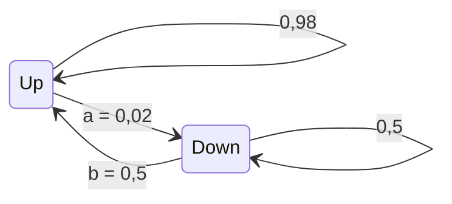
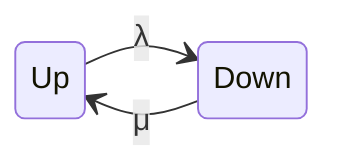
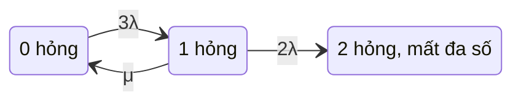
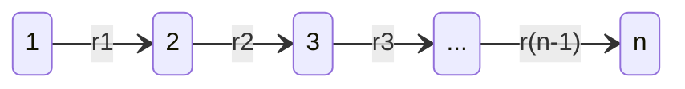
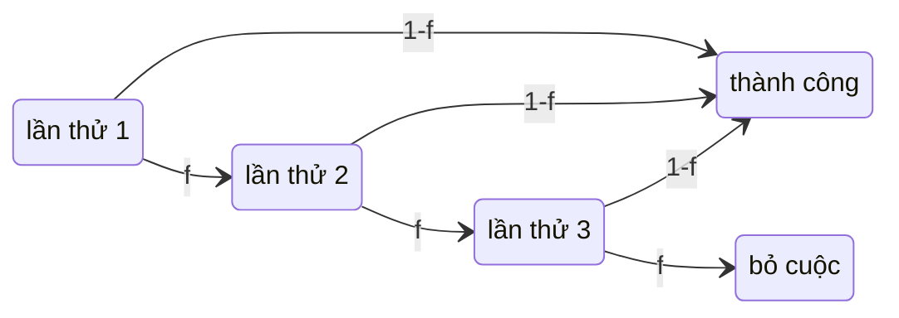
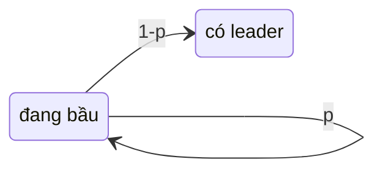

# P14 · Chương 09 — Chuỗi Markov và quá trình Poisson

> Phạm vi: chương này dựng phần xác suất *theo thời gian* mà các chương trước đã mượn nhưng chưa chứng minh: biến ngẫu nhiên liên tục và phân phối mũ, quá trình Poisson, chuỗi Markov rời rạc và liên tục, phân tích bước đầu (first-step analysis) cho thời gian chạm và xác suất hấp thụ, bài toán gambler's ruin, rồi bốn ứng dụng vào hệ thống: availability và MTTF của nhóm replica, gossip, retry với backoff, và bầu cử Raft. Phần toán bám theo giáo trình MIT 6.042 *Mathematics for Computer Science* (bản 2018), sách *Markov Chains and Mixing Times* của Levin–Peres–Wilmer, giáo trình *Introduction to Probability* của Grinstead–Snell và ghi chú *Queueing Systems* của Adan–Resing. Chứng minh nào mang nhãn "(chứng minh của người soạn)" là do người soạn tự viết hoặc viết lại, và chỉ đáng tin tới mức bạn đọc từng bước thấy đúng. Các số ghi "quan sát" là kết quả của các chương trình Rust trong chương, chạy thật bằng `rustc 1.95.0 -O` trên macOS arm64, một lần chạy với seed cố định; chúng không phải bảo đảm của tài liệu nào. Hệ thống `kvmeta` và mọi con số quanh nó (tốc độ hỏng, thời gian sửa, tốc độ gossip) là ví dụ giả định của người soạn, không phải code hay số đo trong repo.

Các chương trước của phase này đã mượn vài thứ mà chưa dựng. [Chương 05](05-queueing-theory.md) nói "khoảng cách giữa hai request là biến mũ", "tính không nhớ" và "chuỗi sinh–tử" như thể bạn đã biết chúng; [chương 03](03-xac-suat.md) dừng ở biến ngẫu nhiên rời rạc và chỉ chạm tới "số vòng bầu cử là biến hình học". Chương này lấp khoảng trống đó. Nó dạy một bộ công cụ nhỏ cho mọi bài toán dạng "hệ thống đổi trạng thái ngẫu nhiên theo thời gian": mô tả trạng thái và tốc độ chuyển, rồi *điều kiện hóa trên bước đầu tiên* để ra một hệ phương trình tuyến tính cho thời gian chờ và xác suất. Cùng một bộ công cụ trả lời bốn câu hỏi vận hành trông chẳng liên quan nhau: nhóm 3 replica sống được bao lâu trước khi mất đa số, một tin gossip lan hết cụm cache sau bao lâu, retry khuếch đại tải lên backend bao nhiêu lần, và cuộc bầu leader Raft kéo dài bao lâu (nhận xét của người soạn).

Cả chương bám theo `kvmeta` ở chương 03: một kho key-value giả định, lõi Raft, và tầng cache 100 node đứng trước. Để con số gọn, ta nói mỗi *shard* của `kvmeta` là một nhóm Raft 3 replica (chương 03 dùng cụm 5 node; bài tập 8 quay lại 5 node). Mỗi replica hỏng trung bình mỗi 30 ngày, tức tốc độ $\lambda = 1/720$ mỗi giờ, và được thay cùng đồng bộ lại trung bình trong 1 giờ, tức tốc độ $\mu = 1$ mỗi giờ. Thư viện client gọi shard có retry, còn 100 node cache trao đổi danh sách thành viên bằng gossip. Mục 1 đến 3 dựng công cụ, mục 4 và 5 thêm first-step analysis và chuỗi liên tục, mục 6 đến 8 dùng chúng cho bốn ứng dụng (nhận xét của người soạn: mọi con số này là giả định).

## Bạn sẽ hiểu được gì

1. **Q1.** Biến ngẫu nhiên liên tục được mô tả bằng pdf, cdf và kỳ vọng bằng tích phân thế nào; vì sao phân phối mũ có tính không nhớ (chứng minh), và khi nhiều biến mũ đua nhau thì ai thắng, thắng sau bao lâu (min và competing exponentials)? → mục 1
2. **Q2.** Quá trình Poisson là gì (ba cách định nghĩa), vì sao khoảng cách giữa các điểm là mũ còn số điểm trong một khoảng là Poisson, gộp và chia dòng cho kết quả gì, và PASTA nói gì? → mục 2
3. **Q3.** Chuỗi Markov rời rạc có ma trận chuyển ra sao; xác suất $n$ bước tính thế nào (Chapman–Kolmogorov); bất khả quy và không tuần hoàn là gì; phân phối dừng là gì và khi nào phân phối hội tụ về nó; bước ngẫu nhiên trên đồ thị cho kết quả gì? → mục 3
4. **Q4.** Từ một trạng thái, xác suất chạm tập đích trước tập khác và thời gian chạm trung bình tính ra sao bằng first-step analysis (chứng minh đầy đủ), và gambler's ruin cho những công thức nào? → mục 4
5. **Q5.** Chuỗi Markov liên tục có tốc độ chuyển, ma trận sinh và phương trình cân bằng thế nào, và nó nối với phân tích sinh–tử ở chương 05 ra sao? → mục 5
6. **Q6.** Availability dài hạn của một replica, availability và MTTF của nhóm 3 replica trước khi mất đa số tính thế nào bằng chuỗi Markov, và số tính ra có khớp mô phỏng Monte Carlo không? → mục 6
7. **Q7.** Tin gossip lan khắp $n$ node theo chuỗi Markov nào, thời gian trung bình là bao nhiêu và có khớp mô phỏng không? → mục 7
8. **Q8.** Retry với backoff và bầu cử Raft là những chuỗi Markov nào, và first-step analysis cho xác suất thành công, số lần thử, độ trễ và thời gian bầu ra sao? → mục 8

## Kiến thức cần trước

- [Chương 03 — Xác suất cho hệ thống](03-xac-suat.md): không gian xác suất, xác suất có điều kiện, độc lập, kỳ vọng và linearity, phân phối hình học. Mục 8 dùng xác suất tách phiếu tính ở [chương 03, mục 7](03-xac-suat.md).
- [Chương 01 — Logic và chứng minh](01-logic-va-chung-minh.md): quy nạp, dùng khắp mục 3 và 4.
- Giải tích phổ thông (đạo hàm, tích phân của $e^{-\lambda x}$, chuỗi hình học, $e^x$) và đại số tuyến tính cơ bản (nhân ma trận, giải hệ phương trình tuyến tính nhỏ). Bạn không cần biết trước chuỗi Markov hay quá trình Poisson.
- [Chương 02 — Toán rời rạc](02-toan-roi-rac.md): đồ thị và bậc của đỉnh, chỉ dùng ở mục 3.6.
- [Chương 05 — Queueing theory](05-queueing-theory.md): không cần đọc trước. Ngược lại, chương 05 dùng phân phối mũ, quá trình Poisson và chuỗi sinh–tử mà chương này dựng; mục 5 chỉ sang chương 05 mục 3 và mục 5 thay vì lặp lại phân tích M/M/1 và M/M/c.
- Bối cảnh, không bắt buộc: [P12 · Chương 18](../12-he-thong-du-lieu/18-thuat-toan-dong-thuan.md) (Raft và quorum) cho mục 6 và 8; [P15 · Chương 07](../15-thuat-toan-phan-tan/07-membership-va-gossip.md) (membership và gossip) cho mục 7.

---

## 1. Biến ngẫu nhiên liên tục và phân phối mũ (Q1)

> **Trả lời ngắn.** Thời gian tới lần hỏng kế tiếp của một replica là biến ngẫu nhiên *liên tục*: nó không có xác suất cho từng giá trị riêng lẻ mà có một hàm mật độ $f$; xác suất rơi vào một khoảng là tích phân của $f$ trên khoảng ấy, và kỳ vọng là $\int x f(x) dx$. Phân phối mũ tốc độ $\lambda$ có $\Pr[T > t] = e^{-\lambda t}$ và $E[T] = 1/\lambda$, đồng thời *không nhớ*: replica đã sống $s$ giờ vẫn sống thêm được $t$ giờ với đúng xác suất của một replica mới bật[^ar-memoryless], và đó là phân phối duy nhất như vậy[^g-mem-only]. Khi nhiều biến mũ độc lập đua nhau, kẻ về sớm nhất cũng có phân phối mũ với tốc độ bằng tổng các tốc độ, và biến $i$ thắng với xác suất tỉ lệ với tốc độ của nó[^ar-min].

**Giải thích.**

*Với `kvmeta`.* Mỗi replica của một shard chạy cho tới khi hỏng (kernel panic, mất ổ cứng, host bị thu hồi), rồi mất một lúc để thay và đồng bộ lại. Thời gian sống ấy là một số thực dương chưa biết trước, nên ta cần ngôn ngữ để nói về "xác suất của một số thực". Câu hỏi dẫn đường: replica đã chạy 100 ngày liền không sự cố thì xác suất nó hỏng trong 24 giờ tới có thấp hơn một replica vừa bật không? Câu trả lời tùy phân phối của thời gian sống. Phân phối mũ trả lời "không", và chính câu trả lời đó làm mọi phép tính ở các mục sau gọn đến mức giải được bằng tay (nhận xét của người soạn).

### 1.1 Mật độ, hàm phân phối và kỳ vọng bằng tích phân

Biến ngẫu nhiên $T$ gọi là *liên tục* khi có một hàm $f \ge 0$, gọi là hàm mật độ (pdf), sao cho với mọi $a < b$ ta có $\Pr[a < T \le b] = \int_a^b f(x) dx$ và $\int_{-\infty}^{\infty} f(x) dx = 1$. Hệ quả ngay là $\Pr[T = x] = 0$ với mọi $x$: $f(x)$ không phải xác suất mà là xác suất *trên một đơn vị độ dài*, theo nghĩa $\Pr[x < T \le x + h] \approx f(x) h$ khi $h$ nhỏ. Hàm phân phối tích lũy (cdf) là $F(t) = \Pr[T \le t] = \int_{-\infty}^{t} f(x) dx$, còn $\Pr[T > t] = 1 - F(t)$ là xác suất "còn sống sau $t$" (survival function). Kỳ vọng là bản liên tục của tổng $\sum_x x \Pr[X = x]$ ở [chương 03, mục 2.1](03-xac-suat.md):

$$E[T] = \int_{-\infty}^{\infty} x f(x) dx.$$

Luật kỳ vọng toàn phần của biến rời rạc[^mcs-total-exp] và tính tuyến tính của kỳ vọng đứng nguyên cho biến liên tục: chứng minh y hệt, chỉ thay tổng bằng tích phân (nhận xét của người soạn). Luật kỳ vọng toàn phần là thứ ta dùng nhiều nhất từ mục 4: chia theo bước đầu tiên rồi lấy trung bình có trọng số. Còn một công thức riêng cho biến không âm.

**Mệnh đề 1.1.** Nếu $T \ge 0$ có mật độ $f$ thì $E[T] = \int_0^\infty \Pr[T > t] dt$.

*Chứng minh (của người soạn).* Viết $x = \int_0^x dt$, ta có $E[T] = \int_0^\infty \left(\int_0^x dt\right) f(x) dx$. Miền lấy tích phân kép là tập các cặp $(t, x)$ với $0 \le t \le x$, và hàm dưới dấu tích phân không âm, nên ta đổi được thứ tự lấy tích phân: $E[T] = \int_0^\infty \left(\int_t^\infty f(x) dx\right) dt = \int_0^\infty \Pr[T > t] dt$. ∎

Đây là bản liên tục của đẳng thức $E[X] = \sum_{k \ge 1} \Pr[X \ge k]$ ở [chương 03, mục 2.2](03-xac-suat.md).

### 1.2 Phân phối mũ

**Định nghĩa.** $T$ có phân phối mũ tốc độ $\lambda > 0$, viết $T \sim \mathrm{Exp}(\lambda)$, khi mật độ là $f(t) = \lambda e^{-\lambda t}$ với $t \ge 0$[^ar-exp]. Lấy tích phân cho $\Pr[T > t] = \int_t^\infty \lambda e^{-\lambda x} dx = e^{-\lambda t}$ với $t \ge 0$, nên $F(t) = 1 - e^{-\lambda t}$. Theo Mệnh đề 1.1, $E[T] = \int_0^\infty e^{-\lambda t} dt = 1/\lambda$. Với bình phương, tích phân từng phần cho $E[T^2] = \int_0^\infty t^2 \lambda e^{-\lambda t} dt = -t^2 e^{-\lambda t} \Big|_0^\infty + \int_0^\infty 2 t e^{-\lambda t} dt = \frac{2}{\lambda} E[T] = \frac{2}{\lambda^2}$, nên $\mathrm{Var}[T] = 2/\lambda^2 - 1/\lambda^2 = 1/\lambda^2$: độ lệch chuẩn bằng đúng trung bình. Thêm hai hệ quả hay dùng: median là $\ln 2 / \lambda$ vì $e^{-\lambda t} = 1/2$ tại đó, và $\Pr[T > a E[T]] = e^{-a}$, nên phân vị thứ 99 là $\ln 100 \cdot E[T] \approx 4{,}6 \cdot E[T]$. Đó chính là con số ở [chương 05, mục 3.4](05-queueing-theory.md).

Chữ "tốc độ" có nghĩa cụ thể: với $h$ nhỏ, $\Pr[T \le t + h \mid T > t] = 1 - e^{-\lambda h} \approx \lambda h$ (xem Định lý 1.2 ngay dưới), nên trong mỗi khoảnh khắc nhỏ sự kiện xảy ra với xác suất xấp xỉ $\lambda$ nhân độ dài khoảnh khắc, bất kể đã chờ bao lâu. Ngành độ tin cậy gọi đại lượng đó là hazard rate và nói phân phối mũ có hazard rate không đổi: xác suất hỏng tại một thời điểm không phụ thuộc vào việc đã bao lâu kể từ lần hỏng trước[^sg-hazard].

### 1.3 Tính không nhớ

**Định lý 1.2 (tính không nhớ).** Nếu $T \sim \mathrm{Exp}(\lambda)$ thì với mọi $s, t \ge 0$: $\Pr[T > s + t \mid T > s] = \Pr[T > t] = e^{-\lambda t}$. Nói cách khác, biết rằng $T > s$ thì phần còn lại $T - s$ lại có phân phối $\mathrm{Exp}(\lambda)$[^ar-memoryless].

*Chứng minh (của người soạn).* Biến cố "$T > s + t$" nằm trong biến cố "$T > s$", nên $\Pr[T > s + t \mid T > s] = \Pr[T > s + t] / \Pr[T > s] = e^{-\lambda(s + t)} / e^{-\lambda s} = e^{-\lambda t}$. ∎

Với `kvmeta`: nếu tuổi thọ replica là $\mathrm{Exp}$ với trung bình 720 giờ thì xác suất hỏng trong 24 giờ tới là $1 - e^{-24/720} \approx 0{,}0328$, dù replica đã chạy 1 giờ hay 100 ngày. Mô hình này không có giai đoạn "mòn dần" và cũng không có giai đoạn "bé hay hỏng" (nhận xét của người soạn). Không phải cơ chế nào cũng như vậy. Một lịch cố định thì ngược hẳn: heartbeat gửi đều đặn mỗi 100 ms thì sau 90 ms chưa thấy nó, ta biết chắc nó sẽ đến trong 10 ms nữa, nên thời gian chờ ấy *có* nhớ. Giáo trình của Gallager lấy ví dụ tương tự bằng chuyến xe đến đều mỗi 16 phút[^g-bus]. Election timeout của Raft chọn đều trong $[150, 300)$ ms cũng vậy: sau 200 ms mà chưa hết giờ thì chỉ còn tối đa 100 ms, khác lúc mới bắt đầu.

Mũ còn là phân phối *duy nhất* có tính ấy: một biến dương không nhớ thì buộc phải là biến mũ[^g-mem-only]. Bài 4 chứng minh điều đó. Bản rời rạc của tính không nhớ là phân phối hình học: nếu chỉ xét các thời điểm nguyên thì hình học là phân phối không nhớ duy nhất[^g-geom]. Đây là lý do số vòng bầu cử Raft mà chương 03 mô hình hóa là biến hình học[^th-geom], và mục 8 quay lại điều đó.

### 1.4 Min của các biến mũ và "cuộc đua"

Các sự kiện trong một hệ thống hay *đua nhau*: replica nào hỏng trước, response về trước hay timeout kêu trước, node nào nhận được tin trước. Hai điều dưới đây là toàn bộ cơ chế của chuỗi Markov liên tục ở mục 5.

**Định lý 1.3 (min và competing exponentials).** Cho $T_1, \dots, T_m$ độc lập, $T_i \sim \mathrm{Exp}(\lambda_i)$, đặt $\Lambda = \lambda_1 + \dots + \lambda_m$, $M = \min_i T_i$ và $K$ là chỉ số đạt min. Khi đó $M \sim \mathrm{Exp}(\Lambda)$ và $\Pr[K = i] = \lambda_i / \Lambda$[^ar-min]; ngoài ra $M$ độc lập với $K$ (phần này người soạn chứng minh bên dưới).

*Chứng minh (của người soạn).* Bước 1: $M > t$ khi và chỉ khi mọi $T_i > t$, và do độc lập, $\Pr[M > t] = \prod_i e^{-\lambda_i t} = e^{-\Lambda t}$. Đó là hàm sống sót của $\mathrm{Exp}(\Lambda)$. Bước 2: cố định $i$ và $t \ge 0$. Biến cố "$K = i$ và $M > t$" nghĩa là $T_i > t$ và $T_j > T_i$ với mọi $j \ne i$. Điều kiện hóa theo giá trị $T_i = x$ (mật độ $\lambda_i e^{-\lambda_i x}$), và dùng độc lập, xác suất mọi $T_j$ ($j \ne i$) lớn hơn $x$ là $e^{-(\Lambda - \lambda_i) x}$:

$$\Pr[K = i, M > t] = \int_t^\infty \lambda_i e^{-\lambda_i x} e^{-(\Lambda - \lambda_i) x} dx = \int_t^\infty \lambda_i e^{-\Lambda x} dx = \frac{\lambda_i}{\Lambda} e^{-\Lambda t}.$$

Bước 3: cho $t = 0$ ta được $\Pr[K = i] = \lambda_i / \Lambda$ (hai biến liên tục bằng nhau với xác suất 0, nên "kẻ về nhất" xác định duy nhất). Thay lại: $\Pr[K = i, M > t] = \Pr[K = i] \Pr[M > t]$ với mọi $t$, tức $K$ và $M$ độc lập. ∎

Ba điều đáng nhớ. Một, tốc độ cộng được: hai nguyên nhân độc lập cùng làm hỏng một thứ thì tốc độ hỏng tổng là tổng hai tốc độ. Hai, kẻ thắng được chọn *tỉ lệ với tốc độ*, như tung một con xúc xắc lệch. Ba, và đáng ngạc nhiên nhất, *thời điểm* có kẻ thắng không mang thông tin gì về việc *ai* thắng.

Áp dụng với `kvmeta`. Ba replica đang sống, mỗi cái hỏng với tốc độ $\lambda = 1/720$ mỗi giờ. Thời gian tới lần hỏng đầu tiên trong cả ba là $\mathrm{Exp}(3\lambda)$ với trung bình $1/(3\lambda) = 240$ giờ, tức 10 ngày. Replica nào hỏng thì mỗi cái đều có xác suất $1/3$, và việc đó không phụ thuộc thời điểm hỏng. Một ví dụ khác: response của backend có service time $S \sim \mathrm{Exp}(\mu)$ và một deadline ngẫu nhiên $D \sim \mathrm{Exp}(\theta)$ (deadline còn lại của các request đến từ nhiều client khác nhau); xác suất deadline kêu trước là $\Pr[D < S] = \theta / (\theta + \mu)$. Nếu deadline cố định bằng $\tau$ thì xác suất đó là $\Pr[S > \tau] = e^{-\mu \tau}$ (nhận xét của người soạn: hai ví dụ minh họa, không phải số đo).

<details><summary>Đi sâu: mũ là giới hạn của hình học, hazard rate và vì sao đời thật không hoàn toàn mũ</summary>

**Mũ là giới hạn của hình học** (chứng minh của người soạn). Chia thời gian thành các lát dài $h$ và giả sử trong mỗi lát replica hỏng với xác suất $\lambda h$, độc lập giữa các lát. Số lát tới lúc hỏng là biến hình học, và $\Pr[\text{còn sống sau } t] = (1 - \lambda h)^{\lfloor t/h \rfloor}$. Lấy logarit: $\lfloor t/h \rfloor \ln(1 - \lambda h) = (t/h + O(1)) (-\lambda h + O(h^2)) \to -\lambda t$ khi $h \to 0$. Vậy xác suất tiến về $e^{-\lambda t}$, đúng hàm sống sót của phân phối mũ. Nguồn viết cùng ý: hình học là bản rời rạc của mũ, và khi đơn vị thời gian nhỏ dần thì hai phân phối hội tụ về nhau[^start-geom]. Ý này giải thích vì sao công thức của chuỗi rời rạc ở mục 3 và của chuỗi liên tục ở mục 5 trông hệt nhau: $(1 - a - b)^n$ ở bên này ứng với $e^{-(\lambda + \mu) t}$ ở bên kia.

**Hazard rate.** Với mật độ $f$ và hàm sống sót $\bar F(t) = \Pr[T > t]$, hazard rate là $\eta(t) = f(t) / \bar F(t)$. Với phân phối mũ, $\eta(t) = \lambda e^{-\lambda t} / e^{-\lambda t} = \lambda$ không đổi, đúng ý "tốc độ không đổi" ở trên. Hazard rate tăng dần nghĩa là xác suất hỏng tăng lên khi đã lâu kể từ lần hỏng trước; giảm dần nghĩa là xác suất đó giảm đi[^sg-hazard2]. Với phân phối đuôi nặng của kích cỡ job, job đã chạy càng lâu thì dự kiến còn chạy càng lâu, nên hazard rate giảm, trái ngược tính không nhớ[^ht-dfr] (xem [chương 05, mục 7.3](05-queueing-theory.md)).

**Đời thật không hoàn toàn mũ.** Mô hình mũ là một giả thiết, và mục 6 sẽ dùng nó để tính MTTF nên cần biết giới hạn của nó. Nghiên cứu số liệu thay đĩa của các cụm lớn thấy thời gian giữa hai lần thay không theo phân phối mũ và còn tự tương quan[^sg-nonexp]. Tuy vậy các hệ lưu trữ thật vẫn dùng mô hình mũ để so sánh phương án, lý do được nêu ở mục 6.5.

</details>

**Quay lại Q1:** biến liên tục có mật độ $f$, xác suất là tích phân của $f$ và kỳ vọng của biến không âm là tích phân của hàm sống sót; phân phối mũ $\mathrm{Exp}(\lambda)$ có $\Pr[T > t] = e^{-\lambda t}$, $E[T] = 1/\lambda$, không nhớ, và là phân phối không nhớ duy nhất; $m$ biến mũ độc lập đua nhau thì kẻ về nhất là $\mathrm{Exp}(\Lambda)$ với $\Lambda$ là tổng tốc độ, kẻ thắng là $i$ với xác suất $\lambda_i/\Lambda$, độc lập với thời điểm thắng. Với `kvmeta`: 3 replica sống hỏng cái đầu tiên sau trung bình 240 giờ, mỗi cái đều có xác suất $1/3$.

---

## 2. Quá trình Poisson: khoảng cách mũ, số điểm Poisson, gộp, chia và PASTA (Q2)

> **Trả lời ngắn.** Quá trình Poisson tốc độ $\lambda$ là dãy các thời điểm mà khoảng cách giữa hai điểm liên tiếp là biến $\mathrm{Exp}(\lambda)$ độc lập; khi đó số điểm trong một khoảng dài $t$ có phân phối Poisson với trung bình $\lambda t$[^ar-poisson], và các khoảng rời nhau cho số điểm độc lập. Gộp hai quá trình Poisson độc lập cho quá trình Poisson với tốc độ bằng tổng[^ar-merge]; giữ mỗi điểm với xác suất $p$ một cách độc lập cho quá trình Poisson tốc độ $p\lambda$, và hai phần "giữ" với "bỏ" độc lập nhau[^ar-split]. PASTA nói rằng với đầu vào Poisson, phần khách đến thấy hệ ở trạng thái $A$ bằng đúng phần thời gian hệ ở $A$, và chỉ đầu vào Poisson mới có tính chất đó[^ar-pasta].

**Giải thích.**

*Với `kvmeta`.* Một shard nhận request từ hàng nghìn client độc lập, mỗi client gửi thưa. [Chương 03, mục 2.3](03-xac-suat.md) mô hình hóa tải một node cache trong một cửa sổ cố định là $\mathrm{Bin}(10^4; 0{,}1)$ với trung bình 1000. Mục này trả lời câu hỏi theo *thời gian*: các request đến *lúc nào*, hai request liên tiếp cách nhau bao lâu, và nếu load balancer chọn ngẫu nhiên một trong ba shard cho mỗi request thì mỗi shard thấy dòng request như thế nào (nhận xét của người soạn).

### 2.1 Định nghĩa, và vì sao số điểm là Poisson

Quá trình Poisson mô tả được theo vài cách tương đương. Cách thứ nhất dựa vào khoảng cách: các khoảng giữa hai điểm liên tiếp là biến mũ độc lập cùng tốc độ[^ar-poisson]. Cách thứ hai dựa vào số điểm: số điểm trong một khoảng dài $t$ có phân phối Poisson trung bình $\lambda t$, và số điểm trong các khoảng rời nhau độc lập. Giáo trình của Gallager chứng minh hai cách này tương đương[^g-def-equiv]. Cần cả hai vế của cách thứ hai: một quá trình đếm mà số điểm tại mỗi thời điểm có phân phối Poisson chưa chắc là quá trình Poisson, vì còn phải có tính độc lập và dừng của số gia[^g-pmf-not-enough]. Từ cách thứ nhất còn suy ra mô tả theo khoảng rất ngắn: trong khoảng dài $h$ có điểm với xác suất $1 - e^{-\lambda h} \approx \lambda h$ (Định lý 1.2), độc lập với quá khứ (Mệnh đề 2.2 bên dưới).

Ta lấy cách thứ nhất làm định nghĩa. Cho $T_1, T_2, \dots$ độc lập cùng $\mathrm{Exp}(\lambda)$, đặt $S_n = T_1 + \dots + T_n$ (thời điểm của điểm thứ $n$, với $S_0 = 0$) và gọi $N(t)$ là số điểm trong $(0, t]$, tức giá trị lớn nhất của $n \ge 0$ thỏa $S_n \le t$.

**Định lý 2.1 (số điểm là Poisson).** Với mọi $t \ge 0$ và $k = 0, 1, 2, \dots$: $\Pr[N(t) = k] = e^{-\lambda t} (\lambda t)^k / k!$.

*Chứng minh (của người soạn).* Ba bước.

1. *Mật độ của $S_n$ là $f_n(x) = \lambda^n x^{n-1} e^{-\lambda x} / (n-1)!$ với $x \ge 0$.* Quy nạp theo $n$. Với $n = 1$ đó là mật độ mũ. Giả sử đúng với $n$. Vì $S_{n+1} = S_n + T_{n+1}$ là tổng hai biến độc lập nên mật độ của nó là tích chập: $f_{n+1}(t) = \int_0^t f_n(x) \lambda e^{-\lambda (t - x)} dx = \frac{\lambda^{n+1} e^{-\lambda t}}{(n-1)!} \int_0^t x^{n-1} dx = \frac{\lambda^{n+1} t^n e^{-\lambda t}}{n!}$.
2. *Hàm sống sót của $S_n$ là $\Pr[S_n > t] = G_n(t) := \sum_{j=0}^{n-1} e^{-\lambda t} (\lambda t)^j / j!$.* Đặt $a_j = \lambda e^{-\lambda t} (\lambda t)^j / j!$. Đạo hàm theo $t$ của số hạng thứ $j$ trong $G_n$ là $-a_j + a_{j-1}$ (với $a_{-1} = 0$), nên tổng $G_n'(t) = \sum_{j=0}^{n-1} (-a_j + a_{j-1})$ rút gọn thành $-a_{n-1} = -f_n(t)$. Hàm $\Pr[S_n > t]$ cũng có đạo hàm $-f_n(t)$ (bước 1), và cả hai bằng 1 tại $t = 0$ (với $n \ge 1$), nên chúng bằng nhau mọi $t$.
3. *Ghép.* $N(t) \ge k$ khi và chỉ khi $S_k \le t$. Vậy với $k \ge 0$: $\Pr[N(t) = k] = \Pr[S_k \le t] - \Pr[S_{k+1} \le t] = G_{k+1}(t) - G_k(t) = e^{-\lambda t} (\lambda t)^k / k!$, trong đó $G_0 = 0$ (với $k = 0$, $S_0 = 0$ và $\Pr[N(t) = 0] = \Pr[S_1 > t] = e^{-\lambda t}$). ∎

Số điểm trong khoảng $(0, t]$ có trung bình và phương sai cùng bằng $\lambda t$[^ar-poisson-moments]. Với một shard nhận $\lambda = 500$ request mỗi giây, số request trong 100 ms là Poisson trung bình 50 và độ lệch chuẩn $\sqrt{50} \approx 7{,}1$; xác suất không có request nào trong 10 ms là $e^{-5}$, tức khoảng 0,67% (nhận xét của người soạn: $\lambda$ giả định).

Điểm thứ hai, tính độc lập của số gia, đến từ tính không nhớ.

**Mệnh đề 2.2 (khởi động lại).** Cố định $s \ge 0$. Các điểm sau thời điểm $s$ tạo thành một quá trình Poisson tốc độ $\lambda$ mới, độc lập với toàn bộ lịch sử trước $s$.

*Chứng minh (của người soạn).* Điều kiện hóa theo lịch sử tới $s$: số điểm đã có $k = N(s)$ và các khoảng $T_1, \dots, T_k$ (nên biết $S_k$), cùng việc chưa có điểm nào trong $(S_k, s]$, tức $T_{k+1} > s - S_k$. Điểm kế tiếp sau $s$ là $S_{k+1} = S_k + T_{k+1}$, và $T_{k+1}$ độc lập với $T_1, \dots, T_k$. Khi đã biết lịch sử, $s - S_k$ là một hằng số, nên Định lý 1.2 cho biết khoảng còn lại $S_{k+1} - s$ có phân phối $\mathrm{Exp}(\lambda)$ và phân phối này không phụ thuộc lịch sử. Các khoảng sau đó, $T_{k+2}, T_{k+3}, \dots$, là mũ độc lập và cũng độc lập với lịch sử. Vậy dù lịch sử ra sao, các điểm sau $s$ luôn có cùng một luật: quá trình Poisson tốc độ $\lambda$. Luật ấy không đổi theo lịch sử, nên độc lập với lịch sử. ∎

Hệ quả: $N(s+t) - N(s) \sim \mathrm{Poisson}(\lambda t)$ và nó độc lập với $N(r)$ mọi $r \le s$. Áp dụng lặp từ khoảng cuối về khoảng đầu, số điểm trong các khoảng rời nhau độc lập. Giáo trình của Gallager phát biểu đúng hai tính chất này (số gia dừng và độc lập) cho quá trình Poisson[^g-indep-inc]. Với `kvmeta`: dù shard vừa nhận liền năm request hay đã im lặng hai giây, thời gian chờ tới request kế tiếp vẫn có cùng phân phối. Nếu dữ liệu thật cho thấy các request đến thành cụm, mô hình Poisson đang sai (mục 2.3).

### 2.2 Gộp và chia dòng

**Định lý 2.3 (gộp).** Nếu $N_1$ và $N_2$ là hai quá trình Poisson độc lập với tốc độ $\lambda_1$ và $\lambda_2$ thì $N_1 + N_2$ là quá trình Poisson tốc độ $\lambda_1 + \lambda_2$[^ar-merge].

*Chứng minh (của người soạn).* Số gia của tổng trên các khoảng rời nhau độc lập, vì mỗi số gia là tổng của hai số gia độc lập. Trên một khoảng dài $t$, số điểm của tổng là tổng của hai biến Poisson độc lập có tham số $a = \lambda_1 t$ và $b = \lambda_2 t$. Theo nhị thức Newton:

$$\Pr[\text{tổng} = n] = \sum_{j=0}^{n} \frac{e^{-a} a^j}{j!} \cdot \frac{e^{-b} b^{n-j}}{(n-j)!} = \frac{e^{-(a+b)}}{n!} \sum_{j=0}^{n} \binom{n}{j} a^j b^{n-j} = \frac{e^{-(a+b)} (a+b)^n}{n!}.$$

Đó là Poisson với tham số $(\lambda_1 + \lambda_2) t$. Theo cách mô tả thứ hai ở mục 2.1 (số gia độc lập và Poisson), tổng là quá trình Poisson tốc độ $\lambda_1 + \lambda_2$. ∎

Có một cách nhìn thứ hai, qua "cuộc đua" ở mục 1.4. Ngay sau một thời điểm bất kỳ, điểm kế tiếp của dòng 1 và của dòng 2 là hai đồng hồ mũ độc lập (nhờ Mệnh đề 2.2). Theo Định lý 1.3, điểm kế tiếp của dòng gộp đến sau một khoảng $\mathrm{Exp}(\lambda_1 + \lambda_2)$ và thuộc dòng $i$ với xác suất $\lambda_i / (\lambda_1 + \lambda_2)$, độc lập với thời điểm. Lặp lại mãi: dòng gộp là Poisson tốc độ tổng, và mỗi điểm mang một *nhãn* "đến từ dòng $i$" độc lập với mọi thứ khác. Mục 5 và mục 7 dùng đúng cách nhìn này.

**Định lý 2.4 (chia dòng, thinning).** Cho $N$ là quá trình Poisson tốc độ $\lambda$. Mỗi điểm được giữ (nhãn 1) với xác suất $p$ và bỏ (nhãn 2) với xác suất $q = 1 - p$, độc lập với nhau và độc lập với $N$. Khi đó $N_1$ (các điểm giữ) và $N_2$ (các điểm bỏ) là hai quá trình Poisson độc lập có tốc độ $p\lambda$ và $q\lambda$[^ar-split].

*Chứng minh (của người soạn).* Xét một khoảng dài $t$ và gọi $K$, $D$ là số điểm giữ và số điểm bỏ trong đó. Khi đã biết $N(t) = n$, $K$ là nhị thức $(n, p)$ và $D = n - K$. Với mọi $k, d \ge 0$, theo công thức xác suất toàn phần:

$$\Pr[K = k, D = d] = \Pr[N(t) = k + d] \binom{k+d}{k} p^k q^d = \frac{e^{-\lambda t} (\lambda t)^{k+d}}{(k+d)!} \cdot \frac{(k+d)!}{k! d!} p^k q^d = \frac{e^{-p\lambda t} (p\lambda t)^k}{k!} \cdot \frac{e^{-q\lambda t} (q\lambda t)^d}{d!}.$$

Bước cuối dùng $e^{-\lambda t} = e^{-p\lambda t} e^{-q\lambda t}$ và $(\lambda t)^{k+d} p^k q^d = (p\lambda t)^k (q\lambda t)^d$. Vế phải là tích của hai xác suất Poisson, nên $K \sim \mathrm{Poisson}(p\lambda t)$, $D \sim \mathrm{Poisson}(q\lambda t)$ và $K$, $D$ độc lập. Trên các khoảng rời nhau, các cặp $(K, D)$ độc lập với nhau vì $N$ có số gia độc lập và các nhãn được gán độc lập. Theo cách mô tả thứ hai ở mục 2.1, $N_1$ và $N_2$ là hai quá trình Poisson độc lập. ∎

Tính độc lập ở đây đáng ngạc nhiên: khi đã biết cả quá trình gốc thì hai quá trình con hoàn toàn phụ thuộc nhau vì cái này xác định cái kia[^g-split-indep]. Độc lập chỉ có được vì tổng $N(t)$ tự nó là Poisson.

Với `kvmeta`, ba hệ quả dùng được ngay (nhận xét của người soạn):

- *Chia cho shard.* Nếu mỗi request được gán ngẫu nhiên, đều và độc lập cho một trong ba shard thì mỗi shard thấy một dòng Poisson tốc độ $\lambda/3$, và ba dòng độc lập với nhau. Đây là tính chất mà [chương 05, mục 6.1](05-queueing-theory.md) dùng để biến "chia ngẫu nhiên" thành ba hàng đợi M/M/1 riêng.
- *Lọc lỗi.* Nếu 2% request độc lập nhau bị lỗi xung đột ghi thì các request lỗi tạo dòng Poisson tốc độ $0{,}02\lambda$, độc lập với dòng request thành công. Biết số request lỗi trong một cửa sổ không cho biết gì về số request thành công trong cửa sổ đó.
- *Gộp tầng.* Tải vào shard là tổng của các dòng từ từng service gọi nó; chỉ cần biết tốc độ từng dòng.

### 2.3 Khi nào Poisson là mô hình tốt

Poisson hợp lý khi có *nhiều nguồn độc lập, mỗi nguồn thưa*: tổng của nhiều quá trình đếm độc lập có tốc độ nhỏ so với tổng thì xấp xỉ Poisson, ngay cả khi từng quá trình không phải Poisson[^g-sum-poisson]. Đó là lý do mô hình hợp với "hàng nghìn client độc lập" của `kvmeta`. Nhưng nó là một giả thiết cần kiểm. Nghiên cứu kinh điển về lưu lượng mạng diện rộng thấy Poisson mô tả tốt thời điểm *người dùng bắt đầu một phiên*, nhưng thất bại với các quá trình đến khác[^pf-poisson]. Chu kỳ của lưu lượng do máy tự phát sinh (timer, cập nhật định tuyến) có thể gây đồng bộ toàn mạng, một hiện tượng không thể có với mô hình Poisson[^pf-timer]. Vì vậy với `kvmeta` (nhận xét của người soạn): lưu lượng từ người dùng thật thì thử Poisson trước; còn heartbeat, cron job, retry theo lịch hay kết nối lại đồng loạt sau sự cố thì không, và bài toán đó cần mô hình khác ([chương 05, mục 7](05-queueing-theory.md)).

### 2.4 PASTA

Hệ quả quan trọng nhất của tính độc lập này cho hàng đợi gọi là PASTA, viết tắt của *Poisson Arrivals See Time Averages*: với đầu vào Poisson, phần khách đến thấy hệ ở trạng thái $A$ đúng bằng phần thời gian hệ ở trạng thái $A$, và tính chất này chỉ đúng với đầu vào Poisson[^ar-pasta]. Nguồn giải thích trực giác bằng việc các lần đến Poisson xảy ra hoàn toàn ngẫu nhiên theo thời gian, và dẫn chứng minh chặt sang bài báo gốc của Wolff[^ar-pasta-why]. Phần dưới chỉ là ý chứng minh, chưa phải chứng minh chặt (của người soạn):

1. Gọi $X(t)$ là trạng thái của hệ lúc $t$. Ta giả sử $X(t)$ chỉ phụ thuộc quá khứ tới $t$ mà không phụ thuộc các lần đến *sau* $t$ (một điều kiện kỹ thuật mà chứng minh chặt phải kiểm; nhận xét của người soạn).
2. Vì số gia Poisson độc lập (Mệnh đề 2.2), việc có một lần đến trong $(t, t + h]$ độc lập với toàn bộ quá khứ, trong đó có $X(t)$. Vậy $\Pr[\text{có đến trong } (t, t+h], X(t) \in A] = \lambda h \cdot \Pr[X(t) \in A] + o(h)$.
3. Chia cho xác suất có đến, $\lambda h$: trạng thái ngay *trước* một lần đến có cùng phân phối với trạng thái ở một thời điểm cố định bất kỳ. Lấy trung bình theo thời gian cho PASTA.

Đầu vào đều đặn thì không như vậy: nguồn nêu ví dụ hệ D/D/1 rỗng lúc 0, có request đến lúc 1, 3, 5, ... và mỗi request phục vụ đúng 1 đơn vị thời gian, nên mọi request đến thấy hệ rỗng trong khi hệ rỗng chỉ một nửa thời gian[^ar-dd1]. PASTA là chìa khóa để biến "quan sát ở thời điểm request đến" thành "trung bình theo thời gian" mà [chương 05, mục 3.3](05-queueing-theory.md) dùng để tính $E[T]$ và Bài 6 dùng để tính xác suất request bị từ chối (nhận xét của người soạn).

<details><summary>Đi sâu: Poisson là giới hạn của nhị thức, và request duy nhất trong một cửa sổ nằm ở đâu</summary>

**Poisson là giới hạn của nhị thức** (chứng minh của người soạn). Giáo trình của Gallager dẫn tới quá trình Poisson bằng cách lấy giới hạn của các quá trình Bernoulli thu nhỏ dần[^g-limit]. Phiên bản đếm của ý đó: cố định $a > 0$ và $k$; khi $n \to \infty$,

$$\binom{n}{k} \left(\frac{a}{n}\right)^k \left(1 - \frac{a}{n}\right)^{n-k} = \frac{a^k}{k!} \cdot \frac{n(n-1)\cdots(n-k+1)}{n^k} \cdot \left(1 - \frac{a}{n}\right)^{n} \cdot \left(1 - \frac{a}{n}\right)^{-k} \to \frac{a^k}{k!} \cdot 1 \cdot e^{-a} \cdot 1.$$

Tức $\mathrm{Bin}(n, a/n)$ tiến về $\mathrm{Poisson}(a)$: $n$ client, mỗi client gửi một request trong cửa sổ với xác suất rất nhỏ, thì số request tổng cộng gần Poisson. Xấp xỉ này tốt khi mỗi xác suất thành phần nhỏ. Với $\mathrm{Bin}(10^4; 0{,}1)$ ở chương 03, trung bình 1000 khớp với Poisson(1000), nhưng phương sai thật là $10^4 \cdot 0{,}1 \cdot 0{,}9 = 900$ trong khi Poisson cho 1000, lệch khoảng 11% vì xác suất $0{,}1$ không còn nhỏ (nhận xét của người soạn).

**Request duy nhất trong một cửa sổ.** Nếu biết có đúng một điểm trong $(0, t]$ thì điểm đó nằm đều ngẫu nhiên trong cửa sổ. Thật vậy, với $0 \le s \le t$: $\Pr[S_1 \le s \mid N(t) = 1] = \Pr[N(s) = 1, N(t) - N(s) = 0] / \Pr[N(t) = 1] = \lambda s e^{-\lambda s} \cdot e^{-\lambda (t - s)} / (\lambda t e^{-\lambda t}) = s/t$ (chứng minh của người soạn; dùng số gia độc lập và Định lý 2.1). Hệ quả thực dụng: một cron job chạy đúng một lần mỗi phút theo đồng hồ riêng độc lập với tải thì thời điểm của nó trong phút là đều, không tập trung ở giây đầu.

**Nghịch lý kiểm tra.** Nếu bạn chọn một thời điểm cố định rồi nhìn khoảng giữa hai điểm Poisson liên tiếp *bao trùm* thời điểm đó thì khoảng ấy dài trung bình gần $2/\lambda$ chứ không phải $1/\lambda$. Chứng minh ở Bài 9.

</details>

**Quay lại Q2:** quá trình Poisson tốc độ $\lambda$ có khoảng cách $\mathrm{Exp}(\lambda)$ độc lập, số điểm trong khoảng dài $t$ là $\mathrm{Poisson}(\lambda t)$ và độc lập giữa các khoảng rời; gộp hai dòng độc lập cho Poisson tốc độ tổng, chia ngẫu nhiên với xác suất $p$ cho hai dòng Poisson độc lập tốc độ $p\lambda$ và $(1-p)\lambda$; PASTA cho phép đọc "trạng thái lúc request đến" như "trung bình theo thời gian" khi đầu vào là Poisson. Với `kvmeta`: ba shard chia ngẫu nhiên thấy ba dòng Poisson độc lập, mỗi dòng tốc độ $\lambda/3$.

---

## 3. Chuỗi Markov rời rạc: ma trận chuyển, phân phối dừng và hội tụ (Q3)

> **Trả lời ngắn.** Chuỗi Markov là dãy trạng thái mà bước kế tiếp chỉ phụ thuộc trạng thái hiện tại chứ không phụ thuộc con đường đã đi[^lpw-def]. Ma trận chuyển $P$ (mỗi hàng là một phân phối, tổng bằng 1) mô tả nó hoàn toàn; xác suất đi từ $i$ tới $j$ sau $n$ bước là phần tử $(i, j)$ của $P^n$[^lpw-tstep], tức phương trình Chapman–Kolmogorov $P^{m+n} = P^m P^n$. Phân phối dừng $\pi$ thỏa $\pi = \pi P$[^lpw-stat]; chuỗi bất khả quy có đúng một phân phối dừng[^lpw-unique], và nếu còn không tuần hoàn thì phân phối ở bước $n$ hội tụ về $\pi$ từ mọi trạng thái đầu, với tốc độ hình học[^lpw-conv]. Với bước ngẫu nhiên trên đồ thị vô hướng liên thông, $\pi$ tỉ lệ với bậc của đỉnh[^lpw-rwg].

**Giải thích.**

*Với `kvmeta`.* Bộ kiểm tra sức khỏe thăm dò từng replica mỗi 10 giây và ghi kết quả "qua" (`Up`) hay "trượt" (`Down`). Giả sử một replica đang qua thì lần thăm dò kế tiếp trượt với xác suất $a = 0{,}02$ (GC pause, mất gói), và một replica đang trượt thì lần sau qua lại với xác suất $b = 0{,}5$ (nhận xét của người soạn: hai số giả định). Câu hỏi: nếu bây giờ replica qua, thì sau 1 phút (6 lần thăm dò) xác suất nó còn qua là bao nhiêu, và về lâu dài replica trượt bao nhiêu phần trăm số lần thăm dò?

### 3.1 Định nghĩa

Một dãy biến ngẫu nhiên $X_0, X_1, X_2, \dots$ nhận giá trị trong một tập hữu hạn các trạng thái $S$ là chuỗi Markov với ma trận chuyển $P = (p_{ij})$ khi xác suất bước tiếp theo chỉ phụ thuộc trạng thái hiện tại:

$$\Pr[X_{n+1} = j \mid X_n = i, X_{n-1} = i_{n-1}, \dots, X_0 = i_0] = p_{ij}$$

với mọi $n$ và mọi con đường $i_0, \dots, i_{n-1}$ đã đi. Đó là tính chất Markov: xác suất đi từ $i$ sang $j$ như nhau, bất kể chuỗi trạng thái nào đứng trước $i$[^lpw-def]. Mỗi hàng của $P$ là một phân phối xác suất nên có các phần tử không âm và tổng bằng 1. Ta chỉ xét chuỗi *thuần nhất*: $p_{ij}$ không đổi theo $n$.

Với bộ kiểm tra sức khỏe, $S = \{\mathrm{Up}, \mathrm{Down}\}$ và

$$P = \begin{pmatrix} 1 - a & a \\ b & 1 - b \end{pmatrix} = \begin{pmatrix} 0{,}98 & 0{,}02 \\ 0{,}5 & 0{,}5 \end{pmatrix}.$$



### 3.2 Xác suất $n$ bước và phương trình Chapman–Kolmogorov

Gọi $p_{ij}^{(n)} = \Pr[X_n = j \mid X_0 = i]$. Xác suất đi từ $i$ tới $j$ trong $n$ bước là phần tử $(i, j)$ của $P^n$[^lpw-tstep], và phân phối của $X_n$ tính ra từ phân phối của $X_0$ bằng cách nhân vector hàng với $P$ bên phải: nhân vector hàng với $P$ cho phân phối ngày mai từ phân phối hôm nay[^lpw-update]. Tên của đẳng thức bên dưới là Chapman–Kolmogorov[^g-ck].

**Mệnh đề 3.1 (Chapman–Kolmogorov).** $p_{ij}^{(m+n)} = \sum_{k \in S} p_{ik}^{(m)} p_{kj}^{(n)}$, tức $P^{m+n} = P^m P^n$.

*Chứng minh (của người soạn).* Chia theo trạng thái ở bước $m$ (công thức xác suất toàn phần): $\Pr[X_{m+n} = j \mid X_0 = i] = \sum_k \Pr[X_m = k \mid X_0 = i] \cdot \Pr[X_{m+n} = j \mid X_m = k, X_0 = i]$. Thừa số đầu là $p_{ik}^{(m)}$. Thừa số sau, theo tính chất Markov (khi đã biết $X_m = k$ thì quá khứ $X_0 = i$ không còn quan trọng) và tính thuần nhất, bằng $p_{kj}^{(n)}$. Vế phải là phần tử $(i, j)$ của tích ma trận $P^m P^n$. Với $m = 1$ ta có $p^{(n+1)} = P \cdot p^{(n)}$, và quy nạp theo $n$ cho $p^{(n)} = P^n$. ∎

**Chuỗi hai trạng thái có công thức đóng.** Với $P$ như trên (cũng là ví dụ "chú ếch nhảy giữa hai lá sen" của Levin–Peres–Wilmer, với hai xác suất nhảy $p$ và $q$)[^lpw-frog]:

**Mệnh đề 3.2.** Nếu $0 < a, b < 1$ thì $\Pr[X_n = \mathrm{Up} \mid X_0 = \mathrm{Up}] = \dfrac{b}{a + b} + \dfrac{a}{a + b} (1 - a - b)^n$.

*Chứng minh (của người soạn).* Đặt $u_n = \Pr[X_n = \mathrm{Up} \mid X_0 = \mathrm{Up}]$ với $u_0 = 1$. Chia theo trạng thái ở bước $n$: $u_{n+1} = u_n (1 - a) + (1 - u_n) b = b + (1 - a - b) u_n$. Đặt $\pi_U = b / (a + b)$ và $d_n = u_n - \pi_U$. Vì $b - \pi_U = -b(1 - a - b)/(a + b) = -(1 - a - b)\pi_U$ nên $d_{n+1} = b + (1 - a - b) u_n - \pi_U = (1 - a - b)(u_n - \pi_U) = (1 - a - b) d_n$. Suy ra $d_n = (1 - a - b)^n d_0$ với $d_0 = 1 - \pi_U = a/(a + b)$. ∎

Với $a = 0{,}02$ và $b = 0{,}5$ ta có $u_n = 0{,}9615 + 0{,}0385 \cdot 0{,}48^n$: $u_1 = 0{,}98$, $u_2 = 0{,}9704$, $u_6 \approx 0{,}9620$ (sau 1 phút), $u_{10} \approx 0{,}96156$. Xác suất đã tiến gần giá trị dài hạn $0{,}9615$ chỉ sau vài lần thăm dò, vì sai lệch co lại với hệ số $0{,}48 = |1 - a - b|$ mỗi bước. Nguồn gọi $1 - p - q$ (ứng với $1 - a - b$ ở đây) là một trị riêng của ma trận chuyển và là thứ quyết định tốc độ hội tụ[^lpw-frog2].

### 3.3 Phân loại trạng thái: bất khả quy và chu kỳ

Hai tính chất của cả chuỗi quyết định liệu "dài hạn" có nghĩa gì.

- Chuỗi gọi là *bất khả quy* (irreducible) nếu với mọi cặp trạng thái $x, y$ có $t$ (phụ thuộc cặp đó) để $p_{xy}^{(t)} > 0$, tức đi được từ trạng thái nào sang trạng thái nào chỉ bằng các bước có xác suất dương[^lpw-irred].
- *Chu kỳ* của trạng thái $x$ là ước chung lớn nhất của tập các $t \ge 1$ mà $p_{xx}^{(t)} > 0$ (các thời điểm có thể quay về $x$)[^lpw-period]. Với chuỗi bất khả quy, chu kỳ giống nhau ở mọi trạng thái[^lpw-lemma16], và chuỗi gọi là *không tuần hoàn* (aperiodic) khi chu kỳ bằng 1. Chỉ cần một trạng thái có bước tự quay về chính nó ($p_{xx} > 0$) là chu kỳ của trạng thái ấy bằng 1.

Ba ví dụ với `kvmeta`:

1. Bộ kiểm tra sức khỏe: bất khả quy ($\mathrm{Up} \to \mathrm{Down} \to \mathrm{Up}$ đều có xác suất dương) và không tuần hoàn (cả hai trạng thái có vòng tự quay về chính nó).
2. *Round-robin* qua 3 backend: client gửi lần lượt tới backend 1, 2, 3, 1, 2, 3, ... Đó là chuỗi tất định với $p_{12} = p_{23} = p_{31} = 1$: bất khả quy nhưng chu kỳ 3, vì chỉ quay về trạng thái 1 sau $3, 6, 9, \dots$ bước. Phân phối ở bước $n$ không hội tụ: bắt đầu từ backend 1 thì ở bước $n$ chuỗi chắc chắn ở backend 1 khi $n$ chia hết cho 3 và chắc chắn không ở đó khi $n$ không chia hết. Nguồn cũng nhận xét như vậy cho chuỗi chu kỳ 2: không thể mong phân phối ở bước $n$ hội tụ[^lpw-periodic-noconv].
3. Một lời gọi retry (mục 8): có trạng thái hấp thụ "thành công" và "bỏ cuộc" mà không quay lại được, nên không bất khả quy. Chuỗi như vậy là đối tượng của mục 4.

Cách sửa tính tuần hoàn là thêm bước đứng yên: với xác suất $1/2$ client lặp lại backend cũ. Chuỗi mới $Q = (I + P)/2$ có $Q(x, x) > 0$ nên không tuần hoàn, và gọi là phiên bản "lười" (lazy) của $P$[^lpw-lazy]. Nó có cùng phân phối dừng với $P$: nếu $\pi P = \pi$ thì $\pi Q = (\pi + \pi P)/2 = \pi$ (chứng minh của người soạn).

### 3.4 Phân phối dừng và định lý hội tụ

Một phân phối $\pi$ trên $S$ thỏa $\pi = \pi P$ gọi là *phân phối dừng* (stationary distribution): nếu $X_0$ có phân phối $\pi$ thì $X_n$ có phân phối $\pi$ với mọi $n$[^lpw-stat]. Viết từng thành phần, $\pi_j = \sum_i \pi_i p_{ij}$. Vì $\sum_i p_{ji} = 1$, phương trình đó tương đương $\pi_j \sum_{i \ne j} p_{ji} = \sum_{i \ne j} \pi_i p_{ij}$: xác suất rời khỏi $j$ bằng xác suất đi vào $j$ ở trạng thái cân bằng[^ar-balance-d]. Để tìm $\pi$, ta giải hệ này cùng $\sum_j \pi_j = 1$.

Với chuỗi hai trạng thái: $\pi_U = (1 - a)\pi_U + b\pi_D$ cho $a \pi_U = b \pi_D$; kết hợp $\pi_U + \pi_D = 1$ được $\pi_U = b/(a + b) = 0{,}5/0{,}52 \approx 0{,}9615$ và $\pi_D = a/(a+b) \approx 0{,}0385$, đúng giới hạn của $u_n$ ở trên. Về lâu dài replica trượt khoảng 3,85% số lần thăm dò. Còn một cách đọc khác: số bước liên tiếp ở `Up` là biến hình học với trung bình $1/a = 50$ lần thăm dò, số bước liên tiếp ở `Down` có trung bình $1/b = 2$ lần, theo "mean time to failure" của biến hình học[^mcs-mttf], và $\pi_U = 50/(50 + 2)$. Tỉ lệ thời gian ở một trạng thái bằng trung bình độ dài mỗi lần ở lại trạng thái đó chia cho độ dài chu kỳ (nhận xét của người soạn). Mục 6 dùng chính ý này cho MTBF và MTTR.

**Định lý 3.3 (phát biểu, theo các nguồn).** Cho chuỗi hữu hạn.

1. Nếu chuỗi bất khả quy thì có đúng một phân phối dừng $\pi$[^lpw-unique]; $\pi_i$ bằng nghịch đảo của thời gian quay về $i$ trung bình[^gs-recur], nên mọi $\pi_i > 0$.
2. Nếu chuỗi vừa bất khả quy vừa không tuần hoàn thì tồn tại $\alpha \in (0, 1)$ và $C > 0$ sao cho khoảng cách giữa phân phối ở bước $n$ và $\pi$ không quá $C\alpha^n$ từ mọi trạng thái đầu[^lpw-conv]; nói riêng $p_{ij}^{(n)} \to \pi_j$. Cùng kết quả được Grinstead–Snell phát biểu cho "chuỗi chính quy": các hàng của $P^n$ cùng tiến về một vector dương $w$[^gs-regular].
3. Nếu chỉ bất khả quy, tỉ lệ thời gian chuỗi ở trạng thái $j$ vẫn tiến về $\pi_j$ (định lý ergodic: "trung bình theo thời gian bằng trung bình theo không gian")[^lpw-ergodic].

Tính không tuần hoàn thật sự cần cho vế 2: chu trình chẵn là phản ví dụ[^lpw-aperiod-nec]. Round-robin ở trên có $\pi = (1/3, 1/3, 1/3)$ và mỗi backend nhận $1/3$ số request theo vế 3, dù phân phối ở bước $n$ không hội tụ. Chứng minh vế 2 cho trường hợp ma trận có mọi phần tử dương nằm ở Bài 10.

Một cách thử nhanh một ứng viên $\pi$ là kiểm *cân bằng chi tiết* (detailed balance) $\pi_i p_{ij} = \pi_j p_{ji}$ với mọi $i, j$: hễ thỏa thì $\pi$ dừng[^lpw-detailed]. Chứng minh (của người soạn): cộng hai vế theo $i$, được $\sum_i \pi_i p_{ij} = \pi_j \sum_i p_{ji} = \pi_j$, đúng phương trình $\pi = \pi P$. Chiều ngược lại không đúng (chuỗi round-robin có $\pi$ dừng mà không cân bằng chi tiết). Phần dưới dùng cân bằng chi tiết cho bước ngẫu nhiên trên đồ thị.

### 3.5 Bước ngẫu nhiên trên đồ thị

Cho đồ thị vô hướng liên thông $G = (V, E)$ (xem [chương 02](02-toan-roi-rac.md)). *Bước ngẫu nhiên đơn giản* trên $G$ là chuỗi Markov trên $V$: từ đỉnh $x$ đi tới một láng giềng chọn đều ngẫu nhiên, tức $p_{xy} = 1/\deg(x)$ nếu $y$ kề $x$ và 0 nếu không, trong đó $\deg(x)$ là bậc của $x$.

**Mệnh đề 3.4.** Phân phối $\pi(x) = \deg(x) / (2|E|)$ là phân phối dừng của bước ngẫu nhiên đơn giản. Thời gian quay về $x$ trung bình là $2|E|/\deg(x)$.

*Chứng minh (của người soạn).* Với hai đỉnh kề nhau $x, y$: $\pi(x) p_{xy} = \frac{\deg(x)}{2|E|} \cdot \frac{1}{\deg(x)} = \frac{1}{2|E|} = \pi(y) p_{yx}$, và với hai đỉnh không kề thì cả hai vế bằng 0. Đó là cân bằng chi tiết, nên $\pi$ dừng. Tổng bậc bằng $2|E|$ (mỗi cạnh được đếm hai lần) nên $\pi$ là phân phối xác suất. Đồ thị liên thông nên chuỗi bất khả quy và $\pi$ là phân phối dừng duy nhất, rồi thời gian quay về trung bình $1/\pi(x)$ theo vế 1 của Định lý 3.3. ∎

Nguồn nêu cùng kết quả: phân phối dừng tỉ lệ với bậc đỉnh[^lpw-rwg]. Chuỗi bất khả quy khi đồ thị liên thông. Nó tuần hoàn (chu kỳ 2) đúng khi đồ thị lưỡng phân. Thật vậy, nếu đồ thị có một chu trình lẻ thì từ $x$ có đường khép kín độ dài lẻ (đi tới chu trình, đi vòng quanh, quay lại) và độ dài chẵn (đi sang láng giềng rồi quay lại: 2 bước), nên ước chung lớn nhất bằng 1; còn nếu lưỡng phân thì mọi bước đổi phía nên mọi đường khép kín có độ dài chẵn (chứng minh của người soạn). Với đồ thị liên thông không lưỡng phân, phân phối ở bước $n$ hội tụ về $\pi$.

Ví dụ với overlay của `kvmeta-cache`: 6 node, các cạnh $A\text{–}B$, $A\text{–}C$, $A\text{–}D$, $A\text{–}E$, $B\text{–}C$, $E\text{–}F$. Bậc là $4, 2, 2, 1, 2, 1$, tổng 12 nên $|E| = 6$ và $\pi = (4, 2, 2, 1, 2, 1)/12$. Node trung tâm $A$ được thăm gấp 4 lần node lá $D$, và thời gian quay về $A$ trung bình là $12/4 = 3$ bước, về $D$ là 12 bước. Đồ thị có tam giác $A, B, C$ nên không lưỡng phân và hội tụ. Chương trình ở phần Đi sâu chạy $2 \cdot 10^7$ bước và cho tần suất khớp $\pi$ (quan sát).

Hệ quả thực dụng (nhận xét của người soạn): nếu bạn chỉ biết láng giềng của mình và chọn một node "ngẫu nhiên" bằng cách đi bước ngẫu nhiên thì mẫu bị lệch về node bậc cao: không phải đều. Khi đồ thị không đều, phân phối của bước đi không hội tụ về phân phối đều, và muốn lấy mẫu đều người ta dùng thuật toán Metropolis để sửa bước đi[^lpw-uniform-sample]. Cách sửa: từ $x$ chọn láng giềng $y$ như thường, rồi chỉ chấp nhận đi với xác suất $\min(1, \deg(x)/\deg(y))$, thiên vị chống việc đi sang đỉnh bậc cao hơn[^lpw-metro]. Kiểm tra bằng cân bằng chi tiết với $\pi$ đều: $\frac{1}{|V|} \cdot \frac{1}{\deg(x)} \min\!\left(1, \frac{\deg(x)}{\deg(y)}\right) = \frac{1}{|V|} \min\!\left(\frac{1}{\deg(x)}, \frac{1}{\deg(y)}\right)$ đối xứng theo $x, y$ (chứng minh của người soạn). Cùng bài toán "phân phối dừng của bước ngẫu nhiên trên đồ thị" cũng là cách PageRank được định nghĩa[^mcs-pagerank].

<details><summary>Đi sâu: kiểm bước ngẫu nhiên trên overlay 6 node bằng Rust, và vì sao tồn tại phân phối dừng</summary>

Chương trình dưới đây đi $2 \cdot 10^7$ bước ngẫu nhiên trên overlay 6 node ở trên, in tần suất ghé từng node, thời gian quay về $A$ trung bình, rồi lặp lại với bước Metropolis. Bộ sinh số là splitmix64 viết tay vì thư viện chuẩn của Rust không có bộ sinh ngẫu nhiên.

```rust
struct Rng(u64);

impl Rng {
    fn next_u64(&mut self) -> u64 {
        // splitmix64
        self.0 = self.0.wrapping_add(0x9E37_79B9_7F4A_7C15);
        let mut z = self.0;
        z = (z ^ (z >> 30)).wrapping_mul(0xBF58_476D_1CE4_E5B9);
        z = (z ^ (z >> 27)).wrapping_mul(0x94D0_49BB_1331_11EB);
        z ^ (z >> 31)
    }
    fn unit(&mut self) -> f64 {
        (self.next_u64() >> 11) as f64 / (1u64 << 53) as f64 // đều trong [0, 1)
    }
    fn below(&mut self, n: usize) -> usize {
        (self.unit() * n as f64) as usize
    }
}

fn main() {
    // A=0 B=1 C=2 D=3 E=4 F=5; cạnh A-B A-C A-D A-E B-C E-F
    let adj: Vec<Vec<usize>> = vec![vec![1, 2, 3, 4], vec![0, 2], vec![0, 1], vec![0], vec![0, 5], vec![4]];
    let deg: Vec<usize> = adj.iter().map(|v| v.len()).collect();
    let total: usize = deg.iter().sum(); // = 2|E| = 12
    let steps = 20_000_000u64;
    let mut rng = Rng(0x6A3F_0000_0000_0003);

    // (1) bước ngẫu nhiên đơn giản
    let (mut visits, mut cur) = ([0u64; 6], 5usize);
    let (mut ret_sum, mut ret_cnt, mut since) = (0u64, 0u64, 0u64);
    for _ in 0..steps {
        cur = adj[cur][rng.below(adj[cur].len())];
        visits[cur] += 1;
        since += 1;
        if cur == 0 {
            ret_sum += since;
            ret_cnt += 1;
            since = 0;
        }
    }
    for x in 0..6 {
        println!("node {x}: bậc {} pi = {:.5} tần suất = {:.5}", deg[x], deg[x] as f64 / total as f64, visits[x] as f64 / steps as f64);
    }
    println!("thời gian quay về A trung bình = {:.4} (2|E|/deg = {:.4})", ret_sum as f64 / ret_cnt as f64, total as f64 / deg[0] as f64);

    // (2) Metropolis: đi sang y chỉ với xác suất min(1, deg(x)/deg(y))
    let (mut visits, mut cur) = ([0u64; 6], 5usize);
    for _ in 0..steps {
        let y = adj[cur][rng.below(adj[cur].len())];
        if rng.unit() < (deg[cur] as f64 / deg[y] as f64).min(1.0) {
            cur = y;
        }
        visits[cur] += 1;
    }
    let freq: Vec<String> = visits.iter().map(|&v| format!("{:.4}", v as f64 / steps as f64)).collect();
    println!("Metropolis: tần suất = {}", freq.join(" "));
}
```

Output (quan sát, macOS arm64, `rustc 1.95.0 -O`, một lần chạy):

```text
node 0: bậc 4 pi = 0.33333 tần suất = 0.33328
node 1: bậc 2 pi = 0.16667 tần suất = 0.16676
node 2: bậc 2 pi = 0.16667 tần suất = 0.16667
node 3: bậc 1 pi = 0.08333 tần suất = 0.08331
node 4: bậc 2 pi = 0.16667 tần suất = 0.16667
node 5: bậc 1 pi = 0.08333 tần suất = 0.08331
thời gian quay về A trung bình = 3.0005 (2|E|/deg = 3.0000)
Metropolis: tần suất = 0.1666 0.1667 0.1666 0.1669 0.1667 0.1666
```

Tần suất của bước đơn giản lệch $\pi$ dưới $10^{-4}$, thời gian quay về $A$ khớp 3, và bước Metropolis đưa cả sáu node về xấp xỉ $1/6$.

**Vì sao tồn tại phân phối dừng.** Chương này chỉ phát biểu sự tồn tại và duy nhất của $\pi$ (Định lý 3.3) và chứng minh trực tiếp cho ma trận dương ở Bài 10. Bản chứng minh tổng quát trong nguồn xây $\pi$ tường minh từ số lần ghé mỗi trạng thái giữa hai lần liên tiếp về một trạng thái cố định $z$[^lpw-existence], và suy ra thời gian quay về trung bình là $1/\pi(z)$.

</details>

**Quay lại Q3:** chuỗi Markov rời rạc được mô tả bởi ma trận chuyển $P$; xác suất $n$ bước là $P^n$ nhờ Chapman–Kolmogorov, với chuỗi hai trạng thái là $\pi_U + (1 - \pi_U)(1 - a - b)^n$; phân phối dừng $\pi = \pi P$ duy nhất khi bất khả quy, và phân phối ở bước $n$ hội tụ về $\pi$ khi còn không tuần hoàn. Với `kvmeta`: bộ kiểm tra sức khỏe có $\pi_{\mathrm{Up}} \approx 0{,}9615$ (96,15%) và hội tụ với hệ số $0{,}48$ mỗi lần thăm dò, round-robin có $\pi$ đều mà không hội tụ, và bước ngẫu nhiên trên overlay thăm node theo tỉ lệ bậc.

---

## 4. Thời gian chạm, xác suất hấp thụ và gambler's ruin (Q4)

> **Trả lời ngắn.** Câu hỏi "từ trạng thái $i$, xác suất chạm tập đích $A$ trước tập $B$ là bao nhiêu" hay "trung bình mất bao nhiêu bước để chạm một trong hai tập" đều giải bằng *first-step analysis*: điều kiện hóa trên bước đầu tiên, rồi coi như chuỗi bắt đầu lại từ trạng thái mới[^mcs-firststep]. Ta được $h_i = \sum_j p_{ij} h_j$ cho xác suất và $k_i = 1 + \sum_j p_{ij} k_j$ cho thời gian, với giá trị biên cho trước ở các trạng thái đích; hệ có nghiệm duy nhất miễn là từ mọi trạng thái chưa quyết định đều tới được đích. Dạng ma trận của nghiệm là ma trận cơ bản $(I - Q)^{-1}$ của chuỗi hấp thụ[^gs-fund]. Với gambler's ruin (đi lên 1 với xác suất $p$, xuống 1 với xác suất $q = 1 - p$, dừng ở $0$ hoặc $N$), xác suất chạm $N$ trước $0$ khi bắt đầu từ $i$ là $i/N$ nếu $p = 1/2$ và $(r^i - 1)/(r^N - 1)$ với $r = q/p$ nếu $p \ne 1/2$; thời gian trung bình tới lúc dừng là $i(N - i)$ khi $p = 1/2$[^lpw-gr].

**Giải thích.**

*Với `kvmeta`.* Giữa tầng nhận request và các worker ghi của một shard có một bộ đệm giới hạn 10 chỗ. Sự kiện kế tiếp hoặc là một request đến, hoặc là một request được phục vụ xong. Nếu bộ đệm chạm 10 thì request mới bị từ chối (tràn); nếu chạm 0 thì worker rảnh. Giả sử request đến theo Poisson tốc độ $\lambda = 40$/giây và worker phục vụ mũ tốc độ $\mu = 60$/giây. Hai đồng hồ đua nhau, nên theo Định lý 1.3 sự kiện kế tiếp là "đến" với xác suất $p = \lambda/(\lambda + \mu) = 0{,}4$ và "xong" với xác suất $q = 0{,}6$, độc lập với thời điểm. Chuỗi các sự kiện vì vậy là một bước ngẫu nhiên: lên 1 với xác suất $0{,}4$, xuống 1 với xác suất $0{,}6$. Bắt đầu với 5 request trong bộ đệm, xác suất tràn trước khi cạn là bao nhiêu, và trung bình mất bao nhiêu sự kiện? Đó chính là gambler's ruin (nhận xét của người soạn: chuỗi các sự kiện này cũng là chuỗi các lần nhảy của hàng đợi M/M/1 ở [chương 05, mục 3.1](05-queueing-theory.md); mục 5 gọi tên nó là chuỗi nhúng).

### 4.1 First-step analysis, có chứng minh

Cho chuỗi trên tập trạng thái hữu hạn $S$ với ma trận chuyển $P$. Chọn hai tập đích rời nhau $A$ ("thắng") và $B$ ("thua"); $C = S \setminus (A \cup B)$ là các trạng thái chưa quyết định. Gọi $T$ là bước đầu tiên mà chuỗi ở trong $A \cup B$ ($T = 0$ nếu bắt đầu ở đó). Ta ký hiệu $\Pr_i$ và $E_i$ cho xác suất và kỳ vọng khi $X_0 = i$. Giả thiết **(R)**: từ mỗi trạng thái của $C$ tới được $A \cup B$ bằng các bước có xác suất dương. Gọi $Q$ là ma trận con của $P$ gồm các hàng và cột trong $C$, và $r_i = \sum_{j \in A} p_{ij}$ với $i \in C$.

**Định lý 4.1.** Dưới giả thiết (R):

- (a) $\Pr_i[T < \infty] = 1$ và $E_i[T] < \infty$ với mọi $i$; hơn nữa $Q^n \to 0$.
- (b) Xác suất $h_i = \Pr_i[X_T \in A]$ là nghiệm duy nhất của hệ: $h_i = 1$ nếu $i \in A$; $h_i = 0$ nếu $i \in B$; $h_i = \sum_j p_{ij} h_j$ nếu $i \in C$.
- (c) Thời gian trung bình $k_i = E_i[T]$ là nghiệm duy nhất của hệ: $k_i = 0$ nếu $i \in A \cup B$; $k_i = 1 + \sum_j p_{ij} k_j$ nếu $i \in C$.

*Chứng minh (của người soạn).*

**(a)** Từ mỗi $i \in C$, theo (R) có một đường đi tới $A \cup B$ chỉ gồm các bước xác suất dương; chọn đường ngắn nhất thì nó không lặp trạng thái nên dài nhiều nhất $m = |C|$ bước. Gọi $\varepsilon > 0$ là xác suất nhỏ nhất, theo mọi $i \in C$, của một đường như vậy. Vậy $\Pr_i[T \le m] \ge \varepsilon$ với mọi $i$. Nếu tới thời điểm $m(k-1)$ chuỗi vẫn trong $C$ thì theo tính chất Markov, với xác suất ít nhất $\varepsilon$ nó bị hấp thụ trong $m$ bước tiếp theo. Quy nạp theo $k$ cho $\Pr_i[T > km] \le (1 - \varepsilon)^k$. Do đó $\Pr_i[T = \infty] = 0$. Vì $\Pr_i[T > n]$ không tăng theo $n$, mỗi khối $m$ giá trị $n \in [km, (k+1)m)$ đóng góp nhiều nhất $m \Pr_i[T > km]$, nên $E_i[T] = \sum_{n \ge 0} \Pr_i[T > n] \le m \sum_{k \ge 0} (1 - \varepsilon)^k = m/\varepsilon$. Cuối cùng, phần tử $(i, j)$ của $Q^n$ là $\Pr_i[X_n = j, T > n]$, nên tổng hàng $i$ của $Q^n$ là $\Pr_i[T > n] \to 0$.

**(b)** *Nghiệm phải thỏa hệ.* Với $i \in C$, chia theo trạng thái ở bước đầu tiên: $\Pr_i[X_T \in A] = \sum_j p_{ij} \Pr[X_T \in A \mid X_1 = j, X_0 = i]$. Theo tính chất Markov, khi đã biết $X_1 = j$ thì phần còn lại là một chuỗi bắt đầu mới từ $j$, nên xác suất có điều kiện là $h_j$. (Nếu $j \in A \cup B$ thì $T = 1$ và $X_T = j$, khớp với giá trị biên $h_j \in \{0, 1\}$.) Vậy $h_i = \sum_j p_{ij} h_j$. *Duy nhất.* Cho $g$ là một nghiệm bất kỳ của hệ. Tách tổng theo $j \in C$ và $j \in A$ (các $j \in B$ cho $g_j = 0$), với $i \in C$: $g_i = \sum_{j \in C} p_{ij} g_j + r_i$, tức $g = Qg + r$ như đẳng thức giữa các vector trên $C$. Thế lặp $n$ lần được $g = Q^n g + \sum_{m=0}^{n-1} Q^m r$. Vì $g$ bị chặn và $Q^n \to 0$ (phần a), $Q^n g \to 0$, nên $g = \sum_{m \ge 0} Q^m r$. Vế phải không chứa $g$, nên mọi nghiệm đều bằng nhau; $h$ là một nghiệm nên $g = h$.

**(c)** *Thỏa hệ.* Với $i \in C$, một bước đã tiêu tốn, rồi còn lại thời gian chạm tính từ $X_1$: $T = 1 + T'$ với $T'$ là thời gian chạm của chuỗi bắt đầu mới từ $X_1$ (bằng 0 nếu $X_1 \in A \cup B$). Lấy kỳ vọng và dùng luật kỳ vọng toàn phần theo $X_1$[^mcs-total-exp]: $k_i = 1 + \sum_j p_{ij} k_j$. *Duy nhất.* Nghiệm bất kỳ $g$ thỏa $g = \mathbf{1} + Qg$ trên $C$ ($\mathbf{1}$ là vector toàn số 1). Thế lặp: $g = \sum_{m=0}^{n-1} Q^m \mathbf{1} + Q^n g \to \sum_{m \ge 0} Q^m \mathbf{1}$. Thành phần $i$ của tổng này là $\sum_m \Pr_i[T > m] = E_i[T]$. Vậy $g = k$. ∎

Chứng minh cho thấy thêm hai điều. Một, $(I - Q) \sum_{m < n} Q^m = I - Q^n \to I$ nên $I - Q$ khả nghịch và $N = (I - Q)^{-1} = \sum_{m \ge 0} Q^m$. Đó là *ma trận cơ bản*: $N_{ij}$ là số lần ghé trung bình trạng thái $j$ khi bắt đầu từ $i$[^gs-fund]. Hai, ba kết quả của Grinstead–Snell chỉ là cách đọc nghiệm: $k = N\mathbf{1}$ (thời gian tới khi bị hấp thụ là tổng số lần ghé các trạng thái chưa quyết định)[^gs-time] và $h = Nr$ (xác suất bị hấp thụ ở mỗi đích)[^gs-prob]. Trong chuỗi hấp thụ, xác suất bị hấp thụ cuối cùng bằng 1[^gs-absorb], khớp với phần (a). Lưu ý rằng giả thiết (R) không thể bỏ: một trạng thái chưa quyết định có vòng tự quay về chính nó với xác suất 1 (chuỗi kẹt) làm hệ trong (b) có nhiều nghiệm, và $E_i[T] = \infty$.

Một nhận xét về cách đọc (nhận xét của người soạn): hệ trong (b) và (c) là hệ *tuyến tính nhỏ*, có $|C|$ ẩn. Mọi bài toán "bao lâu" và "xác suất nào trước" của chương này sẽ quy về nó: bạn viết sơ đồ trạng thái, ghi phương trình cho từng trạng thái chưa quyết định rồi giải.

### 4.2 Gambler's ruin

Một người chơi có $i$ đồng, mỗi ván thắng 1 đồng với xác suất $p$ và thua 1 đồng với xác suất $q = 1 - p$ (các ván độc lập), chơi tới khi có $N$ đồng hoặc hết tiền. Đó là bước ngẫu nhiên trên $\{0, 1, \dots, N\}$ với hai đầu hấp thụ[^lpw-gr]. Lấy $A = \{N\}$, $B = \{0\}$, $C = \{1, \dots, N-1\}$; giả thiết (R) đúng vì $0 < p < 1$. Gọi $w_i$ là xác suất chạm $N$ trước $0$ khi bắt đầu từ $i$.

**Định lý 4.2.** Đặt $r = q/p$.

- $w_i = i/N$ nếu $p = q = 1/2$, và $w_i = \dfrac{r^i - 1}{r^N - 1}$ nếu $p \ne q$.
- Gọi $D_i = E_i[T]$ là số ván trung bình tới khi dừng. Nếu $p = q$ thì $D_i = i(N - i)$. Nếu $p \ne q$ thì $D_i = \dfrac{i - N w_i}{q - p}$.

*Chứng minh (của người soạn; hệ thức lặp cho xác suất cũng là cách giáo trình MIT dùng ngoài lập luận chip của Pascal[^mcs-gr]).*

**Xác suất.** Theo Định lý 4.1(b): $w_0 = 0$, $w_N = 1$ và $w_i = p w_{i+1} + q w_{i-1}$ với $0 < i < N$. Viết $w_i = (p + q) w_i$ rồi chuyển vế: $p (w_{i+1} - w_i) = q (w_i - w_{i-1})$. Đặt $d_i = w_{i+1} - w_i$ thì $d_i = r d_{i-1}$, nên $d_i = r^i d_0$. Cộng dồn: $w_i = \sum_{k=0}^{i-1} d_k = d_0 \sum_{k=0}^{i-1} r^k$. Điều kiện $w_N = 1$ cho $d_0 = 1 / \sum_{k=0}^{N-1} r^k$, vậy

$$w_i = \frac{\sum_{k=0}^{i-1} r^k}{\sum_{k=0}^{N-1} r^k}.$$

Nếu $r = 1$ ($p = q$), hai tổng là $i$ và $N$ nên $w_i = i/N$. Nếu $r \ne 1$, tổng hình học cho $w_i = (r^i - 1)/(r^N - 1)$. Theo tính duy nhất ở Định lý 4.1(b), đây là xác suất cần tìm.

**Thời gian.** Theo Định lý 4.1(c), $D_0 = D_N = 0$ và $D_i = 1 + p D_{i+1} + q D_{i-1}$. Ta chỉ cần *kiểm* rằng công thức đã cho thỏa hệ, vì nghiệm duy nhất. Trường hợp $p = q = 1/2$: thử $D_i = i(N - i)$ thì $D_{i-1} + D_{i+1} = (i-1)(N-i+1) + (i+1)(N-i-1) = 2i(N-i) - 2$, nên $1 + \tfrac{1}{2}(D_{i-1} + D_{i+1}) = i(N-i) = D_i$ và hai biên bằng 0. Trường hợp $p \ne q$: thử $D_i = (i - N w_i)/(q - p)$. Biên đúng vì $w_0 = 0$ và $w_N = 1$. Thế vào vế phải của hệ và dùng $w_i = p w_{i+1} + q w_{i-1}$, $p + q = 1$:

$$1 + p D_{i+1} + q D_{i-1} = 1 + \frac{(p + q) i + (p - q) - N (p w_{i+1} + q w_{i-1})}{q - p} = 1 + \frac{i - N w_i}{q - p} - 1 = D_i.$$

Trường hợp $p = q = 1/2$ cũng đúng với nguồn: $E_k(\tau) = k(n - k)$[^lpw-gr]. ∎

Nguồn cũng giải thích hệ phương trình thời gian bằng đúng lập luận bước đầu tiên: nếu bước đầu làm vốn tăng thì thời gian còn lại kỳ vọng là 1 cho bước đầu cộng với thời gian kỳ vọng từ vị trí mới[^lpw-gr-first]. Hai thông tin đáng nhớ từ công thức. Một, khi trò chơi *bất lợi* ($p < q$, $r > 1$), $w_i = (r^i - 1)/(r^N - 1) \approx r^{i - N}$ với $N$ lớn, giảm theo hàm mũ của khoảng cách tới đích. Ví dụ trong giáo trình MIT: cược đều 1 đô la vào ô đỏ của roulette Mỹ để thắng 100 đô la thì xác suất thắng nhỏ hơn 1 trên 37 000, và con số 1 trên 37 000 còn là cận trên bất kể vốn ban đầu[^mcs-gr-unfair]. Hai, khi trò chơi công bằng, thời gian tới khi dừng tỉ lệ với *tích* hai khoảng cách tới hai đầu, nên lớn gấp bội so với một bước đi thẳng.

### 4.3 Bộ đệm của `kvmeta`

Với $\lambda = 40$, $\mu = 60$ ta có $p = 0{,}4$, $q = 0{,}6$, $r = 1{,}5$, $N = 10$, $i = 5$. Xác suất tràn trước khi cạn là $w_5 = (1{,}5^5 - 1)/(1{,}5^{10} - 1) = 6{,}594/56{,}665 \approx 0{,}1164$, và số sự kiện trung bình tới khi bộ đệm tràn hoặc cạn là $D_5 = (5 - 10 \cdot 0{,}1164)/0{,}2 \approx 19{,}18$. Mỗi sự kiện trung bình kéo dài $1/(\lambda + \mu) = 10$ ms và độ dài đó độc lập với việc sự kiện là loại nào (Định lý 1.3), nên thời gian trung bình là $19{,}18 \times 10$ ms $= 191{,}8$ ms (mục 5.4 chứng minh quy tắc này). Bảng dưới cho thấy tải ảnh hưởng ra sao ($N = 10$, $i = 5$; công thức của Định lý 4.2):

| $\lambda$ | $\mu$ | $p$ | $r$ | Xác suất tràn trước khi cạn | Số sự kiện trung bình |
|---|---|---|---|---|---|
| 40 | 60 | 0,4 | 1,5 | 0,116 | 19,18 |
| 50 | 50 | 0,5 | 1 | 0,5 | 25 |
| 60 | 40 | 0,6 | 0,667 | 0,884 | 19,18 |

Khi tốc độ đến tăng từ 40 lên 50, bằng tốc độ phục vụ, xác suất tràn nhảy từ 11,6% lên 50%; khi tốc độ đến 60 vượt tốc độ phục vụ 40, tràn gần như chắc chắn (88,4%). Đó là hình ảnh của "dao động tạo ra hàng đợi" ở [chương 05, mục 1.3](05-queueing-theory.md) trên thang thời gian ngắn: một bộ đệm 10 chỗ quá nhỏ để hấp thụ vài request đến dồn dập (nhận xét của người soạn: ví dụ giả định, không phải tuyên bố về hệ thật).

<details><summary>Đi sâu: ma trận cơ bản của ví dụ nhỏ nhất, và mô phỏng bộ đệm bằng Rust</summary>

**Ma trận cơ bản cho $N = 4$, $p = 1/2$** (chứng minh của người soạn, kiểm bằng tay). Các trạng thái chưa quyết định là $1, 2, 3$ và

$$Q = \begin{pmatrix} 0 & 1/2 & 0 \\ 1/2 & 0 & 1/2 \\ 0 & 1/2 & 0 \end{pmatrix}, \qquad N = (I - Q)^{-1} = \begin{pmatrix} 3/2 & 1 & 1/2 \\ 1 & 2 & 1 \\ 1/2 & 1 & 3/2 \end{pmatrix}.$$

Kiểm: hàng 1 của $(I - Q) N$ là $1 \cdot (3/2, 1, 1/2) - \tfrac{1}{2}(1, 2, 1) = (1, 0, 0)$, hàng 2 là $-\tfrac12 (3/2, 1, 1/2) + (1, 2, 1) - \tfrac12 (1/2, 1, 3/2) = (0, 1, 0)$, hàng 3 đối xứng hàng 1. Tổng các hàng của $N$ là $(3, 4, 3)$, tức $i(4 - i)$ với $i = 1, 2, 3$, đúng $D_i$ ở Định lý 4.2. Vector $r = (0, 0, 1/2)$ (xác suất nhảy thẳng vào đích $4$) cho $h = Nr = (1/4, 1/2, 3/4)$, tức $i/4$ với $i = 1, 2, 3$, đúng $w_i$. Hàng giữa của $N$, $(1, 2, 1)$, nói rằng bắt đầu từ vốn 2, trung bình ghé vốn 1 một lần, vốn 2 hai lần (kể cả lần bắt đầu) và vốn 3 một lần.

**Mô phỏng bộ đệm** (hàm `exp` dùng phép biến đổi nghịch đảo, giải thích ở phần Liên hệ với Rust). Mỗi lượt mô phỏng đặt hai đồng hồ đua nhau, đúng cơ chế của Định lý 1.3, thay vì dùng sẵn công thức $p = 0{,}4$:

```rust
// Bộ đệm giới hạn N = 10 chỗ; request đến theo Poisson tốc độ lam = 40/s, worker phục vụ mũ tốc độ mu = 60/s.
// Bắt đầu với 5 request trong bộ đệm. Hỏi: chạm 10 (tràn) hay chạm 0 (cạn) trước, và mất bao lâu?
struct Rng(u64);

impl Rng {
    fn next_u64(&mut self) -> u64 {
        // splitmix64
        self.0 = self.0.wrapping_add(0x9E37_79B9_7F4A_7C15);
        let mut z = self.0;
        z = (z ^ (z >> 30)).wrapping_mul(0xBF58_476D_1CE4_E5B9);
        z = (z ^ (z >> 27)).wrapping_mul(0x94D0_49BB_1331_11EB);
        z ^ (z >> 31)
    }
    fn unit(&mut self) -> f64 {
        (self.next_u64() >> 11) as f64 / (1u64 << 53) as f64 // đều trong [0, 1)
    }
    /// Mũ tốc độ `rate` bằng phép biến đổi nghịch đảo; 1 - u nằm trong (0, 1] nên ln luôn hữu hạn.
    fn exp(&mut self, rate: f64) -> f64 {
        -(1.0 - self.unit()).ln() / rate
    }
}

fn main() {
    let (lam, mu, n, start) = (40.0f64, 60.0f64, 10u32, 5u32);
    let mut rng = Rng(0xB0FF_E400_0000_0004);
    let runs = 1_000_000u32;
    let (mut overflow, mut events, mut time) = (0u32, 0u64, 0.0f64);
    for _ in 0..runs {
        let mut k = start;
        while k > 0 && k < n {
            // hai đồng hồ đua nhau: lần đến kế tiếp và lần xong kế tiếp; cái nào kêu trước thì xảy ra
            let (arrive, finish) = (rng.exp(lam), rng.exp(mu));
            if arrive < finish {
                k += 1;
                time += arrive;
            } else {
                k -= 1;
                time += finish;
            }
            events += 1;
        }
        if k == n {
            overflow += 1;
        }
    }
    let (p, q) = (lam / (lam + mu), mu / (lam + mu));
    let r = q / p;
    let w = (r.powi(start as i32) - 1.0) / (r.powi(n as i32) - 1.0); // xác suất tràn trước khi cạn
    let d = start as f64 / (q - p) - (n as f64 / (q - p)) * w; // số sự kiện trung bình
    let runs = runs as f64;
    println!("Pr[tràn trước khi cạn]: đo = {:.5}, công thức = {w:.5}", overflow as f64 / runs);
    println!("số sự kiện trung bình: đo = {:.3}, công thức = {d:.3}", events as f64 / runs);
    println!("thời gian trung bình (ms): đo = {:.3}, công thức = {:.3}", 1000.0 * time / runs, 1000.0 * d / (lam + mu));
}
```

Output (quan sát, macOS arm64, `rustc 1.95.0 -O`, một lần chạy, $10^6$ lượt):

```text
Pr[tràn trước khi cạn]: đo = 0.11657, công thức = 0.11636
số sự kiện trung bình: đo = 19.201, công thức = 19.182
thời gian trung bình (ms): đo = 192.069, công thức = 191.818
```

Ba số khớp công thức: lệch 0,0002 ở xác suất (sai số chuẩn của một ước lượng xác suất $0{,}116$ trên $10^6$ lượt cỡ $0{,}0003$), 0,02 sự kiện, và 0,25 ms.

</details>

**Quay lại Q4:** first-step analysis chia theo bước đầu tiên và cho hệ tuyến tính nhỏ $h_i = \sum_j p_{ij} h_j$ (xác suất chạm đích trước) và $k_i = 1 + \sum_j p_{ij} k_j$ (thời gian chạm), có nghiệm duy nhất khi từ mọi trạng thái chưa quyết định đều tới được đích; nghiệm là $(I - Q)^{-1}$ nhân vế phải. Gambler's ruin cho $w_i = (r^i - 1)/(r^N - 1)$ ($r = q/p$), hoặc $i/N$ khi công bằng, và thời gian $i(N-i)$ khi công bằng hoặc $(i - N w_i)/(q - p)$ khi lệch. Với bộ đệm của `kvmeta` ($\lambda = 40$, $\mu = 60$, 10 chỗ, bắt đầu từ 5): xác suất tràn trước khi cạn là $0{,}1164$ và mất trung bình $19{,}18$ sự kiện, tức $191{,}8$ ms; mô phỏng cho $0{,}1166$, $19{,}20$ và $192{,}1$ ms.

---

## 5. Chuỗi Markov liên tục theo thời gian: tốc độ, ma trận sinh và cân bằng dòng (Q5)

> **Trả lời ngắn.** Trong chuỗi Markov liên tục, ở mỗi trạng thái $i$ có một số sự kiện có thể gây chuyển trạng thái; sự kiện chuyển $i \to j$ xảy ra sau một khoảng mũ với tốc độ $q_{ij}$[^ar-mp-events]. Nhờ tính chất của các biến mũ đua nhau (mục 1.4), hệ ở lại $i$ một khoảng $\mathrm{Exp}(q_i)$ với $q_i = \sum_{j \ne i} q_{ij}$[^ar-mp-time], rồi nhảy sang $j$ với xác suất $q_{ij}/q_i$, độc lập với khoảng đã chờ. Ma trận sinh $Q$ có tổng mỗi hàng bằng 0[^ar-generator]; phân phối dừng thỏa $\pi Q = 0$, tức tốc độ ra khỏi mỗi trạng thái bằng tốc độ vào nó[^ar-balance]. Với chuỗi sinh–tử, cân bằng qua từng "lát cắt" cho $\lambda_{n-1} \pi_{n-1} = \mu_n \pi_n$, và đó là phân tích M/M/1 ở chương 05.

**Giải thích.**

*Với `kvmeta`.* Mục 3 hỏi về replica "mỗi 10 giây"; mục này bỏ nhịp 10 giây và hỏi trực tiếp theo thời gian thực. Một replica ở trạng thái `Up` hỏng với tốc độ $\lambda$ (đồng hồ hỏng, $\mathrm{Exp}(\lambda)$), và ở trạng thái `Down` được sửa xong với tốc độ $\mu$ (đồng hồ sửa, $\mathrm{Exp}(\mu)$). Không có nhịp cố định nào: bất cứ lúc nào cũng có thể có sự kiện. Câu hỏi: về lâu dài replica `Up` bao nhiêu phần thời gian, và từ lúc vừa hỏng thì sau bao lâu availability trở lại gần giá trị dài hạn? (nhận xét của người soạn)

### 5.1 Hai cách nhìn, cùng một chuỗi

Cách nhìn thứ nhất là *đồng hồ đua nhau*. Mỗi lần vào trạng thái $i$, mỗi chuyển khả dĩ $i \to j$ có một đồng hồ mũ độc lập tốc độ $q_{ij}$ bắt đầu chạy; đồng hồ nào kêu trước thì chuyển đó xảy ra. Theo Định lý 1.3, thời gian chờ là $\mathrm{Exp}(q_i)$ với $q_i = \sum_{j \ne i} q_{ij}$ (tổng các tốc độ), chuyển thắng là $j$ với xác suất $q_{ij}/q_i$, và hai thứ độc lập. Tính không nhớ (Định lý 1.2) cho phép bỏ qua đồng hồ cũ: không cần nhớ các đồng hồ khác đã chạy bao lâu, vì ở lần vào trạng thái kế tiếp mọi đồng hồ được coi như bắt đầu mới[^ar-mp-time].

Cách nhìn thứ hai tách quá trình thành hai phần: *chuỗi nhúng* (embedded chain) là chuỗi rời rạc nhìn hệ đúng vào những lúc nó đổi trạng thái, với xác suất chuyển $p_{ij} = q_{ij}/q_i$ ($p_{ii} = 0$)[^ar-embedded-chain], và các *thời gian giữ* $\mathrm{Exp}(q_i)$ độc lập với chuỗi nhúng. Hai cách nhìn là một, và ta dùng cách nào tiện hơn cho từng bài toán (nhận xét của người soạn).

**Ma trận sinh.** Đặt $q_{ii} = -q_i$. Ma trận $Q = (q_{ij})$ gọi là ma trận sinh (generator); mỗi hàng của $Q$ cộng lại bằng 0[^ar-generator]. Với replica Up/Down: $Q = \begin{pmatrix} -\lambda & \lambda \\ \mu & -\mu \end{pmatrix}$.



Điểm khác với chuỗi rời rạc: chuỗi liên tục không có chuyện "chu kỳ", vì thời gian ở lại ngẫu nhiên làm phân phối tại thời điểm $t$ hội tụ mà không cần điều kiện không tuần hoàn[^ar-nonperiodic].

### 5.2 Phương trình cân bằng

Giả sử chuỗi bất khả quy và hữu hạn; khi đó xác suất $p_i(t)$ chuỗi ở trạng thái $i$ lúc $t$ hội tụ về một số $\pi_i$ khi $t \to \infty$, không phụ thuộc trạng thái đầu[^ar-mp-limit]. Ta gọi $\pi$ là phân phối dừng, và cũng đọc nó là phần thời gian chuỗi ở mỗi trạng thái về lâu dài (nhận xét của người soạn, tương tự định lý ergodic ở mục 3.4). Dòng là số lần chuyển trung bình mỗi đơn vị thời gian: dòng từ $i$ sang $j$ bằng $\pi_i q_{ij}$ (chuỗi ở $i$ trong phần $\pi_i$ thời gian, và khi ở $i$ thì chuyển sang $j$ với tốc độ $q_{ij}$)[^ar-balance]. Lâu dài, mỗi lần vào $i$ đi kèm một lần ra khỏi $i$ (hai số đếm hơn kém nhau tối đa 1 trong suốt thời gian đã qua), nên dòng vào bằng dòng ra (lập luận của người soạn):

$$\pi_i q_i = \sum_{j \ne i} \pi_j q_{ji}, \qquad \text{với mọi } i, \qquad \text{tức } \pi Q = 0 \text{ và } \sum_i \pi_i = 1.$$

Đó là phương trình cân bằng toàn cục[^ar-balance]. Cộng phương trình trên theo mọi $i$ thuộc một tập $S$ thì các dòng giữa hai trạng thái cùng nằm trong $S$ xuất hiện ở cả hai vế và triệt tiêu, còn lại *cân bằng qua lát cắt*: tổng dòng từ $S$ ra ngoài bằng tổng dòng từ ngoài vào $S$[^ar-cut] (chứng minh của người soạn). Cân bằng qua lát cắt thường cho phương trình ngắn hơn hệ đầy đủ.

**Replica Up/Down.** Lát cắt giữa $\{\mathrm{Up}\}$ và $\{\mathrm{Down}\}$ cho $\pi_U \lambda = \pi_D \mu$; cùng $\pi_U + \pi_D = 1$ ta được

$$\pi_U = \frac{\mu}{\lambda + \mu} = \frac{1/\lambda}{1/\lambda + 1/\mu}, \qquad \pi_D = \frac{\lambda}{\lambda + \mu}.$$

Với $1/\lambda = \mathrm{MTBF}$ (thời gian trung bình tới lần hỏng) và $1/\mu = \mathrm{MTTR}$ (thời gian trung bình để sửa), $\pi_U = \mathrm{MTBF}/(\mathrm{MTBF} + \mathrm{MTTR})$, đúng công thức availability mà tài liệu về độ sẵn sàng dùng[^aws-mtbf]. Mục 6 áp dụng. Kiểm bằng cách khác: chuỗi nhúng luân phiên $U, D, U, D, \dots$ nên có phân phối dừng $(1/2, 1/2)$, và nguồn chỉ rằng phân phối dừng của chuỗi liên tục có được bằng cách nhân phân phối dừng của chuỗi nhúng với thời gian giữ trung bình mỗi trạng thái rồi chuẩn hóa[^ar-embedded]: $\pi_U \propto 1/\lambda$, $\pi_D \propto 1/\mu$, cùng kết quả.

**Chuỗi sinh–tử.** Khi các chuyển chỉ là $n \to n+1$ với tốc độ $\lambda_n$ và $n \to n-1$ với tốc độ $\mu_n$ (số request trong hệ, số replica đang hỏng, số node đã biết tin...), lát cắt giữa $\{0, \dots, n-1\}$ và $\{n, n+1, \dots\}$ cho

$$\lambda_{n-1} \pi_{n-1} = \mu_n \pi_n \quad \Longrightarrow \quad \pi_n = \pi_0 \prod_{k=1}^{n} \frac{\lambda_{k-1}}{\mu_k}.$$

Với $\lambda_n = \lambda$ và $\mu_n = \mu$ đây là M/M/1 mà [chương 05, mục 3.1 và 3.2](05-queueing-theory.md) giải chi tiết, và [chương 05, mục 5.1](05-queueing-theory.md) làm cho M/M/$c$ với $\mu_n = \min(n, c)\mu$; chương này không lặp lại các phân tích đó. Bài 6 là một ví dụ mới: hệ M/M/$c$/$c$ (pool không có hàng chờ).

### 5.3 Quá trình theo thời gian, hai trạng thái

Cân bằng nói về $t \to \infty$. Muốn biết hội tụ nhanh cỡ nào, ta viết phương trình cho $p_U(t) = \Pr[\text{replica Up lúc } t]$. Trong khoảng ngắn $(t, t + h]$, xác suất hỏng của một replica Up là $1 - e^{-\lambda h} \approx \lambda h$ và xác suất sửa xong của một replica Down là $\approx \mu h$ (Định lý 1.2). Vậy $p_U(t + h) = p_U(t)(1 - \lambda h) + (1 - p_U(t)) \mu h + o(h)$. Trừ $p_U(t)$, chia cho $h$ và cho $h \to 0$:

$$p_U'(t) = \mu - (\lambda + \mu) p_U(t) = -(\lambda + \mu)\left(p_U(t) - \frac{\mu}{\lambda + \mu}\right).$$

Đây là phương trình tuyến tính cho độ lệch $p_U(t) - \mu/(\lambda + \mu)$, nên

$$p_U(t) = \frac{\mu}{\lambda + \mu} + \left(p_U(0) - \frac{\mu}{\lambda + \mu}\right) e^{-(\lambda + \mu) t}.$$

Đó là bản liên tục của Mệnh đề 3.2: thay $a = \lambda h$, $b = \mu h$, $n = t/h$ thì $(1 - a - b)^n = (1 - (\lambda + \mu) h)^{t/h} \to e^{-(\lambda + \mu) t}$. Với $\lambda = 1/720$ và $\mu = 1$ mỗi giờ, độ lệch co theo hệ số $e^{-(\lambda + \mu) t} \approx e^{-t}$ với $t$ tính bằng giờ: sau 5 giờ chỉ còn 0,7% độ lệch ban đầu. Availability hồi phục theo thang thời gian bằng thời gian sửa, chứ không bằng thời gian giữa hai lần hỏng (nhận xét của người soạn).

### 5.4 First-step analysis trong thời gian liên tục

Giả sử cần thời gian trung bình $k_i$ để chạm tập đích $B$ từ trạng thái $i \notin B$. Chuyển từ $i$ mất một khoảng $\tau \sim \mathrm{Exp}(q_i)$ có trung bình $1/q_i$, rồi sang $j$ với xác suất $q_{ij}/q_i$ độc lập với $\tau$ (Định lý 1.3). Thời gian tổng là $\tau$ cộng thời gian chạm tính từ $j$. Lấy kỳ vọng và dùng luật kỳ vọng toàn phần theo trạng thái kế tiếp[^mcs-total-exp]:

$$k_i = \frac{1}{q_i} + \sum_{j \ne i} \frac{q_{ij}}{q_i} k_j, \qquad \text{tức} \qquad q_i k_i = 1 + \sum_{j \ne i} q_{ij} k_j, \qquad k_j = 0 \text{ khi } j \in B.$$

Khác chuỗi rời rạc ở một điểm: mỗi bước tốn $1/q_i$ thay vì 1. Tính duy nhất của nghiệm suy ra như Định lý 4.1(c), áp cho chuỗi nhúng với "chi phí mỗi bước" $c_i = 1/q_i$: thời gian kỳ vọng là $E\left[\sum_{n < T} 1/q_{X_n}\right]$ vì thời gian giữ độc lập với chuỗi nhúng, và đó chính là $\sum_m \tilde{Q}^m c$ với $\tilde{Q}$ là ma trận chuyển nhúng thu về các trạng thái chưa quyết định (chứng minh của người soạn). Xác suất hấp thụ thì không phụ thuộc thời gian giữ, nên là nghiệm của hệ ở Định lý 4.1(b) áp cho chuỗi nhúng: $h_i = \sum_j (q_{ij}/q_i) h_j$.

Hai hệ quả:

- *Bộ đệm ở mục 4.3.* Ở mọi trạng thái chưa quyết định $q_i = \lambda + \mu$ như nhau, nên hệ cho $k_i = D_i/(\lambda + \mu)$ với $D_i$ ở Định lý 4.2: thời gian tới khi tràn hoặc cạn bằng số sự kiện chia $\lambda + \mu$, đúng quy tắc đã dùng ở mục 4.3.
- *Chuỗi sinh thuần* (chỉ đi lên, mỗi trạng thái thăm một lần): thời gian từ $i$ tới trạng thái cuối là $\sum_j 1/q_j$ qua các trạng thái trên đường đi. Mục 7 dùng đúng điều này cho gossip.

<details><summary>Đi sâu: uniformization nối chuỗi liên tục với chuỗi rời rạc</summary>

Có một cách biến chuỗi liên tục thành chuỗi rời rạc có cùng phân phối dừng. Chọn $\Delta > 0$ đủ nhỏ để $\Delta \le 1/q_i$ với mọi $i$ và đặt $P = I + \Delta Q$. Đó là ma trận chuyển hợp lệ (phần tử không âm, hàng cộng bằng 1). Vì $\pi Q = 0$ khi và chỉ khi $\pi P = \pi (I + \Delta Q) = \pi$, chuỗi rời rạc $P$ có đúng phân phối dừng của chuỗi liên tục[^ar-unif]. Diễn giải xác suất: thêm các chuyển "tự quay về chính nó" giả để tổng tốc độ rời mỗi trạng thái đều bằng $1/\Delta$, khi đó thời gian giữ trung bình đều bằng $\Delta$ và chuỗi nhúng thấy y như chuỗi rời rạc.

Với replica Up/Down: $P = \begin{pmatrix} 1 - \lambda \Delta & \lambda \Delta \\ \mu \Delta & 1 - \mu \Delta \end{pmatrix}$, chính là chuỗi hai trạng thái ở mục 3 với $a = \lambda \Delta$ và $b = \mu \Delta$. Phân phối dừng $b/(a + b) = \mu/(\lambda + \mu)$ không phụ thuộc $\Delta$, và hệ số hội tụ $1 - a - b = 1 - (\lambda + \mu)\Delta$ mỗi bước ứng với $e^{-(\lambda + \mu)\Delta}$ gần đúng mỗi $\Delta$ đơn vị thời gian.

Giới hạn của mô hình: nếu thời gian giữ không phải mũ, quá trình không còn là chuỗi Markov theo trạng thái (cần nhớ đã ở trạng thái bao lâu). Mục 6.5 bàn hệ quả cho availability.

</details>

**Quay lại Q5:** chuỗi Markov liên tục là các đồng hồ mũ đua nhau ở mỗi trạng thái: thời gian ở lại là $\mathrm{Exp}(q_i)$, bước nhảy chọn theo tỉ lệ tốc độ, hai thứ độc lập; ma trận sinh $Q$ có hàng cộng 0, phân phối dừng thỏa $\pi Q = 0$ (dòng vào bằng dòng ra, và qua mọi lát cắt), với chuỗi sinh–tử cho $\lambda_{n-1} \pi_{n-1} = \mu_n \pi_n$ như ở chương 05. Với replica Up/Down: $\pi_U = \mu/(\lambda + \mu) = \mathrm{MTBF}/(\mathrm{MTBF} + \mathrm{MTTR})$ và availability hội tụ với hệ số $e^{-(\lambda + \mu) t}$; first-step analysis liên tục là $q_i k_i = 1 + \sum_j q_{ij} k_j$.

---

## 6. Availability và MTTF của nhóm replica như chuỗi Markov (Q6)

> **Trả lời ngắn.** Một replica hỏng với tốc độ $\lambda$ và sửa xong với tốc độ $\mu$ là chuỗi liên tục hai trạng thái; cân bằng dòng cho availability dài hạn $A = \mu/(\lambda + \mu) = \mathrm{MTBF}/(\mathrm{MTBF} + \mathrm{MTTR})$, cách tài liệu về độ sẵn sàng biểu diễn availability bằng MTBF và MTTR[^aws-mtbf]. Nhóm 3 replica cần ít nhất 2 replica sống (đa số). Nếu các replica độc lập thì availability của nhóm là $3A^2 - 2A^3$, còn thời gian trung bình tới lần *đầu tiên* mất đa số (MTTF) là $(5\lambda + \mu)/(6\lambda^2)$, suy ra bằng first-step analysis trên chuỗi "số replica đang hỏng". Với MTBF 30 ngày và MTTR 1 giờ, nhóm không ghi được khoảng 3 phút mỗi năm và có MTTF khoảng 9,9 năm; mô phỏng Monte Carlo bằng Rust cho 86 715 giờ so với 87 000 giờ của công thức (quan sát). Hai giả thiết yếu nhất của phép tính là độc lập giữa các replica và phân phối mũ.

**Giải thích.**

*Với `kvmeta`.* Mỗi shard là một nhóm Raft 3 replica; nhóm còn ghi được khi có ít nhất 2 replica sống, vì chỉ khi đó mới có đa số để bầu leader và commit ([P12 · Chương 18](../12-he-thong-du-lieu/18-thuat-toan-dong-thuan.md); chứng minh hai đa số giao nhau ở [chương 01, mục 2](01-logic-va-chung-minh.md)). Mỗi replica hỏng trung bình mỗi 30 ngày ($\lambda = 1/720$ mỗi giờ), mỗi replica hỏng được thay và đồng bộ lại độc lập với các replica khác trong trung bình 1 giờ ($\mu = 1$ mỗi giờ). Hai câu hỏi vận hành khác nhau: *bao nhiêu phần thời gian* một shard không ghi được (liên quan SLA), và *bao lâu* thì một shard mất đa số lần đầu (liên quan tần suất báo động). Chúng có hai đáp án khác nhau về bản chất, và chuỗi Markov trả lời cả hai (nhận xét của người soạn).

### 6.1 Một replica

Từ mục 5.2, $A = \pi_U = \mu/(\lambda + \mu)$. Với $\lambda = 1/720$ và $\mu = 1$: $A = 720/721 \approx 0{,}998613$, tức một replica mất khoảng $1/721 \approx 0{,}001387$ (0,1387%) thời gian, khoảng 12,2 giờ mỗi năm (8766 giờ một năm). Công thức này chỉ dùng *trung bình* của thời gian sống và thời gian sửa: nguồn lập luận bằng chu kỳ "sống rồi sửa" lặp đi lặp lại, thay thời gian sống và thời gian sửa bằng trung bình dài hạn của chúng[^start-cycle]. Vì vậy riêng cho một replica, availability dài hạn không đòi giả thiết mũ (nhận xét của người soạn; mô hình mũ cần ở các phép tính sau, không cần ở đây). Tài liệu của AWS định nghĩa availability là tỉ số giữa uptime kỳ vọng và tổng uptime với downtime kỳ vọng[^aws-avail], cùng ý.

### 6.2 Availability của nhóm khi các replica độc lập

Giả sử ba replica hỏng độc lập *và* được sửa độc lập (mỗi replica hỏng có đội sửa riêng; không phải xếp hàng chờ sửa). Khi đó ba chuỗi Up/Down độc lập, nên phân phối chung tại mọi thời điểm là tích của ba phân phối riêng. Mỗi phân phối riêng hội tụ về $(A, 1 - A)$ theo công thức ở mục 5.3, nên về lâu dài số replica sống là nhị thức $\mathrm{Bin}(3, A)$ (chứng minh của người soạn). Nhóm ghi được khi có ít nhất 2 replica sống:

$$A_3 = 3A^2(1 - A) + A^3 = 3A^2 - 2A^3, \qquad U_3 = 1 - A_3 = 3u^2 - 2u^3 \quad (u = 1 - A).$$

Với $u = 1/721$: $U_3 \approx 5{,}77 \times 10^{-6}$, khoảng 3,03 phút mỗi năm. So với 12,2 giờ mỗi năm của một replica, dự phòng 3 replica giảm thời gian mất khoảng 240 lần. Số hạng chính là $3u^2$: nhóm chỉ mất khi *hai* replica cùng hỏng, và có 3 cặp như vậy.

### 6.3 MTTF: thời gian tới lần đầu mất đa số

Để trả lời "bao lâu thì mất đa số lần đầu", ta dùng chuỗi đếm số replica đang hỏng, $k \in \{0, 1, 2\}$, và coi $k = 2$ là *hấp thụ* (ta dừng lại ở lần đầu chạm tới nó). Tốc độ chuyển, theo Định lý 1.3 và tính độc lập:

- Từ $k = 0$ (ba replica sống): có ba đồng hồ hỏng, tốc độ tổng $3\lambda$, sang $k = 1$.
- Từ $k = 1$: một replica đang sửa, tốc độ $\mu$, về $k = 0$; hai replica đang sống, tốc độ hỏng tổng $2\lambda$, sang $k = 2$.



Cách làm này cùng khuôn với mô hình mà nguồn dùng cho hệ lưu trữ của Google: trạng thái của một nhóm bản sao là số mảnh còn sống[^ford-state]. MTTF là thời gian trung bình để chuỗi tới trạng thái "không khả dụng", tính bằng các phương pháp chuẩn[^ford-mttf]. Gọi $m_k$ là thời gian trung bình tới $k = 2$ khi bắt đầu từ $k$. Theo first-step analysis liên tục (mục 5.4), $q_0 = 3\lambda$ và $q_1 = 2\lambda + \mu$:

$$m_0 = \frac{1}{3\lambda} + m_1, \qquad (2\lambda + \mu) m_1 = 1 + \mu m_0 + 2\lambda \cdot 0.$$

Thế $m_0$ vào phương trình thứ hai: $(2\lambda + \mu) m_1 = 1 + \frac{\mu}{3\lambda} + \mu m_1$, nên $2\lambda m_1 = \frac{3\lambda + \mu}{3\lambda}$ và

$$m_1 = \frac{3\lambda + \mu}{6\lambda^2}, \qquad \mathrm{MTTF} = m_0 = \frac{1}{3\lambda} + \frac{3\lambda + \mu}{6\lambda^2} = \frac{5\lambda + \mu}{6\lambda^2}.$$

Với $\lambda = 1/720$ và $\mu = 1$: $6\lambda^2 = 1/86400$ nên $\mathrm{MTTF} = (1 + 5/720) \times 86400 = 86400 + 600 = 87000$ giờ, khoảng 9,9 năm. Bốn cách đọc kết quả (suy luận của người soạn từ công thức):

1. *Sửa chữa là yếu tố quyết định.* Nếu không có sửa ($\mu = 0$) thì $\mathrm{MTTF} = 5/(6\lambda) = 1/(3\lambda) + 1/(2\lambda) = 240 + 360 = 600$ giờ, tức 25 ngày. Có sửa trong 1 giờ: 87 000 giờ, gấp 145 lần.
2. *Số hạng chính.* Khi $\mu \gg \lambda$, $\mathrm{MTTF} \approx \mu/(6\lambda^2) = \mathrm{MTBF}^2/(6 \cdot \mathrm{MTTR})$. Với số trên: $720^2/6 = 86400$ giờ, lệch 0,7%. MTTF tỉ lệ với bình phương MTBF và nghịch với MTTR: gấp đôi MTBF (replica bền gấp đôi) cho 346 800 giờ, gấp bốn; chia đôi MTTR cho 173 400 giờ, gấp đôi. Nguồn nêu quy luật tương tự cho hệ của họ: rút ngắn thời gian hồi phục đi $c$ lần thì MTTF tăng $c^2$ lần với 3 bản sao[^ford-scale]. Số mũ là 2 chứ không phải 1 vì với dữ liệu nhân bản, nguồn đặt số mảnh tối thiểu để khôi phục là 1[^ford-r1]; nhóm 3 bản chỉ "mất" khi cả ba cùng hỏng, tức phải thắng cuộc đua với sửa chữa hai lần thay vì một lần như bài toán mất đa số ở đây (suy luận của người soạn).
3. *Không phải "cứ 9,9 năm một lần".* Thời gian tới lần mất đa số xấp xỉ biến mũ với trung bình MTTF, nên xác suất mất đa số trong 1 năm là khoảng $1 - e^{-8766/87000} \approx 0{,}096$ (9,6%), không phải 0 hay 100%. Quan sát ở mô phỏng bên dưới: $\Pr[T > \mathrm{MTTF}] = 0{,}366$ so với $e^{-1} = 0{,}368$.
4. *Quy mô.* Một nhóm hiếm gặp sự cố, nhưng một hệ có nhiều nhóm thì không: với 1000 shard độc lập, các lần mất đa số của các shard gộp lại (nhớ Định lý 2.3) thành một dòng có tốc độ xấp xỉ $1000/87000$ mỗi giờ, tức trung bình cứ 87 giờ (3,6 ngày) có một shard mất đa số, mỗi lần trung bình khoảng 30 phút.

### 6.4 Hai câu hỏi, hai con số, nhất quán với nhau

MTTF (87 000 giờ) và unavailability ($5{,}77 \times 10^{-6}$) trả lời hai câu hỏi khác nhau, nhưng liên hệ bằng "tần suất nhân với thời gian mỗi lần". Khi nhóm ở $k = 2$ (hai replica hỏng), sự kiện thoát ra là một trong hai replica được sửa xong, tốc độ tổng $2\mu$, nên mỗi lần mất đa số kéo dài trung bình xấp xỉ $1/(2\mu) = 0{,}5$ giờ (hơi hơn một chút vì còn khả năng replica thứ ba hỏng). Tần suất mất đa số xấp xỉ $1/\mathrm{MTTF}$. Do đó phần thời gian mất đa số xấp xỉ $0{,}5/87000 = 5{,}75 \times 10^{-6}$, khớp 0,3% với $U_3 = 5{,}77 \times 10^{-6}$ ở mục 6.2. Đây là định luật Little ($L = \lambda W$ ở [chương 05, mục 2](05-queueing-theory.md)) áp cho "số nhóm đang mất đa số": trung bình số nhóm mất đa số bằng tần suất nhân thời gian mỗi lần (nhận xét của người soạn).

### 6.5 Hai giả thiết yếu nhất: nguyên nhân chung và phân phối mũ

**Nguyên nhân chung (common-cause).** Giả sử, ngoài hỏng riêng lẻ, có một sự kiện chung (mất nguồn rack, deploy lỗi, kernel bug cùng đợt) với tốc độ $\nu$, làm cả nhóm mất đa số ngay từ mọi trạng thái. Đó là một đồng hồ mũ nữa trong mỗi trạng thái, rẽ thẳng vào trạng thái hấp thụ. Phương trình thành $(3\lambda + \nu) m_0 = 1 + 3\lambda m_1$ và $(2\lambda + \mu + \nu) m_1 = 1 + \mu m_0$. Đặt $a = 3\lambda + \nu$ và $b = 2\lambda + \mu + \nu$. Từ phương trình thứ hai $m_1 = (1 + \mu m_0)/b$, thế vào phương trình thứ nhất: $a m_0 = 1 + 3\lambda(1 + \mu m_0)/b$, nên

$$m_0 = \frac{b + 3\lambda}{ab - 3\lambda\mu}.$$

Kiểm: khi $\nu = 0$ ta có $a = 3\lambda$, $b = 2\lambda + \mu$ và $m_0 = (5\lambda + \mu)/(6\lambda^2)$, đúng công thức ở mục 6.3. Với một sự kiện chung mỗi 10 năm ($\nu = 1/87660$ mỗi giờ), $\mathrm{MTTF} \approx 43665$ giờ (4,98 năm), tức giảm một nửa. Con số này gần $1/(1/87000 + \nu)$ vì các tốc độ cộng được (Định lý 1.3): MTTF sau khi thêm một nguyên nhân chung gần bằng nghịch đảo của tổng hai tốc độ mất đa số. Một sự kiện hiếm đến mức 10 năm một lần đã ngang cả cơ chế "hai replica cùng hỏng ngẫu nhiên". Đây là cùng bài học với ví dụ rack ở [chương 03, mục 1.3](03-xac-suat.md), nhìn bằng MTTF. Nguồn ghi nhận đúng điều đó ở hệ thật: mô hình bắt tốt tác động của các đợt hỏng đồng loạt, mà nguồn coi là yếu tố ảnh hưởng nhiều nhất tới các con số availability[^ford-corr].

**Phân phối mũ.** Mô hình này giả định replica hỏng và sửa theo thời gian mũ với tốc độ không đổi. Nguồn dùng cùng giả thiết cho mô hình Markov của họ[^ford-assume]. Nhưng số liệu thay đĩa của các cụm lớn cho thấy thời gian giữa hai lần thay không mũ và còn tự tương quan[^sg-nonexp]. Chỗ đáng lo nhất cho phép tính MTTF: một ứng dụng chủ chốt của giả thiết mũ là ước lượng thời gian tới mất dữ liệu trong RAID, thời gian đó phụ thuộc vào xác suất đĩa thứ hai hỏng trong lúc tái dựng, và dữ liệu thật cho thấy mô hình mũ đánh giá thấp đáng kể xác suất đó[^sg-raid]. Hệ quả cho MTTF ở trên (suy luận của người soạn): nó có xu hướng *lạc quan*, tức con số thật có thể thấp hơn 9,9 năm.

Vậy làm gì với con số? Chính nguồn viết rằng mục đích của họ khi dùng mô hình là so sánh tương đối các phương án thay vì dự đoán chính xác cho một phương án cụ thể[^ford-compare], và tài liệu AWS nhắc rằng các phép tính như vậy không phải bảo đảm về uptime hay downtime[^aws-caveat]. Dùng đúng cách (nhận xét của người soạn): so sánh MTTR 1 giờ với 30 phút (gấp đôi MTTF), 3 với 5 replica (Bài 8: gấp khoảng 144 lần), có hay không có nguyên nhân chung ($\nu$ giảm một nửa MTTF), và đặt ngưỡng báo động theo số lần mất đa số kỳ vọng thay vì hứa một con số năm.

<details><summary>Đi sâu: mô phỏng Monte Carlo kiểm MTTF và unavailability, và sửa chữa tuần tự</summary>

**Chương trình.** Mô phỏng *trực tiếp từng replica* (mỗi replica là một chuỗi luân phiên sống $\mathrm{Exp}(\lambda)$ rồi sửa $\mathrm{Exp}(\mu)$, độc lập) chứ không dùng chuỗi đếm $k$ ở trên, nên nó kiểm cả phép suy ra chuỗi lẫn công thức. Phần (A) đo thời gian tới lần đầu có $\ge 2$ replica hỏng cùng lúc qua 200 000 lượt; phần (B) chạy một lần rất dài ($2 \cdot 10^9$ giờ) để đo phần thời gian mất đa số và độ dài mỗi lần mất.

```rust
// Nhóm 3 replica, mỗi replica luân phiên sống (Exp(lam)) và hỏng-đang-sửa (Exp(mu)), độc lập.
// (A) thời gian tới lần đầu có >= 2 replica hỏng cùng lúc (MTTF mất đa số);
// (B) tỉ lệ thời gian có >= 2 replica hỏng trong một lần chạy rất dài (unavailability).
struct Rng(u64);

impl Rng {
    fn next_u64(&mut self) -> u64 {
        // splitmix64
        self.0 = self.0.wrapping_add(0x9E37_79B9_7F4A_7C15);
        let mut z = self.0;
        z = (z ^ (z >> 30)).wrapping_mul(0xBF58_476D_1CE4_E5B9);
        z = (z ^ (z >> 27)).wrapping_mul(0x94D0_49BB_1331_11EB);
        z ^ (z >> 31)
    }
    /// Số thực đều trong [0, 1).
    fn unit(&mut self) -> f64 {
        (self.next_u64() >> 11) as f64 / (1u64 << 53) as f64
    }
    /// Mũ tốc độ `rate` bằng phép biến đổi nghịch đảo; 1 - u nằm trong (0, 1] nên ln không bao giờ là -inf.
    fn exp(&mut self, rate: f64) -> f64 {
        -(1.0 - self.unit()).ln() / rate
    }
}

const LAM: f64 = 1.0 / 720.0; // một replica hỏng trung bình mỗi 720 giờ (30 ngày)
const MU: f64 = 1.0; // sửa xong trung bình sau 1 giờ

/// Chạy một nhóm 3 replica từ lúc cả ba đang sống; trả về thời điểm đầu tiên có 2 replica hỏng.
fn time_to_majority_loss(rng: &mut Rng) -> f64 {
    let mut next = [rng.exp(LAM), rng.exp(LAM), rng.exp(LAM)]; // thời điểm sự kiện kế tiếp của từng replica
    let mut up = [true; 3];
    loop {
        // replica có sự kiện sớm nhất
        let mut k = 0;
        if next[1] < next[k] { k = 1; }
        if next[2] < next[k] { k = 2; }
        let t = next[k];
        if up[k] {
            up[k] = false;
            let down = up.iter().filter(|&&u| !u).count();
            if down >= 2 {
                return t;
            }
            next[k] = t + rng.exp(MU);
        } else {
            up[k] = true;
            next[k] = t + rng.exp(LAM);
        }
    }
}

/// Mô phỏng `horizon` giờ; trả về (tổng giờ có >= 2 replica hỏng, số lần vào trạng thái đó).
fn majority_down_time(rng: &mut Rng, horizon: f64) -> (f64, u64) {
    let mut next = [rng.exp(LAM), rng.exp(LAM), rng.exp(LAM)];
    let mut up = [true; 3];
    let (mut t, mut down_time, mut episodes) = (0.0f64, 0.0f64, 0u64);
    while t < horizon {
        let down_before = up.iter().filter(|&&u| !u).count();
        let mut k = 0;
        if next[1] < next[k] { k = 1; }
        if next[2] < next[k] { k = 2; }
        let t_new = next[k];
        if down_before >= 2 {
            down_time += t_new - t;
        }
        t = t_new;
        if up[k] {
            up[k] = false;
            next[k] = t + rng.exp(MU);
            if down_before == 1 {
                episodes += 1;
            }
        } else {
            up[k] = true;
            next[k] = t + rng.exp(LAM);
        }
    }
    (down_time, episodes)
}

fn main() {
    let mut rng = Rng(0x00C0_FFEE_0000_0009);
    let runs = 200_000;
    let mttf_formula = (5.0 * LAM + MU) / (6.0 * LAM * LAM);

    let (mut sum, mut sumsq) = (0.0f64, 0.0f64);
    let (mut over1, mut over2) = (0u64, 0u64);
    for _ in 0..runs {
        let t = time_to_majority_loss(&mut rng);
        sum += t;
        sumsq += t * t;
        if t > mttf_formula { over1 += 1; }
        if t > 2.0 * mttf_formula { over2 += 1; }
    }
    let n = runs as f64;
    let mean = sum / n;
    let sd = (sumsq / n - mean * mean).sqrt();
    println!("(A) {runs} lần chạy: MTTF đo = {mean:.0} h (sai số chuẩn {:.0} h), độ lệch chuẩn mẫu = {sd:.0} h", sd / n.sqrt());
    println!("    công thức (5λ+μ)/(6λ²) = {mttf_formula:.0} h; Pr[T > MTTF] đo = {:.4} (e^-1 = {:.4}), Pr[T > 2 MTTF] đo = {:.4} (e^-2 = {:.4})",
        over1 as f64 / n, (-1.0f64).exp(), over2 as f64 / n, (-2.0f64).exp());

    let horizon = 2.0e9;
    let (down, episodes) = majority_down_time(&mut rng, horizon);
    let a = MU / (LAM + MU);
    let u_formula = 3.0 * (1.0 - a).powi(2) - 2.0 * (1.0 - a).powi(3);
    println!("(B) {horizon:.0e} giờ mô phỏng: {episodes} lần mất đa số, mỗi lần kéo dài {:.3} h (1/(2μ) = 0.5), unavailability đo = {:.3e} (công thức 3u²-2u³ = {u_formula:.3e})",
        down / episodes as f64, down / horizon);
    println!("    tần suất mất đa số đo = 1 lần / {:.0} h (1/MTTF = 1 lần / {mttf_formula:.0} h)", horizon / episodes as f64);
}
```

Output (quan sát, macOS arm64, `rustc 1.95.0 -O`, một lần chạy, khoảng 2 giây):

```text
(A) 200000 lần chạy: MTTF đo = 86715 h (sai số chuẩn 194 h), độ lệch chuẩn mẫu = 86829 h
    công thức (5λ+μ)/(6λ²) = 87000 h; Pr[T > MTTF] đo = 0.3660 (e^-1 = 0.3679), Pr[T > 2 MTTF] đo = 0.1344 (e^-2 = 0.1353)
(B) 2e9 giờ mô phỏng: 23212 lần mất đa số, mỗi lần kéo dài 0.501 h (1/(2μ) = 0.5), unavailability đo = 5.815e-6 (công thức 3u²-2u³ = 5.766e-6)
    tần suất mất đa số đo = 1 lần / 86162 h (1/MTTF = 1 lần / 87000 h)
```

Đọc kết quả: MTTF đo thấp hơn công thức 285 giờ, tức 1,5 lần sai số chuẩn, nên khớp. Độ lệch chuẩn mẫu 86 829 giờ gần bằng trung bình, đúng dấu hiệu của phân phối mũ (hệ số biến thiên 1), và hai tỉ lệ $0{,}366$ và $0{,}134$ gần $e^{-1}$ và $e^{-2}$, ủng hộ nhận xét "thời gian tới lần mất đa số xấp xỉ mũ". Ở phần (B), mỗi lần mất đa số kéo dài $0{,}501$ giờ, gần $1/(2\mu)$; unavailability đo cao hơn công thức 0,85%, trong khoảng 1,3 lần sai số lấy mẫu (với 23 212 lần mất đa số, sai số tương đối cỡ $1/\sqrt{23212} \approx 0{,}0066$, tức 0,66%).

**Sửa chữa tuần tự.** Ở trên ta cho mỗi replica hỏng một đội sửa riêng (tốc độ sửa tổng khi có $j$ replica hỏng là $j\mu$). Nếu chỉ có một đội sửa thì tốc độ sửa luôn là $\mu$. MTTF *không đổi*, vì ta chỉ xét tới lần đầu chạm $k = 2$ và trước đó chỉ có tối đa một replica đang sửa. Nhưng mỗi lần mất đa số kéo dài trung bình xấp xỉ $1/\mu$ thay vì $1/(2\mu)$, nên unavailability gấp đôi, khoảng 6 phút mỗi năm (suy luận của người soạn). Nguồn chọn mô hình sửa tuần tự cho hệ của họ để có ước lượng thận trọng hơn[^ford-serial].

</details>

**Quay lại Q6:** một replica có availability dài hạn $A = \mu/(\lambda + \mu) = \mathrm{MTBF}/(\mathrm{MTBF} + \mathrm{MTTR})$ (720/721 với MTBF 30 ngày, MTTR 1 giờ); nhóm 3 replica độc lập có unavailability $3u^2 - 2u^3 \approx 5{,}77 \times 10^{-6}$ (khoảng 3 phút mỗi năm) và MTTF tới lần đầu mất đa số $(5\lambda + \mu)/(6\lambda^2) = 87000$ giờ, xấp xỉ $\mathrm{MTBF}^2/(6 \cdot \mathrm{MTTR})$; mô phỏng cho 86 715 giờ và unavailability $5{,}8 \times 10^{-6}$. Một nguyên nhân chung mỗi 10 năm giảm một nửa MTTF, và giả thiết mũ làm con số có xu hướng lạc quan, nên dùng mô hình để *so sánh phương án*.

---

## 7. Gossip như chuỗi sinh thuần: một tin lan khắp cụm sau bao lâu (Q7)

> **Trả lời ngắn.** Khi mỗi node đã biết tin cứ theo một đồng hồ Poisson tốc độ $\lambda$ chọn ngẫu nhiên một node khác để gửi tin, số node đã biết tin $I(t)$ là một chuỗi Markov liên tục *thuần sinh*: từ $i$ lên $i + 1$ với tốc độ $r_i = \lambda i (n - i)/(n - 1)$, suy ra từ gộp và chia dòng Poisson (mục 2.2). Mỗi trạng thái chỉ được thăm một lần, nên thời gian lan khắp $n$ node là tổng các thời gian giữ $\mathrm{Exp}(r_i)$ độc lập: kỳ vọng $\sum_i 1/r_i = 2(n-1) H_{n-1} / (\lambda n) \approx (2/\lambda) \ln n$, độ lệch chuẩn xấp xỉ $1{,}8/\lambda$ gần như không đổi theo $n$. Với $n = 1000$ và $\lambda = 1$ mỗi giây: 14,95 giây theo công thức; mô phỏng cho 14,97 giây (quan sát).

**Giải thích.**

*Với `kvmeta-cache`.* Một node cache phát hiện node X vừa chết và muốn cả cụm biết để thôi gửi request tới X. Nó dùng gossip: mỗi giây, mỗi node đã biết tin chọn ngẫu nhiên một node khác trong cụm và gửi tin cho node đó. Câu hỏi: bao lâu thì cả cụm biết, và con số đó phụ thuộc cỡ cụm $n$ ra sao? Đây là bài toán của [P15 · Chương 07](../15-thuat-toan-phan-tan/07-membership-va-gossip.md) mà chương đó giải bằng mô hình theo vòng đồng bộ; ở đây ta giải bằng chuỗi Markov liên tục để có công thức *chính xác* thay vì xấp xỉ mean-field (nhận xét của người soạn).

### 7.1 Mô hình và chuỗi

Mô hình là loại dịch tễ đơn giản nhất của Demers và cộng sự: mỗi node hoặc *susceptible* (chưa nhận tin), hoặc *infective* (có tin và sẵn lòng chia sẻ)[^dm-terms]. Một dịch kiểu "simple epidemic" là dịch mà các node luôn thuộc một trong hai loại ấy, không có loại "removed"[^dm-simple]. Giả thiết (người soạn chọn để tính được):

1. Có $n$ node, ban đầu đúng một node biết tin.
2. Mỗi node *đã biết tin* có một đồng hồ Poisson tốc độ $\lambda$, độc lập giữa các node. Node chưa biết tin không có gì để gửi.
3. Khi đồng hồ của node $u$ kêu, $u$ chọn đều ngẫu nhiên một trong $n - 1$ node khác và gửi tin (tức thời, không mất). Node đã biết tin vẫn biết mãi và tiếp tục gửi.

Khi có $i$ node biết tin ($1 \le i \le n-1$), ta ghép các kết quả ở mục 2.2:

- *Gộp.* $i$ đồng hồ Poisson độc lập gộp thành một dòng Poisson tốc độ $i\lambda$ (Định lý 2.3).
- Mỗi lần kêu, người gửi chọn trong $n - 1$ node khác; trong đó có $n - i$ node chưa biết tin (người gửi đã biết tin nên không nằm trong số này), nên lần liên lạc là *có ích* với xác suất $(n - i)/(n - 1)$, độc lập giữa các lần.
- *Chia* dòng theo xác suất đó (Định lý 2.4): các liên lạc có ích tạo thành dòng Poisson tốc độ

$$r_i = \lambda \cdot i \cdot \frac{n - i}{n - 1}.$$

- Theo Mệnh đề 2.2, ngay sau mỗi liên lạc có ích mọi đồng hồ lại "bắt đầu mới", nên thời gian chờ tới liên lạc có ích kế tiếp là $\mathrm{Exp}(r_i)$ và độc lập với quá khứ; lúc đó $I$ tăng lên $i + 1$ và lập luận lặp lại với $r_{i+1}$.

Vậy $I(t)$ là chuỗi Markov liên tục chỉ đi lên, với $q_{i,i+1} = r_i$ và trạng thái đích $n$:



Có hai điều đáng thấy ở $r_i$. Nó đối xứng: $r_i = r_{n-i}$, nên giai đoạn đầu (ít node biết, mỗi node biết tin nhân đôi cơ hội) và giai đoạn cuối (ít node chưa biết, khó tìm ra chúng) tốn thời gian như nhau. Và khi $i \ll n$ thì $r_i \approx \lambda i$: tốc độ tỉ lệ với số node đã biết, là đặc trưng của tăng trưởng mũ, mỗi node biết tin kéo thêm một node cho mỗi $1/\lambda$ đơn vị thời gian (nhận xét của người soạn).

### 7.2 Thời gian lan khắp cụm

Gọi $T$ là thời gian từ lúc một node biết tin tới lúc cả $n$ node biết.

**Định lý 7.1.** $E[T] = \sum_{i=1}^{n-1} \dfrac{1}{r_i} = \dfrac{2(n-1)}{\lambda n} H_{n-1}$ với $H_m = 1 + \tfrac12 + \dots + \tfrac1m$ là số điều hòa, và $\mathrm{Var}[T] = \sum_{i=1}^{n-1} \dfrac{1}{r_i^2}$.

*Chứng minh (của người soạn).* Chuỗi chỉ đi lên nên đi qua mỗi trạng thái $i = 1, \dots, n-1$ đúng một lần, và theo mục 5.1 thời gian giữ $\tau_i \sim \mathrm{Exp}(r_i)$ độc lập với nhau (độc lập với chuỗi nhúng, mà chuỗi nhúng ở đây là đường đi tất định $1 \to 2 \to \dots \to n$). Vậy $T = \tau_1 + \dots + \tau_{n-1}$, và theo first-step analysis liên tục ở mục 5.4, $k_i = 1/r_i + k_{i+1}$ với $k_n = 0$ cho $E[T] = k_1 = \sum 1/r_i$; phương sai của tổng biến độc lập là tổng phương sai $\mathrm{Var}[\tau_i] = 1/r_i^2$ (mục 1.2). Còn lại là đại số. Từ $\dfrac{1}{i(n-i)} = \dfrac1n \left( \dfrac1i + \dfrac1{n-i} \right)$:

$$\sum_{i=1}^{n-1} \frac{1}{r_i} = \frac{n-1}{\lambda} \sum_{i=1}^{n-1} \frac{1}{i(n-i)} = \frac{n-1}{\lambda n} \left( H_{n-1} + H_{n-1} \right) = \frac{2(n-1)}{\lambda n} H_{n-1}.$$

Với phương sai, bình phương $\dfrac{1}{i(n-i)}$ được $\dfrac{1}{n^2}\left( \dfrac1{i^2} + \dfrac1{(n-i)^2} + \dfrac{2}{i(n-i)} \right)$; cộng theo $i$ và dùng tổng ở trên: $\mathrm{Var}[T] = \dfrac{(n-1)^2}{\lambda^2 n^2} \left( 2 H_{n-1}^{(2)} + \dfrac{4}{n} H_{n-1} \right)$ với $H_m^{(2)} = \sum_{i \le m} 1/i^2$. ∎

Khi $n$ lớn, $H_{n-1} \approx \ln n + 0{,}5772$ nên $E[T] \approx (2/\lambda)(\ln n + 0{,}5772)$: thời gian tăng theo *logarit* của cỡ cụm, nhân đôi $n$ chỉ cộng thêm $2 \ln 2/\lambda \approx 1{,}39/\lambda$. Còn $H_{n-1}^{(2)} \to \pi^2/6$ nên $\mathrm{Var}[T] \to \pi^2/(3\lambda^2) \approx 3{,}29/\lambda^2$, độ lệch chuẩn khoảng $1{,}81/\lambda$ *không phụ thuộc $n$*: gần như toàn bộ độ ngẫu nhiên nằm ở hai đầu, khi chỉ một vài node biết hoặc chỉ một vài node chưa biết (suy luận của người soạn từ công thức). Giai đoạn cuối đặc biệt: node cuối cùng chưa biết được liên lạc với tốc độ $r_{n-1} = \lambda$, tức phải chờ trung bình cả $1/\lambda$ cho riêng nó. Cấu trúc "tổng các thời gian chờ độc lập, trung bình điều hòa" này cũng là cấu trúc của bài toán sưu tầm đủ các loại tem: tính kỳ vọng bằng cách viết thời gian thành tổng các biến hình học[^lpw-coupon].

Bảng dưới lấy $\lambda = 1$ (đơn vị thời gian là $1/\lambda$) và so công thức với mô phỏng ở phần Đi sâu (quan sát):

| $n$ | $E[T]$ theo Định lý 7.1 | $2(\ln n + 0{,}5772)$ | $E[T]$ đo | độ lệch chuẩn theo công thức | độ lệch chuẩn đo |
|---|---|---|---|---|---|
| 100 | 10,251 | 10,365 | 10,256 | 1,846 | 1,853 |
| 1000 | 14,954 | 14,970 | 14,965 | 1,820 | 1,829 |
| 10 000 | 19,573 | 19,575 | 19,547 | 1,815 | 1,795 |
| 1 000 000 | 28,785 | 28,786 | không chạy | 1,814 | không chạy |

Với `kvmeta-cache` 100 node mà mỗi node gossip mỗi 200 ms một lần ($\lambda = 5$ mỗi giây): $E[T] = 10{,}251 / 5 \approx 2{,}05$ giây, độ lệch chuẩn $1{,}85/5 \approx 0{,}37$ giây; với 1000 node: khoảng 3 giây. Nếu mỗi node gửi cho $k$ node mỗi lần kêu thì $k$ đồng hồ gộp lại và $\lambda$ thành $k\lambda$ (Định lý 2.3), thời gian chia cho $k$. Nếu mỗi tin mất với xác suất $\varepsilon$ độc lập thì các liên lạc đến nơi là dòng đã chia (Định lý 2.4) với tốc độ $\lambda(1 - \varepsilon)$, nên thời gian nhân với $1/(1 - \varepsilon)$: mất 10% tin làm gossip chậm đi 11% (nhận xét của người soạn).

### 7.3 So với mô hình theo vòng, và giới hạn

[P15 · Chương 07, mục 4](../15-thuat-toan-phan-tan/07-membership-va-gossip.md) mô hình hóa gossip theo vòng đồng bộ: mỗi vòng, *mỗi* node liên lạc đúng một node ngẫu nhiên. Với push, công thức chính xác của Demers và cộng sự là $\log_2 n + \ln n + O(1)$ vòng[^dm-log], và bảng đo ở đó cho khoảng 17,9 vòng với $n = 1000$ (quan sát của chương đó). Mô hình liên tục ở đây cho 14,95 đơn vị thời gian cho cùng $n$ và cùng "tải" một lần liên lạc mỗi node mỗi đơn vị thời gian. Hai con số có cùng dạng logarit nhưng hằng số khác nhau, vì hai mô hình khác nhau ở hai chỗ (nhận xét của người soạn). Một: ở giai đoạn đầu, mô hình vòng đồng bộ chỉ cho node mới nhiễm hành động từ vòng sau, nên số node biết tin nhân đôi mỗi vòng ($2^t$), trong khi đồng hồ Poisson cho node mới nhiễm hành động ngay, tăng như $e^{\lambda t}$. Hai: ở giai đoạn cuối, mô hình vòng bảo đảm *mỗi* node liên lạc đúng một lần mỗi vòng, còn đồng hồ Poisson có thể bỏ một node chờ lâu. Hệ quả: trong mô hình liên tục này, push và pull cho cùng $E[T]$ (Bài 7), trong khi ở mô hình vòng pull nhanh hơn push nhờ giai đoạn cuối co theo bình phương ([P15 · Chương 07, mục 4.3](../15-thuat-toan-phan-tan/07-membership-va-gossip.md)).

Vậy đừng chuyển hằng số từ mô hình này sang mô hình kia, và đừng chuyển cả hai sang hệ thật khi chưa đo. Timer thật thường là chu kỳ với pha ngẫu nhiên, nằm giữa hai mô hình; và lưu lượng do timer sinh ra không phải Poisson (mục 2.3). Mô hình còn bỏ qua node hỏng, mạng mất gói không độc lập, và chọn đối tác không đều; chương P15 · 07 bàn các điều đó. Điều chương này cho thêm là *độ phân tán*: $T$ không phải một hằng số mà có độ lệch chuẩn cỡ $1{,}8/\lambda$ ở mọi cỡ cụm.

<details><summary>Đi sâu: mô phỏng gossip bằng Rust</summary>

Chương trình mô phỏng đúng quá trình ở mục 7.1: lần kêu kế tiếp của dòng gộp đến sau $\mathrm{Exp}(i\lambda)$, người gửi là một node biết tin đều ngẫu nhiên (đúng như Định lý 2.3 nói về nhãn của các điểm trong dòng gộp), người nhận là một node khác đều ngẫu nhiên, và tin chỉ lan nếu người nhận chưa biết. Nó đo $E[T]$ và độ lệch chuẩn của $T$ rồi so với tổng $\sum 1/r_i$ và $\sum 1/r_i^2$.

```rust
// Monte Carlo: gossip kiểu push trên n node, mỗi node đã biết tin có đồng hồ Poisson tốc độ lam;
// khi đồng hồ kêu, node chọn đều ngẫu nhiên một node KHÁC rồi gửi tin. Đo thời gian tới khi cả n node biết.
struct Rng(u64);

impl Rng {
    fn next_u64(&mut self) -> u64 {
        self.0 = self.0.wrapping_add(0x9E37_79B9_7F4A_7C15);
        let mut z = self.0;
        z = (z ^ (z >> 30)).wrapping_mul(0xBF58_476D_1CE4_E5B9);
        z = (z ^ (z >> 27)).wrapping_mul(0x94D0_49BB_1331_11EB);
        z ^ (z >> 31)
    }
    fn unit(&mut self) -> f64 {
        (self.next_u64() >> 11) as f64 / (1u64 << 53) as f64
    }
    fn exp(&mut self, rate: f64) -> f64 {
        -(1.0 - self.unit()).ln() / rate
    }
    /// Số nguyên đều trong [0, n).
    fn below(&mut self, n: usize) -> usize {
        (self.unit() * n as f64) as usize
    }
}

/// Một lần lan tin; trả về thời gian tới khi cả n node biết tin.
fn spread_time(n: usize, lam: f64, rng: &mut Rng) -> f64 {
    let mut informed = vec![false; n];
    let mut list = Vec::with_capacity(n); // các node đã biết tin, để chọn "một node biết tin bất kỳ" trong O(1)
    informed[0] = true;
    list.push(0usize);
    let mut t = 0.0;
    while list.len() < n {
        // i node biết tin => tổng các đồng hồ là Poisson tốc độ i*lam: lần kêu kế tiếp sau Exp(i*lam), của một node biết tin đều ngẫu nhiên
        t += rng.exp(list.len() as f64 * lam);
        let sender = list[rng.below(list.len())];
        let mut target = rng.below(n - 1); // chọn trong n-1 node khác
        if target >= sender {
            target += 1;
        }
        if !informed[target] {
            informed[target] = true;
            list.push(target);
        }
    }
    t
}

fn main() {
    let mut rng = Rng(0x6055_1900_0000_0009);
    let lam = 1.0;
    println!("{:>8} {:>8} {:>10} {:>10} {:>10} {:>10}", "n", "số lần", "E[T] đo", "E[T] lt", "sd đo", "sd lt");
    for &(n, runs) in &[(100usize, 100_000usize), (1_000, 20_000), (10_000, 2_000)] {
        let (mut s, mut s2) = (0.0f64, 0.0f64);
        for _ in 0..runs {
            let t = spread_time(n, lam, &mut rng);
            s += t;
            s2 += t * t;
        }
        let m = s / runs as f64;
        let sd = (s2 / runs as f64 - m * m).sqrt();
        // lý thuyết: tổng các thời gian giữ Exp(r_i), r_i = lam*i*(n-i)/(n-1)
        let (mut e, mut v) = (0.0f64, 0.0f64);
        for i in 1..n {
            let r = lam * i as f64 * (n - i) as f64 / (n as f64 - 1.0);
            e += 1.0 / r;
            v += 1.0 / (r * r);
        }
        println!("{n:>8} {runs:>8} {m:>10.3} {e:>10.3} {sd:>10.3} {:>10.3}", v.sqrt());
    }
}
```

Output (quan sát, macOS arm64, `rustc 1.95.0 -O`, một lần chạy, khoảng 4 giây):

```text
       n   số lần    E[T] đo    E[T] lt      sd đo      sd lt
     100   100000     10.256     10.251      1.853      1.846
    1000    20000     14.965     14.954      1.829      1.820
   10000     2000     19.547     19.573      1.795      1.815
```

Sai lệch giữa đo và lý thuyết nằm trong nhiễu lấy mẫu: ví dụ với $n = 100$, sai số chuẩn của trung bình là $1{,}85/\sqrt{100000} \approx 0{,}006$, và độ lệch $0{,}005$ nhỏ hơn thế. Độ lệch chuẩn đo ổn định quanh $1{,}8$ ở cả ba cỡ cụm, đúng dự đoán "không phụ thuộc $n$".

**Gossip có thể dừng sớm.** Mô hình chỉ có trạng thái đích là mọi node biết tin, vì node biết tin không bao giờ thôi gửi. Các biến thể rumor mongering cho node thôi lan tin sau khi gọi trúng vài node đã biết; khi đó chuỗi có thêm trạng thái hấp thụ "còn node chưa biết mà không ai còn lan nữa", và có xác suất bỏ sót đáng kể. Phần Demers và cộng sự phân tích tỉ lệ bỏ sót đó được trình bày ở [P15 · Chương 07, mục 4.5](../15-thuat-toan-phan-tan/07-membership-va-gossip.md) và nguồn của nó cũng nói rằng cần anti-entropy làm lưới đỡ[^dm-backup]; Định lý 4.1(b) của chương này là công cụ để tính xác suất đó cho một chuỗi hữu hạn cụ thể.

</details>

**Quay lại Q7:** với đồng hồ Poisson tốc độ $\lambda$ mỗi node biết tin và đối tác chọn đều, số node biết tin là chuỗi sinh thuần với $r_i = \lambda i (n-i)/(n-1)$ (từ gộp và chia dòng Poisson); thời gian lan khắp cụm là tổng các biến mũ độc lập, $E[T] = 2(n-1)H_{n-1}/(\lambda n) \approx (2/\lambda)(\ln n + 0{,}5772)$ và độ lệch chuẩn xấp xỉ $1{,}8/\lambda$ không đổi theo $n$. Với $n = 1000$, $\lambda = 1$: 14,95 giây theo công thức, 14,97 giây theo mô phỏng; mô hình này khác mô hình theo vòng ở hằng số chứ không ở dạng logarit.

---

## 8. Retry với backoff và bầu cử Raft như chuỗi Markov (Q8)

> **Trả lời ngắn.** Một lời gọi có tối đa $K$ lần thử là chuỗi *hấp thụ*: ở lần thử $i$ nó thành công với xác suất $1 - f$, hoặc thất bại với xác suất $f$ rồi thử tiếp. First-step analysis cho xác suất thành công cuối cùng $1 - f^K$ và số lần thử trung bình $(1 - f^K)/(1 - f)$, cũng là hệ số khuếch đại tải lên backend: 1,24 lần khi $f = 0{,}2$ nhưng 2,71 lần khi $f = 0{,}9$, tức đúng lúc backend yếu nhất thì nhận nhiều nhất[^aws-retry-amp]. Nếu client tăng backoff sau mỗi thất bại và về 0 sau mỗi thành công thì mức backoff là chuỗi hồi quy với phân phối dừng $\pi_i = (1 - f) f^i$; với backoff nhân đôi không chặn, thời gian chờ trung bình hữu hạn khi và chỉ khi $f < 1/2$. Bầu cử Raft là chuỗi hai trạng thái "đang bầu" và "có leader" với xác suất tách phiếu $p$ lấy từ chương 03: số vòng trung bình $1/(1 - p)$ và thời gian trung bình $a + 2\delta + \frac{p}{1-p}(a + \delta)$, đúng công thức đã dùng ở chương 03 nhưng nay có chứng minh.

**Giải thích.**

*Với `kvmeta`.* Thư viện client gọi một shard. Mỗi lần gọi thất bại (timeout, 503) với xác suất $f$; sau mỗi thất bại client chờ một lúc (backoff) rồi gọi lại, tối đa $K$ lần thử. Ba câu hỏi: xác suất cuối cùng gọi được là bao nhiêu, tải lên shard tăng bao nhiêu lần, và độ trễ trung bình là bao nhiêu? Khi leader Raft của shard chết thì câu hỏi tương tự là bao lâu có leader mới và điều đó ảnh hưởng availability bao nhiêu. Cả hai là chuỗi nhỏ mà first-step analysis giải ra ngay (nhận xét của người soạn).

### 8.1 Retry là chuỗi hấp thụ

Giả sử mỗi lần thử thất bại với xác suất $f$, độc lập giữa các lần (giả thiết mạnh, xem cuối mục này). Chuỗi có các trạng thái "đang ở lần thử $i$" ($i = 1, \dots, K$) và hai trạng thái hấp thụ: *thành công* và *bỏ cuộc*. Với $K = 3$:



**Mệnh đề 8.1.** Với $0 \le f < 1$: (a) xác suất cuối cùng thành công là $1 - f^K$; (b) số lần thử trung bình là $(1 - f^K)/(1 - f) = 1 + f + \dots + f^{K-1}$.

*Chứng minh (của người soạn).* Giả thiết (R) của Định lý 4.1 đúng, vì từ mọi trạng thái đều tới được một trạng thái hấp thụ. (a) Gọi $s_i$ là xác suất thành công cuối cùng khi đang ở lần thử $i$. Chia theo kết quả lần thử này: $s_i = (1 - f) + f s_{i+1}$ với $i < K$, và $s_K = 1 - f$ (thất bại ở lần cuối là bỏ cuộc). Ta chứng minh $s_i = 1 - f^{K-i+1}$ bằng quy nạp lùi từ $i = K$: đúng với $i = K$, và nếu $s_{i+1} = 1 - f^{K-i}$ thì $s_i = (1 - f) + f(1 - f^{K-i}) = 1 - f^{K-i+1}$. Vậy $s_1 = 1 - f^K$. (b) Gọi $n_i$ là số lần thử còn lại kể từ lần thử $i$ (tính cả lần này). Một lần thử luôn tốn 1; chỉ khi thất bại (xác suất $f$) mới có lần tiếp theo: $n_i = 1 + f n_{i+1}$ với $i < K$ và $n_K = 1$. Quy nạp lùi cho $n_i = 1 + f + \dots + f^{K-i}$, nên $n_1 = (1 - f^K)/(1 - f)$. ∎

Số lần thử trung bình cũng là *hệ số khuếch đại tải*: mỗi request người dùng sinh ra trung bình $(1 - f^K)/(1 - f)$ request lên backend. Với $K = 3$:

| $f$ (xác suất một lần thử thất bại) | Xác suất cuối cùng thành công $1 - f^3$ | Số lần thử trung bình |
|---|---|---|
| 0,01 | 0,999999 | 1,0101 |
| 0,1 | 0,999 | 1,11 |
| 0,2 | 0,992 | 1,24 |
| 0,5 | 0,875 | 1,75 |
| 0,9 | 0,271 | 2,71 |

Bảng cho thấy mặt trái của retry. Khi backend khỏe ($f$ nhỏ), retry gần như miễn phí và đưa xác suất thành công lên gần 1. Khi backend đang quá tải ($f = 0{,}9$), retry nhân tải lên 2,71 lần trong khi chỉ 27,1% request đến đích. Nguồn của Amazon viết đúng điều đó: một lần retry làm tăng tải lên hệ đang được gọi, nếu hệ ấy đã hỏng vì sắp quá tải[^aws-retry-load]. Nếu lời gọi hết giờ vì hệ quá tải thì retry có thể làm quá tải tệ hơn thay vì tốt hơn[^aws-retry-amp]. Chương 01 tính khuếch đại theo *tầng* (mỗi tầng retry $k$ lần thì tầng sâu nhất nhận $k^L$ lần gọi, [chương 01, mục 3.1](01-logic-va-chung-minh.md)); công thức ở đây là khuếch đại của một tầng khi mỗi lần thử có thể thành công.

**Độ trễ.** Cũng bằng first-step analysis, nhưng mỗi bước tốn thời gian. Gọi $\rho$ là thời gian trung bình của một lần thử thành công, $\tau$ là thời gian của một lần thử thất bại (timeout), $d_i$ là backoff chờ sau lần thất bại thứ $i$, và $t_i$ là thời gian kỳ vọng còn lại khi đang ở lần thử $i$. Lần cuối: $t_K = (1 - f)\rho + f\tau$ (thất bại là bỏ cuộc ngay). Các lần trước: $t_i = (1 - f)\rho + f(\tau + d_i + t_{i+1})$. Ví dụ: $f = 0{,}2$, $\rho = 10$ ms, $\tau = 200$ ms, $d_1 = 50$ ms, $d_2 = 100$ ms. Khi đó $t_3 = 0{,}8 \cdot 10 + 0{,}2 \cdot 200 = 48$ ms, $t_2 = 8 + 0{,}2(200 + 100 + 48) = 77{,}6$ ms và $t_1 = 8 + 0{,}2(200 + 50 + 77{,}6) = 73{,}52$ ms. Trung bình một lời gọi tốn 73,5 ms, gấp 7 lần một lần thử thành công, dù 80% lần thử thành công ngay lần đầu: phần đuôi (timeout 200 ms) chi phối trung bình (nhận xét của người soạn).

**Giả thiết độc lập.** Thành thật mà nói, độc lập giữa các lần thử là điều khó đúng nhất. Nếu backend sập hẳn trong 30 giây thì cả $K$ lần thử đều thất bại và $1 - f^K$ quá lạc quan; retry chỉ giúp với lỗi thoáng qua, không giúp với lỗi kéo dài (nhận xét của người soạn). Nó cũng cho thấy vì sao backoff và jitter cần thiết: chúng không chỉ giảm tải mà còn *tách* các lần thử khỏi nhau theo thời gian.

### 8.2 Backoff: chuỗi hồi quy trên mức backoff

Client thật ít khi dừng sau $K$ lần: nó là một vòng lặp liên tục (kết nối lại, gọi lại), tăng thời gian chờ sau mỗi thất bại và đặt về 0 khi thành công. Gọi *mức* $i \in \{0, 1, \dots, L\}$ là số thất bại liên tiếp vừa xảy ra, chặn trên bởi $L$. Mỗi lần thử: thành công (xác suất $1 - f$) đưa về mức 0; thất bại (xác suất $f$) đưa lên mức $\min(i + 1, L)$. Đó là chuỗi Markov trên $\{0, \dots, L\}$ mà *mỗi bước là một lần thử*. Với $0 < f < 1$ nó bất khả quy (từ mọi mức về được mức 0 và ngược lại) và không tuần hoàn (mức 0 có vòng tự quay về với xác suất $1 - f$), nên có đúng một phân phối dừng cho biết tỉ lệ các lần thử được thực hiện ở mỗi mức (Định lý 3.3).

**Mệnh đề 8.2.** Phân phối dừng là $\pi_i = (1 - f) f^i$ với $0 \le i < L$ và $\pi_L = f^L$.

*Chứng minh (của người soạn).* Viết $\pi = \pi P$ cho từng mức. Mức 0 chỉ được vào bằng thành công, từ bất kỳ mức nào, nên $\pi_0 = (1 - f) \sum_j \pi_j = 1 - f$. Mức $i$ với $1 \le i < L$ chỉ được vào bằng thất bại từ mức $i - 1$, nên $\pi_i = f \pi_{i-1}$, tức $\pi_i = f^i \pi_0 = (1 - f) f^i$ theo quy nạp. Mức $L$ được vào bằng thất bại từ mức $L - 1$ hoặc từ chính $L$: $\pi_L = f \pi_{L-1} + f \pi_L$, nên $\pi_L = f \pi_{L-1} / (1 - f) = f (1 - f) f^{L-1} / (1 - f) = f^L$. Tổng: $(1 - f) \sum_{i=0}^{L-1} f^i + f^L = (1 - f^L) + f^L = 1$. ∎

Gọi $w_i$ là thời gian chờ trước lần thử khi đang ở mức $i$; với backoff nhân đôi, $w_0 = 0$ và $w_i = b \cdot 2^{i-1}$ với $i \ge 1$ ($b$ là backoff cơ sở). Thời gian chờ trung bình trước mỗi lần thử, về lâu dài, là $E[w] = \sum_i \pi_i w_i$:

- *Có chặn ở mức $L$*: $E[w] = \sum_{i=1}^{L-1} (1 - f) f^i b 2^{i-1} + f^L b 2^{L-1}$.
- *Không chặn* ($L \to \infty$): $E[w] = \sum_{i \ge 1} (1 - f) f^i b 2^{i-1} = \dfrac{b(1 - f)}{2} \sum_{i \ge 1} (2f)^i$. Chuỗi hình học này hội tụ khi và chỉ khi $2f < 1$, cho $E[w] = \dfrac{b f (1 - f)}{1 - 2f}$; với $f \ge 1/2$ nó phân kỳ, tức $E[w] = \infty$.

Với $b = 100$ ms và chặn ở $L = 5$ (tính bằng các công thức ở trên, không phải mô phỏng):

| $f$ | Tỉ lệ lần thử ở mức chặn $\pi_L = f^5$ | $E[w]$ có chặn | $E[w]$ không chặn |
|---|---|---|---|
| 0,1 | 0,001% | 11,2 ms | 11,25 ms |
| 0,3 | 0,24% | 49,6 ms | 52,5 ms |
| 0,5 | 3,1% | 150 ms | vô hạn |
| 0,7 | 16,8% | 418 ms | vô hạn |

Ý nghĩa thực tế (nhận xét của người soạn). Một: với $f < 1/2$ phần chặn gần như không đóng vai trò (11,2 so với 11,25 ms ở $f = 0{,}1$). Hai: khi dependency hỏng nhiều ($f \ge 1/2$) thì chính cái chặn quyết định giá trị: không chặn thì phân phối thời gian chờ có đuôi dày tới mức trung bình vô hạn, và nguồn của Amazon nói đúng điều đó theo cách thực hành: backoff mũ có thể dẫn tới thời gian chờ rất dài vì hàm mũ tăng nhanh, nên các cài đặt thường chặn nó ở một giá trị tối đa[^aws-backoff-cap]. Ba: ở $f = 0{,}7$, một phần sáu số lần thử diễn ra ở mức chặn; client không còn "lùi từ từ" mà dính ở mức lùi tối đa.

**Jitter.** Nếu mọi client cùng thất bại lúc cùng một sự cố thì chúng cùng lùi tới cùng một thời điểm rồi cùng gọi lại, gây quá tải lần nữa; jitter thêm một lượng ngẫu nhiên vào backoff để rải các lần gọi lại ra[^aws-jitter]. Phần mô phỏng của họ cho 100 client cùng tranh nhau: số lần gọi giảm hơn một nửa và thời gian hoàn thành cũng tốt hơn đáng kể so với backoff mũ không jitter[^aws-jitter-calls]. Về mặt chuỗi, nếu chờ một khoảng đều ngẫu nhiên trong $[0, w_i]$ thay vì đúng $w_i$ thì $E[w]$ giảm một nửa (người soạn tự đặt cách này làm ví dụ), và quan trọng hơn: các lần thử của các client thôi tương quan với nhau theo thời gian, đúng giả thiết độc lập mà mục 8.1 cần.

### 8.3 Bầu cử Raft như chuỗi hai trạng thái

Chương 03 tính xác suất tách phiếu khi bầu leader. Giờ ta nhìn cả cuộc bầu như một chuỗi. Khi nhiều follower hết giờ cùng lúc, phiếu có thể bị chia sao cho không ứng viên nào đạt đa số; khi đó mỗi ứng viên hết giờ, tăng term và bắt đầu một vòng RequestVote mới[^raft-split]. Điểm làm cho đây là chuỗi Markov đơn giản: sau một vòng tách phiếu, các server đã đặt lại đồng hồ lúc trao phiếu, nên vòng sau có cùng xác suất thành công như một cuộc bầu hoàn toàn mới[^th-reset]. Nguồn gọi đó là tính không nhớ và mô hình hóa số vòng là biến hình học[^th-geom]. Nguồn cũng cảnh báo rằng điều này không chính xác hoàn toàn khi log của các server khác nhau[^th-logs].

Chuỗi có hai trạng thái: **R** ("đang bầu", một vòng) và **L** (có leader, hấp thụ). Mỗi vòng chuyển R → L với xác suất $1 - p$ và ở lại R (vòng mới) với xác suất $p$, trong đó $p = P_{\mathrm{split}}$ là xác suất tách phiếu tính ở [chương 03, mục 7.3](03-xac-suat.md): $p = 6\varepsilon^2 - 8\varepsilon^3 + 3\varepsilon^4$ với $\varepsilon = \delta/W$ ($\delta$ là độ trễ một chiều, $W$ là độ rộng khoảng timeout).



**Số vòng.** Gọi $\bar r$ là số vòng trung bình. First-step analysis: vòng đầu tốn 1, rồi với xác suất $p$ phải bắt đầu lại: $\bar r = 1 + p \bar r$, nên $\bar r = 1/(1 - p)$, và $\Pr[R \ge j] = p^{j-1}$. Đó là biến hình học: kỳ vọng $1/(1-p)$ là "mean time to failure" của biến hình học[^mcs-mttf].

**Thời gian.** Dùng mô hình chi phí của chương 03, mục 7.4: gọi $a$ là thời gian từ đầu vòng tới lúc ứng viên đầu tiên xuất hiện (khoảng 180 ms với khoảng timeout 150–300 ms và 4 follower); vòng thành công tốn thêm $2\delta$ (lời xin phiếu đi, phiếu về), vòng thất bại tốn thêm $\delta$ rồi các server phải chờ một election timeout nữa[^th-wait]. Gọi $h$ là thời gian kỳ vọng từ đầu cuộc bầu tới khi có leader. Chia theo kết quả vòng đầu:

$$h = (1 - p)(a + 2\delta) + p (a + \delta + h) \quad \Longrightarrow \quad h = a + 2\delta + \frac{p}{1 - p}(a + \delta).$$

Dòng sau suy ra từ dòng trước: chuyển $p h$ sang vế trái, $(1 - p) h = (1 - p)(a + 2\delta) + p(a + \delta)$, rồi chia cho $1 - p$ (chứng minh của người soạn). Đó đúng là công thức mà chương 03 viết ra "xấp xỉ" bằng cách cộng chuỗi hình học; với mô hình chi phí đã cho nó là *đẳng thức*. Với $a = 180$ ms và $W = 150$ ms:

| $\delta$ (ms) | $p$ | $\bar r = 1/(1-p)$ | $h$ (ms) |
|---|---|---|---|
| 1 | 0,00026 | 1,0003 | 182,05 |
| 5 | 0,0064 | 1,0064 | 191,19 |
| 10 | 0,0244 | 1,0250 | 204,74 |
| 20 | 0,0887 | 1,0973 | 239,46 |

(Tính bằng công thức; bảng đo Monte Carlo ở chương 03, mục 7.4 cho 182,06; 191,16; 204,73; 239,48 ms, khớp trong 0,03 ms.) Thời gian bị chi phối bởi election timeout chứ không bởi tách phiếu: với $\delta = 20$ ms, tách phiếu chỉ cộng thêm khoảng 20 ms vào nền hơn 200 ms.

**Ảnh hưởng tới availability.** Mỗi lần leader chết, shard không ghi được trong khoảng $h$. Phần thời gian mất do bầu cử xấp xỉ *tần suất leader chết nhân thời gian mỗi lần*, cùng quy tắc "tần suất nhân thời gian" ở mục 6.4 (định luật Little, [chương 05, mục 2](05-queueing-theory.md)). Giả sử leader chết với tốc độ bằng tốc độ hỏng của một replica, $\lambda = 1/720$ mỗi giờ, và $h = 204{,}7$ ms (với $\delta = 10$ ms): phần thời gian đó là $(1/720)/3600 \times 0{,}2047 \approx 7{,}9 \times 10^{-8}$, khoảng 2,5 giây mỗi năm. So với 3 phút mỗi năm do mất đa số (mục 6.2), thời gian bầu cử nhỏ hơn khoảng 70 lần. Hai lưu ý (nhận xét của người soạn): $h$ ở chương 03 tính từ heartbeat cuối cùng nên là cận trên của thời gian từ lúc leader chết; và nếu leader còn bị đổi do deploy, chẳng hạn mỗi ngày một lần, thì tần suất cao gấp khoảng 31 lần và thời gian bầu cử thành khoảng 77 giây mỗi năm. Kết luận: bầu cử Raft không phải nút cổ chai của availability khi leader ít bị đổi; đáng lo hơn là mất đa số và hỏng chung (mục 6).

<details><summary>Đi sâu: retry storm bằng một mô hình đồ chơi, và vì sao hệ có thể "sập" khi tải chỉ tăng chút ít</summary>

Mục 8.1 coi $f$ là hằng số. Trong thực tế $f$ *phụ thuộc tải*: tải càng cao thì càng dễ hết giờ, mà retry lại làm tải cao hơn. Mô hình đồ chơi dưới đây (suy luận của người soạn; các giả định mạnh) cho thấy hệ quả. Lấy một worker M/M/1 tốc độ phục vụ $\mu$ (chương 05, mục 3). Lần thử thất bại khi thời gian ở trong hệ vượt timeout $\tau$; theo chương 05, mục 3.4, $\Pr[T > t] = e^{-(\mu - \lambda)t}$, nên $f(\rho) = e^{-\mu\tau(1 - \rho)}$ với $\rho$ là tải thực. Giả sử lần thử thất bại vẫn chiếm worker (client bỏ đi nhưng server vẫn làm) và các lần thử đến theo Poisson (giả định không chính xác vì retry không Poisson). Gọi $\rho_0$ là tải của các lần thử *đầu tiên*; tải thực thỏa

$$\rho = \rho_0 \cdot \frac{1 - f(\rho)^K}{1 - f(\rho)}, \qquad f(\rho) = e^{-\mu\tau(1 - \rho)}.$$

Đặt $g(\rho) = \rho \cdot \dfrac{1 - f(\rho)}{1 - f(\rho)^K}$. Phương trình trên viết lại thành $\rho_0 = g(\rho)$, nên nó có nghiệm $\rho < 1$ khi và chỉ khi $\rho_0$ nằm trong tập giá trị của $g$ trên $(0, 1)$, tức khi và chỉ khi $\rho_0 \le \max g$ (vì $g$ liên tục và $g(\rho) \to 0$ khi $\rho \to 0$). Với timeout bằng 10 lần thời gian phục vụ ($\mu\tau = 10$), chương trình sau tìm ngưỡng $\rho_0^* = \max g$ và giải điểm bất động:

```rust
// Mô hình đồ chơi: một worker M/M/1 tốc độ phục vụ mu; tải của các lần thử đầu là rho0 (so với mu).
// Một lần thử "thất bại" khi thời gian ở trong hệ vượt timeout tau; theo chương 05, Pr[T > t] = exp(-mu (1 - rho) t).
// Lần thử thất bại vẫn chiếm worker; tối đa k lần thử. Tải thực rho thỏa rho = rho0 * (1 - f^k) / (1 - f), f = exp(-mu*tau*(1 - rho)).
fn amplification(f: f64, k: i32) -> f64 {
    (1.0 - f.powi(k)) / (1.0 - f)
}

fn failure_prob(rho: f64, mu_tau: f64) -> f64 {
    (-mu_tau * (1.0 - rho)).exp()
}

fn main() {
    let mu_tau = 10.0; // timeout bằng 10 lần thời gian phục vụ trung bình
    println!("k  ngưỡng rho0* (có điểm bất động < 1 khi và chỉ khi rho0 <= rho0*)");
    for k in 1..=4 {
        // rho0* = max theo rho trong (0, 1) của rho / amplification(f(rho))
        let mut best = 0.0f64;
        let mut rho = 0.0001;
        while rho < 0.99999 {
            best = best.max(rho / amplification(failure_prob(rho, mu_tau), k));
            rho += 0.0001;
        }
        println!("{k}  {best:.4}");
    }
    println!("\nk = 3: rho0   rho thực   f        số lần thử mỗi request");
    for rho0 in [0.3, 0.5, 0.6, 0.65, 0.7] {
        let mut rho = rho0; // lặp điểm bất động
        let mut collapsed = false;
        for _ in 0..100_000 {
            let next = rho0 * amplification(failure_prob(rho, mu_tau), 3);
            if next >= 1.0 {
                collapsed = true;
                break;
            }
            if (next - rho).abs() < 1e-12 {
                rho = next;
                break;
            }
            rho = next;
        }
        if collapsed {
            println!("         {rho0:<5}  không có điểm bất động < 1: quá tải");
        } else {
            let f = failure_prob(rho, mu_tau);
            println!("         {rho0:<5}  {rho:.4}     {f:.4}   {:.4}", amplification(f, 3));
        }
    }
}
```

Output (tính bằng chương trình, macOS arm64, `rustc 1.95.0 -O`; không có yếu tố ngẫu nhiên):

```text
k  ngưỡng rho0* (có điểm bất động < 1 khi và chỉ khi rho0 <= rho0*)
1  0.9999
2  0.7047
3  0.6947
4  0.6937

k = 3: rho0   rho thực   f        số lần thử mỗi request
         0.3    0.3003     0.0009   1.0009
         0.5    0.5035     0.0070   1.0070
         0.6    0.6127     0.0208   1.0212
         0.65   0.6766     0.0394   1.0410
         0.7    không có điểm bất động < 1: quá tải
```

(Với $k = 1$, tức không retry, ngưỡng thực là 1; con số 0,9999 do bước lưới dừng ở 0,99999.) Đọc kết quả: không retry thì worker ổn định tới tận $\rho_0 \to 1$; với tối đa 3 lần thử, ở $\rho_0 = 0{,}65$ retry chỉ thêm 4% tải, nhưng chỉ cần $\rho_0$ nhích lên $0{,}70$ là mô hình không còn trạng thái ổn định nào dưới 1: mỗi lần thử thất bại thêm tải, làm lần thử sau dễ thất bại hơn. Đó là cơ chế của "retry storm" mà nguồn của Amazon cảnh báo[^aws-retry-amp]; mô hình này chỉ minh họa cơ chế và ngưỡng *không* áp được nguyên cho hệ thật.

</details>

**Quay lại Q8:** một lời gọi retry tối đa $K$ lần là chuỗi hấp thụ cho xác suất thành công $1 - f^K$ và số lần thử (cũng là hệ số khuếch đại tải) $(1 - f^K)/(1 - f)$, 1,24 ở $f = 0{,}2$ nhưng 2,71 ở $f = 0{,}9$; mức backoff là chuỗi hồi quy với $\pi_i = (1-f)f^i$, và backoff nhân đôi không chặn có độ chờ trung bình vô hạn khi $f \ge 1/2$. Bầu cử Raft là chuỗi hai trạng thái với xác suất tách phiếu $p$: $1/(1-p)$ vòng và $h = a + 2\delta + \frac{p}{1-p}(a + \delta)$, khoảng 204,7 ms ở $\delta = 10$ ms, làm shard mất chừng 2,5 giây mỗi năm, nhỏ hơn mất đa số (3 phút mỗi năm) khoảng 70 lần.

---

## Liên hệ với Rust

Chương này không có API Rust nào đứng trên nó, nhưng các chương trình mô phỏng và việc tính backoff chạm vài chỗ cụ thể của thư viện chuẩn:

| Việc cần làm | Trong Rust 1.95.0 |
|---|---|
| Lấy mẫu biến mũ | Thư viện chuẩn không có bộ sinh số ngẫu nhiên; các chương trình trong chương tự viết splitmix64 và dùng phép biến đổi nghịch đảo $-\ln(1 - U)/\lambda$ (chứng minh bên dưới) |
| Tính $1 - e^{-x}$ với $x$ rất nhỏ | `f64::exp_m1` tính $e^x - 1$ chính xác kể cả khi $x$ gần 0[^rs-exp-m1] |
| Backoff nhân đôi không tràn số | `u32::saturating_pow` bão hòa tại giá trị lớn nhất thay vì tràn[^rs-sat-pow]; `Duration::saturating_mul` trả `Duration::MAX` khi tràn[^rs-sat-mul] |
| Đổi một khoảng chờ ngẫu nhiên sang `Duration` | `Duration::from_secs_f64` panic nếu số giây âm, tràn hoặc không hữu hạn[^rs-from-secs]; `Duration::try_from_secs_f64` trả `Err` trong cùng các trường hợp thay vì panic[^rs-try-from] |

**Vì sao lấy mẫu mũ bằng $-\ln(1 - U)/\lambda$** (chứng minh của người soạn). Nếu $U$ đều trên $[0, 1)$ và $X = -\ln(1 - U)/\lambda$ thì với $t \ge 0$: $\Pr[X > t] = \Pr[1 - U < e^{-\lambda t}] = \Pr[U > 1 - e^{-\lambda t}] = e^{-\lambda t}$, đúng hàm sống sót của $\mathrm{Exp}(\lambda)$. Dùng $1 - U$ thay vì $U$ có lý do thực dụng: $U$ có thể bằng 0 và $\ln 0 = -\infty$ làm $X$ vô hạn, rồi `Duration::from_secs_f64` panic; còn $1 - U$ nằm trong $(0, 1]$ nên logarit luôn hữu hạn.

Đoạn code dưới tính backoff chặn trên và so $1 - e^{-x}$ tính trực tiếp với `exp_m1`, với $x = 1/(720 \cdot 3600)$ là xác suất xấp xỉ một replica hỏng trong 1 giây:

```rust
use std::time::Duration;

/// Thời gian chờ trước retry thứ `attempt` (attempt = 1 là retry đầu): base * 2^(attempt-1), chặn trên bởi `cap`.
fn backoff(base: Duration, cap: Duration, attempt: u32) -> Duration {
    let factor = 2u32.saturating_pow(attempt.saturating_sub(1)); // không tràn: bão hòa ở u32::MAX
    base.saturating_mul(factor).min(cap)
}

fn main() {
    let (base, cap) = (Duration::from_millis(100), Duration::from_secs(5));
    for attempt in [1u32, 2, 3, 6, 7, 40] {
        println!("attempt {attempt:>2}: {:?}", backoff(base, cap, attempt));
    }
    let x = 1.0f64 / (720.0 * 3600.0);
    println!("1 - exp(-x)       = {:.17e}", 1.0 - (-x).exp());
    println!("-exp_m1(-x)       = {:.17e}", -((-x).exp_m1()));
    println!("x - x^2/2 + x^3/6 = {:.17e}", x - x * x / 2.0 + x * x * x / 6.0);
    println!("{:?}", Duration::try_from_secs_f64(-1.0).is_err());
    println!("{:?}", Duration::try_from_secs_f64(f64::NAN).is_err());
}
```

Output (quan sát, macOS arm64, `rustc 1.95.0`, một lần chạy):

```text
attempt  1: 100ms
attempt  2: 200ms
attempt  3: 400ms
attempt  6: 3.2s
attempt  7: 5s
attempt 40: 5s
1 - exp(-x)       = 3.85802394697876139e-7
-exp_m1(-x)       = 3.85802394714039433e-7
x - x^2/2 + x^3/6 = 3.85802394714039433e-7
true
true
```

Backoff tăng gấp đôi tới khi chạm cap 5 giây và `attempt = 40` không tràn nhờ `saturating_pow`; đây chính là mức chặn $L$ của chuỗi ở mục 8.2. Phép trừ trực tiếp `1.0 - exp(-x)` lệch khỏi `exp_m1` từ chữ số thập phân thứ 10 (sai số tương đối cỡ $4 \cdot 10^{-10}$), còn `exp_m1` trùng khai triển Taylor ba số hạng ở cả 17 chữ số in ra (nhận xét của người soạn: với $x$ cỡ $10^{-7}$ sai số đó vô hại, nhưng ở $x$ cỡ $10^{-15}$ phép trừ trực tiếp có thể mất gần hết chữ số đúng).

## Tóm tắt

- Biến liên tục có mật độ $f$; $E[T] = \int x f(x) dx$ và, với $T \ge 0$, $E[T] = \int_0^\infty \Pr[T > t] dt$. Phân phối mũ $\mathrm{Exp}(\lambda)$ có $\Pr[T > t] = e^{-\lambda t}$, $E[T] = 1/\lambda$ và là phân phối không nhớ duy nhất (mục 1.1 đến 1.3).
- $m$ biến mũ độc lập đua nhau: kẻ về nhất là $\mathrm{Exp}$ với tổng tốc độ, kẻ thắng là $i$ với xác suất $\lambda_i/\Lambda$, độc lập với thời điểm thắng. Đó là cơ chế của mọi chuỗi liên tục (mục 1.4 và 5.1).
- Quá trình Poisson có khoảng cách $\mathrm{Exp}(\lambda)$ độc lập, số điểm trong khoảng $t$ là $\mathrm{Poisson}(\lambda t)$ và độc lập giữa các khoảng rời; gộp cho tốc độ tổng, chia (thinning) cho hai dòng độc lập; PASTA cho đọc trạng thái lúc request đến như trung bình theo thời gian (mục 2).
- Chuỗi Markov rời rạc: $P^{m+n} = P^m P^n$; chuỗi hai trạng thái có $\pi_U + (1 - \pi_U)(1 - a - b)^n$; bất khả quy cho phân phối dừng duy nhất, thêm không tuần hoàn cho hội tụ; bước ngẫu nhiên trên đồ thị có $\pi$ tỉ lệ với bậc (mục 3).
- First-step analysis: $h_i = \sum_j p_{ij} h_j$ cho xác suất chạm đích trước, $k_i = 1 + \sum_j p_{ij} k_j$ cho thời gian chạm, nghiệm duy nhất khi từ mọi trạng thái chưa quyết định đều tới được đích. Gambler's ruin: $w_i = (r^i - 1)/(r^N - 1)$, $i/N$ khi công bằng, thời gian $i(N-i)$ khi công bằng (mục 4).
- Chuỗi liên tục có ma trận sinh $Q$ (hàng cộng 0), phân phối dừng $\pi Q = 0$ (dòng vào bằng dòng ra, qua mọi lát cắt); replica Up/Down cho $A = \mu/(\lambda + \mu) = \mathrm{MTBF}/(\mathrm{MTBF} + \mathrm{MTTR})$ (mục 5).
- Nhóm 3 replica độc lập: unavailability $3u^2 - 2u^3$ và MTTF tới lần đầu mất đa số $(5\lambda + \mu)/(6\lambda^2) \approx \mathrm{MTBF}^2/(6 \cdot \mathrm{MTTR})$; một nguyên nhân chung mỗi 10 năm giảm một nửa MTTF; giả thiết mũ làm con số lạc quan nên dùng để so sánh phương án (mục 6).
- Gossip là chuỗi sinh thuần với $r_i = \lambda i (n-i)/(n-1)$, $E[T] = 2(n-1)H_{n-1}/(\lambda n) \approx (2/\lambda) \ln n$ và độ lệch chuẩn gần $1{,}8/\lambda$ không đổi theo $n$ (mục 7).
- Retry là chuỗi hấp thụ: thành công $1 - f^K$, số lần thử (cũng là khuếch đại tải) $(1 - f^K)/(1 - f)$; mức backoff có $\pi_i = (1 - f) f^i$, backoff nhân đôi không chặn có độ chờ trung bình vô hạn khi $f \ge 1/2$; bầu cử Raft là chuỗi hai trạng thái với $1/(1 - p)$ vòng (mục 8).

## Câu hỏi tự kiểm tra

1. Một replica có tuổi thọ $\mathrm{Exp}$ với trung bình 720 giờ đã chạy 100 ngày. Xác suất nó hỏng trong 24 giờ tới là bao nhiêu, và có khác xác suất của một replica mới bật không? Chứng minh tính chất bạn dùng.
2. Ba replica hỏng độc lập, mỗi cái với tốc độ $1/720$ mỗi giờ. Thời gian tới lần hỏng đầu tiên có phân phối nào, trung bình bao nhiêu, và xác suất replica thứ hai là cái hỏng trước là bao nhiêu?
3. Dòng 500 request mỗi giây (Poisson) được chia ngẫu nhiên, đều và độc lập cho 4 shard. Mỗi shard thấy dòng nào? Số request mà hai shard nhận trong cùng một giây có độc lập không?
4. Vì sao PASTA không áp dụng cho request đến đều đặn mỗi 100 ms tới một worker phục vụ mỗi request đúng 50 ms?
5. Chuỗi hai trạng thái có $a = 0{,}1$ (Up sang Down) và $b = 0{,}3$ (Down sang Up). Tìm phân phối dừng và xác suất Up sau 3 bước nếu bắt đầu từ Up.
6. Round-robin qua 4 backend có phân phối dừng không? Phân phối ở bước $n$ có hội tụ không? Sửa thế nào?
7. Gambler's ruin công bằng với $N = 10$, bắt đầu từ $i = 3$: xác suất chạm 10 trước 0 và số ván trung bình tới khi dừng?
8. Replica có MTBF 20 ngày và MTTR 2 giờ. Availability của một replica là bao nhiêu? Nhóm 3 replica độc lập (ghi được khi có ít nhất 2 replica sống) mất khoảng bao nhiêu phút mỗi năm?
9. Với MTBF 10 ngày và MTTR 30 phút, MTTF của nhóm 3 replica tới lần đầu mất đa số là bao nhiêu, và con số đó có xu hướng lạc quan hay bi quan so với thực tế? Vì sao?
10. Gossip push trên 500 node, mỗi node gửi một lần mỗi 200 ms ($\lambda = 5$ mỗi giây): thời gian trung bình để cả cụm biết tin và độ lệch chuẩn?
11. Client retry tối đa 4 lần, mỗi lần thất bại với xác suất $f = 0{,}5$: xác suất cuối cùng thành công, số lần thử trung bình, và vì sao backoff nhân đôi không chặn có thời gian chờ trung bình vô hạn ở $f = 0{,}5$?
12. Bầu cử Raft có xác suất tách phiếu $p = 0{,}05$ mỗi vòng. Số vòng trung bình là bao nhiêu và xác suất cần ít nhất 3 vòng?

<details><summary>Đáp án</summary>

1. Tính không nhớ: $\Pr[T > s + t \mid T > s] = e^{-\lambda(s+t)}/e^{-\lambda s} = e^{-\lambda t}$ (Định lý 1.2)[^ar-memoryless]. Xác suất hỏng trong 24 giờ tới là $1 - e^{-24/720} \approx 0{,}0328$, bằng đúng xác suất của một replica mới, dù nó đã chạy 100 ngày. (Mục 1.3.)
2. Min của ba biến $\mathrm{Exp}(1/720)$ là $\mathrm{Exp}(3/720)$ với trung bình 240 giờ; mỗi replica là kẻ hỏng trước với xác suất $1/3$, độc lập với thời điểm[^ar-min]. (Mục 1.4.)
3. Mỗi shard thấy dòng Poisson tốc độ 125 mỗi giây, và bốn dòng độc lập với nhau: số request của hai shard trong cùng một giây độc lập[^ar-split]. Điều đó không mâu thuẫn với việc tổng bằng số request của cả dòng, vì độc lập chỉ có được nhờ tổng là Poisson[^g-split-indep]. (Mục 2.2.)
4. Đây là hệ D/D/1: mọi request đến đều thấy worker rảnh, trong khi worker rảnh chỉ nửa thời gian, nên "người đến thấy" khác "trung bình theo thời gian"; PASTA chỉ đúng với đầu vào Poisson[^ar-dd1]. (Mục 2.4.)
5. $a\pi_U = b\pi_D$ cho $\pi_U = b/(a+b) = 0{,}75$ và $\pi_D = 0{,}25$. Xác suất Up sau 3 bước là $0{,}75 + 0{,}25 \cdot (1 - 0{,}4)^3 = 0{,}75 + 0{,}25 \cdot 0{,}216 = 0{,}804$ (Mệnh đề 3.2)[^lpw-frog]. (Mục 3.2 và 3.4.)
6. Có: $\pi = (1/4, 1/4, 1/4, 1/4)$ và mỗi backend nhận $1/4$ số request về lâu dài, nhưng chu kỳ là 4 nên phân phối ở bước $n$ không hội tụ[^lpw-periodic-noconv]. Sửa bằng phiên bản "lười": với xác suất $1/2$ ở lại backend cũ, cho $Q = (I + P)/2$ không tuần hoàn và cùng $\pi$[^lpw-lazy]. (Mục 3.3.)
7. Xác suất là $i/N = 0{,}3$ và số ván trung bình là $i(N - i) = 21$[^lpw-gr]. (Mục 4.2.)
8. $A = 480/482 \approx 0{,}99585$; $u = 1/241 \approx 0{,}00415$ nên $U_3 = 3u^2 - 2u^3 \approx 5{,}15 \times 10^{-5}$, khoảng 27 phút mỗi năm (so với khoảng 36 giờ mỗi năm của một replica). (Mục 6.1 và 6.2.)
9. $\lambda = 1/240$ mỗi giờ, $\mu = 2$ mỗi giờ: $\mathrm{MTTF} = (5\lambda + \mu)/(6\lambda^2) = 19400$ giờ, khoảng 2,2 năm (xấp xỉ $\mathrm{MTBF}^2/(6 \cdot \mathrm{MTTR}) = 19200$). Con số có xu hướng lạc quan, vì thời gian giữa hai lần hỏng thật không mũ và mô hình mũ đánh giá thấp xác suất replica thứ hai hỏng trong lúc sửa[^sg-raid]; nó cũng bỏ qua nguyên nhân chung[^ford-corr]. (Mục 6.3 và 6.5.)
10. $E[T] = 2(n-1)H_{n-1}/(\lambda n)$ với $n = 500$ cho $2{,}71$ giây, độ lệch chuẩn $0{,}365$ giây (tính bằng Định lý 7.1 với $r_i = \lambda i(n-i)/(n-1)$). (Mục 7.2.)
11. Xác suất thành công $1 - 0{,}5^4 = 0{,}9375$ và số lần thử trung bình $(1 - 0{,}5^4)/(1 - 0{,}5) = 1{,}875$ (Mệnh đề 8.1). Với backoff $b 2^{i-1}$ không chặn, $E[w] = \sum_{i \ge 1} (1 - f) f^i b 2^{i-1} = \tfrac{b(1-f)}{2} \sum (2f)^i$ phân kỳ khi $2f \ge 1$, nên $E[w] = \infty$ ở $f = 0{,}5$[^aws-backoff-cap]. (Mục 8.1 và 8.2.)
12. Số vòng là biến hình học: trung bình $1/(1 - p) = 1/0{,}95 \approx 1{,}053$ vòng[^mcs-mttf], và $\Pr[R \ge 3] = p^2 = 0{,}0025$ vì phải tách phiếu ở hai vòng đầu[^th-geom]. (Mục 8.3.)

</details>

## Bài tập

**Bài 1 (Dễ).** Service time $S$ của một replica `kvmeta` có phân phối mũ với trung bình 20 ms.

(a) Tính $\Pr[S > 50 \text{ ms}]$ và median của $S$.

(b) Một request đã chạy 30 ms mà chưa xong; xác suất nó cần thêm ít nhất 50 ms nữa là bao nhiêu?

(c) Client gửi cùng request tới hai replica độc lập, cùng phân phối, và dùng kết quả về trước (hedged request[^tail-hedge]). Tính trung bình và $\Pr[\text{chờ} > 50 \text{ ms}]$.

<details><summary>Gợi ý</summary>

Đặt $\mu = 1/20$ mỗi ms. Câu (b) dùng tính không nhớ, câu (c) dùng min của hai biến mũ (Định lý 1.3).

</details>

<details><summary>Lời giải</summary>

(lời giải của người soạn) (a) $\Pr[S > 50] = e^{-50/20} = e^{-2{,}5} \approx 0{,}0821$ và median là $20 \ln 2 \approx 13{,}86$ ms (mục 1.2).

(b) Theo Định lý 1.2, phần còn lại của $S$ sau khi đã chạy 30 ms lại là $\mathrm{Exp}(\mu)$, nên xác suất cần thêm ít nhất 50 ms là $e^{-2{,}5} \approx 0{,}0821$, đúng bằng (a): 30 ms đã qua không ảnh hưởng.

(c) Thời gian chờ là $\min(S_1, S_2) \sim \mathrm{Exp}(2\mu)$ (Định lý 1.3), trung bình $1/(2\mu) = 10$ ms (một nửa) và $\Pr[> 50] = e^{-2\mu \cdot 50} = e^{-5} \approx 0{,}0067$, tức 0,67% so với 8,2%, giảm khoảng 12 lần. Cái giá là tải gấp đôi vì mỗi request chạy hai lần; nguồn nói phiên bản ngây thơ của kỹ thuật này thường thêm tải không chấp nhận được và chỉ các biến thể hoãn bản thứ hai mới giữ tải ở mức vừa phải[^tail-hedge-load]. Giả thiết độc lập cũng mạnh: nếu hai replica cùng chậm vì cùng nguyên nhân thì lợi ích nhỏ hơn nhiều.

</details>

**Bài 2 (Dễ).** Ba service A, B, C gọi một shard theo ba quá trình Poisson độc lập có tốc độ 50, 30 và 20 request mỗi giây.

(a) Request kế tiếp của shard là của B với xác suất bao nhiêu, và thời gian chờ tới request kế tiếp có phân phối nào?

(b) Số request trong 2 giây có trung bình, phương sai bao nhiêu, và xác suất không có request nào trong 10 ms?

(c) Mỗi request độc lập có xác suất 2% là lỗi xung đột ghi. Trung bình bao nhiêu request lỗi mỗi phút, xác suất không có lỗi nào trong 1 giây, và biết 1 giây vừa rồi có đúng 3 request lỗi thì điều đó nói gì về số request thành công trong giây đó?

<details><summary>Lời giải</summary>

(lời giải của người soạn) (a) Gộp ba dòng cho dòng Poisson tốc độ 100 mỗi giây (Định lý 2.3), nên thời gian chờ là $\mathrm{Exp}(100)$ với trung bình 10 ms. Request kế tiếp thuộc dòng $i$ với xác suất tỉ lệ với tốc độ (Định lý 1.3), nên của B với xác suất $30/100 = 0{,}3$.

(b) $N(2) \sim \mathrm{Poisson}(200)$ có trung bình và phương sai cùng bằng 200 (độ lệch chuẩn khoảng 14,1); xác suất không có request nào trong 10 ms là $e^{-100 \cdot 0{,}01} = e^{-1} \approx 0{,}368$.

(c) Chia dòng (Định lý 2.4): các request lỗi là dòng Poisson tốc độ $0{,}02 \cdot 100 = 2$ mỗi giây, tức 120 mỗi phút; xác suất không có lỗi nào trong 1 giây là $e^{-2} \approx 0{,}135$. Dòng lỗi độc lập với dòng thành công (Poisson tốc độ 98), nên biết có 3 lỗi không cho biết gì về số request thành công: nó vẫn là $\mathrm{Poisson}(98)$ với trung bình 98[^ar-split].

</details>

**Bài 3 (Dễ).** Circuit breaker của client có ba trạng thái và mỗi giây một bước. Từ `Closed`: ở lại với xác suất 0,98, sang `Open` với 0,02. Từ `Open`: ở lại 0,75, sang `HalfOpen` 0,25. Từ `HalfOpen`: về `Closed` 0,8, sang `Open` 0,2.

(a) Chuỗi có bất khả quy và không tuần hoàn không?

(b) Tìm phân phối dừng.

(c) Nếu bây giờ `Closed`, xác suất `Open` sau 2 giây?

(d) Mỗi lần mở, breaker ở `Open` trung bình bao nhiêu giây?

<details><summary>Gợi ý</summary>

Viết $\pi = \pi P$ cho từng trạng thái; chỉ cần hai phương trình độc lập cùng $\sum \pi = 1$.

</details>

<details><summary>Lời giải</summary>

(lời giải của người soạn) (a) Có vòng $\mathrm{Closed} \to \mathrm{Open} \to \mathrm{HalfOpen} \to \mathrm{Closed}$ đi qua cả ba trạng thái (xác suất $0{,}02$, $0{,}25$, $0{,}8$ đều dương), nên chuỗi bất khả quy. `Closed` có vòng tự quay về với xác suất $0{,}98$ nên chu kỳ bằng 1, và chu kỳ chung cho cả chuỗi bất khả quy[^lpw-lemma16]: không tuần hoàn.

(b) Phương trình cho `Closed`: $\pi_C = 0{,}98\pi_C + 0{,}8\pi_H$, nên $0{,}02\pi_C = 0{,}8\pi_H$ và $\pi_H = 0{,}025\pi_C$. Phương trình cho `HalfOpen`: $\pi_H = 0{,}25\pi_O$, nên $\pi_O = 4\pi_H = 0{,}1\pi_C$. Kiểm phương trình cho `Open`: $\pi_O = 0{,}02\pi_C + 0{,}75\pi_O + 0{,}2\pi_H$ cho $0{,}25\pi_O = 0{,}02\pi_C + 0{,}005\pi_C = 0{,}025\pi_C$, tức $\pi_O = 0{,}1\pi_C$, khớp. Chuẩn hóa: $\pi_C(1 + 0{,}1 + 0{,}025) = 1$, vậy $\pi = (8/9,\ 4/45,\ 1/45) \approx (0{,}889;\ 0{,}089;\ 0{,}022)$: breaker chặn request 8,9% số giây.

(c) $\Pr[X_2 = \mathrm{Open}] = 0{,}98 \cdot 0{,}02 + 0{,}02 \cdot 0{,}75 + 0 \cdot 0{,}2 = 0{,}0196 + 0{,}015 = 0{,}0346$ (đi qua $C$, $O$ hoặc $H$ ở bước giữa).

(d) Mỗi lần ở lại `Open` là biến hình học với xác suất rời mỗi giây $0{,}25$, nên trung bình $1/0{,}25 = 4$ giây[^mcs-mttf].

</details>

**Bài 4 (Vừa).** Cho $T$ nhận giá trị dương ($\Pr[T > 0] = 1$) và thỏa $\Pr[T > s + t \mid T > s] = \Pr[T > t]$ với mọi $s, t \ge 0$ mà $\Pr[T > s] > 0$. Chứng minh $T \sim \mathrm{Exp}(\lambda)$ với một $\lambda > 0$ nào đó.

<details><summary>Gợi ý</summary>

Đặt $G(t) = \Pr[T > t]$, chứng minh $G(s + t) = G(s)G(t)$ và $G > 0$, rồi lấy logarit và dùng tính đơn điệu để đi từ số hữu tỉ sang số thực.

</details>

<details><summary>Lời giải</summary>

(lời giải của người soạn; cùng ý với lập luận của Gallager[^g-mem-only]) $G$ không tăng, $G(0) = 1$, liên tục phải và $G(t) \to 0$ khi $t \to \infty$ (vì $T$ hữu hạn).

*Bước 1.* $G(s + t) = G(s) G(t)$ với mọi $s, t \ge 0$. Nếu $G(s) > 0$, đó là điều kiện đã cho viết lại: $G(s+t)/G(s) = G(t)$. Nếu $G(s) = 0$ thì $G(s + t) \le G(s) = 0$ và hai vế cùng bằng 0.

*Bước 2.* $G(t) > 0$ với mọi $t$. Giả sử $G(t_0) = 0$ với một $t_0 > 0$. Vì $G$ liên tục phải tại 0 với $G(0) = 1$, có $n$ đủ lớn để $G(t_0/n) > 0$. Lặp bước 1: $G(t_0) = G(t_0/n)^n > 0$, mâu thuẫn.

*Bước 3.* Đặt $g = \ln G$ (hữu hạn nhờ bước 2). Khi đó $g(s + t) = g(s) + g(t)$ và $g$ không tăng. Quy nạp theo số nguyên $m$ cho $g(mt) = m g(t)$. Từ $g(1) = n g(1/n)$ ta có $g(1/n) = g(1)/n$, rồi $g(m/n) = m g(1/n) = (m/n) g(1)$ với mọi số hữu tỉ dương.

*Bước 4.* Với $t$ bất kỳ, lấy các số hữu tỉ $q_1 < t < q_2$. Vì $g$ không tăng, $g(q_2) \le g(t) \le g(q_1)$, tức $q_2 g(1) \le g(t) \le q_1 g(1)$. Cho $q_1, q_2 \to t$ ta được $g(t) = t \cdot g(1)$ cho mọi $t \ge 0$.

*Bước 5.* Đặt $\lambda = -g(1) = -\ln G(1)$. Vì $g$ không tăng, $\lambda \ge 0$; nếu $\lambda = 0$ thì $G \equiv 1$, trái với $G(t) \to 0$. Vậy $\lambda > 0$ và $G(t) = e^{-\lambda t}$, tức $T \sim \mathrm{Exp}(\lambda)$. ∎

Với thời gian rời rạc, cùng lập luận cho phân phối hình học là phân phối không nhớ duy nhất[^g-geom].

</details>

**Bài 5 (Vừa).** Một lệnh multi-get của `kvmeta` gửi tới $n = 100$ shard song song; latency mỗi shard là $\mathrm{Exp}(\mu)$ độc lập với trung bình 10 ms, và lệnh xong khi *mọi* shard đã trả lời: $L = \max(S_1, \dots, S_n)$.

(a) Chứng minh $E[L] = H_n/\mu$ và $\mathrm{Var}[L] = \frac{1}{\mu^2} \sum_{j=1}^{n} \frac{1}{j^2}$.

(b) Tính cho $n = 100$.

(c) Tìm median và phân vị thứ 99 của $L$ và so với một shard đơn.

<details><summary>Gợi ý</summary>

Sắp thứ tự $S_{(1)} \le \dots \le S_{(n)}$. Min của $n$ biến là $\mathrm{Exp}(n\mu)$; sau khi shard đầu tiên xong, các shard còn lại "bắt đầu mới" nhờ tính không nhớ.

</details>

<details><summary>Lời giải</summary>

(lời giải của người soạn) (a) Đặt $S_{(0)} = 0$ và $E_k = S_{(k)} - S_{(k-1)}$. Khẳng định: $E_1, \dots, E_n$ độc lập và $E_k \sim \mathrm{Exp}((n - k + 1)\mu)$. Thật vậy, $E_1 = \min_j S_j \sim \mathrm{Exp}(n\mu)$ và shard nào về nhất độc lập với thời điểm đó (Định lý 1.3). Điều kiện hóa theo $S_{(1)} = t$ và theo shard về nhất: mỗi shard còn lại có $S_j > t$, nên theo Định lý 1.2 phần còn lại $S_j - t$ độc lập và cùng $\mathrm{Exp}(\mu)$, độc lập với $t$. Vậy $n - 1$ shard còn lại là $n - 1$ đồng hồ $\mathrm{Exp}(\mu)$ mới, và $E_2$ là min của chúng, $\mathrm{Exp}((n-1)\mu)$ độc lập với $E_1$; quy nạp cho phần còn lại. Do $L = S_{(n)} = \sum_{k=1}^n E_k$, ta có $E[L] = \sum_{k=1}^n \frac{1}{(n-k+1)\mu} = H_n/\mu$ và, vì phương sai của tổng biến độc lập là tổng phương sai (mục 1.2), $\mathrm{Var}[L] = \sum_k \frac{1}{(n-k+1)^2\mu^2} = \frac{1}{\mu^2}\sum_{j=1}^n \frac1{j^2}$.

(b) $H_{100} \approx 5{,}187$ và $\sum_{j \le 100} 1/j^2 \approx 1{,}635$ nên $E[L] \approx 51{,}9$ ms (gấp 5,19 lần một shard) và độ lệch chuẩn $\approx 12{,}8$ ms.

(c) $\Pr[L \le x] = (1 - e^{-\mu x})^n$. Median: $(1 - e^{-x/10})^{100} = 1/2$ cho $x \approx 49{,}75$ ms, đúng phân vị thứ $99{,}3$ của một shard đơn. Phân vị thứ 99: $(1 - e^{-x/10})^{100} = 0{,}99$ cho $x \approx 92{,}05$ ms, gấp đôi p99 của một shard đơn ($10 \ln 100 \approx 46{,}05$ ms). Cùng hiện tượng với nguồn nói về fan-out: nếu một request phải thu phản hồi từ 100 server song song mà mỗi server chậm quá 1 giây với xác suất 1% thì 63% request sẽ mất hơn 1 giây[^tail-fanout]; con số 63% là $1 - 0{,}99^{100}$.

</details>

**Bài 6 (Vừa).** Pool kết nối của một client `kvmeta` có $c = 3$ kết nối và *không có hàng chờ*: request đến khi cả 3 đang bận bị từ chối ngay. Request đến theo Poisson tốc độ $\lambda = 2$ mỗi giây, mỗi request giữ một kết nối trong thời gian mũ với trung bình 1 giây ($\mu = 1$ mỗi giây).

(a) Mô hình hóa bằng chuỗi liên tục trên số kết nối bận.

(b) Tìm phân phối dừng bằng cân bằng qua lát cắt.

(c) Phần request bị từ chối là bao nhiêu?

(d) Số kết nối bận trung bình?

(e) Cần ít nhất bao nhiêu kết nối để từ chối dưới 1%?

<details><summary>Gợi ý</summary>

Đây là chuỗi sinh–tử với tốc độ lên $\lambda$ và tốc độ xuống $k\mu$ khi $k$ kết nối bận. Câu (c) dùng PASTA.

</details>

<details><summary>Lời giải</summary>

(lời giải của người soạn) (a) Trạng thái $k \in \{0, 1, 2, 3\}$ là số kết nối bận. Lên $k \to k+1$ với tốc độ $\lambda$ khi $k < 3$ (một request đến và được nhận). Xuống $k \to k-1$ với tốc độ $k\mu$: có $k$ đồng hồ giữ kết nối, mỗi cái $\mathrm{Exp}(\mu)$, nên cái kêu đầu tiên có tốc độ $k\mu$ (Định lý 1.3).

(b) Lát cắt giữa $\{0, \dots, k-1\}$ và $\{k, \dots, 3\}$ cho $\lambda \pi_{k-1} = k\mu \pi_k$ (mục 5.2), nên $\pi_k = \pi_{k-1} a/k$ với $a = \lambda/\mu = 2$, tức $\pi_k = \pi_0 a^k/k!$. Các trọng số $1, 2, 2, 4/3$ cộng thành $19/3$, vậy $\pi = (3, 6, 6, 4)/19$.

(c) Request đến theo Poisson nên theo PASTA[^ar-pasta] phần request đến thấy pool đầy bằng phần thời gian pool đầy: $\pi_3 = 4/19 \approx 0{,}2105$, tức 21,05%.

(d) Trung bình $\sum_k k\pi_k = (6 + 12 + 12)/19 = 30/19 \approx 1{,}579$, bằng $a(1 - \pi_3) = 2 \cdot 15/19$: tải chào $a = 2$ trừ phần bị từ chối.

(e) Xác suất từ chối $B(c) = \frac{2^c/c!}{\sum_{j \le c} 2^j/j!}$ cho $B(4) = 0{,}0952$, $B(5) = 0{,}0367$, $B(6) = 0{,}0121$ và $B(7) = 0{,}00344$. Cần ít nhất $c = 7$ kết nối (với $c = 6$ vẫn từ chối 1,21%). Đây là công thức Erlang B; nếu request thật đến thành cụm chứ không Poisson thì PASTA không còn đúng và con số thật sẽ khác (nhận xét của người soạn).

</details>

**Bài 7 (Vừa).** Trong mô hình gossip của mục 7 ($n$ node, đồng hồ Poisson tốc độ $\lambda$, đối tác chọn đều trong $n - 1$ node khác, tin tức thời), xét hai biến thể. *Pull*: mỗi node *chưa* biết tin có đồng hồ tốc độ $\lambda$; khi kêu, nó hỏi một node khác và nhận tin nếu node đó đã biết. *Push–pull*: *mọi* node có đồng hồ tốc độ $\lambda$; khi kêu, node chọn một node khác và hai bên trao đổi, nên cả hai biết tin nếu một trong hai biết.

(a) Với $i$ node biết tin, tìm tốc độ $i \to i + 1$ của mỗi biến thể.

(b) Suy ra $E[T]$.

(c) Tính cho $n = 1000$, $\lambda = 1$ mỗi giây.

<details><summary>Gợi ý</summary>

Gộp các đồng hồ liên quan (Định lý 2.3), rồi chia theo xác suất lần liên lạc có ích (Định lý 2.4). Với push–pull, một lần liên lạc có ích khi *đúng một* trong hai đầu đã biết tin.

</details>

<details><summary>Lời giải</summary>

(lời giải của người soạn) (a) *Pull.* Có $n - i$ node chưa biết tin, đồng hồ của chúng gộp thành dòng Poisson tốc độ $(n - i)\lambda$. Mỗi lần kêu, node hỏi chọn trong $n - 1$ node khác, trong đó có đúng $i$ node đã biết (người hỏi chưa biết nên không nằm trong số đó), nên lần hỏi có ích với xác suất $i/(n - 1)$. Chia dòng cho tốc độ $r_i^{\mathrm{pull}} = \lambda (n - i) i/(n - 1)$, *bằng đúng* tốc độ của push. *Push–pull.* Cả $n$ đồng hồ gộp thành dòng tốc độ $n\lambda$. Một lần kêu có ích khi người kêu biết và đối tác chưa, hoặc ngược lại: xác suất $\frac{i}{n} \cdot \frac{n-i}{n-1} + \frac{n-i}{n} \cdot \frac{i}{n-1} = \frac{2i(n-i)}{n(n-1)}$. Chia dòng cho $r_i^{\mathrm{pp}} = n\lambda \cdot \frac{2i(n-i)}{n(n-1)} = 2\lambda i (n-i)/(n-1)$, gấp đôi push.

(b) Cả hai là chuỗi sinh thuần như ở mục 7.2 chỉ khác tốc độ. Pull có cùng $E[T]$ với push: $\frac{2(n-1)}{\lambda n} H_{n-1}$. Push–pull có tốc độ gấp đôi nên mỗi $\mathrm{Exp}(r_i)$ có trung bình giảm một nửa: $E[T] = \frac{(n-1)}{\lambda n} H_{n-1}$ (cùng cách tính tổng $\sum 1/r_i$ như Định lý 7.1).

(c) Với $n = 1000$, $\lambda = 1$: push và pull cùng $14{,}954$ giây, push–pull $7{,}477$ giây. Lưu ý (nhận xét của người soạn): trong mô hình đồng hồ Poisson này pull không nhanh hơn push, khác với mô hình vòng đồng bộ của P15 · Chương 07, vì ở giai đoạn cuối node cuối cùng phải chờ đồng hồ riêng của nó kêu; push–pull thắng vì mỗi lần kêu có hai cơ hội lan tin.

</details>

**Bài 8 (Khó).** Một shard `kvmeta` dùng 5 replica và mất đa số khi có từ 3 replica hỏng trở lên; mỗi replica hỏng với tốc độ $\lambda = 1/720$ mỗi giờ, mỗi replica hỏng được sửa độc lập với tốc độ $\mu = 1$ mỗi giờ. Gọi $k$ là số replica đang hỏng.

(a) Gọi $m_k$ là thời gian trung bình để lần đầu tiên chuyển từ $k$ sang $k + 1$ hỏng. Chứng minh $m_0 = 1/(5\lambda)$, $m_k = (1 + k\mu m_{k-1})/((5 - k)\lambda)$ với $k = 1, 2$, và $\mathrm{MTTF} = m_0 + m_1 + m_2$.

(b) Tính MTTF và so với 87 000 giờ của nhóm 3 replica.

(c) Chứng minh khi $\mu \gg \lambda$ thì $\mathrm{MTTF} \approx \mu^2/(30\lambda^3)$ và tính sai số tương đối.

(d) Nếu có thêm nguyên nhân chung với tốc độ $\nu = 1/87660$ mỗi giờ (một lần mỗi 10 năm) làm cả nhóm mất đa số, MTTF tối đa là bao nhiêu và điều đó nói gì về việc thêm replica?

<details><summary>Gợi ý</summary>

Với (a), dùng first-step analysis liên tục (mục 5.4) cho $m_k$: từ trạng thái $k$ có tốc độ lên $(5 - k)\lambda$ và tốc độ xuống $k\mu$; nếu xuống thì phải quay lại $k$ rồi vẫn cần $m_k$.

</details>

<details><summary>Lời giải</summary>

(lời giải của người soạn) (a) Từ trạng thái $k$ (có $k$ replica hỏng), tốc độ thêm một replica hỏng là $u_k = (5 - k)\lambda$ và tốc độ một replica được sửa xong là $d_k = k\mu$. Từ $k = 0$ chỉ có thể lên: $m_0 = 1/(5\lambda)$. Với $k \ge 1$, thời gian giữ có trung bình $1/(u_k + d_k)$; với xác suất $u_k/(u_k + d_k)$ ta lên $k + 1$ (xong), với xác suất $d_k/(u_k + d_k)$ ta xuống $k - 1$, và khi đó phải *quay lại* $k$ (trung bình $m_{k-1}$) rồi từ $k$ vẫn cần $m_k$ nữa (tính chất Markov: chuỗi bắt đầu mới). Do đó $m_k = \frac{1}{u_k + d_k} + \frac{d_k}{u_k + d_k}(m_{k-1} + m_k)$. Nhân với $u_k + d_k$: $u_k m_k = 1 + d_k m_{k-1}$, tức $m_k = (1 + k\mu m_{k-1})/((5-k)\lambda)$. Để tới 3 hỏng từ 0, chuỗi phải lần lượt đi từ 0 tới 1, từ 1 tới 2, từ 2 tới 3; mỗi chặng bắt đầu mới tại trạng thái vừa tới nên kỳ vọng của nó là $m_0, m_1, m_2$, và kỳ vọng của tổng bằng tổng các kỳ vọng.

(b) $m_0 = 144$ giờ; $m_1 = (1 + 144)/(4/720) = 145 \cdot 180 = 26100$ giờ; $m_2 = (1 + 2 \cdot 26100)/(3/720) = 52201 \cdot 240 = 12528240$ giờ. Tổng $12554484$ giờ, khoảng 1432 năm, gấp khoảng 144 lần nhóm 3 replica.

(c) Khi $\mu \gg \lambda$, số 1 trong tử số là nhỏ so với $k\mu m_{k-1}$: $m_1 \approx \mu m_0/(4\lambda) = \mu/(20\lambda^2)$ và $m_2 \approx 2\mu m_1/(3\lambda) = \mu^2/(30\lambda^3)$; $m_2$ áp đảo $m_0 + m_1$. Với số trên, $\mu^2/(30\lambda^3) = 720^3/30 = 12441600$ giờ, thấp hơn giá trị đúng 0,9%.

(d) Đồng hồ nguyên nhân chung một mình đã đưa nhóm tới mất đa số sau $\mathrm{Exp}(\nu)$, nên $\mathrm{MTTF} \le 1/\nu = 87660$ giờ, khoảng 10 năm, bất kể số replica. Giải hệ tuyến tính ba ẩn của chuỗi 5 replica có thêm tốc độ $\nu$ ở mọi trạng thái (cùng cách làm như mục 6.5) bằng một chương trình Rust nhỏ cho MTTF khoảng 87052 giờ (9,93 năm), dưới cận $1/\nu$ đúng như dự đoán: nâng từ 3 lên 5 replica chỉ còn gấp khoảng 2 lần so với 43665 giờ ở mục 6.5, thay vì gấp 144 lần. Dự phòng nhiều hơn không cứu được cái chết chung (nhận xét của người soạn). Quy luật gấp khoảng $\mu/\lambda$ lần mỗi lần thêm một cặp replica khớp với nguồn nói về hệ lưu trữ thật[^ford-scale].

</details>

**Bài 9 (Khó).** Heartbeat của một agent tới monitor là quá trình Poisson tốc độ $\lambda$. Monitor chọn một thời điểm cố định $t > 0$ và ghi lại khoảng giữa heartbeat cuối cùng trước $t$ (hoặc thời điểm 0 nếu chưa có) và heartbeat đầu tiên sau $t$. Gọi $A_t$ là thời gian từ heartbeat cuối trước $t$ tới $t$ (bằng $t$ nếu chưa có heartbeat nào) và $R_t$ là thời gian từ $t$ tới heartbeat kế tiếp.

(a) Chứng minh $R_t \sim \mathrm{Exp}(\lambda)$, $\Pr[A_t > a] = e^{-\lambda a}$ với $0 \le a < t$, và $A_t$, $R_t$ độc lập.

(b) Tính $E[A_t + R_t]$ và so với khoảng cách trung bình $1/\lambda$ giữa hai heartbeat.

(c) Giải thích hệ quả khi lấy mẫu theo thời gian.

<details><summary>Gợi ý</summary>

Biến cố "$R_t > r$" nói về $(t, t + r]$ và biến cố "$A_t > a$" nói về $(t - a, t]$: hai khoảng rời nhau. Dùng $E[X] = \int_0^\infty \Pr[X > a] da$ cho biến không âm.

</details>

<details><summary>Lời giải</summary>

(lời giải của người soạn) (a) $R_t > r$ khi và chỉ khi không có heartbeat nào trong $(t, t + r]$, xác suất $e^{-\lambda r}$ (số điểm trong khoảng dài $r$ là $\mathrm{Poisson}(\lambda r)$, Định lý 2.1). Với $0 \le a < t$: $A_t > a$ khi và chỉ khi không có heartbeat nào trong $(t - a, t]$, xác suất $e^{-\lambda a}$; còn $A_t \le t$ nên $\Pr[A_t > a] = 0$ khi $a \ge t$. Hai biến cố $\{A_t > a\}$ và $\{R_t > r\}$ phụ thuộc số điểm trong hai khoảng rời nhau, nên độc lập (số gia độc lập[^g-indep-inc]): $\Pr[A_t > a, R_t > r] = e^{-\lambda a} e^{-\lambda r}$, một tích hàm của $a$ và của $r$, nên $A_t$ và $R_t$ độc lập.

(b) $A_t \ge 0$ nên $E[A_t] = \int_0^t e^{-\lambda a} da = (1 - e^{-\lambda t})/\lambda$ (chứng minh của Mệnh đề 1.1 áp dụng cho mọi biến không âm), và $E[R_t] = 1/\lambda$. Vậy $E[A_t + R_t] = (2 - e^{-\lambda t})/\lambda$, tiến về $2/\lambda$ khi $t \to \infty$: *gấp đôi* khoảng cách trung bình $1/\lambda$.

(c) Khoảng bao trùm một thời điểm cố định dài trung bình gấp đôi khoảng điển hình vì khoảng dài có xác suất trùm thời điểm tỉ lệ với độ dài (lấy mẫu thiên lệch theo độ dài). Với $\lambda = 10$ mỗi giây, khoảng giữa hai heartbeat trung bình 100 ms nhưng khoảng mà một lần kiểm tra ở thời điểm ngẫu nhiên nhìn thấy trung bình 200 ms. Hệ quả (nhận xét của người soạn): mọi cách đo "theo thời gian" (profiler lấy mẫu theo chu kỳ, chụp thread dump, đọc "request gần nhất quanh dấu thời gian") đều thiên về các khoảng và các request *dài*; muốn trung bình của khoảng thì phải lấy mẫu theo khoảng, không theo thời điểm.

</details>

**Bài 10 (Khó).** Cho $P$ là ma trận chuyển $n \times n$ với mọi phần tử $p_{ij} \ge \delta > 0$. Với hai phân phối $\mu, \nu$ đặt khoảng cách $\|\mu - \nu\| = \frac12 \sum_j |\mu_j - \nu_j|$.

(a) Chứng minh $\|\mu P - \nu P\| \le (1 - n\delta)\|\mu - \nu\|$.

(b) Suy ra $P$ có đúng một phân phối dừng $\pi$ và $\|\mu P^t - \pi\| \le (1 - n\delta)^t$ với mọi $\mu$ và $t$.

(c) Áp dụng cho chuỗi sức khỏe ở mục 3 ($a = 0{,}02$, $b = 0{,}5$) và cho circuit breaker ở Bài 3, rồi so với tốc độ hội tụ thật.

<details><summary>Gợi ý</summary>

Viết $\rho = \mu - \nu = \rho^+ - \rho^-$ (phần dương và phần âm). Vì $\sum_j \rho_j = 0$, hai phần có cùng tổng $d = \|\mu - \nu\|$. Mỗi phần tử của $\rho^{\pm} P$ đều $\ge \delta d$. Cho (b), chứng minh dãy $\mu P^t$ là dãy Cauchy.

</details>

<details><summary>Lời giải</summary>

(lời giải của người soạn; cùng ý với phép phân rã $P^r = (1 - \theta)\Pi + \theta Q$ trong chứng minh Định lý hội tụ của Levin–Peres–Wilmer[^lpw-conv]) Hàng của $P$ có $n$ phần tử $\ge \delta$ và cộng bằng 1, nên $n\delta \le 1$ và $\theta := 1 - n\delta \in [0, 1)$.

(a) Đặt $\rho = \mu - \nu$ và $d = \|\mu - \nu\| = \sum_j \rho_j^+ = \sum_j \rho_j^-$ (hai tổng bằng nhau vì $\sum_j \rho_j = 0$, và $\frac12 \sum |\rho_j| = \frac12(\sum \rho^+ + \sum \rho^-)$). Nếu $d = 0$ thì hiển nhiên. Ngược lại, $\rho P = \rho^+ P - \rho^- P$. Với mỗi cột $j$, phần tử thứ $j$ của $\rho^+ P$ là $\sum_i \rho_i^+ p_{ij} \ge \delta \sum_i \rho_i^+ = \delta d$, và tương tự cho $\rho^- P$. Đặt $\alpha = \rho^+ P - \delta d \mathbf{1}$ và $\beta = \rho^- P - \delta d \mathbf{1}$ ($\mathbf{1}$ là vector hàng toàn số 1): cả hai không âm, và $\rho P = \alpha - \beta$ vì phần $\delta d \mathbf{1}$ triệt tiêu. Tổng các phần tử của $\alpha$ là $d - n\delta d = d\theta$ (tổng các phần tử của $\rho^+ P$ bằng $\sum_i \rho_i^+ = d$ vì hàng của $P$ cộng bằng 1, rồi trừ $n$ lần $\delta d$); tương tự cho $\beta$. Do đó tổng các giá trị tuyệt đối của các phần tử của $\rho P$ không quá $\sum \alpha + \sum \beta = 2d\theta$, tức $\|\mu P - \nu P\| \le \theta d$.

(b) Với $\mu$ bất kỳ đặt $\mu_t = \mu P^t$. Theo (a), $\|\mu_{t+1} - \mu_t\| = \|\mu_t P - \mu_{t-1} P\| \le \theta \|\mu_t - \mu_{t-1}\| \le \dots \le \theta^t \|\mu_1 - \mu_0\| \le \theta^t$. Vì $\sum_t \theta^t < \infty$, dãy $(\mu_t)$ là dãy Cauchy trong $\mathbb{R}^n$, nên hội tụ về một vector $\pi$; $\pi$ là phân phối xác suất (tập các phân phối là tập đóng) và $\pi P = \lim \mu_t P = \lim \mu_{t+1} = \pi$ (phép nhân với $P$ liên tục), tức $\pi$ dừng. Duy nhất: nếu $\pi, \pi'$ cùng dừng thì $\|\pi - \pi'\| = \|\pi P - \pi' P\| \le \theta \|\pi - \pi'\|$, nên $(1 - \theta)\|\pi - \pi'\| \le 0$ và $\pi = \pi'$ vì $\theta < 1$. Cuối cùng $\|\mu P^t - \pi\| = \|\mu P^t - \pi P^t\| \le \theta^t \|\mu - \pi\| \le \theta^t$.

(c) Chuỗi sức khỏe có $n = 2$, $\delta = \min(0{,}98;\ 0{,}02;\ 0{,}5;\ 0{,}5) = 0{,}02$ nên $\theta = 1 - 2 \cdot 0{,}02 = 0{,}96$, cận $0{,}96^t$. Tốc độ thật (Mệnh đề 3.2) là $|1 - a - b|^t = 0{,}48^t$: cận đúng nhưng lỏng, vì chỉ dùng phần tử nhỏ nhất. Circuit breaker có phần tử 0 nên $P$ không dương, nhưng $P^2$ thì dương: các hàng của $P^2$ là $(0{,}9604;\ 0{,}0346;\ 0{,}005)$ cho `Closed`, $(0{,}2;\ 0{,}6125;\ 0{,}1875)$ cho `Open` và $(0{,}784;\ 0{,}166;\ 0{,}05)$ cho `HalfOpen`. Áp dụng (b) cho $P^2$ với $\delta = 0{,}005$ và $n = 3$: $\theta = 1 - 3 \cdot 0{,}005 = 0{,}985$, nên $\|\mu P^{2t} - \pi\| \le 0{,}985^t$. Cách này cho thấy vì sao chuỗi bất khả quy và không tuần hoàn hội tụ: một lũy thừa nào đó của $P$ có mọi phần tử dương[^lpw-conv], rồi áp dụng bài này cho lũy thừa ấy. ∎

</details>

## Đọc thêm

- Levin, Peres, Wilmer, [*Markov Chains and Mixing Times*](https://pages.uoregon.edu/dlevin/MARKOV/markovmixing.pdf), chương 1 (định nghĩa, bất khả quy và chu kỳ, bước ngẫu nhiên trên đồ thị, phân phối dừng, cân bằng chi tiết), mục 2.1 (gambler's ruin bằng first-step analysis) và mục 4.3 (chứng minh định lý hội tụ): nguồn chính của mục 3 và 4, đọc để thấy chứng minh định lý hội tụ cho trường hợp tổng quát.
- Grinstead, Snell, [*Introduction to Probability*](https://math.dartmouth.edu/~prob/prob/prob.pdf), chương 11 (mục chuỗi hấp thụ và ma trận cơ bản, chuỗi chính quy và ergodic): đọc để có thêm ví dụ về $N = (I - Q)^{-1}$ và thời gian tới khi bị hấp thụ.
- Adan, Resing, [*Queueing Systems*](https://iadan.win.tue.nl/que/h1.pdf), chương 1 (phân phối mũ, quá trình Poisson, gộp và chia dòng) và [chương 3](https://iadan.win.tue.nl/que/h3.pdf) (chuỗi Markov và quá trình Markov, ma trận sinh, cân bằng, chuỗi nhúng, uniformization): đọc để thấy các kết quả của mục 1, 2 và 5 viết ngắn gọn theo ngôn ngữ hàng đợi.
- Lehman, Leighton, Meyer, [*Mathematics for Computer Science* (MIT 6.042, 2018)](https://courses.csail.mit.edu/6.042/spring18/mcs.pdf), mục 19.4.6 (mean time to failure của biến hình học bằng first-step) và chương 21 (gambler's ruin, bước ngẫu nhiên trên đồ thị, PageRank): đọc để có cách giải gambler's ruin bằng lập luận chip của Pascal và các bài tập.
- Ford và cộng sự, [*Availability in Globally Distributed Storage Systems* (OSDI 2010)](https://www.usenix.org/legacy/event/osdi10/tech/full_papers/Ford.pdf), mục 7 và 8: mô hình Markov của availability của một nhóm bản sao trong hệ thật, cùng hệ quả của hỏng đồng loạt.
- Schroeder, Gibson, [*Disk Failures in the Real World* (FAST 2007)](https://www.usenix.org/legacy/events/fast07/tech/schroeder/schroeder.pdf), mục 5: dữ liệu cho thấy giả thiết mũ và Poisson sai ở đâu khi mô hình hóa hỏng đĩa.
- Paxson, Floyd, [*Wide-Area Traffic: The Failure of Poisson Modeling*](https://www.icir.org/vern/papers/poisson.TON.pdf): khi nào Poisson là mô hình đúng cho lưu lượng và khi nào không.
- Amazon Builders' Library, [*Timeouts, retries, and backoff with jitter*](https://aws.amazon.com/builders-library/timeouts-retries-and-backoff-with-jitter/): thực hành timeout, retry, backoff chặn trên và jitter, nối với mục 8.
- [Chương 05 — Queueing theory](05-queueing-theory.md), mục 3 và 5: phân tích M/M/1 và M/M/c bằng chuỗi sinh–tử, nơi cân bằng qua lát cắt ở mục 5.2 chương này được dùng; [Chương 03, mục 7](03-xac-suat.md): xác suất tách phiếu của Raft dùng ở mục 8.3.
- [P15 · Chương 07](../15-thuat-toan-phan-tan/07-membership-va-gossip.md): gossip theo vòng đồng bộ, SWIM và rumor mongering, bổ sung cho mô hình liên tục ở mục 7; [P12 · Chương 18](../12-he-thong-du-lieu/18-thuat-toan-dong-thuan.md): Raft và quorum, nền của mục 6 và 8.


[^ar-balance-d]: Adan & Resing, Queueing Systems, 3.1 Markov chains — <https://iadan.win.tue.nl/que/h3.pdf> — "These limiting probabilities, or equilibrium probabilities, can be computed from a set of so-called balance equations. The balance equations balance the probability of leaving and entering a state in equilibrium."
[^ar-balance]: Adan & Resing, Queueing Systems, 3.2 Markov processes — <https://iadan.win.tue.nl/que/h3.pdf> — "The balance equations now balance the flow out of a state and the flow into that state. The flow is the mean number of transitions per time unit."
[^ar-cut]: Adan & Resing, Queueing Systems, 4.2.4 Global balance principle — <https://iadan.win.tue.nl/que/h4.pdf> — "The global balance principle states that for each set of states A, the flow out of set A is equal to the flow into that set."
[^ar-dd1]: Adan & Resing, Queueing Systems, 2.5 PASTA property — <https://iadan.win.tue.nl/que/h2.pdf> — "In general this property is not true. For instance, in a D/D/1 system which is empty at time 0, and with arrivals at 1, 3, 5, . . . and service times 1, every arriving customer finds an empty system, whereas the fraction of time the system is empty is 1/2."
[^ar-embedded-chain]: Adan & Resing, Queueing Systems, 3.5 The embedded Markov chain — <https://iadan.win.tue.nl/que/h3.pdf> — "If we consider the Markov process only at the moments upon which the state of the system changes, and we number these instances 0, 1, 2, etc., then we get a Markov chain."
[^ar-embedded]: Adan & Resing, Queueing Systems, 3.5 The embedded Markov chain — <https://iadan.win.tue.nl/que/h3.pdf> — "Then the equilibrium probabilities of the Markov process can be computed by multiplying the equilibrium probabilities of the embedded chain by the mean times spent in the various states."
[^ar-exp]: Adan & Resing, Queueing Systems, 1.4.3 Exponential distribution — <https://iadan.win.tue.nl/que/h1.pdf> — "The density of an exponential distribution with parameter µ is given by"
[^ar-generator]: Adan & Resing, Queueing Systems, 3.2 Markov processes — <https://iadan.win.tue.nl/que/h3.pdf> — "The matrix Q with elements qij is called the generator of the Markov process. Note that the definition of the qii implies that the row sums of Q are 0."
[^ar-memoryless]: Adan & Resing, Queueing Systems, 1.4.3 Exponential distribution — <https://iadan.win.tue.nl/que/h1.pdf> — "So the remaining lifetime of X, given that X is still alive at time t, is again exponentially distributed with the same mean 1/µ."
[^ar-merge]: Adan & Resing, Queueing Systems, 1.6 Poisson process — <https://iadan.win.tue.nl/que/h1.pdf> — "Suppose that N1 (t) and N2 (t) are two independent Poisson processes with respective rates λ1 and λ2 . Then the sum N1 (t) + N2 (t) of the two processes is again a Poisson process with rate λ1 + λ2 ."
[^ar-min]: Adan & Resing, Queueing Systems, 1.4.3 Exponential distribution — <https://iadan.win.tue.nl/que/h1.pdf> — "If X1 , . . . , Xn are independent exponential random variables with parameters µ1 , . . . , µn respectively, then min(X1 , . . . , Xn ) is again an exponential random variable with parameter µ1 + · · · + µn and the probability that Xi is the smallest one is given by µi /(µ1 + · · · + µn ),"
[^ar-mp-events]: Adan & Resing, Queueing Systems, 3.2 Markov processes — <https://iadan.win.tue.nl/que/h3.pdf> — "In each state there are a number of possible events that can cause a transition."
[^ar-mp-limit]: Adan & Resing, Queueing Systems, 3.2 Markov processes — <https://iadan.win.tue.nl/que/h3.pdf> — "the probability pi (t) that the system is in state i at time t converges to a limit pi as t tends to infinity."
[^ar-mp-time]: Adan & Resing, Queueing Systems, 3.2 Markov processes — <https://iadan.win.tue.nl/que/h3.pdf> — "In state i a transition takes place after an exponential amount of time with parameter"
[^ar-nonperiodic]: Adan & Resing, Queueing Systems, 3.2 Markov processes — <https://iadan.win.tue.nl/que/h3.pdf> — "Note that, different from the case of a discrete time Markov chain, we do not have to worry about periodicity."
[^ar-pasta-why]: Adan & Resing, Queueing Systems, 2.5 PASTA property — <https://iadan.win.tue.nl/que/h2.pdf> — "Intuitively, this property can be explained by the fact that Poisson arrivals occur completely random in time. A rigorous proof of the PASTA property can be found in [6, 7]."
[^ar-pasta]: Adan & Resing, Queueing Systems, 2.5 PASTA property — <https://iadan.win.tue.nl/que/h2.pdf> — "More precisely, the fraction of customers finding on arrival the system in some state A is exactly the same as the fraction of time the system is in state A. This property is only true for Poisson arrivals."
[^ar-poisson-moments]: Adan & Resing, Queueing Systems, 1.6 Poisson process — <https://iadan.win.tue.nl/que/h1.pdf> — "The mean, variance and coefficient of variation of N (t) are equal to (see subsection 1.4.2) E(N (t)) = λt, σ 2 (N (t)) = λt,"
[^ar-poisson]: Adan & Resing, Queueing Systems, 1.6 Poisson process — <https://iadan.win.tue.nl/que/h1.pdf> — "Let N (t) be the number of arrivals in [0, t] for a Poisson process with rate λ, i.e. the time between successive arrivals is exponentially distributed with parameter λ and independent of the past. Then N (t) has a Poisson distribution with parameter λt"
[^ar-split]: Adan & Resing, Queueing Systems, 1.6 Poisson process — <https://iadan.win.tue.nl/que/h1.pdf> — "Suppose that N (t) is a Poisson process with rate λ and that each arrival is marked with probability p independent of all other arrivals. Let N1 (t) and N2 (t) denote respectively the number of marked and unmarked arrivals in [0, t]. Then N1 (t) and N2 (t) are both Poisson processes with respective rates λp and λ(1 − p). And these two processes are independent."
[^ar-unif]: Adan & Resing, Queueing Systems, 3.3 An equivalent Markov chain — <https://iadan.win.tue.nl/que/h3.pdf> — "The Markov chain with transition probability matrix P has exactly the same equilibrium distribution p as the original Markov process, since p satisfies pQ = 0 if and only if pP = p(I + ∆Q) = p."
[^aws-avail]: AWS Whitepaper, Availability and Beyond, Understanding availability — <https://docs.aws.amazon.com/pdfs/whitepapers/latest/availability-and-beyond-improving-resilience/availability-and-beyond-improving-resilience.pdf> — "It's a ratio of its expected “uptime” (being available) to the total time being measured (the expected “uptime” plus the expected “downtime”)."
[^aws-backoff-cap]: Amazon Builders' Library, Timeouts, retries, and backoff with jitter, Retries and backoff — <https://aws.amazon.com/builders-library/timeouts-retries-and-backoff-with-jitter/> — "Exponential backoff can lead to very long backoff times, because exponential functions grow quickly. To avoid retrying for too long, implementations typically cap their backoff to a maximum value."
[^aws-caveat]: AWS Whitepaper, Availability and Beyond, Understanding availability — <https://docs.aws.amazon.com/pdfs/whitepapers/latest/availability-and-beyond-improving-resilience/availability-and-beyond-improving-resilience.pdf> — "They might be generated through predictive modeling, stochastic simulation, historical analysis, or rigorous testing, but those calculations are not a guarantee of uptime or downtime."
[^aws-jitter-calls]: AWS Architecture Blog, Exponential Backoff And Jitter, Adding Jitter — <https://aws.amazon.com/blogs/architecture/exponential-backoff-and-jitter/> — "In the case with 100 contending clients, we’ve reduced our call count by more than half. We’ve also significantly improved the time to completion, when compared to un-jittered exponential backoff."
[^aws-jitter]: Amazon Builders' Library, Timeouts, retries, and backoff with jitter, Jitter — <https://aws.amazon.com/builders-library/timeouts-retries-and-backoff-with-jitter/> — "If all the failed calls back off to the same time, they cause contention or overload again when they are retried. Our solution is jitter. Jitter adds some amount of randomness to the backoff to spread the retries around in time."
[^aws-mtbf]: AWS Whitepaper, Availability and Beyond, Understanding availability — <https://docs.aws.amazon.com/pdfs/whitepapers/latest/availability-and-beyond-improving-resilience/availability-and-beyond-improving-resilience.pdf> — "We can thus express availability, A, using MTBF, the time the workload is up, and MTTR, the time the workload is down."
[^aws-retry-amp]: Amazon Builders' Library, Timeouts, retries, and backoff with jitter, Conclusion — <https://aws.amazon.com/builders-library/timeouts-retries-and-backoff-with-jitter/> — "Retries can amplify the load on a dependent system. If calls to a system are timing out, and that system is overloaded, retries can make the overload worse instead of better."
[^aws-retry-load]: Amazon Builders' Library, Timeouts, retries, and backoff with jitter, Introduction — <https://aws.amazon.com/builders-library/timeouts-retries-and-backoff-with-jitter/> — "A retry can increase the load on the system being called, if the system is already failing because it’s approaching an overload."
[^dm-backup]: Demers và cộng sự, Epidemic Algorithms for Replicated Database Maintenance, 3 — <http://bitsavers.informatik.uni-stuttgart.de/pdf/xerox/parc/techReports/CSL-89-1_Epidemic_Algorithms_for_Replicated_Database_Maintenance.pdf> — "the need to back up rumor mongering with anti-entropy to guarantee complete coverage."
[^dm-log]: Demers và cộng sự, Epidemic Algorithms for Replicated Database Maintenance, 1.3 — <http://bitsavers.informatik.uni-stuttgart.de/pdf/xerox/parc/techReports/CSL-89-1_Epidemic_Algorithms_for_Replicated_Database_Maintenance.pdf> — "For push, the exact formula is log2(n) + In(n) + 0(1) for large n"
[^dm-simple]: Demers và cộng sự, Epidemic Algorithms for Replicated Database Maintenance, 0.2 — <http://bitsavers.informatik.uni-stuttgart.de/pdf/xerox/parc/techReports/CSL-89-1_Epidemic_Algorithms_for_Replicated_Database_Maintenance.pdf> — "Anti-entropy is an example of a simple epidemic: one in which sites are always either susceptible or infective."
[^dm-terms]: Demers và cộng sự, Epidemic Algorithms for Replicated Database Maintenance, 0.2 — <http://bitsavers.informatik.uni-stuttgart.de/pdf/xerox/parc/techReports/CSL-89-1_Epidemic_Algorithms_for_Replicated_Database_Maintenance.pdf> — "We adopt the terminology of the epidemiology literature and call a site with an update it is willing to share infective with respect to that update. A site is susceptible if it has not yet received the update;"
[^ford-assume]: Ford và cộng sự, Availability in Globally Distributed Storage Systems (OSDI 2010), 7 Markov Model of Stripe Availability — <https://www.usenix.org/legacy/event/osdi10/tech/full_papers/Ford.pdf> — "A key assumption of the Markov model is that events occur independently and with constant rates over time."
[^ford-compare]: Ford và cộng sự, Availability in Globally Distributed Storage Systems (OSDI 2010), 8.1 — <https://www.usenix.org/legacy/event/osdi10/tech/full_papers/Ford.pdf> — "Our main goal in using the model is providing a relative comparison of competing storage solutions, rather than a highly accurate prediction of any particular solution."
[^ford-corr]: Ford và cộng sự, Availability in Globally Distributed Storage Systems (OSDI 2010), 8.1 — <https://www.usenix.org/legacy/event/osdi10/tech/full_papers/Ford.pdf> — "First, the model is able to capture well the effect of failure bursts, which we consider as having the most impact on the availability numbers."
[^ford-mttf]: Ford và cộng sự, Availability in Globally Distributed Storage Systems (OSDI 2010), 7 — <https://www.usenix.org/legacy/event/osdi10/tech/full_papers/Ford.pdf> — "With the Markov chain thus completely specified, computing the MTTF of a stripe, as the mean time to reach the ‘unavailable state’ r − 1 starting from state s, follows by standard methods [27]."
[^ford-r1]: Ford và cộng sự, Availability in Globally Distributed Storage Systems (OSDI 2010), 7 — <https://www.usenix.org/legacy/event/osdi10/tech/full_papers/Ford.pdf> — "Let s be the total number of chunks in the stripe, and r be the minimum number of chunks needed to recover that stripe. As described in Section 2.2, r = 1 for replicated data and r = n for RS(n, m) encoded data."
[^ford-scale]: Ford và cộng sự, Availability in Globally Distributed Storage Systems (OSDI 2010), 8.1 — <https://www.usenix.org/legacy/event/osdi10/tech/full_papers/Ford.pdf> — "Thus, with no correlated failures reducing recovery times by a factor of µ will increase stripe MTTF by a factor of µ2 for R = 3 and by µ4 for RS(9, 4)."
[^ford-serial]: Ford và cộng sự, Availability in Globally Distributed Storage Systems (OSDI 2010), 7 — <https://www.usenix.org/legacy/event/osdi10/tech/full_papers/Ford.pdf> — "While parallel recovery of multiple chunks from a stripe is possible, ρi,i+1 = (s − i)ρ, we model serial recovery to gain more conservative estimates of stripe availability."
[^ford-state]: Ford và cộng sự, Availability in Globally Distributed Storage Systems (OSDI 2010), 7 — <https://www.usenix.org/legacy/event/osdi10/tech/full_papers/Ford.pdf> — "The state of a stripe is represented by the number of available chunks."
[^g-bus]: Gallager, Discrete Stochastic Processes, 2.2 Definition and Properties of a Poisson Process — <https://batch.libretexts.org/print/Letter/Finished/eng-43982/Full.pdf> — "On the other hand, if the bus is known to arrive regularly every 16 minutes, then it will certainly arrive within a minute, and is not memoryless."
[^g-ck]: Gallager, Discrete Stochastic Processes, 3.3 The Matrix Representation — <https://batch.libretexts.org/print/Letter/Finished/eng-43982/Full.pdf> — "This is known as the Chapman-Kolmogorov equation."
[^g-def-equiv]: Gallager, Discrete Stochastic Processes, 2.2 Definition and Properties of a Poisson Process — <https://batch.libretexts.org/print/Letter/Finished/eng-43982/Full.pdf> — "We have seen that the properties in Definition 2 are satisfied starting with Definition 1 (using IID exponential interarrival times), so Definition 1 implies Definition 2. Exercise 2.4 shows that IID exponential interarrival times are implied by Definition 2, so the two definitions are equivalent."
[^g-geom]: Gallager, Discrete Stochastic Processes, 2.2 — <https://batch.libretexts.org/print/Letter/Finished/eng-43982/Full.pdf> — "Although memoryless distributions must be exponential, it can be seen that if the definition of memoryless is restricted to integer times, then the geometric distribution becomes memoryless"
[^g-indep-inc]: Gallager, Discrete Stochastic Processes, 2.2 — <https://batch.libretexts.org/print/Letter/Finished/eng-43982/Full.pdf> — "Poisson processes have both the stationary increment and independent increment properties."
[^g-limit]: Gallager, Discrete Stochastic Processes, 2.2 — <https://batch.libretexts.org/print/Letter/Finished/eng-43982/Full.pdf> — "We then go to an appropriate limit of a sequence of these processes, and find that this sequence of Bernoulli processes converges in some sense to the Poisson process."
[^g-mem-only]: Gallager, Discrete Stochastic Processes, 2.2 — <https://batch.libretexts.org/print/Letter/Finished/eng-43982/Full.pdf> — "Conversely, an arbitrary rv is memoryless only if it is exponential."
[^g-pmf-not-enough]: Gallager, Discrete Stochastic Processes, 2.2 — <https://batch.libretexts.org/print/Letter/Finished/eng-43982/Full.pdf> — "It may be somewhat surprising at first to realize that a counting process that has the Poisson PMF at each t is not necessarily a Poisson process, and that the independent and stationary increment properties are also necessary."
[^g-split-indep]: Gallager, Discrete Stochastic Processes, 2.3 Combining and Splitting Poisson Processes — <https://batch.libretexts.org/print/Letter/Finished/eng-43982/Full.pdf> — "Note that, conditional on the original process, the two new processes are not independent; in fact one completely determines the other. Thus this independence might be a little surprising."
[^g-sum-poisson]: Gallager, Discrete Stochastic Processes, 2.3 Combining and Splitting Poisson Processes — <https://batch.libretexts.org/print/Letter/Finished/eng-43982/Full.pdf> — "What is more interesting is that when many independent counting processes (not necessarily Poisson) are added together, the sum process often tends to be approximately Poisson if the individual processes have small rates compared to the sum."
[^gs-absorb]: Grinstead và Snell, Introduction to Probability, 11.2 Absorbing Markov Chains — <https://math.dartmouth.edu/~prob/prob/prob.pdf> — "In an absorbing Markov chain, the probability that the process will be absorbed is 1"
[^gs-fund]: Grinstead và Snell, Introduction to Probability, 11.2 Absorbing Markov Chains — <https://math.dartmouth.edu/~prob/prob/prob.pdf> — "For an absorbing Markov chain the matrix I − Q has an inverse N and N = I + Q + Q2 + · · · . The ij-entry nij of the matrix N is the expected number of times the chain is in state sj , given that it starts in state si ."
[^gs-prob]: Grinstead và Snell, Introduction to Probability, 11.2 Absorbing Markov Chains — <https://math.dartmouth.edu/~prob/prob/prob.pdf> — "Let bij be the probability that an absorbing chain will be absorbed in the absorbing state sj if it starts in the transient state si . Let B be the matrix with entries bij . Then B is an t-by-r matrix, and B = NR , where N is the fundamental matrix and R is as in the canonical form."
[^gs-recur]: Grinstead và Snell, Introduction to Probability, 11.5 Mean First Passage Time for Ergodic Chains — <https://math.dartmouth.edu/~prob/prob/prob.pdf> — "For an ergodic Markov chain, the mean recurrence time for state si is ri = 1/wi , where wi is the ith component of the fixed probability vector for the transition matrix."
[^gs-regular]: Grinstead và Snell, Introduction to Probability, 11.3 Ergodic Markov Chains — <https://math.dartmouth.edu/~prob/prob/prob.pdf> — "Let P be the transition matrix for a regular chain. Then, as n → ∞, the powers Pn approach a limiting matrix W with all rows the same vector w. The vector w is a strictly positive probability vector"
[^gs-time]: Grinstead và Snell, Introduction to Probability, 11.2 Absorbing Markov Chains — <https://math.dartmouth.edu/~prob/prob/prob.pdf> — "Let ti be the expected number of steps before the chain is absorbed, given that the chain starts in state si , and let t be the column vector whose ith entry is ti . Then t = Nc , where c is a column vector all of whose entries are 1."
[^ht-dfr]: Harchol-Balter, The Effect of Heavy-Tailed Job Size Distributions on Computer System Design, 1 — <https://www.cs.cmu.edu/~harchol/Papers/h-t.pdf> — "Decreasing failure rate: In particular, the longer a task has run, the longer it is expected to continue running."
[^lpw-aperiod-nec]: Levin, Peres, Wilmer, Markov Chains and Mixing Times, 4.3 The Convergence Theorem — <https://pages.uoregon.edu/dlevin/MARKOV/markovmixing.pdf> — "The assumption of aperiodicity is indeed necessary—recall the even n-cycle of Example 1.4."
[^lpw-conv]: Levin, Peres, Wilmer, Markov Chains and Mixing Times, 4.3 The Convergence Theorem — <https://pages.uoregon.edu/dlevin/MARKOV/markovmixing.pdf> — "Theorem 4.9 (Convergence Theorem). Suppose that P is irreducible and aperiodic, with stationary distribution π. Then there exist constants α ∈ (0, 1) and C > 0 such that"
[^lpw-coupon]: Levin, Peres, Wilmer, Markov Chains and Mixing Times, 2.2 Coupon Collecting — <https://pages.uoregon.edu/dlevin/MARKOV/markovmixing.pdf> — "The expectation E(τ ) can be computed by writing τ as a sum of geometric random variables."
[^lpw-def]: Levin, Peres, Wilmer, Markov Chains and Mixing Times, 1.1 Markov Chains — <https://pages.uoregon.edu/dlevin/MARKOV/markovmixing.pdf> — "Equation (1.1), often called the Markov property , means that the conditional probability of proceeding from state x to state y is the same, no matter what sequence x0 , x1 , . . . , xt−1 of states precedes the current state x."
[^lpw-detailed]: Levin, Peres, Wilmer, Markov Chains and Mixing Times, 1.6 Reversibility and Time Reversals — <https://pages.uoregon.edu/dlevin/MARKOV/markovmixing.pdf> — "The equations (1.29) are called the detailed balance equations. Proposition 1.20. Let P be the transition matrix of a Markov chain with state space X . Any distribution π satisfying the detailed balance equations (1.29) is stationary for P ."
[^lpw-ergodic]: Levin, Peres, Wilmer, Markov Chains and Mixing Times, Appendix C.1 Ergodic Theorem — <https://pages.uoregon.edu/dlevin/MARKOV/markovmixing.pdf> — "The idea of the ergodic theorem for Markov chains is that “time averages equal space averages”."
[^lpw-existence]: Levin, Peres, Wilmer, Markov Chains and Mixing Times, 1.5.3 Existence of a stationary distribution — <https://pages.uoregon.edu/dlevin/MARKOV/markovmixing.pdf> — "We consider a sojourn of the chain from some arbitrary state z back to z. Since visits to z break up the trajectory of the chain into identically distributed segments, it should not be surprising that the average fraction of time per segment spent in each state y coincides with the long-term fraction of time spent in y."
[^lpw-frog2]: Levin, Peres, Wilmer, Markov Chains and Mixing Times, 1.1 Markov Chains, Remark 1.2 — <https://pages.uoregon.edu/dlevin/MARKOV/markovmixing.pdf> — "Note that 1 − p − q is an eigenvalue of the frog’s transition matrix P . Note also that this eigenvalue determines the rate of convergence"
[^lpw-frog]: Levin, Peres, Wilmer, Markov Chains and Mixing Times, 1.1 Markov Chains, Example 1.1 — <https://pages.uoregon.edu/dlevin/MARKOV/markovmixing.pdf> — "A certain frog lives in a pond with two lily pads, east and west. A long time ago, he found two coins at the bottom of the pond and brought one up to each lily pad."
[^lpw-gr-first]: Levin, Peres, Wilmer, Markov Chains and Mixing Times, 2.1 Gambler’s Ruin — <https://pages.uoregon.edu/dlevin/MARKOV/markovmixing.pdf> — "When the first step of the walk increases the gambler’s fortune, then the conditional expectation of τ is 1 (for the initial step) plus the expected additional time needed."
[^lpw-gr]: Levin, Peres, Wilmer, Markov Chains and Mixing Times, 2.1 Gambler’s Ruin, Proposition 2.1 — <https://pages.uoregon.edu/dlevin/MARKOV/markovmixing.pdf> — "Assume that X0 = k, where 0 ≤ k ≤ n. Then Pk {Xτ = n} = k/n Ek (τ ) = k(n − k)."
[^lpw-irred]: Levin, Peres, Wilmer, Markov Chains and Mixing Times, 1.3 Irreducibility and Aperiodicity — <https://pages.uoregon.edu/dlevin/MARKOV/markovmixing.pdf> — "A chain P is called irreducible if for any two states x, y ∈ X there exists an integer t (possibly depending on x and y) such that P t (x, y) > 0."
[^lpw-lazy]: Levin, Peres, Wilmer, Markov Chains and Mixing Times, 1.3 Irreducibility and Aperiodicity — <https://pages.uoregon.edu/dlevin/MARKOV/markovmixing.pdf> — "Since Q(x, x) > 0 for all x ∈ X , the transition matrix Q is aperiodic. We call Q a lazy version of P ."
[^lpw-lemma16]: Levin, Peres, Wilmer, Markov Chains and Mixing Times, 1.3 Irreducibility and Aperiodicity — <https://pages.uoregon.edu/dlevin/MARKOV/markovmixing.pdf> — "Lemma 1.6. If P is irreducible, then gcd T (x) = gcd T (y) for all x, y ∈ X ."
[^lpw-metro]: Levin, Peres, Wilmer, Markov Chains and Mixing Times, 3.2 Metropolis Chains, Example 3.3 — <https://pages.uoregon.edu/dlevin/MARKOV/markovmixing.pdf> — "This biases the walk against moving to higher degree vertices, giving a uniform stationary distribution."
[^lpw-period]: Levin, Peres, Wilmer, Markov Chains and Mixing Times, 1.3 Irreducibility and Aperiodicity — <https://pages.uoregon.edu/dlevin/MARKOV/markovmixing.pdf> — "Let T (x) := {t ≥ 1 : P t (x, x) > 0} be the set of times when it is possible for the chain to return to starting position x. The period of state x is defined to be the greatest common divisor of T (x)."
[^lpw-periodic-noconv]: Levin, Peres, Wilmer, Markov Chains and Mixing Times, 1.3 Irreducibility and Aperiodicity — <https://pages.uoregon.edu/dlevin/MARKOV/markovmixing.pdf> — "It is evident that we cannot expect the distribution P t (x0 , ·) to converge as t → ∞."
[^lpw-rwg]: Levin, Peres, Wilmer, Markov Chains and Mixing Times, 1.5.1 Stationary Distributions, Example 1.12 — <https://pages.uoregon.edu/dlevin/MARKOV/markovmixing.pdf> — "which is proportional to the degrees, is always a stationary distribution for the walk."
[^lpw-stat]: Levin, Peres, Wilmer, Markov Chains and Mixing Times, 1.5.1 Stationary Distributions — <https://pages.uoregon.edu/dlevin/MARKOV/markovmixing.pdf> — "We call a probability π satisfying (1.14) a stationary distribution of the Markov chain. Clearly, if π is a stationary distribution and µ0 = π (i.e. the chain is started in a stationary distribution), then µt = π for all t ≥ 0."
[^lpw-tstep]: Levin, Peres, Wilmer, Markov Chains and Mixing Times, 1.1 Markov Chains — <https://pages.uoregon.edu/dlevin/MARKOV/markovmixing.pdf> — "That is, the probability of moving in t steps from x to y is given by the (x, y)-th entry of P t . We call these entries the t-step transition probabilities."
[^lpw-uniform-sample]: Levin, Peres, Wilmer, Markov Chains and Mixing Times, 3.2 Metropolis Chains, Example 3.3 — <https://pages.uoregon.edu/dlevin/MARKOV/markovmixing.pdf> — "If the graph is not regular, then the stationary distribution is not uniform, so the distribution of the walk will not converge to uniform. You desire a uniform sample from V."
[^lpw-unique]: Levin, Peres, Wilmer, Markov Chains and Mixing Times, 1.5.4 Uniqueness of the stationary distribution — <https://pages.uoregon.edu/dlevin/MARKOV/markovmixing.pdf> — "Let P be the transition matrix of an irreducible Markov chain. There exists a unique probability distribution π satisfying π = πP ."
[^lpw-update]: Levin, Peres, Wilmer, Markov Chains and Mixing Times, 1.1 Markov Chains, Remark 1.3 — <https://pages.uoregon.edu/dlevin/MARKOV/markovmixing.pdf> — "Multiplying a row vector by P on the right takes you from today’s distribution to tomorrow’s distribution."
[^mcs-firststep]: MIT 6.042J, Mathematics for Computer Science (2018), 19.4.6 Geometric Distributions — <https://courses.csail.mit.edu/6.042/spring18/mcs.pdf> — "conditioning on A is equivalent to taking a first step without failure and then starting over without conditioning."
[^mcs-gr-unfair]: MIT 6.042J, Mathematics for Computer Science (2018), 21.1 Gambler’s Ruin — <https://courses.csail.mit.edu/6.042/spring18/mcs.pdf> — "1 in 37,000 is in fact an upper bound on the gambler’s chance of winning regardless of his starting stake."
[^mcs-gr]: MIT 6.042J, Mathematics for Computer Science (2018), 21.1.2 A Recurrence for the Probability of Winning — <https://courses.csail.mit.edu/6.042/spring18/mcs.pdf> — "Fortunately, you don’t need to be as ingenuious Pascal in order to handle Gambler’s Ruin, because linear recurrences offer a methodical approach to the basic problems."
[^mcs-mttf]: MIT 6.042J, Mathematics for Computer Science (2018), 19.4.6 Mean Time to Failure — <https://courses.csail.mit.edu/6.042/spring18/mcs.pdf> — "If a system independently fails at each time step with probability p, then the expected number of steps up to the first failure is 1/p."
[^mcs-pagerank]: MIT 6.042J, Mathematics for Computer Science (2018), 21.2 Random Walks on Graphs — <https://courses.csail.mit.edu/6.042/spring18/mcs.pdf> — "Sergey and Larry defined their page ranks to be a stationary distribution."
[^mcs-total-exp]: MIT 6.042J, Mathematics for Computer Science (2018), 19.4.5 Conditional Expectation — <https://courses.csail.mit.edu/6.042/spring18/mcs.pdf> — "Theorem 19.4.6 (Law of Total Expectation). Let R be a random variable on a sample space S, and suppose that A1 , A2 , . . . , is a partition of S. Then"
[^pf-poisson]: Paxson và Floyd, Wide-Area Traffic: The Failure of Poisson Modeling, Abstract — <https://www.icir.org/vern/papers/poisson.TON.pdf> — "Poisson processes are valid only for modeling the arrival of user sessions (TELNET connections, FTP control connections); that they fail as accurate models for other WAN arrival processes"
[^pf-timer]: Paxson và Floyd, Wide-Area Traffic: The Failure of Poisson Modeling, Abstract — <https://www.icir.org/vern/papers/poisson.TON.pdf> — "Previous research has discussed how the periodicity of machine-generated IP traffic such as routing updates can result in network-wide traffic synchronization [FJ94], a phenomenon impossible with Poisson models."
[^raft-split]: Ongaro và Ousterhout, In Search of an Understandable Consensus Algorithm (Raft), 5.2 Leader election — <https://raft.github.io/raft.pdf> — "votes could be split so that no candidate obtains a majority. When this happens, each candidate will time out and start a new election by incrementing its term and initiating another round of RequestVote RPCs."
[^rs-exp-m1]: Rust std 1.95.0, f64::exp_m1 — <https://doc.rust-lang.org/1.95.0/std/primitive.f64.html> — "Returns e^(self) - 1 in a way that is accurate even if the number is close to zero."
[^rs-from-secs]: Rust std 1.95.0, Duration::from_secs_f64 — <https://doc.rust-lang.org/1.95.0/std/time/struct.Duration.html> — "This constructor will panic if secs is negative, overflows Duration or not finite."
[^rs-sat-mul]: Rust std 1.95.0, Duration::saturating_mul — <https://doc.rust-lang.org/1.95.0/std/time/struct.Duration.html> — "Saturating Duration multiplication. Computes self * other, returning Duration::MAX if overflow occurred."
[^rs-sat-pow]: Rust std 1.95.0, u32::saturating_pow — <https://doc.rust-lang.org/1.95.0/std/primitive.u32.html> — "Saturating integer exponentiation. Computes self.pow(exp), saturating at the numeric bounds instead of overflowing."
[^rs-try-from]: Rust std 1.95.0, Duration::try_from_secs_f64 — <https://doc.rust-lang.org/1.95.0/std/time/struct.Duration.html> — "This constructor will return an Err if secs is negative, overflows Duration or not finite."
[^sg-hazard2]: Schroeder và Gibson, Disk failures in the real world (FAST 2007), 4 — <https://www.usenix.org/legacy/events/fast07/tech/schroeder/schroeder.pdf> — "An increasing hazard rate means that the probability of a failure increases, if the time since the last failure has been long. A decreasing hazard rate means that the probability of a failure decreases, if the time since the last failure has been long."
[^sg-hazard]: Schroeder và Gibson, Disk failures in the real world (FAST 2007), 4 — <https://www.usenix.org/legacy/events/fast07/tech/schroeder/schroeder.pdf> — "A constant hazard rate implies that the probability of failure at a given point in time does not depend on how long it has been since the most recent failure."
[^sg-nonexp]: Schroeder và Gibson, Disk failures in the real world (FAST 2007), Abstract — <https://www.usenix.org/legacy/events/fast07/tech/schroeder/schroeder.pdf> — "Time between replacement, a proxy for time between failure, is not well modeled by an exponential distribution and exhibits significant levels of correlation, including autocorrelation and long-range dependence."
[^sg-raid]: Schroeder và Gibson, Disk failures in the real world (FAST 2007), 5.3 Distribution of time between failure — <https://www.usenix.org/legacy/events/fast07/tech/schroeder/schroeder.pdf> — "The reason that this area is particularly interesting is that a key application of the exponential assumption is in estimating the time until data loss in a RAID system. This time depends on the probability of a second disk failure during reconstruction, a process which typically lasts on the order of a few hours. The graph shows that the exponential distribution greatly underestimates the probability of a second failure during this time period."
[^start-cycle]: DoD Reliability Analysis Center, START 2004-6 Availability, Introduction — <https://web.cortland.edu/matresearch/AvailabilitySTART.pdf> — "Since we are not interested in the “up-time” during a specific cycle but in the long run (t → ∞), we substitute Up (X) or Down (Y) times by their respective long run averages, E(X) and E(Y)."
[^start-geom]: DoD Reliability Analysis Center, START 2004-6 Availability, Markov Models for Simple Systems — <https://web.cortland.edu/matresearch/AvailabilitySTART.pdf> — "The Geometric distribution is the discrete counterpart of the continuous Exponential and, as the units of time T become smaller (hours to minutes, seconds, etc.), the two distributions converge."
[^tail-fanout]: Dean và Barroso, The Tail at Scale, Component-Level Variability Is Amplified By Scale — <https://www.barroso.org/publications/TheTailAtScale.pdf> — "If a user request must collect responses from 100 such servers in parallel, then 63% of user requests will take more than one second"
[^tail-hedge-load]: Dean và Barroso, The Tail at Scale, Within Request Short-Term Adaptations — <https://www.barroso.org/publications/TheTailAtScale.pdf> — "Although naive implementations of this technique typically add unacceptable additional load, many variations exist that give most of the latency-reduction effects while increasing load only modestly."
[^tail-hedge]: Dean và Barroso, The Tail at Scale, Within Request Short-Term Adaptations — <https://www.barroso.org/publications/TheTailAtScale.pdf> — "A simple way to curb latency variability is to issue the same request to multiple replicas and use the results from whichever replica responds first."
[^th-geom]: Ongaro, Consensus: Bridging Theory and Practice (Stanford PhD thesis, 2014), 9.3 — <https://web.stanford.edu/~ouster/cgi-bin/papers/OngaroPhD.pdf> — "each election term is essentially memoryless, and the number of election terms required in an election can be modeled as a geometric distribution"
[^th-logs]: Ongaro, Consensus: Bridging Theory and Practice (Stanford PhD thesis, 2014), 9.3 — <https://web.stanford.edu/~ouster/cgi-bin/papers/OngaroPhD.pdf> — "When a split vote occurs, it’s likely that all servers have reset their timers, since servers do this when they grant a vote (this isn’t quite true when logs differ; see Section 9.5)."
[^th-reset]: Ongaro, Consensus: Bridging Theory and Practice (Stanford PhD thesis, 2014), 9.3 — <https://web.stanford.edu/~ouster/cgi-bin/papers/OngaroPhD.pdf> — "Thus, the next election term has the same probability of success as an entirely new election and will take just as long."
[^th-wait]: Ongaro, Consensus: Bridging Theory and Practice (Stanford PhD thesis, 2014), 9.3 — <https://web.stanford.edu/~ouster/cgi-bin/papers/OngaroPhD.pdf> — "After the vote is split, the cluster must wait another election timeout before the next election term begins."
