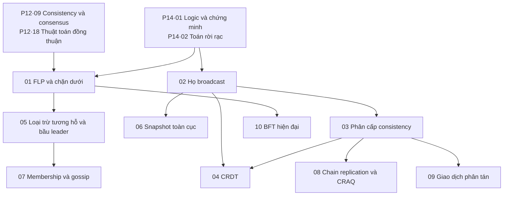

# P15 · Tổng quan — Thuật toán phân tán

> Trang này chỉ điều hướng: mục tiêu, bản đồ chương và thứ tự đọc. Mọi khẳng định kỹ thuật đều nằm trong từng chương, kèm chú thích. Lời khuyên về thứ tự đọc ở đây là của người soạn.

## Mục tiêu của phase

P12 dạy hệ dữ liệu phân tán từ phía người dùng và người vận hành: replication, partitioning, transaction, consistency, consensus. Ở đó nhiều kết quả chỉ được phát biểu, chưa chứng minh: FLP, chặn n > 3f, các mức consistency mạnh yếu. Cũng có những họ thuật toán chỉ được nhắc tên: broadcast, CRDT, gossip, chain replication, giao dịch kiểu Percolator, Calvin hay Spanner, BFT hiện đại.

Phase này đi sâu vào chính các thuật toán đó. Với mỗi thuật toán, chương phát biểu bài toán bằng tính chất, chạy từng bước trên một ví dụ backend cụ thể, rồi chứng minh vì sao thuật toán đúng hoặc vì sao không thể làm tốt hơn. Phần lớn các chương có một chương trình Rust nhỏ để kiểm vét cạn hoặc mô phỏng; output dán nguyên văn và ghi rõ là quan sát.

## Các chương

| Chương | Trả lời câu hỏi |
|---|---|
| [01. FLP và các chặn dưới](01-flp-va-cac-chan-duoi.md) | Chứng minh FLP đầy đủ (bivalence, ba bổ đề), các lối thoát (đồng bộ một phần, failure detector, ngẫu nhiên), chặn f+1 vòng, chứng minh n > 3f cho Byzantine |
| [02. Họ broadcast](02-ho-broadcast.md) | Best-effort, reliable, uniform, FIFO, causal, total order: định nghĩa bằng tính chất, thuật toán, chứng minh, và lịch chạy tách từng cặp |
| [03. Phân cấp consistency](03-phan-cap-consistency.md) | Strict serializable, linearizable, sequential, causal và causal+, PRAM, bốn session guarantee, eventual; lịch sử phân biệt từng cặp; CAP và PACELC; mô hình nào sống được khi partition |
| [04. CRDT](04-crdt.md) | Strong eventual consistency, state-based và op-based, chứng minh hội tụ, counter/register/OR-Set, delta-state, CRDT ngoài đời |
| [05. Loại trừ tương hỗ và bầu leader](05-loai-tru-tuong-ho-va-bau-leader.md) | Lamport, Ricart–Agrawala, Maekawa, token ring; bully và Chang–Roberts; vì sao hệ thật dùng lease cộng fencing |
| [06. Snapshot toàn cục](06-snapshot-toan-cuc.md) | Consistent cut, Chandy–Lamport và chứng minh reachability, kênh không FIFO, phát hiện thuộc tính ổn định, checkpoint của Flink |
| [07. Membership và gossip](07-membership-va-gossip.md) | Failure detector, anti-entropy và rumor mongering, lan trong O(log n) vòng, SWIM, Lifeguard, memberlist/Serf/Consul/Cassandra |
| [08. Chain replication và CRAQ](08-chain-replication-va-craq.md) | Head/tail, hai bất biến khi sửa chain, master bên ngoài, so với primary-backup và quorum, đọc ở mọi node của CRAQ |
| [09. Giao dịch phân tán ngoài 2PC](09-giao-dich-phan-tan.md) | 3PC và vì sao hỏng khi partition, Paxos Commit, Percolator, Calvin, Spanner/TrueTime |
| [10. BFT hiện đại](10-bft-hien-dai.md) | PBFT kể cả checkpoint và view change, chứng minh request đã commit sống qua view change; Tendermint; HotStuff và responsiveness |

## Thứ tự đọc

Gợi ý của người soạn:

- Đọc [P12·09](../12-he-thong-du-lieu/09-consistency-va-consensus.md) và [P12·18](../12-he-thong-du-lieu/18-thuat-toan-dong-thuan.md) trước; các chương ở đây link về đó thay vì giảng lại.
- Chưa quen đọc chứng minh thì đọc [P14·01](../14-toan-va-ly-thuyet/01-logic-va-chung-minh.md) và [P14·02](../14-toan-va-ly-thuyet/02-toan-roi-rac.md) trước.
- Đường ngắn cho người làm hệ multi-region: 02 → 03 → 04 → 09.
- Đường ngắn cho người vận hành cluster: 01 → 05 → 07 → 08.
- Chương 10 dành cho ai cần môi trường có node gian lận, ví dụ blockchain hay hệ nhiều tổ chức không tin nhau.
