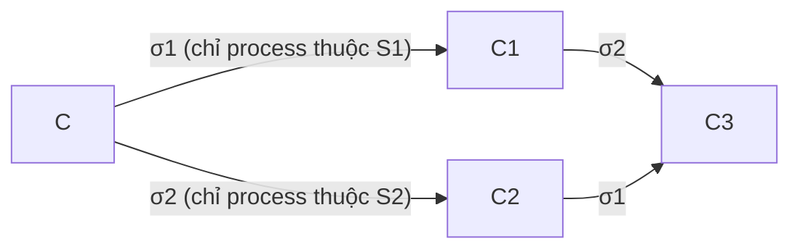
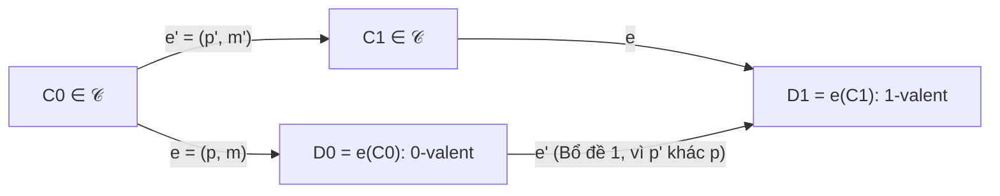
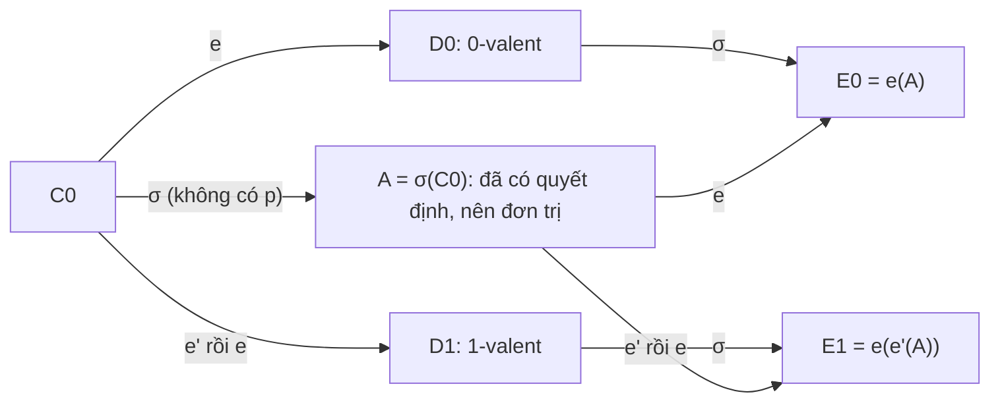
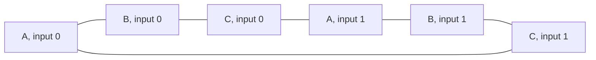

# P15 · Chương 01 — FLP và các chặn dưới

[Chương 09 của P12](../12-he-thong-du-lieu/09-consistency-va-consensus.md) mới phát biểu định lý FLP trong vài đoạn, còn [chương 18](../12-he-thong-du-lieu/18-thuat-toan-dong-thuan.md) mới cho thấy vì sao cần 2f+1 hay 3f+1 node. Chương này làm phần còn thiếu: chứng minh. Đọc xong, mỗi khi gặp câu "consensus không thể làm X", bạn biết lập luận nào chặn X, nó dựa vào giả định nào, và vì sao giả định đó không đứng vững trong hệ thống bạn đang vận hành (nhận xét của người soạn).

Cả chương bám theo `kvmeta`, cụm 5 node `N1`…`N5` giữ feature flag và khóa leader đã giới thiệu ở [P12 · Chương 18, mục 1](../12-he-thong-du-lieu/18-thuat-toan-dong-thuan.md). Mỗi ô (slot) của log `kvmeta` phải chốt đúng một lệnh: khi hai service cùng giành `lock/billing-cron`, năm node phải thống nhất lệnh nào thắng. Mọi câu hỏi dưới đây là câu hỏi về cái ô đó: nó có luôn chốt được không, mất mấy vòng trao đổi, cần bao nhiêu node (nhận xét của người soạn: `kvmeta` là ví dụ giả định, không phải code trong repo).

## Bạn sẽ hiểu được gì

1. **Q1.** Hệ phân tán có những mô hình nào (đồng bộ, bất đồng bộ, đồng bộ một phần; node dừng, node Byzantine), consensus được phát biểu chặt chẽ ra sao, và mỗi kết quả của chương này nằm ở mô hình nào? → mục 1
2. **Q2.** Định lý FLP phát biểu chính xác điều gì, "cấu hình lưỡng trị" (bivalent) là gì, và hai bổ đề đầu của chứng minh (hai lịch trình rời nhau giao hoán được; luôn có cấu hình ban đầu lưỡng trị) đúng vì sao? → mục 2
3. **Q3.** Bổ đề thứ ba (trì hoãn một sự kiện mà vẫn còn lưỡng trị) được chứng minh thế nào, và ba bổ đề ghép lại thành một lần chạy không bao giờ quyết định ra sao? FLP cấm gì và không cấm gì? → mục 3
4. **Q4.** Hệ thật thoát khỏi FLP bằng cách nào (đồng bộ một phần, failure detector ◇S, ngẫu nhiên), và mỗi lối thoát đổi lấy cái gì? → mục 4
5. **Q5.** Vì sao consensus đồng bộ chịu f node crash thì cần ít nhất f+1 vòng, và f+1 vòng có đủ không? → mục 5
6. **Q6.** Vì sao chịu f node Byzantine cần n > 3f (chứng minh cho 3 tướng, rồi quy về n bất kỳ), và chữ ký số nới lỏng được gì? → mục 6
7. **Q7.** Những kết quả trên dịch ra điều gì cho người vận hành etcd/Raft: cái gì không thể hứa, cái gì chỉnh được, cái gì nằm ngoài mô hình? → mục 7

## Kiến thức cần trước

- [P12 · Chương 09 — Consistency và consensus](../12-he-thong-du-lieu/09-consistency-va-consensus.md), mục 6: Paxos và phát biểu của FLP. Chương này chứng minh điều mục 6 chỉ nêu.
- [P12 · Chương 08 — Sự cố của hệ phân tán](../12-he-thong-du-lieu/08-su-co-he-phan-tan.md), mục 4: mô hình hệ thống và failure detector. Mục 1 của chương này chỉ tóm tắt lại để đặt các kết quả lên bản đồ.
- [P12 · Chương 18 — Thuật toán đồng thuận](../12-he-thong-du-lieu/18-thuat-toan-dong-thuan.md), mục 1: `kvmeta`, bốn tính chất của consensus, và lập luận quorum cho 2f+1 và 3f+1. Chương này không lặp lại lập luận quorum mà chứng minh các chặn dưới độc lập với thuật toán.
- Không bắt buộc: [P14 · Chương 01 — Logic và chứng minh](../14-toan-va-ly-thuyet/01-logic-va-chung-minh.md). Cả chương dùng liên tục chứng minh phản chứng và quy nạp; nếu chưa quen, đọc chương đó trước.

Chương này có bốn chứng minh dài (mục 2, 3, 5, 6). Mỗi mục đều có phần **Trả lời ngắn** cho ai chỉ cần kết luận, và các chương sau trong phase này ([broadcast](02-ho-broadcast.md), [phân cấp consistency](03-phan-cap-consistency.md), [BFT hiện đại](10-bft-hien-dai.md)) chỉ cần kết luận đó.

---

## 1. Mô hình hệ thống và bài toán consensus (Q1)

> **Trả lời ngắn.** Mô hình hệ thống là bộ giả định về thời gian, về node và về mạng, và mỗi định lý trong chương này chỉ đúng trong một mô hình cụ thể. Về thời gian có ba lựa chọn: đồng bộ (cận trên của độ trễ tin và tốc độ node đã biết), bất đồng bộ (không bảo đảm thời gian nào) và đồng bộ một phần (bất đồng bộ trong những khoảng hữu hạn không báo trước, ngoài ra là đồng bộ)[^kl-timing]. Về node có ba kiểu hỏng: dừng hẳn, dừng rồi chạy lại với dữ liệu trên đĩa, hoặc Byzantine, tức làm bất cứ điều gì[^kl-node]. Trên nền đó consensus đòi agreement, validity và termination[^asp-def].

**Giải thích.**

*Với `kvmeta`.* Leader `N1` gửi một bản ghi cho `N2`…`N5` rồi chờ phản hồi, và `N4` im lặng đã 500 ms. `N4` đã sập, đang dừng vì GC, hay đường mạng tới nó đang nghẽn? Từ chỗ `N1` đứng, ba khả năng đó trông hệt nhau, nên câu hỏi "chờ bao lâu thì coi là chết" chỉ có nghĩa khi ta nói rõ mình giả định gì (nhận xét của người soạn; [chương 08 của P12](../12-he-thong-du-lieu/08-su-co-he-phan-tan.md) đã liệt kê các nguyên nhân khiến một RPC không hồi đáp). Mô hình hệ thống là bản ghi rõ những giả định ấy, và mọi kết quả bất khả của chương có dạng "trong mô hình M, không thuật toán nào làm được X".

### 1.1 Ba trục của mô hình

| Trục | Lựa chọn | Giả định | `kvmeta` trông thế nào (minh họa của người soạn) |
|---|---|---|---|
| Thời gian | Đồng bộ | Độ trễ tin có cận trên đã biết, node chạy với tốc độ đã biết[^kl-sync] | "Mọi RPC giữa các node xong trong 10 ms, lúc nào cũng vậy." Một lần `fsync` treo hay một đợt GC là đủ phá giả định này. |
| | Bất đồng bộ | Tin có thể trễ tùy ý, node có thể tạm dừng tùy ý, không bảo đảm thời gian nào[^kl-async] | Không giả định gì, kể cả "một RPC có thể chưa về sau một giờ". |
| | Đồng bộ một phần | Có những khoảng hữu hạn nhưng không biết trước mà hệ bất đồng bộ, ngoài ra là đồng bộ[^kl-partial] | "Thường 10 ms, thỉnh thoảng hỗn loạn, rồi lại êm." Đây là mô hình gần datacenter thật nhất. |
| Node | Dừng hẳn (crash-stop) | Node hỏng thì dừng thực thi mãi mãi[^kl-crash-stop] | `N4` sập và không ai chạy lại nó. |
| | Byzantine | Node hỏng đi chệch thuật toán và có thể làm bất cứ điều gì, kể cả ác ý[^kl-byz] | `N3` báo `N1` một đằng, báo `N2` một nẻo. |

Mô hình crash-recovery (node sập rồi chạy lại với dữ liệu trên đĩa) là mô hình sát database thật nhất, và [chương 08, mục 4](../12-he-thong-du-lieu/08-su-co-he-phan-tan.md) đã mô tả nó. Các chứng minh bất khả trong chương này lại dùng crash-stop, vì đó là kiểu hỏng *dễ* nhất cho thuật toán: kẻ phá đám luôn được quyền chọn "node này không bao giờ chạy lại", nên điều gì bất khả với node chỉ biết dừng hẳn thì vẫn bất khả khi node còn có thể chạy lại (suy luận của người soạn).

Trục thứ ba là mạng. FLP giả định mạng không làm mất hay làm hỏng tin: tin chỉ có thể trễ lâu tùy ý và đến sai thứ tự, còn tin gửi tới process đúng thì cuối cùng sẽ được giao[^flp-reliable]. Giả định này làm kết quả bất khả *mạnh hơn*, vì nó vẫn đứng khi mạng đã dễ nhất có thể (nhận xét của người soạn).

### 1.2 Consensus phát biểu chặt chẽ

[Chương 18, mục 1](../12-he-thong-du-lieu/18-thuat-toan-dong-thuan.md) đã liệt kê bốn tính chất của consensus. Ở đây ta cần thêm một ý: cùng một bài toán có dạng yếu và dạng mạnh, và việc chọn dạng nào phụ thuộc vào ta muốn chứng minh gì. Muốn một thuật toán hữu ích thì đòi điều kiện mạnh; muốn một chặn dưới tổng quát thì đòi điều kiện yếu, vì chặn dưới đã đúng cho yêu cầu yếu thì đúng luôn cho mọi yêu cầu mạnh hơn[^asp-variants].

| Dạng | Nội dung | Dùng ở |
|---|---|---|
| FLP (yếu nhất) | Process đúng nào quyết định thì quyết định cùng một giá trị. Chỉ cần *một* process nào đó cuối cùng quyết định[^flp-weak2]. Cả 0 lẫn 1 đều phải có thể là kết cục, để loại nghiệm tầm thường "luôn chọn 0"[^flp-nontrivial]. | mục 2–3 |
| Validity (mạnh) | Nếu mọi process bắt đầu với cùng một input thì mọi process đúng quyết định input đó[^asp-def]. Với input nhị phân, điều này tương đương "giá trị quyết định phải là input của ai đó" mà chương 18 dùng (suy luận của người soạn) | mục 4, 5, 6 |
| Non-triviality | Tồn tại hai lần chạy không lỗi cho kết quả khác nhau. Validity kéo theo non-triviality nhưng không ngược lại[^asp-nontriv] | chặn dưới ở mục 5 |
| IC1, IC2 | Một "tướng chỉ huy" gửi lệnh; mọi trung úy trung thành theo cùng một lệnh, và nếu chỉ huy trung thành thì theo đúng lệnh của chỉ huy[^lsp-ic] | mục 6 |

FLP chọn dạng yếu nhất nên định lý của nó bao trùm mọi dạng còn lại[^flp-weak1].

### 1.3 Bản đồ kết quả của chương

| Kết quả | Thời gian | Lỗi | Điều rút ra | Mục |
|---|---|---|---|---|
| FLP | bất đồng bộ | một node dừng | giao thức nào cũng có khả năng không kết thúc[^flp-abs] | 2–3 |
| Đồng bộ một phần | đồng bộ một phần | node dừng | khả thi khi N ≥ 2t+1, và chỉ khi đó[^dls-iff] | 4 |
| Chặn dưới số vòng | đồng bộ | tối đa f node dừng | cần ít nhất f+1 vòng (khi có ≥ f+2 node)[^asp-lb] | 5 |
| Chặn dưới số node | đồng bộ, tin không ký | f node Byzantine | ba tướng không chịu nổi một kẻ phản bội, và tổng quát cần n > 3f (suy ra bằng mô phỏng nhóm)[^lsp-albanian] | 6 |

<details><summary>Đi sâu: hai chữ "synchronous", hai kiểu đồng bộ một phần, mô hình vòng, và "lỗi" trong FLP</summary>

- *"Synchronous" ở đây không phải synchronous của RPC.* Các bài giảng nhắc rằng ngành khác dùng hai chữ này với nghĩa khác (người gọi có chờ kết quả hay không)[^kl-terms]. Trong chương này "đồng bộ" luôn là giả định về cận thời gian.
- *Hai kiểu đồng bộ một phần của bài báo gốc.* Kiểu một: cận trên của độ trễ tồn tại nhưng thuật toán không biết giá trị của nó. Kiểu hai: cận biết trước nhưng chỉ đúng từ một thời điểm chưa biết (GST, global stabilization time) trở đi. Điều kiện "cận trên đúng từ GST trở đi" là định nghĩa thứ hai của tính đồng bộ một phần về mặt liên lạc[^dls-gst-def]. Mục 4 dùng kiểu hai.
- *Mô hình vòng.* Ở mục 5 và 6 ta dùng mô hình đồng bộ dạng vòng: mọi process gửi tin, nhận tin, tính toán, rồi sang vòng sau. Crash trong mô hình này có nghĩa là ở một vòng r nào đó một số hoặc toàn bộ tin của process bị mất, và từ các vòng sau tin của nó không còn được giao[^asp-crash-def]. Nghĩa là process crash giữa chừng có thể đã kịp gửi cho vài node mà chưa kịp gửi cho node khác, và đó chính là chỗ các chứng minh bám vào.
- *"Lỗi" theo nghĩa FLP.* Process chỉ bị coi là lỗi nếu nó thực hiện hữu hạn bước[^flp-nonfaulty]. Process "rất chậm" *không* phải process lỗi: nó là process đúng nhưng chậm tùy ý, và không ai phân biệt được hai trường hợp đó[^flp-nodetect]. Toàn bộ độ khó của FLP nằm ở chỗ này.

</details>

**Quay lại Q1:** mô hình = (thời gian, kiểu lỗi node, độ tin cậy mạng); consensus có dạng yếu cho chặn dưới và dạng mạnh cho thuật toán; FLP ở góc bất đồng bộ + một node dừng, các kết quả còn lại ở góc đồng bộ hoặc đồng bộ một phần.

---

## 2. Định lý FLP: mô hình hình thức, valence và hai bổ đề đầu (Q2)

> **Trả lời ngắn.** FLP chứng minh rằng trong hệ bất đồng bộ, mọi giao thức consensus đều có khả năng không bao giờ kết thúc, dù chỉ một process có thể hỏng[^flp-abs]. Điều đó đúng ngay cả khi mạng không làm mất tin[^flp-reliable]. Chứng minh có hai bước: tìm một cấu hình ban đầu mà kết cục chưa bị định sẵn, rồi dựng một lần chạy hợp lệ không bao giờ thực hiện bước nào chốt kết cục[^flp-two-steps]. Mục này dựng mô hình và làm bước đầu; mục 3 làm bước còn lại.

**Giải thích.**

*Với `kvmeta`.* Hãy nhìn ô số 7 của `kvmeta` ngay sau khi hai service gửi hai lệnh `put` xung đột. `N1` đã nhận lệnh `on`, `N2` đã nhận lệnh `off`, và vài tin `accept` đang bay trên mạng tới `N3`, `N4`, `N5`. Nếu *mọi* cách giao các tin đó, xen kẽ với các bước của các node, đều kết thúc bằng `on` thì kết cục đã bị định sẵn dù chưa node nào hay biết. Nếu có cách giao dẫn tới `on` và cũng có cách dẫn tới `off`, kết cục còn treo trên *thứ tự giao tin*, và FLP gọi cấu hình đó là lưỡng trị (bivalent). Cả định lý xoay quanh việc chứng minh rằng trong hệ bất đồng bộ, kẻ điều khiển thứ tự giao tin luôn giữ được hệ ở trạng thái lưỡng trị mãi mãi (nhận xét của người soạn: ví dụ minh họa trực giác, không mô tả một giao thức cụ thể).

### 2.1 Mô hình của FLP

Bài báo chọn một mô hình rất tổng quát để kết quả bất khả áp dụng được rộng nhất có thể[^flp-strong-model]. Ta cần tám khái niệm, và mọi chứng minh sau đó chỉ dùng chúng.

1. **Process.** Có N ≥ 2 process[^flp-n2]. Mỗi process p là một automaton tất định: nó hành động theo một hàm chuyển trạng thái cố định[^flp-determ], và số trạng thái có thể vô hạn. Mỗi process có thanh ghi input x_p ∈ {0, 1} và thanh ghi output y_p ∈ {b, 0, 1}, trong đó b nghĩa là chưa quyết định. Output chỉ ghi được một lần: một khi process đã vào trạng thái quyết định (y_p là 0 hoặc 1), hàm chuyển không đổi được nó nữa[^flp-write-once].
2. **Bộ đệm tin.** Tin là cặp (p, m) gồm đích p và nội dung m. Bộ đệm là một multiset các tin đã gửi nhưng chưa giao. Thao tác `receive(p)` hoặc trả về một tin có đích p trong bộ đệm, hoặc trả về giá trị rỗng ∅ và để bộ đệm nguyên vẹn. Ràng buộc duy nhất lên bộ đệm: nếu `receive(p)` được gọi vô hạn lần thì mọi tin gửi tới p cuối cùng sẽ được giao[^flp-msgsys]. Nói cách khác tin trễ lâu tùy ý (kể cả bị trả ∅ hữu hạn lần dù tin đang nằm đó) và đến sai thứ tự, nhưng không mất.
3. **Cấu hình** (configuration) gồm trạng thái nội bộ của mọi process cùng nội dung bộ đệm[^flp-config]. Cấu hình ban đầu: mọi process ở trạng thái đầu (output là b) và bộ đệm rỗng.
4. **Sự kiện và bước.** Một bước của process p có hai pha: gọi `receive(p)` để lấy m (có thể là ∅), rồi dựa vào trạng thái hiện tại và m, p chuyển trạng thái và gửi một tập hữu hạn tin. Vì process tất định nên bước được xác định hoàn toàn bởi cặp e = (p, m), gọi là *sự kiện*, đọc là "p nhận m"[^flp-event]. Ký hiệu e(C) là cấu hình thu được khi áp e lên C. Sự kiện (p, ∅) luôn áp được, nên process luôn có thể bước tiếp.
5. **Lịch trình và lần chạy.** Lịch trình (schedule) là dãy sự kiện, hữu hạn hay vô hạn, áp lần lượt từ một cấu hình. Dãy các bước tương ứng gọi là một lần chạy (run)[^flp-run]. Nếu lịch trình σ hữu hạn thì σ(C) là cấu hình kết quả, và ta nói nó *tới được* từ C. Cấu hình tới được từ một cấu hình ban đầu gọi là *khả đạt* (accessible)[^flp-accessible]; từ đây mọi cấu hình nói tới đều khả đạt.
6. **Lỗi và lần chạy hợp lệ.** Process *đúng* trong một lần chạy nếu nó thực hiện vô hạn bước, còn lại là process *lỗi*[^flp-nonfaulty]. Process lỗi chỉ đơn giản là ngừng bước từ lúc nào đó, tức crash-stop (suy luận của người soạn từ định nghĩa). Lần chạy là *hợp lệ* (admissible) nếu có tối đa một process lỗi và mọi tin gửi tới process đúng cuối cùng đều được nhận[^flp-admissible]. Lần chạy là *có quyết định* (deciding) nếu trong đó có process vào trạng thái quyết định[^flp-deciding].
7. **Đúng một phần.** Cấu hình có giá trị quyết định v nếu có process ở trạng thái quyết định với output v. Giao thức là *đúng một phần* (partially correct) nếu thỏa hai điều kiện. Điều kiện (1): không cấu hình khả đạt nào có hơn một giá trị quyết định[^flp-partial1]. Điều kiện (2): với mỗi v ∈ {0, 1}, có một cấu hình khả đạt có giá trị quyết định v, nhằm loại nghiệm tầm thường "luôn chọn 0"[^flp-nontrivial]. Điều kiện (1) là phần an toàn của consensus.
8. **Đúng toàn phần dù có một lỗi.** Giao thức *đúng toàn phần dù có một lỗi* (totally correct in spite of one fault) nếu nó đúng một phần và mọi lần chạy hợp lệ đều có quyết định[^flp-total]. Đây là phần sống.

Bây giờ định lý có thể phát biểu gọn: **mọi giao thức đúng một phần đều có một lần chạy hợp lệ không có quyết định**[^flp-main]. Tương đương: không giao thức consensus nào đúng toàn phần dù có một lỗi. Lưu ý yêu cầu "kết thúc" ở đây yếu: chỉ cần *một* process quyết định[^flp-weak2], nên định lý mạnh hơn bất kỳ dạng đòi "mọi process đúng đều quyết định".

### 2.2 Valence

Ý tưởng chính của chứng minh là gắn mỗi cấu hình với tập các kết cục còn khả dĩ. Gọi V(C) là tập giá trị quyết định của các cấu hình tới được từ C[^flp-valence]. Cấu hình C là *lưỡng trị* (bivalent) nếu |V(C)| = 2, tức từ C vẫn tới được cả cấu hình có process quyết định 0 lẫn cấu hình có process quyết định 1. C là *đơn trị* (univalent) nếu |V(C)| = 1: *0-valent* nếu V(C) = {0}, *1-valent* nếu V(C) = {1}. Với `kvmeta`, ô số 7 ở trên là lưỡng trị khi cả `on` lẫn `off` còn khả dĩ, và là `on`-valent khi mọi tương lai đều chốt `on`.

Valence là tính chất của *cấu hình*, không phải của một lần chạy: nó nói về toàn bộ tương lai có thể xảy ra từ cấu hình đó. Ba sự thật sau được dùng liên tục. Bài gốc dùng ngầm cả ba, còn phần phát biểu và chứng minh dưới đây là của người soạn.

- **(S1) Tính đơn điệu.** Nếu D tới được từ C thì V(D) ⊆ V(C), vì mọi thứ tới được từ D cũng tới được từ C. Hệ quả: mọi hậu duệ của một cấu hình 0-valent đều là 0-valent, vì tập V của nó là con không rỗng của {0}.
- **(S2) Có người quyết định thì đơn trị.** Nếu trong C đã có process quyết định v thì C là v-valent. Vì output ghi một lần, mọi cấu hình tới được từ C vẫn có process đó với output v. Nếu tới được cấu hình có giá trị quyết định w ≠ v thì cấu hình đó có hai giá trị quyết định, trái điều kiện (1). Hệ quả: một cấu hình lưỡng trị chưa có process nào quyết định.
- **(S3) V(C) không rỗng** với giao thức đúng toàn phần. Từ C luôn kéo dài được thành một lần chạy hợp lệ (cho mọi process bước đều đặn và giao mọi tin), và lần chạy đó phải có quyết định.

Một quan sát của bài báo cho thấy vì sao khái niệm này đáng giá: lần chạy có quyết định nào xuất phát từ một cấu hình lưỡng trị cũng phải đi tới một cấu hình đơn trị, nên phải có một bước đơn lẻ chuyển từ lưỡng trị sang đơn trị, và bước đó định đoạt giá trị quyết định[^flp-critical]. Việc còn lại là chứng minh rằng kẻ lập lịch luôn né được bước đó.

### 2.3 Bổ đề 1: hai lịch trình rời nhau giao hoán

**Bổ đề 1.** Giả sử từ cấu hình C, lịch trình σ1 dẫn tới C1 và lịch trình σ2 dẫn tới C2. Nếu tập process có bước trong σ1 rời với tập process có bước trong σ2 thì σ2 áp được lên C1, σ1 áp được lên C2, và cả hai cùng dẫn tới một cấu hình C3.



(Hình của người soạn: hình vuông giao hoán của Bổ đề 1, với S1 và S2 là hai tập process rời nhau.)

*Chứng minh.* Bài gốc chỉ viết rằng kết quả suy ra ngay từ định nghĩa hệ thống, vì hai lịch trình không tương tác với nhau[^flp-lemma1-proof]. Vì mọi chỗ sau đây đều dựa vào bổ đề này, ta viết ra lý do (phần triển khai là của người soạn):

1. Một sự kiện (q, m) *đọc* trạng thái của q và tin m trong bộ đệm; nó *ghi* trạng thái mới của q, *lấy* m ra khỏi bộ đệm và *thêm* các tin q gửi đi. Đích của tin bị lấy ra luôn là q.
2. Mọi sự kiện của σ1 chỉ động tới trạng thái của process thuộc S1 và chỉ lấy tin có đích thuộc S1. Mọi sự kiện của σ2 chỉ động tới trạng thái của process thuộc S2 và chỉ lấy tin có đích thuộc S2. Vì S1 và S2 rời nhau nên hai bên không đọc, không ghi chung trạng thái nào, và không lấy chung tin nào.
3. Tin mà σ1 thêm vào bộ đệm có thể có đích thuộc S2. Điều đó không cản σ2: mỗi sự kiện (q, m) của σ2 chỉ định đích danh tin m nó cần, và tin đó vẫn nằm trong bộ đệm; tin thêm vào chỉ làm bộ đệm lớn hơn.
4. Vậy từ C1 áp σ2 được, từ C2 áp σ1 được. Trạng thái cuối của mỗi process là kết quả của dãy sự kiện của chính nó, không phụ thuộc xen kẽ. Bộ đệm cuối là bộ đệm đầu, trừ các tin bị lấy ra bởi σ1 và σ2, cộng các tin được thêm bởi σ1 và σ2, với mọi phép cộng trừ là trên multiset nên không phụ thuộc thứ tự. Hai cách áp dụng cho cùng một cấu hình C3. ∎

### 2.4 Bổ đề 2: luôn có cấu hình ban đầu lưỡng trị

**Bổ đề 2.** Mọi giao thức đúng toàn phần dù có một lỗi có ít nhất một cấu hình ban đầu lưỡng trị.

*Chứng minh.* Bài gốc đi bằng phản chứng; các bước dưới đây bám theo bài gốc, phần giải thích từng bước là của người soạn.

1. **Giả sử ngược lại**: mọi cấu hình ban đầu đều đơn trị. Điều kiện (2) của tính đúng một phần cho biết giá trị 0 là giá trị quyết định của một cấu hình khả đạt G0 nào đó. G0 tới được từ một cấu hình ban đầu I0, nên 0 ∈ V(I0). Tương tự có cấu hình ban đầu I1 với 1 ∈ V(I1). Hai cấu hình này đơn trị nên I0 là 0-valent và I1 là 1-valent.
2. **Chuỗi các cấu hình kề nhau.** Hai cấu hình ban đầu gọi là *kề nhau* nếu chúng chỉ khác input x_p của đúng một process p. Hai cấu hình ban đầu bất kỳ nối với nhau được bằng một chuỗi cấu hình ban đầu, mỗi cặp liên tiếp kề nhau[^flp-chain]: đổi lần lượt input của từng process từ giá trị trong cấu hình này sang giá trị trong cấu hình kia, tối đa N lần đổi. Dọc chuỗi nối I0 (0-valent) với I1 (1-valent), valence phải đổi ít nhất một lần. Vậy tồn tại hai cấu hình kề nhau C0 (0-valent) và C1 (1-valent), khác nhau ở input của process p.
3. **Cho p chết ngay từ đầu.** Giao thức đúng toàn phần dù có một lỗi, nên lần chạy hợp lệ từ C0 trong đó p là process lỗi duy nhất và không thực hiện bước nào phải có quyết định. Gọi σ là lịch trình hữu hạn của lần chạy đó, cắt ngay lúc có process quyết định. σ không chứa sự kiện nào của p.
4. **σ cũng áp được lên C1.** Ta chứng minh bằng quy nạp theo độ dài σ: sau mỗi tiền tố của σ, hai lần chạy (từ C0 và từ C1) có cùng bộ đệm, và mọi process khác p ở cùng trạng thái. Lúc đầu điều này đúng vì C0 và C1 chỉ khác input của p và cả hai có bộ đệm rỗng. Bước quy nạp: sự kiện kế tiếp (q, m) có q ≠ p; q ở cùng trạng thái trong hai lần chạy và m có trong cả hai bộ đệm nên sự kiện áp được ở cả hai, cho cùng trạng thái mới của q và cùng tập tin gửi đi.
5. **Cùng một quyết định.** Process q đã quyết định ở cuối σ(C0) khác p, vì p chưa bước nên output của nó vẫn là b. Process q ở cùng trạng thái trong σ(C1), nên cũng đã quyết định cùng giá trị. Vì C0 là 0-valent nên giá trị đó là 0, tức 0 ∈ V(C1).
6. **Mâu thuẫn.** C1 là 1-valent, tức V(C1) = {1}, trái với 0 ∈ V(C1). Vậy giả sử ở bước 1 sai. ∎

*Ý nghĩa của chứng minh.* Process p mà input của nó "quyết định" kết cục có thể là bất kỳ process nào. Vì giao thức phải chịu được việc p chết từ đầu, những process còn lại phải quyết định *mà không biết* input của p. Nhưng nếu input của p thật sự ảnh hưởng tới kết cục thì họ sẽ quyết định sai ở một trong hai cấu hình (nhận xét của người soạn). Chiều ngược lại cũng hữu ích: một giao thức "đợi nghe từ mọi process rồi quyết định" an toàn nhưng không đúng toàn phần, vì nó vi phạm bước 3 (khi p im lặng thì không ai quyết định).

Với `kvmeta`, cấu hình ban đầu của ô số 7 là năm bit cho biết mỗi node đang ủng hộ `on` (1) hay `off` (0). Chuỗi của bước 2 là sáu cấu hình 00000, 10000, 11000, 11100, 11110, 11111, mỗi cặp liên tiếp khác nhau ở input của đúng một node (minh họa của người soạn). Nếu 00000 chỉ có thể kết thúc bằng `off` và 11111 chỉ bằng `on`, dọc chuỗi phải có chỗ đổi từ "chỉ `off`" sang "chỉ `on`", và chỗ đổi đó là hai cấu hình kề nhau mà một node duy nhất ngăn cách.

<details><summary>Đi sâu: vì sao đủ một lỗi, vì sao N ≥ 2, và dùng validity thay cho điều kiện (2)</summary>

- *Một lỗi là đủ.* Chứng minh chỉ cần một process "có thể chết": ở bước 3 của Bổ đề 2 và ở Trường hợp 2 của Bổ đề 3 (mục 3), ta chỉ cần *một* process không bước. Chịu thêm lỗi chỉ làm bài toán khó hơn nên bất khả vẫn đúng (suy luận của người soạn).
- *N ≥ 2.* Mô hình đòi tối thiểu hai process[^flp-n2]. Với một process duy nhất bài toán tầm thường: nó quyết định input của chính nó (suy luận của người soạn).
- *Giao thức có validity.* Bài gốc chỉ cần điều kiện (2) (cả hai giá trị đều có thể là kết cục). Nếu giao thức thỏa validity mạnh của mục 1 thì Bổ đề 2 còn dễ hơn: cấu hình toàn 0 buộc phải 0-valent và cấu hình toàn 1 buộc phải 1-valent, nên bước 1 miễn phí (suy luận của người soạn).
- *Hai nhánh của thế tiến thoái lưỡng nan.* Bổ đề 2 cho thấy với mọi giao thức có hai lựa chọn ở một cấu hình ban đầu nhạy với input của p: hoặc *đợi* p (và treo nếu p chết), hoặc *quyết định không cần* p (và khi đó input của p không được ảnh hưởng kết cục, nên giao thức không thể đúng cho mọi input). Đó là dạng tối giản của "an toàn hay sống, chọn một" khi mạng bất đồng bộ (nhận xét của người soạn).

</details>

**Quay lại Q2:** FLP phát biểu: mọi giao thức đúng một phần đều có lần chạy hợp lệ không quyết định; cấu hình lưỡng trị là cấu hình mà cả hai kết cục còn khả dĩ; Bổ đề 1 cho phép đổi thứ tự các bước của hai tập process rời nhau, và Bổ đề 2 dùng việc một process có thể chết từ đầu để chứng minh luôn có một cấu hình ban đầu lưỡng trị.

---

## 3. Bổ đề 3 và định lý: một lần chạy không bao giờ quyết định (Q3)

> **Trả lời ngắn.** Bổ đề 3 nói rằng từ cấu hình lưỡng trị C, nếu e = (p, m) là một sự kiện đang chờ xử lý thì có thể cho một số sự kiện *khác* chạy trước rồi mới áp e, mà cấu hình thu được vẫn lưỡng trị[^flp-lemma3]. Ghép bổ đề đó lặp đi lặp lại, mỗi lần ưu tiên process đến lượt và tin cũ nhất của nó, ta được một lần chạy vô hạn trong đó mọi process bước mãi và mọi tin được giao, nhưng không cấu hình nào có process đã quyết định[^flp-end]. FLP không nói lần chạy xấu đó xảy ra thường hay hiếm, và không nói an toàn bị phá.

**Giải thích.**

*Với `kvmeta`.* Chốt ô số 7 đòi một bước cụ thể, chẳng hạn `N3` nhận `accept` của `N1` thay vì của `N2`. Bước đó đẩy cấu hình từ lưỡng trị sang đơn trị. Bổ đề 3 nói rằng mạng luôn có cách *hoãn* bước đó: cho `N4`, `N5` xử lý vài tin khác trước, rồi mới giao tin cho `N3`, sao cho sau khi `N3` bước thì kết cục vẫn bỏ ngỏ. Hoãn mãi như thế thì mọi tin vẫn được giao, mọi node vẫn chạy; chỉ là chưa bao giờ có lúc kết cục được chốt (nhận xét của người soạn: minh họa trực giác).

### 3.1 Phát biểu Bổ đề 3

Cho C là cấu hình lưỡng trị và e = (p, m) là sự kiện áp được lên C[^flp-lemma3]. Gọi 𝒞 là tập các cấu hình tới được từ C *mà không áp e*, và 𝒟 = e(𝒞) = {e(E) : E ∈ 𝒞}. **Bổ đề 3:** 𝒟 chứa ít nhất một cấu hình lưỡng trị.


(Hình của người soạn.) Đọc bổ đề này như sau: 𝒟 là mọi cấu hình có thể thu được bằng cách cho hệ chạy tùy ý nhưng *chưa* áp e, rồi mới áp e. Bổ đề nói trong 𝒟 luôn có một cấu hình chưa chốt kết cục, tức luôn có cách trì hoãn e mà vẫn chưa quyết định.

### 3.2 Chứng minh Bổ đề 3

Các bước bám theo bài gốc; lời giải thích chi tiết từng bước là của người soạn.

**Bước 0: e áp được lên mọi cấu hình của 𝒞.** Nếu m = ∅ thì e luôn áp được. Nếu không, tin m nằm trong bộ đệm của C, và chỉ sự kiện "p nhận đúng tin đó", tức chính e, mới lấy nó ra. Các lịch trình dẫn tới 𝒞 không chứa e nên m vẫn nằm đó. Vậy 𝒟 xác định tốt.

**Bước 1: giả sử phản chứng.** Giả sử mọi cấu hình của 𝒟 đều đơn trị.

**Bước 2: 𝒟 chứa cả cấu hình 0-valent lẫn 1-valent.** Với mỗi i ∈ {0, 1}: vì C lưỡng trị, từ C tới được một cấu hình E_i có process quyết định i, và theo (S2) E_i là i-valent. Có hai khả năng.

- (a) E_i ∈ 𝒞. Đặt F_i = e(E_i) ∈ 𝒟. F_i tới được từ E_i nên V(F_i) ⊆ V(E_i) = {i} theo (S1), mà F_i đơn trị (bước 1), nên F_i là i-valent.
- (b) E_i ∉ 𝒞. Khi đó lịch trình từ C tới E_i phải chứa e. Lấy tiền tố tới *lần xuất hiện đầu tiên* của e. Cấu hình ngay trước e thuộc 𝒞 (tiền tố đó chưa chứa e), nên cấu hình ngay sau e, gọi là F_i, thuộc 𝒟, và E_i tới được từ F_i. Theo (S1), V(E_i) ⊆ V(F_i), tức i ∈ V(F_i); F_i đơn trị nên là i-valent.

Vậy 𝒟 chứa F_0 là 0-valent và F_1 là 1-valent.

**Bước 3: hai cấu hình láng giềng.** Hai cấu hình gọi là *láng giềng* nếu cái này thu được từ cái kia bằng đúng một bước[^flp-neighbors]. Với mỗi E ∈ 𝒞, e(E) ∈ 𝒟 đơn trị (bước 1); đặt Φ(E) là giá trị i mà e(E) là i-valent. Theo bước 2, Φ nhận cả hai giá trị trên 𝒞 (vì F_i = e(G_i) với G_i nào đó thuộc 𝒞). Mọi cấu hình của 𝒞 đi được từ C bằng một dãy bước không chứa e, và mọi cấu hình trên dãy đó cũng thuộc 𝒞. Đi dọc dãy từ C tới một cấu hình G có Φ(G) ≠ Φ(C), giá trị Φ đổi ít nhất một lần, nên có hai láng giềng liên tiếp trong 𝒞 với Φ khác nhau. Đặt tên chúng là C0 và C1 sao cho D0 = e(C0) là 0-valent và D1 = e(C1) là 1-valent. Một trong hai là hậu duệ trực tiếp của cái kia; hai khả năng đối xứng nhau (đổi vai 0 và 1) nên ta xét C1 = e'(C0) với e' = (p', m') và không mất tính tổng quát.

**Bước 4: Trường hợp 1, p' ≠ p.** Hai sự kiện e và e' thuộc hai process khác nhau, nên tập process của chúng ({p} và {p'}) rời nhau. Cả hai áp được lên C0 (e' vì C1 = e'(C0)). Theo Bổ đề 1, e' áp được lên D0 = e(C0) và e'(e(C0)) = e(e'(C0)) = e(C1) = D1. Nghĩa là D1 tới được từ D0. Nhưng D0 là 0-valent nên theo (S1) mọi hậu duệ của nó, kể cả D1, là 0-valent, trong khi D1 là 1-valent. Mâu thuẫn.



(Hình của người soạn: Trường hợp 1.)

**Bước 5: Trường hợp 2, p' = p.** Đây là chỗ quan trọng nhất: e và e' cùng là bước của p nên không "chạy song song" được như Trường hợp 1. Ta dùng việc p có thể chết.

1. Giao thức đúng toàn phần dù có một lỗi, nên lần chạy hợp lệ từ C0 trong đó p là process lỗi duy nhất và không bước nào phải có quyết định. Gọi σ là lịch trình hữu hạn của lần chạy đó, cắt ngay lúc có process quyết định. σ không chứa sự kiện nào của p, và cấu hình A = σ(C0) đã có process quyết định; theo (S2) A là đơn trị.
2. Các sự kiện e và e' đều là của p, còn σ chỉ chứa sự kiện của process khác p, nên Bổ đề 1 áp dụng được. Với cặp (σ, e): σ áp được lên D0 = e(C0), và σ(D0) = e(σ(C0)) = e(A). Đặt E0 = e(A). Với cặp (σ, lịch trình gồm e' rồi e): σ áp được lên D1 = e(e'(C0)), và σ(D1) = e(e'(A)). Đặt E1 = e(e'(A)).
3. E0 tới được từ D0 là 0-valent, nên E0 là 0-valent theo (S1). E0 lại tới được từ A, nên 0 ∈ V(A). Tương tự E1 tới được từ D1 là 1-valent nên E1 là 1-valent, và E1 tới được từ A nên 1 ∈ V(A). Vậy A lưỡng trị.
4. Nhưng A đã có process quyết định nên đơn trị. Mâu thuẫn[^flp-case2-end].



(Hình của người soạn: Trường hợp 2. Từ A tới được cả E0 là 0-valent lẫn E1 là 1-valent, trong khi A đã có người quyết định.)

*Trực giác của Trường hợp 2.* Giả sử p bị đình trệ, những process còn lại chạy σ và quyết định mà không có p. Rồi p mới bước: nó có thể làm e hoặc làm e' rồi e. Hai cách đó dẫn tới hai kết cục khác nhau, trong khi những process đã quyết định không còn đổi được. Điều này vô lý, nên giả sử của bước 1 sai (nhận xét của người soạn).

**Kết luận.** Cả hai trường hợp đều mâu thuẫn nên giả sử ở bước 1 sai: 𝒟 chứa một cấu hình lưỡng trị. ∎

### 3.3 Định lý: dựng lần chạy không bao giờ quyết định

Giờ ghép ba bổ đề. Lần chạy được dựng theo từng *giai đoạn*. Ta giữ hai thứ: một hàng đợi các process (ban đầu thứ tự tùy ý, ví dụ `N1`, …, `N5`) và bộ đệm tin sắp theo thời điểm gửi, tin cũ nhất đứng đầu.

1. Bắt đầu từ C0 là cấu hình ban đầu lưỡng trị cho bởi Bổ đề 2.
2. Giai đoạn i bắt đầu từ cấu hình lưỡng trị C_i. Gọi p là process đứng đầu hàng đợi và m là tin cũ nhất trong bộ đệm có đích p (m = ∅ nếu không có). Đặt e_i = (p, m). Theo Bổ đề 3 có một cấu hình lưỡng trị C_{i+1} tới được từ C_i bằng một lịch trình mà e_i là sự kiện cuối[^flp-stage]. Lịch trình đó là giai đoạn i; nó có ít nhất một sự kiện (chính e_i). Cuối giai đoạn, đưa p xuống cuối hàng đợi.
3. Lặp vô hạn lần, ta được một lịch trình vô hạn.


(Hình của người soạn.)

*Lần chạy này hợp lệ.* Có hai điều cần kiểm tra.

- *Không process nào là process lỗi.* Cứ sau tối đa N giai đoạn, mỗi process lại đứng đầu hàng đợi một lần và thực hiện ít nhất một bước (sự kiện cuối của giai đoạn đó). Vậy mọi process bước vô hạn lần, còn mạnh hơn yêu cầu "tối đa một process lỗi".
- *Mọi tin gửi tới process đúng đều được nhận.* Lấy một tin m* gửi tới p. Số tin có đích p được gửi trước m* là hữu hạn, gọi là K. Mỗi lần p đứng đầu hàng đợi, giai đoạn đó kết thúc bằng việc p nhận tin cũ nhất đang nằm trong bộ đệm cho nó. Sau tối đa K+1 lượt như vậy, tin cũ nhất chính là m* và m* được nhận.

*Lần chạy này không có quyết định.* Mọi C_i đều lưỡng trị nên theo (S2) chưa có ai quyết định ở C_i. Xét một cấu hình G nằm giữa C_i và C_{i+1} trong giai đoạn i. C_{i+1} tới được từ G; nếu G đã có process quyết định thì C_{i+1} cũng vậy (output ghi một lần), và theo (S2) C_{i+1} sẽ đơn trị, trái với việc nó lưỡng trị. Vậy không cấu hình nào của lần chạy có process quyết định.

Kết luận: ta có một lần chạy hợp lệ không có quyết định, nên giao thức không đúng toàn phần[^flp-end]. Đó là Định lý FLP. ∎

### 3.4 FLP cấm gì và không cấm gì

- *Không cấm an toàn.* Định lý nói về giao thức đúng một phần, tức giao thức đã an toàn: không hai quyết định khác nhau. Paxos và Raft thuộc loại đó, vì các thuật toán consensus phải giữ an toàn bất kể thời gian, kể cả khi tin bị trễ tùy ý[^kl-safety]. FLP chỉ nói chúng có một lần chạy hợp lệ không kết thúc. Kịch bản hai proposer liên tục lấn số của nhau ở [chương 09, mục 6.4](../12-he-thong-du-lieu/09-consistency-va-consensus.md) là một lần chạy như thế của Paxos (nhận xét của người soạn).
- *Không nói lần chạy xấu có xác suất bao nhiêu.* Định lý chỉ nói nó *tồn tại*. Chính bài báo viết rằng kết quả không có nghĩa bài toán không giải được trong thực tế, mà chỉ ra nhu cầu về mô hình thực tế hơn hoặc yêu cầu bớt nghiêm ngặt[^flp-conclusion]. Mục 4 xét các lối đó.
- *Process lỗi phải chết trong lúc chạy.* Nếu không process nào chết *trong lúc* giao thức chạy thì consensus giải được khi đa số process còn sống từ đầu[^flp-thm2]. Chi tiết ở phần Đi sâu.
- *"Cửa sổ dễ tổn thương".* Bài báo đọc kết quả của mình như sau: mọi giao thức commit đều có một khoảng thời gian trong lúc chạy mà một process chậm có thể khiến cả giao thức chờ vô hạn[^flp-window]. Two-phase commit khi coordinator chết ở [chương 09, mục 5](../12-he-thong-du-lieu/09-consistency-va-consensus.md) là một ví dụ (nhận xét của người soạn).
- *Kẻ lập lịch là công cụ chứng minh.* Nó biết giao thức và tính trước valence của mọi cấu hình; mạng thật không "thông minh" như vậy. Nhưng các cơ chế timeout, retry và GC của hệ thật tương tác với nhau và có thể vô tình tạo ra lịch trình xấu, ví dụ leader đổi liên tục (nhận xét của người soạn).

<details><summary>Đi sâu: Định lý 2 (process chết từ đầu), vì sao chứng minh không áp dụng cho hệ đồng bộ, và Paxos nằm đâu</summary>

- *Định lý 2 của bài báo.* Có một giao thức đúng một phần trong đó mọi process đúng luôn quyết định, miễn là không process nào chết trong lúc giao thức chạy[^flp-thm2]. Không process nào biết trước process nào đã chết từ đầu[^flp-initdead]. Giao thức chạy hai giai đoạn: ở giai đoạn một các process dựng một đồ thị có hướng bằng cách mỗi process phát số hiệu của mình rồi chờ nghe từ một số process khác; ở giai đoạn hai các process phát input kèm danh sách những process nó đã nghe, để mỗi process tự tính ra một "nhóm đầu" mà mọi process đều tính ra như nhau. Cuối cùng mỗi process quyết định theo input của các process trong nhóm đó, bằng một quy tắc thống nhất từ trước[^flp-initdead-end]. Bản phác này là của người soạn; bạn nên đọc bài gốc, mục 4, nếu muốn đủ chi tiết.
- *Vì sao không mâu thuẫn với FLP.* Trong chứng minh Bổ đề 3, Trường hợp 2 xét một process p *đã bước một số bước* rồi mới ngừng, nên những process khác đã nhận tin của p mà không biết liệu p còn sống. Với process chết từ đầu, p chưa gửi gì, nên không có "bước lỡ dở" để kẻ lập lịch khai thác (suy luận của người soạn).
- *Hệ đồng bộ.* Trong mô hình đồng bộ, chuỗi hoãn vô hạn ở mục 3.3 vi phạm cận thời gian: kẻ lập lịch không được hoãn tin hay hoãn bước của một process quá cận. Vì vậy chứng minh không áp dụng được, và mục 5 cho thấy hệ đồng bộ giải được consensus sau f+1 vòng (suy luận của người soạn từ cấu trúc chứng minh).
- *Paxos.* Kịch bản dueling proposers là lần chạy xấu *của Paxos*; FLP nói *mọi* giao thức đúng một phần có lần chạy như vậy chứ không riêng Paxos. Cũng vì thế đổi thuật toán không cứu được; chỉ đổi mô hình hoặc đổi yêu cầu mới cứu được (mục 4).

</details>

**Quay lại Q3:** Bổ đề 3 chứng minh bằng phản chứng hai trường hợp (hai process khác nhau thì giao hoán theo Bổ đề 1; cùng một process thì dùng việc process đó có thể chết); lặp bổ đề theo hàng đợi vòng tròn cho một lần chạy hợp lệ không bao giờ quyết định; FLP không phá an toàn, chỉ cấm *bảo đảm* tính sống trong mô hình bất đồng bộ tất định.

---

## 4. Hệ thật thoát khỏi FLP bằng cách nào (Q4)

> **Trả lời ngắn.** FLP đóng đồng thời ba cánh cửa: thời gian không có cận, process tất định, và yêu cầu kết thúc *chắc chắn* (nhận xét của người soạn), và thực tế chỉ cần mở một trong ba. Đồng bộ một phần giữ an toàn dù thời gian hỗn loạn và chỉ đòi kết thúc khi mạng đủ êm một lúc[^dls-async-safety]. Failure detector không tin cậy cho process thêm thông tin nghi ngờ có thể sai nhưng cuối cùng đúng, đổi lại cần đa số process đúng[^ct-abs]. Ngẫu nhiên chỉ đòi kết thúc với xác suất 1[^flp-prob1].

**Giải thích.**

*Với `kvmeta`.* Khi leader `N1` sập, bốn node còn lại phải chọn leader mới. Nếu chỉ dựa vào trao đổi tin thuần túy thì FLP nói họ có thể kẹt mãi. `kvmeta` thoát bằng cách dùng timeout: node nào không nghe heartbeat quá hạn thì tự ứng cử, và để các ứng viên không dẫm chân nhau, hạn này được chọn ngẫu nhiên trong một khoảng. An toàn (không bao giờ có hai giá trị cho cùng một ô) *không* dựa vào các timeout đó; chỉ việc bầu xong leader mới dựa vào chúng (nhận xét của người soạn, theo cách [chương 18](../12-he-thong-du-lieu/18-thuat-toan-dong-thuan.md) mô tả Raft).

### 4.1 Đồng bộ một phần: an toàn luôn đúng, tính sống chỉ khi đủ êm

Bài báo Dwork–Lynch–Stockmeyer (DLS) đưa ra mô hình trung gian giữa đồng bộ và bất đồng bộ. Trong một biến thể, cận trên Δ của độ trễ tin được biết trước nhưng chỉ đúng từ một thời điểm GST chưa biết trở đi[^dls-gst-def]. Điểm then chốt không nằm ở định nghĩa mà ở cách tách yêu cầu: có thể đòi thuật toán thỏa các điều kiện an toàn bất kể hệ bất đồng bộ tới đâu, và chỉ đòi kết thúc trong trường hợp Δ rốt cuộc đúng[^dls-async-safety]. Với crash, an toàn là không hai process đúng bất đồng và không quyết định nào trái validity; kết thúc là mỗi process đúng cuối cùng phải quyết định[^dls-safety].

Hai cách phát biểu này thực ra tương đương: nếu thuật toán giải consensus trong mô hình GST thì nó không thể vi phạm an toàn ngay cả trong hệ bất đồng bộ hoàn toàn, vì một vi phạm an toàn xảy ra tại một thời điểm hữu hạn, và luôn có một đoạn nối tiếp của lần chạy vi phạm đó trong đó cận Δ rốt cuộc đúng[^dls-safety-finite]. Viết thành các bước (tóm tắt lập luận trên của người soạn):

1. Giả sử thuật toán giải consensus trong mô hình GST nhưng có một lần chạy bất đồng bộ α vi phạm an toàn.
2. Vi phạm xảy ra sau T bước nào đó, T hữu hạn. Cắt α tại T.
3. Nối vào đó một đoạn tiếp theo trong đó mọi tin được giao đúng hạn. Lần chạy thu được hợp lệ trong mô hình GST (với GST ≥ T) và vẫn vi phạm an toàn, vì phần vi phạm nằm trong đoạn đầu.
4. Điều đó mâu thuẫn với việc thuật toán giải consensus trong mô hình GST. ∎

Hệ quả cho thiết kế: an toàn phải được chứng minh mà không dùng bất kỳ giả định thời gian nào. Đó là điều [chương 18](../12-he-thong-du-lieu/18-thuat-toan-dong-thuan.md) làm với Paxos và Raft. Các giao thức của DLS có chung một kiểu: một process cố làm các process khác đổi sang giá trị v mà nó thấy "chấp nhận được", và quyết định v khi nhận đủ xác nhận rằng họ đã đổi, để một giá trị khác v sẽ không bao giờ được coi là chấp nhận được về sau[^dls-method]. Hình dạng ấy chính là pha prepare/accept của Paxos (nhận xét của người soạn).

Giá phải trả là số node. Với lỗi dừng hoặc bỏ sót, consensus chịu được t lỗi khi liên lạc đồng bộ một phần khả thi khi và chỉ khi N ≥ 2t+1[^dls-iff]; với `kvmeta` N = 5 thì t = 2. Với Byzantine, cần ít hơn một phần ba số node là ác ý[^kl-byz-third]. Và có một kết quả đáng chú ý cho mục 6: với liên lạc đồng bộ một phần, chữ ký không cải thiện được ngưỡng[^dls-auth].

Một điều kiện nữa hay bị quên. Tính sống không đòi cận Δ đúng *mãi mãi* sau GST, mà chỉ đúng đủ lâu: bất kỳ nghiệm tốt nào cũng có một cận L cho thời gian sau GST cần để đạt consensus, nên chỉ cần Δ đúng tới GST + L[^dls-L]. Với người vận hành, đó là khoảng êm đủ dài để bầu leader và commit (mục 7).

### 4.2 Failure detector không tin cậy

FLP nhấn mạnh rằng process không thể phân biệt một process đã chết với một process chạy rất chậm[^flp-nodetect]. Chandra và Toueg thêm vào mô hình bất đồng bộ một thành phần cung cấp đúng thông tin đó, với độ tin cậy hạn chế: failure detector, trong đó mỗi process có một mô-đun cục bộ giữ danh sách process nó đang nghi là đã sập[^ct-mistakes]. Chất lượng của detector được đặc tả bằng hai tính chất, completeness và accuracy[^ct-two-props]. *Completeness* nói rằng process sập rồi cũng bị nghi; chẳng hạn *strong completeness* đòi mọi process đã crash cuối cùng bị mọi process đúng nghi vĩnh viễn[^ct-complete]. *Accuracy* hạn chế việc nghi nhầm; dạng yếu nhất mà ta cần nói rằng có một thời điểm sau đó một process đúng nào đó không bị process đúng nào nghi nữa[^ct-accuracy].

Detector thỏa hai tính chất trên được phép nhầm vô hạn lần: mỗi mô-đun cục bộ có thể liên tục thêm rồi bỏ process đúng khỏi danh sách nghi[^ct-mistakes]. Vì vậy ◇S (strong completeness cùng accuracy yếu cuối cùng đúng, theo cách đặt tên của bài báo; người soạn tóm tắt) là một đặc tả sát với cái timeout làm được trong thực tế (nhận xét của người soạn). Kết quả của bài báo: consensus giải được ngay cả với các detector nhầm vô hạn lần, và có lớp detector chịu được số lỗi bất kỳ, có lớp đòi đa số process đúng[^ct-abs]. Bài báo gọi lớp yếu nhất mà nó xét là ◇W, và dùng bất kỳ detector nào thuộc ◇W đều giải được consensus[^ct-ow]. Một bài báo đồng hành chứng minh một trong các detector đó là yếu nhất để giải consensus[^ct-weakest].

Đòi hỏi đa số đúng *cần thiết* chứ không chỉ đủ: ngay cả khi dùng một lớp detector còn mạnh hơn ◇S, giải consensus vẫn đòi đa số process đúng[^ct-majority]. Chứng minh phân hoạch cho n ≤ 2f nằm ở phần Đi sâu của [chương 18, mục 1](../12-he-thong-du-lieu/18-thuat-toan-dong-thuan.md). Trong thực tế, detector dựa trên timeout chỉ xấp xỉ loại "cuối cùng đúng" trong hệ đồng bộ một phần[^kl-evperfect].

### 4.3 Ngẫu nhiên

FLP đặt giả định process tất định[^flp-determ]. Bài báo tự nêu một hướng khác: chỉ đòi kết thúc với xác suất 1[^flp-prob1]. Danh sách tài liệu của nó có bài của Ben-Or về giao thức đồng thuận bất đồng bộ hoàn toàn[^flp-ben-or] (nhận xét của người soạn: "free choice" trong tên bài là lựa chọn ngẫu nhiên). Chứng minh ở mục 2–3 dùng tính tất định ở chỗ: bước (p, m) xác định đúng một cấu hình kế tiếp, nên valence của cấu hình là tính chất rõ ràng. Khi process được tung đồng xu, một cấu hình dẫn tới nhiều cấu hình kế tiếp và khái niệm kết cục "định sẵn" phải thay bằng xác suất (suy luận của người soạn).

Raft dùng ngẫu nhiên theo một cách nhẹ hơn nhiều: election timeout được chọn ngẫu nhiên trong một khoảng cố định để các node không cùng ứng cử một lúc, nhờ đó phiếu chia rất hiếm và được giải quyết nhanh[^raft-random]. Nó không làm Raft thành giao thức "kết thúc với xác suất 1" theo nghĩa bài toán; nó chỉ phá đối xứng trong cơ chế sống, còn an toàn không dựa vào nó (nhận xét của người soạn).

### 4.4 So sánh ba lối thoát

| Lối thoát | Bỏ giả định nào của FLP | An toàn có dựa vào thời gian không | Tính sống khi | Ví dụ |
|---|---|---|---|---|
| Đồng bộ một phần | "không có cận thời gian" | Không[^dls-async-safety] | mạng đủ êm đủ lâu (sau GST, ít nhất L)[^dls-L] | Paxos, Raft, và cả họ này[^kl-model] |
| Failure detector | "không biết ai đã chết" | Không (detector sai chỉ làm chậm) | detector cuối cùng đủ chính xác và đa số process đúng[^ct-majority] | thuật toán dùng ◇S của Chandra–Toueg |
| Ngẫu nhiên | "process tất định", và yêu cầu kết thúc chắc chắn | Không | với xác suất 1[^flp-prob1] | giao thức kiểu Ben-Or; election timeout ngẫu nhiên của Raft chỉ dùng cho tính sống |

<details><summary>Đi sâu: cả hai kiểu đồng bộ một phần cho cùng một ngưỡng, họ Raft/etcd dùng gì, và hai điều không được suy ra</summary>

- *Process cũng có thể đồng bộ một phần.* Bài báo DLS xét cả trường hợp tốc độ process cũng chỉ đồng bộ một phần. Chúng thu được các ngưỡng y hệt như khi chỉ liên lạc đồng bộ một phần[^dls-same]. Vì vậy với `kvmeta`, GC pause dài (làm process chậm) hay mạng nghẽn (làm tin chậm) có cùng hậu quả với lý thuyết (nhận xét của người soạn).
- *Raft và họ hàng.* Các bài giảng ghi rằng Paxos, Raft và các thuật toán tương tự giả định mô hình đồng bộ một phần, crash-recovery[^kl-model]. Chúng chỉ dùng đồng hồ cho timeout/failure detector để bảo đảm tiến triển[^kl-clocks]. Nói theo bảng trên, chúng dùng lối một, kèm một ít ngẫu nhiên của lối ba.
- *Không suy ra "đồng bộ một phần giải mọi thứ".* Nó giải consensus khi N ≥ 2t+1[^dls-iff]. Với Byzantine nó đòi N ≥ 3t+1[^kl-byz-third]. Nó không cho tính sống *trong* khoảng hỗn loạn.
- *Không suy ra "failure detector là phép màu".* Detector cho ◇S là một đặc tả, không phải phần cứng; trong thực tế nó là timeout, và timeout chỉ là phỏng đoán (xem [chương 08, mục 4](../12-he-thong-du-lieu/08-su-co-he-phan-tan.md)).

</details>

**Quay lại Q4:** hệ thật thoát FLP bằng cách bỏ một giả định: thêm thời gian (đồng bộ một phần: an toàn luôn đúng, sống sau GST), thêm thông tin về lỗi (failure detector ◇S, cần đa số đúng), hoặc thêm ngẫu nhiên (kết thúc với xác suất 1); cái giá lần lượt là phải có khoảng êm đủ dài, phải có N ≥ 2t+1, và phải bỏ yêu cầu kết thúc chắc chắn.

---

## 5. Chặn dưới f+1 vòng cho consensus đồng bộ (Q5)

> **Trả lời ngắn.** Trong hệ đồng bộ chạy theo vòng, mọi thuật toán consensus chịu tối đa f node crash đều có một lần chạy cần ít nhất f+1 vòng, miễn là có ít nhất f+2 node[^asp-lb]. Lý do: nếu thuật toán luôn dừng trong f vòng thì có một chuỗi các lần chạy nối lần "mọi input là 0" với lần "mọi input là 1", mỗi hai lần liên tiếp không phân biệt được với một node đúng, và một node không thể quyết định khác nhau trong hai lần chạy nó thấy y hệt nhau[^asp-chain]. Ngược lại, thuật toán flooding đạt đúng f+1 vòng[^asp-flood].

**Giải thích.**

*Với `kvmeta`.* Giả sử `kvmeta` chạy trên mạng đồng bộ (mọi RPC xong trong 10 ms, đây chỉ là giả định mô hình) và muốn chịu f = 2 node crash. Leader chết giữa chừng khi đang gửi bản ghi cho `N2`…`N5`, và chỉ `N3` nhận được. Những node còn lại phải thống nhất là có hay không có bản ghi đó, sau bao nhiêu vòng trao đổi? Chặn dưới trả lời: 3 vòng; ít hơn thì có một kịch bản crash khiến hai node đúng quyết định khác nhau hoặc có node chưa quyết định (nhận xét của người soạn: n = 5 ≥ f+2 = 4 nên định lý áp dụng).

### 5.1 Mô hình và bài toán

Mọi process chạy theo vòng; ở mỗi vòng, process còn sống gửi tin cho tất cả, nhận tin, rồi tính toán. Process crash ở vòng r có thể đã gửi tin vòng r cho một tập con tùy ý của các process khác, và từ vòng r+1 không gửi gì nữa[^asp-crash-def]. Với thuật toán ta đòi agreement, validity mạnh và termination[^asp-def]. Với chặn dưới ta chỉ cần non-triviality[^asp-nontriv], nhưng chứng minh ở 5.3 dùng validity cho đơn giản.

### 5.2 Cận trên: flooding đạt f+1 vòng

Thuật toán flooding của Dolev và Strong giải consensus đồng bộ khi có lỗi crash trong f+1 vòng, với f là số crash tối đa[^asp-flood]. Mỗi process giữ tập S các input đã thấy, ban đầu chỉ có input của mình; mỗi vòng, nó gửi S cho mọi process rồi hợp S với mọi tập nhận được[^asp-flood-alg]. Sau vòng f+1, nó quyết định min(S) (người soạn diễn đạt lại cho input nhị phân; bài giảng cho quyết định theo một hàm tùy ý chọn một input trong S).

*Chứng minh đúng đắn (người soạn).* Mỗi crash xảy ra ở đúng một vòng, nên có tối đa f vòng chứa crash. Trong f+1 vòng, ít nhất một vòng k không có crash nào.

1. Ở vòng k, mọi process còn sống đầu vòng đều gửi S của mình cho tất cả và không ai crash, nên mọi process còn sống cuối vòng k nhận cùng một họ tập và tính ra cùng một tập X = hợp các S đầu vòng k.
2. Từ vòng k+1 trở đi, mọi tin còn gửi đi đều là X (mọi process còn sống đều giữ X; process đã crash trước đó không gửi gì), nên hợp với chúng không đổi S. Mọi process còn sống sau vòng f+1 có S = X.
3. Vậy mọi process còn sống quyết định min(X): agreement thỏa. Vì X chỉ chứa input thật nên nếu mọi input là v thì X = {v}: validity thỏa. Quyết định sau đúng f+1 vòng: termination thỏa. ∎

Thuật toán chịu được cả nhiều crash trong cùng một vòng. Với n = f+1 process, flooding còn chạy xong trong f vòng, vì hoặc có tối đa f−1 process crash (và lập luận trên đúng), hoặc đúng f process crash (và process còn lại đồng ý với chính nó)[^asp-f1]. Vì vậy điều kiện n ≥ f+2 của chặn dưới không thừa.

### 5.3 Chặn dưới: chứng minh của người soạn

Chứng minh dưới đây là bản người soạn tự dựng lại. Nó dùng công cụ valence của FLP trong mô hình đồng bộ, cộng lập luận bất khả phân biệt mà bài giảng của Aspnes dùng để chứng minh chặn dưới này[^asp-chain]. Bản "bivalency" gốc của Aguilera và Toueg chưa được đối chiếu vì không tải được toàn văn (xem Đọc thêm). Vì vậy toàn bộ 5.3 mang nhãn **(chứng minh của người soạn)**, và bạn nên đọc từng bước như đọc một bài nháp cần kiểm tra.

**Thiết lập.** Có n process, tối đa f ≥ 1 crash, n ≥ f+2. Giả sử có một thuật toán tất định 𝒜 thỏa agreement và validity mạnh (nếu mọi input là v thì quyết định v), và *luôn quyết định xong trong f vòng*. Ta sẽ tìm mâu thuẫn.

- Chỉ xét lớp 𝓡 các lần chạy có *tối đa một crash mỗi vòng* và tối đa f crash. 𝒜 phải đúng trên 𝓡 vì 𝓡 chỉ là một phần của mọi lần chạy có ≤ f crash.
- *Lần chạy riêng phần k vòng* (k-round partial run) cho biết input và toàn bộ crash (ai crash ở vòng nào, gửi cho những ai) trong k vòng đầu. Trạng thái của một process sau k vòng là hàm của input của nó và các tin nó nhận được.
- V(R) là tập giá trị quyết định của các lần chạy thuộc 𝓡 mở rộng R. Vì n − f ≥ 2 nên mỗi lần chạy có ít nhất hai process đúng, và theo agreement chúng quyết định cùng một giá trị. R là *đơn trị* hay *lưỡng trị* tùy |V(R)| bằng 1 hay 2, như ở FLP.

**Bổ đề A (hai lần chạy chỉ khác nhau ở một process).** Cho 0 ≤ j ≤ f−1, và hai lần chạy riêng phần A, B thuộc 𝓡, đều j vòng. Giả sử có một process q sao cho mọi process khác q đều ở cùng trạng thái và cùng tình trạng (còn sống hoặc đã crash) trong A và B. Khi đó V(A) ∩ V(B) ≠ ∅. Nói riêng, A và B không thể đơn trị với hai giá trị khác nhau.

*Chứng minh.* Mở rộng A thành A' bằng một vòng j+1 trong đó q, nếu còn sống, crash và *không gửi cho ai*, còn không ai khác crash. Làm tương tự với B để được B'. Cả A' và B' thuộc 𝓡: vòng j+1 chỉ có tối đa một crash, và tổng số crash tối đa j+1 ≤ f. Ở cuối vòng j+1, mọi process khác q có cùng trạng thái trong A' và B': ở vòng j+1, chúng nhận tin từ cùng những process (tin của mỗi process khác q là hàm của trạng thái của nó, vốn như nhau) và không nhận gì từ q. Tiếp tục cả hai lần chạy *không còn crash nào nữa*; ta được hai lần chạy α ∈ 𝓡 mở rộng A và β ∈ 𝓡 mở rộng B. Bằng quy nạp theo vòng, mọi process khác q có cùng trạng thái ở mọi vòng của α và β, nên quyết định cùng giá trị. Trong cả hai lần chạy q đã crash, và theo giả thiết n − f ≥ 2 có ít nhất một process đúng khác q; process đó quyết định cùng giá trị ở α và β. Giá trị ấy thuộc V(A) ∩ V(B). ∎

**Bổ đề B (có cấu hình đầu lưỡng trị).** Tồn tại một lần chạy riêng phần 0 vòng (tức một vector input) lưỡng trị.

*Chứng minh.* Xét n+1 vector input x(0) = 00…0, x(1) = 10…0, …, x(n) = 11…1, trong đó x(i) có i input đầu bằng 1. Hai vector liên tiếp khác nhau ở input của đúng một process, nên theo Bổ đề A với j = 0 (cho phép vì f ≥ 1) chúng không thể đơn trị với hai giá trị khác nhau. Theo validity, x(0) là 0-valent và x(n) là 1-valent. Nếu không vector nào lưỡng trị thì mọi x(i) đơn trị, và dọc dãy valence đổi từ 0 sang 1 ở một cặp liên tiếp nào đó, trái Bổ đề A. Vậy có x(i) lưỡng trị. ∎

**Bổ đề C (mở rộng lưỡng trị).** Cho 0 ≤ k ≤ f−2. Nếu R là lần chạy riêng phần k vòng lưỡng trị thuộc 𝓡 thì có một lần chạy riêng phần k+1 vòng lưỡng trị thuộc 𝓡 mở rộng R.

*Chứng minh.* Gọi S là tập mọi cách mở rộng R thêm đúng một vòng trong 𝓡. Chúng có dạng: E₀ (không ai crash ở vòng k+1) hoặc E(p, X), trong đó p là process còn sống sau R, crash ở vòng k+1 và chỉ gửi cho tập X các process khác. (Số crash trong R tối đa k ≤ f−2 nên vẫn còn quyền crash thêm.) Mỗi lần chạy thuộc 𝓡 mở rộng R đều mở rộng đúng một phần tử của S, nên V(R) là hợp của V(R') với R' ∈ S. Giả sử mọi phần tử của S đều đơn trị. Vì V(R) = {0, 1}, S có phần tử 0-valent R₀ và phần tử 1-valent R₁.

Ta nối các phần tử của S thành đồ thị G như sau.

- (i) E(p, X) nối với E(p, X ∪ {q}) với mọi q ∉ X ∪ {p}. Hai lần chạy này chỉ khác nhau ở việc q có nhận tin của p hay không, nên chỉ trạng thái của q khác. Đó là hai lần chạy riêng phần k+1 vòng với k+1 ≤ f−1, nên Bổ đề A áp dụng.
- (ii) E₀ nối với E(p, tất cả process khác p). Trong cả hai, mọi process khác p nhận cùng các tin ở vòng k+1; khác nhau duy nhất là p còn sống ở E₀ và đã crash ở E(p, …). Bổ đề A áp dụng với q = p.

Theo Bổ đề A, hai đỉnh kề nhau của G không thể đơn trị với hai giá trị khác nhau. G liên thông: từ E₀ ta tới E(p, tất cả) bằng cạnh (ii), rồi bớt từng process khỏi tập nhận bằng cạnh (i) để tới mọi E(p, X). Mọi phần tử của S đều đơn trị (giả sử), nên dọc đường đi trong G từ R₀ tới R₁, valence đổi từ 0 sang 1 ở một cặp kề nhau nào đó. Điều đó trái Bổ đề A. Vậy có một phần tử của S lưỡng trị. ∎

**Định lý (chặn dưới).** Với n ≥ f+2 và f ≥ 1, mọi thuật toán consensus tất định chịu f crash có một lần chạy (thuộc 𝓡) trong đó một process đúng chưa quyết định sau f vòng.

*Chứng minh.* Theo Bổ đề B có lần chạy riêng phần 0 vòng lưỡng trị. Áp dụng Bổ đề C liên tiếp với k = 0, 1, …, f−2, ta được lần chạy riêng phần R lưỡng trị với f−1 vòng (nếu f = 1 thì R là chính lần chạy 0 vòng). Giả sử mọi process đúng luôn quyết định xong sau đúng f vòng. Xét tập S các cách mở rộng R thêm vòng thứ f, và đồ thị G như trong Bổ đề C. Mỗi phần tử của S là một lần chạy trọn vẹn f vòng, trong đó mọi process còn sống đã quyết định và theo agreement cùng một giá trị, nên mỗi phần tử của S đơn trị. Hai đỉnh kề nhau A, B của G chỉ khác ở trạng thái hoặc tình trạng của một process q; số crash trong A và B tối đa f nên mỗi lần chạy có ít nhất n − f ≥ 2 process còn sống, và có một process r ≠ q còn sống ở cả hai. r có cùng trạng thái cuối vòng f ở cả hai, nên quyết định cùng giá trị. Vậy hai đỉnh kề nhau trong G có cùng giá trị quyết định, và vì G liên thông, mọi phần tử của S có cùng giá trị quyết định. Nhưng R lưỡng trị nên S có phần tử quyết định 0 lẫn phần tử quyết định 1: mâu thuẫn. Vậy giả sử sai: có lần chạy trong đó một process đúng chưa quyết định sau f vòng, tức cần ít nhất f+1 vòng. ∎

*Nhận xét về chứng minh.* Chặn dưới này đúng ngay cả khi mỗi vòng chỉ có tối đa một crash, vì 𝓡 đã đủ để phá thuật toán f vòng. Bài giảng cho biết chặn dưới áp dụng ngay cả khi chỉ đòi non-triviality[^asp-nontriv-lb]; chứng minh trên dùng validity mạnh cho gọn, và người soạn không chỉnh nó cho dạng yếu. Vì Byzantine có thể bắt chước crash, chặn dưới này áp dụng luôn cho Byzantine[^asp-fortiori].

### 5.4 Nhìn chuỗi bất khả phân biệt bằng máy

Ý tưởng trung tâm của chứng minh là chuỗi các lần chạy nối "mọi input là 0" với "mọi input là 1". Chương trình dưới liệt kê *mọi* lần chạy của mô hình (n process, tối đa t crash, r vòng, crash giữa chừng gửi cho tập con tùy ý) và dựng đồ thị: hai lần chạy được nối nếu có một process còn sống ở cả hai và thấy y hệt nhau. Sau đó nó tìm thành phần liên thông chứa cả lần chạy toàn input 0 lẫn lần chạy toàn input 1. Theo lập luận ở 5.3, nếu thành phần như vậy tồn tại thì không hàm quyết định nào của "những gì process thấy" thỏa agreement và validity, vì process nối hai lần chạy phải quyết định giống nhau ở cả hai và theo agreement đó cũng là quyết định chung của cả lần chạy. Đây đúng là tiêu chí "đồ thị bất khả phân biệt liên thông" của bài giảng[^asp-chain].

Process "thấy" gì được tính theo giao thức *full-information*: mỗi vòng, mỗi process gửi toàn bộ những gì nó đã thấy. Vì trạng thái của mọi giao thức khác là hàm của những gì nó nhận được, hai lần chạy mà process không phân biệt được trong full-information thì cũng không phân biệt được trong mọi giao thức khác (suy luận của người soạn). Ngược lại, nếu *không* có thành phần nào chứa cả hai lần chạy ấy thì gán quyết định theo thành phần liên thông cho ta một giao thức thỏa agreement và validity (suy luận của người soạn; khớp với thuật toán flooding ở 5.2). Mã nguồn đầy đủ nằm trong phần Đi sâu cuối mục.

Kết quả chạy thật trên **macOS arm64** (Apple M3 Pro, `rustc 1.95.0`, `rustc -O`, một lần chạy; đây là quan sát chứ không phải bảo đảm của tài liệu):

```text
n=3 t=1 số vòng=1 (crash tùy ý)     lần chạy=   104 thành phần=    1 thành phần chứa cả run all-0 lẫn all-1: 1 => BẤT KHẢ
  chuỗi ngắn nhất từ run all-0 không lỗi tới run all-1 không lỗi (9 run):
   0. input=000, không crash   ~ p0 không phân biệt được với run kế
   1. input=000, p1 crash ở vòng 1 và chỉ gửi cho {p0}   ~ p2 không phân biệt được với run kế
   2. input=010, p1 crash ở vòng 1 và chỉ gửi cho {p0}   ~ p0 không phân biệt được với run kế
   3. input=010, không crash   ~ p1 không phân biệt được với run kế
   4. input=010, p0 crash ở vòng 1 và chỉ gửi cho {p1}   ~ p2 không phân biệt được với run kế
   5. input=110, p0 crash ở vòng 1 và chỉ gửi cho {p1}   ~ p1 không phân biệt được với run kế
   6. input=110, p2 crash ở vòng 1 và chỉ gửi cho {p1}   ~ p0 không phân biệt được với run kế
   7. input=111, p2 crash ở vòng 1 và chỉ gửi cho {p1}   ~ p1 không phân biệt được với run kế
   8. input=111, không crash
n=3 t=1 số vòng=2 (crash tùy ý)     lần chạy=   200 thành phần=   68 thành phần chứa cả run all-0 lẫn all-1: 0 => không có chuỗi nào
n=4 t=1 số vòng=1 (crash tùy ý)     lần chạy=   528 thành phần=    1 thành phần chứa cả run all-0 lẫn all-1: 1 => BẤT KHẢ
n=4 t=1 số vòng=2 (crash tùy ý)     lần chạy=  1040 thành phần=  432 thành phần chứa cả run all-0 lẫn all-1: 0 => không có chuỗi nào
n=4 t=2 số vòng=1 (<=1 crash/vòng)  lần chạy=   528 thành phần=    1 thành phần chứa cả run all-0 lẫn all-1: 1 => BẤT KHẢ
n=4 t=2 số vòng=2 (<=1 crash/vòng)  lần chạy=  7184 thành phần=    1 thành phần chứa cả run all-0 lẫn all-1: 1 => BẤT KHẢ
n=4 t=2 số vòng=3 (<=1 crash/vòng)  lần chạy= 19984 thành phần= 3888 thành phần chứa cả run all-0 lẫn all-1: 0 => không có chuỗi nào
n=4 t=2 số vòng=2 (crash tùy ý)     lần chạy= 19472 thành phần=  601 thành phần chứa cả run all-0 lẫn all-1: 1 => BẤT KHẢ
n=4 t=2 số vòng=3 (crash tùy ý)     lần chạy= 38416 thành phần= 4872 thành phần chứa cả run all-0 lẫn all-1: 0 => không có chuỗi nào
```

Cách đọc:

- Dòng `n=3 t=1 số vòng=1 …: 1 => BẤT KHẢ` nghĩa là với 3 process, tối đa 1 crash và 1 vòng, tập 104 lần chạy gom thành **một** thành phần liên thông duy nhất, chứa cả lần chạy toàn 0 lẫn toàn 1. Không giao thức 1 vòng nào tồn tại, khớp chặn dưới f+1 = 2.
- Chín dòng đánh số 0–8 là chuỗi ngắn nhất tìm được. Mỗi chuyển bước giấu một lần đổi input bằng cách cho process vừa bị đổi input crash sao cho chỉ *một* process còn lại thấy sự khác biệt. Chẳng hạn từ dòng 1 sang dòng 2: input của `p1` đổi từ 0 sang 1, nhưng vì `p1` crash và chỉ gửi cho `p0`, `p2` không có cách nào biết; trong khi từ dòng 2 sang dòng 3, `p0` thấy `p1` có input 1 ở cả hai, nên không phân biệt được `p1` crash hay không. Đúng là kỹ thuật của chứng minh 5.3.
- Với số vòng bằng f+1 (hai vòng cho n = 3, t = 1; ba vòng cho n = 4, t = 2), không có thành phần nào chứa cả hai lần chạy thuần, nên chuỗi không còn nữa. Với n = 4, t = 2 và hai vòng thì BẤT KHẢ, cả khi mỗi vòng chỉ có tối đa một crash (đúng lớp 𝓡 của chứng minh) lẫn khi crash tùy ý.
- Chương trình chỉ kiểm cho cỡ nhỏ (n ≤ 4), và không thay thế chứng minh tổng quát.

<details><summary>Đi sâu: mã nguồn chương trình kiểm tra, vì sao cần n ≥ f+2, và bản gốc bivalency</summary>

```rust
// Kiểm tra chặn dưới f+1 vòng bằng đồ thị bất khả phân biệt.
// Mô hình: đồng bộ theo vòng, n tiến trình, tối đa t tiến trình crash; tiến trình crash ở vòng r
// gửi tin vòng r cho một tập con tùy ý của các tiến trình còn lại rồi dừng hẳn.
// Giao thức "full-information": trạng thái của mỗi tiến trình là toàn bộ những gì nó đã thấy.
use std::collections::{HashMap, HashSet, VecDeque};

struct Run {
    all0: bool,              // mọi input đều là 0
    all1: bool,              // mọi input đều là 1
    desc: String,            // mô tả lần chạy để in ra
    views: Vec<Option<u32>>, // view của từng tiến trình còn sống sau vòng cuối (None nếu đã crash)
}

struct Ctx {
    n: usize,
    t: usize,
    rounds: usize,
    one_per_round: bool,
    interner: HashMap<Vec<u32>, u32>,
    runs: Vec<Run>,
}

impl Ctx {
    fn intern(&mut self, key: Vec<u32>) -> u32 {
        let next = self.interner.len() as u32;
        *self.interner.entry(key).or_insert(next)
    }

    // Mỗi tầng đệ quy là một vòng đồng bộ.
    fn go(&mut self, round: usize, views: Vec<u32>, alive: u32, crashes: usize, inputs: u32, log: Vec<String>) {
        let n = self.n;
        if round == self.rounds {
            let ones = (0..n).filter(|&i| inputs >> i & 1 == 1).count();
            let v = (0..n).map(|p| if alive >> p & 1 == 1 { Some(views[p]) } else { None }).collect();
            let bits: String = (0..n).map(|i| if inputs >> i & 1 == 1 { '1' } else { '0' }).collect();
            let desc = if log.is_empty() {
                format!("input={bits}, không crash")
            } else {
                format!("input={bits}, {}", log.join("; "))
            };
            self.runs.push(Run { all0: ones == 0, all1: ones == n, desc, views: v });
            return;
        }
        let alive_ids: Vec<usize> = (0..n).filter(|&p| alive >> p & 1 == 1).collect();
        let budget = self.t - crashes;
        let max_new = if self.one_per_round { budget.min(1) } else { budget };
        // Chọn tập tiến trình crash trong vòng này.
        for subset in 0u32..(1 << alive_ids.len()) {
            if (subset.count_ones() as usize) > max_new {
                continue;
            }
            let crashing: Vec<usize> =
                alive_ids.iter().enumerate().filter(|(i, _)| subset >> i & 1 == 1).map(|(_, &p)| p).collect();
            // Mỗi tiến trình crash gửi tin vòng này cho một tập con của các tiến trình còn sống khác.
            let others_of: Vec<Vec<usize>> =
                crashing.iter().map(|&c| alive_ids.iter().cloned().filter(|&q| q != c).collect()).collect();
            let combos: usize = others_of.iter().map(|o| 1usize << o.len()).product();
            for combo in 0..combos {
                let mut rest = combo;
                // recv_from[p][q] = true nếu p nhận được tin vòng này của q.
                let mut recv_from = vec![vec![false; n]; n];
                for q in 0..n {
                    if alive >> q & 1 == 1 && !crashing.contains(&q) {
                        for p in 0..n {
                            if p != q {
                                recv_from[p][q] = true;
                            }
                        }
                    }
                }
                let mut log2 = log.clone();
                for (ci, &c) in crashing.iter().enumerate() {
                    let sz = 1usize << others_of[ci].len();
                    let m = rest % sz;
                    rest /= sz;
                    let mut delivered = vec![];
                    for (bi, &q) in others_of[ci].iter().enumerate() {
                        if m >> bi & 1 == 1 {
                            recv_from[q][c] = true;
                            delivered.push(format!("p{q}"));
                        }
                    }
                    log2.push(format!("p{c} crash ở vòng {} và chỉ gửi cho {{{}}}", round + 1, delivered.join(",")));
                }
                let mut new_views = views.clone();
                let mut new_alive = alive;
                for &c in &crashing {
                    new_alive &= !(1 << c);
                }
                for p in 0..n {
                    if new_alive >> p & 1 == 1 {
                        let mut key = vec![views[p]];
                        for q in 0..n {
                            if q != p {
                                key.push(if recv_from[p][q] { views[q] + 1 } else { 0 });
                            }
                        }
                        new_views[p] = self.intern(key);
                    }
                }
                self.go(round + 1, new_views, new_alive, crashes + crashing.len(), inputs, log2);
            }
        }
    }
}

fn find(uf: &mut Vec<usize>, x: usize) -> usize {
    let mut r = x;
    while uf[r] != r {
        r = uf[r];
    }
    let mut c = x;
    while uf[c] != r {
        let nx = uf[c];
        uf[c] = r;
        c = nx;
    }
    r
}

fn analyse(n: usize, t: usize, rounds: usize, one_per_round: bool, print_chain: bool) {
    let mut cx = Ctx { n, t, rounds, one_per_round, interner: HashMap::new(), runs: vec![] };
    for inputs in 0u32..(1 << n) {
        let init: Vec<u32> = (0..n).map(|i| cx.intern(vec![u32::MAX, inputs >> i & 1])).collect();
        cx.go(0, init, (1u32 << n) - 1, 0, inputs, vec![]);
    }
    let runs = &cx.runs;
    // Hai lần chạy nối nhau nếu có một tiến trình còn sống ở cả hai và thấy y hệt nhau.
    let mut groups: HashMap<(usize, u32), Vec<usize>> = HashMap::new();
    for (ri, r) in runs.iter().enumerate() {
        for (p, v) in r.views.iter().enumerate() {
            if let Some(v) = v {
                groups.entry((p, *v)).or_default().push(ri);
            }
        }
    }
    let mut uf: Vec<usize> = (0..runs.len()).collect();
    for g in groups.values() {
        for w in g.windows(2) {
            let (a, b) = (find(&mut uf, w[0]), find(&mut uf, w[1]));
            if a != b {
                uf[a] = b;
            }
        }
    }
    let mut has0 = vec![false; runs.len()];
    let mut has1 = vec![false; runs.len()];
    let mut roots = HashSet::new();
    for i in 0..runs.len() {
        let r = find(&mut uf, i);
        roots.insert(r);
        has0[r] |= runs[i].all0;
        has1[r] |= runs[i].all1;
    }
    let bad = roots.iter().filter(|&&r| has0[r] && has1[r]).count();
    println!(
        "n={n} t={t} số vòng={rounds} {:<17} lần chạy={:>6} thành phần={:>5} thành phần chứa cả run all-0 lẫn all-1: {} => {}",
        if one_per_round { "(<=1 crash/vòng)" } else { "(crash tùy ý)" },
        runs.len(),
        roots.len(),
        bad,
        if bad > 0 { "BẤT KHẢ" } else { "không có chuỗi nào" }
    );
    if print_chain && bad > 0 {
        let src = runs.iter().position(|r| r.all0 && r.desc.ends_with("không crash")).unwrap();
        let dst = runs.iter().position(|r| r.all1 && r.desc.ends_with("không crash")).unwrap();
        let mut parent: Vec<Option<(usize, usize)>> = vec![None; runs.len()];
        let mut seen = vec![false; runs.len()];
        let mut dq = VecDeque::new();
        seen[src] = true;
        dq.push_back(src);
        while let Some(u) = dq.pop_front() {
            if u == dst {
                break;
            }
            for (p, v) in runs[u].views.iter().enumerate() {
                if let Some(v) = v {
                    for &w in &groups[&(p, *v)] {
                        if !seen[w] {
                            seen[w] = true;
                            parent[w] = Some((u, p));
                            dq.push_back(w);
                        }
                    }
                }
            }
        }
        let mut path = vec![(dst, usize::MAX)];
        let mut cur = dst;
        while let Some((u, p)) = parent[cur] {
            path.last_mut().unwrap().1 = p;
            path.push((u, usize::MAX));
            cur = u;
        }
        path.reverse();
        println!("  chuỗi ngắn nhất từ run all-0 không lỗi tới run all-1 không lỗi ({} run):", path.len());
        for (i, (ri, _)) in path.iter().enumerate() {
            let wit = if i + 1 < path.len() {
                format!("   ~ p{} không phân biệt được với run kế", path[i + 1].1)
            } else {
                String::new()
            };
            println!("  {:>2}. {}{}", i, runs[*ri].desc, wit);
        }
    }
}

fn main() {
    analyse(3, 1, 1, false, true);
    analyse(3, 1, 2, false, false);
    analyse(4, 1, 1, false, false);
    analyse(4, 1, 2, false, false);
    analyse(4, 2, 1, true, false);
    analyse(4, 2, 2, true, false);
    analyse(4, 2, 3, true, false);
    analyse(4, 2, 2, false, false);
    analyse(4, 2, 3, false, false);
}
```

- *Vì sao cần n ≥ f+2.* Với đúng f+1 process, flooding xong trong f vòng (lập luận ở 5.2)[^asp-f1]. Vì vậy mọi chứng minh của chặn dưới này buộc phải dùng giả thiết n ≥ f+2, ở đây là điều kiện "có process đúng thứ hai khác q" trong Bổ đề A và trong bước cuối.
- *Dạng Byzantine có chữ ký.* Với chữ ký không thể giả mạo, phiên bản đầy đủ của thuật toán Dolev–Strong giải được agreement trong f+1 vòng ngay cả với f node Byzantine[^asp-flood-auth]. Chặn dưới f+1 vòng ở trên vì thế *chặt* cả khi có chữ ký.
- *Bản gốc.* Aguilera và Toueg dùng bivalency theo kiểu FLP để chứng minh chặn dưới này; xem Đọc thêm. Lập luận ở 5.3 theo tinh thần đó nhưng là bản người soạn tự dựng.

</details>

**Quay lại Q5:** mọi thuật toán consensus đồng bộ chịu f crash cần ít nhất f+1 vòng nếu có ≥ f+2 node (chứng minh bằng valence và chuỗi bất khả phân biệt: mỗi lần chạy đổi một input rồi cho process đổi input crash sao cho chỉ một process thấy), và flooding đạt đúng f+1 vòng.

---

## 6. Chặn dưới n > 3f cho Byzantine, và chữ ký (Q6)

> **Trả lời ngắn.** Với tin không ký, ba tướng không thể chịu một kẻ phản bội[^lsp-three]. Tổng quát, cần hơn 3f tướng để chịu f kẻ phản bội, vì một lời giải cho n ≤ 3f tướng sẽ cho một lời giải cho ba tướng bằng cách mỗi "tướng ảo" mô phỏng một nhóm tối đa f tướng[^lsp-albanian]. Chữ ký không thể giả mạo phá được lập luận: với chữ ký có lời giải cho ba tướng[^lsp-signed3]. Nhưng khi liên lạc chỉ đồng bộ một phần, chữ ký không cải thiện được ngưỡng[^dls-auth].

**Giải thích.**

*Với `kvmeta`.* `kvmeta` 5 node chịu 2 node chết ([chương 18](../12-he-thong-du-lieu/18-thuat-toan-dong-thuan.md)). Giờ giả sử một node không chỉ chết mà *nói dối*: `N3` báo `N1` rằng "`N5` đã ack bản ghi" nhưng báo `N2` rằng "`N5` chưa ack". Mục này chứng minh rằng với năm node, `kvmeta` chịu được đúng một node nói dối (5 > 3·1), còn muốn chịu hai thì phải có 7 node (7 > 3·2). Lập luận quorum của [chương 18](../12-he-thong-du-lieu/18-thuat-toan-dong-thuan.md) cho thấy 3f+1 *đủ*; mục này cho thấy ít hơn thì *không thể* (nhận xét của người soạn).

### 6.1 Bài toán các tướng

Một tướng chỉ huy gửi lệnh cho n−1 trung úy; ta cần hai điều kiện: IC1, mọi trung úy trung thành theo cùng một lệnh; IC2, nếu chỉ huy trung thành thì mọi trung úy trung thành theo đúng lệnh của chỉ huy[^lsp-ic]. Tin dùng ở đây là *tin miệng* (oral message): nội dung hoàn toàn do người gửi kiểm soát, nên người gửi phản bội có thể gửi bất kỳ tin nào[^lsp-oral]. Đó là loại tin các máy tính thường gửi nhau, tức tin không ký. Mô hình là đồng bộ theo vòng như mục 5, thuật toán tất định.

### 6.2 Bằng chứng trực giác cho ba tướng (bản của bài báo gốc)

Bài báo xét ba tướng: một chỉ huy `C` và hai trung úy `T1`, `T2`[^lsp-three]. Có ba kịch bản.

| Kịch bản | Chỉ huy | `T1` | `T2` | `T1` thấy | `T2` thấy | Ép buộc |
|---|---|---|---|---|---|---|
| A | trung thành, ra lệnh "tấn công" | trung thành | phản bội, báo "chỉ huy nói rút lui" | "tấn công" từ `C`, "rút lui" từ `T2` | không quan trọng | IC2: `T1` phải tấn công |
| B | phản bội: gửi "tấn công" cho `T1`, "rút lui" cho `T2` | trung thành | trung thành, báo thật "chỉ huy nói rút lui" | **giống hệt kịch bản A** | "rút lui" từ `C`, "tấn công" từ `T1` | `T1` giống A nên tấn công; `T2` giống C (dưới) nên rút lui: vi phạm IC1 |
| C | trung thành, ra lệnh "rút lui" | phản bội, báo "chỉ huy nói tấn công" | trung thành | không quan trọng | **giống hệt kịch bản B** | IC2: `T2` phải rút lui |

Lập luận (theo bài báo): trong A, IC2 buộc `T1` tấn công. `T1` không phân biệt được A với B, vì nếu kẻ phản bội nói dối nhất quán thì không có cách nào để `T1` phân biệt hai tình huống, nên trong B nó cũng phải tấn công[^lsp-s12]. Một lập luận tương tự (kịch bản C) cho thấy `T2` buộc phải rút lui khi nhận lệnh "rút lui" từ chỉ huy, dù `T1` báo rằng chỉ huy nói "tấn công". Vậy ở kịch bản B, `T2` rút lui còn `T1` tấn công, vi phạm IC1[^lsp-s2end].

Chính bài báo cảnh báo rằng lập luận này, dù có vẻ thuyết phục, là suy luận không chặt, và khuyên người đọc rất nghi ngờ loại suy luận này[^lsp-informal]. Lý do: nó dùng các cụm như "kẻ phản bội nói dối nhất quán", nhưng chưa chỉ ra một hành vi cụ thể của kẻ phản bội làm cho `T1` thấy y hệt ở hai kịch bản *với mọi thuật toán nhiều vòng*. Bài báo dẫn một chứng minh chặt ở nơi khác. Ta dùng chứng minh chặt dưới đây.

### 6.3 Chứng minh chặt cho ba tướng (lục giác)

Chứng minh sau do Fischer, Lynch và Merritt đưa ra cho kết quả gốc của Pease, Shostak và Lamport[^asp-hex-ref]. Ta trình bày bằng bài toán *consensus Byzantine*: mỗi process có input nhị phân, hai process đúng phải quyết định cùng giá trị (agreement), và nếu mọi process đúng có cùng input v thì quyết định v (validity). Ba process `A`, `B`, `C` nối đôi một, tối đa một process Byzantine. Giả sử có thuật toán 𝒜 giải bài toán này; ta dựng mâu thuẫn.

Dựng một lần chạy "giả" trên vòng sáu node: nhân đôi mỗi process và đặt thành vòng A₀ B₀ C₀ A₁ B₁ C₁, trong đó chữ số là input[^asp-hex].



(Hình của người soạn: mỗi node chạy đúng mã của 𝒜 cho process cùng tên, và nối với hai láng giềng trên vòng, mỗi láng giềng thuộc một loại khác. Nhờ vậy mỗi node thấy "một A, một B, một C" như trong tam giác thật.)

Mỗi node chạy mã của 𝒜, dùng hai láng giềng trên vòng thay cho "hai process còn lại" của tam giác. Lần chạy trên vòng là một lần chạy tất định, xác định tốt, dù nó *không* là lần chạy hợp lệ của bài toán ban đầu.

1. **Hai node kề nhau cùng input 0 phải quyết định 0.** Xét cặp A₀, B₀. Phần còn lại của vòng (C₀, A₁, B₁, C₁) có thể được thay bằng *một* process Byzantine `C` trong tam giác thật: nó gửi cho B hệt như C₀ gửi cho B₀, và gửi cho A hệt như C₁ gửi cho A₀. Điều này hợp lệ vì process Byzantine được gửi tin khác nhau trên hai đường nối và bỏ qua mọi tin nó nhận. Trong tam giác đó, A và B đúng và có cùng input 0, nên theo validity họ quyết định 0. Mà A₀ và B₀ trên vòng nhận y hệt các tin họ nhận trong tam giác, nên họ cũng quyết định 0. Tương tự cặp B₀, C₀ quyết định 0 (thay phần còn lại bằng `A` Byzantine).
2. **Hai node kề nhau cùng input 1 phải quyết định 1.** Cặp A₁, B₁ và cặp B₁, C₁: chứng minh y hệt bước 1 với input 1.
3. **Cặp kề nhau khác input.** Xét cặp C₀, A₁ (kề nhau trên vòng, input lần lượt 0 và 1). Phần còn lại của vòng (B₀ phía C₀, B₁ phía A₁, cùng các node khác) có thể được thay bằng một process Byzantine `B` trong tam giác thật, gửi cho C hệt B₀ và gửi cho A hệt B₁. Trong tam giác đó C và A đúng nên theo agreement họ quyết định cùng giá trị, vậy C₀ và A₁ trên vòng quyết định cùng giá trị.
4. **Mâu thuẫn.** Từ bước 1, C₀ quyết định 0. Từ bước 2, A₁ quyết định 1. Nhưng bước 3 buộc hai node đó quyết định giống nhau. ∎

Chứng minh này chặt vì mọi chỗ "thay phần còn lại bằng một process Byzantine" đều là một hành vi cụ thể: tin mà process Byzantine gửi được *định nghĩa* là tin các node tương ứng trên vòng gửi. Nó chỉ dùng hai tính chất: thuật toán tất định, và tin miệng (không ký). Nếu có chữ ký không thể giả mạo, process Byzantine không thể "đóng vai" B₀ khi nói chuyện với C vì không giả được chữ ký mà B₀ ký, và phép thay thế ở bước 1–3 sụp đổ (suy luận của người soạn từ cấu trúc chứng minh; mục 6.5 nói tiếp).

### 6.4 Từ ba tướng tới n ≤ 3f tướng

Ý tưởng của bài báo gốc: giả sử có lời giải cho 3f hoặc ít hơn tướng chịu f kẻ phản bội, dùng nó để dựng lời giải cho ba tướng chịu một kẻ phản bội, điều đã biết là bất khả[^lsp-albanian]. Mỗi tướng của lời giải ba tướng mô phỏng khoảng một phần ba các tướng của lời giải gốc, nên mô phỏng tối đa f tướng[^lsp-simulate]. Vì chỉ một tướng của lời giải ba tướng có thể là kẻ phản bội, và nó mô phỏng tối đa f tướng, nên tối đa f tướng của lời giải gốc là kẻ phản bội[^lsp-traitors]. Bài giảng của Aspnes phát biểu tương tự: chia các process thành các nhóm cỡ f, để mỗi process trong ba process mô phỏng một nhóm, mọi thành viên trong nhóm nhận cùng một input[^asp-group].

Viết thành chứng minh đầy đủ, với *consensus Byzantine* của 6.3 (người soạn triển khai; ý tưởng là của bài báo):

**Định lý.** Với f ≥ 1 và 3 ≤ n ≤ 3f, không có thuật toán consensus Byzantine tất định, dùng tin không ký, chịu f process Byzantine.

*Chứng minh.* Giả sử có thuật toán 𝒜 như vậy cho n process.

1. **Chia nhóm.** Vì 3 ≤ n ≤ 3f, chia được n process thành ba nhóm không rỗng G_A, G_B, G_C, mỗi nhóm có tối đa f process (chẳng hạn cỡ nhóm lớn nhất là ⌈n/3⌉, mà ⌈n/3⌉ ≤ f vì n ≤ 3f).
2. **Dựng thuật toán ba process.** Process X ∈ {A, B, C} của hệ ba process mô phỏng nhóm G_X: nó chạy mã 𝒜 của mọi process trong G_X, xử lý nội bộ tin giữa hai process cùng nhóm, và gửi qua đường nối tới process Y tin giữa nhóm G_X và nhóm G_Y. Input của X được gán cho mọi process trong G_X. Quyết định của X là quyết định của một process cố định trong G_X.
3. **Chỉ một process của hệ ba bị lỗi thì tối đa f process của hệ n bị lỗi.** Nếu X Byzantine, hành vi của nó là hành vi tùy ý của |G_X| ≤ f process trong G_X, vẫn nằm trong những gì 𝒜 chịu được. Nếu X đúng, mọi process trong G_X chạy đúng mã.
4. **Thuật toán ba process thỏa agreement và validity.** Hai process đúng X, Y trong hệ ba: mọi process của G_X và G_Y đúng, nên theo agreement của 𝒜 chúng quyết định cùng giá trị, nên X và Y quyết định cùng giá trị. Nếu X và Y có cùng input v thì mọi process đúng của hệ n có input v, nên theo validity của 𝒜 chúng quyết định v.
5. **Mâu thuẫn với 6.3.** Vậy ta có thuật toán consensus Byzantine tất định cho ba process, tin không ký, chịu một process Byzantine, trái với 6.3. ∎

Điều kiện n ≥ 3 là cần: bài báo ghi rõ rằng với hai tướng bài toán tầm thường[^lsp-two]. Kết hợp với 5 > 3·1 và 7 > 3·2, `kvmeta` 5 node chịu được đúng một node Byzantine, còn muốn chịu hai thì phải có 7 node.

### 6.5 Chữ ký thay đổi điều gì

Bài báo gốc đặt giả định: chữ ký của tướng trung thành không thể giả mạo và mọi thay đổi nội dung tin đã ký đều bị phát hiện[^lsp-signed]. Với giả định đó, lập luận trước đây rằng cần bốn tướng không còn đứng vững, và có lời giải cho ba tướng[^lsp-signed3]. Lý do (suy luận của người soạn): chứng minh lục giác dựa vào việc một process Byzantine có thể gửi cho C đúng những tin mà B₀ gửi, kể cả những tin chứa "B₀ nói rằng A₀ gửi 0"; chữ ký ngăn việc đó vì tin nhắn trích dẫn phải mang chữ ký của người nói thật.

Chữ ký làm cho bài toán dễ hơn về số node, nhưng không miễn phí:

- Về số vòng, phiên bản đầy đủ của thuật toán Dolev–Strong với chữ ký vẫn đòi f+1 vòng cho f node Byzantine[^asp-flood-auth], khớp chặn dưới ở mục 5.
- Về thời gian, khi liên lạc chỉ đồng bộ một phần, chữ ký *không* cải thiện được ngưỡng[^dls-auth]. Ngưỡng Byzantine vì thế vẫn là N ≥ 3t+1 (suy luận của người soạn từ ngưỡng ở mục 4.1 và kết quả này). Các giao thức BFT hiện đại, xem [P15 · Chương 10](10-bft-hien-dai.md), đều làm việc trong mô hình này (nhận xét của người soạn).

<details><summary>Đi sâu: kết nối đồ thị, lập luận quorum của PBFT, và hai điều không được suy ra</summary>

- *Đồ thị liên lạc không đầy đủ.* Nếu đồ thị liên lạc không đầy đủ thì độ liên thông của nó (số node nhỏ nhất phải bỏ để tách thành hai thành phần) phải ít nhất 2f+1[^asp-conn]. Chương này chỉ xét đồ thị đầy đủ.
- *Hai lập luận cùng ngưỡng.* Mục 6 chứng minh n ≤ 3f là *bất khả* bằng mô phỏng và lục giác. [Chương 18, mục 1](../12-he-thong-du-lieu/18-thuat-toan-dong-thuan.md) lại lập luận n > 3f là *đủ* cho quorum bằng đếm: quorum n−f phải chứa nhiều node đúng hơn node hỏng. Hai lập luận độc lập và gặp nhau ở cùng ngưỡng (nhận xét của người soạn).
- *Không suy ra "thêm node thì chịu được nhiều hơn".* Ngưỡng là n > 3f, không phải "càng nhiều node càng tốt": thêm node quá 3f+1 không tăng số node Byzantine chịu được mà chỉ làm giao thức chậm đi, như [chương 18](../12-he-thong-du-lieu/18-thuat-toan-dong-thuan.md) đã dẫn.
- *Không suy ra "Byzantine = bug".* Quy ước dùng chữ "Byzantine" cho hành vi cố ý lệch giao thức, còn lỗi phần mềm giống nhau ở mọi node thì không được thuật toán chịu dưới một phần ba node Byzantine chống đỡ ([chương 08, mục 4](../12-he-thong-du-lieu/08-su-co-he-phan-tan.md)).

</details>

**Quay lại Q6:** với tin không ký, ba tướng không chịu nổi một kẻ phản bội (lục giác: hai node kề nhau cùng input phải quyết định input đó, nhưng hai node kề nhau khác input lại phải đồng ý), n ≤ 3f quy về ba tướng bằng mô phỏng nhóm cỡ ≤ f, nên cần n > 3f; chữ ký làm ba tướng giải được, nhưng khi liên lạc đồng bộ một phần ngưỡng vẫn là 3f+1.

---

## 7. Với người vận hành etcd/Raft: điều gì không thể hứa, điều gì chỉnh được (Q7)

> **Trả lời ngắn.** Kết quả của chương này dịch ra một câu cho người vận hành: *an toàn* của etcd không dựa vào thời gian[^raft-timing-safety], còn *tính sống* thì có. Vì vậy việc của bạn là giữ cụm trong vùng "đủ êm" để heartbeat và election timeout còn đúng nghĩa: đo RTT và độ trễ đĩa rồi đặt election timeout lớn hơn RTT ít nhất 10 lần[^etcd-10x]. Không cấu hình nào *bảo đảm* cụm bầu xong leader trong thời gian hữu hạn khi mạng trễ tùy ý, và etcd/Raft không chịu node nói dối.

**Giải thích.**

*Với `kvmeta`.* Giả sử `kvmeta` chạy như một cụm Raft kiểu etcd trên 5 node, và alert báo "leader đổi 6 lần trong 10 phút". Lý thuyết của chương cho bạn bản đồ triệu chứng: đâu là chuyện có thể xảy ra bất kể bạn làm gì, đâu là chuyện chỉnh được, đâu là chuyện không được phép xảy ra (nhận xét của người soạn: `kvmeta` không phải etcd, nhưng cùng họ Raft nên cùng bản đồ này).

### 7.1 Bản đồ triệu chứng

| Triệu chứng | Nó nằm ở đâu trong lý thuyết | Việc nên làm |
|---|---|---|
| Không có leader, hoặc leader đổi liên tục, `put` treo | **Tính sống**: nằm ngoài những gì FLP cho phép bảo đảm. Raft chỉ hứa tiến triển khi timing ổn: cần broadcastTime ≪ electionTimeout ≪ MTBF[^raft-timing-req] | Đo RTT, độ trễ `fsync`, GC; chỉnh heartbeat và election timeout (7.2) |
| Hai giá trị khác nhau được ack cho cùng một ô | **An toàn**: không bao giờ được xảy ra do timing vì an toàn không dựa vào thời gian[^raft-timing-safety] | Coi là bug hoặc lỗi ngoài mô hình (đĩa hỏng, node Byzantine) |
| Một node báo thông tin mâu thuẫn, cấu hình sai khác nhau giữa các node | **Ngoài mô hình**: Raft đảm bảo an toàn dưới mọi điều kiện *không Byzantine*[^raft-nonbyz] | Kiểm tra phần cứng, phần mềm; nếu cần chịu Byzantine thì cần giao thức BFT với 3f+1 node (mục 6) |
| Mất đa số node | Không đủ quorum; không có thuật toán nào cứu (mục 4.2: cần đa số đúng)[^ct-majority] | Khôi phục node; xem [chương 18, mục 1](../12-he-thong-du-lieu/18-thuat-toan-dong-thuan.md) |

### 7.2 Các núm chỉnh và vì sao có hai

etcd có hai tham số thời gian: *heartbeat interval*, tần suất leader báo cho follower rằng nó vẫn là leader[^etcd-hb]. Tham số còn lại là *election timeout*, thời gian một follower chịu không nghe heartbeat trước khi tự ứng cử[^etcd-et]. Mặc định của heartbeat interval là 100 ms[^etcd-hb-default]. Mặc định của election timeout là 1000 ms[^etcd-defaults]. Tài liệu etcd khuyên election timeout phải ít nhất gấp 10 lần RTT giữa các node để chứa được độ lệch của mạng[^etcd-10x]. Cũng theo tài liệu, mạng không phải nguồn trễ duy nhất: đĩa chậm trên cả leader lẫn follower cũng làm mỗi request và response chậm đi[^etcd-disk].

Nhìn bằng lăng kính FLP và DLS, đây chính là failure detector kiểu timeout của mục 4: election timeout là *hạn* sau đó follower nghi leader đã chết. Hai chiều sai của hạn đó đều có giá:

- *Hạn quá thấp.* Một đợt `fsync` chậm làm leader trễ heartbeat; follower nghi nhầm và ứng cử; bầu cử làm gián đoạn ghi mà leader cũ thực ra không chết. Ở chương này đó là "nghi nhầm" của detector không tin cậy (mục 4.2).
- *Hạn quá cao.* Khi leader thật sự chết, cụm không có leader đúng một election timeout. Tài liệu của openraft nói thẳng: giữ election timeout đủ cao để hiệu năng mạng không gây ra election timeout, nhưng đừng để cao tới mức một lần leader sập gây ra downtime kéo dài[^or-advice].

Raft xếp điều đó thành một bất đẳng thức: broadcastTime ≪ electionTimeout ≪ MTBF. Bài báo giải thích: broadcast time nên nhỏ hơn election timeout một bậc độ lớn để leader gửi heartbeat đáng tin cậy, còn election timeout nên nhỏ hơn MTBF vài bậc để hệ tiến triển đều[^raft-timing-req]. Đó là phiên bản định lượng của "đủ êm đủ lâu" ở mục 4.1: cận L trong DLS chính là khoảng thời gian mà các bất đẳng thức này phải đứng vững (nhận xét của người soạn).

### 7.3 Kích cỡ cụm

- *Số node cho lỗi dừng.* Cụm cần đa số node (quorum = ⌊n/2⌋+1) đồng ý mỗi cập nhật[^etcd-quorum]. Cụm số lẻ chịu cùng số lỗi như cụm số chẵn mà dùng ít node hơn[^etcd-odd]. Với `kvmeta` 5 node, f = 2. Con số này khớp ngưỡng N ≥ 2t+1 ở mục 4.1.
- *Số node cho Byzantine.* Cụm Raft không chịu Byzantine. Nếu bạn cần chịu f node nói dối thì cần ít nhất 3f+1 node (mục 6) và một giao thức khác, [P15 · Chương 10](10-bft-hien-dai.md).
- *Số vòng.* Chặn dưới f+1 vòng (mục 5) là kết quả cho mô hình đồng bộ; Raft/etcd không chạy trong mô hình đó nên không bị ràng buộc trực tiếp bởi nó (nhận xét của người soạn).

### 7.4 Ba lời khuyên, rút từ lý thuyết

1. **Đừng dùng thời gian để quyết định điều gì đúng.** Dùng timeout để quyết định khi nào thôi chờ. Đây là quy tắc ở [chương 08, mục 4.4](../12-he-thong-du-lieu/08-su-co-he-phan-tan.md), và là hệ quả trực tiếp của việc an toàn không được dựa vào thời gian (nhận xét của người soạn).
2. **Coi mỗi lần đổi leader là một lần thuật toán đi qua "cửa sổ dễ tổn thương" của FLP.** Chúng bình thường và an toàn, nhưng đáng đếm: đổi leader nhiều bất thường là dấu hiệu timing đang vượt ra ngoài bất đẳng thức Raft (nhận xét của người soạn).
3. **Đừng kỳ vọng cấu hình bảo đảm được tính sống.** Bạn chỉ làm cho tình huống xấu *hiếm hơn*, không bao giờ *bất khả* (suy ra từ FLP).

<details><summary>Đi sâu: ngẫu nhiên hóa election timeout và "split vote"; vì sao FLP không nói etcd hay hỏng</summary>

- *Split vote.* Nếu nhiều follower cùng thành ứng viên một lúc thì phiếu có thể chia sao cho không ai đạt đa số; khi đó mỗi ứng viên chờ hết timeout rồi bắt đầu cuộc bầu mới, và nếu không có biện pháp thêm thì chia phiếu có thể lặp mãi mãi[^raft-split]. Raft dùng election timeout ngẫu nhiên, chọn trong một khoảng cố định, để hầu hết thời gian chỉ một node hết hạn trước[^raft-random]. Đó là cách Raft đối phó đúng loại lần chạy xấu mà FLP chứng minh luôn tồn tại: không loại bỏ nó, chỉ làm nó hiếm (nhận xét của người soạn).
- *Vì sao FLP không nói etcd hay hỏng.* FLP chứng minh có một lịch trình xấu, không nói xác suất. Với kẻ lập lịch không biết trước các giá trị ngẫu nhiên, lần chạy xấu phải thắng cược nhiều lần liên tiếp. Nhưng xác suất đó không bằng 0 và cũng không đo được từ lý thuyết, nên chỉ có đo đạc thực tế (số lần đổi leader, độ trễ `fsync`) mới cho bạn biết cụm của bạn thật sự thế nào (nhận xét của người soạn).
- *Khả năng sống của Raft chỉ đảm bảo khi timing ổn.* Bài báo Raft nói thẳng availability phải phụ thuộc timing; chẳng hạn nếu trao đổi tin mất lâu hơn khoảng giữa hai lần node sập thì ứng viên không đủ sống lâu để thắng cuộc bầu, và không có leader ổn định thì Raft không tiến triển được[^raft-avail].

</details>

**Quay lại Q7:** với người vận hành, FLP và DLS nói: an toàn không phụ thuộc cấu hình thời gian, còn tính sống thì có và không bao giờ được bảo đảm tuyệt đối; việc cần làm là đo RTT và độ trễ đĩa, đặt election timeout đủ lớn so với RTT (etcd: ít nhất 10 lần), giữ số node lẻ theo 2f+1, và nhớ rằng node nói dối nằm ngoài mô hình của Raft/etcd.

---

## Liên hệ với Rust

Chương này chủ yếu là lý thuyết, nhưng có hai điểm chạm với Rust.

*`openraft` và các núm thời gian.* Crate `openraft` (bản 0.9.21 mà [chương 18](../12-he-thong-du-lieu/18-thuat-toan-dong-thuan.md) dùng) có cấu trúc `Config` với các trường `election_timeout_min`, `election_timeout_max` (tính bằng mili giây) và `heartbeat_interval`, cùng phương thức `new_rand_election_timeout` sinh một election timeout ngẫu nhiên trong khoảng [min, max] đã cấu hình[^or-rand]. Heartbeat interval là khoảng thời gian leader gửi heartbeat cho follower[^or-hb]. Tài liệu của crate nhắc lại bất đẳng thức broadcastTime ≪ electionTimeout ≪ MTBF của Raft cho người cấu hình[^or-ineq]. Theo cách chương này gom nhóm, cả ba trường đều là "núm của tính sống": `Config` không có trường nào cho an toàn, vì an toàn của Raft không phụ thuộc thời gian[^raft-timing-safety] (suy luận của người soạn từ danh sách trường trong tài liệu).

```rust
use openraft::Config;

// Minh họa của người soạn, chưa chạy: đặt election timeout lớn hơn nhiều lần RTT.
// Bạn thay các con số theo RTT và độ trễ fsync đo được trên cụm của mình.
let config = Config {
    heartbeat_interval: 100,      // ms
    election_timeout_min: 1000,   // ms, theo quy tắc "ít nhất 10 lần RTT" của etcd khi RTT <= 100 ms
    election_timeout_max: 2000,   // ms: khoảng [min, max] để các node không cùng ứng cử một lúc
    ..Default::default()
};
```

*Chương trình kiểm tra ở mục 5.4.* Chương trình dùng thuần `std` (`HashMap`, `HashSet`, `VecDeque`), không dùng crate ngoài. Đó là một ví dụ nhỏ của việc dùng Rust như công cụ để *kiểm tra một chứng minh trên các cỡ nhỏ*: liệt kê mọi lần chạy, dựng đồ thị bất khả phân biệt, tìm thành phần liên thông. Kỹ thuật tương tự ở quy mô lớn hơn là model checking, chủ đề của [phase 13 (TLA+)](../13-tla-plus/00-tong-quan.md).

## Tóm tắt

- Mô hình hệ thống là bộ ba (thời gian, kiểu lỗi node, độ tin cậy mạng); mọi kết quả bất khả hay khả thi chỉ đúng trong một mô hình. FLP: bất đồng bộ + một node dừng; các chặn dưới số vòng và số node: đồng bộ.
- FLP: mọi giao thức consensus đúng một phần trong mô hình bất đồng bộ đều có một lần chạy hợp lệ không bao giờ quyết định, dù chỉ một process có thể hỏng[^flp-main].
- Chứng minh dùng ba mảnh: Bổ đề 1 (lịch trình của hai tập process rời nhau giao hoán), Bổ đề 2 (luôn có cấu hình ban đầu lưỡng trị, nhờ một process có thể chết từ đầu), Bổ đề 3 (từ cấu hình lưỡng trị luôn trì hoãn được một sự kiện mà vẫn lưỡng trị), rồi ghép bằng hàng đợi vòng tròn để dựng lần chạy hợp lệ không quyết định.
- FLP không phá an toàn và không nói về xác suất. Nó chỉ cấm *bảo đảm* tính sống trong mô hình bất đồng bộ tất định.
- Ba lối thoát: đồng bộ một phần (an toàn luôn đúng, sống khi mạng đủ êm đủ lâu; N ≥ 2t+1 cho lỗi dừng), failure detector không tin cậy (cuối cùng đúng; cần đa số process đúng), và ngẫu nhiên (kết thúc với xác suất 1).
- Chặn dưới số vòng: consensus đồng bộ chịu f crash cần ít nhất f+1 vòng nếu n ≥ f+2; flooding đạt đúng f+1. Chứng minh (của người soạn) bằng valence và chuỗi bất khả phân biệt; chương trình kiểm tra n ≤ 4 cho thấy chuỗi đúng như dự đoán.
- Chặn dưới số node: ba tướng không chịu một kẻ phản bội với tin không ký (chứng minh lục giác), n ≤ 3f quy về ba tướng bằng mô phỏng nhóm; nên cần n > 3f. Chữ ký làm ba tướng giải được nhưng không đổi ngưỡng khi liên lạc đồng bộ một phần.
- Với etcd/Raft: an toàn không phụ thuộc cấu hình thời gian; tính sống có, nên đo RTT, độ trễ đĩa và đặt election timeout ≥ 10 lần RTT; giữ số node lẻ theo 2f+1; Byzantine nằm ngoài mô hình.

## Câu hỏi tự kiểm tra

1. Vì sao FLP chọn dạng yếu nhất của consensus, và điều đó làm định lý mạnh lên hay yếu đi?

<details><summary>Đáp án</summary>

Bài báo chọn dạng chỉ đòi *một* process nào đó cuối cùng quyết định[^flp-weak2]. Nó cũng đòi cả hai giá trị 0 và 1 đều có thể là kết cục[^flp-nontrivial]. Một kết quả bất khả cho yêu cầu yếu thì đúng luôn cho mọi yêu cầu mạnh hơn[^asp-variants], nên định lý mạnh lên (nhận xét của người soạn nhắc lại mục 1.2).

</details>

2. Valence là gì, và vì sao một cấu hình đã có process quyết định thì đơn trị?

<details><summary>Đáp án</summary>

V(C) là tập giá trị quyết định của các cấu hình tới được từ C[^flp-valence]; lưỡng trị khi |V| = 2, đơn trị khi |V| = 1. Output ghi một lần[^flp-write-once]. Không cấu hình khả đạt nào có hai giá trị quyết định[^flp-partial1], nên mọi hậu duệ của một cấu hình đã có người quyết định v giữ nguyên v (mục 2.2, S2).

</details>

3. Phát biểu Bổ đề 1 và chỉ ra nó được dùng ở đâu trong chứng minh FLP.

<details><summary>Đáp án</summary>

Hai lịch trình do hai tập process rời nhau thực hiện giao hoán được và dẫn tới cùng một cấu hình[^flp-lemma1-proof]. Nó được dùng ở Trường hợp 1 của Bổ đề 3 (e và e' của hai process khác nhau, mục 3.2 bước 4) và ở Trường hợp 2 (σ không chứa sự kiện của p, bước 5).

</details>

4. Trong Bổ đề 2, vì sao quyết định của những process còn lại không thể phụ thuộc input của process p?

<details><summary>Đáp án</summary>

Vì giao thức phải quyết định được ngay cả khi p chết từ đầu; lần chạy đó áp dụng được cho cả hai cấu hình kề nhau C0 và C1 mà các process khác không phân biệt được. Nếu hai cấu hình có valence khác nhau thì cùng một lịch trình đưa tới quyết định mâu thuẫn với một trong hai valence (mục 2.4, bước 3–6)[^flp-chain].

</details>

5. Trong Bổ đề 3, Trường hợp p' = p khác Trường hợp p' ≠ p ở chỗ nào, và vì sao cần giả thiết "đúng toàn phần dù có một lỗi"?

<details><summary>Đáp án</summary>

Khi p' ≠ p hai sự kiện giao hoán được (Bổ đề 1) nên D1 tới được từ D0, mâu thuẫn valence. Khi p' = p thì không giao hoán được; ta dùng một lần chạy trong đó p im lặng và có quyết định, điều chỉ có vì giao thức đúng toàn phần dù có một lỗi, rồi chỉ ra A vừa lưỡng trị vừa đơn trị[^flp-case2-end].

</details>

6. Lần chạy dựng ở định lý cần thỏa hai điều kiện nào để hợp lệ, và hàng đợi process cùng quy tắc "tin cũ nhất" bảo đảm điều nào?

<details><summary>Đáp án</summary>

Tối đa một process lỗi, và mọi tin gửi tới process đúng cuối cùng được nhận[^flp-admissible]. Hàng đợi bảo đảm mọi process bước vô hạn lần (nên không ai là lỗi), còn quy tắc nhận tin cũ nhất bảo đảm mọi tin cuối cùng được nhận (mục 3.3)[^flp-stage].

</details>

7. FLP có nói Raft hay etcd có thể mất an toàn không? Giải thích bằng nguyên lý của DLS.

<details><summary>Đáp án</summary>

Không. Định lý nói về giao thức đã an toàn và chỉ cấm bảo đảm kết thúc. Một thuật toán giải consensus trong mô hình GST thì không thể vi phạm an toàn ngay cả khi hệ hoàn toàn bất đồng bộ, vì vi phạm xảy ra tại một thời điểm hữu hạn và có thể nối tiếp bằng một đoạn êm[^dls-safety-finite]. Raft cũng đặt yêu cầu "an toàn không dựa vào timing" từ đầu[^raft-timing-safety].

</details>

8. Nêu ba lối thoát khỏi FLP và cái giá của từng lối.

<details><summary>Đáp án</summary>

Đồng bộ một phần: chỉ sống khi mạng đủ êm đủ lâu, và cần N ≥ 2t+1[^dls-iff]. Failure detector không tin cậy: cần đa số process đúng[^ct-majority]. Ngẫu nhiên: chỉ đòi kết thúc với xác suất 1[^flp-prob1].

</details>

9. Chứng minh flooding đạt agreement trong f+1 vòng bằng nguyên lý chuồng bồ câu, và giải thích bằng chuỗi nào mà f vòng không đủ khi n = 3, f = 1.

<details><summary>Đáp án</summary>

Mỗi crash chỉ làm hỏng một vòng nên trong f+1 vòng có ít nhất một vòng không crash; sau vòng đó mọi process còn sống có cùng tập S và S không đổi nữa (mục 5.2)[^asp-flood]. Với n = 3, f = 1 và một vòng, chương trình 5.4 tìm ra chuỗi chín lần chạy từ `000` tới `111` mà mỗi cặp liên tiếp có một process không phân biệt được, nên không thể quyết định khác nhau ở hai đầu[^asp-chain].

</details>

10. Vì sao ba tướng không chịu được một kẻ phản bội với tin không ký? Quy về n ≤ 3f ra sao, và chữ ký đổi điều gì?

<details><summary>Đáp án</summary>

Lục giác: hai node kề nhau cùng input phải quyết định input đó (validity, vì phần còn lại của vòng được thay bằng một process Byzantine), còn hai node kề nhau khác input lại phải đồng ý (agreement). Cho C₀ quyết định 0 và A₁ quyết định 1 mâu thuẫn[^asp-hex]. Với n ≤ 3f, chia n process thành ba nhóm cỡ ≤ f và cho mỗi "tướng ảo" mô phỏng một nhóm[^lsp-albanian]. Với chữ ký, ba tướng giải được[^lsp-signed3]. Nhưng khi liên lạc đồng bộ một phần, chữ ký không cải thiện ngưỡng[^dls-auth].

</details>

11. Với etcd, vì sao election timeout phải lớn hơn RTT nhiều lần, và đặt quá lớn thì hại gì?

<details><summary>Đáp án</summary>

etcd khuyên election timeout ít nhất 10 lần RTT để chứa độ lệch của mạng[^etcd-10x]. Quá thấp thì nghi nhầm leader và bầu cử không cần thiết; quá cao thì khi leader thật sự chết cụm không có leader trong gần một election timeout[^or-advice].

</details>

## Đọc thêm

- Fischer, Lynch, Paterson, *Impossibility of Distributed Consensus with One Faulty Process* (JACM 1985), mục 2–3 — <https://groups.csail.mit.edu/tds/papers/Lynch/jacm85.pdf>: chín trang (374–382); chứng minh gốc của mục 2–3 và Định lý 2 (process chết từ đầu).
- Dwork, Lynch, Stockmeyer, *Consensus in the Presence of Partial Synchrony* (JACM 1988), mục 1 — <https://groups.csail.mit.edu/tds/papers/Lynch/jacm88.pdf>: định nghĩa đồng bộ một phần, bảng ngưỡng số node và bảng so sánh các mô hình.
- Lamport, Shostak, Pease, *The Byzantine Generals Problem* (TOPLAS 1982), mục 3 — <https://lamport.azurewebsites.net/pubs/byz.pdf>: chứng minh gốc cho ba tướng, thuật toán tin miệng OM(m) và thuật toán tin ký.
- Aspnes, *Notes on Theory of Distributed Systems*, chương 9–10 — <https://www.cs.yale.edu/homes/aspnes/classes/465/notes.pdf>: chặn dưới f+1 vòng bằng chuỗi bất khả phân biệt, chứng minh lục giác và quy về n = 3f.
- Aguilera và Toueg, *A simple bivalency proof that t-resilient consensus requires t+1 rounds* (Information Processing Letters, 1999) — <https://doi.org/10.1016/S0020-0190(99)00100-3>: nguồn gốc của chứng minh bằng bivalency cho chặn dưới số vòng (như tên bài nói). Người soạn chưa đọc được toàn văn nên chứng minh ở 5.3 là bản tự dựng theo tinh thần đó; hãy so với bản gốc.
- Chandra và Toueg, *Unreliable Failure Detectors for Reliable Distributed Systems* (JACM 1996) — <https://www.cs.utexas.edu/~lorenzo/corsi/cs380d/papers/p225-chandra.pdf>: failure detector ◇S, ◇W và vì sao cần đa số.
- [P12 · Chương 18, mục 1–2](../12-he-thong-du-lieu/18-thuat-toan-dong-thuan.md): lập luận quorum cho 2f+1 và 3f+1, và chứng minh an toàn của Paxos đơn quyết định (bên "an toàn" của cặp an toàn/sống).
- [P12 · Chương 09, mục 6–7](../12-he-thong-du-lieu/09-consistency-va-consensus.md): Paxos và Raft ở mức mô tả, kịch bản dueling proposers.
- [P12 · Chương 08, mục 4](../12-he-thong-du-lieu/08-su-co-he-phan-tan.md): failure detector và quy tắc dùng timeout.
- [P15 · Chương 02 — Họ broadcast](02-ho-broadcast.md) và [Chương 10 — BFT hiện đại](10-bft-hien-dai.md): thuật toán đạt các chặn dưới của chương này trong mô hình bất đồng bộ và Byzantine.

[^kl-sync]: Kleppmann, Distributed Systems (Cambridge 2021–22), mục 2.3, slide 35 — <https://www.cl.cam.ac.uk/teaching/2122/ConcDisSys/dist-sys-notes.pdf> — "Synchronous: Message latency no greater than a known upper bound. Nodes execute algorithm at a known speed."
[^kl-async]: Kleppmann, Distributed Systems (Cambridge 2021–22), mục 2.3, slide 35 — <https://www.cl.cam.ac.uk/teaching/2122/ConcDisSys/dist-sys-notes.pdf> — "Asynchronous: Messages can be delayed arbitrarily. Nodes can pause execution arbitrarily. No timing guarantees at all."
[^kl-partial]: Kleppmann, Distributed Systems (Cambridge 2021–22), mục 2.3, slide 35 — <https://www.cl.cam.ac.uk/teaching/2122/ConcDisSys/dist-sys-notes.pdf> — "Partially synchronous: The system is asynchronous for some finite (but unknown) periods of time, synchronous otherwise."
[^kl-crash-stop]: Kleppmann, Distributed Systems (Cambridge 2021–22), mục 2.3 — <https://www.cl.cam.ac.uk/teaching/2122/ConcDisSys/dist-sys-notes.pdf> — "A node is faulty if it crashes (at any moment). After crashing, it stops executing forever."
[^kl-byz]: Kleppmann, Distributed Systems (Cambridge 2021–22), mục 2.3 — <https://www.cl.cam.ac.uk/teaching/2122/ConcDisSys/dist-sys-notes.pdf> — "A node is faulty if it deviates from the algorithm. Faulty nodes may do anything, including crashing or malicious behaviour."
[^kl-terms]: Kleppmann, Distributed Systems (Cambridge 2021–22), mục 2.3, slide 35 — <https://www.cl.cam.ac.uk/teaching/2122/ConcDisSys/dist-sys-notes.pdf> — "Note: other parts of computer science use the terms “synchronous” and “asynchronous” differently."
[^kl-safety]: Kleppmann, Distributed Systems (Cambridge 2021–22), mục 6.1 — <https://www.cl.cam.ac.uk/teaching/2122/ConcDisSys/dist-sys-notes.pdf> — "For this reason, consensus algorithms need to guarantee their safety properties (namely, that each node decides on the same messages in the same order) regardless of the timing in the system, even if messages are arbitrarily delayed."
[^kl-evperfect]: Kleppmann, Distributed Systems (Cambridge 2021–22), mục 2.4 — <https://www.cl.cam.ac.uk/teaching/2122/ConcDisSys/dist-sys-notes.pdf> — "However, there is a useful failure detector that exists in partially synchronous systems: the eventually perfect failure detector [Chandra and Toueg, 1996]."
[^kl-byz-third]: Kleppmann, Distributed Systems (Cambridge 2021–22), mục 2.2 — <https://www.cl.cam.ac.uk/teaching/2122/ConcDisSys/dist-sys-notes.pdf> — "in a system with malicious generals and unpredictable communication delays, it can be proved that the Byzantine generals problem can be solved only if strictly fewer than one third of the generals are malicious"
[^kl-model]: Kleppmann, Distributed Systems (Cambridge 2021–22), mục 6.1 — <https://www.cl.cam.ac.uk/teaching/2122/ConcDisSys/dist-sys-notes.pdf> — "Paxos, Raft, etc. assume a partially synchronous, crash-recovery system model."
[^kl-clocks]: Kleppmann, Distributed Systems (Cambridge 2021–22), mục 6.1 — <https://www.cl.cam.ac.uk/teaching/2122/ConcDisSys/dist-sys-notes.pdf> — "Paxos, Raft, etc. use clocks only used for timeouts/failure detector to ensure progress."
[^asp-def]: Aspnes, Notes on Theory of Distributed Systems, mục 9.1 — <https://www.cs.yale.edu/homes/aspnes/classes/465/notes.pdf> — "Agreement All non-faulty processes decide the same value. Validity If all processes start with the same input, all non-faulty processes decide it. Termination All non-faulty processes eventually decide."
[^asp-variants]: Aspnes, Notes on Theory of Distributed Systems, mục 9.1 — <https://www.cs.yale.edu/homes/aspnes/classes/465/notes.pdf> — "There are two variants on the problem, depending on whether we want a useful algorithm (and so want strong conditions to make our algorithm more useful) or a lower bound (and so want weak conditions to make our lower bound more general)."
[^asp-nontriv]: Aspnes, Notes on Theory of Distributed Systems, mục 9.1 — <https://www.cs.yale.edu/homes/aspnes/classes/465/notes.pdf> — "Non-triviality follows from validity but doesn’t imply validity; for example, a non-trivial algorithm might have the property that if all non-faulty processes start with the same input, they all decide something else."
[^asp-crash-def]: Aspnes, Notes on Theory of Distributed Systems, mục 9.3 — <https://www.cs.yale.edu/homes/aspnes/classes/465/notes.pdf> — "A crash failure at process i means that (a) in some round r, some or all of the messages sent by i are not delivered, and (b) in subsequent rounds, no messages sent by i are delivered."
[^asp-flood]: Aspnes, Notes on Theory of Distributed Systems, mục 9.2 — <https://www.cs.yale.edu/homes/aspnes/classes/465/notes.pdf> — "The flooding algorithm, due to Dolev and Strong [DS83] gives a straightforward solution to synchronous agreement for the crash failure case. It runs in f + 1 rounds assuming f crash failures."
[^asp-lb]: Aspnes, Notes on Theory of Distributed Systems, mục 9.3 — <https://www.cs.yale.edu/homes/aspnes/classes/465/notes.pdf> — "Here we show that synchronous agreement requires at least f + 1 rounds if f processes can fail."
[^asp-f1]: Aspnes, Notes on Theory of Distributed Systems, mục 9.3, chú thích 1 — <https://www.cs.yale.edu/homes/aspnes/classes/465/notes.pdf> — "With only f + 1 processes, we can solve agreement in f rounds using flooding."
[^asp-chain]: Aspnes, Notes on Theory of Distributed Systems, mục 9.3 — <https://www.cs.yale.edu/homes/aspnes/classes/465/notes.pdf> — "In particular, we will show that if all executions run in f or fewer rounds, then the indistinguishability graph is connected; this implies non-triviality doesn’t hold, because (as in §8.2), two adjacent states must decide the same value because of the agreement property."
[^asp-fortiori]: Aspnes, Notes on Theory of Distributed Systems, mục 10.1.1 — <https://www.cs.yale.edu/homes/aspnes/classes/465/notes.pdf> — "This lower bound applies a fortiori to Byzantine failures, since Byzantine failures can simulate crash failures."
[^asp-flood-auth]: Aspnes, Notes on Theory of Distributed Systems, mục 9.2.1 — <https://www.cs.yale.edu/homes/aspnes/classes/465/notes.pdf> — "if we include an authentication mechanism that allows processes to attach unforgeable signatures to messages, then the full version of the Dolev-Strong algorithm solves agreement in f + 1 even with f Byzantine faults, where a process can send any messages it likes regardless of the protocol."
[^asp-hex]: Aspnes, Notes on Theory of Distributed Systems, mục 10.1.2 — <https://www.cs.yale.edu/homes/aspnes/classes/465/notes.pdf> — "Consider an artificial execution where (non-Byzantine) A, B, and C are duplicated and then placed in a ring A0 B0 C0 A1 B1 C1, where the digits indicate inputs."
[^asp-hex-ref]: Aspnes, Notes on Theory of Distributed Systems, mục 10.1.2, chú thích 1 — <https://www.cs.yale.edu/homes/aspnes/classes/465/notes.pdf> — "The original impossibility result is due to Pease, Shostak, and Lamport [PSL80]. This particular proof is due to Fischer, Lynch, and Merritt [FLM86]."
[^asp-group]: Aspnes, Notes on Theory of Distributed Systems, mục 10.1.2 — <https://www.cs.yale.edu/homes/aspnes/classes/465/notes.pdf> — "Group the processes into groups of size f , and let each of the n = 3 processes simulate one group, with everybody in the group getting the same input, which can only make things easier."
[^asp-conn]: Aspnes, Notes on Theory of Distributed Systems, mục 10.1.3 — <https://www.cs.yale.edu/homes/aspnes/classes/465/notes.pdf> — "we need the connectivity of the graph (minimum number of nodes that must be removed to split it into two components) to be at least 2f + 1."
[^flp-abs]: Fischer, Lynch & Paterson 1985, Abstract — <https://groups.csail.mit.edu/tds/papers/Lynch/jacm85.pdf> — "it is shown that every protocol for this problem has the possibility of nontermination, even with only one faulty process."
[^flp-reliable]: Fischer, Lynch & Paterson 1985, §1 (đoạn ngay trước câu này ghi giả định: không xét lỗi Byzantine, mạng giao mọi tin đúng và đúng một lần) — <https://groups.csail.mit.edu/tds/papers/Lynch/jacm85.pdf> — "Nevertheless, even with these assumptions, the stopping of a single process at an inopportune time can cause any distributed commit protocol to fail to reach agreement."
[^flp-nodetect]: Fischer, Lynch & Paterson 1985, §1 — <https://groups.csail.mit.edu/tds/papers/Lynch/jacm85.pdf> — "so it is impossible for one process to tell whether another has died (stopped entirely) or is just running very slowly."
[^flp-weak1]: Fischer, Lynch & Paterson 1985, §1 — <https://groups.csail.mit.edu/tds/papers/Lynch/jacm85.pdf> — "Our impossibility result applies to even a very weak form of the consensus problem."
[^flp-weak2]: Fischer, Lynch & Paterson 1985, §1 — <https://groups.csail.mit.edu/tds/papers/Lynch/jacm85.pdf> — "For the purpose of the impossibility proof, we require only that some process eventually make a decision."
[^flp-nontrivial]: Fischer, Lynch & Paterson 1985, §1 — <https://groups.csail.mit.edu/tds/papers/Lynch/jacm85.pdf> — "The trivial solution in which, say, 0 is always chosen is ruled out by stipulating that both 0 and 1 are possible decision values"
[^flp-strong-model]: Fischer, Lynch & Paterson 1985, §1 — <https://groups.csail.mit.edu/tds/papers/Lynch/jacm85.pdf> — "Our system model is rather strong so as to make our impossibility proof as widely applicable as possible."
[^flp-determ]: Fischer, Lynch & Paterson 1985, §2 — <https://groups.csail.mit.edu/tds/papers/Lynch/jacm85.pdf> — "p acts deterministically according to a transition function."
[^flp-write-once]: Fischer, Lynch & Paterson 1985, §2 — <https://groups.csail.mit.edu/tds/papers/Lynch/jacm85.pdf> — "The transition function cannot change the value of the output register once the process has reached a decision state; that is, the output register is “write-once.”"
[^flp-msgsys]: Fischer, Lynch & Paterson 1985, §2 (bản PDF quét: OCR dính chữ như "messagesystem", "messagebuffer"; chép đúng như trích xuất) — <https://groups.csail.mit.edu/tds/papers/Lynch/jacm85.pdf> — "Thus, the messagesystem acts nondeterministically, subject only to the condition that if receive(p) is performed infinitely many times, then every message(p, m) in the messagebuffer is eventually delivered."
[^flp-config]: Fischer, Lynch & Paterson 1985, §2 (OCR dính chữ "messagebuffer") — <https://groups.csail.mit.edu/tds/papers/Lynch/jacm85.pdf> — "A configuration of the system consists of the internal state of each process, together with the contents of the messagebuffer."
[^flp-event]: Fischer, Lynch & Paterson 1985, §2 — <https://groups.csail.mit.edu/tds/papers/Lynch/jacm85.pdf> — "(This “event” should be thought of as the receipt of m by p.)"
[^flp-run]: Fischer, Lynch & Paterson 1985, §2 — <https://groups.csail.mit.edu/tds/papers/Lynch/jacm85.pdf> — "The associated sequence of steps is called a run."
[^flp-accessible]: Fischer, Lynch & Paterson 1985, §2 — <https://groups.csail.mit.edu/tds/papers/Lynch/jacm85.pdf> — "A configuration reachable from some initial configuration is said to be accessible."
[^flp-nonfaulty]: Fischer, Lynch & Paterson 1985, §2 — <https://groups.csail.mit.edu/tds/papers/Lynch/jacm85.pdf> — "is nonfaulty in a run provided that it takes infinitely many steps, and it is faulty otherwise."
[^flp-admissible]: Fischer, Lynch & Paterson 1985, §2 (OCR dính chữ "messagessent", "processesare"; chép đúng như trích xuất) — <https://groups.csail.mit.edu/tds/papers/Lynch/jacm85.pdf> — "A run is admissible provided that at most one process is faulty and that all messagessent to nonfaulty processesare eventually received."
[^flp-deciding]: Fischer, Lynch & Paterson 1985, §2 — <https://groups.csail.mit.edu/tds/papers/Lynch/jacm85.pdf> — "A run is a deciding run provided that some process reaches a decision state in that run."
[^flp-partial1]: Fischer, Lynch & Paterson 1985, §2 — <https://groups.csail.mit.edu/tds/papers/Lynch/jacm85.pdf> — "No accessible configuration has more than one decision value."
[^flp-total]: Fischer, Lynch & Paterson 1985, §2 (OCR dính chữ "onefault"; chép đúng như trích xuất) — <https://groups.csail.mit.edu/tds/papers/Lynch/jacm85.pdf> — "A consensus protocol P is totally correct in spite of onefault if it is partially correct, and every admissible run is a deciding run."
[^flp-main]: Fischer, Lynch & Paterson 1985, §2 — <https://groups.csail.mit.edu/tds/papers/Lynch/jacm85.pdf> — "Our main theorem shows that every partially correct protocol for the consensus problem has some admissible run that is not a deciding run."
[^flp-two-steps]: Fischer, Lynch & Paterson 1985, §3 — <https://groups.csail.mit.edu/tds/papers/Lynch/jacm85.pdf> — "First, we argue that there is some initial configuration in which the decision is not already predetermined. Second, we construct an admissible run that avoids ever taking a step that would commit the system to a particular decision."
[^flp-valence]: Fischer, Lynch & Paterson 1985, §3 — <https://groups.csail.mit.edu/tds/papers/Lynch/jacm85.pdf> — "Let C be a configuration and let V be the set of decision values of configurations reachable from C."
[^flp-critical]: Fischer, Lynch & Paterson 1985, §3 — <https://groups.csail.mit.edu/tds/papers/Lynch/jacm85.pdf> — "Any deciding run from a bivalent initial configuration goes to a univalent configuration, so there must be some single step that goes from a bivalent to a univalent configuration. Such a step determines the eventual decision value."
[^flp-lemma1-proof]: Fischer, Lynch & Paterson 1985, §2, chứng minh Bổ đề 1 — <https://groups.csail.mit.edu/tds/papers/Lynch/jacm85.pdf> — "The result follows at once from the system definition"
[^flp-chain]: Fischer, Lynch & Paterson 1985, §3, chứng minh Bổ đề 2 — <https://groups.csail.mit.edu/tds/papers/Lynch/jacm85.pdf> — "Any two initial configurations are joined by a chain of initial configurations, each adjacent to the next."
[^flp-lemma3]: Fischer, Lynch & Paterson 1985, §3, Bổ đề 3 — <https://groups.csail.mit.edu/tds/papers/Lynch/jacm85.pdf> — "Let C be a bivalent configuration of P, and let e = (p, m) be an event that is applicable to C."
[^flp-neighbors]: Fischer, Lynch & Paterson 1985, §3, chứng minh Bổ đề 3 — <https://groups.csail.mit.edu/tds/papers/Lynch/jacm85.pdf> — "Call two configurations neighbors if one results from the other in a single step."
[^flp-case2-end]: Fischer, Lynch & Paterson 1985, §3, chứng minh Bổ đề 3, Trường hợp 2 — <https://groups.csail.mit.edu/tds/papers/Lynch/jacm85.pdf> — "Hence, A is bivalent. But this is impossible since the run to A is deciding (by assumption), so A must be univalent."
[^flp-stage]: Fischer, Lynch & Paterson 1985, §3, dựng lần chạy — <https://groups.csail.mit.edu/tds/papers/Lynch/jacm85.pdf> — "By Lemma 3, there is a bivalent configuration C’ reachable from C by a schedule in which e is the last event applied."
[^flp-end]: Fischer, Lynch & Paterson 1985, §3, kết thúc chứng minh — <https://groups.csail.mit.edu/tds/papers/Lynch/jacm85.pdf> — "Since each stage ends in a bivalent configuration, every stage in the construction of the infinite schedule succeeds. The resulting run is admissible, and no decision is ever reached. It follows that P is not totally correct."
[^flp-window]: Fischer, Lynch & Paterson 1985, §1 — <https://groups.csail.mit.edu/tds/papers/Lynch/jacm85.pdf> — "It follows from our impossibility result that every commit protocol has such a “window,” confirming a widely believed tenet in the folklore."
[^flp-conclusion]: Fischer, Lynch & Paterson 1985, §5 — <https://groups.csail.mit.edu/tds/papers/Lynch/jacm85.pdf> — "These results do not show that such problems cannot be “solved” in practice; rather, they point up the need for more refined models of distributed computing that better reflect realistic assumptions about processor and communication timings"
[^flp-prob1]: Fischer, Lynch & Paterson 1985, §5 — <https://groups.csail.mit.edu/tds/papers/Lynch/jacm85.pdf> — "For example, termination might be required only with probability 1."
[^flp-ben-or]: Fischer, Lynch & Paterson 1985, tài liệu tham khảo [2] — <https://groups.csail.mit.edu/tds/papers/Lynch/jacm85.pdf> — "Another advantage of free choice: Completely asynchronous agreement protocols."
[^flp-thm2]: Fischer, Lynch & Paterson 1985, §4, Định lý 2 — <https://groups.csail.mit.edu/tds/papers/Lynch/jacm85.pdf> — "There is a partially correct consensus protocol in which all nonfaulty processes always reach a decision, provided no processes die during its execution"
[^flp-initdead]: Fischer, Lynch & Paterson 1985, §4 (bản PDF quét: OCR dính chữ "processesare"; chép đúng như trích xuất) — <https://groups.csail.mit.edu/tds/papers/Lynch/jacm85.pdf> — "No process knows in advance, however, which of the processesare initially dead and which are not."
[^flp-initdead-end]: Fischer, Lynch & Paterson 1985, §4 — <https://groups.csail.mit.edu/tds/papers/Lynch/jacm85.pdf> — "Finally, each process makes a decision based on the initial values of the processes in the initial clique using any agreed-upon rule."
[^dls-safety]: Dwork, Lynch & Stockmeyer, Consensus in the Presence of Partial Synchrony (JACM 1988), §1.2 — <https://groups.csail.mit.edu/tds/papers/Lynch/jacm88.pdf> — "The safety conditions are that no two correct processors should ever reach disagreement, and that no correct processor should ever make a decision that is contrary to the specified validity conditions. The termination property is just that each correct processor should eventually make a decision."
[^dls-gst-def]: Dwork, Lynch & Stockmeyer, Consensus in the Presence of Partial Synchrony (JACM 1988), §1.2 — <https://groups.csail.mit.edu/tds/papers/Lynch/jacm88.pdf> — "Thus, the condition that A holds from some time GST onward provides a second reasonable definition for partial communication synchrony."
[^dls-async-safety]: Dwork, Lynch & Stockmeyer, Consensus in the Presence of Partial Synchrony (JACM 1988), §1.2 — <https://groups.csail.mit.edu/tds/papers/Lynch/jacm88.pdf> — "Then we might require an algorithm to satisfy the safety conditions no matter how asynchronously the message system behaves, that is, even if A does not hold eventually. On the other hand, we might only require termination in case A holds eventually."
[^dls-safety-finite]: Dwork, Lynch & Stockmeyer, Consensus in the Presence of Partial Synchrony (JACM 1988), §1.2 — <https://groups.csail.mit.edu/tds/papers/Lynch/jacm88.pdf> — "This is because safety violations must occur at some finite point in time, and there would be some continuation of the violating execution in which A eventually holds."
[^dls-L]: Dwork, Lynch & Stockmeyer, Consensus in the Presence of Partial Synchrony (JACM 1988), §1.2 — <https://groups.csail.mit.edu/tds/papers/Lynch/jacm88.pdf> — "However, any good solution to the consensus problem in this model would have an upper bound L on the amount of time after GST required for consensus to be reached; in this case it is not really necessary that the bound A hold forever after time GST, but only up to time GST + L."
[^dls-iff]: Dwork, Lynch & Stockmeyer, Consensus in the Presence of Partial Synchrony (JACM 1988), §1.2 (bản PDF quét: OCR chép ký hiệu ≥ thành chữ số 2, nên N ≥ 2t + 1 hiện ra là N 2 2t + 1) — <https://groups.csail.mit.edu/tds/papers/Lynch/jacm88.pdf> — "Our results determine precisely, for four interesting fault models, the maximum resiliency possible in cases where communication is partially synchronous. For fail-stop or omission faults we show that t-resilient consensus is possible iff N 2 2t + 1."
[^dls-auth]: Dwork, Lynch & Stockmeyer, Consensus in the Presence of Partial Synchrony (JACM 1988), §1.2 — <https://groups.csail.mit.edu/tds/papers/Lynch/jacm88.pdf> — "It is also interesting to note that, for partially synchronous communication, authentication does not improve resiliency."
[^dls-method]: Dwork, Lynch & Stockmeyer, Consensus in the Presence of Partial Synchrony (JACM 1988), §1.2 — <https://groups.csail.mit.edu/tds/papers/Lynch/jacm88.pdf> — "Our protocols use variations on a common method: A processor p tries to get other processors to change to some value v that p has found to be “acceptable”; p decides v if it receives sufficiently many acknowledgments from others that they have changed their value to v, so that a value different from v will never be found acceptable at a later time."
[^dls-same]: Dwork, Lynch & Stockmeyer, Consensus in the Presence of Partial Synchrony (JACM 1988), §1.3 — <https://groups.csail.mit.edu/tds/papers/Lynch/jacm88.pdf> — "Surprisingly, the bounds we obtain are exactly the same as for the case in which communication alone is partially synchronous"
[^ct-abs]: Chandra & Toueg, Unreliable Failure Detectors for Reliable Distributed Systems (JACM 1996), Abstract — <https://www.cs.utexas.edu/~lorenzo/corsi/cs380d/papers/p225-chandra.pdf> — "We show that Consensus can be solved even with unreliable failure detectors that make an infinite number of mistakes, and determine which ones can be used to solve Consensus despite any number of crashes, and which ones require a majority of correct processes."
[^ct-weakest]: Chandra & Toueg, Unreliable Failure Detectors for Reliable Distributed Systems (JACM 1996), Abstract — <https://www.cs.utexas.edu/~lorenzo/corsi/cs380d/papers/p225-chandra.pdf> — "A companion paper shows that one of the failure detectors introduced here is the weakest failure detector for solving Consensus [Chandra et al, 1992]."
[^ct-majority]: Chandra & Toueg, Unreliable Failure Detectors for Reliable Distributed Systems (JACM 1996), §6 — <https://www.cs.utexas.edu/~lorenzo/corsi/cs380d/papers/p225-chandra.pdf> — "requires a majority of correct processes. We show that to solve Consensus this requirement is necessary"
[^ct-complete]: Chandra & Toueg, Unreliable Failure Detectors for Reliable Distributed Systems (JACM 1996), §2.3 — <https://www.cs.utexas.edu/~lorenzo/corsi/cs380d/papers/p225-chandra.pdf> — "Strong Completeness. Eventually every process that crashes is permanently suspected by every correct process."
[^ct-accuracy]: Chandra & Toueg, Unreliable Failure Detectors for Reliable Distributed Systems (JACM 1996), §1 — <https://www.cs.utexas.edu/~lorenzo/corsi/cs380d/papers/p225-chandra.pdf> — "Accuracy. There is a time after which some correct process is never suspected by any correct process."
[^ct-mistakes]: Chandra & Toueg, Unreliable Failure Detectors for Reliable Distributed Systems (JACM 1996), §1 — <https://www.cs.utexas.edu/~lorenzo/corsi/cs380d/papers/p225-chandra.pdf> — "Such a failure detector can make an infinite number of mistakes: Each local failure detector module can repeatedly add and then remove correct processes from its list of suspects"
[^ct-ow]: Chandra & Toueg, Unreliable Failure Detectors for Reliable Distributed Systems (JACM 1996), §6.2 (bản PDF quét: OCR chép ký hiệu ◇W thành OW) — <https://www.cs.utexas.edu/~lorenzo/corsi/cs380d/papers/p225-chandra.pdf> — "Thus, Consensus can be solved in asynchronous systems using any failure detector in OW, the weakest class of failure detectors considered in this paper."
[^raft-timing-safety]: Ongaro & Ousterhout, Raft, §5.6 — <https://raft.github.io/raft.pdf> — "One of our requirements for Raft is that safety must not depend on timing: the system must not produce incorrect results just because some event happens more quickly or slowly than expected."
[^raft-avail]: Ongaro & Ousterhout, Raft, §5.6 — <https://raft.github.io/raft.pdf> — "However, availability (the ability of the system to respond to clients in a timely manner) must inevitably depend on timing."
[^raft-timing-req]: Ongaro & Ousterhout, Raft, §5.6 — <https://raft.github.io/raft.pdf> — "Leader election is the aspect of Raft where timing is most critical. Raft will be able to elect and maintain a steady leader as long as the system satisfies the following timing requirement: broadcastTime ≪ electionTimeout ≪ MTBF"
[^raft-random]: Ongaro & Ousterhout, Raft, §5.2 — <https://raft.github.io/raft.pdf> — "Raft uses randomized election timeouts to ensure that split votes are rare and that they are resolved quickly."
[^raft-split]: Ongaro & Ousterhout, Raft, §5.2 — <https://raft.github.io/raft.pdf> — "However, without extra measures split votes could repeat indefinitely."
[^raft-nonbyz]: Ongaro & Ousterhout, Raft, §1 — <https://raft.github.io/raft.pdf> — "They ensure safety (never returning an incorrect result) under all non-Byzantine conditions, including network delays, partitions, and packet loss, duplication, and reordering."
[^etcd-hb]: etcd v3.5, Tuning, Time parameters — <https://etcd.io/docs/v3.5/tuning/> — "The first parameter is called the Heartbeat Interval. This is the frequency with which the leader will notify followers that it is still the leader."
[^etcd-et]: etcd v3.5, Tuning, Time parameters — <https://etcd.io/docs/v3.5/tuning/> — "The second parameter is the Election Timeout. This timeout is how long a follower node will go without hearing a heartbeat before attempting to become leader itself."
[^etcd-defaults]: etcd v3.5, Tuning, Time parameters — <https://etcd.io/docs/v3.5/tuning/> — "By default, etcd uses a 1000ms election timeout."
[^etcd-10x]: etcd v3.5, Tuning, Time parameters — <https://etcd.io/docs/v3.5/tuning/> — "Election timeouts must be at least 10 times the round-trip time so it can account for variance in the network."
[^etcd-disk]: etcd v3.5, Tuning — <https://etcd.io/docs/v3.5/tuning/> — "The network isn’t the only source of latency. Each request and response may be impacted by slow disks on both the leader and follower."
[^etcd-quorum]: etcd v3.5, FAQ — <https://etcd.io/docs/v3.5/faq/> — "An etcd cluster needs a majority of nodes, a quorum, to agree on updates to the cluster state. For a cluster with n members, quorum is (n/2)+1."
[^etcd-odd]: etcd v3.5, FAQ — <https://etcd.io/docs/v3.5/faq/> — "An odd-size cluster tolerates the same number of failures as an even-size cluster but with fewer nodes."
[^or-rand]: openraft 0.9.21, docs.rs, struct Config — <https://docs.rs/openraft/0.9.21/openraft/struct.Config.html> — "Generate a new random election timeout within the configured min & max."
[^or-hb]: openraft 0.9.21, docs.rs, struct Config — <https://docs.rs/openraft/0.9.21/openraft/struct.Config.html> — "The heartbeat interval in milliseconds at which leaders will send heartbeats to followers"
[^or-ineq]: openraft 0.9.21, docs.rs, struct Config — <https://docs.rs/openraft/0.9.21/openraft/struct.Config.html> — "When building the Raft configuration for your application, remember this inequality from the Raft spec: broadcastTime ≪ electionTimeout ≪ MTBF."
[^or-advice]: openraft 0.9.21, docs.rs, struct Config — <https://docs.rs/openraft/0.9.21/openraft/struct.Config.html> — "Simply keep your election timeout settings high enough that the performance of your network will not cause election timeouts, but don’t keep it so high that a real leader crash would cause prolonged downtime."
[^lsp-ic]: Lamport, Shostak & Pease, The Byzantine Generals Problem (TOPLAS 1982), §2 — <https://lamport.azurewebsites.net/pubs/byz.pdf> — "IC1. All loyal lieutenants obey the same order. IC2. If the commanding general is loyal, then every loyal lieutenant obeys the order he sends."
[^lsp-oral]: Lamport, Shostak & Pease, The Byzantine Generals Problem (TOPLAS 1982), §3 — <https://lamport.azurewebsites.net/pubs/byz.pdf> — "An oral message is one whose contents are completely under the control of the sender, so a traitorous sender can transmit any possible message."
[^lsp-three]: Lamport, Shostak & Pease, The Byzantine Generals Problem (TOPLAS 1982), §3 — <https://lamport.azurewebsites.net/pubs/byz.pdf> — "We now show that with oral messages no solution for three generals can handle a single traitor."
[^lsp-s12]: Lamport, Shostak & Pease, The Byzantine Generals Problem (TOPLAS 1982), §3 — <https://lamport.azurewebsites.net/pubs/byz.pdf> — "If the traitor lies consistently, then there is no way for Lieutenant 1 to distinguish between these two situations, so he must obey the "attack" order in both of them."
[^lsp-s2end]: Lamport, Shostak & Pease, The Byzantine Generals Problem (TOPLAS 1982), §3 — <https://lamport.azurewebsites.net/pubs/byz.pdf> — "Therefore, in the scenario of Figure 2, Lieutenant 2 must obey the "retreat" order while Lieutenant 1 obeys the "attack" order, thereby violating condition IC1."
[^lsp-informal]: Lamport, Shostak & Pease, The Byzantine Generals Problem (TOPLAS 1982), §3 — <https://lamport.azurewebsites.net/pubs/byz.pdf> — "This argument may appear convincing, but we strongly advise the reader to be very suspicious of such nonrigorous reasoning."
[^lsp-albanian]: Lamport, Shostak & Pease, The Byzantine Generals Problem (TOPLAS 1982), §3 — <https://lamport.azurewebsites.net/pubs/byz.pdf> — "Thus, starting from an algorithm that allows 3m or fewer Albanian generals to cope with m traitors, we construct a solution that allows three Byzantine generals to handle a single traitor."
[^lsp-simulate]: Lamport, Shostak & Pease, The Byzantine Generals Problem (TOPLAS 1982), §3 — <https://lamport.azurewebsites.net/pubs/byz.pdf> — "The three-general solution is obtained by having each of the Byzantine generals simulate approximately one-third of the Albanian generals, so that each Byzantine general is simulating at most m Albanian generals."
[^lsp-traitors]: Lamport, Shostak & Pease, The Byzantine Generals Problem (TOPLAS 1982), §3 — <https://lamport.azurewebsites.net/pubs/byz.pdf> — "Since only one Byzantine general can be a traitor, and he simulates at most m Albanians, at most m of the Albanian generals are traitors."
[^lsp-two]: Lamport, Shostak & Pease, The Byzantine Generals Problem (TOPLAS 1982), §3, chú thích 1 — <https://lamport.azurewebsites.net/pubs/byz.pdf> — "More precisely, no such solution exists for three or more generals, since the problem is trivial for two generals."
[^lsp-signed]: Lamport, Shostak & Pease, The Byzantine Generals Problem (TOPLAS 1982), §4 — <https://lamport.azurewebsites.net/pubs/byz.pdf> — "A4 (a) A loyal general's signature cannot be forged, and any alteration of the contents of his signed messages can be detected."
[^lsp-signed3]: Lamport, Shostak & Pease, The Byzantine Generals Problem (TOPLAS 1982), §4 — <https://lamport.azurewebsites.net/pubs/byz.pdf> — "In fact, a three-general solution does exist."
[^kl-timing]: Kleppmann, Distributed Systems (Cambridge 2021–22), mục 2.3, slide 35 (ký hiệu đầu dòng của slide bị chép thành chữ I) — <https://www.cl.cam.ac.uk/teaching/2122/ConcDisSys/dist-sys-notes.pdf> — "Assume one of the following for network and nodes: I Synchronous: Message latency no greater than a known upper bound. Nodes execute algorithm at a known speed. I Partially synchronous: The system is asynchronous for some finite (but unknown) periods of time, synchronous otherwise. I Asynchronous: Messages can be delayed arbitrarily. Nodes can pause execution arbitrarily. No timing guarantees at all."
[^kl-node]: Kleppmann, Distributed Systems (Cambridge 2021–22), mục 2.3, slide 34 (ký hiệu đầu dòng của slide bị chép thành chữ I) — <https://www.cl.cam.ac.uk/teaching/2122/ConcDisSys/dist-sys-notes.pdf> — "Crash-stop (fail-stop): A node is faulty if it crashes (at any moment). After crashing, it stops executing forever. I Crash-recovery (fail-recovery): A node may crash at any moment, losing its in-memory state. It may resume executing sometime later. Data stored on disk survives the crash. I Byzantine (fail-arbitrary): A node is faulty if it deviates from the algorithm. Faulty nodes may do anything, including crashing or malicious behaviour."
[^flp-n2]: Fischer, Lynch & Paterson 1985, §2 (bản PDF quét: OCR chép ký hiệu ≥ thành chữ I và dính chữ; chép đúng như trích xuất) — <https://groups.csail.mit.edu/tds/papers/Lynch/jacm85.pdf> — "A consensus protocol P is an asynchronous system of N processes(N I 2)."
[^ct-two-props]: Chandra & Toueg, Unreliable Failure Detectors for Reliable Distributed Systems (JACM 1996), Abstract — <https://www.cs.utexas.edu/~lorenzo/corsi/cs380d/papers/p225-chandra.pdf> — "We characterise unreliable failure detectors in terms of two properties—completeness and accuracy."
[^asp-flood-alg]: Aspnes, Notes on Theory of Distributed Systems, mục 9.2 — <https://www.cs.yale.edu/homes/aspnes/classes/465/notes.pdf> — "At round r, I broadcast my set to everybody and take the union of my set and all sets I receive."
[^asp-nontriv-lb]: Aspnes, Notes on Theory of Distributed Systems, mục 9.3 — <https://www.cs.yale.edu/homes/aspnes/classes/465/notes.pdf> — "Note that unlike the algorithms in the preceding and following sections, which provide validity, the lower bound applies even if we only demand non-triviality."
[^etcd-hb-default]: etcd v3.5, Tuning, Time parameters — <https://etcd.io/docs/v3.5/tuning/> — "By default, etcd uses a 100ms heartbeat interval."
