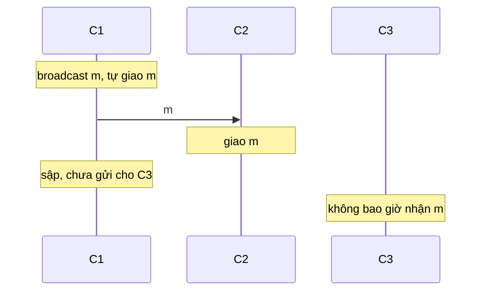
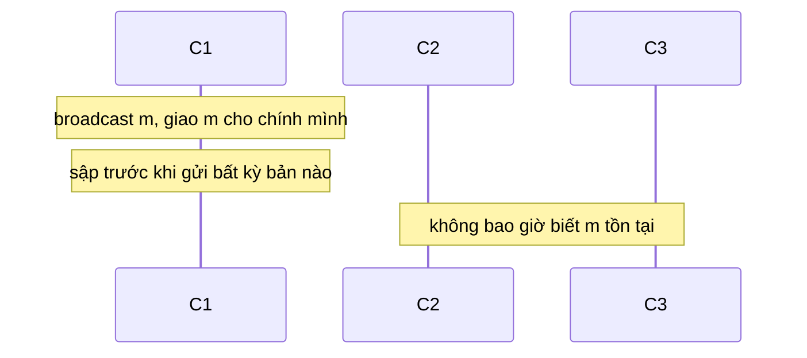
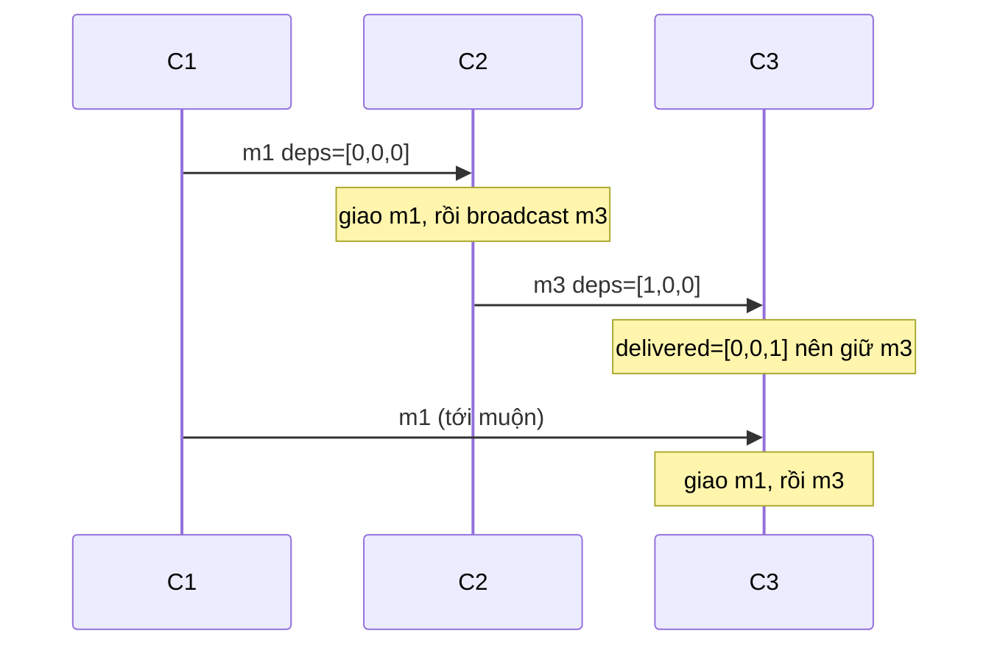
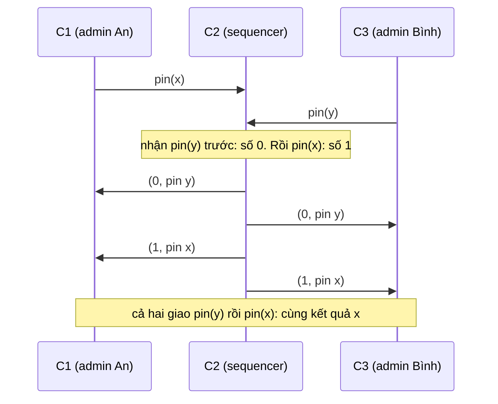
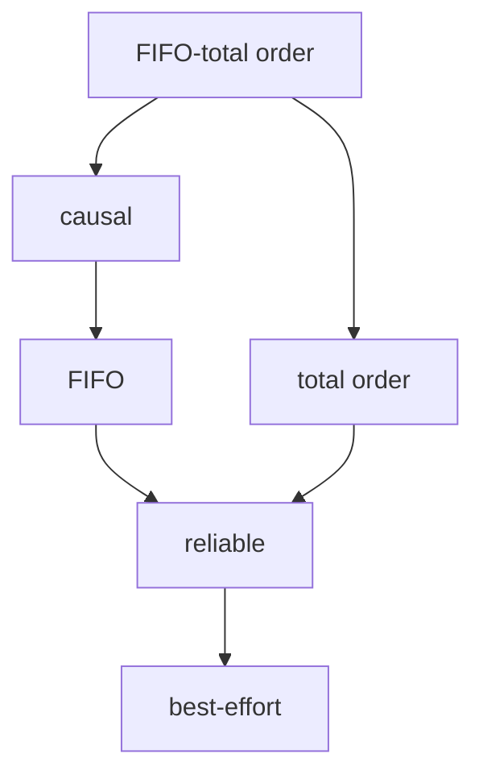

# P15 · Chương 02 — Họ broadcast: từ best-effort đến total order

[Chương 09 của P12](../12-he-thong-du-lieu/09-consistency-va-consensus.md) đã nói total order broadcast là gì và vì sao state machine replication cần nó. Chương này mở nắp chiếc hộp "broadcast" ra. Đó không phải một primitive duy nhất mà là cả một họ, mỗi thành viên hứa một bộ tính chất khác nhau và đòi một cái giá khác nhau (nhận xét của người soạn). Với từng thành viên ta làm bốn việc: viết nó thành một tập tính chất, dựng thuật toán, chứng minh thuật toán thỏa các tính chất đó, rồi chỉ ra một lịch chạy cụ thể cho thấy nó yếu hơn bậc kề trên nó. Cuối chương ta nối về replication: dịch vụ nào cần bậc nào.

Để mọi thứ có chỗ bám, cả chương dùng một ví dụ giả định là `chatd`, một dịch vụ chat nhóm chạy 3 replica `C1`, `C2`, `C3` ở ba vùng. App của người dùng nối WebSocket tới replica gần nhất; replica nhận tin rồi phải làm cho cả ba replica hiển thị tin đó trong phòng. Ngoài tin nhắn còn hai thao tác nữa: thả reaction lên một tin, và ghim một tin lên đầu phòng (mỗi phòng chỉ ghim được một tin). Giữa phần logic phòng chat và mạng có một tầng broadcast: phần logic gọi `broadcast(m)`, tầng này gửi qua các kết nối giữa replica, và khi đủ điều kiện thì báo ngược lên bằng `deliver(m)` (nhận xét của người soạn: ví dụ giả định, không phải code trong repo).

## Bạn sẽ hiểu được gì

1. **Q1.** Broadcast được đặc tả bằng những tính chất nào? Best-effort, reliable và uniform reliable khác nhau ở tính chất nào, và lịch chạy nào phân biệt chúng? → mục 1
2. **Q2.** Eager reliable broadcast chạy ra sao và đúng vì sao? Vì sao muốn uniform thì phải chờ đa số node xác nhận, và vì sao khi đó cần quá nửa số node không hỏng? → mục 2
3. **Q3.** FIFO broadcast dựng trên reliable broadcast bằng số thứ tự thế nào, đúng vì sao, và nó còn thiếu gì? → mục 3
4. **Q4.** Causal broadcast bằng vector chạy từng bước ra sao? Vì sao nó không bao giờ giao sai thứ tự nhân quả và cũng không giữ tin lại mãi? Một chương trình Rust kiểm điều đó trên mọi lịch nhận tin của một kịch bản như thế nào? → mục 4
5. **Q5.** Total order broadcast dựng bằng sequencer, bằng Lamport timestamp và bằng consensus thế nào? Chứng minh đi ra sao, và vì sao nó thừa hưởng giới hạn FLP? → mục 5
6. **Q6.** Các kiểu broadcast xếp thành thang bảo đảm nào? Vì sao bậc mạnh kéo theo bậc yếu, và lịch chạy cụ thể nào tách từng cặp bậc kề nhau? → mục 6
7. **Q7.** State machine replication, replication kiểu op-based và replication kiểu state-based cần kiểu broadcast nào, và vì sao? → mục 7

## Kiến thức cần trước

- [P12 · Chương 09, mục 3 và 4](../12-he-thong-du-lieu/09-consistency-va-consensus.md): happens-before, vector clock, total order broadcast, state machine replication. Chương này dùng lại các khái niệm đó, không dựng lại từ đầu.
- [P12 · Chương 08](../12-he-thong-du-lieu/08-su-co-he-phan-tan.md): mô hình lỗi và mạng không tin cậy.
- [P12 · Chương 18, mục 1](../12-he-thong-du-lieu/18-thuat-toan-dong-thuan.md): quorum quá nửa, tính chất an toàn và tính chất sống, định nghĩa consensus.
- [P14 · Chương 01 — Logic và chứng minh](../14-toan-va-ly-thuyet/01-logic-va-chung-minh.md): quy nạp và bất biến, công cụ của mọi chứng minh trong chương này.
- [P15 · Chương 01 — FLP và các chặn dưới](01-flp-va-cac-chan-duoi.md): mục 5 dùng kết quả FLP.

Các chương liên quan trong phase: [phân cấp consistency](03-phan-cap-consistency.md), [CRDT](04-crdt.md), [membership và gossip](07-membership-va-gossip.md).

---

## 1. Đặc tả broadcast bằng tính chất: best-effort, reliable, uniform (Q1)

> **Trả lời ngắn.** Mỗi kiểu broadcast là một tập tính chất mà tầng broadcast phải giữ, chứ chưa phải một đoạn code. Best-effort chỉ hứa rằng nếu người gửi và người nhận đều không hỏng thì tin tới nơi[^ep-beb1]. Reliable thêm một lời hứa về sự đồng thuận: hễ một node đúng đã giao tin thì mọi node đúng cũng phải giao[^ep-rb4]. Uniform reliable đòi mạnh hơn nữa: node *nào* đã giao tin, kể cả node sau đó sập, cũng buộc mọi node đúng phải giao[^ep-urb4].

**Giải thích.**

*Với `chatd`.* Alice gửi một tin vào phòng qua `C1`. Tin phải tới `C2` và `C3`, nhưng `C1` có thể sập bất cứ lúc nào, kể cả đúng lúc đang gửi dở. Câu hỏi của mục này: ta đòi tầng broadcast hứa chính xác điều gì, để phần logic phòng chat biết mình dựa được vào cái gì khi `C1` sập? Câu trả lời phải là một bản đặc tả, vì cùng một đoạn code có thể đúng với đặc tả yếu mà sai với đặc tả mạnh.

### 1.1 Nhận (receive) khác giao (deliver)

`C3` nhận byte từ kết nối TCP không có nghĩa là `C3` đã đưa tin lên phần logic phòng chat. Giữa hai thời điểm đó tầng broadcast có thể giữ tin lại trong buffer để chờ một tin khác tới trước[^kl-recv-deliver]. Ta gọi lúc nhận từ mạng là *receive* và lúc báo lên ứng dụng là *deliver*; mọi tính chất trong chương này nói về deliver, tức điều ứng dụng nhìn thấy. Ta cũng quy ước người broadcast tự deliver tin của chính mình[^kl-self-deliver].

### 1.2 Mô hình

Trước khi đặt tính chất phải chốt mô hình, vì mọi chứng minh phía sau dựa vào nó.

- Nhóm gồm n process (node) cố định và biết nhau; ở `chatd`, n = 3. Process hỏng theo kiểu *crash-stop*: dừng hẳn và không chạy lại ([P12 · Chương 18, mục 1](../12-he-thong-du-lieu/18-thuat-toan-dong-thuan.md) so sánh các mô hình lỗi). Process không hỏng trong suốt lịch chạy gọi là *đúng* (correct), các process còn lại là *hỏng* (faulty).
- Hệ bất đồng bộ: không có chặn trên về độ trễ tin và không có đồng hồ chung.
- Link gốc có thể làm mất, nhân đôi và đảo thứ tự tin[^kl-fairloss]. Gửi lại liên tục và lọc tin trùng ở bên nhận biến nó thành link tin cậy[^kl-retry-dedup], nhưng hai việc đó không khôi phục thứ tự (nhận xét của người soạn), nên tin vẫn có thể tới sai thứ tự.
- Link tin cậy không nói gì về tin của người gửi đã sập: người gửi có thể sập giữa lúc đang gửi lại, và khi đó tin mất vĩnh viễn[^kl-sender-crash]. Vì vậy ta chỉ giả định: không tạo tin, không nhân đôi tin, và nếu *cả người gửi lẫn người nhận đều đúng* thì tin tới nơi sau một thời gian hữu hạn.
- Mỗi tin broadcast là duy nhất vì mang định danh người gửi và một số thứ tự[^ct-unique].

Tính chất chia làm hai loại, như ở chương 18 mục 1: *an toàn* (safety: không bao giờ có chuyện xấu, ví dụ giao tin bịa hay giao hai lần) và *sống* (liveness: rồi sẽ có chuyện tốt, ví dụ tin rồi sẽ được giao).

### 1.3 Ba bậc đầu, viết thành tính chất

| Tính chất | Phát biểu | Loại (nhận xét của người soạn) |
|---|---|---|
| **Validity (best-effort)** | nếu người gửi và người nhận đều đúng thì mọi tin người gửi broadcast cuối cùng được người nhận giao[^ep-beb1] | sống |
| **Validity (reliable)** | nếu một process đúng broadcast m thì chính nó cuối cùng giao m[^ex-rb-validity] | sống |
| **Integrity** | mỗi tin được giao nhiều nhất một lần, và chỉ khi nó đã được broadcast trước đó[^ex-rb-integrity] | an toàn |
| **Agreement** | nếu một process đúng giao m thì mọi process đúng cuối cùng cũng giao m[^ep-rb4] | sống |
| **Uniform agreement** | nếu *bất kỳ* process nào (đúng hay hỏng) giao m thì mọi process đúng giao m[^ep-urb4] | sống |

Ba bậc là ba tổ hợp của các dòng trên:

- **Best-effort broadcast** = validity (best-effort) + integrity, tách thành hai ý "không trùng" và "không bịa"[^ep-beb23].
- **Reliable broadcast** = validity (reliable) + agreement + integrity. Tóm tắt không hình thức: mọi process đúng giao cùng một tập tin, mọi tin của process đúng đều được giao, và không có tin bịa[^ct-rb-informal].
- **Uniform reliable broadcast** = reliable broadcast, trong đó agreement được thay bằng uniform agreement.

Cách dựng best-effort broadcast là hiển nhiên: gửi tin tới từng node, node nào nhận thì giao. Ba tính chất của nó suy trực tiếp từ ba tính chất tương ứng của link[^ep-beb-proof].

Reliable mạnh hơn best-effort đúng như tên gọi. Nếu process đúng p broadcast m thì theo validity (reliable) chính p giao m, và theo agreement mọi process đúng khác cũng giao m. Đó đúng là validity của best-effort (chứng minh của người soạn).

Dựa vào hai chữ "đúng" trong agreement, ta thấy khác biệt giữa reliable và uniform: reliable chỉ ràng buộc *sau khi một node đúng đã giao*, còn uniform ràng buộc cả khi người giao là node rồi sẽ sập.

### 1.4 Hai lịch chạy phân biệt ba bậc

Một tính chất chỉ thật sự có nghĩa khi ta chỉ ra được một lịch chạy thỏa tính chất này mà vi phạm tính chất kia. Hai lịch dưới đây (người soạn dựng, không phải hình trong tài liệu) tách ba bậc.

**Lịch E1: hợp lệ với best-effort, vi phạm reliable.** `C1` nhận tin m của Alice, tự giao m, gửi m cho `C2` rồi sập trước khi gửi cho `C3`. `C2` giao m, `C3` không bao giờ nhận.



Với best-effort, lịch này hợp lệ: validity chỉ ràng buộc khi người gửi đúng, mà `C1` hỏng; không có tin trùng hay tin bịa. Với reliable, nó vi phạm agreement: `C2` đúng đã giao m mà `C3` đúng không giao. Hậu quả với `chatd`: phòng ở `C2` có tin của Alice, phòng ở `C3` không có, và vĩnh viễn như vậy.

**Lịch E2: hợp lệ với reliable, vi phạm uniform.** `C1` nhận tin m, giao m cho chính mình rồi sập trước khi gửi bất kỳ bản nào ra ngoài. `C2` và `C3` không bao giờ biết m tồn tại.



Với reliable, lịch này hợp lệ: agreement chỉ nói về trường hợp *một node đúng* giao m, mà ở đây node duy nhất đã giao là `C1`, node hỏng. Với uniform, nó vi phạm: `C1` giao m nhưng `C2`, `C3` đúng không giao. Lịch này xảy ra với *một* node hỏng trong ba, nên không cần giả định quá đáng.

Vì sao E2 đáng sợ với `chatd`? Giả sử `C1` đã giao m cho client của Alice và trả "đã gửi ✓" trước khi sập. Alice tin tin nhắn đã vào phòng; sau khi `C1` chết, không replica nào còn dấu vết của nó. Điều này xảy ra khi node giao tin xong còn làm một việc nhìn thấy được từ bên ngoài (trả ack, ghi sổ, gửi email) rồi mới sập (nhận xét của người soạn). Đó là lý do hệ thống cần uniform khi hành động bên ngoài không rút lại được.

<details><summary>Đi sâu: vì sao chỉ agreement mới có hai bản regular/uniform, và nguồn của cách chia này</summary>

- *Tính chất an toàn kiểu "không giao m' trước m" tự động là uniform.* Một process không biết trước mình sắp sập, nên không thuật toán nào cư xử khác đi chỉ vì process sắp hỏng: process phải hành xử như process đúng cho tới lúc sập[^ex-ex5]. Một vi phạm thứ tự (giao m' khi chưa giao m) nằm trọn trong một đoạn đầu hữu hạn của lịch chạy của *một* process, và đoạn đầu đó kéo dài được thành lịch chạy trong đó process không sập. Vì vậy bản "chỉ process đúng" của các tính chất thứ tự (FIFO, causal) kéo theo bản "mọi process" (suy luận của người soạn, theo ý của bài tập trong chú thích). Agreement thì khác: nó là lời hứa về *tương lai* (những gì người khác sẽ giao), nên regular và uniform khác nhau thật, như lịch E2 cho thấy.
- *Nguồn của cách chia.* Định nghĩa reliable broadcast ở trên là của Hadzilacos và Toueg, được Chandra và Toueg dùng lại[^ct-ht94]; riêng integrity ở đó được phát biểu ở dạng uniform: mỗi process giao m tối đa một lần và chỉ khi m đã được người gửi broadcast[^ct-uint]. Atomic broadcast được định nghĩa là reliable broadcast cộng một tính chất thứ tự[^ct-ab], và là tên khác của total order broadcast[^kl-atomic-name].
- *Crash-recovery.* Chương này giữ mô hình crash-stop cho gọn. Với node có thể sập rồi chạy lại, bài toán đòi thêm bộ nhớ bền cho trạng thái của thuật toán, và dạng uniform là thứ ta thật sự cần (xem [P12 · Chương 18, mục 1](../12-he-thong-du-lieu/18-thuat-toan-dong-thuan.md)).

</details>

**Quay lại Q1:** broadcast được đặc tả bằng validity, integrity và một dạng agreement: best-effort chỉ bảo vệ khi người gửi đúng, reliable bắt các node đúng đồng thuận về tập tin đã giao, uniform bắt cả những node rồi sẽ sập phải nhất quán với node đúng; với `chatd`, lịch E1 và E2 là hai lần `C1` sập tách ba bậc đó.

---

## 2. Eager reliable broadcast và uniform reliable broadcast bằng đa số xác nhận (Q2)

> **Trả lời ngắn.** Eager reliable broadcast làm một việc đơn giản: lần đầu nhận một tin, mỗi node chuyển tiếp nó cho mọi node khác rồi mới giao cho ứng dụng[^ct-diffusion]. Nhờ vậy người gửi sập giữa chừng cũng không làm node đúng nào bị bỏ sót[^kl-eager-ok], đổi lại mỗi tin tốn cỡ n² lần gửi (xem mục 2.1). Muốn uniform thì node không được giao ngay: nó phải chờ tới khi biết một đa số node đã giữ tin, vì trong đa số đó có ít nhất một node đúng sẽ lo đưa tin tới mọi node đúng khác[^kth-idea]. Cái giá là phải có quá nửa số node không hỏng, và người gửi phải chờ thêm một vòng truyền trước khi tự giao tin của mình (suy luận của người soạn, chứng minh bên dưới).

**Giải thích.**

*Với `chatd`.* `C1` nhận tin m của Alice, gửi cho `C2` rồi sập trước khi gửi cho `C3`: chính là lịch E1. Gửi trực tiếp tới từng node không chống được chuyện này, vì tin có thể rơi mất ngay lúc người gửi sập và khi đó có node không bao giờ nhận được[^kl-direct-fails]. Muốn sửa, ta nhờ những node đã nhận được tin gửi tiếp hộ.

### 2.1 Eager reliable broadcast

Ý tưởng: lần đầu nhận một tin, node chuyển tiếp nó cho mọi node khác[^kl-eager]. Thuật toán, viết lại cho `chatd`:

```text
trạng thái: delivered := {}
broadcast(m):                          -- m mang (người gửi, số thứ tự)
    gửi m cho mọi node khác
    deliver_một_lần(m)
khi nhận m từ một node q:
    nếu m chưa có trong delivered:
        gửi m cho mọi node khác (trừ chính mình)   -- chuyển tiếp lần đầu
        deliver_một_lần(m)
deliver_một_lần(m): delivered += {m}; deliver(m)
```

Thứ tự "chuyển tiếp rồi mới giao" trong nhánh nhận tin là thứ tự của thuật toán gốc[^ct-diffusion].

Đếm số tin gửi khi không ai hỏng: `C1` gửi n − 1 bản; mỗi node trong n − 1 node còn lại chuyển tiếp cho n − 1 node (mọi node trừ chính nó). Tổng cộng là n(n − 1) lần gửi (người soạn tính): 6 lần với n = 3, 20 lần với n = 5, 9900 lần với n = 100. Con số này khớp với nhận xét rằng mỗi node nhận mỗi tin n − 1 lần[^kl-eager-cost].

### 2.2 Chứng minh (chứng minh của người soạn)

Ta cần ba tính chất: integrity, validity, agreement. Chỉ dùng mô hình ở mục 1.2.

**Integrity.** *Không trùng:* mỗi tin được giao chỉ khi chưa nằm trong `delivered`, và ngay sau đó bị đưa vào `delivered`. *Không bịa:* một node chỉ gửi m khi chính nó broadcast m hoặc đã nhận m từ link; link không tạo tin, nên bằng quy nạp theo thời điểm gửi, mọi m được gửi đều do `người gửi(m)` broadcast.

**Validity.** Nếu process đúng p broadcast m thì p giao m ngay trong bước broadcast.

**Agreement.** Giả sử process đúng p giao m. p giao m hoặc trong bước broadcast, hoặc ở lần đầu nhận m. Trong cả hai trường hợp p đã gửi m cho mọi node khác *trước khi* giao (nhánh nhận tin chuyển tiếp rồi mới giao; nhánh broadcast gửi rồi mới giao). Vì p đúng nên nó làm xong các lần gửi đó. Link giữa hai process đúng bảo đảm mỗi process đúng q cuối cùng nhận m từ p. Lúc q nhận m lần đầu, nếu q chưa giao m thì nó giao m ngay. Vậy q giao m. ∎

Chứng minh này dùng một điều kiện cốt lõi: p *đúng*, nên các lần gửi của nó chắc chắn tới nơi. Nếu p chỉ là node đã giao m rồi sập, các lần gửi của nó có thể mất, và bước suy luận gãy. Chỗ gãy đó chính là lịch E2.

**Chạy lại E1.** `C1` gửi m cho `C2` rồi sập. `C2` nhận m lần đầu: nó gửi m cho `C1` (đã chết, tin mất) và `C3`, rồi giao m. `C3` nhận m từ `C2` lần đầu: nó gửi cho `C1` và `C2` (`C2` thấy m đã có trong `delivered` nên bỏ qua), rồi giao m. Vậy `C2` và `C3` cùng giao m dù `C1` sập: agreement được giữ.

### 2.3 Uniform: chờ đa số

Eager reliable broadcast vẫn vi phạm uniform. Người gửi giao m cho chính mình rồi sập trước khi gửi gì ra ngoài (lịch E2), và node nhận m chuyển tiếp rồi giao cũng có thể sập ngay sau đó, khi các bản chuyển tiếp chưa kịp tới nơi.

Để sửa, node chỉ giao m khi biết m "đã an toàn": một đa số node, tức quá nửa số node, đã giữ m. Nếu có quá nửa số node không hỏng thì trong bất kỳ đa số nào cũng có ít nhất một node đúng, và node đúng đó sẽ gửi m cho mọi node đúng khác[^kth-idea]. Thuật toán dưới đây giữ nguyên bộ khung chuyển tiếp của eager, và thay điều kiện "giao ngay" bằng điều kiện "đã đủ đa số xác nhận"[^kth-majority].

```text
trạng thái: delivered := {}; pending := {}; ack[m] := {} với mọi m
broadcast(m):
    pending += {m}; ack[m] += {tôi}
    gửi m cho mọi node khác
khi nhận m từ node q:
    ack[m] += {q}
    nếu m chưa có trong pending:
        pending += {m}; ack[m] += {tôi}
        gửi m cho mọi node khác (trừ chính mình)
khi (m ∈ pending và |ack[m]| > n/2 và m ∉ delivered):
    delivered += {m}; deliver(m)
```

Thuật toán giả định có quá nửa số node đúng[^kth-assume], tức số node hỏng tối đa f thỏa f < n/2.

**Chứng minh (chứng minh của người soạn; ý chính theo cách lập luận của nguồn).** Ta chứng minh uniform agreement, validity và integrity, với f < n/2.

*Một bất biến.* Nếu node c đã có m trong `pending` và c đúng thì c đã gửi m cho mọi node khác: các lần gửi nằm trong cùng bước với lúc đưa m vào `pending`, và c đúng nên làm xong.

*Uniform agreement.* Giả sử *một* process p (đúng hay hỏng) giao m. Khi đó `|ack_p[m]| > n/2`, nên tập A gồm các node đã được p ghi nhận có hơn n/2 phần tử. Mỗi phần tử q của A có m trong `pending`: nếu q = p thì hiển nhiên, nếu q ≠ p thì q đã gửi m cho p, và q chỉ gửi m sau khi đã có m trong `pending`. Vì |A| > n/2 > f, A có ít nhất một node c đúng. Theo bất biến, c đã gửi m cho mọi node khác, nên mỗi node đúng r cuối cùng nhận m từ c. Lúc đó r đưa m vào `pending` (nếu chưa có) và gửi m cho mọi node khác. Vậy *mọi node đúng cuối cùng đều gửi m cho mọi node khác*. Do đó với mỗi node đúng r, `ack_r[m]` cuối cùng chứa tất cả các node đúng; mà số node đúng n − f > n/2, nên `|ack_r[m]| > n/2` và r giao m. ∎

*Validity.* Nếu p đúng broadcast m thì p gửi m cho mọi node; lập luận trên cho thấy mọi node đúng, trong đó có p, cuối cùng có `|ack[m]| > n/2` và giao m.

*Integrity.* Không trùng nhờ `delivered`; không bịa như ở 2.2.

Điều kiện f < n/2 được dùng hai lần: lần một để A chắc chắn chứa một node đúng, lần hai để các node đúng *tự mình* đủ làm thành một đa số, không cần node hỏng xác nhận.

**Số liệu với `chatd`.** n = 3 nên đa số là 2 node và f tối đa là 1. Nếu không ai hỏng, `C1` broadcast ở thời điểm 0 và tự có một xác nhận (của chính nó). Ở thời điểm 1 `C2` và `C3` nhận m; mỗi node có xác nhận của `C1` và của chính nó, tức 2 > 1,5, nên giao ngay. Các bản chuyển tiếp tới `C1` ở thời điểm 2, lúc đó `C1` có đủ 2 xác nhận và giao m. Vậy `C1` chỉ giao tin của chính mình sau một vòng đi-về (C1 → C2 → C1), trong khi ở eager reliable broadcast nó giao ngay ở thời điểm 0 (người soạn tính; thời gian đo bằng số lần truyền tin, không tính thời gian xử lý).

<details><summary>Đi sâu: failure detector thay cho đa số, tại sao f &lt; n/2 là cần, chú thích về mô hình link, và gossip</summary>

- *Failure detector thay cho đa số.* Nếu hệ có failure detector hoàn hảo P (không bao giờ nghi nhầm node đúng, và rồi sẽ nghi mọi node hỏng), có thuật toán không cần đa số: node giao m khi *mọi node chưa bị nghi sập* đã xác nhận. Chứng minh dùng tính đầy đủ (completeness) của P: sẽ có lúc node nhận m từ mọi node đúng, và vì node nào nhận m cũng gửi m đi, mọi node đúng sẽ giao m[^ep-urb-p]. Dạng "lazy" của reliable broadcast chỉ chuyển tiếp khi nghi người gửi sập[^ep-lazy], nên khi không ai hỏng nó chỉ tốn n − 1 lần gửi (người soạn tính). Nhưng failure detector hoàn hảo chỉ dựng được trong hệ đồng bộ với crash-stop và link tin cậy[^kl-perfect-fd]; vì vậy trong hệ bất đồng bộ ta dùng đa số thay cho nó.
- *Vì sao f < n/2 là cần, không chỉ đủ (chứng minh của người soạn).* Giả sử có thuật toán A cài uniform reliable broadcast trong hệ bất đồng bộ crash-stop, không dùng failure detector, và chịu được f ≥ ⌈n/2⌉ node hỏng. Chia các node thành P gồm ⌈n/2⌉ node, chứa người broadcast p, và Q gồm phần còn lại; cả hai nhóm có cỡ không quá f. Xét hai lịch chạy.
  1. *Lịch α.* Mọi node của Q sập ngay từ đầu, p broadcast m. Số node hỏng |Q| ≤ f nên lịch hợp lệ, p đúng, và theo validity p giao m vào một lúc t nào đó.
  2. *Lịch β.* Giống α trong mắt các node của P cho tới lúc t, nhưng Q không sập: mọi tin giữa P và Q chỉ bị trễ quá thời điểm t, điều mà hệ bất đồng bộ cho phép. P không nhận được gì từ Q trong cả α lẫn β, nên không phân biệt được hai lịch, và p giao m vào lúc t trong β. Ngay sau t, mọi node của P sập (|P| ≤ f). Link chỉ bảo đảm tin của người gửi đúng, nên các tin P đã gửi cho Q mà còn đang đi đường bị mất.
  
  Trong β các node của Q đều đúng và chưa nhận bất kỳ thông tin nào về m, nên chúng hành xử như trong một lịch chạy mà m chưa từng được broadcast; ở lịch đó chúng không thể giao m vì không được bịa tin. Vậy Q không bao giờ giao m, trong khi p (hỏng) đã giao m: vi phạm uniform agreement, mâu thuẫn. ∎ Với n = 3 thì f = 1 là tối đa; n = 4 cũng chỉ chịu f = 1, nên thêm node thứ tư không mua thêm khả năng chịu lỗi (cùng bảng với [P12 · Chương 18, mục 1](../12-he-thong-du-lieu/18-thuat-toan-dong-thuan.md)).
- *Vì sao ta không giả định "gửi xong là tới nơi".* Nếu link bảo đảm tin đã gửi tới người nhận đúng *dù người gửi sập ngay sau đó*, thì thứ tự "chuyển tiếp xong rồi mới giao" đã đủ cho uniform agreement mà không cần xác nhận (suy luận của người soạn). Ta không dùng giả định ấy vì người gửi có thể sập khi đang gửi lại và làm mất tin vĩnh viễn[^kl-sender-crash].
- *Gossip.* Thay vì chuyển tiếp cho mọi node, node chỉ chuyển tiếp cho vài node chọn ngẫu nhiên; chi phí giảm hẳn nhưng không còn bảo đảm tuyệt đối rằng mọi node đều nhận tin[^kl-gossip]. Chương [membership và gossip](07-membership-va-gossip.md) đi sâu vào hướng này.

</details>

**Quay lại Q2:** eager reliable broadcast chuyển tiếp ở lần nhận đầu nên agreement giữa các node đúng được giữ dù người gửi sập, tốn n(n − 1) tin; muốn uniform thì chỉ giao khi quá nửa số node đã giữ tin, nên cần f < n/2 và `C1` phải chờ một vòng đi-về trước khi giao tin của chính mình.

---

## 3. FIFO broadcast bằng số thứ tự (Q3)

> **Trả lời ngắn.** FIFO broadcast bảo đảm các tin của cùng một người gửi được giao đúng thứ tự gửi[^kl-fifo]. Cách làm: người gửi đánh số tin 0, 1, 2, …; mỗi người nhận giữ một bộ đếm "số tin kế tiếp cần giao" cho từng người gửi, và giữ tin tới sớm lại trong buffer cho tới khi tin đứng trước đã được giao[^kl-fifo-alg]. Nhưng FIFO không nói gì về thứ tự giữa tin của những người gửi khác nhau, nên câu trả lời vẫn có thể được giao trước câu hỏi mà nó đáp.

**Giải thích.**

*Với `chatd`.* Alice gõ hai tin liền nhau trên `C1`: m1 = "ai trực đêm nay?" rồi m2 = "cần 2 người". Nếu `C3` giao m2 trước m1 thì đoạn chat đọc không ra nghĩa. Điều ta muốn: tin cùng người gửi giữ thứ tự gửi. Đó chưa phải là thứ tự giữa các người gửi khác nhau; cái đó để mục 4.

Vì sao reliable broadcast chưa đủ? Vì link có thể đảo thứ tự tin[^kl-fairloss], và vì eager reliable broadcast còn thêm đường chuyển tiếp: bản m2 do `C2` chuyển tiếp có thể tới `C3` trước bản m1 gửi thẳng từ `C1` (nhận xét của người soạn). FIFO broadcast gắn chặt với khái niệm FIFO link nhưng không đồng nhất với nó[^kl-fifo-links].

### 3.1 Thuật toán

```text
trạng thái: sendSeq := 0; delivered[1..n] := 0; buffer := {}
broadcast(m) tại node i:
    rb_broadcast((i, sendSeq, m)); sendSeq += 1
khi rb_deliver((j, s, m)):
    buffer += {(j, s, m)}
    chừng nào còn (j', s', m') trong buffer với s' == delivered[j']:
        deliver(m'); buffer -= {(j', s', m')}; delivered[j'] += 1
```

`rb_broadcast` là reliable broadcast của mục 2 (eager hoặc uniform). Trạng thái `delivered[j]` đếm số tin của người gửi j đã giao tại node này.

**Chạy trên `chatd`.** m1 mang `(C1, 0)`, m2 mang `(C1, 1)`. `C3` rb-giao `(C1, 1, m2)` trước: bỏ vào buffer, nhưng `delivered[C1] = 0 ≠ 1` nên *giữ lại*. Sau đó `C3` rb-giao `(C1, 0, m1)`: `0 == delivered[C1]` nên giao m1 và tăng `delivered[C1]` lên 1. Vòng lặp chạy tiếp: `(C1, 1, m2)` khớp, giao m2, `delivered[C1] = 2`. `C3` giao m1 rồi m2, đúng thứ tự gửi.

### 3.2 Chứng minh (chứng minh của người soạn)

**Bất biến I.** Tại mọi node p và với mọi người gửi j: các tin của j mà p đã giao đúng là các tin số 0, 1, …, `delivered_p[j] − 1`, theo đúng thứ tự đó. *Chứng minh:* ban đầu p chưa giao tin nào và `delivered_p[j] = 0`. Một tin `(j, s, m)` chỉ được giao khi `s == delivered_p[j]`, và ngay sau đó `delivered_p[j]` tăng thành s + 1; theo giả thiết quy nạp các tin 0..s − 1 đã giao, nên tin s nối tiếp đúng vào cuối. ∎

**FIFO order (an toàn).** Nếu j broadcast m trước m' thì số thứ tự của m nhỏ hơn của m' (vì `sendSeq` chỉ tăng). Nếu một node giao m', theo bất biến I node đó đã giao mọi tin của j có số nhỏ hơn, trong đó có m. Tính chất này đúng với *mọi* node, đúng hay hỏng. ∎

**Integrity.** Mỗi tin được rb-giao tối đa một lần (integrity của reliable broadcast), mang số thứ tự duy nhất, nên nằm trong buffer tối đa một lần; khi được giao nó rời buffer. Không có tin bịa vì mọi tin trong buffer đều do rb-giao mà ra.

**Agreement.** Giả sử process đúng p FIFO-giao `(j, s)`. Theo bất biến I, p đã FIFO-giao `(j, 0), …, (j, s − 1)`, nên đã rb-giao cả `(j, 0..s)`. Vì p đúng, agreement của reliable broadcast bảo đảm mọi process đúng q cuối cùng rb-giao từng tin `(j, k)` với k ≤ s. Ta chứng minh bằng quy nạp theo k rằng q FIFO-giao `(j, k)`. Với k = 0, tin `(j, 0)` vào buffer của q khi `delivered_q[j] = 0` (chỉ chính tin số 0 mới nâng được bộ đếm này lên), và vòng `chừng nào` chỉ dừng khi buffer không còn tin khớp, nên `(j, 0)` được giao. Với k > 0: giả sử q đã giao `(j, 0..k − 1)` thì `delivered_q[j] ≥ k`. Nếu `(j, k)` đã nằm trong buffer thì vòng lặp (đang chạy hoặc chạy ở lần rb-giao kế tiếp) giao nó; nếu nó tới sau thì lúc tới `delivered_q[j] = k` (không thể lớn hơn k mà chưa giao k), nên giao ngay. ∎

**Validity.** Người gửi đúng j broadcast m = `(j, s)`. Các tin trước đó của j cũng do j broadcast, nên j rb-giao tất cả (validity của reliable broadcast), và bằng lập luận agreement ở trên j FIFO-giao chúng theo thứ tự rồi tới m. ∎

### 3.3 FIFO là chưa đủ

Giả sử Alice (ở `C1`) hỏi m1 = "ai trực đêm nay?". `C2` giao m1, và Bình (ở `C2`) trả lời m3 = "mình trực". Tin m1 và m3 có hai người gửi khác nhau, nên FIFO không ràng buộc thứ tự giao của chúng. Một lịch chạy trong đó `C3` giao m3 trước m1 vẫn hợp lệ với FIFO, dù m3 được broadcast sau khi `C2` giao m1[^kl-fifo-not-causal]. Với `chatd`, `C3` hiển thị câu trả lời trước câu hỏi. Mục 4 sửa việc này.

<details><summary>Đi sâu: trạng thái và buffer, số thứ tự khi người gửi khởi động lại</summary>

- *Trạng thái.* Mỗi node giữ n bộ đếm `delivered[·]` cộng một buffer chứa các tin tới sớm. Buffer có thể phình ra nếu một tin trong dãy không bao giờ tới: các tin sau nó nằm chờ mãi. Điều đó vẫn đúng đặc tả (tin số s chưa được giao thì tin số s + 1 cũng không được giao), nhưng một hệ thật cần timeout và cơ chế hỏi lại (nhận xét của người soạn).
- *Số thứ tự và khởi động lại.* Nếu người gửi sập, chạy lại và bắt đầu đếm từ 0, người nhận sẽ coi các tin mới là tin cũ trùng lặp. Muốn dùng FIFO broadcast với node có thể khởi động lại, số thứ tự phải bền (ghi xuống đĩa) hoặc phải kèm một "đời" (epoch) mới mỗi lần khởi động (suy luận của người soạn).

</details>

**Quay lại Q3:** FIFO broadcast gắn số thứ tự 0, 1, 2, … vào tin của mỗi người gửi và giữ tin tới sớm lại trong buffer cho tới đúng lượt; bất biến "đã giao đúng các tin 0..c − 1" chứng minh cả an toàn lẫn agreement, nhưng không ràng buộc tin của người gửi khác nhau nên `C3` vẫn có thể giao câu trả lời trước câu hỏi.

---

## 4. Causal broadcast bằng vector (Q4)

> **Trả lời ngắn.** Causal broadcast giao hai tin theo đúng thứ tự "cái trước có thể là nguyên nhân của cái sau" ở mọi node; hai tin đồng thời thì giao thứ tự nào cũng được[^kl-causal]. Thuật toán gắn vào mỗi tin một vector `deps` ghi người gửi đã giao bao nhiêu tin của từng người[^kl-deps-build]. Người nhận giữ tin lại cho tới khi chính nó đã giao đủ ngần ấy[^kl-deps-cmp]. Mục này chạy thuật toán từng bước trên `chatd`, chứng minh hai nửa an toàn và sống, rồi kiểm lại bằng một chương trình Rust trên mọi lịch nhận tin của một kịch bản.

**Giải thích.**

*Với `chatd`.* Ta quay lại Alice, Bình và Carol. Alice (`C1`) gõ m1 = "ai trực đêm nay?" rồi m2 = "cần 2 người". Bình (`C2`) thấy m1 và trả lời m3 = "mình trực". Carol (`C3`) gõ m4 = "alo" mà không đọc gì của ai. Muốn `C3` không bao giờ hiển thị m3 trước m1; còn m4 không liên quan gì tới ba tin kia nên `C3` giao nó lúc nào cũng được (nhận xét của người soạn: kịch bản minh họa).

### 4.1 "Xảy ra trước" giữa các lần broadcast

Ta cần một quan hệ nói "m có thể là nguyên nhân của m'". Gọi `m ⇝ m'` (m đi trước m' về nhân quả) khi một trong ba điều đúng:

- (a) cùng một người gửi broadcast m trước m';
- (b) người gửi m' đã giao m trước khi broadcast m';
- (c) có một tin m'' thỏa `m ⇝ m''` và `m'' ⇝ m'`.

Ba điều này là quan hệ happens-before ([P12 · Chương 09, mục 3.2](../12-he-thong-du-lieu/09-consistency-va-consensus.md)) áp lên các sự kiện broadcast và deliver (nhận xét của người soạn). *Causal order* là tính chất: nếu `m ⇝ m'` thì không process nào giao m' mà chưa giao m[^ex-causal].

### 4.2 Thuật toán

```text
trạng thái: sendSeq := 0; delivered[1..n] := 0; buffer := {}
broadcast(m) tại node i:
    deps := bản sao của delivered; deps[i] := sendSeq
    rb_broadcast((i, deps, m)); sendSeq += 1
khi rb_deliver((j, deps, m)):
    buffer += {(j, deps, m)}
    chừng nào còn (j', deps', m') trong buffer với deps' ≤ delivered (từng ô):
        deliver(m'); buffer -= {(j', deps', m')}; delivered[j'] += 1
```

Hai điều cần để ý. Thứ nhất, `delivered[k]` ở đây đếm *số tin của k đã giao*, khác với vector clock ở chương 09 là đếm số *sự kiện*[^kl-vc-diff]. Thứ hai, `deps[i] := sendSeq` ghi đè ô của chính người gửi, để tin thứ s của i luôn phụ thuộc vào tin thứ s − 1 của i, kể cả khi i chưa kịp tự giao tin s − 1. Phép so `deps' ≤ delivered` là so *từng ô*; nó đúng khi node đã giao mọi tin phải đứng trước tin này theo thứ tự nhân quả[^kl-deps-cmp].

### 4.3 Chạy từng bước trên `chatd`

Vector viết theo thứ tự `⟨C1, C2, C3⟩`. Ban đầu mọi `delivered` đều là `⟨0,0,0⟩`. Ta dùng đúng bốn tin ở đầu mục: m1 và m2 của `C1`, m3 do `C2` broadcast ngay sau khi giao m1, m4 của `C3`. Dưới đây là một lịch nhận tin cụ thể (cột "Bước" chỉ để đánh số).

| Bước | Sự kiện | `deps` của tin | `delivered` sau bước |
|---|---|---|---|
| 1 | `C1` broadcast m1, tự giao | `⟨0,0,0⟩` | `C1`: `⟨1,0,0⟩` |
| 2 | `C1` broadcast m2, tự giao | `⟨1,0,0⟩` | `C1`: `⟨2,0,0⟩` |
| 3 | `C3` broadcast m4, tự giao | `⟨0,0,0⟩` | `C3`: `⟨0,0,1⟩` |
| 4 | `C2` nhận m1: `⟨0,0,0⟩ ≤ ⟨0,0,0⟩`, giao | | `C2`: `⟨1,0,0⟩` |
| 5 | `C2` vừa giao m1 nên broadcast m3, tự giao | `⟨1,0,0⟩` | `C2`: `⟨1,1,0⟩` |
| 6 | `C2` nhận m2: `⟨1,0,0⟩ ≤ ⟨1,1,0⟩`, giao | | `C2`: `⟨2,1,0⟩` |
| 7 | `C3` nhận m2: `⟨1,0,0⟩ ≤ ⟨0,0,1⟩`? Không (1 > 0): **giữ lại** | | `C3`: `⟨0,0,1⟩`, buffer {m2} |
| 8 | `C1` nhận m4: giao | | `C1`: `⟨2,0,1⟩` |
| 9 | `C2` nhận m4: giao | | `C2`: `⟨2,1,1⟩` |
| 10 | `C1` nhận m3: `⟨1,0,0⟩ ≤ ⟨2,0,1⟩`, giao | | `C1`: `⟨2,1,1⟩` |
| 11 | `C3` nhận m3: `⟨1,0,0⟩ ≤ ⟨0,0,1⟩`? Không: **giữ lại** | | `C3`: `⟨0,0,1⟩`, buffer {m2, m3} |
| 12 | `C3` nhận m1: `⟨0,0,0⟩ ≤ ⟨0,0,1⟩`, giao m1; quét buffer: m2 giao, rồi m3 giao | | `C3`: `⟨1,0,1⟩` → `⟨2,0,1⟩` → `⟨2,1,1⟩` |

Kết quả cuối: `C1` giao m1, m2, m4, m3; `C2` giao m1, m3, m2, m4; `C3` giao m4, m1, m2, m3 (người soạn tính tay; mục 4.6 chạy lại đúng lịch này bằng Rust). Cả ba thứ tự đều giữ m1 trước m2 và m1 trước m3. Ba node giao theo ba thứ tự khác nhau, và điều đó hợp lệ: m2 và m3 đồng thời (ở bước 5 `C2` broadcast m3 *trước* khi giao m2), còn m4 đồng thời với mọi tin.



Có hai nhận xét về chi phí. Người nhận phải chờ khi tin tới quá sớm (m2 và m3 ở `C3`), nhưng người gửi không phải chờ ai: nó giao tin cho chính mình ngay lập tức[^kl-tob-self]. Và tin phải mang thêm một vector n số nguyên (nhận xét của người soạn).

### 4.4 Chứng minh an toàn (chứng minh của người soạn)

Hai bất biến, đều chứng minh bằng quy nạp theo các bước của thuật toán.

**(I1)** Tại node p, `delivered_p[k] = c` khi và chỉ khi p đã giao đúng các tin `(k, 0), …, (k, c − 1)` của k, theo đúng thứ tự đó. *Chứng minh:* ban đầu mọi thứ bằng 0. Một tin `(j, deps, m)` với số thứ tự s = `deps[j]` chỉ được giao khi `deps[j] ≤ delivered[j]`, tức `s ≤ delivered[j]`. Nếu `s < delivered[j]` thì theo giả thiết quy nạp tin `(j, s)` đã được giao, và vì reliable broadcast chỉ rb-giao mỗi tin một lần, nó không còn nằm trong buffer. Vậy lúc giao, `delivered[j] = s` đúng, và sau khi giao nó là s + 1: tin s nối tiếp đúng vào cuối dãy. ∎

**(I2)** Khi node i broadcast tin `(i, deps, m)` với số thứ tự s: `deps[k]` bằng số tin của k mà i đã giao, với k ≠ i, và `deps[i] = s`. Đây chỉ là mã của thuật toán.

**Bổ đề.** Nếu `m` là tiền bối trực tiếp của `m'` (điều (a) hoặc (b) của mục 4.1) và một node p giao m', thì p đã giao m trước đó.

- Trường hợp (a): cùng người gửi j, m = `(j, s)`, m' = `(j, s')` với s < s'. Theo (I2), `deps(m')[j] = s'`. Điều kiện giao m' tại p cho `delivered_p[j] ≥ s' > s`. Theo (I1), p đã giao `(j, s)` = m.
- Trường hợp (b): người gửi j' của m' đã giao m = `(k, t)` trước khi broadcast m'. Nếu k = j' thì m và m' cùng người gửi, quay về (a). Nếu không, theo (I1) tại j' lúc đó `delivered_{j'}[k] ≥ t + 1`, nên theo (I2) `deps(m')[k] ≥ t + 1`. Điều kiện giao m' tại p cho `delivered_p[k] ≥ t + 1`, và theo (I1) p đã giao `(k, t)` = m. ∎

**Định lý (causal order).** Nếu `m ⇝ m'` và node p giao m' thì p đã giao m trước m'.

*Chứng minh.* Theo định nghĩa có một dây chuyền `m = m_0, m_1, …, m_r = m'` mà mỗi `m_i` là tiền bối trực tiếp của `m_{i+1}`. p giao `m_r`, nên theo bổ đề p đã giao `m_{r−1}` trước `m_r`. Vì p đã giao `m_{r−1}`, bổ đề cho p đã giao `m_{r−2}` trước `m_{r−1}`. Cứ lùi như vậy tới `m_0`, và tính bắc cầu của "giao trước" trong dãy giao của p cho `m_0` trước `m_r`. ∎

Định lý đúng cho *mọi* node, đúng hay hỏng, vì nó chỉ dựa vào điều kiện giao trong mã. Điều này khớp với nhận xét ở mục 1: không có bản regular riêng cho tính chất thứ tự.

Vì sao ghi `deps[i] := sendSeq` mà không ghi `delivered[i]`? Khi i broadcast tin s, tin s − 1 của chính i có thể chưa được i tự giao (nếu tầng reliable broadcast bên dưới giao tin của chính nó chậm). Nếu dùng `delivered[i]` thì tin s có thể không phụ thuộc vào tin s − 1, và điều (a) của mục 4.1 không còn được bảo đảm. Ghi `sendSeq` giữ được điều đó (nhận xét của người soạn).

### 4.5 Chứng minh sống (chứng minh của người soạn)

**Validity.** Giả sử i đúng broadcast m với số thứ tự s. Reliable broadcast bảo đảm i rb-giao m và mọi tin trước đó của i, nên chúng nằm trong buffer của i (hoặc đã được giao). Ta chứng minh bằng quy nạp theo s rằng i giao các tin của chính nó theo thứ tự. Với s = 0, mọi ô của `deps` bằng số tin i đã giao lúc broadcast và ô của i bằng 0; vì `delivered` chỉ tăng nên tin sẵn sàng ngay khi nằm trong buffer. Với s > 0, giả sử i đã giao tin s − 1, tức `delivered_i[i] = s`. Các ô k ≠ i của `deps` là bản sao của `delivered_i` lúc broadcast nên không vượt quá `delivered_i` hiện tại, còn ô của i bằng s; vậy tin s sẵn sàng. Vòng `chừng nào` chạy sau mỗi lần rb-giao và chỉ dừng khi buffer không còn tin sẵn sàng, nên tin s được giao ngay sau tin s − 1, hoặc ngay khi nó vào buffer nếu nó vào sau. ∎

**Agreement.** Giả sử process đúng p giao m. Gọi `m_1, …, m_r = m` là dãy mọi tin p đã giao tính tới m, theo thứ tự p giao. Ta chứng minh mọi process đúng q cuối cùng giao từng `m_i`.

- Mỗi `m_i` đã được p rb-giao. Vì p đúng, agreement của reliable broadcast cho mỗi `m_i` được q rb-giao, nên nằm trong buffer của q (nếu q chưa giao nó).
- Quy nạp theo i. Giả sử q đã giao `m_1, …, m_{i−1}`. Gọi `c_k` là số tin của k trong `m_1, …, m_{i−1}`. Theo (I1) tại p, lúc p giao `m_i` có `delivered_p[k] = c_k`, và vì p giao `m_i` nên `deps(m_i)[k] ≤ c_k` với mọi k. Tại q, các tin của k trong `m_1, …, m_{i−1}` đã được giao, theo (I1) `delivered_q[k]` ít nhất bằng `c_k`. Vậy `deps(m_i) ≤ delivered_q`, tức `m_i` sẵn sàng. Vòng `chừng nào` chạy sau mỗi lần rb-giao và chỉ dừng khi buffer không còn tin sẵn sàng, nên ngay khi `m_i` đã nằm trong buffer (hoặc vào buffer sau đó), nó được giao. ∎

Hệ quả cần nhớ: nếu người gửi hỏng và các tiền bối của một tin không bao giờ tới node đúng nào, node đúng giữ tin đó trong buffer mãi và không giao. Điều này không vi phạm agreement (không node đúng nào giao tin đó), và là điều *bắt buộc*: giao tin mà chưa giao tiền bối của nó là vi phạm causal order. Ví dụ: `C2` giao m1 rồi broadcast m3, sau đó `C1` và `C2` cùng sập, bản m1 không tới `C3` còn m3 thì tới. `C3` giữ m3 mãi. Mô hình lỗi này còn trở lại ở mục 6.

### 4.6 Kiểm bằng mô phỏng Rust

Chứng minh ở trên là chứng minh tổng quát. Để thấy nó khớp với một chương trình chạy thật, ta kiểm một kịch bản cố định bằng cách duyệt *mọi* thứ tự nhận tin có thể (kịch bản 4 tin của mục 4.3, 3 node), chạy qua ba lớp giao tin:

- `Raw`: giao ngay khi nhận, không buffer;
- `Fifo`: chỉ kiểm tra số thứ tự theo từng người gửi (thuật toán mục 3);
- `Causal`: điều kiện `deps ≤ delivered` từng ô (thuật toán mục 4.2).

Điều quan trọng là phép kiểm *không dùng vector*. Mỗi tin mang kèm một tập `past` tường minh: hợp mọi tin node gửi đã giao lúc broadcast, cộng `past` của chúng. Sau khi một lịch chạy xong, chương trình kiểm với mỗi node và mỗi tin x rằng `past(x)` nằm trọn trong các tin node đã giao trước x. Đây là định nghĩa causal order viết thẳng bằng tập hợp (nhận xét của người soạn), nên nó độc lập với phép so vector.

Nút then chốt của chương trình là hàm quyết định tin nào được giao:

```rust
fn ready(layer: Layer, st: &State, node: usize, m: &Msg) -> bool {
    match layer {
        Layer::Raw => true,
        Layer::Fifo => m.seq == st.delivered[node][m.sender],
        Layer::Causal => (0..N).all(|k| m.deps[k] <= st.delivered[node][k]),
    }
}
```

Toàn bộ chương trình nằm ở phần Đi sâu cuối mục. Kết quả chạy (quan sát một lần chạy, `rustc 1.95.0` trên macOS arm64, `rustc --edition 2021 -O causal_sim.rs`; không phải bảo đảm của tài liệu):

```text
lịch cố định, lớp Raw:
  nhận tin theo thứ tự: m1->C2 m2->C2 m2->C3 m4->C1 m4->C2 m3->C1 m3->C3 m1->C3
  C1 giao: m1, m2, m4, m3
  C2 giao: m1, m3, m2, m4
  C3 giao: m4, m2, m3, m1
lịch cố định, lớp Fifo:
  nhận tin theo thứ tự: m1->C2 m2->C2 m2->C3 m4->C1 m4->C2 m3->C1 m3->C3 m1->C3
  C1 giao: m1, m2, m4, m3
  C2 giao: m1, m3, m2, m4
  C3 giao: m4, m3, m1, m2
lịch cố định, lớp Causal:
  nhận tin theo thứ tự: m1->C2 m2->C2 m2->C3 m4->C1 m4->C2 m3->C1 m3->C3 m1->C3
  C1 giao: m1, m2, m4, m3
  C2 giao: m1, m3, m2, m4
  C3 giao: m4, m1, m2, m3

Raw: lịch=13440 chưa-giao-đủ=0 vi-phạm-nhân-quả=9796 kết-quả-khác-nhau=72
 lịch vi phạm đầu tiên:
  nhận tin theo thứ tự: m1->C2 m2->C2 m2->C3 m1->C3 m4->C1 m4->C2 m3->C1 m3->C3
  C1 giao: m1, m2, m4, m3
  C2 giao: m1, m3, m2, m4
  C3 giao: m4, m2, m1, m3
Fifo: lịch=13440 chưa-giao-đủ=0 vi-phạm-nhân-quả=6216 kết-quả-khác-nhau=30
 lịch vi phạm đầu tiên:
  nhận tin theo thứ tự: m1->C2 m2->C2 m2->C3 m4->C1 m4->C2 m3->C1 m3->C3 m1->C3
  C1 giao: m1, m2, m4, m3
  C2 giao: m1, m3, m2, m4
  C3 giao: m4, m3, m1, m2
Causal: lịch=13440 chưa-giao-đủ=0 vi-phạm-nhân-quả=0 kết-quả-khác-nhau=13
 lịch đầu tiên mà C3 nhận m3 trước m1:
  nhận tin theo thứ tự: m1->C2 m2->C2 m2->C3 m4->C1 m4->C2 m3->C1 m3->C3 m1->C3
  C1 giao: m1, m2, m4, m3
  C2 giao: m1, m3, m2, m4
  C3 giao: m4, m1, m2, m3
```

Đọc kết quả:

- Phần đầu chạy lại *đúng lịch nhận tin của mục 4.3* qua cả ba lớp. Lớp `Causal` cho `C3` giao m4, m1, m2, m3, khớp với tính tay. Lớp `Fifo` cho `C3` giao m4, m3, m1, m2: m3 (câu trả lời) tới trước m1 (câu hỏi), vi phạm nhân quả mà vẫn giữ FIFO. Lớp `Raw` còn giao m2 trước m1 ở `C3`, vi phạm cả FIFO.
- Phần sau duyệt mọi lịch: 13440 chuỗi nhận tin khác nhau. Với `Raw`, 9796 lịch vi phạm nhân quả; với `Fifo`, 6216 lịch; với `Causal`, 0 lịch. Ở cả ba lớp mọi lịch đều giao đủ 4 tin cho 3 node (cột `chưa-giao-đủ=0`), tức không có tin nào bị giữ mãi, đúng với phần chứng minh sống.
- Số "kết quả khác nhau" là số bộ ba dãy giao khác nhau: 72 với `Raw`, 30 với `Fifo`, 13 với `Causal`. Ràng buộc nhân quả loại bỏ đúng những dãy giao sai, nhưng vẫn để lại nhiều dãy hợp lệ, vì hai tin đồng thời được phép giao theo thứ tự nào cũng được.

Phép kiểm này duyệt hết một kịch bản nhỏ, không phải một chứng minh cho mọi kịch bản; chứng minh nằm ở mục 4.4 và 4.5.

<details><summary>Đi sâu: toàn bộ chương trình <code>causal_sim.rs</code>, so sánh với dạng của Birman–Schiper–Stephenson, vector lớn và buffer</summary>

```rust
use std::collections::BTreeSet;

const N: usize = 3; // C1=0, C2=1, C3=2
const M: usize = 4; // m1..m4 -> ids 0..3

#[derive(Clone, Copy, PartialEq, Eq, Debug)]
enum Layer {
    Raw,    // giao ngay khi nhận
    Fifo,   // chỉ kiểm tra số thứ tự của từng người gửi
    Causal, // deps <= delivered
}

#[derive(Clone, Debug)]
struct Msg {
    id: usize,
    sender: usize,
    seq: usize,
    deps: [usize; N],
    past: BTreeSet<usize>, // "sự thật nền": các tin xảy ra trước, tính bằng tập tường minh, không dùng vector
}

#[derive(Clone)]
struct State {
    send_seq: [usize; N],
    delivered: [[usize; N]; N],
    buffer: Vec<Vec<Msg>>,
    log: Vec<Vec<usize>>,
    msgs: Vec<Option<Msg>>,
    flight: Vec<(usize, usize)>,
    reply_pending: bool,
    reply_sent: bool,
    trace: Vec<(usize, usize)>,
}

fn ready(layer: Layer, st: &State, node: usize, m: &Msg) -> bool {
    match layer {
        Layer::Raw => true,
        Layer::Fifo => m.seq == st.delivered[node][m.sender],
        Layer::Causal => (0..N).all(|k| m.deps[k] <= st.delivered[node][k]),
    }
}

fn receive(st: &mut State, layer: Layer, node: usize, m: Msg) {
    st.buffer[node].push(m);
    loop {
        let pos = (0..st.buffer[node].len()).find(|&i| ready(layer, st, node, &st.buffer[node][i]));
        let Some(i) = pos else { break };
        let m = st.buffer[node].remove(i);
        st.log[node].push(m.id);
        st.delivered[node][m.sender] += 1;
        if node == 1 && m.id == 0 && !st.reply_sent {
            st.reply_pending = true; // C2 vừa giao m1: sẽ trả lời bằng m3
        }
    }
    if st.reply_pending {
        st.reply_pending = false;
        st.reply_sent = true;
        broadcast(st, layer, 1, 2);
    }
}

fn broadcast(st: &mut State, layer: Layer, node: usize, id: usize) {
    let mut deps = st.delivered[node];
    deps[node] = st.send_seq[node];
    let mut past = BTreeSet::new();
    for &x in &st.log[node] {
        past.insert(x);
        past.extend(st.msgs[x].as_ref().unwrap().past.iter().copied());
    }
    let m = Msg { id, sender: node, seq: st.send_seq[node], deps, past };
    st.send_seq[node] += 1;
    st.msgs[id] = Some(m.clone());
    for dest in 0..N {
        if dest != node {
            st.flight.push((id, dest));
        }
    }
    receive(st, layer, node, m); // tự giao cho chính mình ngay
}

#[derive(Default)]
struct Stats {
    schedules: usize,
    incomplete: usize,
    violating: usize,
    outcomes: BTreeSet<Vec<Vec<usize>>>,
    first_violation: Option<(Vec<(usize, usize)>, Vec<Vec<usize>>)>,
    first_c3_early: Option<(Vec<(usize, usize)>, Vec<Vec<usize>>)>,
}

fn explore(st: State, layer: Layer, stats: &mut Stats) {
    if st.flight.is_empty() {
        stats.schedules += 1;
        if st.log.iter().any(|l| l.len() != M) {
            stats.incomplete += 1;
        }
        let mut bad = false;
        for l in &st.log {
            for (j, &x) in l.iter().enumerate() {
                let before: BTreeSet<usize> = l[..j].iter().copied().collect();
                if !st.msgs[x].as_ref().unwrap().past.is_subset(&before) {
                    bad = true;
                }
            }
        }
        if bad {
            stats.violating += 1;
            if stats.first_violation.is_none() {
                stats.first_violation = Some((st.trace.clone(), st.log.clone()));
            }
        }
        // lịch mà C3 (node 2) nhận m3 (id 2) trước m1 (id 0)
        let pos = |id: usize| st.trace.iter().position(|&(i, d)| i == id && d == 2);
        if let (Some(p2), Some(p0)) = (pos(2), pos(0)) {
            if p2 < p0 && stats.first_c3_early.is_none() {
                stats.first_c3_early = Some((st.trace.clone(), st.log.clone()));
            }
        }
        stats.outcomes.insert(st.log.clone());
        return;
    }
    for i in 0..st.flight.len() {
        let mut s2 = st.clone();
        let (id, dest) = s2.flight.remove(i);
        s2.trace.push((id, dest));
        let m = s2.msgs[id].clone().unwrap();
        receive(&mut s2, layer, dest, m);
        explore(s2, layer, stats);
    }
}

fn name(id: usize) -> &'static str {
    ["m1", "m2", "m3", "m4"][id]
}
fn show(trace: &[(usize, usize)], log: &[Vec<usize>]) {
    let t: Vec<String> = trace.iter().map(|&(i, d)| format!("{}->C{}", name(i), d + 1)).collect();
    println!("  nhận tin theo thứ tự: {}", t.join(" "));
    for (n, l) in log.iter().enumerate() {
        let v: Vec<&str> = l.iter().map(|&x| name(x)).collect();
        println!("  C{} giao: {}", n + 1, v.join(", "));
    }
}

fn start(layer: Layer) -> State {
    let mut st = State {
        send_seq: [0; N],
        delivered: [[0; N]; N],
        buffer: vec![vec![]; N],
        log: vec![vec![]; N],
        msgs: vec![None; M],
        flight: vec![],
        reply_pending: false,
        reply_sent: false,
        trace: vec![],
    };
    broadcast(&mut st, layer, 0, 0); // C1: m1
    broadcast(&mut st, layer, 0, 1); // C1: m2 (sau m1)
    broadcast(&mut st, layer, 2, 3); // C3: m4 (độc lập)
    st
}

fn main() {
    // Một lịch cố định, chạy lại qua cả ba lớp
    let fixed = [(0, 1), (1, 1), (1, 2), (3, 0), (3, 1), (2, 0), (2, 2), (0, 2)];
    for layer in [Layer::Raw, Layer::Fifo, Layer::Causal] {
        let mut st = start(layer);
        for &(id, dest) in &fixed {
            let i = st.flight.iter().position(|&(a, b)| a == id && b == dest).expect("tin chưa được gửi");
            st.flight.remove(i);
            st.trace.push((id, dest));
            let m = st.msgs[id].clone().unwrap();
            receive(&mut st, layer, dest, m);
        }
        println!("lịch cố định, lớp {:?}:", layer);
        show(&st.trace, &st.log);
    }
    println!();
    for layer in [Layer::Raw, Layer::Fifo, Layer::Causal] {
        let st = start(layer);
        let mut stats = Stats::default();
        explore(st, layer, &mut stats);
        println!(
            "{:?}: lịch={} chưa-giao-đủ={} vi-phạm-nhân-quả={} kết-quả-khác-nhau={}",
            layer, stats.schedules, stats.incomplete, stats.violating, stats.outcomes.len()
        );
        if let Some((t, l)) = &stats.first_violation {
            println!(" lịch vi phạm đầu tiên:");
            show(t, l);
        }
        if layer == Layer::Causal {
            if let Some((t, l)) = &stats.first_c3_early {
                println!(" lịch đầu tiên mà C3 nhận m3 trước m1:");
                show(t, l);
            }
        }
    }
}
```

- *Dạng gốc của giao thức.* Nhóm ISIS (Birman, Schiper và Stephenson) dùng vector time đếm theo từng người gửi số tin đứng trước một tin về mặt nhân quả[^bss-vt], rồi so từng ô khi nhận tin: bước kiểm tra đó bảo đảm mọi tin đã được gửi trước nó về nhân quả đều được giao trước[^bss-step2]. Dạng `deps ≤ delivered` ở mục 4.2 là một cách trình bày khác của cùng ý tưởng; điều kiện "đây đúng là tin kế tiếp của người gửi" mà dạng gốc kiểm riêng thì ở đây đã được bất biến (I1) bảo đảm (nhận xét của người soạn).
- *Vector lớn.* Mỗi tin mang n số nguyên, nên với nhóm lớn hoặc nhóm thay đổi liên tục, chi phí này đáng kể; có những biến thể rút gọn, hoặc gửi cả "quá khứ nhân quả" thay cho vector (nhận xét của người soạn). Biến thể gửi quá khứ kèm tin, gọi là no-waiting, kéo theo bài toán dọn rác quá khứ nhân quả đã gửi[^ex-nowait].
- *Thứ tự duyệt là thứ tự nhận tin.* Chương trình duyệt thứ tự *nhận tin tại các node*, không duyệt đồng hồ hay thời gian; điều đó đủ vì thuật toán không dùng đồng hồ nào (nhận xét của người soạn).

</details>

**Quay lại Q4:** causal broadcast gắn vào mỗi tin vector `deps` (người gửi đã giao bao nhiêu tin của từng người) và giữ tin lại tới khi `deps ≤ delivered`; bất biến (I1) cho an toàn trên mọi node, reliable broadcast bên dưới cho tính sống, và với `chatd`, `C3` giữ m2 và m3 cho tới khi m1 tới.

---

## 5. Total order broadcast: sequencer, Lamport timestamp, consensus (Q5)

> **Trả lời ngắn.** Total order broadcast (TOB) đòi mọi node giao các tin theo cùng một thứ tự; thứ tự cụ thể thế nào không quan trọng, miễn là chung[^kl-tob]. Có ba cách dựng: dồn mọi tin qua một sequencer đánh số, dùng Lamport timestamp và chờ tin từ mọi node, hoặc chạy một dãy consensus để chốt hết lô tin này đến lô tin khác; hai cách đầu đơn giản nhưng một node chết là cả hệ dừng[^kl-two-tob]. Cách thứ ba chịu được lỗi, nhưng TOB và consensus quy về nhau[^ct-equiv]. Vì vậy TOB thừa hưởng giới hạn FLP[^ct-flp-ab].

**Giải thích.**

*Với `chatd`.* Hai admin ghim tin cùng lúc: An ở `C1` ghim tin x, Bình ở `C3` ghim tin y, mỗi phòng chỉ có một tin ghim. Mỗi replica áp dụng lệnh `pin` theo thứ tự nó giao, "ghim cuối cùng thắng". Nếu dùng causal broadcast, `C1` giao `pin(x)` của chính nó trước rồi `pin(y)` tới sau nên kết thúc với y; `C3` giao `pin(y)` trước rồi `pin(x)` nên kết thúc với x. Hai replica lệch nhau vĩnh viễn, vì sẽ không còn tin nào để sửa. Điều ta cần là cả hai replica cùng giao hai lệnh theo cùng một thứ tự (nhận xét của người soạn: ví dụ minh họa; [P12 · Chương 09, mục 4](../12-he-thong-du-lieu/09-consistency-va-consensus.md) có cùng ý với ví dụ `orders`).

### 5.1 Định nghĩa

Một node broadcast, mọi node giao, và mọi node giao *cùng một dãy*[^kl-tob]. Chandra và Toueg phát biểu chặt hơn một chút: hai process đúng cùng giao hai tin thì giao cùng thứ tự[^ct-ab-order]. Chương này dùng dạng chặt hơn nữa:

> **Total order (dạng tiền tố).** Với hai process bất kỳ p, q (đúng hay hỏng), dãy tin p đã giao và dãy tin q đã giao luôn có một dãy là đoạn đầu của dãy kia.

Dạng tiền tố cấm hai điều. Thứ nhất, cấm hai node giao hai tin theo thứ tự ngược nhau. Thứ hai, cấm "lỗ hổng": node không được giao m' mà bỏ qua m nằm trước m' trong dãy chung, kể cả khi node đó rồi sẽ sập. Hai điều này làm cho một replica hỏng cũng chỉ ở một trạng thái "chậm hơn" của cùng một lịch sử (nhận xét của người soạn). Ở mục 6 ta sẽ thấy dạng này còn làm cho "FIFO + total order kéo theo causal" thành định lý.

TOB = reliable broadcast + total order. Phần agreement của reliable broadcast bên dưới có thể là regular hay uniform tùy ta chọn. Bài toán TOB cho cả nhóm thường gắn với FIFO order để thành FIFO-total order; ở mục 6 ta xem vì sao.

### 5.2 Sequencer

Một node là sequencer. Mọi node gửi tin cho sequencer; sequencer đánh số 0, 1, 2, … theo thứ tự nó xử lý, rồi phát lại qua FIFO broadcast[^kl-leader-fifo]. Nút nhận giao theo số đó.

```text
-- node thường
broadcast(m):   gửi (tôi, id, m) cho sequencer, gửi lại tới khi nhận được m từ sequencer
-- sequencer
trạng thái: next := 0; seen := {}
khi nhận (j, id, m):
    nếu (j, id) chưa có trong seen:
        seen += {(j, id)}; fifo_broadcast((next, m)); next += 1
-- node thường
khi fifo_deliver((k, m)): deliver(m)        -- k lần lượt là 0, 1, 2, …
```

`fifo_broadcast` là thuật toán của mục 3. Phần `seen` loại tin do người gửi gửi lại, để một tin không bị đánh số hai lần.



**Chứng minh total order (chứng minh của người soạn).** Dãy phát của sequencer là `(0, m_0), (1, m_1), …`. FIFO order bảo đảm mỗi node giao các cặp theo thứ tự 0, 1, 2, … và không bỏ số nào (mục 3). Vậy dãy giao của mỗi node là một đoạn đầu của cùng một dãy `m_0, m_1, …`. Hai đoạn đầu của cùng một dãy luôn so sánh được theo quan hệ tiền tố, nên total order dạng tiền tố đúng cho *mọi* node, đúng hay hỏng. Agreement và validity thừa hưởng từ FIFO broadcast: nếu sequencer đúng, mọi node đúng giao toàn bộ dãy, và mỗi tin được gửi lại tới khi nhận được nên được đánh số đúng một lần nhờ `seen`. ∎

Muốn có FIFO-total order (mục 6), sequencer xử lý tin của từng node theo số thứ tự của node đó, tức áp dụng chính thuật toán FIFO của mục 3 cho đầu vào của nó (suy luận của người soạn).

Điểm yếu: sequencer sập thì không còn ai đánh số, và cả hệ dừng[^kl-two-tob]. Đổi sequencer an toàn là việc khó[^kl-change-leader]. Điều đó cũng có nghĩa node không giao được tin của chính mình ngay: nó phải chờ tin đi qua sequencer và quay về[^kl-tob-self]. Primary-backup replication của cơ sở dữ liệu thực chất là TOB của các commit record theo cách này[^kl-pb-tob].

### 5.3 Consensus: đổi sequencer an toàn

Muốn chịu lỗi, thay một sequencer bằng một nhóm node cùng chốt từng lô tin. Thuật toán dưới đây chuyển TOB về một dãy các lần chạy consensus: lần thứ k chốt lô tin thứ k[^ct-ab-from-c].

```text
trạng thái: rdelivered := {}; adelivered := {}; k := 0
broadcast(m):  rb_broadcast(m)
khi rb_deliver(m): rdelivered += {m}
lặp lại:
    chờ tới khi rdelivered \ adelivered khác rỗng
    k += 1
    propose(k, rdelivered \ adelivered)           -- consensus lần thứ k
    batch := chờ decide(k)
    giao mọi tin trong batch \ adelivered theo một thứ tự cố định (ví dụ sắp theo (người gửi, số thứ tự))
    adelivered += batch
```

Mỗi lần chạy consensus có bốn tính chất: mọi node đúng cuối cùng quyết định, quyết định giống nhau, mỗi node quyết định tối đa một lần, và giá trị quyết định do một node nào đó đề xuất ([P12 · Chương 18, mục 1](../12-he-thong-du-lieu/18-thuat-toan-dong-thuan.md)).

**Chứng minh total order (chứng minh của người soạn, theo cách lập luận của nguồn).** Gọi `batch_k` là giá trị quyết định của lần chạy thứ k. Ta chứng minh bằng quy nạp theo k rằng mọi node đúng, ở đầu vòng thứ k, có cùng `adelivered = batch_1 ∪ … ∪ batch_{k−1}`. Với k = 1 cả hai bên rỗng. Giả sử đúng tới k − 1: lần chạy thứ k cho mọi node đúng cùng `batch_k` (agreement của consensus), nên tập tin mới giao ở vòng k là `batch_k \ (batch_1 ∪ … ∪ batch_{k−1})`, giống nhau ở mọi node đúng; chúng được giao theo cùng một thứ tự cố định. Vậy dãy giao của mọi node đúng là phép nối `S_1 · S_2 · …`, cùng một dãy. Nguồn cũng phát biểu đúng ý này: agreement và total order suy ra từ việc các node đúng giao mỗi lô theo cùng một thứ tự tất định[^ct-lemma-order]. Muốn dãy của node hỏng cũng là đoạn đầu của dãy chung thì dùng consensus uniform, và khi đó total order dạng tiền tố đúng với mọi node. ∎

**Chứng minh validity (theo cách lập luận của nguồn, người soạn diễn đạt lại).** Giả sử process đúng p broadcast m mà không node đúng nào giao m. Reliable broadcast cho mọi node đúng rb-giao m[^ct-lemma-rb], và vì họ không giao m nên m nằm mãi trong `rdelivered \ adelivered` từ một lúc nào đó. Từ lúc đó mọi đề xuất của node đúng đều chứa m. Các node hỏng cuối cùng đều sập, nên có lúc không node hỏng nào còn đề xuất[^ct-lemma-valid]. Đến một lần chạy k đủ lớn thì mọi đề xuất đều chứa m, nên lô được quyết định chứa m, và mọi node đúng giao m: mâu thuẫn. ∎

Thuật toán chịu được số node hỏng đúng bằng thuật toán consensus bên dưới[^ct-ab-tolerates]. Mỗi lô là một lần consensus, nên ta có batching tự nhiên: các tin đến trong lúc consensus lần trước đang chạy gom vào lô sau. Raft và Multi-Paxos dùng leader ổn định như một sequencer *có thể thay một cách an toàn*: câu hỏi "chuyển quyền lãnh đạo tự động khi leader cũ không còn" chính là việc consensus làm[^kl-consensus-leader] (nhận xét của người soạn; xem [P12 · Chương 18](../12-he-thong-du-lieu/18-thuat-toan-dong-thuan.md)).

### 5.4 Hai chiều biến đổi và FLP

Chiều ngược lại: từ TOB dựng consensus. Mỗi node muốn đề xuất một giá trị thì atomic broadcast nó, và quyết định là giá trị của tin đầu tiên mà nó giao[^ct-c-from-ab]. Mọi node đúng giao cùng tin đầu tiên (total order) nên cùng quyết định (người soạn tóm lại). Hai chiều gộp lại: TOB và consensus quy về nhau trong hệ bất đồng bộ với lỗi crash[^ct-equiv].

Hệ quả quan trọng: consensus không có lời giải tất định trong hệ bất đồng bộ dù chỉ một node có thể sập, nên TOB cũng không có[^ct-flp-ab] (xem [P15 · Chương 01](01-flp-va-cac-chan-duoi.md)). Còn reliable broadcast thì cài được trong hệ bất đồng bộ với lỗi crash[^ct-rb-async], và FIFO broadcast, causal broadcast dựng trên nó cũng vậy, vì các chứng minh ở mục 3 và 4 chỉ dựa vào reliable broadcast. Đường ranh giữa "cài được trong hệ bất đồng bộ" và "tương đương consensus" chạy ngay giữa causal và total order (suy luận của người soạn tổng hợp từ mục 2 đến mục 5). Vì vậy TOB chịu lỗi cần thêm giả định về thời gian, như đồng bộ một phần hay failure detector, đúng thứ Paxos và Raft dùng.

<details><summary>Đi sâu: TOB bằng Lamport timestamp (chứng minh phác thảo) và ABCAST của ISIS</summary>

- *TOB bằng Lamport timestamp.* Mỗi node giữ một đồng hồ Lamport; mỗi tin mang timestamp `(clock, node)`; các node gửi tin cho nhau qua link FIFO. Khó khăn nằm ở câu hỏi: làm sao biết đã thấy mọi tin có timestamp nhỏ hơn T? Lời giải là dùng link FIFO và chờ một tin có timestamp lớn hơn hoặc bằng T từ mọi node[^kl-lamport-tob].

  ```text
  trạng thái: clock := 0; queue := {} (xếp theo ts); last[q] := 0 với mọi node q
  broadcast(m):  clock += 1; ts := (clock, tôi); gửi (ts, m) cho mọi node kể cả chính mình
  khi nhận (ts, m) từ q:
      clock := max(clock, ts.clock) + 1; queue += {(ts, m)}; last[q] := ts
      gửi cho mọi node một tin xác nhận rỗng mang timestamp (clock, tôi)   -- để last[] của họ tiến lên
  khi queue không rỗng, và phần tử nhỏ nhất (ts, m) có last[q] ≥ ts với mọi q:
      deliver(m); xóa khỏi queue
  ```

  *Phác thảo chứng minh (của người soạn).* Giả sử p giao m có timestamp ts khi `last[q] ≥ ts` với mọi q. Nếu sau đó một tin m' từ q tới p với timestamp nhỏ hơn ts, thì lúc p giao m, p đã nhận từ q một tin có timestamp ≥ ts lớn hơn timestamp của m'. Mà các tin của q có timestamp tăng dần và link FIFO, nên m' phải tới trước tin đó: mâu thuẫn. Vậy mỗi node giao theo thứ tự timestamp tăng dần, không bỏ sót tin nào nhỏ hơn tin đã giao; dãy giao của mọi node là một đoạn đầu của dãy sắp theo timestamp. Timestamp là duy nhất nhờ ghép với định danh node, nên thứ tự toàn phần này giống nhau ở mọi node. Do đồng hồ Lamport thỏa điều kiện "xảy ra trước thì nhỏ hơn", thứ tự này còn tôn trọng nhân quả. Thuật toán cần *mọi* node còn sống: node q sập thì `last[q]` đứng yên và không tin nào sau lần cuối của q được giao nữa[^kl-two-tob]. Chi phí mỗi tin là cỡ n(n − 1) tin gửi, như eager reliable broadcast.

- *ABCAST của ISIS.* Nhóm ISIS xây total order broadcast ngay trên causal broadcast: giao thức CBCAST dễ dàng mở rộng thành giao thức ABCAST vừa có thứ tự toàn phần vừa tôn trọng nhân quả[^bss-abcast]. Họ nhấn mạnh rằng nhiều giao thức ABCAST không bảo đảm điều đó, và việc bảo đảm thứ tự toàn phần tôn trọng nhân quả là điều hiếm thấy[^bss-abcast-unusual]. Cơ chế là một sequencer có tên "token holder": người gửi CBCAST tin ở trạng thái chưa giao; node giữ token giao tin rồi dùng CBCAST gửi một tin `sets-order` liệt kê thứ tự giao[^bss-setsorder]. Đây là họ hàng của sequencer ở mục 5.2.

</details>

**Quay lại Q5:** TOB đòi mọi node giao cùng một dãy; sequencer cho dãy đó nhưng chết là dừng, Lamport timestamp cần mọi node sống, còn một dãy consensus chốt từng lô tin chịu được lỗi nhưng quy về consensus nên kế thừa FLP, và `chatd` dùng nó cho các lệnh không giao hoán như `pin`.

---

## 6. Thang bảo đảm và các lịch chạy phân biệt (Q6)

> **Trả lời ngắn.** Từ yếu đến mạnh, ta có best-effort, reliable, FIFO, causal, rồi FIFO-total order ở trên cùng; total order thuần nằm ở nhánh bên cạnh, vì nó không kéo theo FIFO. Mũi tên "mạnh hơn" nghĩa là mọi lịch chạy hợp lệ với bậc mạnh đều hợp lệ với bậc yếu, và "nghiêm ngặt" nghĩa là chiều ngược lại sai[^kl-hierarchy]. Mục này chứng minh các phép bao hàm và dựng một lịch chạy cho mỗi mũi tên, để thấy mỗi bậc thật sự khác bậc kề dưới nó.

**Giải thích.**

*Với `chatd`.* Câu hỏi thực tế khi thiết kế: với từng loại thao tác (tin nhắn, trả lời, reaction, ghim), cần bậc nào là đủ? Trả lời được câu đó đòi biết hai bậc kề nhau khác nhau ở đâu, nghĩa là có lịch chạy cụ thể phân biệt chúng.

### 6.1 Sơ đồ



Mũi tên chỉ từ bậc mạnh sang bậc yếu. Mỗi bậc trên best-effort là *reliable broadcast cộng một tính chất thứ tự*: FIFO order, causal order, hoặc total order; FIFO-total là reliable cộng FIFO order và total order cùng lúc (nhận xét của người soạn, theo cách định nghĩa ở mục 3 đến 5).

Chiều "uniform" nằm trực giao với thang này, vì nó chỉ đổi cách phát biểu agreement (mục 1.4); mỗi bậc từ reliable trở lên đều có thể dùng agreement dạng uniform.

### 6.2 Bao hàm: bậc mạnh kéo theo bậc yếu (chứng minh của người soạn)

- **reliable ⟹ best-effort.** Đã chứng minh ở mục 1.3: validity (reliable) cộng agreement cho validity (best-effort), và integrity chính là hai ý còn lại.
- **causal ⟹ FIFO.** FIFO order là causal order thu hẹp vào các cặp tin cùng người gửi: điều (a) của mục 4.1 nói hai tin cùng người gửi broadcast trước-sau thì có quan hệ `⇝`. Causal order bắt giao đúng thứ tự mọi cặp `⇝`, nên bắt luôn các cặp đó.
- **FIFO-total ⟹ causal.** Cần chút cẩn thận, vì ở đây phải dùng total order dạng tiền tố của mục 5.1. Với dạng này mọi dãy giao đều là đoạn đầu của cùng một dãy S, nên "m đứng trước m'" có nghĩa như nhau với mọi node: đó là thứ tự trong S. Ta cần chỉ ra: nếu `m ⇝ m'` và m' nằm trong S thì m đứng trước m' trong S. Chỉ cần chứng minh cho tiền bối trực tiếp rồi lập luận bắc cầu như ở mục 4.4. Trường hợp (a), cùng người gửi: FIFO order cho m trước m' ở bất kỳ node nào giao m'. Trường hợp (b): người gửi p của m' đã giao m trước khi broadcast m'. Giả sử ngược lại rằng m' đứng trước m trong S. Dãy giao của p chứa m, nên là đoạn đầu của S chứa m, và do đó cũng chứa m' (vì m' đứng trước m trong S). Nhưng p chỉ giao m' sau khi m' được broadcast, và m' được broadcast sau khi p giao m: p giao m trước m', mâu thuẫn với việc m' đứng trước m trong dãy giao của p. ∎
- **FIFO-total ⟹ total, FIFO-total ⟹ FIFO, total ⟹ reliable.** Hiển nhiên từ định nghĩa.

### 6.3 Sáu lịch chạy phân biệt

Người soạn dựng sáu lịch. Mọi lịch dưới đây, trừ E1 và E2, không có node nào sập và mọi node giao mọi tin. Ký hiệu: dãy giao của một node viết theo thứ tự giao.

- **E1** (mục 1.4): `C1` gửi m cho `C2` rồi sập. `C2` giao m, `C3` không bao giờ giao.
- **E2** (mục 1.4): `C1` giao m cho chính nó rồi sập, không ai khác biết m.
- **E3:** `C1` broadcast m1 rồi m2. `C1` giao m1, m2; `C2` giao m1, m2; `C3` giao m2, m1.
- **E4:** `C1` broadcast m1; `C2` giao m1 rồi broadcast m3. `C1` giao m1, m3; `C2` giao m1, m3; `C3` giao m3, m1.
- **E5:** `C2` broadcast m3 và `C3` broadcast m4 độc lập (không bên nào giao tin của bên kia trước khi broadcast). `C1` giao m3, m4; `C2` giao m3, m4; `C3` giao m4, m3.
- **E6:** `C1` broadcast m1 rồi m2; mọi node đều giao m2, m1.

Bảng kiểm từng tính chất (✓: lịch hợp lệ với bậc đó, ✗: vi phạm; các cột FIFO, causal, total hiểu là reliable cộng tính chất thứ tự tương ứng, ở dạng regular):

| Lịch | best-effort | reliable | uniform | FIFO | causal | total |
|---|---|---|---|---|---|---|
| E1 | ✓ | ✗ | ✗ | ✗ | ✗ | ✗ |
| E2 | ✓ | ✓ | ✗ | ✓ | ✓ | ✓ |
| E3 | ✓ | ✓ | ✓ | ✗ | ✗ | ✗ |
| E4 | ✓ | ✓ | ✓ | ✓ | ✗ | ✗ |
| E5 | ✓ | ✓ | ✓ | ✓ | ✓ | ✗ |
| E6 | ✓ | ✓ | ✓ | ✗ | ✗ | ✓ |

Giải thích từng ô khác thường:

- **E1** vi phạm agreement (`C2` đúng giao m, `C3` đúng không), nên rớt reliable và mọi bậc xây trên reliable. Nó vẫn hợp lệ với best-effort vì người gửi hỏng.
- **E2**: node đúng duy nhất không giao gì nên agreement thỏa vacuous; mọi tính chất thứ tự thỏa vì chỉ một node giao một tin. Nhưng uniform ✗ vì `C1` hỏng đã giao m.
- **E3**: `C3` đảo hai tin cùng người gửi: vi phạm FIFO, và vì `m1 ⇝ m2` (điều (a)) vi phạm cả causal; `C3` lệch `C1`, `C2` nên vi phạm total.
- **E4**: hai tin khác người gửi nên FIFO thỏa; nhưng `m1 ⇝ m3` (điều (b)) mà `C3` giao m3 trước m1: vi phạm causal. Đây chính là lịch chạy ở mục 3.3[^kl-fifo-not-causal]. `C3` cũng lệch với `C1`, `C2`, nên total ✗.
- **E5**: hai tin đồng thời nên causal cho phép giao theo thứ tự nào cũng được[^kl-causal]; mỗi node giao ngay tin của chính mình, nên `C2` giao m3 trước và `C3` giao m4 trước. Hai node giao hai tin theo thứ tự ngược nhau: total ✗.
- **E6**: mọi node giao cùng một dãy (m2, m1) nên total thỏa, nhưng `C1` broadcast m1 trước m2 mà m2 bị giao trước: FIFO ✗ và causal ✗.

Bảng cho từng mũi tên của sơ đồ một lịch tách:

| Mũi tên (mạnh ⟶ yếu) | Lịch tách | Hợp lệ với bậc yếu vì | Vi phạm bậc mạnh vì |
|---|---|---|---|
| reliable ⟶ best-effort | E1 | người gửi hỏng nên validity không ràng buộc | agreement |
| uniform ⟶ reliable | E2 | chỉ node hỏng giao m | uniform agreement |
| FIFO ⟶ reliable | E3 | reliable không nói gì về thứ tự | hai tin cùng người gửi bị đảo |
| causal ⟶ FIFO | E4 | hai tin khác người gửi | `m1 ⇝ m3` mà m3 giao trước |
| total ⟶ reliable | E5 | reliable không nói gì về thứ tự | hai node giao ngược nhau |
| FIFO-total ⟶ causal | E5 | hai tin đồng thời nên giao thứ tự nào cũng được | hai node giao ngược nhau |
| FIFO-total ⟶ total | E6 | mọi node cùng thứ tự | m1, m2 cùng người gửi bị đảo |

Hai quan sát rút ra từ E5 và E6 (người soạn). Một: E5 cho thấy causal broadcast *không thể* tránh được việc hai node giao hai tin đồng thời theo thứ tự khác nhau, vì mỗi node giao ngay tin của chính mình mà không phối hợp với ai[^kl-tob-self]; muốn thứ tự chung phải trả giá bằng chờ đợi (mục 5). Hai: total order thuần chưa kéo theo FIFO (E6), nhưng cộng với FIFO thì kéo theo causal (mục 6.2), nên "causal total order" thực chất là FIFO-total order.

### 6.4 Cái giá ở mỗi bậc

| Bậc | Giao tin của chính mình | Chi phí thêm | Cần gì ngoài link tin cậy |
|---|---|---|---|
| Best-effort | ngay | n − 1 tin | không |
| Reliable (eager) | ngay | n(n − 1) tin | không (cài được trong hệ bất đồng bộ[^ct-rb-async]) |
| Uniform (đa số) | sau một vòng đi-về | n(n − 1) tin, hai bước truyền | quá nửa số node đúng |
| FIFO | ngay | một số thứ tự mỗi tin | không |
| Causal | ngay | một vector n số mỗi tin | không |
| Total order | sau khi thứ tự được chốt | một lần consensus mỗi lô | consensus, tức giả định thời gian (FLP) |

(Bảng tổng hợp của người soạn từ các mục 2 đến 5; cột "giao tin của chính mình" cho FIFO, causal và total khớp với nhận xét rằng chỉ total order không cho giao ngay[^kl-tob-self].)

<details><summary>Đi sâu: vì sao dạng tiền tố của total order là cần cho "FIFO-total kéo theo causal"</summary>

Lấy total order dạng yếu hơn: chỉ đòi hai process *đúng* giao hai tin thì giao cùng thứ tự[^ct-ab-order]. Khi đó FIFO-total không còn kéo theo causal. Lịch E7 (người soạn dựng):

1. `C1` gửi m1 cho `C2` rồi sập; bản gửi cho `C3` mất.
2. `C2` giao m1, broadcast m3 và gửi nó cho `C3`, rồi sập.
3. `C3`, node đúng duy nhất còn lại, nhận m3 mà không bao giờ nhận m1.

Một thuật toán chỉ giữ FIFO và total order dạng yếu vẫn có thể cho `C3` giao m3: hai tin khác người gửi nên FIFO không cấm; `C3` là node đúng duy nhất nên total order dạng yếu rỗng nghĩa; agreement cũng rỗng nghĩa vì chỉ `C3` giao m3 mà nó cũng là node đúng duy nhất. Nhưng như vậy `C3` giao m3 mà chưa giao m1 dù `m1 ⇝ m3` (điều (b)): vi phạm causal. Dạng tiền tố loại trừ lịch này: dãy giao của `C2` là (m1, …), dãy của `C3` là (m3), và chúng không so sánh được theo quan hệ tiền tố; muốn thỏa tính chất tiền tố, `C3` không được phép giao m3 khi chưa có m1. Đây là một biểu hiện cụ thể của điều ở mục 1.4: tính chất thứ tự chỉ thật sự "tự động uniform" khi ta phát biểu nó theo kiểu một node một mình vi phạm[^ex-ex5].

Thuật toán causal ở mục 4 cư xử đúng như dạng tiền tố đòi: `C3` giữ m3 trong buffer mãi mãi (mục 4.5), dù m3 đã tới.

</details>

**Quay lại Q6:** thang bảo đảm là best-effort < reliable < FIFO < causal < FIFO-total, với total order thuần ở nhánh bên; mỗi mũi tên là một phép bao hàm có chứng minh và có một lịch chạy tách (E1 đến E6), và chi phí tăng dần: causal vẫn cho giao ngay tin của mình, còn total order phải chờ thứ tự được chốt.

---

## 7. Replication cần bậc broadcast nào (Q7)

> **Trả lời ngắn.** State machine replication cần mọi replica áp *cùng một dãy* lệnh, tức total order broadcast cộng logic tất định[^sch-agree-order]. Nếu các cập nhật giao hoán thì không cần ép thứ tự: replication kiểu op-based chỉ cần causal broadcast, với điều kiện các cập nhật đồng thời giao hoán[^kl-commute]. Nếu cập nhật còn idempotent thì best-effort cộng truyền lại là đủ[^kl-table]. Bậc càng yếu thì càng ít chờ đợi, nhưng kiểu dữ liệu phải gánh càng nhiều.

**Giải thích.**

*Với `chatd`.* Phòng chat có bốn loại thao tác, và mỗi loại đặt một yêu cầu khác nhau lên tầng broadcast. Ta đi từng loại, dùng đúng các lịch chạy của mục 6 (nhận xét của người soạn: bảng dưới là phân tích của người soạn).

| Thao tác | Hai thao tác đồng thời có giao hoán không? | Broadcast đủ dùng |
|---|---|---|
| `post(m)`: thêm tin vào phòng, hiển thị theo khóa `(Lamport timestamp, node)` | có: thêm vào một tập | reliable; thêm FIFO nếu muốn tin cùng người luôn đúng thứ tự |
| `react(m, 👍)`: tăng bộ đếm của tin m | có: phép cộng giao hoán; nhưng m phải tồn tại trước | causal |
| `reply(m, text)`: trả lời tin m | có, nhưng phải tới sau m | causal |
| `pin(m)`: "tin ghim cuối cùng thắng" | không | total order |
| hai `edit(m, ·)` đồng thời lên cùng một tin | không: "sửa cuối cùng thắng" | total order |

**`pin`: vì sao causal không đủ.** Đây là lịch cùng dạng E5 của mục 6 (hai tin đồng thời, mỗi node giao ngay tin của chính mình): An ghim x ở `C1`, Bình ghim y ở `C3`. Causal broadcast cho phép `C1` giao x rồi y, còn `C3` giao y rồi x. Mỗi replica áp "ghim cuối cùng thắng" theo thứ tự nó giao nên `C1` kết thúc với y, `C3` kết thúc với x và không bao giờ hội tụ (mục 5). Lệnh `pin` không giao hoán, nên cần TOB: sequencer hay consensus cho cả hai replica cùng dãy `pin(y), pin(x)`.

**`react`: vì sao reliable chưa đủ, nhưng chỉ cần causal.** Reaction cộng giao hoán nên thứ tự giữa hai reaction không ảnh hưởng kết quả, và reliable broadcast (giao mỗi tin tối đa một lần, nên không đếm trùng) đủ để các bộ đếm hội tụ. Nhưng Bình thả 👍 lên m1 chỉ sau khi `C2` đã giao m1; nếu `C3` nhận reaction của Bình trước khi nhận m1 thì nó phải xử lý một reaction cho tin chưa tồn tại. Đó chính là lịch E4. Causal broadcast bảo đảm `C3` giao m1 trước reaction, như ta thấy ở mục 4.3 với m1 và m3.

**`post` và hiển thị.** Nếu phòng hiển thị tin theo thứ tự đến thì hai replica có thể thấy hai dãy khác nhau; muốn mọi người thấy cùng một dãy ngay khi tin được giao thì cần TOB. Nếu hiển thị theo khóa `(Lamport timestamp, node)` thì `post` thành phép thêm vào tập, giao hoán, và chỉ cần reliable broadcast. Cái giá là một tin tới muộn có thể chèn vào *quá khứ* của dòng chat, còn TOB giữ nguyên thứ tự đã giao (nhận xét của người soạn: đây là quyết định sản phẩm, không phải quyết định kỹ thuật thuần túy).

### 7.1 Ba cấp yêu cầu

- **Total order + tất định (SMR).** Mọi replica nhận mọi lệnh và xử lý theo cùng thứ tự: đó là hai yêu cầu Agreement và Order của state machine replication[^sch-agree-order]. Logic áp lệnh phải tất định, kể cả khi lỗi[^kl-smr-det]. Lệnh có thể phức tạp tùy ý miễn là tất định, và mỗi replica chỉ việc áp lệnh khi nó được giao[^kl-smr].
- **Causal + giao hoán giữa các cập nhật đồng thời.** Causal broadcast giao cùng thứ tự các cập nhật có quan hệ nhân quả, nhưng đồng thời thì giao thứ tự nào cũng được, nên muốn các replica hội tụ phải làm cho các cập nhật đồng thời giao hoán[^kl-commute]. Chương [CRDT](04-crdt.md) nói cách thiết kế kiểu dữ liệu thỏa điều kiện này.
- **Best-effort + giao hoán, idempotent, chịu mất tin.** Với cập nhật vừa giao hoán vừa idempotent, tức áp lại hai lần không đổi kết quả, thì ngay cả broadcast mất tin cũng đủ, miễn là có cơ chế gửi lại; ví dụ replication bằng quorum đọc/ghi thực chất dùng best-effort broadcast[^kl-quorum-beb]. Chi tiết ở [P12 · Chương 05](../12-he-thong-du-lieu/05-replication.md).

Bảng tổng hợp: mỗi bậc broadcast kèm giả định về hàm cập nhật[^kl-table].

### 7.2 Đánh đổi: chờ đợi và khả năng sống khi mất liên lạc

Causal broadcast cho phép mỗi replica áp cập nhật *ngay*, không chờ ai: replica ở vùng bị cô lập vẫn nhận tin nhắn từ người dùng của nó và hội tụ lại khi liên lạc trở lại. TOB thì không: nó phải đi qua sequencer hoặc consensus, nên vùng thiểu số không chốt được thứ tự và `pin` ở vùng đó bị treo (suy luận của người soạn; cùng ý với lựa chọn CP và AP ở [P12 · Chương 09, mục 2](../12-he-thong-du-lieu/09-consistency-va-consensus.md)). Vì vậy một thiết kế hợp lý cho `chatd` là dùng *hai* bậc: phần lớn thao tác (post, react, reply) đi qua causal broadcast cho rẻ và luôn sống, còn số ít lệnh xung đột (pin, edit) đi qua TOB, ví dụ một nhóm Raft nhỏ (nhận xét của người soạn).

<details><summary>Đi sâu: SMR có thể bớt Order khi lệnh giao hoán, và vì sao primary-backup là TOB</summary>

- *Order có thể nới lỏng cho các lệnh giao hoán.* Hai lệnh r và r' giao hoán nếu xử lý r rồi r' cho cùng dãy kết quả đầu ra và cùng trạng thái cuối như xử lý r' rồi r; khi đó không cần ép thứ tự[^sch-commute]. Đây chính là điều kiện mà bảng ở mục 7.1 gói lại: càng nhiều lệnh giao hoán thì càng dùng được broadcast yếu.
- *Primary-backup là TOB của các commit record.* Leader commit transaction theo một thứ tự toàn phần, rồi follower áp theo đúng thứ tự commit; cách nhìn này cho thấy replication có leader trong cơ sở dữ liệu là TOB, chỉ khác là sequencer chính là leader[^kl-pb-tob]. [P12 · Chương 09, mục 4](../12-he-thong-du-lieu/09-consistency-va-consensus.md) mô tả cùng ý.
- *Từ lý thuyết sang CRDT.* Dạng state-based của CRDT merge trạng thái bằng phép giao hoán, kết hợp và idempotent, nên theo cùng lập luận ở trên chỉ cần broadcast yếu nhất (nhận xét của người soạn; [chương CRDT](04-crdt.md) đi vào chi tiết, chương này chỉ đặt CRDT vào thang broadcast).

</details>

**Quay lại Q7:** lệnh không giao hoán như `pin` cần total order, nên `chatd` dùng sequencer hoặc consensus cho chúng; thao tác giao hoán nhưng có phụ thuộc nhân quả như `react` và `reply` chỉ cần causal broadcast; thao tác giao hoán và idempotent chỉ cần broadcast yếu hơn nữa.

---

## Liên hệ với Rust

Trong cùng một process, Rust có sẵn vài kênh nhìn như broadcast. Khi đứng cạnh thang ở mục 6, chúng cho thấy một process không cần tầng broadcast "đầy đủ" vì không có chuyện node sập giữa chừng (nhận xét của người soạn). Mục này bám theo docs.rs của `tokio` 1.53.2 và std 1.95.0.

### `tokio::sync::broadcast`

Docs mô tả đây là hàng đợi broadcast nhiều producer, nhiều consumer, nơi mỗi giá trị gửi đi được mọi consumer thấy[^tb-queue]. Giá trị chỉ được lưu một lần trong channel và được nhân bản theo yêu cầu cho từng receiver[^tb-clone]. Vì giá trị nằm trong một vùng nhớ chung cho mọi receiver, thứ tự gửi là *một* thứ tự chung của channel (suy luận của người soạn). Docs ghi receiver chậm vẫn đọc tiếp theo thứ tự gửi[^tb-order].

Nhưng channel có chặn trên số giá trị nó giữ[^tb-cap], và receiver nào chưa đọc giá trị bị ghi đè sẽ nhận `RecvError::Lagged`[^tb-lag]. Ghép lại: các receiver thấy cùng một thứ tự, nhưng một receiver chậm có thể *mất* tin. Xếp vào thang của chương này (nhận xét của người soạn): thứ tự chung như total order, nhưng *không* reliable, vì validity và agreement vỡ với receiver bị lag. Nếu ứng dụng cần reliable thì khi gặp `Lagged` phải đồng bộ lại từ trạng thái (snapshot) thay vì tiếp tục như không có gì.

### `tokio::sync::watch`

Channel này chỉ giữ giá trị gửi sau cùng[^tw-last], và docs ví dụ là theo dõi thay đổi của giá trị cấu hình[^tw-cfg]. Receiver có thể bỏ qua các giá trị trung gian, chỉ chắc chắn thấy giá trị mới nhất. Đó là mô hình "chỉ cần hội tụ về trạng thái mới nhất" của cập nhật idempotent ở mục 7.1 (nhận xét của người soạn), và đúng cho việc đẩy cấu hình trong một process.

### Bẫy khi tự cài causal broadcast bằng Rust

**Bẫy so sánh.** Nếu biểu diễn `deps` và `delivered` bằng `[usize; N]` thì `deps <= delivered` *không* là phép so từng ô: docs ghi mảng được so theo thứ tự từ điển[^rs-arr-lex]. Thứ tự vector là thứ tự *một phần*, mà `PartialOrd` của Rust vốn mô hình thứ tự một phần[^rs-partialord], nhưng cài sẵn cho mảng không phải thứ tự một phần ta cần. Một chương trình nhỏ cho thấy sự khác nhau (quan sát một lần chạy, `rustc 1.95.0`, macOS arm64):

```rust
fn main() {
    let deps = [0usize, 5, 0];
    let delivered = [1usize, 0, 0];
    println!("deps <= delivered (toán tử <=): {}", deps <= delivered);
    println!("deps <= delivered (từng ô):     {}", deps.iter().zip(&delivered).all(|(d, v)| d <= v));
}
```

```text
deps <= delivered (toán tử <=): true
deps <= delivered (từng ô):     false
```

Với `deps = [0, 5, 0]` và `delivered = [1, 0, 0]`, toán tử `<=` trả `true` vì ô đầu tiên `0 < 1` quyết định theo thứ tự từ điển. Nhưng ô thứ hai đòi `5 ≤ 0`, nên tin chưa sẵn sàng. Một chương trình dùng `<=` trên mảng sẽ giao tin quá sớm và vi phạm causal order mà không báo lỗi biên dịch. Vì vậy hàm `ready` ở mục 4.6 dùng `all(|k| deps[k] <= delivered[k])`.

### Từ đây đến một hệ thật

Một TOB chịu lỗi giữa các máy cần consensus. Đừng tự viết (quy tắc chung của giáo trình): dùng dịch vụ như etcd, hoặc nhúng thư viện Raft; [P12 · Chương 09, mục "Liên hệ với Rust"](../12-he-thong-du-lieu/09-consistency-va-consensus.md) so sánh `openraft`, `raft` và `etcd-client`. Causal broadcast và các kiểu dữ liệu giao hoán nên đi cùng CRDT ([chương CRDT](04-crdt.md)).

---

## Tóm tắt

- Broadcast là một họ đặc tả, mỗi bậc là *reliable broadcast cộng một tính chất thứ tự*; ba tính chất nền là validity, integrity (an toàn) và agreement (sống).
- Best-effort chỉ bảo vệ khi người gửi đúng; reliable bắt các node đúng đồng thuận về tập tin đã giao; uniform bắt cả node rồi sẽ sập nhất quán với node đúng. Lịch E1 và E2 tách ba bậc đó.
- Eager reliable broadcast chuyển tiếp ở lần nhận đầu, tốn n(n − 1) tin và không cần failure detector. Muốn uniform phải chờ quá nửa số node xác nhận, nên cần f < n/2 và người gửi chờ thêm một vòng; f < n/2 là cần, không chỉ đủ.
- FIFO broadcast: số thứ tự theo từng người gửi cộng buffer giữ tin tới sớm. Bất biến "đã giao đúng các tin 0..c − 1 của mỗi người gửi" chứng minh an toàn lẫn agreement; FIFO không ràng buộc tin khác người gửi.
- Causal broadcast: vector `deps` ghi người gửi đã giao bao nhiêu tin của mỗi người, người nhận chờ `deps ≤ delivered` từng ô. Chứng minh an toàn dùng hai bất biến (I1) và (I2) cùng bổ đề tiền bối trực tiếp; chứng minh sống dùng agreement của reliable broadcast và quy nạp theo thứ tự giao của p.
- Total order broadcast: sequencer (đơn giản, một điểm chết), Lamport timestamp (cần mọi node sống), hoặc dãy consensus (chịu lỗi). TOB tương đương consensus nên không cài được tất định trong hệ bất đồng bộ có lỗi; reliable, FIFO và causal thì cài được.
- Thang bảo đảm: best-effort < reliable < FIFO < causal < FIFO-total, với total order thuần ở nhánh bên. Mỗi mũi tên là một phép bao hàm có chứng minh và có một lịch tách (E1 đến E6); FIFO-total kéo theo causal chỉ đúng với total order dạng tiền tố.
- Chọn bậc theo loại thao tác: lệnh không giao hoán (`pin`, `edit`) cần total order; thao tác giao hoán có phụ thuộc nhân quả (`react`, `reply`) cần causal; thao tác giao hoán và idempotent chịu được broadcast yếu hơn. Causal cho giao ngay tin của mình, total order thì không.
- Trong Rust, `tokio::sync::broadcast` cho thứ tự chung nhưng receiver chậm có thể mất tin, `watch` chỉ giữ giá trị mới nhất; và `<=` trên `[usize; N]` là so thứ tự từ điển, không phải so từng ô của vector clock.

## Câu hỏi tự kiểm tra

1. Validity của best-effort broadcast và validity của reliable broadcast khác nhau ở đâu? Vì sao validity (reliable) cộng agreement kéo theo validity (best-effort)?

<details><summary>Đáp án</summary>

Validity của best-effort nói: nếu người gửi và người nhận đều đúng thì người nhận giao tin[^ep-beb1]. Validity của reliable chỉ nói người gửi đúng tự giao tin của mình[^ex-rb-validity]. Cộng với agreement (một node đúng giao thì mọi node đúng giao[^ep-rb4]): nếu người gửi p đúng broadcast m thì p giao m, nên mọi node đúng khác giao m, đúng là validity của best-effort (mục 1.3).

</details>

2. Dựng một lịch chạy ba node hợp lệ với reliable broadcast nhưng vi phạm uniform. Chỉ rõ node nào hỏng và vì sao agreement vẫn thỏa.

<details><summary>Đáp án</summary>

Lịch E2: `C1` broadcast m, giao m cho chính mình rồi sập trước khi gửi gì ra ngoài. Agreement chỉ ràng buộc khi một node *đúng* giao m; ở đây node duy nhất giao m là `C1`, node hỏng, nên agreement thỏa. Uniform agreement vi phạm vì `C1` giao m mà các node đúng `C2`, `C3` không giao[^ep-urb4].

</details>

3. Với n = 5, uniform reliable broadcast bằng đa số xác nhận chịu tối đa mấy node hỏng, và một node cần bao nhiêu xác nhận mới được giao? Vì sao thêm node thứ sáu không giúp được gì?

<details><summary>Đáp án</summary>

Cần f < n/2, tức f ≤ 2; node giao khi `|ack[m]| > n/2`, tức ít nhất 3 xác nhận. Với n = 6 vẫn chỉ f ≤ 2 vì f < 3, trong khi đa số tăng thành 4: thêm node tốn thêm xác nhận mà không thêm khả năng chịu lỗi (mục 2.3 và phần Đi sâu).

</details>

4. Vì sao gửi trực tiếp tới từng node không đủ cho reliable broadcast, và eager reliable broadcast sửa điều đó thế nào? Đếm số tin gửi của eager reliable broadcast khi n = 4 và không ai hỏng.

<details><summary>Đáp án</summary>

Người gửi có thể sập giữa chừng và làm một node không bao giờ nhận tin[^kl-direct-fails]. Eager reliable broadcast nhờ mỗi node chuyển tiếp ở lần nhận đầu nên node đúng nào nhận được tin cũng sẽ đưa tin tới mọi node đúng khác[^kl-eager-ok]. Số tin gửi khi không ai hỏng là n(n − 1) = 4 · 3 = 12 (mục 2.1, người soạn tính).

</details>

5. Nếu bỏ buffer trong thuật toán FIFO (giao ngay khi nhận) thì tính chất nào vỡ? Tính chất nào vẫn đúng?

<details><summary>Đáp án</summary>

FIFO order vỡ: tin số 1 của một người gửi có thể được giao trước tin số 0 (mục 3.1; `Raw` ở mục 4.6 cho `C3` giao m2 trước m1). Integrity và agreement vẫn đúng vì chúng đến từ reliable broadcast bên dưới.

</details>

6. Một node `C3` có `delivered = ⟨0,0,1⟩`. Tin m tới với `deps = ⟨1,0,0⟩`. Node làm gì, và khi nào mới giao m? Giải thích cái gì đảm bảo m không bị giữ mãi.

<details><summary>Đáp án</summary>

`⟨1,0,0⟩ ≤ ⟨0,0,1⟩` sai ở ô đầu (1 > 0), nên m bị giữ trong buffer[^kl-deps-cmp]. Nó được giao ngay khi `C3` giao xong tin số 0 của `C1` (lúc đó `delivered = ⟨1,0,1⟩`). Mục 4.5 chứng minh tin đó rồi sẽ tới `C3` nhờ agreement của reliable broadcast, nếu một node đúng đã giao m.

</details>

7. Vì sao causal broadcast cho người gửi giao ngay tin của chính mình còn total order broadcast thì không?

<details><summary>Đáp án</summary>

Với FIFO và causal, thứ tự giao của người gửi chỉ phụ thuộc vào những gì nó đã giao, nên nó giao ngay mà không cần ai[^kl-tob-self]. Với total order, thứ tự phải chung với mọi node nên người gửi chỉ biết vị trí của tin sau khi sequencer hoặc consensus chốt (mục 5.2, 5.3). Lịch E5 là hệ quả: nếu mỗi node giao ngay tin của mình thì hai node giao hai tin đồng thời theo thứ tự ngược nhau.

</details>

8. Cho các dãy giao: `C1`: m1, m2; `C2`: m2, m1; `C3`: m1, m2, với m1 và m2 do cùng một node broadcast, m1 trước. Lịch này thỏa những bậc nào?

<details><summary>Đáp án</summary>

Thỏa best-effort và reliable (mọi node giao cả hai tin, giả sử không ai hỏng). Vi phạm FIFO (`C2` đảo hai tin cùng người gửi), nên vi phạm cả causal; và vi phạm total order vì `C2` lệch `C1`, `C3`. Đây là dạng của lịch E3 (mục 6.3).

</details>

9. Vì sao `deps <= delivered` trên `[usize; 3]` trong Rust là sai cho vector clock? Cho một ví dụ cụ thể.

<details><summary>Đáp án</summary>

Docs ghi mảng được so theo thứ tự từ điển[^rs-arr-lex], không phải so từng ô. Ví dụ `deps = [0,5,0]` và `delivered = [1,0,0]`: `<=` trả `true` vì ô đầu `0 < 1` quyết định, nhưng so từng ô thì ô thứ hai `5 ≤ 0` sai nên tin chưa được giao (mục "Liên hệ với Rust", chạy thật trên rustc 1.95.0).

</details>

10. `pin(m)` và `react(m, 👍)` của `chatd` cần broadcast bậc nào? Giải thích bằng tính giao hoán.

<details><summary>Đáp án</summary>

`pin` là "ghim cuối cùng thắng", không giao hoán, nên hai replica áp hai lệnh đồng thời theo thứ tự khác nhau sẽ lệch vĩnh viễn: cần total order[^sch-agree-order]. `react` là phép cộng bộ đếm, giao hoán, nên thứ tự giữa các reaction không ảnh hưởng; nhưng reaction phải tới sau tin nó tham chiếu, nên cần causal[^kl-commute] (mục 7).

</details>

11. Vì sao TOB không cài được tất định trong hệ bất đồng bộ dù chỉ một node sập, còn reliable, FIFO và causal broadcast thì cài được?

<details><summary>Đáp án</summary>

TOB và consensus quy về nhau[^ct-equiv], mà consensus không có lời giải tất định trong hệ bất đồng bộ với một node có thể sập[^ct-flp-ab]. Reliable broadcast cài được trong hệ bất đồng bộ với lỗi crash[^ct-rb-async]; FIFO và causal chỉ thêm số thứ tự hoặc vector lên trên nó (mục 3 và 4), nên cũng cài được.

</details>

12. `tokio::sync::broadcast` vi phạm tính chất nào của reliable broadcast khi một receiver chậm? Ứng dụng nên làm gì khi gặp `RecvError::Lagged`?

<details><summary>Đáp án</summary>

Receiver chậm có thể bị mất giá trị vì channel có chặn trên số giá trị giữ[^tb-cap] và trả `Lagged` khi giá trị bị ghi đè[^tb-lag]. Như vậy validity và agreement vỡ với receiver đó, dù thứ tự giao các giá trị còn lại vẫn là thứ tự gửi[^tb-order]. Khi gặp `Lagged` ứng dụng nên đồng bộ lại từ trạng thái hiện tại (snapshot) thay vì coi như không mất gì (nhận xét của người soạn).

</details>

## Đọc thêm

- [P12 · Chương 09, mục 3 và 4](../12-he-thong-du-lieu/09-consistency-va-consensus.md): happens-before, vector clock, TOB, SMR ở mức tổng quan; chương này đi sâu thuật toán và chứng minh.
- [P12 · Chương 18, mục 1 và 3](../12-he-thong-du-lieu/18-thuat-toan-dong-thuan.md): quorum quá nửa, Multi-Paxos và leader ổn định, tức sequencer có thể thay an toàn.
- [P15 · Chương 01 — FLP và các chặn dưới](01-flp-va-cac-chan-duoi.md): vì sao total order không cài được tất định trong hệ bất đồng bộ.
- [P15 · Chương 03 — Phân cấp consistency](03-phan-cap-consistency.md): đặt thang broadcast cạnh thang consistency của dữ liệu.
- [P15 · Chương 04 — CRDT](04-crdt.md): thiết kế kiểu dữ liệu để hai cập nhật đồng thời giao hoán, tức dùng causal broadcast mà không cần total order.
- [P15 · Chương 07 — Membership và gossip](07-membership-va-gossip.md): chuyển tiếp ngẫu nhiên thay cho chuyển tiếp tới mọi node.
- Kleppmann, *Distributed Systems* (Cambridge, 2021–22), §4.2 đến §4.3 và §5.3, <https://www.cl.cam.ac.uk/teaching/2122/ConcDisSys/dist-sys-notes.pdf>: định nghĩa FIFO, causal, total order broadcast, thuật toán FIFO và causal, và mối quan hệ với replication; nguồn chính của chương.
- Chandra và Toueg, *Unreliable Failure Detectors for Reliable Distributed Systems* (JACM 1996), mục 7, <https://www.cs.utexas.edu/~lorenzo/corsi/cs380d/papers/p225-chandra.pdf>: chứng minh atomic broadcast và consensus quy về nhau, kèm bốn bổ đề đúng đắn của thuật toán dựng TOB từ consensus.
- Birman, Schiper và Stephenson, *Lightweight Causal and Atomic Group Multicast* (ACM TOCS 1991), <https://www.cs.cornell.edu/courses/cs614/2003sp/papers/BSS91.pdf>: CBCAST và ABCAST của ISIS, gốc của causal broadcast bằng vector.
- Schneider, *Implementing Fault-Tolerant Services Using the State Machine Approach* (ACM Computing Surveys 1990), <https://www.cs.cornell.edu/fbs/publications/SMSurvey.pdf>: Agreement và Order của SMR, và khi nào được nới Order cho lệnh giao hoán.
- Guerraoui, *Distributed Algorithms: Reliable Broadcast* (EPFL), <https://dcl.epfl.ch/site/_media/education/file02_da24-reliablebroadcast.pdf>: đặc tả best-effort, reliable, uniform và các thuật toán dùng failure detector hoàn hảo.

[^ep-beb1]: Guerraoui, Distributed Algorithms (EPFL), Reliable Broadcast, slide Best-effort broadcast — <https://dcl.epfl.ch/site/_media/education/file02_da24-reliablebroadcast.pdf> — "Validity: If pi and pj are correct, then every message broadcast by pi is eventually delivered by pj"
[^ep-rb4]: Guerraoui, Distributed Algorithms (EPFL), Reliable Broadcast, slide Reliable broadcast — <https://dcl.epfl.ch/site/_media/education/file02_da24-reliablebroadcast.pdf> — "Agreement: For any message m, if any correct process delivers m, then every correct process delivers m"
[^ep-urb4]: Guerraoui, Distributed Algorithms (EPFL), Reliable Broadcast, slide Uniform broadcast — <https://dcl.epfl.ch/site/_media/education/file02_da24-reliablebroadcast.pdf> — "Uniform Agreement: For any message m, if any process delivers m, then every correct process delivers m"
[^kl-recv-deliver]: Kleppmann, Distributed Systems (Cambridge 2021–22), §4.2 — <https://www.cl.cam.ac.uk/teaching/2122/ConcDisSys/dist-sys-notes.pdf> — "the broadcast algorithm may deliver the message to the application. As we shall see shortly, there is sometimes a delay between the time when a message is received and when it is delivered."
[^kl-self-deliver]: Kleppmann, Distributed Systems (Cambridge 2021–22), §4.2 — <https://www.cl.cam.ac.uk/teaching/2122/ConcDisSys/dist-sys-notes.pdf> — "we assume that whenever a node broadcasts a message, it also delivers that message to itself"
[^kl-fairloss]: Kleppmann, Distributed Systems (Cambridge 2021–22), §2.3 (slide 33) — <https://www.cl.cam.ac.uk/teaching/2122/ConcDisSys/dist-sys-notes.pdf> — "Fair-loss links: Messages may be lost, duplicated, or reordered. If you keep retrying, a message eventually gets through."
[^kl-retry-dedup]: Kleppmann, Distributed Systems (Cambridge 2021–22), §2.3 — <https://www.cl.cam.ac.uk/teaching/2122/ConcDisSys/dist-sys-notes.pdf> — "if we have a fair-loss link, we can turn it into a reliable link by continually retransmitting lost messages until they are finally received, and by filtering out duplicated messages on the recipient side."
[^kl-sender-crash]: Kleppmann, Distributed Systems (Cambridge 2021–22), §2.3 — <https://www.cl.cam.ac.uk/teaching/2122/ConcDisSys/dist-sys-notes.pdf> — "we also have to consider the possibility that the sender of a message may crash while attempting to retransmit a message, which may cause that message to be permanently lost."
[^ct-unique]: Chandra & Toueg, JACM 1996, §4 — <https://www.cs.utexas.edu/~lorenzo/corsi/cs380d/papers/p225-chandra.pdf> — "We assume that every message m includes a field denoted sender(m) that contains the identity of the sender, and a field with a sequence number; these two fields make every message unique."
[^ex-rb-validity]: Monti & Komatovic, Reliable & Causal Broadcast, exercise session 1 (EPFL), Specification — <https://dcl.epfl.ch/site/_media/education/da_2020_exercise_1_reliable_broadcast_solutions.pdf> — "Validity: If a correct process broadcasts m, then it eventually delivers m."
[^ex-rb-integrity]: Monti & Komatovic, Reliable & Causal Broadcast, exercise session 1 (EPFL), Specification — <https://dcl.epfl.ch/site/_media/education/da_2020_exercise_1_reliable_broadcast_solutions.pdf> — "Integrity: m is delivered by a process at most once, and only if it was previously broadcast."
[^ep-beb23]: Guerraoui, Distributed Algorithms (EPFL), Reliable Broadcast, slide Best-effort broadcast — <https://dcl.epfl.ch/site/_media/education/file02_da24-reliablebroadcast.pdf> — "No duplication: No message is delivered more than once BEB3. No creation: No message is delivered unless it was broadcast"
[^ct-rb-informal]: Chandra & Toueg, Unreliable Failure Detectors for Reliable Distributed Systems (JACM 1996), §4 — <https://www.cs.utexas.edu/~lorenzo/corsi/cs380d/papers/p225-chandra.pdf> — "Informally, Reliable Broadcast guarantees that (1) all correct processes deliver the same set of messages, (2) all messages broadcast by correct processes are delivered, and (3) no spurious messages are ever delivered."
[^ep-beb-proof]: Guerraoui, Distributed Algorithms (EPFL), Reliable Broadcast, slide Algorithm (beb) — <https://dcl.epfl.ch/site/_media/education/file02_da24-reliablebroadcast.pdf> — "By the validity property of perfect links and the very facts that (1) the sender sends the message to all and (2) every correct process that pp2pDelivers a message bebDelivers it"
[^ex-ex5]: Monti & Komatovic, Reliable & Causal Broadcast, exercise session 1 (EPFL), Exercise 5 (Solution) — <https://dcl.epfl.ch/site/_media/education/da_2020_exercise_1_reliable_broadcast_solutions.pdf> — "However, a process doesn’t know that is faulty in advance (i.e., before it crashes). So, no algorithm can “treat faulty processes in a special way”, i.e., a process has to behave correctly until it crashes."
[^ct-ht94]: Chandra & Toueg, JACM 1996, §4 — <https://www.cs.utexas.edu/~lorenzo/corsi/cs380d/papers/p225-chandra.pdf> — "Reliable Broadcast satisfies the following properties [Hadzilacos and Toueg 1994]"
[^ct-uint]: Chandra & Toueg, JACM 1996, §4 — <https://www.cs.utexas.edu/~lorenzo/corsi/cs380d/papers/p225-chandra.pdf> — "For any message m, every process R-delivers m at most once, and only if m was previously R-broadcast by sender(m)."
[^ct-ab]: Chandra & Toueg, JACM 1996, §7 — <https://www.cs.utexas.edu/~lorenzo/corsi/cs380d/papers/p225-chandra.pdf> — "Atomic Broadcast requires that all correct processes deliver the same messages in the same order. Formally, Atomic Broadcast is a Reliable Broadcast that satisfies: Total order."
[^kl-atomic-name]: Kleppmann, Distributed Systems (Cambridge 2021–22), §4.2 — <https://www.cl.cam.ac.uk/teaching/2122/ConcDisSys/dist-sys-notes.pdf> — "The third type of broadcast is total order broadcast, sometimes also known as atomic broadcast."
[^ct-diffusion]: Chandra & Toueg, JACM 1996, §4 (Figure 4) — <https://www.cs.utexas.edu/~lorenzo/corsi/cs380d/papers/p225-chandra.pdf> — "when a process receives a message for the first time, it relays the message to all processes and then R-delivers it"
[^kl-eager-ok]: Kleppmann, Distributed Systems (Cambridge 2021–22), §4.3 — <https://www.cl.cam.ac.uk/teaching/2122/ConcDisSys/dist-sys-notes.pdf> — "This algorithm ensures that even if some nodes crash, all of the remaining (non-faulty) nodes will receive every message."
[^kl-eager-cost]: Kleppmann, Distributed Systems (Cambridge 2021–22), §4.3 — <https://www.cl.cam.ac.uk/teaching/2122/ConcDisSys/dist-sys-notes.pdf> — "in the absence of faults, every message is sent O(n2 ) times in a group of n nodes, as each node will receive every message n − 1 times."
[^kth-idea]: Haridi, ID2203.1x (KTH), Lecture 5 Reliable Broadcast, slide Majority-ACK Uniform RB — <https://courses.edx.org/asset-v1:KTHx+ID2203.1x+2016T3+type@asset+block/Lecture_5_Reliable_Broadcast.pdf> — "If a process URB delivers, it got ack from majority In that majority, one node, p, must be correct p will ensure all correct processes BEB deliver m"
[^kl-direct-fails]: Kleppmann, Distributed Systems (Cambridge 2021–22), §4.3 — <https://www.cl.cam.ac.uk/teaching/2122/ConcDisSys/dist-sys-notes.pdf> — "However, it could happen that a message is dropped, and the sender crashes before retransmitting it. In this situation, one of the nodes will never receive that message."
[^kl-eager]: Kleppmann, Distributed Systems (Cambridge 2021–22), §4.3 — <https://www.cl.cam.ac.uk/teaching/2122/ConcDisSys/dist-sys-notes.pdf> — "we could say that the first time a node receives a particular message, it forwards it to every other node (this is called eager reliable broadcast)."
[^kth-majority]: Haridi, ID2203.1x (KTH), Lecture 5 Reliable Broadcast, slide Uniform Broadcast Fail-Silent — <https://courses.edx.org/asset-v1:KTHx+ID2203.1x+2016T3+type@asset+block/Lecture_5_Reliable_Broadcast.pdf> — "Every node eagerly BEB broadcast m URB deliver m when received m from a majority"
[^kth-assume]: Haridi, ID2203.1x (KTH), Lecture 5 Reliable Broadcast, slide Uniform Broadcast Fail-Silent — <https://courses.edx.org/asset-v1:KTHx+ID2203.1x+2016T3+type@asset+block/Lecture_5_Reliable_Broadcast.pdf> — "Assume a majority of correct nodes"
[^ep-urb-p]: Guerraoui, Distributed Algorithms (EPFL), Reliable Broadcast, slide Algorithm (urb) — <https://dcl.epfl.ch/site/_media/education/file02_da24-reliablebroadcast.pdf> — "Any process that bebDelivers m bebBroadcasts m. By the completeness property of the failure detector and property BEB1, there is a time at which pi bebDelivers m from every correct process and hence urbDelivers m."
[^ep-lazy]: Guerraoui, Distributed Algorithms (EPFL), Reliable Broadcast, slide Algorithm (rb) — <https://dcl.epfl.ch/site/_media/education/file02_da24-reliablebroadcast.pdf> — "If pk crashes, then by the completeness property of P, pi detects the crash and bebBroadcasts m to all."
[^kl-perfect-fd]: Kleppmann, Distributed Systems (Cambridge 2021–22), §2.4 (slide 41) — <https://www.cl.cam.ac.uk/teaching/2122/ConcDisSys/dist-sys-notes.pdf> — "Perfect timeout-based failure detector exists only in a synchronous crash-stop system with reliable links."
[^kl-gossip]: Kleppmann, Distributed Systems (Cambridge 2021–22), §4.3 — <https://www.cl.cam.ac.uk/teaching/2122/ConcDisSys/dist-sys-notes.pdf> — "Gossip protocols do not strictly guarantee that all nodes will receive a message: it is possible that in the random selection of nodes, some node is always omitted."
[^kl-fifo]: Kleppmann, Distributed Systems (Cambridge 2021–22), §4.2 — <https://www.cl.cam.ac.uk/teaching/2122/ConcDisSys/dist-sys-notes.pdf> — "In this model, messages sent by the same node are delivered in the order they were sent."
[^kl-fifo-alg]: Kleppmann, Distributed Systems (Cambridge 2021–22), §4.3 — <https://www.cl.cam.ac.uk/teaching/2122/ConcDisSys/dist-sys-notes.pdf> — "The algorithm checks for messages from any sender that match the expected next sequence number, and then increments that number, ensuring that messages from each particular sender are delivered in order of increasing sequence number."
[^kl-fifo-links]: Kleppmann, Distributed Systems (Cambridge 2021–22), §4.2 — <https://www.cl.cam.ac.uk/teaching/2122/ConcDisSys/dist-sys-notes.pdf> — "The weakest type of broadcast is called FIFO broadcast, which is closely related to FIFO links"
[^kl-fifo-not-causal]: Kleppmann, Distributed Systems (Cambridge 2021–22), §4.2 — <https://www.cl.cam.ac.uk/teaching/2122/ConcDisSys/dist-sys-notes.pdf> — "The example execution on Slide 76 is valid FIFO broadcast, but it violates causality: node C delivers m2 before m1 , even though B broadcast m2 after delivering m1 ."
[^kl-causal]: Kleppmann, Distributed Systems (Cambridge 2021–22), §4.2 — <https://www.cl.cam.ac.uk/teaching/2122/ConcDisSys/dist-sys-notes.pdf> — "it ensures that messages are delivered in causal order: that is, if the broadcast of one message happened before the broadcast of another message, then all nodes must deliver those two messages in that order. If two messages are broadcast concurrently, a node may deliver them in either order."
[^kl-deps-build]: Kleppmann, Distributed Systems (Cambridge 2021–22), §4.3 — <https://www.cl.cam.ac.uk/teaching/2122/ConcDisSys/dist-sys-notes.pdf> — "We construct deps by taking a copy of delivered , the vector that counts how many messages from each sender have been delivered at this node."
[^kl-deps-cmp]: Kleppmann, Distributed Systems (Cambridge 2021–22), §4.3 — <https://www.cl.cam.ac.uk/teaching/2122/ConcDisSys/dist-sys-notes.pdf> — "This comparison is true if this node has already delivered all of the messages that must precede this message in the causal order."
[^ex-causal]: Monti & Komatovic, Reliable & Causal Broadcast, exercise session 1 (EPFL), Causal Broadcast — <https://dcl.epfl.ch/site/_media/education/da_2020_exercise_1_reliable_broadcast_solutions.pdf> — "If the broadcast of a message m happens-before the broadcast of a message m’, then no process delivers m’ unless it has previously delivered m."
[^kl-vc-diff]: Kleppmann, Distributed Systems (Cambridge 2021–22), §4.3 — <https://www.cl.cam.ac.uk/teaching/2122/ConcDisSys/dist-sys-notes.pdf> — "In the vector clock algorithm from Slide 70 the vector elements count the number of events that have occurred at each node, while in the causal broadcast algorithm, the vector elements count the number of messages from each sender that have been delivered."
[^kl-tob-self]: Kleppmann, Distributed Systems (Cambridge 2021–22), §4.2 — <https://www.cl.cam.ac.uk/teaching/2122/ConcDisSys/dist-sys-notes.pdf> — "in the case of FIFO and causal broadcast, when a node broadcasts a message, it can immediately deliver that message to itself, without having to wait for communication with any other node. This is no longer true in total order broadcast"
[^bss-vt]: Birman, Schiper & Stephenson, Lightweight Causal and Atomic Group Multicast (ACM TOCS 1991), §4.3 — <https://www.cs.cornell.edu/courses/cs614/2003sp/papers/BSS91.pdf> — "vector timestamps represent causality precisely"
[^bss-step2]: Birman, Schiper & Stephenson, Lightweight Causal and Atomic Group Multicast (ACM TOCS 1991), §5.1 — <https://www.cs.cornell.edu/courses/cs614/2003sp/papers/BSS91.pdf> — "Step 2 is the key to the protocol. This guarantees that any message m’ transmitted causally before m (and hence with VT( m’) < VT(m)) will be delivered at pJ before m is delivered."
[^ex-nowait]: Monti & Komatovic, Reliable & Causal Broadcast, exercise session 1 (EPFL), Exercise 6 — <https://dcl.epfl.ch/site/_media/education/da_2020_exercise_1_reliable_broadcast_solutions.pdf> — "Garbage-Collection of Causal Past in the “No-Waiting Causal Broadcast”"
[^kl-tob]: Kleppmann, Distributed Systems (Cambridge 2021–22), §4.2 — <https://www.cl.cam.ac.uk/teaching/2122/ConcDisSys/dist-sys-notes.pdf> — "While FIFO and causal broadcast allow different nodes to deliver messages in different orders, total order broadcast enforces consistency across the nodes, ensuring that all nodes deliver messages in the same order. The precise delivery order is not defined, as long as it is the same on all nodes."
[^kl-two-tob]: Kleppmann, Distributed Systems (Cambridge 2021–22), §4.3 — <https://www.cl.cam.ac.uk/teaching/2122/ConcDisSys/dist-sys-notes.pdf> — "neither of these approaches is fault tolerant: in both cases, the crash of a single node can stop all other nodes from being able to deliver messages."
[^ct-equiv]: Chandra & Toueg, JACM 1996, §7 — <https://www.cs.utexas.edu/~lorenzo/corsi/cs380d/papers/p225-chandra.pdf> — "We now show that Consensus and Atomic Broadcast are equivalent in asynchronous systems with crash failures. This is shown by reducing each to the other."
[^ct-flp-ab]: Chandra & Toueg, JACM 1996, §7 — <https://www.cs.utexas.edu/~lorenzo/corsi/cs380d/papers/p225-chandra.pdf> — "Atomic Broadcast cannot be solved with a deterministic algorithm in asynchronous systems, even if we assume that at most one process may fail, and it may only fail by crashing."
[^ct-ab-order]: Chandra & Toueg, JACM 1996, §7 — <https://www.cs.utexas.edu/~lorenzo/corsi/cs380d/papers/p225-chandra.pdf> — "If two correct processes p and q deliver two messages m and m‘, then p delivers m before m‘ if and only if q delivers m before m‘."
[^kl-leader-fifo]: Kleppmann, Distributed Systems (Cambridge 2021–22), §6 — <https://www.cl.cam.ac.uk/teaching/2122/ConcDisSys/dist-sys-notes.pdf> — "The leader then just needs to distribute the messages via FIFO broadcast, and this is sufficient to ensure that all nodes deliver the same sequence of messages in the same order."
[^kl-change-leader]: Kleppmann, Distributed Systems (Cambridge 2021–22), §4.3 (slide 86) — <https://www.cl.cam.ac.uk/teaching/2122/ConcDisSys/dist-sys-notes.pdf> — "Changing the leader safely is difficult"
[^kl-pb-tob]: Kleppmann, Distributed Systems (Cambridge 2021–22), §5.3 — <https://www.cl.cam.ac.uk/teaching/2122/ConcDisSys/dist-sys-notes.pdf> — "we can see that it is equivalent to total order broadcast of transaction commit records."
[^ct-ab-from-c]: Chandra & Toueg, JACM 1996, §7.1 — <https://www.cs.utexas.edu/~lorenzo/corsi/cs380d/papers/p225-chandra.pdf> — "Our Atomic Broadcast algorithm uses repeated (possibly concurrent, but completely independent) executions of Consensus."
[^ct-lemma-order]: Chandra & Toueg, JACM 1996, §7.1 (Lemma 7.1.3) — <https://www.cs.utexas.edu/~lorenzo/corsi/cs380d/papers/p225-chandra.pdf> — "Immediate from Lemma 7.1.2 and the fact that correct processes A-deliver messages in each batch in the same deterministic order."
[^ct-lemma-rb]: Chandra & Toueg, JACM 1996, §7.1 (Lemma 7.1.1) — <https://www.cs.utexas.edu/~lorenzo/corsi/cs380d/papers/p225-chandra.pdf> — "Since p is correct, by the agreement property of Reliable Broadcast q eventually R-delivers"
[^ct-lemma-valid]: Chandra & Toueg, JACM 1996, §7.1 (Lemma 7.1.4) — <https://www.cs.utexas.edu/~lorenzo/corsi/cs380d/papers/p225-chandra.pdf> — "Since all faulty processes eventually crash, there is a k2 such that no faulty"
[^ct-ab-tolerates]: Chandra & Toueg, JACM 1996, §7.1 — <https://www.cs.utexas.edu/~lorenzo/corsi/cs380d/papers/p225-chandra.pdf> — "The resulting Atomic Broadcast algorithm tolerates as many faulty processes as the given Consensus algorithm."
[^kl-consensus-leader]: Kleppmann, Distributed Systems (Cambridge 2021–22), §6 — <https://www.cl.cam.ac.uk/teaching/2122/ConcDisSys/dist-sys-notes.pdf> — "can we automatically transfer the leadership from one node to another in the case that the old leader becomes unavailable? The answer is yes, and this is exactly what consensus algorithms do."
[^ct-c-from-ab]: Chandra & Toueg, JACM 1996, §7 — <https://www.cs.utexas.edu/~lorenzo/corsi/cs380d/papers/p225-chandra.pdf> — "To propose a value, a process atomically broadcasts it. To decide a value, a process picks the value of the first message that it atomically delivers."
[^ct-rb-async]: Chandra & Toueg, JACM 1996, §7.1 — <https://www.cs.utexas.edu/~lorenzo/corsi/cs380d/papers/p225-chandra.pdf> — "Since Reliable Broadcast can be implemented in asynchronous systems with crash failures (Section 4), the above theorem shows that Atomic Broadcast is reducible to Consensus in such systems."
[^kl-lamport-tob]: Kleppmann, Distributed Systems (Cambridge 2021–22), §4.3 (slide 86) — <https://www.cl.cam.ac.uk/teaching/2122/ConcDisSys/dist-sys-notes.pdf> — "Problem: how do you know if you have seen all messages with timestamp < T ? Need to use FIFO links and wait for message with timestamp ≥ T from every node"
[^bss-abcast]: Birman, Schiper & Stephenson, Lightweight Causal and Atomic Group Multicast (ACM TOCS 1991), §5.2 — <https://www.cs.cornell.edu/courses/cs614/2003sp/papers/BSS91.pdf> — "The CBCAST protocol is readily extended into a causal, totally ordered, ABCAST protocol."
[^bss-abcast-unusual]: Birman, Schiper & Stephenson, Lightweight Causal and Atomic Group Multicast (ACM TOCS 1991), §5.2 — <https://www.cs.cornell.edu/courses/cs614/2003sp/papers/BSS91.pdf> — "it is unusual for an ABCAST protocol to guarantee that the total order used conforms with causality"
[^bss-setsorder]: Birman, Schiper & Stephenson, Lightweight Causal and Atomic Group Multicast (ACM TOCS 1991), §5.2 — <https://www.cs.cornell.edu/courses/cs614/2003sp/papers/BSS91.pdf> — "After the process holding the token has delivered one or more ABCAST messages, it uses CBCAST to send a sets-order message giving a list of"
[^kl-hierarchy]: Kleppmann, Distributed Systems (Cambridge 2021–22), §4.2 — <https://www.cl.cam.ac.uk/teaching/2122/ConcDisSys/dist-sys-notes.pdf> — "FIFO-total order broadcast is a strictly stronger model than causal broadcast; in other words, every valid FIFO-total order broadcast protocol is also a valid causal broadcast protocol (but not the opposite), and so on for the other protocols."
[^sch-agree-order]: Schneider, Implementing Fault-Tolerant Services Using the State Machine Approach (ACM Computing Surveys 1990), §2 — <https://www.cs.cornell.edu/fbs/publications/SMSurvey.pdf> — "Agreement. Every nonfaulty state machine replica receives every request. Order. Every nonfaulty state machine replica processes the requests it receives in the same relative order."
[^sch-commute]: Schneider, Implementing Fault-Tolerant Services Using the State Machine Approach (ACM Computing Surveys 1990), §2 — <https://www.cs.cornell.edu/fbs/publications/SMSurvey.pdf> — "Order can be relaxed for requests that commute. Two requests r and r’ commute in a state machine sm if the sequence of outputs and final state of sm that would result from processing r followed by r ’ is the same as would result from processing r’ followed by r."
[^kl-commute]: Kleppmann, Distributed Systems (Cambridge 2021–22), §5.3 — <https://www.cl.cam.ac.uk/teaching/2122/ConcDisSys/dist-sys-notes.pdf> — "If we want to ensure that replicas end up in the same state, no matter in which order concurrent updates are delivered, we need to make those updates commutative: that is, we have to ensure that the final result is the same, no matter in which order those updates are applied."
[^kl-table]: Kleppmann, Distributed Systems (Cambridge 2021–22), §5.3 (slide 104) — <https://www.cl.cam.ac.uk/teaching/2122/ConcDisSys/dist-sys-notes.pdf> — "total order deterministic (SMR) causal deterministic, concurrent updates commute reliable deterministic, all updates commute best-effort deterministic, commutative, idempotent, tolerates message loss"
[^kl-smr-det]: Kleppmann, Distributed Systems (Cambridge 2021–22), §5.3 — <https://www.cl.cam.ac.uk/teaching/2122/ConcDisSys/dist-sys-notes.pdf> — "We only require that the update logic is deterministic: any two replicas that are in the same state, and are given the same input, must end up in the same next state."
[^kl-smr]: Kleppmann, Distributed Systems (Cambridge 2021–22), §5.3 — <https://www.cl.cam.ac.uk/teaching/2122/ConcDisSys/dist-sys-notes.pdf> — "Using FIFO-total order broadcast it is easy to build a replicated system: we broadcast every update request to the replicas, which update their state based on each message as it is delivered."
[^kl-quorum-beb]: Kleppmann, Distributed Systems (Cambridge 2021–22), §5.3 — <https://www.cl.cam.ac.uk/teaching/2122/ConcDisSys/dist-sys-notes.pdf> — "The quorum approach of Section 5.2 essentially uses best-effort broadcast: a client broadcasts every read or write request to all of the replicas, but the protocol is unreliable (requests might be lost) and provides no ordering guarantees."
[^tb-queue]: tokio 1.53.2, tokio::sync::broadcast — <https://docs.rs/tokio/1.53.2/tokio/sync/broadcast/index.html> — "A multi-producer, multi-consumer broadcast queue. Each sent value is seen by all consumers."
[^tb-clone]: tokio 1.53.2, tokio::sync::broadcast — <https://docs.rs/tokio/1.53.2/tokio/sync/broadcast/index.html> — "The value is stored once inside the channel and cloned on demand for each receiver."
[^tb-order]: tokio 1.53.2, tokio::sync::broadcast, mục Lagging — <https://docs.rs/tokio/1.53.2/tokio/sync/broadcast/index.html> — "Subsequent receives then continue in send order from there."
[^tb-cap]: tokio 1.53.2, tokio::sync::broadcast, mục Lagging — <https://docs.rs/tokio/1.53.2/tokio/sync/broadcast/index.html> — "This broadcast channel implementation handles this case by setting a hard upper bound on the number of values the channel may retain at any given time."
[^tb-lag]: tokio 1.53.2, tokio::sync::broadcast, mục Lagging — <https://docs.rs/tokio/1.53.2/tokio/sync/broadcast/index.html> — "Any receiver that has not yet seen the overwritten value will return RecvError::Lagged the next time recv (or try_recv) is called."
[^tw-last]: tokio 1.53.2, tokio::sync::watch — <https://docs.rs/tokio/1.53.2/tokio/sync/watch/index.html> — "A multi-producer, multi-consumer channel that only retains the last sent value."
[^tw-cfg]: tokio 1.53.2, tokio::sync::watch — <https://docs.rs/tokio/1.53.2/tokio/sync/watch/index.html> — "This channel is useful for watching for changes to a value from multiple points in the code base, for example, changes to configuration values."
[^rs-arr-lex]: Rust std 1.95.0, primitive array, impl Ord — <https://doc.rust-lang.org/1.95.0/std/primitive.array.html> — "Implements comparison of arrays lexicographically."
[^rs-partialord]: Rust std 1.95.0, trait PartialOrd — <https://doc.rust-lang.org/1.95.0/std/cmp/trait.PartialOrd.html> — "Trait for types that form a partial order."
