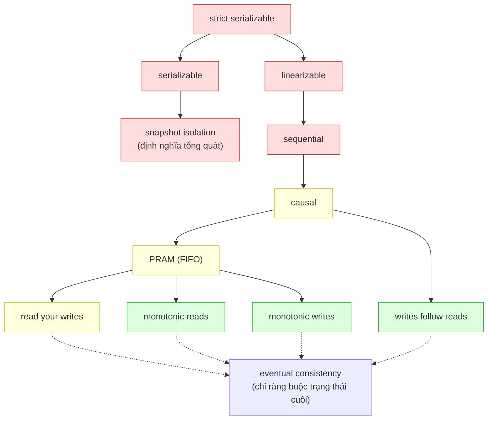
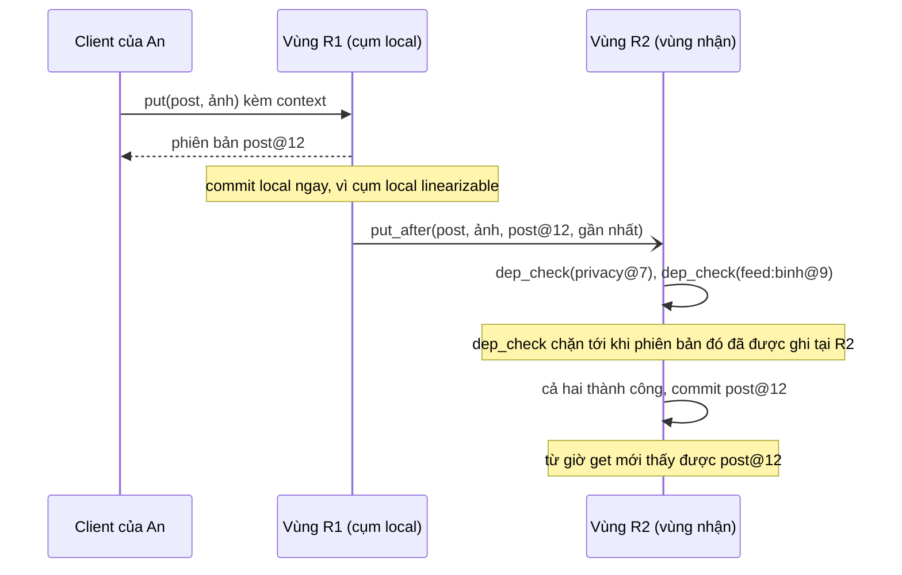

# P15 · Chương 03 — Phân cấp các mô hình consistency

> Nguồn của chương: quan hệ bao hàm giữa các mô hình lấy từ bản đồ mô hình của Jepsen và khảo sát của Viotti–Vukolić; định nghĩa gốc lấy từ Herlihy–Wing, Lamport, Terry và cộng sự (1994), COPS (Lloyd và cộng sự, 2011), Abadi (2012), Bailis và cộng sự (HAT) và Mahajan và cộng sự. Chứng minh gắn nhãn "(chứng minh của người soạn)" là do người soạn dựng từ các định nghĩa đó. Hai chương trình Rust (mục 3 phần Đi sâu và mục "Liên hệ với Rust") đã được chạy thật; kết quả được ghi là quan sát.

[P12 · Chương 09](../12-he-thong-du-lieu/09-consistency-va-consensus.md) đã định nghĩa linearizability và CAP, còn [P12 · Chương 05](../12-he-thong-du-lieu/05-replication.md) đã nói về ba bảo đảm đọc quanh replication lag. Hai chương đó cho bạn hai đầu của một dải rất rộng: linearizable ở trên cùng, "eventually consistent" ở dưới cùng. Ở giữa là một dãy mô hình có tên (sequential, causal, PRAM, các session guarantee) mà docs của database nào cũng nhắc nhưng hiếm khi định nghĩa chặt. Chương này xếp cả dải đó thành một phân cấp, và với *từng cặp mô hình liền kề* chỉ ra một lịch sử mà mô hình yếu cho phép còn mô hình mạnh cấm. Lý do làm kỹ như vậy (nhận xét của người soạn): chỉ khi thấy được lịch sử cụ thể, bạn mới biết chữ "causal" trong docs của một database hứa gì và không hứa gì, và mới chọn được mô hình rẻ nhất mà vẫn đủ cho từng thao tác.

Để mọi lịch sử đều có chỗ bám, cả chương dùng `bangtin`, một mạng xã hội nhỏ giả định (nhận xét của người soạn: ví dụ giả định, không phải code trong repo). Mỗi người dùng có hồ sơ (tên hiển thị, avatar, chế độ riêng tư `privacy`) và một bảng tin (bài đăng `post`, bình luận `reply`). Dữ liệu được nhân bản ở ba vùng `R1`, `R2`, `R3`, và app của người dùng nói chuyện với vùng gần nhất. Bốn người dùng xuất hiện trong các lịch sử: An, Bình, Chi và Dũng.

## Bạn sẽ hiểu được gì

1. **Q1.** Một consistency model là gì, "mạnh hơn" nghĩa chặt chẽ là gì, các mô hình nối với nhau thành phân cấp nào, và chứng minh một mũi tên của phân cấp là *thật sự* một chiều bằng cách nào? → mục 1
2. **Q2.** Ba bậc trên cùng (strict serializable, linearizable, sequential) mỗi bậc cấm gì, và lịch sử nào phân biệt từng cặp liền kề? → mục 2
3. **Q3.** Causal consistency chính xác là gì (happens-before trên đọc và ghi), causal+ của COPS thêm gì, và vì sao nó nằm giữa sequential và PRAM? → mục 3
4. **Q4.** COPS cài causal+ bằng dependency thế nào, vì sao chỉ cần kiểm "nearest dependency", và vì sao đọc nhiều khóa vẫn cần get transaction? → mục 4
5. **Q5.** Bốn session guarantee của Terry định nghĩa ra sao, cài bằng version vector thế nào, ghép thành PRAM và causal thế nào, và eventual consistency đứng ở đâu? → mục 5
6. **Q6.** Về phía giao dịch, serializable và snapshot isolation đứng ở đâu trong phân cấp, và lịch sử nào phân biệt chúng? → mục 6
7. **Q7.** CAP và PACELC khác nhau thế nào, và Abadi xếp các hệ thống vào ô nào? → mục 7
8. **Q8.** Mô hình nào còn dùng được khi có partition (total, sticky, unavailable), vì sao causal là "trần", và chứng minh sequential không thể luôn available ra sao? → mục 8

## Kiến thức cần trước

- [P12 · Chương 09 — Consistency và consensus](../12-he-thong-du-lieu/09-consistency-va-consensus.md), mục 1 và 2: linearizability, serializability, CAP. Chương này *không* dạy lại; nó dùng kết quả đó làm điểm xuất phát. Mục 3 của chương 09 (happens-before, vector clock) cần cho mục 3 và 4 ở đây.
- [P12 · Chương 05 — Replication](../12-he-thong-du-lieu/05-replication.md), mục 4: read-your-writes, monotonic reads, consistent prefix ở mức giới thiệu. Mục 5 ở đây đi sâu hơn: định nghĩa hình thức, cách cài và cách ghép chúng thành PRAM và causal.
- [P12 · Chương 07 — Transaction](../12-he-thong-du-lieu/07-transaction.md): serializable, snapshot isolation, write skew. Mục 6 chỉ đặt chúng vào phân cấp.
- [P14 · Chương 01 — Logic và chứng minh](../14-toan-va-ly-thuyet/01-logic-va-chung-minh.md) và [P14 · Chương 02 — Toán rời rạc](../14-toan-va-ly-thuyet/02-toan-roi-rac.md): chứng minh bằng phản chứng, bất biến quy nạp, thứ tự bộ phận. Các chứng minh ở đây dùng đúng những công cụ đó.
- Các chương cùng phase: [P15 · Chương 01 — FLP và các cận dưới](01-flp-va-cac-chan-duoi.md), [P15 · Chương 02 — Họ broadcast](02-ho-broadcast.md) (causal broadcast là cách cài replication của causal consistency), [P15 · Chương 04 — CRDT](04-crdt.md) (hội tụ mà không cần phối hợp).

---

## 1. Mô hình consistency là gì, và phân cấp nối chúng thế nào (Q1)

> **Trả lời ngắn.** Một mô hình consistency là một *tập lịch sử* (history), tức tập những cảnh đọc–ghi mà hệ thống được phép sinh ra[^jp-model]. Mô hình A mạnh hơn mô hình B khi mọi lịch sử thỏa A cũng thỏa B[^jp-implies]. Nhờ quan hệ bao hàm đó, các mô hình xếp được thành một phân cấp: mạnh nhất là strict serializable, rồi yếu dần qua linearizable, sequential, causal, PRAM tới các session guarantee[^jp-hier]. Muốn chứng minh một mô hình *thật sự* yếu hơn mô hình kia thì phải chỉ ra một lịch sử mà bên yếu cho phép còn bên mạnh cấm.

**Giải thích.**

*Với `bangtin`.* An đăng một bài rồi chuyển sang tab khác bấm F5; Bình bình luận bài đó; Chi và Dũng cuộn bảng tin từ hai vùng khác nhau. Câu hỏi "Chi sẽ thấy gì" không có đáp án duy nhất: nó phụ thuộc vào việc `bangtin` hứa mô hình nào, và mỗi mô hình là một danh sách những cảnh được phép xảy ra. Mục này định nghĩa "mô hình" và "mạnh hơn" cho chặt, vẽ phân cấp, rồi nói cách chứng minh từng mũi tên.

### 1.1 Lịch sử, mô hình và quan hệ mạnh–yếu

Trước hết cần hiểu "lịch sử" là gì. Mỗi *thao tác* (operation) có thời điểm gọi và thời điểm hoàn tất, nên hai thao tác có thể chồng nhau về thời gian[^jp-invcomp]. Một *lịch sử* gom các thao tác cùng cấu trúc đồng thời của chúng[^jp-history]. Mỗi *process* (một luồng logic duy nhất, ví dụ một phiên của app) chỉ làm một việc tại một thời điểm, nên hai thao tác của cùng một process không bao giờ chồng nhau[^jp-process]. Hệ quả mà mục 2 sẽ dùng: thao tác sau của một process luôn bắt đầu sau khi thao tác trước của nó đã kết thúc.

Có lịch sử rồi thì mô hình consistency chỉ là một tập lịch sử, dùng để phân loại cái nào "hợp lệ" với hệ thống[^jp-model]. Nó là thuộc tính an toàn (safety): nói hệ thống *được* làm gì, chứ chưa nói hệ thống *rồi sẽ* làm gì[^jp-safety]. Mô hình A *kéo theo* B (A mạnh hơn B) khi tập A nằm trong tập B; ví dụ mọi lịch sử linearizable đều sequentially consistent nên linearizable mạnh hơn sequential[^jp-implies]. Không phải cặp mô hình nào cũng so sánh được: có cặp mà mỗi bên cho phép một hành vi bên kia cấm, và ta gọi chúng là không so sánh được (incomparable)[^jp-incomp].

Chương này viết lịch sử bằng ký hiệu gọn: `W(k, v)` là ghi giá trị `v` vào thanh ghi `k`, `R(k) → v` là đọc `k` ra `v`, và `∅` là giá trị khởi tạo. Mỗi process một hàng, đọc từ trái sang phải theo thứ tự chương trình. Để biết một lần đọc đã đọc từ lần ghi nào, ta giả định mỗi giá trị ghi là duy nhất. Giả định này chỉ để đơn giản: định nghĩa gốc của COPS cho phép nhiều lần ghi cùng một giá trị và vì vậy có thể có nhiều quan hệ "puts-into" cho cùng một lịch sử[^cops-putsinto].

### 1.2 Phân cấp



(Sơ đồ tổng hợp của người soạn từ bản đồ mô hình của Jepsen. Mũi tên "A → B" nghĩa là A mạnh hơn B. Màu cho biết khả năng available khi có partition: đỏ là không available, vàng là sticky available, xanh là totally available; mục 8 chứng minh các màu này. Nét đứt đi tới eventual consistency vì đó không phải bao hàm thuần túy, xem bên dưới.)

Bản đồ có hai họ gặp nhau ở strict serializable: họ giao dịch nhiều đối tượng và họ thao tác trên một đối tượng[^jp-two-families]. Phía giao dịch, strict serializable kéo theo serializable, và serializable kéo theo snapshot isolation (theo định nghĩa tổng quát của Jepsen; mục 6 nói kỹ)[^jp-multi]. Phía một đối tượng, strict serializable kéo theo linearizable, rồi sequential, rồi causal; causal kéo theo writes follow reads và PRAM; PRAM kéo theo monotonic reads, monotonic writes và read your writes[^jp-hier]. Sơ đồ bỏ qua các mức isolation khác của họ giao dịch (repeatable read, cursor stability, read committed...) vì chúng đã nằm ở [P12 · Chương 07](../12-he-thong-du-lieu/07-transaction.md).

Eventual consistency được vẽ riêng vì nó khác loại. Nó không ràng buộc recency hay thứ tự của thao tác, mà chỉ ràng buộc *trạng thái cuối* của các replica, tức việc chúng hội tụ[^vv-ec]. Cụ thể, khi không còn ghi mới, các replica hội tụ về cùng một bản sao[^vv-ec-def]. Hội tụ là tính chất sống (liveness), còn các mô hình ở trên là tính chất an toàn, nên eventual consistency đứng ngoài chuỗi bao hàm (nhận xét của người soạn). Mục 5 dùng nó làm "sàn": mọi lịch sử hữu hạn đều lọt qua nó, và mục 8 giải thích vì sao các kết quả về availability buộc phải đòi thêm hội tụ.

### 1.3 Chứng minh một mũi tên, và chứng minh nó chỉ đi một chiều

Mỗi mũi tên A → B trong sơ đồ gồm hai nghĩa vụ chứng minh (cách tổ chức của người soạn):

1. **Bao hàm.** Mọi lịch sử thỏa A cũng thỏa B. Thường làm bằng cách chỉ ra mọi ràng buộc của B là hệ quả của các ràng buộc của A.
2. **Chặt.** Tồn tại một lịch sử H thỏa B nhưng không thỏa A. Muốn vậy phải (i) chứng minh H thỏa B, bằng cách dựng đúng đối tượng mà B đòi (một thứ tự toàn phần, một serialization cho từng process, hoặc nội dung từng replica); (ii) chứng minh H không thỏa A, thường bằng phản chứng từ ràng buộc của A.

Bảng dưới liệt kê lịch sử phân biệt cho từng cạnh của sơ đồ và nơi chứng minh nó. W1…W5 là lịch sử trên thanh ghi hoặc giao dịch; HR, HM, HW, HF là lịch sử ở mức nội dung replica của Terry (mục 5); WS là write skew (mục 6); HE là lịch sử cho eventual consistency (mục 5).

| Cạnh (mạnh → yếu) | Lịch sử phân biệt (thỏa bên yếu, vi phạm bên mạnh) | Mục |
|---|---|---|
| strict serializable → serializable | W1: giao dịch đọc không thấy ghi đã commit trước đó | 2 |
| strict serializable → linearizable | W2: từng khóa linearizable nhưng giao dịch hai khóa bị xé | 2 |
| linearizable → sequential | W3: đọc cũ sau khi ghi đã hoàn tất | 2 |
| sequential → causal | W4: hai người đọc thấy hai bài độc lập theo hai thứ tự ngược nhau | 3 |
| causal → PRAM | W5: thấy bình luận mà chưa thấy bài được trả lời | 3 |
| causal → writes follow reads | HR, HM hoặc HW (đều vi phạm PRAM) | 5 |
| PRAM → read your writes | HM hoặc HW | 5 |
| PRAM → monotonic reads | HR hoặc HW | 5 |
| PRAM → monotonic writes | HR hoặc HM | 5 |
| serializable → snapshot isolation | WS: write skew | 6 |
| mỗi session guarantee → eventual | HR, HM, HW, HF (mỗi lịch sử vi phạm đúng một guarantee) và HE | 5 |

<details><summary>Đi sâu: các định nghĩa quy về cùng ba quan hệ, và chỗ các nguồn xếp thứ tự khác nhau</summary>

- **Một khung chung.** Viotti và Vukolić định nghĩa các mô hình không giao dịch bằng cách đặt ràng buộc lên ba quan hệ: thứ tự trong session (session order), *visibility* (thao tác nào thấy được thao tác nào) và *arbitration* (một thứ tự toàn phần quyết định cách giải xung đột). Bảng dưới chép cách Jepsen tóm tắt chúng; chương này không dùng thẳng ký hiệu đó mà dùng thứ tự toàn phần, serialization theo process và nội dung replica, nhưng bảng cho thấy cả họ là các ràng buộc trên cùng ba quan hệ.

  | Mô hình | Ràng buộc (theo Viotti–Vukolić, qua Jepsen) |
  |---|---|
  | linearizable | một thứ tự toàn phần, khớp thời gian thực, và giá trị đọc đúng theo kiểu dữ liệu[^jp-lin-vv] |
  | sequential | một thứ tự toàn phần, cộng PRAM, và giá trị đọc đúng theo kiểu dữ liệu[^jp-seq-vv] |
  | causal | happens-before nằm trong visibility, happens-before nằm trong arbitration, và giá trị đọc đúng[^jp-cau-vv] |
  | PRAM | thứ tự trong session nằm trong visibility[^jp-pram-vv] |
  | read your writes | thứ tự trong session, chỉ cặp ghi → đọc, nằm trong visibility[^jp-ryw-vv] |
  | monotonic reads | nếu a thấy được bởi đọc b, b đứng trước đọc c cùng process, thì a thấy được bởi c[^jp-mr-vv] |
  | monotonic writes | thứ tự trong session, chỉ cặp ghi → ghi, nằm trong arbitration[^jp-mw-vv] |
  | writes follow reads | visibility và thứ tự session, giới hạn ở cặp đọc → ghi, nằm trong arbitration[^jp-wfr-vv] |

- **Nguồn khác nhau, thứ tự khác nhau.** Bài COPS vẽ phổ mô hình từ mạnh xuống yếu là linearizability, sequential, causal+, causal, FIFO (PRAM), per-key sequential rồi eventual[^cops-spectrum]. Cách xếp này khác sơ đồ ở trên ở hai chỗ: nó chèn causal+ và per-key sequential, còn sơ đồ của Jepsen không có hai mô hình đó. Chương này theo Jepsen cho chuỗi chính và dùng COPS khi nói về causal+ (mục 3). Viotti–Vukolić còn nhận xét rằng bài COPS xếp real-time causal mạnh hơn causal+ nhưng thật ra hai mô hình không so sánh được[^vv-rtc-incomp].
- **Những mô hình nằm ngoài chuỗi.** Các mô hình dựa trên độ cũ (staleness) cho đọc trả về giá trị cũ; chúng mạnh hơn eventual consistency nhưng đủ yếu để cài rẻ hơn linearizability[^vv-stale]. Consistent prefix và bounded staleness của Terry (2011) thuộc nhóm này; [P12 · Chương 05, mục 4](../12-he-thong-du-lieu/05-replication.md) đã giới thiệu chúng nên chương này không xếp vào phân cấp.

</details>

**Quay lại Q1:** mô hình là một tập lịch sử, "mạnh hơn" là bao hàm tập, và mỗi mũi tên của phân cấp cần hai chứng minh: bao hàm và một lịch sử phân biệt; các mục sau lần lượt đưa ra từng lịch sử đó.

---

## 2. Ba bậc trên cùng: strict serializable, linearizable, sequential (Q2)

> **Trả lời ngắn.** Linearizable bắt mọi thao tác trông như xảy ra tức thời tại một điểm trong khoảng của nó, theo thứ tự thời gian thực[^j-lin]. Sequential vẫn đòi một thứ tự toàn phần chung và thứ tự chương trình của từng process, nhưng bỏ ràng buộc thời gian thực giữa các process khác nhau[^vv-seq]. Strict serializable là bản cho giao dịch nhiều đối tượng: serializable cộng ràng buộc thời gian thực của linearizable[^j-ss-implies]. Ba lịch sử W1, W2, W3 dưới đây phân biệt từng cặp liền kề.

**Giải thích.**

*Với `bangtin`.* An đăng bài và nhận phản hồi "đã đăng". Ngay sau đó Bình, được báo qua một kênh khác (một tin nhắn riêng), mở bảng tin ở vùng khác và không thấy bài. Hệ có vi phạm lời hứa không? Với linearizable thì có, vì Bình bắt đầu đọc *sau khi* lần ghi của An đã hoàn tất, và khi đó lần đọc phải thấy giá trị đó hoặc giá trị mới hơn[^gl-read-after-write]. Với sequential thì không. Ba mục con dưới đây dựng từng lịch sử và chứng minh từng ranh giới.

### 2.1 Linearizable và sequential: lịch sử W3

Sequential consistency do Lamport định nghĩa: kết quả của mọi lần chạy phải giống như khi thao tác của mọi processor chạy theo *một* thứ tự tuần tự nào đó, và thao tác của từng processor xuất hiện trong thứ tự đó đúng như chương trình của nó quy định[^lamport-sc]. Herlihy và Wing xếp nó yếu hơn linearizability vì nó không đòi giữ thứ tự đi-trước theo thời gian thực của lịch sử gốc[^hw-seqweak]. Cụ thể, một process trong hệ sequential có thể chạy xa phía trước hay lùi sau các process khác và đọc trạng thái cũ tùy ý; nhưng một khi đã thấy một thao tác của process B thì nó không bao giờ thấy trạng thái trước thao tác đó nữa[^j-seq-stale].

**Lịch sử W3.** Khóa `post` giữ bài mới nhất của An. Con số trong ngoặc vuông là [lúc bắt đầu, lúc kết thúc], tính bằng giây trên một đồng hồ lý tưởng mà chỉ người phân tích nhìn thấy:

```text
An:   W(post, p1) [1,2]            R(post) → p1 [5,6]
Bình:                  R(post) → ∅ [3,4]
```

*W3 thỏa sequential.* Thứ tự S = ⟨R_Bình(post)→∅, W_An(post,p1), R_An(post)→p1⟩ tôn trọng thứ tự chương trình của An (ghi trước đọc), của Bình (chỉ một thao tác), và hợp lệ: lần đọc đầu thấy giá trị khởi tạo, lần đọc cuối thấy p1 vì p1 đã được ghi. Thế là đủ theo định nghĩa của sequential.

*W3 vi phạm linearizable.* (chứng minh của người soạn) Giả sử có thứ tự toàn phần hợp lệ S tôn trọng thời gian thực. W_An kết thúc lúc 2, R_Bình bắt đầu lúc 3, nên 2 < 3 buộc W_An đứng trước R_Bình trong S. Khi đó R_Bình phải trả về giá trị của lần ghi gần nhất đứng trước nó, tức p1, trong khi lịch sử nói ∅. Mâu thuẫn, nên không có S nào. ∎

Còn chiều bao hàm: *mọi lịch sử linearizable đều sequential.* (chứng minh của người soạn) Gọi S là thứ tự toàn phần hợp lệ, tôn trọng thời gian thực, của lịch sử H. Lấy hai thao tác a, b của cùng một process, với a đứng trước b trong chương trình. Process chỉ làm một việc tại một thời điểm, nên b chỉ bắt đầu sau khi a kết thúc[^jp-process]; vậy a đi trước b theo thời gian thực và S đặt a trước b. Do đó S tôn trọng thứ tự chương trình, tức chính S cũng chứng minh H sequential. ∎

Hàng W3 trong bảng kiểm bằng máy ở mục 3 (phần Đi sâu) cho cùng kết luận: linearizable KHÔNG, sequential có.

Khi nào ranh giới này đau? Khi có một kênh phụ: An nhắn cho Bình "tao vừa đăng rồi đó" và Bình mở app. Linearizable bảo đảm Bình thấy bài; sequential thì không, vì tin nhắn qua kênh phụ nằm ngoài thứ tự mà hệ thống nhìn thấy[^j-seq-advice].

### 2.2 Sequential không phải thuộc tính "local"

Linearizable có tính *local*: hệ thống linearizable nếu từng đối tượng linearizable[^hw-lin-local]. Sequential thì không[^hw-seq-nonlocal]. Dưới đây là phản ví dụ trên hai thanh ghi của `bangtin`, `feed:an` và `feed:binh`, cũng là lịch sử sẽ quay lại ở mục 8:

```text
An:   W(feed:an, a1)    R(feed:binh) → ∅
Bình: W(feed:binh, b1)  R(feed:an) → ∅
```

(chứng minh của người soạn) *Từng khóa là sequential.* Xét riêng `feed:an`: chỉ có W_An(a1) và R_Bình→∅; thứ tự ⟨R_Bình, W_An⟩ hợp lệ và tôn trọng thứ tự chương trình. Xét riêng `feed:binh` đối xứng. *Cả hệ thống không sequential.* Giả sử có thứ tự toàn phần hợp lệ S tôn trọng thứ tự chương trình. R_Bình(feed:an)→∅ nên phải đứng trước W_An(a1) (nếu sau thì nó phải thấy a1). Thứ tự chương trình của An cho W_An(a1) trước R_An(feed:binh). R_An(feed:binh)→∅ nên đứng trước W_Bình(b1). Thứ tự chương trình của Bình cho W_Bình(b1) trước R_Bình(feed:an). Ghép bốn bất đẳng thức: R_Bình(feed:an) < W_An(a1) < R_An(feed:binh) < W_Bình(b1) < R_Bình(feed:an), một vòng, mâu thuẫn. ∎

Hệ quả thực tế (nhận xét của người soạn): một kho chia khóa ra nhiều shard, mỗi shard tự nó sequential, vẫn có thể không sequential ở mức cả hệ thống. Linearizable thì không gặp vấn đề đó, và đó cũng là lý do COPS (mục 4) chia khóa ra nhiều node mà cụm vùng vẫn linearizable.

### 2.3 Strict serializable và linearizable: lịch sử W2

Linearizable là mô hình *một đối tượng*, dù phạm vi của "một đối tượng" tùy hệ: có hệ cho linearizable trên từng khóa, có hệ trên nhiều khóa trong một bảng[^j-lin-scope]. Muốn linearizable xuyên nhiều đối tượng thì phải dùng strict serializable[^j-lin-multi]. Herlihy và Wing nói linearizability là trường hợp đặc biệt của strict serializability khi mỗi giao dịch chỉ có đúng một thao tác trên đúng một đối tượng[^hw-strict]; vì vậy strict serializable kéo theo linearizable[^j-ss-implies]. Chiều ngược lại sai, và W2 là lý do.

**Lịch sử W2.** An đổi chế độ riêng tư rồi đăng bài trong *cùng một giao dịch* T1; Eve (người lạ, không phải bạn của An) chạy một giao dịch T2 đọc cả hai khóa. `privacy` và `post` nằm ở hai shard khác nhau, mỗi shard linearizable:

```text
T1 (An):  W(privacy, bạn bè) [1,2]    W(post, p1) [3,4]     (một giao dịch)
T2 (Eve):         R(privacy) → công khai [1.5,2.5]    R(post) → p1 [3.5,6]   (một giao dịch)
```

*W2 thỏa linearizable.* (chứng minh của người soạn) Coi mỗi lần đọc/ghi là một thao tác trên đối tượng của nó. Với `privacy`: ghi [1,2] và đọc [1.5,2.5] chồng nhau, nên có thể xếp đọc trước ghi và đọc thấy giá trị cũ "công khai" là hợp lệ. Với `post`: ghi [3,4] và đọc [3.5,6] chồng nhau, nên xếp ghi trước đọc và đọc thấy p1 là hợp lệ. Vậy từng đối tượng linearizable, và vì linearizable là thuộc tính local nên cả hệ thống các thao tác đơn lẻ này linearizable[^hw-lin-local].

*W2 vi phạm strict serializable, thậm chí vi phạm serializable.* (chứng minh của người soạn) Coi T1, T2 là hai giao dịch. Chỉ có hai thứ tự tuần tự. T1 rồi T2: khi đó T2 đọc `privacy` phải ra "bạn bè", nhưng lịch sử ghi "công khai". T2 rồi T1: khi đó T2 đọc `post` phải ra ∅ vì bài chưa được ghi, nhưng lịch sử ghi p1. Cả hai đều mâu thuẫn nên không có thứ tự tuần tự nào. ∎

Ý nghĩa với `bangtin`: Eve đọc `privacy`, thấy "công khai", cho phép tiếp, rồi đọc `post` và thấy bài chỉ-bạn-bè. Mục 4 sẽ thấy đúng kịch bản này trong COPS (race "kiểm tra rồi mới dùng") và cách get transaction vá nó.

### 2.4 Strict serializable và serializable: lịch sử W1

Serializable chỉ đòi các giao dịch có kết quả như thể chạy theo *một* thứ tự tuần tự nào đó, và không nói thứ tự đó là gì[^cam-linser]. Nó không đặt ràng buộc thời gian thực nào, kể cả thứ tự theo từng process[^j-ser-nort].

**Lịch sử W1:**

```text
T1 (An):   W(post, p1), commit lúc 5
T2 (Bình):                         R(post) → ∅, bắt đầu lúc 6
```

*W1 thỏa serializable.* Thứ tự tuần tự T2 rồi T1 hợp lệ: T2 chạy trên trạng thái ban đầu nên đọc ra ∅. *W1 vi phạm strict serializable.* (chứng minh của người soạn) T1 hoàn tất lúc 5, trước khi T2 bắt đầu lúc 6, nên mọi thứ tự tuần tự hợp lệ theo thời gian thực phải đặt T1 trước T2; khi đó T2 phải đọc ra p1, mâu thuẫn với ∅. ∎

Đáng chú ý: serializable thuần túy là lời hứa yếu về độ mới của dữ liệu đọc. Một database serializable luôn có thể trả trạng thái rỗng cho mọi lần đọc bằng cách coi các lần đọc đó xảy ra ở thời điểm 0[^j-ser-empty]. Đa số cài đặt không lợi dụng điều này, nhưng đó là điều định nghĩa cho phép; muốn cấm thì cần strict serializable.

Có thể nhớ bốn mô hình của mục này bằng một lưới hai chiều (nhận xét của người soạn; không phải quan hệ bao hàm, vì cột phải của hai hàng thuộc hai họ khác nhau trong sơ đồ):

| | có ràng buộc thời gian thực | không có ràng buộc thời gian thực |
|---|---|---|
| thao tác trên một đối tượng | linearizable | sequential |
| giao dịch nhiều đối tượng | strict serializable | serializable |

Hai cạnh strict serializable → serializable và linearizable → sequential cùng bỏ ràng buộc thời gian thực (W1, W3). Cạnh strict serializable → linearizable bỏ tính nguyên tử của giao dịch nhiều đối tượng (W2).

<details><summary>Đi sâu: etcd, cơ chế nào đảm bảo strict serializability, và cái giá của sequential</summary>

- **Hệ thật ở bậc trên cùng.** etcd v3.5 nói các thao tác KV là nguyên tử và xảy ra theo một thứ tự toàn phần khớp thứ tự thời gian thực, thể hiện qua revision[^etcd-strict]; nghĩa là nó tự nhận ở bậc strict serializable. [P12 · Chương 09, mục 8](../12-he-thong-du-lieu/09-consistency-va-consensus.md) đã đi qua phần này, kể cả chuyện Watch không được đảm bảo linearizable.
- **Không phải cơ chế nào cũng cho strict serializability.** Herlihy và Wing nhận xét two-phase locking đảm bảo nó, còn multiversion timestamp và các lược đồ ưu tiên availability khi có partition thì không[^hw-ss-mech]. Điều này khớp với bảng availability ở mục 8: bậc trên cùng không thể available khi có partition.
- **Cái giá của sequential so với linearizable.** Khảo sát của Viotti–Vukolić chỉ tới một so sánh định lượng giữa sức mạnh và chi phí cài đặt hai mô hình này của Attiya và Welch (1994)[^vv-attiya]. Chương này không tái hiện kết quả đó; mục 8 chỉ chứng minh phiên bản đơn giản nhất: không cài đặt nào của sequential luôn available khi có partition.

</details>

**Quay lại Q2:** linearizable thêm vào sequential ràng buộc thời gian thực (W3), strict serializable thêm vào linearizable tính nguyên tử của giao dịch nhiều đối tượng (W2), và thêm vào serializable ràng buộc thời gian thực (W1); với `bangtin`, ba ranh giới này là "bài vừa đăng có hiện ngay không", "đọc hai khóa có thấy cùng một thời điểm không" và "giao dịch đọc có thấy giao dịch đã commit trước nó không".

---
## 3. Causal consistency: happens-before trên đọc và ghi (Q3)

> **Trả lời ngắn.** Causal consistency đòi mọi process thấy các thao tác có quan hệ nhân quả theo cùng một thứ tự, còn các thao tác độc lập thì mỗi process được thấy theo thứ tự riêng[^j-cau]. "Nhân quả" ở đây là happens-before trên đọc và ghi: hai thao tác cùng một luồng, hoặc một lần đọc lấy đúng giá trị của một lần ghi, cùng bao đóng bắc cầu của hai quan hệ đó[^cops-rules-cover]. Causal+ của COPS thêm yêu cầu mọi replica xử lý xung đột giữa các ghi đồng thời theo cùng một cách, để chúng không bao giờ lệch nhau vĩnh viễn[^cops-causalplus-def]. Causal yếu hơn sequential (lịch sử W4) và mạnh hơn PRAM (lịch sử W5).

**Giải thích.**

*Với `bangtin`.* An đăng bài; Bình thấy bài rồi bình luận; Chi mở bảng tin ở một vùng khác. Hệ không được để Chi thấy bình luận của Bình mà không thấy bài của An, vì bình luận đó *trả lời* bài. Nhưng nếu An và Dũng, hai người không quen nhau, cùng đăng bài vào lúc đó thì Chi thấy bài nào trước cũng được. Sự phân biệt giữa "trả lời" và "không liên quan" chính là thứ causal consistency mã hóa.

### 3.1 Happens-before trên đọc và ghi

[P12 · Chương 09, mục 3](../12-he-thong-du-lieu/09-consistency-va-consensus.md) định nghĩa happens-before bằng việc gửi và nhận tin. Trong một kho dữ liệu mà các luồng chỉ nói chuyện với nhau qua kho, quan hệ đó được định nghĩa trên thao tác `put` và `get`, bằng ba luật[^cops-rules-cover]:

1. **Luồng thực thi.** Nếu a và b nằm trong cùng một luồng thực thi và a xảy ra trước b thì a đi trước b về nhân quả[^cops-thread].
2. **Đọc từ.** Nếu a là một `put` và b là một `get` trả về đúng giá trị mà a ghi thì a đi trước b[^cops-getsfrom].
3. **Bắc cầu.** Nếu a đi trước b và b đi trước c thì a đi trước c.

Mô hình này không cho các luồng liên lạc trực tiếp: mọi giao tiếp phải đi qua kho dữ liệu[^cops-nodirect]. Ta viết a ⇝ b khi a đi trước b về nhân quả; hai thao tác không có quan hệ ⇝ theo cả hai chiều là *đồng thời* (concurrent).

**Ví dụ.** Trên `bangtin`:

```text
An:   W(post, p1)
Bình: R(post) → p1     W(reply, c1)
Dũng: W(avatar, d1)
```

Luật 2 cho W(post,p1) ⇝ R_Bình(post)→p1, vì Bình đọc đúng giá trị An ghi. Luật 1 cho R_Bình(post) ⇝ W(reply,c1), vì cùng luồng của Bình. Luật 3 ghép lại: W(post,p1) ⇝ W(reply,c1). Còn W(avatar,d1) của Dũng không đọc gì, không nằm cùng luồng với ai, nên đồng thời với cả hai lần ghi kia. Nếu Bình *không* đọc bài trước khi bình luận thì W(post) và W(reply) cũng đồng thời.

### 3.2 Định nghĩa bằng serialization theo từng process

Định nghĩa hình thức (theo Ahamad và cộng sự, được COPS dùng lại) bắt đầu từ khái niệm *serialization*: một dãy tuyến tính của các thao tác trong đó mỗi `get` trả về `put` gần nhất đứng trước nó[^cops-serialization]. Causal consistency đòi: với *mỗi* luồng t, tồn tại một serialization của (mọi thao tác của t) cùng (mọi `put` của mọi luồng) mà tôn trọng ⇝. Nói cách khác, phải có vẻ như thao tác ghi một giá trị xảy ra sau mọi thao tác đi trước nó về nhân quả[^cops-causal-def].

Điểm mấu chốt là serialization này là *của riêng từng process*. Sequential đòi một thứ tự duy nhất cho cả hệ; causal cho mỗi process một thứ tự riêng, miễn các thứ tự đều tôn trọng ⇝. Hai process được phép xếp hai lần ghi *đồng thời* theo hai thứ tự khác nhau[^vv-concurrent]. W4 và W5 dưới đây là hai lịch sử khai thác đúng khoảng hở này.

### 3.3 Sequential → causal: lịch sử W4

**Lịch sử W4** (độc lập đọc các ghi độc lập, IRIW). An và Bình mỗi người đăng một bài; Chi và Dũng cùng đọc cả hai bảng tin, theo thứ tự ngược nhau. Hình dung: vùng gần Chi nhận bài của An trước, vùng gần Dũng nhận bài của Bình trước.

```text
An:   W(feed:an, a1)
Bình: W(feed:binh, b1)
Chi:  R(feed:an) → a1     R(feed:binh) → ∅
Dũng: R(feed:binh) → b1   R(feed:an) → ∅
```

*W4 thỏa causal.* (chứng minh của người soạn) Hai lần ghi nằm ở hai luồng khác nhau và không luồng nào đọc gì trước khi ghi, nên chúng đồng thời. Các quan hệ ⇝ duy nhất là thứ tự trong luồng của Chi và Dũng cùng quan hệ đọc-từ giữa mỗi lần ghi và lần đọc thấy nó. Chọn S_Chi = ⟨W_An, R_Chi(feed:an)→a1, R_Chi(feed:binh)→∅, W_Bình⟩ và S_Dũng = ⟨W_Bình, R_Dũng(feed:binh)→b1, R_Dũng(feed:an)→∅, W_An⟩; cho An và Bình serialization bất kỳ hợp lệ như ⟨W_An, W_Bình⟩. Mỗi dãy hợp lệ (mỗi lần đọc thấy ghi gần nhất đứng trước) và tôn trọng ⇝. Vậy W4 thỏa causal.

*W4 vi phạm sequential.* (chứng minh của người soạn) Giả sử có một thứ tự toàn phần hợp lệ S tôn trọng thứ tự chương trình. R_Chi(feed:binh)→∅ nên đứng trước W_Bình; R_Chi(feed:an)→a1 nên đứng sau W_An; thứ tự chương trình của Chi cho R_Chi(feed:an) trước R_Chi(feed:binh). Vậy W_An < R_Chi(feed:an) < R_Chi(feed:binh) < W_Bình. Lập luận đối xứng cho Dũng: W_Bình < R_Dũng(feed:binh) < R_Dũng(feed:an) < W_An. Hai chuỗi cho W_An < W_Bình và W_Bình < W_An, mâu thuẫn. ∎

### 3.4 Causal → PRAM: lịch sử W5

PRAM (còn gọi FIFO) đòi mọi lần ghi của *một* process được mọi nơi thấy theo đúng thứ tự process đó đã ghi, còn ghi của các process khác nhau có thể được thấy theo thứ tự khác nhau[^j-pram].

**Lịch sử W5** (bình luận hiện trước bài):

```text
An:   W(post, p1)
Bình: R(post) → p1     W(reply, c1)
Chi:  R(reply) → c1    R(post) → ∅
```

*W5 thỏa PRAM.* (chứng minh của người soạn) An chỉ ghi một lần, Bình chỉ ghi một lần, nên PRAM không ràng buộc thứ tự giữa W(post) và W(reply). Chọn S_Chi = ⟨W_Bình(reply,c1), R_Chi(reply)→c1, R_Chi(post)→∅, W_An(post,p1)⟩: hợp lệ và tôn trọng thứ tự chương trình của Chi. Serialization của An và Bình đơn giản hơn nên bỏ qua. Vậy W5 thỏa PRAM.

*W5 vi phạm causal.* (chứng minh của người soạn) Ví dụ ở mục 3.1 cho W_An(post,p1) ⇝ W_Bình(reply,c1). Một serialization hợp lệ S_Chi tôn trọng ⇝ phải đặt W(post,p1) trước W(reply,c1). Thứ tự chương trình của Chi đặt R_Chi(reply)→c1 trước R_Chi(post). Ghép lại: W(post,p1) < W(reply,c1) < R_Chi(reply)→c1 < R_Chi(post), nên lần đọc `post` của Chi phải thấy p1 hoặc ghi mới hơn, mâu thuẫn với ∅. ∎

Đây là đúng bất thường "bình luận hiện trước bài" mà bài COPS dùng làm động lực: bản sao của ví dụ ảnh–album, nơi nếu album có tham chiếu tới ảnh thì người xem phải thấy được ảnh[^cops-photo].

### 3.5 Chứng minh bao hàm: sequential ⇒ causal ⇒ PRAM

(chứng minh của người soạn; dùng định nghĩa serialization ở mục 3.2 và giả định giá trị ghi duy nhất.)

**Causal ⇒ PRAM.** Với mỗi process p, serialization S_p của causal tôn trọng ⇝. Thứ tự chương trình là một phần của ⇝ (luật 1), nên S_p tôn trọng thứ tự chương trình, và riêng với các lần ghi của từng process q thì S_p đặt chúng đúng thứ tự q đã ghi. Đó chính là PRAM. ∎

**Sequential ⇒ causal.** Gọi S là thứ tự toàn phần hợp lệ, tôn trọng thứ tự chương trình, của lịch sử H. *Bước 1: S tôn trọng ⇝.* Luật 1 đúng vì S tôn trọng thứ tự chương trình. Luật 2: nếu a là `put` mà b là `get` trả đúng giá trị của a thì vì S hợp lệ, b trả về `put` gần nhất đứng trước nó trên khóa đó, nên a phải đứng trước b. Luật 3 giữ nguyên vì "đứng trước trong S" bắc cầu. Vậy mọi cặp a ⇝ b đều có a đứng trước b trong S. *Bước 2: lấy serialization của từng process.* Với process p, cho S_p là S đã bỏ đi mọi lần đọc của các process khác. Vẫn hợp lệ, vì giá trị mỗi lần đọc còn lại được quyết định bởi các lần ghi đứng trước nó trên cùng khóa và mọi lần ghi đều còn đó. S_p vẫn tôn trọng ⇝ vì là dãy con của S. Vậy H thỏa causal. ∎

Hai bao hàm này cùng với W4 và W5 cho sequential ⊋ causal ⊋ PRAM trên thanh ghi. Phần Đi sâu ngay dưới kiểm lại các lịch sử đó và các bao hàm bằng máy.

### 3.6 Causal+: thêm hội tụ

Causal consistency tự nó cho phép hai replica lệch nhau mãi. Ví dụ trên `bangtin`: An và Bình, hai quản trị viên của một nhóm, cùng lúc đổi tên nhóm, An ở `R1` và Bình ở `R2`. Hai lần ghi đồng thời nên causal không ép thứ tự nào. Bài COPS chỉ ra điều tương tự: causal thường cho phép hai replica trả về hai giá trị khác nhau *mãi mãi*, kể cả sau khi cả hai lần ghi đã tới đủ[^cops-carol-dan]. Causal+ vá chỗ đó: nó là causal cộng với xử lý xung đột hội tụ[^cops-causalplus-def], tức mọi replica độc lập nhau mà vẫn cùng chọn một cách giải xung đột[^vv-causalplus].

Cách giải xung đột COPS dùng là mỗi lần ghi nhận một số phiên bản từ Lamport timestamp (các bit cao là đồng hồ Lamport, các bit thấp là mã node), nên mỗi khóa có một thứ tự toàn phần giữa các phiên bản và thứ tự đó ngầm cài chính sách "ghi sau thắng" (last-writer-wins)[^cops-lamport]. Với tên nhóm: bản nào có timestamp lớn hơn thắng ở mọi replica, và hai replica cuối cùng hội tụ. Cũng có thể giữ cả hai giá trị để ứng dụng chọn, như "return-them-all"[^cops-lww-notrtc].

Về mặt hình thức, Viotti–Vukolić định nghĩa causal+ là causal cộng *strong convergence*: các replica đã áp dụng cùng một tập lần ghi thì có cùng trạng thái[^vv-strongconv]. COPS đặt causal+ giữa sequential và causal trên phổ mô hình, tức mạnh hơn causal và yếu hơn sequential[^cops-spectrum].

<details><summary>Đi sâu: kiểm bằng máy (chương trình Rust đã chạy), real-time causal và hai cách định nghĩa causal</summary>

**Kiểm bằng máy.** Để không phải tin hoàn toàn vào lập luận tay ở mục 2 và 3, chương trình dưới đây duyệt vét cạn các serialization để kiểm bốn mô hình trên thanh ghi: linearizable, sequential, causal và PRAM (theo định nghĩa serialization theo process ở mục 3.2). Nó (1) chạy các lịch sử W0, W3, W4, W5, SB (lịch sử ở mục 2.2) và ba lịch sử vi phạm session guarantee HR, HM, HW của mục 5, và (2) liệt kê *mọi* lịch sử nhỏ (hai khóa, giá trị ghi duy nhất, mỗi lần đọc trả `∅` hoặc giá trị của một lần ghi cùng khóa) để kiểm sequential ⊆ causal ⊆ PRAM. Chương trình không xét transaction nên không kiểm W1, W2.

```rust
// Kiểm tra brute-force bốn mô hình trên thanh ghi (register): linearizable, sequential, causal, PRAM.
// Giả thiết: mỗi lần ghi mang giá trị duy nhất khác 0; 0 là giá trị khởi tạo.
#[derive(Clone, Copy, PartialEq, Eq)]
enum Kind { W, R }

#[derive(Clone, Copy)]
struct Op { p: usize, kind: Kind, key: usize, val: u8, inv: u32, res: u32 }

struct H { ops: Vec<Op>, keys: usize }

impl H {
    fn n(&self) -> usize { self.ops.len() }
    // program order: cùng process, a đứng trước b (ops của một process nằm liền nhau, theo thứ tự chương trình)
    fn po(&self, a: usize, b: usize) -> bool { self.ops[a].p == self.ops[b].p && a < b }
    // rf[r] = Some(w) nếu r đọc giá trị do w ghi; None nếu r đọc 0. Ngoài ra trả None cho cả hàm nếu r đọc giá trị không ai ghi.
    fn rf(&self) -> Option<Vec<Option<usize>>> {
        let mut v = vec![None; self.n()];
        for (i, o) in self.ops.iter().enumerate() {
            if o.kind == Kind::R && o.val != 0 {
                v[i] = Some(self.ops.iter().position(|x| x.kind == Kind::W && x.key == o.key && x.val == o.val)?);
            }
        }
        Some(v)
    }
    fn procs(&self) -> usize { self.ops.iter().map(|o| o.p).max().unwrap_or(0) + 1 }
}

fn closure(mut m: Vec<Vec<bool>>) -> Vec<Vec<bool>> {
    let n = m.len();
    for k in 0..n { for i in 0..n { if m[i][k] { for j in 0..n { if m[k][j] { m[i][j] = true; } } } } }
    m
}

// Tìm một serialization hợp lệ (legal) của tập `sub` tôn trọng quan hệ `before`.
fn search(h: &H, sub: &[usize], before: &[Vec<bool>], placed: &mut [bool], state: &mut [u8], count: usize) -> bool {
    if count == sub.len() { return true; }
    for &i in sub {
        if placed[i] { continue; }
        if sub.iter().any(|&j| j != i && !placed[j] && before[j][i]) { continue; }
        let o = h.ops[i];
        if o.kind == Kind::R && state[o.key] != o.val { continue; }
        let old = state[o.key];
        if o.kind == Kind::W { state[o.key] = o.val; }
        placed[i] = true;
        if search(h, sub, before, placed, state, count + 1) { return true; }
        placed[i] = false;
        state[o.key] = old;
    }
    false
}

fn serializable(h: &H, sub: &[usize], before: &[Vec<bool>]) -> bool {
    search(h, sub, before, &mut vec![false; h.n()], &mut vec![0u8; h.keys], 0)
}

fn po_matrix(h: &H) -> Vec<Vec<bool>> {
    (0..h.n()).map(|a| (0..h.n()).map(|b| h.po(a, b)).collect()).collect()
}

// Linearizable: một thứ tự toàn phần hợp lệ, tôn trọng thứ tự thời gian thực (res(a) < inv(b) thì a đứng trước b).
fn lin(h: &H) -> bool {
    if h.rf().is_none() { return false; }
    let before: Vec<Vec<bool>> = (0..h.n()).map(|a| (0..h.n()).map(|b| h.ops[a].res < h.ops[b].inv).collect()).collect();
    serializable(h, &(0..h.n()).collect::<Vec<_>>(), &before)
}

// Sequential: một thứ tự toàn phần hợp lệ, chỉ cần tôn trọng program order.
fn sc(h: &H) -> bool {
    h.rf().is_some() && serializable(h, &(0..h.n()).collect::<Vec<_>>(), &po_matrix(h))
}

// Với mỗi process p: một serialization hợp lệ của (mọi op của p) ∪ (mọi lần ghi), tôn trọng `before`.
fn per_process(h: &H, before: &[Vec<bool>]) -> bool {
    (0..h.procs()).all(|p| {
        let sub: Vec<usize> = (0..h.n()).filter(|&i| h.ops[i].p == p || h.ops[i].kind == Kind::W).collect();
        serializable(h, &sub, before)
    })
}

fn pram(h: &H) -> bool { h.rf().is_some() && per_process(h, &po_matrix(h)) }

// Causal: thứ tự nhân quả = bao đóng bắc cầu của (program order ∪ reads-from), tính trên TOÀN lịch sử.
fn causal(h: &H) -> bool {
    let rf = match h.rf() { Some(r) => r, None => return false };
    let mut m = po_matrix(h);
    for (r, w) in rf.iter().enumerate() { if let Some(w) = w { m[*w][r] = true; } }
    per_process(h, &closure(m))
}

type Spec<'a> = &'a [(Kind, usize, u8, u32, u32)];

fn mk(keys: usize, procs: &[Spec]) -> H {
    let mut ops = Vec::new();
    for (p, list) in procs.iter().enumerate() {
        for &(kind, key, val, inv, res) in list.iter() { ops.push(Op { p, kind, key, val, inv, res }); }
    }
    H { ops, keys }
}

fn yn(b: bool) -> &'static str { if b { "có" } else { "KHÔNG" } }

fn report(name: &str, h: &H) {
    println!("{:<52} lin={:<6} sc={:<6} causal={:<6} pram={:<6}", name, yn(lin(h)), yn(sc(h)), yn(causal(h)), yn(pram(h)));
}

// Liệt kê mọi lịch sử nhỏ: mỗi slot là (ghi hoặc đọc) × khóa; mỗi lần ghi mang giá trị duy nhất;
// mỗi lần đọc trả 0 hoặc giá trị của một lần ghi cùng khóa. Không xét thời gian thực.
fn enumerate(counts: &[usize], keys: usize) -> [u64; 5] {
    let slots: usize = counts.iter().sum();
    let opts = 2 * keys;
    let (mut all, mut n_sc, mut n_cau, mut n_pram, mut broken) = (0u64, 0u64, 0u64, 0u64, 0u64);
    for shape in 0..opts.pow(slots as u32) {
        let mut s = shape;
        let kinds: Vec<(Kind, usize)> = (0..slots).map(|_| { let o = s % opts; s /= opts; (if o < keys { Kind::W } else { Kind::R }, o % keys) }).collect();
        let mut wval = vec![0u8; slots];
        let mut next = 1u8;
        for i in 0..slots { if kinds[i].0 == Kind::W { wval[i] = next; next += 1; } }
        let read_opts: Vec<Vec<u8>> = (0..slots).map(|i| {
            if kinds[i].0 == Kind::W { return Vec::new(); }
            let mut v = vec![0u8];
            for j in 0..slots { if kinds[j].0 == Kind::W && kinds[j].1 == kinds[i].1 { v.push(wval[j]); } }
            v
        }).collect();
        let mut idx = vec![0usize; slots];
        loop {
            let mut ops = Vec::new();
            let mut slot = 0;
            for (p, &c) in counts.iter().enumerate() {
                for _ in 0..c {
                    let (kind, key) = kinds[slot];
                    let val = if kind == Kind::W { wval[slot] } else { read_opts[slot][idx[slot]] };
                    ops.push(Op { p, kind, key, val, inv: 0, res: 0 });
                    slot += 1;
                }
            }
            let h = H { ops, keys };
            let (a, b, c) = (sc(&h), causal(&h), pram(&h));
            all += 1;
            n_sc += a as u64; n_cau += b as u64; n_pram += c as u64;
            if (a && !b) || (b && !c) { broken += 1; }
            let mut k = 0;
            while k < slots {
                if kinds[k].0 == Kind::R && idx[k] + 1 < read_opts[k].len() { idx[k] += 1; break; }
                idx[k] = 0;
                k += 1;
            }
            if k == slots { break; }
        }
    }
    [all, n_sc, n_cau, n_pram, broken]
}

fn main() {
    use Kind::*;
    println!("== Lịch sử minh họa (khóa 0 = post, khóa 1 = reply hoặc post thứ hai) ==");
    report("W0  An ghi xong, Bình đọc sau đó và thấy bài", &mk(2, &[&[(W, 0, 1, 1, 2)], &[(R, 0, 1, 3, 4)]]));
    report("W3  Bình đọc không thấy bài dù An đã ghi xong", &mk(2, &[&[(W, 0, 1, 1, 2), (R, 0, 1, 5, 6)], &[(R, 0, 0, 3, 4)]]));
    report("W4  IRIW: Chi và Dũng thấy hai bài theo thứ tự ngược", &mk(2, &[&[(W, 0, 1, 1, 2)], &[(W, 1, 2, 1, 2)], &[(R, 0, 1, 3, 4), (R, 1, 0, 5, 6)], &[(R, 1, 2, 3, 4), (R, 0, 0, 5, 6)]]));
    report("W5  Chi thấy reply nhưng không thấy post", &mk(2, &[&[(W, 0, 1, 1, 2)], &[(R, 0, 1, 3, 4), (W, 1, 2, 5, 6)], &[(R, 1, 2, 7, 8), (R, 0, 0, 9, 10)]]));
    report("W5' Chi thấy post rồi mới thấy reply", &mk(2, &[&[(W, 0, 1, 1, 2)], &[(R, 0, 1, 3, 4), (W, 1, 2, 5, 6)], &[(R, 0, 1, 7, 8), (R, 1, 2, 9, 10)]]));
    report("SB  hai phía ghi rồi cùng đọc khóa kia ra 0", &mk(2, &[&[(W, 0, 1, 1, 2), (R, 1, 0, 3, 4)], &[(W, 1, 2, 1, 2), (R, 0, 0, 3, 4)]]));
    report("HR  An ghi bài rồi tự đọc lại không thấy", &mk(2, &[&[(W, 0, 1, 1, 2), (R, 0, 0, 3, 4)]]));
    report("HM  Chi thấy bài rồi lại không thấy", &mk(2, &[&[(W, 0, 1, 1, 2)], &[(R, 0, 1, 3, 4), (R, 0, 0, 5, 6)]]));
    report("HW  Chi thấy bài mà chưa thấy avatar An đổi trước đó", &mk(2, &[&[(W, 1, 1, 1, 2), (W, 0, 2, 3, 4)], &[(R, 0, 2, 5, 6), (R, 1, 0, 7, 8)]]));

    println!("\n== Liệt kê mọi lịch sử nhỏ (không xét thời gian thực) ==");
    for counts in [vec![2usize, 2, 2], vec![1, 1, 2, 2]] {
        let [all, s, c, p, broken] = enumerate(&counts, 2);
        println!("số op mỗi process {:?}, 2 khóa: {} lịch sử; SC {}, causal {}, PRAM {}; vi phạm SC⊆causal⊆PRAM: {}", counts, all, s, c, p, broken);
    }
}
```

Kết quả chạy thật (quan sát một lần chạy trên macOS arm64, `rustc 1.95.0 -O`):

```text
== Lịch sử minh họa (khóa 0 = post, khóa 1 = reply hoặc post thứ hai) ==
W0  An ghi xong, Bình đọc sau đó và thấy bài         lin=có     sc=có     causal=có     pram=có    
W3  Bình đọc không thấy bài dù An đã ghi xong        lin=KHÔNG  sc=có     causal=có     pram=có    
W4  IRIW: Chi và Dũng thấy hai bài theo thứ tự ngược lin=KHÔNG  sc=KHÔNG  causal=có     pram=có    
W5  Chi thấy reply nhưng không thấy post             lin=KHÔNG  sc=KHÔNG  causal=KHÔNG  pram=có    
W5' Chi thấy post rồi mới thấy reply                 lin=có     sc=có     causal=có     pram=có    
SB  hai phía ghi rồi cùng đọc khóa kia ra 0          lin=KHÔNG  sc=KHÔNG  causal=có     pram=có    
HR  An ghi bài rồi tự đọc lại không thấy             lin=KHÔNG  sc=KHÔNG  causal=KHÔNG  pram=KHÔNG 
HM  Chi thấy bài rồi lại không thấy                  lin=KHÔNG  sc=KHÔNG  causal=KHÔNG  pram=KHÔNG 
HW  Chi thấy bài mà chưa thấy avatar An đổi trước đó lin=KHÔNG  sc=KHÔNG  causal=KHÔNG  pram=KHÔNG 

== Liệt kê mọi lịch sử nhỏ (không xét thời gian thực) ==
số op mỗi process [2, 2, 2], 2 khóa: 48388 lịch sử; SC 27958, causal 28604, PRAM 29292; vi phạm SC⊆causal⊆PRAM: 0
số op mỗi process [1, 1, 2, 2], 2 khóa: 48388 lịch sử; SC 34376, causal 34640, PRAM 34896; vi phạm SC⊆causal⊆PRAM: 0
```

Cách đọc kết quả (chỉ là quan sát trên không gian nhỏ này, không thay thế chứng minh): các hàng W3, W4, W5 và SB khớp từng chữ với lập luận tay (W3: sequential có, linearizable không; W4 và SB: causal có, sequential không; W5: PRAM có, causal không). Ba hàng HR, HM, HW không thỏa cả bốn mô hình, nhất quán với việc mỗi lịch sử đó vi phạm một thành phần của PRAM (mục 5). Hai dòng cuối cho 0 vi phạm bao hàm trên 48.388 lịch sử mỗi cấu hình, và các số SC < causal < PRAM < tổng cho thấy cả hai bao hàm đều chặt trong không gian đã duyệt. Hai cấu hình có cùng tổng vì cùng 6 thao tác và 2 khóa; chúng chỉ khác cách chia thao tác cho các process.

**Real-time causal và causal+ không so sánh được.** Mahajan và cộng sự định nghĩa real-time causal (RTC) là causal cộng một điều kiện: hai lần ghi đồng thời về nhân quả nhưng không chồng nhau về thời gian thực phải được áp theo đúng thứ tự thời gian thực[^vv-rtc-def]. COPS nhận xét rằng chính sách ghi-sau-thắng bằng timestamp của nó cho một hệ causal+ nhưng không phải RTC, còn chính sách "trả hết các giá trị" cho cả hai[^cops-lww-notrtc]. Viotti–Vukolić kết luận hai mô hình không so sánh được[^vv-rtc-incomp]. Mục 8 dùng RTC vì nó là kết quả cận trên của Mahajan.

**Hai cách định nghĩa causal không trùng khít (suy luận của người soạn).** Mahajan và cộng sự không ép cách giải xung đột: chúng yêu cầu lần đọc trả *mọi* lần ghi đồng thời gần nhất để lớp trên tự chọn[^j-cau-mahajan]. Trong khung của Viotti–Vukolić, một lần đọc trả giá trị của lần ghi cuối theo thứ tự arbitration mà nó thấy được[^vv-rval], và arbitration là *một* thứ tự toàn phần chung. Từ đó suy ra: nếu An đọc `x` ra 1 rồi 2, Bình đọc ra 2 rồi 1 (hai lần ghi đồng thời vào `x`), thì lần đọc thứ hai của An cho ghi-2 đứng sau ghi-1 trong arbitration, lần đọc thứ hai của Bình cho điều ngược lại, mâu thuẫn. Khung per-process serialization của mục 3.2 lại cho phép chuyện này, vì mỗi process có serialization riêng. Điều này nhất quán với việc causal+ cần thêm strong convergence để loại những lịch sử kiểu đó.

</details>

**Quay lại Q3:** causal là "mọi process thấy cùng một thứ tự cho các thao tác có quan hệ ⇝ (cùng luồng, đọc-từ, bắc cầu), nhưng được phép thấy các ghi độc lập theo thứ tự riêng"; nó yếu hơn sequential vì W4 và mạnh hơn PRAM vì W5, còn causal+ thêm hội tụ để hai replica không lệch nhau vĩnh viễn.

---

## 4. Cài causal+ bằng dependency: COPS (Q4)

> **Trả lời ngắn.** COPS chạy mỗi vùng như một cụm linearizable có đủ dữ liệu, cho client đọc và ghi ở vùng gần nhất rồi nhân bản bất đồng bộ sang vùng khác[^cops-arch]. Thư viện phía client nhớ những phiên bản mà luồng của client đã đọc hoặc ghi; mỗi lần ghi mang danh sách đó làm *dependency*, và vùng nhận bản sao chỉ commit khi các dependency đã commit tại chỗ[^cops-commit]. Chỉ cần kiểm các *nearest dependency*, vì phần còn lại đã được bảo đảm qua bắc cầu[^cops-nearest]. Còn đọc nhiều khóa bằng các `get` đơn lẻ vẫn có thể thấy một snapshot không nhất quán, nên COPS-GT thêm get transaction hai vòng[^cops-gt-why].

**Giải thích.**

*Với `bangtin`.* An đổi `privacy` thành "chỉ bạn bè" rồi đăng bài ảnh Đà Lạt. Nếu vùng `R2` áp bài đăng trước khi áp lần đổi riêng tư, người lạ ở gần `R2` có một khoảng hở để đọc `privacy` thấy "công khai" rồi đọc `post` thấy bài. Causal consistency chặn được chuyện đó nếu hệ biết bài đăng *phụ thuộc* vào lần đổi riêng tư, và hệ biết vì cả hai cùng nằm trong luồng của An, đổi riêng tư trước, đăng bài sau. Mục này mô tả hệ biết bằng cách nào và thực thi sự phụ thuộc đó ra sao, theo thiết kế của COPS (nhận xét của người soạn: `bangtin` không dùng COPS; đây chỉ là cách minh họa).

### 4.1 Kiến trúc và context

Mỗi vùng (datacenter) có một cụm COPS giữ đủ bản sao của dữ liệu[^cops-full-replica]; client chỉ nói chuyện với cụm cùng vùng[^cops-local-only]. Mỗi cụm là một kho key-value linearizable, được chia khóa ra nhiều partition; vì linearizable có tính local (mục 2.2), việc ghép các partition vẫn cho một cụm linearizable[^cops-compose]. Còn giữa các vùng, bản ghi được nhân bản bất đồng bộ.

Thư viện phía client giữ một *context* cho từng luồng thực thi của ứng dụng[^cops-ctx-def]. Bản COPS (không phải COPS-GT) chỉ lưu các cặp ⟨khóa, phiên bản⟩. Mỗi `get` thêm cặp ⟨khóa, phiên bản⟩ vừa nhận vào context. Mỗi `put` lấy context hiện tại làm *nearest dependency*, xóa context, rồi nạp lại context chỉ với chính `put` đó[^cops-ctx]. Lý do `put` thay được cả context: `put` mới phụ thuộc vào mọi thứ trước đó trong context nên nó "gần" hơn chúng. Mỗi client chỉ được có một `put` đang chạy, vì `put` sau phải biết số phiên bản của `put` trước thì mới phụ thuộc vào nó được[^cops-single-put].

### 4.2 Ví dụ số: nearest dependency

Phiên của An trên `bangtin`, mỗi bước kèm context sau bước đó (số sau dấu `@` là số phiên bản; các số là của người soạn):

| Bước | Thao tác của An | Dependency gắn vào lần ghi | Context sau bước |
|---|---|---|---|
| 1 | `put(avatar, mới)` được phiên bản `avatar@5` | không có | {avatar@5} |
| 2 | `put(privacy, bạn bè)` được `privacy@7` | gần nhất: {avatar@5} | {privacy@7} |
| 3 | `get(feed:binh)` trả `feed:binh@9` | không áp dụng | {privacy@7, feed:binh@9} |
| 4 | `put(post, ảnh Đà Lạt)` được `post@12` | gần nhất: {privacy@7, feed:binh@9} | {post@12} |

Giả sử `feed:binh@9` lại phụ thuộc vào `post:binh@3`. Khi đó danh sách *đầy đủ* các dependency của `post@12` có 4 phần tử: `privacy@7`, `avatar@5`, `feed:binh@9`, `post:binh@3`. Nhưng `put_after` gửi sang vùng khác chỉ cần mang hai nearest dependency, `privacy@7` và `feed:binh@9`: nếu một vùng đã commit `privacy@7` thì nó đã commit `avatar@5`, và nếu đã commit `feed:binh@9` thì đã commit `post:binh@3`. Vùng nhận chỉ gửi 2 lần `dep_check` thay vì 4. Bài COPS nói đúng như vậy: các nearest dependency là đủ để kho key-value cho causal+, còn danh sách đầy đủ chỉ cần cho `get_trans` của COPS-GT[^cops-nearest]. Theo ngôn ngữ đồ thị, nearest dependency của một giá trị là những đỉnh trong đồ thị nhân quả có đường đi dài nhất tới giá trị đó bằng một[^cops-nearest-def].

### 4.3 Nhân bản và `dep_check`



(Sơ đồ của người soạn theo mô tả của COPS.) Ở cụm local, điều kiện "ghi sau khi mọi dependency đã được ghi" tự thỏa vì cụm linearizable: nếu y phụ thuộc x thì `put(x)` đã commit trước khi `put(y)` được gửi[^cops-local-auto]. Ở vùng khác thì không tự thỏa. Nút nhận `put_after` từ vùng khác phải xác định xem các nearest dependency đã được thỏa tại chỗ chưa[^cops-depcheck]. Nó hỏi bằng `dep_check`: nút được hỏi kiểm tra trạng thái cục bộ, trả lời ngay nếu phiên bản đó đã được ghi, ngược lại thì chặn tới khi nó được ghi[^cops-depcheck-block]. Khi mọi `dep_check` thành công thì nút commit giá trị và mới cho các lần đọc và ghi khác ở cụm thấy nó[^cops-commit]. Hệ quả: bản ghi nhân bản đến thì có thể phải chờ, nhưng `get` không bao giờ bị chặn[^cops-reads-nonblock].

Số phiên bản do nút chính của khóa tại cụm local gán, bằng Lamport timestamp[^cops-lamport]. Nhờ đó mỗi replica chỉ trả về cùng phiên bản đó hoặc phiên bản sau nó về nhân quả: đây là tính chất "tiến dần" (progressing) của causal+[^cops-prog].

### 4.4 Chứng minh: commit không bao giờ đi trước dependency

(chứng minh của người soạn, theo cơ chế mô tả trong bài COPS. Phạm vi: trường hợp *không có hai ghi đồng thời vào cùng một khóa*; trường hợp có xung đột cần thêm phần xử lý hội tụ của định nghĩa causal+, nơi tập `put` của mỗi luồng bị giới hạn thành tập không xung đột[^cops-cf].)

**Ký hiệu.** Với hai lần ghi u, v, ta viết u ⇝ v nếu `put` u đi trước `put` v về nhân quả. Một phiên bản (k, i) *đã commit tại cụm V* nếu V đã commit đúng phiên bản đó; việc commit không bao giờ bị rút lại nên "đã commit" chỉ đổi từ sai sang đúng theo thời gian.

**Bổ đề 1 (nearest dependency đủ để phủ).** Gọi N là tập nearest dependency mà thư viện gắn vào lần ghi v của luồng c. Khi đó mọi u ⇝ v đều thuộc N hoặc thỏa u ⇝ n với một n nào đó thuộc N.

*Chứng minh.* Trong ba luật nhân quả, `put` v chỉ có thể nhận cạnh vào từ luật 1, tức từ thao tác ngay trước nó trong luồng c, vì cạnh "đọc-từ" chỉ đi từ `put` tới `get`. Thao tác ngay trước đó hoặc là một `put` p của c, hoặc là một `get` của c. Theo mục 4.1, context của c ngay trước v gồm đúng: `put` gần nhất p của c (nếu có) và các phiên bản mà c đã `get` sau p. Mọi thao tác của c trước p đều ⇝ p theo luật 1 và 3, nên mọi dependency sinh ra từ chúng cũng là dependency của p. Mỗi `get` sau p trả về một phiên bản g, và `put` ghi ra g là đỉnh ⇝ lần `get` đó theo luật 2, rồi ⇝ v theo luật 1 và 3; mọi thứ ⇝ g khác thì ⇝ chính g. Như vậy mọi u ⇝ v hoặc là một phần tử của context, hoặc ⇝ một phần tử của context. ∎

**Bất biến I.** Tại mọi thời điểm t và mọi cụm V: nếu v đã commit tại V thì mọi u ⇝ v đã commit tại V.

*Chứng minh quy nạp theo thứ tự các sự kiện commit tại V.* Trường hợp cơ sở: chưa có commit nào, I đúng hiển nhiên. Bước quy nạp: giả sử I đúng ngay trước một sự kiện commit phiên bản v tại V; ta chứng minh I vẫn đúng ngay sau đó. Các cặp (v', u') đã có từ trước vẫn thỏa vì "đã commit" không bị rút lại. Còn lại cặp mới: mọi u ⇝ v phải đã commit tại V. Hai trường hợp:

- *Trường hợp A: v do một client của V ghi (V là cụm local).* Client chỉ nói chuyện với V (mục 4.1). Mọi phần tử n của N là phiên bản mà c đã `get` từ V hoặc đã `put` vào V, nên n đã commit tại V *trước* v. Theo giả thiết quy nạp I áp cho n, mọi u' ⇝ n đã commit tại V. Theo bổ đề 1, mọi u ⇝ v hoặc thuộc N (đã commit) hoặc ⇝ một n ∈ N (đã commit theo I áp cho n). Vậy I đúng sau commit v.
- *Trường hợp B: v tới V bằng `put_after` từ vùng khác.* V chỉ commit v sau khi mọi `dep_check` cho N thành công (mục 4.3), nghĩa là mọi n ∈ N đã commit tại V. Lập luận còn lại giống trường hợp A: I áp cho n cho ra mọi u' ⇝ n đã commit, và bổ đề 1 phủ mọi u ⇝ v. Vậy I đúng sau commit v. ∎

**Hệ quả 1.** Tại mỗi cụm V, thứ tự commit là một mở rộng tuyến tính của ⇝ trên các lần ghi: nếu u ⇝ v và cả hai đã commit tại V thì u commit trước v. (Theo I, ngay khi v commit thì u đã commit.)

**Hệ quả 2 (causal cho `get` và `put` đơn lẻ).** Với luồng c ở cụm V, dựng S_c như sau: lấy các sự kiện commit tại V theo thời gian thực làm xương sống; chèn mỗi `get` của c vào điểm mà cụm trả lời nó (cụm linearizable nên `get` trả đúng phiên bản hiện hành của khóa tại điểm đó); các lần ghi chưa commit tại V được xếp cuối dãy theo một mở rộng tuyến tính của ⇝ (không thể có lần ghi chưa commit nào ⇝ một lần ghi đã commit, theo I). Dãy S_c hợp lệ (mỗi `get` thấy `put` gần nhất đứng trước, nhờ không có xung đột), tôn trọng luật 1 (các thao tác của c tuần tự, điểm trả lời nằm trong khoảng của thao tác), luật 2 (`put` được commit trước điểm trả lời của `get` đọc nó) và luật 3 (tính bắc cầu). Vậy kho COPS thỏa causal cho lịch sử không xung đột. ∎

### 4.5 Vì sao `get` đơn lẻ chưa đủ, và get transaction

Bất biến I chỉ nói về *từng* lần đọc. Nó không ngăn một chuỗi hai lần đọc nhìn thấy hai thời điểm khác nhau. Đó chính là kịch bản của W2. COPS mô tả đúng ví dụ đó với album và ACL: khi Eve đọc album, `get(ACL)` của cô có thể trả ACL cũ vốn cho phép mọi người đọc, còn `get(album)` lại trả nội dung phiên bản "chỉ bạn bè"[^cops-acl]. Trong thuật ngữ của chương này: Eve đọc `privacy` ra "công khai" rồi đọc `post` ra bài chỉ-bạn-bè.

Lịch sử đó thỏa causal. (chứng minh của người soạn) Với Eve, S_Eve = ⟨R(privacy)→công khai, W(privacy,bạn bè), W(post,p1), R(post)→p1⟩ hợp lệ, và tôn trọng ⇝: W(privacy) ⇝ W(post) vì cùng luồng An, và thứ tự đó được giữ; không có luật nào buộc R(privacy) đứng sau W(privacy). Nên causal+ *cho phép* kịch bản. Bài COPS còn chỉ ra hai cách sửa ngây thơ đều sai: đọc theo thứ tự nghịch dependency cũng gặp lỗi kiểu khác, và vì vậy không tồn tại thứ tự đọc chuẩn nào cho ACL và album[^cops-nocanon]. Vì thế COPS-GT thêm `get_trans`: đọc nhiều khóa và nhận về một snapshot nhất quán nhân quả.

Thuật toán gồm hai vòng. Vòng một gửi song song `get_by_version` cho mọi khóa với phiên bản mới nhất, nhận về cả dependency của từng giá trị. Nếu một giá trị nhận được phụ thuộc vào phiên bản của một khóa khác *mới hơn* phiên bản đã đọc ở vòng một thì vòng hai đọc lại khóa đó đúng ở phiên bản cần[^cops-2round]. Trong ví dụ: vòng một có thể nhận "công khai" cho `privacy` và bài chỉ-bạn-bè cho `post`; bài đó phụ thuộc vào lần đổi riêng tư, nên vòng hai đọc `privacy` ở phiên bản "bạn bè". Vòng hai thành công ngay vì phiên bản đó chắc chắn đã có ở cụm local[^cops-2round-props]. Vòng hai phải chỉ định phiên bản cụ thể, thay vì "mới nhất", vì nếu không thì một phiên bản mới hơn có thể kéo theo dependency còn mới hơn nữa, và vòng đọc có thể kéo dài vô hạn[^cops-2round-why].

### 4.6 Cái giá

- *Metadata.* COPS-GT phải lưu nhiều phiên bản của mỗi khóa cùng metadata dependency của chúng[^cops-gt-store]. Bản COPS thường chỉ lưu nearest dependency nên rẻ hơn nhưng không có `get_trans`.
- *Một context cho mỗi luồng thực thi.* Nếu dùng chung một context cho nhiều người dùng của cùng một web server thì mỗi lần ghi sẽ mang dependency "giả" từ người khác. COPS tách context theo luồng chính để tránh dependency giả đó[^cops-ctx-thread].
- *Độ trễ hiển thị ở vùng nhận.* Một lần ghi chỉ hiện ở vùng xa sau khi nearest dependency chậm nhất của nó đã hiện ở đó (suy luận của người soạn từ cơ chế `dep_check`); đọc không bị chặn, nhưng nhìn thấy dữ liệu mới thì phải chờ.
- *Mục tiêu thiết kế.* COPS nhắm tới các hệ ALPS (available, độ trễ thấp, chịu partition, scale)[^cops-alps] và tìm mô hình mạnh nhất còn đạt được trong các ràng buộc đó, tức causal+[^cops-strongest].

<details><summary>Đi sâu: các tiền thân dựa trên log, dọn dependency và cách khác để cài causal</summary>

- **Replication dựa trên log.** Lazy replication cũng gắn dependency nhân quả vào mỗi bản cập nhật và chờ chúng được thỏa trước khi áp ở một replica[^cops-lazy]. Điểm khác là nó giả định mỗi replica là một máy, nên cần một điểm tuần tự hóa duy nhất cho log của replica[^cops-lazy-limit]. COPS bỏ giả định đó bằng cách để các node của một vùng giữ các phần khác nhau của không gian khóa mà vẫn theo dõi được dependency giữa các khóa nằm ở node khác nhau[^cops-scale].
- **Dọn dependency.** COPS-GT có thể xóa metadata dependency của một giá trị sau khi giá trị đó đã commit ở mọi datacenter và đã qua một khoảng thời gian `trans_time`, vì từ đó mọi `get_trans` trả giá trị đó cũng trả các phiên bản dependency đủ mới[^cops-gc].
- **Cách khác: version vector và causal broadcast.** [Mục 5](#5-session-guarantee-của-terry-pram-causal-và-eventual-consistency-q5) cài các session guarantee bằng version vector ở phía session manager. [P15 · Chương 02](02-ho-broadcast.md) nói về causal broadcast, tức cách cài thứ tự nhân quả ở tầng giao tin. Hai cách này đổi dependency tường minh theo từng khóa lấy metadata theo số replica.

</details>

**Quay lại Q4:** COPS đặt mỗi lần ghi kèm các nearest dependency mà thư viện client suy ra từ context của luồng, và chỉ commit ở vùng nhận sau khi `dep_check` thành công; nhờ bất biến "phiên bản đã commit thì mọi dependency của nó đã commit" mà `get` đơn lẻ thỏa causal, còn muốn một snapshot nhiều khóa thì phải dùng `get_trans` hai vòng.

---
## 5. Session guarantee của Terry, PRAM, causal và eventual consistency (Q5)

> **Trả lời ngắn.** Terry và cộng sự đề xuất bốn bảo đảm áp dụng *theo từng session*: read your writes, monotonic reads, writes follow reads và monotonic writes; mỗi cái bật được độc lập với ba cái còn lại[^t94-indep]. Cả bốn định nghĩa được bằng tập các lần ghi mà một server đã nhận, và cài được ở phía client bằng hai version vector cùng phép "dominates"[^t94-sess-vec]. Ghép read your writes, monotonic reads và monotonic writes thì được đúng PRAM[^j-pram-eq]; thêm writes follow reads thì được causal[^hat-causal]. Eventual consistency nằm dưới cùng: nó chỉ đòi các replica hội tụ khi không còn ghi mới và không hứa gì về recency hay thứ tự[^vv-ec].

**Giải thích.**

*Với `bangtin`.* Ba phàn nàn mà đội hỗ trợ của `bangtin` gặp hằng tuần: "tôi vừa đăng bài, bấm F5 thì bài biến mất"; "tôi thấy bài rồi, lát sau lại không thấy"; "tôi thấy bài tôi đăng sau mà chưa thấy cái avatar tôi đổi *trước đó*". Cả ba là lỗi của *một người dùng nhìn dữ liệu của chính mình*, không đòi mọi người thấy cùng một thứ. Terry gọi tập hợp các bảo đảm chống những lỗi đó là session guarantee. Mục này định nghĩa chúng cho chặt, chỉ cách cài, và dựng lịch sử phân biệt cho từng cặp liền kề ở nửa dưới của phân cấp.

### 5.1 Mô hình của Terry: session, DB(S,t) và WriteOrder

Hệ nền là một kho nhân bản yếu kiểu "đọc ở đâu cũng được, ghi ở đâu cũng được" (read-any/write-any): mỗi lần đọc hoặc ghi chạy ở một server, còn các lần ghi được lan sang server khác một cách lười (lazy)[^t94-readany]. Một *session* là chuỗi các lần đọc và ghi trong một lần chạy của ứng dụng[^t94-session]; trong `bangtin`, session là khoảng từ lúc người dùng đăng nhập tới lúc đăng xuất. Mỗi lần ghi có một định danh duy nhất WID. Để định nghĩa chính xác, bài báo dùng hai khái niệm: `DB(S,t)` là dãy có thứ tự các lần ghi mà server S đã nhận tính đến thời điểm t[^t94-db], và `WriteOrder(W1,W2)` cho biết W1 phải được xếp trước W2 ở mọi server đã nhận cả hai[^t94-writeorder].

Bài báo giả định thêm hệ nền đã có eventual consistency, tức hai tính chất: mọi lần ghi cuối cùng tới mọi server (nhờ anti-entropy), và mọi server áp các lần ghi không giao hoán theo cùng một thứ tự[^t94-ec]. Các guarantee chỉ thêm ràng buộc lên *server nào được phép phục vụ session*. Chính vì vậy chúng có giá: ràng buộc thu hẹp tập server dùng được trong session, nên yêu cầu bảo đảm có thể làm giảm availability[^t94-adverse].

### 5.2 Bốn định nghĩa

| Guarantee | Định nghĩa (Terry, diễn đạt lại) | Trên `bangtin` |
|---|---|---|
| Read Your Writes (RYW) | nếu đọc R đứng sau ghi W trong session và R chạy ở server S lúc t thì W nằm trong DB(S,t)[^t94-ryw-def] | An đăng bài rồi F5 vẫn thấy bài |
| Monotonic Reads (MR) | nếu đọc R1 trước R2 trong session, R1 ở S1 lúc t1, R2 ở S2 lúc t2, thì tập RelevantWrites(S1,t1,R1) nằm trong DB(S2,t2)[^t94-mr-def] | Chi cuộn bảng tin, bài đã thấy không "biến mất" khi refresh |
| Writes Follow Reads (WFR) | nếu đọc R1 trước ghi W2 trong session, R1 ở S1, thì với mọi server S2: nếu W2 nằm trong DB(S2) thì mọi W1 thuộc RelevantWrites(S1,t1,R1) cũng nằm trong DB(S2) và WriteOrder(W1,W2)[^t94-wfr-def] | Bình đọc bài rồi bình luận; ở mọi vùng, bình luận chỉ hiện sau bài |
| Monotonic Writes (MW) | nếu ghi W1 trước ghi W2 trong session thì với mọi S2: nếu W2 nằm trong DB(S2) thì W1 cũng nằm trong DB(S2) và WriteOrder(W1,W2)[^t94-mw-def] | An đổi avatar rồi đăng bài "avatar mới nè"; không vùng nào có bài mà thiếu avatar mới |

`RelevantWrites(S,t,R)` là tập nhỏ nhất các lần ghi đủ để xác định hoàn toàn kết quả của lần đọc R trên DB(S,t)[^t94-relevant]; với thanh ghi, đó là lần ghi đã sinh ra giá trị đọc được.

Một khác biệt đáng nhớ giữa bốn cái (suy ra từ định nghĩa): RYW và MR chỉ ràng buộc *các lần đọc của chính session*, còn WFR và MW còn ràng buộc cả những người *ngoài* session, vì chúng nói về việc một lần ghi chỉ được lan tới server sau khi các lần ghi nó phụ thuộc đã tới. Bài báo nói thẳng điều đó về WFR: nó ảnh hưởng tới người dùng ngoài session[^t94-wfr-outside]. WFR gồm hai ràng buộc, một về thứ tự ghi và một về lan truyền[^t94-wfr-two]. Ví dụ bảng thông báo của bài báo: người dùng chỉ nên thấy các câu trả lời sau khi đã thấy bài gốc, và ví dụ này chỉ cần phần lan truyền của WFR[^t94-bboard].

### 5.3 Cách cài: hai version vector

Cài thẳng theo định nghĩa thì session manager phải giữ hai tập WID: *read-set* (các lần ghi mà các lần đọc của session đã thấy) và *write-set* (các lần ghi của chính session). Trước mỗi lần đọc ở server S lúc t, nó kiểm tra tập cần thiết có nằm trong DB(S,t) không[^t94-ryw-impl]. Tập WID lớn lên không dừng, nên bài báo nén chúng bằng version vector. Một WID là cặp ⟨server, đồng hồ⟩; mỗi server giữ vector của mình với bất biến: nếu server có ⟨S,c⟩ thì nó đã nhận mọi lần ghi mà S gán WID tới thời điểm c[^t94-vv-inv]. Một tập WID nén thành vector bằng cách lấy, với mỗi server S, thời điểm của WID mới nhất do S gán[^t94-vv-compact]. Khi đó trạng thái của session gọn thành hai vector, một cho các lần ghi của session, một cho các lần ghi mà các lần đọc đã thấy[^t94-sess-vec]. Muốn tìm server đủ mới, session manager kiểm hai vector đó có bị vector của server "dominate" không, tức mỗi thành phần của server lớn hơn hoặc bằng[^t94-find-server]; nếu không có server nào thì nó báo rằng bảo đảm không thể đáp ứng[^t94-report].

Mã giả của bài báo (Hình 1) chỉ có bốn dòng kiểm tra, mỗi dòng ứng với một guarantee: `MR` kiểm S.vector dominate read-vector; `RYW` kiểm dominate write-vector; `WFR` kiểm dominate read-vector trước khi ghi; `MW` kiểm dominate write-vector trước khi ghi. Mục "Liên hệ với Rust" ở cuối chương cài đúng bốn dòng đó và cho thấy kết quả.

Hai guarantee có ảnh hưởng ngoài session (WFR, MW) còn đòi server làm thêm hai điều: một lần ghi mới được xếp sau mọi lần ghi server đã biết (C1), và khi anti-entropy chuyển một lần ghi đi thì phải chuyển kèm mọi lần ghi đứng trước nó theo WriteOrder (C2)[^t94-c1c2]. Đây là chỗ biến "ràng buộc phía client" thành "ràng buộc phía replication".

### 5.4 Ghép lại: PRAM và causal

Bài toán ghép đã được giải trong các nguồn: PRAM tương đương với read your writes, monotonic writes và monotonic reads gộp lại[^j-pram-eq], kết quả được Brzezinski và cộng sự chứng minh[^vv-pram-iff]. Causal là sự kết hợp của cả bốn session guarantee, hay nói cách khác là PRAM cộng writes follow reads[^hat-causal]; Viotti–Vukolić nhắc rằng causal "đòi hỏi và bao gồm" cả bốn[^vv-causal-session]. Chương này dẫn lại hai kết quả đó chứ không chứng minh lại; phần chương này tự chứng minh là các lịch sử phân biệt dưới đây.

Với mỗi guarantee, đây là lịch sử mà nó bị vi phạm duy nhất. Mỗi lịch sử mô tả server nào phục vụ thao tác nào và `DB` của server đó. WID `(R1,1)` nghĩa là lần ghi đầu tiên do `R1` nhận.

- **HR (vi phạm read your writes).** An ghi bài ở `R1` (WID `(R1,1)`). R1 chưa gửi đi. An bấm F5, request rơi vào `R2` có `DB(R2) = {}`, và `R(post) → ∅`.
- **HM (vi phạm monotonic reads).** Một lần ghi `(R1,1)` đã tới `R1` nhưng chưa tới `R3`. Chi cuộn bảng tin ở `R1` thấy bài (`RelevantWrites = {(R1,1)}`), refresh rơi vào `R3` có `DB(R3) = {}` và không thấy.
- **HW (vi phạm monotonic writes).** An ghi hai lần ở `R1`: `W1 = (R1,1)` đổi avatar, rồi `W2 = (R1,2)` đăng bài "avatar mới nè". Hai khóa ở hai shard nhân bản độc lập (như [P12 · Chương 05, mục 4.4](../12-he-thong-du-lieu/05-replication.md)), nên `R3` nhận `W2` trước: `DB(R3) = [W2]`. Chi đọc ở `R3` thấy bài, rồi đọc `avatar` thấy avatar cũ.
- **HF (vi phạm writes follow reads).** An ghi bài `Wp = (R1,1)` ở `R1`. Bình đọc ở `R1` thấy bài (`RelevantWrites = {Wp}`), rồi bình luận `Wc = (R2,1)` ở `R2` chưa có `Wp`. Replication đưa `Wc` tới `R3` trước `Wp`: `DB(R3) = [Wc]`. Chi đọc ở `R3` thấy bình luận mà không thấy bài.

Bảng sau kiểm từng lịch sử với từng định nghĩa ở mục 5.2 (✓ là thỏa, ✗ là vi phạm). Mỗi ô là một phép kiểm trực tiếp trên `DB`, người soạn tự làm:

| | RYW | MR | MW | WFR | Lý do ô ✗ |
|---|---|---|---|---|---|
| HR | ✗ | ✓ | ✓ | ✓ | R đứng sau ghi `(R1,1)` mà `(R1,1) ∉ DB(R2)` |
| HM | ✓ | ✗ | ✓ | ✓ | `RelevantWrites(R1,…) = {(R1,1)} ⊄ DB(R3)` |
| HW | ✓ | ✓ | ✗ | ✓ | `W2 ∈ DB(R3)` nhưng `W1 ∉ DB(R3)` |
| HF | ✓ | ✓ | ✓ | ✗ | `Wc ∈ DB(R3)` nhưng `Wp ∉ DB(R3)` |

Các ô ✓ kiểm tay như sau (vacuous nghĩa là điều kiện "nếu … thì" không có trường hợp nào để áp dụng). HR: session của An chỉ có một lần ghi và một lần đọc, đọc đứng *sau* ghi, nên MR, MW vacuous và WFR vacuous (không có đọc nào đứng trước một lần ghi). HM: không session nào có lần ghi đứng sau lần đọc hay hai lần ghi, nên RYW, MW, WFR đều vacuous. HW: An không đọc và Chi không ghi nên RYW và WFR vacuous; còn MR đúng vì hai lần đọc của Chi cùng ở `R3`, `RelevantWrites` của lần đọc đầu là `{W2}` và `DB(R3)` chỉ lớn thêm theo thời gian nên vẫn chứa `W2` ở lần đọc sau. HF: Bình có một lần đọc rồi một lần ghi nên không có lần đọc nào đứng sau ghi (RYW vacuous), và mỗi session chỉ có một lần ghi (MW vacuous); MR đúng vì hai lần đọc của Chi cùng ở `R3` với `DB(R3) = [Wc]` không đổi.

Từ bảng suy ra, với *pairwise*, mỗi guarantee không kéo theo guarantee nào khác: mỗi lịch sử vi phạm đúng một guarantee và thỏa ba cái còn lại. Điều này khớp với nhận xét của bài báo rằng Monotonic Writes *có thể* bị kéo theo bởi WFR cộng RYW trong một số hoàn cảnh nhưng không phải nói chung[^t94-mw-wfr]; HW là phản ví dụ cho "nói chung".

Giờ đến các cạnh liền kề của sơ đồ, mỗi cạnh dùng một lịch sử (chứng minh của người soạn, dựa trên PRAM = RYW ∧ MR ∧ MW và causal = PRAM ∧ WFR):

| Cạnh | Lịch sử | Vì sao thuộc bên yếu | Vì sao vi phạm bên mạnh |
|---|---|---|---|
| PRAM → RYW | HM | thỏa RYW (bảng trên) | vi phạm MR, mà PRAM kéo theo MR, nên HM ∉ PRAM |
| PRAM → MR | HR | thỏa MR | vi phạm RYW, nên ∉ PRAM |
| PRAM → MW | HR (hoặc HM) | thỏa MW | vi phạm RYW (hoặc MR), nên ∉ PRAM |
| causal → PRAM | HF | thỏa RYW, MR, MW nên ∈ PRAM | vi phạm WFR, mà causal kéo theo WFR |
| causal → WFR | HR (hoặc HM, HW) | thỏa WFR | vi phạm một thành phần của PRAM, mà causal kéo theo PRAM |

HF là phiên bản mức server của W5 ở mục 3.4: cùng bất thường "bình luận hiện trước bài". HR, HM, HW ở mức thanh ghi là các lịch sử mà chương trình kiểm ở mục 3 báo không thỏa cả PRAM lẫn causal (hàng HR, HM, HW của bảng quan sát), khớp với bảng trên.

### 5.5 Eventual consistency ở đáy

Terry định nghĩa eventual consistency là tình trạng các server hội tụ về cùng một bản sao khi không còn cập nhật mới, dựa trên hai tính chất: mọi lần ghi cuối cùng tới mọi server (total propagation) và mọi server áp các lần ghi theo cùng thứ tự (consistent ordering)[^t94-ec]. Khảo sát của Viotti–Vukolić nhắc thêm cách nhìn từ phía replica: *eventual delivery* (một lần ghi mà replica đúng nào đó đã áp thì cuối cùng mọi replica đúng sẽ áp)[^vv-shapiro], và dạng mạnh hơn, strong eventual consistency, đòi các replica đã áp cùng tập lần ghi thì có cùng trạng thái[^vv-strongconv] (nền của [P15 · Chương 04 — CRDT](04-crdt.md)).

**Lịch sử HE.** An đăng bài ở `R1`. Ba lần F5 liên tiếp đều rơi vào `R2`: hai lần đầu `R(post) → ∅`, sau khi anti-entropy chạy xong thì lần thứ ba `R(post) → p1`. Replica hội tụ, nên hệ thỏa eventual consistency; nhưng hai lần đầu vi phạm read your writes, nên HE không thỏa RYW. Tổng quát hơn (suy luận của người soạn): eventual consistency không cấm gì ở một *tiền tố hữu hạn* của lịch sử vì nó chỉ nói về điều xảy ra "cuối cùng", nên mọi lịch sử hữu hạn có thể mở rộng thành một lần chạy hội tụ. Do đó mỗi lịch sử HR, HM, HW, HF cũng được eventual consistency chấp nhận, và ta có lịch sử phân biệt cho cạnh từ mỗi session guarantee tới eventual.

Ngược lại, các session guarantee *không* kéo theo hội tụ: một hệ có thể thỏa RYW, MR, MW, WFR mà không bao giờ chuyển bản ghi của người này sang replica của người kia. Mục 8 nói về cách Mahajan và cộng sự dùng chính điểm này để buộc kết quả của họ phải đòi thêm hội tụ.

<details><summary>Đi sâu: sticky session ngoài đời, các bảo đảm ngoài chuỗi, và cái giá của việc yêu cầu guarantee</summary>

- **Sticky session.** Cách rẻ nhất để có RYW và MR là bám client vào một replica; Vogels nói đạt được read-your-writes hay monotonic reads phụ thuộc vào mức dính của client với server (xem [P12 · Chương 05, mục 4.3](../12-he-thong-du-lieu/05-replication.md)). Cái giá (nhận xét của người soạn): bám theo load balancer chỉ giữ guarantee chừng nào replica đó còn sống; khi failover sang replica khác, version vector của session là thứ duy nhất cho biết replica mới đã đủ mới chưa.
- **Ước lượng thô các lần ghi liên quan.** Server không nhớ lần ghi nào sinh ra giá trị nào có thể trả về chính vector hiện tại của nó như ước lượng thô của `RelevantWrites`. Điều này không phá MR hay WFR, chỉ làm session manager thận trọng quá mức khi chọn server[^t94-gross]. Chương trình ở mục "Liên hệ với Rust" dùng đúng ước lượng này.
- **Các bảo đảm ngoài chuỗi.** Consistent prefix và bounded staleness của Terry (2011) không nằm trong sơ đồ của chương này; các mô hình dựa trên độ cũ nói chung mạnh hơn eventual consistency nhưng đủ yếu để rẻ hơn linearizable[^vv-stale]. [P12 · Chương 05, mục 4](../12-he-thong-du-lieu/05-replication.md) đã trình bày chúng và lab [12b](../labs/12b-du-lieu-phan-tan-lab.md) mô phỏng RYW và MR với một "token" phía client, cùng ý với version vector ở mục 5.3.

</details>

**Quay lại Q5:** bốn session guarantee là bốn điều kiện trên tập lần ghi mà server phục vụ session đã thấy, cài bằng hai version vector; RYW + MR + MW là PRAM, thêm WFR là causal; mỗi lịch sử HR, HM, HW, HF vi phạm đúng một guarantee và vì vậy phân biệt các cạnh liền kề, còn eventual consistency chỉ đòi hội tụ nên chấp nhận mọi lịch sử hữu hạn.

---

## 6. Phía giao dịch: serializable và snapshot isolation (Q6)

> **Trả lời ngắn.** Về phía giao dịch, strict serializable kéo theo serializable, và serializable kéo theo snapshot isolation theo định nghĩa tổng quát mà Jepsen dùng[^j-si-weaker]. Snapshot isolation cho phép write skew: các giao dịch đọc trạng thái chồng nhau, ghi vào các đối tượng rời nhau rồi cùng commit[^j-si-writeskew]; serializable cấm hiện tượng này. Cả hai đều không đảm bảo thứ tự thời gian thực, và thậm chí không đảm bảo thứ tự giữa các giao dịch của cùng một process[^j-si-nort]; phần session guarantee ở mục 5 và phần giao dịch ở mục này là hai họ riêng.

**Giải thích.**

*Với `bangtin`.* Mỗi nhóm chat phải luôn có ít nhất một quản trị viên. Nhóm "Đà Lạt 2024" có đúng hai quản trị viên là An và Bình. Cả hai cùng lúc bấm "rời vai trò quản trị". Mỗi yêu cầu chạy một giao dịch: đọc danh sách admin, thấy còn hai người, nên cho phép bỏ vai trò của mình. Chạy tuần tự thì luôn còn một người; chạy đồng thời dưới snapshot isolation thì có thể còn không ai. Đó là write skew. Chi tiết về write skew, MVCC và SSI nằm ở [P12 · Chương 07](../12-he-thong-du-lieu/07-transaction.md); mục này chỉ đặt nó vào phân cấp.

### 6.1 Snapshot isolation là gì

Dưới snapshot isolation, mỗi giao dịch có vẻ chạy trên một snapshot độc lập, nhất quán của database; thay đổi của nó chỉ nhìn thấy bởi chính nó cho tới lúc commit, rồi hiện ra nguyên tử cho mọi giao dịch bắt đầu muộn hơn[^j-si-def]. Cụ thể theo mô tả gốc: mỗi giao dịch đọc từ một snapshot của dữ liệu đã commit tính đến Start-Timestamp của nó[^j-si-snapshot]. Khi giao dịch xong thì nó chỉ commit được nếu không có giao dịch nào khác commit trong khoảng thực thi của nó mà ghi cùng dữ liệu (first-committer-wins)[^j-si-fcw]. Quy tắc này chặn lost update nhưng *không* chặn hai giao dịch ghi hai đối tượng *khác nhau*.

### 6.2 Lịch sử WS: write skew

Ký hiệu `adm(An)` và `adm(Bình)` là hai ô "đang là quản trị viên" (đúng/sai) của nhóm:

```text
T1 (An):   R(adm(An)) → đúng,  R(adm(Bình)) → đúng,   W(adm(An), sai)     commit
T2 (Bình): R(adm(An)) → đúng,  R(adm(Bình)) → đúng,   W(adm(Bình), sai)   commit
```

*WS thỏa snapshot isolation.* (chứng minh của người soạn) Cả hai giao dịch bắt đầu với cùng một snapshot đã commit, trong đó cả hai người đều là admin, nên mỗi lần đọc trả "đúng" là hợp lệ. Tập ghi của chúng rời nhau, `{adm(An)}` và `{adm(Bình)}`, nên first-committer-wins không buộc giao dịch nào abort. Vậy cả hai commit. Đây đúng là hiện tượng mà Jepsen nêu: các giao dịch đọc trạng thái chồng nhau, ghi tập đối tượng rời nhau, rồi cùng commit[^j-si-writeskew].

*WS vi phạm serializable.* (chứng minh của người soạn) Chỉ có hai thứ tự tuần tự. T1 rồi T2: khi đó lần đọc `adm(An)` của T2 phải thấy kết quả ghi của T1, tức "sai", nhưng lịch sử nói "đúng". T2 rồi T1: khi đó lần đọc `adm(Bình)` của T1 phải thấy "sai" do T2 ghi, nhưng lịch sử nói "đúng". Cả hai thứ tự đều mâu thuẫn, nên WS không serializable. Hậu quả nghiệp vụ là nhóm không còn quản trị viên nào. ∎

Chiều bao hàm (serializable ⇒ snapshot isolation) là điều Jepsen khẳng định theo định nghĩa tổng quát: SI cấm *G-nonadjacent*, tức chu trình gồm các phụ thuộc ghi-ghi, ghi-đọc và đọc-ghi *không liền nhau*; chu trình có hai phụ thuộc đọc-ghi liền nhau thì SI cho phép; theo định nghĩa này SI yếu hơn serializable một cách chặt chẽ[^j-si-weaker]. Đây cũng là chỗ [P12 · Chương 07, mục 7](../12-he-thong-du-lieu/07-transaction.md) giải thích SSI cài serializable bằng cách phát hiện đúng hai cạnh đọc-ghi liền nhau.

### 6.3 Hai họ riêng

Hai điều cần nhớ để không nhầm hai nửa của phân cấp (nhận xét của người soạn):

- Cả serializable lẫn snapshot isolation đều không đòi thời gian thực. Với SI, một process hoàn tất ghi w rồi process khác bắt đầu đọc r, thì r không nhất thiết thấy w[^j-si-nort]; với serializable cũng vậy (W1 ở mục 2.4).
- Cả hai cũng không đòi thứ tự theo từng process: một process có thể không thấy chính lần ghi trước đó của mình nếu hai lần ghi nằm ở hai giao dịch khác nhau[^j-ser-own]. Nói cách khác, ranh giới của RYW ở mục 5 *không* tự có khi bạn "chỉ dùng database serializable"; nếu cần thì dùng biến thể mạnh hơn như prefix-consistent snapshot isolation[^j-si-prefix].

<details><summary>Đi sâu: một dải các định nghĩa snapshot isolation, và vì sao SI không available</summary>

- **Không có một định nghĩa duy nhất.** Các bài báo khác nhau ràng buộc SI chặt lỏng khác nhau; bài gốc của Berenson và cộng sự mơ hồ về quan hệ giữa timestamp commit/start và đồng hồ thật, và Daudjee–Salem đặt ra các mức "classic/strong" và "generalized/weak"[^j-si-range]. Nếu hiểu SI là giao dịch luôn chọn thời điểm bắt đầu lớn hơn mọi thời điểm commit đã có thì SI *không so sánh được* với serializable, vì nó ép một thứ tự thời gian thực mà serializable không ép[^j-si-incomp]. Sơ đồ ở mục 1.2 dùng cách hiểu tổng quát của Jepsen.
- **SI không available.** Jepsen ghi snapshot isolation không thể totally available khi có partition[^j-si-avail]. Bài HAT giải thích: Snapshot Isolation, One-Copy Serializability và Strong Serializability không đạt được vì không ngăn được lost update và write skew trong môi trường luôn available[^hat-lostupdate]. Mục 8 dùng kết quả này cho cột màu của sơ đồ.

</details>

**Quay lại Q6:** serializable kéo theo snapshot isolation (theo định nghĩa tổng quát) nhưng không ngược lại, và write skew WS (hai quản trị viên cùng rời nhóm) là lịch sử SI cho phép mà serializable cấm; cả hai đều đứng ngoài họ session guarantee vì không đảm bảo thứ tự theo process hay thời gian thực.

---
## 7. CAP và PACELC (Q7)

> **Trả lời ngắn.** CAP chỉ nói về điều xảy ra khi có sự cố mạng; nó không ràng buộc khả năng của hệ thống lúc vận hành bình thường[^ab-capfail]. Abadi chỉ ra rằng ngay cả khi không có partition vẫn còn một đánh đổi thứ hai, giữa consistency và latency, phát sinh vì hệ phải nhân bản dữ liệu[^ab-elc]. PACELC gộp hai đánh đổi vào một câu: nếu có partition (P) thì hệ cân đối availability và consistency (A và C), còn nếu không (E, "else") thì hệ cân đối latency và consistency (L và C)[^ab-pacelc]. Mỗi hệ thống được xếp vào một ô như PA/EL hay PC/EC.

**Giải thích.**

*Với `bangtin`.* Mỗi lần An đăng bài, `bangtin` có thể trả "đã đăng" ngay khi vùng gần nhất ghi xong, hoặc chờ thêm một vùng xa xác nhận. Cả hai là lựa chọn lúc mạng *đang khỏe*. Chờ thì chắc hơn nhưng An đợi lâu hơn. Đó là phần "ELC" của PACELC, và CAP không nói gì về nó. Mục này giải thích vì sao đánh đổi đó là không tránh được, rồi đưa bảng phân loại hệ thống đúng như nguồn nêu.

### 7.1 Vì sao có đánh đổi latency–consistency ngay cả khi mạng khỏe

Chuỗi lập luận của Abadi ngắn. Yêu cầu availability cao buộc hệ phải nhân bản dữ liệu, vì nếu không thì một thành phần hỏng làm mất mọi dữ liệu nó giữ[^ab-elc]. Và ngay khi đã nhân bản, chỉ có ba cách đưa cập nhật tới các bản sao: gửi tới mọi replica cùng lúc, gửi tới một master đã thỏa thuận trước, hoặc gửi tới một node bất kỳ trước[^ab-three]. Mỗi cách đi kèm một đánh đổi riêng:

| Cách gửi cập nhật | Vấn đề consistency | Vấn đề latency |
|---|---|---|
| (1) tới mọi replica cùng lúc | nếu không có tầng tiền xử lý hay giao thức thỏa thuận thì các replica có thể phân kỳ[^ab-1] | có tầng tiền xử lý hoặc giao thức thỏa thuận thì thống nhất được thứ tự, nhưng chính chúng là nguồn latency thêm[^ab-1lat] |
| (2) tới master trước, rồi master nhân bản | đồng bộ thì các replica nhất quán[^ab-2sync]; bất đồng bộ mà cho đọc từ replica bất kỳ thì có đọc không nhất quán[^ab-2async-read] | đồng bộ qua WAN làm latency chịu bởi bên chậm nhất[^ab-2sync-lat]; bất đồng bộ mà chỉ đọc ở master thì giữ consistency nhưng mọi lần đọc phải đi về master dù replica gần hơn[^ab-2b1] |
| (3) tới một node bất kỳ trước | đồng bộ thì thêm latency để phát hiện và giải quyết hai cập nhật đồng thời ở hai nơi[^ab-3a]; bất đồng bộ thì có vấn đề consistency giống (1) và (2)(b)[^ab-3b] | |

Kết luận của Abadi cho nhân bản qua WAN là không có đường vòng quanh đánh đổi consistency/latency[^ab-wan]. Ông còn lưu ý rằng availability và latency có thể coi là cùng một thứ, vì một hệ không available thực chất có latency cực cao[^ab-latency-avail].

**Ví dụ số trên `bangtin` (người soạn tính; số RTT là giả định).** Ba vùng, client và coordinator ở `R1`. RTT từ `R1` tới `R1` là 0 ms (thao tác cục bộ), tới `R2` là 30 ms, tới `R3` là 180 ms. Lấy mô hình đơn giản: coordinator gửi yêu cầu tới mọi replica song song và chờ đủ số xác nhận; bỏ qua thời gian xử lý. Thì thao tác chờ k xác nhận có latency bằng RTT lớn thứ k trong tập {0, 30, 180}: k = 1 cho 0 ms, k = 2 cho 30 ms, k = 3 cho 180 ms. Quorum đọc/ghi cho bộ (W, R) với W + R > N = 3, cho giao nhau giữa tập ghi và tập đọc[^ab-quorum]:

| (W, R) | Latency ghi | Latency đọc | Nhận xét |
|---|---|---|---|
| (1, 3) | 0 ms | 180 ms | ghi rẻ, đọc đắt, đọc chờ cả vùng xa |
| (2, 2) | 30 ms | 30 ms | cân bằng; cả hai chờ `R2` |
| (3, 1) | 180 ms | 0 ms | đọc rẻ, ghi chờ cả vùng xa |
| (1, 1), W + R ≤ N | 0 ms | 0 ms | rẻ nhất, nhưng đọc có thể thấy dữ liệu cũ |

Không bộ quorum nào hạ được cả hai về 0 ms mà vẫn giữ W + R > 3: cái giá của consistency trên WAN là latency, đúng ý Abadi. Một lưu ý: quorum theo nghĩa này chưa chắc đạt consistency ở mức Gilbert–Lynch; chỉ dùng giao thức quorum thôi là chưa đủ[^ab-quorum-caveat], đúng như phản ví dụ ở [P12 · Chương 09, mục 1.2](../12-he-thong-du-lieu/09-consistency-va-consensus.md).

### 7.2 PACELC và bảng phân loại

PACELC đọc là "pass-elk": nếu có partition (P) thì cân đối availability và consistency (A và C); nếu không (E, else) thì cân đối latency và consistency (L và C)[^ab-pacelc]. Phần ELC chỉ áp dụng cho các hệ có nhân bản dữ liệu[^ab-elc-only].

Bảng sau chép phân loại của chính bài báo. Cột "Lý do" tóm lại điều bài báo nêu.

| Hệ thống (thiết kế gốc, 2012) | Ô | Lý do bài báo nêu |
|---|---|---|
| Dynamo, Cassandra, Riak (bản mặc định) | PA/EL | khi có partition thì bỏ consistency lấy availability; lúc bình thường bỏ consistency lấy latency thấp hơn[^ab-paelc] |
| VoltDB/H-Store, Megastore | PC/EC | không chịu bỏ consistency và chấp nhận trả giá availability và latency[^ab-pcec] |
| BigTable, HBase | PC/EC | được bài báo xếp cùng nhóm với ô trên[^ab-bigtable] |
| MongoDB | PA/EC | lúc bình thường đọc ghi nhất quán; khi master hỏng hoặc bị tách khỏi hệ thì các lần ghi chưa nhân bản được cất vào một thư mục rollback cục bộ[^ab-mongo], còn phần còn lại bầu master mới để tiếp tục đọc ghi, nên trạng thái của master cũ và mới lệch nhau tới khi sửa[^ab-mongo-elect] |
| PNUTS | PC/EL | lúc bình thường bỏ consistency lấy latency; khi có partition thì đổi availability lấy consistency[^ab-pnuts] |

Có bốn lưu ý quan trọng khi đọc bảng. Thứ nhất, phân loại là của *thiết kế gốc*: bài báo ghi rõ một số hệ sau đó cho chỉnh được mức consistency và phân tích tập trung vào thiết kế ban đầu[^ab-adjustable]. Cả bốn hệ nhắc tới đều cho người dùng đổi tham số mặc định để đổi latency lấy consistency, chẳng hạn tăng R + W[^ab-adjust-rw]; ngay cả khi R + W > N thì Dynamo, Cassandra, Riak vẫn không đạt consistency đầy đủ theo định nghĩa Gilbert–Lynch[^ab-dynamo-gl]. Thứ hai, riêng với MongoDB, chính bài báo thừa nhận rằng theo định nghĩa availability của CAP thì phân vùng thiểu số không available khi có partition; nó vẫn xếp MongoDB vào PA vì partition gây nhiều vấn đề consistency hơn là vấn đề availability[^ab-mongo-caveat]. Thứ ba, "PC" không có nghĩa hệ nhất quán đầy đủ mà chỉ là hệ không giảm consistency *thêm nữa* so với mức cơ bản khi có partition và giảm availability thay vào đó[^ab-pcmeaning]; vì vậy PC/EL của PNUTS trông như thể hệ "nhất quán hơn khi có partition" nhưng không phải thế. Thứ tư, đừng dùng bảng này để mô tả phiên bản hiện nay của các sản phẩm (nhận xét của người soạn): tài liệu của chúng đã đổi nhiều sau 2012, nên phải đọc docs hiện hành.

PNUTS là ví dụ đẹp nhất của bài báo cho luận điểm "CAP không phải lý do chính khiến các hệ giảm consistency": mặc định nó là CP khi có partition (đổi availability lấy consistency để khỏi phải giải cập nhật xung đột ở hai master), nhưng lúc bình thường nó vẫn cho đọc từ replica bất kỳ để đổi consistency lấy latency[^ab-pnuts-cp].

### 7.3 Đặt PACELC lên phân cấp (nhận xét của người soạn)

Phần này là cách nối hai bản đồ của chương, không phải kết luận của nguồn. Chữ "E…C" (bình thường, chọn consistency) tương ứng các mô hình ở đầu trên của phân cấp, vì chúng đòi phối hợp xuyên replica trên mỗi thao tác và vì vậy tốn latency. Chữ "E…L" tương ứng các mô hình dưới causal, nơi một replica phục vụ được thao tác mà không chờ ai. Chữ "PC" tương ứng phần đỏ của sơ đồ ở mục 1.2, "PA" tương ứng phần vàng và xanh. Bảng dưới là một cách `bangtin` có thể chọn (ví dụ giả định của người soạn):

| Thao tác của `bangtin` | Mô hình cần | Ô PACELC |
|---|---|---|
| Đổi `privacy` | linearizable trên khóa `privacy`: sau khi đổi xong, người lạ không được thấy bài riêng tư | PC/EC |
| Đăng bài, bình luận | causal+ (kiểu COPS): bình luận không hiện trước bài | PA/EL |
| Đếm lượt thích | hội tụ (eventual hoặc CRDT counter, xem [P15 · Chương 04](04-crdt.md)) | PA/EL |
| Trang cá nhân của chính mình | read your writes và monotonic reads theo session | PA/EL |

<details><summary>Đi sâu: các cách đọc khác của CAP, và bằng chứng PNUTS</summary>

- **Latency như một chiều của availability.** Kleppmann cho rằng nên mô hình availability theo độ trễ thao tác và dẫn Abadi: có đánh đổi giữa consistency và latency ngay cả khi không có partition ([P12 · Chương 09, mục 2.3](../12-he-thong-du-lieu/09-consistency-va-consensus.md)). Cách nhìn đó và ghi chú của Abadi ở mục 7.1 ("latency và availability là cùng một thứ") khớp nhau.
- **CAP áp lên latency.** Bài COPS phát biểu thẳng rằng theo CAP, một hệ linearizable không thể có latency thấp hơn RTT giữa các datacenter[^cops-cap-latency]. Đó là lý do COPS chọn causal+ và vì sao các hệ ALPS không dùng linearizable giữa các vùng.
- **Đọc từ master hay từ replica.** Ở cách (2)(b) của bảng mục 7.1, nếu mọi lần đọc đi về master thì không giảm consistency nhưng có hai vấn đề latency: dù có replica gần hơn vẫn phải chạy tới master, và nếu master quá tải hoặc hỏng thì không thể phục vụ đọc từ node khác[^ab-2b1]. Đây là đánh đổi mà chương [P15 · Chương 08 — Chain replication và CRAQ](08-chain-replication-va-craq.md) giải bằng cách khác.

</details>

**Quay lại Q7:** CAP là đánh đổi của lúc có partition; PACELC thêm đánh đổi consistency–latency của lúc bình thường, bắt nguồn từ việc mọi hệ có nhân bản đều phải chọn một trong ba cách đưa cập nhật tới các bản sao; theo Abadi, Dynamo/Cassandra/Riak là PA/EL, VoltDB/H-Store, Megastore, BigTable, HBase là PC/EC, MongoDB là PA/EC và PNUTS là PC/EL, và bảng đó mô tả thiết kế gốc năm 2012.

---

## 8. Mô hình nào còn dùng được khi có partition (Q8)

> **Trả lời ngắn.** Trong mạng bất đồng bộ, mọi mô hình từ sequential trở lên (cùng snapshot isolation và cursor stability) không thể *totally available*; từ read your writes trở lên nhiều nhất là *sticky available*, nghĩa là client phải bám một server; các mô hình yếu hơn, gồm monotonic reads, monotonic writes và writes follow reads, có thể totally available[^jp-avail]. Trần của mọi hệ vừa luôn available vừa hội tụ là real-time causal, theo chứng minh của Mahajan và cộng sự[^cac-bound]. COPS đạt causal+, mô hình mạnh nhất mà một hệ ALPS làm được[^cops-strongest].

**Giải thích.**

*Với `bangtin`.* Cáp biển giữa vùng `R1` (Việt Nam) và `R2` (châu Âu) đứt. Người dùng vẫn mở app ở cả hai nơi. Mỗi thao tác của `bangtin` rơi vào một trong ba loại: vẫn phục vụ được mà không cần hỏi vùng kia; phục vụ được nếu app bám đúng một vùng; hoặc phải chờ hay từ chối. Mục này nói mô hình nào thuộc loại nào, chứng minh hai điểm cốt lõi, và đọc cho đúng kết quả của Mahajan và cộng sự.

### 8.1 Ba mức available

Gilbert–Lynch định nghĩa availability: mọi yêu cầu mà một node không hỏng nhận được đều phải nhận được phản hồi[^gl-avail]. Bài HAT đặt thêm hai mức quanh định nghĩa đó. *High availability* (Jepsen gọi là *totally available*): mọi người dùng liên lạc được với một server đúng đều nhận được phản hồi, kể cả khi mạng bị partition tùy ý và vô hạn[^hat-ha]. *Sticky availability*: client chỉ được phản hồi nếu nó gặp một bản sao của database đã phản ánh mọi thao tác trước đó của chính client[^hat-sticky]; client có thể tự làm "server" của mình, chẳng hạn bằng cache các lần đọc và ghi[^hat-client-server]. Mọi thứ đạt được với high availability đều đạt được với sticky, nhưng ngược lại không đúng[^hat-ha-sticky].

Bảng dưới gộp bảng 3 của HAT với bản đồ của Jepsen cho các mô hình của chương (màu như ở sơ đồ mục 1.2):

| Mô hình | Loại | Nguồn |
|---|---|---|
| strict serializable, serializable, snapshot isolation, linearizable, sequential | unavailable | Jepsen: từ sequential trở lên không thể totally available[^jp-avail]; strict serializable, linearizable, sequential, serializable không thể totally hay sticky available[^j-ss-avail][^j-seq-avail]; snapshot isolation không thể totally available[^j-si-avail] |
| causal, PRAM, read your writes | sticky available | HAT[^hat-table-sticky]; Jepsen: causal là sticky available, client phải bám cùng một server[^j-cau-sticky] |
| monotonic reads, monotonic writes, writes follow reads | totally available | HAT[^hat-table-ha]; Jepsen: monotonic reads có thể totally available[^j-mr-total] |

Một lưu ý (suy ra từ nguồn, nhận xét của người soạn): bảng áp dụng cho từng mô hình *đứng riêng*. HAT nói khi kết hợp nhiều mô hình thì availability của tổ hợp là availability của mô hình kém available nhất[^hat-combine]; vì vậy PRAM, vốn là RYW + MR + MW, chỉ sticky available.

### 8.2 Chứng minh: sequential không thể luôn available

(chứng minh của người soạn; dùng ý chứng minh bằng tính không phân biệt được của Gilbert–Lynch, với lịch sử SB của mục 2.2.)

**Mô hình.** Mạng bất đồng bộ: thông điệp giữa hai replica có thể bị trễ hoặc mất tùy ý. An nói chuyện với `R1`, Bình nói chuyện với `R2`. Hệ *luôn available* nếu mọi thao tác nhận được ở một replica không hỏng đều hoàn tất mà không phụ thuộc vào thông điệp từ replica khác[^cac-avail]. Hai thanh ghi `feed:an` và `feed:binh` có giá trị khởi tạo ∅; một lần đọc chỉ được trả giá trị khởi tạo hoặc giá trị đã có người ghi.

**Định lý.** Không có cài đặt nào của hai thanh ghi vừa luôn available vừa sequential.

*Chứng minh.* Giả sử có cài đặt như vậy. Xét ba lần chạy.

1. Lần chạy E1: chỉ An hoạt động, gọi W(feed:an, a1) rồi R(feed:binh). Mọi thông điệp giữa `R1` và `R2` bị mất. Theo tính luôn available, hai thao tác đều hoàn tất. Lần đọc phải trả ∅, vì không ai ghi vào `feed:binh`.
2. Lần chạy E2: chỉ Bình hoạt động, gọi W(feed:binh, b1) rồi R(feed:an), cũng không có thông điệp nào giữa hai replica. Tương tự, lần đọc trả ∅.
3. Lần chạy E: cả An và Bình hoạt động đồng thời với đúng các lời gọi đó, mọi thông điệp giữa hai replica vẫn bị mất. Mọi thứ `R1` nhìn thấy trong E (các lời gọi của An và các thông điệp nó nhận, tức không có thông điệp nào) giống hệt trong E1, nên `R1` cư xử như trong E: lần đọc của An trả ∅. Tương tự `R2` cư xử như trong E2: lần đọc của Bình trả ∅.

Lịch sử của E là đúng lịch sử SB ở mục 2.2, và đã chứng minh ở đó không sequential. Mâu thuẫn với giả sử. ∎

Hệ quả (suy luận của người soạn): lập luận không dùng tới việc partition kéo dài vô hạn mà chỉ cần *hai replica trả lời trước khi nghe được nhau*. Nếu thay "mất tin" bằng "tin tới sau khi thao tác đã trả lời" thì chứng minh cho thấy ít nhất một loại thao tác (ghi hoặc đọc) của một cài đặt sequential phải chờ thông điệp từ replica khác. Linearizable là tập con của sequential nên cũng không luôn available; đó là một cách khác để thấy CAP ([P12 · Chương 09, mục 2](../12-he-thong-du-lieu/09-consistency-va-consensus.md)). COPS nêu cùng kết luận: sequential consistency được chứng minh là không đạt được trong một hệ ALPS[^cops-sc-alps].

### 8.3 Chứng minh: read your writes không thể totally available

(Lập luận của HAT, diễn đạt lại trên `bangtin`; nó đòi mô hình trong đó client có thể đổi server giữa hai thao tác.)

An gửi giao dịch ghi bài tới `R1`; `R1` bị tách khỏi phần còn lại. Để hệ available, `R1` phải chấp nhận và commit lần ghi. Sau đó cấu trúc mạng đổi: lần đọc kế tiếp của An chỉ tới được `R2`, bị tách khỏi `R1`. Hệ lúc này chỉ có hai lựa chọn: chờ vô hạn để cho An đọc được lần ghi của mình (vi phạm availability), hoặc trả lời mà không có lần ghi đó (vi phạm read your writes)[^hat-ryw-impossible]. Vậy read your writes, và theo đó cả causal lẫn PRAM, đòi stickiness[^hat-ryw-sticky]. Khi client bám `R1` thì lựa chọn thứ hai không còn, vì mọi lần đọc của An đều tới bản sao đã phản ánh các lần ghi của An[^hat-sticky].

### 8.4 Các mô hình totally available hoạt động ra sao

Bài HAT nói nhiều session guarantee có thể làm được với high availability[^hat-several]: monotonic reads, monotonic writes và writes follow reads. Cách làm: buộc server chờ trước khi *công khai* các lần ghi mới (chẳng hạn bằng cách đệm chúng ở nơi lưu cục bộ riêng) cho tới khi dependency của từng lần ghi đã hiện ra ở mọi replica[^hat-reveal]. Hệ quả là mọi client đọc từ một cận dưới các phiên bản đã được cả cụm đồng ý, và client không bao giờ bị chặn vì không tìm được server đủ mới. Cái giá mà chính bài báo nêu: cách này không bảo đảm một giao dịch đọc được lần ghi của chính nó, và khi có partition thì đọc không tiến lên trên lịch sử phiên bản[^hat-noprogress].

Đọc đoạn trên cùng với session manager của Terry (mục 5) ta thấy một khác biệt (suy luận của người soạn): session manager của Terry *chọn lại server*, và nếu không có server nào đủ mới thì báo guarantee không đáp ứng được[^t94-report]; đó là sticky/không available theo nghĩa HAT. Còn kiểu "chỉ công khai các lần ghi đã ổn định" thì luôn trả lời, đổi lại bằng việc có thể trả dữ liệu cũ vô hạn khi partition. Hai cách đổi availability lấy freshness theo hai hướng khác nhau.

### 8.5 Trần của availability: real-time causal, và đọc cho đúng

Mahajan và cộng sự chứng minh một cận chặt trong mô hình bất đồng bộ có thất bại bỏ sót và mạng không tin cậy: không có mô hình nào mạnh hơn real-time causal (RTC) có thể cài trong một hệ vừa luôn available vừa one-way convergent; và RTC cài được trong một hệ như vậy[^cac-bound]. "One-way convergent" nghĩa là nếu node p nhận được tin từ node q thì cuối cùng trạng thái của p phản ánh các cập nhật mà q biết[^cac-avail]. RTC là causal cộng điều kiện: hai lần ghi đồng thời về nhân quả nhưng không chồng nhau về thời gian thực phải được áp theo thứ tự thời gian thực[^vv-rtc-def].

Có bốn điều cần đọc cho đúng:

1. **Vì sao phải đòi hội tụ.** Nếu bỏ điều kiện hội tụ thì có thể dựng các ngữ nghĩa "mạnh hơn causal, luôn available mà vô nghĩa": chẳng hạn mỗi lần đọc chỉ trả lần ghi mới nhất của *chính người đọc* và không bao giờ có tin nào truyền đi[^cac-artificial]. Hội tụ loại các ngữ nghĩa "mạnh giả" đó bằng cách buộc ghi của node này cuối cùng phải hiện ra ở node khác[^cac-convergence]. Cũng vì lý do đó mục 5.5 nhấn mạnh các session guarantee không kéo theo hội tụ. Các tác giả còn nhận xét CAP không xét tới hội tụ vì linearizable và sequential đã tự ngầm chứa hội tụ[^cac-noconv].
2. **Cận là của RTC, không phải causal+.** COPS phát biểu kết quả này như "RTC là mạnh nhất đạt được trong hệ luôn available"[^cops-mahajan]. Viotti–Vukolić chỉ ra RTC và causal+ không so sánh được[^vv-rtc-incomp], và COPS nhận chính sách ghi-sau-thắng của nó là causal+ mà không phải RTC[^cops-lww-notrtc]. Vì vậy câu "causal+ là trần" là cách nói gọn; chính xác hơn, trần là "họ causal" gồm RTC và causal+, và ở đó không có mô hình nào mạnh hơn.
3. **Liên hệ với sticky.** Mô hình của Mahajan có thao tác thuộc về một *node* cố định, nên client của mô hình đó luôn là sticky theo nghĩa HAT (suy luận của người soạn từ định nghĩa thao tác của họ, `(nodeId, objId, ...)`). Điều này khớp với HAT: bài HAT nhắc rằng không có mô hình nào mạnh hơn causal đạt được trong hệ sticky highly available và one-way convergent[^hat-nomore], và Jepsen ghi causal là sticky available với yêu cầu client bám cùng một server[^j-cau-sticky]. Muốn *totally* available thì phải bỏ causal (và read-your-writes) và chỉ giữ writes follow reads, monotonic reads, monotonic writes[^j-causal-total].
4. **Tác giả còn xét mô hình Byzantine** và chứng minh không hệ nào, nếu node có thể Byzantine, vừa luôn available vừa one-way convergent mà đạt fork causal hoặc mạnh hơn[^cac-byz]; liên quan [P15 · Chương 10 — BFT hiện đại](10-bft-hien-dai.md).

Ứng dụng cho `bangtin` (nhận xét của người soạn): khi mất cáp biển, hai vùng vẫn đăng bài, bình luận, đếm like ở local theo causal+ và hội tụ lại sau; riêng đổi `privacy` phải từ chối hoặc chờ ở phía thiểu số, vì nó cần linearizable và nằm ở phần đỏ của sơ đồ.

<details><summary>Đi sâu: vì sao định nghĩa availability của hai nguồn khác nhau, và những điều nguồn không nói</summary>

- **Hai định nghĩa của "luôn available".** Gilbert–Lynch đòi mọi yêu cầu tới node không hỏng phải được phản hồi[^gl-avail]; Mahajan và cộng sự đòi mọi đọc và ghi hoàn tất bất kể thông điệp nào bị mất hoặc node nào liên lạc được với nhau[^cac-avail-def]. Hai cách viết nói cùng ý trong mô hình bất đồng bộ (suy luận của người soạn).
- **Hai chiều của stickiness.** HAT nói client có thể tự làm sticky bằng cách tự làm "server", nên "sticky" là chuyện của mô hình hệ thống chứ không phải một thuộc tính gắn vào thuật toán (suy luận của người soạn). Vì vậy khi so kết quả của HAT và của Mahajan, cần kiểm xem client có thể đổi node giữa hai thao tác hay không.
- **Điều chương này không chứng minh.** Chương này chỉ tự chứng minh hai nửa của bảng (sequential không available; RYW không totally available). Các khẳng định "MR, MW, WFR totally available", cận RTC và bảng phân loại cho các mô hình còn lại là kết quả của nguồn, được dẫn lại chứ không dựng lại.

</details>

**Quay lại Q8:** từ sequential trở lên không thể luôn available (chứng minh qua lịch sử SB), read your writes, PRAM và causal cần client bám một server, còn monotonic reads, monotonic writes và writes follow reads totally available nhưng đổi lại bằng dữ liệu có thể cũ; trần của hệ vừa luôn available vừa hội tụ là họ causal, cụ thể real-time causal theo Mahajan và causal+ theo COPS.

---

## Liên hệ với Rust

Chương này không có API chuẩn của Rust đứng trên các mô hình phân tán, nhưng có hai chỗ đáng nối (nhận xét của người soạn).

**Trên một máy.** `std::sync::atomic::Ordering::SeqCst` trong Rust là chuyện *sequential consistency của một máy nhiều core*, yếu hơn linearizable vì chỉ giữ một thứ tự toàn cục giữa các thao tác `SeqCst`; đã nói ở [P12 · Chương 09, mục 1.4](../12-he-thong-du-lieu/09-consistency-va-consensus.md) và [P4 · Chương 06](../04-concurrency/06-memory-model.md). Cách nối sau là suy luận của người soạn, không có nguồn trích: lịch sử SB ở mục 2.2 có cùng hình dạng với litmus test "store buffering" của memory model, nên chứng minh ở mục 8.2 gợi ý rằng một máy muốn chạy SB mà vẫn sequential thì ít nhất một loại thao tác (ghi hoặc đọc) của mỗi core phải chờ thông tin từ core kia.

**Session manager phía client.** Bốn dòng kiểm tra của Hình 1 trong bài Terry cài được trong một thư viện client nhỏ: giữ hai version vector, và trước mỗi lần đọc hay ghi kiểm vector của replica có "dominates" vector của session không. Chương trình dưới là minh họa của người soạn; nó đã được biên dịch và chạy bằng `rustc 1.95.0`, và dùng ước lượng thô "mọi lần ghi replica đã có đều liên quan" mà bài báo cho phép (mục 5, phần Đi sâu).

```rust
use std::collections::BTreeMap;

/// Version vector: mỗi replica một bộ đếm số lần ghi do replica đó nhận đầu tiên (WID = (replica, bộ đếm)).
#[derive(Clone, Default, Debug)]
struct Vv(BTreeMap<&'static str, u64>);

impl Vv {
    fn get(&self, r: &str) -> u64 { self.0.get(r).copied().unwrap_or(0) }
    /// self "dominates" o: lớn hơn hoặc bằng o ở mọi thành phần.
    fn dominates(&self, o: &Vv) -> bool { o.0.iter().all(|(r, &c)| self.get(r) >= c) }
    fn merge_max(&mut self, o: &Vv) {
        for (r, &c) in &o.0 { let e = self.0.entry(r).or_insert(0); *e = (*e).max(c); }
    }
}

struct Replica { name: &'static str, vv: Vv }

#[derive(Clone, Copy)]
struct Guarantees { ryw: bool, mr: bool, mw: bool, wfr: bool }

/// Session manager theo Hình 1 của Terry và cộng sự (1994): hai vector, một cho các lần ghi của session,
/// một cho các lần ghi mà các lần đọc của session đã thấy.
struct Session { read_vec: Vv, write_vec: Vv, g: Guarantees }

impl Session {
    fn new(g: Guarantees) -> Self { Session { read_vec: Vv::default(), write_vec: Vv::default(), g } }
    fn can_read(&self, s: &Replica) -> bool {
        (!self.g.mr || s.vv.dominates(&self.read_vec)) && (!self.g.ryw || s.vv.dominates(&self.write_vec))
    }
    fn can_write(&self, s: &Replica) -> bool {
        (!self.g.wfr || s.vv.dominates(&self.read_vec)) && (!self.g.mw || s.vv.dominates(&self.write_vec))
    }
    fn read(&mut self, s: &Replica) -> Result<(), String> {
        if !self.can_read(s) { return Err(format!("{} chưa đủ mới cho lần đọc này", s.name)); }
        self.read_vec.merge_max(&s.vv); // ước lượng thô: coi mọi ghi mà replica đã có là "liên quan"
        Ok(())
    }
    fn write(&mut self, s: &mut Replica) -> Result<(), String> {
        if !self.can_write(s) { return Err(format!("{} chưa đủ mới cho lần ghi này", s.name)); }
        let c = s.vv.get(s.name) + 1;
        s.vv.0.insert(s.name, c);
        self.write_vec.0.insert(s.name, c);
        Ok(())
    }
}

/// Chọn replica đầu tiên thỏa guarantee; nếu không có thì báo là không đáp ứng được.
fn pick<'a>(sess: &Session, rs: &'a [Replica], for_write: bool) -> Option<usize> {
    (0..rs.len()).find(|&i| if for_write { sess.can_write(&rs[i]) } else { sess.can_read(&rs[i]) })
}

fn main() {
    let none = Guarantees { ryw: false, mr: false, mw: false, wfr: false };
    let all = Guarantees { ryw: true, mr: true, mw: true, wfr: true };
    for (tên, g) in [("không guarantee", none), ("RYW+MR+MW+WFR", all)] {
        println!("== session: {tên} ==");
        let mut rs = vec![
            Replica { name: "R1", vv: Vv::default() },
            Replica { name: "R2", vv: Vv::default() },
            Replica { name: "R3", vv: Vv::default() },
        ];
        let mut an = Session::new(g);
        an.write(&mut rs[0]).unwrap(); // An đăng bài, R1 nhận: WID = (R1,1)
        println!("An ghi ở R1: vector R1 = {:?}", rs[0].vv.0);
        // Lần đọc tiếp theo, client bị load balancer đẩy sang R2 (chưa có bài).
        match an.read(&rs[1]) {
            Ok(()) => println!("An đọc ở R2: được phục vụ; R2 = {:?} -> mất read-your-writes", rs[1].vv.0),
            Err(e) => println!("An đọc ở R2: bị chặn ({e}); thử replica khác -> {:?}", pick(&an, &rs, false).map(|i| rs[i].name)),
        }
        // Anti-entropy: R2 bắt kịp R1.
        let r1 = rs[0].vv.clone();
        rs[1].vv.merge_max(&r1);
        match an.read(&rs[1]) {
            Ok(()) => println!("Sau anti-entropy, An đọc ở R2: được phục vụ; read_vec = {:?}", an.read_vec.0),
            Err(e) => println!("Sau anti-entropy vẫn bị chặn: {e}"),
        }
        // Một replica lùi lại (R3) sau khi session đã thấy R2: monotonic reads.
        match an.read(&rs[2]) {
            Ok(()) => println!("An đọc ở R3 (còn trống): được phục vụ -> đọc lùi"),
            Err(e) => println!("An đọc ở R3: bị chặn ({e})"),
        }
    }
}
```

Kết quả chạy thật (quan sát một lần chạy trên macOS arm64, `rustc 1.95.0 -O`):

```text
== session: không guarantee ==
An ghi ở R1: vector R1 = {"R1": 1}
An đọc ở R2: được phục vụ; R2 = {} -> mất read-your-writes
Sau anti-entropy, An đọc ở R2: được phục vụ; read_vec = {"R1": 1}
An đọc ở R3 (còn trống): được phục vụ -> đọc lùi
== session: RYW+MR+MW+WFR ==
An ghi ở R1: vector R1 = {"R1": 1}
An đọc ở R2: bị chặn (R2 chưa đủ mới cho lần đọc này); thử replica khác -> Some("R1")
Sau anti-entropy, An đọc ở R2: được phục vụ; read_vec = {"R1": 1}
An đọc ở R3: bị chặn (R3 chưa đủ mới cho lần đọc này)
```

Cách đọc (chỉ là quan sát một kịch bản, không phải chứng minh): không bật guarantee nào thì lần đọc ở `R2` chưa có bài vẫn được phục vụ (lịch sử HR) và lần đọc ở `R3` còn trống vẫn được phục vụ sau khi session đã thấy `R1` (lịch sử HM). Bật guarantee thì session manager chặn cả hai, và khi đã có `R1` đủ mới thì chọn `R1`; khi *không* replica nào đủ mới thì nó trả lỗi thay vì trả dữ liệu cũ, đúng ý "báo guarantee không đáp ứng được" của bài báo[^t94-report]. Đó cũng là cái giá availability mà mục 8.4 nói. Lab [12b](../labs/12b-du-lieu-phan-tan-lab.md) có phiên bản mô phỏng đầy đủ hơn của chính sách "token phía client".

---

## Tóm tắt

- Mô hình consistency là một tập lịch sử; A mạnh hơn B khi tập A nằm trong tập B[^jp-implies]. Mỗi cạnh của phân cấp cần hai chứng minh: bao hàm, và một lịch sử phân biệt.
- Linearizable thêm vào sequential ràng buộc thời gian thực (W3); sequential không phải thuộc tính local (lịch sử SB); strict serializable thêm vào linearizable tính nguyên tử của giao dịch nhiều khóa (W2) và thêm vào serializable ràng buộc thời gian thực (W1).
- Causal dùng happens-before trên đọc và ghi (luồng thực thi, đọc-từ, bắc cầu)[^cops-rules-cover]; nó cho phép hai process thấy hai ghi độc lập theo thứ tự khác nhau (W4, IRIW) nhưng cấm thấy bình luận trước bài (W5), nên đứng giữa sequential và PRAM.
- Causal+ là causal cộng hội tụ trong xử lý xung đột[^cops-causalplus-def]. COPS cài nó bằng dependency: mỗi ghi mang nearest dependency, vùng nhận chỉ commit sau khi `dep_check` thành công; bất biến "đã commit thì mọi dependency đã commit" cho causal của `get` đơn lẻ, còn snapshot nhiều khóa phải dùng `get_trans` hai vòng.
- Bốn session guarantee của Terry (RYW, MR, MW, WFR) định nghĩa theo `DB(S,t)`, cài bằng hai version vector; RYW + MR + MW là PRAM, thêm WFR là causal; mỗi lịch sử HR, HM, HW, HF vi phạm đúng một guarantee nên chúng độc lập với nhau.
- Eventual consistency chỉ ràng buộc trạng thái cuối (hội tụ), không ràng buộc recency và thứ tự[^vv-ec]; vì vậy nó chấp nhận mọi lịch sử hữu hạn.
- Về phía giao dịch, write skew WS là lịch sử snapshot isolation cho phép mà serializable cấm; cả hai không đảm bảo thời gian thực hay thứ tự theo process[^j-si-nort].
- CAP chỉ nói về lúc có partition; PACELC thêm đánh đổi consistency–latency lúc bình thường, bắt nguồn từ việc nhân bản[^ab-pacelc]; phân loại của Abadi (PA/EL, PC/EC, PA/EC, PC/EL) là của thiết kế gốc 2012.
- Khi partition: từ sequential trở lên không thể luôn available (chứng minh bằng SB); RYW, PRAM, causal cần client bám một server; MR, MW, WFR totally available nhưng có thể trả dữ liệu cũ[^jp-avail]. Trần của hệ luôn available và hội tụ là họ causal (RTC theo Mahajan, causal+ theo COPS)[^cac-bound].

## Câu hỏi tự kiểm tra

1. Nói "mô hình A mạnh hơn mô hình B" nghĩa chặt là gì, và để chứng minh A *thật sự* mạnh hơn B (không chỉ mạnh hơn hoặc bằng) cần chỉ ra những gì?

<details><summary>Đáp án</summary>

A mạnh hơn B khi mọi lịch sử thỏa A cũng thỏa B, tức tập A nằm trong tập B[^jp-implies]. Để chứng minh *thật sự* mạnh hơn cần (i) chứng minh bao hàm và (ii) chỉ ra một lịch sử thỏa B nhưng không thỏa A, kèm chứng minh cả hai vế (mục 1.3). Nếu cả hai bên đều có lịch sử mà bên kia cấm thì hai mô hình không so sánh được[^jp-incomp].

</details>

2. Cho lịch sử: An ghi `post = p1` hoàn tất lúc 2; Bình bắt đầu đọc `post` lúc 3 và nhận ∅. Lịch sử này có linearizable không? Có sequential không? Giải thích bằng thứ tự toàn phần.

<details><summary>Đáp án</summary>

Không linearizable: ghi kết thúc lúc 2, đọc bắt đầu lúc 3, nên ghi phải đứng trước đọc trong mọi thứ tự tôn trọng thời gian thực, và đọc phải trả p1 chứ không phải ∅[^gl-read-after-write]. Sequential thì có, nếu Bình không có thao tác nào khác ràng buộc: thứ tự ⟨đọc của Bình, ghi của An⟩ hợp lệ và tôn trọng thứ tự chương trình (mục 2.1, lịch sử W3).

</details>

3. Chỉ ra hai lịch sử, một thỏa linearizable-trên-từng-khóa nhưng không serializable, một thỏa serializable nhưng không strict serializable. Mỗi lịch sử nói điều gì về `bangtin`?

<details><summary>Đáp án</summary>

W2 (mục 2.3): T1 đổi `privacy` rồi đăng bài; T2 đọc `privacy` ra "công khai" rồi đọc `post` ra p1. Từng khóa linearizable (đọc chồng với ghi nên xếp được), nhưng không có thứ tự tuần tự nào cho T1 và T2; ý nghĩa là Eve đọc quyền riêng tư cũ rồi thấy bài riêng tư. W1 (mục 2.4): T1 commit lúc 5, T2 bắt đầu lúc 6 đọc ∅; serializable (T2 trước T1) nhưng không strict vì thời gian thực buộc T1 trước T2; ý nghĩa là đọc ở replica cũ sau khi ghi đã xong[^j-ser-nort].

</details>

4. Trong lịch sử W4 (IRIW), vì sao causal cho phép còn sequential cấm? Viết serialization của Chi và Dũng.

<details><summary>Đáp án</summary>

Hai lần ghi độc lập (không có cạnh ⇝), nên mỗi process có serialization riêng: S_Chi = ⟨W_An, R(feed:an)→a1, R(feed:binh)→∅, W_Bình⟩ và S_Dũng = ⟨W_Bình, R(feed:binh)→b1, R(feed:an)→∅, W_An⟩. Sequential cần *một* thứ tự chung; từ hai chuỗi bất đẳng thức của Chi và Dũng suy ra W_An < W_Bình và W_Bình < W_An, mâu thuẫn (mục 3.3). Causal cho mỗi process thứ tự riêng với ghi đồng thời[^vv-concurrent].

</details>

5. Trong W5, cạnh nhân quả nào buộc bài đứng trước bình luận? Liệt kê ba luật của happens-before trên đọc và ghi và chỉ luật nào dùng ở đâu.

<details><summary>Đáp án</summary>

W(post) ⇝ R_Bình(post) theo luật đọc-từ; R_Bình(post) ⇝ W(reply) theo luật luồng thực thi; hai cạnh bắc cầu cho W(post) ⇝ W(reply) theo luật bắc cầu[^cops-rules-cover]. Serialization của Chi tôn trọng ⇝ phải đặt bài trước bình luận, nên lần đọc `post` sau khi đã đọc bình luận phải thấy p1 (mục 3.4).

</details>

6. Một client COPS có context trống rồi lần lượt: `put(a)` ra `a@1`; `get(b)` ra `b@4`; `put(c)` ra `c@6`; `get(d)` ra `d@9`; `put(e)` ra `e@12`. Nearest dependency của `c@6` và của `e@12` là gì?

<details><summary>Đáp án</summary>

Context sau `put(a)`: {a@1}. `get(b)` thêm b@4: {a@1, b@4}. `put(c)` lấy context hiện tại làm nearest dependency: `c@6` có nearest = {a@1, b@4}; context mới = {c@6}. `get(d)` thêm d@9: {c@6, d@9}. `put(e)`: nearest của `e@12` = {c@6, d@9}; context mới = {e@12}. Cơ chế "put thay cả context bằng chính nó" là điều bài COPS mô tả[^cops-ctx].

</details>

7. Vì sao một `put` ở cụm local của COPS không cần `dep_check`, còn `put_after` từ vùng khác thì cần?

<details><summary>Đáp án</summary>

Cụm local linearizable, nên nếu y phụ thuộc x thì `put(x)` đã commit trước khi `put(y)` được gửi; điều kiện tự thỏa[^cops-local-auto]. Với vùng khác, bản ghi nhân bản bất đồng bộ và có thể tới trước dependency của nó, nên nút nhận phải kiểm bằng `dep_check` rồi mới commit[^cops-depcheck].

</details>

8. Kịch bản Eve đọc ACL rồi đọc album: vì sao causal+ cho phép Eve thấy ACL cũ mà nội dung mới, và `get_trans` sửa nó thế nào?

<details><summary>Đáp án</summary>

Mỗi lần đọc riêng lẻ thỏa causal; S_Eve đặt lần đọc ACL trước lần ghi ACL mới mà vẫn tôn trọng ⇝ (mục 4.5). Bất biến I chỉ nói về từng lần đọc, không về hai lần đọc kề nhau[^cops-gt-why]. `get_trans` đọc các khóa ở vòng một, kiểm dependency của các giá trị nhận được, và nếu có khóa cần phiên bản mới hơn thì vòng hai đọc đúng phiên bản đó[^cops-2round].

</details>

9. Trong bốn session guarantee, cái nào chỉ ràng buộc các lần đọc của chính session, cái nào còn ảnh hưởng người ngoài session? Vì sao?

<details><summary>Đáp án</summary>

RYW và MR chỉ hạn chế server nào được phục vụ lần đọc của session; WFR và MW còn hạn chế khi nào một lần ghi được lan tới server khác (chỉ lan sau khi các lần ghi nó phụ thuộc đã tới), nên người ngoài session cũng bị ảnh hưởng[^t94-wfr-outside]. Dễ thấy qua định nghĩa: RYW và MR chỉ nói về DB(S,t) của server phục vụ lần đọc; WFR và MW nói về *mọi* server S2 nhận W2.

</details>

10. HF (bình luận hiện ở `R3` trước bài) vi phạm guarantee nào, và nằm ở bên nào của cạnh causal → PRAM?

<details><summary>Đáp án</summary>

HF vi phạm WFR (`Wc ∈ DB(R3)` mà `Wp ∉ DB(R3)`) nhưng thỏa RYW, MR, MW nên thuộc PRAM; vì causal = PRAM + WFR nên HF không thuộc causal (mục 5.4). PRAM tương đương RYW + MR + MW[^j-pram-eq] và causal là cả bốn[^hat-causal].

</details>

11. Phân loại: (a) hệ chạy PC/EL; (b) hệ chạy PA/EC. Nói bằng lời, và nêu lưu ý của Abadi về chữ "PC".

<details><summary>Đáp án</summary>

(a) PC/EL: bình thường đổi consistency lấy latency, khi partition thì đổi availability lấy consistency, như PNUTS[^ab-pnuts]. (b) PA/EC: bình thường chọn consistency (chịu latency), khi partition thì chọn availability, như MongoDB theo cách phân loại của bài báo[^ab-mongo]. Lưu ý: PC không có nghĩa hệ nhất quán đầy đủ, mà là hệ không giảm consistency thêm khi có partition[^ab-pcmeaning].

</details>

12. Mô hình nào trong {RYW, MR, MW, WFR, causal, sequential} là totally available, sticky available, hay unavailable? Chứng minh ngắn gọn vì sao sequential không thể luôn available.

<details><summary>Đáp án</summary>

Totally available: MR, MW, WFR. Sticky available: RYW, causal (và PRAM)[^hat-table-ha][^hat-table-sticky]. Unavailable: sequential[^jp-avail]. Chứng minh: nếu cài đặt luôn available thì lần chạy E1 (chỉ An hoạt động, `R1` không nghe được `R2`) buộc lần đọc `feed:binh` của An trả ∅; tương tự lần chạy E2 buộc lần đọc `feed:an` của Bình trả ∅; lần chạy E ghép hai bên không phân biệt được với E1 và E2 từ góc nhìn của từng replica nên cho đúng lịch sử SB, vốn không sequential (mục 8.2).

</details>

## Đọc thêm

- [Jepsen — Consistency Models](https://jepsen.io/consistency/models): bản đồ phân cấp có thể bấm vào từng mô hình; định nghĩa, ví dụ và mức available của từng mô hình, dùng làm xương sống của chương.
- Viotti và Vukolić, *Consistency in Non-Transactional Distributed Storage Systems* (ACM Computing Surveys, 2016), <https://arxiv.org/pdf/1512.00168>: mục 3 cho định nghĩa hình thức thống nhất của gần như mọi mô hình trong chương; đọc để thấy các mô hình ngoài chuỗi (staleness, prefix consistency, processor consistency).
- Terry và cộng sự, *Session Guarantees for Weakly Consistent Replicated Data* (PDIS 1994), <https://www.cs.cornell.edu/courses/cs734/2000FA/cached%20papers/SessionGuaranteesPDIS_1.html>: mục 3 và 5 cho định nghĩa của bốn guarantee và cách cài bằng version vector; đọc cả chín ví dụ.
- Lloyd và cộng sự, *Don't Settle for Eventual: Scalable Causal Consistency for Wide-Area Storage with COPS* (SOSP 2011), <https://www.cs.cmu.edu/~dga/papers/cops-sosp2011.pdf>: mục 3 (causal+) và mục 4 (dependency, `dep_check`, `get_trans`).
- Abadi, *Consistency Tradeoffs in Modern Distributed Database System Design* (IEEE Computer, 2012), <https://www.cs.umd.edu/~abadi/papers/abadi-pacelc.pdf>: bài ngắn, đọc cả bài để thấy ba cách nhân bản và bảng phân loại PACELC.
- Bailis và cộng sự, *Highly Available Transactions: Virtues and Limitations* (VLDB 2014), <http://www.bailis.org/papers/hat-vldb2014.pdf>: mục 4 (high availability và sticky availability) và bảng 3 (phân loại mô hình).
- Mahajan, Alvisi và Dahlin, *Consistency, Availability, and Convergence* (UTCS TR-11-22), <https://www.cs.cornell.edu/lorenzo/papers/cac-tr.pdf>: mục 2 (định nghĩa causal, RTC, convergence) và phần thảo luận về vì sao cần hội tụ.
- Herlihy và Wing, *Linearizability: A Correctness Condition for Concurrent Objects* (TOPLAS 1990), <https://cs.brown.edu/~mph/HerlihyW90/p463-herlihy.pdf>: mục 3.3 so sánh linearizability với sequential consistency và serializability, kể cả tính local.
- [P12 · Chương 05, mục 4](../12-he-thong-du-lieu/05-replication.md) và [P12 · Chương 09, mục 1–3](../12-he-thong-du-lieu/09-consistency-va-consensus.md): phần nền của chương này.
- [P15 · Chương 02 — Họ broadcast](02-ho-broadcast.md) và [P15 · Chương 04 — CRDT](04-crdt.md): cách cài replication có thứ tự nhân quả và cách hội tụ không cần phối hợp.

---

[^jp-model]: Jepsen, Consistency Models — <https://jepsen.io/consistency/models> — "A consistency model is a set of histories. We use consistency models to define which histories are “good”, or “legal” in a system."
[^jp-implies]: Jepsen, Consistency Models — <https://jepsen.io/consistency/models> — "We say that consistency model A implies model B if A is a subset of B. For example, linearizability implies sequential consistency because every history which is linearizable is also sequentially consistent."
[^jp-hier]: Jepsen, Consistency Models — <https://jepsen.io/consistency/models> — "For single-object models, strict serializable implies linearizable, which implies sequential, which implies causal. Causal implies writes follow reads and PRAM. PRAM implies monotonic reads, monotonic writes,and read your writes."
[^jp-invcomp]: Jepsen, Consistency Models, Concurrency — <https://jepsen.io/consistency/models> — "Since operations take time, two operations might overlap in time."
[^jp-history]: Jepsen, Consistency Models, Histories — <https://jepsen.io/consistency/models> — "A history is a collection of operations, including their concurrent structure."
[^jp-process]: Jepsen, Consistency Models, Concurrency — <https://jepsen.io/consistency/models> — "Processes are single-threaded, which implies that no two operations executed by the same process are ever concurrent."
[^jp-safety]: Jepsen, Consistency (trang chủ) — <https://jepsen.io/consistency> — "A consistency model is a safety property which declares what a system can do. Formally, a consistency model defines a set of histories that a system can legally execute."
[^jp-incomp]: Jepsen, Consistency Models, Consistency Models — <https://jepsen.io/consistency/models> — "Not all consistency models are directly comparable. Often, two models allow different behavior, but neither contains the other."
[^cops-putsinto]: Lloyd và cộng sự, COPS (SOSP 2011), Phụ lục A — <https://www.cs.cmu.edu/~dga/papers/cops-sosp2011.pdf> — "Because there may be multiple puts of a value to a key, there may be more than one puts-into order."
[^jp-two-families]: Jepsen, Consistency Models — <https://jepsen.io/consistency/models> — "Strict serializable unifies two disjoint families of consistency models: those over multi-object transactions, and those for single object operations."
[^jp-multi]: Jepsen, Consistency Models — <https://jepsen.io/consistency/models> — "On the multi-object side, strict serializable implies serializable, which in turn implies repeatable read and snapshot isolation."
[^vv-ec]: Viotti và Vukolić, Consistency in Non-Transactional Distributed Storage Systems (ACM CSUR 2016), mục 3.2 — <https://arxiv.org/pdf/1512.00168> — "At its core, eventual consistency constrains replicas’ eventual state (i.e., their convergence): in fact it does not provide any guarantees about recency and ordering of operations."
[^vv-ec-def]: Viotti và Vukolić, mục 3.2 — <https://arxiv.org/pdf/1512.00168> — "Namely, under eventual consistency, replicas converge towards identical copies in the absence of further updates."
[^jp-lin-vv]: Jepsen, Linearizability — <https://jepsen.io/consistency/models/linearizable> — "Viotti and Vukolić rephrase this definition in terms of three set-theoretic constraints on histories: SingleOrder (there exists some total order of operations) RealTime (consistent with the real time bound) RVal (obeying the single-threaded laws of the associated object’s datatype)"
[^jp-seq-vv]: Jepsen, Sequential Consistency — <https://jepsen.io/consistency/models/sequential> — "Viotti and Vukolić decompose sequential consistency into three properties: SingleOrder (there exists some total order of operations) PRAM RVal (the order must be consistent with the semantics of the datatype)"
[^jp-cau-vv]: Jepsen, Causal Consistency — <https://jepsen.io/consistency/models/causal> — "A more concise definition, from Viotti and Vukolić, decomposes causal consistency into three properties: CausalVisibility (the happens-before relation is a subset of the visibility order) CausalArbitration (the happens-before relation is a subset of the arbitration order: a total order which defines how conflicts are resolved) RVal (return values should be consistent with the definition of the datatype; e.g. reads should reflect recent writes)"
[^jp-pram-vv]: Jepsen, PRAM — <https://jepsen.io/consistency/models/pram> — "A more abstract definition comes from Viotti and Vukolić, where PRAM is satisfied if the session order (the order of operations on each process) is a subset of the visibility order (what operations are visible to a given operation)."
[^jp-ryw-vv]: Jepsen, Read Your Writes — <https://jepsen.io/consistency/models/read-your-writes> — "for any write, and any read, if the write falls before the read in a given session (process), then the write must be visible to the read. In other terms, the session order (restricted to just writes -> reads), is a subset of the visibility order."
[^jp-mr-vv]: Jepsen, Monotonic Reads — <https://jepsen.io/consistency/models/monotonic-reads> — "For all operations a, b, and c, where b and c are reads, if a is visible to b, and b is executed prior to, and by the same process as c, then a must be visible to c."
[^jp-mw-vv]: Jepsen, Monotonic Writes — <https://jepsen.io/consistency/models/monotonic-writes> — "The session order, constrained to only pairs of writes, must be a subset of the arbitration order."
[^jp-wfr-vv]: Jepsen, Writes Follow Reads — <https://jepsen.io/consistency/models/writes-follow-reads> — "the visibility and session orders, restricted to read/write pairs, must be a subset of the arbitration order."
[^cops-spectrum]: Lloyd và cộng sự, COPS, mục 3.2, Hình 3 — <https://www.cs.cmu.edu/~dga/papers/cops-sosp2011.pdf> — "Linearizability > Sequential > Causal+ > Causal > FIFO > Per-Key Sequential > Eventual"
[^vv-rtc-incomp]: Viotti và Vukolić, mục 3.5 — <https://arxiv.org/pdf/1512.00168> — "classifies real-time causal consistency as stronger than causal+ consistency, they are actually incomparable"
[^vv-stale]: Viotti và Vukolić, mục 3.6 — <https://arxiv.org/pdf/1512.00168> — "Intuitively, staleness based models allow reads to return old, stale written values. They provide stronger guarantees than eventually consistent semantics, but weak enough to allow for more efficient implementations than linearizability."
[^j-lin]: Jepsen, Linearizability — <https://jepsen.io/consistency/models/linearizable> — "implies that every operation appears to take place atomically, in some order, consistent with the real-time ordering of those operations: e.g., if operation A completes before operation B begins, then B should logically take effect after A."
[^vv-seq]: Viotti và Vukolić, mục 3.3 — <https://arxiv.org/pdf/1512.00168> — "Unlike linearizability, sequential consistency does not require real-time ordering of operations across different sessions: only the real-time ordering of operations invoked by the same process is preserved (as in PRAM consistency)"
[^j-ss-implies]: Jepsen, Strong Serializability — <https://jepsen.io/consistency/models/strict-serializable> — "Strict serializability implies serializability and linearizability. You can think of strict serializability as serializability’s total order of transactional multi-object operations, plus linearizability’s real-time constraints."
[^gl-read-after-write]: Gilbert và Lynch 2002, mục 2.1 — <https://www.comp.nus.edu.sg/~gilbert/pubs/BrewersConjecture-SigAct.pdf> — "any read operation that begins after a write operation completes must return that value, or the result of a later write operation."
[^lamport-sc]: Jepsen, Sequential Consistency (trích Lamport 1979) — <https://jepsen.io/consistency/models/sequential> — "the result of any execution is the same as if the operations of all the processors were executed in some sequential order, and the operations of each individual processor appear in this sequence in the order specified by its program."
[^hw-seqweak]: Herlihy và Wing 1990, mục 3.3 — <https://cs.brown.edu/~mph/HerlihyW90/p463-herlihy.pdf> — "Sequential consistency is weaker than linearizability, because it does not require the original history’s precedence ordering to be preserved."
[^j-seq-stale]: Jepsen, Sequential Consistency — <https://jepsen.io/consistency/models/sequential> — "A process in a sequentially consistent system may be far ahead of, or behind, other processes. For instance, they may read arbitrarily stale state. However, once a process A has observed some operation from process B, it can never observe a state prior to B."
[^j-seq-advice]: Jepsen, Sequential Consistency — <https://jepsen.io/consistency/models/sequential> — "When you need real-time constraints (e.g. you want to tell some other process about an event via a side channel, and have that process observe that event), try linearizability."
[^hw-lin-local]: Herlihy và Wing 1990, mục 1 — <https://cs.brown.edu/~mph/HerlihyW90/p463-herlihy.pdf> — "linearizability is a local property: a system is linearizable if each individual object is linearizable."
[^hw-seq-nonlocal]: Herlihy và Wing 1990, mục 3.3 — <https://cs.brown.edu/~mph/HerlihyW90/p463-herlihy.pdf> — "Sequential consistency is not a local property. Consider the following history H8, in which processes A and B operate on queue objects p and q."
[^j-lin-scope]: Jepsen, Linearizability — <https://jepsen.io/consistency/models/linearizable> — "Linearizability is a single-object model, but the scope of “an object” varies."
[^j-lin-multi]: Jepsen, Linearizability — <https://jepsen.io/consistency/models/linearizable> — "When you need linearizability across multiple objects, try strict serializability."
[^hw-strict]: Herlihy và Wing 1990, mục 3.3 — <https://cs.brown.edu/~mph/HerlihyW90/p463-herlihy.pdf> — "Linearizability can be viewed as a special case of strict serializability where transactions are restricted to consist of a single operation applied to a single object."
[^cam-linser]: Kleppmann, Distributed Systems (Cambridge 2021–22), mục 7.2 — <https://www.cl.cam.ac.uk/teaching/2122/ConcDisSys/dist-sys-notes.pdf> — "Serializability means that transactions have the same effect as if they had been executed in some serial order, but it does not define what that order should be."
[^j-ser-nort]: Jepsen, Serializability — <https://jepsen.io/consistency/models/serializable> — "Serializability implies repeatable read, snapshot isolation, etc. However, it does not impose any real-time, or even per-process constraints."
[^j-ser-empty]: Jepsen, Serializability — <https://jepsen.io/consistency/models/serializable> — "a serializable database can always return the empty state for any reads, by appearing to execute those reads at time 0."
[^etcd-strict]: etcd v3.5, API guarantees — <https://etcd.io/docs/v3.5/learning/api_guarantees/> — "KV Service operations are atomic and occur in a total order, consistent with real-time order of those operations. Total order is implied through revision."
[^hw-ss-mech]: Herlihy và Wing 1990, mục 3.3 — <https://cs.brown.edu/~mph/HerlihyW90/p463-herlihy.pdf> — "Strict serializability is ensured by some synchronization mechanisms, such as two-phase locking [12], but not by others, such as multiversion timestamp schemes [41], or schemes that provide high levels of availability in the presence of network partitions [22]."
[^vv-attiya]: Viotti và Vukolić, mục 3.3 — <https://arxiv.org/pdf/1512.00168> — "A quantitative comparison of the power and costs involved in the implementation of sequential consistency and linearizability is presented by Attiya and Welch [1994]."
[^j-cau]: Jepsen, Causal Consistency — <https://jepsen.io/consistency/models/causal> — "Causal consistency captures the notion that causally-related operations should appear in the same order on all processes—though processes may disagree about the order of causally independent operations."
[^cops-rules-cover]: Lloyd và cộng sự, COPS, mục 3.1 — <https://www.cs.cmu.edu/~dga/papers/cops-sosp2011.pdf> — "These rules establish potential causality between operations within the same execution thread and between operations whose execution threads interacted through the data store."
[^cops-causalplus-def]: Lloyd và cộng sự, COPS, mục 3.2 — <https://www.cs.cmu.edu/~dga/papers/cops-sosp2011.pdf> — "We define causal+ consistency as a combination of two properties: causal consistency and convergent conflict handling."
[^cops-thread]: Lloyd và cộng sự, COPS, mục 3.1 — <https://www.cs.cmu.edu/~dga/papers/cops-sosp2011.pdf> — "Execution Thread. If a and b are two operations in a single thread of execution"
[^cops-getsfrom]: Lloyd và cộng sự, COPS, mục 3.1 — <https://www.cs.cmu.edu/~dga/papers/cops-sosp2011.pdf> — "Gets From. If a is a put operation and b is a get operation that returns the value written by a"
[^cops-nodirect]: Lloyd và cộng sự, COPS, mục 3.1 — <https://www.cs.cmu.edu/~dga/papers/cops-sosp2011.pdf> — "Our model, like many, does not allow threads to communicate directly, requiring instead that all communication occur through the data store."
[^cops-serialization]: Lloyd và cộng sự, COPS, Phụ lục A — <https://www.cs.cmu.edu/~dga/papers/cops-sosp2011.pdf> — "A serialization S of H is a linear sequence of all operations in H in which each get on a key returns its most recent preceding put"
[^cops-causal-def]: Lloyd và cộng sự, COPS, mục 3.2 — <https://www.cs.cmu.edu/~dga/papers/cops-sosp2011.pdf> — "In other words, it must appear the operation that writes a value occurs after all operations that causally precede it."
[^vv-concurrent]: Viotti và Vukolić, mục 3.5 — <https://arxiv.org/pdf/1512.00168> — "operations that are not causally related (i.e., causally concurrent) may be observed in different orders by different processes"
[^j-pram]: Jepsen, PRAM — <https://jepsen.io/consistency/models/pram> — "It enforces that any pair of writes executed by a single process are observed (everywhere) in the order the process executed them; however, writes from different processes may be observed in different orders."
[^cops-photo]: Lloyd và cộng sự, COPS, mục 3.2 — <https://www.cs.cmu.edu/~dga/papers/cops-sosp2011.pdf> — "Under causal and thus causal+ consistency, if the album has a reference to the photo, then Bob must be able to view the photo."
[^cops-carol-dan]: Lloyd và cộng sự, COPS, mục 3.2 — <https://www.cs.cmu.edu/~dga/papers/cops-sosp2011.pdf> — "Regular causal consistency would allow two different replicas to forever return different times, even after receiving both put operations."
[^vv-causalplus]: Viotti và Vukolić, mục 3.5 — <https://arxiv.org/pdf/1512.00168> — "Causal+ (or convergent causal) consistency [Lloyd et al., 2011] mandates, in addition to causal consistency, that all replicas should eventually and independently agree on conflicts resolution."
[^cops-lamport]: Lloyd và cộng sự, COPS, mục 4.4 — <https://www.cs.cmu.edu/~dga/papers/cops-sosp2011.pdf> — "The node sets the version number’s high-order bits to its Lamport clock and the loworder bits to its unique node identifier. Lamport timestamps allow COPS to derive a single global order over all writes for each key. This order implicitly implements the last-writer-wins convergent conflict handling policy."
[^cops-lww-notrtc]: Lloyd và cộng sự, COPS, mục 7 — <https://www.cs.cmu.edu/~dga/papers/cops-sosp2011.pdf> — "Notably, COPS’s efficient last-writer-wins rule results in a causal+ but not RTC consistent system, while a “return-them-all” conflict handler would provide both properties."
[^vv-strongconv]: Viotti và Vukolić, mục 3.2 — <https://arxiv.org/pdf/1512.00168> — "Strong convergence: all correct replicas that have applied the same write operations have equivalent state."
[^vv-rtc-def]: Viotti và Vukolić, mục 3.5 — <https://arxiv.org/pdf/1512.00168> — "Real-time causal consistency has been defined in [Mahajan et al., 2011] as a stricter condition than causal consistency that enforces an additional condition: causally concurrent write operations that do not overlap in real-time must be applied according to their real-time order."
[^j-cau-mahajan]: Jepsen, Causal Consistency — <https://jepsen.io/consistency/models/causal> — "Mahajan et al. leave conflict resolution (what to do with concurrent writes) up to the implementation, requiring only that all concurrent writes are returned for a read."
[^vv-rval]: Viotti và Vukolić, mục 3.1 — <https://arxiv.org/pdf/1512.00168> — "in case of read/write storage this is the value written by the last write (according to ar) visible to a given read operation rd."
[^cops-arch]: Lloyd và cộng sự, COPS, mục 4.1 — <https://www.cs.cmu.edu/~dga/papers/cops-sosp2011.pdf> — "Each local COPS cluster is set up as a linearizable (strongly consistent) key-value store"
[^cops-commit]: Lloyd và cộng sự, COPS, mục 4.4 — <https://www.cs.cmu.edu/~dga/papers/cops-sosp2011.pdf> — "If all dep check operations on the nearest dependencies succeed, the node handling the put after request commits the written value, making it available to other reads and writes in its local cluster."
[^cops-nearest]: Lloyd và cộng sự, COPS, mục 4.2 — <https://www.cs.cmu.edu/~dga/papers/cops-sosp2011.pdf> — "The nearest dependencies are sufficient for the key-value store to provide causal+ consistency; the full dependency list is only needed to provide get trans operations in COPS-GT."
[^cops-gt-why]: Lloyd và cộng sự, COPS, mục 4.6 — <https://www.cs.cmu.edu/~dga/papers/cops-sosp2011.pdf> — "The COPS-GT client library provides a get trans interface because reading a set of dependent keys using a single-key get interface cannot ensure causal+ consistency, even though the data store itself is causal+ consistent."
[^cops-local-only]: Lloyd và cộng sự, COPS, mục 4.1 — <https://www.cs.cmu.edu/~dga/papers/cops-sosp2011.pdf> — "Clients communicate only with their local COPS cluster running in the same datacenter."
[^cops-compose]: Lloyd và cộng sự, COPS, mục 4.1 — <https://www.cs.cmu.edu/~dga/papers/cops-sosp2011.pdf> — "The composability of linearizability [26] ensures that the resulting system as a whole remains linearizable."
[^cops-ctx-def]: Lloyd và cộng sự, COPS, mục 4.3 — <https://www.cs.cmu.edu/~dga/papers/cops-sosp2011.pdf> — "The context defines the causal+ “thread of execution.”"
[^cops-ctx]: Lloyd và cộng sự, COPS, mục 4.3 — <https://www.cs.cmu.edu/~dga/papers/cops-sosp2011.pdf> — "For a put operation, the library uses the current context as the nearest dependencies, clears the context, and then repopulates it with only this put."
[^cops-single-put]: Lloyd và cộng sự, COPS, mục 4.4 — <https://www.cs.cmu.edu/~dga/papers/cops-sosp2011.pdf> — "We restrict each client to a single outstanding put; this is necessary because later puts must know the version numbers of earlier puts so they may depend on them."
[^cops-nearest-def]: Lloyd và cộng sự, COPS, chú thích 5 — <https://www.cs.cmu.edu/~dga/papers/cops-sosp2011.pdf> — "In graph-theoretic terms, the nearest dependencies of a value are those in the causality graph with a longest path to the value of length one."
[^cops-local-auto]: Lloyd và cộng sự, COPS, mục 4.4 — <https://www.cs.cmu.edu/~dga/papers/cops-sosp2011.pdf> — "In the client’s local cluster, this property holds automatically, as the local store provides linearizability. (If y depends on x, then put(x) must have been committed before put(y) was issued.)"
[^cops-depcheck]: Lloyd và cộng sự, COPS, mục 4.4 — <https://www.cs.cmu.edu/~dga/papers/cops-sosp2011.pdf> — "a node that receives a put after request from another cluster must determine if the value’s nearest dependencies have already been satisfied locally."
[^cops-depcheck-block]: Lloyd và cộng sự, COPS, mục 4.4 — <https://www.cs.cmu.edu/~dga/papers/cops-sosp2011.pdf> — "When a node receives a dep check, it examines its local state to determine if the dependency value has already been written. If so, it immediately responds to the operation. If not, it blocks until the needed version has been written."
[^cops-reads-nonblock]: Lloyd và cộng sự, COPS, mục 4.1 — <https://www.cs.cmu.edu/~dga/papers/cops-sosp2011.pdf> — "This dependency checking mechanism ensures writes happen in a causally consistent order and reads never block."
[^cops-prog]: Lloyd và cộng sự, COPS, mục 4 — <https://www.cs.cmu.edu/~dga/papers/cops-sosp2011.pdf> — "causal+ consistency ensures it will then only return that version or a causally later version"
[^cops-cf]: Lloyd và cộng sự, COPS, Phụ lục A — <https://www.cs.cmu.edu/~dga/papers/cops-sosp2011.pdf> — "Restricting the put set strengthens consistency from causal to causal+."
[^cops-acl]: Lloyd và cộng sự, COPS, mục 4.6 — <https://www.cs.cmu.edu/~dga/papers/cops-sosp2011.pdf> — "when Eve accesses the album, her get(ACL) might return the old ACL, which permitted anyone (including Eve) to read it, but her get(album contents) might return the “friends only” version."
[^cops-nocanon]: Lloyd và cộng sự, COPS, mục 4.6 — <https://www.cs.cmu.edu/~dga/papers/cops-sosp2011.pdf> — "In short, there is no correct canonical ordering of the ACL and the album entries."
[^cops-2round]: Lloyd và cộng sự, COPS, mục 4.6 — <https://www.cs.cmu.edu/~dga/papers/cops-sosp2011.pdf> — "The second round happens only when the client must read newer versions than those retrieved in the first round."
[^cops-2round-props]: Lloyd và cộng sự, COPS, mục 4.6 — <https://www.cs.cmu.edu/~dga/papers/cops-sosp2011.pdf> — "the get by version requests will succeed immediately, as the requested version must already exist in the local cluster."
[^cops-2round-why]: Lloyd và cộng sự, COPS, mục 4.6 — <https://www.cs.cmu.edu/~dga/papers/cops-sosp2011.pdf> — "Otherwise, in the face of concurrent writes, a newer version could introduce still newer dependencies, which could continue indefinitely."
[^cops-gt-store]: Lloyd và cộng sự, COPS, mục 4.1 — <https://www.cs.cmu.edu/~dga/papers/cops-sosp2011.pdf> — "COPS-GT stores (potentially) multiple versions of each key, along with their associated dependency metadata."
[^cops-ctx-thread]: Lloyd và cộng sự, COPS, mục 4.3 — <https://www.cs.cmu.edu/~dga/papers/cops-sosp2011.pdf> — "By separating different threads of execution, COPS avoids false dependencies that would result from intermixing them."
[^cops-alps]: Lloyd và cộng sự, COPS, mục 1 — <https://www.cs.cmu.edu/~dga/papers/cops-sosp2011.pdf> — "We refer to systems with these four properties—Availability, low Latency, Partition-tolerance, and high Scalability—as ALPS systems."
[^cops-strongest]: Lloyd và cộng sự, COPS, mục 1 — <https://www.cs.cmu.edu/~dga/papers/cops-sosp2011.pdf> — "Given that ALPS systems must sacrifice strong consistency (i.e., linearizability), we seek the strongest consistency model that is achievable under these constraints."
[^cops-lazy]: Lloyd và cộng sự, COPS, mục 7 — <https://www.cs.cmu.edu/~dga/papers/cops-sosp2011.pdf> — "Lazy replication explicitly marks updates with their causal dependencies and waits for those dependencies to be satisfied before applying them at a replica."
[^cops-lazy-limit]: Lloyd và cộng sự, COPS, mục 7 — <https://www.cs.cmu.edu/~dga/papers/cops-sosp2011.pdf> — "The design of lazy replication, however, assumes that replicas are limited to a single machine"
[^cops-scale]: Lloyd và cộng sự, COPS, mục 3 — <https://www.cs.cmu.edu/~dga/papers/cops-sosp2011.pdf> — "COPS achieves scalability by taking a different approach. Nodes in each datacenter are responsible for different partitions of the keyspace, but the system can track and enforce dependencies between keys stored on different nodes."
[^cops-gc]: Lloyd và cộng sự, COPS, mục 5.1 — <https://www.cs.cmu.edu/~dga/papers/cops-sosp2011.pdf> — "After trans time seconds after a value has been committed in all datacenters, COPS-GT can clean a value’s dependencies."
[^t94-indep]: Terry và cộng sự, Session Guarantees (PDIS 1994), mục 1 — <https://www.cs.cornell.edu/courses/cs734/2000FA/cached%20papers/SessionGuaranteesPDIS_1.html> — "we propose four guarantees that can be applied independently to the operations belonging to a session."
[^t94-sess-vec]: Terry và cộng sự, mục 5 — <https://www.cs.cornell.edu/courses/cs734/2000FA/cached%20papers/SessionGuaranteesPDIS_1.html> — "With these rules, the state maintained for each session compacts into two version vectors: one to record the session's Writes and one to record the session's Reads (actually the Writes that are relevant to the session's Reads)."
[^j-pram-eq]: Jepsen, PRAM — <https://jepsen.io/consistency/models/pram> — "PRAM is exactly equivalent to read your writes, monotonic writes, and monotonic reads."
[^hat-causal]: Bailis và cộng sự, Highly Available Transactions (VLDB 2014), mục 5.1.3 — <http://www.bailis.org/papers/hat-vldb2014.pdf> — "Causal consistency [3] is the combination of all of the session guarantees [17] (alternatively, PRAM with writes-follow-reads)"
[^t94-session]: Terry và cộng sự, mục 1 — <https://www.cs.cornell.edu/courses/cs734/2000FA/cached%20papers/SessionGuaranteesPDIS_1.html> — "A session is an abstraction for the sequence of read and write operations performed during the execution of an application."
[^t94-db]: Terry và cộng sự, mục 2 — <https://www.cs.cornell.edu/courses/cs734/2000FA/cached%20papers/SessionGuaranteesPDIS_1.html> — "We define DB(S,t) to be the ordered sequence of Writes that have been received by server S at or before time t."
[^t94-writeorder]: Terry và cộng sự, mục 2 — <https://www.cs.cornell.edu/courses/cs734/2000FA/cached%20papers/SessionGuaranteesPDIS_1.html> — "Let WriteOrder(W1,W2) be a boolean predicate indicating whether Write W1 should be ordered before Write W2. The system ensures that if WriteOrder(W1,W2) then W1 is ordered before W2 in DB(S) for any server S that has received both W1 and W2."
[^t94-ec]: Terry và cộng sự, mục 2 — <https://www.cs.cornell.edu/courses/cs734/2000FA/cached%20papers/SessionGuaranteesPDIS_1.html> — "practical systems generally desire eventual consistency in which servers converge towards identical database copies in the absence of updates. Eventual consistency relies on two properties: total propagation and consistent ordering."
[^t94-adverse]: Terry và cộng sự, mục 1 — <https://www.cs.cornell.edu/courses/cs734/2000FA/cached%20papers/SessionGuaranteesPDIS_1.html> — "Because enforcement of the guarantees restricts the set of servers that may be used within a session, requesting a guarantee can have an adverse impact on availability."
[^t94-ryw-def]: Terry và cộng sự, mục 3.1 — <https://www.cs.cornell.edu/courses/cs734/2000FA/cached%20papers/SessionGuaranteesPDIS_1.html> — "RYW-guarantee: If Read R follows Write W in a session and R is performed at server S at time t, then W is included in DB(S,t)."
[^t94-mr-def]: Terry và cộng sự, mục 3.2 — <https://www.cs.cornell.edu/courses/cs734/2000FA/cached%20papers/SessionGuaranteesPDIS_1.html> — "MR-guarantee: If Read R1 occurs before R2 in a session and R1 accesses server S1 at time t1 and R2 accesses server S2 at time t2, then RelevantWrites(S1,t1,R1) is a subset of DB(S2,t2)."
[^t94-wfr-def]: Terry và cộng sự, mục 3.3 — <https://www.cs.cornell.edu/courses/cs734/2000FA/cached%20papers/SessionGuaranteesPDIS_1.html> — "WFR-guarantee: If Read R1 precedes Write W2 in a session and R1 is performed at server S1 at time t1, then, for any server S2, if W2 is in DB(S2) then any W1 in RelevantWrites(S1,t1,R1) is also in DB(S2) and WriteOrder(W1,W2)."
[^t94-mw-def]: Terry và cộng sự, mục 3.4 — <https://www.cs.cornell.edu/courses/cs734/2000FA/cached%20papers/SessionGuaranteesPDIS_1.html> — "MW-guarantee: If Write W1 precedes Write W2 in a session, then, for any server S2, if W2 in DB(S2) then W1 is also in DB(S2) and WriteOrder(W1,W2)."
[^t94-relevant]: Terry và cộng sự, mục 3.2 — <https://www.cs.cornell.edu/courses/cs734/2000FA/cached%20papers/SessionGuaranteesPDIS_1.html> — "Let RelevantWrites(S,t,R) denote the function that returns the smallest set of Writes that is complete for Read R and DB(S,t)."
[^t94-wfr-outside]: Terry và cộng sự, mục 3.3 — <https://www.cs.cornell.edu/courses/cs734/2000FA/cached%20papers/SessionGuaranteesPDIS_1.html> — "This guarantee is different in nature from the previous two guarantees in that it affects users outside the session."
[^t94-wfr-two]: Terry và cộng sự, mục 3.3 — <https://www.cs.cornell.edu/courses/cs734/2000FA/cached%20papers/SessionGuaranteesPDIS_1.html> — "The WFR-guarantee, as defined, associates two constraints on Write operations. A constraint on Write order ensures that a Write properly follows previous relevant Writes in the global ordering that all database replicas will eventually reflect. A constraint on propagation ensures that all servers (and hence all clients) only see a Write after they have seen all the previous Writes on which it depends."
[^t94-bboard]: Terry và cộng sự, mục 3.3 (Ví dụ 6) — <https://www.cs.cornell.edu/courses/cs734/2000FA/cached%20papers/SessionGuaranteesPDIS_1.html> — "The WFRP-guarantee can be used within this system to ensure that users see the replies to a posted article only after they have seen the original."
[^t94-ryw-impl]: Terry và cộng sự, mục 4 — <https://www.cs.cornell.edu/courses/cs734/2000FA/cached%20papers/SessionGuaranteesPDIS_1.html> — "Whenever a Write is accepted by a server, its assigned WID is added to the session's write-set. Before each Read to server S at time t, the session manager must check that the write-set is a subset of DB(S,t)."
[^t94-vv-inv]: Terry và cộng sự, mục 5 — <https://www.cs.cornell.edu/courses/cs734/2000FA/cached%20papers/SessionGuaranteesPDIS_1.html> — "then it has received all Writes that were assigned a WID by server S before or at logical time c on S's clock."
[^t94-vv-compact]: Terry và cộng sự, mục 5 — <https://www.cs.cornell.edu/courses/cs734/2000FA/cached%20papers/SessionGuaranteesPDIS_1.html> — "To obtain a version vector V that provides a compact representation for a set of WIDs, Ws, set V[S] = the time of the latest WID assigned by server S in Ws (or 0 if no Writes are from S)."
[^t94-find-server]: Terry và cộng sự, mục 5 — <https://www.cs.cornell.edu/courses/cs734/2000FA/cached%20papers/SessionGuaranteesPDIS_1.html> — "To find an acceptable server, the session manager must check that one or both of these session vectors are dominated by the server's version vector."
[^t94-report]: Terry và cộng sự, mục 4 — <https://www.cs.cornell.edu/courses/cs734/2000FA/cached%20papers/SessionGuaranteesPDIS_1.html> — "If it cannot find a suitable server, then it reports that the guarantee cannot be provided."
[^t94-c1c2]: Terry và cộng sự, mục 4 — <https://www.cs.cornell.edu/courses/cs734/2000FA/cached%20papers/SessionGuaranteesPDIS_1.html> — "Unlike the Read Your Writes and Monotonic Reads guarantees, implementing the Writes Follow Reads and Monotonic Writes guarantees requires placing two additional, but reasonable, constraints on the servers' behavior"
[^vv-pram-iff]: Viotti và Vukolić, mục 3.3 — <https://arxiv.org/pdf/1512.00168> — "As proved by Brzezinski et al. [2003], PRAM consistency is ensured iff the system provides read-your-write, monotonic reads and monotonic writes guarantees"
[^vv-causal-session]: Viotti và Vukolić, mục 3.4 — <https://arxiv.org/pdf/1512.00168> — "as proved by Brzezinski et al. [2004], causal consistency – which we describe next – requires and includes them all."
[^t94-mw-wfr]: Terry và cộng sự, mục 3.4 — <https://www.cs.cornell.edu/courses/cs734/2000FA/cached%20papers/SessionGuaranteesPDIS_1.html> — "In general, this does not hold. Consider a session that consists of the following series of operations: W1 R W2."
[^vv-shapiro]: Viotti và Vukolić, mục 3.2 — <https://arxiv.org/pdf/1512.00168> — "Eventual delivery: if some correct replica applies a write operation op, op is eventually applied by all correct replicas;"
[^t94-gross]: Terry và cộng sự, mục 5 — <https://www.cs.cornell.edu/courses/cs734/2000FA/cached%20papers/SessionGuaranteesPDIS_1.html> — "For such systems, a server is allowed to return its current version vector as a gross estimation of the relevant Writes. This does not violate the Monotonic Reads or Writes Follow Reads guarantees, it merely causes the session manager to be overly conservative when choosing acceptable servers."
[^j-si-weaker]: Jepsen, Snapshot Isolation — <https://jepsen.io/consistency/models/snapshot-isolation> — "We take SI to prohibit G-nonadjacent: a cycle of transactions including any number of write-write, write-read, and non-adjacent read-write dependencies. Cycles involving two adjacent read-write dependencies are allowed. Under this generalized definition, snapshot isolation is strictly weaker than serializability."
[^j-si-writeskew]: Jepsen, Snapshot Isolation — <https://jepsen.io/consistency/models/snapshot-isolation> — "The most notable phenomena allowed by snapshot isolation are write skews, which allow transactions to read overlapping state, modify disjoint sets of objects, then commit"
[^j-si-nort]: Jepsen, Snapshot Isolation — <https://jepsen.io/consistency/models/snapshot-isolation> — "However, it does not impose any real-time constraints. If process A completes write w, then process B begins a read r, r is not necessarily guaranteed to observe w. Some databases provide real-time variants of snapshot isolation. Compare that with strict serializability, which provides a total order and real-time guarantees. Moreover, snapshot isolation does not require a per-process order between transactions."
[^j-si-def]: Jepsen, Snapshot Isolation — <https://jepsen.io/consistency/models/snapshot-isolation> — "In a snapshot isolated system, each transaction appears to operate on an independent, consistent snapshot of the database. Its changes are visible only to that transaction until commit time, when all changes become visible atomically to any transaction which begins at a later time."
[^j-si-snapshot]: Jepsen, Snapshot Isolation (trích Berenson và cộng sự) — <https://jepsen.io/consistency/models/snapshot-isolation> — "each transaction reads data from a snapshot of the (committed) data as of the time the transaction started, called its Start-Timestamp."
[^j-si-fcw]: Jepsen, Snapshot Isolation (trích Berenson và cộng sự) — <https://jepsen.io/consistency/models/snapshot-isolation> — "The transaction successfully commits only if no other transaction T2 with a Commit-Timestamp in T1’s execution interval [StartTimestamp, Commit-Timestamp] wrote data that T1 also wrote."
[^j-ser-own]: Jepsen, Serializability — <https://jepsen.io/consistency/models/serializable> — "In fact, a process can fail to observe its own prior writes, if those writes occurred in different transactions."
[^j-si-prefix]: Jepsen, Snapshot Isolation — <https://jepsen.io/consistency/models/snapshot-isolation> — "To enforce that transactions from the same process appear to execute in order, consider prefix-consistent snapshot isolation."
[^j-si-range]: Jepsen, Snapshot Isolation — <https://jepsen.io/consistency/models/snapshot-isolation> — "The original paper by Berenson et al. is somewhat ambiguous about the relationship between commit and start timestamps and wall clock time, and subsequent work by Daudjee and Salem established “classic/strong” and “generalized/weak” SI levels."
[^j-si-incomp]: Jepsen, Snapshot Isolation — <https://jepsen.io/consistency/models/snapshot-isolation> — "If one interprets SI as enforcing that transactions always choose a start time higher than every committed transaction’s commit time, then snapshot isolation is clearly incomparable to serializability: it forces a real-time order which serializability does not."
[^j-si-avail]: Jepsen, Snapshot Isolation — <https://jepsen.io/consistency/models/snapshot-isolation> — "Snapshot isolation cannot be totally available; in the presence of network partitions, some or all nodes may be unable to make progress."
[^hat-lostupdate]: Bailis và cộng sự, HAT, mục 5.3 — <http://www.bailis.org/papers/hat-vldb2014.pdf> — "many other prominent semantics, such as Snapshot Isolation, One-Copy Serializability, and Strong Serializability cannot be achieved due to the inability to prevent Lost Update and Write Skew phenomena."
[^ab-capfail]: Abadi, Consistency Tradeoffs in Modern Distributed Database System Design (IEEE Computer 2012) — <https://www.cs.umd.edu/~abadi/papers/abadi-pacelc.pdf> — "In reality, CAP only posits limitations in the face of certain types of failures, and does not constrain any system capabilities during normal operation."
[^ab-elc]: Abadi 2012, mục "Latency" — <https://www.cs.umd.edu/~abadi/papers/abadi-pacelc.pdf> — "The reason for the tradeoff is that a high availability requirement implies that the system must replicate data."
[^ab-pacelc]: Abadi 2012, mục PACELC — <https://www.cs.umd.edu/~abadi/papers/abadi-pacelc.pdf> — "if there is a partition (P), how does the system trade off availability and consistency (A and C); else (E), when the system is running normally in the absence of partitions, how does the system trade off latency (L) and consistency (C)?"
[^ab-three]: Abadi 2012, mục Data replication — <https://www.cs.umd.edu/~abadi/papers/abadi-pacelc.pdf> — "This occurs because there are only three alternatives for implementing data replication: the system sends data updates to all replicas at the same time, to an agreed-upon master node first, or to a single (arbitrary) node first."
[^ab-1]: Abadi 2012, mục Data replication (1) — <https://www.cs.umd.edu/~abadi/papers/abadi-pacelc.pdf> — "If updates do not first pass through a preprocessing layer or some other agreement protocol, replica divergence—a clear lack of consistency—could ensue"
[^ab-1lat]: Abadi 2012, mục Data replication (1) — <https://www.cs.umd.edu/~abadi/papers/abadi-pacelc.pdf> — "then it is possible to ensure that all replicas will agree on the order in which to process the updates. However, this leads to several sources of increased latency."
[^ab-2sync]: Abadi 2012, mục Data replication (2)(a) — <https://www.cs.umd.edu/~abadi/papers/abadi-pacelc.pdf> — "The replication is synchronous: the master node waits until all updates have made it to the replica(s). This ensures that the replicas remain consistent"
[^ab-2async-read]: Abadi 2012, mục Data replication (2)(b)(ii) — <https://www.cs.umd.edu/~abadi/papers/abadi-pacelc.pdf> — "If the system can serve reads from any node, read latency is much better, but this can also result in inconsistent reads of the same data item"
[^ab-2sync-lat]: Abadi 2012, mục Data replication (2)(a) — <https://www.cs.umd.edu/~abadi/papers/abadi-pacelc.pdf> — "synchronous actions across independent entities, especially over a WAN, increase latency due to the requirement to pass messages between these entities and the fact that latency is limited by the slowest entity."
[^ab-2b1]: Abadi 2012, mục Data replication (2)(b)(i) — <https://www.cs.umd.edu/~abadi/papers/abadi-pacelc.pdf> — "If the system routes all reads to the master node and serves them from there, then there is no reduc tion in consistency. However, there are two latency problems with this approach"
[^ab-3b]: Abadi 2012, mục Data replication (3) — <https://www.cs.umd.edu/~abadi/papers/abadi-pacelc.pdf> — "If replication is asynchronous, then consistency problems similar to (1) and (2)(b) are present."
[^ab-wan]: Abadi 2012, mục Data replication — <https://www.cs.umd.edu/~abadi/papers/abadi-pacelc.pdf> — "For data replication over a WAN, there is no way around the consistency/latency tradeoff."
[^ab-latency-avail]: Abadi 2012, mục Latency — <https://www.cs.umd.edu/~abadi/papers/abadi-pacelc.pdf> — "Note that availability and latency are arguably the same thing: an unavailable system essentially provides extremely high latency."
[^ab-quorum]: Abadi 2012, mục Data replication (2)(c)(i) — <https://www.cs.umd.edu/~abadi/papers/abadi-pacelc.pdf> — "If it routes reads to at least one node that has been synchronously updated—for example, when R + W > N in a quorum protocol"
[^ab-quorum-caveat]: Abadi 2012, mục Data replication — <https://www.cs.umd.edu/~abadi/papers/abadi-pacelc.pdf> — "Technically, simply using a quorum protocol is not sufficient to guarantee consistency to the level defined by Gilbert and Lynch."
[^ab-elc-only]: Abadi 2012, mục PACELC — <https://www.cs.umd.edu/~abadi/papers/abadi-pacelc.pdf> — "Note that the latency/consistency tradeoff (ELC) only applies to systems that replicate data."
[^ab-paelc]: Abadi 2012, mục PACELC — <https://www.cs.umd.edu/~abadi/papers/abadi-pacelc.pdf> — "The default versions of Dynamo, Cassandra, and Riak are PA/EL systems: if a partition occurs, they give up consistency for availability, and under normal operation they give up consistency for lower latency."
[^ab-pcec]: Abadi 2012, mục PACELC — <https://www.cs.umd.edu/~abadi/papers/abadi-pacelc.pdf> — "Fully ACID systems such as VoltDB/H-Store and Megastore are PC/EC: they refuse to give up consistency, and will pay the availability and latency costs to achieve it."
[^ab-bigtable]: Abadi 2012, mục PACELC — <https://www.cs.umd.edu/~abadi/papers/abadi-pacelc.pdf> — "BigTable and related systems such as HBase are also PC/EC."
[^ab-mongo]: Abadi 2012, mục PACELC — <https://www.cs.umd.edu/~abadi/papers/abadi-pacelc.pdf> — "MongoDB can be classified as a PA/EC system. In the baseline case, the system guarantees reads and writes to be consistent. However, MongoDB uses data replication option (2), and if the master node fails or is partitioned from the rest of the system, it stores all writes that have been sent to the master node but not yet replicated in a local rollback directory."
[^ab-mongo-elect]: Abadi 2012, mục PACELC — <https://www.cs.umd.edu/~abadi/papers/abadi-pacelc.pdf> — "Meanwhile, the rest of the system elects a new master to remain available for reads and writes. Therefore, the state of the old master and the state of the new master become inconsistent until the system repairs the failure and uses the rollback directory to reconcile the states, which is a manual process today."
[^ab-pnuts]: Abadi 2012, mục PACELC — <https://www.cs.umd.edu/~abadi/papers/abadi-pacelc.pdf> — "PNUTS is a PC/EL system. In normal operation, it gives up consistency for latency; however, if a partition occurs, it trades availability for consistency."
[^ab-adjustable]: Abadi 2012, mục "CAP is for failures" — <https://www.cs.umd.edu/~abadi/papers/abadi-pacelc.pdf> — "(Although consistency of some of these systems became adjustable after the initial versions were released, the focus here is on their original design.)"
[^ab-adjust-rw]: Abadi 2012, mục Tradeoff examples — <https://www.cs.umd.edu/~abadi/papers/abadi-pacelc.pdf> — "All four DDBSs allow users to change the default parameters to exchange increased consistency for worse latency—for example, by making R + W more than N in quorum-type systems."
[^ab-dynamo-gl]: Abadi 2012, mục PACELC — <https://www.cs.umd.edu/~abadi/papers/abadi-pacelc.pdf> — "(although they cannot achieve full consistency as defined by Gilbert and Lynch, even if R + W > N)"
[^ab-mongo-caveat]: Abadi 2012, mục PACELC — <https://www.cs.umd.edu/~abadi/papers/abadi-pacelc.pdf> — "(Technically, when a partition occurs, MongoDB is not available according to the CAP definition of availability, as the minority partition is not available. However, in the context of PACELC, because a partition causes more consistency issues than availability issues, MongoDB can be classified as a PA/EC system.)"
[^ab-pcmeaning]: Abadi 2012, mục PACELC — <https://www.cs.umd.edu/~abadi/papers/abadi-pacelc.pdf> — "PC does not indicate that the system is fully consistent; rather it indicates that the system does not reduce consistency beyond the baseline consistency level when a network partition occurs—instead, it reduces availability."
[^ab-pnuts-cp]: Abadi 2012, mục Tradeoff examples — <https://www.cs.umd.edu/~abadi/papers/abadi-pacelc.pdf> — "In other words, the PNUTS default configuration is actually CP: in the case of a partition, the system chooses consistency over availability to avoid the problem of resolving conflicting updates initiated at different master nodes."
[^cops-cap-latency]: Lloyd và cộng sự, COPS, mục 7 — <https://www.cs.cmu.edu/~dga/papers/cops-sosp2011.pdf> — "As noted earlier, CAP states that linearizable systems cannot have latency lower than their round-trip inter-datacenter latency"
[^jp-avail]: Jepsen, Consistency Models — <https://jepsen.io/consistency/models> — "All models at or stronger than cursor stability, snapshot isolation, and sequential cannot be totally available in asynchronous networks. All models at or stronger than read your writes can be at most sticky available. Weaker models (of those listed here) can be totally available."
[^cac-bound]: Mahajan, Alvisi và Dahlin, Consistency, Availability, and Convergence (UTCS TR-11-22), mục 1 — <https://www.cs.cornell.edu/lorenzo/papers/cac-tr.pdf> — "No consistency stronger than real time causal (RTC) consistency, a strengthening of causal consistency, can be provided in an always-available, one-way convergent system. RTC can be provided in an always-available, one-way convergent system."
[^gl-avail]: Gilbert và Lynch 2002, mục 2.2 — <https://www.comp.nus.edu.sg/~gilbert/pubs/BrewersConjecture-SigAct.pdf> — "every request received by a non-failing node in the system must result in a response."
[^hat-ha]: Bailis và cộng sự, HAT, mục 4 — <http://www.bailis.org/papers/hat-vldb2014.pdf> — "Traditionally, a system provides high availability if every user that can contact a correct (non-failing) server eventually receives a response from that server, even in the presence of arbitrary, indefinitely long network partitions between servers"
[^hat-sticky]: Bailis và cộng sự, HAT, mục 4.1 — <http://www.bailis.org/papers/hat-vldb2014.pdf> — "We say that a system provides sticky availability if, whenever a client’s transactions is executed against a copy of database state that reflects all of the client’s prior operations, it eventually receives a response, even in the presence of indefinitely long partitions"
[^hat-client-server]: Bailis và cộng sự, HAT, mục 4.1 — <http://www.bailis.org/papers/hat-vldb2014.pdf> — "A client may choose to become sticky available by acting as a server itself; for example, a client might cache its reads and writes"
[^hat-ha-sticky]: Bailis và cộng sự, HAT, mục 4.1 — <http://www.bailis.org/papers/hat-vldb2014.pdf> — "Any guarantee achievable in a highly available system is achievable in a sticky high availability system but not vice-versa."
[^j-ss-avail]: Jepsen, Strong Serializability — <https://jepsen.io/consistency/models/strict-serializable> — "Strict serializability cannot be totally or sticky available; in the event of a network partition, some or all nodes will be unable to make progress."
[^j-seq-avail]: Jepsen, Sequential Consistency — <https://jepsen.io/consistency/models/sequential> — "Sequential consistency cannot be totally or sticky available; in the event of a network partition, some or all nodes will be unable to make progress."
[^hat-table-sticky]: Bailis và cộng sự, HAT, Bảng 3 — <http://www.bailis.org/papers/hat-vldb2014.pdf> — "Read Your Writes (RYW), PRAM, Causal"
[^j-cau-sticky]: Jepsen, Causal Consistency — <https://jepsen.io/consistency/models/causal> — "Causal consistency is sticky available: even in the presence of network partitions, every client connected to a non-faulty node can make progress. However, clients must stick to the same server."
[^hat-table-ha]: Bailis và cộng sự, HAT, Bảng 3 — <http://www.bailis.org/papers/hat-vldb2014.pdf> — "Writes Follow Reads (WFR), Monotonic Reads (MR), Monotonic Writes (MW)"
[^j-mr-total]: Jepsen, Monotonic Reads — <https://jepsen.io/consistency/models/monotonic-reads> — "Monotonic reads can be totally available: even during a network partition, all nodes can make progress."
[^hat-combine]: Bailis và cộng sự, HAT, Hình 2 — <http://www.bailis.org/papers/hat-vldb2014.pdf> — "Incomparable models can be simultaneously achieved, and the availability of a combination of models has the availability of the least available individual model."
[^cac-avail]: Mahajan, Alvisi và Dahlin, mục 1 — <https://www.cs.cornell.edu/lorenzo/papers/cac-tr.pdf> — "An always available system allows reads and writes to complete regardless of which messages are lost and a one-way convergent system guarantees that if node p can receive from node q, then eventually p’s state reflects updates known to q."
[^cops-sc-alps]: Lloyd và cộng sự, COPS, mục 3.2 — <https://www.cs.cmu.edu/~dga/papers/cops-sosp2011.pdf> — "It is weaker than sequential consistency, but sequential consistency is provably not achievable in an ALPS system."
[^hat-ryw-impossible]: Bailis và cộng sự, HAT, mục 5.1.3 — <http://www.bailis.org/papers/hat-vldb2014.pdf> — "However, if the network topology changes and the client can only execute T2 on a different replica that is partitioned from the replica that executed T1 , then the system will have to either stall indefinitely to allow the client to read her writes (violating transactional availability) or will have to sacrifice read your writes guarantees."
[^hat-ryw-sticky]: Bailis và cộng sự, HAT, mục 5.1.3 — <http://www.bailis.org/papers/hat-vldb2014.pdf> — "Accordingly, read your writes, and, by proxy, causal consistency and PRAM require stickiness."
[^hat-several]: Bailis và cộng sự, HAT, mục 5.1.3 — <http://www.bailis.org/papers/hat-vldb2014.pdf> — "Several session guarantees can be made with high availability:"
[^hat-reveal]: Bailis và cộng sự, HAT, mục 5.1.3 — <http://www.bailis.org/papers/hat-vldb2014.pdf> — "The above guarantees can be achieved by forcing servers to wait to reveal new writes (say, by buffering them in separate local storage) until each write’s respective dependencies are visible on all replicas."
[^hat-noprogress]: Bailis và cộng sự, HAT, mục 5.1.3 — <http://www.bailis.org/papers/hat-vldb2014.pdf> — "However, it does not imply that transactions will read their own writes or, in the presence of partitions, make forward progress through the version history."
[^cac-artificial]: Mahajan, Alvisi và Dahlin, mục 2.3 — <https://www.cs.cornell.edu/lorenzo/papers/cac-tr.pdf> — "a system could completely eliminate communication among nodes and have each read of an object return the latest write of the object by the reader"
[^cac-convergence]: Mahajan, Alvisi và Dahlin, mục 1 — <https://www.cs.cornell.edu/lorenzo/papers/cac-tr.pdf> — "Convergence eliminates these artificial strengthenings by formalizing a natural requirement for many systems—that writes by one node become visible to others."
[^cac-noconv]: Mahajan, Alvisi và Dahlin, mục 5 — <https://www.cs.cornell.edu/lorenzo/papers/cac-tr.pdf> — "CAP does not explicitly consider convergence because linearizability and sequential consistency embed a convergence requirement."
[^cops-mahajan]: Lloyd và cộng sự, COPS, mục 7 — <https://www.cs.cmu.edu/~dga/papers/cops-sosp2011.pdf> — "Mahajan et al. [35] define real-time causal (RTC) consistency and prove that it is the strongest achievable in an always-available system."
[^hat-nomore]: Bailis và cộng sự, HAT, mục 8 — <http://www.bailis.org/papers/hat-vldb2014.pdf> — "a recent report from UT Austin shows that no model stronger than causal consistency is achievable in a sticky highly available, one-way convergent system"
[^j-causal-total]: Jepsen, Causal Consistency — <https://jepsen.io/consistency/models/causal> — "If you need total availability, you’ll have to give up causal (and read-your-writes), but can still obtain writes follow reads, monotonic reads, and monotonic writes."
[^cac-byz]: Mahajan, Alvisi và Dahlin, mục 1 — <https://www.cs.cornell.edu/lorenzo/papers/cac-tr.pdf> — "No system in which nodes can be Byzantine can enforce fork causal or stronger consistency in an always-available, one-way convergent system."
[^cac-avail-def]: Mahajan, Alvisi và Dahlin, mục 2.2 — <https://www.cs.cornell.edu/lorenzo/papers/cac-tr.pdf> — "An implementation is always available if for any workload, all reads and writes can complete regardless of which messages are lost and which nodes can communicate."
[^ab-3a]: Abadi 2012, mục Data replication (3)(a) — <https://www.cs.umd.edu/~abadi/papers/abadi-pacelc.pdf> — "Additionally, the system can incur extra latency to detect and resolve cases of simultaneous updates to the same data item initiated at two different locations."
[^t94-readany]: Terry và cộng sự, mục 1 — <https://www.cs.cornell.edu/courses/cs734/2000FA/cached%20papers/SessionGuaranteesPDIS_1.html> — "Each read or write operation is performed at a single server, and the writes are propagated to other servers in a lazy fashion."
[^cops-full-replica]: Lloyd và cộng sự, COPS, mục 4.1 — <https://www.cs.cmu.edu/~dga/papers/cops-sosp2011.pdf> — "Each datacenter has a local COPS cluster with a complete replica of the stored data"
