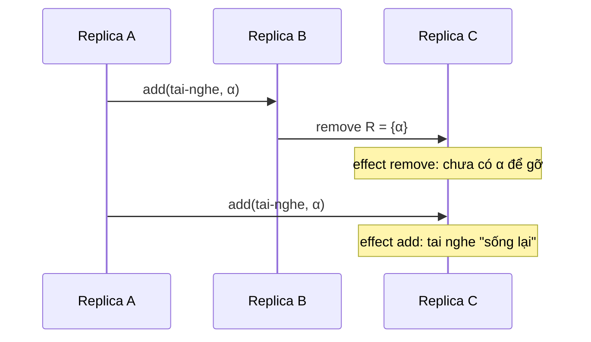
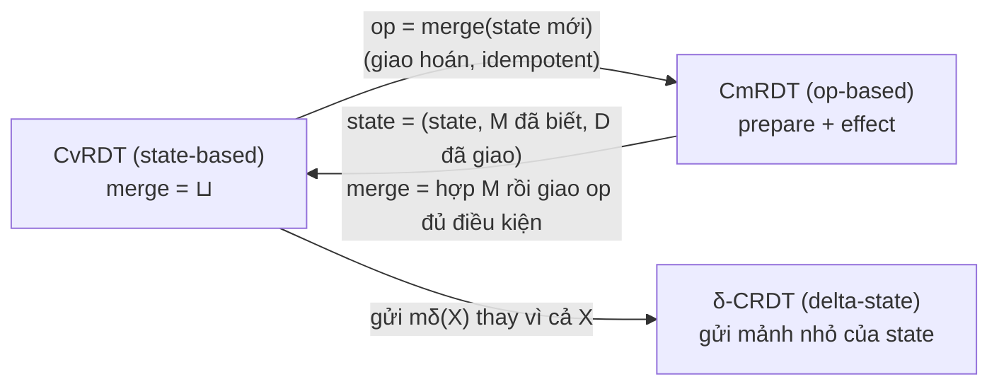

# P15 · Chương 04 — CRDT: kiểu dữ liệu nhân bản tự hội tụ

[Chương 09 của phase 12](../12-he-thong-du-lieu/09-consistency-va-consensus.md) cho thấy hai lối đi khi nhiều replica cùng nhận ghi. Lối thứ nhất xếp mọi thao tác vào một thứ tự chung bằng consensus: mọi replica thấy cùng một lịch sử, nhưng phải chờ nhau. Lối thứ hai để mỗi replica ghi ngay tại chỗ rồi gộp sau; [chương 05, mục 5.5](../12-he-thong-du-lieu/05-replication.md) đã giới thiệu CRDT như cách gộp tự động của lối này (nhận xét của người soạn: cách chia thành hai lối là tóm tắt của người soạn). Chương này đi nốt đoạn còn lại: định nghĩa chính xác CRDT, chứng minh vì sao nó hội tụ, cài đặt các kiểu dữ liệu quen thuộc bằng Rust, rồi chỉ ra chỗ CRDT hết đường.

Cả chương bám theo một ví dụ giả định là `cartsync`, dịch vụ giỏ hàng chạy ở ba region: A (Singapore), B (Frankfurt) và C (Virginia). Mỗi region nhận ghi tại chỗ và không chờ region khác, nên khi đường liên vùng đứt, khách vẫn thêm bớt hàng được. Ta sẽ lần lượt gặp bốn loại dữ liệu của nó: số lượt thích của sản phẩm (`likes`), số lượng tồn kho (`stock`), ghi chú giao hàng (`note`) và tập các sản phẩm trong giỏ (`items`). Đây là ví dụ giả định, không phải code trong repo (nhận xét của người soạn).

## Bạn sẽ hiểu được gì

1. **Q1.** Strong eventual consistency (SEC) là gì, khác eventual consistency thường ở chỗ nào, và vì sao đạt được SEC mà không cần consensus? → mục 1
2. **Q2.** Kiểu state-based (CvRDT) đòi những gì (join-semilattice, update đơn điệu), và vì sao merge giao hoán, kết hợp, idempotent kéo theo hội tụ dù message đến trễ, trùng hay đảo thứ tự? → mục 2
3. **Q3.** Kiểu op-based (CmRDT) đòi những gì (thao tác đồng thời giao hoán, causal delivery), và chứng minh hội tụ đi thế nào? → mục 3
4. **Q4.** Hai kiểu tương đương nhau theo nghĩa nào, đánh đổi chi phí ra sao, và delta-state CRDT lấy cái hay của cả hai bằng cách nào? → mục 4
5. **Q5.** G-Counter, PN-Counter, LWW-Register và MV-Register hoạt động ra sao, vì sao chúng là semilattice, và mỗi cái đánh đổi gì? → mục 5
6. **Q6.** Vì sao set ngây thơ và 2P-Set hỏng trên giỏ hàng, và OR-Set sửa bằng cách nào (vết chạy từng bước)? → mục 6
7. **Q7.** Cài đặt các kiểu trên bằng Rust rồi kiểm thử hội tụ với thứ tự merge ngẫu nhiên cho thấy được gì, và không cho thấy gì? → mục 7
8. **Q8.** Ngoài đời CRDT xuất hiện ở đâu (Riak, Redis Active-Active, Automerge) và giới hạn của nó là gì? → mục 8

## Kiến thức cần trước

- [P12 · Chương 05 — Replication](../12-he-thong-du-lieu/05-replication.md), mục 5 (multi-leader, LWW, giới thiệu CRDT) và mục 8 (vector clock, siblings). Chương này đào sâu phần CRDT của mục 5.5 chứ không giảng lại.
- [P12 · Chương 09 — Consistency và consensus](../12-he-thong-du-lieu/09-consistency-va-consensus.md), mục 3 (happens-before, vector clock) và mục 4 (các kiểu broadcast: FIFO, causal, total order).
- [P14 · Chương 01 — Logic và chứng minh](../14-toan-va-ly-thuyet/01-logic-va-chung-minh.md) (quy nạp, bất biến) và [P14 · Chương 02 — Toán rời rạc](../14-toan-va-ly-thuyet/02-toan-roi-rac.md) (quan hệ, thứ tự bán phần, lattice). Chương này nhắc lại định nghĩa cần dùng nhưng không dạy từ đầu.
- Cùng phase: [Chương 01 — FLP và các chặn dưới](01-flp-va-cac-chan-duoi.md) (vì sao consensus không né được), [Chương 02 — Họ broadcast](02-ho-broadcast.md) (reliable và causal broadcast), [Chương 03 — Phân cấp consistency](03-phan-cap-consistency.md) và [Chương 07 — Membership và gossip](07-membership-va-gossip.md) (cách các replica trao đổi state).

Bạn cần đọc được Rust ở mức `struct`, `trait`, `BTreeMap`; phần code ở mục 5 đến 7 chỉ dùng thư viện chuẩn.

---

## 1. Strong eventual consistency và vì sao không cần consensus (Q1)

> **Trả lời ngắn.** Eventual consistency chỉ hứa rằng nếu ngừng cập nhật thì các bản sao (replica) rồi sẽ giống nhau[^kl-ec-weak]. Strong eventual consistency (SEC) đòi thêm *strong convergence*: hai replica đã nhận cùng một tập cập nhật thì có ngay trạng thái tương đương, bất kể nhận theo thứ tự nào[^sss-sec-def]. Vì mỗi replica áp dụng cập nhật tại chỗ và không bao giờ phải hoàn tác, SEC không cần consensus[^sss-sec-noconsensus]. Đổi lại, đây vẫn là một bảo đảm yếu: đọc không chắc thấy giá trị mới nhất[^kl-sec-weak].

**Giải thích.**

*Với `cartsync`.* Đường truyền giữa region A (Singapore) và region C (Virginia) đứt hai phút. Trong hai phút đó, một khách ở Singapore thêm tai nghe vào giỏ, còn người dùng chung tài khoản ở Virginia xóa củ sạc khỏi giỏ. Nếu `cartsync` chạy Raft thì phía thiểu số không ghi được cho tới khi mạng nối lại (xem [P12 · Chương 18](../12-he-thong-du-lieu/18-thuat-toan-dong-thuan.md)). Nếu chọn luôn ghi được, mỗi region áp dụng thay đổi ngay rồi tính chuyện gộp sau, cách làm mà người ta gọi là optimistic replication[^kl-optimistic]. Câu hỏi của mục này là gộp thế nào để cuối cùng cả hai region thấy cùng một giỏ mà không cần ai phán xử hộ (nhận xét của người soạn: ví dụ giả định).

### 1.1 Eventual consistency yếu ở đâu

Eventual consistency (EC) hiểu thô là: nếu khách ngừng gửi cập nhật thì mọi replica rồi sẽ có cùng giá trị[^sss-ec-informal]. Phát biểu chặt hơn gồm ba điều kiện. *Eventual delivery*: cập nhật đã tới một replica đúng thì cuối cùng tới mọi replica đúng[^sss-ec-delivery]. *Convergence*: các replica đã nhận cùng một tập cập nhật thì *cuối cùng* có trạng thái tương đương[^sss-ec-conv]. *Termination*: mọi lời gọi hàm đều kết thúc[^sss-ec-term].

Chữ "cuối cùng" ở điều kiện thứ hai là chỗ hở. Định nghĩa phổ biến của eventual consistency còn đặt tiền đề "nếu không còn cập nhật nào mới", mà giỏ hàng đang có người dùng thì tiền đề đó không bao giờ đúng[^kl-ec-weak]. Chưa hết, nhiều hệ EC thực thi cập nhật ngay, rồi mới phát hiện nó xung đột với cập nhật khác và phải hoàn tác (roll back)[^sss-rollback]. Muốn mọi replica phân xử xung đột giống hệt nhau thì nhìn chung lại cần consensus[^sss-arbitrate].

### 1.2 SEC thêm gì

SEC giữ cả ba điều kiện trên và thêm *strong convergence*[^sss-sec-def]. Gọi `C_i` là tập cập nhật mà replica `i` đã nhận và `s_i` là trạng thái của nó. Strong convergence nói rằng với mọi cặp replica `i`, `j`, nếu `C_i = C_j` thì `s_i ≡ s_j`. Ở đây `≡` nghĩa là hai trạng thái trả lời mọi query giống nhau[^sss-equiv]. Khác biệt duy nhất so với EC là chữ "cuối cùng" biến mất: không có khoảng chờ nào mà hai replica đã nhận cùng tập cập nhật vẫn còn khác nhau.

Một cách phát biểu khác, quen hơn với dân backend: hai replica đã xử lý cùng một tập cập nhật thì ở cùng trạng thái, kể cả khi xử lý theo thứ tự khác nhau[^kl-sec-def]. Với `cartsync`, khi A và C đã nhận đủ hai cập nhật "thêm tai nghe" và "xóa củ sạc" thì giỏ của hai bên bằng nhau, dù A nhận theo thứ tự (thêm, xóa) còn C nhận theo thứ tự (xóa, thêm). SEC không nói giỏ đó chứa gì khi hai cập nhật đụng cùng một món; việc ấy do kiểu dữ liệu quyết định, và là chuyện của mục 5 và 6 (nhận xét của người soạn).

### 1.3 Vì sao không cần consensus

Lý do nằm ở chỗ không phải hoàn tác. Ở EC thường, hai replica có thể áp cập nhật theo hai thứ tự khác nhau, nên phải có người quyết định thứ tự nào đúng để bên kia làm lại; người quyết định đó là consensus. SEC chặn lối đi này từ gốc: kiểu dữ liệu phải được thiết kế sao cho *mọi* thứ tự áp dụng đều cho cùng kết quả, nên không còn thứ tự nào để chọn (suy luận của người soạn từ định nghĩa).

Hệ quả thực tế là một replica SEC luôn đọc và ghi được, bất kể tình trạng mạng[^sss-sec-avail]. Bất kỳ nhóm replica nào còn liên lạc được với nhau cũng hội tụ, kể cả khi bị tách khỏi phần còn lại của mạng[^sss-sec-subset]. Đối tượng chịu được tới `n − 1` replica sập cùng lúc, và không phải giải consensus[^sss-sec-noconsensus]. Điều này không mâu thuẫn với FLP (xem [Chương 01](01-flp-va-cac-chan-duoi.md)): FLP nói về bài toán đồng thuận, còn SEC không đòi các replica đồng thuận về một thứ tự (suy luận của người soạn).

Cái giá của việc không phối hợp là SEC không cho đọc "mới nhất". Ở `cartsync`, A đọc giỏ ngay sau khi C vừa xóa củ sạc vẫn thấy củ sạc, cho tới khi gói cập nhật của C tới (nhận xét của người soạn). Dù tên có chữ "strong", đây vẫn là một bảo đảm khá yếu, vì một lần đọc không chắc trả về giá trị mới nhất[^kl-sec-weak].

<details><summary>Đi sâu: SEC không so sánh được với sequential consistency; eventual delivery là giả định về mạng; "xung đột" nghĩa là gì</summary>

- **SEC không mạnh hơn, cũng không yếu hơn sequential consistency.** Xét set với `add` và `remove` mà khi hai thao tác đồng thời chạm cùng một phần tử thì `add` thắng. Replica A chạy `add(tai-nghe)` rồi `remove(củ-sạc)`; đồng thời replica C chạy `add(củ-sạc)` rồi `remove(tai-nghe)`[^sss-addwins-example]. Gộp hai bên lại, cả tai nghe lẫn củ sạc đều còn trong giỏ, vì mỗi `remove` chỉ gỡ được bản `add` mà replica của nó đã thấy. Trạng thái này không thể xuất hiện trong một thực thi tuần tự, vì trong hai lệnh `remove` phải có một lệnh chạy sau cùng (suy luận của người soạn). Bài báo gốc kết luận có một đối tượng SEC không sequentially consistent[^sss-incomparable]. Chiều ngược lại: sequential consistency tổng quát cần consensus, mà consensus không giải được khi `n − 1` replica sập[^sss-seq-consensus]. Hai mô hình vì thế không so sánh được với nhau.
- **Chọn nghĩa cho add đồng thời với remove là quyền của người thiết kế.** `add` có thể thắng, `remove` có thể thắng, hoặc bên có địa chỉ IP cao nhất thắng[^sss-alternatives]. Mọi lựa chọn đó đều thỏa strong convergence, và lựa chọn nào cũng có thể hợp lý với một ứng dụng nào đó[^sss-alt-ok]. Mục 6 đi sâu vào lựa chọn này.
- **Eventual delivery là giả định về mạng, không phải tính chất của kiểu dữ liệu.** Trong mô hình của bài báo, replica đúng định kỳ gửi state cho replica khác qua kênh *fair-lossy*[^sss-fairlossy]. Với kiểu op-based, giả định mạnh hơn: reliable causal broadcast (mục 3).
- **"Xung đột" là gì.** Một xung đột là tổ hợp các cập nhật đồng thời mà từng cái riêng lẻ đều đúng, nhưng gộp lại thì vi phạm một bất biến nào đó[^sss-conflict-def]. Hãy nhớ định nghĩa này: ở mục 5 và 8 ta sẽ thấy CRDT bảo đảm *hội tụ*, nhưng không bảo đảm mọi bất biến của ứng dụng.

</details>

**Quay lại Q1:** EC chỉ hứa "rồi sẽ giống nhau", còn SEC hứa hai replica đã nhận cùng tập cập nhật thì giống nhau ngay; nhờ không phải hoàn tác nên SEC không cần consensus, đổi lại chỉ là bảo đảm yếu.

---

## 2. State-based (CvRDT): join-semilattice và chứng minh hội tụ (Q2)

> **Trả lời ngắn.** Một kiểu state-based hội tụ được nếu ba điều kiện cùng đúng: các trạng thái xếp thành một join-semilattice (mọi cặp có cận trên nhỏ nhất, ký hiệu ⊔), merge chính là ⊔, và mọi update chỉ làm trạng thái tăng chứ không giảm[^sss-thm1]. Khi đó kết quả gộp chỉ phụ thuộc *tập* trạng thái đã gộp, không phụ thuộc thứ tự hay số lần gộp (chứng minh ở 2.4). Vì vậy hai replica đã gộp cùng tập update thì có cùng trạng thái, tức là SEC.

**Giải thích.**

*Với `cartsync`.* Mỗi sản phẩm có bộ đếm `likes`. Ba region nhận lượt thích tại chỗ, rồi định kỳ gửi state của mình cho nhau (cơ chế gossip nằm ở [Chương 07](07-membership-va-gossip.md)). Cả ba phải ra cùng một tổng đúng, dù gói tin tới trễ, tới hai lần hay tới sai thứ tự (nhận xét của người soạn: ví dụ giả định).

### 2.1 Hai cách làm bộ đếm sai, và bài học

Cách ngây thơ nhất: state là một số nguyên và merge lấy `max`. Hai region cùng bắt đầu ở 0, mỗi bên nhận một lượt thích nên mỗi bên có 1; merge `max` cho 1 thay vì 2[^tr-max-fail]. Sửa bằng cách đổi merge thành phép cộng thì sai theo kiểu khác, vì phép cộng không idempotent[^tr-sum-not-idem]. Cụ thể, A có 3, B có 2; nếu gói state của A tới B hai lần thì B cộng thành 2 + 3 + 3 = 8 (người soạn tính), và mỗi lần mạng gửi lại là thêm một lần cộng.

Hai thất bại này không phải lỗi vặt. Merge phải thỏa những quy luật đại số cụ thể, và 2.2 nói rõ đó là quy luật nào.

### 2.2 Join-semilattice

Một *thứ tự bán phần* `≤` trên tập `S` có ba tính chất: phản xạ (`x ≤ x`), phản đối xứng (`x ≤ y` và `y ≤ x` thì `x = y`) và bắc cầu (`x ≤ y`, `y ≤ z` thì `x ≤ z`). "Bán phần" nghĩa là có những cặp không so sánh được, chẳng hạn hai vector đếm `{A: 3}` và `{B: 2}` (xem [P14 · Chương 02](../14-toan-va-ly-thuyet/02-toan-roi-rac.md)). *Cận trên* của `x` và `y` là phần tử `m` với `x ≤ m` và `y ≤ m`. *Cận trên nhỏ nhất* (least upper bound, LUB) là cận trên `m` mà mọi cận trên khác `m′` đều thỏa `m ≤ m′`. Nếu mọi cặp phần tử của `S` đều có LUB thì `(S, ≤)` là một *join-semilattice*[^sss-semilattice-def], và ta viết LUB của `x` và `y` là `x ⊔ y`.

Từ định nghĩa suy ra `⊔` giao hoán, kết hợp và idempotent[^sss-laws]. Chứng minh (chứng minh của người soạn), dùng hai sự thật: LUB nếu tồn tại thì duy nhất (hai LUB `m`, `m′` thỏa `m ≤ m′` và `m′ ≤ m`, nên bằng nhau nhờ phản đối xứng), và nếu `x ≤ y` thì `x ⊔ y = y` (vì `y` là cận trên của `{x, y}` và mọi cận trên khác đều lớn hơn `y`).

- *Giao hoán.* `x ⊔ y` là LUB của tập `{x, y}`, và `{x, y} = {y, x}`, nên `x ⊔ y = y ⊔ x`.
- *Idempotent.* Mọi cận trên của `x` đều `≥ x`, và `x` là cận trên của chính nó, nên LUB của `{x, x}` là `x`: `x ⊔ x = x`.
- *Kết hợp.* Đặt `u = (x ⊔ y) ⊔ z`. Ta chứng minh `u` là LUB của `{x, y, z}`. Trước hết `u` là cận trên: `x ≤ x ⊔ y ≤ u`, `y ≤ x ⊔ y ≤ u` (bắc cầu) và `z ≤ u`. Tiếp theo `u` nhỏ nhất: nếu `m′` là cận trên của `x`, `y`, `z` thì `m′` là cận trên của `{x, y}`, nên `x ⊔ y ≤ m′`; khi đó `m′` là cận trên của `{x ⊔ y, z}`, nên `u ≤ m′`. Lập luận đối xứng cho thấy `x ⊔ (y ⊔ z)` cũng là LUB của `{x, y, z}`, và LUB duy nhất nên hai vế bằng nhau. ∎

Khi thiết kế, ta thường nghĩ ra phép merge trước, thứ tự sau, nên chiều ngược lại mới là chiều có ích. **Nếu một phép hai ngôi `⊔` giao hoán, kết hợp và idempotent thì định nghĩa `x ≤ y` ⇔ `x ⊔ y = y` biến nó thành join-semilattice.** Chứng minh (chứng minh của người soạn):

1. *Phản xạ.* `x ⊔ x = x` (idempotent), nên `x ≤ x`.
2. *Phản đối xứng.* Nếu `x ≤ y` và `y ≤ x` thì `x ⊔ y = y` và `y ⊔ x = x`. Theo giao hoán `x ⊔ y = y ⊔ x`, suy ra `y = x`.
3. *Bắc cầu.* Nếu `x ⊔ y = y` và `y ⊔ z = z` thì `x ⊔ z = x ⊔ (y ⊔ z) = (x ⊔ y) ⊔ z = y ⊔ z = z`, tức `x ≤ z`.
4. *`x ⊔ y` là cận trên.* `x ⊔ (x ⊔ y) = (x ⊔ x) ⊔ y = x ⊔ y`, nên `x ≤ x ⊔ y`. Tương tự `y ≤ x ⊔ y` (dùng giao hoán).
5. *Nhỏ nhất.* Nếu `x ≤ m` và `y ≤ m`, tức `x ⊔ m = m` và `y ⊔ m = m`, thì `(x ⊔ y) ⊔ m = x ⊔ (y ⊔ m) = x ⊔ m = m`, tức `x ⊔ y ≤ m`. ∎

Vậy kiểm ba luật của phép merge là đủ để biết ta đang có một join-semilattice. Trong code ở mục 5, `Join::leq` định nghĩa đúng như thế: `a.leq(b)` là `a.join(b) == b`.

### 2.3 CvRDT: điều kiện đủ để có SEC

Một đối tượng state-based gồm tập trạng thái `S`, trạng thái đầu `s₀`, các hàm query, update và hàm merge. Nó là một *monotonic semilattice* (và do đó là CvRDT) khi có ba tính chất. Thứ nhất, `S` là join-semilattice theo `≤`[^sss-def4-i]. Thứ hai, merge một state nhận được `s′` vào state `s` cho ra đúng LUB của hai state[^sss-def4-ii]: `s • merge(s′) = s ⊔ s′`. Thứ ba, update không bao giờ làm state giảm[^sss-def4-iii]: `s ≤ s • u`. Định lý của bài báo gốc nói rằng, nếu mạng thỏa eventual delivery và hàm nào cũng kết thúc, thì mọi đối tượng như vậy là SEC[^sss-thm1].

Bài báo gốc bỏ phần chứng minh vì thiếu chỗ, và chuyển nó sang một báo cáo kỹ thuật đi kèm[^sss-omit-proof]. Bản chứng minh trong báo cáo đó xét hai replica trao đổi state, với giả định hệ thống gửi state vô hạn lần giữa các cặp replica[^tr-prop21]. Dưới đây là một chứng minh đầy đủ cho mọi lịch merge, dùng công cụ "lịch sử nhân quả" mà bài báo định nghĩa.

### 2.4 Chứng minh strong convergence (chứng minh của người soạn)

**Thiết lập.** Một *lần chạy* là dãy hữu hạn các sự kiện, mỗi sự kiện xảy ra ở đúng một replica. Sự kiện là một *update* `u` (replica đổi state `s` thành `u(s)`) hoặc một *merge* (replica đổi `s` thành `s ⊔ t`, với `t` là state nhận từ mạng). Mạng được làm gì với message cũng được: trễ, đảo thứ tự, giao nhiều lần hoặc không giao. Mỗi message luôn là bản sao của một state mà một replica *từng* có.

Ta gắn cho mỗi state một nhãn `H(s)`, là tập các update mà state đó "đã biết". Lúc đầu mọi replica ở `s₀` với `H = ∅`. Sau update `u` tại replica `i`, nhãn của `i` thêm `u`. Sau khi replica `i` merge state `t`, nhãn của `i` thành `H(i) ∪ H(t)`. Đây là *lịch sử nhân quả*: một công cụ suy luận hình thức, không cần có mặt trong cài đặt[^sss-causal-history]. Ta nói update `u` *được giao* tới một replica khi `u` nằm trong nhãn của replica đó. Cuối cùng, ký hiệu `σ(u)` là state của replica ngay sau khi chạy `u`.

**Bổ đề 1 (bất biến).** Tại mọi thời điểm, với mọi state `s` đang nằm ở một replica hoặc đang bay trên mạng, nếu `H(s) = {u₁, …, u_k}` thì

`s = s₀ ⊔ σ(u₁) ⊔ σ(u₂) ⊔ … ⊔ σ(u_k)`.

(Vì `⊔` giao hoán và kết hợp, vế phải không phụ thuộc cách đánh số `u_j`.)

*Chứng minh.* Quy nạp theo số sự kiện đã xảy ra.

- *Cơ sở.* Chưa có sự kiện nào: `s = s₀` và `H = ∅`, khớp.
- *Bước update.* Update `u` chạy tại replica `i` với state `s` thỏa bất biến, `H(s) = {u₁, …, u_k}`. State mới là `u(s) = σ(u)` với nhãn `H(s) ∪ {u}`. Ta cần `s₀ ⊔ σ(u₁) ⊔ … ⊔ σ(u_k) ⊔ σ(u) = σ(u)`. Phần đứng trước `⊔ σ(u)` chính là `s` (giả thiết quy nạp), nên vế trái bằng `s ⊔ σ(u)`. Vì update đơn điệu, `s ≤ u(s) = σ(u)`, và `x ≤ y` nghĩa là `x ⊔ y = y`, nên `s ⊔ σ(u) = σ(u)`. Khớp. **Bước này dùng điều kiện đơn điệu.**
- *Bước merge.* Replica `i` đang có state `s` (nhãn `H(s)`) và merge state `t` (nhãn `H(t)`). State `t` là bản sao của một state cũ, nên thỏa bất biến theo giả thiết quy nạp. State mới `s ⊔ t` bằng `(s₀ ⊔ ⨆_{u∈H(s)} σ(u)) ⊔ (s₀ ⊔ ⨆_{u∈H(t)} σ(u))`. Dùng giao hoán và kết hợp để gom các thừa số lại; những thừa số xuất hiện hai lần (`s₀`, và `σ(u)` với `u ∈ H(s) ∩ H(t)`) được gộp về một nhờ idempotent (`x ⊔ x = x`). Còn lại `s₀ ⊔ ⨆_{u∈H(s)∪H(t)} σ(u)`, đúng bằng bất biến cho nhãn mới `H(s) ∪ H(t)`. **Bước này dùng cả ba luật của `⊔`.** ∎

**Định lý (strong convergence).** Nếu hai replica có cùng nhãn, `H(s_i) = H(s_j)`, thì `s_i = s_j`.

*Chứng minh.* Theo Bổ đề 1, cả hai bằng `s₀ ⊔ ⨆_{u∈H} σ(u)`. Vế phải chỉ phụ thuộc tập `H` và các giá trị `σ(u)`. ∎

Chú ý điều định lý *không* nhắc tới: thứ tự merge, số lần merge, thứ tự message tới. Bổ đề 1 đã "nuốt" hết những thứ đó vào các luật của `⊔`. Đây cũng là lý do bài báo nói CvRDT hội tụ về LUB của các update mới nhất[^sss-lub-conv].

**Từ strong convergence đến SEC.** Còn lại hai điều kiện của EC. *Termination* hiển nhiên vì mỗi hàm là một phép tính hữu hạn. *Eventual delivery* là giả định về mạng. Giả sử replica `i` đúng và định kỳ gửi state của mình cho `j` qua kênh fair-lossy[^sss-fairlossy] (kênh có thể làm mất message, nhưng message gửi đi vô hạn lần thì được nhận vô hạn lần; đây là định nghĩa thông dụng, nhận xét của người soạn). Nếu `u` thuộc nhãn của `i` thì sau thời điểm đó mọi state `i` gửi đi đều mang `u` trong nhãn, vì nhãn chỉ lớn lên. Vô hạn bản trong số đó tới `j`, nên `u` cuối cùng nằm trong nhãn của `j`. Vậy eventual delivery đúng, và kết hợp với định lý ta được SEC, đúng như bài báo gốc phát biểu[^sss-thm1].

### 2.5 Thiếu từng điều kiện thì hỏng thế nào

Bảng dưới cho mỗi điều kiện một phản ví dụ trên `likes` (các con số là người soạn tính).

| Điều kiện bị phá | Ví dụ | Điều xảy ra |
|---|---|---|
| Thiếu idempotent: merge = cộng | A có 3, B có 2; gói state của A tới B hai lần | B ra 2 + 3 + 3 = 8; mỗi lần mạng gửi lại là cộng thêm một lần[^tr-sum-not-idem] |
| Thiếu kết hợp: merge = trung bình `(x + y) / 2` | gộp ba state 0, 4, 8 | `(0 ⊔ 4) ⊔ 8 = 5` còn `0 ⊔ (4 ⊔ 8) = 3`; kết quả phụ thuộc cách gộp |
| Thiếu giao hoán: merge bỏ qua state nhận được | A và B cùng giữ state riêng, không bên nào đổi | hai replica không bao giờ hội tụ[^sss-merge-noop] |
| Thiếu đơn điệu: update giảm, merge = `max` | A và B cùng có 5; A giảm còn 4 rồi merge với B | `max(4, 5) = 5`: lần giảm biến mất[^tr-pn-nonmono] |

Dòng thứ ba hơi đặc biệt: phép "bỏ qua state nhận được" *không* giao hoán, vì `a ⊔ b = a` còn `b ⊔ a = b`. Còn dòng cuối cho thấy điều kiện đơn điệu là điều kiện của *update*, không phải của merge: merge `max` tự nó là một semilattice hoàn hảo.

### 2.6 Cái được và cái mất

Vì kết quả không phụ thuộc thứ tự lẫn số lần merge, kiểu state-based chịu được message bị mất, trùng hoặc đảo thứ tự, miễn là state mới nhất cuối cùng tới được mọi replica, trực tiếp hay qua các lần merge nối tiếp[^tr-lossy-ok]. Nó cũng không buộc phải dùng broadcast: quorum write và anti-entropy đều đưa được state tới replica khác[^kl-state-nonbcast]. Cái mất là kích thước: mỗi lần trao đổi mang theo cả state[^kl-state-vs-op], và mục 4 sẽ thu nhỏ nó.

<details><summary>Đi sâu: tích của hai semilattice; vì sao cần ≡; chứng minh trong báo cáo gốc</summary>

- **Tích của hai semilattice là semilattice.** Cho `(S₁, ⊔₁)` và `(S₂, ⊔₂)` thỏa ba luật. Trên `S₁ × S₂` định nghĩa `(a, b) ⊔ (a′, b′) = (a ⊔₁ a′, b ⊔₂ b′)`. Ba luật đúng từng thành phần nên đúng cho cặp (người soạn). Đây là cách PN-Counter (hai G-Counter), 2P-Set và OR-Set (hai tập) được dựng ở mục 5 và 6: chỉ cần mỗi thành phần là semilattice và mỗi update chỉ làm tăng từng thành phần.
- **`≡` thay cho `=`.** Bài báo cho phép hai state khác biểu diễn nhưng trả lời mọi query như nhau, và đòi `x ≤ y ∧ y ≤ x ⇒ x ≡ y`[^sss-xy]. Với các kiểu trong chương này ta dùng thẳng `=` trên biểu diễn chuẩn tắc, nên không cần phân biệt.
- **Cấu trúc của chứng minh trong báo cáo gốc.** Với hai replica trao đổi state, nhãn nhân quả của hai bên sau merge giống nhau (`C(x_i) ∪ C(x_j) = C(x_j) ∪ C(x_i)`), và state bằng nhau nhờ `⊔` giao hoán[^tr-prop21]. Chứng minh ở 2.4 làm đúng ý đó nhưng tổng quát cho mọi lịch merge nhiều replica, và chỉ rõ ba luật được dùng ở bước nào.
- **Mạng yếu cũng đủ.** Chính vì `⊔` giao hoán và idempotent, message có thể mất, đến sai thứ tự hoặc đến nhiều lần[^tr-lossy-ok].

</details>

**Quay lại Q2:** state-based hội tụ vì state tạo thành join-semilattice, update chỉ đi lên và merge là `⊔`; khi đó state của mỗi replica luôn bằng `s₀ ⊔` (join các state ngay sau mỗi update đã biết), một giá trị chỉ phụ thuộc *tập* update đã biết, nên hai replica cùng tập thì cùng state.

---

## 3. Op-based (CmRDT): giao hoán và causal delivery (Q3)

> **Trả lời ngắn.** Kiểu op-based không gửi state mà gửi *thao tác*. Mỗi thao tác tách làm hai: `prepare` chạy tại replica nguồn (đọc state, không đổi gì, tạo thông điệp) và `effect` chạy ở mọi replica, kể cả nguồn[^sss-op-split]. Nếu mạng giao mỗi thao tác đúng một lần theo thứ tự nhân quả và mọi cặp thao tác đồng thời đều giao hoán, thì hai replica đã nhận cùng tập thao tác có cùng state[^sss-thm2]. Phần "vì sao" là một chứng minh gồm hai bổ đề ở 3.3.

**Giải thích.**

*Với `cartsync`.* Thay vì gửi cả vector đếm, mỗi lượt thích sinh một message `inc` vài byte, và ba region cộng message đó vào bộ đếm của mình. Phép cộng giao hoán nên thứ tự message tới không quan trọng. Nhưng `inc` không idempotent: nếu mạng giao nó hai lần thì lượt thích bị đếm hai lần[^delta-opbased-inc]. Vì vậy kiểu op-based đòi tầng giao tin mạnh hơn state-based, và 3.1 làm rõ mạnh hơn ở chỗ nào (nhận xét của người soạn: ví dụ giả định).

### 3.1 Mô hình: prepare, effect và causal delivery

Bước `prepare` chạy tại đúng một replica, nơi thao tác được gọi, gọi là nguồn[^sss-op-source]. Bước `effect` chạy ở mọi replica, gọi là phía hạ nguồn (downstream)[^sss-op-downstream]. Điểm mấu chốt là thông điệp do `prepare` tạo ra được *chốt tại nguồn*: mọi replica áp dụng cùng một `effect` với cùng tham số, kể cả khi state của họ khác state của nguồn. Chẳng hạn ở OR-Set (mục 6), `prepare` của `remove` tính tập các tag đã quan sát tại nguồn, còn `effect` chỉ việc gỡ đúng tập đó[^tr-orset-idea].

Về thứ tự: thao tác `o` *happened-before* `o′` (viết `o → o′`) khi `o` đã được giao tại replica nơi `o′` chạy; hai thao tác không liên quan bởi `→` là *đồng thời* (ký hiệu `o ∥ o′`)[^sss-hb-def]. Giả định mạng là một broadcast tin cậy có thứ tự nhân quả: mỗi message tới mỗi người nhận đúng một lần, theo một thứ tự nhất quán với happened-before[^sss-causal-bcast]. Loại broadcast này không cần consensus[^sss-bcast-noconsensus] (xem [Chương 02](02-ho-broadcast.md) và [P12 · Chương 09, mục 4](../12-he-thong-du-lieu/09-consistency-va-consensus.md)). Hệ quả: hai thao tác liên quan bởi `→` được thực thi cùng thứ tự ở mọi replica, còn thao tác đồng thời có thể được giao theo bất kỳ thứ tự nào[^sss-concurrent-any].

### 3.2 Giao hoán nghĩa là gì

Hai thao tác *giao hoán* khi với mọi state `s` đạt tới được mà cả hai đều áp dụng được, áp dụng theo thứ tự nào cũng được, và hai kết quả tương đương: `s • f • g ≡ s • g • f`[^sss-commute-def]. Điều kiện đủ để hội tụ là mọi cặp thao tác *đồng thời* đều giao hoán[^sss-commute-suff]. Cặp có quan hệ `→` không cần giao hoán, vì causal delivery đã khóa thứ tự của chúng. Đó là lý do giả thiết giao tin và giả thiết giao hoán đi thành cặp.

### 3.3 Chứng minh hội tụ (chứng minh của người soạn)

Chứng minh dưới đây cụ thể hóa định lý của bài báo gốc[^sss-thm2]. Báo cáo kỹ thuật chỉ phác chứng minh đó bằng ba trường hợp[^tr-prop22].

**Thiết lập.** Với một replica, gọi `D` là tập thao tác nó đã nhận và `π` là dãy các thao tác theo thứ tự nó áp dụng `effect`. Hai điều theo thẳng từ giả thiết giao tin: (a) `π` là một hoán vị của `D`, không lặp (exactly once); (b) nếu `o → o′` và `o′ ∈ D` thì `o ∈ D` và `o` đứng trước `o′` trong `π` (causal delivery). Nói cách khác, `π` là một *thứ tự tuyến tính tương thích* (linear extension) của `(D, →)`: một thứ tự toàn phần trên `D` không đảo ngược cặp nào có quan hệ `→`.

**Bổ đề A.** Cho `D` hữu hạn và hai thứ tự tuyến tính tương thích `σ`, `τ` của `(D, →)`. Có thể biến `σ` thành `τ` bằng một dãy hữu hạn *phép đổi chỗ hai phần tử liền kề*, mỗi lần đổi chỗ hai phần tử đồng thời.

*Chứng minh.* Quy nạp theo `|D|`. Với `|D| ≤ 1` hiển nhiên. Với `|D| ≥ 2`, gọi `x` là phần tử đầu tiên của `τ`.

1. `x` là phần tử cực tiểu của `(D, →)`: nếu có `y → x` thì `y` phải đứng trước `x` trong `τ` (vì `τ` tương thích), mâu thuẫn với việc `x` đứng đầu.
2. Xét mọi phần tử `y` đứng trước `x` trong `σ`. Không có `y → x` (do bước 1). Cũng không có `x → y`, vì `σ` tương thích sẽ đòi `x` đứng trước `y`, trái giả thiết. Vậy `y ∥ x`.
3. Do đó ta đẩy `x` về đầu `σ` bằng cách đổi chỗ liền kề với từng `y` nói trên. Mỗi lần đổi chỗ hai phần tử đồng thời, nên kết quả `σ′` vẫn tương thích và bắt đầu bằng `x`.
4. Bỏ `x` khỏi `σ′` và `τ`, ta được hai thứ tự tuyến tính tương thích của `D ∖ {x}`; áp dụng giả thiết quy nạp. ∎

**Bổ đề B.** Nếu hai thao tác liền kề `f`, `g` trong `π` là đồng thời thì đổi chỗ chúng không làm đổi state cuối.

*Chứng minh.* Gọi `s` là state ngay trước cặp `(f, g)`; đó là một state đạt tới được. Theo định nghĩa giao hoán, sau khi đổi chỗ cả hai vẫn áp dụng được và `s • f • g ≡ s • g • f`. Phần đuôi của dãy áp dụng cùng các `effect` với cùng thông điệp lên hai state tương đương, nên cho ra state tương đương (ta dùng giả thiết `≡` là tương đẳng với `effect`; với các kiểu trong chương này `≡` chính là `=`). ∎

**Định lý.** Hai replica đã nhận cùng tập thao tác `D` có state tương đương.

*Chứng minh.* Hai dãy áp dụng `π₁`, `π₂` là hai thứ tự tuyến tính tương thích của `(D, →)` (nhờ causal delivery). Theo Bổ đề A, `π₁` biến thành `π₂` qua các phép đổi chỗ liền kề giữa hai thao tác đồng thời; theo Bổ đề B mỗi phép đổi chỗ giữ nguyên state cuối. Cả hai dãy bắt đầu từ `s₀`, nên state cuối bằng nhau. ∎

Kết hợp với eventual delivery của broadcast tin cậy, hai replica rồi sẽ có cùng `D`, và ta được SEC. Cùng lúc, mỗi cặp thao tác có quan hệ `→` mà không giao hoán vẫn không gây hại, vì chúng không bao giờ bị đảo.

### 3.4 Mỗi giả thiết được dùng ở đâu, và thiếu thì hỏng thế nào

| Giả thiết | Dùng ở bước nào | Thiếu thì sao (người soạn dựng) |
|---|---|---|
| Mỗi thao tác tới đúng một lần | `π` là hoán vị của tập `D` | `inc` bị giao hai lần: bộ đếm đếm dư[^delta-opbased-inc] |
| Causal delivery | `π` là thứ tự tuyến tính tương thích, nên chỉ cặp đồng thời mới bị đảo (Bổ đề A) | `remove` tới trước `add` mà nó đã quan sát: xem vết chạy bên dưới |
| Thao tác đồng thời giao hoán | Bổ đề B | `add(x)` đồng thời `remove(x)` trên set ngây thơ: xem 6.1 |
| `prepare` chốt thông điệp tại nguồn | Mọi replica áp dụng cùng một `effect` | Nếu `remove(e)` được hiểu là "gỡ mọi cặp `(e, *)` mà replica nhận đang giữ" thì `add` đồng thời bị gỡ ở nơi nhận nó trước và được giữ ở nơi nhận sau: các replica lệch nhau |

Vết chạy cho giả thiết thứ hai, trên OR-Set dạng op-based của `cartsync` (xem mục 6 để biết OR-Set). A thêm tai nghe với tag duy nhất `α` và gửi `add(tai-nghe, α)`. B nhận nó, rồi xóa tai nghe: `prepare` của `remove` ghi lại tập đã quan sát `R = {α}`. C nhận thông điệp `remove R` *trước* thông điệp `add`:



(Sơ đồ minh họa của người soạn.) A và B kết thúc với giỏ rỗng, còn C kết thúc với tai nghe trong giỏ. Chỉ có hai thao tác mà các replica đã lệch nhau. Causal delivery cấm đúng chuyện này: B đã nhận `add` trước khi chuẩn bị `remove`, nên `add → remove`, và C phải giữ `remove` lại cho tới khi `add` tới. Báo cáo kỹ thuật gọi đó là điều kiện U-Set: nếu có điều kiện giao tin bảo đảm `add(e)` được giao trước `remove(e)` thì không cần ghi nhớ phần tử đã xóa[^tr-uset].

<details><summary>Đi sâu: điều kiện "enabled" và thứ tự giao yếu hơn causal</summary>

- **Điều kiện "enabled".** Định nghĩa giao hoán của bài báo không chỉ đòi kết quả bằng nhau mà còn đòi sau khi đổi chỗ thì thao tác kia *vẫn áp dụng được* (enabled). Điều kiện giao tin `P` của kiểu dữ liệu (ví dụ "mọi cặp bị gỡ đã được add") được bài báo giới hạn ở loại mà causal broadcast đủ để bảo đảm[^sss-thm2].
- **Thứ tự yếu hơn causal.** Với một số kiểu dữ liệu, thứ tự giao yếu hơn causal cũng đủ, nhưng khi đó phải chứng minh giao hoán cho nhiều cặp thao tác hơn[^tr-weaker-order]. Không có kiểu nào trong chương này đi theo hướng ấy.
- **Hình dạng chứng minh trong báo cáo gốc.** Báo cáo xét ba trường hợp cho hai thao tác bất kỳ: không liên quan nhân quả thì phải giao hoán; có liên quan nhưng không bị ràng buộc bởi thứ tự giao thì cũng phải giao hoán; có liên quan và được giao đúng thứ tự thì được áp dụng cùng thứ tự ở mọi replica[^tr-prop22]. Hai bổ đề ở 3.3 chính là phần "vì sao hai thứ tự giao khác nhau cho cùng kết quả" mà phác thảo đó để lại.
- **Cái giá của exactly-once.** Bảo đảm giao đúng một lần theo thứ tự nhân quả khó duy trì vì phải giữ các log lớn để chống giao trùng, kể cả khi dùng TCP[^delta-opbased-limits].

</details>

**Quay lại Q3:** op-based hội tụ vì causal delivery biến thứ tự áp dụng thành một thứ tự tuyến tính tương thích của happened-before, hai thứ tự như vậy chỉ khác nhau bởi các lần đổi chỗ hai thao tác đồng thời, và các cặp đồng thời đều giao hoán nên không đổi kết quả.

---

## 4. Hai kiểu tương đương, và delta-state CRDT (Q4)

> **Trả lời ngắn.** Hai kiểu biểu diễn được cho nhau: mọi đối tượng state-based SEC mô phỏng được bằng một đối tượng op-based SEC[^sss-thm3]. Chiều ngược lại cũng đúng[^sss-thm4]. Chúng khác nhau ở chi phí chứ không ở sức biểu diễn: state-based gửi cả state nhưng chịu được mất, trùng, đảo thứ tự message[^kl-state-vs-op], còn op-based gửi thao tác nhỏ nhưng đòi tầng giao tin tin cậy. Delta-state CRDT chen vào giữa bằng cách chỉ gửi một mảnh state nhỏ (delta), mà mảnh đó vẫn là một state nên vẫn chịu được mất, trùng, đảo[^delta-unreliable].

**Giải thích.**

*Với `cartsync`.* Hãy hình dung đội của bạn phải chọn cách đồng bộ `likes` giữa ba region. Gửi cả vector đếm sau mỗi lượt thích thì đơn giản và chịu lỗi tốt nhưng tốn băng thông khi có hàng trăm region. Gửi `inc` thì rẻ nhưng phải dựng tầng broadcast tin cậy. Mục này cho thấy hai cách đó là hai mặt của một thứ, rồi nói cách chọn đường giữa (nhận xét của người soạn: ví dụ giả định).



(Sơ đồ tóm tắt của người soạn, theo các cách dựng ở 4.1, 4.2 và 4.4.)

### 4.1 Từ state-based sang op-based

Cho một CvRDT bất kỳ. `prepare` của update `u(a)` chạy update đó lên một bản sao của state hiện tại để được state mới `s′ = s • u(a)`, rồi gói `s′` vào thông điệp. `effect` ở mọi replica làm đúng một việc: merge `s′` vào state cục bộ. Điều kiện giao tin không hạn chế gì, nghĩa là thông điệp được giao lúc nào cũng được[^sss-thm3-precond]. Các `effect` này giao hoán vì `⊔` giao hoán (và còn idempotent, nên giao trùng cũng không sao), nên ta có một CmRDT. Ở `cartsync`, mỗi lượt thích gửi đi *toàn bộ* vector `{A: 3, B: 2, C: 1}` như một "thao tác".

### 4.2 Từ op-based sang state-based

Cho một CmRDT. State của CvRDT mô phỏng là bộ ba `(s, M, D)`: `s` là state của CmRDT được mô phỏng, `M` là tập các thao tác đã biết và `D` là tập các thao tác đã giao, tức đã áp dụng `effect`. Cả `M` lẫn `D` chỉ lớn lên[^sss-emul-md]. Một update cục bộ chạy `prepare` và `effect` tại chỗ, thêm thao tác vào `M` và `D`, rồi lặp việc áp dụng mọi thao tác thuộc `M ∖ D` thỏa điều kiện giao tin cho tới khi không còn thao tác nào. Merge hai bộ ba lấy hợp hai tập `M` rồi chạy lại việc giao đó. Thứ tự `(s, M, D) ≤ (s′, M′, D′)` khi `M ⊆ M′` và `D ⊆ D′`; vì mỗi lần gọi hay giao một thao tác chỉ thêm phần tử vào các tập, state luôn tiến lên trong thứ tự bán phần[^sss-emul-lattice]. Nhờ vậy mỗi thao tác được giao đúng một lần cho CmRDT bên trong, theo thứ tự thỏa điều kiện giao tin[^sss-emul-once]. Về bản chất, cách dựng này hình thức hóa cơ chế broadcast tin cậy có thứ tự nhân quả theo kiểu lan truyền (epidemic)[^sss-emul-epidemic].

### 4.3 "Tương đương" không có nghĩa là "cùng chi phí"

Hai phép dựng ở trên là kết quả về *khả năng biểu diễn*. Chi phí thì khác hẳn, như bảng dưới.

| | State-based | Op-based | Delta-state |
|---|---|---|---|
| Message | cả state; có thể rất lớn[^delta-state-drawback] | một thao tác nhỏ[^kl-state-vs-op] | một mảnh state nhỏ (delta)[^delta-unreliable] |
| Đòi gì ở mạng | chịu mất, trùng, đảo thứ tự; dùng được best-effort broadcast[^kl-state-bestefort] | reliable broadcast, có kiểu còn cần causal broadcast[^kl-state-bestefort] | chịu mất, trùng, đảo nếu chỉ cần hội tụ[^delta-unreliable] |
| Số replica | có thể chưa biết trước[^tr-state-vs-op] | cần quản lý thành viên | như state-based |
| Mặt khó | state phình | log và exactly-once[^delta-opbased-limits] | muốn causal thì phải quản lý delta-interval (Đi sâu) |

Cái lợi của kiểu state-based là dễ chứng minh, vì mọi thông tin cần thiết nằm sẵn trong state[^tr-state-vs-op]. Cái lợi của op-based là dễ cài đặt và thường gọn hơn khi thao tác có ngữ nghĩa riêng[^sss-state-compact].

### 4.4 Delta-state: gửi một mảnh của state

Ý tưởng của delta-state CRDT: đừng gửi cả state `X` sau mỗi update, chỉ gửi *phần thay đổi*, mà phần thay đổi đó vẫn là một phần tử của cùng semilattice. Một *δ-mutator* `m^δ` là hàm nhận state `X` của semilattice `S` và trả về một delta-mutation cũng thuộc `S`[^delta-def1]. Nó là *phân rã delta* của mutator gốc `m` khi áp dụng delta rồi join vào state cho đúng cùng kết quả với mutator gốc[^delta-decomp]:

`m(X) = X ⊔ m^δ(X)`

Ví dụ với G-Counter (mục 5.1). Mutator gốc `inc_i(m)` trả về cả map với ô `i` tăng 1. Mutator delta `inc^δ_i(m) = {i ↦ m(i) + 1}` chỉ trả về đúng ô `i`[^delta-counter-entry]. Phép phân rã đúng vì `m ⊔ {i ↦ m(i) + 1}` có ô `i` bằng `max(m(i), m(i) + 1) = m(i) + 1` và mọi ô khác giữ nguyên (người soạn kiểm), tức là đúng `inc_i(m)`. Số cụ thể: state `X = {A: 3, B: 2, C: 1}`, A nhận thêm một lượt thích thì delta là `{A: 4}`, và `X ⊔ {A: 4} = {A: 4, B: 2, C: 1}`. Delta chỉ có một ô thay vì cả vector.

Có ba điều đáng chú ý. Thứ nhất, delta chỉ là một state, nên có thể được join nhiều lần mà không cần giao đúng một lần, khác hẳn thao tác `inc` của op-based[^delta-is-state]. Thứ hai, nhiều delta có thể gộp thành delta-group trước khi gửi: A đang ở 3, nhận 1000 lượt thích rồi mới gửi thì chỉ gửi `{A: 1003}`, vì nhiều lần tăng của một nguồn gộp lại thành một ô[^delta-counter-collapse]. State đầy đủ chỉ là trường hợp cực đoan của delta-group[^delta-fullstate]. Thứ ba, hội tụ không cần chứng minh mới: mọi state đều là join của các delta-mutation, nên chỉ cần mỗi delta tới mọi replica ít nhất một lần thì mọi replica bằng nhau[^delta-conv]. Chứng minh của điều đó là "tầm thường" nhờ ba luật của join[^delta-conv-proof], đúng như Bổ đề 1 ở mục 2.

<details><summary>Đi sâu: delta-interval và causal consistency; mutator delta không cần là inflation; vì sao chỉ đếm like thì không cần</summary>

- **Mutator delta không cần tự là inflation.** Mutator thường phải làm state tăng; mutator delta thì không, vì việc join delta vào state đã bảo đảm state tăng[^delta-inflation].
- **Causal consistency cần thêm điều kiện.** Gộp state đầy đủ tự động giữ được causal consistency theo từng đối tượng, còn gộp từng delta rời rạc thì không. Bài báo gốc định nghĩa *delta-interval* (delta gộp từ một đoạn liên tiếp các delta của một replica) và *điều kiện delta-merging nhân quả*: chỉ join một delta-interval vào replica đã phản ánh ít nhất state mà delta đầu tiên của đoạn từng được join vào. Thuật toán anti-entropy nào chỉ gửi delta-interval và thỏa điều kiện này thì bảo đảm causal consistency[^delta-causal-cor].
- **Không phải kiểu nào cũng cần.** Với bộ đếm lượt thích, causal consistency có thể không quan trọng; điều cần là không mất lượt tăng và có hội tụ[^delta-nocausal]. Vì thế đối với `likes` của `cartsync` ta có thể gửi delta theo kiểu "cứ gửi, trùng cũng được" (suy luận của người soạn).
- **Vì sao người ta cần delta.** Các kiểu có state lớn như map của Riak (ghép nhiều CRDT trong một map) là động lực thực tế của hướng này[^delta-riak].
- **Rust.** Chương trình ở mục 5 có `inc_delta` và mục 7 có hàm `delta_check` kiểm đúng phép phân rã `m(X) = X ⊔ m^δ(X)` và việc delta đến lộn xộn, trùng lặp vẫn hội tụ.

</details>

**Quay lại Q4:** state-based và op-based mô phỏng được nhau (gửi cả state như một thao tác, hoặc nhớ mọi thao tác trong state), nên khác nhau ở chi phí chứ không ở khả năng; delta-state gửi mảnh nhỏ `m^δ(X)` với `m(X) = X ⊔ m^δ(X)` và giữ được khả năng chịu mất, trùng, đảo của state-based.

---

## 5. Counter và register: G-Counter, PN-Counter, LWW-Register, MV-Register (Q5)

> **Trả lời ngắn.** G-Counter là vector đếm: mỗi replica chỉ tăng ô của chính nó, giá trị là tổng các ô và merge là `max` từng ô[^tr-gcounter]; PN-Counter ghép hai G-Counter, một bên đếm tăng và một bên đếm giảm. LWW-Register giữ giá trị có timestamp lớn nhất nên hội tụ nhưng bỏ mất ghi đồng thời[^tr-lww]. MV-Register giữ mọi giá trị đồng thời và dùng version vector để loại giá trị cũ, nên không mất ghi nhưng đẩy việc chọn cho ứng dụng[^tr-mv-reduce]. Cả bốn đều là semilattice, và PN-Counter không giữ được bất biến "không âm"[^tr-nonneg-global].

**Giải thích.**

*Với `cartsync`.* Bốn loại dữ liệu đầu tiên của giỏ hàng khớp bốn kiểu này: `likes` của sản phẩm là G-Counter, `stock` là PN-Counter, và `note` (ghi chú giao hàng) là một register mà ta thử cả hai cách xử lý ghi đồng thời, LWW và MV. Phần code dưới đây chạy được như một chương trình duy nhất; mục 7 nói cách ghép các khối `rust` lại và cho kết quả chạy (nhận xét của người soạn: ví dụ giả định).

### 5.1 G-Counter

Trạng thái là một vector số tự nhiên, mỗi replica một ô. Replica chỉ tăng ô của chính nó; giá trị là tổng các ô; merge lấy `max` từng ô[^sss-vector]. Nếu mỗi tiến trình chỉ tăng ô của mình thì cấu trúc này chính là vector clock[^sss-vclock].

Đây là join-semilattice (chứng minh của người soạn): trên `ℕⁿ` với thứ tự từng thành phần (`v ≤ w` khi mọi `v[i] ≤ w[i]`), `max` từng ô là LUB. Thật vậy `max(v, w)` là cận trên của `v` và `w`; và nếu `v ≤ m′`, `w ≤ m′` thì mỗi ô `max(v[i], w[i]) ≤ m′[i]`, tức `max(v, w) ≤ m′`. Update `inc` chỉ tăng một ô nên đơn điệu. Bộ đếm là CvRDT[^tr-gcounter-merge], và theo định lý ở mục 2 là SEC.

Còn phải kiểm giá trị hội tụ có *đúng* không, vì semilattice chỉ nói rằng ta hội tụ về *một cái gì đó*.

**Mệnh đề.** Khi một replica đã biết mọi lần `inc` đã xảy ra, `value` bằng đúng tổng số lần `inc`. *Chứng minh* (người soạn). Gọi `n_i` là số lần replica `i` đã gọi `inc` tính tới một thời điểm. Quy nạp theo sự kiện, ta có bất biến: mọi state `s` có `s[i] ≤ n_i`, và state đang nằm ở replica `i` có `s[i] = n_i`. Với `inc` tại `i`, cả `s[i]` và `n_i` cùng tăng 1. Với merge tại replica `j ≠ i` nhận state `t` là bản sao của một state cũ, `t[i] ≤ n_i` theo giả thiết quy nạp nên `max(s[i], t[i]) ≤ n_i`. Với merge tại chính `i`, `s[i] = n_i` và `t[i] ≤ n_i` nên `max` giữ nguyên `n_i`. Bây giờ áp dụng Bổ đề 1: state đầy đủ bằng `s₀ ⊔ ⨆ σ(u)` trên mọi update, nên ô `i` bằng `max_u σ(u)[i]`. Update `u` do chính `i` gây ra có `σ(u)[i]` bằng số lần `inc` của `i` tính tới `u`, còn update do replica khác có `σ(u)[i] ≤ n_i`. Vậy max đúng bằng tổng số lần `inc` của `i`, và cộng các ô ta được tổng số lần `inc` của mọi replica. ∎ Không lượt thích nào bị mất, và không lượt nào bị đếm hai lần.

Bài báo lưu ý hai giả định ngầm: số không tràn, và tập replica được biết trước[^tr-gcounter-assume]. Nếu chưa biết trước tập replica thì có thể dùng G-Set làm bộ đếm chỉ tăng[^tr-gset-counter].

### 5.2 PN-Counter

Để hỗ trợ giảm, ta không thể cho phép ô nào đi xuống: update như thế vi phạm tính đơn điệu, và vì merge là `max`, lần giảm sẽ chẳng có tác dụng gì[^tr-pn-nonmono]. PN-Counter giải bằng cách ghép hai G-Counter: một đếm số lần tăng (P), một đếm số lần giảm (N), giá trị là `P − N`[^tr-pn]. Thứ tự và merge làm từng thành phần[^sss-pn]. Theo "tích của hai semilattice" (Đi sâu mục 2), đây là semilattice; và lập luận của mệnh đề ở 5.1 áp dụng riêng cho P và N, nên giá trị hội tụ là tổng số lần tăng trừ tổng số lần giảm.

```rust
use std::collections::{BTreeMap, BTreeSet};

type Rid = u8; // id của replica: 0 = A (Singapore), 1 = B (Frankfurt), 2 = C (Virginia)...

/// Join-semilattice: `join` là cận trên nhỏ nhất (least upper bound) của hai trạng thái.
trait Join: Clone + PartialEq {
    fn join(&self, other: &Self) -> Self;
    /// a <= b  <=>  a ⊔ b = b
    fn leq(&self, other: &Self) -> bool {
        self.join(other) == *other
    }
}

/// G-Counter: mỗi replica chỉ tăng ô của chính nó; value = tổng các ô; merge = max từng ô.
#[derive(Clone, PartialEq, Debug, Default)]
struct GCounter(BTreeMap<Rid, u64>);

impl GCounter {
    fn inc(&mut self, me: Rid) {
        *self.0.entry(me).or_insert(0) += 1;
    }
    fn value(&self) -> u64 {
        self.0.values().sum()
    }
    /// δ-mutator (mục 4): chỉ trả về ô vừa đổi, một state nhỏ, thay vì cả vector.
    fn inc_delta(&self, me: Rid) -> GCounter {
        GCounter(BTreeMap::from([(me, self.0.get(&me).copied().unwrap_or(0) + 1)]))
    }
}

impl Join for GCounter {
    fn join(&self, o: &Self) -> Self {
        let mut m = self.0.clone();
        for (&k, &v) in &o.0 {
            let e = m.entry(k).or_insert(0);
            *e = (*e).max(v);
        }
        GCounter(m)
    }
}

/// PN-Counter: hai G-Counter, P đếm tăng, N đếm giảm; value = P - N.
#[derive(Clone, PartialEq, Debug, Default)]
struct PNCounter {
    p: GCounter,
    n: GCounter,
}

impl PNCounter {
    fn inc(&mut self, me: Rid) {
        self.p.inc(me)
    }
    fn dec(&mut self, me: Rid) {
        self.n.inc(me)
    }
    fn value(&self) -> i64 {
        self.p.value() as i64 - self.n.value() as i64
    }
}

impl Join for PNCounter {
    fn join(&self, o: &Self) -> Self {
        PNCounter { p: self.p.join(&o.p), n: self.n.join(&o.n) }
    }
}
```

Chạy thử với `likes` của ba region và với `stock`, đây là hàm `demo_counters`:

```rust
fn demo_counters() {
    println!("== G-Counter: lượt thích sản phẩm, 3 region ==");
    let (mut a, mut b, mut c) = (GCounter::default(), GCounter::default(), GCounter::default());
    for _ in 0..3 { a.inc(0); }
    for _ in 0..2 { b.inc(1); }
    c.inc(2);
    println!("A={:?} (value {})  B={:?} (value {})  C={:?} (value {})", a.0, a.value(), b.0, b.value(), c.0, c.value());
    a = a.join(&b);
    println!("A merge B  -> A={:?} (value {})", a.0, a.value());
    a = a.join(&b);
    println!("A merge B lần nữa (trùng) -> A={:?} (value {})", a.0, a.value());
    c = c.join(&a);
    b = b.join(&c);
    println!("C merge A; B merge C -> B={:?} (value {})", b.0, b.value());

    println!("== PN-Counter: tồn kho còn 1, hai region cùng bán ==");
    let mut stock = PNCounter::default();
    stock.inc(0); // nhập kho 1 đơn vị (ghi ở A, đã đồng bộ tới mọi nơi)
    let (mut a, mut b) = (stock.clone(), stock.clone());
    a.dec(0); // A bán 1
    b.dec(1); // B bán 1, đồng thời
    println!("A thấy {}, B thấy {}", a.value(), b.value());
    println!("sau merge: {}", a.join(&b).value());
}
```

Kết quả (quan sát một lần chạy, xem mục 7 về cách chạy):

```text
== G-Counter: lượt thích sản phẩm, 3 region ==
A={0: 3} (value 3)  B={1: 2} (value 2)  C={2: 1} (value 1)
A merge B  -> A={0: 3, 1: 2} (value 5)
A merge B lần nữa (trùng) -> A={0: 3, 1: 2} (value 5)
C merge A; B merge C -> B={0: 3, 1: 2, 2: 1} (value 6)
== PN-Counter: tồn kho còn 1, hai region cùng bán ==
A thấy 0, B thấy 0
sau merge: -1
```

Dòng thứ hai cho thấy ba replica đếm tại chỗ: A có 3, B có 2, C có 1. Khi A merge state của B thì thấy 5; merge *lần nữa* vẫn là 5, tức message trùng vô hại nhờ idempotent. Cuối cùng C merge A rồi B merge C, và B thấy đủ 6 (3 + 2 + 1).

**`stock` có thể âm.** Ba dòng cuối của kết quả là phản ví dụ cho tồn kho: còn 1 đơn vị, A bán một cái và B bán một cái *đồng thời*, mỗi bên đều tự thấy mình bán hợp lệ (còn 0), và sau merge giá trị là −1. Đây không phải lỗi cài đặt. "Không âm" là bất biến toàn cục, không đánh giá được chỉ bằng thông tin cục bộ, và hai replica cùng ở giá trị 1 vẫn có thể giảm đồng thời để giá trị hội tụ về −1[^tr-nonneg-global]. Chữa bằng cách giấu số âm thành 0 là sai, vì khi đó một lần tăng từ giá trị nội bộ −1 sẽ không có tác dụng[^tr-nonneg-flawed]. Lối ra thật sự là đồng bộ hóa, dù chỉ thỉnh thoảng, chẳng hạn đặt trước quyền thực hiện một số lượng lần giảm nhất định như trong escrow transaction[^tr-nonneg-sync]. Với `cartsync`, đó là giao cho mỗi region một hạn mức bán riêng (nhận xét của người soạn; xem thêm [Chương 09 — Giao dịch phân tán](09-giao-dich-phan-tan.md)).

### 5.3 LWW-Register

Register là ô nhớ giữ một giá trị, hỗ trợ `assign` và `value`. Hai ghi không đồng thời thì ghi sau đè ghi trước; hai ghi đồng thời thì không giao hoán, nên phải chọn một trong hai hướng: bên này đè bên kia (LWW), hoặc giữ cả hai (MV). LWW-Register tạo thứ tự toàn phần cho các lần ghi bằng cách gắn timestamp[^tr-lww]. Timestamp phải duy nhất, có thứ tự toàn phần và nhất quán với thứ tự nhân quả[^tr-lww-ts]: ghi nào xảy ra sau khi đã thấy ghi khác phải có timestamp lớn hơn. Cách cài thông dụng là ghép bộ đếm của từng replica với id duy nhất của replica[^tr-lww-impl]. Merge chọn giá trị có timestamp lớn nhất[^tr-lww-merge].

Chứng minh semilattice (người soạn): trên tập có thứ tự toàn phần, `max` của hai phần tử là LUB của chúng (một trong hai phần tử là cận trên và nhỏ hơn mọi cận trên khác), nên ba luật đúng. Update `assign` đặt timestamp lớn hơn mọi timestamp đã thấy nên làm state tăng.

Cái giá: thứ tự này tùy ý và một số lần ghi bị mất hẳn[^tr-lww-lost]. Đó là mất dữ liệu khi có nhiều cập nhật đồng thời[^kl-lww]. Về nguồn timestamp, nếu dùng đồng hồ vật lý thì độ lệch đồng hồ quyết định ai thắng (xem [P12 · Chương 08](../12-he-thong-du-lieu/08-su-co-he-phan-tan.md)); Redis Active-Active chọn đúng hướng này cho string, và nói rõ đó là trường hợp duy nhất nó dùng giờ hệ điều hành để giải xung đột[^redis-str-clock].

### 5.4 MV-Register

Muốn không mất ghi đồng thời, ta giữ cả hai giá trị. Để *phát hiện* đồng thời cần nhiều hơn một timestamp vô hướng[^tr-mv-vv]: payload là tập các cặp `(giá trị, version vector)`. `assign` tính một version vector lớn hơn mọi vector đã thấy, nên ghi mới *đè* mọi giá trị mà replica này đã biết[^tr-mv-assign]. Merge lấy hợp hai tập rồi bỏ những phần tử bị một phần tử khác đè[^tr-mv-merge]. Phần tử còn lại là các giá trị đồng thời, và khách hàng có thể gộp chúng về một giá trị bằng một lần `assign` mới[^tr-mv-reduce]. Đây chính là cơ chế siblings của Dynamo ở [P12 · Chương 05, mục 8](../12-he-thong-du-lieu/05-replication.md).

Ba luật của merge (người soạn). Merge là `max(A ∪ B)`, trong đó `max(X)` giữ các phần tử của `X` không bị phần tử nào khác trong `X` đè (version vector thật sự nhỏ hơn). Giao hoán và idempotent hiển nhiên: `A ∪ B = B ∪ A`, và `max` của một tập đã gồm toàn phần tử cực đại (mọi state đạt tới được đều như vậy) là chính nó. Kết hợp suy ra từ đẳng thức `max(max(A ∪ B) ∪ C) = max(A ∪ B ∪ C)`, vì vế phải đối xứng theo `A`, `B`, `C`. Đẳng thức đúng vì một phần tử bị đè trong `A ∪ B` thì cũng bị đè bởi một phần tử cực đại của `A ∪ B` (tập hữu hạn, rồi bắc cầu), nên bỏ các phần tử bị đè khỏi `A ∪ B` trước khi hợp với `C` không làm đổi tập các phần tử cực đại của toàn bộ `A ∪ B ∪ C`.

```rust
/// LWW-Register: (timestamp, replica, giá trị); hai ghi đồng thời thì bản có (ts, replica) lớn hơn thắng.
#[derive(Clone, PartialEq, Debug, Default)]
struct Lww(Option<(u64, Rid, u32)>);

impl Lww {
    fn assign(&mut self, clock: &mut u64, me: Rid, v: u32) {
        let seen = self.0.map_or(0, |(ts, _, _)| ts);
        *clock = (*clock).max(seen) + 1; // luôn lớn hơn mọi timestamp đã thấy
        self.0 = Some((*clock, me, v));
    }
}

impl Join for Lww {
    fn join(&self, o: &Self) -> Self {
        Lww(self.0.max(o.0)) // None < Some, tuple so sánh từ trái sang phải
    }
}

/// MV-Register: tập các (version vector, giá trị); merge giữ các phần tử không bị phần tử nào khác "đè".
type Vv = BTreeMap<Rid, u64>;

fn vv_leq(a: &Vv, b: &Vv) -> bool {
    a.iter().all(|(k, v)| b.get(k).copied().unwrap_or(0) >= *v)
}

fn vv_join(a: &Vv, b: &Vv) -> Vv {
    let mut m = a.clone();
    for (&k, &v) in b {
        let e = m.entry(k).or_insert(0);
        *e = (*e).max(v);
    }
    m
}

#[derive(Clone, PartialEq, Debug, Default)]
struct MvReg(BTreeSet<(Vv, u32)>);

impl MvReg {
    fn assign(&mut self, me: Rid, v: u32) {
        let mut vv = Vv::new();
        for (w, _) in &self.0 {
            vv = vv_join(&vv, w); // bản mới "đè" mọi giá trị replica này đã thấy
        }
        *vv.entry(me).or_insert(0) += 1;
        self.0 = BTreeSet::from([(vv, v)]);
    }
    fn values(&self) -> Vec<u32> {
        self.0.iter().map(|(_, v)| *v).collect()
    }
}

impl Join for MvReg {
    fn join(&self, o: &Self) -> Self {
        let all: BTreeSet<(Vv, u32)> = self.0.union(&o.0).cloned().collect();
        let keep = all
            .iter()
            .filter(|(v, _)| !all.iter().any(|(w, _)| v != w && vv_leq(v, w)))
            .cloned()
            .collect();
        MvReg(keep)
    }
}
```

Hàm `demo_registers`: hai region cùng sửa ghi chú giao hàng khi mất liên lạc.

```rust
fn demo_registers() {
    println!("== Register: A và B cùng sửa ghi chú giao hàng khi mất liên lạc ==");
    let (mut a, mut b) = (Lww::default(), Lww::default());
    let (mut ca, mut cb) = (0u64, 0u64);
    a.assign(&mut ca, 0, 11); // A ghi 11 (ts 1)
    b.assign(&mut cb, 1, 22); // B ghi 22 (ts 1)
    println!("LWW:  A={:?} B={:?} merge={:?}", a.0, b.0, a.join(&b).0);
    let (mut a, mut b) = (MvReg::default(), MvReg::default());
    a.assign(0, 11);
    b.assign(1, 22);
    let m = a.join(&b);
    println!("MV:   merge -> các giá trị đồng thời = {:?}", m.values());
    let mut m2 = m.clone();
    m2.assign(0, 33); // người dùng chọn lại: ghi mới "đè" cả hai
    println!("MV:   sau khi A ghi 33 rồi merge -> {:?}", m.join(&m2).values());
}
```

```text
== Register: A và B cùng sửa ghi chú giao hàng khi mất liên lạc ==
LWW:  A=Some((1, 0, 11)) B=Some((1, 1, 22)) merge=Some((1, 1, 22))
MV:   merge -> các giá trị đồng thời = [11, 22]
MV:   sau khi A ghi 33 rồi merge -> [33]
```

LWW: cả hai ghi đều có timestamp 1; merge chọn bản có `(1, replica 1)` lớn hơn `(1, replica 0)`, nên lần ghi `11` của A mất mà không ai hay. MV: hai giá trị `11` và `22` cùng sống, và ghi `33` của A (sau khi đã thấy cả hai) đè cả hai nên sau merge chỉ còn `[33]`.

Bảng tóm tắt bốn kiểu:

| Kiểu | Trạng thái | Merge | Đánh đổi |
|---|---|---|---|
| G-Counter | vector replica → số đếm | `max` từng ô | chỉ tăng; cần biết tập replica[^tr-gcounter-assume] |
| PN-Counter | hai G-Counter | merge từng G-Counter | không giữ được "không âm"[^tr-nonneg-global] |
| LWW-Register | (timestamp, replica, giá trị) | lấy lớn hơn | mất ghi đồng thời[^tr-lww-lost] |
| MV-Register | tập (giá trị, version vector) | giữ phần tử không bị đè | đẩy việc chọn cho ứng dụng[^tr-mv-reduce] |

<details><summary>Đi sâu: counter dạng op-based, G-Set làm counter, và vì sao không dùng một số nguyên</summary>

- **Counter op-based đơn giản hơn nhiều.** Payload chỉ là một số nguyên, `effect` cộng hoặc trừ; cộng và trừ giao hoán, miễn là không tràn[^sss-counter-trivial]. Đổi lại, như ở mục 3, nó cần giao đúng một lần, vì `inc` không idempotent[^delta-opbased-inc].
- **Counter như tập.** Thêm phần tử vào set là idempotent còn tăng bộ đếm thì không, nên nếu cần đếm (như số lượt thích) có thể lưu cả tập phần tử và tính bộ đếm bằng kích thước tập[^kl-nonidem]. Cách này tốn bộ nhớ theo số lượt thích nhưng không cần biết trước tập replica[^tr-gset-counter].
- **Vì sao không thể dùng một số nguyên và `max`.** Hai replica cùng tăng từ 0 lên 1 sẽ hội tụ về 1 thay vì 2[^tr-max-fail]; mỗi replica một ô là cách để các lần tăng không bao giờ giẫm lên nhau (chứng minh ở mệnh đề 5.1).
- **Timestamp của LWW từ đâu ra.** Chương trình ở trên dùng bộ đếm kiểu Lamport: `assign` đặt timestamp bằng `max(bộ đếm cục bộ, timestamp đã thấy) + 1`, để ghi sau khi đã thấy giá trị cũ luôn có timestamp lớn hơn, đúng yêu cầu nhất quán nhân quả của kiểu này[^tr-lww-ts].
- **Overflow.** Redis Active-Active chỉ hỗ trợ counter 59 bit để tránh tràn khi có thao tác đồng thời[^redis-59bit]: một lời nhắc rằng giả định "không tràn" của bài báo là giả định thật.

</details>

**Quay lại Q5:** G-Counter dùng một ô riêng cho mỗi replica để các lần tăng không giẫm lên nhau, PN-Counter ghép hai G-Counter và vẫn có thể âm, LWW chọn một bản ghi và bỏ phần còn lại, MV giữ mọi bản ghi đồng thời; cả bốn là semilattice nên hội tụ.

---

## 6. Set: vì sao set ngây thơ và 2P-Set hỏng, và OR-Set sửa thế nào (Q6)

> **Trả lời ngắn.** `add` và `remove` không giao hoán, nên một set không thể vừa là CRDT vừa giữ đúng đặc tả set tuần tự; phải chọn một cách xử lý khi `add` và `remove` đồng thời[^tr-sets-nocommute]. Set ngây thơ (merge là hợp) làm phần tử đã xóa sống lại. 2P-Set (tập add cộng tập tombstone theo phần tử) sửa chuyện đó nhưng phần tử đã xóa thì không bao giờ thêm lại được[^tr-2pset]. OR-Set gắn mỗi lần `add` một tag duy nhất, và `remove` chỉ gỡ những tag mà nơi gọi nó đã quan sát[^tr-orset-idea], nên `add` sau `remove` vẫn có hiệu lực và `add` đồng thời với `remove` thắng.

**Giải thích.**

*Với `cartsync`.* Giỏ hàng là tập các sản phẩm. Khách thêm tai nghe, đổi ý xóa đi, rồi vài phút sau thêm lại; trong lúc đó cả ba region đang trao đổi state với nhau. Giỏ phải hiện tai nghe. Chính bài toán này đã làm giỏ hàng của Dynamo nổi tiếng vì lỗi: gộp bằng hợp thì thao tác thêm không bao giờ mất, nhưng món đã xóa có thể hiện lại[^dy-cart-resurface]. Mục này lần lượt thử ba thiết kế (nhận xét của người soạn: ví dụ giả định; sản phẩm tai nghe là sku `1` trong code).

### 6.1 Vì sao `add` và `remove` không giao hoán

Set với `add` (hợp với một phần tử) và `remove` (trừ đi một phần tử) không giao hoán, nên không thể đồng thời là CRDT và theo đúng đặc tả của set tuần tự[^tr-sets-nocommute]. Báo cáo kỹ thuật minh họa bằng một set op-based ngây thơ; ta dựng lại trên `cartsync`:

- A gọi `add(x)` rồi `remove(x)`; đồng thời B gọi `add(x)`.
- A nhận `add(x)` của B *sau* khi đã chạy `add` và `remove` của chính mình: giỏ của A là `{x}`.
- C nhận `add(x)` của A, rồi `add(x)` của B (không có tác dụng vì `x` đã có), rồi `remove(x)` của A: giỏ của C là `{}`.

Cả hai replica đều áp dụng mọi thao tác theo đúng thứ tự nhân quả, vậy mà chúng lệch nhau[^tr-naive-trace]. Nguyên nhân là cặp `remove(x)` của A và `add(x)` của B đồng thời mà không giao hoán, trái giả thiết của định lý ở mục 3. Vì vậy một CRDT chỉ có thể *xấp xỉ* set tuần tự[^tr-approx]. Các thiết kế khác nhau chủ yếu ở kết quả khi `add(e)` đồng thời `remove(e)`: 2P-Set nghiêng về `remove` còn OR-Set nghiêng về `add`[^tr-precedence].

### 6.2 Set ngây thơ và 2P-Set, chạy thật

```rust
type Tag = (Rid, u64); // tag duy nhất của mỗi lần add: (replica, số thứ tự cục bộ)

/// OR-Set: E = các cặp (phần tử, tag) đã add; T = các cặp đã bị remove (tombstone).
#[derive(Clone, PartialEq, Debug, Default)]
struct OrSet {
    added: BTreeSet<(u32, Tag)>,
    removed: BTreeSet<(u32, Tag)>,
}

impl OrSet {
    fn add(&mut self, e: u32, tag: Tag) {
        self.added.insert((e, tag));
    }
    /// remove chỉ gỡ những cặp replica này *đã quan sát*; add đồng thời ở nơi khác không bị ảnh hưởng.
    fn remove(&mut self, e: u32) {
        let seen: Vec<_> = self.added.iter().filter(|(x, _)| *x == e).cloned().collect();
        self.removed.extend(seen);
    }
    fn contains(&self, e: u32) -> bool {
        self.added.iter().any(|p| p.0 == e && !self.removed.contains(p))
    }
}

impl Join for OrSet {
    fn join(&self, o: &Self) -> Self {
        OrSet {
            added: self.added.union(&o.added).cloned().collect(),
            removed: self.removed.union(&o.removed).cloned().collect(),
        }
    }
}

/// 2P-Set: tập add + tập tombstone theo *phần tử* (không có tag), nên đã remove thì không bao giờ add lại được.
#[derive(Clone, PartialEq, Debug, Default)]
struct TwoPSet {
    added: BTreeSet<u32>,
    removed: BTreeSet<u32>,
}

impl TwoPSet {
    fn add(&mut self, e: u32) {
        self.added.insert(e);
    }
    fn remove(&mut self, e: u32) {
        if self.added.contains(&e) {
            self.removed.insert(e);
        }
    }
    fn contains(&self, e: u32) -> bool {
        self.added.contains(&e) && !self.removed.contains(&e)
    }
}

impl Join for TwoPSet {
    fn join(&self, o: &Self) -> Self {
        TwoPSet {
            added: self.added.union(&o.added).cloned().collect(),
            removed: self.removed.union(&o.removed).cloned().collect(),
        }
    }
}

/// Set ngây thơ: add = insert, remove = xóa khỏi tập, merge = hợp (union).
#[derive(Clone, PartialEq, Debug, Default)]
struct NaiveSet(BTreeSet<u32>);

impl Join for NaiveSet {
    fn join(&self, o: &Self) -> Self {
        NaiveSet(self.0.union(&o.0).cloned().collect())
    }
}
```

Hàm `demo_sets` chạy ba thiết kế trên cùng kịch bản: A thêm sku 1, đồng bộ sang B, B xóa, đồng bộ lại, rồi A thêm lại.

```rust
fn show_set(s: &BTreeSet<u32>) -> String {
    format!("{s:?}")
}

fn demo_sets() {
    println!("== Giỏ hàng (set phần tử): sku 1 ==");
    // Set ngây thơ
    let (mut a, mut b) = (NaiveSet::default(), NaiveSet::default());
    a.0.insert(1);
    b = b.join(&a);
    b.0.remove(&1);
    println!("naive: B sau remove = {}", show_set(&b.0));
    b = b.join(&a);
    println!("naive: B sau merge với A (A chưa thấy remove) = {}   <- sku 1 sống lại", show_set(&b.0));
    // 2P-Set
    let (mut a, mut b) = (TwoPSet::default(), TwoPSet::default());
    a.add(1);
    b = b.join(&a);
    b.remove(1);
    a = a.join(&b);
    println!("2P-Set: sau add, sync, remove, sync: A.contains(1)={} B.contains(1)={}", a.contains(1), b.contains(1));
    a.add(1);
    println!("2P-Set: A add lại sku 1 -> A.contains(1)={}   <- lần add lại bị nuốt", a.contains(1));
    // OR-Set
    let (mut a, mut b) = (OrSet::default(), OrSet::default());
    a.add(1, (0, 1));
    b = b.join(&a);
    b.remove(1);
    a = a.join(&b);
    println!("OR-Set: sau add, sync, remove, sync: A.contains(1)={} B.contains(1)={}", a.contains(1), b.contains(1));
    a.add(1, (0, 2));
    b = b.join(&a);
    println!("OR-Set: A add lại sku 1 (tag (0,2)) -> A.contains(1)={} B.contains(1)={}", a.contains(1), b.contains(1));
    // add đồng thời với remove
    let (mut a, mut b) = (OrSet::default(), OrSet::default());
    a.add(1, (0, 1));
    b = b.join(&a);
    a.add(1, (0, 2)); // A add lần nữa...
    b.remove(1); // ...đồng thời B remove: chỉ thấy tag (0,1)
    let (ab, ba) = (a.join(&b), b.join(&a));
    println!("OR-Set: add đồng thời remove: A⊔B.contains(1)={} B⊔A.contains(1)={} giống nhau={}", ab.contains(1), ba.contains(1), ab == ba);
}
```

```text
== Giỏ hàng (set phần tử): sku 1 ==
naive: B sau remove = {}
naive: B sau merge với A (A chưa thấy remove) = {1}   <- sku 1 sống lại
2P-Set: sau add, sync, remove, sync: A.contains(1)=false B.contains(1)=false
2P-Set: A add lại sku 1 -> A.contains(1)=false   <- lần add lại bị nuốt
OR-Set: sau add, sync, remove, sync: A.contains(1)=false B.contains(1)=false
OR-Set: A add lại sku 1 (tag (0,2)) -> A.contains(1)=true B.contains(1)=true
OR-Set: add đồng thời remove: A⊔B.contains(1)=true B⊔A.contains(1)=true giống nhau=true
```

**Set ngây thơ (state là tập, merge là hợp).** Hai dòng đầu: B xóa sku 1 nên giỏ của B rỗng, nhưng A chưa thấy lần xóa, nên khi B merge state của A thì sku 1 sống lại. Lỗi này nằm ngay trong định lý của mục 2: `remove` làm state *giảm* (`s ≰ s • remove`), vi phạm điều kiện đơn điệu, nên merge bằng hợp không thể hội tụ về trạng thái "đã xóa".

**2P-Set (hai tập thêm-chỉ: add và tombstone).** 2P-Set ghép một G-Set để thêm với một G-Set khác để xóa, tập sau thường gọi là tombstone set[^tr-2pset-tomb]. Gọi hai tập đó là `A` (đã thêm) và `R` (đã xóa); phần tử có mặt khi nằm trong `A` mà không nằm trong `R`, và merge là hợp từng tập[^tr-2pset-merge]. Hai tập thêm-chỉ nên là semilattice (tích của hai tập sắp theo `⊆`), và `add`, `remove` chỉ thêm phần tử vào `A`, `R` nên đơn điệu; vậy 2P-Set là CvRDT (người soạn). Tombstone là bắt buộc, để lần xóa vẫn thắng nếu replica nhận lần xóa trước khi nhận lần thêm[^tr-2pset-need]. Hai dòng 2P-Set trong kết quả cho thấy cái giá: sau add, sync, remove, sync, cả hai replica đúng là thấy giỏ rỗng; nhưng khi A thêm *lại* sku 1 thì giỏ vẫn rỗng, vì `1 ∈ R` mãi mãi. Đó đúng là hành vi của kiểu này: phần tử có thể thêm và xóa nhưng không bao giờ thêm lại được[^tr-2pset]. Thêm lại phần tử đã xóa không có tác dụng gì[^tr-2pset-noop]. Với giỏ hàng, đó là lỗi nghiêm trọng: khách thêm lại món mà giỏ không nhận.

### 6.3 OR-Set: gắn tag cho từng lần add

Ý tưởng: gắn cho mỗi lần `add` một tag duy nhất mà người dùng không thấy; khi `remove`, chỉ gỡ những tag mà nơi gọi `remove` đã quan sát được, và không gỡ gì khác[^tr-orset-idea]. Phần tử có mặt khi còn ít nhất một cặp `(phần tử, tag)` chưa bị gỡ.

Báo cáo kỹ thuật đặc tả OR-Set ở dạng op-based, để phần dạng state-based làm bài tập và gợi ý rằng vì mỗi `add` đều duy nhất nên có thể dựa trên U-Set[^tr-orset-state]. Struct `OrSet` ở khối code trên là một bản state-based theo hướng gợi ý đó (người soạn dựng). Trạng thái là hai tập: `E` gồm các cặp `(phần tử, tag)` đã thêm và `T` gồm các cặp đã bị xóa (tombstone). `add(e)` thêm `(e, tag mới)` vào `E`. `remove(e)` thêm vào `T` mọi cặp `(e, *)` mà `E` *tại replica đó* đang chứa. `lookup(e)` đúng khi tồn tại cặp `(e, tag)` thuộc `E ∖ T`. Merge là hợp từng tập. Tag là cặp `(replica, số thứ tự cục bộ)`, nên duy nhất toàn cục mà không cần phối hợp.

**Là CvRDT.** `(E, T)` là tích của hai tập thêm-chỉ nên là semilattice, và `add`, `remove` chỉ thêm phần tử vào `E`, `T` nên đơn điệu. Theo mục 2, OR-Set là SEC (người soạn).

**Ngữ nghĩa add-wins (chứng minh của người soạn).** Nếu lịch sử nhân quả của một state là `H`, thì `lookup(e)` đúng khi và chỉ khi có một `add(e)` thuộc `H` mà không có `remove(e)` nào thuộc `H` đứng sau nó theo happened-before. Chứng minh bằng quy nạp theo sự kiện, cùng kiểu với Bổ đề 1: (i) `E` của mọi state bằng đúng tập các cặp `(e, tag)` của các `add` thuộc `H`: `add` thêm đúng cặp mới và thêm `add` vào `H`; `remove` không đổi `E` và `H` chỉ thêm `remove`; merge lấy hợp `E` và hợp `H`. (ii) `T` bằng hợp các tập `R(r)` của các `remove r ∈ H`, với `R(r)` là các cặp `(e, tag)` mà `E` tại nguồn của `r` đang chứa ngay trước `r`; theo (i), đó là các `add` thuộc lịch sử của nguồn lúc đó, tức các `add` mà `add → r`. Vậy cặp `(e, tag)` thuộc `E ∖ T` khi và chỉ khi `add(e, tag) ∈ H` và không có `remove r ∈ H` nào có `add → r`. ∎ Đó đúng là ngữ nghĩa mà tài liệu ghi: kết quả chỉ phụ thuộc lịch sử nhân quả và khi `add` đồng thời `remove` thì `add` có ưu tiên[^tr-orset-addwins]. Lý do là tag của `add` đồng thời không thể nằm trong tập quan sát của `remove`[^tr-orset-concurrent].

**Vết chạy trên `cartsync`.** Ký hiệu `(A,1)` là tag của lần add thứ nhất tại A. Item sku 1 là tai nghe.

| Bước | Sự kiện | A (`E` / `T`) | B (`E` / `T`) | A thấy | B thấy |
|---|---|---|---|---|---|
| 0 | ban đầu | ∅ / ∅ | ∅ / ∅ | không | không |
| 1 | A: `add(1)`, tag `(A,1)` | `{(1,(A,1))}` / ∅ | ∅ / ∅ | có | không |
| 2 | gửi state A → B | như trên | `{(1,(A,1))}` / ∅ | có | có |
| 3 | B: `remove(1)` | như trên | `{(1,(A,1))}` / `{(1,(A,1))}` | có | không |
| 4 | gửi state B → A | `{(1,(A,1))}` / `{(1,(A,1))}` | như trên | không | không |
| 5 | A: `add(1)` lần nữa, tag `(A,2)` | `{(1,(A,1)), (1,(A,2))}` / `{(1,(A,1))}` | như trên | có | không |
| 6 | gửi state A → B | như trên | `{(1,(A,1)), (1,(A,2))}` / `{(1,(A,1))}` | có | có |

Bảng khớp với hai dòng OR-Set đầu của kết quả chạy: sau bước 4 cả hai thấy giỏ rỗng, sau bước 6 cả hai thấy tai nghe. Khác 2P-Set, lần thêm lại có tag mới `(A,2)` chưa bao giờ nằm trong `T`.

Trường hợp `add` đồng thời `remove` (dòng OR-Set cuối của kết quả):

| Bước | Sự kiện | A (`E` / `T`) | B (`E` / `T`) |
|---|---|---|---|
| 0 | A: `add(1)` tag `(A,1)`; gửi A → B | `{(1,(A,1))}` / ∅ | `{(1,(A,1))}` / ∅ |
| 1 | đồng thời: A `add(1)` tag `(A,2)` ∥ B `remove(1)` | `{(1,(A,1)), (1,(A,2))}` / ∅ | `{(1,(A,1))}` / `{(1,(A,1))}` |
| 2 | merge hai chiều | `{(1,(A,1)), (1,(A,2))}` / `{(1,(A,1))}` | như A |

Cặp `(1,(A,2))` thuộc `E ∖ T`, nên giỏ vẫn có tai nghe, và hai thứ tự merge cho cùng một state (đúng như chương trình in `giống nhau=true`). Nghĩa là `remove` của B chỉ xóa cái nó đã thấy, tức lần add thứ nhất.

### 6.4 Chi phí của OR-Set

Bản state-based ở trên giữ một cặp trong `E` cho mỗi lần `add` và một cặp trong `T` cho mỗi lần `remove`, vĩnh viễn: đây là tombstone. Các thiết kế state-based cũ có nhược điểm đó, làm lượng dữ liệu lưu lớn hơn (đôi khi lớn hơn nhiều) dữ liệu thật[^pg-space-old]. Kinh nghiệm chung là CRDT có xu hướng kém hiệu quả dần theo thời gian vì tombstone tích tụ và cấu trúc dữ liệu mất cân bằng[^tr-gc]. Có hai hướng giảm: thu gọn metadata bằng version vector (Đi sâu bên dưới), hoặc dọn rác (garbage collection, GC). GC không ảnh hưởng tính đúng, chỉ ảnh hưởng hiệu năng[^tr-gc-correct]. Nhưng GC an toàn lại đòi đồng bộ hóa: xóa tombstone của 2P-Set (cho phép thêm lại phần tử đã xóa) cần thỏa thuận nguyên tử giữa mọi replica, kiểu 2-Phase Commit hay Paxos Commit[^tr-gc-commit]. Đó là chỗ phối hợp quay lại, và là lý do GC thường chạy ở nền, chấp nhận chậm (nhận xét của người soạn).

<details><summary>Đi sâu: OR-Set không tombstone, OR-Cart, và op-based OR-Set</summary>

- **OR-Set không tombstone: tóm tắt tag bằng version vector.** Thay vì ghi nhớ từng cặp đã xóa, mỗi replica giữ thêm một version vector `vv` tóm tắt các tag đã quan sát. Tag mới tạo bằng cách tăng timestamp cuối cùng rồi ghép với id replica[^pg-newid]. Ý chính là có một bản tóm tắt gọn các id đã quan sát ở mỗi replica[^pg-summary]. Merge lấy hợp các cặp của hai bên, trừ những cặp mà bên kia đã xóa[^pg-merge-vv]; một cặp vắng mặt ở bên kia nhưng nằm trong `vv` của bên kia nghĩa là bên kia đã thấy và đã xóa nó. Tính tay trên `cartsync` (người soạn tính tay theo thuật toán trong nguồn, không chạy): A có `{(1,(A,1)), (1,(A,2))}` với `vv = {A: 2}`; B đã thấy lần add thứ nhất rồi xóa, nên có tập rỗng và `vv = {A: 1}`. Khi merge, cặp `(1,(A,1))` vắng ở B mà `vv_B[A] = 1 ≥ 1` nên bị coi là đã xóa và bị bỏ; cặp `(1,(A,2))` vắng ở B và `vv_B[A] = 1 < 2` nên B chưa từng thấy, được giữ. Kết quả có cùng ngữ nghĩa add-wins mà không cần tombstone. Thiết kế hiện đại tránh được gánh nặng tombstone, nhưng vẫn thường lưu metadata tăng tuyến tính theo số replica[^pg-space-modern].
- **Giỏ hàng có số lượng: OR-Cart.** Báo cáo kỹ thuật mở rộng OR-Set thành map từ sản phẩm sang số lượng, và nêu ngữ nghĩa mong muốn: các `add` đồng thời được gộp như người dùng mong đợi, còn `remove` đồng thời với `add` chỉ hủy phần đã có trong giỏ chứ không hủy phần vừa thêm[^tr-cart]. Lý do chọn OR-Set làm gốc: giỏ hàng phải luôn ghi được dù mạng lỗi hay mất kết nối[^tr-cart-avail].
- **Op-based OR-Set không cần tombstone.** Vì thao tác giao theo thứ tự nhân quả, khi `effect` của `remove` chạy thì mọi `add` mà nó gỡ đã chạy rồi[^sss-graph-notomb]. Cùng cơ chế này, nếu một đỉnh bị xóa và được thêm lại đồng thời, `add` thắng vì tag mới không nằm trong tập mà `prepare` của `remove` đã tính[^sss-graph-addwins]. Cái giá chuyển sang tầng mạng: causal delivery.
- **Các nghĩa khác cho `add` đồng thời `remove`.** Add thắng, remove thắng hay bên có địa chỉ IP cao nhất thắng đều là lựa chọn hợp lệ[^sss-alternatives]. Mọi lựa chọn đó đều thỏa strong convergence, và lựa chọn nào cũng có thể hợp lý với một ứng dụng nào đó[^sss-alt-ok]. Trong ngữ nghĩa add-wins, khi `add` và `remove` đồng thời thì `add` được ưu tiên[^pg-addwins]. Tên cũ của nó là observed-remove set, vì `remove` chỉ xóa những phần tử mà phép `add` đã xảy ra trước nó[^pg-uid].
- **Tag không lộ ra giao diện, và vì sao OR-Set op-based là CmRDT.** Tag duy nhất được gắn cho từng phần tử mà không hiện ra trong giao diện[^tr-orset-idea]. Với bản op-based, hai `add` giao hoán vì mỗi tag duy nhất; hai `remove` giao hoán vì phần chung có cùng tác dụng còn phần rời thì độc lập[^tr-orset-commute]. Còn `add(e)` đồng thời `remove(f)` thì độc lập nếu `e ≠ f`, và nếu `e = f` thì `remove` không gỡ được tag mới của `add` (người soạn diễn đạt lại từ lập luận cùng nguồn).

</details>

**Quay lại Q6:** `add` và `remove` không giao hoán nên set phải chọn nghĩa cho trường hợp đồng thời; set ngây thơ vi phạm tính đơn điệu và làm món đã xóa sống lại, 2P-Set không bao giờ nhận lại món đã xóa, còn OR-Set gắn tag duy nhất cho mỗi lần add và để remove chỉ gỡ tag đã quan sát, nên thêm lại hoạt động và add thắng khi đồng thời.

---

## 7. Cài đặt bằng Rust và kiểm thử hội tụ với thứ tự merge ngẫu nhiên (Q7)

> **Trả lời ngắn.** Các khối code ở mục 5 và 6 ghép lại với khối ở mục này thành một chương trình Rust (chỉ dùng thư viện chuẩn) cài G-Counter, PN-Counter, LWW-Register, MV-Register và OR-Set, cùng 2P-Set và set ngây thơ để đối chiếu. Phần kiểm thử sinh state ngẫu nhiên, mô phỏng một mạng làm trễ, đảo, lặp và làm mất message, rồi kiểm ba luật của `⊔`, tính đơn điệu của update, và rằng state cuối bằng đúng join của mọi state sau update, tức đúng bất biến ở Bổ đề 1. Quan sát một lần chạy: mọi kiểm tra đều qua; một merge cố ý làm sai bị bắt ngay. Nhưng kiểm thử ngẫu nhiên không thay được chứng minh.

**Giải thích.**

*Với `cartsync`.* Trước khi đẩy thư viện CRDT lên production, bạn muốn một bài test kiểu "thả cho chạy loạn": ba, bốn replica làm việc ngẫu nhiên, message bay lung tung, và cuối cùng hỏi *mọi replica có giống nhau không*. Bài test này là đối trọng thực tế của các định lý ở mục 2 (nhận xét của người soạn).

### 7.1 Thiết kế của khung kiểm thử

Mọi kiểu đều cài trait `Join` (đã gặp ở mục 5). Để test sinh thao tác ngẫu nhiên cho mọi kiểu, ta thêm trait `Crdt` có hàm `step`: một thao tác cục bộ ngẫu nhiên tại replica `me`, trả về độ lệch giá trị của bộ đếm (để đối chiếu với kết quả cuối). Ba bài kiểm tra:

1. **`laws`**: tạo ba state ngẫu nhiên bằng cách cho ba replica làm vài thao tác và vài lần merge ngẫu nhiên; kiểm giao hoán, kết hợp, idempotent trên ba state đó, và với mỗi update kiểm `before.leq(after)` (tính đơn điệu).
2. **`simulate`**: 4 replica, 60 bước ngẫu nhiên; mỗi bước hoặc là một update cục bộ, hoặc gửi snapshot của một replica lên "mạng", hoặc giao một message bất kỳ trên mạng (đảo thứ tự), trong đó một nửa số lần giữ message lại để bị giao trùng; message không bao giờ được giao coi như bị mất. Cuối cùng chạy một vòng anti-entropy (gộp mọi replica vào node 0 theo thứ tự ngẫu nhiên, rồi phát lại). Kiểm tất cả replica bằng nhau, state cuối bằng **join của mọi state sau mỗi update** (đúng Bổ đề 1), và với bộ đếm thì giá trị bằng tổng các update.
3. **`order_independence`**: ba replica làm việc độc lập, chụp snapshot sau mỗi update, rồi gộp cùng một đống snapshot theo 200 thứ tự ngẫu nhiên, có chèn thêm vài lần gộp trùng; kết quả phải bằng một kết quả chuẩn. Đây là phép thử trực tiếp cho khẳng định "kết quả chỉ phụ thuộc *tập* state đã gộp".

Ngoài ra `delta_check` kiểm riêng G-Counter delta (mục 4): `m(X) = X ⊔ m^δ(X)` và delta đến đảo thứ tự, trùng lặp vẫn hội tụ.

```rust
/// PRNG xorshift64*, đủ cho kiểm thử, không cần crate ngoài.
struct Rng(u64);

impl Rng {
    fn new(seed: u64) -> Self {
        Rng(seed.wrapping_mul(0x9E37_79B9_7F4A_7C15) | 1)
    }
    fn next(&mut self) -> u64 {
        let mut x = self.0;
        x ^= x >> 12;
        x ^= x << 25;
        x ^= x >> 27;
        self.0 = x;
        x.wrapping_mul(0x2545_F491_4F6C_DD1D)
    }
    fn below(&mut self, n: usize) -> usize {
        (self.next() % n as u64) as usize
    }
}

fn shuffle<T>(v: &mut [T], rng: &mut Rng) {
    for i in (1..v.len()).rev() {
        let j = rng.below(i + 1);
        v.swap(i, j);
    }
}

/// Một kiểu CRDT để kiểm thử: biết tự làm một thao tác cục bộ ngẫu nhiên.
trait Crdt: Join + Default + std::fmt::Debug {
    /// Trả về độ lệch của giá trị số (counter) do thao tác này gây ra.
    fn step(&mut self, rng: &mut Rng, me: Rid, clock: &mut u64) -> i64;
    fn scalar(&self) -> Option<i64> {
        None
    }
}

impl Crdt for GCounter {
    fn step(&mut self, _: &mut Rng, me: Rid, _: &mut u64) -> i64 {
        self.inc(me);
        1
    }
    fn scalar(&self) -> Option<i64> {
        Some(self.value() as i64)
    }
}

impl Crdt for PNCounter {
    fn step(&mut self, rng: &mut Rng, me: Rid, _: &mut u64) -> i64 {
        if rng.below(2) == 0 {
            self.inc(me);
            1
        } else {
            self.dec(me);
            -1
        }
    }
    fn scalar(&self) -> Option<i64> {
        Some(self.value())
    }
}

impl Crdt for Lww {
    fn step(&mut self, rng: &mut Rng, me: Rid, clock: &mut u64) -> i64 {
        self.assign(clock, me, rng.below(100) as u32);
        0
    }
}

impl Crdt for MvReg {
    fn step(&mut self, rng: &mut Rng, me: Rid, _: &mut u64) -> i64 {
        self.assign(me, rng.below(100) as u32);
        0
    }
}

impl Crdt for OrSet {
    fn step(&mut self, rng: &mut Rng, me: Rid, clock: &mut u64) -> i64 {
        let e = rng.below(4) as u32;
        if rng.below(3) == 0 {
            self.remove(e);
        } else {
            *clock += 1;
            self.add(e, (me, *clock));
        }
        0
    }
}

/// (1) Ba luật của semilattice trên trạng thái ngẫu nhiên, và update luôn đơn điệu (s <= update(s)).
fn laws<T: Crdt>(name: &str, seed: u64) {
    let mut rng = Rng::new(seed);
    let mut s: Vec<T> = (0..3).map(|_| T::default()).collect();
    let mut clock = [0u64; 3];
    for _ in 0..rng.below(12) + 1 {
        let i = rng.below(3);
        if rng.below(4) == 0 {
            let m = s[rng.below(3)].clone();
            s[i] = s[i].join(&m);
        } else {
            let before = s[i].clone();
            s[i].step(&mut rng, i as Rid, &mut clock[i]);
            assert!(before.leq(&s[i]), "{name} seed {seed}: update không đơn điệu");
        }
    }
    let (a, b, c) = (&s[0], &s[1], &s[2]);
    assert_eq!(a.join(b), b.join(a), "{name} seed {seed}: join không giao hoán");
    assert_eq!(a.join(b).join(c), a.join(&b.join(c)), "{name} seed {seed}: join không kết hợp");
    assert_eq!(a.join(a), *a, "{name} seed {seed}: join không idempotent");
}

/// (2) Mô phỏng mạng: update xen kẽ với message trễ, đảo thứ tự, trùng lặp, mất; cuối cùng anti-entropy.
fn simulate<T: Crdt>(name: &str, seed: u64, n: usize, steps: usize) {
    let mut rng = Rng::new(seed);
    let mut s: Vec<T> = (0..n).map(|_| T::default()).collect();
    let mut clock = vec![0u64; n];
    let mut net: Vec<(usize, T)> = Vec::new(); // (đích, snapshot) đang "bay" trên mạng
    let mut all_updates = T::default(); // join của trạng thái ngay sau mỗi update, ở mọi replica
    let mut total_delta = 0i64;
    for _ in 0..steps {
        match rng.below(10) {
            0..=4 => {
                let i = rng.below(n);
                total_delta += s[i].step(&mut rng, i as Rid, &mut clock[i]);
                all_updates = all_updates.join(&s[i]);
            }
            5..=6 => {
                let (i, j) = (rng.below(n), rng.below(n));
                net.push((j, s[i].clone()));
            }
            _ => {
                if !net.is_empty() {
                    let k = rng.below(net.len());
                    // một nửa số lần giữ message lại trên mạng -> sẽ bị giao trùng về sau
                    let (j, snap) = if rng.below(2) == 0 { net.swap_remove(k) } else { net[k].clone() };
                    s[j] = s[j].join(&snap);
                }
            }
        }
    }
    // Anti-entropy cuối: gộp mọi replica vào node 0 theo thứ tự ngẫu nhiên, rồi phát lại.
    let mut order: Vec<usize> = (1..n).collect();
    shuffle(&mut order, &mut rng);
    for &i in &order {
        let m = s[i].clone();
        s[0] = s[0].join(&m);
    }
    shuffle(&mut order, &mut rng);
    for &j in &order {
        let m = s[0].clone();
        s[j] = s[j].join(&m);
    }
    for j in 1..n {
        assert_eq!(s[j], s[0], "{name} seed {seed}: replica {j} không hội tụ");
    }
    assert_eq!(s[0], all_updates, "{name} seed {seed}: trạng thái cuối != join mọi trạng thái sau update");
    if let Some(v) = s[0].scalar() {
        assert_eq!(v, total_delta, "{name} seed {seed}: giá trị counter != tổng các update");
    }
}

/// (3) Cùng một đống trạng thái, gộp theo mọi thứ tự và có lặp -> luôn ra cùng một kết quả.
fn order_independence<T: Crdt>(name: &str, seed: u64) {
    let mut rng = Rng::new(seed);
    let mut pool: Vec<T> = Vec::new();
    for r in 0..3 {
        let (mut st, mut clock) = (T::default(), 0u64);
        for _ in 0..rng.below(8) + 1 {
            st.step(&mut rng, r as Rid, &mut clock);
            pool.push(st.clone());
        }
    }
    let want = pool.iter().fold(T::default(), |a, b| a.join(b));
    for _ in 0..200 {
        let mut idx: Vec<usize> = (0..pool.len()).collect();
        for _ in 0..rng.below(5) {
            idx.push(rng.below(pool.len())); // thêm vài lần giao trùng
        }
        shuffle(&mut idx, &mut rng);
        let got = idx.iter().fold(T::default(), |a, &i| a.join(&pool[i]));
        assert_eq!(got, want, "{name} seed {seed}: kết quả phụ thuộc thứ tự merge");
    }
}

fn check_all<T: Crdt>(name: &str) {
    for seed in 1..=2000 {
        laws::<T>(name, seed);
    }
    for seed in 1..=300 {
        simulate::<T>(name, seed, 4, 60);
        order_independence::<T>(name, seed);
    }
    println!("{name:<11} OK: 2000 ca kiểm luật, 300 mô phỏng mạng, 300 x 200 thứ tự merge");
}

/// (4) Delta-state (mục 4): m(X) = X ⊔ mδ(X), và delta đến lộn xộn hay trùng lặp vẫn hội tụ.
fn delta_check() {
    for seed in 1..=1000 {
        let mut rng = Rng::new(seed);
        let mut x = GCounter::default();
        let mut deltas = Vec::new();
        for _ in 0..rng.below(20) + 1 {
            let me = rng.below(3) as Rid;
            let d = x.inc_delta(me);
            let mut full = x.clone();
            full.inc(me);
            assert_eq!(x.join(&d), full, "seed {seed}: m(X) != X ⊔ mδ(X)");
            x = x.join(&d);
            deltas.push(d);
        }
        for _ in 0..rng.below(5) {
            deltas.push(deltas[rng.below(deltas.len())].clone()); // gửi trùng
        }
        shuffle(&mut deltas, &mut rng); // đảo thứ tự
        let y = deltas.iter().fold(GCounter::default(), |a, d| a.join(d));
        assert_eq!(y, x, "seed {seed}: replica nhận delta không hội tụ");
    }
    println!("G-Counter δ OK: 1000 ca, m(X) = X ⊔ mδ(X); delta đến đảo thứ tự và trùng vẫn hội tụ");
}
```

Hàm `main` gọi lần lượt các demo và các bài kiểm:

```rust
fn main() {
    demo_counters();
    demo_registers();
    demo_sets();
    println!("== Kiểm thử ngẫu nhiên ==");
    check_all::<GCounter>("G-Counter");
    check_all::<PNCounter>("PN-Counter");
    check_all::<Lww>("LWW-Reg");
    check_all::<MvReg>("MV-Reg");
    check_all::<OrSet>("OR-Set");
    delta_check();
}
```

### 7.2 Cách chạy và kết quả

Ghép các khối `rust` của chương này theo thứ tự xuất hiện thành một file `crdt.rs` (thứ tự các hàm không quan trọng với rustc), rồi chạy `rustc --edition 2021 -O crdt.rs -o crdt && ./crdt`. Kết quả dưới đây là quan sát một lần chạy trên macOS arm64 (Apple M3 Pro), `rustc 1.95.0`; đây không phải bảo đảm của tài liệu nào và không có số đo hiệu năng.

```text
== G-Counter: lượt thích sản phẩm, 3 region ==
A={0: 3} (value 3)  B={1: 2} (value 2)  C={2: 1} (value 1)
A merge B  -> A={0: 3, 1: 2} (value 5)
A merge B lần nữa (trùng) -> A={0: 3, 1: 2} (value 5)
C merge A; B merge C -> B={0: 3, 1: 2, 2: 1} (value 6)
== PN-Counter: tồn kho còn 1, hai region cùng bán ==
A thấy 0, B thấy 0
sau merge: -1
== Register: A và B cùng sửa ghi chú giao hàng khi mất liên lạc ==
LWW:  A=Some((1, 0, 11)) B=Some((1, 1, 22)) merge=Some((1, 1, 22))
MV:   merge -> các giá trị đồng thời = [11, 22]
MV:   sau khi A ghi 33 rồi merge -> [33]
== Giỏ hàng (set phần tử): sku 1 ==
naive: B sau remove = {}
naive: B sau merge với A (A chưa thấy remove) = {1}   <- sku 1 sống lại
2P-Set: sau add, sync, remove, sync: A.contains(1)=false B.contains(1)=false
2P-Set: A add lại sku 1 -> A.contains(1)=false   <- lần add lại bị nuốt
OR-Set: sau add, sync, remove, sync: A.contains(1)=false B.contains(1)=false
OR-Set: A add lại sku 1 (tag (0,2)) -> A.contains(1)=true B.contains(1)=true
OR-Set: add đồng thời remove: A⊔B.contains(1)=true B⊔A.contains(1)=true giống nhau=true
== Kiểm thử ngẫu nhiên ==
G-Counter   OK: 2000 ca kiểm luật, 300 mô phỏng mạng, 300 x 200 thứ tự merge
PN-Counter  OK: 2000 ca kiểm luật, 300 mô phỏng mạng, 300 x 200 thứ tự merge
LWW-Reg     OK: 2000 ca kiểm luật, 300 mô phỏng mạng, 300 x 200 thứ tự merge
MV-Reg      OK: 2000 ca kiểm luật, 300 mô phỏng mạng, 300 x 200 thứ tự merge
OR-Set      OK: 2000 ca kiểm luật, 300 mô phỏng mạng, 300 x 200 thứ tự merge
G-Counter δ OK: 1000 ca, m(X) = X ⊔ mδ(X); delta đến đảo thứ tự và trùng vẫn hội tụ
```

Dòng "OK" của mỗi kiểu nghĩa là 2000 ca kiểm luật, 300 mô phỏng mạng và 300 lần dựng đống snapshot (mỗi lần 200 thứ tự merge) đều qua; dòng cuối là 1000 ca delta.

**Thử phá.** Để kiểm khung test có "răng", tôi sửa một bản sao của chương trình: đổi dòng `*e = (*e).max(v);` trong `GCounter::join` thành `*e += v;` (merge bằng phép cộng, đúng lỗi ở 2.1). Chương trình dừng ngay ở kiểm luật đầu tiên:

```text
G-Counter seed 1: update không đơn điệu
```

(Thông báo nói "update không đơn điệu" vì hàm `leq` được suy từ `join`; với merge cộng thì `join(x, y) == y` không còn đúng ngay cả khi `y` là kết quả của `inc` trên `x`.)

### 7.3 Test này chứng minh gì, và không chứng minh gì

Nó cho thấy: với những state nhỏ do sinh ngẫu nhiên (tối đa vài replica, vài phần tử, vài chục bước), các cài đặt thỏa ba luật, update đơn điệu, state hội tụ dưới mạng bẩn, và giá trị bộ đếm đúng. Các lần chạy dùng seed cố định (từ 1 trở lên) và bộ sinh số ngẫu nhiên `xorshift64*` là tất định, nên chạy lại cho cùng kết quả (suy luận của người soạn từ code, chưa chạy lần hai).

Nó *không* cho thấy: (1) hội tụ với state lớn hay số replica lớn; ba luật chỉ được kiểm trên các mẫu, không phải mọi state. (2) Ngữ nghĩa ứng dụng đúng ý bạn: LWW hội tụ hoàn hảo mà vẫn làm mất lần ghi `11` ở mục 5.3, và test cũng qua. (3) Các giả định về mạng ngoài những gì mô phỏng, chẳng hạn kênh bị sửa nội dung. (4) Ngữ nghĩa add-wins của OR-Set: bài test không có "oracle" độc lập cho nó; ngữ nghĩa đó được chứng minh ở 6.3 và minh họa bằng hai vết chạy ở trên (nhận xét của người soạn).

<details><summary>Đi sâu: ghi chú về chương trình, và vì sao trạng thái là BTreeMap/BTreeSet</summary>

- **Hàm `join` trả về state mới** (sao chép) cho dễ đọc và dễ khẳng định `==`; thư viện thật thường merge tại chỗ để khỏi cấp phát (nhận xét của người soạn).
- **Biểu diễn chuẩn tắc.** G-Counter không bao giờ chứa ô bằng 0 (ô chỉ được tạo khi `inc`, và `join` chỉ sao chép ô đã có), nên hai state "bằng nhau về nghĩa" cũng bằng nhau về biểu diễn; nhờ đó `==` trên struct chính là `≡`. Các state dùng `BTreeMap`, `BTreeSet` thay vì `HashMap`, `HashSet`: `BTreeMap` duyệt khóa theo thứ tự đã sắp[^rs-btreemap], nên hai state bằng nhau cũng cho cùng thứ tự duyệt và cùng chuỗi byte khi serialize (suy luận của người soạn).
- **Phạm vi kiểm thử.** Phần tử của set lấy trong `0..4`, replica trong `0..3` hoặc `0..4`, giá trị register trong `0..100`; những giới hạn nhỏ làm va chạm (cùng phần tử, cùng timestamp) xảy ra thường xuyên, đó là chủ ý.
- **Chưa kiểm.** Không có test cho op-based CRDT và causal delivery trong chương trình này; mục 3 chỉ có chứng minh và vết chạy tay.

</details>

**Quay lại Q7:** chương trình Rust ở trên kiểm bằng ngẫu nhiên đúng những tính chất mà mục 2 chứng minh (ba luật, update đơn điệu, state cuối bằng join các state sau update, thứ tự merge không ảnh hưởng) và mọi kiểm tra đều qua trong lần chạy quan sát, nhưng nó chỉ là bằng chứng trên mẫu nhỏ, không phải chứng minh, và không nói gì về ngữ nghĩa ứng dụng.

---

## 8. Ngoài đời: Riak, Redis Active-Active, Automerge, và giới hạn của CRDT (Q8)

> **Trả lời ngắn.** Riak có sẵn kiểu counter, set, map, flag và register dựa trên CRDT[^riak-types]. Redis Software Active-Active cũng dựa trên CRDT[^redis-based], với set theo hành vi OR-Set, string theo last-write-wins và counter cộng dồn (chi tiết ở 8.2). Automerge là thư viện CRDT cho ứng dụng cộng tác[^am-crdt]. Giới hạn chung: CRDT bảo đảm hội tụ chứ không bảo đảm mọi bất biến của ứng dụng, metadata phình theo thời gian, và với văn bản thì hội tụ chưa đủ để dùng được[^il-conv-notenough].

**Giải thích.**

*Với `cartsync`.* Nếu không muốn tự cài, bạn có ba hướng có sẵn: dùng kiểu dữ liệu CRDT của một database phân tán (Riak, Redis Active-Active), hoặc nhúng một thư viện CRDT vào ứng dụng (Automerge), hoặc tự cài như mục 5 và 6. Mục này nói mỗi hướng cho bạn gì, chỉ dựa trên tài liệu chính thức của chúng (nhận xét của người soạn: ví dụ giả định).

### 8.1 Riak

Riak KV có các kiểu dữ liệu riêng dựa trên CRDT: flag, register, counter, set và map[^riak-types]. Counter, set, map có thể dùng ở mức bucket hoặc dùng trực tiếp, còn flag và register phải nằm trong map[^riak-embedded]. Chi tiết đáng chú ý nhất với chương này là *context*. Context của kiểu dữ liệu giống causal context: nó cho Riak biết client đang sửa phiên bản nào, và Riak cần nó khi quyết định hội tụ[^riak-context]. Nếu không có context khi gọi thao tác remove hoặc tương tự, thao tác có thể thất bại, hoặc thành công nhưng xóa nhiều hơn dự định vì xóa cả các cập nhật client chưa thấy[^riak-noctx-remove]. Counter không dùng context[^riak-counter-noctx].

Đó chính là bài học "observed-remove" của OR-Set (mục 6) nhìn từ phía API: remove chỉ có nghĩa đối với những gì client đã quan sát. Tài liệu Riak không nói set của nó là OR-Set; ta chỉ thấy hành vi khớp (suy luận của người soạn).

### 8.2 Redis Software Active-Active

Trong Redis Software, geo-distribution kiểu Active-Active dựa trên công nghệ CRDT[^redis-based]. Vì bạn có thể ghi vào bất kỳ cluster nào tham gia, ghi đồng thời và xung đột luôn có thể xảy ra[^redis-conflict]. Active-Active chỉ dùng kiểu CRDT[^redis-only-crdt]. Mô hình nhất quán là strong eventual consistency: giá trị cục bộ có thể khác nhau trong thời gian ngắn rồi hội tụ[^redis-sec]. Redis dùng vector clock cùng cơ chế giải xung đột của CRDT, và có thể bật causal consistency để giữ thứ tự thao tác khi đồng bộ[^redis-vc].

Hành vi theo kiểu dữ liệu, đúng những gì ta đã học:

- **Set** duy trì thêm metadata để có hành vi "OR-Set" khi có ghi xung đột đồng thời[^redis-sets]. Quy tắc: remove chỉ gỡ được những gì nó đã thấy, còn mọi trường hợp khác thì add thắng[^redis-sets-rule]. Đó đúng là ngữ nghĩa ở 6.3.
- **String** và bitfield dùng last-write-wins, trừ string dùng như counter[^redis-str-lww]. LWW dựa trên timestamp giờ hệ thống lưu trong metadata của mỗi thao tác; khi syncer không xác định được thứ tự, giá trị có timestamp muộn nhất thắng, và đó là trường hợp duy nhất Active-Active dùng giờ hệ điều hành để giải xung đột[^redis-str-clock].
- **Counter** (qua `INCR`, `INCRBY`) cộng dồn mọi thao tác counter trên các database thành viên ở mỗi lần đồng bộ[^redis-counter].

Counter ở đây chỉ hỗ trợ 59 bit để tránh tràn khi có thao tác đồng thời[^redis-59bit]. Lưu ý phạm vi: đây là tính năng của Redis *Software* (sản phẩm thương mại), không phải của Redis mã nguồn mở nói chung, và các trang tài liệu trích ở đây là bản `latest` lúc soạn, không ghim phiên bản.

### 8.3 Automerge

Automerge là thư viện cấu trúc dữ liệu để dựng ứng dụng cộng tác[^am-intro]. Nó là một CRDT, cho phép các thay đổi đồng thời trên nhiều thiết bị được gộp tự động mà không cần server trung tâm[^am-crdt]. Với danh sách và văn bản, nếu nhiều người cùng chèn hoặc xóa thì Automerge giữ mọi lần chèn và xóa[^am-conflict-list]. Trường hợp duy nhất nó không giải tự động được vì không có cách giải hợp lý là khi nhiều người cùng sửa *cùng một thuộc tính của cùng một object* (hoặc cùng một chỉ số trong một danh sách): khi đó nó chọn một giá trị làm "người thắng" và bảo đảm người thắng là một ở mọi node[^am-conflict-only]. Các giá trị còn lại không mất, chỉ được đẩy vào một object conflicts[^am-conflict-kept]. Bản Rust của thư viện (`automerge` 0.6.1) mô tả cùng hành vi: người thắng được chọn ngẫu nhiên nhưng tất định, và giá trị thua vẫn lấy được qua `ReadDoc::get_all()`[^am-rs-conflict]. Nó còn có kiểu counter là số nguyên 64 bit gộp bằng phép cộng[^am-rs-counter]. So với mục 5.3 và 5.4: đối với một ô giá trị, Automerge là LWW có "ngăn kéo" chứa giá trị thua, tức đứng giữa LWW và MV-Register (suy luận của người soạn).

### 8.4 Giới hạn

- **Bất biến toàn cục cần phối hợp.** Hội tụ không có nghĩa là mọi bất biến được giữ: đó là chuyện "xung đột" ở Đi sâu mục 1[^sss-conflict-def]. Ví dụ ở 5.2: tồn kho không âm là bất biến mà PN-Counter không giữ được; lối ra là đồng bộ hóa, dù thỉnh thoảng[^tr-nonneg-sync].
- **Metadata và GC.** Tombstone tích tụ, và dọn an toàn cần thỏa thuận giữa replica (6.4)[^tr-gc-commit].
- **Ngữ nghĩa là quyết định của ứng dụng.** LWW mất ghi, MV đẩy việc chọn cho ứng dụng, OR-Set add-wins có thể làm một món vừa xóa quay lại nếu ai đó thêm đồng thời. Không kiểu nào "đúng" cho mọi trường hợp[^sss-alt-ok].
- **Đọc yếu.** SEC không bảo đảm đọc thấy giá trị mới nhất[^kl-sec-weak].
- **Văn bản cộng tác là một thế giới riêng**, xem Đi sâu bên dưới.

<details><summary>Đi sâu: sequence CRDT (RGA, Logoot), anomaly interleaving, và JSON CRDT</summary>

- **Vì sao không dùng chỉ số.** Hai người cùng sửa văn bản "BC": A chèn "A" ở vị trí 0, B chèn "D" ở vị trí 2. Nếu B gửi thao tác `insert(2, "D")` và A áp nó vào văn bản đã có "A", kết quả là "ABDC" chứ không phải "ABCD" như mong đợi[^kl-index]. Operational transformation là một cách giải, nhưng nó đòi người dùng giao tiếp qua total order broadcast, tức cần một leader sắp thứ tự hoặc một thuật toán consensus[^kl-ot].
- **CRDT gắn id cho từng ký tự.** CRDT cho văn bản không dùng chỉ số mà gắn một định danh duy nhất cho mỗi ký tự; định danh này không đổi khi các ký tự xung quanh được chèn hay xóa[^kl-text-ids]. Nhiều cách dựng đã được đề xuất, như WOOT, RGA, Treedoc, Logoot, LSEQ[^json-seq].
- **Logoot và LSEQ: định danh từ tập dày.** Mỗi ký tự có một định danh vị trí lấy từ một tập có thứ tự *dày*: giữa hai định danh bất kỳ luôn tìm được một định danh khác nằm giữa[^il-dense]. Hai node có thể tạo cùng một số vị trí khi chèn đồng thời ở cùng chỗ; khi đó id của node dùng để phá hòa[^kl-text-tiebreak]. Sinh định danh nằm giữa hai định danh cho trước đòi hỏi tập dày[^pg-dense].
- **Interleaving anomaly.** Một số thuật toán xuất bản có một lỗi: các đoạn văn bản được chèn đồng thời, mỗi đoạn vốn có thứ tự rõ ràng, có thể bị trộn xen kẽ từng ký tự một thành một mớ chữ không đọc nổi[^il-anomaly]. Logoot và LSEQ mắc lỗi này[^il-logoot]. Lý do: vì mỗi người không biết lần chèn đồng thời của người kia, cả hai rải định danh của mình khắp cùng một khoảng[^il-spread]. Trên `cartsync`, giả sử ghi chú giao hàng là một văn bản chung và hai nhân viên cùng chèn hai cụm từ vào đúng một chỗ: một thuật toán dạng này có thể trộn hai cụm thành một chuỗi vô nghĩa (suy luận của người soạn từ ví dụ trong bài báo). Bài báo kết luận chỉ hội tụ thôi chưa bảo đảm một trình soạn thảo cộng tác dùng được[^il-conv-notenough].
- **RGA: chèn "neo" vào ký tự đứng trước.** Mỗi lần chèn của RGA được neo vào ký tự hiện có đứng ngay trước ký tự cần chèn[^il-rga-anchor]. Nhiều lần chèn cùng neo được sắp theo timestamp giảm dần[^il-rga-sorted]. Hệ quả: nếu một client chèn hai lần ở cùng một vị trí thì lần sau nằm bên trái lần trước và có timestamp cao hơn[^tr-rga]. Xóa chỉ để lại tombstone, để chứa các lần thêm đồng thời[^tr-rga-tomb]. Nếu mỗi người gõ tuần tự thì RGA chỉ cho hai kết quả ghép, không trộn lẫn[^il-rga-two]. Nhưng RGA vẫn mắc một dạng nhẹ hơn của lỗi: khi các lần chèn không tuần tự, văn bản vẫn có thể bị xen kẽ[^il-rga-lesser].
- **Xóa cần causal delivery.** Với CRDT văn bản dạng op-based, lần xóa một ký tự và lần chèn ký tự đó không giao hoán, nên phải giao lần chèn trước lần xóa; còn chèn và xóa các ký tự khác nhau thì giao hoán[^kl-text-causal].
- **JSON CRDT.** Bài báo về JSON CRDT hỗ trợ list và map lồng nhau tùy ý, sửa được bằng chèn, xóa và gán[^json-nested]. Cách xử lý chèn của nó dựa trên thuật toán RGA[^json-rga]. Nói chung, CRDT là họ cấu trúc dữ liệu hỗ trợ sửa đồng thời và bảo đảm hội tụ, bằng cách đính metadata để làm cho các thao tác giao hoán ngay từ cấu trúc[^json-crdt-def]. Tài liệu Automerge không nói rõ Automerge hiện hành cài đúng thuật toán của bài báo ấy, nên chương này không khẳng định điều đó.

</details>

**Quay lại Q8:** Riak, Redis Active-Active và Automerge đều dùng đúng các ý ở mục 2 đến 6 (OR-Set cho set, LWW cho string, cộng dồn cho counter, giữ giá trị thua trong conflicts), nhưng CRDT không giữ được bất biến toàn cục như "tồn kho không âm", metadata phình dần, và văn bản cộng tác còn thêm những anomaly riêng như interleaving.

---

## Liên hệ với Rust

Phần này là nhận xét của người soạn, trừ chỗ có chú thích.

- **Giao diện thì diễn đạt được, luật thì không.** Trait `Join` mô tả `join` và `leq`, nhưng hệ kiểu của Rust không kiểm được ba luật giao hoán, kết hợp, idempotent lúc biên dịch. Cách thực dụng là kiểm bằng test ngẫu nhiên như mục 7 cho mỗi kiểu mới (và chứng minh trên giấy cho các kiểu quan trọng).
- **`Ord` và LWW.** `Ord` là trait cho kiểu có thứ tự toàn phần[^rs-ord-total], đúng yêu cầu của LWW (mọi cặp `(timestamp, replica)` so sánh được). Tuple so sánh lần lượt từng phần tử cho tới phần tử đầu tiên khác nhau[^rs-tuple-ord], nên `(ts, replica, giá trị)` sắp theo `ts` trước, rồi tới `replica`. Nếu bạn viết struct với `#[derive(PartialOrd, Ord)]` thì thứ tự là từ điển theo thứ tự khai báo trường[^rs-ord-derive]: đổi chỗ hai trường là đổi người thắng (suy luận từ tài liệu).
- **`BTreeMap` cho state có thể so sánh.** `BTreeMap` duyệt theo thứ tự khóa[^rs-btreemap], giúp biểu diễn chuẩn tắc (xem Đi sâu mục 7).
- **Thư viện có sẵn.** `automerge` 0.6.1 chọn người thắng ngẫu nhiên nhưng tất định cho ghi xung đột và giữ giá trị thua[^am-rs-conflict]. Nó có counter gộp bằng phép cộng[^am-rs-counter]. `yrs` là bản cài đặt CRDT hiệu năng cao theo ý tưởng Shared Types, là bản port tương thích của Yjs[^yrs-intro]. Cả hai nhằm vào tài liệu cộng tác, không thay cho replication của database ([P12 · Chương 05, Đi sâu mục 5.5](../12-he-thong-du-lieu/05-replication.md) nói thêm).

## Tóm tắt

- SEC = EC cộng strong convergence: hai replica đã nhận cùng tập cập nhật thì có ngay state tương đương[^sss-sec-def]. Vì không phải hoàn tác, SEC không cần consensus[^sss-sec-noconsensus]. Đổi lại, SEC chỉ là bảo đảm yếu[^kl-sec-weak].
- State-based (CvRDT): state là join-semilattice, update chỉ đi lên, merge là `⊔`[^sss-thm1]. Ba luật của `⊔` tương đương việc định nghĩa thứ tự `x ≤ y ⇔ x ⊔ y = y`. Chứng minh then chốt (Bổ đề 1): state luôn bằng `s₀ ⊔` (join các state sau update đã biết), nên chỉ phụ thuộc tập update đã biết. Mỗi điều kiện đều cần (2.5).
- Op-based (CmRDT): `prepare` chốt thông điệp tại nguồn, `effect` chạy ở mọi replica; cần giao đúng một lần theo thứ tự nhân quả và thao tác đồng thời giao hoán[^sss-thm2]. Chứng minh: hai thứ tự áp dụng chỉ khác nhau bởi các lần đổi chỗ hai thao tác đồng thời (Bổ đề A) và mỗi lần đổi chỗ giữ nguyên state (Bổ đề B).
- Hai kiểu mô phỏng được nhau[^sss-thm3]. Chúng khác nhau ở chi phí (cả state hay một thao tác, mạng chịu mất hay cần tin cậy). Delta-state gửi `m^δ(X)` với `m(X) = X ⊔ m^δ(X)` và giữ khả năng chịu mất, trùng, đảo[^delta-decomp].
- G-Counter: một ô cho mỗi replica, merge `max`; giá trị hội tụ đúng bằng tổng lần `inc`. PN-Counter ghép hai G-Counter và có thể âm[^tr-nonneg-global]. LWW mất ghi đồng thời[^tr-lww-lost]. MV giữ mọi giá trị đồng thời[^tr-mv-reduce].
- Set: `add` và `remove` không giao hoán[^tr-sets-nocommute]. Set ngây thơ làm món đã xóa sống lại. 2P-Set không nhận lại món đã xóa[^tr-2pset]. OR-Set gắn tag duy nhất cho mỗi lần add và remove chỉ gỡ tag đã quan sát, nên add thắng khi đồng thời[^tr-orset-addwins].
- OR-Set tích tụ metadata, và dọn an toàn cần phối hợp[^tr-gc-commit]. Có thể thu gọn bằng version vector thay cho tombstone[^pg-summary].
- Chương trình Rust ở mục 5 đến 7 kiểm ngẫu nhiên các luật và hội tụ dưới mạng làm trễ, đảo, lặp, mất message: mọi kiểm tra đều qua trong lần chạy quan sát (đây là quan sát, không phải chứng minh).
- Ngoài đời: Riak có kiểu dữ liệu CRDT với context[^riak-context]. Redis Active-Active dùng OR-Set cho set, LWW cho string, cộng dồn cho counter[^redis-sets-rule]. Automerge chọn người thắng và giữ giá trị thua trong conflicts[^am-conflict-kept]. CRDT không giữ được bất biến toàn cục và không tự giải anomaly của văn bản như interleaving[^il-anomaly].

## Câu hỏi tự kiểm tra

1. SEC khác eventual consistency thường ở điều kiện nào, và vì sao điều kiện đó giúp tránh consensus?
2. Phát biểu ba điều kiện của một monotonic semilattice và chỉ ra, trong chứng minh Bổ đề 1, mỗi điều kiện được dùng ở bước nào.
3. Cho phép merge `(x + y) / 2` trên số thực. Luật nào của `⊔` đúng, luật nào sai? Chỉ ra một lịch gộp ba state cho hai kết quả khác nhau.
4. Chứng minh rằng nếu `⊔` giao hoán, kết hợp và idempotent thì `x ≤ y ⇔ x ⊔ y = y` là thứ tự bán phần và `x ⊔ y` là cận trên nhỏ nhất.
5. Kể ba giả thiết của định lý op-based và cho một phản ví dụ riêng cho mỗi giả thiết (trên `cartsync`).
6. Mô tả cách mô phỏng một CvRDT bằng một CmRDT. Vì sao không cần causal delivery và không cần giao đúng một lần?
7. Với G-Counter, viết δ-mutator `inc^δ_i` và chứng minh `m(X) = X ⊔ m^δ(X)`. Nếu A nhận 1000 lượt thích rồi mới gửi, delta là gì?
8. Vì sao PN-Counter có thể ra −1 với tồn kho còn 1? Hai lối ra là gì, và cái nào tránh được âm?
9. LWW-Register và MV-Register khác nhau thế nào khi hai region cùng sửa `note`? Mỗi cái mất gì?
10. Dựa vào code mục 6, giải thích bằng một bảng vì sao 2P-Set bỏ qua lần add lại còn OR-Set thì không.
11. OR-Set bản state-based (E, T) tốn bộ nhớ ra sao, và hai cách giảm là gì? GC tombstone đòi gì?
12. Nêu hành vi của Redis Active-Active cho set, string và counter; vì sao string dùng đồng hồ hệ thống đáng lo?

<details><summary>Đáp án</summary>

1. Strong convergence: hai replica đã nhận cùng tập cập nhật thì có ngay state tương đương, không có chữ "cuối cùng"[^sss-sec-def]. Ở EC thường, hệ có thể áp dụng cập nhật rồi hoàn tác khi gặp xung đột[^sss-rollback]. Phân xử thống nhất việc đó nhìn chung cần consensus[^sss-arbitrate]. SEC không hoàn tác nên không cần consensus[^sss-sec-noconsensus].
2. Điều kiện (i): state tạo thành join-semilattice[^sss-def4-i]. Điều kiện (ii): merge là LUB[^sss-def4-ii]. Điều kiện (iii): update đơn điệu, `s ≤ s • u`[^sss-def4-iii]. Bước update của Bổ đề 1 dùng (iii) để có `s ⊔ σ(u) = σ(u)`. Bước merge dùng giao hoán, kết hợp và idempotent của `⊔` để gom thừa số và gộp thừa số trùng. Điều kiện (ii) là chỗ các state được định nghĩa là kết quả của merge.
3. Giao hoán đúng, idempotent đúng (`(x + x) / 2 = x`), kết hợp sai: `(0 ⊔ 4) ⊔ 8 = 2 ⊔ 8 = 5` còn `0 ⊔ (4 ⊔ 8) = 0 ⊔ 6 = 3`. Vì thế kết quả phụ thuộc cách gộp, không thể hội tụ về một giá trị chỉ phụ thuộc tập state.
4. Xem 2.2, năm bước: phản xạ từ idempotent; phản đối xứng từ giao hoán; bắc cầu từ kết hợp; `x ⊔ y` là cận trên vì `x ⊔ (x ⊔ y) = x ⊔ y`; nhỏ nhất vì `(x ⊔ y) ⊔ m = x ⊔ (y ⊔ m) = m` khi `x ≤ m`, `y ≤ m`.
5. Giả thiết thứ nhất là giao đúng một lần: nếu `inc` bị giao hai lần thì đếm dư[^delta-opbased-inc]. Giả thiết thứ hai là causal delivery: nếu `remove R` tới C trước `add` mà nó quan sát thì C để tai nghe sống lại (xem 3.4), và điều kiện giao `add` trước `remove` chính là điều kiện U-Set[^tr-uset]. Giả thiết thứ ba là thao tác đồng thời giao hoán: set ngây thơ với A: `add(x)`, `remove(x)` và B: `add(x)` đồng thời cho A ra `{x}` còn C ra `{}`[^tr-naive-trace]. Ngoài ra `prepare` phải chốt thông điệp tại nguồn (bảng ở 3.4).
6. `prepare` chạy update trên bản sao state để được state mới rồi gói state đó làm thông điệp, `effect` merge state đó vào state cục bộ; điều kiện giao tin không hạn chế[^sss-thm3-precond]. Vì `⊔` giao hoán và idempotent, thông điệp giao theo thứ tự nào cũng được và giao trùng cũng được, nên không cần causal delivery hay exactly-once.
7. `inc^δ_i(m) = {i ↦ m(i) + 1}`[^delta-counter-entry]. `m ⊔ {i ↦ m(i) + 1}` có ô `i` bằng `max(m(i), m(i) + 1) = m(i) + 1` và các ô khác giữ nguyên, bằng `inc_i(m)`. Nếu A đang ở 3 và nhận 1000 lượt rồi gửi, delta là `{A: 1003}`[^delta-counter-collapse].
8. A và B cùng thấy còn 1, mỗi bên giảm 1 *đồng thời*; merge cộng hai lần giảm nên ra −1. "Không âm" là bất biến toàn cục không kiểm được bằng thông tin cục bộ[^tr-nonneg-global]. Giấu số âm thành 0 là sai[^tr-nonneg-flawed]. Lối ra: đồng bộ hóa, chẳng hạn đặt trước hạn mức bán cho từng region (escrow)[^tr-nonneg-sync]; chỉ cách này tránh được âm.
9. LWW giữ bản có timestamp lớn hơn, mất bản kia mà không ai biết[^tr-lww-lost]. MV giữ cả hai (siblings) và cần ứng dụng hoặc khách hàng gộp bằng một `assign` mới[^tr-mv-reduce]. LWW đơn giản, MV không mất dữ liệu nhưng đẩy việc chọn lên trên.
10. Xem bảng ở 6.3: ở 2P-Set, `removed` chứa phần tử `1` vĩnh viễn nên `add(1)` không đổi `contains`[^tr-2pset-noop]. Ở OR-Set, lần add lại có tag mới `(A,2)` chưa từng nằm trong `T`, nên `(1,(A,2))` thuộc `E ∖ T` và `contains` đúng.
11. `E` có một cặp cho mỗi lần add và `T` một cặp cho mỗi lần remove, mãi mãi[^pg-space-old]. Cách giảm thứ nhất là tóm tắt các tag đã quan sát bằng version vector để bỏ tombstone[^pg-summary]. Metadata còn lại tăng theo số replica[^pg-space-modern]. Cách thứ hai là GC; GC an toàn cho tombstone cần thỏa thuận nguyên tử giữa mọi replica[^tr-gc-commit]. GC không ảnh hưởng tính đúng, chỉ ảnh hưởng hiệu năng[^tr-gc-correct].
12. Set theo hành vi OR-Set: remove chỉ gỡ cái đã thấy, còn lại add thắng[^redis-sets-rule]. String dùng last-write-wins, trừ khi dùng làm counter[^redis-str-lww]. Counter cộng dồn mọi thao tác ở mỗi lần sync[^redis-counter]. Đồng hồ hệ thống đáng lo vì độ lệch giữa các máy quyết định ai thắng (nhận xét của người soạn; xem [P12 · Chương 08](../12-he-thong-du-lieu/08-su-co-he-phan-tan.md)); đây lại là trường hợp duy nhất Active-Active dùng giờ hệ điều hành để giải xung đột[^redis-str-clock].

</details>

## Đọc thêm

- Shapiro, Preguiça, Baquero, Zawirski, *Conflict-free Replicated Data Types* (SSS 2011) — <https://asc.di.fct.unl.pt/~nmp/pubs/sss-2011.pdf>; mục 2.2 đến 2.4 và 3.2: định nghĩa SEC, CvRDT, CmRDT và hai phép mô phỏng. Chứng minh hội tụ đầy đủ nằm ở báo cáo kỹ thuật đi kèm.
- Shapiro, Preguiça, Baquero, Zawirski, *A comprehensive study of Convergent and Commutative Replicated Data Types* (INRIA RR-7506, 2011) — <https://dsf.berkeley.edu/cs286/papers/crdt-tr2011.pdf>; mục 3 (đặc tả counter, register, set, graph, RGA), mục 4 (garbage collection) và mục 5 (giỏ hàng OR-Cart): bản gốc của các đặc tả ở mục 5 và 6.
- Almeida, Shoker, Baquero, *Delta State Replicated Data Types* — <https://arxiv.org/pdf/1603.01529>; mục 4 và 6: δ-mutator, delta-interval, thuật toán anti-entropy bảo đảm causal consistency.
- Preguiça, *Conflict-free Replicated Data Types: An Overview* — <https://arxiv.org/pdf/1806.10254>; mục 2 và 4: ngữ nghĩa add-wins và remove-wins, unique identifier, tóm tắt bằng version vector, chi phí metadata.
- Kleppmann, *Distributed Systems* (Cambridge), mục 8.1 — <https://www.cl.cam.ac.uk/teaching/2122/ConcDisSys/dist-sys-notes.pdf>; op-based và state-based CRDT, và CRDT cho văn bản, bằng ví dụ ngắn.
- Kleppmann, Gomes, Mulligan, Beresford, *Interleaving anomalies in collaborative text editors* (PaPoC 2019) — <https://martin.kleppmann.com/papers/interleaving-papoc19.pdf>; ví dụ "Hello Alice!" và "Hello Charlie!" cho Logoot, LSEQ và RGA.
- Kleppmann, Beresford, *A Conflict-Free Replicated JSON Datatype* — <https://arxiv.org/pdf/1608.03960>; CRDT lồng nhau cho JSON, lập luận hội tụ bằng giao hoán.
- [P12 · Chương 05, mục 5 và 8](../12-he-thong-du-lieu/05-replication.md): LWW, siblings và vector clock trong ngữ cảnh replication.
- [Chương 02 — Họ broadcast](02-ho-broadcast.md) và [Chương 03 — Phân cấp consistency](03-phan-cap-consistency.md): causal broadcast mà op-based CRDT dựa vào, và vị trí của SEC trong phân cấp consistency.
- [Chương 07 — Membership và gossip](07-membership-va-gossip.md): các cách lan truyền state cho state-based CRDT. [Chương 09 — Giao dịch phân tán](09-giao-dich-phan-tan.md): khi bất biến toàn cục buộc phải phối hợp.

[^kl-ec-weak]: Kleppmann, Distributed Systems (Cambridge 2021/22), mục 7.3 Eventual consistency — <https://www.cl.cam.ac.uk/teaching/2122/ConcDisSys/dist-sys-notes.pdf> — "Eventual consistency is defined as: “if no new updates are made to an object, eventually all reads will return the last updated value” [Vogels, 2009]. This is a very weak definition: what if the updates to an object never stop, so the premise of the statement is never true?"
[^sss-sec-def]: Shapiro và cộng sự, Conflict-free Replicated Data Types (SSS 2011), mục 2.2 (Definition 3) — <https://asc.di.fct.unl.pt/~nmp/pubs/sss-2011.pdf> — "An object is Strongly Eventually Consistent if it is Eventually Consistent and: Strong Convergence: Correct replicas that have delivered the same updates have equivalent state"
[^sss-sec-noconsensus]: Shapiro và cộng sự, Conflict-free Replicated Data Types (SSS 2011), mục 3.1 — <https://asc.di.fct.unl.pt/~nmp/pubs/sss-2011.pdf> — "SEC provides an extreme form of fault tolerance, as a SEC object tolerates up to n − 1 simultaneous crashes. Remarkably, SEC does not require to solve consensus."
[^kl-sec-weak]: Kleppmann, Distributed Systems (Cambridge 2021/22), mục 8.2 Google’s Spanner (đoạn dẫn nhập) — <https://www.cl.cam.ac.uk/teaching/2122/ConcDisSys/dist-sys-notes.pdf> — "strong eventual consistency is a fairly weak consistency property: for example, when reading a value, there is no guarantee that the operation will return the most upto-date value"
[^kl-optimistic]: Kleppmann, Distributed Systems (Cambridge 2021/22), mục 7.3 Eventual consistency — <https://www.cl.cam.ac.uk/teaching/2122/ConcDisSys/dist-sys-notes.pdf> — "The approach of allowing each replica to process both reads and writes based only on its local state, and without waiting for communication with other replicas, is called optimistic replication."
[^sss-ec-informal]: Shapiro và cộng sự, Conflict-free Replicated Data Types (SSS 2011), mục 2.2 — <https://asc.di.fct.unl.pt/~nmp/pubs/sss-2011.pdf> — "Informally, eventual consistency means that replicas eventually reach the same final value if clients stop submitting updates."
[^sss-ec-delivery]: Shapiro và cộng sự, Conflict-free Replicated Data Types (SSS 2011), mục 2.2 (Definition 2) — <https://asc.di.fct.unl.pt/~nmp/pubs/sss-2011.pdf> — "Eventual delivery: An update delivered at some correct replica is eventually delivered to all correct replicas"
[^sss-ec-conv]: Shapiro và cộng sự, Conflict-free Replicated Data Types (SSS 2011), mục 2.2 (Definition 2) — <https://asc.di.fct.unl.pt/~nmp/pubs/sss-2011.pdf> — "Convergence: Correct replicas that have delivered the same updates eventually reach equivalent state"
[^sss-ec-term]: Shapiro và cộng sự, Conflict-free Replicated Data Types (SSS 2011), mục 2.2 (Definition 2) — <https://asc.di.fct.unl.pt/~nmp/pubs/sss-2011.pdf> — "Termination: All method executions terminate."
[^sss-rollback]: Shapiro và cộng sự, Conflict-free Replicated Data Types (SSS 2011), mục 2.2 — <https://asc.di.fct.unl.pt/~nmp/pubs/sss-2011.pdf> — "Several EC systems will execute an update immediately, only to discover later that it conflicts with another, and to roll back to resolve this conflict"
[^sss-arbitrate]: Shapiro và cộng sự, Conflict-free Replicated Data Types (SSS 2011), mục 2.2 — <https://asc.di.fct.unl.pt/~nmp/pubs/sss-2011.pdf> — "in general requires a consensus to ensure that all replicas arbitrate conflicts in the same way"
[^sss-equiv]: Shapiro và cộng sự, Conflict-free Replicated Data Types (SSS 2011), mục 2.1 — <https://asc.di.fct.unl.pt/~nmp/pubs/sss-2011.pdf> — "We define state equivalence s ≡ s0 if all queries return the same result for s and s0"
[^kl-sec-def]: Kleppmann, Distributed Systems (Cambridge 2021/22), mục 7.3 (Slide 140) — <https://www.cl.cam.ac.uk/teaching/2122/ConcDisSys/dist-sys-notes.pdf> — "Convergence: any two replicas that have processed the same set of updates are in the same state (even if updates were processed in a different order)."
[^sss-sec-avail]: Shapiro và cộng sự, Conflict-free Replicated Data Types (SSS 2011), mục 3.1 — <https://asc.di.fct.unl.pt/~nmp/pubs/sss-2011.pdf> — "A SEC replica is always available for both reads and writes, independently of network conditions."
[^sss-sec-subset]: Shapiro và cộng sự, Conflict-free Replicated Data Types (SSS 2011), mục 3.1 — <https://asc.di.fct.unl.pt/~nmp/pubs/sss-2011.pdf> — "Any communicating subset of replicas of a SEC object eventually converges, even if partitioned from the rest of the network."
[^sss-addwins-example]: Shapiro và cộng sự, Conflict-free Replicated Data Types (SSS 2011), mục 3.3 — <https://asc.di.fct.unl.pt/~nmp/pubs/sss-2011.pdf> — "Replica p0 executes the sequence add(e); remove(e0 ). Concurrently, replica p1 executes add(e0 ); remove(e)."
[^sss-incomparable]: Shapiro và cộng sự, Conflict-free Replicated Data Types (SSS 2011), mục 3.3 — <https://asc.di.fct.unl.pt/~nmp/pubs/sss-2011.pdf> — "Thus, there is a SEC object that is not sequentially consistent."
[^sss-seq-consensus]: Shapiro và cộng sự, Conflict-free Replicated Data Types (SSS 2011), mục 3.3 — <https://asc.di.fct.unl.pt/~nmp/pubs/sss-2011.pdf> — "However, in the general case, sequential consistency requires consensus, which cannot be solved in the presence of n − 1 crashes."
[^sss-alternatives]: Shapiro và cộng sự, Conflict-free Replicated Data Types (SSS 2011), mục 3.3 — <https://asc.di.fct.unl.pt/~nmp/pubs/sss-2011.pdf> — "When concurrently adding and removing the same element, the add could win, or the remove could win, or the update of the replica with the highest IP address could win"
[^sss-alt-ok]: Shapiro và cộng sự, Conflict-free Replicated Data Types (SSS 2011), mục 3.3 — <https://asc.di.fct.unl.pt/~nmp/pubs/sss-2011.pdf> — "All these alternatives satisfy the strong convergence condition, and any of them may be reasonable for some application."
[^sss-fairlossy]: Shapiro và cộng sự, Conflict-free Replicated Data Types (SSS 2011), mục 2.1 — <https://asc.di.fct.unl.pt/~nmp/pubs/sss-2011.pdf> — "Infinitely often, the replica at pi sends (if it is correct) its current state to pj"
[^sss-conflict-def]: Shapiro và cộng sự, Conflict-free Replicated Data Types (SSS 2011), mục 1 (chú thích 6) — <https://asc.di.fct.unl.pt/~nmp/pubs/sss-2011.pdf> — "A conflict is a combination of concurrent updates, which may be individually correct, but that, taken together, would violate some invariant."
[^sss-thm1]: Shapiro và cộng sự, Conflict-free Replicated Data Types (SSS 2011), mục 2.3 (Theorem 1) — <https://asc.di.fct.unl.pt/~nmp/pubs/sss-2011.pdf> — "Assuming eventual delivery and termination, any state-based object that satisfies the monotonic semilattice property is SEC."
[^tr-max-fail]: Shapiro và cộng sự, A comprehensive study of Convergent and Commutative Replicated Data Types (INRIA RR-7506, 2011), mục 3.1.2 — <https://dsf.berkeley.edu/cs286/papers/crdt-tr2011.pdf> — "initial state of 0; at each one, a client originates increment. They converge to 1 instead of the expected 2."
[^tr-sum-not-idem]: Shapiro và cộng sự, A comprehensive study of Convergent and Commutative Replicated Data Types (INRIA RR-7506, 2011), mục 3.1.2 — <https://dsf.berkeley.edu/cs286/papers/crdt-tr2011.pdf> — "Suppose instead the payload is an integer and merge adds the two values. This is not a CvRDT, as merge is not idempotent."
[^sss-semilattice-def]: Shapiro và cộng sự, Conflict-free Replicated Data Types (SSS 2011), mục 2.3 — <https://asc.di.fct.unl.pt/~nmp/pubs/sss-2011.pdf> — "A join semilattice (or just semilattice hereafter) is a partial order ≤ equipped with a least upper bound (LUB)"
[^sss-laws]: Shapiro và cộng sự, Conflict-free Replicated Data Types (SSS 2011), mục 2.3 (ký hiệu ⊔ trong văn bản trích hiện thành chữ t) — <https://asc.di.fct.unl.pt/~nmp/pubs/sss-2011.pdf> — "It follows that t is: commutative: x t y = y t x; idempotent: x t x = x; and associative: (x t y) t z = x t (y t z)."
[^sss-def4-i]: Shapiro và cộng sự, Conflict-free Replicated Data Types (SSS 2011), mục 2.3 (Definition 4) — <https://asc.di.fct.unl.pt/~nmp/pubs/sss-2011.pdf> — "Set S of payload values forms a semilattice ordered by ≤"
[^sss-def4-ii]: Shapiro và cộng sự, Conflict-free Replicated Data Types (SSS 2011), mục 2.3 (Definition 4) — <https://asc.di.fct.unl.pt/~nmp/pubs/sss-2011.pdf> — "Merging state s with remote state s0 computes the LUB of the two states"
[^sss-def4-iii]: Shapiro và cộng sự, Conflict-free Replicated Data Types (SSS 2011), mục 2.3 (Definition 4) — <https://asc.di.fct.unl.pt/~nmp/pubs/sss-2011.pdf> — "State is monotonically non-decreasing across updates"
[^sss-omit-proof]: Shapiro và cộng sự, Conflict-free Replicated Data Types (SSS 2011), mục 2.3 — <https://asc.di.fct.unl.pt/~nmp/pubs/sss-2011.pdf> — "For lack of space, we omit the proof that is presented in a companion technical report"
[^tr-prop21]: Shapiro và cộng sự, A comprehensive study of Convergent and Commutative Replicated Data Types (INRIA RR-7506, 2011), mục 2.3.1 (Proposition 2.1) — <https://dsf.berkeley.edu/cs286/papers/crdt-tr2011.pdf> — "Any two object replicas of a CvRDT eventually converge, assuming the system transmits payload infinitely often between pairs of replicas over eventually-reliable point-to-point channels."
[^sss-causal-history]: Shapiro và cộng sự, Conflict-free Replicated Data Types (SSS 2011), mục 2.1 — <https://asc.di.fct.unl.pt/~nmp/pubs/sss-2011.pdf> — "Note that the causal history is a formal reasoning device, which is normally not needed in a concrete implementation."
[^sss-lub-conv]: Shapiro và cộng sự, Conflict-free Replicated Data Types (SSS 2011), mục 2.3 — <https://asc.di.fct.unl.pt/~nmp/pubs/sss-2011.pdf> — "A CvRDT converges towards the LUB of the most recent updates."
[^sss-merge-noop]: Shapiro và cộng sự, Conflict-free Replicated Data Types (SSS 2011), mục 2.1 — <https://asc.di.fct.unl.pt/~nmp/pubs/sss-2011.pdf> — "if the merge method m is a no-op, an update executed at some replica has no effect on other replicas, and they will never converge."
[^tr-pn-nonmono]: Shapiro và cộng sự, A comprehensive study of Convergent and Commutative Replicated Data Types (INRIA RR-7506, 2011), mục 3.1.3 — <https://dsf.berkeley.edu/cs286/papers/crdt-tr2011.pdf> — "It is not straightforward to support decrement with the previous representation, because this operation would violate monotonicity of the semilattice. Furthermore, since merge is a max operation, decrement would have no effect."
[^tr-lossy-ok]: Shapiro và cộng sự, A comprehensive study of Convergent and Commutative Replicated Data Types (INRIA RR-7506, 2011), mục 2.3.1 — <https://dsf.berkeley.edu/cs286/papers/crdt-tr2011.pdf> — "messages may be lost, received out of order, or multiple times, as long as new state eventually reaches all replicas, either directly or indirectly via successive merges"
[^kl-state-nonbcast]: Kleppmann, Distributed Systems (Cambridge 2021/22), mục 8.1 — <https://www.cl.cam.ac.uk/teaching/2122/ConcDisSys/dist-sys-notes.pdf> — "Moreover, state-based CRDTs are not limited to replication systems that use broadcast. Other methods of replication, such as the quorum write algorithms and anti-entropy protocols we saw in Lecture 5, can also use CRDTs for conflict resolution"
[^kl-state-vs-op]: Kleppmann, Distributed Systems (Cambridge 2021/22), mục 8.1 — <https://www.cl.cam.ac.uk/teaching/2122/ConcDisSys/dist-sys-notes.pdf> — "The downside of the state-based approach is that the broadcast messages are likely to be larger than in the operation-based approach. The advantage of the state-based approach is that it can tolerate lost or duplicated messages"
[^sss-xy]: Shapiro và cộng sự, Conflict-free Replicated Data Types (SSS 2011), mục 2.3 — <https://asc.di.fct.unl.pt/~nmp/pubs/sss-2011.pdf> — "We require that x ≤ y ∧ y ≤ x ⇒ x ≡ y."
[^sss-op-split]: Shapiro và cộng sự, Conflict-free Replicated Data Types (SSS 2011), mục 2.4 — <https://asc.di.fct.unl.pt/~nmp/pubs/sss-2011.pdf> — "An op-based object has no merge method; instead an update is split into a pair (t, u), where t is a side-effect-free prepare-update method and u is an effect-update method."
[^sss-thm2]: Shapiro và cộng sự, Conflict-free Replicated Data Types (SSS 2011), mục 2.4 (Theorem 2) — <https://asc.di.fct.unl.pt/~nmp/pubs/sss-2011.pdf> — "Assuming causal delivery of updates and method termination, any op-based object that satisfies the commutativity property for all concurrent updates, and whose delivery precondition is satisfied by causal delivery, is SEC."
[^delta-opbased-inc]: Almeida, Shoker, Baquero, Delta State Replicated Data Types (arXiv 1603.01529), mục 3 — <https://arxiv.org/pdf/1603.01529> — "Approaches which simply ship operations (e.g., an “increment n” message), like in operation-based CRDTs, require reliable communication (e.g., because increment is not idempotent)."
[^sss-op-source]: Shapiro và cộng sự, Conflict-free Replicated Data Types (SSS 2011), mục 2.4 — <https://asc.di.fct.unl.pt/~nmp/pubs/sss-2011.pdf> — "The prepare-update executes at the single replica where the operation is invoked (its source)."
[^sss-op-downstream]: Shapiro và cộng sự, Conflict-free Replicated Data Types (SSS 2011), mục 2.4 — <https://asc.di.fct.unl.pt/~nmp/pubs/sss-2011.pdf> — "The effect-update method executes at all replicas (said downstream)."
[^tr-orset-idea]: Shapiro và cộng sự, A comprehensive study of Convergent and Commutative Replicated Data Types (INRIA RR-7506, 2011), mục 3.3.5 — <https://dsf.berkeley.edu/cs286/papers/crdt-tr2011.pdf> — "The intuition is to tag each added element uniquely, without exposing the unique tags in the interface. When removing an element, all associated unique tags observed at the source replica are removed, and only those."
[^sss-hb-def]: Shapiro và cộng sự, Conflict-free Replicated Data Types (SSS 2011), mục 2.4 (Definition 5) — <https://asc.di.fct.unl.pt/~nmp/pubs/sss-2011.pdf> — "iff the former is delivered when the latter executes"
[^sss-causal-bcast]: Shapiro và cộng sự, Conflict-free Replicated Data Types (SSS 2011), mục 2.4 — <https://asc.di.fct.unl.pt/~nmp/pubs/sss-2011.pdf> — "We assume an underlying reliable causally-ordered broadcast communication protocol, i.e., one that delivers every message to every recipient exactly once and in an order consistent with happened-before."
[^sss-bcast-noconsensus]: Shapiro và cộng sự, Conflict-free Replicated Data Types (SSS 2011), mục 2.4 — <https://asc.di.fct.unl.pt/~nmp/pubs/sss-2011.pdf> — "Such protocols are a standard feature of distributed systems; they do not require consensus"
[^sss-concurrent-any]: Shapiro và cộng sự, Conflict-free Replicated Data Types (SSS 2011), mục 2.4 — <https://asc.di.fct.unl.pt/~nmp/pubs/sss-2011.pdf> — "However, concurrent updates may be delivered in any order."
[^sss-commute-def]: Shapiro và cộng sự, Conflict-free Replicated Data Types (SSS 2011), mục 2.4 (Definition 6; dấu phẩy trên u′ trong văn bản trích hiện thành số 0) — <https://asc.di.fct.unl.pt/~nmp/pubs/sss-2011.pdf> — "commute, iff for any reachable replica state s where both u and u0 are enabled, u (resp. u0 ) remains enabled in state s • u0 (resp. s • u), and s • u • u0 ≡ s • u0 • u."
[^sss-commute-suff]: Shapiro và cộng sự, Conflict-free Replicated Data Types (SSS 2011), mục 2.4 — <https://asc.di.fct.unl.pt/~nmp/pubs/sss-2011.pdf> — "Clearly, a sufficient condition for convergence of an op-based object is that all its concurrent operations commute."
[^tr-prop22]: Shapiro và cộng sự, A comprehensive study of Convergent and Commutative Replicated Data Types (INRIA RR-7506, 2011), mục 2.3.2 (Proposition 2.2) — <https://dsf.berkeley.edu/cs286/papers/crdt-tr2011.pdf> — "Any two replicas of a CmRDT eventually converge under reliable broadcast channels that deliver operations in delivery order"
[^tr-uset]: Shapiro và cộng sự, A comprehensive study of Convergent and Commutative Replicated Data Types (INRIA RR-7506, 2011), mục 3.3.2 (U-Set) — <https://dsf.berkeley.edu/cs286/papers/crdt-tr2011.pdf> — "a downstream precondition ensures that add(e) is delivered before remove(e), there is no need to record removed elements, and the remove-set is redundant"
[^tr-weaker-order]: Shapiro và cộng sự, A comprehensive study of Convergent and Commutative Replicated Data Types (INRIA RR-7506, 2011), mục 2.3.2 — <https://dsf.berkeley.edu/cs286/papers/crdt-tr2011.pdf> — "For some data types, a weaker ordering suffices, but then more pairs of operations need to be proved commutative."
[^delta-opbased-limits]: Almeida, Shoker, Baquero, Delta State Replicated Data Types (arXiv 1603.01529), mục 1 — <https://arxiv.org/pdf/1603.01529> — "they assume a message dissemination layer that guarantees reliable exactly-once causal broadcast; these guarantees are hard to maintain since large logs must be retained to prevent duplication even if TCP is used"
[^sss-thm3]: Shapiro và cộng sự, Conflict-free Replicated Data Types (SSS 2011), mục 3.2 (Theorem 3) — <https://asc.di.fct.unl.pt/~nmp/pubs/sss-2011.pdf> — "Any SEC state-based object can be emulated by a SEC op-based object of a corresponding interface."
[^sss-thm4]: Shapiro và cộng sự, Conflict-free Replicated Data Types (SSS 2011), mục 3.2 (Theorem 4) — <https://asc.di.fct.unl.pt/~nmp/pubs/sss-2011.pdf> — "Any SEC op-based object can be emulated by a SEC state-based object of a corresponding interface."
[^delta-unreliable]: Almeida, Shoker, Baquero, Delta State Replicated Data Types (arXiv 1603.01529), mục 4 — <https://arxiv.org/pdf/1603.01529> — "delta-groups can be shipped using an unreliable dissemination layer that may drop, reorder, or duplicate messages."
[^sss-thm3-precond]: Shapiro và cộng sự, Conflict-free Replicated Data Types (SSS 2011), mục 3.2 — <https://asc.di.fct.unl.pt/~nmp/pubs/sss-2011.pdf> — "Precondition P is unrestricted and enables delivery at any time."
[^sss-emul-md]: Shapiro và cộng sự, Conflict-free Replicated Data Types (SSS 2011), mục 3.2 — <https://asc.di.fct.unl.pt/~nmp/pubs/sss-2011.pdf> — "M and D are two add-only sets of, respectively, known and delivered updates."
[^sss-emul-lattice]: Shapiro và cộng sự, Conflict-free Replicated Data Types (SSS 2011), mục 3.2 — <https://asc.di.fct.unl.pt/~nmp/pubs/sss-2011.pdf> — "Calling or delivering an operation adds it to the relevant message set, and therefore advances the state in the partial order."
[^sss-emul-once]: Shapiro và cộng sự, Conflict-free Replicated Data Types (SSS 2011), mục 3.2 — <https://asc.di.fct.unl.pt/~nmp/pubs/sss-2011.pdf> — "Since the emulation ensures that messages are delivered exactly once to each replica’s embedded object, in the appropriate order, and since the CvRDT conforms to SEC criteria, the embedded CmRDT instance is also SEC."
[^sss-emul-epidemic]: Shapiro và cộng sự, Conflict-free Replicated Data Types (SSS 2011), mục 3.2 — <https://asc.di.fct.unl.pt/~nmp/pubs/sss-2011.pdf> — "State-based emulation of an operation-based object essentially formalises the mechanics of an epidemic reliable causal broadcast."
[^delta-state-drawback]: Almeida, Shoker, Baquero, Delta State Replicated Data Types (arXiv 1603.01529), mục 1 — <https://arxiv.org/pdf/1603.01529> — "However, a major drawback in current state-based CRDTs is the communication overhead of shipping the entire state, which can get very large in size."
[^kl-state-bestefort]: Kleppmann, Distributed Systems (Cambridge 2021/22), mục 8.1 — <https://www.cl.cam.ac.uk/teaching/2122/ConcDisSys/dist-sys-notes.pdf> — "This is why a state-based CRDT can use unreliable best-effort broadcast, while an operation-based CRDT requires reliable broadcast (and some even require causal broadcast)."
[^tr-state-vs-op]: Shapiro và cộng sự, A comprehensive study of Convergent and Commutative Replicated Data Types (INRIA RR-7506, 2011), mục 2.4 — <https://dsf.berkeley.edu/cs286/papers/crdt-tr2011.pdf> — "State-based mechanisms (CvRDTs) are simple to reason about, since all necessary information is captured by the state. They require weak channel assumptions, allowing for unknown numbers of replicas. However, sending state may be inefficient for large objects; this can be tackled by shipping deltas"
[^sss-state-compact]: Shapiro và cộng sự, Conflict-free Replicated Data Types (SSS 2011), mục 4 — <https://asc.di.fct.unl.pt/~nmp/pubs/sss-2011.pdf> — "Generally, we find the state-based style more compact and easier to reason about formally, whereas the op-based style is often convenient for implementation."
[^delta-def1]: Almeida, Shoker, Baquero, Delta State Replicated Data Types (arXiv 1603.01529), mục 4 (Definition 1) — <https://arxiv.org/pdf/1603.01529> — "which takes a state X in a join-semilattice S as parameter and returns a delta-mutation"
[^delta-decomp]: Almeida, Shoker, Baquero, Delta State Replicated Data Types (arXiv 1603.01529), mục 4.1 — <https://arxiv.org/pdf/1603.01529> — "applying a delta-mutator and joining into the current state should produce the same state transition as applying the corresponding mutator of the standard CRDT."
[^delta-counter-entry]: Almeida, Shoker, Baquero, Delta State Replicated Data Types (arXiv 1603.01529), mục 4.2 — <https://arxiv.org/pdf/1603.01529> — "which increments the map entry corresponding to the local replica and only returns that entry, instead of the full map"
[^delta-is-state]: Almeida, Shoker, Baquero, Delta State Replicated Data Types (arXiv 1603.01529), mục 4.2 — <https://arxiv.org/pdf/1603.01529> — "a delta is just a state, that can be joined possibly several times without requiring exactly-once delivery"
[^delta-counter-collapse]: Almeida, Shoker, Baquero, Delta State Replicated Data Types (arXiv 1603.01529), mục 4.2 — <https://arxiv.org/pdf/1603.01529> — "multiple increments from a given source can be collapsed into a single state counter"
[^delta-fullstate]: Almeida, Shoker, Baquero, Delta State Replicated Data Types (arXiv 1603.01529), mục 4 — <https://arxiv.org/pdf/1603.01529> — "A full state can be seen as a special (extreme) case of a delta-group."
[^delta-conv]: Almeida, Shoker, Baquero, Delta State Replicated Data Types (arXiv 1603.01529), mục 5 — <https://arxiv.org/pdf/1603.01529> — "produced at each replica is joined (directly or as part of a delta-group) at least once with every other replica, all replica states become equal"
[^delta-conv-proof]: Almeida, Shoker, Baquero, Delta State Replicated Data Types (arXiv 1603.01529), mục 5 — <https://arxiv.org/pdf/1603.01529> — "Trivial, given the associativity, commutativity, and idempotence of the join operation in any join-semilattice."
[^delta-inflation]: Almeida, Shoker, Baquero, Delta State Replicated Data Types (arXiv 1603.01529), mục 4 — <https://arxiv.org/pdf/1603.01529> — "Unlike standard CRDT mutators, delta-mutators do not need to be inflations in order to inflate a state; this is however ensured by joining their output, i.e., deltas, into the current state"
[^delta-causal-cor]: Almeida, Shoker, Baquero, Delta State Replicated Data Types (arXiv 1603.01529), mục 6 (Corollary 1) — <https://arxiv.org/pdf/1603.01529> — "Any δ-CRDT in which states are propagated and joined using a delta-interval-based anti-entropy algorithm satisfying the causal delta-merging condition ensures causal consistency."
[^delta-nocausal]: Almeida, Shoker, Baquero, Delta State Replicated Data Types (arXiv 1603.01529), mục 5 — <https://arxiv.org/pdf/1603.01529> — "it may not be critical to have causal consistency, but merely not to lose increments and achieve convergence"
[^delta-riak]: Almeida, Shoker, Baquero, Delta State Replicated Data Types (arXiv 1603.01529), mục 1 — <https://arxiv.org/pdf/1603.01529> — "(e.g., in RIAK DT Maps [12] that can compose multiple CRDTs"
[^tr-gcounter]: Shapiro và cộng sự, A comprehensive study of Convergent and Commutative Replicated Data Types (INRIA RR-7506, 2011), mục 3.1.2 — <https://dsf.berkeley.edu/cs286/papers/crdt-tr2011.pdf> — "To increment, add 1 to the entry of the source replica. The value is the sum of all entries."
[^tr-lww]: Shapiro và cộng sự, A comprehensive study of Convergent and Commutative Replicated Data Types (INRIA RR-7506, 2011), mục 3.2.1 — <https://dsf.berkeley.edu/cs286/papers/crdt-tr2011.pdf> — "A Last-Writer-Wins Register (LWW-Register) creates a total order of assignments by associating a timestamp with each update."
[^tr-mv-reduce]: Shapiro và cộng sự, A comprehensive study of Convergent and Commutative Replicated Data Types (INRIA RR-7506, 2011), mục 3.2.2 — <https://dsf.berkeley.edu/cs286/papers/crdt-tr2011.pdf> — "Clients can later reduce multiple values to a single one, by a new assignment."
[^tr-nonneg-global]: Shapiro và cộng sự, A comprehensive study of Convergent and Commutative Replicated Data Types (INRIA RR-7506, 2011), mục 3.1.4 — <https://dsf.berkeley.edu/cs286/papers/crdt-tr2011.pdf> — "this is a global invariant, which cannot be evaluated based on local information only. For instance, it is not sufficient for each replica to refrain from decrementing when its local value is 0: for instance, two replicas at value 1 might still concurrently decrement, and the value converges to −1."
[^sss-vector]: Shapiro và cộng sự, Conflict-free Replicated Data Types (SSS 2011), mục 4.1 — <https://asc.di.fct.unl.pt/~nmp/pubs/sss-2011.pdf> — "Merging two vectors takes the per-index maximum"
[^sss-vclock]: Shapiro và cộng sự, Conflict-free Replicated Data Types (SSS 2011), mục 4.1 — <https://asc.di.fct.unl.pt/~nmp/pubs/sss-2011.pdf> — "If each process pi is restricted to incrementing its own index inc(i), this is the well-known vector clock"
[^tr-gcounter-merge]: Shapiro và cộng sự, A comprehensive study of Convergent and Commutative Replicated Data Types (INRIA RR-7506, 2011), mục 3.1.2 — <https://dsf.berkeley.edu/cs286/papers/crdt-tr2011.pdf> — "Merge takes the maximum of each entry. This data type is a CvRDT, as its states form a monotonic semilattice, and merge produces the LUB."
[^tr-gcounter-assume]: Shapiro và cộng sự, A comprehensive study of Convergent and Commutative Replicated Data Types (INRIA RR-7506, 2011), mục 3.1.2 — <https://dsf.berkeley.edu/cs286/papers/crdt-tr2011.pdf> — "This version makes two important assumptions: the payload does not overflow, and the set of replicas is well-known."
[^tr-gset-counter]: Shapiro và cộng sự, A comprehensive study of Convergent and Commutative Replicated Data Types (INRIA RR-7506, 2011), mục 3.1.2 — <https://dsf.berkeley.edu/cs286/papers/crdt-tr2011.pdf> — "G-Set works even when the set of replicas is not known."
[^tr-pn]: Shapiro và cộng sự, A comprehensive study of Convergent and Commutative Replicated Data Types (INRIA RR-7506, 2011), mục 3.1.3 — <https://dsf.berkeley.edu/cs286/papers/crdt-tr2011.pdf> — "Our solution, PN-Counter (Specification 7) basically combines two G-Counters. Its payload consists of two vectors: P to register increments, and N for decrements."
[^sss-pn]: Shapiro và cộng sự, Conflict-free Replicated Data Types (SSS 2011), mục 4.1 — <https://asc.di.fct.unl.pt/~nmp/pubs/sss-2011.pdf> — "We construct an integer counter that can be both incremented and decremented, by basically associating two increment-only counters I and D"
[^tr-nonneg-flawed]: Shapiro và cộng sự, A comprehensive study of Convergent and Commutative Replicated Data Types (INRIA RR-7506, 2011), mục 3.1.4 — <https://dsf.berkeley.edu/cs286/papers/crdt-tr2011.pdf> — "One possible approach would be to maintain any value internally, but to externalize negative ones as 0. However this is flawed, since incrementing from an internal value of, say, −1, has no effect"
[^tr-nonneg-sync]: Shapiro và cộng sự, A comprehensive study of Convergent and Commutative Replicated Data Types (INRIA RR-7506, 2011), mục 3.1.4 — <https://dsf.berkeley.edu/cs286/papers/crdt-tr2011.pdf> — "Sadly, the remaining alternative is to synchronise. This might be only occasionally, e.g., by reserving in advance the right to originate a given number of decrements, as in escrow transactions"
[^tr-lww-ts]: Shapiro và cộng sự, A comprehensive study of Convergent and Commutative Replicated Data Types (INRIA RR-7506, 2011), mục 3.2.1 — <https://dsf.berkeley.edu/cs286/papers/crdt-tr2011.pdf> — "Timestamps are assumed unique, totally ordered, and consistent with causal order"
[^tr-lww-impl]: Shapiro và cộng sự, A comprehensive study of Convergent and Commutative Replicated Data Types (INRIA RR-7506, 2011), mục 3.2.1 — <https://dsf.berkeley.edu/cs286/papers/crdt-tr2011.pdf> — "This may be implemented as a per-replica counter concatenated with a unique replica identifier"
[^tr-lww-merge]: Shapiro và cộng sự, A comprehensive study of Convergent and Commutative Replicated Data Types (INRIA RR-7506, 2011), mục 3.2.1 — <https://dsf.berkeley.edu/cs286/papers/crdt-tr2011.pdf> — "The monotonic semilattice orders two values by their associated timestamp; merge procedure selects the value with the maximal timestamp."
[^tr-lww-lost]: Shapiro và cộng sự, A comprehensive study of Convergent and Commutative Replicated Data Types (INRIA RR-7506, 2011), mục 6.1 — <https://dsf.berkeley.edu/cs286/papers/crdt-tr2011.pdf> — "LWW ensures a total order of operations (without consensus) but this order is arbitrary and some updates are inherently lost."
[^kl-lww]: Kleppmann, Distributed Systems (Cambridge 2021/22), mục 5.1 Manipulating remote state — <https://www.cl.cam.ac.uk/teaching/2122/ConcDisSys/dist-sys-notes.pdf> — "This approach is simple to work with, but it does imply data loss when multiple updates are performed concurrently."
[^redis-str-clock]: Redis Software docs (bản latest), Strings and bitfields in Active-Active databases — <https://redis.io/docs/latest/operate/rs/databases/active-active/develop/data-types/strings/> — "A wall-clock timestamp (OS time) is stored in the metadata of every string and bitfield operation. If the replication syncer cannot determine the order of operations, the value with the latest timestamp wins. This is the only case with Active-Active databases where OS time is used to resolve a conflict."
[^tr-mv-vv]: Shapiro và cộng sự, A comprehensive study of Convergent and Commutative Replicated Data Types (INRIA RR-7506, 2011), mục 3.2.2 — <https://dsf.berkeley.edu/cs286/papers/crdt-tr2011.pdf> — "To detect concurrency, a scalar timestamp (as above) is insufficient."
[^tr-mv-assign]: Shapiro và cộng sự, A comprehensive study of Convergent and Commutative Replicated Data Types (INRIA RR-7506, 2011), mục 3.2.2 — <https://dsf.berkeley.edu/cs286/papers/crdt-tr2011.pdf> — "As usual, assign overwrites; to this effect, it computes a version vector that dominates all the previous ones."
[^tr-mv-merge]: Shapiro và cộng sự, A comprehensive study of Convergent and Commutative Replicated Data Types (INRIA RR-7506, 2011), mục 3.2.2 — <https://dsf.berkeley.edu/cs286/papers/crdt-tr2011.pdf> — "Operation merge takes the union of every element in each input set that is not dominated by an element in the other input set."
[^sss-counter-trivial]: Shapiro và cộng sự, Conflict-free Replicated Data Types (SSS 2011), mục 1 — <https://asc.di.fct.unl.pt/~nmp/pubs/sss-2011.pdf> — "A trivial example is a replicated counter, which (assuming no overflow) converges because its increment and decrement operations commute."
[^kl-nonidem]: Kleppmann, Distributed Systems (Cambridge 2021/22), mục 5.1 Manipulating remote state — <https://www.cl.cam.ac.uk/teaching/2122/ConcDisSys/dist-sys-notes.pdf> — "Incrementing a counter is not idempotent, but adding an element to a set is. Therefore, if a counter is required (as in the number of likes), it might be better to actually maintain the set of elements in the database, and to derive the counter value from the set by computing its cardinality."
[^redis-59bit]: Redis Software docs (bản latest), Strings and bitfields in Active-Active databases (String counter support) — <https://redis.io/docs/latest/operate/rs/databases/active-active/develop/data-types/strings/> — "Active-Active databases support 59-bit counters. This limitation is to protect from overflowing a counter in a concurrent operation."
[^tr-sets-nocommute]: Shapiro và cộng sự, A comprehensive study of Convergent and Commutative Replicated Data Types (INRIA RR-7506, 2011), mục 3.3 — <https://dsf.berkeley.edu/cs286/papers/crdt-tr2011.pdf> — "Unfortunately, these operations do not commute. Therefore, a Set cannot both be a CRDT and conform to the sequential specification of a set."
[^tr-2pset]: Shapiro và cộng sự, A comprehensive study of Convergent and Commutative Replicated Data Types (INRIA RR-7506, 2011), mục 3.3.2 — <https://dsf.berkeley.edu/cs286/papers/crdt-tr2011.pdf> — "Our second variant is a Set where an element may be added and removed, but never added again thereafter."
[^dy-cart-resurface]: DeCandia và cộng sự, Dynamo (SOSP 2007), mục 4.4 Data Versioning — <https://www.allthingsdistributed.com/files/amazon-dynamo-sosp2007.pdf> — "Using this reconciliation mechanism, an “add to cart” operation is never lost. However, deleted items can resurface."
[^tr-naive-trace]: Shapiro và cộng sự, A comprehensive study of Convergent and Commutative Replicated Data Types (INRIA RR-7506, 2011), mục 3.3 — <https://dsf.berkeley.edu/cs286/papers/crdt-tr2011.pdf> — "Both Replica 1 and Replica 3 have applied all operations in causal order, yet they diverge."
[^tr-approx]: Shapiro và cộng sự, A comprehensive study of Convergent and Commutative Replicated Data Types (INRIA RR-7506, 2011), mục 3.3 — <https://dsf.berkeley.edu/cs286/papers/crdt-tr2011.pdf> — "Thus, a CRDT can only approximate the sequential set."
[^tr-precedence]: Shapiro và cộng sự, A comprehensive study of Convergent and Commutative Replicated Data Types (INRIA RR-7506, 2011), mục 3.3 — <https://dsf.berkeley.edu/cs286/papers/crdt-tr2011.pdf> — "gives precedence to remove, OR-Set (Section 3.3.5) to add"
[^tr-2pset-tomb]: Shapiro và cộng sự, A comprehensive study of Convergent and Commutative Replicated Data Types (INRIA RR-7506, 2011), mục 3.3.2 — <https://dsf.berkeley.edu/cs286/papers/crdt-tr2011.pdf> — "It combines a G-Set for adding with another for removing; the latter is colloquially known as the tombstone set."
[^tr-2pset-merge]: Shapiro và cộng sự, A comprehensive study of Convergent and Commutative Replicated Data Types (INRIA RR-7506, 2011), mục 3.3.2 — <https://dsf.berkeley.edu/cs286/papers/crdt-tr2011.pdf> — "The merge procedure computes a LUB by taking the union of the individual added- and removed-sets."
[^tr-2pset-need]: Shapiro và cộng sự, A comprehensive study of Convergent and Commutative Replicated Data Types (INRIA RR-7506, 2011), mục 3.3.2 — <https://dsf.berkeley.edu/cs286/papers/crdt-tr2011.pdf> — "Note that a tombstone is required to ensure that, if a removed element is received by a downstream replica before its added counterpart, the effect of the remove still takes precedence."
[^tr-2pset-noop]: Shapiro và cộng sự, A comprehensive study of Convergent and Commutative Replicated Data Types (INRIA RR-7506, 2011), mục 3.3.2 — <https://dsf.berkeley.edu/cs286/papers/crdt-tr2011.pdf> — "Adding or removing a same element twice has no effect, nor does adding an element that has already been removed."
[^tr-orset-state]: Shapiro và cộng sự, A comprehensive study of Convergent and Commutative Replicated Data Types (INRIA RR-7506, 2011), mục 3.3.5 — <https://dsf.berkeley.edu/cs286/papers/crdt-tr2011.pdf> — "We leave the corresponding state-based specification as an exercise for the reader. Since every add is effectively unique, a state-based implementation could be based on U-Set."
[^tr-orset-addwins]: Shapiro và cộng sự, A comprehensive study of Convergent and Commutative Replicated Data Types (INRIA RR-7506, 2011), mục 3.3.5 — <https://dsf.berkeley.edu/cs286/papers/crdt-tr2011.pdf> — "In the case of concurrent add and remove of the same element, add has precedence (in contrast to 2P-Set)."
[^tr-orset-concurrent]: Shapiro và cộng sự, A comprehensive study of Convergent and Commutative Replicated Data Types (INRIA RR-7506, 2011), mục 3.3.5 — <https://dsf.berkeley.edu/cs286/papers/crdt-tr2011.pdf> — "When add(e) is concurrent with remove(e), the add takes precedence, as the unique tag generated by add cannot be observed by remove."
[^pg-space-old]: Preguiça, Conflict-free Replicated Data Types: An Overview (arXiv 1806.10254), mục 4.1.1 — <https://arxiv.org/pdf/1806.10254> — "Some old CRDT designs (mostly for state-based synchronization) stored tombstones for removed data, which would make the amount of data stored to be larger (and sometimes much larger) than the actual data."
[^tr-gc]: Shapiro và cộng sự, A comprehensive study of Convergent and Commutative Replicated Data Types (INRIA RR-7506, 2011), mục 4.1 — <https://dsf.berkeley.edu/cs286/papers/crdt-tr2011.pdf> — "Our practical experience with CRDTs shows that they tend to become inefficient over time, as tombstones accumulate and internal data structures become unbalanced"
[^tr-gc-correct]: Shapiro và cộng sự, A comprehensive study of Convergent and Commutative Replicated Data Types (INRIA RR-7506, 2011), mục 4.1 — <https://dsf.berkeley.edu/cs286/papers/crdt-tr2011.pdf> — "GC does not impact correctness (only performance), and the normal operations in the object’s interface remain live."
[^tr-gc-commit]: Shapiro và cộng sự, A comprehensive study of Convergent and Commutative Replicated Data Types (INRIA RR-7506, 2011), mục 4.2 — <https://dsf.berkeley.edu/cs286/papers/crdt-tr2011.pdf> — "In first approximation, this requires an atomic, unanimous agreement between all replicas, i.e., a commitment protocol such as 2-Phase Commit or Paxos Commit"
[^pg-newid]: Preguiça, Conflict-free Replicated Data Types: An Overview (arXiv 1806.10254), mục 4.1 — <https://arxiv.org/pdf/1806.10254> — "In a given replica, the new unique identifier is created by incrementing the last generated timestamp, and using the new value in combination with the replica identifier."
[^pg-summary]: Preguiça, Conflict-free Replicated Data Types: An Overview (arXiv 1806.10254), mục 4.1 — <https://arxiv.org/pdf/1806.10254> — "The key idea is to have an efficient summary of unique identifiers observed in each replica."
[^pg-merge-vv]: Preguiça, Conflict-free Replicated Data Types: An Overview (arXiv 1806.10254), mục 4.1 — <https://arxiv.org/pdf/1806.10254> — "The merge function computes the merged state by taking the union of the pairs in each of the replicas that have not been deleted in the other replica"
[^pg-space-modern]: Preguiça, Conflict-free Replicated Data Types: An Overview (arXiv 1806.10254), mục 4.1.1 — <https://arxiv.org/pdf/1806.10254> — "Modern designs avoid this overhead, but still typically store metadata that grows linearly with the number of replicas for tracking concurrency and causal predecessors"
[^tr-cart]: Shapiro và cộng sự, A comprehensive study of Convergent and Commutative Replicated Data Types (INRIA RR-7506, 2011), mục 5.2 — <https://dsf.berkeley.edu/cs286/papers/crdt-tr2011.pdf> — "Concurrent adds are merged as expected; a remove concurrent with an add will cancel the products already in the cart, but not those just added, which we believe is the cleanest semantics in this case."
[^tr-cart-avail]: Shapiro và cộng sự, A comprehensive study of Convergent and Commutative Replicated Data Types (INRIA RR-7506, 2011), mục 5 — <https://dsf.berkeley.edu/cs286/papers/crdt-tr2011.pdf> — "A shopping cart must be always available for writes, despite failures or disconnection"
[^sss-graph-notomb]: Shapiro và cộng sự, Conflict-free Replicated Data Types (SSS 2011), mục 5.3 — <https://asc.di.fct.unl.pt/~nmp/pubs/sss-2011.pdf> — "As operations are delivered in causal order, when the effect-update method executes in some replica, for each pair in R, the correspondent addVertex operations has already executed. Thus, unlike the state-based solution of Section 4.2, a set need not keep tombstones."
[^sss-graph-addwins]: Shapiro và cộng sự, Conflict-free Replicated Data Types (SSS 2011), mục 5.3 — <https://asc.di.fct.unl.pt/~nmp/pubs/sss-2011.pdf> — "If the same vertex is removed and added concurrently, the addVertex wins, as the new unique identifier is not included in the set computed by the remove’s prepare-update."
[^pg-addwins]: Preguiça, Conflict-free Replicated Data Types: An Overview (arXiv 1806.10254), mục 2.1.3 Set — <https://arxiv.org/pdf/1806.10254> — "In the add-wins semantics, intuitively, in the presence of concurrent add and remove updates, priority is given to add updates."
[^pg-uid]: Preguiça, Conflict-free Replicated Data Types: An Overview (arXiv 1806.10254), mục 4.1 — <https://arxiv.org/pdf/1806.10254> — "A remove removes only elements for which the add happened before the remove – basically this consists in deleting the unique identifiers associated with the element that are known at the moment of the remove (this is the reason why the add-wins set was originally called observed-remove set)."
[^tr-orset-commute]: Shapiro và cộng sự, A comprehensive study of Convergent and Commutative Replicated Data Types (INRIA RR-7506, 2011), mục 3.3.5 — <https://dsf.berkeley.edu/cs286/papers/crdt-tr2011.pdf> — "OR-Set is a CRDT. Concurrent adds commute since each one is unique. Concurrent removes commute because any common pairs have the same effect, and any disjoint pairs have independent effects."
[^rs-btreemap]: Rust std 1.95.0, struct std::collections::BTreeMap — <https://doc.rust-lang.org/1.95.0/std/collections/struct.BTreeMap.html> — "Gets an iterator over the keys of the map, in sorted order."
[^riak-types]: Riak KV docs (bản latest), Developing with Riak KV Data Types — <https://docs.riak.com/riak/kv/latest/developing/data-types/index.html> — "Riak KV has Riak-specific data types based on convergent replicated data types (CRDTs)."
[^redis-based]: Redis Software docs (bản latest), Active-Active geo-distributed Redis — <https://redis.io/docs/latest/operate/rs/databases/active-active/> — "In Redis Software, Active-Active geo-distribution is based on CRDT technology."
[^am-crdt]: Automerge docs, Welcome to Automerge (Automatic merging) — <https://automerge.org/docs/hello/> — "Automerge is a Conflict-Free Replicated Data Type (CRDT), which allows concurrent changes on different devices to be merged automatically without requiring any central server."
[^il-conv-notenough]: Kleppmann và cộng sự, Interleaving anomalies in collaborative text editors (PaPoC 2019), Abstract — <https://martin.kleppmann.com/papers/interleaving-papoc19.pdf> — "Unfortunately convergence alone does not guarantee that a collaborative text editor is usable."
[^riak-embedded]: Riak KV docs (bản latest), Developing with Riak KV Data Types — <https://docs.riak.com/riak/kv/latest/developing/data-types/index.html> — "Counters, sets, maps, and hyperloglogs can be used as bucket-level data types or types that you interact with directly. Flags and registers must be embedded in maps."
[^riak-context]: Riak KV docs (bản latest), Developing with Riak KV Data Types (Data Types and Context) — <https://docs.riak.com/riak/kv/latest/developing/data-types/index.html> — "Data type context is similar to causal context: it tells Riak KV which version of the data type a client is attempting to modify. Context is required by Riak KV when making decisions about convergence."
[^riak-noctx-remove]: Riak KV docs (bản latest), Developing with Riak KV Data Types (Data Types and Context) — <https://docs.riak.com/riak/kv/latest/developing/data-types/index.html> — "If no context is given when attempting a remove or remove-like operation, the operation may fail (removing a field that is not present) or succeed and remove more than intended (removing updates unseen by the client)."
[^riak-counter-noctx]: Riak KV docs (bản latest), Developing with Riak KV Data Types (Data Types and Context) — <https://docs.riak.com/riak/kv/latest/developing/data-types/index.html> — "The counter data type does not use context"
[^redis-conflict]: Redis Software docs (bản latest), Active-Active geo-distributed Redis (Conflict resolution) — <https://redis.io/docs/latest/operate/rs/databases/active-active/> — "Because you can connect to any participating cluster to perform a write operation, concurrent and conflicting writes are always possible."
[^redis-only-crdt]: Redis Software docs (bản latest), Active-Active geo-distributed Redis (Conflict resolution) — <https://redis.io/docs/latest/operate/rs/databases/active-active/> — "Active-Active databases only use conflict-free replicated data types (CRDTs)."
[^redis-sec]: Redis Software docs (bản latest), Active-Active geo-distributed Redis (Strong eventual consistency) — <https://redis.io/docs/latest/operate/rs/databases/active-active/> — "Redis Active-Active databases use a strong eventual consistency model, which means that local values may differ across replicas for short periods of time, but they all eventually converge to one consistent state."
[^redis-vc]: Redis Software docs (bản latest), Active-Active geo-distributed Redis (Strong eventual consistency) — <https://redis.io/docs/latest/operate/rs/databases/active-active/> — "Redis uses vector clocks and the CRDT conflict resolution to strengthen consistency between replicas. You can also enable the causal consistency feature to preserve the order of operations as they are synchronized among replicas."
[^redis-sets]: Redis Software docs (bản latest), Sets in Active-Active databases — <https://redis.io/docs/latest/operate/rs/databases/active-active/develop/data-types/sets/> — "Sets in Active-Active databases behave the same and maintain additional metadata to achieve an "OR-Set" behavior to handle concurrent conflicting writes."
[^redis-sets-rule]: Redis Software docs (bản latest), Sets in Active-Active databases — <https://redis.io/docs/latest/operate/rs/databases/active-active/develop/data-types/sets/> — "remove can only remove instances it has already seen and in all other cases element add wins"
[^redis-str-lww]: Redis Software docs (bản latest), Strings and bitfields in Active-Active databases — <https://redis.io/docs/latest/operate/rs/databases/active-active/develop/data-types/strings/> — "Except in the case of string counters (see below), both strings and bitfields are replicated using a "last write wins" approach."
[^redis-counter]: Redis Software docs (bản latest), Strings and bitfields in Active-Active databases (String counter support) — <https://redis.io/docs/latest/operate/rs/databases/active-active/develop/data-types/strings/> — "On conflicting writes, counters accumulate the total counter operations across all member Active-Active databases in each sync."
[^am-intro]: Automerge docs, Welcome to Automerge — <https://automerge.org/docs/hello/> — "Automerge is a library of data structures for building collaborative applications."
[^am-conflict-list]: Automerge docs, Conflicts — <https://automerge.org/docs/reference/documents/conflicts/> — "If users concurrently insert or delete items in a list (or characters in a text document), Automerge preserves all the insertions and deletions."
[^am-conflict-only]: Automerge docs, Conflicts — <https://automerge.org/docs/reference/documents/conflicts/> — "The only case Automerge cannot handle automatically, because there is no well-defined resolution, is when users concurrently update the same property in the same object (or, similarly, the same index in the same list). In this case, Automerge picks one of the concurrently written values as the “winner”, and it ensures that this winner is the same on all nodes"
[^am-conflict-kept]: Automerge docs, Conflicts — <https://automerge.org/docs/reference/documents/conflicts/> — "Although only one of the concurrently written values shows up in the object, the other values are not lost. They are merely relegated to a conflicts object."
[^am-rs-conflict]: automerge 0.6.1 (docs.rs), Conflicts — <https://docs.rs/automerge/0.6.1/automerge/> — "automerge will pick a winning value in a random but deterministic way, but the conflicting value is still available via the ReadDoc::get_all() method."
[^am-rs-counter]: automerge 0.6.1 (docs.rs), kiểu giá trị — <https://docs.rs/automerge/0.6.1/automerge/> — "A counter object (a 64 bit integer which merges by addition)"
[^kl-index]: Kleppmann, Distributed Systems (Cambridge 2021/22), mục 8.1 — <https://www.cl.cam.ac.uk/teaching/2122/ConcDisSys/dist-sys-notes.pdf> — "However, when B sends (insert, 2, “D”) to A, and A inserts the character “D” at index 2, the result is “ABDC”, not the expected “ABCD”."
[^kl-ot]: Kleppmann, Distributed Systems (Cambridge 2021/22), mục 8.1 — <https://www.cl.cam.ac.uk/teaching/2122/ConcDisSys/dist-sys-notes.pdf> — "A limitation of this approach is that it requires communication between users to use total order broadcast, requiring the use of a designated leader node to sequence the updates, or a consensus algorithm as in Lecture 6."
[^kl-text-ids]: Kleppmann, Distributed Systems (Cambridge 2021/22), mục 8.1 — <https://www.cl.cam.ac.uk/teaching/2122/ConcDisSys/dist-sys-notes.pdf> — "text editing CRDTs work by attaching a unique identifier to each character. These identifiers remain unchanged, even as surrounding characters are inserted or deleted."
[^json-seq]: Kleppmann, Beresford, A Conflict-Free Replicated JSON Datatype (arXiv 1608.03960), mục 2.2 — <https://arxiv.org/pdf/1608.03960> — "For ordered lists, various algorithms have been proposed, including WOOT [26], RGA [27], Treedoc [28], Logoot [29], and LSEQ [30]."
[^il-dense]: Kleppmann và cộng sự, Interleaving anomalies in collaborative text editors (PaPoC 2019), mục 2 — <https://martin.kleppmann.com/papers/interleaving-papoc19.pdf> — "Conceptually, these algorithms work by assigning every character of the text a unique position identifier from a dense ordered set; that is, for any two given identifiers we can find a new, distinct identifier that lies between the two."
[^kl-text-tiebreak]: Kleppmann, Distributed Systems (Cambridge 2021/22), mục 8.1 — <https://www.cl.cam.ac.uk/teaching/2122/ConcDisSys/dist-sys-notes.pdf> — "It is possible for two different nodes to generate characters with the same position number if they concurrently insert at the same position, so we can use the ID of the node that generated a character to break ties for any characters that have the same position number."
[^pg-dense]: Preguiça, Conflict-free Replicated Data Types: An Overview (arXiv 1806.10254), mục 4.1 — <https://arxiv.org/pdf/1806.10254> — "it is necessary to generate a unique identifier that will be ordered between the unique identifiers of the elements prv and nxt"
[^il-anomaly]: Kleppmann và cộng sự, Interleaving anomalies in collaborative text editors (PaPoC 2019), Abstract — <https://martin.kleppmann.com/papers/interleaving-papoc19.pdf> — "Several published algorithms for collaborative text editing exhibit an undesirable anomaly in which concurrently inserted portions of text with a well-defined order may be randomly interleaved on a character-by-character basis, resulting in an unreadable jumble of letters."
[^il-logoot]: Kleppmann và cộng sự, Interleaving anomalies in collaborative text editors (PaPoC 2019), mục 2 — <https://martin.kleppmann.com/papers/interleaving-papoc19.pdf> — "Two published CRDTs for collaborative text editing, Logoot [21, 22] and LSEQ [12, 13], suffer from this problem, as we explain shortly."
[^il-spread]: Kleppmann và cộng sự, Interleaving anomalies in collaborative text editors (PaPoC 2019), mục 2 — <https://martin.kleppmann.com/papers/interleaving-papoc19.pdf> — "since neither user knows about the other user’s concurrent insertion, both users spread the identifiers of their insertions across the interval"
[^il-rga-anchor]: Kleppmann và cộng sự, Interleaving anomalies in collaborative text editors (PaPoC 2019), mục 3 — <https://martin.kleppmann.com/papers/interleaving-papoc19.pdf> — "In RGA an insertion is anchored to the existing character that immediately precedes the character to be inserted."
[^il-rga-sorted]: Kleppmann và cộng sự, Interleaving anomalies in collaborative text editors (PaPoC 2019), mục 3 — <https://martin.kleppmann.com/papers/interleaving-papoc19.pdf> — "When multiple insertions are anchored to the same character, they are sorted in descending timestamp order."
[^tr-rga]: Shapiro và cộng sự, A comprehensive study of Convergent and Commutative Replicated Data Types (INRIA RR-7506, 2011), mục 3.5.1 — <https://dsf.berkeley.edu/cs286/papers/crdt-tr2011.pdf> — "If a client inserts twice at the same position, as in “addRight(v, a); addRight(v, b)” the latter insert occurs to the left of the former, and has a higher timestamp."
[^tr-rga-tomb]: Shapiro và cộng sự, A comprehensive study of Convergent and Commutative Replicated Data Types (INRIA RR-7506, 2011), mục 3.5.1 — <https://dsf.berkeley.edu/cs286/papers/crdt-tr2011.pdf> — "removing a vertex leaves a tombstone, in order to accommodate a concurrent add operation"
[^il-rga-two]: Kleppmann và cộng sự, Interleaving anomalies in collaborative text editors (PaPoC 2019), mục 3 — <https://martin.kleppmann.com/papers/interleaving-papoc19.pdf> — "RGA allows only two possible outcomes of the merge: either ‘Hello Alice Charlie!’ or ‘Hello Charlie Alice!’ with no mixture of the two permitted."
[^il-rga-lesser]: Kleppmann và cộng sự, Interleaving anomalies in collaborative text editors (PaPoC 2019), mục 3 — <https://martin.kleppmann.com/papers/interleaving-papoc19.pdf> — "RGA does not satisfy the revised specification of Section 2.1 because it allows a lesser anomaly: text may be interleaved if insertions are not sequential."
[^kl-text-causal]: Kleppmann, Distributed Systems (Cambridge 2021/22), mục 8.1 — <https://www.cl.cam.ac.uk/teaching/2122/ConcDisSys/dist-sys-notes.pdf> — "This restriction is necessary because the operations to insert and delete the same character do not commute. However, insertions and deletions of different characters commute"
[^json-nested]: Kleppmann, Beresford, A Conflict-Free Replicated JSON Datatype (arXiv 1608.03960), Abstract — <https://arxiv.org/pdf/1608.03960> — "It supports arbitrarily nested list and map types, which can be modified by insertion, deletion and assignment."
[^json-rga]: Kleppmann, Beresford, A Conflict-Free Replicated JSON Datatype (arXiv 1608.03960), mục 4.3 — <https://arxiv.org/pdf/1608.03960> — "Our approach for handling insertions is based on the RGA algorithm [27]."
[^json-crdt-def]: Kleppmann, Beresford, A Conflict-Free Replicated JSON Datatype (arXiv 1608.03960), mục 2.2 — <https://arxiv.org/pdf/1608.03960> — "Conflict-free replicated datatypes (CRDTs) are a family of data structures that support concurrent modification and guarantee convergence of concurrent updates. They work by attaching additional metadata to the data structure, making modification operations commutative by construction."
[^rs-ord-total]: Rust std 1.95.0, trait std::cmp::Ord — <https://doc.rust-lang.org/1.95.0/std/cmp/trait.Ord.html> — "Trait for types that form a total order."
[^rs-tuple-ord]: Rust std 1.95.0, primitive type tuple — <https://doc.rust-lang.org/1.95.0/std/primitive.tuple.html> — "in PartialOrd and Ord, the elements are compared sequentially until the first non-equal set is found."
[^rs-ord-derive]: Rust std 1.95.0, trait std::cmp::Ord (Derivable) — <https://doc.rust-lang.org/1.95.0/std/cmp/trait.Ord.html> — "When derived on structs, it will produce a lexicographic ordering based on the top-to-bottom declaration order of the struct’s members."
[^yrs-intro]: yrs 0.21.3 (docs.rs) — <https://docs.rs/yrs/0.21.3/yrs/> — "Yrs (read: “wires”) is a high performance CRDT implementation based on the idea of Shared Types. It is a compatible port of the Yjs CRDT."
