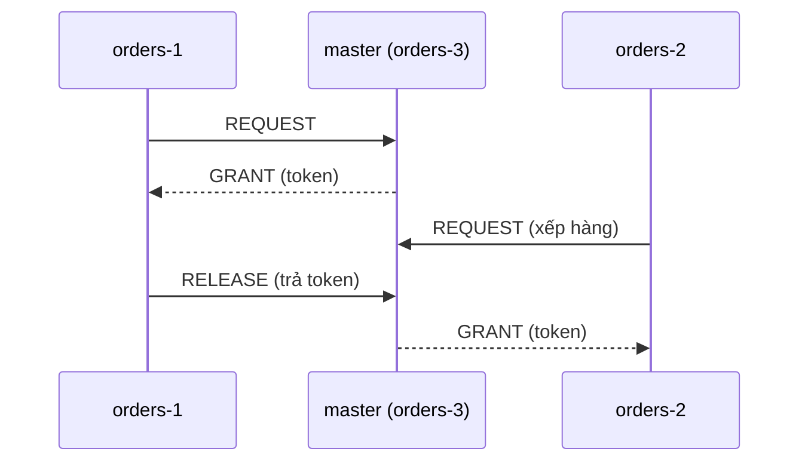
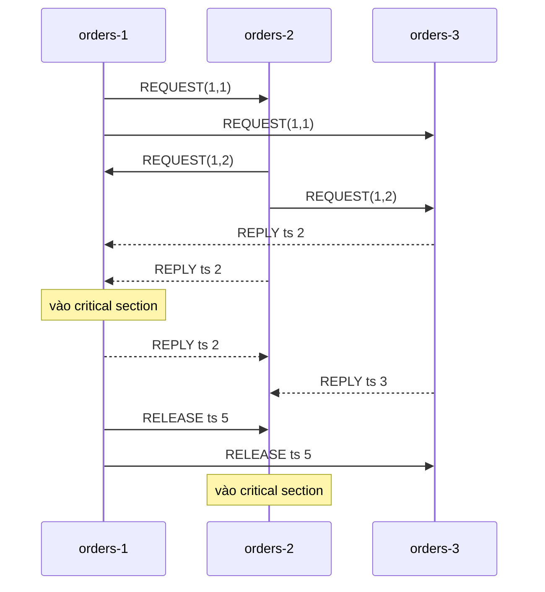
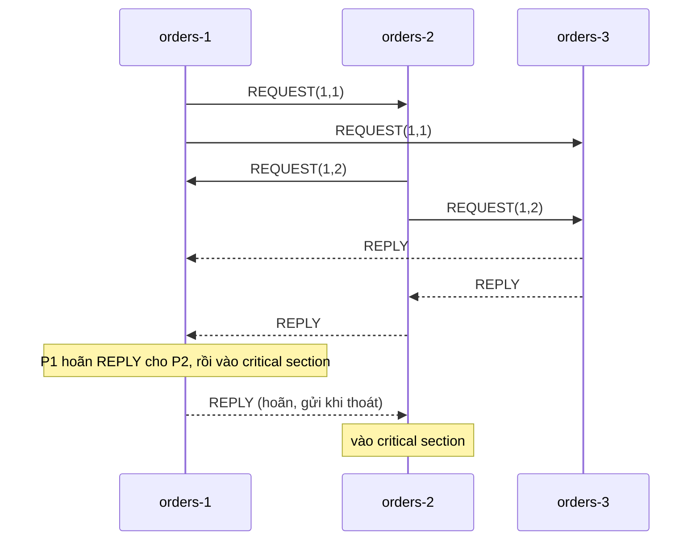

# P15 · Chương 05 — Loại trừ tương hỗ phân tán và bầu leader cổ điển

Mỗi đêm `orders` có một job `reconcile`: nó đối chiếu đơn hàng với `payments` rồi ghi kết quả vào `inventory`. Cụm `orders` chạy nhiều replica, và bạn muốn đúng một replica chạy job đó tại một thời điểm, vì hai bản chạy song song sẽ ghi đè lên nhau và làm hỏng số tồn kho. Đây là bài toán **loại trừ tương hỗ** (mutual exclusion) quen thuộc từ [P4 · Chương 03](../04-concurrency/03-lock.md), nhưng lần này các bên không dùng chung bộ nhớ: chúng chỉ nhắn tin cho nhau. Câu hỏi liền sau là *ai* chạy job. Nếu ta chỉ định một replica làm "leader" thì phải trả lời được bằng cách nào các replica thống nhất leader, và chuyện gì xảy ra khi leader chết.

Chương này đi qua lời giải cổ điển của hai bài toán đó, những thuật toán ra đời từ 1978 đến 1985 và vẫn là giáo trình chuẩn của môn hệ phân tán. Mục tiêu không phải để bạn cài chúng vào production. Mục tiêu là hiểu *vì sao* chúng đúng, chi phí của chúng là bao nhiêu thông điệp, và quan trọng nhất là chúng dựa trên những giả định nào mà hệ thống thật không thỏa. Cuối chương ta thấy cách các hệ thống thật thay những giả định ấy bằng lease cộng fencing token.

Cả chương dùng một ví dụ: cụm `orders` với các replica `orders-1`, `orders-2`, … và job `reconcile` (nhận xét của người soạn: ví dụ giả định, không phải code trong repo). Với mục 2–3 ta dùng cụm ba replica để vết chạy ngắn; với mục 4 ta dùng cụm bảy replica vì khi đó có một cấu trúc quorum rất đẹp.

## Bạn sẽ hiểu được gì

1. **Q1.** Một thuật toán loại trừ tương hỗ phân tán phải thỏa những tính chất nào (an toàn, sống, công bằng), và phương án "một server giữ khóa" tốn gì, hỏng ở đâu? → mục 1
2. **Q2.** Thuật toán của Lamport (1978) dùng đồng hồ logic để loại trừ tương hỗ ra sao, vết chạy trông thế nào, vì sao nó an toàn, và vì sao tốn đúng 3(N−1) thông điệp cho mỗi lần vào? → mục 2
3. **Q3.** Ricart–Agrawala (1981) bớt thông điệp bằng cách nào để chỉ còn 2(N−1), và chứng minh an toàn của nó đi thế nào? → mục 3
4. **Q4.** Maekawa (1985) giảm số thông điệp xuống cỡ √N bằng tập bỏ phiếu ra sao, dựng tập đó thế nào, vì sao nó có thể deadlock và cách chữa? → mục 4
5. **Q5.** Token ring hoạt động ra sao, và bốn họ thuật toán trên khác nhau thế nào về số thông điệp, độ trễ và khả năng chịu lỗi? → mục 5
6. **Q6.** Bầu leader khác loại trừ tương hỗ chỗ nào, và thuật toán bully (Garcia-Molina 1982) chạy ra sao? → mục 6
7. **Q7.** Thuật toán vòng Chang–Roberts (1979) bầu leader thế nào, và số thông điệp của nó, trường hợp xấu nhất, tốt nhất và trung bình, suy ra từ đâu? → mục 7
8. **Q8.** Vì sao các thuật toán này đòi kênh tin cậy, node không dừng, không có phân vùng, và hệ thống thật dùng gì thay (lease cộng fencing token)? → mục 8

## Kiến thức cần trước

- [P12 · Chương 09, mục 3](../12-he-thong-du-lieu/09-consistency-va-consensus.md): happens-before, đồng hồ Lamport và thứ tự toàn phần có phá hòa bằng id node. Chương này dùng đồng hồ Lamport mà không dạy lại. Mục "Đi sâu" của mục đó đã nhắc thuật toán loại trừ của Lamport trong vài dòng; ở đây ta đi hết: vết chạy, chứng minh, chi phí.
- [P12 · Chương 08, mục 8](../12-he-thong-du-lieu/08-su-co-he-phan-tan.md): lease và fencing token, và lý do process pause làm hỏng khóa dựa trên thời gian. Mục 8 của chương này dựa vào đó. [P12 · Chương 09, mục 8](../12-he-thong-du-lieu/09-consistency-va-consensus.md) nói etcd và ZooKeeper lấy fencing token ở đâu.
- [P12 · Chương 18](../12-he-thong-du-lieu/18-thuat-toan-dong-thuan.md): quorum giao nhau và Raft. Maekawa ở mục 4 dùng đúng nguyên lý quorum giao nhau đó; bầu leader trong Raft là họ hàng hiện đại của mục 6–7.
- [P15 · Chương 01](01-flp-va-cac-chan-duoi.md): vì sao không thuật toán tất định nào bảo đảm kết thúc khi mạng bất đồng bộ và node có thể hỏng, nền cho mục 8.
- [P4 · Chương 03](../04-concurrency/03-lock.md): critical section và lock trong một process, để đối chiếu.

---

## 1. Yêu cầu của loại trừ tương hỗ và phương án server trung tâm (Q1)

> **Trả lời ngắn.** Một thuật toán loại trừ tương hỗ phải bảo đảm an toàn (mỗi lúc chỉ một node trong critical section), tính sống (không deadlock, không ai chờ mãi) và thường cả công bằng (yêu cầu nào đến trước được phục vụ trước theo đồng hồ logic)[^k-safe][^k-live][^k-fair]. Phương án đơn giản nhất là một server giữ khóa và xếp hàng yêu cầu: tốn 3 thông điệp mỗi lần vào, nhưng server là nút cổ chai và điểm hỏng duy nhất[^u-central-spof]. Hơn nữa, muốn chọn server đó ta lại cần một thuật toán bầu leader.

**Giải thích.**

*Với `reconcile`.* Gọi "critical section" là đoạn chạy `reconcile`: trong đó replica đọc `payments`, ghi `inventory`. Mỗi đêm cả ba replica `orders-1..3` đều muốn chạy nó (lịch cron giống nhau), nhưng tại mỗi thời điểm chỉ một replica được ở trong đoạn đó. Ba tính chất ở trên cụ thể như sau:

| Tính chất | Nghĩa với `reconcile` | Loại |
|---|---|---|
| An toàn (safety) | Không bao giờ có hai replica cùng đang chạy `reconcile` | an toàn: không có chuyện xấu |
| Sống (liveness) | Replica nào xin chạy thì cuối cùng cũng được chạy; không replica nào chờ mãi vì deadlock hay bị bỏ đói | sống: rồi sẽ có chuyện tốt |
| Công bằng (fairness) | Yêu cầu nào phát ra trước, theo đồng hồ logic, được chạy trước | thứ tự phục vụ |

Phát biểu của sách giáo khoa về ba tính chất này đúng như vậy: an toàn là tại mọi thời điểm chỉ một process thực thi critical section[^k-safe]; sống là không có deadlock và không có starvation, tức không hai site nào chờ mãi một thông điệp không bao giờ tới[^k-live]; còn công bằng thường nghĩa là các yêu cầu được thực thi theo thứ tự đến, với "thời gian" đo bằng đồng hồ logic[^k-fair]. Lamport, người đặt ra bài toán này trong bài báo 1978, phát biểu ba điều kiện tương ứng: process được cấp tài nguyên phải trả lại trước khi tài nguyên cấp cho process khác; các yêu cầu khác nhau được cấp theo thứ tự chúng được phát ra; và nếu mọi process được cấp đều cuối cùng trả lại thì mọi yêu cầu cuối cùng được cấp[^l-cond]. Ông nhấn mạnh điều kiện thứ hai không nói gì về thứ tự của hai yêu cầu *đồng thời*[^l-cond2], tức hai yêu cầu không có chuỗi tin nhắn nào nối từ cái này sang cái kia.

*Phương án trung tâm.* Cách làm đầu tiên ai cũng nghĩ tới: chọn một node làm "master". Mỗi replica muốn chạy `reconcile` thì gửi yêu cầu cho master; master giữ một hàng đợi các yêu cầu và một "token" cho phép giữ khóa; nếu token đang rảnh thì master gửi nó cho người xin, nếu không thì xếp người xin vào hàng; khi người giữ xong, nó gửi token trả master, master cấp cho người đầu hàng[^u-central]. Phân tích đơn giản: chỉ có một token nên an toàn; hàng đợi hữu hạn nên nếu mọi người trả khóa và không có lỗi thì ai cũng được phục vụ. Chi phí: 2 thông điệp để vào (xin, được cấp) và 1 thông điệp để thoát[^u-central-cost], tổng 3 thông điệp mỗi lần, và độ trễ đồng bộ giữa hai lần vào liên tiếp là hai lần truyền (trả khóa, cấp khóa)[^u-central-sync].

Với `orders`, 3 thông điệp mỗi đêm hầu như là mức thấp nhất có thể, nên phương án trung tâm không hề tệ về chi phí. Hai điểm yếu của nó là: master là nút cổ chai và điểm hỏng duy nhất[^u-central-spof], và việc "chọn master" chính là một bài toán bầu leader cần thuật toán riêng[^u-central-elect]. Phần "Đi sâu" bên dưới nói thêm một điểm tinh tế: master cấp theo thứ tự nhận tin chưa chắc đã *công bằng*.



(Sơ đồ của người soạn minh họa luồng 3 thông điệp mỗi lần vào.)

<details><summary>Đi sâu: master cấp theo thứ tự nhận không bảo đảm thứ tự "xảy ra trước"; ba số đo; giả định chung của chương</summary>

- *Công bằng theo thứ tự nhận khác công bằng theo nhân quả.* Lamport chỉ ra rằng một process điều phối trung tâm cấp theo thứ tự nhận yêu cầu thì *không* thỏa điều kiện thứ hai, trừ khi có thêm giả định. Ví dụ: P1 gửi yêu cầu cho master P0 rồi gửi một tin cho P2; P2 nhận tin đó rồi gửi yêu cầu cho P0; yêu cầu của P2 vẫn có thể tới P0 trước yêu cầu của P1[^l-central]. Với `orders`, nếu `orders-1` xin khóa rồi báo `orders-2`, thì `orders-2` có thể "chen ngang" mà không có gì sai về mặt mạng. Đó là lý do ba thuật toán ở mục 2–4 phải dựng thứ tự bằng đồng hồ logic thay vì dựa vào thứ tự nhận ở một điểm.
- *Ba số đo dùng cho cả chương.* Số thông điệp mỗi lần vào critical section; độ trễ đồng bộ (synchronization delay), tức thời gian từ lúc một site rời critical section đến lúc site kế tiếp vào[^k-metric]; và khả năng chịu lỗi. Các bài giảng ký hiệu T là độ trễ của một lần truyền thông điệp.
- *Giả định chung ở mục 2–5.* N node cố định, mỗi node chạy tuần tự (xen kẽ yêu cầu và trả khóa), mọi node đều sống và trả lời. Mục 8 bỏ lần lượt từng giả định này.

</details>

**Quay lại Q1:** an toàn, sống và công bằng là ba tiêu chí; server trung tâm đạt cả ba với 3 thông điệp mỗi lần vào nhưng tập trung rủi ro vào một node, và muốn chọn node đó thì phải bầu leader (mục 6–7).

---

## 2. Thuật toán của Lamport: đồng hồ logic và hàng đợi yêu cầu (Q2)

> **Trả lời ngắn.** Mỗi node giữ một hàng đợi các yêu cầu, sắp theo timestamp Lamport (phá hòa bằng id node). Muốn vào, node gửi `REQUEST` cho mọi node khác; mỗi node nhận được thì xếp vào hàng và gửi `REPLY`; node vào khi yêu cầu của nó đứng đầu hàng *và* nó đã nhận từ mọi node khác một thông điệp có timestamp muộn hơn yêu cầu đó[^l-grant]. Thoát thì gửi `RELEASE` cho mọi node. Mỗi lần vào tốn (N−1) `REQUEST` + (N−1) `REPLY` + (N−1) `RELEASE` = 3(N−1) thông điệp[^k-lam-msgs].

**Giải thích.**

*Ý tưởng.* Mỗi node có bản sao riêng của "hàng chờ khóa". Nếu mọi node đều thấy *cùng* hàng, theo cùng thứ tự, thì mọi node cùng biết ai là người kế tiếp, và không cần ai điều phối. Đồng hồ Lamport cho ta thứ tự toàn phần nhất quán với nhân quả (xem [P12·09 mục 3](../12-he-thong-du-lieu/09-consistency-va-consensus.md)), và Lamport dùng đúng thứ tự toàn phần ấy để giải bài toán loại trừ tương hỗ như một ví dụ minh họa[^l-illustrate]. Hàng đợi của mỗi node là riêng tư, không process nào khác thấy[^l-queue]. Nhắc lại ký hiệu: yêu cầu của node i phát lúc đồng hồ i là T mang nhãn `(T, i)`, và `(T, i) ≺ (T', j)` khi T < T' hoặc T = T' và i < j.

Bài báo đặt hai giả định cho thuật toán: thông điệp từ Pi gửi Pj được nhận *theo đúng thứ tự gửi* (kênh FIFO), và mọi thông điệp cuối cùng đều tới nơi[^l-fifo][^l-eventual]. Tác giả nói cả hai có thể bỏ nếu thêm số thứ tự và giao thức xác nhận[^l-avoid]; ở đây ta giữ chúng, vì chứng minh bên dưới dùng đến.

### 2.1 Năm quy tắc

Thuật toán gồm năm quy tắc[^l-rules]. Viết lại theo `reconcile`, với `ts` là giá trị đồng hồ Lamport của node:

1. **Xin vào.** Node `i` tăng đồng hồ, lấy `T = ts`, đặt `(T, i)` vào hàng đợi của mình rồi gửi `REQUEST(T, i)` cho mọi node khác.
2. **Nhận yêu cầu.** Node `j` nhận `REQUEST(T, i)` thì đặt nó vào hàng đợi của mình và gửi `REPLY` (có timestamp) về `i`.
3. **Thoát.** Node `i` xóa yêu cầu của mình khỏi hàng đợi rồi gửi `RELEASE` cho mọi node khác.
4. **Nhận release.** Node `j` nhận `RELEASE` từ `i` thì xóa yêu cầu của `i` khỏi hàng đợi.
5. **Điều kiện vào.** Node `i` được vào khi đồng thời (a) yêu cầu của nó đứng đầu hàng đợi theo thứ tự `≺`, và (b) nó đã nhận từ *mọi* node khác một thông điệp có timestamp muộn hơn timestamp yêu cầu của nó[^l-grant]. Cả hai điều kiện đều kiểm tra cục bộ[^l-local].

Với `reconcile`, "vào" nghĩa là replica bắt đầu chạy job, "thoát" là job xong.

### 2.2 Một vết chạy với ba replica

Giả sử `orders-1`, `orders-2`, `orders-3` (viết P1, P2, P3) đều có đồng hồ 0 và hàng đợi rỗng. P1 và P2 cùng xin chạy `reconcile` gần như đồng thời; P3 không xin. Mỗi bước gộp việc nhận và việc gửi trả lời thành một sự kiện, như bài báo quy ước. Đồng hồ nhận tin đặt theo `max(đồng hồ mình, ts tin) + 1`. Bảng sau là vết do người soạn dựng từ năm quy tắc trên:

| # | Sự kiện | Đồng hồ sau | Hàng đợi sau |
|---|---|---|---|
| 1 | P1 xin: gửi `REQUEST(1,1)` cho P2, P3 | C1 = 1 | Q1 = {(1,1)} |
| 2 | P2 xin: gửi `REQUEST(1,2)` cho P1, P3 | C2 = 1 | Q2 = {(1,2)} |
| 3 | P3 nhận `REQUEST(1,1)`, trả `REPLY` ts 2 | C3 = 2 | Q3 = {(1,1)} |
| 4 | P3 nhận `REQUEST(1,2)`, trả `REPLY` ts 3 | C3 = 3 | Q3 = {(1,1), (1,2)} |
| 5 | P2 nhận `REQUEST(1,1)`, trả `REPLY` ts 2 | C2 = 2 | Q2 = {(1,1), (1,2)} |
| 6 | P1 nhận `REQUEST(1,2)`, trả `REPLY` ts 2 | C1 = 2 | Q1 = {(1,1), (1,2)} |
| 7 | P1 nhận `REPLY` ts 2 từ P3, rồi `REPLY` ts 2 từ P2 | C1 = 3, rồi 4 | không đổi. Đầu hàng là (1,1), và P1 đã nhận tin ts 2 > 1 từ cả P2 lẫn P3 ⇒ **P1 vào** |
| 8 | P2 nhận `REPLY` ts 3 từ P3, rồi `REPLY` ts 2 từ P1 | C2 = 4, rồi 5 | không đổi. Điều kiện (b) đủ, nhưng đầu hàng là (1,1) chứ không phải (1,2) ⇒ **P2 chờ** |
| 9 | P1 xong, xóa (1,1), gửi `RELEASE` ts 5 cho P2, P3 | C1 = 5 | Q1 = {(1,2)} |
| 10 | P2 nhận `RELEASE`, xóa (1,1) | C2 = 6 | Q2 = {(1,2)} ⇒ **P2 vào** |
| 11 | P3 nhận `RELEASE`, xóa (1,1) | C3 = 6 | Q3 = {(1,2)} |
| 12 | P2 xong, gửi `RELEASE` ts 7 cho P1, P3 | C2 = 7 | Q2 = {} |

Hai yêu cầu đều mang T = 1, nên thứ tự do id node quyết định: (1,1) ≺ (1,2). Điều đáng nhìn là bước 8: P2 đã nghe đủ mọi node nhưng vẫn phải chờ, vì trong hàng của nó có yêu cầu đi trước. Tổng số thông điệp cho hai lần vào là 12: mỗi lần vào có 2 `REQUEST`, 2 `REPLY`, 2 `RELEASE`, tức 6 = 3(N−1) với N = 3.



(Sơ đồ của người soạn: vẽ lại vết ở bảng trên, bỏ thứ tự chính xác giữa các `REPLY` không quan trọng.)

### 2.3 Chứng minh an toàn (của người soạn, theo phác thảo của Lamport)

Bài báo chỉ phác chứng minh trong vài dòng: điều kiện (b) cùng giả định nhận tin đúng thứ tự bảo đảm Pi đã biết mọi yêu cầu đi trước yêu cầu hiện tại của mình, và vì chỉ quy tắc 3 và 4 mới xóa yêu cầu khỏi hàng nên an toàn đúng[^l-sketch]. Dưới đây là bản đầy đủ từng bước **(chứng minh của người soạn)**.

*Phát biểu.* Với các giả định ở mục 1 và 2 (kênh FIFO tin cậy, mỗi node xen kẽ xin và thoát), không bao giờ có hai node cùng ở trong critical section.

*Chứng minh.* Giả sử ngược lại, tại một thời điểm `t` hai node Pi và Pj cùng ở trong critical section, theo yêu cầu `ri = (Ti, i)` và `rj = (Tj, j)`. Hai yêu cầu có nhãn khác nhau (id khác), nên theo thứ tự toàn phần `≺` ta có thể giả sử `ri ≺ rj` (nếu không thì đổi vai i, j).

1. **Điều kiện (b) của Pj cho ta một thông điệp m từ Pi.** Lúc vào, Pj đã nhận từ Pi một thông điệp `m` có timestamp `ts(m) > Tj`. Vì `ri ≺ rj` nên `Ti ≤ Tj`, suy ra `ts(m) > Ti`.
2. **`m` được gửi sau khi Pi phát `REQUEST ri`.** Đồng hồ của Pi tăng nghiêm ngặt theo các sự kiện của chính nó (quy tắc IR1 của đồng hồ Lamport). Sự kiện xin vào của Pi mang timestamp đúng bằng `Ti`, còn `m` mang timestamp lớn hơn `Ti`, nên `m` do một sự kiện sau đó của Pi gửi ra.
3. **Pj đã nhận `REQUEST ri` trước khi nhận `m`.** Cả `REQUEST ri` lẫn `m` đều là thông điệp từ Pi tới Pj, `REQUEST ri` gửi trước. Kênh FIFO[^l-fifo] nên Pj nhận `REQUEST ri` trước, và xếp `ri` vào hàng đợi (quy tắc 2).
4. **Chỉ có `RELEASE` của Pi mới xóa `ri` khỏi hàng của Pj.** Quy tắc 3 và 4 là hai quy tắc duy nhất xóa phần tử khỏi hàng đợi. Do đó, tại lúc Pj vào, hoặc `ri` vẫn nằm trong hàng đợi của Pj, hoặc Pj đã nhận `RELEASE` ứng với `ri`.
5. **Trường hợp A: `ri` vẫn ở trong hàng đợi.** Khi đó vì `ri ≺ rj`, yêu cầu `rj` *không* đứng đầu hàng, và điều kiện (a) của Pj sai. Mâu thuẫn với việc Pj đã vào.
6. **Trường hợp B: Pj đã nhận `RELEASE` của Pi.** Pi chỉ gửi `RELEASE` khi thoát critical section (quy tắc 3), mà việc nhận xảy ra trước lúc Pj vào, tức trước hoặc tại `t`. Vậy Pi đã *rời* critical section trước `t`, mâu thuẫn với giả sử Pi còn ở trong tại `t`.

Cả hai trường hợp đều mâu thuẫn, nên giả sử sai. ∎

Cần để ý chứng minh dùng hai giả định ở đâu. FIFO dùng ở bước 3: nếu `m` có thể vượt `REQUEST ri` thì Pj có thể vào mà chưa biết `ri` tồn tại. Điều kiện (b) dùng ở bước 1: nó là cách Pj "kiểm tra rằng sẽ không có yêu cầu nào đi trước còn đang bay trên đường". Bỏ (b), Pj chỉ nhìn hàng đợi cục bộ có thể thấy mình đứng đầu chỉ vì `REQUEST` của người đi trước chưa tới.

### 2.4 Tính sống, công bằng và chi phí

*Tính sống (phác thảo của người soạn).* Giả sử mọi node đã vào critical section đều cuối cùng thoát. Với yêu cầu `r = (T, i)`: (b) cuối cùng thỏa vì mọi node nhận `REQUEST r` đều gửi `REPLY` mang timestamp lớn hơn T (nhận tin đặt đồng hồ lớn hơn T), và mọi thông điệp cuối cùng tới nơi. (a) cuối cùng thỏa vì số yêu cầu `≺ r` là hữu hạn: yêu cầu nào phát *sau khi* nhận `r` đều có timestamp lớn hơn T nên đứng sau `r`. Mỗi yêu cầu đi trước lần lượt được cấp, thoát, và bị xóa nhờ `RELEASE`. Bài báo cũng nói quy tắc 2 bảo đảm điều kiện (b) cuối cùng sẽ thỏa[^l-live].

*Công bằng.* Điều kiện thứ hai của Lamport (cấp theo thứ tự phát) đúng vì thứ tự toàn phần `≺` mở rộng quan hệ xảy ra-trước[^l-proof]: nếu yêu cầu a xảy ra trước yêu cầu b thì a đứng trước b trong mọi hàng đợi.

*Chi phí.* Mỗi lần vào gồm (N−1) `REQUEST`, (N−1) `REPLY` và (N−1) `RELEASE`, tức 3(N−1) thông điệp, với độ trễ đồng bộ là T[^k-lam-msgs]. Ricart và Agrawala cũng ghi nhận thuật toán của Lamport đòi chừng 3(N−1) thông điệp cho mỗi lần vào critical section[^ra-3n]. Với `orders` N = 3 là 6 thông điệp mỗi lần so với 3 của phương án trung tâm; N = 7 là 18.

<details><summary>Đi sâu: bớt REPLY, thứ tự phục vụ nhất quán, và vì sao một node chết là cả hệ dừng</summary>

- *Có thể bỏ một số `REPLY`.* Chính bài báo chú thích: node không cần gửi xác nhận nếu nó đã gửi cho người xin một thông điệp có timestamp muộn hơn timestamp yêu cầu[^l-ack]. Lý do: điều kiện (b) chỉ cần *một* thông điệp muộn hơn từ mỗi node, bất kể loại nào. Số thông điệp trong trường hợp trung bình vì thế thấp hơn 3(N−1), nhưng cận trên vẫn là 3(N−1).
- *Tổng quát hóa thành máy trạng thái.* Lamport nhận xét cách làm trên khái quát được: mỗi process mô phỏng cùng một máy trạng thái bằng cách thực thi các lệnh theo thứ tự timestamp, và một process chỉ thực thi lệnh timestamp T khi đã biết mọi lệnh có timestamp không lớn hơn T. Cái giá là thuật toán đòi *mọi* process tham gia, nên một process hỏng làm cả hệ dừng[^l-fail]. Đó là hạt giống của state machine replication ở [P12·09 mục 4](../12-he-thong-du-lieu/09-consistency-va-consensus.md).
- *Khái niệm "hỏng" cần thời gian vật lý.* Lamport viết rằng khái niệm hỏng chỉ có nghĩa trong bối cảnh thời gian vật lý, vì thiếu nó thì không phân biệt được process hỏng với process đang tạm dừng giữa hai sự kiện[^l-failconcept]. Mục 8 sẽ cho thấy đây chính là vết nứt mà lease và GC pause khai thác.
- *Thuật toán không phải chịu lỗi nên không đứng được ở production.* Phần chịu lỗi nằm ở các thuật toán đồng thuận (Paxos, Raft: [P12·18](../12-he-thong-du-lieu/18-thuat-toan-dong-thuan.md)).

</details>

**Quay lại Q2:** hàng đợi sắp theo timestamp Lamport cộng điều kiện "đứng đầu hàng và đã nghe một tin muộn hơn từ mọi node" cho loại trừ tương hỗ an toàn (nhờ FIFO), sống và công bằng; giá là 3(N−1) thông điệp mỗi lần vào và mọi node phải sống.

---

## 3. Ricart–Agrawala: gộp REPLY với RELEASE, còn 2(N−1) (Q3)

> **Trả lời ngắn.** Ricart và Agrawala bỏ hàng đợi chung và bỏ `RELEASE`: node xin vào gửi `REQUEST` cho mọi node khác; node nhận trả lời `REPLY` ngay nếu người xin có ưu tiên cao hơn, nếu không thì *hoãn* `REPLY` cho tới khi nó ra khỏi critical section của mình[^ra-desc]. Mỗi lần vào chỉ còn (N−1) `REQUEST` và (N−1) `REPLY`, tức 2(N−1) thông điệp[^ra-opt]. Chứng minh an toàn chỉ cần so sánh hai con số thứ tự và không đòi kênh giữ thứ tự[^ra-net].

**Giải thích.**

*Quan sát cốt lõi.* Ở thuật toán Lamport, `REPLY` chỉ để bảo đảm "mình đã nghe đủ" và `RELEASE` để xóa yêu cầu cũ khỏi hàng. Ricart–Agrawala chú ý rằng node nhận `REQUEST` có thể *tự quyết ngay* ai nên vào trước, nhờ so sánh con số trong yêu cầu với con số của chính nó, và node gửi yêu cầu không bao giờ được báo kết quả so sánh[^ra-never]. Nếu người xin có ưu tiên, `REPLY` ngay. Nếu không, `REPLY` bị hoãn cho tới khi node nhận ra khỏi critical section[^ra-desc], và chính `REPLY` hoãn đó thay cho cả `RELEASE` (cách đọc này là suy luận của người soạn).

*Ưu tiên.* Mỗi yêu cầu mang một số thứ tự (sequence number) và id node. Quyết định ưu tiên dựa trên số thứ tự; nếu bằng nhau thì so id node[^ra-prio]. Cách chọn số: node xin vào lấy số lớn hơn mọi số nó từng thấy, tức `Our_Sequence_Number = Highest_Sequence_Number + 1`, với `Highest_Sequence_Number` là số lớn nhất trong mọi `REQUEST` đã gửi hoặc nhận[^ra-highest]. Cách này giống đồng hồ Lamport nhưng chỉ cập nhật theo `REQUEST` (suy luận của người soạn).

### 3.1 Thuật toán

Mỗi node `me` giữ: `requesting` (đang xin hay không), `our_seq`, `highest_seq`, `outstanding` (số `REPLY` còn đợi) và mảng `deferred[j]`.

- **Xin vào.** Đặt `requesting = true`, `our_seq = highest_seq + 1`, `outstanding = N − 1`, gửi `REQUEST(our_seq, me)` cho mọi node khác, chờ `outstanding = 0` rồi vào.
- **Nhận `REQUEST(k, j)`.** Cập nhật `highest_seq = max(highest_seq, k)`. Hoãn nếu `requesting` và `(k, j)` đứng *sau* `(our_seq, me)` theo thứ tự từ điển; nếu không, `REPLY` ngay.
- **Nhận `REPLY`.** Giảm `outstanding`.
- **Thoát.** Đặt `requesting = false`, gửi `REPLY` cho mọi `j` có `deferred[j]` rồi xóa cờ.

Quy tắc hoãn ở trên là điều kiện mà bài báo viết thành biến `Defer_it`: so sánh số thứ tự trước, bằng nhau thì so số node[^ra-prio].

### 3.2 Vết chạy cùng kịch bản

Dùng lại P1, P2, P3. Cả P1 và P2 xin gần như đồng thời, mỗi bên chọn số thứ tự 1: P1 gửi `REQUEST(1,1)`, P2 gửi `REQUEST(1,2)`. P3 không xin.

1. P3 nhận cả hai yêu cầu khi không xin, nên `REPLY` ngay cho cả hai.
2. P2 nhận `REQUEST(1,1)` khi đang xin với `(1,2)`. `(1,1)` đứng trước `(1,2)`, nên P1 có ưu tiên: P2 `REPLY` ngay cho P1.
3. P1 nhận `REQUEST(1,2)` khi đang xin với `(1,1)`. `(1,2)` đứng sau, nên P1 *hoãn* `REPLY`.
4. P1 đã có `REPLY` từ P2 và P3 ⇒ P1 vào. P2 mới có `REPLY` từ P3, còn thiếu của P1 ⇒ P2 chờ.
5. P1 thoát, gửi `REPLY` hoãn cho P2 ⇒ P2 có đủ ⇒ P2 vào.

Số thông điệp: 2 `REQUEST` + 2 `REPLY` cho mỗi lần vào, hai lần là 8, so với 12 của Lamport trong cùng kịch bản. Bài báo có ví dụ ba node tương tự, trong đó node 2 thắng node 3 nhờ id khi hai bên chọn cùng số thứ tự 1[^ra-ex].



(Sơ đồ của người soạn minh họa vết ở trên.)

### 3.3 Chứng minh an toàn

Bài báo chứng minh bằng ba trường hợp[^ra-case3]. Dưới đây là bản viết lại gọn hơn của người soạn, cùng ý nhưng gộp ba trường hợp thành hai.

*Phát biểu.* Không bao giờ có hai node cùng ở trong critical section.

*Chứng minh.* Giả sử tại một thời điểm hai node A và B cùng ở trong critical section. Mỗi bên đã nhận `REPLY` của bên kia cho đợt xin hiện tại. Gọi `kA = (sA, A)` và `kB = (sB, B)` là hai nhãn yêu cầu hiện tại; chúng khác nhau vì id khác, nên ta giả sử `kA < kB` theo thứ tự từ điển.

Xét thời điểm A nhận `REQUEST kB` (A phải nhận nó, vì B đã xin tất cả node khác và đã nhận `REPLY` của A). Có hai khả năng:

1. **A nhận `REQUEST kB` trước khi A bắt đầu đợt xin của mình** (`requesting` còn `false`). Khi nhận, A đặt `highest_seq ≥ sB`. Sau đó A chọn `sA = highest_seq + 1 > sB`, suy ra `kA > kB`. Mâu thuẫn với `kA < kB`.
2. **A nhận `REQUEST kB` sau khi A đã đặt `requesting = true` và chọn `kA`.** Vì `kA < kB`, A hoãn `REPLY` cho B cho tới khi ra khỏi critical section. Vậy B không thể có `REPLY` của A, và do đó không thể vào critical section khi A còn ở trong. Mâu thuẫn với việc cả hai cùng ở trong.

(Còn khả năng A nhận `REQUEST kB` *sau khi* A đã thoát cho đợt hiện tại; khi đó A không còn ở trong critical section lúc B vào, nên không vi phạm gì.) ∎

Chứng minh không dùng giả định kênh giữ thứ tự. Thật vậy, bài báo giả định mạng không lỗi nhưng thời gian truyền có thể thay đổi và thông điệp có thể không tới theo thứ tự gửi[^ra-net]. Mỗi `REPLY` ở đây đáp lại đúng một `REQUEST` cụ thể, nên không còn ngầm suy diễn "đã nghe đủ" từ một thông điệp muộn hơn như ở Lamport (suy luận của người soạn).

### 3.4 Không deadlock, không đói, và vì sao 2(N−1) là tối ưu

*Không deadlock.* Giả sử có deadlock thì phải có một vòng các node, mỗi node đã gửi `REQUEST` cho node kế tiếp nhưng chưa nhận `REPLY`[^ra-circuit]. Mỗi node trong vòng đang hoãn yêu cầu nhận được, nên nhãn của yêu cầu đó lớn hơn nhãn của chính nó. Đi hết vòng thì nhãn của một node lớn hơn nhãn của chính nó: vô lý. Đó cũng là lập luận của bài báo.

*Không đói.* Một node đã xử lý `REQUEST` của node X thì từ đó không thể phát yêu cầu mới có số thứ tự bằng hoặc nhỏ hơn số của X[^ra-starve]. Sau một thời gian hữu hạn, X có nhãn nhỏ nhất trong số các yêu cầu đang chờ, và nó chặn mọi người khác bằng cách hoãn `REPLY`. Phần thảo luận của bài báo nói kết quả: không node nào vào được hai lần trước khi X vào một lần[^ra-twice].

*Tối ưu.* Các tác giả tuyên bố 2(N−1) là tối thiểu trong lớp thuật toán đối xứng, phân tán hoàn toàn, nơi mỗi node xử lý yêu cầu đồng thời[^ra-optimal]. Đừng hiểu "tối ưu" rộng hơn thế: server trung tâm ở mục 1 dùng 3 thông điệp, nên nó rẻ hơn rất nhiều, nhưng nó không đối xứng.

<details><summary>Đi sâu: xử lý node hỏng của chính bài báo, và giả định về cận trên thời gian</summary>

- Bài báo thừa nhận trong thực tế có node hỏng và không trả lời, và đề xuất thêm một cơ chế timeout-recovery để tránh treo thuật toán[^ra-failintro]. Cơ chế này dựa vào hai thứ: một cận trên của thời gian một node còn sống cần để trả lời, và một ước lượng thời gian tối đa trong critical section[^ra-timeout].
- Node xin vào bật timer khi gửi `REQUEST`; hết giờ thì nó thăm dò (`ARE_YOU_THERE`) các node chưa trả lời, và nếu thăm dò cũng im lặng thì coi node đó là đã hỏng, rồi giả vờ nhận `REPLY` từ nó.
- Nhận xét của người soạn: đúng ở mô hình đồng bộ có cận thời gian. Còn một node đang bị GC pause dài hơn cận vẫn bị coi là chết trong khi nó sống và sẽ tỉnh lại. Ở thời điểm đó hai node có thể cùng tin mình đang ở trong critical section. Đó là lý do mục 8 coi timeout-recovery kiểu này không đủ cho an toàn.
- Số thông điệp trung bình của Ricart–Agrawala, theo sách giáo khoa của Kshemkalyani và Singhal, vẫn là 2(N−1): (N−1) `REQUEST` và (N−1) `REPLY`, với độ trễ đồng bộ T[^k-ra-msgs].

</details>

**Quay lại Q3:** `REPLY` hoãn thay cả `REPLY` lẫn `RELEASE` của Lamport nên chỉ còn 2(N−1) thông điệp, an toàn nhờ hai node không thể cùng có `REPLY` của nhau khi nhãn của chúng so sánh ngược nhau, và mọi node vẫn phải sống để trả lời.

---

## 4. Maekawa: bỏ phiếu trong tập cỡ √N (Q4)

> **Trả lời ngắn.** Ricart–Agrawala cần `REPLY` từ *mọi* node. Maekawa nhận thấy chỉ cần `REPLY` từ một *tập con* (request set) của mỗi node, miễn là hai tập bất kỳ giao nhau: node nào nằm trong phần giao sẽ không đồng thời cấp phép cho hai bên, nên hai node không thể cùng vào[^k-m-proof]. Chọn tập cỡ √N thì mỗi lần vào chỉ tốn cỡ 3√N thông điệp (người soạn đếm ở 4.4). Nhưng thuật toán có thể deadlock, và phải thêm các thông điệp `FAILED`, `INQUIRE`, `YIELD` để chữa, nâng mức tối đa lên 5√N[^k-m-5max].

**Giải thích.**

*Ý tưởng, bằng ví dụ.* Với bảy replica, thay vì xin phép cả sáu replica còn lại, `orders-1` chỉ cần xin phép hai replica nữa. Muốn vậy, ta cho mỗi replica một "danh sách người bỏ phiếu" sao cho hai danh sách bất kỳ có ít nhất một người chung. Một replica chỉ bỏ phiếu cho một người xin tại mỗi thời điểm; vì hai danh sách giao nhau, hai người xin không thể cùng nhận đủ phiếu. Đây là nguyên lý quorum giao nhau quen thuộc từ [P12·18 mục 1](../12-he-thong-du-lieu/18-thuat-toan-dong-thuan.md), dùng cho loại trừ tương hỗ thay vì cho đồng thuận.

### 4.1 Điều kiện cho tập bỏ phiếu

Gọi `Ri` là request set của site `Si`. Maekawa đặt bốn điều kiện: M1, hai tập bất kỳ giao nhau; M2, `Si ∈ Ri`; M3, mọi tập cùng cỡ K; M4, mỗi site nằm trong đúng K tập[^k-m-proj]. M1 và M2 cần cho tính đúng; M3 và M4 cho những tính chất đáng mong muốn[^k-m-m12]: M3 để mọi site làm lượng việc như nhau khi xin vào, M4 để mọi site có "trách nhiệm" cấp phép ngang nhau[^k-m-m3].

### 4.2 Thuật toán

Site `Si` xin vào bằng cách gửi `REQUEST(i)` tới mọi site trong `Ri`. Site `Sj` nhận được thì `REPLY` ngay nếu từ lần `RELEASE` gần nhất nó chưa gửi `REPLY` nào; nếu không thì xếp yêu cầu vào hàng. `Si` chỉ vào critical section khi đã có `REPLY` từ *mọi* site trong `Ri`[^k-m-alg]. Thoát thì `Si` gửi `RELEASE` cho mọi site trong `Ri`; site nhận `RELEASE` gửi `REPLY` cho người đầu hàng, hoặc ghi nhận là rảnh nếu hàng trống.

Một site nào đó chỉ giữ *một* phiếu: nó đã trả lời một yêu cầu thì không trả lời yêu cầu khác tới khi nhận `RELEASE`. Đó là chỗ phát sinh deadlock (mục 4.5).

### 4.3 Chứng minh an toàn

*Phát biểu.* Chỉ cần M1: mọi hai tập giao nhau thì không có hai site cùng ở trong critical section.

*Chứng minh.* Giả sử `Si` và `Sj` cùng ở trong critical section. Khi đó `Si` nhận `REPLY` từ mọi site của `Ri`, và `Sj` nhận `REPLY` từ mọi site của `Rj`. Theo M1, tồn tại `Sk ∈ Ri ∩ Rj`. Như vậy `Sk` đã gửi `REPLY` cho cả `Si` lẫn `Sj` trong khi chưa nhận `RELEASE` nào ở giữa, trái với quy tắc "một phiếu một lúc". Mâu thuẫn[^k-m-proof]. ∎

(Đây là chứng minh của sách giáo khoa Kshemkalyani–Singhal viết lại; bản gốc của Maekawa đăng ở ACM TOCS 1985, người soạn không tải được toàn văn để đối chiếu.)

### 4.4 Dựng tập bỏ phiếu và vì sao cỡ √N là gần tối ưu

*Mặt phẳng xạ ảnh.* Maekawa dùng lý thuyết mặt phẳng xạ ảnh (projective plane) và chỉ ra N = K(K−1) + 1, tức |Ri| xấp xỉ √N[^k-m-proj]. Trường hợp nhỏ nhất đáng nhớ là K = 3, N = 7: mặt phẳng Fano. Bảy "đường thẳng" của nó là bảy tập, mỗi tập 3 site, hai đường bất kỳ chung đúng một site:

| Site | `Ri` |
|---|---|
| S1 | {1, 2, 3} |
| S2 | {2, 4, 6} |
| S3 | {3, 4, 7} |
| S4 | {1, 4, 5} |
| S5 | {2, 5, 7} |
| S6 | {1, 6, 7} |
| S7 | {3, 5, 6} |

Mỗi site thuộc đúng 3 tập, đúng M4. Người soạn gán thứ tự các đường sao cho `Si ∈ Ri` (M2); phần "hai đường chung đúng một điểm" đã kiểm bằng chương trình Rust ở Đi sâu mục 7 (quan sát). Với `orders` bảy replica: mỗi lần vào chỉ xin phép 2 replica khác.

*Lưới.* Không phải N nào cũng có dạng K(K−1)+1 với mặt phẳng xạ ảnh có sẵn. Một cách dựng đơn giản hơn, của người soạn: xếp N = k² site thành lưới k × k, và cho `Ri` là hợp của hàng và cột chứa `Si`. Vậy |Ri| = 2k − 1 = 2√N − 1. *Chứng minh giao nhau:* với `Sa` ở ô (r₁, c₁) và `Sb` ở ô (r₂, c₂), ô (r₁, c₂) nằm trong hàng r₁ (thuộc `Ra`) và trong cột c₂ (thuộc `Rb`), nên `Ra ∩ Rb ≠ ∅`. Lưới có `Si ∈ Ri` hiển nhiên, nhưng cỡ tập là 2√N − 1 chứ không phải √N.

*Cận dưới (của người soạn, từ M1, M3, M4).* Vì sao không thể nhỏ hơn cỡ √N nhiều? Cố định `Ri`, cỡ K. Mỗi site trong `Ri` thuộc K tập (M4), trong đó có `Ri` chính nó, nên có tối đa K − 1 tập *khác* chứa site đó. Mỗi tập khác `Rj` phải giao `Ri` (M1) nên chứa ít nhất một trong K site đó. Vậy số tập khác `Ri` không quá K(K−1), mà có N − 1 tập khác, suy ra N − 1 ≤ K(K−1), tức N ≤ K(K−1) + 1. Dấu bằng chính là điều kiện của mặt phẳng xạ ảnh. Do đó K ≥ cỡ √N khi M3 và M4 đều đúng.

*Chi phí.* Mỗi lần vào gửi K `REQUEST`, nhận K `REPLY`, gửi K `RELEASE`, tức 3K thông điệp, tức 3√N khi coi K ≈ √N, và độ trễ đồng bộ là 2T vì sau khi thoát `Si` phải `RELEASE` trước, rồi một site trong tập mới `REPLY` cho người kế tiếp[^k-m-perf]. (Theo M2, `Si` nằm trong `Ri` nên thông điệp tới chính nó là nội bộ, chi phí mạng thật là 3(K−1); người soạn nêu thêm để so với Fano: N = 7 thì 6 thay vì 18 của Lamport hay 12 của Ricart–Agrawala.)

### 4.5 Deadlock và cách chữa

Thuật toán sơ khai có thể deadlock vì một site bị các site khác khóa độc quyền, mà yêu cầu không được ưu tiên theo timestamp[^k-m-dead]. Với bảy replica ở trên, dựng một vết (của người soạn):

- Ba site `S1`, `S2`, `S4` xin cùng lúc, nhãn timestamp theo thứ tự `S1 < S2 < S4` (nhỏ hơn là ưu tiên hơn). `R1 = {1,2,3}`, `R2 = {2,4,6}`, `R4 = {1,4,5}`, và `R1 ∩ R2 = {2}`, `R2 ∩ R4 = {4}`, `R4 ∩ R1 = {1}`.
- Site 2 đã cấp phiếu cho `S1`, site 4 đã cấp cho `S2`, site 1 đã cấp cho `S4` (mỗi site ở giao điểm cấp cho một người, thứ tự đến của yêu cầu lệch nhau).
- Khi đó `S1` đã có phiếu của 2 và 3 nhưng chờ phiếu của site 1 (đang ở `S4`); `S2` có phiếu của 4 và 6, chờ site 2 (đang ở `S1`); `S4` có phiếu của 1 và 5, chờ site 4 (đang ở `S2`). Vòng chờ `S1 → S4 → S2 → S1`: deadlock.

*Cách chữa của Maekawa.* Một site phải *nhả* phiếu nếu yêu cầu của nó có timestamp lớn hơn yêu cầu khác đang chờ cùng phiếu đó[^k-m-yield]. Cần ba loại thông điệp mới:

- `FAILED`: site không thể cấp phiếu cho người xin vì phiếu đang ở người có ưu tiên cao hơn.
- `INQUIRE`: site hỏi người đang giữ phiếu xem họ đã thu đủ phiếu chưa.
- `YIELD`: site trả lại phiếu cho người hỏi (nhường người ưu tiên cao hơn)[^k-m-yielddef].

Quy tắc: khi `REQUEST` của `Si` bị chặn ở `Sj` vì `Sj` đã cấp cho `Sk`, thì `Sj` gửi `FAILED` cho `Si` nếu `Si` có ưu tiên thấp hơn; ngược lại `Sj` gửi `INQUIRE` cho `Sk`. `Sk` đáp `YIELD` nếu nó đã nhận `FAILED` từ một site trong tập của nó (tức nó biết mình chưa chắc có đủ phiếu); khi nhận `YIELD`, `Sj` coi như đã được giải phóng và cấp phiếu cho người đầu hàng[^k-m-5].

*Áp vào vết trên.* Site 2 đang giữ cho `S1`, `REQUEST` của `S2` tới: ưu tiên thấp hơn `S1` nên site 2 gửi `FAILED` cho `S2`. Site 4 đang giữ cho `S2`, `REQUEST` của `S4` tới: ưu tiên thấp hơn `S2` nên site 4 gửi `FAILED` cho `S4`. Site 1 đang giữ cho `S4`, `REQUEST` của `S1` tới và có ưu tiên cao hơn `S4`, nên site 1 gửi `INQUIRE` cho `S4`. `S4` đã nhận `FAILED` (từ site 4) nên đáp `YIELD`; site 1 coi như `S4` nhả phiếu và cấp cho `S1`. Giờ `S1` có đủ 1, 2, 3 và vào; thoát thì gửi `RELEASE`, site 2 cấp cho `S2`, và cứ thế. Vòng chờ bị phá vì người có timestamp nhỏ nhất luôn thắng.

Chi phí tăng: trường hợp xấu nhất mỗi lần vào tốn tối đa 5√N thông điệp[^k-m-5max].

*Chịu lỗi (suy luận của người soạn từ M4).* Mỗi site nằm trong đúng K tập, nên một site chết chặn K trong N site: bất kỳ site nào có site chết trong tập của mình sẽ không bao giờ thu đủ phiếu. Maekawa không chịu lỗi tốt hơn Ricart–Agrawala theo nghĩa "một node chết là một số node không vào được", dù ít node bị chặn hơn.

<details><summary>Đi sâu: hướng cải tiến và vì sao nó nằm cạnh quorum đồng thuận</summary>

- Maekawa là thuật toán loại trừ dựa trên quorum đầu tiên[^k-m-first]. Các biến thể quorum khác nằm ngoài phạm vi chương.
- Điều kiện M1 chính là điều kiện "hai quorum giao nhau" mà [P12·18 mục 1](../12-he-thong-du-lieu/18-thuat-toan-dong-thuan.md) dùng cho Paxos. Khác biệt: quorum đa số của Paxos có cỡ N/2 + 1, còn Maekawa đổi lấy cỡ √N bằng cách thêm M2–M4 và chấp nhận tập *cố định* (nhận xét của người soạn).
- Cỡ √N có cái giá: M3 và M4 cân bằng tải, nhưng chuỗi `FAILED`/`INQUIRE`/`YIELD` làm thuật toán phức tạp hơn nhiều so với Ricart–Agrawala; muốn biết nó có lợi hơn trong một hệ cụ thể thì phải đo (nhận xét của người soạn).

</details>

**Quay lại Q4:** tập bỏ phiếu giao nhau từng đôi (M1) bảo đảm an toàn; mặt phẳng xạ ảnh cho cỡ K với N = K(K−1)+1 (Fano: N = 7, K = 3), lưới cho 2√N−1; cỡ √N cho ~3√N thông điệp; deadlock vì mỗi site chỉ có một phiếu, và `FAILED`/`INQUIRE`/`YIELD` cho phép nhả phiếu theo thứ tự timestamp.

---

## 5. Token ring và so sánh các họ thuật toán (Q5)

> **Trả lời ngắn.** Token ring xếp các node thành vòng ảo; một token duy nhất chạy vòng quanh, node nào cầm token thì được vào critical section, xong thì chuyền token cho node kế[^u-ring]. An toàn vì chỉ có một token; không cần timestamp. Đổi lại độ trễ đồng bộ nằm giữa 1 và N−1 lần truyền[^u-ring-delay], và mất token (do node giữ nó chết) làm hệ dừng nếu không có thêm cơ chế phục hồi (suy luận của người soạn).

**Giải thích.**

*Với `reconcile`.* Ba replica xếp vòng `orders-1 → orders-2 → orders-3 → orders-1`. Chỉ replica cầm token mới được chạy `reconcile`; replica nhận token mà không cần chạy thì chuyền ngay cho replica kế[^u-ring]. Hai tính chất của họ thuật toán dựa token: an toàn vì chỉ có một token; sống vì token cuối cùng đi vòng tới node đang xin, nếu không có lỗi[^u-ring-live].

Số thông điệp: mỗi lần thoát có 1 thông điệp (chuyền token), nhưng token có thể phải đi qua tới N node trước khi tới người xin; độ trễ đồng bộ nằm giữa 1 và N−1 lần truyền, tốt nhất khi người xin là node kế của người thoát, xấu nhất khi là node đứng ngay trước[^u-ring-delay]. Điểm hay của token ring là không có phép so sánh timestamp nào; điểm dở là token đi vòng ngay cả khi không ai muốn vào, và một node chết làm đứt vòng.

*Bảng so sánh.* Các con số đã dẫn nguồn ở mục tương ứng; cột chịu lỗi là suy luận của người soạn từ các giả định của mỗi thuật toán:

| Thuật toán | Thông điệp mỗi lần vào | Độ trễ đồng bộ | Giả định kênh | Một node chết thì |
|---|---|---|---|---|
| Server trung tâm | 3[^u-central-cost] | 2 lần truyền[^u-central-sync] | tin cậy | master chết thì cả hệ dừng |
| Lamport (1978) | 3(N−1)[^k-lam-msgs] | T | FIFO, tin cậy[^l-fifo] | không ai thu đủ `REPLY` ⇒ treo |
| Ricart–Agrawala (1981) | 2(N−1)[^ra-opt] | T[^k-ra-msgs] | tin cậy, không cần FIFO[^ra-net] | thiếu `REPLY` ⇒ treo (trừ khi thêm timeout) |
| Maekawa (1985) | ~3√N, tối đa ~5√N[^k-m-5max] | 2T[^k-m-perf] | tin cậy | K site có node chết trong tập bị chặn |
| Token ring | 1 đến N−1 truyền token mỗi lần[^u-ring-delay] | 1 đến N−1 truyền | vòng nguyên vẹn | vòng đứt, mất token |

Cả năm đều chia một nhược điểm: **không có thuật toán nào ở đây chịu được một node chết mà không thêm cơ chế phát hiện lỗi**. Lỗ hổng đó là nội dung mục 8.

<details><summary>Đi sâu: token trong họ Suzuki–Kasami và Raymond, và vì sao ring vẫn dạy</summary>

- Sách giáo khoa Kshemkalyani–Singhal còn có thuật toán token kiểu quảng bá (Suzuki–Kasami): nếu site đang giữ token rảnh thì không cần thông điệp nào, còn nếu không giữ thì cần N thông điệp để lấy token[^k-sk].
- Token ring thuần túy là phiên bản đơn giản nhất của họ token; các biến thể tránh việc token đi vòng khi không ai xin nằm ngoài phạm vi chương.
- Người soạn vẫn dạy ring vì nó cho thấy hai đầu của đánh đổi: không timestamp, không so sánh, thông điệp rẻ, nhưng độ trễ O(N) và mong manh khi mất token.

</details>

**Quay lại Q5:** token ring loại trừ bằng một token đi vòng, an toàn vì token duy nhất nhưng độ trễ O(N); so cả năm phương án ta thấy đánh đổi giữa số thông điệp (3 → 2(N−1) → 3(N−1) → ~3√N) và độ trễ, và không phương án nào tự chịu được lỗi.

---

## 6. Bầu leader: khác loại trừ tương hỗ ở đâu, và thuật toán bully (Q6)

> **Trả lời ngắn.** Bầu leader là chọn đúng một node làm điều phối (coordinator); nó gần với loại trừ tương hỗ ("ai vào vùng đặc biệt"), nhưng khác ở ba điểm: không cần công bằng, phải xử lý chuyện coordinator hỏng, và mọi node đều phải biết leader mới là ai[^gm-diff1][^gm-diff2][^gm-diff3]. Thuật toán bully của Garcia-Molina (1982) cho node có id cao nhất thắng: node phát hiện leader chết hỏi mọi node có id cao hơn; nếu không ai trả lời thì nó tự là leader, còn nếu có người trả lời thì nó nhường[^gm-first][^gm-giveup]. Nó chỉ đúng khi mạng không hỏng và node không bị đóng băng[^gm-works].

**Giải thích.**

*Vì sao không dùng thẳng thuật toán loại trừ?* Thoạt nhìn có thể coi "làm leader" là "vào critical section vĩnh viễn", và dùng Lamport hay Ricart–Agrawala. Garcia-Molina cũng thấy hai bài toán giống nhau: chỉ một node vào vùng đặc biệt và trở thành coordinator[^gm-similar]. Nhưng ông liệt kê ba khác biệt khiến không nên dùng thẳng. Một: bầu cử không cần công bằng, vì coordinator đang chạy không có lý do nhường chỗ[^gm-diff1]. Hai: phải xử lý trường hợp coordinator hỏng, trong khi hầu hết thuật toán loại trừ giả định process trong vùng găng không hỏng[^gm-diff2]. Ba: coordinator mới phải báo cho mọi node đang hoạt động, còn ở loại trừ tương hỗ node ngoài vùng găng không cần biết ai đang ở trong[^gm-diff3]. Garg bổ sung một lý do nữa: các giải pháp dựa coordinator hay token không áp dụng được cho bầu leader, vì chọn coordinator hay chọn người cầm token chính là bài toán bầu leader[^g-diff].

*Với `reconcile`.* Ta muốn đúng một replica làm leader và chạy job. Nếu leader chết, các replica còn lại phải chọn leader mới. Cho mỗi replica một id cố định (số thứ tự `1..N`); id lớn nghĩa là ưu tiên cao.

### 6.1 Thuật toán bully

Tên "bully" (kẻ bắt nạt) vì node có id cao nhất ép các node id thấp hơn chấp nhận nó là coordinator[^gm-name]. Node `i` muốn bầu cử (ví dụ vì phát hiện coordinator cũ chết) làm hai phần:

1. **Phần 1: hỏi người cao hơn.** `i` thử liên lạc mọi node có id cao hơn mình[^gm-first]. Nếu có node nào trả lời, `i` bỏ cuộc và chờ node có ưu tiên cao hơn đó trở thành coordinator (chờ một lúc không nghe thấy ai thì bầu lại từ đầu)[^gm-giveup]. Nếu không node nào trả lời trong giới hạn thời gian T, `i` kết luận chúng đều đã hỏng[^gm-allfail].
2. **Phần 2: tuyên bố.** `i` báo cho các node id thấp hơn rằng mình là coordinator. Bản gốc làm hai bước: trước hết ép chúng vào trạng thái "mô phỏng hỏng" (gửi `halt`), rồi mới gửi "I am elected", để trạng thái các node không lệch nhau[^gm-known].

Node hỏng rồi hồi phục thì cách đơn giản nhất, theo bài báo, là cho nó thử làm coordinator bằng chính giao thức vừa mô tả (người soạn không trích nguyên văn vì bản PDF trích hai cột lẫn dòng); vì nó sẽ `halt` mọi node thấp hơn đang trên đường lên làm coordinator nên không cần quy tắc phục hồi riêng (suy luận của người soạn). Phiên bản giáo trình phổ biến dùng ba loại thông điệp `ELECTION`, `OK` (trả lời), `COORDINATOR`, bỏ `halt`; vết dưới đây dùng phiên bản đó (nhận xét của người soạn).

### 6.2 Vết chạy với năm replica

`orders-5` đang là leader thì chết. `orders-2` phát hiện (heartbeat quá hạn).

1. `orders-2` gửi `ELECTION` cho 3, 4, 5 (3 thông điệp). 3 và 4 trả `OK` (2 thông điệp). 5 im lặng vì đã chết.
2. `orders-3` nhận `ELECTION` từ 2 rồi tự bầu cử: gửi `ELECTION` cho 4, 5 (2 thông điệp). 4 trả `OK` (1 thông điệp).
3. `orders-4` nhận `ELECTION` từ 2 và 3, rồi tự bầu cử: gửi `ELECTION` cho 5 (1 thông điệp). 5 vẫn im.
4. Sau T giây không thấy ai trả lời, `orders-4` kết luận mọi node cao hơn đã chết, gửi `COORDINATOR` cho 1, 2, 3 (3 thông điệp). `orders-4` là leader mới.

Đếm: 6 `ELECTION` + 3 `OK` + 3 `COORDINATOR` = 12 thông điệp (người soạn đếm từ vết trên).

### 6.3 Tính đúng và chi phí

*Tính duy nhất (của người soạn, dựng từ mô tả bài báo).* Giả sử hai node `i < j` cùng hoàn tất phần 1 mà không nghe ai trả lời. Phần 1 của `i` có hỏi `j`, vì `j` có id cao hơn. Theo giả định của bài báo, nếu `j` còn hoạt động thì nó nhận tin và trả lời trong thời gian cố định (xem mục 8), nên `i` đã nghe `j`. Vậy `j` không thể còn sống, trái giả sử `j` hoàn tất phần 1. Do đó chỉ node sống có id lớn nhất có thể hoàn tất phần 1[^gm-allfail].

*Chi phí.* Trường hợp tốt nhất: node có id cao thứ hai phát hiện coordinator chết và tự xưng là coordinator[^u-bully-best], chỉ cần N−2 thông điệp `COORDINATOR`[^u-bully-best2]. Trường hợp xấu nhất: node có id thấp nhất phát hiện; lúc đó N−1 node lần lượt bầu cử, mỗi node gửi tin cho mọi node cao hơn, nên chi phí là O(N²)[^u-bully-worst]. Đếm chính xác cho phiên bản `ELECTION`/`OK`/`COORDINATOR` ở trên, khi leader `N` chết và node `1` phát hiện (người soạn tính): `ELECTION` là N(N−1)/2, `OK` là (N−1)(N−2)/2 và `COORDINATOR` là N−1, tổng N(N−1). Với N = 5 là 10 + 6 + 4 = 20.

<details><summary>Đi sâu: các giả định của bài báo, phân vùng, và nhóm có số nhóm</summary>

- *Chín giả định.* Bài báo liệt kê chín giả định. Bảy giả định đầu loại bỏ những lỗi hiếm hoặc khó chống (như phần mềm không có bug, không có lỗi truyền); giả định 4 cho mỗi node một ít "ô nhớ an toàn" sống sót qua mọi sự cố của node. Giả định 8 và 9 quan trọng nhất cho bully (xem mục 8): hệ thống liên lạc bảo đảm giao tin trong giới hạn T nếu đích còn hoạt động[^gm-a8], và không node nào bị tạm dừng[^gm-a9].
- *Bully chỉ đúng khi cả hai giả định trên đúng.* Chính tác giả viết: bully (cũng như vài thuật toán khác) chỉ chạy đúng khi không có lỗi liên lạc và node không tạm dừng[^gm-works].
- *Khi giả định 8 và 9 bị bỏ.* Ngay từ phần mở đầu, bài báo nói trong vài tình huống (như sau khi hệ thống liên lạc bị phân vùng) ta có thể muốn có nhiều hơn một coordinator[^gm-uniq]. Khi mạng bị phân vùng, khái niệm bầu cử tách khỏi loại trừ tương hỗ, vì ta có thể *không* muốn ngăn nhiều node cùng làm coordinator[^gm-part]. Để cô lập các nhóm, mục IV gắn mỗi nhóm với một số nhóm duy nhất; số này nhận diện nhóm và mọi thông điệp phát ra từ nhóm[^gm-group], và node thường không đáp lời gọi từ node có số nhóm khác[^gm-foreign]. Nhận xét của người soạn: đây là họ hàng trực tiếp của `term` trong Raft và của fencing token (mục 8): một số tăng dần đặt lên mọi thông điệp để loại thông điệp của "đời cũ".

</details>

**Quay lại Q6:** bầu leader khác loại trừ tương hỗ ở chỗ không cần công bằng, phải chịu coordinator hỏng và phải báo cho mọi node; bully cho id cao nhất thắng bằng cách hỏi người cao hơn, tốn từ N−2 đến cỡ N² thông điệp, và đúng chỉ khi tin được vào giới hạn thời gian T.

---

## 7. Chang–Roberts: bầu leader trên vòng, và đếm thông điệp (Q7)

> **Trả lời ngắn.** Các node xếp vòng, mỗi node chỉ gửi cho node kế. Mỗi node gửi `election` kèm id của mình; node nhận chuyển tiếp id nếu id đó lớn hơn id của nó, còn nếu nhỏ hơn thì "nuốt" thông điệp. Thông điệp nào quay về chính node phát đi thì node đó là leader, vì id đó đã vượt qua mọi node khác[^g-cr-rules]. Khi mọi node khởi xướng, người soạn suy ra: xấu nhất N(N+1)/2 thông điệp `election`, tốt nhất 2N−1, trung bình N·H_N ≈ N ln N (H_N là số điều hòa), cộng N thông điệp báo kết quả; sách giáo khoa nêu cùng bậc: xấu nhất khi id xếp giảm dần, trung bình O(N log N)[^g-cr-worst][^g-cr-avg].

**Giải thích.**

*Mô hình.* Các node tạo thành một vòng một chiều, mỗi node có id duy nhất, biết node kế nhưng không cần biết N[^g-no-n]. Id duy nhất là điều kiện cần: trên vòng vô danh (mọi node giống hệt nhau), không có thuật toán tất định nào bầu được leader, vì mọi bước đi đều đối xứng nên hệ không bao giờ tới trạng thái bất đối xứng "có đúng một leader"[^g-anon]. Nhớ điều này khi thiết kế: replica phải có id riêng, ví dụ số thứ tự pod trong StatefulSet (nhận xét của người soạn).

Thuật toán đảm bảo node có id lớn nhất được bầu[^g-cr]. Một hoặc nhiều node tự thức dậy và khởi xướng. Quy tắc: node phát `(election, id)` cho node kế khi khởi xướng; nhận `(election, j)`: nếu `j > myid` thì chuyển tiếp; nếu `j = myid` thì tuyên bố mình là leader bằng cách gửi `(leader, myid)` đi một vòng; nếu `j < myid` thì nuốt thông điệp[^g-cr-rules]. Node thức dậy vì nhận thông điệp của id nhỏ hơn thì phát thông điệp với id của chính nó[^g-wake].

*Vì sao đúng (chứng minh của người soạn).* Chỉ node id lớn nhất `M` nhận lại đúng thông điệp của mình: thông điệp của `x` chỉ qua một node `y` nếu `y.id < x` (nếu `y.id > x` thì `y` nuốt, nếu bằng thì `y = x`), nên để đi hết vòng mà quay về `x` thì `x` phải lớn hơn mọi node khác. Ngược lại thông điệp của `M` không bị ai nuốt vì không có id nào lớn hơn, nên nó quay về `M`. Vậy có đúng một node tuyên bố là leader. ∎

*Vết chạy.* Vòng 5 node theo hướng thông điệp đi: ids `[3, 5, 1, 4, 2]` (sau 2 là quay về 3). Cả 5 node cùng khởi xướng. Số bước đi của thông điệp mỗi id (tính cả bước vào node nuốt nó):

| id | Đường đi | Số thông điệp |
|---|---|---|
| 3 | sang 5 (nuốt) | 1 |
| 5 | qua 1, 4, 2, 3 rồi về chính nó | 5 |
| 1 | sang 4 (nuốt) | 1 |
| 4 | qua 2, 3 rồi sang 5 (nuốt) | 3 |
| 2 | sang 3 (nuốt) | 1 |

Tổng 11 thông điệp `election`, rồi 5 thông điệp `leader`. Con số 11 người soạn tính tay và kiểm bằng chương trình Rust ở Đi sâu (quan sát).

### 7.1 Trường hợp xấu nhất: N(N+1)/2

Sách giáo khoa nêu trường hợp xấu nhất là khi N id từ 1 đến N xếp theo chiều thông điệp đi theo thứ tự giảm dần[^g-cr-worst], và có thêm N thông điệp báo kết quả[^g-cr-leadermsgs]. Dưới đây là chứng minh đầy đủ **(chứng minh của người soạn)** cho cận trên và dấu bằng, với giả định mọi node đều khởi xướng.

*Cận trên.* Gọi `x` là id có hạng `r` (có `r − 1` id nhỏ hơn). Thông điệp của `x` đi qua các node kế tiếp. Mỗi node nó gặp hoặc có id nhỏ hơn `x` (chuyển tiếp), hoặc lớn hơn (nuốt, kết thúc). Số node nhỏ hơn tối đa là `r − 1`, nên thông điệp đi tối đa `(r − 1)` bước qua node nhỏ rồi 1 bước vào node nuốt: tổng ≤ r. Với `x` là id lớn nhất (`r = N`), nó đi hết vòng, đúng N bước, cũng bằng r. Cộng lại, tổng số thông điệp `election` ≤ Σ_{r=1}^{N} r = N(N+1)/2.

*Dấu bằng.* Xếp vòng theo chiều thông điệp đi: N, N−1, …, 1 rồi quay lại N. Id `j < N` có `j − 1` id nhỏ hơn nằm ngay sau nó (j−1, …, 1), rồi tới N lớn hơn, nên đi đúng `j` bước. Id N đi N bước. Tổng đúng N(N+1)/2. ∎

### 7.2 Trường hợp tốt nhất: 2N−1

Xếp id tăng dần theo chiều đi: 1, 2, …, N. Mỗi id `j < N` gặp ngay `j + 1` lớn hơn nên bị nuốt sau 1 bước; id N đi hết vòng, N bước. Tổng `(N − 1) + N = 2N − 1`. Đây cũng là mức thấp nhất, vì mỗi id (kể cả N) ít nhất đi 1 bước, và id lớn nhất ít nhất N bước. Sách giáo khoa nói tốt nhất chỉ cần O(N) thông điệp `election`[^g-cr-worst]; 2N−1 là con số chính xác của người soạn.

### 7.3 Trung bình: N·H_N

Sách giáo khoa chỉ nêu trung bình cỡ O(N log N) và để lại chứng minh làm bài tập[^g-cr-avg]. Dưới đây là chứng minh đầy đủ cho con số chính xác **(chứng minh của người soạn)**.

*Mô hình.* Mọi node khởi xướng, và N id được xếp trên vòng theo một hoán vị ngẫu nhiên đều (mỗi trong N! hoán vị có xác suất 1/N!).

*Phát biểu.* Số thông điệp `election` kỳ vọng là N · H_N, với `H_N = 1 + 1/2 + … + 1/N`.

*Chứng minh.*

1. Gọi `X_x` là số thông điệp của id `x`. Tổng số thông điệp `election` là `Σ_x X_x`, và theo tuyến tính của kỳ vọng `E[Σ X_x] = Σ E[X_x]`.
2. Thông điệp của `x` có ít nhất `d + 1` bước (với `0 ≤ d ≤ N − 1`) khi và chỉ khi `d` node ngay sau `x` đều có id nhỏ hơn `x`, tức `x` là lớn nhất trong cửa sổ `d + 1` node liên tiếp bắt đầu từ `x`. Thật vậy, thông điệp chỉ qua node nhỏ hơn và dừng ở node đầu tiên lớn hơn.
3. Vì hoán vị đều, trong `d + 1` vị trí liên tiếp cố định, mỗi vị trí đều có xác suất bằng nhau để chứa id lớn nhất. Vậy `P(X_x ≥ d + 1) = 1/(d + 1)`.
4. `X_x` nhận giá trị nguyên từ 1 đến N, nên `E[X_x] = Σ_{d=0}^{N−1} P(X_x ≥ d + 1) = Σ_{d=0}^{N−1} 1/(d + 1) = H_N`.
5. Cộng N node: `E[tổng] = N · H_N`. ∎

Vì `H_N ≈ ln N + 0,5772`, trung bình xấp xỉ N ln N, khớp với O(N log N) của sách giáo khoa. Với N = 5, `N·H_N = 11,4167`, sát với vết ở trên (11). Cộng thêm N thông điệp báo kết quả.

*So với bully:* bully O(N²) trong xấu nhất nhưng chỉ cần N−2 ở tốt nhất; Chang–Roberts trung bình N ln N nhưng xấu nhất vẫn N²/2, và đòi một vòng nguyên vẹn. Có thuật toán vòng đảm bảo O(N log N) cả xấu nhất, như thuật toán theo vòng (round) của Hirschberg–Sinclair, đi theo từng bước nhân đôi bán kính: mỗi vòng chỉ O(N) thông điệp, tổng O(N log N)[^g-hs], và có cận dưới Ω(N log N) trong các bài báo khác[^g-bib].

<details><summary>Đi sâu: kiểm tra vét cạn bằng Rust (đã chạy), cải tiến "awake", và những gì chưa chứng minh</summary>

Chương trình dưới đây mô phỏng Chang–Roberts với mọi node khởi xướng, duyệt *mọi* hoán vị id trên vòng N ≤ 8, lấy min, max, trung bình; rồi kiểm tập Fano và quorum lưới cho Maekawa. Biên dịch bằng `rustc -O` (rustc 1.95.0, macOS arm64).

```rust
// Chang–Roberts: every process starts an election; message goes to the next position
// until it meets a larger id (swallowed) or returns to its origin (it is the max).
fn election_msgs(ring: &[u32]) -> u64 {
    let n = ring.len();
    let mut total = 0u64;
    for s in 0..n {
        let id = ring[s];
        let mut hops = 0u64;
        let mut p = s;
        loop {
            p = (p + 1) % n;
            hops += 1;
            if ring[p] > id { break; }      // swallowed by larger id (counted: the hop into it)
            if ring[p] == id { break; }     // came back home: leader
        }
        total += hops;
    }
    total
}
fn permute(a: &mut Vec<u32>, k: usize, f: &mut dyn FnMut(&[u32])) {
    if k == a.len() { f(a); return; }
    for i in k..a.len() { a.swap(k, i); permute(a, k + 1, f); a.swap(k, i); }
}
fn main() {
    for n in 1..=8u32 {
        let mut ids: Vec<u32> = (1..=n).collect();
        let (mut mn, mut mx, mut sum, mut cnt) = (u64::MAX, 0u64, 0u64, 0u64);
        permute(&mut ids, 0, &mut |r| {
            let m = election_msgs(r);
            mn = mn.min(m); mx = mx.max(m); sum += m; cnt += 1;
        });
        let h: f64 = (1..=n).map(|k| 1.0 / k as f64).sum();
        println!("N={} min={} max={} (N(N+1)/2={}) mean={:.4} (N*H_N={:.4})",
            n, mn, mx, n * (n + 1) / 2, sum as f64 / cnt as f64, n as f64 * h);
    }
    // Fano plane quorums for Maekawa, N=7, K=3
    let lines: [[u8; 3]; 7] = [[1,2,3],[1,4,5],[1,6,7],[2,4,6],[2,5,7],[3,4,7],[3,5,6]];
    let mut ok = true;
    for i in 0..7 { for j in 0..7 {
        if i != j {
            let c = lines[i].iter().filter(|x| lines[j].contains(x)).count();
            if c != 1 { ok = false; }
        }
    }}
    let mut per_site = [0; 8];
    for l in &lines { for &s in l { per_site[s as usize] += 1; } }
    println!("fano: every pair of lines meets in exactly 1 site: {}; each site in {:?} lines", ok, &per_site[1..]);
    // grid quorum: row + column of sqrt(N) x sqrt(N) grid, check intersection for k=2..=6
    for k in 2..=6usize {
        let n = k * k;
        let q = |s: usize| -> Vec<usize> {
            let (r, c) = (s / k, s % k);
            let mut v: Vec<usize> = (0..k).map(|j| r * k + j).collect();
            v.extend((0..k).map(|i| i * k + c));
            v.sort(); v.dedup(); v
        };
        let mut all = true; let mut mn = usize::MAX;
        for a in 0..n { for b in 0..n {
            let (qa, qb) = (q(a), q(b));
            let inter = qa.iter().filter(|x| qb.contains(x)).count();
            mn = mn.min(inter); if inter == 0 { all = false; }
        }}
        println!("grid N={} |Q|={} all pairs intersect: {} (min intersection {})", n, q(0).len(), all, mn);
    }
}
```

Output quan sát được (một lần chạy, chép nguyên văn):

```text
N=1 min=1 max=1 (N(N+1)/2=1) mean=1.0000 (N*H_N=1.0000)
N=2 min=3 max=3 (N(N+1)/2=3) mean=3.0000 (N*H_N=3.0000)
N=3 min=5 max=6 (N(N+1)/2=6) mean=5.5000 (N*H_N=5.5000)
N=4 min=7 max=10 (N(N+1)/2=10) mean=8.3333 (N*H_N=8.3333)
N=5 min=9 max=15 (N(N+1)/2=15) mean=11.4167 (N*H_N=11.4167)
N=6 min=11 max=21 (N(N+1)/2=21) mean=14.7000 (N*H_N=14.7000)
N=7 min=13 max=28 (N(N+1)/2=28) mean=18.1500 (N*H_N=18.1500)
N=8 min=15 max=36 (N(N+1)/2=36) mean=21.7429 (N*H_N=21.7429)
fano: every pair of lines meets in exactly 1 site: true; each site in [3, 3, 3, 3, 3, 3, 3] lines
grid N=4 |Q|=3 all pairs intersect: true (min intersection 2)
grid N=9 |Q|=5 all pairs intersect: true (min intersection 2)
grid N=16 |Q|=7 all pairs intersect: true (min intersection 2)
grid N=25 |Q|=9 all pairs intersect: true (min intersection 2)
grid N=36 |Q|=11 all pairs intersect: true (min intersection 2)
```

Đọc kết quả: cột `min` bằng 2N−1 (N = 2 → 3, N = 8 → 15), cột `max` bằng N(N+1)/2, cột `mean` khớp N·H_N tới 4 chữ số thập phân. Đây là kiểm tra vét cạn cho N ≤ 8, không phải chứng minh; các chứng minh nằm ở 7.1–7.3. Chương trình đếm số `election` thôi, chưa tính N thông điệp `leader`.

- *Biến thể "awake".* Trong bản của Garg, một node nhận `election` có id nhỏ hơn mà chưa khởi xướng thì khởi xướng bằng id của mình, và cờ `awake` ngăn một node khởi xướng hai lần. Chương trình trên tính với *mọi* node khởi xướng, tức xấu nhất theo số khởi xướng.
- *Chỉ một node khởi xướng.* Khi chỉ một node khởi xướng, các node khác "thức dậy" khi nhận thông điệp; con số cụ thể khác, và người soạn không đào sâu ở đây.

</details>

**Quay lại Q7:** Chang–Roberts bầu id lớn nhất bằng cách để mọi id đi tới khi gặp id lớn hơn; với mọi node khởi xướng, số thông điệp `election` là 2N−1 ở tốt nhất, N(N+1)/2 ở xấu nhất (id giảm dần theo chiều đi), và N·H_N ≈ N ln N khi trung bình trên hoán vị ngẫu nhiên.

---

## 8. Vì sao các thuật toán này không dùng nguyên văn trong production, và lease cộng fencing thay thế (Q8)

> **Trả lời ngắn.** Mọi thuật toán trên giả định kênh tin cậy, node chỉ hỏng theo kiểu dừng và được phát hiện trong thời gian giới hạn, và không có phân vùng hay process bị đóng băng. Lamport nói rõ một process hỏng làm cả hệ dừng[^l-fail], Ricart–Agrawala cần cận trên thời gian trả lời[^ra-timeout], còn bully chỉ đúng khi không có lỗi liên lạc và node không tạm dừng[^gm-works]. Hệ thống thật dùng một dịch vụ nhất quán (etcd, ZooKeeper) cấp *lease* có hạn, và *fencing token* tăng đơn điệu để tài nguyên đích từ chối ghi của chủ cũ[^kb-fence].

**Giải thích.**

*Bảng giả định đổ vỡ ở đâu.* Dưới đây là các giả định mà mục 2–7 dựa vào, và điều xảy ra khi giả định đó sai ngoài đời:

| Thuật toán | Giả định | Vi phạm trong thực tế |
|---|---|---|
| Lamport | Kênh FIFO, mọi tin tới; mọi node tham gia[^l-fifo][^l-fail] | Một replica chết ⇒ không ai thu đủ `REPLY` ⇒ treo |
| Ricart–Agrawala | Mạng không lỗi; node trả lời trong cận thời gian cho trước[^ra-net][^ra-timeout] | Replica bị GC pause quá cận bị coi là chết dù còn sống |
| Maekawa | Như Ricart–Agrawala, trên tập K site | Chết một site chặn K site |
| Bully | Giao tin trong T nếu đích sống (giả định 8); node không bao giờ tạm dừng (giả định 9)[^gm-a8][^gm-a9] | Phân vùng mạng, hoặc node 5 bị pause lâu hơn T: node 4 tự xưng leader trong khi node 5 vẫn sống |
| Chang–Roberts | Vòng nguyên vẹn, mọi node tham gia | Một node chết đứt vòng; thông điệp không đi tiếp |

*Phân vùng.* Với bully, hãy xem cụm `orders` năm replica chia làm hai nửa: `{1,2}` và `{3,4,5}` mất liên lạc nhau. Node 2 hỏi 3, 4, 5, không ai trả lời (vì mạng đứt, không phải vì họ chết), nên theo giao thức 2 tự xưng leader; ở nửa kia 5 vẫn là leader. Hai leader tồn tại cùng lúc, và hai `reconcile` chạy song song: vi phạm đúng điều ta cần tránh. Garcia-Molina biết điều này: ông nói khi có lỗi liên lạc, khái niệm bầu cử tách khỏi loại trừ tương hỗ, vì trong hệ bị phân vùng ta có thể không muốn ngăn nhiều node cùng làm coordinator[^gm-part]. Với bài toán của chúng ta ("đúng một replica chạy `reconcile`") đó là điều không chấp nhận được.

*Process pause.* Với giả định 9, bài báo viết rằng node không bao giờ tạm dừng và luôn trả lời thông điệp không trễ[^gm-a9]. Lamport nêu cùng ý: không có thời gian vật lý thì không phân biệt được process hỏng với process đang tạm dừng giữa hai sự kiện[^l-failconcept]. Hai điều này là lời giải thích hình thức cho lý do một replica bị GC pause 30 giây (xem [P12·08 mục 7](../12-he-thong-du-lieu/08-su-co-he-phan-tan.md)) phá vỡ mọi thuật toán dựa timeout: nó "chết" với người khác, rồi tỉnh dậy vẫn tin mình là leader hay người giữ khóa.

*Vì sao không vá được bằng thuật toán khéo hơn.* Trong mạng bất đồng bộ mà node có thể hỏng, đồng thuận (và vì thế bầu leader duy nhất đáng tin) không có thuật toán tất định nào bảo đảm kết thúc; đó là định lý FLP ([P15·01](01-flp-va-cac-chan-duoi.md), [P12·09 mục 6](../12-he-thong-du-lieu/09-consistency-va-consensus.md)). Cái ta làm được là tách an toàn khỏi tính sống: giữ an toàn bất kể thời gian, để timeout chỉ ảnh hưởng tính sống (nhận xét của người soạn).

### 8.1 Cách hệ thống thật làm: lease cộng fencing

Các hệ thống thật thường giao việc "đúng một chủ" cho một dịch vụ nhất quán dựng trên consensus: etcd hoặc ZooKeeper. Tài liệu etcd nêu leader election và distributed lock là hai mẫu phổ biến dùng etcd[^etcd-patterns]. Với `reconcile`, quy trình điển hình như sau (nhận xét của người soạn, theo cơ chế của [P12·08 mục 8](../12-he-thong-du-lieu/08-su-co-he-phan-tan.md) và [P12·09 mục 8](../12-he-thong-du-lieu/09-consistency-va-consensus.md)):

1. Mỗi replica `orders-i` thử ghi khóa `locks/reconcile` vào etcd kèm một lease có TTL, ví dụ 30 giây. Chỉ một ghi thành công.
2. Replica giữ khóa gia hạn lease định kỳ; nếu nó chết, lease hết hạn và replica khác lấy khóa.
3. Khóa đi kèm một số tăng đơn điệu (fencing token); với etcd và ZooKeeper, [P12·09 mục 8](../12-he-thong-du-lieu/09-consistency-va-consensus.md) nói token lấy từ revision hoặc `zxid`.
4. Mọi ghi của `reconcile` vào `inventory` mang token đó; `inventory` nhớ token cao nhất đã thấy và từ chối token nhỏ hơn[^kb-fence].

Cần nhớ cả hai nửa. *Lease* chỉ giải quyết "người giữ chết thì khóa tự nhả": bản thân lease không bảo đảm loại trừ tương hỗ, vì etcd cho phép tình huống server đã thu hồi lease mà client vẫn tin mình giữ nó[^etcd-nomx][^etcd-clock]. Kleppmann mô tả đúng kịch bản: nếu GC pause dài hơn thời hạn lease và client không nhận ra lease đã hết, nó vẫn có thể thực hiện thay đổi không an toàn[^kb-pause]. *Fencing* sửa chỗ đó, nhưng chỉ khi tài nguyên đích chịu kiểm tra token: kho dữ liệu phải chủ động từ chối ghi mang token đi lùi[^kb-active]. Một lần nữa, "kiểm hạn lease ngay trước khi ghi" không sửa được, vì pause có thể xảy ra giữa lần kiểm và lần ghi ([P12·08 mục 7](../12-he-thong-du-lieu/08-su-co-he-phan-tan.md)).

Chính job cron trong K8s cũng thừa nhận giới hạn này: tài liệu CronJob nói có những hoàn cảnh hai Job có thể được tạo, hoặc không Job nào được tạo; Kubernetes cố tránh nhưng không ngăn hoàn toàn, nên Job phải idempotent[^k8s-dup]. Vì vậy dù có loại trừ tương hỗ, `reconcile` vẫn phải viết sao cho chạy hai lần không gây hại (nhận xét của người soạn).

### 8.2 Một guard fencing tối thiểu bằng Rust

Dưới đây là phần kiểm token ở phía `inventory`, dạng minh họa (người soạn viết, chưa chạy, không có output nào được khẳng định):

```rust
use std::sync::atomic::{AtomicU64, Ordering};

/// Phía tài nguyên: nhớ token cao nhất đã thấy.
pub struct FenceGuard {
    highest: AtomicU64,
}

impl FenceGuard {
    pub const fn new() -> Self {
        Self { highest: AtomicU64::new(0) }
    }

    /// Trả `true` nếu ghi mang `token` được chấp nhận.
    pub fn admit(&self, token: u64) -> bool {
        // fetch_max đặt giá trị mới = max(cũ, token) và trả về giá trị cũ.
        self.highest.fetch_max(token, Ordering::SeqCst) <= token
    }
}
```

`AtomicU64::fetch_max` tìm giá trị lớn nhất giữa giá trị hiện tại và tham số rồi đặt kết quả vào, nguyên tử[^atomic-max]. Token bằng token cao nhất vẫn được nhận (cùng một chủ ghi nhiều lần), token nhỏ hơn bị từ chối. Đây chỉ là bộ nhớ trong một process: ở hệ thật, việc kiểm token phải nằm *trong cùng giao dịch* với ghi dữ liệu và phải bền (nhận xét của người soạn).

<details><summary>Đi sâu: nối mục 8 với Raft, và cái gì của các thuật toán cổ điển còn sống</summary>

- *Số nhóm của Garcia-Molina, `term` của Raft, fencing token.* Cả ba đều là một số tăng dần gắn vào mọi thông điệp hoặc thao tác để loại bỏ tác động của "đời cũ"; bài báo 1982 dùng số nhóm để node không đáp lời gọi từ nhóm khác[^gm-foreign]. Việc ba thứ này cùng ý là nhận xét của người soạn; chi tiết Raft ở [P12·18 mục 4](../12-he-thong-du-lieu/18-thuat-toan-dong-thuan.md).
- *Quorum giao nhau.* Maekawa (mục 4) và Paxos/Raft dùng cùng nguyên lý: hai nhóm bỏ phiếu bất kỳ có người chung nên không thể cấp quyền cho hai bên cùng lúc. Khác là Raft/Paxos chịu được mất tối đa f trong 2f+1 node nhờ quorum là đa số và node nhớ phiếu qua restart, còn Maekawa thuần túy thì không (nhận xét của người soạn).
- *Thứ tự toàn phần từ đồng hồ Lamport* sống tiếp trong thiết kế state machine replication; cái bị bỏ lại là yêu cầu "mọi node đều phải tham gia".
- *Etcd lock API.* Theo tài liệu etcd, khóa của chính nó không dùng làm cơ chế loại trừ tương hỗ một mình; loại trừ được cài bằng kiểm số phiên bản (revision, lease ID) trong `Put`/`Txn`, tức compare-and-swap[^etcd-cas].

</details>

**Quay lại Q8:** các thuật toán cổ điển cần kênh tin cậy, node không bị đóng băng và phát hiện lỗi chính xác trong thời gian giới hạn; chúng hỏng khi có phân vùng hay pause. Production thay chúng bằng một dịch vụ consensus cấp lease, cộng fencing token kiểm ở tài nguyên đích, và vẫn viết job idempotent.

---

## Liên hệ với Rust

- Các thuật toán trong chương này không có trong thư viện chuẩn. `std::sync::Mutex` loại trừ tương hỗ giữa các thread *trong một process* dùng bộ nhớ chung, đúng bài toán của [P4 · Chương 03](../04-concurrency/03-lock.md); mọi thứ ở chương này dành cho trường hợp các bên chỉ nhắn tin.
- Phần kiểm token fencing (mục 8.2) dùng `AtomicU64::fetch_max`, trả giá trị cũ và đặt giá trị mới là max của hai[^atomic-max]. Trên thực tế phần này phải sống trong storage chứ không trong bộ nhớ một process.
- Muốn thử các thuật toán bằng Rust, cách rẻ nhất là mô phỏng một nhóm node chạy trong một process với hàng đợi thông điệp (mpsc channel), như chương trình mục 7 mô phỏng Chang–Roberts; kiểm hình thức bằng TLA+ ở [P13 · Chương 08](../13-tla-plus/08-dac-ta-giao-thuc-phan-tan.md) (nhận xét của người soạn).

## Tóm tắt

- Loại trừ tương hỗ phân tán đòi an toàn (một node trong critical section), sống (không deadlock/đói) và thường công bằng (theo thứ tự đồng hồ logic).
- Server trung tâm tốn 3 thông điệp mỗi lần vào nhưng là điểm hỏng duy nhất, và chọn server là một bài toán bầu leader.
- Lamport (1978): hàng đợi theo timestamp, điều kiện "đứng đầu hàng và đã nghe tin muộn hơn từ mọi node", cần kênh FIFO; 3(N−1) thông điệp; an toàn chứng minh bằng FIFO cộng điều kiện (b).
- Ricart–Agrawala (1981): `REPLY` bị hoãn thay cho `REPLY` và `RELEASE`; 2(N−1) thông điệp; an toàn chỉ cần so sánh hai nhãn; không cần FIFO; 2(N−1) tối ưu trong lớp thuật toán đối xứng.
- Maekawa (1985): tập bỏ phiếu giao nhau từng đôi; cỡ K với N = K(K−1)+1 (Fano: N = 7); ~3√N thông điệp; deadlock chữa bằng `FAILED`/`INQUIRE`/`YIELD` (tối đa ~5√N).
- Token ring: một token đi vòng; độ trễ O(N); mất token là mất tất cả.
- Bully (1982): id cao nhất thắng; N−2 đến cỡ N² thông điệp; chỉ đúng khi giao tin trong giới hạn T và không node nào pause.
- Chang–Roberts (1979): trên vòng, thông điệp chạy tới khi gặp id lớn hơn; 2N−1 tốt nhất, N(N+1)/2 xấu nhất, N·H_N trung bình.
- Production thay các thuật toán này bằng lease cộng fencing token trên dịch vụ consensus, và job vẫn phải idempotent.

## Câu hỏi tự kiểm tra

1. Nêu ba tính chất của loại trừ tương hỗ phân tán và cho ví dụ vi phạm mỗi tính chất trong bài toán `reconcile`.
<details><summary>Đáp án</summary>

An toàn: hai replica cùng chạy `reconcile`; sống: replica xin mãi không được chạy (deadlock hoặc đói); công bằng: yêu cầu phát trước bị chạy sau yêu cầu phát sau[^k-safe][^k-live][^k-fair].

</details>

2. Vì sao master trung tâm cấp theo thứ tự nhận có thể không thỏa điều kiện "cấp theo thứ tự phát"?
<details><summary>Đáp án</summary>

P1 gửi yêu cầu cho master rồi nhắn P2; P2 gửi yêu cầu cho master sau khi nhận tin; yêu cầu của P2 vẫn có thể tới master trước yêu cầu của P1[^l-central].

</details>

3. Lamport đòi hai điều kiện để vào. Điều kiện nào bị bỏ thì chuyện gì xảy ra?
<details><summary>Đáp án</summary>

Điều kiện (a) đứng đầu hàng và (b) đã nhận tin muộn hơn từ mọi node[^l-grant]. Bỏ (b): node chỉ nhìn hàng cục bộ có thể thấy mình đứng đầu khi yêu cầu của người đi trước chưa tới. Bỏ (a): hai node cùng thấy đủ tin muộn hơn và cùng vào. Chứng minh ở mục 2.3 dùng cả hai.

</details>

4. Vì sao chứng minh an toàn của Lamport cần kênh FIFO?
<details><summary>Đáp án</summary>

Bước 3 của chứng minh: `REQUEST ri` gửi trước tin `m` muộn hơn, và nhờ FIFO Pj nhận `ri` trước khi nhận `m`; không FIFO thì Pj có thể vào mà chưa biết `ri`[^l-fifo].

</details>

5. Tính số thông điệp cho một lần vào của Lamport, Ricart–Agrawala với N = 7.
<details><summary>Đáp án</summary>

Lamport 3(N−1) = 18[^k-lam-msgs]; Ricart–Agrawala 2(N−1) = 12[^ra-opt].

</details>

6. Ricart–Agrawala khác Lamport ở đâu để tiết kiệm thông điệp, và vì sao không cần FIFO?
<details><summary>Đáp án</summary>

`REPLY` được hoãn tới khi ra khỏi critical section thay cho `RELEASE`[^ra-desc]; mỗi `REPLY` đáp một `REQUEST` cụ thể nên không suy diễn từ thông điệp muộn hơn, và bài báo nói mạng có thể giao tin không theo thứ tự[^ra-net].

</details>

7. Trình bày chứng minh an toàn của Ricart–Agrawala bằng hai trường hợp.
<details><summary>Đáp án</summary>

Nếu A và B cùng ở trong, giả sử `kA < kB`. Hoặc A nhận `REQUEST kB` trước khi xin, nên `sA > sB`, mâu thuẫn; hoặc A nhận sau khi xin, nên hoãn `REPLY` cho B, B không vào được. Mục 3.3; bài báo dùng ba trường hợp[^ra-case3].

</details>

8. Cho Fano với bảy site: một site xin vào gửi bao nhiêu `REQUEST` tới site khác, và vì sao hai site không thể cùng vào?
<details><summary>Đáp án</summary>

Tập có K = 3 site gồm cả chính nó nên gửi 2 `REQUEST` tới site khác (suy luận từ M2). Hai tập giao nhau (M1) và site chung chỉ cấp một phiếu một lúc[^k-m-proof].

</details>

9. Vì sao Maekawa có thể deadlock và cách chữa là gì?
<details><summary>Đáp án</summary>

Mỗi site chỉ giữ một phiếu và yêu cầu không được ưu tiên theo timestamp nên tạo được vòng chờ[^k-m-dead]; chữa bằng `FAILED`, `INQUIRE`, `YIELD`, buộc site nhả phiếu cho yêu cầu có timestamp nhỏ hơn[^k-m-yield].

</details>

10. Chang–Roberts: tính số thông điệp `election` cho ring `[2, 4, 1, 3]` khi mọi node khởi xướng.
<details><summary>Đáp án</summary>

Id 2 sang 4 (nuốt): 1. Id 4 qua 1, 3, 2 rồi về chính nó: 4. Id 1 sang 3 (nuốt): 1. Id 3 sang 2 (nhỏ hơn, qua), sang 4 (nuốt): 2. Tổng 8 thông điệp, cộng 4 thông điệp `leader`. (Ví dụ do người soạn tính tay theo luật ở mục 7.)

</details>

11. Chứng minh số thông điệp `election` trung bình của Chang–Roberts là N·H_N.
<details><summary>Đáp án</summary>

Thông điệp của `x` có ít nhất `d+1` bước khi `x` là lớn nhất trong `d+1` node liên tiếp, xác suất `1/(d+1)`; kỳ vọng mỗi id là H_N, cộng N id. Mục 7.3; sách giáo khoa chỉ nêu O(N log N)[^g-cr-avg].

</details>

12. Nêu hai giả định mà bully cần và một tình huống thực tế phá vỡ chúng.
<details><summary>Đáp án</summary>

Giao tin trong T nếu đích sống, và node không bao giờ tạm dừng[^gm-a8][^gm-a9]. Phân vùng mạng hoặc một replica bị GC pause quá T khiến hai node cùng tin mình là leader[^gm-works].

</details>

13. Lease và fencing token mỗi thứ giải quyết gì, và `inventory` cần làm gì để fencing có tác dụng?
<details><summary>Đáp án</summary>

Lease: khóa tự nhả khi người giữ chết, nhưng không bảo đảm loại trừ[^etcd-nomx]. Fencing: token tăng đơn điệu để tài nguyên từ chối ghi cũ[^kb-fence]; tài nguyên phải chủ động kiểm token[^kb-active].

</details>

## Đọc thêm

- Lamport, *Time, Clocks, and the Ordering of Events in a Distributed System* (1978), mục "Mutual exclusion" cùng mục "Anomalous behavior": <https://lamport.azurewebsites.net/pubs/time-clocks.pdf>. Nguồn gốc thuật toán ở mục 2 và lập luận vì sao một server cấp theo thứ tự nhận không đủ.
- Ricart và Agrawala, *An Optimal Algorithm for Mutual Exclusion in Computer Networks* (1981): <http://csis.pace.edu/~marchese/CS865/Papers/ricart_MutualExForNetwork.pdf>. Mục 3 (các khẳng định và chứng minh), mục 7.4 (node hỏng) cho mục 3 và mục 8.
- Garcia-Molina, *Elections in a Distributed Computing System* (1982): <http://homepage.divms.uiowa.edu/~ghosh/Bully.pdf>. Mục III–IV cho bully và cho các giả định, nhóm có số nhóm.
- Kshemkalyani và Singhal, *Distributed Computing: Principles, Algorithms, and Systems*, chương 9 (slide): <https://www.cs.uic.edu/~ajayk/Chapter9.pdf>. Trình bày Lamport, Ricart–Agrawala, Maekawa, họ token cùng chứng minh.
- Garg, *Elements of Distributed Computing*, chương 13: <https://users.ece.utexas.edu/~garg/dist/jbkv2/chapter13-election.pdf>. Chang–Roberts, bất khả trên vòng vô danh, Hirschberg–Sinclair.
- [P12 · Chương 08, mục 8](../12-he-thong-du-lieu/08-su-co-he-phan-tan.md) và [P12 · Chương 09, mục 8](../12-he-thong-du-lieu/09-consistency-va-consensus.md): lease, fencing token và etcd/ZooKeeper trong thực tế.
- [P12 · Chương 18](../12-he-thong-du-lieu/18-thuat-toan-dong-thuan.md): quorum giao nhau, Paxos, Raft và bầu leader có `term`.

[^k-safe]: Kshemkalyani & Singhal, Distributed Computing, ch. 9 (slides), Requirements — <https://www.cs.uic.edu/~ajayk/Chapter9.pdf> — "Safety Property: At any instant, only one process can execute the critical section."
[^k-live]: Kshemkalyani & Singhal, Distributed Computing, ch. 9 (slides), Requirements — <https://www.cs.uic.edu/~ajayk/Chapter9.pdf> — "Liveness Property: This property states the absence of deadlock and starvation. Two or more sites should not endlessly wait for messages which will never arrive."
[^k-fair]: Kshemkalyani & Singhal, Distributed Computing, ch. 9 (slides), Requirements — <https://www.cs.uic.edu/~ajayk/Chapter9.pdf> — "Fairness property generally means the CS execution requests are executed in the order of their arrival (time is determined by a logical clock) in the system."
[^k-metric]: Kshemkalyani & Singhal, Distributed Computing, ch. 9 (slides), Performance Metrics — <https://www.cs.uic.edu/~ajayk/Chapter9.pdf> — "Synchronization delay: After a site leaves the CS, it is the time required"
[^k-lam-msgs]: Kshemkalyani & Singhal, Distributed Computing, ch. 9 (slides), Lamport's algorithm, Performance — <https://www.cs.uic.edu/~ajayk/Chapter9.pdf> — "(N − 1) REQUEST messages, (N − 1) REPLY messages, and (N − 1) RELEASE messages."
[^k-ra-msgs]: Kshemkalyani & Singhal, Distributed Computing, ch. 9 (slides), Ricart-Agrawala algorithm, Performance — <https://www.cs.uic.edu/~ajayk/Chapter9.pdf> — "Thus, it requires 2(N − 1) messages per CS execution. Synchronization delay in the algorithm is T ."
[^k-m-proj]: Kshemkalyani & Singhal, Distributed Computing, ch. 9 (slides), Maekawa's algorithm — <https://www.cs.uic.edu/~ajayk/Chapter9.pdf> — "Maekawa used the theory of projective planes and showed that N = K (K − 1) + 1."
[^k-m-m12]: Kshemkalyani & Singhal, Distributed Computing, ch. 9 (slides), Maekawa's algorithm — <https://www.cs.uic.edu/~ajayk/Chapter9.pdf> — "Conditions M1 and M2 are necessary for correctness; whereas conditions M3 and M4 provide other desirable features to the algorithm."
[^k-m-m3]: Kshemkalyani & Singhal, Distributed Computing, ch. 9 (slides), Maekawa's algorithm — <https://www.cs.uic.edu/~ajayk/Chapter9.pdf> — "Condition M3 states that the size of the requests sets of all sites must be equal implying that all sites should have to do equal amount of work to invoke mutual exclusion."
[^k-m-alg]: Kshemkalyani & Singhal, Distributed Computing, ch. 9 (slides), Maekawa's algorithm — <https://www.cs.uic.edu/~ajayk/Chapter9.pdf> — "executes the CS only after it has received a REPLY message from every site in"
[^k-m-proof]: Kshemkalyani & Singhal, Distributed Computing, ch. 9 (slides), Maekawa's algorithm, Correctness — <https://www.cs.uic.edu/~ajayk/Chapter9.pdf> — "then site Sk must have sent REPLY messages to both Si and Sj concurrently, which is a contradiction."
[^k-m-perf]: Kshemkalyani & Singhal, Distributed Computing, ch. 9 (slides), Maekawa's algorithm, Performance — <https://www.cs.uic.edu/~ajayk/Chapter9.pdf> — "Synchronization delay in this algorithm is 2T . This is because after a site Si exits the CS, it first releases all the sites in Ri and then one of those sites sends a REPLY message to the next site that executes the CS."
[^k-m-dead]: Kshemkalyani & Singhal, Distributed Computing, ch. 9 (slides), Maekawa's algorithm, Problem of Deadlocks — <https://www.cs.uic.edu/~ajayk/Chapter9.pdf> — "can deadlock because a site is exclusively locked by other sites and requests are not prioritized by their timestamps."
[^k-m-yield]: Kshemkalyani & Singhal, Distributed Computing, ch. 9 (slides), Maekawa's algorithm, Handling Deadlocks — <https://www.cs.uic.edu/~ajayk/Chapter9.pdf> — "handles deadlocks by requiring a site to yield a lock if the timestamp of its request is larger than the timestamp of some other request waiting for the same lock."
[^k-m-yielddef]: Kshemkalyani & Singhal, Distributed Computing, ch. 9 (slides), Maekawa's algorithm, Handling Deadlocks — <https://www.cs.uic.edu/~ajayk/Chapter9.pdf> — "YIELD: A YIELD message from site Si to Sj indicates that Si is returning the permission to Sj"
[^k-m-5]: Kshemkalyani & Singhal, Distributed Computing, ch. 9 (slides), Maekawa's algorithm, Handling Deadlocks — <https://www.cs.uic.edu/~ajayk/Chapter9.pdf> — "In response to a YIELD(k) message from site Sk, site Sj assumes as if it has been released by Sk, places the request of Sk at appropriate location in the request queue, and sends a GRANT(j) to the top request’s site in the queue."
[^u-central]: Illinois CS 425 (Fall 2022), Lecture 18 slides, Central Solution — <https://courses.grainger.illinois.edu/cs425/fa2022/L18.FA22.pdf> — "Master keeps A queue of waiting requests from processes who wish to access the CS A special token which allows its holder to access CS"
[^u-central-cost]: Illinois CS 425 (Fall 2022), Lecture 18 slides, Analysis of Central Algorithm — <https://courses.grainger.illinois.edu/cs425/fa2022/L18.FA22.pdf> — "2 messages for enter 1 message for exit"
[^u-central-sync]: Illinois CS 425 (Fall 2022), Lecture 18 slides, Analysis of Central Algorithm — <https://courses.grainger.illinois.edu/cs425/fa2022/L18.FA22.pdf> — "2 message latencies (release + grant)"
[^u-central-spof]: Illinois CS 425 (Fall 2022), Lecture 18 slides, Analysis of Central Algorithm — <https://courses.grainger.illinois.edu/cs425/fa2022/L18.FA22.pdf> — "The master is the performance bottleneck and SPoF (single point of failure)"
[^u-central-elect]: Illinois CS 425 (Fall 2022), Lecture 18 slides, Central Solution — <https://courses.grainger.illinois.edu/cs425/fa2022/L18.FA22.pdf> — "Elect a central master (or leader) Use one of our election algorithms!"
[^u-ring]: Illinois CS 425 (Fall 2022), Lecture 18 slides, Ring-based Mutual Exclusion — <https://courses.grainger.illinois.edu/cs425/fa2022/L18.FA22.pdf> — "If receive token, and not currently in enter(), just pass on token to ring successor"
[^u-ring-live]: Illinois CS 425 (Fall 2022), Lecture 18 slides, Analysis of Ring-based Mutual Exclusion — <https://courses.grainger.illinois.edu/cs425/fa2022/L18.FA22.pdf> — "Token eventually loops around ring and reaches requesting process (no failures)"
[^u-ring-delay]: Illinois CS 425 (Fall 2022), Lecture 18 slides, Analysis of Ring-Based Mutual Exclusion (2) — <https://courses.grainger.illinois.edu/cs425/fa2022/L18.FA22.pdf> — "Between 1 and (N-1) message transmissions."
[^u-bully-worst]: Illinois CS 425 (Fall 2021), Leader Election slides, Analysis of The Bully Algorithm — <https://courses.grainger.illinois.edu/cs425/fa2021/assets/slides/lect8-leader-election-final.pdf> — "N-1 processes altogether begin elections, each sending messages to processes with higher ids."
[^u-bully-best]: Illinois CS 425 (Fall 2021), Leader Election slides, Analysis of The Bully Algorithm — <https://courses.grainger.illinois.edu/cs425/fa2021/assets/slides/lect8-leader-election-final.pdf> — "The process with the second highest id notices the failure of the coordinator and elects itself."
[^g-diff]: Garg, Elements of Distributed Computing, ch. 13 Leader Election, 13.1 — <https://users.ece.utexas.edu/~garg/dist/jbkv2/chapter13-election.pdf> — "Coordinator-based or token-based solutions for mutual exclusion are not applicable for the leader election problem, because deciding which process can serve as the coordinator or has the token is precisely the leader election problem."
[^g-anon]: Garg, Elements of Distributed Computing, ch. 13 Leader Election, 13.2 — <https://users.ece.utexas.edu/~garg/dist/jbkv2/chapter13-election.pdf> — "there is no deterministic algorithm for leader election in an anonymous ring."
[^g-cr]: Garg, Elements of Distributed Computing, ch. 13 Leader Election, 13.2.1 Chang–Roberts Algorithm — <https://users.ece.utexas.edu/~garg/dist/jbkv2/chapter13-election.pdf> — "The algorithm ensures that the process with the maximum identifier gets elected as the leader."
[^g-cr-rules]: Garg, Elements of Distributed Computing, ch. 13 Leader Election, 13.2.1 Chang–Roberts Algorithm — <https://users.ece.utexas.edu/~garg/dist/jbkv2/chapter13-election.pdf> — "It also forwards any message that has an identifier greater than its own; otherwise, it swallows that message. If a process receives its own message, then it declares itself as the leader by sending a leader message."
[^g-no-n]: Garg, Elements of Distributed Computing, ch. 13 Leader Election, 13.2.1 Chang–Roberts Algorithm — <https://users.ece.utexas.edu/~garg/dist/jbkv2/chapter13-election.pdf> — "Note that the algorithm does not require any process to know the total number of processes in the system."
[^g-cr-worst]: Garg, Elements of Distributed Computing, ch. 13 Leader Election, 13.2.1 Chang–Roberts Algorithm — <https://users.ece.utexas.edu/~garg/dist/jbkv2/chapter13-election.pdf> — "The worst case of this algorithm is when N processes with identifiers 1 . . . N are arranged clockwise in decreasing order"
[^g-cr-leadermsgs]: Garg, Elements of Distributed Computing, ch. 13 Leader Election, 13.2.1 Chang–Roberts Algorithm — <https://users.ece.utexas.edu/~garg/dist/jbkv2/chapter13-election.pdf> — "In addition, there are N leader messages."
[^g-cr-avg]: Garg, Elements of Distributed Computing, ch. 13 Leader Election, 13.2.1 Chang–Roberts Algorithm — <https://users.ece.utexas.edu/~garg/dist/jbkv2/chapter13-election.pdf> — "On an average, the algorithm requires O(N log N ) messages"
[^g-hs]: Garg, Elements of Distributed Computing, ch. 13 Leader Election, 13.2.2 — <https://users.ece.utexas.edu/~garg/dist/jbkv2/chapter13-election.pdf> — "It can be shown by using induction that there are at most O(N ) messages per round, which gives us a bound of O(N log N )."
[^g-bib]: Garg, Elements of Distributed Computing, ch. 13 Leader Election, Bibliographic Remarks — <https://users.ece.utexas.edu/~garg/dist/jbkv2/chapter13-election.pdf> — "For lower bounds of Ω(N log N ), see papers by Burns [Bur80] and Pachl, Korach, and Rotem [PKR82]."
[^gm-name]: Garcia-Molina, Elections in a Distributed Computing System (1982), III.A The Bully Election Algorithm — <http://homepage.divms.uiowa.edu/~ghosh/Bully.pdf> — "The election algorithm we present here is called the Bully Algorithm because the node with the highest identification number forces the nodes with smaller identification numbers into accepting it as coordinator."
[^gm-works]: Garcia-Molina, Elections in a Distributed Computing System (1982), III.A The Bully Election Algorithm — <http://homepage.divms.uiowa.edu/~ghosh/Bully.pdf> — "only works when there are no communication failures and when nodes do not pause"
[^gm-a8]: Garcia-Molina, Elections in a Distributed Computing System (1982), II Assumption 8 — <http://homepage.divms.uiowa.edu/~ghosh/Bully.pdf> — "Specifically, we assume that the communication subsystem has a fixed time limit T in which it guarantees that a message will be delivered if the destination node is active."
[^gm-a9]: Garcia-Molina, Elections in a Distributed Computing System (1982), II Assumption 9 — <http://homepage.divms.uiowa.edu/~ghosh/Bully.pdf> — "A node never pauses and always responds to incoming messages with no delay."
[^gm-first]: Garcia-Molina, Elections in a Distributed Computing System (1982), III.A The Bully Election Algorithm — <http://homepage.divms.uiowa.edu/~ghosh/Bully.pdf> — "First, node i attempts to contact all nodes with higher priority"
[^gm-giveup]: Garcia-Molina, Elections in a Distributed Computing System (1982), III.A The Bully Election Algorithm — <http://homepage.divms.uiowa.edu/~ghosh/Bully.pdf> — "If any of these nodes respond, then node i gives up its bid to become coordinator and waits until the node with higher priority becomes the new coordinator."
[^gm-allfail]: Garcia-Molina, Elections in a Distributed Computing System (1982), III.A The Bully Election Algorithm — <http://homepage.divms.uiowa.edu/~ghosh/Bully.pdf> — "if all nodes with higher priority do not respond after the time limit of T seconds, then node i can guarantee that they have all failed."
[^gm-known]: Garcia-Molina, Elections in a Distributed Computing System (1982), III.A The Bully Election Algorithm — <http://homepage.divms.uiowa.edu/~ghosh/Bully.pdf> — "Once all nodes are in a known state, the state vectors can be modified without ever violating Assertion 1."
[^gm-similar]: Garcia-Molina, Elections in a Distributed Computing System (1982), I Introduction — <http://homepage.divms.uiowa.edu/~ghosh/Bully.pdf> — "we can think of being coordinator as having entered a special critical region."
[^gm-diff1]: Garcia-Molina, Elections in a Distributed Computing System (1982), III — <http://homepage.divms.uiowa.edu/~ghosh/Bully.pdf> — "In an election fairness is not important."
[^gm-diff2]: Garcia-Molina, Elections in a Distributed Computing System (1982), III — <http://homepage.divms.uiowa.edu/~ghosh/Bully.pdf> — "The election protocol must properly deal with the case of a coordinator failing."
[^gm-diff3]: Garcia-Molina, Elections in a Distributed Computing System (1982), III — <http://homepage.divms.uiowa.edu/~ghosh/Bully.pdf> — "A new coordinator must inform all active nodes that it is the coordinator."
[^gm-part]: Garcia-Molina, Elections in a Distributed Computing System (1982), I Introduction — <http://homepage.divms.uiowa.edu/~ghosh/Bully.pdf> — "When communication failures occur, the concept of an election diverges from the mutual exclusion concept, for in a partitioned system we may not wish to prevent several nodes from becoming coordinators."
[^gm-uniq]: Garcia-Molina, Elections in a Distributed Computing System (1982), I Introduction — <http://homepage.divms.uiowa.edu/~ghosh/Bully.pdf> — "Furthermore, in some situations (like after the communication subsystem is partitioned) we may wish to have more than one coordinator."
[^gm-group]: Garcia-Molina, Elections in a Distributed Computing System (1982), IV — <http://homepage.divms.uiowa.edu/~ghosh/Bully.pdf> — "They identify the groups as well as all messages which emanate from the groups."
[^l-cond]: Lamport, Time, Clocks, and the Ordering of Events in a Distributed System (1978), mutual exclusion — <https://lamport.azurewebsites.net/pubs/time-clocks.pdf> — "(I) A process which has been granted the resource must release it before it can be granted to another process. (II) Different requests for the resource must be granted in the order in which they are made. (III) If every process which is granted the resource eventually releases it, then every request is eventually granted."
[^l-cond2]: Lamport, Time, Clocks, and the Ordering of Events in a Distributed System (1978), mutual exclusion — <https://lamport.azurewebsites.net/pubs/time-clocks.pdf> — "Condition II says nothing about which of two concurrently issued requests should be granted first."
[^l-central]: Lamport, Time, Clocks, and the Ordering of Events in a Distributed System (1978), mutual exclusion — <https://lamport.azurewebsites.net/pubs/time-clocks.pdf> — "Using a central scheduling process which grants requests in the order they are received will not work, unless additional assumptions are made."
[^l-queue]: Lamport, Time, Clocks, and the Ordering of Events in a Distributed System (1978), mutual exclusion — <https://lamport.azurewebsites.net/pubs/time-clocks.pdf> — "Each process maintains its own request queue which is never seen by any other process."
[^l-fifo]: Lamport, Time, Clocks, and the Ordering of Events in a Distributed System (1978), mutual exclusion — <https://lamport.azurewebsites.net/pubs/time-clocks.pdf> — "are received in the same order as they are sent."
[^l-eventual]: Lamport, Time, Clocks, and the Ordering of Events in a Distributed System (1978), mutual exclusion — <https://lamport.azurewebsites.net/pubs/time-clocks.pdf> — "Moreover, we assume that every message is eventually received."
[^l-avoid]: Lamport, Time, Clocks, and the Ordering of Events in a Distributed System (1978), mutual exclusion — <https://lamport.azurewebsites.net/pubs/time-clocks.pdf> — "(These assumptions can be avoided by introducing message numbers and message acknowledgment protocols.)"
[^l-rules]: Lamport, Time, Clocks, and the Ordering of Events in a Distributed System (1978), mutual exclusion — <https://lamport.azurewebsites.net/pubs/time-clocks.pdf> — "The algorithm is then defined by the following five rules."
[^l-grant]: Lamport, Time, Clocks, and the Ordering of Events in a Distributed System (1978), mutual exclusion — <https://lamport.azurewebsites.net/pubs/time-clocks.pdf> — "has received a message from every other process timestamped later than"
[^l-local]: Lamport, Time, Clocks, and the Ordering of Events in a Distributed System (1978), mutual exclusion — <https://lamport.azurewebsites.net/pubs/time-clocks.pdf> — "Note that conditions (i) and (ii) of rule 5 are tested locally by"
[^l-proof]: Lamport, Time, Clocks, and the Ordering of Events in a Distributed System (1978), mutual exclusion — <https://lamport.azurewebsites.net/pubs/time-clocks.pdf> — "Condition II follows from the fact that the total ordering ⇒ extends the partial ordering"
[^l-ack]: Lamport, Time, Clocks, and the Ordering of Events in a Distributed System (1978), mutual exclusion, footnote 5 — <https://lamport.azurewebsites.net/pubs/time-clocks.pdf> — "This acknowledgment messageneed not be sent if Pj has already sent a messageto Pi timestamped later than"
[^l-fail]: Lamport, Time, Clocks, and the Ordering of Events in a Distributed System (1978), mutual exclusion — <https://lamport.azurewebsites.net/pubs/time-clocks.pdf> — "the failure of a single process will make it impossible for any other process to execute State Machine commands, thereby halting the system."
[^l-failconcept]: Lamport, Time, Clocks, and the Ordering of Events in a Distributed System (1978), mutual exclusion — <https://lamport.azurewebsites.net/pubs/time-clocks.pdf> — "Without physical time, there is no way to distinguish a failed process from one which is just pausing between events."
[^ra-opt]: Ricart & Agrawala, An Optimal Algorithm for Mutual Exclusion in Computer Networks (1981), abstract — <http://csis.pace.edu/~marchese/CS865/Papers/ricart_MutualExForNetwork.pdf> — "The algorithm sends only 2*(N - 1) messages, where N is the number of nodes in the network per critical section invocation."
[^ra-3n]: Ricart & Agrawala, An Optimal Algorithm for Mutual Exclusion in Computer Networks (1981), 1 Introduction — <http://csis.pace.edu/~marchese/CS865/Papers/ricart_MutualExForNetwork.pdf> — "It requires approximately 3* (N - 1) messages to be exchanged per critical section invocation."
[^ra-net]: Ricart & Agrawala, An Optimal Algorithm for Mutual Exclusion in Computer Networks (1981), 1 Introduction — <http://csis.pace.edu/~marchese/CS865/Papers/ricart_MutualExForNetwork.pdf> — "It is assumed that there is an error-free underlying communications network in which transit times may vary and messages may not be delivered in the order sent."
[^ra-desc]: Ricart & Agrawala, An Optimal Algorithm for Mutual Exclusion in Computer Networks (1981), 2.1 Description — <http://csis.pace.edu/~marchese/CS865/Papers/ricart_MutualExForNetwork.pdf> — "Upon receipt of the REQUEST message, the other node either sends a REPLY immediately or defers a response until after it leaves its own critical section."
[^ra-prio]: Ricart & Agrawala, An Optimal Algorithm for Mutual Exclusion in Computer Networks (1981), 2.1 Description — <http://csis.pace.edu/~marchese/CS865/Papers/ricart_MutualExForNetwork.pdf> — "The priority order decision is made by comparing a sequence number present in each REQUEST message. If the sequence numbers are equal, the node numbers are compared to determine which will enter first."
[^ra-case3]: Ricart & Agrawala, An Optimal Algorithm for Mutual Exclusion in Computer Networks (1981), 3.1 Mutual Exclusion — <http://csis.pace.edu/~marchese/CS865/Papers/ricart_MutualExForNetwork.pdf> — "The comparisons will develop opposite senses at each node and exactly one will defer the REQUEST until it has left its own critical section contradicting the assumption."
[^ra-circuit]: Ricart & Agrawala, An Optimal Algorithm for Mutual Exclusion in Computer Networks (1981), 3.2 Deadlock — <http://csis.pace.edu/~marchese/CS865/Papers/ricart_MutualExForNetwork.pdf> — "Therefore, there must exist a circuit of nodes, each of which has sent a REQUEST to its successor but has not received a REPLY."
[^ra-starve]: Ricart & Agrawala, An Optimal Algorithm for Mutual Exclusion in Computer Networks (1981), 3.3 Starvation — <http://csis.pace.edu/~marchese/CS865/Papers/ricart_MutualExForNetwork.pdf> — "After processing the REQUEST sent by the starving node, a receiving node cannot issue any new requests of its own with the same or lower sequence number."
[^ra-optimal]: Ricart & Agrawala, An Optimal Algorithm for Mutual Exclusion in Computer Networks (1981), 1 Introduction — <http://csis.pace.edu/~marchese/CS865/Papers/ricart_MutualExForNetwork.pdf> — "optimal in the sense that a symmetrical, distributed algorithm cannot use fewer messages if requests are processed by each node concurrently."
[^ra-failintro]: Ricart & Agrawala, An Optimal Algorithm for Mutual Exclusion in Computer Networks (1981), 7.4 Node Failures — <http://csis.pace.edu/~marchese/CS865/Papers/ricart_MutualExForNetwork.pdf> — "In practice some nodes fail and will not respond to messages directed at them."
[^ra-timeout]: Ricart & Agrawala, An Optimal Algorithm for Mutual Exclusion in Computer Networks (1981), 7.4 Node Failures — <http://csis.pace.edu/~marchese/CS865/Papers/ricart_MutualExForNetwork.pdf> — "The timeout detection of a failed node relies on knowledge of an upper bound on the time which may elapse before a working node responds to a message"
[^kb-pause]: Kleppmann, "How to do distributed locking" (2016-02-08) — <https://martin.kleppmann.com/2016/02/08/how-to-do-distributed-locking.html> — "However, if the GC pause lasts longer than the lease expiry period, and the client doesn’t realise that it has expired, it may go ahead and make some unsafe change."
[^kb-fence]: Kleppmann, "How to do distributed locking" (2016-02-08) — <https://martin.kleppmann.com/2016/02/08/how-to-do-distributed-locking.html> — "the storage server remembers that it has already processed a write with a higher token number (34), and so it rejects the request with token 33"
[^kb-active]: Kleppmann, "How to do distributed locking" (2016-02-08) — <https://martin.kleppmann.com/2016/02/08/how-to-do-distributed-locking.html> — "Note this requires the storage server to take an active role in checking tokens, and rejecting any writes on which the token has gone backwards."
[^etcd-patterns]: etcd v3.5, Why etcd — <https://etcd.io/docs/v3.5/learning/why/> — "Common distributed patterns using etcd include leader election, distributed locks, and monitoring machine liveness."
[^etcd-nomx]: etcd v3.5, Why etcd — <https://etcd.io/docs/v3.5/learning/why/> — "Actually, the lease mechanism itself doesn’t guarantee mutual exclusion."
[^etcd-clock]: etcd v3.5, Why etcd — <https://etcd.io/docs/v3.5/learning/why/> — "It allows a situation that the server revokes the lease but the client still claims it owns the lease."
[^etcd-cas]: etcd v3.5, Why etcd — <https://etcd.io/docs/v3.5/learning/why/> — "In the case of controlling mutual accesses to keys of etcd itself with etcd lock, mutual exclusion is implemented based on the mechanism of version number validation"
[^k8s-dup]: Kubernetes docs, CronJob, Job creation — <https://kubernetes.io/docs/concepts/workloads/controllers/cron-jobs/> — "there are certain circumstances where two Jobs might be created, or no Job might be created. Kubernetes tries to avoid those situations, but does not completely prevent them. Therefore, the Jobs that you define should be idempotent."
[^atomic-max]: Rust std 1.95.0, `AtomicU64::fetch_max` — <https://doc.rust-lang.org/1.95.0/std/sync/atomic/struct.AtomicU64.html> — "Finds the maximum of the current value and the argument val, and sets the new value to the result."
[^l-illustrate]: Lamport, Time, Clocks, and the Ordering of Events in a Distributed System (1978), mutual exclusion — <https://lamport.azurewebsites.net/pubs/time-clocks.pdf> — "We will illustrate the use of this total ordering of events by solving the following version of the mutual exclusion problem."
[^l-sketch]: Lamport, Time, Clocks, and the Ordering of Events in a Distributed System (1978), mutual exclusion — <https://lamport.azurewebsites.net/pubs/time-clocks.pdf> — "condition (ii) of rule 5, together with the assumption that messages are received in order, guarantees that"
[^l-live]: Lamport, Time, Clocks, and the Ordering of Events in a Distributed System (1978), mutual exclusion — <https://lamport.azurewebsites.net/pubs/time-clocks.pdf> — "Rule 2 guarantees that after Pi requests the resource, condition (ii) of rule 5 will eventually hold."
[^ra-never]: Ricart & Agrawala, An Optimal Algorithm for Mutual Exclusion in Computer Networks (1981), 2.1 Description — <http://csis.pace.edu/~marchese/CS865/Papers/ricart_MutualExForNetwork.pdf> — "The node originating the REQUEST message is never told the result of the comparison."
[^ra-highest]: Ricart & Agrawala, An Optimal Algorithm for Mutual Exclusion in Computer Networks (1981), 2.2 Specification — <http://csis.pace.edu/~marchese/CS865/Papers/ricart_MutualExForNetwork.pdf> — "The highest sequence number seen in any REQUEST message sent or received"
[^ra-ex]: Ricart & Agrawala, An Optimal Algorithm for Mutual Exclusion in Computer Networks (1981), 2.3 Example — <http://csis.pace.edu/~marchese/CS865/Papers/ricart_MutualExForNetwork.pdf> — "node 2 wins on the node number tie-breaking rule."
[^ra-twice]: Ricart & Agrawala, An Optimal Algorithm for Mutual Exclusion in Computer Networks (1981), 2.4 Discussion — <http://csis.pace.edu/~marchese/CS865/Papers/ricart_MutualExForNetwork.pdf> — "no other node may enter its critical section twice before node A has entered its critical section."
[^k-m-5max]: Kshemkalyani & Singhal, Distributed Computing, ch. 9 (slides), Maekawa's algorithm, Handling Deadlocks — <https://www.cs.uic.edu/~ajayk/Chapter9.pdf> — "Maximum number of messages required per CS execution in this case is 5 N."
[^k-m-first]: Kshemkalyani & Singhal, Distributed Computing, ch. 9 (slides), Maekawa's algorithm — <https://www.cs.uic.edu/~ajayk/Chapter9.pdf> — "was the first quorum-based mutual exclusion algorithm."
[^k-sk]: Kshemkalyani & Singhal, Distributed Computing, ch. 9 (slides), Suzuki-Kasami's algorithm, Performance — <https://www.cs.uic.edu/~ajayk/Chapter9.pdf> — "requires N messages to obtain the token."
[^u-bully-best2]: Illinois CS 425 (Fall 2021), Leader Election slides, Analysis of The Bully Algorithm — <https://courses.grainger.illinois.edu/cs425/fa2021/assets/slides/lect8-leader-election-final.pdf> — "N-2 coordinator messages are sent"
[^g-wake]: Garg, Elements of Distributed Computing, ch. 13 Leader Election, 13.2.1 Chang–Roberts Algorithm — <https://users.ece.utexas.edu/~garg/dist/jbkv2/chapter13-election.pdf> — "When a process wakes up on receiving a message from a process with a smaller identifier, it circulates its own election message."
[^gm-foreign]: Garcia-Molina, Elections in a Distributed Computing System (1982), IV — <http://homepage.divms.uiowa.edu/~ghosh/Bully.pdf> — "Nodes should not normally respond to foreign call statements from nodes with a different group number than the local group number."
