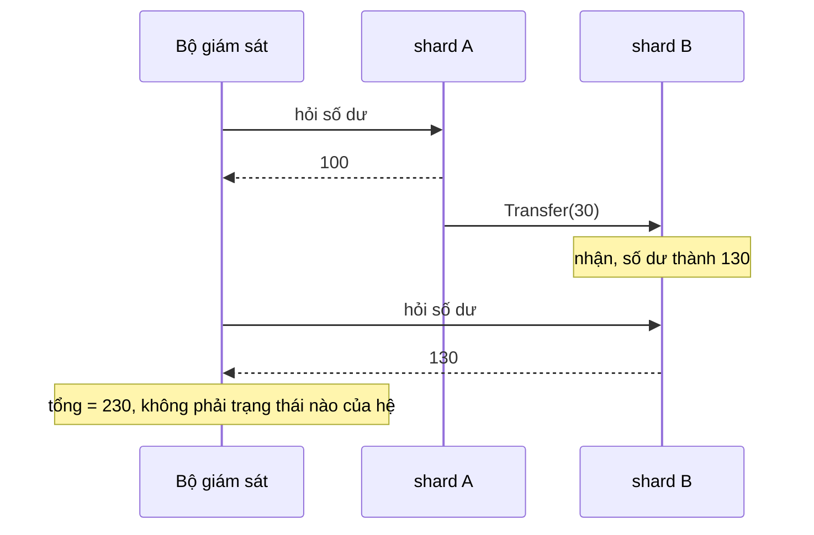
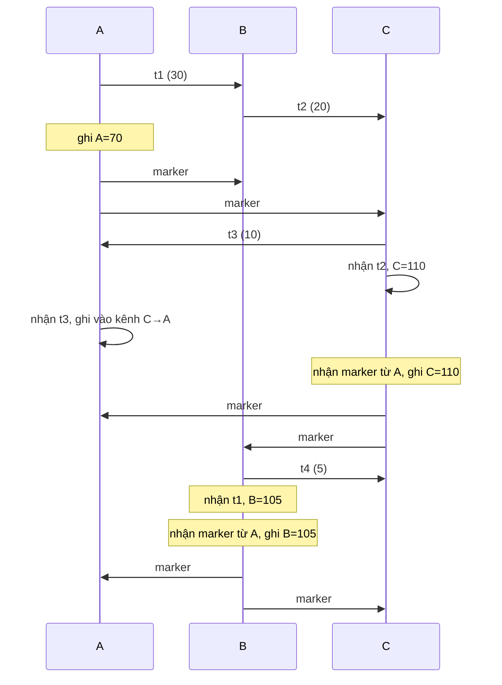
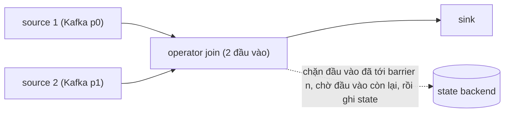

# P15 · Chương 06 — Snapshot toàn cục: Chandy–Lamport và consistent cut

Một cụm gồm nhiều node, mỗi node có trạng thái riêng, và giữa các node luôn có thông điệp đang bay. Bạn muốn biết "cả hệ thống đang ở trạng thái nào" để kiểm tra một bất biến, phát hiện deadlock, hay lưu một điểm khôi phục. Chương này trả lời câu hỏi đó: vì sao không thể chụp tất cả cùng một lúc, thế nào là một bản chụp *có nghĩa*, thuật toán marker của Chandy và Lamport lấy được bản chụp như vậy ra sao và vì sao nó đúng, và tại sao Apache Flink dùng gần như đúng thuật toán đó để checkpoint một job stream.

Cả chương bám một ví dụ giả định là `ledger`, một sổ cái chia thành ba shard `A`, `B`, `C`. Mỗi shard giữ số dư của một nhóm tài khoản, và chuyển tiền giữa các nhóm đi bằng thông điệp (nhận xét của người soạn: ví dụ giả định, không phải code trong repo). Mục 1 mô tả nó.

## Bạn sẽ hiểu được gì

1. **Q1.** Bài toán trạng thái toàn cục là gì, và vì sao chụp "lần lượt từng node" cho kết quả sai (tổng tiền không còn bằng ban đầu)? → mục 1
2. **Q2.** Cut là gì, thế nào là consistent cut (đóng dưới quan hệ happens-before), và trạng thái toàn cục của một cut gồm những gì, kể cả thông điệp đang bay? → mục 2
3. **Q3.** Vector clock cho ta kiểm tra một cut có nhất quán hay không bằng phép so sánh nào, và chứng minh phép kiểm tra đó ra sao? → mục 3
4. **Q4.** Thuật toán marker của Chandy–Lamport chạy như thế nào, từng bước, kể cả cách ghi trạng thái kênh? → mục 4
5. **Q5.** Vì sao bản chụp của Chandy–Lamport "có thể đã xảy ra" dù chưa chắc đã từng xảy ra: chứng minh trạng thái ghi được là reachable từng bước, và hệ quả cho bất biến? → mục 5
6. **Q6.** Vì sao thuật toán đòi kênh FIFO, hỏng ra sao nếu không FIFO, và Lai–Yang/Mattern bỏ yêu cầu đó bằng cách nào? → mục 6
7. **Q7.** Snapshot dùng để làm gì (phát hiện thuộc tính ổn định như deadlock và termination, checkpoint), và không dùng được cho việc gì? → mục 7
8. **Q8.** Flink checkpoint một dataflow bằng asynchronous barrier snapshotting: nó khác Chandy–Lamport ở đâu, tại sao trạng thái kênh gần như bỏ được, và chỗ nào vẫn phải ghi? → mục 8

## Kiến thức cần trước

- [P12 · Chương 09 — Consistency và consensus](../12-he-thong-du-lieu/09-consistency-va-consensus.md), mục 3: happens-before, Lamport clock, vector clock. Chương này dùng lại định nghĩa happens-before và vector clock, không dạy lại.
- [P12 · Chương 08 — Sự cố của hệ phân tán](../12-he-thong-du-lieu/08-su-co-he-phan-tan.md): vì sao không có đồng hồ chung đáng tin.
- [P14 · Chương 01 — Logic và chứng minh](../14-toan-va-ly-thuyet/01-logic-va-chung-minh.md) (inductive invariant) và [P14 · Chương 02 — Toán rời rạc](../14-toan-va-ly-thuyet/02-toan-roi-rac.md) (thứ tự một phần, lattice). Các chứng minh ở mục 2, 3, 5 dùng những khái niệm đó.
- [P12 · Chương 11 — Stream processing](../12-he-thong-du-lieu/11-stream-processing.md), mục 8: checkpoint của Flink ở mức vận hành. Mục 8 của chương này giải thích *vì sao* cơ chế đó đúng.
- Các chương sau trong phase này: [họ broadcast](02-ho-broadcast.md) (causal broadcast) và [phân cấp consistency](03-phan-cap-consistency.md).

---

## 1. Bài toán trạng thái toàn cục (Q1)

> **Trả lời ngắn.** Mỗi node chỉ biết trạng thái của chính nó và các thông điệp nó gửi, nhận; không có đồng hồ hay bộ nhớ chung để nhờ ai đó "chụp tất cả cùng lúc"[^cl-noshare]. Nếu chụp từng node ở những thời điểm khác nhau một cách tùy tiện, ta có thể thấy một tiền lệch như cùng một khoản tiền xuất hiện hai lần hoặc biến mất (suy luận của người soạn, ví dụ bên dưới). Bài toán là thiết kế cách để các node ghi trạng thái của mình và của các kênh sao cho tập kết quả là một trạng thái toàn cục *có nghĩa*, và việc ghi này không được làm thay đổi phép tính đang chạy[^cl-super].

**Giải thích.**

*Với `ledger`.* Hệ thống có ba shard `A`, `B`, `C`, mỗi shard là một process riêng và lúc đầu giữ 100 đơn vị tiền. Để chuyển `x` đơn vị từ `A` sang `B`, `A` trừ `x` khỏi số dư của mình rồi gửi thông điệp `Transfer(x)`; khi `B` nhận được, nó cộng `x` vào số dư. Giữa hai thời điểm đó, `x` không nằm ở shard nào mà đang nằm *trên kênh*. Vì vậy bất biến đúng của `ledger` là: *tổng số dư của các shard cộng tổng tiền đang bay trên các kênh luôn bằng 300*. Bất biến này là thứ ta muốn kiểm tra bằng một bản chụp (nhận xét của người soạn).

### 1.1 Mô hình: tiến trình và kênh

Mô hình của bài toán rất tối giản. Hệ gồm một tập hữu hạn process và một tập hữu hạn kênh một chiều, vẽ được thành đồ thị có hướng: đỉnh là process, cạnh là kênh[^cl-model]. Kênh được giả định không lỗi, giữ nguyên thứ tự gửi, và có bộ đệm không giới hạn; độ trễ của một thông điệp là tùy ý nhưng hữu hạn[^cl-chan]. Trạng thái của một kênh là dãy các thông điệp đã gửi vào kênh mà chưa được nhận[^cl-chanstate]. Một *trạng thái toàn cục* (global state) là bộ gồm trạng thái của mọi process và mọi kênh[^cl-gs].

Với `ledger`, mỗi shard có một kênh một chiều tới mỗi shard còn lại, tổng cộng $3 \times 2 = 6$ kênh. Trạng thái ban đầu: số dư (100, 100, 100) và cả sáu kênh rỗng.

Điều quan trọng là một process *chỉ* ghi được trạng thái của chính nó cùng các thông điệp nó gửi và nhận, ngoài ra không ghi được gì khác[^cl-onlyown]. Các node cũng không dùng chung đồng hồ hay bộ nhớ[^cl-noshare]. Nên không có cách nào ra lệnh "mọi shard ghi số dư ngay lúc 12:00:00.000" mà bảo đảm họ ghi cùng một khoảnh khắc thật.

### 1.2 Chụp ngây thơ cho kết quả sai

Giả sử chỉ có hai shard `A` và `B` (mỗi shard 100, tổng 200) và một bộ giám sát hỏi lần lượt từng shard số dư. Xét hai kịch bản với cùng một giao dịch `A → B: 30`.

| Kịch bản | Thứ tự xảy ra | `A` báo | `B` báo | Tổng (kênh coi là rỗng) |
|---|---|---|---|---|
| (a) | hỏi `A` → `A` gửi 30 → `B` nhận → hỏi `B` | 100 | 130 | **230**: 30 đơn vị bị đếm hai lần |
| (b) | hỏi `B` → `A` gửi 30 → `B` nhận → hỏi `A` | 70 | 100 | **170**: 30 đơn vị biến mất |

Con số 230 hay 170 không thể là trạng thái nào của `ledger`. Chandy và Lamport minh họa đúng hiện tượng này bằng hệ chỉ có một token: ghi trạng thái process trước khi nó gửi token rồi ghi trạng thái kênh sau khi token đã được gửi, thì bản chụp thấy hai token, và một trạng thái hai token không thể đạt tới từ trạng thái đầu của hệ[^cl-two-tokens]. Thứ họ rút ra: số thông điệp bên gửi đã gửi tính đến lúc ghi trạng thái bên gửi phải khớp với số thông điệp đã gửi tính đến lúc ghi trạng thái kênh, và tương tự cho phía nhận. Hai điều kiện đó là nền của thuật toán marker ở mục 4.

Cũng cần chú ý rằng chỉ thêm "thông điệp đang bay trên kênh" vào bản chụp vẫn chưa đủ. Ở kịch bản (a), nếu ta cộng thêm kênh `A → B` thì tùy lúc ghi kênh mà ta thấy 30 hoặc 0, và nếu chọn sai lúc thì tổng vẫn lệch. Điều cần là *một quy tắc phối hợp* giữa lúc ghi process và lúc ghi kênh.



*Sơ đồ minh họa của người soạn: kịch bản (a) ở bảng trên.*

<details><summary>Đi sâu: vì sao không giải bằng đồng hồ, và "thuộc tính ổn định" là gì</summary>

- *Đồng hồ vật lý không cứu được.* Chandy và Lamport nói thẳng rằng các process không thể ghi trạng thái ở đúng cùng một thời điểm trừ khi có đồng hồ chung, mà mô hình của họ không có[^cl-noshare]. Chương 08 của P12 giải thích vì sao ở hệ thật, đồng hồ lệch và process có thể bị treo giữa chừng, nên "ghi lúc 12:00:00" cũng không cho một cut nhất quán (nhận xét của người soạn).
- *Mục tiêu chính của bài báo.* Bài toán ban đầu được đặt ra để phát hiện *thuộc tính ổn định* (stable property): một khi thuộc tính đã đúng thì nó đúng mãi về sau. Ví dụ: "phép tính đã kết thúc", "hệ bị deadlock", "mọi token trong vòng token đã biến mất"[^cl-stable]. Mục 7 quay lại.
- *Ba lớp vấn đề cần phân biệt.* Chương này chỉ nói về việc *lấy* một bản chụp nhất quán. Việc *phát hiện* thuộc tính ổn định chỉ là một ứng dụng (mục 7). Việc *khôi phục* từ bản chụp (checkpoint/restart) là ứng dụng thứ hai (mục 7 và 8).

</details>

**Quay lại Q1:** vì các node không có đồng hồ hay bộ nhớ chung và mỗi node chỉ ghi được trạng thái của chính nó, ta không thể chụp "cùng lúc"; chụp tùy tiện cho ra trạng thái vô nghĩa như tổng tiền 230 hay 170, nên cần một quy tắc phối hợp việc ghi process với việc ghi kênh.

---

## 2. Cut và consistent cut (Q2)

> **Trả lời ngắn.** Một cut chọn, ở mỗi node, một đoạn đầu của dãy sự kiện của node đó; nó là *nhất quán* nếu bất kỳ sự kiện nào nằm trong cut thì mọi sự kiện xảy ra trước nó cũng nằm trong cut (đóng dưới quan hệ happens-before)[^mt-def3]. Cách nói tương đương dễ kiểm hơn là: mọi thông điệp đã được nhận trong cut thì cũng đã được gửi trong cut[^mt-def-msg]. Trạng thái toàn cục của một cut nhất quán gồm trạng thái từng node tại biên của cut, cộng với các thông điệp đã gửi mà chưa nhận[^mt-gs].

**Giải thích.**

*Với `ledger`.* Ở mục 1, kịch bản (a) có "cut" gồm: sự kiện hỏi `A` xảy ra *trước* khi `A` gửi tiền, còn sự kiện hỏi `B` xảy ra *sau* khi `B` nhận tiền. Trong cut đó, việc `B` nhận 30 đồng được tính là đã xảy ra, nhưng việc `A` gửi 30 đồng thì chưa, tức một thông điệp được nhận mà chưa được gửi. Đó đúng là dấu hiệu của cut không nhất quán, và nó giải thích vì sao tổng tiền lệch (nhận xét của người soạn).

### 2.1 Sự kiện và happens-before

Mỗi sự kiện xảy ra ở đúng một process: sự kiện nội bộ, gửi, hoặc nhận. Các sự kiện ở cùng process có thứ tự toàn phần theo thứ tự xảy ra cục bộ, và mỗi sự kiện nhận có đúng một sự kiện gửi tương ứng[^mt-order]. Quan hệ nhân quả (còn gọi happens-before) $<$ là quan hệ nhỏ nhất thỏa ba điều kiện: hai sự kiện cùng process thì cái trước $<$ cái sau; sự kiện gửi $<$ sự kiện nhận tương ứng; và bắc cầu[^mt-hb]. Đây chính là happens-before ở [P12·09, mục 3](../12-he-thong-du-lieu/09-consistency-va-consensus.md). Ta viết $e \lt_l e'$ khi $e < e'$ và hai sự kiện cùng process.

Ký hiệu sự kiện của `ledger` mà ta dùng từ đây đến hết chương, theo vết ở mục 4:

| Sự kiện | Ở shard | Ý nghĩa |
|---|---|---|
| `A1` | A | gửi 30 cho B (`t1`) |
| `A2` | A | nhận 10 từ C (`t3`) |
| `B1` | B | gửi 20 cho C (`t2`) |
| `B2` | B | gửi 5 cho C (`t4`) |
| `B3` | B | nhận `t1` từ A |
| `C1` | C | gửi 10 cho A (`t3`) |
| `C2` | C | nhận `t2` từ B |
| `C3` | C | nhận `t4` từ B |

Quan hệ nhân quả từ các tin nhắn: $A1 < B3$, $B1 < C2$, $C1 < A2$, $B2 < C3$, cộng thêm thứ tự cục bộ ($A1 \lt_l A2$, $B1 \lt_l B2 \lt_l B3$, $C1 \lt_l C2 \lt_l C3$) và bắc cầu. Chẳng hạn $C1 < A2$ và $A1 \lt_l A2$, nhưng không có chuỗi nào nối `A1` với `C1` theo cả hai chiều, nên `A1` và `C1` *đồng thời* (concurrent).

### 2.2 Định nghĩa cut

Một *cut* là tập con hữu hạn $C$ của các sự kiện sao cho nếu $e \in C$ và $e' \lt_l e$ thì $e' \in C$[^mt-def1]. Nói cách khác, ở mỗi process, cut lấy một đoạn đầu của dãy sự kiện (một "tiền tố"). Về trực quan, một cut là một đường zigzag chia biểu đồ thời gian thành phần "quá khứ" bên trái và phần "tương lai" bên phải[^mt-zigzag].

Cut *nhất quán* mạnh hơn: nếu $e \in C$ và $e' < e$ (không chỉ cùng process) thì $e' \in C$[^mt-def3]. Tức cut đóng dưới toàn bộ happens-before.

**Mệnh đề 2.1 (chứng minh của người soạn).** Cho $C$ là một cut. Khi đó $C$ đóng dưới happens-before khi và chỉ khi mọi thông điệp có sự kiện nhận nằm trong $C$ thì sự kiện gửi tương ứng cũng nằm trong $C$.

*Chứng minh.*

- ($\Rightarrow$) Nếu sự kiện nhận $r \in C$ và $s$ là sự kiện gửi tương ứng thì $s < r$ theo định nghĩa của happens-before. $C$ đóng dưới happens-before nên $s \in C$.
- ($\Leftarrow$) Giả sử $r \in C$ và $s < r$. Theo định nghĩa, $s < r$ nghĩa là có một dãy $s = x_0, x_1, \dots, x_k = r$ mà mỗi cặp liền kề $(x_{i}, x_{i+1})$ hoặc cùng process với $x_i \lt_l x_{i+1}$ (một bước cục bộ), hoặc là cặp gửi–nhận của một thông điệp. Ta chứng minh bằng quy nạp lùi theo $i$ từ $k$ xuống $0$ rằng $x_i \in C$. Cơ sở: $x_k = r \in C$. Bước quy nạp: giả sử $x_{i+1} \in C$. Nếu bước $(x_i, x_{i+1})$ là cục bộ thì $x_i \in C$ vì $C$ là cut (đóng dưới $\lt_l$). Nếu nó là cặp gửi–nhận thì $x_{i+1}$ là sự kiện nhận nằm trong $C$, nên theo giả thiết của chiều này $x_i$ (sự kiện gửi) cũng nằm trong $C$. Vậy $x_0 = s \in C$. $\square$

Mệnh đề này là lý do ta kiểm cut chỉ cần nhìn các thông điệp. Mattern phát biểu đúng như thế: cut nhất quán khi mọi thông điệp đã nhận đều đã được gửi, nhưng không cần chiều ngược lại[^mt-def-msg]. Chiều ngược lại không cần vì thông điệp đã gửi mà chưa nhận chính là thứ nằm trên kênh.

### 2.3 Trạng thái toàn cục của một cut

Cho một cut nhất quán $C$, ta gán:

- trạng thái process $p$ = trạng thái của $p$ ngay sau sự kiện cuối của $p$ nằm trong $C$;
- trạng thái kênh $p \to q$ = dãy các thông điệp $m$ mà sự kiện gửi $\in C$ nhưng sự kiện nhận $\notin C$, theo thứ tự gửi.

Định nghĩa thứ hai là cách diễn đạt của người soạn cho điều Mattern gọi là "các thông điệp đã gửi mà chưa nhận", tức các mũi tên cắt đường cut từ trái sang phải[^mt-gs]. Điều kiện nhất quán bảo đảm không có mũi tên nào đi ngược từ phải sang trái. Nhờ vậy trạng thái kênh không bao giờ "âm".

Ví dụ trên `ledger`: lấy cut gồm `A1` ở A; `B1`, `B2`, `B3` ở B; `C1`, `C2` ở C. Đây chính là cut mà thuật toán Chandy–Lamport sẽ ghi ở mục 4. Kiểm tra bằng Mệnh đề 2.1:

| Thông điệp | gửi | nhận | gửi $\in C$? | nhận $\in C$? | Kết quả |
|---|---|---|---|---|---|
| `t1` (30, A→B) | `A1` | `B3` | có | có | đã xong, không nằm trên kênh |
| `t2` (20, B→C) | `B1` | `C2` | có | có | đã xong |
| `t3` (10, C→A) | `C1` | `A2` | có | **không** | nằm trên kênh C→A |
| `t4` (5, B→C) | `B2` | `C3` | có | **không** | nằm trên kênh B→C |

Không thông điệp nào có nhận $\in C$ mà gửi $\notin C$, nên $C$ nhất quán. Số dư tại biên của cut: `A` sau `A1` là 70, `B` sau `B3` là $100 - 20 - 5 + 30 = 105$, `C` sau `C2` là $100 - 10 + 20 = 110$. Trên kênh còn 10 và 5. Tổng: $70 + 105 + 110 + 10 + 5 = 300$. Bất biến giữ.

### 2.4 Các cut nhất quán tạo thành lattice

Với hai cut nhất quán $C_1, C_2$ thì $C_1 \cup C_2$ và $C_1 \cap C_2$ cũng nhất quán. Nói gọn: các cut nhất quán là một sublattice của tập mọi cut[^mt-lattice]. Bài báo để phần chứng minh cho người đọc[^mt-leave]; đây là chứng minh của người soạn.

**Mệnh đề 2.2 (chứng minh của người soạn).** Nếu $C_1, C_2$ là cut nhất quán thì $C_1 \cup C_2$ và $C_1 \cap C_2$ là cut nhất quán.

*Chứng minh.* Lấy $e \in C_1 \cup C_2$ và $e' < e$. Nếu $e \in C_1$ thì $e' \in C_1$ vì $C_1$ nhất quán, nên $e' \in C_1 \cup C_2$; trường hợp $e \in C_2$ tương tự. Với phép giao, lấy $e \in C_1 \cap C_2$ và $e' < e$: vì $e \in C_1$ nên $e' \in C_1$, vì $e \in C_2$ nên $e' \in C_2$, vậy $e' \in C_1 \cap C_2$. Cả hai tập đều hữu hạn. $\square$

Ý nghĩa thực tế: với hai bản chụp nhất quán bất kỳ luôn có một bản chụp "muộn hơn cả hai" và một bản "sớm hơn cả hai"[^mt-lattice2]. Với `ledger`, nếu lần chụp 1 và lần chụp 2 chạy chồng nhau, ta vẫn có thể nói về "điểm chung" của chúng như một cut nhất quán nữa (nhận xét của người soạn).

<details><summary>Đi sâu: cut event, "dây cao su" và sự khác biệt giữa cut và trạng thái từng xảy ra</summary>

- *Cut event.* Mattern thêm vào mỗi process một sự kiện giả $c_i$ đánh dấu chỗ đường cut đi qua; nối các $c_i$ lại ta được đường cut[^mt-cutevent]. Chú ý $c_i$ là sự kiện *giả* đặt ở ranh giới, không phải sự kiện thật cuối cùng của process trong cut.
- *Kiểm tra bằng "dây cao su".* Hình dung đường cut là sợi dây cao su, kéo thẳng thành đường dọc. Nếu một mũi tên thông điệp cắt đường đó từ phải sang trái thì cut không nhất quán; ngược lại thì nhất quán[^mt-rubber]. Một cut nhất quán luôn "kéo thẳng được" thành một cut đồng thời ở thời gian thực của một biểu đồ thời gian tương đương, nên trạng thái ghi theo nó cũng đúng như một bản chụp ở cùng một thời điểm thật[^mt-simul].
- *Hệ quả quan trọng.* Cut nhất quán không đòi bản chụp *đã từng* là trạng thái thật của lần chạy này. Nó chỉ đòi có *một lần chạy tương đương* trong đó nó xảy ra. Mục 5 chứng minh điều này cho thuật toán marker.

</details>

**Quay lại Q2:** cut là tiền tố sự kiện ở mỗi node; cut nhất quán khi đóng dưới happens-before, tương đương với "mọi tin đã nhận đều đã gửi"; trạng thái toàn cục của nó là trạng thái các node tại biên cộng các tin đã gửi mà chưa nhận, và các cut nhất quán xếp thành một lattice.

---

## 3. Cut nhất quán và vector clock (Q3)

> **Trả lời ngắn.** Nếu mỗi sự kiện mang một vector clock, ta kiểm một cut có nhất quán hay không chỉ bằng cách so sánh vài con số: với mỗi process $i$, lấy sự kiện cuối $c_i$ của nó trong cut, rồi xét xem vector của $c_i$ có "biết" sự kiện nào của process $j$ mà cut không chứa hay không. Mattern chứng minh các cut nhất quán đẳng cấu với các vector thời gian khả dĩ[^mt-iso], và cho tiêu chí kiểm tra bằng vector[^mt-criterion]. Mục này tự chứng minh tiêu chí đó từ tính chất của vector clock.

**Giải thích.**

*Với `ledger`.* Giả sử mỗi shard gắn vector clock vào mọi sự kiện ứng dụng, và sau này một công cụ kiểm toán muốn biết cặp "A dừng ở `A2`, B dừng ở `B1`, C dừng ở khởi đầu" có phải một bản chụp hợp lệ hay không. Nó không cần dựng lại cả lịch sử; chỉ cần ba vector clock (nhận xét của người soạn).

### 3.1 Nhắc lại vector clock

Mỗi process $P_i$ giữ một vector $C_i$ dài $n$, mỗi process một ô[^mt-vc]. Mỗi sự kiện làm $P_i$ tăng ô của chính nó: $C_i[i] := C_i[i] + 1$[^mt-tick]. Mỗi thông điệp mang theo vector của nơi gửi, và bên nhận lấy tối đa theo từng ô: $C_i := \sup(C_i, t)$ (rồi tăng ô của mình, vì nhận cũng là một sự kiện)[^mt-sup]. Tính chất ta cần là: thông tin về thời gian lan truyền dọc đường nhân quả, và dọc đường đó nó chỉ có thể tăng[^mt-propagate]. Kết quả mà Mattern phát biểu (Định lý 10 và 11 trong bài báo) là vector clock biểu diễn đúng cấu trúc nhân quả, theo nghĩa đẳng cấu[^mt-hbiso]. Dùng trực tiếp:

> **(VC)** Gọi $e'$ là sự kiện thứ $k$ của process $P_j$. Với mọi sự kiện $e$ ($e \ne e'$): $e' < e$ khi và chỉ khi $C(e)[j] \ge k$.

Đây là Định lý 11 của Mattern viết lại cho $e'$ ở $P_j$, với $C(e')[j] = k$. (VC) có nghĩa: "$C(e)[j]$ là số sự kiện của $P_j$ mà $e$ đã biết", và các sự kiện đó chính là một tiền tố của $P_j$.

Với vết của `ledger` ở mục 2, các vector (thứ tự ô là A, B, C; chỉ tính sự kiện ứng dụng, không tính marker):

| Sự kiện | Vector |
|---|---|
| `A1` | (1, 0, 0) |
| `A2` | (2, 0, 1) |
| `B1` | (0, 1, 0) |
| `B2` | (0, 2, 0) |
| `B3` | (1, 3, 0) |
| `C1` | (0, 0, 1) |
| `C2` | (0, 1, 2) |
| `C3` | (0, 2, 3) |

Cách tính, ví dụ `A2`: `A` đã có `A1` nên ô A tăng thành 2; thông điệp `t3` mang (0, 0, 1) từ `C1`, lấy tối đa theo từng ô ra (2, 0, 1). Tương tự `B3` nhận `t1` mang (1, 0, 0) khi `B` đã có (0, 2, 0): tăng ô B thành 3 rồi lấy tối đa, được (1, 3, 0).

### 3.2 Tiêu chí kiểm tra cut nhất quán

Gọi $c_i$ là sự kiện cuối cùng của $P_i$ thuộc cut $X$ (dùng sự kiện khởi đầu nếu $P_i$ chưa có sự kiện nào trong $X$, với vector toàn 0[^mt-initial]). Mattern gọi $t_X = \sup(C(c_1), \dots, C(c_n))$ là *thời gian toàn cục của cut*[^mt-globaltime], và chỉ ra rằng cut $X$ nhất quán khi và chỉ khi $t_X$ bằng vector "đường chéo" $(C(c_1)[1], \dots, C(c_n)[n])$[^mt-criterion]. Bài báo chứng minh bằng cách dùng thời gian thực. Dưới đây là một chứng minh trực tiếp hơn từ (VC) (chứng minh của người soạn), dạng gọn hơn của cùng tiêu chí.

**Mệnh đề 3.1 (chứng minh của người soạn).** Cut $X$ nhất quán khi và chỉ khi với mọi cặp $i, j$: $C(c_i)[j] \le C(c_j)[j]$.

(Điều kiện này tương đương với $t_X$ bằng đường chéo: $t_X[j] = \max_i C(c_i)[j]$, và $C(c_j)[j]$ luôn là một ứng viên của max, nên bằng nhau khi và chỉ khi không có $i$ nào cho $C(c_i)[j] > C(c_j)[j]$.)

*Chứng minh.* Với $P_j$, ô $C(c_j)[j]$ chính là số sự kiện của $P_j$ nằm trong $X$ (vì $c_j$ là sự kiện thứ $C(c_j)[j]$ của $P_j$ và $X$ chứa tiền tố).

($\Rightarrow$) Giả sử $X$ nhất quán. Xét $i, j$ và đặt $k = C(c_i)[j]$. Nếu $k = 0$ thì hiển nhiên $k \le C(c_j)[j]$. Nếu $k \ge 1$, gọi $e'$ là sự kiện thứ $k$ của $P_j$. Theo (VC), vì $C(c_i)[j] = k \ge k$ nên $e' \le c_i$ (bằng nhau hoặc $e' < c_i$; trường hợp $j = i$ thì $e'$ là một sự kiện cục bộ cùng process, vẫn $\le c_i$). Mà $c_i \in X$ và $X$ đóng dưới $<$, nên $e' \in X$. Vậy $P_j$ có ít nhất $k$ sự kiện trong $X$: $k \le C(c_j)[j]$.

($\Leftarrow$) Giả sử điều kiện đúng với mọi $i, j$. Lấy $e \in X$ và $e' < e$; ta cần $e' \in X$. Gọi $P_i$ là process của $e$ và $P_j$ của $e'$, và $k$ là chỉ số của $e'$ trong $P_j$. Vì $e \in X$ nên $e \le_l c_i$ (cut là tiền tố), suy ra $e' < c_i$ (bắc cầu). Theo (VC), $C(c_i)[j] \ge k$. Theo điều kiện, $C(c_j)[j] \ge C(c_i)[j] \ge k$. Vậy $P_j$ có ít nhất $k$ sự kiện trong $X$, và $e'$ là sự kiện thứ $k$ nên $e' \in X$. $\square$

Ngay trong bài báo, trường hợp cut không nhất quán được giải thích bằng thông điệp: tồn tại thông điệp gửi sau $c_i$ ở $P_i$ nhưng nhận trước $c_j$ ở $P_j$[^mt-incons]. Mệnh đề 3.1 nói điều đó bằng vector.

**Ví dụ 1: cut của Chandy–Lamport ở mục 2.** $c_A = $ `A1` = (1, 0, 0), $c_B = $ `B3` = (1, 3, 0), $c_C = $ `C2` = (0, 1, 2). Đường chéo là $(1, 3, 2)$. $t_X = \sup((1,0,0), (1,3,0), (0,1,2)) = (1, 3, 2)$. Bằng nhau, nên nhất quán, đúng như kiểm tra bằng thông điệp ở §2.3. Và (1, 3, 2) là "thời gian" của bản chụp.

**Ví dụ 2: một cut sai.** Lấy A dừng ở `A2`, B dừng ở `B1`, C chưa có sự kiện nào. Khi đó $c_A = (2, 0, 1)$, $c_B = (0, 1, 0)$, $c_C = (0, 0, 0)$. $t_X = (2, 1, 1)$ còn đường chéo là $(2, 1, 0)$. Khác nhau ở ô C: $C(c_A)[C] = 1 > C(c_C)[C] = 0$. Về thông điệp: `A2` (nhận `t3` từ C) nằm trong cut, nhưng `C1` (gửi `t3`) thì không. Đây là loại cut cho ra "10 đơn vị tự nhiên xuất hiện".

Thuật ngữ cuối: các vector thời gian khả dĩ cũng tạo thành lattice, và lattice các cut nhất quán đẳng cấu với lattice các vector đó[^mt-iso]. Nói cách khác, mỗi cut nhất quán tương ứng đúng một vector, và vector đó chính là "thời điểm" của bản chụp (suy luận của người soạn từ Mệnh đề 3.1 và định nghĩa $t_X$).

<details><summary>Đi sâu: chi phí, và vì sao chương này vẫn cần thuật toán marker</summary>

- *Chi phí.* Vector clock dài bằng số process $n$ nên mỗi thông điệp tốn thêm $O(n)$ ô (nhận xét của người soạn). Với `ledger` ba shard thì rẻ, nhưng với hàng nghìn shard thì đắt, một trong những lý do thuật toán marker (chỉ cần một ký hiệu nhỏ trên mỗi kênh) hấp dẫn hơn.
- *Vector clock kiểm cut có sẵn, không tạo cut.* Mệnh đề 3.1 chỉ trả lời "cut này nhất quán không". Muốn *chủ động* lấy một cut nhất quán, ta cần giao thức điều khiển lúc ghi trạng thái. Mattern chỉ ra rằng một giao thức như thế đi qua việc chọn trước một "thời điểm ảo" chung trong không gian vector rồi để mỗi process ghi khi đồng hồ của nó đi qua điểm đó[^mt-plan]. Thuật toán marker là cách thực hiện việc này với một "đồng hồ ảo" chỉ có một bit. Mục 6 trình bày phiên bản đó.
- *Phát biểu về trạng thái toàn cục chỉ có nghĩa với cut nhất quán.* Đây là điểm xuất phát của Mattern khi ông dựng thuật toán không cần FIFO ở mục 6[^mt-debug].

</details>

**Quay lại Q3:** nếu mỗi sự kiện mang vector clock thì cut $X$ nhất quán khi và chỉ khi $C(c_i)[j] \le C(c_j)[j]$ với mọi cặp $i, j$, nghĩa là không process nào "biết" nhiều sự kiện của $P_j$ hơn số sự kiện của $P_j$ nằm trong cut; chứng minh đi từ tính chất (VC) của vector clock.

---

## 4. Thuật toán marker của Chandy–Lamport (Q4)

> **Trả lời ngắn.** Mỗi node ghi trạng thái của mình đúng một lần, ngay khi nó được kích hoạt, rồi gửi một thông điệp đặc biệt gọi là *marker* ra mọi kênh đi ra, trước mọi thông điệp thường tiếp theo trên kênh đó[^cl-send]. Khi một node nhận marker trên một kênh vào, nó ghi trạng thái của chính nó nếu chưa ghi (và coi trạng thái kênh đó là rỗng)[^cl-recv-empty]; nếu đã ghi rồi thì trạng thái kênh là dãy thông điệp đã nhận trên kênh đó từ lúc ghi trạng thái node đến lúc marker tới[^cl-recv-else]. Marker không ảnh hưởng gì đến phép tính đang chạy[^cl-marker-noeffect].

**Giải thích.**

*Với `ledger`.* Giả sử shard `A` quyết định chụp (ví dụ vì một job kiểm toán chạy định kỳ). `A` không dừng việc chuyển tiền; nó chỉ ghi số dư hiện tại rồi chèn một marker vào cuối mỗi kênh đi ra. Marker là lằn ranh trên kênh: thông điệp trước marker là tiền "trước bản chụp", thông điệp sau marker là tiền "sau bản chụp". Các shard khác chỉ nhận ra lằn ranh đó khi marker tới chúng (nhận xét của người soạn).

### 4.1 Hai quy tắc

Thuật toán gồm hai quy tắc, đúng như bài báo đưa ra:

**Quy tắc gửi marker (cho process $p$).** Với mỗi kênh $c$ đi ra khỏi $p$: $p$ gửi đúng một marker trên $c$ *sau khi* $p$ ghi trạng thái và *trước khi* gửi thêm thông điệp thường nào trên $c$[^cl-send].

**Quy tắc nhận marker (cho process $q$ nhận marker trên kênh vào $c$).**

- Nếu $q$ chưa ghi trạng thái: $q$ ghi trạng thái của mình, và ghi trạng thái của $c$ là dãy rỗng[^cl-recv-empty]. (Theo quy tắc gửi, $q$ sẽ gửi marker ra mọi kênh đi ra.)
- Nếu $q$ đã ghi rồi: $q$ ghi trạng thái của $c$ là dãy thông điệp đã nhận trên $c$ sau khi $q$ ghi trạng thái và trước khi marker tới[^cl-recv-else].

Thuật toán có thể do một hay nhiều process khởi động; process khởi động ghi trạng thái một cách tự phát, không cần nhận marker nào trước[^cl-initiate]. Hệ quả: một process đã ghi trạng thái thì với mỗi kênh vào *chưa nhận marker*, mọi thông điệp thường tới kênh đó được thêm vào trạng thái của kênh. Nếu có thêm marker nào tới thì trạng thái kênh đó được "đóng" lại.

### 4.2 Vết đầy đủ trên `ledger`

Ba shard `A`, `B`, `C`, mỗi shard 100, cả sáu kênh đều là hàng đợi FIFO. `A` khởi động snapshot. Cột "thật" là số dư thực tế của từng shard ngay sau bước đó, cột "đang bay" là tiền đang nằm trên các kênh (marker không tính). Các sự kiện ứng dụng có tên ở §2.1.

| # | Sự kiện | Thật (A, B, C) | Đang bay | Ghi nhận (thêm ở bước này) |
|---|---|---|---|---|
| 0 | khởi đầu | 100, 100, 100 | — | — |
| 1 | `A1`: A gửi 30 cho B (`t1`) | 70, 100, 100 | A→B: 30 | — |
| 2 | `B1`: B gửi 20 cho C (`t2`) | 70, 80, 100 | A→B: 30; B→C: 20 | — |
| 3 | **A khởi động snapshot**: ghi $A = 70$, gửi marker ra A→B (sau `t1`) và A→C; bắt đầu ghi kênh B→A và C→A | 70, 80, 100 | như trên | $A = 70$ |
| 4 | `C1`: C gửi 10 cho A (`t3`) | 70, 80, 90 | …; C→A: 10 | — |
| 5 | `A2`: A nhận `t3` (kênh C→A đang được ghi) | 80, 80, 90 | A→B: 30; B→C: 20 | kênh C→A: [10] (đang ghi) |
| 6 | `C2`: C nhận `t2` từ B (C chưa ghi) | 80, 80, 110 | A→B: 30 | — |
| 7 | C nhận marker từ A: C chưa ghi, nên ghi $C = 110$, kênh A→C = rỗng; C gửi marker ra C→A và C→B; bắt đầu ghi kênh B→C | 80, 80, 110 | A→B: 30 | $C = 110$; A→C = [] |
| 8 | `B2`: B gửi 5 cho C (`t4`) | 80, 75, 110 | A→B: 30; B→C: 5 | — |
| 9 | `B3`: B nhận `t1` từ A (B chưa ghi) | 80, 105, 110 | B→C: 5 | — |
| 10 | B nhận marker từ A: B chưa ghi, nên ghi $B = 105$, kênh A→B = rỗng; B gửi marker ra B→A và B→C (sau `t4`); bắt đầu ghi kênh C→B | 80, 105, 110 | B→C: 5 | $B = 105$; A→B = [] |
| 11 | `C3`: C nhận `t4` từ B (kênh B→C đang được ghi) | 80, 105, 115 | — | kênh B→C: [5] (đang ghi) |
| 12 | C nhận marker từ B: đóng kênh B→C | 80, 105, 115 | — | B→C = [5] |
| 13 | A nhận marker từ C (sau `t3`): đóng kênh C→A | 80, 105, 115 | — | C→A = [10] |
| 14 | A nhận marker từ B: đóng kênh B→A | 80, 105, 115 | — | B→A = [] |
| 15 | B nhận marker từ C: đóng kênh C→B | 80, 105, 115 | — | C→B = [] |

Kết quả ghi được: $A = 70$, $B = 105$, $C = 110$; kênh C→A giữ [10], kênh B→C giữ [5], bốn kênh còn lại rỗng. Tổng $70 + 105 + 110 + 10 + 5 = 300$. Bất biến của `ledger` đúng trên bản chụp, mặc dù `ledger` vẫn chạy bình thường trong suốt thời gian chụp.

Hai điều cần để ý trong vết. Thứ nhất, bản chụp này *chưa từng là trạng thái thật* của hệ: số dư $A = 70$ chỉ đúng ở các bước 1–4, còn $B = 105$ chỉ đúng từ bước 9 trở đi, mà lúc đó $A$ đã là 80. Bài báo cũng nhận xét đúng điều này trên ví dụ của họ: trạng thái ghi được không trùng với bất kỳ trạng thái toàn cục nào đã xảy ra trong lúc thuật toán chạy[^cl-notoccur]. Mục 5 giải thích vì sao vậy mà bản chụp vẫn hợp lệ. Thứ hai, cột "Ghi nhận" cho thấy trạng thái kênh chỉ có ở những kênh mà thông điệp thường "đi lọt" giữa lúc người nhận ghi trạng thái và lúc marker tới. Đó là bước 5 (`t3`, 10 đơn vị) và bước 11 (`t4`, 5 đơn vị).



*Sơ đồ minh họa của người soạn, rút gọn từ bảng trên; vị trí các đường nằm ngang không biểu diễn thời gian thực.*

### 4.3 Kết thúc và thu thập

Để thuật toán kết thúc, mỗi process phải bảo đảm marker không bị kẹt mãi trên kênh vào, và nó phải ghi trạng thái trong thời gian hữu hạn kể từ lúc thuật toán bắt đầu[^cl-term-cond]. Nếu đồ thị liên thông mạnh và có ít nhất một process tự khởi động, mọi process sẽ ghi trạng thái trong thời gian hữu hạn[^cl-term]. Trong vết trên, đồ thị `ledger` là đồ thị đầy đủ nên điều kiện này đúng.

Số marker: mỗi process ghi trạng thái đúng một lần và khi đó gửi đúng một marker trên mỗi kênh đi ra, nên tổng số marker bằng số kênh, ở đây là 6 (phép đếm của người soạn từ quy tắc gửi). Bảng trên có đúng sáu marker: A→B, A→C (bước 3), C→A, C→B (bước 7), B→A, B→C (bước 10).

Việc gom các trạng thái cục bộ về một chỗ nằm ngoài thuật toán. Bài báo đề xuất một cách đơn giản cho đồ thị liên thông mạnh: mỗi process gửi thông tin nó ghi ra mọi kênh đi ra, và process nào nhận thông tin lần đầu thì chép lại rồi chuyển tiếp[^cl-collect].

<details><summary>Đi sâu: mã Rust đã chạy cho vết trên</summary>

Dưới đây là toàn bộ chương trình người soạn dùng để kiểm lại bảng ở §4.2 và để chạy mô phỏng ngẫu nhiên ở mục 5. Nó biên dịch bằng `rustc -O snap.rs` (rustc 1.95.0, macOS).

```rust
use std::collections::VecDeque;

#[derive(Clone, Copy, PartialEq, Debug)]
enum Msg { Money(i64), Marker }

#[derive(Clone, PartialEq)]
enum Ch { Idle, Recording(Vec<i64>), Done(Vec<i64>) }

struct Net {
    n: usize,
    bal: Vec<i64>,
    q: Vec<Vec<VecDeque<Msg>>>,   // q[from][to]
    rec_bal: Vec<Option<i64>>,
    rec_ch: Vec<Vec<Ch>>,         // rec_ch[to][from]
}

impl Net {
    fn new(n: usize, init: i64) -> Net {
        Net { n, bal: vec![init; n], q: vec![vec![VecDeque::new(); n]; n],
              rec_bal: vec![None; n], rec_ch: vec![vec![Ch::Idle; n]; n] }
    }
    fn send(&mut self, from: usize, to: usize, x: i64) {
        assert!(self.bal[from] >= x);
        self.bal[from] -= x;
        self.q[from][to].push_back(Msg::Money(x));
    }
    fn record(&mut self, p: usize, except: Option<usize>) {
        self.rec_bal[p] = Some(self.bal[p]);
        for c in 0..self.n {
            if c != p {
                self.rec_ch[p][c] = if Some(c) == except { Ch::Done(vec![]) } else { Ch::Recording(vec![]) };
            }
        }
        for d in 0..self.n { if d != p { self.q[p][d].push_back(Msg::Marker); } }
    }
    fn start(&mut self, p: usize) { self.record(p, None); }
    fn deliver(&mut self, from: usize, to: usize) {
        match self.q[from][to].pop_front().unwrap() {
            Msg::Money(x) => {
                self.bal[to] += x;
                if let Ch::Recording(v) = &mut self.rec_ch[to][from] { v.push(x); }
            }
            Msg::Marker => {
                if self.rec_bal[to].is_none() { self.record(to, Some(from)); }
                else if let Ch::Recording(v) = self.rec_ch[to][from].clone() { self.rec_ch[to][from] = Ch::Done(v); }
            }
        }
    }
    fn complete(&self) -> bool {
        (0..self.n).all(|p| self.rec_bal[p].is_some()
            && (0..self.n).all(|c| c == p || matches!(self.rec_ch[p][c], Ch::Done(_))))
    }
    fn real(&self) -> (Vec<i64>, Vec<Vec<i64>>) {
        let mut ch = vec![];
        for f in 0..self.n { for t in 0..self.n { if f != t {
            ch.push(self.q[f][t].iter().filter_map(|m| if let Msg::Money(x) = m { Some(*x) } else { None }).collect());
        }}}
        (self.bal.clone(), ch)
    }
    fn recorded(&self) -> (Vec<i64>, Vec<Vec<i64>>) {
        let mut ch = vec![];
        for f in 0..self.n { for t in 0..self.n { if f != t {
            ch.push(if let Ch::Done(v) = &self.rec_ch[t][f] { v.clone() } else { vec![] });
        }}}
        (self.rec_bal.iter().map(|b| b.unwrap()).collect(), ch)
    }
}

struct Lcg(u64);
impl Lcg {
    fn next(&mut self, m: u64) -> u64 {
        self.0 = self.0.wrapping_mul(6364136223846793005).wrapping_add(1442695040888963407);
        (self.0 >> 33) % m
    }
}

fn main() {
    // Phần 1: kịch bản tay trong chương (A=0, B=1, C=2)
    let (a, b, c) = (0, 1, 2);
    let mut n = Net::new(3, 100);
    n.send(a, b, 30);          // 1
    n.send(b, c, 20);          // 2
    n.start(a);                // 3
    n.send(c, a, 10);          // 4
    n.deliver(c, a);           // 5  (t3 tới A khi A đang ghi kênh C->A)
    n.deliver(b, c);           // 6  (t2 tới C)
    n.deliver(a, c);           // 7  (marker A->C)
    n.send(b, c, 5);           // 8
    n.deliver(a, b);           // 9  (t1 tới B)
    n.deliver(a, b);           // 10 (marker A->B)
    n.deliver(b, c);           // 11 (5 tới C)
    n.deliver(b, c);           // 12 (marker B->C)
    n.deliver(c, a);           // 13 (marker C->A)
    n.deliver(b, a);           // 14 (marker B->A)
    n.deliver(c, b);           // 15 (marker C->B)
    assert!(n.complete());
    let (rb, rc) = n.recorded();
    println!("scripted: balances={:?} channels(0>1,0>2,1>0,1>2,2>0,2>1)={:?} total={}",
        rb, rc, rb.iter().sum::<i64>() + rc.iter().flatten().sum::<i64>());
    println!("real final balances={:?}", n.bal);

    // Phần 2: mô phỏng ngẫu nhiên, 4 tiến trình, mạng đầy đủ
    let runs = 100_000u32;
    let (mut bad_total, mut never_occurred, mut nonempty_ch) = (0u32, 0u32, 0u32);
    for seed in 0..runs {
        let mut r = Lcg(seed as u64 + 1);
        let np = 4;
        let mut n = Net::new(np, 100);
        let start_at = r.next(30);
        let mut step = 0u64;
        let mut started = false;
        let mut window: Vec<(Vec<i64>, Vec<Vec<i64>>)> = vec![];
        loop {
            if step == start_at && !started {
                started = true;
                n.start(r.next(np as u64) as usize);
                window.push(n.real());
            }
            if started && n.complete() { break; }
            let pending: Vec<(usize, usize)> = (0..np).flat_map(|f| (0..np).map(move |t| (f, t)))
                .filter(|&(f, t)| f != t && !n.q[f][t].is_empty()).collect();
            if !pending.is_empty() && (r.next(2) == 0 || step > 200) {
                let (f, t) = pending[r.next(pending.len() as u64) as usize];
                n.deliver(f, t);
            } else if step <= 200 {
                let f = r.next(np as u64) as usize;
                let t = (f + 1 + r.next(np as u64 - 1) as usize) % np;
                if n.bal[f] > 0 { let x = 1 + r.next(n.bal[f] as u64) as i64; n.send(f, t, x); }
            }
            step += 1;
            if started { window.push(n.real()); }
        }
        let (rb, rc) = n.recorded();
        let total = rb.iter().sum::<i64>() + rc.iter().flatten().sum::<i64>();
        if total != 400 { bad_total += 1; }
        if rc.iter().any(|v| !v.is_empty()) { nonempty_ch += 1; }
        if !window.iter().any(|w| w.0 == rb && w.1 == rc) { never_occurred += 1; }
    }
    println!("runs={} total!=400: {} ; snapshot có kênh không rỗng: {} ; snapshot không trùng trạng thái thật nào: {}",
        runs, bad_total, nonempty_ch, never_occurred);
}
```

**Quan sát (một lần chạy trên macOS arm64, rustc 1.95.0, không phải bảo đảm của tài liệu):**

```text
scripted: balances=[70, 105, 110] channels(0>1,0>2,1>0,1>2,2>0,2>1)=[[], [], [], [5], [10], []] total=300
real final balances=[80, 105, 115]
runs=100000 total!=400: 0 ; snapshot có kênh không rỗng: 93774 ; snapshot không trùng trạng thái thật nào: 70488
```

Dòng đầu khớp bảng ở §4.2: ba số dư (70, 105, 110), kênh `1>2` (B→C) giữ [5], kênh `2>0` (C→A) giữ [10]. Dòng ba là mô phỏng 100 000 lần chạy ngẫu nhiên với 4 shard (tổng 400), kênh đầy đủ, thời điểm khởi động và shard khởi động chọn ngẫu nhiên: không lần nào tổng lệch 400, và trong 70 488 lần bản chụp không trùng trạng thái thật nào trong khoảng từ lúc khởi động đến lúc xong. "Trạng thái thật" ở đây được so sánh theo số dư và nội dung tiền trên các kênh, ghi lại sau mỗi bước của mô phỏng. Mô phỏng chỉ cho thấy cách đếm, không thay thế chứng minh ở mục 5.

</details>

**Quay lại Q4:** mỗi node ghi trạng thái đúng một lần, gửi marker ra mọi kênh đi ra ngay sau đó, và với mỗi kênh vào thì ghi những thông điệp thường nhận được từ lúc nó ghi trạng thái đến lúc marker tới; vết trên `ledger` cho số dư (70, 105, 110) và 15 trên các kênh, tổng 300.

---

## 5. Vì sao bản chụp đúng (Q5)

> **Trả lời ngắn.** Bản chụp $S^{\ast}$ có thể chưa từng là trạng thái thật, nhưng ta chứng minh được rằng nếu $S_a$ là trạng thái lúc thuật toán bắt đầu và $S_b$ lúc nó kết thúc thì có một cách sắp xếp lại các sự kiện (không đổi $S_a$, $S_b$) trong đó $S_a$ đi tới $S^{\ast}$ rồi $S^{\ast}$ đi tới $S_b$[^cl-reach]. Nghĩa là $S^{\ast}$ là trạng thái *reachable* từ trạng thái bắt đầu và ngược lại $S_b$ reachable từ $S^{\ast}$. Hệ quả: mọi bất biến đúng ở mọi trạng thái reachable (như "tổng tiền = 300") cũng đúng trên $S^{\ast}$, và với một thuộc tính ổn định thì kết luận về $S^{\ast}$ cho ta biết về $S_b$.

**Giải thích.**

*Với `ledger`.* Trong vết của mục 4, bản chụp có $A = 70$ và $B = 105$ nhưng không có thời điểm nào số dư thật là cặp đó. Nếu "đúng" nghĩa là "đã từng là trạng thái thật" thì thuật toán sai. Tuy nhiên đòi hỏi đó quá mạnh. Điều ta thực sự cần là: hệ *có thể* đã ở trạng thái đó (trong một lần chạy tương đương, chỉ khác thứ tự các sự kiện không liên quan nhân quả), vì bất biến và các thuộc tính ổn định chỉ phụ thuộc vào việc trạng thái có reachable hay không (nhận xét của người soạn).

### 5.1 Phát biểu

Gọi $seq = e_0, e_1, \dots$ là một phép tính (dãy sự kiện hợp lệ), $S_i$ là trạng thái toàn cục ngay trước $e_i$. Thuật toán được khởi động sau $e_{a-1}$ và trước $e_a$ (trạng thái $S_a$), và kết thúc sau $e_{b-1}$ và trước $e_b$ (trạng thái $S_b$), $a \le b$. Bài báo chứng minh định lý sau[^cl-theorem]:

**Định lý (Chandy–Lamport).** Tồn tại phép tính $seq'$ là hoán vị của $seq$ sao cho (1) $seq'$ và $seq$ giống nhau ở các vị trí trước $a$ và từ $b$ trở đi; (2) đoạn giữa của $seq'$ là hoán vị của đoạn giữa của $seq$; (3) mọi trạng thái trước $a$ và từ $b$ trở đi giống nhau; và (4) tồn tại $k$ với $a \le k \le b$ sao cho $S^{\ast}$ chính là trạng thái toàn cục đứng trước sự kiện thứ $k$ của $seq'$.

Chứng minh dưới đây đi theo bài báo, được viết lại từng bước và bổ sung chi tiết ở các chỗ bài báo nói ngắn.

### 5.2 Chứng minh

**Bước 0: định nghĩa.** Một sự kiện $e$ ở process $p$ gọi là *prerecording* nếu $p$ ghi trạng thái *sau* $e$, và *postrecording* nếu $p$ ghi trạng thái *trước* $e$[^cl-prepost]. Mọi sự kiện đứng trước $e_a$ là prerecording (vì chưa process nào ghi), và mọi sự kiện từ $e_b$ trở đi là postrecording (vì lúc đó mọi process đã ghi). Trong đoạn giữa, một sự kiện postrecording có thể đứng ngay trước một sự kiện prerecording, nhưng chỉ khi hai sự kiện thuộc hai process khác nhau (vì tại cùng một process, đã postrecording thì mọi sự kiện sau cũng postrecording)[^cl-prepost].

**Bước 1: Bổ đề A.** *Không có thông điệp nào gửi bởi sự kiện postrecording mà lại được nhận bởi sự kiện prerecording.* Thật vậy, giả sử $p$ gửi thông điệp $m$ trên kênh $c$ tới $q$ ở một sự kiện postrecording. Khi đó $p$ đã ghi trạng thái trước đó, nên theo quy tắc gửi marker đã gửi marker trên $c$ *trước* $m$[^cl-send]. Vì kênh là FIFO[^cl-fifo-proof], $q$ nhận marker trước khi nhận $m$. Theo quy tắc nhận marker, ngay khi nhận marker (hoặc đã ghi từ trước), $q$ đã ghi trạng thái; nên việc $q$ nhận $m$ là postrecording. $\square$

Đây chính là chỗ FIFO được dùng. Kết hợp với Mệnh đề 2.1, Bổ đề A nói: tập các sự kiện prerecording là một cut *nhất quán*, vì nó không chứa sự kiện nhận nào mà sự kiện gửi tương ứng nằm ngoài (nhận xét của người soạn, ghép Bổ đề A với Mệnh đề 2.1).

**Bước 2: hoán đổi hai sự kiện kề nhau.** Giả sử trong $seq$ có sự kiện postrecording $e_{j-1}$ đứng ngay trước sự kiện prerecording $e_j$. Theo Bước 0, chúng khác process; gọi $p$ là process của $e_{j-1}$, $q$ của $e_j$. Ta chứng minh đổi chỗ chúng vẫn cho một phép tính và trạng thái sau cả hai không đổi[^cl-swap].

- Nếu $e_j$ là sự kiện nhận ở $q$, thông điệp nó nhận không thể do $e_{j-1}$ gửi (Bổ đề A, vì $e_{j-1}$ là postrecording còn $e_j$ prerecording). Vì mỗi sự kiện chỉ thay đổi một kênh (gửi thêm vào đuôi, hoặc nhận lấy từ đầu), thông điệp $e_j$ nhận đã nằm ở đầu kênh *trước* $e_{j-1}$. Do đó $e_j$ vẫn có thể xảy ra ngay trong trạng thái $S_{j-1}$.
- Ngược lại, $e_{j-1}$ vẫn có thể xảy ra sau $e_j$ vì $e_j$ chỉ đổi trạng thái của $q$ và một kênh của $q$, còn $e_{j-1}$ chỉ phụ thuộc trạng thái của $p$ và một kênh của $p$. Điểm cần kiểm là nếu cả hai cùng dính một kênh: $e_{j-1}$ nhận từ kênh $c' = q \to p$ và $e_j$ gửi vào kênh đó. Khi đó $c'$ không rỗng trước $e_j$ (vì $e_{j-1}$ nhận được một thông điệp từ nó), và $e_j$ chỉ thêm vào đuôi nên đầu kênh không đổi; vậy $e_{j-1}$ vẫn nhận được đúng thông điệp ấy (nhận xét của người soạn, làm rõ lập luận ngắn của bài báo).
- Hai sự kiện tác động vào các thành phần độc lập của trạng thái, nên kết quả của hai thứ tự là cùng một trạng thái toàn cục. Chỉ có trạng thái ở giữa hai sự kiện là khác.

**Bước 3: sắp prerecording trước postrecording.** Lặp lại phép hoán đổi ở Bước 2 mỗi khi gặp postrecording đứng ngay trước prerecording. Mỗi lần hoán đổi giảm đúng một "nghịch thế" (cặp postrecording đứng trước prerecording), và số nghịch thế hữu hạn, nên quá trình dừng. Khi dừng, ta được $seq'$ trong đó mọi sự kiện prerecording đứng trước mọi sự kiện postrecording, và $seq'$ vẫn là phép tính[^cl-permute]. Các hoán đổi chỉ xảy ra trong đoạn giữa (vì các sự kiện trước $e_a$ đều prerecording và từ $e_b$ đều postrecording), nên trạng thái ở ngoài đoạn giữa không đổi, tức các điều kiện (1)–(3) của định lý đúng.

**Bước 4: trạng thái ngay sau mọi sự kiện prerecording chính là $S^{\ast}$.** Gọi $T$ là trạng thái toàn cục trong $seq'$ sau toàn bộ sự kiện prerecording và trước sự kiện postrecording đầu tiên. Ta cần $T = S^{\ast}$ ở cả hai loại thành phần[^cl-cmp].

- *Process.* Trạng thái của $p$ trong $T$ là trạng thái của $p$ sau các sự kiện prerecording của chính $p$, tức đúng trạng thái $p$ ghi lại. Điều này đúng ngay từ định nghĩa prerecording.
- *Kênh $c$ từ $p$ tới $q$.* Trạng thái kênh trong $T$ bằng (dãy thông điệp gửi bởi các sự kiện gửi prerecording của $p$ trên $c$) trừ đi (dãy thông điệp nhận bởi các sự kiện nhận prerecording của $q$ trên $c$). Trạng thái kênh mà thuật toán ghi là dãy thông điệp $q$ nhận trên $c$ sau khi $q$ ghi trạng thái và trước khi marker tới[^cl-chanstate-proof]. Chúng bằng nhau vì ba lý do. (i) Theo quy tắc gửi marker, marker được gửi ngay sau khi $p$ ghi trạng thái, nên các thông điệp gửi trước marker trên $c$ chính là các thông điệp gửi ở sự kiện prerecording của $p$. (ii) Các thông điệp $q$ nhận trên $c$ *trước khi $q$ ghi trạng thái* là các lần nhận prerecording. (iii) Do FIFO, mọi thông điệp gửi trước marker đều được nhận trước marker, nên các thông điệp "gửi trước marker" nhưng "chưa nhận trước khi $q$ ghi" đúng là những thông điệp $q$ nhận được giữa lúc ghi và lúc marker tới. Trường hợp đặc biệt: nếu $q$ ghi trạng thái *vì chính marker trên $c$*, thì (ii) bao gồm mọi thông điệp gửi trước marker, nên kênh là rỗng, khớp với quy tắc "kênh rỗng" ở chỗ nhận marker lần đầu.

**Bước 5: kết luận.** Trong $seq'$, trạng thái $S_a$ đứng trước, rồi các sự kiện prerecording, tới $T = S^{\ast}$, rồi các sự kiện postrecording, tới $S_b$. Vậy $S^{\ast}$ reachable từ $S_a$ và $S_b$ reachable từ $S^{\ast}$. Hơn nữa vì $seq'$ là một phép tính hợp lệ bắt đầu ở trạng thái khởi đầu, $S^{\ast}$ cũng reachable từ trạng thái khởi đầu của hệ. $\square$

### 5.3 Chạy chứng minh trên vết của `ledger`

Các sự kiện ứng dụng theo thứ tự thật là: `A1`, `B1`, `C1`, `A2`, `C2`, `B2`, `B3`, `C3`. Theo thời điểm ghi, `A` ghi sau `A1`, `C` ghi sau `C2`, `B` ghi sau `B3`. Vậy prerecording: `A1`, `B1`, `C1`, `C2`, `B2`, `B3`; postrecording: `A2`, `C3`.

Chỉ có một nghịch thế đáng kể: `A2` (postrecording) đứng trước `C2`, `B2`, `B3` (prerecording). Ta hoán đổi `A2` với từng sự kiện đó. `A2` ở process `A`, nên nó khác process với cả ba. Hoán đổi hợp lệ vì `A2` nhận `t3` do `C1` gửi, đã ở đầu kênh C→A từ trước `C2`. Kết quả: `A1`, `B1`, `C1`, `C2`, `B2`, `B3`, `A2`, `C3`. Trạng thái sau sáu sự kiện đầu: $A = 70$, $B = 100 - 20 - 5 + 30 = 105$, $C = 100 - 10 + 20 = 110$, kênh C→A giữ 10 (`t3`), kênh B→C giữ 5 (`t4`). Đúng bằng bản chụp ở mục 4. Sau hoán đổi, bản chụp là một trạng thái thật của lần chạy *đã sắp xếp lại*, một lần chạy cũng hợp lệ trên cùng các sự kiện.

### 5.4 Hệ quả: bất biến và thuộc tính ổn định

**Bất biến.** Một bất biến quy nạp (inductive invariant, xem [P14·01](../14-toan-va-ly-thuyet/01-logic-va-chung-minh.md)) là mệnh đề đúng ở trạng thái khởi đầu và được mọi bước bảo toàn; do đó nó đúng ở mọi trạng thái reachable. Với `ledger`, mệnh đề $I$: "tổng số dư các shard cộng tổng tiền trong các kênh bằng 300" là bất biến quy nạp. Ban đầu tổng là $300 + 0$. Một sự kiện gửi trừ $x$ khỏi một số dư và cộng $x$ vào một kênh, tổng không đổi. Một sự kiện nhận làm điều ngược lại. Vậy $I$ đúng ở mọi trạng thái reachable (chứng minh của người soạn). $S^{\ast}$ reachable (Bước 5), nên $I(S^{\ast})$ đúng, và đó chính là lý do trong vết ở mục 4 tổng ra 300 mà không cần tính. Mô phỏng ở mục 4 cũng cho cùng kết quả ở 100 000 lần chạy ngẫu nhiên: tổng không lần nào lệch (quan sát, không phải chứng minh).

**Thuộc tính ổn định.** Thuộc tính $y$ gọi là ổn định nếu $y(S)$ kéo theo $y(S')$ với mọi $S'$ reachable từ $S$[^cl-stable]. Thuật toán phát hiện: ghi $S^{\ast}$ rồi tính $definite := y(S^{\ast})$[^cl-stab-alg]. Kết quả có hai chiều bất đối xứng. Nếu $definite = true$ thì thuộc tính đúng *khi thuật toán kết thúc*; nếu $definite = false$ thì thuộc tính *chưa đúng khi thuật toán bắt đầu*[^cl-stab-def]. Chứng minh (theo bài báo, được viết đầy đủ): tính đúng đắn của phép phát hiện suy ra từ ba sự kiện, trong đó hai sự kiện đầu là $S^{\ast}$ reachable từ $S_a$ và $S_b$ reachable từ $S^{\ast}$, và sự kiện thứ ba là định nghĩa thuộc tính ổn định[^cl-facts].

- Nếu $y(S^{\ast})$ đúng: vì $S_b$ reachable từ $S^{\ast}$ và $y$ ổn định, $y(S_b)$ đúng.
- Nếu $y(S^{\ast})$ sai: giả sử ngược lại $y(S_a)$ đúng; vì $S^{\ast}$ reachable từ $S_a$ và $y$ ổn định, $y(S^{\ast})$ đúng, mâu thuẫn. Vậy $y(S_a)$ sai.

Không suy ra được từ $definite = false$ rằng $y$ chưa đúng lúc kết thúc[^cl-stab-def]. Ví dụ: deadlock có thể hình thành *giữa* lúc bắt đầu và lúc kết thúc thuật toán; lần chụp này báo "không", lần chụp sau sẽ báo "có".

<details><summary>Đi sâu: vì sao chứng minh cần tính hữu hạn, nhiều initiator, và bản chụp không phải "một bức ảnh"</summary>

- *Hữu hạn.* Chứng minh dùng hai giả định về kênh: không mất thông điệp và độ trễ hữu hạn, nên marker nào cũng tới đích[^cl-chan]. Nếu mất kênh thì thuật toán không kết thúc (suy luận của người soạn từ điều kiện kết thúc ở mục 4.3).
- *Nhiều initiator.* Bài báo cho phép một hay nhiều process tự khởi động[^cl-initiate]. Chứng minh không đổi: mỗi process vẫn ghi đúng một lần, "lần ghi" chỉ là một điểm trong lịch sử cục bộ của nó, và các Bước 0–5 không dùng giả định có một initiator duy nhất (suy luận của người soạn). Điều cần kiểm là nếu hai initiator cùng chạy thì phải dùng hai "ID snapshot" khác nhau để marker của lần này không lẫn với lần kia. Bài báo không bàn việc này, và Flink giải quyết bằng số thứ tự trên mỗi barrier (mục 8).
- *Snapshot không phải bức ảnh.* Mattern diễn đạt: không process nào quyết định được bản chụp có thật sự đã xảy ra, nhưng "có thể đã xảy ra" là đủ tốt cho thuộc tính ổn định như phát hiện termination và deadlock[^mt-could].
- *Bài toán có thể sai nếu sai quy ước.* Bài báo mở đầu bằng nhận xét rằng nhiều thuật toán phát hiện deadlock và termination đã công bố trước đó bị đánh giá là sai hoặc không thực tế, và một lý do có thể là quan hệ giữa trạng thái cục bộ, trạng thái toàn cục và điểm trong phép tính chưa được hiểu rõ[^cl-wrong].

</details>

**Quay lại Q5:** thuật toán marker cho ra tập sự kiện prerecording, một cut nhất quán nhờ FIFO; hoán vị các sự kiện để dồn prerecording lên trước cho thấy bản chụp reachable từ trạng thái bắt đầu và dẫn tới trạng thái kết thúc, nên bất biến (như tổng tiền 300) đúng trên bản chụp dù nó chưa chắc từng là trạng thái thật.

---

## 6. FIFO, và snapshot cho kênh không FIFO (Q6)

> **Trả lời ngắn.** Chandy–Lamport dựa vào việc marker không vượt thông điệp thường trên cùng kênh; thiếu FIFO thì marker có thể tới trước một thông điệp được gửi trước nó, và thông điệp đó bị ghi sai (rơi khỏi bản chụp). Mattern chỉ ra phiên bản dùng "màu" (trắng/đỏ) chạy đúng cả khi thông điệp tới không đúng thứ tự gửi[^mt-nonfifo]; Lai–Yang cũng làm được điều đó nhưng phải giữ toàn bộ lịch sử gửi và nhận ở mỗi node[^mt-laiyang].

**Giải thích.**

*Với `ledger`.* Hai shard `A`, `B`, mỗi shard 100. `A` gửi `t1` (30) cho `B`, rồi khởi động snapshot: ghi $A = 70$, gửi marker. Nếu kênh không giữ thứ tự và marker tới `B` *trước* `t1`: `B` thấy marker đầu tiên, ghi $B = 100$ và coi kênh A→B rỗng. Sau đó `t1` mới tới; theo quy tắc, kênh A→B đã đóng nên `t1` không bị ghi vào đâu cả. Bản chụp: $70 + 100 + 0 = 170$, mất 30 đơn vị, giống hệt kịch bản (b) ở mục 1.2 (nhận xét của người soạn; ví dụ dựng theo quy tắc ở mục 4).

### 6.1 FIFO dùng ở đâu trong chứng minh

Bài báo giả định kênh giao thông điệp theo đúng thứ tự gửi[^cl-chan], và chứng minh dùng giả định này một chỗ duy nhất: Bổ đề A ở mục 5.2. Lập luận là "thông điệp gửi sau marker phải tới sau marker, vì kênh là FIFO"[^cl-fifo-proof]. Nếu kênh không FIFO, một thông điệp gửi *sau* marker có thể tới *trước* marker và được người nhận (đã ghi hoặc chưa) tính như một sự kiện prerecording, tức một thông điệp postrecording bị nhận bởi sự kiện prerecording, đúng điều Bổ đề A cấm. Ngược lại, thông điệp gửi *trước* marker nhưng tới *sau* marker bị rơi khỏi trạng thái kênh, như ví dụ ở trên.

### 6.2 Cách bỏ FIFO: phân màu thông điệp

Mattern "phát minh lại" biến thể của thuật toán bằng vector clock để chạy được khi kênh không FIFO[^mt-reinvent]. Ý tưởng: thay vì một thông điệp marker nằm xen giữa dòng thông điệp (thứ tự trên kênh quyết định thông điệp trước/sau), mỗi thông điệp tự mang một "màu" cho biết nó thuộc trước hay sau bản chụp. Cụ thể, mỗi process ban đầu *trắng*; thông điệp trắng gửi trước bản chụp, thông điệp đỏ gửi sau; process trắng chỉ gửi thông điệp trắng và process đỏ chỉ gửi thông điệp đỏ[^mt-white-red]. Một process ghi trạng thái cục bộ và chuyển sang đỏ ngay khi nó nhận một thông điệp đỏ đầu tiên; process khởi động tự chuyển sang đỏ[^mt-turnred].

Vì sao cut ghi theo cách này nhất quán dù không FIFO? Vì không thể có thông điệp gửi bởi process đỏ mà tới process trắng: thông điệp đó sẽ làm process nhận chuyển sang đỏ ngay trước khi nhận nó[^mt-cons-proof]. Đây là Bổ đề A, nhưng đạt được bằng màu chứ không bằng thứ tự kênh. Màu thay vai trò thứ tự: mỗi thông điệp tự mang "trước/sau", không cần vị trí trên kênh.

Các thông điệp đang bay là những thông điệp trắng nhưng được một process *đỏ* nhận[^mt-transit]. Mỗi khi process đỏ nhận thông điệp trắng, nó gửi một bản sao cho initiator[^mt-copy]. Việc còn lại là initiator biết khi nào đã nhận đủ bản sao. Mattern giải bằng bộ đếm: mỗi process giữ một số bằng "số thông điệp đã gửi trừ số đã nhận" (không tính thông điệp của chính thuật toán snapshot), được ghi cùng trạng thái cục bộ[^mt-counter]. Cộng các bộ đếm trong bản chụp cho initiator biết có bao nhiêu thông điệp trắng đang bay, nên biết sẽ nhận bao nhiêu bản sao.

Trên `ledger` hai shard, ví dụ ở trên: `A` gửi `t1` (trắng, 30), rồi `A` chuyển đỏ, ghi $A = 70$ và gửi một thông điệp đỏ bất kỳ cho `B` (ví dụ một "ping" của thuật toán). Nếu thông điệp đỏ tới `B` trước `t1`: `B` chuyển đỏ, ghi $B = 100$. Rồi `t1` (trắng) tới `B` đỏ: `B` gửi bản sao cho initiator, ghi `t1` thuộc kênh A→B. Tổng: $70 + 100 + 30 = 200$. Đúng (nhận xét của người soạn).

### 6.3 Lai–Yang: giữ cả lịch sử

Lai và Yang cũng bỏ yêu cầu FIFO. So với phiên bản của Mattern, họ giữ toàn bộ lịch sử thông điệp đã gửi và nhận tại mỗi node. Lịch sử đó được coi là một phần của trạng thái cục bộ, nên initiator tính hiệu giữa hai bên để biết thông điệp nào đang bay, không cần chờ bản sao[^mt-ly-hist]. Cái giá là bộ nhớ: nó cần nhiều chỗ hơn đáng kể so với phương án của Mattern[^mt-laiyang].

<details><summary>Đi sâu: dùng lại bản chụp cho lần sau, và termination detection</summary>

- *Chạy lần sau không cần khởi tạo lại.* Sau khi thuật toán kết thúc, mọi process đều đỏ và không còn thông điệp trắng nào bay, nên lần chạy tiếp có thể bắt đầu bằng cách đổi vai trắng và đỏ[^mt-reuse]. Với `ledger`, việc này tương đương một bit "chu kỳ chẵn/lẻ" trong mỗi thông điệp chuyển tiền (nhận xét của người soạn).
- *Mattern về FIFO.* Bài báo của Mattern viết rõ rằng Chandy–Lamport là thuật toán đầu tiên của loại này và nó giả định thông điệp được giao theo đúng thứ tự gửi[^mt-fifo].
- *Phát hiện termination.* Mattern cũng nhận xét rằng thuật toán snapshot dùng được như một thuật toán phát hiện termination phân tán; lúc đó ta không quan tâm trạng thái cục bộ, chỉ quan tâm bộ đếm[^mt-termdet].

</details>

**Quay lại Q6:** chứng minh của Chandy–Lamport chỉ dùng FIFO để bảo đảm không có tin gửi sau marker mà tới trước marker; khi kênh không FIFO, cách của Mattern (màu trắng/đỏ trên từng thông điệp) và của Lai–Yang (lịch sử gửi/nhận) vẫn cho cut nhất quán, đổi lại chi phí thêm một bit trên mỗi thông điệp hoặc bộ nhớ lịch sử.

---

## 7. Ứng dụng: thuộc tính ổn định, bất biến, checkpoint (Q7)

> **Trả lời ngắn.** Snapshot toàn cục dùng được để phát hiện *thuộc tính ổn định* như "phép tính đã kết thúc" hay "hệ bị deadlock", vì một khi những điều đó đã đúng thì chúng đúng mãi[^cl-stable]. Nó cũng dùng để checkpoint: lưu trạng thái toàn cục rồi khởi động lại từ đó khi có lỗi[^cl-ckpt]. Nó *không* dùng được để bắt một điều kiện chỉ đúng trong chốc lát, vì bản chụp có thể chưa từng là trạng thái thật.

**Giải thích.**

*Với `ledger`.* Ba việc hay gặp. Một là kiểm toán định kỳ: "tổng tiền có bằng 300 không" (bất biến, mục 5.4). Hai là phát hiện treo: các shard chờ nhau để chốt một giao dịch nhiều bước, liệu có vòng chờ không. Ba là khôi phục: một shard chết và ta muốn đưa cả cụm về một điểm nhất quán gần nhất (nhận xét của người soạn).

### 7.1 Phát hiện deadlock và termination

Chandy và Lamport nêu hai ví dụ chính: phát hiện deadlock và phát hiện termination đều là trường hợp đặc biệt của bài toán phát hiện thuộc tính ổn định[^cl-special-cases]. Ý tưởng cơ bản: lấy một trạng thái toàn cục $S$ rồi tính $y(S)$ xem thuộc tính $y$ có đúng không[^cl-basic]. Mục 5.4 đã chứng minh vì sao câu trả lời "đúng" đáng tin.

Cần thận trọng với từ "ổn định". Chính bài báo lưu ý: nếu một deadlock bị phá rồi phép tính chạy lại thì "hệ đang deadlock" không còn là thuộc tính ổn định theo nghĩa chặt. Để giữ phát biểu đơn giản, họ tách bài toán thành (1) phát hiện phép tính một pha đã kết thúc, và (2) khởi động pha mới[^cl-notstable]. Với `ledger`, ta có thể phát hiện "vòng chờ giữa các giao dịch hiện tại đang kẹt" như một thuộc tính ổn định của *pha hiện tại*, và việc huỷ một giao dịch để phá vòng chờ là bước khởi động pha mới (nhận xét của người soạn).

### 7.2 Bất biến và những thứ snapshot không bắt được

Vì $S^{\ast}$ reachable nên mọi bất biến đúng ở mọi trạng thái reachable đều kiểm được trên nó; đây là cách kiểm toán "tổng = 300" không cần dừng hệ (§5.4). Ngược lại, một mệnh đề không ổn định và không phải bất biến, ví dụ "số dư của A lớn hơn 75", chỉ nói được điều gì đó về $S^{\ast}$ mà $S^{\ast}$ có thể chưa từng là trạng thái thật. Ở vết mục 4, bản chụp cho $A = 70$ trong khi số dư thật của A lúc `B` ghi là 80. Kết quả đúng với bản chụp nhưng không cho ta biết "A có thật từng ≤ 75 hay không" ở lúc nào đó của lần chạy này (nhận xét của người soạn, từ kết quả §4.2 và mục 5). Mattern cũng nhấn mạnh rằng chỉ có thể nói "có thể đã xảy ra", không thể quyết định bản chụp có thật xảy ra hay không[^mt-could].

### 7.3 Checkpoint và khôi phục

Chandy và Lamport nói rõ rằng phát hiện trạng thái toàn cục dùng được cho checkpointing[^cl-ckpt]. Cách dùng: định kỳ chạy thuật toán marker và lưu $S^{\ast}$ ra nơi bền (trạng thái các node cộng các thông điệp ghi trên kênh). Khi có lỗi, đưa mọi node về trạng thái đã ghi và *nạp lại* các thông điệp ghi trên kênh vào kênh tương ứng rồi chạy tiếp. Vì $S^{\ast}$ reachable từ trạng thái khởi đầu, trạng thái này là một điểm hợp lệ của hệ (suy luận của người soạn từ Định lý ở mục 5; bài báo chỉ nói chung rằng kỹ thuật dùng được cho checkpointing). Với `ledger`: nếu `B` chết ở bước 11 của vết ở mục 4, ta khôi phục (70, 105, 110) với 10 trong kênh C→A và 5 trong kênh B→C, và tổng vẫn là 300. Nếu thay vì vậy ta chỉ lưu số dư rồi dựng lại, ta mất đúng 15 đơn vị.

Điều cần ghi nhớ cho việc khôi phục: các node *tự ghi* trạng thái của mình vào thời điểm của riêng mình, không dừng cả hệ, và các điểm ghi ấy ghép lại thành cut nhất quán nhờ marker. Đây là lý do thuật toán marker là nền của checkpoint trong các hệ stream sau này (mục 8).

<details><summary>Đi sâu: so với việc dừng cả hệ, và việc gom trạng thái</summary>

- *Cách đơn giản nhất và vì sao ta không dùng.* Dừng toàn bộ phép tính, ghi mọi trạng thái, rồi cho chạy tiếp là cách "synchronous". Carbone và cộng sự mô tả cách đó là dừng hết, chụp, rồi cho từng task chạy lại, và nêu tác động lớn tới throughput và bộ nhớ[^ab-sync]. Marker tránh việc dừng.
- *Gom trạng thái về một nơi.* Thuật toán chỉ bảo đảm mỗi process ghi trạng thái cục bộ và kênh vào của mình. Việc tập hợp lại là bước riêng, bài báo mô tả một cách đơn giản bằng cách lan truyền[^cl-collect]. Trong hệ thật, bước này thường là "ghi vào kho bền và báo cho một coordinator" (mục 8).

</details>

**Quay lại Q7:** snapshot cho ta một trạng thái reachable, nên dùng được để kiểm bất biến, phát hiện thuộc tính ổn định như deadlock và termination, và làm điểm checkpoint; nó không trả lời được câu hỏi về một điều kiện chỉ đúng trong chốc lát.

---

## 8. Hậu duệ trong sản xuất: asynchronous barrier snapshotting của Flink (Q8)

> **Trả lời ngắn.** Flink checkpoint trạng thái của một job bằng một biến thể của Chandy–Lamport gọi là asynchronous barrier snapshotting (ABS)[^fl-abs]. Barrier là marker mang số thứ tự, chèn vào luồng dữ liệu ở các source rồi trôi qua đồ thị job[^fl-cpn-intro]. Điểm khác chính: trên đồ thị không có vòng, operator *chặn* những kênh đã tới barrier cho đến khi mọi kênh vào đều tới barrier, nên không phải ghi trạng thái của kênh[^ab-abstract]; việc ghi thông điệp trên kênh chỉ cần cho các cạnh quay vòng[^ab-backlog].

**Giải thích.**

*Với `ledger`.* Giả sử bạn chuyển `ledger` thành job Flink: mỗi shard là một operator giữ số dư trong state, thông điệp chuyển tiền là record trong stream, và nguồn là một topic Kafka phát lại được. Phần "Chịu lỗi cho xử lý có state" ở [P12·11, mục 8](../12-he-thong-du-lieu/11-stream-processing.md) mô tả checkpoint ở mức vận hành; mục này cho thấy vì sao nó đúng bằng những gì bạn đã học ở các mục trước (nhận xét của người soạn).

### 8.1 Ánh xạ Chandy–Lamport sang Flink

| Chandy–Lamport | Flink ABS |
|---|---|
| process | operator/task |
| kênh | kênh dữ liệu giữa các task |
| marker | barrier mang ID checkpoint |
| process tự khởi động | các source nhận barrier từ coordinator |
| trạng thái kênh đã ghi | thường rỗng (đồ thị không có vòng) |
| thu thập trạng thái | ghi vào state backend, ack lên checkpoint coordinator |

Cụ thể, các barrier được chèn vào luồng dữ liệu và trôi cùng với record, không bao giờ vượt record, chúng đi đúng theo thứ tự trong luồng[^fl-inline]. Một barrier chia các record thành hai tập: tập thuộc snapshot hiện tại và tập thuộc snapshot kế tiếp[^fl-sep]. Barrier không làm gián đoạn luồng và nhiều barrier của các snapshot khác nhau có thể cùng nằm trong luồng, nên nhiều snapshot có thể diễn ra đồng thời[^fl-conc].

Tại source, vị trí chèn barrier cho snapshot $n$ chính là vị trí trong luồng nguồn mà snapshot bao phủ; với Kafka, đó là offset của record cuối cùng trong partition[^fl-source-pos]. Vị trí này được báo về coordinator. Khi một toán tử trung gian nhận barrier $n$ từ mọi luồng vào, nó phát barrier $n$ ra mọi luồng ra[^fl-propagate]. Khi sink nhận barrier $n$ từ mọi đầu vào, nó báo cho coordinator rằng snapshot $n$ đã xong; khi mọi sink đã báo xong, snapshot được coi là hoàn tất[^fl-sink]. Mô hình giả định của bài báo ABS: kênh gần như đáng tin cậy, giữ thứ tự FIFO, và có thể bị chặn (block) rồi bỏ chặn[^ab-assume]. Đúng hai điều kiện của Chandy–Lamport (kênh FIFO, thông điệp tới đích), cộng thêm khả năng chặn kênh.

### 8.2 Alignment thay cho việc ghi kênh

Chandy–Lamport ghi trạng thái ngay khi nhận marker *đầu tiên*, rồi ghi thông điệp tới tiếp trên các kênh vào còn lại cho tới khi marker của chúng tới. Flink làm khác: operator có nhiều đầu vào phải *align* barrier. Ngay khi nhận barrier $n$ từ một luồng vào, nó không xử lý thêm record nào từ luồng đó cho đến khi nhận barrier $n$ từ các luồng còn lại; nếu không, nó sẽ trộn record của snapshot $n$ với record của snapshot $n+1$[^fl-align]. Thuật toán trong bài báo viết đúng như vậy: khi nhận barrier từ một đầu vào, task chặn đầu vào đó; khi đã nhận barrier từ mọi đầu vào, task ghi snapshot trạng thái rồi phát barrier đi và bỏ chặn các đầu vào[^ab-block]. Flink bổ sung chi tiết: khi barrier cuối cùng tới, operator phát nốt các record đang chờ, rồi phát barrier $n$ của chính nó, ghi trạng thái, rồi xử lý lại từ các bộ đệm đầu vào[^fl-emit].

Vì sao điều này làm trạng thái kênh rỗng? Ta thử lập luận theo mục 5 (suy luận của người soạn). Theo quy tắc của Chandy–Lamport, trạng thái ghi cho kênh $c$ của $q$ là dãy thông điệp $q$ nhận trên $c$ từ lúc $q$ ghi trạng thái tới lúc marker trên $c$ tới. Trong ABS, $q$ chỉ ghi trạng thái *sau khi* mọi kênh vào đã tới barrier, và trong lúc chờ, các kênh đã tới barrier bị chặn nên $q$ không nhận thêm thông điệp nào từ chúng. Vậy với mọi kênh vào, khoảng "sau khi ghi và trước khi marker tới" là rỗng, và trạng thái ghi cho mọi kênh vào là dãy rỗng. Còn các record đến từ trước barrier đã được xử lý hết (FIFO), nên đã nằm trong state. Đây là sự đánh đổi: Chandy–Lamport trả bằng việc *ghi* thông điệp, ABS trả bằng việc *chặn* kênh trong lúc chờ barrier chậm nhất. Bài báo ABS nói rõ lợi ích: trên đồ thị không có vòng chỉ cần ghi trạng thái operator và có thể bỏ hoàn toàn việc ghi thông điệp[^ab-abstract]. Và họ mô tả cách Chandy–Lamport truyền thống là vừa ghi trạng thái operator vừa ghi trạng thái kênh, nên tốn thêm không gian và làm thời gian phục hồi dài hơn do phải xử lý lại các bản ghi sao lưu[^ab-extends]. Bài báo cũng nêu điều kiện kết thúc: đảm bảo bởi tính chất của kênh và việc đồ thị không có vòng[^ab-term].

Alignment chỉ cần để bảo đảm exactly-once; nếu không cần, ta chọn `AT_LEAST_ONCE` để bỏ alignment, chạy nhanh hơn[^fl-alo]. Alignment cần cho mọi operator có nhiều đầu vào, và cho cả operator sau một shuffle khi nó đọc từ nhiều subtask ở phía trước[^fl-align-where].



*Sơ đồ minh họa của người soạn: alignment ở một operator có hai đầu vào.*

### 8.3 Phục hồi và đồ thị có vòng

Khi một job lỗi, Flink dừng dataflow, khởi động lại các operator và đặt chúng về checkpoint thành công gần nhất; các luồng đầu vào được đặt về vị trí của snapshot đó[^fl-restore]. Bài báo ABS mô tả cách đơn giản nhất: khởi động lại toàn bộ đồ thị thực thi từ snapshot toàn cục gần nhất[^ab-recovery]. Đó là lý do nguồn phải phát lại được (P12·11, mục 8): offset ghi ở source là *trạng thái cục bộ của source* trong cut, và phát lại từ offset này tương ứng với việc nạp lại tin nhắn đã gửi mà chưa tới (nhận xét của người soạn).

Với đồ thị có vòng, thuật toán chờ barrier từ mọi đầu vào sẽ không kết thúc: các task trong vòng chờ nhau mãi để nhận barrier[^ab-cyc]. Giải pháp của bài báo: các task nhận từ cạnh quay vòng (back-edge) tạo bản sao trạng thái ngay khi các kênh thường đã tới barrier, rồi từ lúc đó ghi lại mọi record đến từ back-edge cho tới khi barrier tới từ chúng[^ab-backlog]. Đây chính là phần "ghi trạng thái kênh" của Chandy–Lamport, nhưng chỉ làm với các kênh quay vòng.

### 8.4 Unaligned checkpoint: quay về gần Chandy–Lamport

Từ Flink 1.11, checkpoint có thể *unaligned*: checkpoint chứa cả dữ liệu đang bay (nằm trong bộ đệm) như một phần trạng thái và cho phép barrier vượt các bộ đệm đó, nhờ vậy thời gian checkpoint không còn phụ thuộc vào throughput hiện tại[^fl-unaligned]. Đây là lúc ABS tiến về gần Chandy–Lamport: thay vì chặn kênh chờ barrier chậm, nó ghi lại các record đang bay (suy luận của người soạn, mô tả theo mục 8.2). Docs khuyên dùng unaligned khi thời gian checkpoint rất cao do backpressure[^fl-unaligned-use]. Cũng với tùy chọn aligned checkpoint timeout, mỗi checkpoint bắt đầu aligned và chỉ chuyển sang unaligned nếu quá thời hạn[^fl-timeout]. Cái giá là I/O thêm tới nơi lưu trạng thái, nên đừng dùng khi chính I/O đó là điểm nghẽn[^fl-unaligned-cost].

<details><summary>Đi sâu: copy-on-write, và các giới hạn của so sánh</summary>

- *Ghi bất đồng bộ.* Backend trạng thái của Flink dùng copy-on-write để cho phép xử lý stream tiếp tục trong lúc các phiên bản trạng thái cũ hơn được ghi bất đồng bộ; chỉ khi snapshot đã được lưu bền thì phiên bản cũ mới được thu hồi[^fl-cow]. Đó là chữ "asynchronous" trong tên: bước ghi trạng thái ra ngoài không chặn việc xử lý (suy luận của người soạn, nối với mô tả của docs).
- *Bài báo ABS giới hạn phạm vi chứng minh.* Bản bài báo bản thảo nói rõ rằng họ bỏ phần chứng minh hình thức của thuật toán vì hạn chế không gian, và chỉ đưa ra bản phác thảo[^ab-nofull]. Các điều mục 8.2 suy ra về trạng thái kênh rỗng là suy luận của người soạn dựa trên mục 5, không phải chứng minh trích từ bài báo.
- *Phiên bản Flink.* Các trích dẫn Flink trong chương này lấy từ docs 1.20; chi tiết như unaligned checkpoint có từ 1.11 theo docs, và tùy chọn cấu hình có thể đổi theo phiên bản.
- *Exactly-once.* Alignment bảo đảm exactly-once cho *state* của Flink; để thành exactly-once ra hệ ngoài, sink phải transactional hoặc idempotent, như đã nói ở P12·11 mục 4 và 8.

</details>

**Quay lại Q8:** Flink dùng marker của Chandy–Lamport dưới tên barrier; trên đồ thị không vòng, việc chặn kênh chờ barrier (alignment) cho phép bỏ việc ghi trạng thái kênh, chỉ cạnh quay vòng (hoặc unaligned checkpoint) mới phải ghi thông điệp đang bay.

---

## Liên hệ với Rust

Chương này không có API Rust đứng trên nó, nhưng hai điểm đáng nói.

*Kênh FIFO có sẵn trong std.* `std::sync::mpsc` được mô tả là hàng đợi FIFO nhiều producer một consumer[^rs-mpsc]. Với mỗi cặp (người gửi, người nhận) trong tiến trình, một `mpsc::channel` có đúng tính chất FIFO mà Chandy–Lamport đòi hỏi (nhận xét của người soạn). Marker có thể là một variant của enum thông điệp, đúng như chương trình ở mục 4.2:

```rust
enum Msg { Money(i64), Marker }
```

Với kênh mpsc *nhiều* producer vào cùng một receiver, hãy nhớ FIFO chỉ có nghĩa trên từng producer, không phải toàn cục (suy luận của người soạn); trong mô hình Chandy–Lamport mỗi cặp (gửi, nhận) có kênh riêng, nên dùng một channel cho mỗi cặp.

*Ghi trạng thái bất biến.* Hàm `record` của chương trình ở mục 4.2 chỉ sao chép số dư. Trong một node thật với trạng thái lớn, chép toàn bộ khi nhận marker sẽ làm nghẽn xử lý; Flink giải quyết bằng copy-on-write[^fl-cow]. Trong Rust, hướng tương tự là dùng cấu trúc dữ liệu bất biến chia sẻ bằng `Arc` để "chụp" chỉ là sao chép một con trỏ (nhận xét của người soạn, không có dẫn chứng trong chương này).

---

## Tóm tắt

- Trạng thái toàn cục là trạng thái mọi process cộng trạng thái mọi kênh; không có đồng hồ chung nên không chụp cùng lúc được, và chụp tùy tiện cho ra trạng thái vô nghĩa.
- Cut là tiền tố sự kiện ở mỗi process; cut nhất quán đóng dưới happens-before, tương đương "mọi tin nhận được đều đã được gửi"; trạng thái kênh của cut là các tin đã gửi mà chưa nhận.
- Các cut nhất quán tạo thành lattice (đóng dưới hợp và giao), và đẳng cấu với lattice các vector thời gian.
- Với vector clock, cut nhất quán khi và chỉ khi $C(c_i)[j] \le C(c_j)[j]$ với mọi cặp process.
- Thuật toán marker: ghi trạng thái một lần, gửi marker ra mọi kênh đi ra ngay sau đó, ghi các tin tới trên mỗi kênh vào cho đến khi marker của kênh đó tới. Tổng số marker bằng số kênh.
- Bản chụp có thể chưa từng là trạng thái thật, nhưng nó reachable từ trạng thái bắt đầu và dẫn tới trạng thái kết thúc, nên bất biến đúng ở mọi trạng thái reachable đúng trên bản chụp.
- FIFO được dùng ở đúng một chỗ trong chứng minh (không có tin gửi sau marker tới trước marker); Mattern và Lai–Yang bỏ FIFO bằng màu thông điệp hoặc lịch sử gửi/nhận.
- Ứng dụng: phát hiện thuộc tính ổn định (deadlock, termination), kiểm bất biến, checkpoint. Không bắt được điều kiện chỉ đúng trong chốc lát.
- Flink dùng biến thể ABS của Chandy–Lamport: barrier thay marker, alignment (chặn kênh) thay việc ghi kênh trên đồ thị không vòng, ghi thông điệp ở cạnh quay vòng, unaligned checkpoint quay về ghi dữ liệu đang bay.

---

## Câu hỏi tự kiểm tra

**1.** Vì sao chụp lần lượt từng shard của `ledger` có thể cho tổng 230 hoặc 170 thay vì 200?

<details><summary>Đáp án</summary>

Vì thời điểm hỏi hai shard không phối hợp với việc chuyển tiền: nếu hỏi bên gửi trước khi gửi và bên nhận sau khi nhận thì đếm hai lần, ngược lại thì mất một lần (mục 1.2). Gốc rễ: các node không có đồng hồ hay bộ nhớ chung nên không thể ghi cùng lúc[^cl-noshare], và bản chụp có thể chứa tin nhận mà tin gửi không có (mục 2).

</details>

**2.** Định nghĩa consistent cut theo "đóng dưới happens-before" và theo "tin đã nhận thì đã gửi". Chứng minh chúng tương đương.

<details><summary>Đáp án</summary>

Cut nhất quán là tập sự kiện (đã là tiền tố ở mỗi process) sao cho $e \in C$ và $e' < e$ thì $e' \in C$[^mt-def3]; tương đương mọi thông điệp đã nhận đều đã gửi trong cut[^mt-def-msg]. Chứng minh ở Mệnh đề 2.1: chiều thuận từ định nghĩa gửi $<$ nhận; chiều ngược bằng quy nạp lùi theo chuỗi các bước cục bộ và bước gửi–nhận làm nên $e' < e$.

</details>

**3.** Trạng thái kênh p→q của một cut nhất quán là gì? Tính nó cho cut ở §2.3.

<details><summary>Đáp án</summary>

Dãy các thông điệp có sự kiện gửi trong cut nhưng sự kiện nhận ngoài cut, theo thứ tự gửi[^mt-gs]. Ở §2.3: kênh C→A giữ `t3` (10), kênh B→C giữ `t4` (5), các kênh khác rỗng.

</details>

**4.** Cho cut: A dừng ở `A2`, B ở `B1`, C chưa có sự kiện. Dùng vector clock của §3.1 để chỉ ra nó không nhất quán.

<details><summary>Đáp án</summary>

$c_A = (2,0,1)$, $c_B = (0,1,0)$, $c_C = (0,0,0)$. Có $C(c_A)[C] = 1 > C(c_C)[C] = 0$ nên vi phạm Mệnh đề 3.1; về thông điệp, `A2` nhận `t3` mà `C1` gửi nó nằm ngoài cut. Cách kiểm của bài báo: có thông điệp gửi sau $c_C$ mà nhận trước $c_A$[^mt-incons].

</details>

**5.** Phát biểu hai quy tắc của thuật toán marker và nói vì sao marker phải được gửi *trước* mọi thông điệp thường tiếp theo trên kênh.

<details><summary>Đáp án</summary>

Quy tắc gửi: sau khi ghi trạng thái và trước khi gửi thông điệp thường nào khác trên kênh, gửi một marker[^cl-send]. Quy tắc nhận: chưa ghi thì ghi trạng thái và coi kênh rỗng; ghi rồi thì trạng thái kênh là các thông điệp nhận từ lúc ghi tới lúc marker tới[^cl-recv-else]. Marker đi trước để, với FIFO, marker phân tách đúng "thông điệp gửi trước lúc ghi" và "sau lúc ghi" (Bổ đề A, mục 5.2).

</details>

**6.** Trong vết ở mục 4, vì sao bản chụp có $A = 70$ và $B = 105$ mà không có thời điểm thật nào số dư là cặp đó, và vì sao vậy vẫn đúng?

<details><summary>Đáp án</summary>

$A = 70$ chỉ đúng ở bước 1–4, còn $B = 105$ chỉ đúng từ bước 9, lúc đó $A$ đã là 80 (nhận `t3` ở bước 5). Bản chụp không trùng trạng thái nào đã xảy ra[^cl-notoccur], nhưng theo Định lý ở mục 5, tồn tại một phép tính là hoán vị của lần chạy trong đó nó là trạng thái thật, nên nó reachable (mục 5.3: hoán đổi `A2` ra sau `B3`).

</details>

**7.** Chứng minh bất biến "tổng = 300" đúng trên bản chụp.

<details><summary>Đáp án</summary>

Bất biến quy nạp: khởi đầu tổng là 300; gửi chuyển $x$ từ số dư sang kênh, nhận chuyển ngược lại, tổng không đổi. Vậy đúng ở mọi trạng thái reachable. Bản chụp reachable (Bước 5, mục 5.2) nên tổng bằng 300; ở vết là $70+105+110+10+5 = 300$.

</details>

**8.** Một job phát hiện: `definite = false`. Kết luận được gì về thuộc tính ổn định $y$?

<details><summary>Đáp án</summary>

Chỉ kết luận được $y$ chưa đúng *khi thuật toán bắt đầu*; không kết luận được gì về lúc kết thúc[^cl-stab-def]. Chứng minh phản chứng ở mục 5.4: nếu $y(S_a)$ đúng thì do $S^{\ast}$ reachable từ $S_a$ và $y$ ổn định, $y(S^{\ast})$ đúng, mâu thuẫn.

</details>

**9.** Dựng ví dụ cho thấy thiếu FIFO làm thuật toán marker mất tiền, và nói cách phân màu của Mattern sửa nó.

<details><summary>Đáp án</summary>

Hai shard, `A` gửi `t1` (30) rồi gửi marker; nếu marker tới `B` trước `t1`, `B` ghi 100 và đóng kênh rỗng, `t1` tới sau bị bỏ: $70+100 = 170$ (mục 6). Với màu, `t1` là thông điệp trắng; process đỏ nhận thông điệp trắng thì gửi bản sao cho initiator, nên `t1` vào trạng thái kênh[^mt-transit]. Cut nhất quán vì không có thông điệp đỏ nào tới process trắng[^mt-cons-proof].

</details>

**10.** Giải thích vì sao Flink trên đồ thị không vòng không phải ghi thông điệp trên kênh, và điều gì thay đổi với unaligned checkpoint.

<details><summary>Đáp án</summary>

Operator chặn kênh đã tới barrier cho đến khi mọi kênh vào tới barrier[^fl-align], rồi mới ghi trạng thái; không nhận thông điệp thường trong khoảng đó nên trạng thái kênh rỗng (suy luận của người soạn, mục 8.2), và bài báo nói ABS chỉ ghi trạng thái operator trên đồ thị không vòng[^ab-abstract]. Với unaligned, checkpoint chứa cả dữ liệu đang bay trong bộ đệm và barrier vượt các bộ đệm đó[^fl-unaligned].

</details>

**11.** Vì sao thuật toán chờ barrier từ mọi đầu vào bị kẹt trên đồ thị có vòng, và bài báo ABS xử lý thế nào?

<details><summary>Đáp án</summary>

Task trong vòng chờ barrier từ chính đầu vào vòng, mà barrier đó chỉ tới khi chính task phát đi, nên chờ mãi[^ab-cyc]. Cách xử lý: tạo bản sao trạng thái khi các kênh thường đã có barrier rồi ghi mọi record tới từ back-edge cho đến khi barrier tới từ back-edge[^ab-backlog].

</details>

**12.** Tại sao một bản chụp không dùng được để kiểm điều kiện "số dư của A lớn hơn 75"?

<details><summary>Đáp án</summary>

Điều kiện đó không phải bất biến và cũng không ổn định, và bản chụp có thể chưa từng là trạng thái thật[^mt-could]. Ở vết mục 4 bản chụp có $A = 70$ nhưng số dư thật của A lúc đó là 80, nên kết luận về bản chụp không cho biết lịch sử thật của A (mục 7.2).

</details>

---

## Đọc thêm

- Chandy và Lamport, *Distributed Snapshots*, mục 3–4: thuật toán và định lý reachability, đọc để thấy chứng minh gốc: <https://lamport.azurewebsites.net/pubs/chandy.pdf>
- Mattern, *Virtual Time and Global States of Distributed Systems*, mục 3 và 11: cut, lattice, vector clock và biến thể không cần FIFO: <https://www.vs.inf.ethz.ch/publ/papers/VirtTimeGlobStates.pdf>
- Carbone và cộng sự, *Lightweight Asynchronous Snapshots for Distributed Dataflows*, mục 4: ABS cho đồ thị không vòng và có vòng: <https://arxiv.org/abs/1506.08603>
- Flink docs, *Stateful Stream Processing* (mục Checkpointing, Barriers): <https://nightlies.apache.org/flink/flink-docs-release-1.20/docs/concepts/stateful-stream-processing/>
- Flink docs, *Checkpointing under backpressure*: unaligned checkpoint và aligned checkpoint timeout: <https://nightlies.apache.org/flink/flink-docs-release-1.20/docs/ops/state/checkpointing_under_backpressure/>
- [P12 · Chương 11, mục 8](../12-he-thong-du-lieu/11-stream-processing.md): checkpoint của Flink ở mức vận hành và so với changelog của Kafka Streams.
- [P15 · Chương 02 — Họ broadcast](02-ho-broadcast.md): causal broadcast, nền của một số giao thức snapshot dựa trên thứ tự nhân quả.
- [P14 · Chương 02 — Toán rời rạc](../14-toan-va-ly-thuyet/02-toan-roi-rac.md): thứ tự một phần và lattice, nền của mục 2.4.

---

[^cl-noshare]: Chandy & Lamport 1985, Distributed Snapshots, §1 — <https://lamport.azurewebsites.net/pubs/chandy.pdf> — "We assume that processes do not share clocks or memory."
[^cl-super]: Chandy & Lamport 1985, Distributed Snapshots, §1 — <https://lamport.azurewebsites.net/pubs/chandy.pdf> — "it must run concurrently with, but not alter, this underlying computation."
[^cl-model]: Chandy & Lamport 1985, Distributed Snapshots, §2 — <https://lamport.azurewebsites.net/pubs/chandy.pdf> — "A distributed system consists of a finite set of processes and a finite set of channels. It is described by a labeled, directed graph in which the vertices represent processes and the edges represent channels."
[^cl-chan]: Chandy & Lamport 1985, Distributed Snapshots, §2 — <https://lamport.azurewebsites.net/pubs/chandy.pdf> — "Channels are assumed to have infinite buffers, to be error-free, and to deliver messages in the order sent."
[^cl-chanstate]: Chandy & Lamport 1985, Distributed Snapshots, §2 — <https://lamport.azurewebsites.net/pubs/chandy.pdf> — "The state of a channel is the sequence of messages sent along the channel, excluding the"
[^cl-gs]: Chandy & Lamport 1985, Distributed Snapshots, §2 — <https://lamport.azurewebsites.net/pubs/chandy.pdf> — "A global state of a distributed system is a set of component process and channel states"
[^cl-onlyown]: Chandy & Lamport 1985, Distributed Snapshots, §1 — <https://lamport.azurewebsites.net/pubs/chandy.pdf> — "A process can record its own state and the messages it sends and receives; it can record nothing else."
[^cl-two-tokens]: Chandy & Lamport 1985, Distributed Snapshots, §3.1 — <https://lamport.azurewebsites.net/pubs/chandy.pdf> — "The composite global state recorded in this fashion would show two tokens in the system, one in p and the other in c."
[^cl-stable]: Chandy & Lamport 1985, Distributed Snapshots, Abstract — <https://lamport.azurewebsites.net/pubs/chandy.pdf> — "A stable property is one that persists: once a stable property becomes true it remains true thereafter."
[^cl-send]: Chandy & Lamport 1985, Distributed Snapshots, §3.2 — <https://lamport.azurewebsites.net/pubs/chandy.pdf> — "p sends one marker along c after p records its state and before p sends further messages along c."
[^cl-recv-empty]: Chandy & Lamport 1985, Distributed Snapshots, §3.2 — <https://lamport.azurewebsites.net/pubs/chandy.pdf> — "q records the state c as the empty sequence"
[^cl-recv-else]: Chandy & Lamport 1985, Distributed Snapshots, §3.2 — <https://lamport.azurewebsites.net/pubs/chandy.pdf> — "else q records the state of c as the sequence of messages received along c after q's state was recorded and before q received the marker along c."
[^cl-marker-noeffect]: Chandy & Lamport 1985, Distributed Snapshots, §3.1 — <https://lamport.azurewebsites.net/pubs/chandy.pdf> — "The marker has no effect on the underlying computation."
[^cl-initiate]: Chandy & Lamport 1985, Distributed Snapshots, §3.3 — <https://lamport.azurewebsites.net/pubs/chandy.pdf> — "The algorithm can be initiated by one or more processes, each of which records its state spontaneously, without receiving markers from other processes"
[^cl-term-cond]: Chandy & Lamport 1985, Distributed Snapshots, §3.3 — <https://lamport.azurewebsites.net/pubs/chandy.pdf> — "each process must ensure that (Ll) no marker remains forever in an incident input channel and (L2) it records its state within finite time of initiation of the algorithm."
[^cl-term]: Chandy & Lamport 1985, Distributed Snapshots, §3.3 — <https://lamport.azurewebsites.net/pubs/chandy.pdf> — "if the graph is strongly connected and at least one process spontaneously records its state, then all processes will record their states in finite time"
[^cl-collect]: Chandy & Lamport 1985, Distributed Snapshots, §3.3 — <https://lamport.azurewebsites.net/pubs/chandy.pdf> — "A simple algorithm for collecting information in a system whose topology is strongly connected is for each process to send the information it records along all outgoing channels"
[^cl-notoccur]: Chandy & Lamport 1985, Distributed Snapshots, §4 — <https://lamport.azurewebsites.net/pubs/chandy.pdf> — "Observe that the global state S* recorded by the algorithm is not identical to any of the global states"
[^cl-reach]: Chandy & Lamport 1985, Distributed Snapshots, §4 — <https://lamport.azurewebsites.net/pubs/chandy.pdf> — "We shall show that: (1) S* is reachable from S, and (2) S, is reachable from S*."
[^cl-theorem]: Chandy & Lamport 1985, Distributed Snapshots, §4 — <https://lamport.azurewebsites.net/pubs/chandy.pdf> — "Of what use is the algorithm if the recorded global state never occurred? We shall now answer this question."
[^cl-prepost]: Chandy & Lamport 1985, Distributed Snapshots, §4 proof of Theorem 1 — <https://lamport.azurewebsites.net/pubs/chandy.pdf> — "There may be a postrecording event ej-1 before a prerecording event ej for some j, L < j < 4; this can occur only if ej-1 and ej are in different processes"
[^cl-fifo-proof]: Chandy & Lamport 1985, Distributed Snapshots, §4 proof of Theorem 1 — <https://lamport.azurewebsites.net/pubs/chandy.pdf> — "since channels are first-in-first-out"
[^cl-swap]: Chandy & Lamport 1985, Distributed Snapshots, §4 proof of Theorem 1 — <https://lamport.azurewebsites.net/pubs/chandy.pdf> — "Events ej-1 and ej must be on different processes."
[^cl-permute]: Chandy & Lamport 1985, Distributed Snapshots, §4 proof of Theorem 1 — <https://lamport.azurewebsites.net/pubs/chandy.pdf> — "We shall derive a computation seq' by permuting seq, where all prerecording events occur before all postrecording events in seq'."
[^cl-cmp]: Chandy & Lamport 1985, Distributed Snapshots, §4 proof of Theorem 1 — <https://lamport.azurewebsites.net/pubs/chandy.pdf> — "Now we shall show that the global state after all prerecording events and before all postrecording events in seq' is S."
[^cl-chanstate-proof]: Chandy & Lamport 1985, Distributed Snapshots, §4 proof of Theorem 1 — <https://lamport.azurewebsites.net/pubs/chandy.pdf> — "The state of channel c recorded in S* is the sequence of messages received on c by q after q records its state and before q receives a marker on c."
[^cl-stab-alg]: Chandy & Lamport 1985, Distributed Snapshots, §5 — <https://lamport.azurewebsites.net/pubs/chandy.pdf> — "The solution to the stability detection problem is begin record a global state S*; definite := y(S*) end."
[^cl-stab-def]: Chandy & Lamport 1985, Distributed Snapshots, §5 — <https://lamport.azurewebsites.net/pubs/chandy.pdf> — "However, definite = false implies that the stable property does not hold when the algorithm is initiated."
[^cl-facts]: Chandy & Lamport 1985, Distributed Snapshots, §5 — <https://lamport.azurewebsites.net/pubs/chandy.pdf> — "The correctness of the stability detection algorithm follows from the following facts:"
[^cl-wrong]: Chandy & Lamport 1985, Distributed Snapshots, §1 — <https://lamport.azurewebsites.net/pubs/chandy.pdf> — "A reason for the incorrect or impractical algorithms may be that the relationships among local process states, global system states, and points in a distributed computation are not well understood."
[^cl-special-cases]: Chandy & Lamport 1985, Distributed Snapshots, §1 — <https://lamport.azurewebsites.net/pubs/chandy.pdf> — "Deadlock detection [2, 5, 8, 9, 111 and termination detection [l, 4, lo] are special cases of the stable-property detection problem."
[^cl-basic]: Chandy & Lamport 1985, Distributed Snapshots, §1 — <https://lamport.azurewebsites.net/pubs/chandy.pdf> — "The basic idea of the algorithm is that a global state S of the system is determined and y(S) is computed to see if the stable property y holds."
[^cl-notstable]: Chandy & Lamport 1985, Distributed Snapshots, §1 — <https://lamport.azurewebsites.net/pubs/chandy.pdf> — "Strictly speaking, properties such as the system is deadlocked are not stable if the deadlock is broken and computation is reinitiated."
[^cl-ckpt]: Chandy & Lamport 1985, Distributed Snapshots, Abstract — <https://lamport.azurewebsites.net/pubs/chandy.pdf> — "Global state detection can also be used for checkpointing."
[^mt-def1]: Mattern 1989, Virtual Time and Global States of Distributed Systems, §3 — <https://www.vs.inf.ethz.ch/publ/papers/VirtTimeGlobStates.pdf> — "Then we can formally identify a cut with its PAST set yielding"
[^mt-zigzag]: Mattern 1989, Virtual Time and Global States of Distributed Systems, §3 — <https://www.vs.inf.ethz.ch/publ/papers/VirtTimeGlobStates.pdf> — "Graphically, a cut (or time slice) is a zigzag line cutting a time diagram into two parts"
[^mt-def3]: Mattern 1989, Virtual Time and Global States of Distributed Systems, §3 — <https://www.vs.inf.ethz.ch/publ/papers/VirtTimeGlobStates.pdf> — "rules out such inconsistent cuts by requesting that cuts are left-closed under the causality relation"
[^mt-def-msg]: Mattern 1989, Virtual Time and Global States of Distributed Systems, §3 — <https://www.vs.inf.ethz.ch/publ/papers/VirtTimeGlobStates.pdf> — "A cut is consistent if every message received was sent (but not necessarily vice versa!)."
[^mt-gs]: Mattern 1989, Virtual Time and Global States of Distributed Systems, §4 — <https://www.vs.inf.ethz.ch/publ/papers/VirtTimeGlobStates.pdf> — "The global state of a consistent cut comprises the local state of each process at the time the cut-event happens and the set of all messages sent but not yet received."
[^mt-order]: Mattern 1989, Virtual Time and Global States of Distributed Systems, §2 — <https://www.vs.inf.ethz.ch/publ/papers/VirtTimeGlobStates.pdf> — "Events occurring at a particular process are totally ordered by their local sequence of occurrence, and each receive event has a corresponding send event."
[^mt-hb]: Mattern 1989, Virtual Time and Global States of Distributed Systems, §2 — <https://www.vs.inf.ethz.ch/publ/papers/VirtTimeGlobStates.pdf> — "The causality relation is the smallest relation satisfying these conditions."
[^mt-lattice]: Mattern 1989, Virtual Time and Global States of Distributed Systems, §3 Theorem 2 — <https://www.vs.inf.ethz.ch/publ/papers/VirtTimeGlobStates.pdf> — "The set of consistent cuts is a sublattice of the set of all cuts."
[^mt-leave]: Mattern 1989, Virtual Time and Global States of Distributed Systems, §3 — <https://www.vs.inf.ethz.ch/publ/papers/VirtTimeGlobStates.pdf> — "The simple proof that the consistent cuts are closed under (sup) and (inf) is left to the reader."
[^mt-lattice2]: Mattern 1989, Virtual Time and Global States of Distributed Systems, §3 — <https://www.vs.inf.ethz.ch/publ/papers/VirtTimeGlobStates.pdf> — "The lattice structure of consistent cuts guarantees that for any two consistent cuts C1; C2 there is always a cut later than both of them and a cut earlier than both of them."
[^mt-cutevent]: Mattern 1989, Virtual Time and Global States of Distributed Systems, §3 — <https://www.vs.inf.ethz.ch/publ/papers/VirtTimeGlobStates.pdf> — "Connecting these events in the diagram yields the cut line."
[^mt-rubber]: Mattern 1989, Virtual Time and Global States of Distributed Systems, §3 — <https://www.vs.inf.ethz.ch/publ/papers/VirtTimeGlobStates.pdf> — "If then a message arrow crosses it from the right to the left, the cut is inconsistent. Otherwise it is consistent."
[^mt-simul]: Mattern 1989, Virtual Time and Global States of Distributed Systems, §4 — <https://www.vs.inf.ethz.ch/publ/papers/VirtTimeGlobStates.pdf> — "there is a potential execution of the distributed computation in which all cut-events are indeed simultaneous in real time"
[^mt-vc]: Mattern 1989, Virtual Time and Global States of Distributed Systems, §7 — <https://www.vs.inf.ethz.ch/publ/papers/VirtTimeGlobStates.pdf> — "we equip each process Pi with a clock Ci consisting of a vector of length n, where n is the total number of processes."
[^mt-tick]: Mattern 1989, Virtual Time and Global States of Distributed Systems, §7 — <https://www.vs.inf.ethz.ch/publ/papers/VirtTimeGlobStates.pdf> — "A process Pi ticks by incrementing its own component of its clock"
[^mt-sup]: Mattern 1989, Virtual Time and Global States of Distributed Systems, §7 — <https://www.vs.inf.ethz.ch/publ/papers/VirtTimeGlobStates.pdf> — "The receiver combines its own knowledge about global time (Ci) and the approximation it receives (t) simply by"
[^mt-propagate]: Mattern 1989, Virtual Time and Global States of Distributed Systems, §8 — <https://www.vs.inf.ethz.ch/publ/papers/VirtTimeGlobStates.pdf> — "Propagating time knowledge t along a path can only increase t."
[^mt-hbiso]: Mattern 1989, Virtual Time and Global States of Distributed Systems, Abstract — <https://www.vs.inf.ethz.ch/publ/papers/VirtTimeGlobStates.pdf> — "By using timestamps and a simple clock update mechanism the structure of causality is represented in an isomorphic way."
[^mt-initial]: Mattern 1989, Virtual Time and Global States of Distributed Systems, §8 — <https://www.vs.inf.ethz.ch/publ/papers/VirtTimeGlobStates.pdf> — "recall that we assume the existence of an initial event for each process"
[^mt-globaltime]: Mattern 1989, Virtual Time and Global States of Distributed Systems, §8 — <https://www.vs.inf.ethz.ch/publ/papers/VirtTimeGlobStates.pdf> — "is called the global time of cut X."
[^mt-criterion]: Mattern 1989, Virtual Time and Global States of Distributed Systems, §8 — <https://www.vs.inf.ethz.ch/publ/papers/VirtTimeGlobStates.pdf> — "However, for consistent cuts the time is unique yielding a practical consistency criterion for cuts"
[^mt-iso]: Mattern 1989, Virtual Time and Global States of Distributed Systems, §8 Theorem 9 — <https://www.vs.inf.ethz.ch/publ/papers/VirtTimeGlobStates.pdf> — "cuts and the lattice of possible time vectors are isomorphic."
[^mt-incons]: Mattern 1989, Virtual Time and Global States of Distributed Systems, §8 proof of Theorem 6 — <https://www.vs.inf.ethz.ch/publ/papers/VirtTimeGlobStates.pdf> — "If X is inconsistent then there exists a message sent after ci by some process Pi and received before cj by another process Pj."
[^mt-plan]: Mattern 1989, Virtual Time and Global States of Distributed Systems, §11 — <https://www.vs.inf.ethz.ch/publ/papers/VirtTimeGlobStates.pdf> — "If we want to adapt the algorithm for use in distributed systems without a common clock, then the processes have to agree on a single future virtual time s"
[^mt-debug]: Mattern 1989, Virtual Time and Global States of Distributed Systems, §11 — <https://www.vs.inf.ethz.ch/publ/papers/VirtTimeGlobStates.pdf> — "Clearly, the notion of global state of a distributed system is only meaningful for consistent cuts."
[^mt-could]: Mattern 1989, Virtual Time and Global States of Distributed Systems, §1 — <https://www.vs.inf.ethz.ch/publ/papers/VirtTimeGlobStates.pdf> — "Although no process in the system can decide whether the snapshot state did really occur,"
[^mt-nonfifo]: Mattern 1989, Virtual Time and Global States of Distributed Systems, §11 — <https://www.vs.inf.ethz.ch/publ/papers/VirtTimeGlobStates.pdf> — "Notice that the algorithm is correct even if messages are not received in the order sent."
[^mt-reinvent]: Mattern 1989, Virtual Time and Global States of Distributed Systems, §11 — <https://www.vs.inf.ethz.ch/publ/papers/VirtTimeGlobStates.pdf> — "using time vectors and show how snapshots can be computed when messages are not necessarily received in the order sent."
[^mt-white-red]: Mattern 1989, Virtual Time and Global States of Distributed Systems, §11 — <https://www.vs.inf.ethz.ch/publ/papers/VirtTimeGlobStates.pdf> — "White processes only send white messages and red processes only send red messages."
[^mt-turnred]: Mattern 1989, Virtual Time and Global States of Distributed Systems, §11 — <https://www.vs.inf.ethz.ch/publ/papers/VirtTimeGlobStates.pdf> — "The initiating process becomes red spontaneously and then starts a virtual broadcast algorithm to ensure that eventually all processes become red."
[^mt-cons-proof]: Mattern 1989, Virtual Time and Global States of Distributed Systems, §11 — <https://www.vs.inf.ethz.ch/publ/papers/VirtTimeGlobStates.pdf> — "There does not exist a message sent by a red process which is received by a white process because such a message would color the receiving process red immediately before the message is accepted."
[^mt-transit]: Mattern 1989, Virtual Time and Global States of Distributed Systems, §11 — <https://www.vs.inf.ethz.ch/publ/papers/VirtTimeGlobStates.pdf> — "they are white but are received by a red process."
[^mt-copy]: Mattern 1989, Virtual Time and Global States of Distributed Systems, §11 — <https://www.vs.inf.ethz.ch/publ/papers/VirtTimeGlobStates.pdf> — "Whenever a red process gets such a message it simply sends a copy of it to the initiator."
[^mt-counter]: Mattern 1989, Virtual Time and Global States of Distributed Systems, §11 — <https://www.vs.inf.ethz.ch/publ/papers/VirtTimeGlobStates.pdf> — "each process is equipped with a counter being part of the process state which counts the number of messages the process has sent minus the number of messages it has received."
[^mt-ly-hist]: Mattern 1989, Virtual Time and Global States of Distributed Systems, §11 — <https://www.vs.inf.ethz.ch/publ/papers/VirtTimeGlobStates.pdf> — "Since these message histories are considered to be part of the local state"
[^mt-laiyang]: Mattern 1989, Virtual Time and Global States of Distributed Systems, §11 — <https://www.vs.inf.ethz.ch/publ/papers/VirtTimeGlobStates.pdf> — "it needs considerably more space than our scheme."
[^mt-reuse]: Mattern 1989, Virtual Time and Global States of Distributed Systems, §11 — <https://www.vs.inf.ethz.ch/publ/papers/VirtTimeGlobStates.pdf> — "a subsequent run can start without reinitialization simply by exchanging the roles of white and red."
[^mt-fifo]: Mattern 1989, Virtual Time and Global States of Distributed Systems, §4 — <https://www.vs.inf.ethz.ch/publ/papers/VirtTimeGlobStates.pdf> — "assuming that message transmission is FIFO"
[^mt-termdet]: Mattern 1989, Virtual Time and Global States of Distributed Systems, §11 — <https://www.vs.inf.ethz.ch/publ/papers/VirtTimeGlobStates.pdf> — "Finally, it should be noted that the snapshot algorithm can be used as a distributed termination detection algorithm."
[^ab-abstract]: Carbone et al. 2015, Lightweight Asynchronous Snapshots for Distributed Dataflows, Abstract — <https://arxiv.org/pdf/1506.08603> — "ABS persists only operator states on acyclic execution topologies while keeping a minimal record log on cyclic dataflows."
[^ab-sync]: Carbone et al. 2015, Lightweight Asynchronous Snapshots for Distributed Dataflows, §2 — <https://arxiv.org/pdf/1506.08603> — "This approach has a high impact on both throughput and space requirements due to the need to block the whole computation"
[^ab-extends]: Carbone et al. 2015, Lightweight Asynchronous Snapshots for Distributed Dataflows, §2 — <https://arxiv.org/pdf/1506.08603> — "This approach though still suffers from additional space requirements due to the need of an upstream backup and as a result higher recovery times caused by the reprocessing of backup records."
[^ab-assume]: Carbone et al. 2015, Lightweight Asynchronous Snapshots for Distributed Dataflows, §4.1 — <https://arxiv.org/pdf/1506.08603> — "Network channels are quasi-reliable, respect a FIFO delivery order and can be blocked and unblocked."
[^ab-block]: Carbone et al. 2015, Lightweight Asynchronous Snapshots for Distributed Dataflows, §4.2 — <https://arxiv.org/pdf/1506.08603> — "it blocks that input until it receives a barrier from all inputs"
[^ab-term]: Carbone et al. 2015, Lightweight Asynchronous Snapshots for Distributed Dataflows, §4.2 — <https://arxiv.org/pdf/1506.08603> — "Termination is guaranteed by the channel and acyclic execution graph properties."
[^ab-cyc]: Carbone et al. 2015, Lightweight Asynchronous Snapshots for Distributed Dataflows, §4.3 — <https://arxiv.org/pdf/1506.08603> — "In the presence of directed cycles in the execution graph the ABS algorithm presented before would not terminate resulting into a deadlock, as tasks in a cycle would wait indefinitely to receive barriers from all their inputs."
[^ab-backlog]: Carbone et al. 2015, Lightweight Asynchronous Snapshots for Distributed Dataflows, §4.3 — <https://arxiv.org/pdf/1506.08603> — "from this point they log all records delivered from their back-edges until they receive stage barriers from them"
[^ab-recovery]: Carbone et al. 2015, Lightweight Asynchronous Snapshots for Distributed Dataflows, §5 — <https://arxiv.org/pdf/1506.08603> — "In its simplest form the whole execution graph can be restarted from the last global snapshot"
[^ab-nofull]: Carbone et al. 2015, Lightweight Asynchronous Snapshots for Distributed Dataflows, §4.2 footnote — <https://arxiv.org/pdf/1506.08603> — "We omit the formal proof of the algorithms in this version of the paper due to space limitations"
[^fl-abs]: Apache Flink 1.20 docs, Learn Flink: Fault Tolerance — <https://nightlies.apache.org/flink/flink-docs-release-1.20/docs/learn-flink/fault_tolerance/> — "Flink uses a variant of the Chandy-Lamport algorithm known as asynchronous barrier snapshotting."
[^fl-cpn-intro]: Apache Flink 1.20 docs, Learn Flink: Fault Tolerance — <https://nightlies.apache.org/flink/flink-docs-release-1.20/docs/learn-flink/fault_tolerance/> — "it has all of the sources record their offsets and insert numbered checkpoint barriers into their streams."
[^fl-inline]: Apache Flink 1.20 docs, Stateful Stream Processing, Barriers — <https://nightlies.apache.org/flink/flink-docs-release-1.20/docs/concepts/stateful-stream-processing/> — "Barriers never overtake records, they flow strictly in line."
[^fl-sep]: Apache Flink 1.20 docs, Stateful Stream Processing, Barriers — <https://nightlies.apache.org/flink/flink-docs-release-1.20/docs/concepts/stateful-stream-processing/> — "A barrier separates the records in the data stream into the set of records that goes into the current snapshot, and the records that go into the next snapshot."
[^fl-conc]: Apache Flink 1.20 docs, Stateful Stream Processing, Barriers — <https://nightlies.apache.org/flink/flink-docs-release-1.20/docs/concepts/stateful-stream-processing/> — "Multiple barriers from different snapshots can be in the stream at the same time, which means that various snapshots may happen concurrently."
[^fl-source-pos]: Apache Flink 1.20 docs, Stateful Stream Processing, Barriers — <https://nightlies.apache.org/flink/flink-docs-release-1.20/docs/concepts/stateful-stream-processing/> — "For example, in Apache Kafka, this position would be the last record’s offset in the partition."
[^fl-propagate]: Apache Flink 1.20 docs, Stateful Stream Processing, Barriers — <https://nightlies.apache.org/flink/flink-docs-release-1.20/docs/concepts/stateful-stream-processing/> — "When an intermediate operator has received a barrier for snapshot n from all of its input streams, it emits a barrier for snapshot n into all of its outgoing streams."
[^fl-sink]: Apache Flink 1.20 docs, Stateful Stream Processing, Barriers — <https://nightlies.apache.org/flink/flink-docs-release-1.20/docs/concepts/stateful-stream-processing/> — "Once a sink operator (the end of a streaming DAG) has received the barrier n from all of its input streams, it acknowledges that snapshot n to the checkpoint coordinator. After all sinks have acknowledged a snapshot, it is considered completed."
[^fl-align]: Apache Flink 1.20 docs, Stateful Stream Processing, Barriers — <https://nightlies.apache.org/flink/flink-docs-release-1.20/docs/concepts/stateful-stream-processing/> — "As soon as the operator receives snapshot barrier n from an incoming stream, it cannot process any further records from that stream until it has received the barrier n from the other inputs as well."
[^fl-emit]: Apache Flink 1.20 docs, Stateful Stream Processing, Barriers — <https://nightlies.apache.org/flink/flink-docs-release-1.20/docs/concepts/stateful-stream-processing/> — "Once the last stream has received barrier n, the operator emits all pending outgoing records, and then emits snapshot n barriers itself."
[^fl-align-where]: Apache Flink 1.20 docs, Stateful Stream Processing, Barriers — <https://nightlies.apache.org/flink/flink-docs-release-1.20/docs/concepts/stateful-stream-processing/> — "Note that the alignment is needed for all operators with multiple inputs and for operators after a shuffle when they consume output streams of multiple upstream subtasks."
[^fl-alo]: Apache Flink 1.20 docs, Learn Flink: Fault Tolerance — <https://nightlies.apache.org/flink/flink-docs-release-1.20/docs/learn-flink/fault_tolerance/> — "Barrier alignment is only needed for providing exactly once guarantees."
[^fl-restore]: Apache Flink 1.20 docs, Stateful Stream Processing, Checkpointing — <https://nightlies.apache.org/flink/flink-docs-release-1.20/docs/concepts/stateful-stream-processing/> — "The system then restarts the operators and resets them to the latest successful checkpoint. The input streams are reset to the point of the state snapshot."
[^fl-cow]: Apache Flink 1.20 docs, Learn Flink: Fault Tolerance — <https://nightlies.apache.org/flink/flink-docs-release-1.20/docs/learn-flink/fault_tolerance/> — "Flink’s state backends use a copy-on-write mechanism to allow stream processing to continue unimpeded while older versions of the state are being asynchronously snapshotted."
[^fl-unaligned]: Apache Flink 1.20 docs, Checkpointing under backpressure — <https://nightlies.apache.org/flink/flink-docs-release-1.20/docs/ops/state/checkpointing_under_backpressure/> — "Unaligned checkpoints contain in-flight data (i.e., data stored in buffers) as part of the checkpoint state, allowing checkpoint barriers to overtake these buffers."
[^fl-unaligned-use]: Apache Flink 1.20 docs, Checkpointing under backpressure — <https://nightlies.apache.org/flink/flink-docs-release-1.20/docs/ops/state/checkpointing_under_backpressure/> — "You should use unaligned checkpoints if your checkpointing durations are very high due to backpressure."
[^fl-unaligned-cost]: Apache Flink 1.20 docs, Checkpointing under backpressure — <https://nightlies.apache.org/flink/flink-docs-release-1.20/docs/ops/state/checkpointing_under_backpressure/> — "Be aware unaligned checkpointing adds to I/O to the state storage, so you shouldn’t use it when the I/O to the state storage is actually the bottleneck during checkpointing."
[^fl-timeout]: Apache Flink 1.20 docs, Checkpointing under backpressure — <https://nightlies.apache.org/flink/flink-docs-release-1.20/docs/ops/state/checkpointing_under_backpressure/> — "When activated, each checkpoint will still begin as an aligned checkpoint, but when the global checkpoint duration exceeds the aligned-checkpoint-timeout, if the aligned checkpoint has not completed, then the checkpoint will proceed as an unaligned checkpoint."
[^rs-mpsc]: Rust std 1.95.0, std::sync::mpsc — <https://doc.rust-lang.org/1.95.0/std/sync/mpsc/index.html> — "Multi-producer, single-consumer FIFO queue communication primitives."
