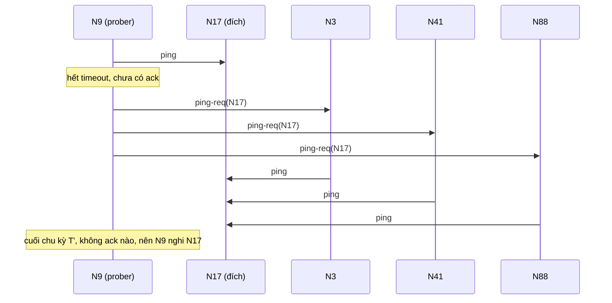

# P15 · Chương 07 — Membership và gossip

Một cụm cache 500 node thì ai là người biết node nào còn sống? Không thể giao việc đó cho một node trung tâm, vì chính node ấy cũng có thể chết. Cũng không thể bắt mỗi node hỏi thăm tất cả 499 node còn lại mỗi giây, vì số message tăng theo bình phương số node. Chương này đi từ hai ràng buộc đó đến lời giải mà Consul, Serf, Nomad và Cassandra đang dùng: tin tức lan theo kiểu dịch bệnh (gossip, epidemic), còn việc phát hiện node chết thì giao cho từng node thăm dò ngẫu nhiên vài peer mỗi chu kỳ (SWIM). Chương chứng minh vì sao tin lan khắp cụm trong cỡ $\log n$ vòng, vì sao SWIM phát hiện node chết trong thời gian kỳ vọng không đổi theo $n$, và vì sao SWIM nguyên bản vẫn gây báo động giả khi chính node đi thăm dò bị chậm (đó là chỗ Lifeguard sửa).

Để mọi con số có chỗ bám, cả chương dùng một ví dụ giả định là `cachering`: một cụm cache 500 node, mỗi node là một process Rust giữ một phần key theo consistent hashing (xem [P12 · Chương 06](../12-he-thong-du-lieu/06-partitioning.md)). Client và các node đều cần biết node nào đang sống để chọn đúng chủ của một key (nhận xét của người soạn: `cachering` là ví dụ giả định, không phải code trong repo).

## Bạn sẽ hiểu được gì

1. **Q1.** Bài toán membership là gì, và vì sao mỗi node gửi heartbeat cho mọi node khác không scale? → mục 1
2. **Q2.** Failure detector đòi những tính chất gì (completeness, accuracy), vì sao không có detector vừa chính xác vừa đầy đủ trên mạng bất đồng bộ, và φ-accrual thay câu trả lời "sống/chết" bằng gì? → mục 2
3. **Q3.** Anti-entropy (push, pull, push-pull) và rumor mongering khác nhau thế nào, mỗi cái trả giá gì? → mục 3
4. **Q4.** Vì sao một tin lan khắp $n$ node trong $O(\log n)$ vòng? Hằng số của push, pull, push-pull khác nhau ra sao, và rumor mongering bỏ sót bao nhiêu node? → mục 4
5. **Q5.** SWIM làm việc từng bước thế nào: ping, ping-req qua $k$ member, suspicion, và dissemination kiểu lây nhiễm? → mục 5
6. **Q6.** SWIM phát hiện node chết sau bao lâu, bị báo giả với xác suất bao nhiêu, và suspicion cùng round-robin cải thiện gì? → mục 6
7. **Q7.** Lifeguard sửa điểm yếu nào của SWIM, bằng ba cơ chế nào? → mục 7
8. **Q8.** memberlist, Serf, Consul và Cassandra dùng các ý trên ra sao ngoài đời? → mục 8

## Kiến thức cần trước

- [P12 · Chương 08 — Sự cố của hệ phân tán](../12-he-thong-du-lieu/08-su-co-he-phan-tan.md), mục 4: mô hình hệ thống và failure detector dựa timeout; chương này đi sâu hơn vào failure detector.
- [P12 · Chương 06 — Partitioning](../12-he-thong-du-lieu/06-partitioning.md), mục 6: gossip dùng để lan bản đồ "khóa → node"; chương này dạy chính giao thức gossip.
- [P12 · Chương 09 — Consistency và consensus](../12-he-thong-du-lieu/09-consistency-va-consensus.md): để thấy vì sao membership kiểu gossip chỉ là eventually consistent, khác hẳn đồng thuận.
- Xác suất cơ bản (kỳ vọng, phân phối hình học, $(1-1/m)^m \to e^{-1}$): xem [P14 · Chương 03](../14-toan-va-ly-thuyet/03-xac-suat.md).

---

## 1. Bài toán membership và cái giá của heartbeat tất cả-với-tất cả (Q1)

> **Trả lời ngắn.** Membership là bài toán giữ cho mỗi node một *view*: danh sách node đang tham gia cụm. Node dùng view đó để định tuyến request và di chuyển dữ liệu[^lg-view]. Cách đơn giản nhất là mỗi node gửi heartbeat cho mọi node khác, nhưng tải mạng khi đó tăng theo bình phương số node[^sw-quad]. Vì vậy các hệ lớn tách việc *phát hiện hỏng* khỏi việc *lan thay đổi membership*[^sw-sep].

**Giải thích.**

*Với `cachering`.* Mỗi node `cachering` giữ một bảng: với mỗi node trong cụm, nó nghĩ node đó đang `Alive` hay `Dead`. Khi `GET user:42` đến, node nhận request băm key, tra vòng băm trên các node `Alive` và chuyển tiếp tới chủ của key. Hai node có thể có hai bảng khác nhau trong một lúc: node A đã biết `N17` chết còn node B thì chưa. Chấp nhận được không? Với cache thì có: B gửi nhầm request tới `N17`, hết giờ, rồi thử lại node khác (nhận xét của người soạn). Memberlist, thư viện của HashiCorp mà ta sẽ gặp ở mục 8, nói thẳng đây là thiết kế eventually consistent nhưng hội tụ nhanh trong trường hợp trung bình[^ml-ec]. Nếu cần mọi node *đồng ý* về cùng một view tại cùng một thời điểm thì phải dùng consensus, như thay đổi cấu hình của Raft ở [P12 · Chương 18](../12-he-thong-du-lieu/18-thuat-toan-dong-thuan.md); đó là một bài toán đắt hơn và khác hẳn (nhận xét của người soạn).

### 1.1 Heartbeat tất cả-với-tất cả

Cách làm ngây thơ: mỗi $T$ giây, mỗi node gửi một heartbeat tới mọi node khác; node nào im quá một khoảng thì bị coi là hỏng. SWIM gọi đây là cách cài đặt đơn giản nhất[^sw-simple]. Số message mỗi chu kỳ là $n(n-1)$, mỗi node nhận $n-1$ heartbeat. Với $T = 1$ s, ta có (người soạn tính):

| Số node $n$ | Message/s toàn cụm $n(n-1)$ | Message/s mà *mỗi* node phải nhận ($n-1$) |
|---:|---:|---:|
| 50 | 2.450 | 49 |
| 500 | 249.500 | 499 |
| 5.000 | 24.995.000 | 4.999 |

Con số thật đáng sợ ở cột giữa. Tăng cụm cache từ 500 lên 5.000 node (gấp 10) làm tải toàn cụm tăng gần 100 lần. Đây chính là điều SWIM chỉ ra: tải tăng bình phương vì thông tin sống/chết của từng node phải được báo tới *mọi* node khác[^sw-quad]. Gửi gộp nhiều heartbeat vào một gói cũng không cứu được lâu: gói UDP có giới hạn kích thước, trong khi SWIM tạo ra gói không quá 135 byte bất kể cỡ nhóm[^sw-135].

### 1.2 Hướng giải: tách hai việc

SWIM không cố làm heartbeat rẻ hơn. Nó nhận ra rằng "phát hiện node chết" và "báo cho mọi người biết node nào vừa vào, ra hay chết" là hai việc khác nhau, nên tách chúng thành hai thành phần[^sw-sep]. Phát hiện chỉ cần *một* node nào đó nhận ra sự cố; còn báo tin có thể lan dần qua các node. Nhờ đó mỗi node chỉ phải thăm dò vài node mỗi chu kỳ, và tin tức đi cùng các gói thăm dò. Ba mục tiếp theo dựng từng mảnh: lý thuyết failure detector (mục 2), cách tin lan (mục 3, 4), rồi ghép lại thành SWIM (mục 5, 6).

Có một hướng khác là dựng phân cấp: mỗi process chỉ heartbeat một nhóm con. Cách này cần cấu hình và duy trì cẩn thận lớp overlay mà thông tin chảy qua, và độ chính xác phụ thuộc vào độ bền của đồ thị ấy[^sw-hier]. SWIM tránh được chi phí này vì không dựng đồ thị ảo nào.

<details><summary>Đi sâu: gossip heartbeat và vì sao nó không giải được bài toán tải</summary>

Một phương án trung gian là *gossip heartbeat*: mỗi node định kỳ gửi cho vài node ngẫu nhiên cả bảng đếm heartbeat mới nhất của mọi node. Cách này bền hơn với mất gói, nhưng bảng đó có kích thước tỉ lệ $n$, nên để đạt cùng thời gian phát hiện thì tải cũng vẫn tăng bình phương theo $n$. SWIM so sánh và nêu rằng việc gộp nhiều heartbeat vào một gói bị chặn bởi kích thước gói UDP: 50 member với mỗi heartbeat 5 byte đã chiếm 250 byte, trong khi gói SWIM không quá 135 byte bất kể cỡ nhóm[^sw-135].

Các mục 5–6 sẽ chỉ ra SWIM làm khác ở đâu: mỗi node mỗi chu kỳ chỉ gửi một ping, và độ dài mọi gói bị chặn bởi hằng số[^sw-const].

</details>

**Quay lại Q1:** membership là việc giữ view "ai đang sống" ở mỗi node để định tuyến, heartbeat tất cả-với-tất cả tốn $n(n-1)$ message mỗi chu kỳ nên không scale, và lối thoát là tách phát hiện hỏng khỏi lan tin.

---

## 2. Failure detector: completeness, accuracy và φ-accrual (Q2)

> **Trả lời ngắn.** Failure detector được đánh giá bằng hai nhóm tính chất: *completeness* (node hỏng thật thì cuối cùng sẽ bị nghi) và *accuracy* (node tốt không bị nghi nhầm). Trên mạng bất đồng bộ không detector nào đạt cả hai ở mức tuyệt đối[^sw-imposs], nên hệ thật giữ completeness và cố giảm báo động giả[^sw-same]. φ-accrual đổi câu trả lời "sống/chết" thành một con số liên tục, để ứng dụng tự chọn ngưỡng[^phi-accrual-def].

**Giải thích.**

*Với `cachering`.* Giả sử `N5` chạy một vòng GC dài, hoặc kernel của nó bận nên 3 giây không trả lời gì. Node thăm dò `N9` có nên cho `N5` là chết và rút nó khỏi vòng băm không? Nếu đúng, `N9` được lợi vì bớt gửi request vào chỗ chết. Nếu sai, cụm tự gây ra một lần rebalance không cần thiết. Failure detector là chỗ ta đặt hai mong muốn này lên bàn cân.

### 2.1 Hai họ tính chất

*Completeness.* Dạng mạnh: cuối cùng mọi process đã crash sẽ bị *mọi* process đúng nghi vĩnh viễn[^ct-sc]. Phiên bản SWIM dùng gần như y hệt: crash của bất kỳ member nào phải bị tất cả member không hỏng phát hiện[^sw-complete].

*Accuracy.* Completeness một mình vô dụng. Một detector bắt mọi process nghi mọi process khác thì thoả completeness một cách tầm thường, nhưng không cho ta thông tin gì về lỗi[^ct-useless]. Vì vậy detector hữu ích phải thêm một tính chất accuracy để giới hạn những lần nó nhầm[^ct-acc]. Accuracy mạnh nhất: không có node tốt nào bị nghi. Yếu hơn: có ít nhất một process đúng không bao giờ bị nghi[^ct-weak]. Yếu hơn nữa, và là mức mà timeout thực tế có thể hy vọng: *eventual* accuracy, tức là tồn tại một thời điểm từ đó accuracy đúng[^ct-eventual].

*Tốc độ và tải.* Trong thực tế còn hai tiêu chí nữa: thời gian từ lúc member hỏng đến lúc có một member không hỏng phát hiện ra nó[^sw-speed], và tải mạng sinh ra[^sw-load]. Với bốn tiêu chí (completeness, tốc độ, accuracy, tải) ta so được các giao thức ở mục 5–6.

### 2.2 Vì sao không có cả hai

Accuracy tuyệt đối đòi detector không bao giờ nghi nhầm một node chỉ chậm. Nhưng trên mạng bất đồng bộ, ta không có cận trên cho độ trễ message, nên không có cách phân biệt node đã chết với node chỉ chậm hơn mọi timeout ta chọn (xem [P12 · Chương 08, mục 1](../12-he-thong-du-lieu/08-su-co-he-phan-tan.md)). Đó là lý do SWIM trích kết quả bất khả: không thể dựng failure detector trên mạng bất đồng bộ vừa chính xác (không phát hiện sai) vừa strongly complete[^sw-imposs]. Hầu hết detector, kể cả loại dùng heartbeat, chọn giữ completeness và cố giữ tỉ lệ báo động giả thấp; SWIM đi cùng hướng[^sw-same].

### 2.3 φ-accrual: một con số thay vì có/không

Detector kiểu timeout trả lời nhị phân: sống hoặc chết. φ-accrual làm khác: monitor xuất ra một giá trị trên thang liên tục thay vì một thông tin kiểu boolean[^phi-accrual-def]. Giá trị này phản ánh mức tin rằng node bị theo dõi đã crash; nếu node thật sự crash, giá trị này chắc chắn tăng dần và tiến tới vô hạn, nên có tên "accrual" (tích lũy)[^phi-accrue]. Ứng dụng tự đặt ngưỡng theo yêu cầu chất lượng của riêng nó: ngưỡng thấp dễ nghi nhầm nhưng phát hiện nhanh; ngưỡng cao ít nhầm hơn nhưng phát hiện chậm hơn[^phi-threshold].

*Cách tính.* Gọi $P_{\text{later}}(t)$ là xác suất heartbeat tiếp theo đến muộn hơn $t$ đơn vị thời gian sau heartbeat trước[^phi-plater]. Khi đó

$$\varphi(t_{\text{now}}) = -\log_{10}\,P_{\text{later}}(t_{\text{now}} - T_{\text{last}}).$$

Ý nghĩa: nếu ta quyết định nghi khi $\varphi \ge 1$ thì khả năng quyết định ấy bị heartbeat đến muộn bác bỏ về sau là khoảng 10%; với $\varphi = 2$ là 1%, $\varphi = 3$ là 0,1%, và cứ thế[^phi-meaning]. Để tính $P_{\text{later}}$, monitor giữ một cửa sổ cố định các thời điểm heartbeat đến[^phi-window], rồi giả định khoảng cách giữa hai heartbeat theo phân phối chuẩn với trung bình và phương sai ước lượng từ cửa sổ đó[^phi-normal].

*Ví dụ số trên `cachering`.* Heartbeat tới đều đặn với trung bình 1000 ms và độ lệch chuẩn 200 ms. Gọi $z = (t - 1000)/200$; khi đó $P_{\text{later}}$ là đuôi phải của phân phối chuẩn chuẩn hóa tại $z$. Bảng dưới do người soạn tính bằng một chương trình Rust nhỏ (tích phân số, xem phần Đi sâu cuối mục 4); đây là quan sát của lần chạy đó:

| Thời gian từ heartbeat cuối | $z$ | $P_{\text{later}}$ | $\varphi$ |
|---:|---:|---:|---:|
| 1000 ms | 0 | $5{,}0\times10^{-1}$ | 0,30 |
| 1400 ms | 2 | $2{,}3\times10^{-2}$ | 1,64 |
| 1600 ms | 3 | $1{,}35\times10^{-3}$ | 2,87 |
| 1800 ms | 4 | $3{,}2\times10^{-5}$ | 4,50 |
| 2000 ms | 5 | $2{,}9\times10^{-7}$ | 6,54 |
| 2122 ms | 5,61 | $1{,}0\times10^{-8}$ | 7,99 |

Với ngưỡng $\Phi = 8$, `N9` chỉ nghi `N5` sau khoảng 2,12 giây im lặng. Nếu mạng ổn định hơn (độ lệch chuẩn 100 ms), đường cong dốc hơn và có thể kết luận sớm hơn; Akka mô tả đúng hiện tượng này[^akka-steeper]. Điểm hay của φ: *cùng một detector* phục vụ được hai ứng dụng có yêu cầu khác nhau. Router của `cachering` có thể ngừng gửi request mới ở $\varphi \ge 2$ (rẻ, hoàn tác được) còn chờ tới $\varphi \ge 8$ mới kích hoạt rebalance (đắt) (nhận xét của người soạn).

<details><summary>Đi sâu: accrual trong thực tế, và φ có thoát khỏi bất khả thi không</summary>

**Không thoát khỏi bất khả thi.** Paper nói thẳng: detector accrual cũng không cài đặt deterministic được trong mọi hệ bất đồng bộ, nhưng cả hai loại đều cài đặt được theo xác suất[^phi-prob]. φ-accrual không phá kết quả bất khả; nó chỉ chuyển quyết định "nghi hay không" từ detector sang ứng dụng.

**Giả định phân phối chuẩn.** Cách tính ở trên chỉ tốt khi khoảng cách heartbeat gần chuẩn. Đuôi chuẩn giảm rất nhanh, nên nếu mạng thật có đuôi dày (thỉnh thoảng một heartbeat chậm gấp 10 lần), $\varphi$ sẽ nhảy vọt và báo nhầm (suy luận của người soạn từ công thức; paper cũng nêu giả định chuẩn như một lựa chọn cài đặt chứ không phải điều kiện bắt buộc của accrual).

**Ngưỡng mặc định.** Akka, một cài đặt φ-accrual phổ biến, dùng giá trị chuẩn hóa dựa trên trung bình và độ lệch chuẩn của khoảng cách heartbeat lịch sử[^akka-phi], và đặt ngưỡng mặc định là 8; docs của nó gợi ý có thể tăng lên 12 trên môi trường cloud như Amazon EC2 vì mạng ở đó thỉnh thoảng gặp sự cố[^akka-thr]. Cassandra cũng chạy một biến thể của φ-accrual detector (mục 8)[^cass-phi].

</details>

**Quay lại Q2:** failure detector được chấm bằng completeness và accuracy; trên mạng bất đồng bộ không có detector hoàn hảo cả hai[^sw-imposs], và φ-accrual trả về mức nghi ngờ liên tục để ứng dụng tự chọn ngưỡng.

---

## 3. Anti-entropy và rumor mongering (Q3)

> **Trả lời ngắn.** *Anti-entropy* là việc mỗi node định kỳ chọn ngẫu nhiên một partner và hai bên đối chiếu, sửa khác biệt để hai bản dữ liệu giống nhau. Có ba kiểu sửa: push (chỉ đẩy bản mới của mình đi), pull (chỉ kéo bản mới về), push-pull (cả hai chiều)[^dm-three]. *Rumor mongering* nhẹ hơn: node chỉ truyền tin "nóng" và ngừng khi thấy nhiều partner đã biết rồi, đổi lại có xác suất nhỏ tin không tới hết[^dm-rumorfreq].

**Giải thích.**

*Với `cachering`.* Bảng membership của mỗi node là một dãy bản ghi `(node, trạng_thái, phiên_bản)`; bản ghi nào có phiên bản lớn hơn thì thắng. Khi `N17` chết, một node nào đó đổi bản ghi của `N17` thành `Dead` với phiên bản mới. Làm sao 499 node còn lại biết? Hai ý tưởng sau đây, từ hệ cơ sở dữ liệu nhân bản Clearinghouse ở Xerox, trả lời câu này mà không cần node trung tâm.

### 3.1 Thuật ngữ dịch tễ

Demers và cộng sự mượn từ vựng dịch tễ học. Với *một* bản cập nhật cụ thể, một site (node) là *infective* nếu nó có bản cập nhật và sẵn sàng chia sẻ; *susceptible* nếu chưa nhận được; *removed* nếu đã nhận nhưng không còn sẵn sàng chia sẻ[^dm-terms]. Anti-entropy là *epidemic đơn giản*: site chỉ ở hai trạng thái susceptible hoặc infective[^dm-simple].

### 3.2 Anti-entropy: push, pull, push-pull

Thuật toán gốc rất ngắn: mỗi chu kỳ, mỗi site $s$ chọn một $s'$ ngẫu nhiên rồi chạy `ResolveDifference(s, s')`. Hàm này có thể chạy theo ba cách, gọi là push, pull và push-pull[^dm-three]. Với `cachering`, đặt `v(x)` là phiên bản bản ghi của `N17` ở node $x$:

- **push**: nếu `v(s) > v(s')` thì `s'` nhận bản của `s`. Chỉ bên *có tin* mới có lợi từ việc chủ động gọi.
- **pull**: nếu `v(s) < v(s')` thì `s` nhận bản của `s'`. Chỉ bên *chưa có tin* mới có lợi.
- **push-pull**: bên nào cũ hơn thì nhận bản của bên kia, cả hai chiều.

Một hàm gộp dùng được cho cả ba cách chỉ cần so phiên bản (minh họa, không chạy):

```rust
#[derive(Clone, Copy, PartialEq)]
enum State { Alive, Suspect, Dead }

#[derive(Clone, Copy)]
struct Entry { state: State, version: u64 }

/// Với mỗi node, bản ghi có version lớn hơn thắng.
fn merge(mine: &mut [Entry], theirs: &[Entry]) {
    for (m, t) in mine.iter_mut().zip(theirs) {
        if t.version > m.version {
            *m = *t;
        }
    }
}
```

Cassandra dùng đúng ý tưởng "version lớn hơn thắng" cho trạng thái gossip: mỗi bản ghi mang cặp `(generation, version)` để node bỏ qua trạng thái cũ chỉ bằng cách nhìn các đồng hồ logic đó[^cass-ignore] (xem mục 8).

### 3.3 Cái giá và mẹo checksum

Nếu trao đổi *toàn bộ* bảng thì anti-entropy rất tốn kém: nó so hai bản sao đầy đủ và một bản phải gửi qua mạng[^dm-expensive]. Mà thường hai bản gần như giống hệt nhau, nên phần lớn công sức là thừa. Cải tiến cổ điển: hai site trao đổi checksum trước và chỉ so toàn bộ khi checksum khác nhau[^dm-checksum]. Serf và memberlist làm điều tương tự ở dạng khác: giữ gossip UDP gọn và gửi *toàn bộ trạng thái* qua TCP với một node ngẫu nhiên, nhưng rất thưa (mục 8).

### 3.4 Rumor mongering

Anti-entropy chạy mãi, kể cả khi không có gì để đồng bộ. Rumor mongering bắt đầu từ ý ngược lại: site biết một tin mới thì coi nó là *hot rumor*, định kỳ chọn một site ngẫu nhiên và bảo đảm site đó đã thấy tin; khi site đã thử chia sẻ với quá nhiều site vốn đã biết, nó thôi coi tin là nóng và giữ lại mà không lan tiếp[^dm-rumor]. Chu kỳ rumor có thể dày hơn chu kỳ anti-entropy vì mỗi site tốn ít tài nguyên hơn, nhưng đổi lại có xác suất nào đó tin không tới hết các site[^dm-rumorfreq].

Mô hình toán của rumor mongering dùng các biến $s$, $i$, $r$ (tỉ lệ susceptible, infective, removed) với $s+i+r=1$; ở mục 4.5 ta giải nó để biết có bao nhiêu node bị sót.

### 3.5 Push hay pull?

Hai cách khác nhau rõ nhất ở giai đoạn cuối, khi chỉ còn ít node chưa biết tin. Khi đó khác biệt lớn nằm giữa push và pull, còn push-pull cư xử gần như pull[^dm-pullpush]. Với `cachering` dùng anti-entropy để dự phòng cho kênh lan chính (ví dụ gói gossip UDP có thể rơi), cả pull lẫn push-pull đều đáng chọn hơn push, vì push cư xử tệ đúng ở trường hợp ta kỳ vọng: gần hết node đã biết và chỉ vài node còn thiếu[^dm-prefer]. Mục 4 giải thích bằng toán vì sao.

Chi phí lúc rảnh cũng khác: nếu cơ sở dữ liệu yên tĩnh thì push không sinh thêm traffic, còn pull vẫn gửi những request vô ích để hỏi cập nhật[^dm-quiet]. Chọn thế nào còn tùy tốc độ sinh cập nhật (nhận xét của người soạn: với membership, thay đổi xảy ra liên tục ở cụm lớn nên pull/push-pull thường hợp lý).

Cuối cùng, vì rumor mongering có thể bỏ sót, nên cần dự phòng nó bằng anti-entropy để bảo đảm phủ hết[^dm-backup]. Đó cũng là lý do Serf và memberlist có cả gossip nhanh lẫn push/pull TCP thưa.

<details><summary>Đi sâu: các biến thể của rumor mongering và vì sao tính ngẫu nhiên khiến không thể hứa cận tất định</summary>

**Blind hay feedback, coin hay counter.** Demers và cộng sự xét nhiều cách để một node quyết định ngừng chia sẻ tin: ngừng theo xác suất $1/k$ mỗi khi gặp node đã biết (coin), hay sau $k$ lần như vậy (counter), có phản hồi (feedback) hay không. Mô phỏng của họ cho thấy biến thể counter và feedback giảm lượng node bị sót, trong đó counter quan trọng hơn feedback[^dm-variants].

**Không thể hứa cận thời gian tất định.** Các thuật toán này ngẫu nhiên: mỗi site tự chọn partner độc lập. Vì vậy không thể nói kiểu "tin sẽ hội tụ trong thời gian tỉ lệ với đường kính mạng"; điều tốt nhất có thể nói là khi không còn cập nhật mới, xác suất thông tin chưa hội tụ giảm theo hàm mũ theo thời gian[^dm-random].

</details>

**Quay lại Q3:** anti-entropy so sánh định kỳ với một partner ngẫu nhiên (push/pull/push-pull) và luôn hội tụ nhưng tốn; rumor mongering rẻ hơn nhưng có thể bỏ sót nên cần anti-entropy làm lưới đỡ.

---

## 4. Vì sao tin lan khắp cụm trong $O(\log n)$ vòng (Q4)

> **Trả lời ngắn.** Khi chỉ một ít node biết tin, mỗi node biết tin kéo thêm xấp xỉ một (push) hoặc hai (push-pull) node nữa mỗi vòng, nên số node biết tin nhân lên theo cấp số nhân, và cần cỡ $\log n$ vòng để chạm tới một nửa cụm. Khi đa số đã biết, phần còn lại co lại rất nhanh: theo hệ số hằng mỗi vòng ở push, theo bình phương ở pull và push-pull. Tổng cộng khoảng $\log_2 n + \ln n$ vòng cho push[^dm-log], còn pull và push-pull chỉ cần $\log n + O(\log\log n)$ vòng (suy ra bên dưới).

**Giải thích.**

*Với `cachering`.* `N17` chết ở vòng 0 và một node duy nhất, `N9`, phát hiện ra. Hỏi: sau bao nhiêu vòng gossip thì cả 500 node biết? Rồi hỏi tiếp cho cụm 5.000 hay 1.000.000 node. Các phép tính sau là của người soạn, trừ khi có chú thích. Chúng đều ở dạng *mean-field* (xấp xỉ giá trị kỳ vọng như thể số node đủ lớn để các đại lượng ngẫu nhiên bằng trung bình của chúng); chứng minh chặt cho push do Pittel làm, và Demers trích lại[^dm-log]. Mục 4.4 đối chiếu với mô phỏng chạy thật.

### 4.1 Mô hình

Có $n$ node, thời gian chia thành vòng đồng bộ. Mỗi vòng, *mỗi* node chọn đều ngẫu nhiên một node khác làm partner. Ban đầu đúng một node biết tin. Gọi $s_t$ là tỉ lệ node chưa biết tin sau $t$ vòng, $q_t = 1 - s_t$ là tỉ lệ đã biết. Trạng thái "removed" không xuất hiện: đây là epidemic đơn giản kiểu anti-entropy[^dm-simple]. Để thuật toán push, pull, push-pull so được với nhau, ta dùng cùng một mô hình: mỗi vòng mỗi node *khởi tạo* đúng một cuộc trao đổi.

### 4.2 Cận dưới cho push: ít nhất $\log_2 n$ vòng

**Mệnh đề.** Với push, cần ít nhất $\lceil \log_2 n \rceil$ vòng để $n$ node đều biết tin (chứng minh của người soạn).

*Chứng minh.* Gọi $I_t$ là số node biết tin sau $t$ vòng, $I_0 = 1$. Trong một vòng, mỗi node biết tin gửi (push) tối đa một bản tới partner của nó; node chưa biết tin không có gì để push. Vậy số node biết tin tăng thêm tối đa $I_t$ mỗi vòng, tức $I_{t+1} \le 2 I_t$. Quy nạp: $I_t \le 2^t$. Muốn $I_t = n$ thì $2^t \ge n$, tức $t \ge \log_2 n$. $\blacksquare$

(Với pull và push-pull cận dưới tương tự không còn đơn giản như vậy, vì một node biết tin có thể bị nhiều node kéo cùng lúc; ta chỉ phân tích kỳ vọng ở dưới.)

### 4.3 Pull: hai giai đoạn, giai đoạn cuối co theo bình phương

Trong pull, một node susceptible vẫn susceptible sau vòng $i+1$ khi và chỉ khi nó đã susceptible ở vòng $i$ *và* node nó liên lạc cũng đang susceptible[^dm-pull-def]. Khi $n$ lớn, node ấy susceptible với xác suất $\approx s_t$, nên ta có hệ thức truy hồi $s_{t+1} = s_t^{\,2}$. Hệ thức này hội tụ về 0 rất nhanh khi $s_t$ nhỏ[^dm-conv].

*Giải hệ thức.* Từ $s_{t+1} = s_t^2$ ta có $s_t = s_0^{\,2^t}$. Ban đầu chỉ một node biết tin, nên $s_0 = 1 - 1/n$ và

$$s_t = \left(1 - \tfrac1n\right)^{2^t} \approx \exp\!\left(-\frac{2^t}{n}\right),$$

dùng $(1-1/n)^n \to e^{-1}$. Kỳ vọng số node còn chưa biết là $n s_t \approx n\,e^{-2^t/n}$. Số này nhỏ hơn 1 khi $2^t/n \ge \ln n$, tức $t \ge \log_2 n + \log_2 \ln n$.

Kết quả đó đọc được thành hai giai đoạn. Trong $\approx\log_2 n$ vòng đầu, $q_t = 1 - s_t$ nhân đôi mỗi vòng (vì $q_{t+1} = 2q_t - q_t^2$ ≈ $2q_t$ khi $q_t$ nhỏ) cho tới khi cỡ một nửa cụm biết. Sau đó $s_t$ bị bình phương mỗi vòng, nên chỉ cần thêm $\log_2 \ln n$ vòng, một số nhỏ đến mức gần như hằng. Tổng cộng: $\log_2 n + O(\log\log n)$ vòng.

### 4.4 Push và push-pull

*Push.* Một node susceptible ở vòng $i+1$ vẫn susceptible khi nó đã susceptible và *không* infective nào chọn nó[^dm-push-def]. Có $n q_t$ infective, mỗi cái chọn đúng node đó với xác suất $\approx 1/n$, nên xác suất không ai chọn là $(1-1/n)^{n q_t} \approx e^{-q_t}$ và

$$s_{t+1} = s_t\, e^{-(1-s_t)}.$$

Khi $q_t$ nhỏ, mỗi infective lây thêm khoảng một node mới, nên $q_t$ nhân đôi mỗi vòng: $\approx \log_2 n$ vòng để đạt một phần đáng kể (khớp cận dưới ở 4.2). Khi $s_t$ nhỏ thì $e^{-(1-s_t)} \approx e^{-1}$, nên $s_{t+1} \approx s_t/e$: mỗi vòng chỉ giảm theo hệ số $e$ chứ không bình phương. Cần thêm $\ln n$ vòng để từ hằng số xuống dưới $1/n$. Tổng $\approx \log_2 n + \ln n$, khớp công thức chính xác $\log_2 n + \ln n + O(1)$ mà Demers và cộng sự trích từ lý thuyết dịch tễ[^dm-log]. Đây chính là chỗ giải thích hiện tượng "push cư xử tệ khi gần xong": nó chỉ có thể co theo $1/e$ mỗi vòng, trong khi pull bình phương.

*Push-pull.* Trong một cuộc trao đổi push-pull, bên nào cũ hơn thì cập nhật. Một node susceptible vẫn susceptible chỉ khi (a) node *nó* gọi cũng susceptible (xác suất $s_t$) và (b) không infective nào gọi nó (xác suất $\approx e^{-(1-s_t)}$). Suy ra

$$s_{t+1} = s_t \cdot s_t \cdot e^{-(1-s_t)}.$$

Khi $q_t$ nhỏ, một node susceptible bị lây qua *hai* đường (nó gọi trúng infective, hoặc infective gọi trúng nó), nên mỗi infective kéo thêm $\approx 2$ node: $I_{t+1} \approx 3 I_t$, mất $\approx \log_3 n$ vòng cho giai đoạn đầu. Khi $s_t$ nhỏ: $s_{t+1} \approx s_t^2/e$. Đặt $a_t = \ln(1/s_t)$ thì $a_{t+1} = 2a_t + 1$, nên $a_t + 1 = 2^t (a_0 + 1)$ và cần $O(\log_2 \ln n)$ vòng để $a_t \ge \ln n$. Tổng cộng: $\log_3 n + \log_2 \ln n + O(1)$.

*Đối chiếu với mô phỏng.* Người soạn viết một chương trình Rust mô phỏng đúng mô hình 4.1 (mỗi vòng mỗi node chọn một partner đều ngẫu nhiên, trạng thái cập nhật đồng bộ theo ảnh chụp đầu vòng), chạy trên macOS với `rustc` 1.95.0 (mã nguồn ở phần Đi sâu cuối mục). Số vòng trung bình để *tất cả* $n$ node biết tin (quan sát của lần chạy đó, không phải bảo đảm):

| $n$ | số lần chạy | push (đo) | $\log_2 n + \ln n$ | pull (đo) | $\log_2 n + \log_2\ln n$ | push-pull (đo) | $\log_3 n + \log_2 \ln n$ |
|---:|---:|---:|---:|---:|---:|---:|---:|
| 1.000 | 200 | 17,87 | 16,87 | 13,76 | 12,76 | 9,13 | 9,08 |
| 10.000 | 100 | 23,60 | 22,50 | 17,39 | 16,49 | 11,52 | 11,59 |
| 100.000 | 30 | 29,83 | 28,12 | 21,37 | 20,14 | 13,97 | 14,00 |
| 1.000.000 | 8 | 34,75 | 33,75 | 24,62 | 23,72 | 16,50 | 16,36 |

Ba điều đọc được từ bảng:

- Số vòng tăng đều khoảng $\log_2 10 \approx 3{,}3$ (push, pull) hay $\log_3 10 \approx 2{,}1$ (push-pull) mỗi lần $n$ tăng gấp 10, đúng dạng logarithm. Cụm 1.000.000 node vẫn chỉ cần 16–35 vòng.
- Các công thức mean-field khớp với phần dư $O(1)$: push-pull lệch dưới 0,15 vòng; push và pull lệch khoảng 1 vòng (người soạn nghĩ nguyên nhân là ở vòng đầu, khi chỉ có một node biết tin, node đó có xác suất khoảng $1/e$ không được ai chọn, một hiệu ứng mean-field bỏ qua; đây là suy luận của người soạn, không đo riêng).
- Push-pull nhanh gần gấp đôi push, và pull ở giữa; đúng như dự đoán vì $\log_3 n + \log_2\ln n < \log_2 n + \log_2 \ln n < \log_2 n + \ln n$ khi $n$ lớn.

Về chi phí: mỗi vòng mỗi node khởi tạo đúng một cuộc trao đổi, nên tải mỗi node là *hằng số* mỗi chu kỳ, bất kể $n$. Để một tin lan khắp cụm cần $O(\log n)$ vòng, tức tổng $O(n \log n)$ lần trao đổi mỗi tin, so với $\Theta(n)$ *mỗi node* mỗi chu kỳ của heartbeat tất cả-với-tất cả (mục 1.1). Với `cachering` 500 node, push-pull lan tin trong khoảng $\log_3 500 + \log_2 \ln 500 \approx 5{,}7 + 2{,}6 = 8{,}3$ vòng; nếu mỗi vòng là 200 ms (mặc định của memberlist, mục 8) thì dưới 2 giây (người soạn tính từ công thức mean-field; không đo trên hệ thật).

### 4.5 Rumor mongering bỏ sót bao nhiêu?

Mô hình rumor: khi một node infective gọi nhầm node đã biết tin, nó thôi lan với xác suất $1/k$. Demers và cộng sự mô hình hóa bằng hệ hai phương trình vi phân[^dm-ode]:

$$\frac{ds}{dt} = -s\,i, \qquad \frac{di}{dt} = s\,i - \frac1k (1-s)\,i.$$

Phương trình đầu nói số susceptible giảm theo tích $s\,i$ (mỗi cặp susceptible–infective gặp nhau lây tin). Phương trình sau có thêm số hạng mất do các lần gọi vô ích (xác suất gặp node đã biết là $1-s$, rồi với xác suất $1/k$ thì dừng).

*Giải.* Chia hai vế để khử $t$:

$$\frac{di}{ds} = \frac{s\,i - \frac1k(1-s)\,i}{-s\,i} = -1 + \frac{1-s}{ks} = -\frac{k+1}{k} + \frac{1}{ks}.$$

Tích phân: $i(s) = -\frac{k+1}{k}s + \frac1k \ln s + c$. Với $n$ lớn, điều kiện đầu là $s \to 1$, $i \to 0$, nên $c = \frac{k+1}{k}$ và

$$i(s) = \frac{k+1}{k}(1-s) + \frac1k \ln s.$$

Tin ngừng lan khi $i = 0$. Đặt $i(s) = 0$ ta được $\ln s = -(k+1)(1-s)$, tức *phần còn sót* (residue, tức giá trị $s$ khi $i=0$[^dm-residue]) thỏa

$$s = e^{-(k+1)(1-s)}.$$

Phương trình này không có nghiệm đóng, nhưng số hạng chi phối cho thấy $s$ giảm theo hàm mũ khi $k$ tăng[^dm-expk]. Giải bằng lặp điểm bất động (chương trình Rust thứ hai của người soạn, quan sát khi chạy): $k=1$ cho $s \approx 0{,}2032$; $k=2$: $0{,}0595$; $k=3$: $0{,}0198$; $k=4$: $0{,}0070$; $k=5$: $0{,}0025$. Hai giá trị đầu khớp con số trong paper, rằng ở $k=1$ khoảng 20% node sẽ bỏ lỡ tin và ở $k=2$ chỉ khoảng 6%[^dm-k].

*Ý nghĩa cho `cachering`.* Với $k=2$, rumor mongering thuần túy vẫn để sót khoảng $0{,}0595 \times 500 \approx 30$ node không biết tin (dự đoán mean-field cho $n$ lớn, người soạn tính). Một cụm cache thật không chấp nhận điều đó, nên rumor mongering luôn được ghép với anti-entropy hoặc push/pull toàn phần định kỳ (mục 3.5). Đây chính xác là kiến trúc của Serf: gossip UDP nhanh cộng đồng bộ toàn bộ trạng thái qua TCP thưa (mục 8).

<details><summary>Đi sâu: mã mô phỏng đã chạy, và giới hạn của phân tích mean-field</summary>

**Mã nguồn đã chạy** (lưu tạm trong thư mục riêng, `rustc --edition 2021 -O`, đã xóa sau khi chạy; hạt giống RNG cố định nên chạy lại ra đúng bảng trên):

```rust
struct Rng(u64);
impl Rng {
    fn next(&mut self) -> u64 { // xorshift64*
        let mut x = self.0; x ^= x >> 12; x ^= x << 25; x ^= x >> 27; self.0 = x;
        x.wrapping_mul(0x2545F4914F6CDD1D)
    }
    fn below(&mut self, n: usize) -> usize { (self.next() % n as u64) as usize }
    fn other(&mut self, n: usize, me: usize) -> usize { let j = self.below(n - 1); if j >= me { j + 1 } else { j } }
}

#[derive(Clone, Copy)]
enum Mode { Push, Pull, PushPull }

/// Trả về (vòng tới 50%, vòng tới 100%).
fn spread(n: usize, mode: Mode, rng: &mut Rng) -> (u32, u32) {
    let mut cur = vec![false; n];
    cur[0] = true;
    let mut count = 1usize;
    let (mut half, mut round) = (0u32, 0u32);
    while count < n {
        let mut next = cur.clone();
        for i in 0..n {
            let j = rng.other(n, i);
            let push = matches!(mode, Mode::Push | Mode::PushPull);
            let pull = matches!(mode, Mode::Pull | Mode::PushPull);
            if push && cur[i] { next[j] = true; }
            if pull && cur[j] { next[i] = true; }
        }
        cur = next;
        count = cur.iter().filter(|&&b| b).count();
        round += 1;
        if half == 0 && count * 2 >= n { half = round; }
    }
    (half, round)
}
```

Số vòng *tới 50%* đo được (cùng lần chạy) là: push 10,00 / 13,75 / 17,00 / 20,00; push-pull 6,53 / 8,70 / 10,73 / 12,88 cho $n = 10^3, 10^4, 10^5, 10^6$. Chúng khớp $\log_2 n$ (9,97 / 13,29 / 16,61 / 19,93) và $\log_3 n$ (6,29 / 8,38 / 10,48 / 12,57), đúng hai giai đoạn đã phân tích: giai đoạn đầu nhân theo hệ số 2 (push) hoặc 3 (push-pull).

**Giới hạn.** Hệ thức $s_{t+1} = s_t^2$ coi các node là độc lập. Thực tế trong vài vòng đầu, khi $I_t$ chỉ là một con số nhỏ, tính ngẫu nhiên của chính số $I_t$ quan trọng: có xác suất khác không rằng node đầu tiên không được ai gọi (với pull) hoặc gọi trúng node đã biết (với push) và vòng đó không lan thêm. Các hiệu ứng này chỉ dịch tổng số vòng đi một hằng số, nên không đổi dạng $O(\log n)$; chứng minh chặt cho push do Pittel làm[^dm-log].

**Chương trình thứ hai** (tính $\varphi$ ở mục 2.3 và residue ở 4.5) tích phân đuôi chuẩn $Q(z)$ bằng quy tắc Simpson trên $[z, z+12]$ rồi lấy $-\log_{10}$, và lặp $s \leftarrow e^{-(k+1)(1-s)}$ 200 lần từ $s=0{,}5$. Không có hàm `erfc` trong `std`, nên phải tự tích phân.

</details>

**Quay lại Q4:** tin lan theo hai giai đoạn: nhân lên theo cấp số nhân (hệ số 2 ở push, 3 ở push-pull) cho tới khi đa số biết, rồi phần còn lại co theo $1/e$ mỗi vòng (push) hoặc bình phương mỗi vòng (pull, push-pull), nên tổng chỉ $O(\log n)$ vòng, và push-pull nhanh nhất.

---

## 5. SWIM: ping, ping-req, suspicion và lan kiểu lây nhiễm (Q5)

> **Trả lời ngắn.** Mỗi chu kỳ, mỗi node SWIM chọn một member ngẫu nhiên và ping. Nếu không có ack kịp lúc, nó nhờ $k$ member khác ping hộ (ping-req), vì đường mạng từ chính nó có thể đang lỗi. Nếu cả hai đường đều im thì node *bị nghi* (suspect) chứ chưa bị coi là chết; chỉ khi không ai bác bỏ trong một khoảng timeout nó mới bị xác nhận hỏng[^sw-susp-why]. Mọi thay đổi membership đi theo các gói ping, ping-req và ack có sẵn (piggyback) và lan theo kiểu epidemic[^sw-piggy2].

**Giải thích.**

*Với `cachering`.* Giả sử `N17` bị kill đột ngột. Không có node nào gửi heartbeat tới 499 node còn lại. Thay vào đó, mỗi giây mỗi node chọn *một* node để ping. Sớm muộn một node trong số đó sẽ chọn trúng `N17`, và việc còn lại là chuyện lan tin. Vậy cụ thể ai làm gì, và vì sao nó đủ?

### 5.1 Thành phần phát hiện

SWIM có hai tham số: chu kỳ giao thức $T'$ (đơn vị thời gian) và số nguyên $k$, cỡ nhóm con phát hiện gián tiếp; giao thức không đòi đồng hồ các member đồng bộ với nhau[^sw-clock]. Mỗi chu kỳ, node $M_i$ làm như sau (đây là mô tả của paper, diễn đạt lại; $M_j$ là đích):

1. $M_i$ chọn ngẫu nhiên một member $M_j$ trong danh sách của mình và gửi `ping`.
2. $M_i$ chờ `ack` từ $M_j$ trong một timeout xác định theo thời gian khứ hồi (RTT) của message và nhỏ hơn chu kỳ giao thức[^sw-direct].
3. Nếu hết timeout mà chưa có `ack`, $M_i$ chọn ngẫu nhiên $k$ member và gửi mỗi member một `ping-req(M_j)`. Mỗi member được nhờ (nếu nó đang sống) ping $M_j$ rồi chuyển `ack` nhận được (nếu có) ngược về $M_i$[^sw-pingreq].
4. Cuối chu kỳ, nếu $M_i$ không nhận được `ack` nào, trực tiếp hay gián tiếp, thì nó coi $M_j$ là hỏng trong danh sách cục bộ và giao thông tin này cho thành phần dissemination[^sw-nodecl].



(Sơ đồ minh họa của người soạn theo mô tả ở trên, với $k = 3$; tên node là của `cachering`.)

Vì sao phải nhờ người khác? Lý do paper nêu: để tránh ảnh hưởng của tắc nghẽn trên đường mạng giữa $M_i$ và $M_j$, thứ có thể làm rơi ping gốc hoặc ack của nó[^sw-rationale]. Nếu ping-req đi một đường khác thì đường lỗi cục bộ đó không còn quyết định. Về cấu hình: timeout để bắt đầu thăm dò gián tiếp dựa trên ước lượng phân phối RTT trong mạng, và chu kỳ giao thức phải ít nhất gấp ba lần ước lượng RTT[^sw-3rtt] (vì ping, rồi ping-req, rồi ping, rồi ack cần chạy tuần tự trong một chu kỳ; đây là suy luận của người soạn).

Kích thước mọi gói ping, ping-req và ack bị chặn bởi hằng số, không phụ thuộc cỡ nhóm[^sw-const], nên tải mỗi member không tăng theo $n$ (mục 6).

### 5.2 Suspicion: nghi trước, kết luận sau

Bản "thô" ở trên có điểm yếu: một member bị nhầm là hỏng chỉ vì một lần mất gói, hay vì vừa bị treo ngắn trên một host quá tải[^sw-slow], sẽ bị ép rời nhóm ngay. Suspicion subprotocol chặn điều đó. Khi ping lẫn ping-req đều không có ack, $M_i$ *không* tuyên bố $M_j$ hỏng. Nó đánh dấu $M_j$ là Suspect và lan tin `Suspect` ra nhóm; member nào nhận tin cũng đánh dấu như vậy[^sw-susp-why]. Member bị nghi vẫn nằm trong danh sách và vẫn được xử lý như member tốt khi chọn đích ping[^sw-susp-member]. Nếu $M_j$ thật sự còn sống thì sớm muộn có người ping được nó, hoặc chính nó nghe tin mình bị nghi, và nó lan một thông điệp `Alive`. Hết timeout mà không ai bác bỏ thì mới có `Confirm`, kết luận $M_j$ hỏng và xóa nó khỏi danh sách[^sw-susp-timeout].

Cơ chế này giảm, nhưng không loại hẳn báo động giả[^sw-susp-reduces]. Timeout nghi ngờ là nút điều chỉnh: tăng nó đổi thêm thời gian phát hiện lấy ít báo động giả hơn[^sw-susp-timeout].

*Thứ tự ưu tiên giữa ba loại tin.* Alive ghi đè Suspect, Confirm ghi đè cả Suspect lẫn Alive[^sw-override]. Nhưng một member có thể bị nghi rồi được minh oan nhiều lần; để phân biệt các lần ấy, mỗi tin mang số *incarnation* của member liên quan. Chỉ chính member bị nghi mới tăng được incarnation của mình, và Alive chỉ ghi đè loại tin khác khi incarnation cao hơn[^lg-incarn]. Với `cachering`, đây là tương tự "version lớn hơn thắng" của mục 3.2, nhưng version do *chủ sở hữu* bản ghi tăng: không node nào khác có thể "sửa lại" Alive thành một số cũ hơn (nhận xét của người soạn).

| Tin | Ý nghĩa | Ghi đè |
|---|---|---|
| `Suspect(j, inc)` | Có người không liên lạc được `j` | tin cũ hơn về `j` |
| `Alive(j, inc')` | `j` khẳng định còn sống | `Suspect` nếu `inc' > inc` |
| `Confirm(j)` | `j` bị tuyên bố hỏng | cả `Suspect` lẫn `Alive`[^sw-override] |

(Bảng của người soạn, tóm từ hai chú thích trong mục này; quy tắc chi tiết nằm trong paper.)

### 5.3 Dissemination kiểu lây nhiễm

Phiên bản đầu của SWIM dùng multicast mạng để lan thay đổi membership, nhưng multicast chỉ là best-effort: mất gói có thể làm vài member không nhận được gì và mất gói còn tương quan với nhau[^sw-multicast]. Giải pháp: dán (piggyback) các thay đổi lên những gói ping, ping-req và ack mà failure detector đằng nào cũng phải gửi[^sw-piggy2]. Tin lan theo kiểu epidemic và lan nhanh theo hàm mũ trong nhóm[^sw-infect], đúng như phân tích mục 4: mỗi cuộc ping giống một cuộc trao đổi gossip với một partner ngẫu nhiên.

*Mỗi tin bị gửi bao nhiêu lần?* Mỗi member giữ một bộ đệm các cập nhật gần đây kèm bộ đếm số lần đã dán chúng. Mỗi cập nhật được dán tối đa $\lambda\log n$ lần với $\lambda$ là hằng số (người soạn đọc từ cách Lifeguard nói "mỗi suspicion được gửi $\lambda\log(n)$ lần"[^lg-gossip-susp]). Nếu bộ đệm lớn hơn số cập nhật nhét được vào một gói thì cập nhật đã được gossip ít lần hơn được ưu tiên: điều này bảo đảm mọi thay đổi ít nhất lây được vài member, rồi sẽ lan hết khi tốc độ thay đổi giảm xuống[^sw-younger]. Đây là rumor mongering với bộ đếm (mục 3.4) cài đặt trên các gói có sẵn (nhận xét của người soạn).

*Timeline trên `cachering` (số liệu giả định: $n = 500$, $T' = 1$ s, $k = 3$).* `N17` chết ở $t = 0$. Trong $\approx 1{,}6$ chu kỳ kỳ vọng, một node (giả sử `N9`) chọn trúng `N17` làm đích (mục 6.1). `N9` ping, hết timeout, nhờ `N3`, `N41`, `N88` ping hộ; vẫn im, nên đến cuối chu kỳ `N9` đánh dấu `N17` là Suspect và dán tin đó lên các gói tiếp theo. Tin lan khắp cụm trong cỡ $\log n$ chu kỳ; trong lúc đó `N17` không bác bỏ, nên khi hết timeout nghi ngờ, một node nào đó phát `Confirm(N17)`, và nó cũng lan theo cách đó. Mỗi node `cachering` tự rút `N17` khỏi vòng băm của mình khi nhận tin (nhận xét của người soạn).

<details><summary>Đi sâu: tham gia nhóm, hàng đợi cập nhật và các khác biệt khi cài đặt</summary>

**Tham gia nhóm.** Để vào nhóm, node mới cần biết ít nhất một member. Paper liệt kê nhiều cách: nếu nhóm có server cố định hay địa chỉ multicast thì mọi join gửi tới đó; nếu không thì broadcast join, hoặc dùng một coordinator tĩnh; sự tồn tại của nhiều coordinator không phá tính đúng đắn của giao thức, chỉ gây nhiều phản hồi cho cùng một yêu cầu join[^sw-join]. Cassandra giải quyết tương tự bằng *seed node* (mục 8).

**Hai danh sách khi dán tin.** Cài đặt của paper giữ hai danh sách: member chưa bị tuyên bố hỏng và member vừa hỏng gần đây; hiện tại nó lấy số cập nhật bằng nhau từ hai danh sách để dán[^sw-twolists].

**memberlist thêm ping TCP song song.** memberlist (cài đặt SWIM phổ biến nhất) dùng UDP mặc định cho cả ping trực tiếp lẫn gián tiếp; song song với ping gián tiếp qua UDP, nó còn thử một ping trực tiếp qua TCP. Việc này giúp trong tình huống TCP đi đúng đường mà UDP thì không, một lỗi cấu hình mạng mà người vận hành thỉnh thoảng gặp[^lg-tcp].

</details>

**Quay lại Q5:** SWIM mỗi chu kỳ ping một member ngẫu nhiên, nhờ $k$ member ping hộ nếu im, đánh dấu nghi chứ chưa kết luận, và dán mọi thay đổi lên chính các gói đó để chúng lan kiểu epidemic.

---

## 6. SWIM: thời gian phát hiện và xác suất báo giả (Q6)

> **Trả lời ngắn.** Mỗi chu kỳ, node hỏng bị ít nhất một member chọn làm đích ping với xác suất ít nhất $1 - 1/e$, nên kỳ vọng chỉ cần chưa đầy $e/(e-1) \approx 1{,}58$ chu kỳ để *ai đó* thăm dò đúng nó, bất kể cỡ nhóm. Xác suất một lần thăm dò kết luận nhầm một node tốt rất nhỏ nhờ $k$ đường gián tiếp độc lập. Chọn đích theo vòng tròn xáo trộn (round-robin) thay đích ngẫu nhiên biến "kỳ vọng" thành cận cứng: không quá cỡ $2n$ chu kỳ[^sw-rr].

**Giải thích.**

*Với `cachering`.* Câu hỏi của người vận hành là: node chết thì bao lâu cụm biết, và trong lúc bình thường thì mỗi ngày có bao nhiêu lần bị báo sai? Các phép tính dưới đây đáp trực tiếp hai câu đó. Paper đã công bố kết quả; vì bản trích văn bản của paper bị hỏng ký hiệu toán, các chứng minh bên dưới do người soạn tự dựng lại và đối chiếu với phát biểu của paper (chứng minh của người soạn).

### 6.1 Thời gian đến lần thăm dò đầu tiên

Giả sử một member $M$ vừa hỏng, còn $n - 1$ member khác đang sống. Mỗi chu kỳ, mỗi member sống chọn đều ngẫu nhiên một đích trong $n-1$ member khác (kể cả $M$, vì chưa ai biết $M$ hỏng).

**Mệnh đề 1.** Xác suất $M$ được ít nhất một member chọn làm đích ping trong một chu kỳ là $P_c = 1 - (1 - \tfrac{1}{n-1})^{n-1} \ge 1 - \tfrac1e$. Kỳ vọng số chu kỳ tới lần thăm dò đầu tiên là $1/P_c \le e/(e-1) \approx 1{,}582$.

*Chứng minh.*

1. Một member sống cố định chọn $M$ với xác suất $\frac1{n-1}$, nên *không* chọn $M$ với xác suất $1 - \frac1{n-1}$. (Giả thiết: mỗi member chọn độc lập và đều trên $n-1$ member khác.)
2. Có $n - 1$ member sống chọn độc lập; xác suất *không ai* chọn $M$ là $(1 - \frac1{n-1})^{n-1}$ do tính độc lập. Vậy $P_c = 1 - (1-\frac1{n-1})^{n-1}$.
3. Với $m = n - 1 \ge 2$ và $x = 1/m \in (0,1)$ ta có $\ln(1-x) \le -x$ (bất đẳng thức cơ bản của logarithm; $\ln$ là hàm lõm nên nằm dưới tiếp tuyến tại $x=0$). Suy ra $m \ln(1 - 1/m) \le -1$, tức $(1-1/m)^m \le e^{-1}$.
4. Vậy $P_c \ge 1 - e^{-1}$.
5. Các chu kỳ độc lập với nhau, nên số chu kỳ tới lần thăm dò đầu tiên là biến ngẫu nhiên hình học với xác suất thành công $P_c$ mỗi lần, kỳ vọng $1/P_c \le 1/(1 - e^{-1}) = e/(e-1)$. $\blacksquare$

Giá trị này nhất quán với phát biểu của paper rằng thời gian kỳ vọng từ lúc một member hỏng tới lúc một process nào đó trong nhóm phát hiện nó "nhiều nhất" cỡ $T'\cdot e/(e-1)$ tính theo độ dài chu kỳ giao thức[^sw-expected]; paper cũng vẽ đường lý thuyết $e/(e-1)$ trong biểu đồ thời gian phát hiện đầu tiên[^sw-e]. Phần "thăm dò" ở đây là cận trên cho chu kỳ đầu; việc lệch giữa lúc hỏng và đầu chu kỳ, cùng timeout, dịch thêm tối đa cỡ một chu kỳ (suy luận của người soạn). Điểm mấu chốt: kết quả *không phụ thuộc $n$*, trừ việc $P_c$ tiến dần tới $1-1/e$ khi $n$ tăng.

*Đối chiếu bằng chạy thật.* Mô phỏng Rust thứ nhất có thêm phần này: $n = 1000$, 999 member sống, mỗi chu kỳ mỗi member chọn đều một trong 999 member khác, một member đã hỏng; đo số chu kỳ tới lần chọn trúng đầu tiên, trung bình trên 20.000 lần chạy. Quan sát: **1,577** chu kỳ, so với giá trị công thức $1/P_c = 1{,}582$ và $e/(e-1) = 1{,}582$. Khớp.

**Mệnh đề 2 (strong completeness).** Mọi member hỏng cuối cùng được mọi member sống thăm dò. *Chứng minh.* Tại một member sống cố định, mỗi chu kỳ chọn đúng member hỏng với xác suất $\frac1{n-1} > 0$, độc lập giữa các chu kỳ, nên xác suất không chọn trúng sau $t$ chu kỳ là $(1-\frac1{n-1})^t \to 0$; vậy với xác suất 1 nó chọn trúng một lúc nào đó. $\blacksquare$ Phát biểu tương ứng trong paper: member hỏng cuối cùng được mọi member không hỏng chọn làm đích ping và bị xóa khỏi danh sách của họ[^sw-eecomp].

### 6.2 Round-robin: từ "kỳ vọng" thành cận cứng

Chọn ngẫu nhiên có một kẽ hở: trong trường hợp tệ, node hỏng có thể không bao giờ được ai chọn nên độ trễ phát hiện đầu tiên không bị chặn[^sw-rr-patho]. Cách vá: mỗi member duyệt danh sách của nó theo vòng tròn thay vì chọn ngẫu nhiên; member mới vào được chèn tại một vị trí chọn đều ngẫu nhiên[^sw-rr-ins]. Kết quả: khoảng thời gian từ lúc hỏng tới lúc phát hiện không quá hai lần cỡ nhóm, tính bằng chu kỳ giao thức[^sw-rr].

**Mệnh đề 3.** Nếu mỗi member duyệt một danh sách $m = n-1$ member khác theo vòng, mỗi vòng duyệt xong thì xáo lại, thì hai lần ping liên tiếp cùng một đích cách nhau không quá $2m - 1$ chu kỳ (chứng minh của người soạn; cách xáo sau mỗi vòng là suy luận của người soạn từ mô tả của paper).

*Chứng minh.* Đích $x$ có vị trí $a \in [1, m]$ trong lượt duyệt thứ $c$ và vị trí $b \in [1, m]$ trong lượt $c+1$. Từ lần ping tại vị trí $a$ đến hết lượt $c$ còn $m - a$ chu kỳ, rồi thêm $b$ chu kỳ tới vị trí $b$ của lượt sau: khoảng cách là $m - a + b \le (m - 1) + m = 2m - 1$. $\blacksquare$

Vậy với $n = 500$ và $T' = 1$ s, *mỗi* member sống thăm dò lại một member hỏng cụ thể trong tối đa $2 \times 499 - 1 = 997$ chu kỳ, tức 997 giây. Con số này là cận trên cho *từng* prober và rất thô; thời gian đến khi *một member nào đó* phát hiện thường nhỏ hơn nhiều vì có 499 prober chạy song song (suy luận của người soạn: nếu các vòng duyệt của các member lệch pha ngẫu nhiên). Giá trị của round-robin là cận *tất định*, không phụ thuộc may rủi.

### 6.3 Xác suất kết luận nhầm

Giả sử mỗi gói đến đích đúng hạn với xác suất $q$ (độc lập giữa các gói), một member được nhờ ping-req còn sống với xác suất $q_f$. Xét member $M_j$ *còn sống tốt* và một lần thăm dò của $M_i$.

**Mệnh đề 4.** Xác suất lần thăm dò đó kết luận nhầm $M_j$ hỏng (tức không có `ack` nào, trực tiếp hay gián tiếp) là

$$P_{fp} = \bigl(1 - q^{2}\bigr)\,\bigl(1 - q_f\,q^{4}\bigr)^{k}.$$

*Chứng minh (của người soạn).*

1. Đường trực tiếp thành công khi cả `ping` ($M_i \to M_j$) và `ack` ($M_j \to M_i$) đến đúng hạn: xác suất $q^2$. Vậy đường trực tiếp thất bại với xác suất $1 - q^2$.
2. Một đường gián tiếp qua $M_x$ cần bốn gói: `ping-req` ($M_i \to M_x$), `ping` ($M_x \to M_j$), `ack` ($M_j \to M_x$), `ack` ($M_x \to M_i$), cộng thêm điều kiện $M_x$ sống. Xác suất thành công $q_f q^4$, nên thất bại với xác suất $1 - q_f q^4$.
3. $k$ đường gián tiếp độc lập, nên xác suất cả $k$ đều thất bại là $(1 - q_f q^4)^k$.
4. Kết luận nhầm xảy ra khi đường trực tiếp *và* cả $k$ đường gián tiếp đều thất bại; các sự kiện độc lập nên xác suất là tích. $\blacksquare$

Khi $M_j$ chỉ bị thăm dò bởi một member mỗi chu kỳ ở mức trung bình (vì $n-1$ member mỗi cái chọn một đích trong $n-1$, nên kỳ vọng số member chọn $M_j$ là $1$), theo tính tuyến tính của kỳ vọng, kỳ vọng số lần bị kết luận nhầm mỗi chu kỳ ở $M_j$ cũng là $P_{fp}$ (suy luận của người soạn). Điều này cũng nhất quán với phát biểu của paper rằng chỉnh tham số $k$ cho phép cấu hình xác suất báo nhầm theo yêu cầu ứng dụng[^sw-expected].

*Bảng số* (từ chương trình Rust của người soạn, đặt $q_f = 1$; quan sát của lần chạy đó):

| $q$ (xác suất gói đến đúng hạn) | $k=0$ | $k=1$ | $k=3$ | $k=5$ |
|---:|---:|---:|---:|---:|
| 0,99 | $2{,}0\times10^{-2}$ | $7{,}8\times10^{-4}$ | $1{,}2\times10^{-6}$ | $1{,}9\times10^{-9}$ |
| 0,95 | $9{,}8\times10^{-2}$ | $1{,}8\times10^{-2}$ | $6{,}2\times10^{-4}$ | $2{,}1\times10^{-5}$ |
| 0,90 | $1{,}9\times10^{-1}$ | $6{,}5\times10^{-2}$ | $7{,}7\times10^{-3}$ | $9{,}1\times10^{-4}$ |
| 0,80 | $3{,}6\times10^{-1}$ | $2{,}1\times10^{-1}$ | $7{,}4\times10^{-2}$ | $2{,}6\times10^{-2}$ |

Hai điều rút ra. *Thứ nhất*, ping-req có tác dụng rất lớn: ở $q = 0{,}95$, ba đường gián tiếp ($k=3$) hạ xác suất nhầm từ khoảng 9,8% xuống $6{,}2\times10^{-4}$, giảm gần 160 lần. *Thứ hai*, vẫn chưa đủ ở quy mô cụm: với `cachering` 500 node, $q = 0{,}95$, $k = 3$, kỳ vọng số lần nhầm toàn cụm mỗi chu kỳ là $500 \times 6{,}2\times10^{-4} \approx 0{,}31$, tức cỡ một lần nhầm mỗi 3 giây. Ngay cả ở $q = 0{,}99$ thì $500\times 1{,}2\times10^{-6} = 6{,}1\times10^{-4}$ mỗi giây, cỡ một lần mỗi 27 phút (người soạn tính; mô hình giả định mất gói độc lập). Nếu mỗi lần nhầm đều dẫn tới rebalance dữ liệu thì không chịu nổi, và đó là lý do cần suspicion.

*Suspicion làm gì ở đây.* Nó cho node bị nghi thêm thời gian để tự bác bỏ trước khi bị loại. Thí nghiệm trong paper: với tỉ lệ rơi gói nhân tạo 10%[^sw-fp-setup], khi 17 process lần lượt tham gia nhóm, bản có infection và suspicion đạt kích thước nhóm ổn định 12 member, còn bản SWIM cơ bản và bản chỉ có infection ổn định ở 2 và 4 member[^sw-fp10]. Paper nói rõ số này chỉ đúng cho cấu hình thử nghiệm đó, và để ngỏ việc khảo sát kỹ timeout nghi ngờ.

### 6.4 Tải mạng không phụ thuộc cỡ nhóm

Mỗi member mỗi chu kỳ gửi một `ping` và nhận một `ack` ở trường hợp thường; chỉ khi ping thất bại mới có thêm $k$ ping-req cùng các `ping`/`ack` kèm theo. Theo paper, tải message kỳ vọng mỗi member là một hằng số không đổi theo cỡ nhóm và đối xứng giữa mọi member[^sw-loadconst]. Với $n = 500$ và $T' = 1$ s, tải thường là khoảng $2$ message/giây mỗi node (một `ping` đi, một `ack` về; người soạn tính), so với 499 heartbeat/giây mỗi node ở mục 1.1; chênh nhau hai bậc độ lớn.

<details><summary>Đi sâu: độ chính xác của bảng, và vì sao giả định độc lập sẽ vỡ</summary>

**Mô hình ở 6.3 là lý tưởng.** Paper tính tải tối thiểu để đạt một tỉ lệ nhầm cho trước dưới *điều kiện lý tưởng* là mất gói độc lập trên từng message; nó dùng công thức đó làm mốc để so các giao thức, và chính SWIM cũng nói tính toán ấy chỉ "lý tưởng" chứ không phản ánh mọi tình huống thật[^sw-ideal]. Bảng ở 6.3 hoạt động dưới giả định tương tự.

**Giả định vỡ ngay khi một node chậm.** Khi node *thăm dò* bị chậm (CPU kẹt, GC dài), nó xử lý mọi ack trễ cùng lúc, nên các lần thăm dò không còn độc lập: nhiều đích bị nhầm liên tiếp. SWIM đã nêu hiện tượng này (một process thỉnh thoảng bị treo, bỏ lỡ cơ hội trả lời ping, rồi bị tuyên bố hỏng nhầm[^sw-slow]) và mục 7 là lời giải.

**$P_c$ khi $n$ nhỏ.** Với nhóm nhỏ, $P_c$ lớn hơn $1-1/e$ một chút; ví dụ $n = 3$ có $m = 2$, $P_c = 1 - (1/2)^2 = 0{,}75$. Mệnh đề 1 chỉ dùng $m \ge 2$.

</details>

**Quay lại Q6:** mỗi chu kỳ node hỏng bị thăm dò với xác suất $\ge 1 - 1/e$, nên kỳ vọng $\le e/(e-1) \approx 1{,}58$ chu kỳ bất kể $n$; mỗi lần thăm dò nhầm node tốt với xác suất $(1-q^2)(1-q_f q^4)^k$, và round-robin cùng suspicion biến "kỳ vọng" thành cận cứng và giảm báo giả.

---

## 7. Lifeguard: node đi thăm dò cũng có thể là kẻ có lỗi (Q7)

> **Trả lời ngắn.** SWIM giả định node đang chạy detector luôn khỏe, nên xử lý gói kịp thời. Khi chính node đó bị chậm (CPU kẹt, mạng nghẽn), nó nghi nhầm cả loạt node tốt và gây "flapping": node cứ bị đánh dấu chết rồi sống lại[^lg-flap]. Lifeguard thêm ba cơ chế để mỗi node tự xét sức khỏe cục bộ của mình: giãn timeout theo local health, kéo dài rồi rút ngắn suspicion timeout theo số lời nghi độc lập, và ưu tiên báo ngay cho node bị nghi[^lg-three-ext].

**Giải thích.**

*Với `cachering`.* `N9` đang bị chèn CPU bởi một job khác trên cùng host. Các ack tới hợp lệ nhưng `N9` xử lý chậm quá timeout, nên nó đánh dấu hàng chục node tốt là Suspect rồi Confirm. Những node đó không thật sự chết; chúng bị flap, và nếu mỗi lần flap kéo theo rebalance hay cấp phát lại thì rất tốn kém[^lg-flap2]. Bài học của đội Consul/Nomad: ngay cả có suspicion, xử lý tin nhắn chậm vẫn gây ra tình huống này[^lg-flap]. Hướng sửa của họ là buộc mỗi detector xét *sức khỏe của chính mình*, gọi là local health[^lg-local].

### 7.1 Cơ chế 1: Local Health Aware Probe

SWIM probe với chu kỳ và timeout cố định. Lifeguard thay bằng một cặp chu kỳ và timeout co giãn theo thông tin liên lạc gần đây của chính member đó[^lg-three-ext]. Nó gom ba loại tín hiệu về sức khỏe cục bộ:

- số ack nhận được so với số ping và ping-req đã gửi: thiếu ack có thể do chính mình chậm, nhất là khi thiếu nhiều;
- việc phải bác bỏ một lời nghi nhắm vào chính mình: dấu hiệu mình chưa xử lý ping kịp;
- một message mới, `nack`, mà member được nhờ ping-req gửi về khi ping gián tiếp thất bại, để người nhờ kiểm tra xem mình có nhận phản hồi đúng hạn từ $k$ member nó nhờ hay không[^lg-nack].

Các tín hiệu gộp thành *Local Health Multiplier* (LHM), một bộ đếm bão hòa trong $[0, S]$[^lg-lhm]: probe thành công $-1$; probe thất bại $+1$; phải bác bỏ lời nghi về chính mình $+1$; probe thiếu `nack` $+1$[^lg-lhm-events]. Chu kỳ và timeout của probe được nhân với $(\text{LHM}+1)$. Với memberlist, mặc định $S = 8$, nên chu kỳ probe và timeout có thể giãn tới tối đa 9 giây và 4,5 giây[^lg-interval].

*Ví dụ.* `N9` nhận ra mình bỏ lỡ nhiều `nack`, LHM lên 3. Chu kỳ probe từ 1 s thành $1\times(3+1) = 4$ s, timeout từ 500 ms thành 2 s (người soạn tính theo công thức Lifeguard). `N9` chậm lại đúng lúc nó đáng nghi nhất, nên gây ít lời nghi sai hơn; khi ack bắt đầu về đều, LHM giảm và nó nhanh dần trở lại.

### 7.2 Cơ chế 2: Local Health Aware Suspicion

Thay suspicion timeout cố định bằng timeout động: mỗi lời nghi mới bắt đầu ở mức cao hơn nhiều so với trường hợp cố định, nhưng giảm dần khi nhận thêm lời nghi độc lập từ member khác về cùng một node[^lg-susp]. Công thức: với $\text{Min}$, $\text{Max}$ là timeout nhỏ nhất, lớn nhất, $K$ là số lời nghi độc lập cần nhận để về $\text{Min}$ (mặc định 3[^lg-K]), $C$ là số lời nghi độc lập đã nhận,

$$\text{SuspicionTimeout} = \max\!\Bigl(\text{Min},\ \text{Max} - (\text{Max}-\text{Min})\,\frac{\log(C+1)}{\log(K+1)}\Bigr).$$

Dùng logarithm để mỗi lần giảm nhỏ hơn lần trước: lời nghi độc lập đầu tiên tăng độ tin cậy nhiều nhất, các lời sau thêm ít dần[^lg-log]. Để lời nghi độc lập xuất hiện nhiều hơn, $K$ lời nghi độc lập đầu tiên về cùng một node được gossip lại, mỗi cái $\lambda \log n$ lần[^lg-gossip-susp].

Trực giác: nếu node khỏe và nhận gossip đúng hạn thì timeout rơi nhanh về $\text{Min}$; nếu node chậm, không nhận đủ lời xác nhận độc lập thì timeout vẫn cao, cho node bị nghi nhiều thời gian bác bỏ.

*Ví dụ số (người soạn tính).* Trong memberlist, $\text{Min} = \alpha \log_{10}(n)\cdot\text{ProbeInterval}$ và $\text{Max} = \beta\,\text{Min}$[^lg-minmax]; ví dụ cấu hình $\alpha = 5$, $\beta = 6$ có trong paper. Với $n = 500$ và probe interval 1 s: $\text{Min} \approx 5 \times 2{,}70 = 13{,}5$ s, $\text{Max} \approx 81$ s. Theo công thức, $C = 0$: 81 s; $C=1$: $81 - 67{,}5\times \frac{\log 2}{\log 4} \approx 47{,}2$ s; $C=2$: $81 - 67{,}5\times \frac{\log 3}{\log 4} \approx 27{,}5$ s; $C = 3$: $13{,}5$ s.

### 7.3 Cơ chế 3: Buddy System

Trong SWIM, member bị nghi chỉ biết mình bị nghi khi nhận một tin `Suspect` về mình, mà tin đó phụ thuộc vào luật chọn tin để dán: giới hạn số tin mỗi gói, giới hạn số lần gửi lại, ưu tiên tin mới. Buddy System thay bộ chọn đó bằng một bộ chọn ưu tiên báo cho member bị nghi biết mình bị nghi, bảo đảm node nào ping nó, dù cho bản thân hay cho đường gián tiếp của node khác, sẽ báo lời nghi trong gói ping[^lg-buddy]. Nhờ vậy bác bỏ bắt đầu sớm hơn.

### 7.4 Kết quả và đánh đổi

Lifeguard giữ thiết kế SWIM và chỉ khác ở ba thành phần trên[^lg-three-ext]. Trong thí nghiệm có kiểm soát của tác giả: ở cấu hình đánh đổi cực đoan nhất ($\alpha=2$, $\beta=2$), độ trễ phát hiện và lan truyền trung vị giảm khoảng 45% so với SWIM mà báo động giả ở node khỏe vẫn giảm 68% (gấp 3 lần)[^lg-results]. Ở đầu kia ($\alpha=5$, $\beta=6$), độ trễ trung vị giữ nguyên như SWIM nhưng báo động giả giảm hơn 98% (hơn 50 lần), đổi lại độ trễ ở phân vị 99 và 99,9 tăng nhẹ[^lg-results2]. Nghĩa là: chọn $\alpha$, $\beta$ là chọn điểm trên đường đánh đổi giữa độ trễ phát hiện và báo giả, nhưng cả hai đầu đều tốt hơn SWIM nguyên bản.

<details><summary>Đi sâu: Lifeguard đã vào Serf, Consul và memberlist thế nào</summary>

memberlist là cài đặt mã nguồn mở của SWIM mà Consul, Nomad và Serf dùng[^lg-used], và README của nó gọi Lifeguard là tập mở rộng làm memberlist bền hơn khi xử lý message chậm do CPU starvation hoặc mạng trễ và mất gói[^ml-ext]. Serf 0.8 thêm Lifeguard; docs của Serf mô tả hai điểm chính (thêm `nack` để node tự biết mình đang bị suy giảm và chậm detector lại; suspicion timeout ban đầu rất dài rồi tăng tốc khi các node khác xác nhận), kèm nhận xét rằng không cần cấu hình thêm vì nó tự điều chỉnh[^serf-lg]. Consul nêu cùng lý do: giao thức Serf giả định node cục bộ khỏe để xử lý gói theo thời gian thực; nếu node cạn CPU hoặc mạng, health check `serfHealth` có thể báo động giả[^consul-lg].

**Giới hạn đã được tác giả thừa nhận.** Các tham số của Lifeguard (giá trị tối đa $S$ của LHM, điểm cộng/trừ từng sự kiện) hiện được chọn theo kinh nghiệm; tác giả để ngỏ việc tự điều chỉnh các tham số này như hướng nghiên cứu tiếp[^lg-future].

</details>

**Quay lại Q7:** SWIM tin node chạy detector luôn khỏe; Lifeguard bỏ giả định đó bằng LHM co giãn probe, suspicion timeout giảm dần theo số lời nghi độc lập, và Buddy System báo ngay cho node bị nghi, giảm hơn 50 lần báo giả ở cấu hình bảo thủ mà không tăng độ trễ trung vị.

---

## 8. Ngoài đời: memberlist, Serf, Consul và Cassandra (Q8)

> **Trả lời ngắn.** memberlist là thư viện Go của HashiCorp cài SWIM (cộng Lifeguard); Serf và Consul dựng lên trên nó. Cassandra không dùng SWIM mà dùng gossip kiểu anti-entropy mỗi giây với một node ngẫu nhiên, cộng một φ-accrual detector. Cả hai họ đều lan tin bằng epidemic, chỉ khác ở cách phát hiện node hỏng.

**Giải thích.**

*Với `cachering`.* Khi triển khai thật, bạn không viết SWIM từ đầu. Bạn dùng một thư viện, hoặc dùng membership có sẵn của hệ lưu trữ. Mục này giúp đọc tài liệu của chúng với đúng từ vựng.

### 8.1 memberlist

memberlist quản lý membership của cụm và phát hiện member hỏng bằng giao thức gossip[^ml-readme]. Nó là eventually consistent nhưng hội tụ nhanh trong trường hợp trung bình[^ml-ec]. Node hỏng được phát hiện và partition mạng được chịu một phần nhờ thử liên lạc với node có thể đã chết qua nhiều đường[^ml-through], chính là ping-req. Mặc định của memberlist cho mạng LAN, trích từ file cấu hình của nhánh `master` lúc soạn (có thể đổi theo thời gian):

| Tham số | Giá trị mặc định | Ý nghĩa |
|---|---|---|
| `IndirectChecks` | 3 | số node nhờ ping gián tiếp ($k$ của SWIM)[^ml-cfg1] |
| `ProbeInterval`, `ProbeTimeout` | 1 s, 500 ms | chu kỳ và timeout của probe[^ml-cfg2] |
| `GossipNodes`, `GossipInterval` | 3, 200 ms | fanout và chu kỳ gossip riêng[^ml-cfg3] |
| `PushPullInterval` | 30 s | đồng bộ toàn bộ trạng thái, tần suất thấp[^ml-cfg4] |
| `RetransmitMult` | 4 | số lần gửi lại tin $= 4\log(N+1)$[^ml-cfg5] |
| `AwarenessMaxMultiplier` | 8 | trần của LHM; chu kỳ probe có thể giãn tới 8 giây[^ml-cfg6] |

README ghi rằng cấu hình mặc định thận trọng, thiên về hội tụ cao với giá là băng thông cao hơn[^ml-conservative]. Lưu ý chênh nhau: gossip chạy mỗi 200 ms, nhanh hơn probe mỗi 1 s; điều này khác SWIM thuần túy, nơi tin chỉ đi nhờ gói probe (xem 8.2).

### 8.2 Serf

Serf, công cụ membership và event của HashiCorp, dựa trên SWIM với vài điều chỉnh để tăng tốc lan tin và hội tụ. Gossip chạy qua UDP với fanout và chu kỳ cố định có thể cấu hình, nên tải mạng không đổi theo số node[^serf-udp]. Định kỳ nó còn trao đổi toàn bộ trạng thái với một node ngẫu nhiên qua TCP, thưa hơn nhiều so với gossip, để tăng khả năng bảng membership hội tụ đúng[^serf-tcp]. Đây là sự kết hợp "rumor mongering nhanh + anti-entropy thưa" của mục 3.5 (nhận xét của người soạn).

Điều chỉnh khác: Serf có một tầng gossip riêng, tách khỏi giao thức phát hiện hỏng, trong khi SWIM chỉ dán tin lên các gói probe/ack. Tách ra cho phép gossip nhanh (ví dụ mỗi 200 ms) còn phát hiện hỏng chậm hơn (ví dụ mỗi giây)[^serf-ded]. Serf giữ trạng thái node chết một lúc để các lần đồng bộ toàn phần cũng đưa thông tin node chết cho bên yêu cầu, còn SWIM xóa ngay[^serf-dead]. Về phát hiện: node được probe định kỳ ngẫu nhiên; nếu không ack, nhờ một số node ngẫu nhiên probe hộ; nếu vẫn thất bại thì node bị đánh dấu "suspicious" và tin đó được gossip[^serf-fd]. Node suspicious vẫn được coi là thành viên cụm[^serf-susp]. Trên tầng membership đó, Serf dùng đồng hồ Lamport trong mọi message để giữ một mức thứ tự dù hệ là eventually consistent[^serf-lamport].

### 8.3 Consul

Consul dùng Serf để quản lý membership và broadcast message tới cụm[^consul-serf]. Có hai loại gossip pool. LAN pool bật mặc định và liên lạc với mọi node trong một datacenter để chia sẻ thông tin membership[^consul-lan]. WAN pool mở rộng gossip giữa datacenter chính và các datacenter phụ trong môi trường WAN federation, để server gọi được request liên-datacenter[^consul-wan]. Docs của Consul cũng nêu Lifeguard ở trên là cách xử lý trường hợp node cục bộ cạn tài nguyên[^consul-lg].

### 8.4 Cassandra

Cassandra là ví dụ gossip *không* dùng SWIM. Gossip là cách nó lan thông tin khởi động cụm như membership endpoint và phiên bản giao thức giữa các node[^cass-what]. Nút trao đổi trạng thái của *cả node khác* lẫn của chính mình[^cass-others]. Mỗi bản ghi mang cặp `(generation, version)` với generation là timestamp tăng đơn điệu, version là đồng hồ logic tăng khoảng một lần mỗi giây[^cass-versions]; nhờ vậy gossip bỏ qua được trạng thái cũ chỉ bằng cách so các đồng hồ đó[^cass-ignore]. Đây chính là "version lớn hơn thắng" ở mục 3.2.

Mỗi giây, mỗi node chạy một vòng gossip độc lập: cập nhật heartbeat cục bộ, chọn ngẫu nhiên một node khác để trao đổi trạng thái, xác suất thử gossip với một node không liên lạc được (nếu có), và gossip với một seed node nếu bước chọn ngẫu nhiên không rơi vào seed[^cass-round]. Seed node không khác node thường, ngoại trừ chỗ được phép bootstrap vào ring mà không cần thấy seed nào khác[^cass-seed]. Cấu trúc này là push-pull anti-entropy trên các bản ghi có version (suy luận của người soạn: tài liệu mô tả "trao đổi trạng thái", không dùng chữ push-pull).

Về phát hiện hỏng: gossip là nền của membership trong ring, nhưng quyết định node UP hay DOWN thuộc về failure detector[^cass-fd]. Mỗi node chạy một biến thể của φ-accrual detector, nên mỗi node tự quyết định độc lập peer nào còn sống[^cass-phi]. Khi một node không thấy heartbeat của peer tăng trong một khoảng thời gian, detector "kết án" peer đó: Cassandra ngừng định tuyến read tới nó và thường ghi write vào hint[^cass-convict]. Ngoài membership, gossip còn lan metadata token và schema version, đóng vai control plane cho việc di chuyển dữ liệu và kéo schema[^cass-token]; chương [P12 · 06](../12-he-thong-du-lieu/06-partitioning.md) đã nêu vai trò đó.

<details><summary>Đi sâu: so sánh hai họ và những điều không có nguồn</summary>

| | SWIM / memberlist / Serf / Consul | Cassandra |
|---|---|---|
| Phát hiện hỏng | probe ngẫu nhiên + ping-req + suspicion | φ-accrual dựa trên heartbeat tăng dần |
| Dissemination | dán lên gói probe, cộng gossip riêng UDP | gossip mỗi giây với một node + seed |
| Đồng bộ toàn phần | push/pull TCP thưa (30 s mặc định ở memberlist) | không nêu trong đoạn docs đã đọc |
| Ai quyết định hỏng | member đầu tiên probe thất bại, rồi cả nhóm lan tin | mỗi node tự quyết độc lập |

(Bảng của người soạn, từ các chú thích trong mục này.)

Bài viết này *không* khẳng định chi tiết cài đặt Cassandra ngoài phần docs 4.1 đã trích (ví dụ giá trị ngưỡng φ mặc định hay số node gossip mỗi vòng ngoài ba bước đã nêu), vì chưa đọc source. Trang docs cũng ghi về seed node: không bắt buộc các node thống nhất danh sách seed, và lợi thế duy nhất của việc dùng cùng seed là tăng độ hữu dụng của chúng như điểm nóng gossip.

</details>

**Quay lại Q8:** memberlist cài SWIM và Lifeguard (UDP gossip 200 ms, probe 1 s, push/pull TCP 30 s), Serf và Consul dựng lên trên, Cassandra gossip mỗi giây với node ngẫu nhiên cộng φ-accrual; tất cả lan tin bằng epidemic.

---

## Tóm tắt

- Membership là view "ai đang sống" ở mỗi node; heartbeat tất cả-với-tất cả tốn $n(n-1)$ message mỗi chu kỳ nên SWIM tách phát hiện hỏng khỏi lan tin.
- Failure detector được chấm bằng completeness, accuracy, tốc độ và tải; trên mạng bất đồng bộ không có detector hoàn hảo cả completeness lẫn accuracy.
- φ-accrual xuất ra $\varphi = -\log_{10} P_{\text{later}}$, một mức nghi ngờ liên tục mà ứng dụng tự đặt ngưỡng; $\varphi = 8$ nghĩa là xác suất nghi nhầm khoảng $10^{-8}$ nếu mô hình chuẩn đúng.
- Anti-entropy so sánh định kỳ với một partner ngẫu nhiên (push, pull, push-pull) và luôn hội tụ; rumor mongering rẻ hơn nhưng bỏ sót một phần $s = e^{-(k+1)(1-s)}$ node, nên cần anti-entropy dự phòng.
- Tin lan trong $O(\log n)$ vòng: giai đoạn đầu nhân theo hệ số 2 (push) hoặc 3 (push-pull), giai đoạn cuối co theo $1/e$ (push) hoặc bình phương (pull, push-pull). Công thức mean-field khớp mô phỏng trong phạm vi $O(1)$ vòng.
- SWIM mỗi chu kỳ ping một member ngẫu nhiên, nhờ $k$ member ping hộ nếu im, nghi trước (Suspect), tuyên bố hỏng sau (Confirm) và dán tin lên các gói có sẵn.
- Node hỏng được ít nhất một member thăm dò mỗi chu kỳ với xác suất $\ge 1 - 1/e$, nên kỳ vọng $\le e/(e-1)$ chu kỳ bất kể $n$; xác suất nhầm mỗi lần thăm dò là $(1-q^2)(1-q_f q^4)^k$; round-robin cho cận cứng cỡ $2n$ chu kỳ.
- Tải của SWIM là hằng số mỗi node, trong khi heartbeat tất cả-với-tất cả cần $n-1$ message mỗi node.
- SWIM tin node chạy detector luôn khỏe; Lifeguard sửa bằng LHM co giãn probe, suspicion timeout động theo số lời nghi độc lập, và Buddy System.
- Ngoài đời, memberlist/Serf/Consul dùng SWIM+Lifeguard với gossip UDP và đồng bộ TCP thưa; Cassandra gossip mỗi giây với một node ngẫu nhiên cộng φ-accrual detector.

## Câu hỏi tự kiểm tra

1. `cachering` có 2.000 node, heartbeat mỗi 1 giây, tất cả-với-tất cả. Tải toàn cụm và tải mỗi node là bao nhiêu message/s? Nếu tăng lên 4.000 node thì tải toàn cụm tăng bao nhiêu lần?
2. Vì sao một failure detector "nghi mọi người" vẫn thỏa strong completeness mà vô dụng? Cần thêm tính chất nào?
3. Trong φ-accrual, nếu $\varphi$ đạt 3 thì khả năng quyết định nghi hiện tại bị heartbeat đến muộn bác bỏ là bao nhiêu? Vì sao giả định phân phối chuẩn có thể gây nhầm trên mạng đuôi dày?
4. Anti-entropy với `ResolveDifference` push, pull, push-pull khác nhau ở đâu? Vì sao push cư xử tệ ở giai đoạn cuối?
5. Chứng minh cận dưới $\lceil \log_2 n \rceil$ vòng cho push.
6. Viết hệ thức truy hồi mean-field của $s_t$ cho pull, rồi giải ra $s_t \approx \exp(-2^t/n)$ và suy ra số vòng.
7. Với rumor mongering $k=2$ và $n = 1000$, dự đoán mean-field còn khoảng bao nhiêu node không biết tin? Vì sao điều đó biện minh cho việc ghép với anti-entropy?
8. Chứng minh kỳ vọng số chu kỳ tới lần thăm dò đầu tiên của SWIM $\le e/(e-1)$.
9. Vì sao ping-req nhờ $k$ member khác thay vì ping lại nhiều lần từ chính mình? Công thức xác suất báo nhầm cho thấy điều gì?
10. Suspect, Alive, Confirm ghi đè nhau thế nào, và incarnation giải quyết vấn đề gì?
11. Lifeguard giải quyết điểm yếu nào của SWIM? Nếu LHM = 4 thì chu kỳ probe và timeout trong memberlist (1 s, 500 ms) thành bao nhiêu?
12. Cassandra khác memberlist ở chỗ nào trong cách phát hiện hỏng và cách lan tin?

<details><summary>Đáp án</summary>

1. Toàn cụm: $2000 \times 1999 = 3{,}998\times10^6$ message/s; mỗi node nhận 1.999 message/s. Với 4.000 node: $4000\times3999 \approx 1{,}6\times10^7$, tăng gần 4 lần ($4000\cdot3999 / (2000\cdot1999) \approx 4{,}0$), đúng quy luật bình phương[^sw-quad] [^sw-simple].
2. Nếu mọi process nghi mọi process khác thì mọi process crash chắc chắn bị nghi bởi mọi process đúng, nên thoả completeness, nhưng không cho thông tin gì về lỗi[^ct-useless]. Cần accuracy để giới hạn nhầm lẫn[^ct-acc].
3. $\varphi = 3$ tương ứng khoảng 0,1%[^phi-meaning]. Đuôi chuẩn giảm cực nhanh; nếu mạng thật thỉnh thoảng có heartbeat chậm gấp nhiều lần độ lệch chuẩn ước lượng, $P_{\text{later}}$ theo mô hình rất nhỏ nên $\varphi$ vọt lên và nghi nhầm (suy luận của người soạn từ công thức, xem Đi sâu mục 2).
4. Push: bên có bản mới đẩy sang; pull: bên thiếu kéo về; push-pull: cả hai[^dm-three]. Ở giai đoạn cuối, pull co theo bình phương (một node susceptible chỉ giữ nguyên nếu gọi trúng node cũng susceptible), push chỉ co theo hệ số $1/e$ vì phải chờ một infective chọn trúng nó[^dm-pull-def] [^dm-push-def].
5. $I_{t+1} \le 2I_t$ vì mỗi node biết tin chỉ push tối đa một bản mỗi vòng; $I_t \le 2^t$, nên cần $2^t \ge n$ (xem mục 4.2).
6. $s_{t+1} = s_t^2$ (node vẫn susceptible chỉ khi gọi trúng node cũng susceptible[^dm-pull-def]); $s_t = s_0^{2^t}$ với $s_0 = 1-1/n$, nên $s_t \approx e^{-2^t/n}$. Kỳ vọng $<1$ node còn lại khi $2^t \ge n\ln n$, tức $t \ge \log_2 n + \log_2\ln n$.
7. $0{,}0595 \times 1000 \approx 60$ node. Con số này lớn, nên không thể chỉ dựa vào rumor mongering; cần anti-entropy dự phòng[^dm-backup]. Khớp ước lượng 6% ở $k=2$[^dm-k].
8. Xem Mệnh đề 1 ở mục 6.1: $P_c = 1-(1-1/(n-1))^{n-1} \ge 1-e^{-1}$ nhờ $\ln(1-x) \le -x$; số chu kỳ hình học nên kỳ vọng $1/P_c \le e/(e-1)$.
9. Vì lỗi có thể nằm ở đường mạng giữa $M_i$ và $M_j$ chứ không phải ở $M_j$; ping-req đi đường khác[^sw-rationale]. Công thức $(1-q^2)(1-q_f q^4)^k$ cho thấy mỗi đường gián tiếp độc lập nhân xác suất thất bại: với $q = 0{,}95$, $k = 3$ hạ từ 9,8% xuống khoảng $6{,}2\times10^{-4}$.
10. Alive ghi đè Suspect; Confirm ghi đè cả hai[^sw-override]. Incarnation phân biệt các lần bị nghi/được minh oan khác nhau của cùng một member; chỉ chính member đó tăng được số này[^lg-incarn].
11. Điểm yếu: node chạy detector bị chậm thì nghi nhầm cả loạt node tốt (flapping) dù đã có suspicion[^lg-flap]. LHM $=4$: chu kỳ $1\times5 = 5$ s, timeout $0{,}5\times5 = 2{,}5$ s[^lg-interval].
12. Cassandra dùng φ-accrual trên heartbeat tăng dần, mỗi node tự quyết độc lập[^cass-phi]; memberlist dùng probe ngẫu nhiên cộng ping-req cộng suspicion[^serf-fd]. Cả hai lan tin theo epidemic.

</details>

## Đọc thêm

- [P15 · Chương 02 — Họ broadcast](02-ho-broadcast.md): gossip dùng như một dạng broadcast xác suất; so với reliable broadcast.
- [P15 · Chương 04 — CRDT](04-crdt.md): dữ liệu "version lớn hơn thắng" của mục 3.2 là một CRDT đơn giản; chương đó tổng quát hóa.
- [P12 · Chương 08, mục 4](../12-he-thong-du-lieu/08-su-co-he-phan-tan.md): failure detector dựa timeout và mô hình hệ thống.
- [P12 · Chương 06, mục 6](../12-he-thong-du-lieu/06-partitioning.md): gossip truyền bản đồ token trong Dynamo và Cassandra.
- Demers và cộng sự, *Epidemic algorithms for replicated database maintenance* (1987/1989), mục 1.3 (anti-entropy), mục 1.4 (rumor mongering): <http://bitsavers.informatik.uni-stuttgart.de/pdf/xerox/parc/techReports/CSL-89-1_Epidemic_Algorithms_for_Replicated_Database_Maintenance.pdf>.
- Das, Gupta, Motivala, *SWIM* (2002), mục 3–5: <https://www.cs.cornell.edu/projects/Quicksilver/public_pdfs/SWIM.pdf>.
- Dadgar, Phillips, Currey, *Lifeguard* (2017), mục 4: <https://arxiv.org/abs/1707.00788>.
- Hayashibara và cộng sự, *The φ accrual failure detector* (2004), mục 4: <https://paperhub.s3.amazonaws.com/f516fdfa940caa08c679d3946b273128.pdf>.
- Chandra và Toueg, *Unreliable failure detectors for reliable distributed systems* (1996), mục 2: <https://www.cs.utexas.edu/~lorenzo/corsi/cs380d/papers/p225-chandra.pdf>.

---

[^lg-view]: Lifeguard (Dadgar, Phillips, Currey), I. Introduction — <https://arxiv.org/pdf/1707.00788> — "Members of a group and its clients are offered a dynamically updating view of the current group membership, and use this view to perform actions such as request routing and state migration."
[^ml-ec]: memberlist README — <https://raw.githubusercontent.com/hashicorp/memberlist/master/README.md> — "memberlist is eventually consistent but converges quickly on average."
[^sw-quad]: SWIM (Das, Gupta, Motivala), 2 — <https://www.cs.cornell.edu/projects/Quicksilver/public_pdfs/SWIM.pdf> — "The quadratic increase in the network load results from the communication of heartbeat notification to all group members."
[^sw-sep]: SWIM, 2 — <https://www.cs.cornell.edu/projects/Quicksilver/public_pdfs/SWIM.pdf> — "This can be avoided by separating the failure detection operation from that of membership update dissemination."
[^sw-simple]: SWIM, 2 — <https://www.cs.cornell.edu/projects/Quicksilver/public_pdfs/SWIM.pdf> — "In the simplest implementation, each heartbeat is multicasted to all other group members."
[^sw-135]: SWIM, 2 — <https://www.cs.cornell.edu/projects/Quicksilver/public_pdfs/SWIM.pdf> — "while SWIM generates packets that have a size of at most 135 B, regardless of the group size."
[^sw-hier]: SWIM, 2 — <https://www.cs.cornell.edu/projects/Quicksilver/public_pdfs/SWIM.pdf> — "This class of protocols requires careful configuration and maintenance of the overlay along which membership information flows, and the accuracy of the protocol depends on the robustness of this graph."
[^sw-const]: SWIM, 3.1 — <https://www.cs.cornell.edu/projects/Quicksilver/public_pdfs/SWIM.pdf> — "Notice that the size of ping,pingreq,ack messages is bounded by a constant, and is independent of group size."
[^sw-imposs]: SWIM, 2 — <https://www.cs.cornell.edu/projects/Quicksilver/public_pdfs/SWIM.pdf> — "proved the impossibility of building a failure detector over an asynchronous network that is both accurate (no false detections) and strongly complete."
[^sw-same]: SWIM, 2 — <https://www.cs.cornell.edu/projects/Quicksilver/public_pdfs/SWIM.pdf> — "most failure detectors, including heartbeating-based solutions, guarantee this property while attempting to maintain a low rate of false positives. SWIM takes the same approach."
[^sw-complete]: SWIM, 2 — <https://www.cs.cornell.edu/projects/Quicksilver/public_pdfs/SWIM.pdf> — "crash-failure of any group member is detected by all non-faulty members"
[^sw-speed]: SWIM, 2 — <https://www.cs.cornell.edu/projects/Quicksilver/public_pdfs/SWIM.pdf> — "the time interval between a member failure and its detection by some non-faulty group member"
[^sw-load]: SWIM, 2 — <https://www.cs.cornell.edu/projects/Quicksilver/public_pdfs/SWIM.pdf> — "Network Message Load, in bytes per second generated by the protocol."
[^ct-sc]: Chandra và Toueg, Unreliable Failure Detectors, 2.2 — <https://www.cs.utexas.edu/~lorenzo/corsi/cs380d/papers/p225-chandra.pdf> — "Eventually every process that crashes is permanently suspected by every correct process."
[^ct-useless]: Chandra và Toueg, Unreliable Failure Detectors, 2.2 — <https://www.cs.utexas.edu/~lorenzo/corsi/cs380d/papers/p225-chandra.pdf> — "Such a failure detector trivially satisfies strong completeness but is clearly useless since it provides no information about failures."
[^ct-acc]: Chandra và Toueg, Unreliable Failure Detectors, 2.2 — <https://www.cs.utexas.edu/~lorenzo/corsi/cs380d/papers/p225-chandra.pdf> — "To be useful, a failure detector must also satisfy some accuracy property that restricts the mistakes that it can make."
[^ct-weak]: Chandra và Toueg, Unreliable Failure Detectors, 2.2 — <https://www.cs.utexas.edu/~lorenzo/corsi/cs380d/papers/p225-chandra.pdf> — "Even weak accuracy guarantees that at least one correct process is never suspected."
[^ct-eventual]: Chandra và Toueg, Unreliable Failure Detectors, 2.2 — <https://www.cs.utexas.edu/~lorenzo/corsi/cs380d/papers/p225-chandra.pdf> — "eventual strong accuracy requires that there is a time after which strong accuracy holds."
[^phi-accrual-def]: Hayashibara và cộng sự, The φ Accrual Failure Detector, 1 — <https://paperhub.s3.amazonaws.com/f516fdfa940caa08c679d3946b273128.pdf> — "whereby a failure monitor service outputs a value on a continuous scale rather than information of a boolean nature."
[^phi-accrue]: Hayashibara và cộng sự, The φ Accrual Failure Detector, 1 — <https://paperhub.s3.amazonaws.com/f516fdfa940caa08c679d3946b273128.pdf> — "If the process actually crashes, the value is guaranteed to accrue over time and tend toward infinity, hence the name."
[^phi-threshold]: Hayashibara và cộng sự, The φ Accrual Failure Detector, 1 — <https://paperhub.s3.amazonaws.com/f516fdfa940caa08c679d3946b273128.pdf> — "A low threshold is prone to generate many wrong suspicions but ensures a quick detection in the event of a real crash."
[^phi-plater]: Hayashibara và cộng sự, The φ Accrual Failure Detector, 4.A — <https://paperhub.s3.amazonaws.com/f516fdfa940caa08c679d3946b273128.pdf> — "the probability that a heartbeat will arrive more than t time units after the previous one"
[^phi-meaning]: Hayashibara và cộng sự, The φ Accrual Failure Detector, 4.A — <https://paperhub.s3.amazonaws.com/f516fdfa940caa08c679d3946b273128.pdf> — "then the likeliness that we will make a mistake (i.e., the decision will be contradicted in the future by the reception of a late heartbeat) is about 10 %."
[^phi-window]: Hayashibara và cộng sự, The φ Accrual Failure Detector, 4.B — <https://paperhub.s3.amazonaws.com/f516fdfa940caa08c679d3946b273128.pdf> — "stores heartbeat arrival times into a sampling window of fixed size"
[^phi-normal]: Hayashibara và cộng sự, The φ Accrual Failure Detector, 4.B — <https://paperhub.s3.amazonaws.com/f516fdfa940caa08c679d3946b273128.pdf> — "The estimation of the distribution of inter-arrival times assumes that inter-arrivals follow a normal distribution."
[^phi-prob]: Hayashibara và cộng sự, The φ Accrual Failure Detector, 3 — <https://paperhub.s3.amazonaws.com/f516fdfa940caa08c679d3946b273128.pdf> — "However, both kinds of failure detectors can be implemented probabilistically."
[^akka-steeper]: Akka docs, Phi Accrual Failure Detector — <https://doc.akka.io/libraries/akka-core/current/typed/failure-detector.html> — "If the heartbeats arrive with less deviation the curve becomes steeper, i.e. it is possible to determine failure more quickly."
[^akka-phi]: Akka docs, Phi Accrual Failure Detector — <https://doc.akka.io/libraries/akka-core/current/typed/failure-detector.html> — "where F is the cumulative distribution function of a normal distribution with mean and standard deviation estimated from historical heartbeat inter-arrival times."
[^akka-thr]: Akka docs, Failure Detector Threshold — <https://doc.akka.io/libraries/akka-core/current/typed/failure-detector.html> — "The default threshold is 8 and is appropriate for most situations. However in cloud environments, such as Amazon EC2, the value could be increased to 12 in order to account for network issues that sometimes occur on such platforms."
[^cass-phi]: Cassandra 4.1 docs, Architecture → Dynamo, Ring Membership and Failure Detection — <https://cassandra.apache.org/doc/4.1/cassandra/architecture/dynamo.html> — "Every node in Cassandra runs a variant of the Phi Accrual Failure Detector, in which every node is constantly making an independent decision of if their peer nodes are available or not."
[^dm-three]: Demers và cộng sự, Epidemic Algorithms for Replicated Database Maintenance, 1.3 — <http://bitsavers.informatik.uni-stuttgart.de/pdf/xerox/parc/techReports/CSL-89-1_Epidemic_Algorithms_for_Replicated_Database_Maintenance.pdf> — "Depending on its design, its effect may be expressed in one of three ways, called push, pull and push-pull:"
[^dm-rumorfreq]: Demers và cộng sự, Epidemic Algorithms, 0.2 — <http://bitsavers.informatik.uni-stuttgart.de/pdf/xerox/parc/techReports/CSL-89-1_Epidemic_Algorithms_for_Replicated_Database_Maintenance.pdf> — "Rumor cycles can be more frequent than anti-entropy cycles because they require fewer resources at each site, but there is some chance that an update will not reach all sites."
[^dm-terms]: Demers và cộng sự, Epidemic Algorithms, 0.2 — <http://bitsavers.informatik.uni-stuttgart.de/pdf/xerox/parc/techReports/CSL-89-1_Epidemic_Algorithms_for_Replicated_Database_Maintenance.pdf> — "A site is susceptible if it has not yet received the update; and a site is removed if it has received the update but is no longer willing to share the update."
[^dm-simple]: Demers và cộng sự, Epidemic Algorithms, 0.2 — <http://bitsavers.informatik.uni-stuttgart.de/pdf/xerox/parc/techReports/CSL-89-1_Epidemic_Algorithms_for_Replicated_Database_Maintenance.pdf> — "Anti-entropy is an example of a simple epidemic: one in which sites are always either susceptible or infective."
[^cass-ignore]: Cassandra 4.1 docs, Architecture → Dynamo, Gossip — <https://cassandra.apache.org/doc/4.1/cassandra/architecture/dynamo.html> — "These logical clocks allow Cassandra gossip to ignore old versions of cluster state just by inspecting the logical clocks presented with gossip messages."
[^dm-expensive]: Demers và cộng sự, Epidemic Algorithms, 1.3 — <http://bitsavers.informatik.uni-stuttgart.de/pdf/xerox/parc/techReports/CSL-89-1_Epidemic_Algorithms_for_Replicated_Database_Maintenance.pdf> — "As expressed here the anti-entropy algorithm is very expensive, since it involves a comparison of two complete copies of the database, one of which is sent over the network."
[^dm-checksum]: Demers và cộng sự, Epidemic Algorithms, 1.3 — <http://bitsavers.informatik.uni-stuttgart.de/pdf/xerox/parc/techReports/CSL-89-1_Epidemic_Algorithms_for_Replicated_Database_Maintenance.pdf> — "Sites performing anti-entropy first exchange checksums, comparing their full databases only if the checksums disagree."
[^dm-rumor]: Demers và cộng sự, Epidemic Algorithms, 0.2 — <http://bitsavers.informatik.uni-stuttgart.de/pdf/xerox/parc/techReports/CSL-89-1_Epidemic_Algorithms_for_Replicated_Database_Maintenance.pdf> — "when a site has tried to share a hot rumor with too many sites that have already seen it, the site stops treating the rumor as hot and retains the update without propagating it further."
[^dm-pullpush]: Demers và cộng sự, Epidemic Algorithms, 1.3 — <http://bitsavers.informatik.uni-stuttgart.de/pdf/xerox/parc/techReports/CSL-89-1_Epidemic_Algorithms_for_Replicated_Database_Maintenance.pdf> — "In that case the big difference in behavior is between push and pull, with push-pull behaving essentially like pull."
[^dm-prefer]: Demers và cộng sự, Epidemic Algorithms, 1.3 — <http://bitsavers.informatik.uni-stuttgart.de/pdf/xerox/parc/techReports/CSL-89-1_Epidemic_Algorithms_for_Replicated_Database_Maintenance.pdf> — "either pull or push-pull is greatly preferable to push, which behaves poorly in the expected case."
[^dm-quiet]: Demers và cộng sự, Epidemic Algorithms, 1.4 — <http://bitsavers.informatik.uni-stuttgart.de/pdf/xerox/parc/techReports/CSL-89-1_Epidemic_Algorithms_for_Replicated_Database_Maintenance.pdf> — "if the database is quiescent, the push algorithm ceases to introduce traffic overhead, while the pull variation continues to inject fruitless requests for updates."
[^dm-backup]: Demers và cộng sự, Epidemic Algorithms, 3 — <http://bitsavers.informatik.uni-stuttgart.de/pdf/xerox/parc/techReports/CSL-89-1_Epidemic_Algorithms_for_Replicated_Database_Maintenance.pdf> — "the need to back up rumor mongering with anti-entropy to guarantee complete coverage."
[^dm-variants]: Demers và cộng sự, Epidemic Algorithms, 1.4 — <http://bitsavers.informatik.uni-stuttgart.de/pdf/xerox/parc/techReports/CSL-89-1_Epidemic_Algorithms_for_Replicated_Database_Maintenance.pdf> — "Simulations indicate that the counter and feedback variations improve residue, with counters being more important than feedback."
[^dm-random]: Demers và cộng sự, Epidemic Algorithms, 0.2 — <http://bitsavers.informatik.uni-stuttgart.de/pdf/xerox/parc/techReports/CSL-89-1_Epidemic_Algorithms_for_Replicated_Database_Maintenance.pdf> — "The best that we can claim is that in the absence of further updates, the probability that the information has not converged is exponentially decreasing with time."
[^dm-log]: Demers và cộng sự, Epidemic Algorithms, 1.3 — <http://bitsavers.informatik.uni-stuttgart.de/pdf/xerox/parc/techReports/CSL-89-1_Epidemic_Algorithms_for_Replicated_Database_Maintenance.pdf> — "For push, the exact formula is log2(n) + In(n) + 0(1) for large n"
[^dm-pull-def]: Demers và cộng sự, Epidemic Algorithms, 1.3 — <http://bitsavers.informatik.uni-stuttgart.de/pdf/xerox/parc/techReports/CSL-89-1_Epidemic_Algorithms_for_Replicated_Database_Maintenance.pdf> — "For pull, a site remains susceptible after the i + 1st cycle if it was susceptible after the ith cycle and it contacted a susceptible site in the i + 1st cycle."
[^dm-conv]: Demers và cộng sự, Epidemic Algorithms, 1.3 — <http://bitsavers.informatik.uni-stuttgart.de/pdf/xerox/parc/techReports/CSL-89-1_Epidemic_Algorithms_for_Replicated_Database_Maintenance.pdf> — "which converges very rapidly to 0 when Pi is small."
[^dm-push-def]: Demers và cộng sự, Epidemic Algorithms, 1.3 — <http://bitsavers.informatik.uni-stuttgart.de/pdf/xerox/parc/techReports/CSL-89-1_Epidemic_Algorithms_for_Replicated_Database_Maintenance.pdf> — "For push, a site remains susceptible after the i + 1st cycle if it was susceptible after the ith cycle and no infectious site chose to contact it in the i + 1st cycle."
[^dm-ode]: Demers và cộng sự, Epidemic Algorithms, 1.4 — <http://bitsavers.informatik.uni-stuttgart.de/pdf/xerox/parc/techReports/CSL-89-1_Epidemic_Algorithms_for_Replicated_Database_Maintenance.pdf> — "Following the epidemiology literature, rumor spreading can be modeled deterministically with a pair of differential equations."
[^dm-residue]: Demers và cộng sự, Epidemic Algorithms, 1.4 — <http://bitsavers.informatik.uni-stuttgart.de/pdf/xerox/parc/techReports/CSL-89-1_Epidemic_Algorithms_for_Replicated_Database_Maintenance.pdf> — "This is the value of s when i is zero, that is, the remaining susceptibles when the epidemic finishes."
[^dm-expk]: Demers và cộng sự, Epidemic Algorithms, 1.4 — <http://bitsavers.informatik.uni-stuttgart.de/pdf/xerox/parc/techReports/CSL-89-1_Epidemic_Algorithms_for_Replicated_Database_Maintenance.pdf> — "This is an implicit equation for s, but the dominant term shows s decreasing exponentially with k."
[^dm-k]: Demers và cộng sự, Epidemic Algorithms, 1.4 — <http://bitsavers.informatik.uni-stuttgart.de/pdf/xerox/parc/techReports/CSL-89-1_Epidemic_Algorithms_for_Replicated_Database_Maintenance.pdf> — "at k = 1 this formula suggests that 20% will miss that rumor"
[^sw-susp-why]: SWIM, 4 — <https://www.cs.cornell.edu/projects/Quicksilver/public_pdfs/SWIM.pdf> — "Instead, the process is declared as “suspected”, and this information spread through the group using the Dissemination Component."
[^sw-piggy2]: SWIM, 4.1 — <https://www.cs.cornell.edu/projects/Quicksilver/public_pdfs/SWIM.pdf> — "by piggybacking the information to be disseminated on the ping, ping-req and ack messages generated by the failure"
[^sw-clock]: SWIM, 3.1 — <https://www.cs.cornell.edu/projects/Quicksilver/public_pdfs/SWIM.pdf> — "does not require clocks to be synchronized across members"
[^sw-direct]: SWIM, 3.1 — <https://www.cs.cornell.edu/projects/Quicksilver/public_pdfs/SWIM.pdf> — "a prespecified time-out (determined by the message round-trip time, which is chosen smaller than the protocol period)"
[^sw-pingreq]: SWIM, 3.1 — <https://www.cs.cornell.edu/projects/Quicksilver/public_pdfs/SWIM.pdf> — "Each of these members in turn (those that are non-faulty), on receiving this message, pings and forwards the ack from (if received) back to"
[^sw-nodecl]: SWIM, 3.1 — <https://www.cs.cornell.edu/projects/Quicksilver/public_pdfs/SWIM.pdf> — "it declares as failed in its local membership list, and hands this update off to the Dissemination Component."
[^sw-rationale]: SWIM, 3.1 — <https://www.cs.cornell.edu/projects/Quicksilver/public_pdfs/SWIM.pdf> — "is to avoid the effect of any congestion on the network path between"
[^sw-3rtt]: SWIM, 3.1 — <https://www.cs.cornell.edu/projects/Quicksilver/public_pdfs/SWIM.pdf> — "at least three times the round-trip estimate."
[^sw-slow]: SWIM, 4 — <https://www.cs.cornell.edu/projects/Quicksilver/public_pdfs/SWIM.pdf> — "It is also possible that a process is perturbed for small durations of time, e.g. on an overloaded host."
[^sw-susp-member]: SWIM, 4.2 — <https://www.cs.cornell.edu/projects/Quicksilver/public_pdfs/SWIM.pdf> — "Suspected members stay on in the membership list and are treated similar to non-faulty members with regards to ping target selection operation of the SWIM failure detector protocol."
[^sw-susp-timeout]: SWIM, 4 — <https://www.cs.cornell.edu/projects/Quicksilver/public_pdfs/SWIM.pdf> — "This prespecified time-out thus effectively trades off an increase in failure detection time for a reduction in frequency of false failure detections."
[^sw-susp-reduces]: SWIM, 4.2 — <https://www.cs.cornell.edu/projects/Quicksilver/public_pdfs/SWIM.pdf> — "This mechanism reduces (but does not eliminate) the rate of failure detection false positives."
[^sw-override]: SWIM, 4.2 — <https://www.cs.cornell.edu/projects/Quicksilver/public_pdfs/SWIM.pdf> — "Alive messages override Suspect messages, and Confirm messages override both Suspect and Alive messages, in their effect on the local membership list element corresponding to the suspected member"
[^lg-incarn]: Lifeguard, III (chú thích 3) — <https://arxiv.org/pdf/1707.00788> — "alive messages only override the other message types if they have a higher incarnation number, and only the suspected member can increment its incarnation number."
[^sw-multicast]: SWIM, 4 — <https://www.cs.cornell.edu/projects/Quicksilver/public_pdfs/SWIM.pdf> — "message losses within the network can cause arbitrary and correlated non-receipt of membership"
[^sw-infect]: SWIM, 4.1 — <https://www.cs.cornell.edu/projects/Quicksilver/public_pdfs/SWIM.pdf> — "Such an epidemic process spreads exponentially fast in the group"
[^lg-gossip-susp]: Lifeguard, IV.B — <https://arxiv.org/pdf/1707.00788> — "Each suspicion is sent λlog(n) times, so that if K more suspicions are received, the maximum number of messages sent is (K + 1)λlog(n)."
[^sw-younger]: SWIM, 4.1 — <https://www.cs.cornell.edu/projects/Quicksilver/public_pdfs/SWIM.pdf> — "ensures that all membership changes infect at least a few members"
[^sw-join]: SWIM, 3.2 — <https://www.cs.cornell.edu/projects/Quicksilver/public_pdfs/SWIM.pdf> — "In fact, existence of multiple coordinators does not affect the correctness of the protocol, and only leads to multiple replies to the join request."
[^sw-twolists]: SWIM, 4.1 — <https://www.cs.cornell.edu/projects/Quicksilver/public_pdfs/SWIM.pdf> — "Currently, an equal number of buffer of elements is chosen from these two lists for piggybacking"
[^lg-tcp]: Lifeguard, III.B — <https://arxiv.org/pdf/1707.00788> — "But in parallel to issuing indirect probes over UDP, it will attempt a direct probe over TCP."
[^sw-rr]: SWIM, 4 — <https://www.cs.cornell.edu/projects/Quicksilver/public_pdfs/SWIM.pdf> — "the time interval between the occurrence of a failure and its detection at member is no more than two times the group size (in number of protocol periods)."
[^sw-expected]: SWIM, 3.1 — <https://www.cs.cornell.edu/projects/Quicksilver/public_pdfs/SWIM.pdf> — "As a result, the expected time between failure of an arbitrary member and its detection by some process in the group is at most"
[^sw-e]: SWIM, 5 (hình 3a) — <https://www.cs.cornell.edu/projects/Quicksilver/public_pdfs/SWIM.pdf> — "Avg. First Detection Analytic=e/(e-1)"
[^sw-eecomp]: SWIM, 3.1 — <https://www.cs.cornell.edu/projects/Quicksilver/public_pdfs/SWIM.pdf> — "This failure detector satisfies Strong Completeness: a faulty member will eventually be chosen a ping target at each non-faulty member, and deleted from its membership list."
[^sw-rr-patho]: SWIM, 4.3 — <https://www.cs.cornell.edu/projects/Quicksilver/public_pdfs/SWIM.pdf> — "a pathological selection of ping targets across the group might lead to a large delay in the first detection of the process failure anywhere in the group."
[^sw-rr-ins]: SWIM, 4.3 — <https://www.cs.cornell.edu/projects/Quicksilver/public_pdfs/SWIM.pdf> — "a newly joining member is inserted in the membership list at a position that is chosen uniformly at random."
[^sw-fp-setup]: SWIM, 5.3 — <https://www.cs.cornell.edu/projects/Quicksilver/public_pdfs/SWIM.pdf> — "we synthesized a high artificial packet drop of 10%."
[^sw-fp10]: SWIM, 5.3 — <https://www.cs.cornell.edu/projects/Quicksilver/public_pdfs/SWIM.pdf> — "while SWIM+Inf.+Susp. attains a stable group size of 12 members, SWIM:Basic and SWIM+Inf. stabilize at 2 and 4 members respectively."
[^sw-loadconst]: SWIM, 3.1 — <https://www.cs.cornell.edu/projects/Quicksilver/public_pdfs/SWIM.pdf> — "The expected message load per member imposed by the protocol is a constant that does not vary with group size, and is symmetrical across all members."
[^sw-ideal]: SWIM, 2 — <https://www.cs.cornell.edu/projects/Quicksilver/public_pdfs/SWIM.pdf> — "Although this calculation is done under idealized conditions of independent message loss probabilities on each message"
[^lg-flap]: Lifeguard, I — <https://arxiv.org/pdf/1707.00788> — "When the slow processing occurs intermittently, a healthy member can oscillate repeatedly between being marked as failed and healthy."
[^lg-three-ext]: Lifeguard, IV — <https://arxiv.org/pdf/1707.00788> — "Local Health Aware Probe (LHA-Probe) replaces the probing stage of SWIM’s failure detector, which has a fixed probe period and timeout, with one where they are dynamically adjusted"
[^lg-flap2]: Lifeguard, I — <https://arxiv.org/pdf/1707.00788> — "This ‘flapping’ can be very costly if it induces repeated failover operations, such as provisioning members or re-balancing data."
[^lg-local]: Lifeguard, I — <https://arxiv.org/pdf/1707.00788> — "The approach used is to make each instance of SWIM’s failure detector consider its own health, which we refer to as local health."
[^lg-nack]: Lifeguard, IV.A — <https://arxiv.org/pdf/1707.00788> — "Local Health Aware Probe adds a nack message to the fault detector protocol, which is sent in the case of failed indirect"
[^lg-lhm]: Lifeguard, IV.A — <https://arxiv.org/pdf/1707.00788> — "LHM is a saturating counter, with a max value S and min value zero, meaning it will not increase above S or decrease below zero."
[^lg-lhm-events]: Lifeguard, IV.A — <https://arxiv.org/pdf/1707.00788> — "Successful probe (ping or ping-req with ack): -1 • Failed probe +1 • Refuting a suspect message about self: +1 • Probe with missed nack: +1"
[^lg-interval]: Lifeguard, IV.A — <https://arxiv.org/pdf/1707.00788> — "S defaults to 8, which means the probe interval and timeout will back off as high as 9 seconds and 4.5 seconds, respectively."
[^lg-susp]: Lifeguard, IV.B — <https://arxiv.org/pdf/1707.00788> — "The timeout for each new suspicion starts significantly higher than it would in the fixed case, but is reduced as independent suspicions"
[^lg-K]: Lifeguard, IV.B — <https://arxiv.org/pdf/1707.00788> — "K is the number of independent suspicions required to be received before setting the suspicion timeout to Min. We default K to 3."
[^lg-log]: Lifeguard, IV.B — <https://arxiv.org/pdf/1707.00788> — "Logarithmic decay is used so that each successive reduction in the timeout is smaller than the last, as more independent suspect messages are received."
[^lg-minmax]: Lifeguard, V.C — <https://arxiv.org/pdf/1707.00788> — "M in = αlog10 (n)P robeInterval M ax = βM in"
[^lg-buddy]: Lifeguard, IV.C — <https://arxiv.org/pdf/1707.00788> — "This guarantees that any node that pings a suspected node (either on its own behalf, or for the indirect path of another node) will communicate the suspicion as part of the ping."
[^lg-results]: Lifeguard, V.C — <https://arxiv.org/pdf/1707.00788> — "the false positive rate at healthy nodes FP- is still reduced by 68% (a 3x reduction) compared to the SWIM value."
[^lg-results2]: Lifeguard, V.C — <https://arxiv.org/pdf/1707.00788> — "At the other extreme (α = 5 and β = 6), median latencies remain at their SWIM levels, but false positives are reduced by over 98% (more than 50x), with modest increases in 99th and 99.9th percentile latencies."
[^lg-used]: Lifeguard, III.B — <https://arxiv.org/pdf/1707.00788> — "memberlist[5] is an open source implementation of SWIM, used by tools including Consul[6], Nomad[7], and Serf[11]."
[^lg-future]: Lifeguard, VII — <https://arxiv.org/pdf/1707.00788> — "Lifeguard has several parameters that currently use heuristically determined values."
[^ml-ext]: memberlist README, Protocol — <https://raw.githubusercontent.com/hashicorp/memberlist/master/README.md> — "Another set of extensions, that we call Lifeguard, are made to make memberlist more robust in the presence of slow message processing (due to factors such as CPU starvation, and network delay or loss)."
[^serf-lg]: Serf docs, Gossip Protocol → Lifeguard Enhancements — <https://raw.githubusercontent.com/hashicorp/serf/master/docs/internals/gossip.html.markdown> — "If the probing node realizes it is missing "nack" messages then it becomes aware that it may be degraded and slows down its failure detector."
[^consul-lg]: Consul docs, Gossip → Lifeguard enhancements — <https://developer.hashicorp.com/consul/docs/architecture/gossip> — "The Serf protocol operates on the assumption that the local node is healthy, which enables packet processing in real time."
[^ml-readme]: memberlist README — <https://raw.githubusercontent.com/hashicorp/memberlist/master/README.md> — "library that manages cluster membership and member failure detection using a gossip based protocol."
[^ml-through]: memberlist README — <https://raw.githubusercontent.com/hashicorp/memberlist/master/README.md> — "Node failures are detected and network partitions are partially tolerated by attempting to communicate to potentially dead nodes through multiple routes."
[^ml-conservative]: memberlist README — <https://raw.githubusercontent.com/hashicorp/memberlist/master/README.md> — "Memberlist provides a default configuration that offers a good starting point, but errs on the side of caution, choosing values that are optimized for higher convergence at the cost of higher bandwidth usage."
[^ml-cfg1]: memberlist config.go, DefaultLANConfig (master) — <https://raw.githubusercontent.com/hashicorp/memberlist/master/config.go> — "IndirectChecks: 3, // Use 3 nodes for the indirect ping"
[^ml-cfg2]: memberlist config.go, DefaultLANConfig (master) — <https://raw.githubusercontent.com/hashicorp/memberlist/master/config.go> — "ProbeTimeout: 500 * time.Millisecond, // Reasonable RTT time for LAN ProbeInterval: 1 * time.Second, // Failure check every second"
[^ml-cfg3]: memberlist config.go, DefaultLANConfig (master) — <https://raw.githubusercontent.com/hashicorp/memberlist/master/config.go> — "GossipNodes: 3, // Gossip to 3 nodes GossipInterval: 200 * time.Millisecond, // Gossip more rapidly"
[^ml-cfg4]: memberlist config.go, DefaultLANConfig (master) — <https://raw.githubusercontent.com/hashicorp/memberlist/master/config.go> — "PushPullInterval: 30 * time.Second, // Low frequency"
[^ml-cfg5]: memberlist config.go, DefaultLANConfig (master) — <https://raw.githubusercontent.com/hashicorp/memberlist/master/config.go> — "RetransmitMult: 4, // Retransmit a message 4 * log(N+1) nodes"
[^ml-cfg6]: memberlist config.go, DefaultLANConfig (master) — <https://raw.githubusercontent.com/hashicorp/memberlist/master/config.go> — "AwarenessMaxMultiplier: 8, // Probe interval backs off to 8 seconds"
[^serf-udp]: Serf docs, Gossip Protocol — <https://raw.githubusercontent.com/hashicorp/serf/master/docs/internals/gossip.html.markdown> — "Gossip is done over UDP with a configurable but fixed fanout and interval. This ensures that network usage is constant with regards to number of nodes."
[^serf-tcp]: Serf docs, Gossip Protocol — <https://raw.githubusercontent.com/hashicorp/serf/master/docs/internals/gossip.html.markdown> — "Complete state exchanges with a random node are done periodically over TCP, but much less often than gossip messages."
[^serf-ded]: Serf docs, SWIM Modifications — <https://raw.githubusercontent.com/hashicorp/serf/master/docs/internals/gossip.html.markdown> — "Serf has a dedicated gossip layer separate from the failure detection protocol."
[^serf-dead]: Serf docs, SWIM Modifications — <https://raw.githubusercontent.com/hashicorp/serf/master/docs/internals/gossip.html.markdown> — "Serf keeps the state of dead nodes around for a set amount of time, so that when full syncs are requested, the requester also receives information about dead nodes."
[^serf-fd]: Serf docs, Gossip Protocol — <https://raw.githubusercontent.com/hashicorp/serf/master/docs/internals/gossip.html.markdown> — "An indirect probe asks a configurable number of random nodes to probe the same node, in case there are network issues causing our own node to fail the probe."
[^serf-susp]: Serf docs, Gossip Protocol — <https://raw.githubusercontent.com/hashicorp/serf/master/docs/internals/gossip.html.markdown> — "A suspicious node is still considered a member of cluster."
[^serf-lamport]: Serf docs, Serf-Specific Messages — <https://raw.githubusercontent.com/hashicorp/serf/master/docs/internals/gossip.html.markdown> — "Every message sent by Serf contains a Lamport clock time."
[^consul-serf]: Consul docs, Gossip — <https://developer.hashicorp.com/consul/docs/architecture/gossip> — "Serf is a gossip protocol that Consul implements in datacenter operations. Consul uses it to manage membership and broadcast messages to the cluster."
[^consul-lan]: Consul docs, Gossip — <https://developer.hashicorp.com/consul/docs/architecture/gossip> — "The LAN gossip pool is enabled by default."
[^consul-wan]: Consul docs, Gossip — <https://developer.hashicorp.com/consul/docs/architecture/gossip> — "The WAN gossip pool extends agent gossip to operate between a primary datacenter and one or more secondary datacenters in a WAN-federated environment."
[^cass-what]: Cassandra 4.1 docs, Architecture → Dynamo, Gossip — <https://cassandra.apache.org/doc/4.1/cassandra/architecture/dynamo.html> — "Gossip is how Cassandra propagates basic cluster bootstrapping information such as endpoint membership and internode network protocol versions."
[^cass-others]: Cassandra 4.1 docs, Architecture → Dynamo, Gossip — <https://cassandra.apache.org/doc/4.1/cassandra/architecture/dynamo.html> — "nodes exchange state information not only about themselves but also about other nodes they know about."
[^cass-versions]: Cassandra 4.1 docs, Architecture → Dynamo, Gossip — <https://cassandra.apache.org/doc/4.1/cassandra/architecture/dynamo.html> — "This information is versioned with a vector clock of (generation, version) tuples, where the generation is a monotonic timestamp and version is a logical clock the increments roughly every second."
[^cass-round]: Cassandra 4.1 docs, Architecture → Dynamo, Gossip — <https://cassandra.apache.org/doc/4.1/cassandra/architecture/dynamo.html> — "Picks a random other node in the cluster to exchange gossip endpoint state with."
[^cass-seed]: Cassandra 4.1 docs, Architecture → Dynamo, Gossip — <https://cassandra.apache.org/doc/4.1/cassandra/architecture/dynamo.html> — "Any node can be a seed node and the only difference between seed and non-seed nodes is seed nodes are allowed to bootstrap into the ring without seeing any other seed nodes."
[^cass-fd]: Cassandra 4.1 docs, Architecture → Dynamo, Ring Membership and Failure Detection — <https://cassandra.apache.org/doc/4.1/cassandra/architecture/dynamo.html> — "Gossip forms the basis of ring membership, but the failure detector ultimately makes decisions about if nodes are UP or DOWN."
[^cass-convict]: Cassandra 4.1 docs, Architecture → Dynamo, Ring Membership and Failure Detection — <https://cassandra.apache.org/doc/4.1/cassandra/architecture/dynamo.html> — "at which point Cassandra will stop routing reads to it (writes will typically be written to hints)."
[^cass-token]: Cassandra 4.1 docs, Architecture → Dynamo, Gossip — <https://cassandra.apache.org/doc/4.1/cassandra/architecture/dynamo.html> — "Currently, gossip also propagates token metadata and schema version information."
