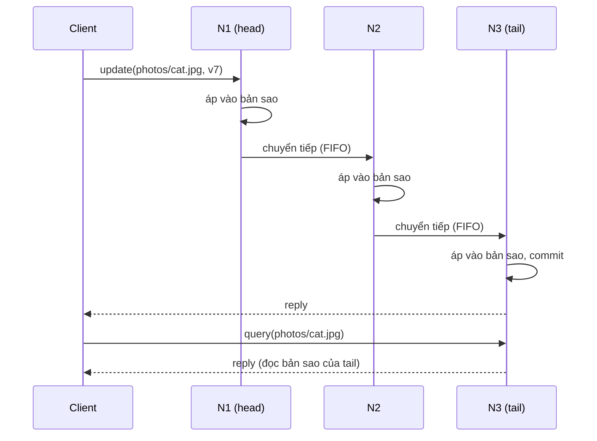

# P15 · Chương 08 — Chain replication và CRAQ

[Chương 05 của P12](../12-he-thong-du-lieu/05-replication.md) cho bạn thấy replication kiểu single-leader: một node nhận ghi, các node còn lại chép theo. [Chương 18 của P12](../12-he-thong-du-lieu/18-thuat-toan-dong-thuan.md) cho thấy khi muốn máy trạng thái nhân bản chịu lỗi *không cần* ai phát hiện lỗi hộ, ta phải trả giá bằng quorum 2f+1 và các thuật toán đồng thuận. Chain replication đi một hướng khác hẳn: nó xếp các replica thành một dây chuyền, tách việc *phát hiện lỗi và cấu hình lại* ra một dịch vụ ngoài, và đổi lại được strong consistency chỉ với f+1 replica. Chương này giảng cả hai thiết kế (chain replication của van Renesse và Schneider, rồi CRAQ của Terrace và Freedman) kèm chứng minh các bất biến, và nói rõ chúng đúng đến đâu ngoài đời.

Để câu nào cũng có chỗ bám, cả chương dùng một ví dụ giả định là `objmeta`, kho metadata của một hệ object storage nội bộ. Mỗi key kiểu `photos/cat.jpg` ánh xạ tới một bản ghi `{size, etag, version}`. Mỗi key thuộc về một chain gồm ba node `N1`, `N2`, `N3`. Tải của `objmeta` đọc nhiều hơn ghi rất nhiều, vì mỗi lượt tải ảnh đều tra metadata, còn ghi chỉ xảy ra lúc upload (nhận xét của người soạn: ví dụ giả định, không phải code trong repo; các con số của nó là giả định và được ghi rõ khi dùng).

## Bạn sẽ hiểu được gì

1. **Q1.** Chain replication tổ chức replica thế nào (head, tail), đường ghi và đường đọc đi ra sao, và vì sao tổ chức đó cho strong consistency? → mục 1
2. **Q2.** Khi head, tail hay một node ở giữa chết thì chain được sửa thế nào, và hai bất biến (Update Propagation, Inprocess Requests) chứng minh điều gì? → mục 2
3. **Q3.** Vì sao chain replication cần một master bên ngoài (chạy Paxos), và điều gì hỏng nếu master nhầm? → mục 3
4. **Q4.** So với primary-backup và quorum, chain replication được gì và mất gì về độ trễ, thông lượng, thời gian gián đoạn khi lỗi, và số node (f+1)? → mục 4
5. **Q5.** CRAQ làm cho mọi node trong chain đọc được mà vẫn strong consistency bằng cách nào (clean/dirty, version query), và vì sao đúng? → mục 5
6. **Q6.** CRAQ có những chế độ nhất quán nào, xử lý lỗi và thay đổi thành viên ra sao, và chạy nhiều datacenter thế nào? → mục 6
7. **Q7.** Hệ thống thật nào dùng chain replication, và bài học vận hành là gì? → mục 7

## Kiến thức cần trước

- [P12 · Chương 05 — Replication](../12-he-thong-du-lieu/05-replication.md): single-leader, primary-backup, quorum đọc ghi.
- [P12 · Chương 09 — Consistency và consensus](../12-he-thong-du-lieu/09-consistency-va-consensus.md): linearizability, CAP, total order broadcast.
- [P12 · Chương 18 — Thuật toán đồng thuận](../12-he-thong-du-lieu/18-thuat-toan-dong-thuan.md): vì sao 2f+1 node và quorum giao nhau; mục 1 là nền cho phép so sánh ở mục 4.
- [P12 · Chương 08 — Sự cố của hệ phân tán](../12-he-thong-du-lieu/08-su-co-he-phan-tan.md): không phân biệt được node chết với node chậm, lease, fencing.
- [P14 · Chương 01 — Logic và chứng minh](../14-toan-va-ly-thuyet/01-logic-va-chung-minh.md): quy nạp và bất biến quy nạp, cách ta chứng minh ở các mục 1, 2 và 5.
- Liên quan: [FLP và các chặn dưới](01-flp-va-cac-chan-duoi.md), [phân cấp consistency](03-phan-cap-consistency.md), [giao dịch phân tán](09-giao-dich-phan-tan.md).

---

## 1. Head, tail và vì sao dây chuyền cho strong consistency (Q1)

> **Trả lời ngắn.** Các replica của một object xếp thành một dây chuyền: ghi đi vào node đầu (head) rồi chảy tuần tự tới node cuối (tail), còn đọc chỉ hỏi tail, và tail cũng là node trả lời mọi request[^cr-roles][^cr-reply]. Vì mọi đọc và ghi của object đó cùng được xử lý tuần tự tại đúng một node là tail, thứ tự các thao tác rõ ràng và mọi lần đọc đều thấy kết quả của các ghi đã xong[^cr-strong-follows].

**Giải thích.**

*Với `objmeta`.* Giả sử client upload `photos/cat.jpg` và `objmeta` phải ghi `{size: 81920, etag: "a1", version: 7}`. Chain của key này là `N1 → N2 → N3`, với `N1` là head và `N3` là tail. Client gửi lệnh ghi cho `N1`. `N1` áp thay đổi vào bản sao của mình rồi chuyển tiếp cho `N2`; `N2` làm điều tương tự và chuyển cho `N3`. Khi `N3` đã áp xong thì ghi hoàn tất và chính `N3` trả lời client. Ngược lại, lệnh `HEAD photos/cat.jpg` đi thẳng tới `N3`, chỉ `N3` đọc bản sao của mình rồi trả lời.



(Sơ đồ minh họa của người soạn theo mô tả giao thức trong bài báo gốc.)

### 1.1 Bài toán mà chain replication giải

Bài báo gốc không nhắm tới database đầy đủ. Nó nhắm tới một "storage service" nằm giữa file system và database: lưu các object, có thao tác query trả về giá trị suy ra từ *một* object, và thao tác update thay đổi nguyên tử trạng thái của *một* object theo một phép tính định trước (có thể không xác định)[^cr-scope]. Một lệnh ghi file là trường hợp riêng của update này, và update lại là trường hợp riêng của transaction[^cr-scope2]. `objmeta` đúng là loại này: mỗi thao tác chỉ đụng một key.

Bài báo định nghĩa strong consistency bằng hai điều kiện: các thao tác query và update trên từng object được thực hiện theo một thứ tự tuần tự nào đó, và hiệu ứng của update chắc chắn có mặt trong kết quả của các query đến sau[^cr-strong-def]. Điều kiện thứ nhất chính là ý "linearizable theo từng object" trong [P12 · chương 09](../12-he-thong-du-lieu/09-consistency-va-consensus.md) (nhận xét của người soạn: bài báo không dùng chữ linearizability; phần chứng minh dưới đây phát biểu nó chính xác).

Mô hình lỗi là fail-stop: server dừng hẳn khi hỏng thay vì chuyển trạng thái sai, và môi trường phát hiện được trạng thái dừng đó[^cr-failstop]. Chương này dùng giả thiết ấy ở các mục 1 và 2; mục 3 hỏi điều gì xảy ra khi nó không thật sự đúng.

### 1.2 Hai đường đi

Ba quy tắc xác định giao thức. Thứ nhất, tail sinh và gửi câu trả lời cho mọi request[^cr-reply]. Thứ hai, mỗi query được gửi tới tail và xử lý nguyên tử trên bản sao của tail[^cr-query]. Thứ ba, mỗi update được gửi tới head, xử lý nguyên tử trên bản sao của head, rồi thay đổi trạng thái được chuyển tiếp qua một liên kết FIFO tin cậy tới phần tử kế tiếp, cứ thế cho tới tail[^cr-update].

Một hệ quả thực tế: head tính giá trị mới *một lần* rồi chuyển *kết quả* xuống chain, nên mỗi replica chỉ phải ghi, không phải tính lại. Vì vậy update có thể không xác định (ví dụ sinh etag ngẫu nhiên hay timestamp), vì lựa chọn không xác định chỉ được thực hiện một lần ở head[^cr-nondet]. Đây là lý do `objmeta` có thể để head tự điền `etag` hay `mtime` mà các replica không lệch nhau.

Còn việc client bị mất request hay mất câu trả lời? Bài báo xử lý theo kiểu end-to-end: storage service chỉ cần trả lời mọi request mà nó nhận và hoàn tất, còn client gửi lại nếu quá lâu chưa có trả lời, nhờ vậy cả request lẫn reply bị mất đều được xử lý[^cr-reissue]. Hệ quả là query thì idempotent, còn update thì không nhất thiết[^cr-idem]; client gửi lại một update không idempotent phải tự đảm bảo update chưa chạy rồi (ví dụ gửi kèm version mong đợi, nhận xét của người soạn).

### 1.3 Vì sao đúng: chứng minh strong consistency khi không có lỗi

Bài báo lập luận ngắn: query và update đều được xử lý tuần tự tại một server là tail[^cr-strong-follows]. Ta viết lại thành chứng minh đầy đủ. Đây là *chứng minh của người soạn*, bám lập luận trên và dùng định nghĩa linearizability quen thuộc.

**Mô hình.** Mỗi server `i` giữ `H_i`, dãy các update đã áp. Mỗi bước là nguyên tử: (a) head nhận update `r` từ client, thêm `r` vào `H_head` và đẩy `r` vào liên kết tới node kế; (b) node `i` lấy `r` ra khỏi liên kết đến, thêm vào `H_i`, đẩy tiếp (nếu không phải tail); (c) tail, ngay trong bước (b), gửi reply cho update; (d) tail nhận query và trả lời dựa trên `H_tail`. Chưa có lỗi nào.

**Định lý 1.** Trong mô hình trên, mỗi thao tác có thể gán một *điểm tuyến tính hóa* sao cho (i) điểm đó nằm giữa lúc client gọi và lúc client nhận reply; (ii) xếp các thao tác theo điểm đó thì mỗi query trả đúng giá trị của dãy các update đứng trước nó.

*Chứng minh.* Chọn điểm tuyến tính hóa của update `r` là bước tail thêm `r` vào `H_tail`, và của query `q` là bước tail trả lời `q`. Mọi điểm đó là bước của *một* server, nên chúng sắp tuyến tính theo thứ tự thực thi tại tail.

(i) Request tới tail (hoặc head rồi tail) chỉ sau khi client gọi, nên bước của tail xảy ra sau lúc gọi. Reply do tail gửi *sau* bước đó (quy tắc c và d), nên bước nằm trước lúc client nhận reply. Vậy điểm nằm trong khoảng cần có.

(ii) Giá trị object tại bất kỳ lúc nào, theo đặc tả, là kết quả áp các update trong `H_tail` theo thứ tự. Một query trả lời tại bước `s` đọc đúng `H_tail` lúc `s`, tức đúng dãy các update có điểm tuyến tính hóa trước `s`. Vậy kết quả khớp với thứ tự tuần tự đã chọn. ∎

Để ý điều chứng minh *không* nói: nó không nói gì về các update mà head đã nhận nhưng chưa tới tail. Những update đó chưa có điểm tuyến tính hóa, tức chưa "xảy ra". Chúng nằm trong tập Pending của đặc tả (bài báo biểu diễn thế này) và có thể bị bỏ mà không vi phạm đặc tả, điều quyết định cho cách xử lý lỗi ở mục 2.

<details><summary>Đi sâu: đặc tả "góc nhìn client" và ánh xạ của bài báo</summary>

Bài báo đặc tả object bằng hai biến: `Hist` là dãy update đã thực hiện, `Pending` là tập request chưa xử lý. Có ba chuyển trạng thái: T1 (request đến, thêm vào Pending), T2 (request trong Pending bị bỏ qua) và T3 (request được xử lý: bỏ khỏi Pending; nếu là update thì nối vào Hist; trả lời dựa trên Hist)[^cr-t123]. Khi cài bằng chain, `Hist` được định nghĩa là `Hist` lưu tại tail, còn `Pending` là tập request mà một server nào đó trong chain đã nhận nhưng tail chưa xử lý[^cr-t1]. Bài báo chứng minh mỗi bước của server trong chain tương đương với no-op hoặc một trong T1, T2, T3[^cr-t1]. Điểm hay là T2: việc "request bị bỏ qua" nằm sẵn trong đặc tả, nên mất một request đang bay trong chain không phải là lỗi mới mà client chưa từng thấy.

Bài báo còn lưu ý bản cài thật sẽ lưu giá trị hiện tại thay vì chuỗi update; dãy update chỉ để lập luận cho dễ[^cr-hist-note]. Với `objmeta`, `H_i` trong chương này nên đọc là "dãy các lần ghi mà node `i` đã áp", còn bản ghi thật chỉ là kết quả của việc áp chúng.

</details>

**Quay lại Q1:** Chain replication xếp replica thành dây chuyền, ghi vào head và chảy tới tail, đọc chỉ hỏi tail; vì tail là nơi duy nhất xếp thứ tự cho cả đọc lẫn ghi nên mỗi object có thứ tự tuần tự duy nhất, và Định lý 1 cho thấy đó là linearizability từng object khi chưa có lỗi.

---

## 2. Hỏng head, tail hay node giữa: hai bất biến và chứng minh (Q2)

> **Trả lời ngắn.** Master loại node hỏng khỏi chain: nếu head hỏng thì node kế thành head, nếu tail hỏng thì node trước thành tail, còn nếu node giữa hỏng thì node đứng trước nó phải gửi bù cho node đứng sau những update có thể bị rơi[^cr-head][^cr-tail][^cr-mid]. Cách làm đúng được đỡ bởi hai bất biến: mọi node đứng sau chỉ có một đoạn đầu của lịch sử của node đứng trước (Update Propagation Invariant), và lịch sử của node trước bằng lịch sử của node sau cộng với danh sách `Sent` những gì đã chuyển đi mà chưa chắc tới tail (Inprocess Requests Invariant).

**Giải thích.**

*Với `objmeta`.* Chain `N1 → N2 → N3` đang chạy và cả ba đã nhận nhiều update. Bỗng `N2` chết giữa chừng. Câu hỏi: một update đang nằm trong liên kết `N1 → N2` hay `N2 → N3` có mất không? Nếu `N1` cứ nối thẳng tới `N3` rồi tiếp tục chuyển các update mới thì `N3` sẽ bỏ sót những update rơi mất, và từ đó `N3` (nơi mọi query đọc) lệch hẳn với `N1`. Hai bất biến sinh ra để ngăn chuyện này.

### 2.1 Hai bất biến

Gọi các server theo thứ tự trong chain là `H, H+1, …, T` (đầu đến cuối). Vì update đi giữa các phần tử của chain qua liên kết FIFO tin cậy, dãy update mỗi server đã nhận là một đoạn đầu của dãy của server đứng *trước* nó. Bài báo phát biểu điều này thành bất biến[^cr-upi]:

> **Update Propagation Invariant (UPI).** Với hai server `i ≤ j` trong chain (i đứng trước j): `H_j` là tiền tố của `H_i`.

Hệ quả: tail có lịch sử *ngắn nhất*, head có dài nhất. Một lưu ý nhỏ: câu dẫn trong bài báo viết dãy của mỗi server là tiền tố của dãy của server đứng *sau* nó, ngược với phát biểu bất biến; phần chứng minh khi tail hỏng của chính bài báo chỉ khớp với chiều "lịch sử của server sau là tiền tố của server trước", vì nó nói đổi tail từ `T` sang predecessor "có thể làm tăng tập request tail đã hoàn tất"[^cr-tail-ext] (suy luận của người soạn: câu dẫn là lỗi đánh máy; chiều của bất biến mới là chiều đúng). Câu dẫn đó nguyên văn nằm ở chú thích bên.[^cr-upi-typo]

Để node giữa hỏng mà không phá UPI, mỗi server `i` giữ thêm danh sách `Sent_i` các update nó đã chuyển cho server sau mà có thể chưa được tail xử lý[^cr-sent]. Khi tail xử lý xong update `r`, nó gửi `ack(r)` về predecessor, và mỗi server nhận ack thì bỏ `r` khỏi `Sent` rồi chuyển ack lên predecessor[^cr-ack]. Từ đó bài báo kết luận bất biến thứ hai (đây là phát biểu bằng lời, công thức gốc là `H_i = H_j ⊕ Sent_i`, với `⊕` là hợp các dãy theo cùng thứ tự toàn phần của update):

> **Inprocess Requests Invariant.** Với `i ≤ j`, lịch sử của `i` chính là hợp của lịch sử `j` với `Sent_i`, sắp theo thứ tự chung.

Lý do trực quan: một request tới được tail thì đã tới mọi server đứng trước[^cr-inproc].

### 2.2 Chứng minh hai bất biến

Bài báo chỉ trình bày lập luận ngắn. Hai chứng minh dưới đây là *chứng minh của người soạn* trong mô hình ở §1.3 (chưa có lỗi), nhằm cho thấy bất biến "tự nhiên" đến mức nào.

**Bổ đề 1 (UPI).** Với `i < j` thì `H_j` là tiền tố của `H_i`.

*Chứng minh.* Gọi `M_i` là dãy các update đang nằm trong liên kết từ `i` sang `i+1`. Ta chứng minh bằng quy nạp theo số bước thực thi rằng `H_i = H_{i+1} · M_i` (nối dãy) với mọi cặp liền kề.

*Cơ sở:* ban đầu mọi thứ rỗng. *Bước quy nạp:* chỉ hai loại bước làm đổi các đại lượng này. (a) `i` thêm `r` vào `H_i` và đẩy `r` vào cuối `M_i`: cả hai vế cùng được nối thêm `r` ở cuối, đẳng thức giữ nguyên. (b) `i+1` lấy phần tử đầu `r` ra khỏi `M_i` rồi thêm vào `H_{i+1}`: `M_i` mất `r` ở đầu còn `H_{i+1}` được thêm `r` ở cuối, đẳng thức giữ nguyên vì `H_{i+1}·M_i` trước và sau bước đều là cùng một dãy (liên kết là FIFO nên phần tử lấy ra đúng là phần tử đầu).

Đẳng thức cho thấy `H_{i+1}` là tiền tố của `H_i`. Tính bắc cầu của quan hệ tiền tố cho kết luận với mọi `i < j`. ∎

**Bổ đề 2 (Inprocess).** Với `i < j`, tập phần tử của `H_i` bằng tập phần tử của `H_j` hợp `Sent_i`. (Thứ tự thì đã được Bổ đề 1 cố định: cả hai là tiền tố của nhau, nên "hợp theo thứ tự chung" chỉ còn là hợp tập hợp.)

*Chứng minh.* Mỗi server không phải tail thêm `r` vào `H_i` và chuyển `r` đi trong cùng một bước, nên `Sent_i = H_i \ A_i`, với `A_i` là tập update mà `i` đã nhận ack. Ack của `r` chỉ được sinh sau khi tail đã thêm `r` vào `H_T`, nên `A_i ⊆ H_T`. Theo Bổ đề 1, `H_T` là tiền tố của `H_j`, nên `A_i ⊆ H_j`.

Ta chứng minh hai chiều. (⊇) `H_j ⊆ H_i` do Bổ đề 1, và `Sent_i ⊆ H_i` theo định nghĩa. (⊆) Lấy `r ∈ H_i`. Nếu `r ∈ H_j` thì xong. Nếu `r ∉ H_j` thì `r ∉ A_i` (vì `A_i ⊆ H_j`) nên `r ∈ H_i \ A_i = Sent_i`. ∎

**Hệ quả (bền vững).** Nếu một update đã được tail trả lời client thì nó nằm trong `H_T`, nên theo Bổ đề 1 nằm trong `H_j` của *mọi* server trong chain. Nếu một chain có `t` server và tối đa `t − 1` server hỏng thì ít nhất một server còn sống, và server nào còn sống cũng chứa mọi update đã được xác nhận. Bài báo nêu cùng ý này như là điều kiện cho tính sẵn sàng: `t` server chịu được `t − 1` server hỏng[^cr-t1fail] (phần "lịch sử chỉ dài ra" là suy luận của người soạn: server fail-stop không mất trạng thái khi còn sống).

### 2.3 Ba trường hợp lỗi

**Head hỏng.** Master loại head khỏi chain và biến server kế thành head mới[^cr-head]. Các request mà head cũ đã nhận nhưng chưa chuyển đi biến mất khỏi `Pending`, đúng là chuyển T2 (bỏ qua request) của đặc tả nên không phá đặc tả[^cr-head-pending]. Với `objmeta`: client có upload đang treo thì hết giờ và gửi lại.

**Tail hỏng.** Master loại tail và biến predecessor thành tail mới[^cr-tail]. Vì `H_{T-}` đang dài hơn hoặc bằng `H_T` (UPI), đổi tail làm tập update "đã hoàn tất" lớn thêm[^cr-tail-ext]: những update mà predecessor đã có nhưng tail cũ chưa có giờ được coi là đã xử lý, đúng bằng một dãy bước T3. Query hỏi sau đó thấy trạng thái *kéo dài thêm* trạng thái mà query trước thấy, nên không có chuyện "đọc lùi thời gian" (suy luận của người soạn từ UPI).

**Node giữa hỏng.** Khó nhất: gọi `S-`, `S`, `S+` là ba node liên tiếp mà `S` hỏng. Master loại `S`[^cr-mid]. Nếu không làm gì thêm, UPI có thể vỡ vì các update `S` đã nhận trước khi hỏng sẽ không tới `S+`[^cr-mid-bad]. Cách chữa: `S-` phải gửi cho `S+` những update trong `Sent_{S-}` mà `S+` chưa có, rồi mới được xử lý và chuyển tiếp update mới. Bài báo mô tả thành bốn thông điệp: master báo `S+` vai trò mới, `S+` trả lời master số thứ tự `sn` của update cuối nó nhận được, master báo `S-` kèm `sn` để `S-` tính phần hậu tố của `Sent` cần gửi, và `S-` gửi hậu tố đó[^cr-msg2].

**Bổ đề 3 (node giữa).** Sau khi `S-` gửi hậu tố, UPI và Inprocess vẫn đúng. *Chứng minh (của người soạn, trong mô hình mà các thông điệp đang bay từ `S` tới `S+` bị bỏ khi `S+` được báo).* Trước khi hỏng, UPI cho `H_{S+} ⊑ H_S ⊑ H_{S-}`, nên `H_{S+}` vẫn là tiền tố của `H_{S-}`. Các update thuộc `H_{S-}` mà không thuộc `H_{S+}` cũng không thuộc `H_T` (vì `H_T` là tiền tố của `H_{S+}`), nên theo Bổ đề 2 chúng thuộc `Sent_{S-}`. Do đó phần hậu tố mà `S-` gửi (các phần tử của `Sent_{S-}` có số thứ tự lớn hơn `sn`) đúng bằng phần `H_{S-}` còn thiếu ở `S+`. Sau khi `S+` nhận xong, `H_{S+} = H_{S-}` (nếu `S-` chưa nhận update mới), và các update mới tiếp theo được đưa vào cả hai theo cùng thứ tự FIFO, nên Bổ đề 1 và Bổ đề 2 tiếp tục đúng. ∎

Việc bài báo cho `Sent` thêm ack nghĩa là chính ack bị mất khi `S` hỏng không làm sai gì: `Sent_{S-}` chỉ giữ thừa phần tử, và bất biến Inprocess dùng phép hợp nên thừa phần tử đã nằm trong `H_j` không làm đẳng thức sai (suy luận của người soạn).

**Thêm server.** Chain ngắn đi thì chịu lỗi kém đi, nên khi chain còn ngắn phải thêm server mới[^cr-extend]. Bài báo chọn thêm ở *cuối* chain cho đơn giản: tail hiện tại gửi toàn bộ bản sao cho tail mới trong khi vẫn phục vụ query và update, rồi chuyển vai trò[^cr-extend2]. Chuyện bài báo không xét thêm node ở vị trí khác chính là chỗ CRAQ phải làm thêm ở mục 6[^craq-join-orig].

### 2.4 Ví dụ có số: `N2` chết

Ta dựng một trạng thái cụ thể (giả định) của chain `N1 → N2 → N3` của `objmeta`. Các update được head gán số `1…4`. `N3` mới xử lý `1` và `2`, đã gửi `ack(1)` về, `ack(2)` còn đang bay tới `N2`. `N2` đã nhận `1, 2, 3` và update `3` đang trong liên kết `N2 → N3`. `N1` đã nhận cả bốn và update `4` đang trong liên kết `N1 → N2`:

| Node | `H` | `Sent` | Đang bay |
|---|---|---|---|
| `N1` | `[1,2,3,4]` | `{2,3,4}` | `4` tới `N2` |
| `N2` | `[1,2,3]` | `{2,3}` | `3` tới `N3`, `ack(2)` tới `N2` |
| `N3` | `[1,2]` | `{}` | |

Kiểm tra Inprocess: `H_{N1}` = `{1,2}` ∪ `{2,3,4}` = `{1,2,3,4}` đúng, và `H_{N2}` = `{1,2}` ∪ `{2,3}` = `{1,2,3}` đúng. Bây giờ `N2` chết, nên update `4` (tới `N2`) và `3` (từ `N2`) đều mất cùng `ack(2)`. Master báo `N3` trước: `sn = 2`. Rồi báo `N1` kèm `sn = 2`. `N1` lọc `Sent` giữ các số lớn hơn 2, tức `{3, 4}`, và gửi `3, 4` theo thứ tự cho `N3`. Sau khi `N3` xử lý, `H_{N3} = [1,2,3,4]` trùng `N1`. Nếu `N1` quên bước này, nó sẽ nối thẳng với `N3` và gửi update `5` tiếp theo: `N3` có `[1,2,5]` còn `N1` có `[1,2,3,4,5]`, UPI vỡ và các update `3, 4` bị mất vĩnh viễn ở `N3`.

Đây là một trường hợp, chưa phải bằng chứng cho mọi lịch chạy; phần Đi sâu cho một kiểm tra với hàng triệu lịch chạy ngẫu nhiên.

<details><summary>Đi sâu: mô phỏng chain với lỗi ngẫu nhiên, và phiên bản "quên Sent"</summary>

Chương trình `chain.rs` dưới đây dựng chain 4 server trong mô hình ở §1.3, cho mỗi lần chạy 40 bước ngẫu nhiên (client ghi, giao thông điệp tiến, giao ack, hoặc crash một server, tối đa 3 lần crash), và sau mỗi bước kiểm tra Bổ đề 1 (UPI), Bổ đề 2 (Inprocess) và tính bền vững (mọi update đã được xác nhận nằm trong `H` của mọi server còn sống). Chế độ `naive` bỏ bước gửi hậu tố `Sent` khi node giữa hỏng. Hai điều đơn giản hóa cần nói rõ: master cấu hình lại *nguyên tử* (bài báo dùng bốn thông điệp), và các ack bị mất cùng node hỏng không được bù nên `Sent` chỉ có thể thừa.

```rust
use std::collections::{BTreeSet, VecDeque};

struct Rng(u64);
impl Rng {
    fn next(&mut self) -> u64 { let mut x = self.0; x ^= x << 13; x ^= x >> 7; x ^= x << 17; self.0 = x; x }
    fn below(&mut self, n: usize) -> usize { (self.next() % n as u64) as usize }
}

#[derive(Default, Clone)]
struct Node { hist: Vec<u32>, sent: Vec<u32>, fwd: VecDeque<u32>, ack: VecDeque<u32> }

struct Chain { c: Vec<Node>, acked: BTreeSet<u32>, next_id: u32, naive: bool }

impl Chain {
    fn new(n: usize, naive: bool) -> Self { Chain { c: vec![Node::default(); n], acked: BTreeSet::new(), next_id: 1, naive } }
    fn update(&mut self) {
        let id = self.next_id; self.next_id += 1;
        self.c[0].hist.push(id);
        if self.c.len() == 1 { self.acked.insert(id); } else { self.c[0].sent.push(id); self.c[1].fwd.push_back(id); }
    }
    fn deliver_fwd(&mut self, k: usize) {
        let id = self.c[k].fwd.pop_front().unwrap();
        self.c[k].hist.push(id);
        if k + 1 == self.c.len() {
            self.acked.insert(id);
            if k > 0 { self.c[k - 1].ack.push_back(id); }
        } else { self.c[k].sent.push(id); self.c[k + 1].fwd.push_back(id); }
    }
    fn deliver_ack(&mut self, k: usize) {
        let id = self.c[k].ack.pop_front().unwrap();
        self.c[k].sent.retain(|&x| x != id);
        if k > 0 { self.c[k - 1].ack.push_back(id); }
    }
    fn crash(&mut self, k: usize) {
        self.c.remove(k);
        let len = self.c.len();
        if k < len { self.c[k].fwd.clear(); }            // messages from the dead predecessor are dropped
        if k >= 1 { self.c[k - 1].ack.clear(); }          // acks from the dead successor are dropped
        if k >= 1 && k < len && !self.naive {             // middle case: S- resends Sent beyond S+'s last sn
            let sn = self.c[k].hist.last().copied().unwrap_or(0);
            let suffix: Vec<u32> = self.c[k - 1].sent.iter().copied().filter(|&r| r > sn).collect();
            for r in suffix { self.c[k].fwd.push_back(r); }
        }
        let t = len - 1;                                   // tail: everything it holds is now committed
        self.c[t].ack.clear();
        let pend: Vec<u32> = std::mem::take(&mut self.c[t].sent);
        for r in pend { self.acked.insert(r); if t > 0 { self.c[t - 1].ack.push_back(r); } }
    }
    fn upi_ok(&self) -> bool {
        for i in 0..self.c.len() { for j in i + 1..self.c.len() {
            let (hi, hj) = (&self.c[i].hist, &self.c[j].hist);
            if hj.len() > hi.len() || hi[..hj.len()] != hj[..] { return false; }
        } } true
    }
    fn inproc_ok(&self) -> bool {
        for i in 0..self.c.len() { for j in i + 1..self.c.len() {
            let mut u: BTreeSet<u32> = self.c[j].hist.iter().copied().collect();
            u.extend(self.c[i].sent.iter().copied());
            let hi: BTreeSet<u32> = self.c[i].hist.iter().copied().collect();
            if u != hi { return false; }
        } } true
    }
    fn durable_ok(&self) -> bool {
        self.c.iter().all(|n| self.acked.iter().all(|a| n.hist.contains(a)))
    }
    fn quiesce(&mut self) {
        loop {
            let mut moved = false;
            for k in 0..self.c.len() {
                if !self.c[k].fwd.is_empty() { self.deliver_fwd(k); moved = true; break; }
                if !self.c[k].ack.is_empty() { self.deliver_ack(k); moved = true; break; }
            }
            if !moved { break; }
        }
    }
}

fn main() {
    for &naive in &[false, true] {
        let mut rng = Rng(0x9E3779B97F4A7C15);
        let (runs, len, max_crash) = (100_000, 4usize, 3usize);
        let (mut steps, mut crashes_h, mut crashes_m, mut crashes_t) = (0u64, 0u64, 0u64, 0u64);
        let (mut upi_bad, mut inp_bad, mut dur_bad, mut diverged, mut acked_total) = (0u64, 0u64, 0u64, 0u64, 0u64);
        for _ in 0..runs {
            let mut ch = Chain::new(len, naive);
            let mut crashes = 0;
            let (mut u, mut i, mut d) = (false, false, false);
            for _ in 0..40 {
                steps += 1;
                let r = rng.below(10);
                if r < 3 { ch.update(); }
                else if r < 4 && crashes < max_crash && ch.c.len() > 1 {
                    let k = rng.below(ch.c.len());
                    if k == 0 { crashes_h += 1 } else if k + 1 == ch.c.len() { crashes_t += 1 } else { crashes_m += 1 }
                    ch.crash(k); crashes += 1;
                } else {
                    let k = rng.below(ch.c.len());
                    if rng.below(2) == 0 { if !ch.c[k].fwd.is_empty() { ch.deliver_fwd(k) } }
                    else if !ch.c[k].ack.is_empty() { ch.deliver_ack(k) }
                }
                u |= !ch.upi_ok(); i |= !ch.inproc_ok(); d |= !ch.durable_ok();
            }
            ch.quiesce();
            u |= !ch.upi_ok(); i |= !ch.inproc_ok(); d |= !ch.durable_ok();
            let h0 = &ch.c[0].hist;
            if ch.c.iter().any(|n| &n.hist != h0) { diverged += 1; }
            acked_total += ch.acked.len() as u64;
            upi_bad += u as u64; inp_bad += i as u64; dur_bad += d as u64;
        }
        println!("mode={} runs={runs} steps={steps} crashes(head/mid/tail)={}/{}/{} acked_updates={acked_total}",
                 if naive { "naive(no Sent resend)" } else { "paper" }, crashes_h, crashes_m, crashes_t);
        println!("  runs violating UPI={upi_bad} Inprocess={inp_bad} durability={dur_bad} final-histories-differ={diverged}");
    }
}
```

Đã chạy với `rustc -O` (rustc 1.95.0, macOS). **Quan sát** một lần chạy, nguyên văn:

```text
mode=paper runs=100000 steps=4000000 crashes(head/mid/tail)=94448/79886/94007 acked_updates=886524
  runs violating UPI=0 Inprocess=0 durability=0 final-histories-differ=0
mode=naive(no Sent resend) runs=100000 steps=4000000 crashes(head/mid/tail)=94448/79886/94007 acked_updates=830258
  runs violating UPI=23209 Inprocess=0 durability=0 final-histories-differ=8463
```

Đọc kết quả: trong 100 000 lịch chạy có đủ ba loại crash, phiên bản có gửi bù `Sent` không vi phạm bất biến nào, còn phiên bản quên gửi bù vi phạm UPI ở 23 209 lịch và để các replica kết thúc với lịch sử khác nhau ở 8 463 lịch. Inprocess vẫn đúng ở bản `naive` vì `Sent` giữ lại các update không bao giờ được ack, nên tập vẫn khớp; cái vỡ là thứ tự và tính tiền tố. Đây chỉ là phép thử trên mô hình của người soạn, không phải chứng minh.

</details>

**Quay lại Q2:** Mỗi loại lỗi được xử lý bằng cách cắt node khỏi chain và nối lại; UPI bảo đảm lịch sử node sau luôn là tiền tố của node trước, `Sent` cùng Inprocess bảo đảm node trước biết phải gửi bù gì khi nối qua chỗ trống, nên mọi update đã được xác nhận vẫn còn ở mọi server sống.

---

## 3. Vì sao cần master bên ngoài, và chuyện gì nếu master nhầm (Q3)

> **Trả lời ngắn.** Chain replication giả định có ai đó phát hiện chính xác server nào đã dừng và cho mọi server cùng biết chain mới[^cr-failstop]. Việc đó giao cho một master; bản mẫu của bài báo nhân bản master trên nhiều host bằng Paxos để nó hành xử như một process không bao giờ hỏng[^cr-master-paxos]. Mạng thật không phân biệt được node chết với node chậm hay bị chia cắt, nên nếu master nhầm thì bất biến vẫn đúng *giả định* nhưng chain thật đã chia đôi, và strong consistency có thể mất.

**Giải thích.**

*Với `objmeta`.* Thử hình dung `N3` bị treo 8 giây vì GC pause hoặc switch quá tải (nhận xét của người soạn: ví dụ giả định, chuyện này mô tả trong [P12 · chương 08](../12-he-thong-du-lieu/08-su-co-he-phan-tan.md)). Master không nhận heartbeat nên coi `N3` đã chết, đặt `N2` làm tail và báo client. Nhưng `N3` vẫn sống: client nào còn cache cấu hình cũ vẫn hỏi `N3`. Cùng lúc `N2` đã nhận update mới mà `N3` không thấy. Đến đây có *hai* tail, và một query tới `N3` trả bản cũ dù update đã được xác nhận cho client khác. Đó chính là điều strong consistency cấm.

### 3.1 Master làm gì

Trong bài báo, master làm ba việc: phát hiện server hỏng, báo từng server trong chain biết predecessor hoặc successor mới sau khi loại server hỏng, và báo client ai là head, ai là tail[^cr-master-role]. Bài báo trình bày mọi thứ với giả định master là một process không bao giờ hỏng, và nói thẳng đó không phải giả định thực tế[^cr-master-single]. Bản mẫu thật nhân bản master trên nhiều host và dùng Paxos để các bản sao hành xử như một process không hỏng[^cr-master-paxos].

Hãy nhìn phân công này như sau (nhận xét của người soạn). Dữ liệu của `objmeta`, lớn và nóng, nằm trên các chain với `t = 3` replica. Còn quyết định *ai nằm trong chain nào* nhỏ và hiếm đổi, được đẩy lên một nhóm nhỏ chạy đồng thuận (ví dụ 3 hoặc 5 node). Số node chạy đồng thuận không phụ thuộc số object hay kích thước dữ liệu.

### 3.2 Góc nhìn Vertical Paxos

Lamport, Malkhi và Zhou chỉ ra rằng đây chính là một trường hợp của họ giao thức Vertical Paxos. Trong họ này, một ballot cần quorum ghi của chính nó và quorum đọc của ballot trước; quorum đọc và quorum ghi phải giao nhau, nên có sự đánh đổi: quorum đọc càng nhỏ thì quorum ghi càng lớn[^vp-tradeoff]. Cực trị thú vị nhất là cho quorum đọc nhỏ nhất có thể, một acceptor bất kỳ, và khi ấy quorum ghi duy nhất là tập mọi acceptor[^vp-extreme]. Đó là primary-backup. Cùng bài báo viết rõ: Chain Replication dùng master bên ngoài để cấu hình lại và theo giao thức Vertical Paxos II, chỉ giữ một cấu hình hoạt động[^vp-chain].

Nói cách khác, chain "rẻ" ở đường dữ liệu (ghi vào *tất cả* t node và đọc từ *một* node) vì nó dồn phần khó, tức việc đồng ý về cấu hình, cho master. Số node dữ liệu giảm xuống f+1 (mục 4) nhưng hệ thống vẫn cần đồng thuận ở đâu đó (suy luận của người soạn từ hai nguồn trên). Còn vì sao đồng thuận không thể bỏ hẳn: xem [chương 01 của P15](01-flp-va-cac-chan-duoi.md) về FLP, và [P12 · chương 18](../12-he-thong-du-lieu/18-thuat-toan-dong-thuan.md) về quorum.

### 3.3 Khi giả thiết fail-stop không đúng

Fritchie, người xây Hibari (kho key-value dùng chain replication, xem mục 7), nói thẳng: bài báo gốc có hai khẳng định "cực kỳ có vấn đề ngoài đời", là server fail-stop và trạng thái dừng của server phát hiện được; nếu một trong hai bị vi phạm thì hệ thống có thể nhanh chóng ra quyết định sai gây mất dữ liệu. Vấn đề lớn nhất là network partition[^frit-problem]. Chỉ bằng truyền thông điệp thì không thể phân biệt partition, node hỏng và node rất chậm[^frit-indist].

Cách Hibari đối phó: chạy một ứng dụng "partition detector" theo dõi hai mạng vật lý để đoán partition; khi nghi có partition, nó có thể hủy khởi tạo Admin Server (thành phần đóng vai master) và giao cho người quản trị xử lý[^frit-partdet]. Với phía còn lại của partition, Hibari tài liệu hóa hành vi: các brick nằm ở phía không có master đang hoạt động bị loại khỏi chain để giữ strong consistency[^hibari-cp]. Nói gọn là Hibari chọn C và P của CAP, nên hy sinh tính sẵn sàng ở phía không có master.

Có hai bài học đáng chép. Một: Hibari chạy một Admin Server *duy nhất* chứ không phải nhóm Paxos, và các tác giả nhận trong hồi cứu rằng Admin Server đơn này gặp nhiều vấn đề trong production hơn họ dự tính[^frit-single-prob]. Nhưng cũng chính họ cho rằng một manager phân tán nhiều khả năng cũng bị đánh lừa bởi cùng những điều kiện mạng và quyết định sai tương tự[^frit-distributed]. Hai: một instance duy nhất có lợi ích là hành vi khi partition dễ suy luận, vì quản trị viên biết Admin Server có thể chạy ở đâu[^frit-single-entity].

<details><summary>Đi sâu: biện pháp chặn "hai tail" (suy luận của người soạn, chưa có nguồn riêng cho chain)</summary>

Nguồn trong chương không mô tả cơ chế cụ thể để chặn một tail cũ (như `N3` ở ví dụ) tiếp tục phục vụ query. Cơ chế quen thuộc trong hệ phân tán là gắn *epoch* (số hiệu cấu hình) vào mọi thông điệp và cho mỗi server tự ngừng phục vụ khi quá lâu không nghe master, như lease và fencing token ở [P12 · chương 08](../12-he-thong-du-lieu/08-su-co-he-phan-tan.md). Áp dụng vào chain: server chỉ trả lời query nếu còn trong một lease hợp lệ do master cấp, và master chỉ đặt tail mới sau khi lease của tail cũ chắc chắn hết hạn. Nhưng đây là suy luận của người soạn, không phải điều bài báo chain replication phát biểu; bài báo giả định fail-stop có phát hiện tin cậy[^cr-failstop]. Lease cũng dựa vào giả thiết về đồng hồ, nên không loại bỏ hoàn toàn giả thiết thời gian.

Vertical Paxos nêu một ý tương tự cho primary-backup: primary có thể đọc local nhưng chỉ khi nó giữ lease cho phép trả lời trực tiếp, và primary mới chưa được chọn trước khi lease cũ hết hạn[^vp-lease].

</details>

**Quay lại Q3:** Chain replication chỉ đúng nếu có ai đó quyết định chính xác ai còn trong chain; đó là master, nhân bản bằng Paxos trong bản mẫu của bài báo, và khi mạng chia cắt khiến master nhầm thì phải dựa vào cơ chế ngoài giao thức chain (như partition detector hay lease) để tránh hai tail cùng phục vụ.

---

## 4. So với primary-backup và quorum: độ trễ, thông lượng, f+1 node (Q4)

> **Trả lời ngắn.** Chain replication là một dạng primary-backup trong đó vai trò sắp thứ tự của primary được chia cho head (sắp update) và tail (sắp query)[^cr-pb-form][^cr-pb-share]. Được: đọc chỉ một node và không bị chặn bởi ghi đang chạy, tải ghi chia đều, gián đoạn khi lỗi ngắn hơn. Mất: update đi tuần tự nên độ trễ ghi tỷ lệ với *tổng* độ trễ các node chứ không phải node chậm nhất[^cr-pb-latency], và không xử lý partition. Số node: chain chịu t−1 lỗi với t node, còn quorum đa số cần 2f+1 node để chịu f lỗi.

**Giải thích.**

### 4.1 Bốn phương án trên `objmeta`

Ta so ba cách giữ `objmeta` strong consistent và một biến thể của chain (CRAQ, mục 5), với `t = 3` replica. Các con số định lượng dưới đây là công thức hay giả định của người soạn trừ khi có chú thích.

| Tiêu chí | Primary-backup | Chain replication | Quorum (R+W>N, N=2f+1) |
|---|---|---|---|
| Ghi | primary gửi song song tới các backup, chờ ack hết | tuần tự `head → … → tail` | gửi song song, chờ W ack |
| Đọc | primary (phải chờ ack của update trước) | tail, không bị chặn bởi ghi | đọc R node, so version |
| Độ trễ ghi (số bước mạng, t=3) | 4 | 4 | 4 |
| Độ trễ ghi (số lần ghi đĩa nối tiếp) | 1 | t = 3 | 1 (song song) |
| Số node chịu f lỗi | f+1 (tốt nhất) | f+1 (t = f+1) | 2f+1 |
| Cần master/failure detector ngoài | có | có | không |
| Chịu partition | cần master quyết định ai còn sống, như chain (suy luận của người soạn) | không graceful[^cr-part]; Hibari bỏ phía không có master[^hibari-cp] | có, phía đa số (xem P12·18) |

### 4.2 Độ trễ ghi

Bài báo nói rõ: chain phân tán update *tuần tự* nên có độ trễ cao hơn primary-backup phân tán *song song*; với phân tán song song thời gian trả lời tỷ lệ với độ trễ lớn nhất của một backup còn sống, còn tuần tự thì tỷ lệ với tổng các độ trễ[^cr-pb-latency].

Với `objmeta`, đặt `δ` là độ trễ một chiều giữa hai node và `w` là thời gian ghi bền một bản ghi (fsync). Chain đi qua `t + 1` chặng mạng (client tới head, `t − 1` chặng giữa các node, tail tới client) và `t` lần ghi nối tiếp. Primary-backup với `t = 3` đi client→primary→backup→primary→client, tức bốn chặng, và primary ghi song song với backup nên chỉ tốn một `w` trên đường găng. Với `δ = 0,25 ms` và `w = 1 ms` (giả định), chain tốn `4δ + 3w = 4 ms`, primary-backup tốn `4δ + w = 2 ms`; chain chậm gấp đôi. Công thức là của người soạn, chưa đo.

Số của chính bài báo, từ mô phỏng của họ: với chain ba server, độ trễ update tổng cộng là 94 ms, gồm 1 ms tin nhắn client tới head, 50 ms xử lý update ở head, 20 ms mỗi server còn lại xử lý thông điệp sai khác, cộng ba lần chuyển tiếp 1 ms[^cr-example94]. Query chỉ tốn 7 ms[^cr-example7]. Các số này là tham số mô phỏng dựa trên dữ liệu của một web search index, không phải số đo phần cứng hiện đại.

### 4.3 Thông lượng

Về thông lượng, bài báo thấy chain bằng hoặc hơn primary-backup với mọi tỷ lệ update và mọi hệ số nhân bản đã thử[^cr-sim-eq]. Lý do họ nêu: head và tail của chain chia nhau phần việc mà ở primary-backup chỉ primary gánh[^cr-sim-share]. Thêm nữa, thông lượng của cả hai phương án không phụ thuộc hệ số nhân bản miễn là có đủ request đồng thời để pipeline[^cr-sim-pipe]. Đây là kết quả mô phỏng trên mạng băng thông vô hạn với độ trễ 1 ms mỗi thông điệp[^cr-sim-net], nên đừng đọc nó như số liệu production.

Ý nghĩa kiến trúc (nhận xét của người soạn): ở chain, mỗi node nhận đúng một luồng update từ node trước và gửi một luồng tới node sau, không có node nào phải fan-out tới `t − 1` backup như primary.

### 4.4 Gián đoạn khi có lỗi

Bài báo đếm số "độ trễ thông điệp" mà client bị gián đoạn, giả sử lỗi đã được phát hiện: head hỏng thì update không dùng được trong 2 độ trễ, query vẫn chạy[^cr-outage-head]; tail hỏng thì cả query và update không dùng được trong 2 độ trễ[^cr-outage-tail]; node giữa hỏng thì query vẫn chạy, và update có thể bị chậm bởi giao thức 4 độ trễ nhưng không mất[^cr-outage-mid]. Primary-backup khi primary hỏng gián đoạn 5 độ trễ[^cr-outage-pb]. Kết luận của bài báo: trường hợp tệ nhất của chain (tail hỏng) không bao giờ dài bằng trường hợp tệ nhất của primary-backup (primary hỏng)[^cr-worst]. Nhưng họ cũng nói phần lớn thời gian gián đoạn là phát hiện lỗi, và phần này giống hệt ở hai phương án[^cr-detect]. Ngoài đời, 10 giây phát hiện lỗi của bài báo lấn át vài độ trễ thông điệp (nhận xét của người soạn).

### 4.5 Số node và so với quorum

Chain với `t` server chịu được `t − 1` server hỏng[^cr-t1fail], tức f lỗi cần f+1 server. Vertical Paxos giải thích vì sao có thể rẻ vậy: nếu quorum đọc chỉ là một acceptor thì quorum ghi buộc là toàn bộ acceptor, và đó là quorum cho phép chịu k lỗi với chỉ k+1 acceptor[^vp-extreme]. Còn quorum đa số kiểu Paxos và Raft thì hai quorum bất kỳ phải giao nhau, nên cần 2f+1 node cho f lỗi dừng (xem [P12 · chương 18, mục 1](../12-he-thong-du-lieu/18-thuat-toan-dong-thuan.md)). Cái giá của f+1 là bắt *mọi* node còn sống phải xác nhận mỗi ghi; một node chậm làm chậm ghi cho tới khi master loại nó (đúng như CRAQ đo: ghi không commit được từ lúc replica hỏng tới lúc nó bị loại khỏi chain vì timeout[^craq-writes-stall]), trong khi quorum đa số bỏ qua node chậm nhất mà không cần ai phát hiện lỗi.

Về hiệu quả so với quorum, bài báo dẫn kết quả rằng các cách tiếp cận ROWAA (đọc một, ghi tất cả các node đang còn sống) có thông lượng tốt hơn các hệ quorum tốt nhất được biết, trừ ứng dụng gần như chỉ ghi[^cr-rowaa], và cũng nêu lập luận rằng độ sẵn sàng của ROWAA tốt hơn[^cr-rowaa2]. Chain replication là một ví dụ của ROWAA[^cr-rowaa-def]. Cái bù lại: chain không xử lý partition một cách duyên dáng, nó đổi điều đó lấy hiệu năng cao, khả năng mở rộng và strong consistency[^cr-part].

<details><summary>Đi sâu: vì sao đọc ở primary-backup khó hơn đọc ở tail</summary>

Bài báo chỉ ra primary-backup phải đợi ack từ backup cho các update trước đó rồi mới trả lời query[^cr-pb-query]; còn query trong chain chỉ dính một server (tail) và không bị chậm bởi hoạt động ở nơi khác trong chain[^cr-pb-query2]. Lý do cơ bản: tail chỉ chứa các update *đã* commit, còn primary chứa cả update chưa được backup xác nhận. Đây cũng là chỗ mà CRAQ (mục 5) tìm cách khai thác để đọc ở mọi node: node giữa chứa cả update chưa commit nên phải tự hỏi tail trước.

Bài báo cũng giới thiệu hai biến thể "weak" cho mô phỏng (query tới server bất kỳ), bỏ strong consistency, và thấy chúng thua chain thường khi có hơn 15% update vì head phải gánh thêm query[^cr-weak]. Từ đó họ kết luận ít có chỗ nào đáng chọn các phương án yếu này, điều mà CRAQ phản biện bằng cách cho đọc từ mọi node mà không bỏ strong consistency.

</details>

**Quay lại Q4:** So với primary-backup, chain đổi độ trễ ghi cao hơn (nối tiếp thay vì song song) lấy đọc rẻ, tải ghi chia đều và gián đoạn ngắn hơn khi lỗi; so với quorum, nó cần f+1 thay vì 2f+1 node dữ liệu nhưng cần master phát hiện lỗi và không chịu partition.

---

## 5. CRAQ: cho mọi node đọc mà vẫn đúng (Q5)

> **Trả lời ngắn.** CRAQ giữ nguyên đường ghi của chain nhưng cho *mọi* node trả lời đọc. Mỗi node giữ nhiều phiên bản của một object, mỗi phiên bản đánh dấu clean (đã commit ở tail) hoặc dirty (chưa); node có bản mới nhất là clean thì trả luôn, còn nếu là dirty thì hỏi tail số phiên bản đã commit của nó rồi trả đúng phiên bản đó[^craq-rules]. Nhờ vậy khối lượng đọc được chia cho cả chain, và với tải đọc nhiều thông lượng đọc tăng tuyến tính theo độ dài chain.

**Giải thích.**

*Với `objmeta`.* Giả sử một key nóng như `photos/cat.jpg` được đọc hàng chục nghìn lần mỗi giây, còn ghi thì vài lần mỗi giờ. Với chain thường, cả luồng đọc dồn vào `N3`, trong khi `N1` và `N2` chỉ ngồi chép dữ liệu. CRAQ chia luồng đọc cho cả ba, và chỉ khi key đang được ghi dở thì node đọc mới phải hỏi `N3`.

### 5.1 Vấn đề của chain thường

Các tác giả CRAQ chỉ ra hai điểm yếu của chain gốc: mọi lần đọc một object phải tới cùng một node nên dễ thành điểm nóng, và nếu chain trải qua nhiều datacenter thì mọi lần đọc phải tới tail có thể ở rất xa[^craq-hotspot]. Đặt nhiều chain trên cụm bằng consistent hashing không đủ nếu một số object đặc biệt phổ biến[^craq-hotspot2].

Họ cũng nhấn mạnh phạm vi: object store chỉ cần suy luận về thứ tự các thao tác trên từng object, và bảo đảm nhất quán theo từng object rẻ hơn đáng kể so với trên mọi thao tác hoặc mọi object[^craq-peobj]. Đó là mô hình của `objmeta` ở trên.

### 5.2 Cơ chế

CRAQ mở rộng chain ở bốn điểm. Thứ nhất, mỗi node lưu nhiều phiên bản của một object, mỗi phiên bản mang nhãn clean hoặc dirty[^craq-versions]. Thứ hai, khi node nhận phiên bản mới do ghi truyền xuống, nó thêm vào danh sách; nếu không phải tail thì đánh dirty và chuyển tiếp, còn tail thì đánh clean và coi phiên bản đã commit rồi gửi ack ngược lên chain[^craq-write]. Thứ ba, khi ack của một phiên bản tới node, node đánh phiên bản đó clean và xóa các phiên bản cũ hơn. Thứ tư là luật đọc: nếu phiên bản mới nhất là clean thì trả luôn; nếu là dirty thì gửi *version query* cho tail để lấy số phiên bản commit cuối rồi trả đúng phiên bản đó[^craq-readrule].

Trạng thái clean hay dirty còn xác định ngầm được: nếu node chỉ có đúng một phiên bản của object thì nó clean, ngược lại là dirty[^craq-implicit]. Khi một node clean nhận đọc trong lúc ghi đang truyền, nó trả bản cũ ngay và đó là đúng vì bản mới chưa commit ở tail[^craq-clean-ok]. Khi node dirty nhận đọc, nó gửi version query và nhận về số phiên bản mà tail đã commit[^craq-dirty-ok].

Trên `objmeta`, xét key `photos/cat.jpg` đang ở phiên bản `v1` clean ở cả ba node, rồi client ghi `v2`:

| Thời điểm | `N1` | `N2` | `N3` | Đọc tại `N1` | Đọc tại `N2` | Đọc tại `N3` |
|---|---|---|---|---|---|---|
| trước ghi | `[v1]` clean | `[v1]` clean | `[v1]` clean | `v1` ngay | `v1` ngay | `v1` ngay |
| head nhận `v2` | `[v1,v2]` dirty | `[v1]` | `[v1]` | hỏi `N3`, được `v1` → trả `v1` | `v1` ngay | `v1` ngay |
| `N2` nhận `v2` | `[v1,v2]` dirty | `[v1,v2]` dirty | `[v1]` | hỏi `N3` → `v1` | hỏi `N3` → `v1` | `v1` ngay |
| `N3` commit `v2` | dirty | dirty | `[v2]` clean | hỏi `N3` → `v2` | hỏi `N3` → `v2` | `v2` ngay |
| ack tới `N2`, rồi `N1` | `[v2]` clean | `[v2]` clean | `[v2]` clean | `v2` ngay | `v2` ngay | `v2` ngay |

Cột "Đọc tại" là kết quả theo luật trên (bảng của người soạn). Để ý hai điều: không lúc nào bất kỳ node nào trả `v2` trước khi `N3` commit, và từ lúc `N3` commit `v2`, mọi node trả `v2` hoặc, nếu chưa nhận ack, hỏi `N3` để biết `v2`.

### 5.3 Vì sao đúng

Bài báo lập luận rằng một node hỏi version query rồi trả đúng phiên bản đó thì mọi node trong chain vẫn trả cùng một phiên bản dù có nhiều ghi đang bay[^craq-same]. Ta chứng minh chặt hơn. Đây là *chứng minh của người soạn* trong mô hình không lỗi, thông điệp giữa hai node đi theo FIFO, mỗi bước nguyên tử.

Gọi `c(τ)` là số phiên bản mà tail đã commit tại thời điểm `τ`. Gọi `L_i` là phiên bản mới nhất của node `i`, `K_i` là phiên bản clean mới nhất của `i` (phiên bản mới nhất mà `i` đã nhận ack).

**Bổ đề 4 (hai bất đẳng thức).** Với mọi node `i` không phải tail và mọi thời điểm: `K_i ≤ c ≤ L_i`.

*Chứng minh.* `K_i ≤ c`: ack của phiên bản `v` chỉ được sinh sau khi tail commit `v`, nên `K_i` không vượt `c`. `c ≤ L_i`: tail chỉ commit `v` sau khi `v` đã đi qua mọi node đứng trước nó (ghi truyền tuần tự từ head), nên `i` đã nhận `v` trước, tức `L_i ≥ v` với mọi `v` đã commit. ∎

**Hệ quả 1.** Nếu phiên bản mới nhất của `i` là clean (`L_i = K_i`) thì `L_i = c`: nó chính là phiên bản đã commit ở tail *vào đúng lúc đó*. (Từ `K_i ≤ c ≤ L_i = K_i`.)

**Định lý 2.** Mỗi lần đọc strong trả một phiên bản `v` sao cho tồn tại thời điểm `τ` trong khoảng từ lúc gọi tới lúc có kết quả với `c(τ) = v`. Do đó có thể gán điểm tuyến tính hóa tại `τ`, và đọc là linearizable cùng các ghi (điểm của ghi là lúc tail commit).

*Chứng minh.* Hai trường hợp.

*Đường clean:* node `i` trả `L_i` ngay trong một bước. Theo Hệ quả 1, `L_i = c(τ)` với `τ` là chính bước đó. Tail luôn thuộc trường hợp này: nó commit ngay khi nhận, nên `L_T = c`.

*Đường dirty:* `i` gửi version query, tail trả lời tại thời điểm `τ_q` giá trị `c_q = c(τ_q)`, và `τ_q` nằm trong khoảng của lệnh đọc. Khi `i` xử lý trả lời, có hai khả năng. Nếu `i` còn giữ phiên bản `c_q` thì trả nó, và điểm tuyến tính hóa là `τ_q`. Nếu ack của một phiên bản `c' > c_q` đã tới `i` và xóa mất `c_q` (ack xóa mọi phiên bản cũ hơn), thì `i` trả `K_i = c'`. Phiên bản `c'` đã được tail commit tại một thời điểm `τ_c`; vì `c' > c_q = c(τ_q)` nên `τ_c > τ_q`, và vì ack tới `i` sau khi tail commit nên `τ_c` trước lúc `i` trả lời. Vậy `τ_c` nằm trong khoảng của lệnh đọc, và `c(τ_c) = c'`.

Tính tuyến tính hóa: lấy điểm `τ` như trên cho mỗi lệnh đọc và điểm commit cho mỗi ghi. Nếu lệnh đọc `A` kết thúc trước khi `B` bắt đầu thì `τ_A ≤` thời điểm kết thúc `A` `<` thời điểm bắt đầu `B ≤ τ_B`; `c` không giảm nên `v_B ≥ v_A`. Một ghi đã được xác nhận trước lúc `B` bắt đầu thì có `c ≥` phiên bản đó tại `τ_B`, nên `B` thấy nó. ∎

Nhánh thứ hai của chứng minh (ack tới trước khi xử lý trả lời) là một chi tiết mà bài báo không nêu: nó viết rằng theo cách xây dựng node đảm bảo đang lưu phiên bản đó[^craq-guar], còn việc node có thể đã xóa phiên bản này do một ack đến trước là suy luận của người soạn; kết quả vẫn đúng vì trả phiên bản clean mới hơn cũng là đúng như đã chứng minh. Bài báo cũng ghi nhận rằng tail có thể commit phiên bản mới giữa lúc nó trả version query và lúc node trả lời client, mà không vi phạm định nghĩa strong consistency vì các lần đọc được tuần tự hóa theo tail[^craq-race].

Một lưu ý nữa: bài báo thừa nhận một điểm tinh tế. Trong chain thường tail tuần tự hóa tường minh cả đọc lẫn ghi; ở CRAQ các lần đọc clean tại các node khác nhau chạy cục bộ nên hệ không *tường minh* định ra thứ tự toàn phần cho các lần đọc đồng thời đó, nhưng quan hệ đọc-ghi, ghi-đọc, ghi-ghi vẫn được tuần tự hóa tại tail[^craq-caveat]. Chứng minh trên đã cho thứ tự: sắp theo `τ`, hòa thì tùy ý.

### 5.4 Con số của bài báo

CRAQ có hai kịch bản tăng thông lượng so với CR: với tải đọc nhiều, hầu hết đọc do `C − 1` node không phải tail xử lý như đọc clean nên thông lượng tăng tuyến tính theo độ dài chain `C`[^craq-readmostly]; với tải ghi nhiều, hầu hết đọc ở non-tail là dirty và cần version query, nhưng các tác giả cho rằng version query nhẹ hơn một lần đọc đầy đủ nên tail xử lý được ở tốc độ cao hơn nhiều[^craq-writeheavy]. Trên Emulab với chain ba node, 500 byte, đọc chỉ-đọc gấp ba lần CR; khi ghi dồn dập CRAQ vẫn khoảng gấp đôi: trung vị 59.882 so với 20.552 lần đọc mỗi giây lúc đầu, rồi còn 39.873 so với 20.430[^craq-numbers]. Tổng kết của họ: tăng 200% với chain ba node và 600% với bảy node khi ít ghi[^craq-concl]. Môi trường đo rất cũ (máy 3 GHz, 2 GB RAM, mạng 100 Mbit)[^craq-testbed] nên đọc con số này như tỷ lệ chứ không phải thông lượng tuyệt đối.

<details><summary>Đi sâu: mô phỏng CRAQ, đọc strong so với đọc "newest local"</summary>

Chương trình `craq.rs` dựng chain 4 node, không lỗi, thông điệp FIFO, trộn ghi ở head, giao thông điệp, giao ack, bắt đầu đọc và các bước của đọc dirty (gửi version query, tail trả lời, node nhận trả lời) theo thứ tự ngẫu nhiên. Với mỗi lần đọc nó kiểm tra phiên bản trả về có nằm giữa `c` lúc bắt đầu và `c` lúc kết thúc không (Định lý 2), có phiên bản chưa commit không, và với mọi cặp đọc `A` kết thúc trước `B` bắt đầu thì `v_B ≥ v_A` không. Chế độ eventual trả phiên bản mới nhất node đang có, kể cả dirty.

```rust
use std::collections::VecDeque;

struct Rng(u64);
impl Rng {
    fn next(&mut self) -> u64 { let mut x = self.0; x ^= x << 13; x ^= x >> 7; x ^= x << 17; self.0 = x; x }
    fn below(&mut self, n: usize) -> usize { (self.next() % n as u64) as usize }
}

#[derive(Clone)]
struct Node { vers: Vec<u32>, clean_upto: u32, fwd: VecDeque<u32>, ack: VecDeque<u32> }
impl Node {
    fn new() -> Self { Node { vers: vec![0], clean_upto: 0, fwd: VecDeque::new(), ack: VecDeque::new() } }
    fn latest(&self) -> u32 { *self.vers.last().unwrap() }
    fn is_clean(&self) -> bool { self.latest() == self.clean_upto }
    fn on_ack(&mut self, v: u32) { self.clean_upto = self.clean_upto.max(v); self.vers.retain(|&x| x >= v); }
}

#[derive(Clone, Copy, PartialEq)]
enum St { QuerySent, Reply(u32) }
struct Read { node: usize, lo: u32, start: u64, st: St }

fn main() {
    for &strong in &[true, false] {
        let mut rng = Rng(0xD1B54A32D192ED03);
        let (runs, n) = (100_000usize, 4usize);
        let (mut reads_done, mut bad_range, mut bad_mono, mut local_clean, mut via_query, mut race) = (0u64, 0u64, 0u64, 0u64, 0u64, 0u64);
        let mut ahead = 0u64;
        for _ in 0..runs {
            let mut c: Vec<Node> = (0..n).map(|_| Node::new()).collect();
            let mut next_v = 1u32;
            let mut committed = 0u32; // tail's latest
            let mut pending: Vec<Read> = Vec::new();
            let mut done: Vec<(u64, u64, u32)> = Vec::new(); // (start, end, version)
            let mut t = 0u64;
            for _ in 0..60 {
                t += 1;
                match rng.below(8) {
                    0 | 1 => { // write at head
                        let v = next_v; next_v += 1;
                        c[0].vers.push(v); c[1].fwd.push_back(v);
                    }
                    2 | 3 => { // deliver forward
                        let k = rng.below(n);
                        if let Some(v) = c[k].fwd.pop_front() {
                            c[k].vers.push(v);
                            if k + 1 == n { c[k].on_ack(v); committed = v; c[k - 1].ack.push_back(v); }
                            else { c[k + 1].fwd.push_back(v); }
                        }
                    }
                    4 => { // deliver ack
                        let k = rng.below(n);
                        if let Some(v) = c[k].ack.pop_front() { c[k].on_ack(v); if k > 0 { c[k - 1].ack.push_back(v); } }
                    }
                    5 => { // start read
                        let k = rng.below(n);
                        let mut r = Read { node: k, lo: committed, start: t, st: St::QuerySent };
                        if !strong || c[k].is_clean() || k == n - 1 {
                            // answered locally in one atomic step
                            let v = if strong { c[k].latest() } else { c[k].latest() };
                            if strong { local_clean += 1; }
                            if v > committed { ahead += 1; }
                            if v < r.lo || v > committed { bad_range += 1; }
                            done.push((t, t, v)); reads_done += 1;
                        } else { r.st = St::QuerySent; pending.push(r); }
                    }
                    _ => { // advance a pending read
                        if !pending.is_empty() {
                            let i = rng.below(pending.len());
                            match pending[i].st {
                                St::QuerySent => { pending[i].st = St::Reply(c[n - 1].latest()); }
                                St::Reply(cv) => {
                                    let r = pending.swap_remove(i);
                                    let node = &c[r.node];
                                    let v = if node.vers.contains(&cv) { cv } else { race += 1; node.clean_upto };
                                    via_query += 1;
                                    if v < r.lo || v > committed { bad_range += 1; }
                                    done.push((r.start, t, v)); reads_done += 1;
                                }
                            }
                        }
                    }
                }
            }
            for a in &done { for b in &done { if a.1 < b.0 && b.2 < a.2 { bad_mono += 1; } } }
        }
        println!("mode={} runs={runs} reads_done={reads_done} local_clean_reads={local_clean} version_query_reads={via_query} ack_overtook_reply={race}",
                 if strong { "CRAQ strong" } else { "eventual (return newest local)" });
        println!("  reads outside [committed@invoke, committed@reply]={bad_range} reads returning uncommitted version={ahead} real-time-backwards read pairs={bad_mono}");
    }
}
```

Đã chạy với `rustc -O` (rustc 1.95.0, macOS). **Quan sát** một lần chạy, nguyên văn:

```text
mode=CRAQ strong runs=100000 reads_done=623434 local_clean_reads=374391 version_query_reads=249043 ack_overtook_reply=873
  reads outside [committed@invoke, committed@reply]=0 reads returning uncommitted version=0 real-time-backwards read pairs=0
mode=eventual (return newest local) runs=100000 reads_done=751635 local_clean_reads=0 version_query_reads=0 ack_overtook_reply=0
  reads outside [committed@invoke, committed@reply]=340563 reads returning uncommitted version=340563 real-time-backwards read pairs=511759
```

Đọc: ở chế độ strong, 623 434 lần đọc không vi phạm điều nào, kể cả 873 lần mà ack tới node trước khi trả lời version query (nhánh thứ hai của chứng minh; ở nhánh này node trả phiên bản clean mới, `clean_upto`). Ở chế độ eventual, hơn 340 000 lần đọc trả phiên bản chưa commit và có hơn 511 000 cặp đọc mà đọc sau lại thấy phiên bản cũ hơn đọc trước. Một bản đầu của chương trình trả `latest()` thay vì `clean_upto` ở nhánh thứ hai và bị phát hiện ngay bởi phép kiểm tra, cho thấy phép kiểm tra có tác dụng. Đây vẫn chỉ là thử nghiệm trên mô hình của người soạn, không phải chứng minh.

</details>

**Quay lại Q5:** CRAQ cho mọi node đọc bằng cách giữ nhiều phiên bản clean/dirty; node clean trả ngay, node dirty hỏi tail số phiên bản commit, và Bổ đề 4 cùng Định lý 2 cho thấy kết quả luôn là phiên bản mà tail đã commit tại một thời điểm trong khoảng lệnh đọc, tức linearizable từng object.

---

## 6. Chế độ nhất quán, lỗi, thành viên và nhiều datacenter của CRAQ (Q6)

> **Trả lời ngắn.** Mỗi lần đọc CRAQ có thể chọn một trong ba chế độ: strong (mặc định), eventual (trả bản mới nhất node biết, kể cả chưa commit) hoặc eventual với độ lệch tối đa có giới hạn[^craq-3modes]. Xử lý lỗi theo cùng kỹ thuật chain, nhưng CRAQ cho node gia nhập ở *bất kỳ vị trí nào* nên cần thêm lan truyền ngược (back-propagation), và dùng ZooKeeper cho thành viên[^craq-zk]. Với nhiều datacenter, chain nối các datacenter theo thứ tự và đọc tại datacenter nào cũng có thể cục bộ nếu object clean[^craq-wan-clean].

**Giải thích.**

### 6.1 Ba chế độ đọc

Mặc định là strong: đọc nhất quán với ghi đã commit gần nhất. Chế độ eventual cho phép trả phiên bản mới nhất node biết, nên một lần đọc sau tại node khác có thể trả phiên bản cũ hơn, tức không đảm bảo monotonic read giữa các node (chỉ đảm bảo trong một session với cùng một node)[^craq-eventual]. Chế độ thứ ba, eventual với độ lệch tối đa có giới hạn, cho đọc phiên bản chưa commit nhưng chỉ tới một giới hạn theo thời gian hoặc số phiên bản[^craq-bounded]. Mô phỏng ở mục 5 minh họa điều ngược lại: nếu không có luật version query thì "trả phiên bản mới nhất local" phá cả monotonic read lẫn tính commit.

Lý do tồn tại các chế độ: ứng dụng muốn tránh chi phí version query (đáng kể ở mạng diện rộng) hoặc muốn tiếp tục chạy khi hệ thống không thể cho strong consistency, ví dụ khi partition[^craq-why-weak]. Bài báo nêu điều này khá rõ: phần thiết kế "lộ ra các thao tác chưa commit để có consistency yếu hơn khi ứng dụng chấp nhận được" đặc biệt hữu ích khi hệ thống biến động mạnh[^craq-abstract].

### 6.2 Lỗi và thành viên

CRAQ dùng kỹ thuật phục hồi như CR: mỗi node cần biết predecessor, successor, head và tail; head hỏng thì successor lên head, tail hỏng thì predecessor lên tail, node giữa vào ra giống danh sách liên kết đôi. Bài báo tuyên bố chứng minh tính đúng đắn tương tự CR nên không đưa vào vì thiếu chỗ[^craq-proofs-omit]. Nghĩa là các bất biến ở mục 2 là điểm tựa, và việc áp dụng cho các thao tác thêm node ở giữa không được chứng minh trong bài (chương này cũng không chứng minh thêm).

Khác biệt chính: bài báo chain gốc chỉ mô tả cấu hình tập trung, tĩnh, nên node mới luôn được thêm vào tail, còn CRAQ cho node vào bất kỳ đâu (xếp theo DHT) và phải xử lý lỗi xảy ra *trong lúc* phục hồi[^craq-join-orig]. Vì thế có lan truyền ngược: node mới nhận cả thông điệp lan truyền xuôi từ predecessor và lan truyền ngược từ successor, và từ chối đọc object nào đó cho tới khi đạt thỏa thuận với successor[^craq-newnode]. Thành viên và metadata chain được giữ trong ZooKeeper: bản đầu của CRAQ dùng dịch vụ điều phối tập trung đơn giản rồi chuyển sang ZooKeeper để có phương pháp theo dõi thành viên bền, phân tán và hiệu năng cao[^craq-zk]. Nhờ đó cũng thấy: CRAQ không loại bỏ master ngoài, nó chọn ZooKeeper cho vai trò đó, nối thẳng với mục 3.

Về đo đạc: khi một node chết, client nhận lỗi đọc thì chọn replica ngẫu nhiên khác nên đọc ít bị ảnh hưởng, còn ghi không commit được từ lúc replica hỏng tới lúc nó bị loại khỏi chain vì timeout, nên độ trễ ghi tăng tới thời gian phát hiện lỗi[^craq-failexp]. Các tác giả nhận đây cũng là tình huống của mọi chiến lược primary/backup đòi mọi replica sống tham gia commit[^craq-fail-pb].

### 6.3 Nhiều datacenter

CRAQ đặt tên object theo hai cấp, chain id và key id[^craq-naming], và cho ba cách khai báo: (1) số datacenter và kích thước chain toàn cục (chọn datacenter bằng consistent hashing), (2) danh sách datacenter tường minh với kích thước chain chung, trong đó head ở datacenter đầu và tail ở datacenter cuối[^craq-placement], (3) kích thước chain riêng từng datacenter. Với hai cách sau, `dc1` có thể đặt làm datacenter chủ: khi đó ghi chỉ được chấp nhận ở đó trong lúc lỗi tạm thời; nếu không có chủ, ghi chỉ tiếp tục trong một phân vùng nếu phân vùng chứa đa số node của chain toàn cục[^craq-master-dc][^craq-majority].

Lợi ích đọc: khi chain clean, node có thể trả bản sao local mà không gửi request liên vùng; với CR thì mọi đọc phải tới tail có thể ở xa[^craq-wan-clean]. Đổi lại ghi chậm đi khi thêm datacenter, và chậm hơn primary-backup song song, nhưng chain vẫn pipeline được các ghi nên thông lượng ghi cao hơn[^craq-wan-write]. Thí nghiệm của bài báo: chain ba node mỗi cặp cách nhau RTT 80 ms; khi không có ghi, đọc của CRAQ gần như không tốn độ trễ vì thỏa mãn cục bộ, nhưng khi tốc độ ghi lên khoảng 15 ghi/giây thì node cục bộ luôn dirty và mọi lần đọc phải version query liên vùng[^craq-wan-clean2][^craq-wan-15]. Do đó lợi ích đọc cục bộ phụ thuộc mạnh vào tỷ lệ ghi (nhận xét của người soạn từ chính số liệu đó).

<details><summary>Đi sâu: mini-transaction và multicast (bài báo chưa cài xong)</summary>

Bài báo bàn thêm hai phần mở rộng và nói họ chưa cài xong ở thời điểm viết[^craq-notdone]. Với thao tác một key (append, tăng giảm, test-and-set), head có thể áp phép toán lên phiên bản mới nhất rồi lan truyền một lần ghi thay thế; test-and-set chỉ nhận nếu không có phiên bản chưa commit, ngược lại bị từ chối và client phải lùi nhịp[^craq-tas]. Với giao dịch nhiều key trên cùng một chain, chỉ head cần phối hợp vì head kiểm soát quyền ghi mọi key của chain[^craq-minitx]; nhiều chain thì cần giao thức hai pha lạc quan giữa các head, và bài báo cảnh báo khóa kéo dài làm mất khả năng pipeline ghi[^craq-lock-warn]. Chuyện giao dịch nhiều object đầy đủ thuộc [chương 09 của P15](09-giao-dich-phan-tan.md). Multicast để gửi giá trị lớn cho cả chain một lượt, chỉ truyền metadata tuần tự[^craq-multicast], cũng chưa được đo trong bài.

</details>

**Quay lại Q6:** CRAQ cho chọn strong, eventual hoặc eventual có giới hạn từng lần đọc; lỗi và thành viên dùng cùng kỹ thuật chain cộng lan truyền ngược vì node gia nhập ở mọi vị trí, với ZooKeeper làm master; nhiều datacenter được xếp thành chain theo thứ tự, đọc cục bộ khi clean và chậm đi khi ghi nhiều.

---

## 7. Hệ thống thật dùng chain replication (Q7)

> **Trả lời ngắn.** Có ít nhất bốn hệ thống đã công bố dùng chain replication hoặc biến thể: FAWN-KV (kho key-value trên node flash công suất thấp)[^fawn-use], Hibari (kho key-value viết bằng Erlang)[^hibari-cp], RADOS của Ceph (chain là một trong ba chiến lược nhân bản)[^rados-three] và CORFU (log chia sẻ, dùng biến thể chain do client điều khiển)[^corfu-chain]. CRAQ thì là prototype nghiên cứu. Chương này chỉ kể các hệ có nguồn đọc được ở đây; không có nguồn thì không khẳng định.

**Giải thích.**

**FAWN-KV.** Hệ này dùng một log append-only trên flash làm nền cho nhân bản và strong consistency bằng chain replication giữa các node[^fawn-use]. Mỗi virtual ID trên vòng consistent hashing thuộc R chain khác nhau: là tail của một chain, node giữa của R − 2 chain và head của một chain[^fawn-ring]. Node giữ lại các put cho tới khi nhận ack[^fawn-buffer], và các tác giả nhận ghi vào chain làm độ trễ tăng: với R = 3, put có độ trễ trung vị khoảng gấp ba R = 1 (1,58 ms)[^fawn-latency]. FAWN-KV cũng ghi nhận CRAQ như hướng làm tiếp để đọc từ replica ít tải nhất[^fawn-craq].

**Hibari.** Tài liệu của Hibari nói nó chọn C và P của CAP, dùng chain replication và luôn đảm bảo strong consistency[^hibari-cp]. Số bản sao của một cặp key-value bằng đúng độ dài chain[^hibari-copies]. Điểm quý nhất là bài viết của Fritchie về kinh nghiệm cài đặt, đã trích ở mục 3: giả thiết fail-stop và phát hiện lỗi chính xác là chỗ hỏng ngoài đời[^frit-problem].

**RADOS (Ceph).** Hệ lưu trữ này cài ba chiến lược nhân bản: primary-copy, chain, và splay (lai)[^rados-three]. Chain ghi tuần tự qua replica, ghi vào head và đọc từ tail để đọc luôn phản ánh update đã nhân bản đầy đủ[^rados-chain].

**CORFU.** Log chia sẻ trên cụm flash này dùng giao thức chaining đơn giản, thực chất là biến thể của Chain Replication do *client* điều khiển, để có an toàn khi tranh chấp và độ bền[^corfu-chain].

**CRAQ.** Bài báo cho thấy đây là prototype nghiên cứu: cài đặt C++ khoảng 3.000 dòng, đánh giá trên Emulab, và các object hiện chỉ lưu trong bộ nhớ[^craq-memory]. Chương này không có nguồn về việc CRAQ chạy trong production.

<details><summary>Đi sâu: khi nào nên cân nhắc chain (nhận xét của người soạn)</summary>

Chọn chain khi: dữ liệu chia theo key và strong consistency theo từng key là đủ (như `objmeta`), muốn dùng f+1 replica và hiệu năng ghi pipeline, và chấp nhận có một dịch vụ cấu hình (ZooKeeper, etcd hoặc nhóm Paxos) bên ngoài. Cân nhắc CRAQ nếu tải đọc nhiều và bạn có thể chịu thêm một round-trip nhỏ cho key đang bị ghi. Tránh chain khi cần giao dịch nhiều key trên nhiều chain (mục 6, đi sâu), khi ghi cần độ trễ thấp nhất, hoặc khi không có cách phát hiện lỗi đáng tin (mục 3). Đây là lời khuyên của người soạn, không phải kết luận của các bài báo.

Một cách khác để dùng cùng ý tưởng "dữ liệu một đường, cấu hình đồng thuận": đặt metadata của chain trong một dịch vụ như ZooKeeper, đúng cách CRAQ làm[^craq-zk]. Về tương quan với Raft và Paxos của [P12 · chương 18](../12-he-thong-du-lieu/18-thuat-toan-dong-thuan.md): các thuật toán đó gộp đồng thuận vào đường dữ liệu, chain tách ra.

</details>

**Quay lại Q7:** FAWN-KV, Hibari, RADOS và CORFU đều có tài liệu công bố dùng chain hoặc biến thể của nó; bài học chung từ Hibari là phải nghĩ kỹ chuyện phát hiện lỗi và partition, còn CRAQ trong nguồn đọc được là prototype nghiên cứu.

---

## Liên hệ với Rust

Chain replication đủ nhỏ để mô hình hóa trọn vẹn bằng vài kiểu Rust, và hai chương trình ở mục 2 và 5 làm đúng điều đó (nhận xét của người soạn). Mỗi liên kết FIFO là một `VecDeque<u32>`; `pop_front` là "giao thông điệp", `push_back` là "gửi". Một node là struct `{ hist, sent, fwd, ack }`; bất biến là hàm trả `bool` (`upi_ok`, `inproc_ok`, `durable_ok`) gọi sau *mỗi* bước, đúng tinh thần bất biến quy nạp của [P14 · chương 01](../14-toan-va-ly-thuyet/01-logic-va-chung-minh.md): đúng ban đầu và giữ nguyên qua từng bước.

Điểm thiết kế đáng nhắc: bộ sinh số ngẫu nhiên xorshift tự viết có seed cố định, nên mỗi lần chạy lại cho đúng cùng kết quả. Một mô phỏng như vậy tái lập được, khác với kiểm thử có nhiều luồng thật. Muốn kiểm tra giao thức này trên code thật, bạn cần cùng một phép kiểm tra bất biến, nhưng đặt trong test deterministic simulation hoặc đặc tả TLA+ (xem [P13](../13-tla-plus/08-dac-ta-giao-thuc-phan-tan.md)); việc chuyển mô hình này sang TLA+ để TLC kiểm tra là việc của chương khác, chương này chưa làm.

## Tóm tắt

- Chain replication xếp replica của một object thành dây chuyền: ghi vào head và truyền tuần tự tới tail, đọc chỉ tại tail, tail trả lời mọi request.
- Strong consistency (linearizable từng object) đến từ việc tail là nơi duy nhất sắp thứ tự đọc và ghi; điểm tuyến tính hóa của update là lúc tail áp nó.
- Hai bất biến: UPI (lịch sử node sau là tiền tố của node trước) và Inprocess (lịch sử node trước bằng lịch sử node sau hợp `Sent`). Cả hai chứng minh được bằng quy nạp đơn giản khi chưa có lỗi.
- Lỗi head và tail chỉ cần cắt node và chuyển vai trò; lỗi node giữa cần node trước gửi bù hậu tố `Sent` cho node sau, nếu không UPI vỡ (mô phỏng của chương cho thấy hàng chục nghìn lịch vỡ trên 100 000).
- Chain cần master ngoài, nhân bản bằng Paxos trong bản mẫu: nó gánh phần đồng thuận về cấu hình, nên đường dữ liệu chỉ cần f+1 node. Nếu master nhầm do partition thì chain có thể có hai tail; Hibari chọn hy sinh sẵn sàng ở phía không có master.
- So với primary-backup: ghi nối tiếp nên chậm hơn khi nhiều replica, nhưng đọc rẻ, tải ghi chia đều, gián đoạn khi lỗi ngắn hơn.
- CRAQ cho mọi node đọc: node clean trả ngay, node dirty hỏi tail số phiên bản commit. Bổ đề `K_i ≤ c ≤ L_i` cho thấy kết quả luôn là phiên bản commit tại một thời điểm trong khoảng lệnh đọc.
- CRAQ có ba chế độ đọc, cho node gia nhập ở mọi vị trí (cần lan truyền ngược), dùng ZooKeeper cho thành viên; chạy nhiều datacenter được nhưng lợi ích đọc cục bộ mất khi ghi nhiều.
- Chain/biến thể xuất hiện trong FAWN-KV, Hibari, RADOS, CORFU; CRAQ là prototype nghiên cứu trong nguồn đọc được.

## Câu hỏi tự kiểm tra

1. Trong `objmeta`, vì sao client gửi `HEAD photos/cat.jpg` cho `N3` thay vì `N1` thì vẫn không bao giờ thấy một giá trị chưa được xác nhận?
2. Phát biểu Update Propagation Invariant. Tail có lịch sử dài nhất hay ngắn nhất, và vì sao điều đó quan trọng khi tail hỏng?
3. Chứng minh bằng quy nạp rằng `H_i = H_{i+1} · M_i`. Bước nào dùng tính FIFO của liên kết?
4. Node giữa `S` hỏng. Giải thích vì sao `S-` cần `Sent`, và `sn` mà `S+` báo dùng để làm gì.
5. Trong ví dụ §2.4, nếu `N1` quên gửi bù và gửi thẳng update 5, lịch sử của `N1` và `N3` là gì? Bất biến nào vỡ?
6. Vì sao chain với `t` server chịu được `t − 1` lỗi trong khi quorum đa số cần `2f + 1` server cho `f` lỗi? Cái giá nào đi kèm?
7. Với `δ = 0,25 ms`, `w = 1 ms`, `t = 4`, tính độ trễ ghi của chain và của primary-backup theo công thức mục 4.2.
8. Vì sao chain replication cần master ngoài? Kể một tình huống `objmeta` mà master nhầm dẫn tới vi phạm strong consistency.
9. Trong CRAQ, node `i` có phiên bản mới nhất là clean. Vì sao chắc chắn nó bằng phiên bản đã commit ở tail (Hệ quả 1)?
10. Khi nào đọc ở CRAQ chậm hơn đọc ở CR? (Gợi ý: mục 6.3, thí nghiệm WAN.)
11. CRAQ cho node gia nhập ở bất kỳ đâu trong chain, còn chain gốc chỉ thêm ở tail. Vì sao điều đó đòi lan truyền ngược?
12. Kể ba hệ thống dùng chain hay biến thể, và một bài học vận hành từ Hibari.

<details><summary>Đáp án</summary>

1. Tail chỉ chứa các update đã đi qua cả chain, và mọi query đều được tail xử lý tuần tự cùng update, nên nó thấy đúng dãy update đã commit (mục 1.3, Định lý 1)[^cr-strong-follows].
2. `H_j` là tiền tố của `H_i` với `i ≤ j`; tail có lịch sử ngắn nhất. Vì vậy khi tail hỏng, predecessor có lịch sử dài hơn hoặc bằng, đổi tail chỉ làm tập update hoàn tất lớn thêm, không mất gì[^cr-upi][^cr-tail-ext].
3. Hai loại bước: `i` thêm `r` vào `H_i` và `M_i`, hoặc `i+1` lấy `r` từ đầu `M_i` vào `H_{i+1}`. Bước thứ hai dùng FIFO: phần tử lấy ra khỏi `M_i` phải là phần tử đầu, đúng bằng phần tử được thêm vào cuối `H_{i+1}` (mục 2.2).
4. Update `S` đã nhận mà chưa chuyển tới `S+` nằm trong `Sent_{S-}` (Bổ đề 2); `S-` gửi bù các phần tử có số lớn hơn `sn`, số thứ tự update cuối mà `S+` đã nhận[^cr-sent][^cr-msg2].
5. `N3` có `[1,2,5]`, `N1` có `[1,2,3,4,5]`; UPI vỡ vì `H_{N3}` không còn là tiền tố của `H_{N1}`.
6. Chain ghi tới *tất cả* t server sống và đọc từ tail nên chỉ cần một server sống[^cr-t1fail]; quorum phải để hai quorum giao nhau mà không cần ai phát hiện lỗi. Giá là master phát hiện lỗi chính xác và không chịu partition[^vp-extreme][^cr-part].
7. Chain: `(t+1)δ + t·w = 5·0,25 + 4·1 = 5,25 ms`; primary-backup: `4δ + w = 1 + 1 = 2 ms` (công thức người soạn).
8. Fail-stop với phát hiện lỗi chính xác là giả thiết của giao thức[^cr-failstop]; nếu `N3` chỉ chậm mà master loại và đặt `N2` làm tail, có hai tail và query tới `N3` trả bản cũ[^frit-problem].
9. `K_i ≤ c` (ack chỉ sinh sau commit) và `c ≤ L_i` (commit xảy ra sau khi phiên bản đi qua `i`), nên nếu `L_i = K_i` thì `c = L_i` (mục 5.3).
10. Khi key đang bị ghi liên tục: node cục bộ luôn dirty nên mỗi lần đọc phải version query tới tail ở xa; bài báo thấy điều đó từ khoảng 15 ghi/giây trong thí nghiệm RTT 80 ms[^craq-wan-15].
11. Node mới có thể vào đầu hay giữa chain, và node kế có thể hỏng trước khi truyền xong; node mới phải nhận cả lan truyền ngược của successor và từ chối đọc đến khi đồng thuận với nó[^craq-newnode][^craq-join-orig].
12. FAWN-KV, Hibari, RADOS, CORFU[^fawn-use][^hibari-cp][^rados-three][^corfu-chain]; bài học: fail-stop và phát hiện lỗi là điều kiện hay vỡ ngoài đời, partition là vấn đề lớn nhất[^frit-problem].

</details>

## Đọc thêm

- van Renesse & Schneider, *Chain Replication for Supporting High Throughput and Availability* (OSDI 2004), mục 3 và 4: giao thức, bất biến, so sánh primary-backup — <https://www.cs.cornell.edu/home/rvr/papers/osdi04.pdf>
- Terrace & Freedman, *Object Storage on CRAQ* (USENIX ATC 2009), mục 2 và 3: clean/dirty, chế độ nhất quán, nhiều datacenter — <https://www.usenix.org/legacy/event/usenix09/tech/full_papers/terrace/terrace.pdf>
- Lamport, Malkhi & Zhou, *Vertical Paxos and Primary-Backup Replication*, mục 3: vì sao master ngoài và f+1 acceptor — <https://lamport.azurewebsites.net/pubs/vertical-paxos.pdf>
- Fritchie, *Chain Replication in Theory and in Practice* (Erlang Workshop 2010), mục 7: phát hiện lỗi, partition, Admin Server — <http://www.snookles.com/scott/publications/erlang2010-slf.pdf>
- Andersen và cộng sự, *FAWN* (SOSP 2009), mục về chain replication trên vòng consistent hashing — <https://www.cs.cmu.edu/~dga/papers/fawn-sosp2009.pdf>
- [P12 · Chương 18](../12-he-thong-du-lieu/18-thuat-toan-dong-thuan.md): quorum và đồng thuận, phía bên kia của sự đánh đổi ở mục 4.
- [P15 · Chương 09](09-giao-dich-phan-tan.md): giao dịch nhiều key mà CRAQ chỉ phác thảo.

[^cr-roles]: van Renesse & Schneider, Chain Replication (OSDI 2004), mục 3 — <https://www.cs.cornell.edu/home/rvr/papers/osdi04.pdf> — "The first server in the chain is called the head, the last server is called the tail"
[^cr-reply]: van Renesse & Schneider, Chain Replication (OSDI 2004), mục 3 — <https://www.cs.cornell.edu/home/rvr/papers/osdi04.pdf> — "The reply for every request is generated and sent by the tail."
[^cr-strong-follows]: van Renesse & Schneider, Chain Replication (OSDI 2004), mục 3 — <https://www.cs.cornell.edu/home/rvr/papers/osdi04.pdf> — "Strong consistency thus follows because query requests and update requests are all processed serially at a single server (the tail)."
[^cr-scope]: van Renesse & Schneider, Chain Replication (OSDI 2004), mục 1 — <https://www.cs.cornell.edu/home/rvr/papers/osdi04.pdf> — "support query operations to return a value derived from a single object, and"
[^cr-scope2]: van Renesse & Schneider, Chain Replication (OSDI 2004), mục 1 — <https://www.cs.cornell.edu/home/rvr/papers/osdi04.pdf> — "A file system write is thus a special case of our storage service update which, in turn, is a special case of a database transaction."
[^cr-strong-def]: van Renesse & Schneider, Chain Replication (OSDI 2004), mục 1 — <https://www.cs.cornell.edu/home/rvr/papers/osdi04.pdf> — "operations to query and update individual objects are executed in some sequential order and (ii) the effects of update operations are necessarily reflected in results returned by subsequent query operations."
[^cr-failstop]: van Renesse & Schneider, Chain Replication (OSDI 2004), mục 3 — <https://www.cs.cornell.edu/home/rvr/papers/osdi04.pdf> — "each server halts in response to a failure rather than making erroneous state transitions, and a server's halted state can be detected by the environment."
[^cr-query]: van Renesse & Schneider, Chain Replication (OSDI 2004), mục 3 — <https://www.cs.cornell.edu/home/rvr/papers/osdi04.pdf> — "Each query request is directed to the tail of the chain and processed there atomically using the replica of objID stored at the tail."
[^cr-update]: van Renesse & Schneider, Chain Replication (OSDI 2004), mục 3 — <https://www.cs.cornell.edu/home/rvr/papers/osdi04.pdf> — "Each update request is directed to the head of the chain. The request is processed there atomically using replica of objID at the head, then state changes are forwarded along a reliable FIFO link to the next element of the chain"
[^cr-nondet]: van Renesse & Schneider, Chain Replication (OSDI 2004), mục 3 — <https://www.cs.cornell.edu/home/rvr/papers/osdi04.pdf> — "This forwarding of state changes also means update can be a non-deterministic operation—the non-deterministic choice is made once, by the head."
[^cr-reissue]: van Renesse & Schneider, Chain Replication (OSDI 2004), mục 2 — <https://www.cs.cornell.edu/home/rvr/papers/osdi04.pdf> — "a client re-issues a request if too much time has elapsed without receiving a reply."
[^cr-idem]: van Renesse & Schneider, Chain Replication (OSDI 2004), mục 2 — <https://www.cs.cornell.edu/home/rvr/papers/osdi04.pdf> — "Query operations are idempotent, but update operations need not be."
[^cr-t123]: van Renesse & Schneider, Chain Replication (OSDI 2004), mục 2, Hình 1 — <https://www.cs.cornell.edu/home/rvr/papers/osdi04.pdf> — "Transition T1 asserts that an arriving client request is added to Pending objID . That some pending requests are ignored is specified by transition T2"
[^cr-t1]: van Renesse & Schneider, Chain Replication (OSDI 2004), mục 3.1 — <https://www.cs.cornell.edu/home/rvr/papers/osdi04.pdf> — "The chain replication protocols for query processing and update processing are then shown to satisfy the specification of Figure 1 by demonstrating how each state transition made by any server in the chain is equivalent either to a no-op or to allowed transitions T1, T2, or T3."
[^cr-hist-note]: van Renesse & Schneider, Chain Replication (OSDI 2004), chú thích 2 — <https://www.cs.cornell.edu/home/rvr/papers/osdi04.pdf> — "An actual implementation would probably store the current value of the object rather than storing the sequence of updates that produces this current value."
[^cr-upi]: van Renesse & Schneider, Chain Replication (OSDI 2004), mục 3.2 — <https://www.cs.cornell.edu/home/rvr/papers/osdi04.pdf> — "For servers labeled i and j such that i ≤ j holds (i.e., i is a predecessor of j in the chain) then:"
[^cr-tail-ext]: van Renesse & Schneider, Chain Replication (OSDI 2004), mục 3.2, tail hỏng — <https://www.cs.cornell.edu/home/rvr/papers/osdi04.pdf> — "potentially increases the set of requests completed by the tail"
[^cr-sent]: van Renesse & Schneider, Chain Replication (OSDI 2004), mục 3.2 — <https://www.cs.cornell.edu/home/rvr/papers/osdi04.pdf> — "of update requests that i has forwarded to some successor but that might not have been processed by the tail"
[^cr-ack]: van Renesse & Schneider, Chain Replication (OSDI 2004), mục 3.2 — <https://www.cs.cornell.edu/home/rvr/papers/osdi04.pdf> — "The tail sends an acknowledgement ack(r) to its predecessor when it completes the processing of update request r."
[^cr-inproc]: van Renesse & Schneider, Chain Replication (OSDI 2004), mục 3.2 — <https://www.cs.cornell.edu/home/rvr/papers/osdi04.pdf> — "A request received by the tail must have been received by all of its predecessors in the chain"
[^cr-t1fail]: van Renesse & Schneider, Chain Replication (OSDI 2004), mục 3 — <https://www.cs.cornell.edu/home/rvr/papers/osdi04.pdf> — "With an object replicated on t servers, as many as t−1 of the servers can fail without compromising the object's availability."
[^cr-head]: van Renesse & Schneider, Chain Replication (OSDI 2004), mục 3.2 — <https://www.cs.cornell.edu/home/rvr/papers/osdi04.pdf> — "This case is handled by the master removing H from the chain and making the successor to H the new head of the chain."
[^cr-head-pending]: van Renesse & Schneider, Chain Replication (OSDI 2004), mục 3.2 — <https://www.cs.cornell.edu/home/rvr/papers/osdi04.pdf> — "those requests received by H but not yet forwarded to a successor"
[^cr-tail]: van Renesse & Schneider, Chain Replication (OSDI 2004), mục 3.2 — <https://www.cs.cornell.edu/home/rvr/papers/osdi04.pdf> — "This case is handled by removing tail T from the chain and making predecessor"
[^cr-mid]: van Renesse & Schneider, Chain Replication (OSDI 2004), mục 3.2 — <https://www.cs.cornell.edu/home/rvr/papers/osdi04.pdf> — "Failure of a server S internal to the chain is handled by deleting S from the chain."
[^cr-mid-bad]: van Renesse & Schneider, Chain Replication (OSDI 2004), mục 3.2 — <https://www.cs.cornell.edu/home/rvr/papers/osdi04.pdf> — "Update Propagation Invariant to be invalidated unless some means is employed to ensure update requests that S received before failing will still be forwarded along the chain"
[^cr-msg2]: van Renesse & Schneider, Chain Replication (OSDI 2004), mục 3.2, Hình 3 — <https://www.cs.cornell.edu/home/rvr/papers/osdi04.pdf> — "message 2 acknowledges and informs the master what is the sequence number sn of the last update request"
[^cr-extend]: van Renesse & Schneider, Chain Replication (OSDI 2004), mục 3.2 — <https://www.cs.cornell.edu/home/rvr/papers/osdi04.pdf> — "But shorter chains tolerate fewer failures, and object availability ultimately could be compromised if ever there are too many server failures. The solution is to add new servers when chains get short."
[^cr-extend2]: van Renesse & Schneider, Chain Replication (OSDI 2004), mục 3.2 — <https://www.cs.cornell.edu/home/rvr/papers/osdi04.pdf> — "The forwarding (which may take some time if the object is large) can be concurrent with"
[^cr-master-role]: van Renesse & Schneider, Chain Replication (OSDI 2004), mục 3.2 — <https://www.cs.cornell.edu/home/rvr/papers/osdi04.pdf> — "informs clients which server is the head and which is the tail of the chain."
[^cr-master-single]: van Renesse & Schneider, Chain Replication (OSDI 2004), mục 3.2 — <https://www.cs.cornell.edu/home/rvr/papers/osdi04.pdf> — "In what follows, we assume the master is a single process that never fails."
[^cr-master-paxos]: van Renesse & Schneider, Chain Replication (OSDI 2004), mục 3.2 — <https://www.cs.cornell.edu/home/rvr/papers/osdi04.pdf> — "our prototype implementation of chain replication actually replicates a master process on multiple hosts, using Paxos [16] to coordinate those replicas so they behave in aggregate like a single process that does not fail."
[^cr-pb-form]: van Renesse & Schneider, Chain Replication (OSDI 2004), mục 4 — <https://www.cs.cornell.edu/home/rvr/papers/osdi04.pdf> — "Chain replication is a form of primary/backup approach [3], which itself is an instance of the state machine approach [22] to replica management."
[^cr-pb-share]: van Renesse & Schneider, Chain Replication (OSDI 2004), mục 4 — <https://www.cs.cornell.edu/home/rvr/papers/osdi04.pdf> — "The head sequences update requests; the tail extends that sequence by interleaving query requests."
[^cr-pb-latency]: van Renesse & Schneider, Chain Replication (OSDI 2004), mục 4 — <https://www.cs.cornell.edu/home/rvr/papers/osdi04.pdf> — "With parallel dissemination, the time needed to generate a reply is proportional to the maximum latency of any non-faulty backup; with serial dissemination, it is proportional to the sum of those latencies."
[^cr-pb-query]: van Renesse & Schneider, Chain Replication (OSDI 2004), mục 4 — <https://www.cs.cornell.edu/home/rvr/papers/osdi04.pdf> — "the primary, before responding to a query, must await acknowledgements from backups for prior updates."
[^cr-pb-query2]: van Renesse & Schneider, Chain Replication (OSDI 2004), mục 4 — <https://www.cs.cornell.edu/home/rvr/papers/osdi04.pdf> — "because only a single server (the tail) is involved in processing a query and that processing is never delayed by activity elsewhere in the chain."
[^cr-example94]: van Renesse & Schneider, Chain Replication (OSDI 2004), mục 5.1 — <https://www.cs.cornell.edu/home/rvr/papers/osdi04.pdf> — "if a chain comprises three servers, the total latency to perform an update is 94 ms"
[^cr-example7]: van Renesse & Schneider, Chain Replication (OSDI 2004), mục 5.1 — <https://www.cs.cornell.edu/home/rvr/papers/osdi04.pdf> — "Query latency is only 7 ms, however."
[^cr-sim-eq]: van Renesse & Schneider, Chain Replication (OSDI 2004), mục 5.1 — <https://www.cs.cornell.edu/home/rvr/papers/osdi04.pdf> — "Observe that chain replication (chain) has equal or superior performance to primary-backup (p/b) for all percentages of updates and each replication factor investigated."
[^cr-sim-share]: van Renesse & Schneider, Chain Replication (OSDI 2004), mục 5.1 — <https://www.cs.cornell.edu/home/rvr/papers/osdi04.pdf> — "the head and the tail in chain replication share a load that, with the primary/backup approach, is handled solely by the primary."
[^cr-sim-pipe]: van Renesse & Schneider, Chain Replication (OSDI 2004), mục 5.1 — <https://www.cs.cornell.edu/home/rvr/papers/osdi04.pdf> — "Finally, note that the throughput of both chain replication and primary backup is not affected by replication factor provided there are sufficient concurrent requests so that multiple requests can be pipelined."
[^cr-sim-net]: van Renesse & Schneider, Chain Replication (OSDI 2004), mục 5 — <https://www.cs.cornell.edu/home/rvr/papers/osdi04.pdf> — "we simulated a network with infinite bandwidth but with latencies of 1 ms per message."
[^cr-weak]: van Renesse & Schneider, Chain Replication (OSDI 2004), mục 5.1 — <https://www.cs.cornell.edu/home/rvr/papers/osdi04.pdf> — "are seen to perform worse than chain replication (with its strong consistency) when there are more than 15% update requests."
[^cr-outage-head]: van Renesse & Schneider, Chain Replication (OSDI 2004), mục 4 — <https://www.cs.cornell.edu/home/rvr/papers/osdi04.pdf> — "Query processing continues uninterrupted. Update processing is unavailable for 2 message delivery delays"
[^cr-outage-mid]: van Renesse & Schneider, Chain Replication (OSDI 2004), mục 4 — <https://www.cs.cornell.edu/home/rvr/papers/osdi04.pdf> — "Failure of a middle server can lead to a delay in processing an update request—the protocol of Figure 3 involves 4 message delivery delays."
[^cr-outage-tail]: van Renesse & Schneider, Chain Replication (OSDI 2004), mục 4 — <https://www.cs.cornell.edu/home/rvr/papers/osdi04.pdf> — "Query and update processing are both unavailable for 2 message delivery delays"
[^cr-outage-pb]: van Renesse & Schneider, Chain Replication (OSDI 2004), mục 4 — <https://www.cs.cornell.edu/home/rvr/papers/osdi04.pdf> — "A transient outage of 5 message delays is experienced"
[^cr-worst]: van Renesse & Schneider, Chain Replication (OSDI 2004), mục 4 — <https://www.cs.cornell.edu/home/rvr/papers/osdi04.pdf> — "So the worst case outage for chain replication (tail failure) is never as long as the worst case outage for primary/backup (primary failure)"
[^cr-detect]: van Renesse & Schneider, Chain Replication (OSDI 2004), mục 4 — <https://www.cs.cornell.edu/home/rvr/papers/osdi04.pdf> — "The delay to detect a server failure is by far the dominant cost, and this cost is identical for both chain replication and the primary/backup approach."
[^cr-rowaa-def]: van Renesse & Schneider, Chain Replication (OSDI 2004), mục 6 — <https://www.cs.cornell.edu/home/rvr/papers/osdi04.pdf> — "ROWAA (read one, write all available) approach."
[^cr-rowaa]: van Renesse & Schneider, Chain Replication (OSDI 2004), mục 6 — <https://www.cs.cornell.edu/home/rvr/papers/osdi04.pdf> — "ROWAA approaches also exhibit better throughout than the best known quorum systems (except for nearly write-only applications)"
[^cr-rowaa2]: van Renesse & Schneider, Chain Replication (OSDI 2004), mục 6 — <https://www.cs.cornell.edu/home/rvr/papers/osdi04.pdf> — "They report that ROWAA approaches provide superior scaling of availability to quorum techniques"
[^cr-part]: van Renesse & Schneider, Chain Replication (OSDI 2004), mục 6 — <https://www.cs.cornell.edu/home/rvr/papers/osdi04.pdf> — "Our chain replication does not offer graceful handling of partitioned operation, trading that instead for supporting all three of: high performance, scalability, and strong consistency."
[^vp-tradeoff]: Lamport, Malkhi & Zhou, Vertical Paxos and Primary-Backup Replication, mục 3 — <https://lamport.azurewebsites.net/pubs/vertical-paxos.pdf> — "Read and write quorums must intersect, so there is a tradeoff: making read quorums smaller requires making write quorums larger."
[^vp-extreme]: Lamport, Malkhi & Zhou, Vertical Paxos and Primary-Backup Replication, mục 3 — <https://lamport.azurewebsites.net/pubs/vertical-paxos.pdf> — "making any single acceptor a read quorum, so the only write quorum is the set of all acceptors."
[^vp-chain]: Lamport, Malkhi & Zhou, Vertical Paxos and Primary-Backup Replication, phần công trình liên quan — <https://lamport.azurewebsites.net/pubs/vertical-paxos.pdf> — "Like Niobe, Chain Replication uses an external master for reconfiguration and follows the Vertical Paxos II protocol, maintaining one active configuration."
[^vp-lease]: Lamport, Malkhi & Zhou, Vertical Paxos and Primary-Backup Replication, mục 3 — <https://lamport.azurewebsites.net/pubs/vertical-paxos.pdf> — "A new primary cannot be chosen until the lease expires."
[^frit-problem]: Fritchie, Chain Replication in Theory and in Practice (Erlang Workshop 2010), mục 7.1 — <http://www.snookles.com/scott/publications/erlang2010-slf.pdf> — "The biggest problem with detecting halted nodes is the problem of network partition."
[^frit-indist]: Fritchie, Chain Replication in Theory and in Practice (Erlang Workshop 2010), mục 7.1 — <http://www.snookles.com/scott/publications/erlang2010-slf.pdf> — "impossible to tell the difference between a network partition, a failed node, or merely a very slow node"
[^frit-partdet]: Fritchie, Chain Replication in Theory and in Practice (Erlang Workshop 2010), mục 7.1 — <http://www.snookles.com/scott/publications/erlang2010-slf.pdf> — "the partition detector application can abort the initialization of that instance when it believes there is a partition in effect, raise an alarm, and leave the Admin Server processes in an idle state."
[^frit-single-prob]: Fritchie, Chain Replication in Theory and in Practice (Erlang Workshop 2010), mục 7.2 — <http://www.snookles.com/scott/publications/erlang2010-slf.pdf> — "In hindsight, the single Admin Server process has had more problems in production than we had anticipated."
[^frit-distributed]: Fritchie, Chain Replication in Theory and in Practice (Erlang Workshop 2010), mục 7.2 — <http://www.snookles.com/scott/publications/erlang2010-slf.pdf> — "it is likely that a distributed manager application would likely have been fooled by the same conditions and made similarly bad decisions."
[^frit-single-entity]: Fritchie, Chain Replication in Theory and in Practice (Erlang Workshop 2010), mục 7.3 — <http://www.snookles.com/scott/publications/erlang2010-slf.pdf> — "The single running Admin Server instance has a convenient consequence: behavior during network partition events is easy to reason about."
[^hibari-cp]: Hibari System Administrator's Guide, mục về CAP — <https://hibari.github.io/hibari-doc/hibari-sysadmin-guide.en.html> — "Hibari chooses the C and P of CAP. It utilizes chain replication technique and it always guarantees strong consistency."
[^hibari-copies]: Hibari System Administrator's Guide, mục về chain — <https://hibari.github.io/hibari-doc/hibari-sysadmin-guide.en.html> — "The number of copies of a key-value pair is exactly equal to the length of the chain."
[^craq-hotspot]: Terrace & Freedman, Object Storage on CRAQ (USENIX ATC 2009), mục 1 — <https://www.usenix.org/legacy/event/usenix09/tech/full_papers/terrace/terrace.pdf> — "All reads for an object must go to the same node, leading to potential hotspots."
[^craq-hotspot2]: Terrace & Freedman, Object Storage on CRAQ (USENIX ATC 2009), mục 1 — <https://www.usenix.org/legacy/event/usenix09/tech/full_papers/terrace/terrace.pdf> — "as all reads to a chain may then be handled by a potentially-distant node (the chain's tail)."
[^craq-peobj]: Terrace & Freedman, Object Storage on CRAQ (USENIX ATC 2009), mục 1 — <https://www.usenix.org/legacy/event/usenix09/tech/full_papers/terrace/terrace.pdf> — "it is significantly cheaper to provide consistency guarantees per object instead of across all operations and/or objects."
[^craq-versions]: Terrace & Freedman, Object Storage on CRAQ (USENIX ATC 2009), mục 2.3 — <https://www.usenix.org/legacy/event/usenix09/tech/full_papers/terrace/terrace.pdf> — "the version is clean or dirty."
[^craq-write]: Terrace & Freedman, Object Storage on CRAQ (USENIX ATC 2009), mục 2.3 — <https://www.usenix.org/legacy/event/usenix09/tech/full_papers/terrace/terrace.pdf> — "appends this latest version to its list for the object"
[^craq-rules]: Terrace & Freedman, Object Storage on CRAQ (USENIX ATC 2009), mục 2.3 — <https://www.usenix.org/legacy/event/usenix09/tech/full_papers/terrace/terrace.pdf> — "allowing any node in the chain to handle read operations"
[^craq-readrule]: Terrace & Freedman, Object Storage on CRAQ (USENIX ATC 2009), mục 2.3 — <https://www.usenix.org/legacy/event/usenix09/tech/full_papers/terrace/terrace.pdf> — "which returns its known version number for the requested object"
[^craq-implicit]: Terrace & Freedman, Object Storage on CRAQ (USENIX ATC 2009), mục 2.3 — <https://www.usenix.org/legacy/event/usenix09/tech/full_papers/terrace/terrace.pdf> — "if the node has exactly one version for an object, the object is implicitly in the clean state"
[^craq-clean-ok]: Terrace & Freedman, Object Storage on CRAQ (USENIX ATC 2009), mục 2.3 — <https://www.usenix.org/legacy/event/usenix09/tech/full_papers/terrace/terrace.pdf> — "If a read request is received by one of the clean nodes, they immediately return the old version of the object: This is correct, as the new version has yet to be committed at the tail."
[^craq-dirty-ok]: Terrace & Freedman, Object Storage on CRAQ (USENIX ATC 2009), mục 2.3 — <https://www.usenix.org/legacy/event/usenix09/tech/full_papers/terrace/terrace.pdf> — "they send a version query to the tail"
[^craq-same]: Terrace & Freedman, Object Storage on CRAQ (USENIX ATC 2009), mục 2.3 — <https://www.usenix.org/legacy/event/usenix09/tech/full_papers/terrace/terrace.pdf> — "Therefore, all nodes in the chain will still return the same version of an object, even in the face of multiple outstanding writes being propagated down the chain."
[^craq-guar]: Terrace & Freedman, Object Storage on CRAQ (USENIX ATC 2009), mục 2.3 — <https://www.usenix.org/legacy/event/usenix09/tech/full_papers/terrace/terrace.pdf> — "the node is guaranteed to be storing this"
[^craq-race]: Terrace & Freedman, Object Storage on CRAQ (USENIX ATC 2009), mục 2.3 — <https://www.usenix.org/legacy/event/usenix09/tech/full_papers/terrace/terrace.pdf> — "this does not violate our definition of strong consistency, as read operations are serialized with respect to the tail."
[^craq-caveat]: Terrace & Freedman, Object Storage on CRAQ (USENIX ATC 2009), mục 2.3, chú thích 2 — <https://www.usenix.org/legacy/event/usenix09/tech/full_papers/terrace/terrace.pdf> — "Of course, both systems explicitly maintain (at the tail) a total ordering with respect to all read/write, write/read, and write/write relationships."
[^craq-readmostly]: Terrace & Freedman, Object Storage on CRAQ (USENIX ATC 2009), mục 2.3 — <https://www.usenix.org/legacy/event/usenix09/tech/full_papers/terrace/terrace.pdf> — "Read-Mostly Workloads have most of the read requests handled solely by the C − 1 non-tail nodes (as clean reads), and thus throughput in these scenarios scales linearly with chain size C."
[^craq-writeheavy]: Terrace & Freedman, Object Storage on CRAQ (USENIX ATC 2009), mục 2.3 — <https://www.usenix.org/legacy/event/usenix09/tech/full_papers/terrace/terrace.pdf> — "We suggest, however, that these version queries are lighter-weight than full reads"
[^craq-numbers]: Terrace & Freedman, Object Storage on CRAQ (USENIX ATC 2009), mục 6 — <https://www.usenix.org/legacy/event/usenix09/tech/full_papers/terrace/terrace.pdf> — "(a median of 59,882 reads/s vs. 20,552 reads/s), as expected, this rate gradually decreases and flattens out to around twice the rate (39,873 reads/s vs. 20,430 reads/s)."
[^craq-concl]: Terrace & Freedman, Object Storage on CRAQ (USENIX ATC 2009), mục 8 — <https://www.usenix.org/legacy/event/usenix09/tech/full_papers/terrace/terrace.pdf> — "200% higher throughput with three-node chains, 600% with seven-node chains"
[^craq-testbed]: Terrace & Freedman, Object Storage on CRAQ (USENIX ATC 2009), mục 6 — <https://www.usenix.org/legacy/event/usenix09/tech/full_papers/terrace/terrace.pdf> — "Experiments were run using the pc3000-type machines, which have 3GHz processors and 2GB of RAM."
[^craq-3modes]: Terrace & Freedman, Object Storage on CRAQ (USENIX ATC 2009), mục 2.4 — <https://www.usenix.org/legacy/event/usenix09/tech/full_papers/terrace/terrace.pdf> — "To support such variability in requirements, CRAQ simultaneously supports three different consistency models for reads."
[^craq-eventual]: Terrace & Freedman, Object Storage on CRAQ (USENIX ATC 2009), mục 2.1 — <https://www.usenix.org/legacy/event/usenix09/tech/full_papers/terrace/terrace.pdf> — "can return stale data for some period"
[^craq-bounded]: Terrace & Freedman, Object Storage on CRAQ (USENIX ATC 2009), mục 1 — <https://www.usenix.org/legacy/event/usenix09/tech/full_papers/terrace/terrace.pdf> — "The limit imposed can be based on time"
[^craq-why-weak]: Terrace & Freedman, Object Storage on CRAQ (USENIX ATC 2009), mục 2.4 — <https://www.usenix.org/legacy/event/usenix09/tech/full_papers/terrace/terrace.pdf> — "Some applications may be able to function with weaker consistency guarantees"
[^craq-abstract]: Terrace & Freedman, Object Storage on CRAQ (USENIX ATC 2009), Abstract — <https://www.usenix.org/legacy/event/usenix09/tech/full_papers/terrace/terrace.pdf> — "it exposes noncommitted operations for weaker consistency guarantees when this suffices for some applications"
[^craq-proofs-omit]: Terrace & Freedman, Object Storage on CRAQ (USENIX ATC 2009), mục 2.5 — <https://www.usenix.org/legacy/event/usenix09/tech/full_papers/terrace/terrace.pdf> — "The proofs of correctness for dealing with system failures are similar to CR; we avoid them here due to space limitations."
[^craq-join-orig]: Terrace & Freedman, Object Storage on CRAQ (USENIX ATC 2009), mục 5.3 — <https://www.usenix.org/legacy/event/usenix09/tech/full_papers/terrace/terrace.pdf> — "The original Chain Replication paper did not consider such recovery issues, perhaps because it only described a more centrally-controlled and statically-configured version of chain membership, where new nodes are always added to a chain's tail."
[^craq-newnode]: Terrace & Freedman, Object Storage on CRAQ (USENIX ATC 2009), mục 5.3 — <https://www.usenix.org/legacy/event/usenix09/tech/full_papers/terrace/terrace.pdf> — "A new node refuses client read requests for a particular object until it reaches agreement with its successor."
[^craq-zk]: Terrace & Freedman, Object Storage on CRAQ (USENIX ATC 2009), mục 3.4 — <https://www.usenix.org/legacy/event/usenix09/tech/full_papers/terrace/terrace.pdf> — "to provide CRAQ with a robust, distributed, high-performance method for tracking group membership and an easy way to store chain metadata."
[^craq-failexp]: Terrace & Freedman, Object Storage on CRAQ (USENIX ATC 2009), mục 6 — <https://www.usenix.org/legacy/event/usenix09/tech/full_papers/terrace/terrace.pdf> — "Writes, however, cannot be committed during the period between when a replica fails and when it is removed from the chain due to timeouts."
[^craq-writes-stall]: Terrace & Freedman, Object Storage on CRAQ (USENIX ATC 2009), mục 6 — <https://www.usenix.org/legacy/event/usenix09/tech/full_papers/terrace/terrace.pdf> — "This causes write latency to increase to the time it takes to complete failure detection."
[^craq-fail-pb]: Terrace & Freedman, Object Storage on CRAQ (USENIX ATC 2009), mục 6 — <https://www.usenix.org/legacy/event/usenix09/tech/full_papers/terrace/terrace.pdf> — "We note that this is the same situation as in any other primary/backup replication strategy which requires all live replicas to participate in commits."
[^craq-naming]: Terrace & Freedman, Object Storage on CRAQ (USENIX ATC 2009), mục 3.1 — <https://www.usenix.org/legacy/event/usenix09/tech/full_papers/terrace/terrace.pdf> — "two-level naming hierarchy for objects"
[^cr-upi-typo]: van Renesse & Schneider, Chain Replication (OSDI 2004), mục 3.2 — <https://www.cs.cornell.edu/home/rvr/papers/osdi04.pdf> — "the sequence of updates received by each server is a prefix of those received by its successor."
[^craq-placement]: Terrace & Freedman, Object Storage on CRAQ (USENIX ATC 2009), mục 3.1 — <https://www.usenix.org/legacy/event/usenix09/tech/full_papers/terrace/terrace.pdf> — "the head of the chain is located within datacenter dc1 , the tail of the chain is located within datacenter dcN"
[^craq-master-dc]: Terrace & Freedman, Object Storage on CRAQ (USENIX ATC 2009), mục 3.1 — <https://www.usenix.org/legacy/event/usenix09/tech/full_papers/terrace/terrace.pdf> — "this means that writes to the chain will only be accepted by that datacenter during transient failures."
[^craq-majority]: Terrace & Freedman, Object Storage on CRAQ (USENIX ATC 2009), mục 3.1 — <https://www.usenix.org/legacy/event/usenix09/tech/full_papers/terrace/terrace.pdf> — "When a master is not defined, writes will only continue in a partition if the partition contains a majority of the nodes in the global chain."
[^craq-wan-clean]: Terrace & Freedman, Object Storage on CRAQ (USENIX ATC 2009), mục 3.3 — <https://www.usenix.org/legacy/event/usenix09/tech/full_papers/terrace/terrace.pdf> — "As long as the chain is clean, the node can return its local replica of an object without having to send any wide-area requests."
[^craq-wan-write]: Terrace & Freedman, Object Storage on CRAQ (USENIX ATC 2009), mục 3.3 — <https://www.usenix.org/legacy/event/usenix09/tech/full_papers/terrace/terrace.pdf> — "it allows writes to be pipelined down the chain."
[^craq-wan-clean2]: Terrace & Freedman, Object Storage on CRAQ (USENIX ATC 2009), mục 6 — <https://www.usenix.org/legacy/event/usenix09/tech/full_papers/terrace/terrace.pdf> — "CRAQ, on the other hand, incurs almost no latency when no writes are occurring, as the read request can be satisfied locally."
[^craq-wan-15]: Terrace & Freedman, Object Storage on CRAQ (USENIX ATC 2009), mục 6 — <https://www.usenix.org/legacy/event/usenix09/tech/full_papers/terrace/terrace.pdf> — "Once the write rate reaches about 15 writes/s"
[^craq-notdone]: Terrace & Freedman, Object Storage on CRAQ (USENIX ATC 2009), mục 1 — <https://www.usenix.org/legacy/event/usenix09/tech/full_papers/terrace/terrace.pdf> — "yet finished implementing these optimizations, however."
[^craq-tas]: Terrace & Freedman, Object Storage on CRAQ (USENIX ATC 2009), mục 4.1.1 — <https://www.usenix.org/legacy/event/usenix09/tech/full_papers/terrace/terrace.pdf> — "If there are outstanding writes, we simply reject the test-and-set operation, and clients are careful to back off their request rate if continuously rejected."
[^craq-minitx]: Terrace & Freedman, Object Storage on CRAQ (USENIX ATC 2009), mục 4.1.2 — <https://www.usenix.org/legacy/event/usenix09/tech/full_papers/terrace/terrace.pdf> — "CRAQ is unique in that mini-transactions that only involve a single chain can be accepted using only the single head to mediate access"
[^craq-lock-warn]: Terrace & Freedman, Object Storage on CRAQ (USENIX ATC 2009), mục 4.1.3 — <https://www.usenix.org/legacy/event/usenix09/tech/full_papers/terrace/terrace.pdf> — "They reduce the write throughput of CRAQ as writes to the same object can no longer be pipelined, one of the very benefits of chain replication."
[^craq-multicast]: Terrace & Freedman, Object Storage on CRAQ (USENIX ATC 2009), mục 4.2 — <https://www.usenix.org/legacy/event/usenix09/tech/full_papers/terrace/terrace.pdf> — "only a small metadata message needs to be propagated down the chain to ensure that all replicas have received a write before the tail."
[^craq-memory]: Terrace & Freedman, Object Storage on CRAQ (USENIX ATC 2009), mục 5.2 — <https://www.usenix.org/legacy/event/usenix09/tech/full_papers/terrace/terrace.pdf> — "All objects are currently stored only in memory"
[^fawn-use]: Andersen và cộng sự, FAWN (SOSP 2009), mục 1 — <https://www.cs.cmu.edu/~dga/papers/fawn-sosp2009.pdf> — "append-only data log provides the basis for replication and strong consistency using chain replication [54] between nodes."
[^fawn-ring]: Andersen và cộng sự, FAWN (SOSP 2009), mục 3.3 — <https://www.cs.cmu.edu/~dga/papers/fawn-sosp2009.pdf> — "each virtual ID in FAWN-KV is part of R different chains"
[^fawn-buffer]: Andersen và cộng sự, FAWN (SOSP 2009), mục 3.3 — <https://www.cs.cmu.edu/~dga/papers/fawn-sosp2009.pdf> — "For reliability, nodes buffer put requests until they receive the acknowledgment."
[^fawn-latency]: Andersen và cộng sự, FAWN (SOSP 2009), mục 5 — <https://www.cs.cmu.edu/~dga/papers/fawn-sosp2009.pdf> — "Median latency increased by roughly three times to 1.58 ms"
[^fawn-craq]: Andersen và cộng sự, FAWN (SOSP 2009), chú thích 3 — <https://www.cs.cmu.edu/~dga/papers/fawn-sosp2009.pdf> — "Terrace and Freedman [51] recently devised a mechanism for allowing queries to go to any node using chain replication"
[^rados-three]: Weil và cộng sự, RADOS (PDSW 2007), mục 4 — <https://ceph.com/assets/pdfs/weil-rados-pdsw07.pdf> — "RADOS implements three replication schemes: primarycopy [3], chain [26], and a hybrid we call splay replication."
[^rados-chain]: Weil và cộng sự, RADOS (PDSW 2007), mục 4 — <https://ceph.com/assets/pdfs/weil-rados-pdsw07.pdf> — "writes are sent to the primary (head), and reads to the tail, ensuring that reads always reflect fully replicated updates."
[^corfu-chain]: Balakrishnan và cộng sự, CORFU (NSDI 2012), mục 3 — <https://www.usenix.org/system/files/conference/nsdi12/nsdi12-final30.pdf> — "CORFU uses a simple chaining protocol (essentially, a client-driven variant of Chain Replication [28]) to achieve the safety-under-contention and durability properties."
