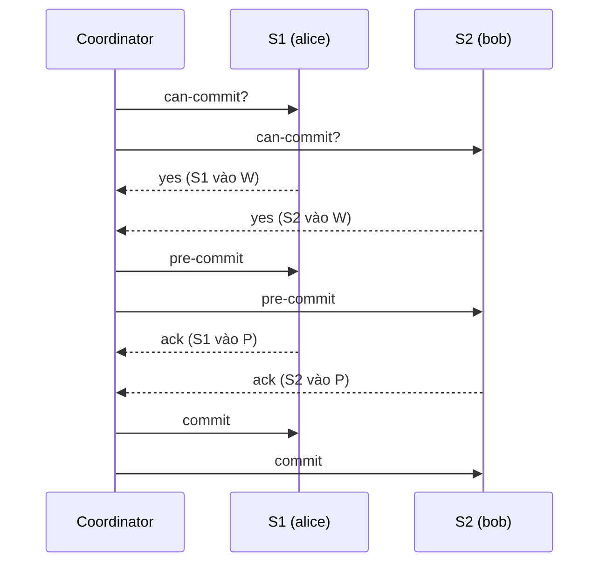
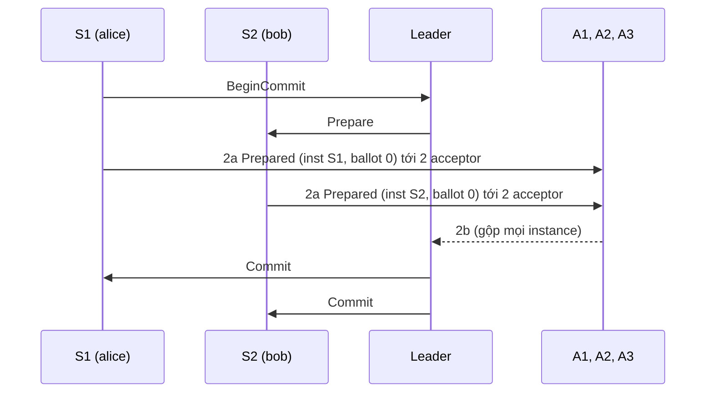
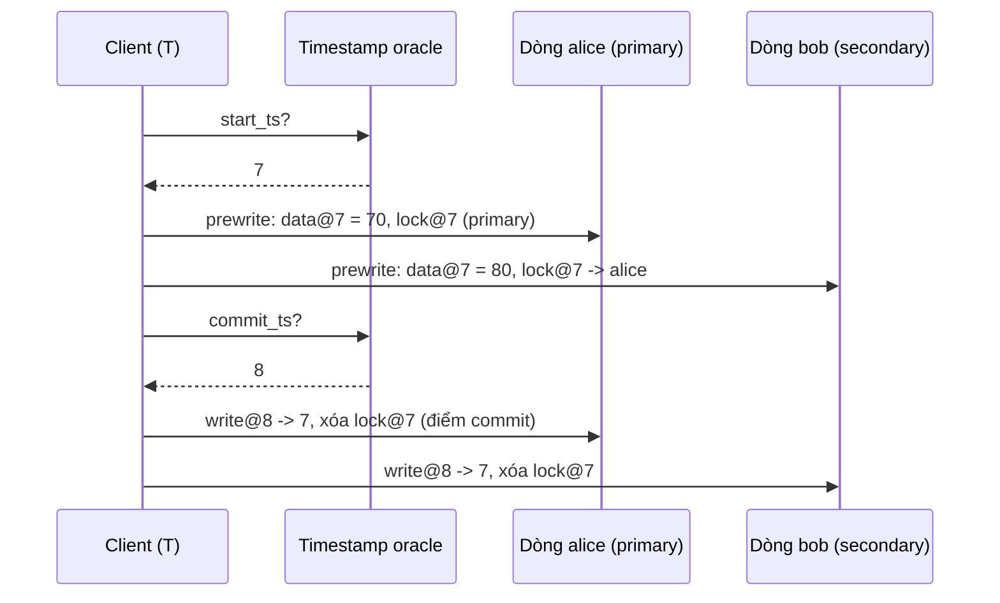
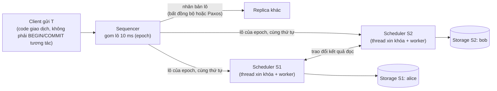
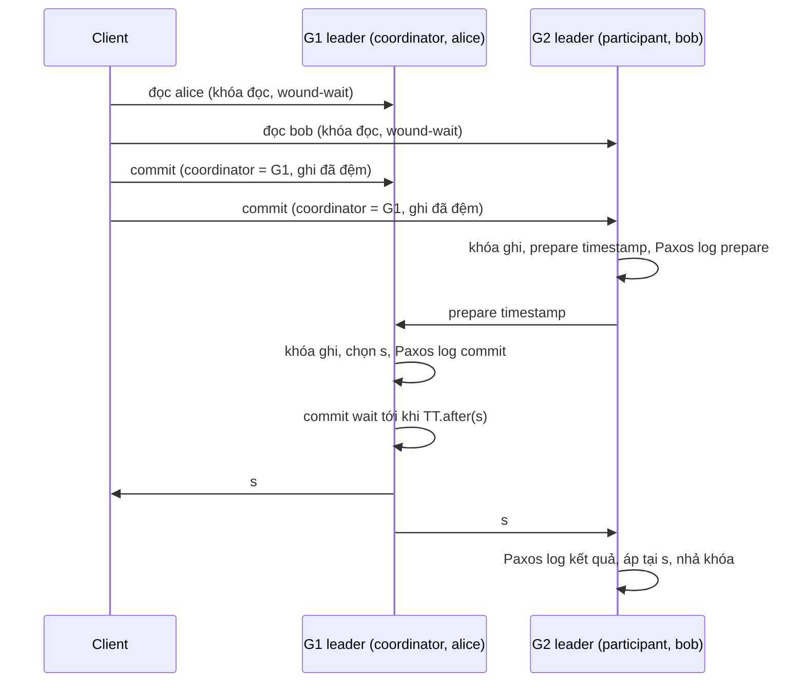

# P15 · Chương 09 — Giao dịch phân tán ngoài 2PC

[Chương 09 của P12](../12-he-thong-du-lieu/09-consistency-va-consensus.md) đã dạy two-phase commit (2PC) và chỉ ra điểm yếu của nó: coordinator chết đúng lúc thì các participant kẹt, vừa không biết kết quả vừa giữ khóa. Chương này đi tiếp, trả lời câu hỏi mà ai làm backend trên dữ liệu chia shard rồi cũng gặp: khi một giao dịch chạm nhiều shard, có cách nào khác 2PC không, và mỗi cách đổi cái gì lấy cái gì? Ta đi qua năm lời giải theo thứ tự lịch sử: three-phase commit (Skeen, 1981), Paxos Commit (Gray và Lamport, 2006), Percolator (Google, 2010), Calvin (Yale, 2012) và Spanner (Google, 2012). P12 mới chỉ nhắc tên một vài cái; ở đây ta đào tới mức chứng minh và dựng vết chạy từng bước.

Để mọi cơ chế có chỗ bám, cả chương dùng một ví dụ giả định là `bankdb` (nhận xét của người soạn: không phải code trong repo), một cơ sở dữ liệu sổ cái chia shard theo tài khoản. Tài khoản `alice` (số dư 100) nằm ở shard S1, `bob` (số dư 50) nằm ở shard S2. Giao dịch cần chạy là `T`: chuyển 30 từ `alice` sang `bob`. Hai bất biến phải giữ: tổng tiền luôn là 150 và không số dư nào âm. Chỉ cần một trong hai shard áp dụng `T` mà shard kia không áp dụng là tiền tự sinh ra hoặc biến mất, nên `T` phải *nguyên tử* (atomic) trên cả hai shard. Khi cần nói tới bản sao, mỗi shard là một nhóm ba replica.

## Bạn sẽ hiểu được gì

1. **Q1.** 2PC chặn ở đâu, cái giá của việc chặn là gì, và các hệ hiện đại thoát khỏi nó theo những hướng nào? → mục 1
2. **Q2.** 3PC thêm gì vào 2PC, vì sao nhờ đó nó không chặn khi node crash, và vì sao nó cho kết quả sai khi mạng bị chia? → mục 2
3. **Q3.** Paxos Commit làm gì để coordinator không còn là điểm chết duy nhất, và vì sao 2PC chỉ là trường hợp F = 0 của nó? → mục 3
4. **Q4.** Percolator dựng giao dịch nhiều dòng trên một kho chỉ có giao dịch một dòng bằng cách nào (timestamp oracle, primary lock, prewrite/commit, dọn lock lười)? → mục 4
5. **Q5.** Calvin bỏ được 2PC nhờ xếp thứ tự trước khi chạy ra sao, và giao dịch phải đọc rồi mới biết mình ghi gì thì xử lý thế nào (OLLP)? → mục 5
6. **Q6.** Spanner dùng TrueTime và commit wait để đạt external consistency như thế nào, chứng minh đi ra sao, và vì sao giao dịch chỉ-đọc không cần khóa? → mục 6
7. **Q7.** Năm cách đặt cạnh nhau thì khác nhau ở đâu, và khi nào chọn cách nào? → mục 7

## Kiến thức cần trước

- [P12 · Chương 09, mục 5](../12-he-thong-du-lieu/09-consistency-va-consensus.md): 2PC, trạng thái in-doubt, coordinator chết. Mục 4 (total order broadcast) và mục 6 (Paxos, FLP) của chương đó cần cho các mục 3, 5 và 6 ở đây.
- [P12 · Chương 07](../12-he-thong-du-lieu/07-transaction.md): isolation, snapshot isolation và write skew (mục 3 và 4), two-phase locking (mục 6). Chương này dùng lại chúng, không dạy lại.
- [P12 · Chương 08](../12-he-thong-du-lieu/08-su-co-he-phan-tan.md), mục 4 và 6: failure detector, mô hình đồng bộ, và vì sao timestamp từ đồng hồ treo tường không sắp thứ tự đúng.
- [P12 · Chương 18](../12-he-thong-du-lieu/18-thuat-toan-dong-thuan.md): Paxos và quorum. Cần cho Paxos Commit và Spanner.
- Không bắt buộc: [P13 · Chương 08](../13-tla-plus/08-dac-ta-giao-thuc-phan-tan.md) có đặc tả TLA+ của 2PC và Paxos Commit.
- Cùng phase, chưa chắc đã viết xong khi bạn đọc: [chương 01 — FLP và các chặn dưới](01-flp-va-cac-chan-duoi.md) cho lý do vì sao không giao thức commit nào vừa an toàn vừa luôn tiến triển trong hệ bất đồng bộ, và [chương 03 — phân cấp consistency](03-phan-cap-consistency.md) cho chỗ của strict serializability và external consistency trong thang consistency.

---

## 1. Vì sao 2PC chưa đủ, và có những lối thoát nào (Q1)

> **Trả lời ngắn.** 2PC chặn vì quyết định commit hay abort chỉ nằm ở coordinator: nếu nó chết sau khi mọi participant đã trả lời "ok" thì không participant nào biết quyết định là gì[^gl-block]. Trong lúc chờ, participant vẫn giữ khóa nên mọi giao dịch khác chạm cùng dữ liệu cũng bị chặn theo. Có bốn hướng thoát, ứng với bốn chỗ khác nhau để đặt quyết định: suy ra từ trạng thái của mọi participant (3PC), nhân bản bằng consensus (Paxos Commit), ghi vào một dòng dữ liệu đã được nhân bản (Percolator, Spanner), hoặc thỏa thuận thứ tự trước khi chạy để không còn gì để bỏ phiếu (Calvin).

**Giải thích.**

*Với `bankdb`.* Client gửi `T` cho một coordinator. Coordinator hỏi S1 và S2 "chuẩn bị được chưa". Mỗi shard ghi xuống đĩa việc nó sẽ làm (S1: `alice` còn 70; S2: `bob` thành 80), kiểm tra ràng buộc, giữ khóa trên dòng của mình rồi trả lời "ok". Khi nhận đủ "ok", coordinator quyết định commit, ghi quyết định vào log của nó và báo cho hai shard[^gl-tm-decides]. Đó là 2PC; [P12 · Chương 09, mục 5](../12-he-thong-du-lieu/09-consistency-va-consensus.md) đã đi qua từng bước, kể cả lúc coordinator hồi phục, nên ở đây ta chỉ nhớ lại chỗ vỡ.

Nếu coordinator chết ngay sau khi cả hai shard trả lời "ok", S1 và S2 đều đã hứa không rút lại, nhưng không bên nào biết coordinator đã quyết commit hay abort[^gl-block]. Hỏi nhau cũng vô ích, vì quyết định chỉ nằm trong log của coordinator. Cả hai tiếp tục giữ khóa trên `alice` và `bob`, nên mọi giao dịch khác chạm hai tài khoản đó phải xếp hàng cho tới khi coordinator sống lại. Bài giảng Cambridge tóm lại bằng một câu: vấn đề của 2PC là coordinator là điểm chết duy nhất (single point of failure)[^kl-spof].

Chặn vì coordinator chết là chuyện hiếm. Chuyện thường xuyên hơn là cái giá của chính hai vòng tin nhắn. Tổng thời gian một giao dịch giữ khóa, tính cả thời gian chạy giao thức commit, được gọi là *contention footprint* của giao dịch[^ca-footprint]. 2PC cần nhiều vòng tin nhắn giữa mọi máy tham gia, nên thời gian chạy nó thường lớn hơn nhiều so với thời gian chạy toàn bộ logic cục bộ[^ca-2pc-rt]. Với `bankdb` ta tính được một cận trên (tính của người soạn, số minh họa): nếu `alice` là tài khoản nóng và mỗi giao dịch giữ khóa trên nó D giây thì giao dịch sau phải đợi giao dịch trước nhả khóa, nên tài khoản đó xử lý tối đa 1/D giao dịch mỗi giây. Cho D bằng hai vòng tin nhắn liên lục địa, mỗi vòng cỡ 100 ms (cùng bậc độ lớn với con số bài giảng Cambridge nêu[^kl-intercont]), ta được D = 200 ms và tối đa 5 giao dịch mỗi giây trên một dòng, dù cụm còn thừa CPU.

Năm hệ dưới đây, thuộc bốn hướng, cùng trả lời một câu hỏi: *quyết định nằm ở đâu để một node chết không làm mất nó?* Cách xếp thành bảng là của người soạn, không phải của các bài báo; từng ô được dẫn nguồn ở mục tương ứng.

| Hướng | Quyết định commit nằm ở đâu | Mục |
|---|---|---|
| 3PC | suy ra được từ trạng thái của mọi participant (thêm pha pre-commit) | 2 |
| Paxos Commit | trong kết quả của các instance Paxos chạy trên 2F+1 acceptor | 3 |
| Percolator | trong một dòng dữ liệu (khóa chính rồi bản ghi commit) của kho đã nhân bản | 4 |
| Calvin | không có quyết định để bỏ phiếu: thứ tự được thỏa thuận trước, thực thi tất định | 5 |
| Spanner | trong log Paxos của nhóm coordinator, cộng đồng hồ TrueTime để xếp thứ tự | 6 |

Không lối nào miễn phí. Định lý FLP kéo theo rằng một thuật toán commit tất định, thuần bất đồng bộ không thể vừa giữ an toàn vừa bảo đảm tiến triển khi có dù chỉ một lỗi, nên các giao thức commit chỉ đòi tiến triển khi các giả định về thời gian được thỏa[^gl-flp]. Vì vậy mỗi lối thoát trả giá bằng một giả định hoặc một hạn chế: 3PC cần hệ đồng bộ, Paxos Commit và Spanner cần đa số replica sống cùng một leader ổn định, Percolator chịu độ trễ khi dọn lock, Calvin đòi giao dịch tất định, còn Spanner đòi đồng hồ có cận sai (nhận xét của người soạn, tổng hợp từ các mục 2 đến 6).

<details><summary>Đi sâu: đặc tả atomic commit mà mọi lời giải phải thỏa</summary>

Trước khi so các lời giải, cần một thước đo chung cho "atomic commit đúng". Gray và Lamport mô hình hóa giao dịch như một tập *resource manager* (RM), mỗi RM chạy trên một node. Ở `bankdb`, RM là S1 và S2. Yêu cầu nền tảng là mọi RM cuối cùng phải đồng ý giao dịch được commit hay bị abort[^gl-fundamental]. Trước khi có yêu cầu commit, RM nào cũng có thể tự abort phần việc của mình[^gl-spont-abort].

Từ đó bài báo đặt hai tính chất an toàn. *Stability*: RM đã vào trạng thái committed hoặc aborted thì ở đó mãi[^gl-stability]. *Consistency*: không thể có RM này ở committed trong khi RM khác ở aborted[^gl-consistency]. Cộng thêm một ràng buộc về thứ tự: RM chỉ được vào trạng thái committed sau khi mọi RM đã từng ở trạng thái prepared[^gl-prepared-first]. Còn về tính sống, vì giao thức "luôn abort" cũng thỏa an toàn nên bài báo nhắc rằng nghiệm tầm thường đó cần loại bỏ[^gl-trivial]. Vì thế bài báo đặt hai yêu cầu sống, Non-Triviality và Non-Blocking[^gl-two-liveness].

Với người đọc `bankdb`: *prepared* chính là trạng thái "đã ghi xuống đĩa, đã giữ khóa, hứa commit được" của S1 hoặc S2 ở pha 1 của 2PC. Đặc tả TLA+ của đúng các tính chất này nằm ở [P13 · Chương 08](../13-tla-plus/08-dac-ta-giao-thuc-phan-tan.md), mục về TCommit.

</details>

**Quay lại Q1:** 2PC chặn vì quyết định chỉ nằm ở coordinator trong khi participant đã giữ khóa, và vì thời gian giữ khóa kéo dài qua cả giao thức commit; bốn lối thoát là suy ra quyết định từ trạng thái (3PC), nhân bản nó bằng consensus (Paxos Commit), ghi nó vào dữ liệu đã nhân bản (Percolator, Spanner), hoặc thỏa thuận thứ tự trước để khỏi cần bỏ phiếu (Calvin).

---

## 2. 3PC: thêm một pha, và vì sao nó vỡ khi mạng bị chia (Q2)

> **Trả lời ngắn.** 3PC chèn thêm một pha *pre-commit* giữa lúc mọi participant đã bỏ phiếu yes và lúc commit thật[^sk-buffer]. Nhờ đó, participant chưa nhận pre-commit biết chắc chưa ai commit, còn participant đã nhận biết chắc mọi người đã bỏ phiếu yes, nên khi coordinator chết, những participant còn sống tự quyết được mà không phải chờ nó[^ubc-cond]. Điều này chỉ đúng khi node chỉ crash và mọi crash đều được phát hiện chính xác, tức giả định hệ đồng bộ[^kl-3pc]. Khi mạng bị chia, hai phía mỗi bên tự quyết và có thể quyết ngược nhau.

**Giải thích.**

*Với `bankdb`.* Quay lại lúc coordinator chết sau khi S1 và S2 đều trả lời "ok". Điều hai shard thiếu không phải phiếu bầu (cả hai biết mình đã bỏ phiếu yes) mà là *biết coordinator đã quyết chưa*. 3PC sửa đúng chỗ này: nó cấm coordinator quyết commit cho tới khi mọi participant đã biết rằng mọi người đều bỏ phiếu yes (diễn đạt của người soạn).

### 2.1 Giao thức ba pha

Pha 1 giống 2PC: coordinator hỏi, mỗi participant bỏ phiếu. Participant bỏ phiếu yes thì vào trạng thái *uncertain*, ký hiệu W (wait): nó đã hứa commit được nhưng chưa biết kết quả chung. Pha 2 là pha mới. Nếu mọi phiếu là yes, coordinator gửi `pre-commit`[^ubc-send-precommit]. Participant nhận được biết chắc mọi participant đã bỏ phiếu commit, nhưng chưa commit ngay[^ubc-precommit]; nó chuyển sang trạng thái *precommitted*, ký hiệu P, và trả `ack`. Pha 3: khi coordinator nhận đủ ack, nó biết không còn node nào uncertain[^ubc-allack], quyết định commit và gửi `commit`.



(Sơ đồ của người soạn, dựng từ mô tả ở trên cho `bankdb`.)

Bốn trạng thái của một participant, và điều mỗi trạng thái cho nó biết (diễn giải của người soạn):

| Trạng thái | Participant vừa nhận | Nó biết chắc | Nó chưa biết |
|---|---|---|---|
| W (uncertain) | đã tự trả yes | mình sẵn sàng commit | mọi participant khác có yes không |
| P (precommitted) | `pre-commit` | mọi participant đã yes | các participant khác đã biết điều đó chưa |
| C (committed) | `commit` | giao dịch đã commit | không còn gì |
| A (aborted) | `abort` hoặc tự abort | giao dịch đã abort | không còn gì |

### 2.2 Vì sao 2PC chặn, nhìn từ trạng thái

Skeen phân tích chuyện chặn bằng khái niệm *concurrency set* của một trạng thái: tập các trạng thái mà những site khác có thể đang ở cùng lúc với nó (diễn giải của người soạn). Một site bị chặn khi concurrency set của trạng thái nó đang ở chứa cả trạng thái commit lẫn trạng thái abort[^sk-blocking]. Nó cũng bị chặn khi nó không suy ra được rằng mọi site đã bỏ phiếu yes mà concurrency set lại chứa trạng thái commit: nó không dám commit vì chưa chắc mọi người yes, và không dám abort vì một site khác có thể đã commit[^sk-noncommittable]. Participant ở W trong 2PC rơi vào cả hai trường hợp: các site khác có thể đang ở commit (coordinator đã quyết commit và báo xong cho họ) hoặc ở abort (một participant khác bỏ phiếu no và coordinator đã báo abort cho nó), nên khi coordinator chết, nó không chọn được bên nào (suy luận của người soạn từ hai điều kiện trên).

Giáo trình của Özsu và Valduriez phát biểu điều kiện không chặn như sau: giao thức phải đồng bộ trong phạm vi một bước chuyển trạng thái, biểu đồ trạng thái không có trạng thái nào *kề* cả một trạng thái commit lẫn một trạng thái abort, và không có trạng thái *noncommittable* nào kề trạng thái commit[^pu-cond]. "Kề" nghĩa là đi từ trạng thái này sang trạng thái kia được bằng một bước chuyển[^pu-adjacent]. Còn "committable" nghĩa là mọi site đã bỏ phiếu commit[^pu-committable]. Skeen đạt điều kiện ấy bằng đúng một thay đổi: chèn một *buffer state* "prepare to commit" vào giữa wait và commit[^sk-buffer]. Sau khi chèn, W chỉ kề P và A; P kề C, là committable (mọi site đã yes) và không kề A. Cả hai vế của điều kiện đều thỏa (suy luận của người soạn, kiểm theo điều kiện trên).

### 2.3 Khi coordinator chết: luật kết thúc

Khi coordinator chết, các participant còn sống bầu ra một coordinator mới; cách bầu không quan trọng, có thể bỏ phiếu hoặc theo thứ hạng định sẵn[^sk-backup-choose]. Coordinator mới thu trạng thái của những participant nó liên lạc được rồi áp dụng bốn luật[^ubc-tr1]:

- **TR1.** Có participant đã abort thì quyết định abort.
- **TR2.** Có participant đã commit thì quyết định commit[^ubc-tr2].
- **TR3.** Mọi participant đều uncertain thì quyết định abort[^ubc-tr3].
- **TR4.** Có participant ở trạng thái committable (P) mà chưa ai commit thì chạy thêm một vòng pre-commit, nhận ack, rồi quyết định commit[^ubc-tr4].

Thứ tự TR1 đến TR4 cũng là cách đọc nhanh: abort và commit đã xảy ra thì theo nó; chưa ai biết gì thì abort; có người đã biết "mọi người yes" thì commit. Skeen phát biểu cùng ý bằng một quy tắc duy nhất cho coordinator thay thế: nếu concurrency set của trạng thái nó đang ở chứa một trạng thái commit thì commit, nếu không thì abort[^sk-backup-rule]. Trên 3PC chuẩn hai cách phát biểu cho cùng kết quả: concurrency set của P chứa C nên commit, còn của W không chứa C nên abort (suy luận của người soạn).

### 2.4 Chứng minh: chỉ crash thì 3PC không chặn và vẫn nguyên tử (chứng minh của người soạn)

Ta chứng minh trường hợp trung tâm của Skeen: coordinator chết, mọi participant còn lại vẫn sống và liên lạc được với nhau, và mọi crash đều được phát hiện chính xác. Mọi participant đã bỏ phiếu yes (nếu có phiếu no hoặc quá hạn, coordinator đã abort từ pha 1 và bài toán tầm thường), nên không ai ở A và TR1 không kích hoạt. Hai sự kiện của giao thức dùng làm tiền đề:

- **F1.** Coordinator chỉ gửi `commit` sau khi nhận ack của *mọi* participant[^ubc-allack], mà participant chỉ ack sau khi đã vào P. Suy ra: nếu có participant ở C thì mọi participant đang ở P hoặc C.
- **F2.** Coordinator chỉ gửi `abort` trước khi gửi `pre-commit` (khi có phiếu no hoặc quá hạn chờ phiếu). Suy ra: nếu có participant ở P hoặc C thì chưa có `abort` nào được gửi.

**Mệnh đề.** Các participant còn sống áp dụng TR2 đến TR4 trên trạng thái của nhau và đi đến cùng một quyết định, quyết định đó không mâu thuẫn với bất kỳ quyết định nào đã thi hành trước khi coordinator chết, và không cần chờ coordinator.

**Chứng minh.** Xét ba trường hợp loại trừ nhau và đủ cả, theo trạng thái các participant còn sống.

1. *Có participant ở C.* Theo F1, mọi participant ở P hoặc C. TR2 cho quyết định commit, khớp với participant đã commit. Không ai ở W hay A nên không còn quyết định nào để mâu thuẫn.
2. *Không ai ở C, ít nhất một participant ở P.* TR4 cho quyết định commit. Không có `abort` nào từng được gửi (F2) và không ai ở A, nên commit không mâu thuẫn với quyết định nào đã thi hành. Mọi participant đã bỏ phiếu yes nên commit là hợp lệ.
3. *Mọi participant ở W.* Nếu có participant ở C thì theo F1 mọi participant đã ở P hoặc C, trái giả thiết; vậy không ai đã commit. Hơn nữa coordinator chưa nhận đủ ack (không participant nào đã ack) nên nó chưa quyết commit, và vì nó đã chết nên sẽ không quyết nữa. TR3 cho quyết định abort, không mâu thuẫn với gì. Khi coordinator hồi phục, nó hỏi các participant và nhận kết quả abort.

Trong cả ba trường hợp, quyết định chỉ tính từ trạng thái cục bộ của các participant còn sống, nên không ai phải chờ coordinator. Vì ba trường hợp đủ cả và quyết định ở mỗi trường hợp là duy nhất, mọi participant còn sống đi đến cùng một quyết định. ∎

Chỗ then chốt nằm ở trường hợp 3. Trong 2PC, "mọi participant đều ở W" *không* kéo theo "chưa ai quyết commit", vì coordinator quyết commit ngay khi nhận đủ phiếu, trước khi bất kỳ participant nào rời W; quyết định đó chỉ nằm trong log của nó. Trong 3PC, coordinator không thể quyết commit trước khi mọi participant đã vào P, nên trạng thái W của một participant còn sống là bằng chứng rằng chưa ai commit (suy luận của người soạn từ F1). Pha pre-commit làm đúng một việc: đưa "mọi người đã yes" từ chỗ chỉ coordinator biết ra chỗ mọi participant cùng biết, *trước* khi quyết định tồn tại.

Chứng minh dùng ba giả định ngầm: (i) các participant còn sống thấy trạng thái của nhau, (ii) coordinator bị coi là chết thì thực sự đã chết, (iii) participant bị coi là chết thì thực sự đã chết. Cả ba cùng là một giả định: failure detector hoàn hảo. Một failure detector dựa trên timeout chỉ hoàn hảo trong hệ đồng bộ, crash-stop, liên kết tin cậy; trong hệ đồng bộ một phần không có detector hoàn hảo[^kl-fd]. Bài giảng Cambridge vì thế gạt 3PC sang một bên vì nó "giả định mô hình đồng bộ không thực tế"[^kl-3pc]. Skeen nói rõ giả định này ngay từ đầu: liên lạc giữa hai site còn hoạt động luôn thực hiện được[^sk-net1]. Mạng cũng báo cáo đáng tin cậy việc một site hỏng cho các site còn hoạt động[^sk-net2].

### 2.5 Khi mạng bị chia: vết chạy làm tiền biến mất

Bỏ giả định (i)–(iii) bằng cách cho phép mạng bị chia, ta dựng được vết chạy làm 3PC vi phạm atomicity ngay trên `bankdb` (dựng của người soạn; mỗi bước áp dụng đúng luật TR2 đến TR4 ở trên):

| Bước | S1 (`alice`) | S2 (`bob`) |
|---|---|---|
| 1 | bỏ phiếu yes, ở W | bỏ phiếu yes, ở W |
| 2 | nhận `pre-commit`, vào P | chưa nhận `pre-commit`, vẫn ở W |
| 3 | coordinator chết; đường mạng S1–S2 đứt | cùng sự kiện đó |
| 4 | timeout, coi coordinator **và S2** đã chết; chạy termination một mình, thấy trạng thái P của chính mình: TR4, rồi commit. `alice` = 70 | timeout, coi coordinator **và S1** đã chết; chạy termination một mình, chỉ thấy W của chính mình: TR3, abort. `bob` = 50 |

Kết quả: `alice` đã mất 30 nhưng `bob` không được cộng. Tổng tiền còn 70 + 50 = 120 thay vì 150: 30 đơn vị biến mất, và không bên nào làm sai luật. Lỗi nằm ở chỗ lập luận "mọi participant đều ở W nên chưa ai commit" chỉ đúng khi phép đếm gồm *tất cả* participant. S2 chỉ thấy chính mình nhưng timeout không cho nó biết rằng phép đếm bị cắt; nó tưởng S1 đã chết trong khi S1 đang sống và vừa commit. Gray và Lamport nói đúng chỗ này: khác với Paxos, trong các giao thức three-phase truyền thống, nhiều coordinator có thể dẫn tới không nhất quán[^gl-3pc-multi].

Không cần coordinator và mạng hỏng đúng cùng lúc: chỉ cần mạng đứt trong lúc các shard đang chạy termination (nhận xét của người soạn). Hai nửa cụm không liên lạc được nhau là loại lỗi mạng mà [P12 · Chương 08, mục 2.2](../12-he-thong-du-lieu/08-su-co-he-phan-tan.md) mô tả, nên một giao thức không thể coi nó là chuyện không xảy ra (nhận xét của người soạn).

Cũng cần nói công bằng về lối vá. Có thể bắt mỗi phía chỉ được quyết khi nhóm của nó đủ một quorum; khi đó hai phía không thể quyết ngược nhau, nhưng phía thiểu số bị chặn (suy luận của người soạn). Một bài báo VLDB 2019 tóm tắt tình hình: 3PC không chặn khi có crash, nhưng bản tổng quát vẫn chặn khi có lỗi chia mạng[^ma-3pc]. Vết chạy ở trên vì thế là của bản 3PC dùng timeout đơn giản mà Skeen mô tả, không phải của các bản có quorum.

<details><summary>Đi sâu: chương trình Rust kiểm hết các tổ hợp (đã chạy), giả định của Skeen, quorum và E3PC</summary>

**Kiểm bằng chương trình.** Ta mô hình hóa đúng tình huống ở mục 2.5 và liệt kê *mọi* tổ hợp. Coordinator gửi `pre-commit` cho một tập con k participant rồi chết; nếu k là tất cả thì nó còn có thể đã gửi `commit` cho một tập con khác rỗng. Sau đó mạng bị cắt thành các nhóm không liên lạc được nhau (mọi cách chia). Mỗi nhóm áp dụng TR2 đến TR4 chỉ trên trạng thái của các thành viên nó thấy. Chương trình đếm số tổ hợp mà hai nhóm quyết định ngược nhau.

```rust
// States of the participants after the coordinator crashed in the middle of 3PC.
#[derive(Clone, Copy, PartialEq, Debug)]
enum St { W, P, C } // W = uncertain (voted yes), P = precommitted, C = committed
#[derive(Clone, Copy, PartialEq, Debug)]
enum Dec { Commit, Abort }

// Termination rules applied by one group of survivors that can see only its own members.
// (Nobody has aborted in these scenarios, so TR1 never fires.)
fn terminate(group: &[St]) -> Dec {
    if group.contains(&St::C) { Dec::Commit }                        // TR2
    else if group.iter().all(|s| *s == St::W) { Dec::Abort }         // TR3
    else { Dec::Commit }                                             // TR4: some P, none C
}

// Every way to cut participants 0..n into groups that cannot reach each other.
fn partitions(n: usize) -> Vec<Vec<Vec<usize>>> {
    fn go(i: usize, n: usize, cur: &mut Vec<Vec<usize>>, out: &mut Vec<Vec<Vec<usize>>>) {
        if i == n { out.push(cur.clone()); return; }
        for g in 0..cur.len() { cur[g].push(i); go(i + 1, n, cur, out); cur[g].pop(); }
        cur.push(vec![i]); go(i + 1, n, cur, out); cur.pop();
    }
    let mut out = vec![];
    go(0, n, &mut vec![], &mut out);
    out
}

fn main() {
    for n in 2..=4usize {
        // The coordinator sent `prepare` to the subset k, then crashed; if k = everyone,
        // it may also have sent `commit` to a nonempty subset j before crashing.
        let mut scenarios: Vec<Vec<St>> = vec![];
        for k in 0..(1u32 << n) {
            scenarios.push((0..n).map(|i| if k >> i & 1 == 1 { St::P } else { St::W }).collect());
            if k == (1 << n) - 1 {
                for j in 1..(1u32 << n) {
                    scenarios.push((0..n).map(|i| if j >> i & 1 == 1 { St::C } else { St::P }).collect());
                }
            }
        }
        let (mut whole, mut whole_bad, mut split, mut split_bad) = (0, 0, 0, 0);
        let mut first = None;
        for s in &scenarios {
            for p in partitions(n) {
                let decs: Vec<Dec> = p.iter()
                    .map(|g| terminate(&g.iter().map(|&i| s[i]).collect::<Vec<_>>()))
                    .collect();
                let conflict = decs.contains(&Dec::Commit) && decs.contains(&Dec::Abort);
                if p.len() == 1 { whole += 1; whole_bad += conflict as u32; }
                else {
                    split += 1; split_bad += conflict as u32;
                    if conflict && first.is_none() { first = Some((s.clone(), p.clone())); }
                }
            }
        }
        println!("n={n}: {} scenarios; no partition: {whole_bad}/{whole} conflicting; partitioned: {split_bad}/{split} conflicting", scenarios.len());
        if let Some((s, p)) = first { println!("  first conflict: states {s:?}, groups {p:?}"); }
    }
}
```

Kết quả chạy thật (quan sát một lần chạy, macOS arm64, `rustc 1.95.0`, `rustc --edition 2021 -O`):

```text
n=2: 7 scenarios; no partition: 0/7 conflicting; partitioned: 2/7 conflicting
  first conflict: states [P, W], groups [[0], [1]]
n=3: 15 scenarios; no partition: 0/15 conflicting; partitioned: 18/60 conflicting
  first conflict: states [P, W, W], groups [[0, 1], [2]]
n=4: 31 scenarios; no partition: 0/31 conflicting; partitioned: 136/434 conflicting
  first conflict: states [P, W, W, W], groups [[0, 1, 2], [3]]
```

Đọc kết quả: khi mọi participant còn sống nằm trong một nhóm duy nhất thì không tổ hợp nào mâu thuẫn (khớp mệnh đề ở mục 2.4); khi nhóm bị cắt, mâu thuẫn xuất hiện, và tổ hợp đầu tiên với n = 2 chính là vết chạy ở mục 2.5 (`[P, W]`: S1 ở P, S2 ở W, hai nhóm `[[0], [1]]`). Hai tổ hợp mâu thuẫn của n = 2 là `[P, W]` và `[W, P]`, đối xứng nhau. Chương trình chỉ mô hình hóa luật kết thúc; nó bỏ qua việc participant crash trong lúc kết thúc, việc bầu coordinator thay thế và vòng pre-commit của TR4, nên chỉ có giá trị minh họa cho phần *vì sao* chứ không thay thế chứng minh.

**Các giả định của Skeen.** Hai giả định về mạng đã nêu ở mục 2.4 được Skeen áp dụng "suốt bài báo"[^sk-assume]. Ông cũng nhấn mạnh rằng giao thức kết thúc phải *reentrant*: coordinator thay thế có thể chết giữa chừng, nên giao thức phải chạy lại được từ trạng thái bất kỳ[^sk-reentrant]. Chương này không dựng lại chứng minh đầy đủ cho nhiều lỗi liên tiếp (coordinator thay thế chết rồi lại bầu); muốn xem thì đọc bài báo gốc của Skeen.

**Chi phí.** Thêm pha là thêm tin nhắn: Skeen thừa nhận pha bổ sung gây overhead đáng kể về số tin nhắn[^sk-overhead]. Cùng với giả định đồng bộ, đó là lý do thực tế kém hấp dẫn (nhận xét của người soạn).

**Quorum và E3PC.** Bản 3PC không chặn khi một đa số (quorum) site còn kết nối được; tuy vậy Keidar và Dolev chỉ ra rằng sau một chuỗi lỗi nhất định, nó vẫn có thể chặn dù quorum còn nối với nhau, và họ đề xuất giao thức E3PC để mọi đa số đều kết thúc được bất kể kiểu lỗi[^ma-quorum]. Gray và Lamport nhận xét thêm về văn liệu 3PC: các giao thức đó thường "vá" 2PC bằng cách chọn coordinator khác khi cái đầu hỏng[^gl-3pc-fix]. Tuy vậy họ không biết giao thức nào có thuật toán đầy đủ và được chứng minh theo một điều kiện đúng đắn phát biểu rõ ràng[^gl-3pc-nofull]. Mục 3 là câu trả lời của chính họ.

</details>

**Quay lại Q2:** 3PC thêm pha pre-commit để mọi participant biết "ai cũng yes" trước khi quyết định commit tồn tại, nên participant còn sống ở W biết chắc chưa ai commit và tự quyết được khi coordinator chết; nhưng chứng minh dựa vào failure detector hoàn hảo, nên khi mạng bị chia, S1 (ở P) commit còn S2 (ở W) abort, và 30 đơn vị tiền của `bankdb` biến mất.

---

## 3. Paxos Commit: nhân bản quyết định bằng consensus (Q3)

> **Trả lời ngắn.** Paxos Commit không để một coordinator giữ quyết định. Phiếu "Prepared" hay "Aborted" của mỗi participant (RM) trở thành giá trị của một instance Paxos riêng, chạy trên 2F+1 acceptor; giao dịch commit khi và chỉ khi instance nào cũng chọn Prepared[^gl-per-rm]. Coordinator chết thì một leader mới chạy tiếp các instance dang dở, nên giao thức vẫn tiến triển miễn là đa số coordinator (acceptor) còn làm việc[^gl-majority]. Khi F = 0, tức chỉ có một acceptor, nó trở lại đúng 2PC[^gl-f0].

**Giải thích.**

*Với `bankdb`.* Ta muốn chạy `T` mà không chấp nhận coordinator là điểm chết duy nhất. Ý nghĩ đầu tiên là để coordinator vẫn là bên đề xuất, còn quyết định cuối cùng ("commit" hay "abort") được chọn bằng một thuật toán consensus, để nó không còn nằm riêng trong log của một process. Ý này đã có từ trước, với một giao thức consensus đồng bộ[^gl-mohan]. Nhược điểm của nó: leader phải biết mọi RM đã prepared rồi mới đề xuất được giá trị "committed"[^gl-leader-learn]. Thêm nữa, việc RM báo cho leader tốn ít nhất một độ trễ tin nhắn[^gl-extra-delay]. Paxos Commit bỏ độ trễ đó bằng cách đổi *thứ* đem đi đồng thuận.

### 3.1 Một instance Paxos cho mỗi RM

Paxos Commit chạy một instance Paxos riêng cho quyết định của từng RM, "prepare" hay "abort"[^gl-per-rm]. Mọi instance dùng chung một tập 2F+1 acceptor và cùng một leader hiện tại[^gl-same-acceptors]. Con số 2F+1 là chặn dưới quen thuộc: không có giả định đồng bộ chặt thì cần 2F+1 acceptor để đạt consensus dù F acceptor hỏng[^gl-2f1] (lập luận quorum nằm ở [P12 · Chương 18, mục 1](../12-he-thong-du-lieu/18-thuat-toan-dong-thuan.md)). Với `bankdb` có hai RM là S1, S2 và F = 1: ba acceptor A1, A2, A3 (đặt ở đâu tùy, chẳng hạn trên các replica của hai shard) và một leader L. Ta có hai instance, gọi là `inst(S1)` và `inst(S2)`. Giao dịch commit khi và chỉ khi cả hai chọn Prepared; chỉ cần một instance chọn Aborted là giao dịch abort[^gl-commit-iff].

Một lần chạy bình thường của `T` đi như sau:

1. RM đầu tiên sẵn sàng (giả sử S1) gửi `BeginCommit` cho L; L gửi `Prepare` cho các RM còn lại, tức S2[^gl-begin].
2. Mỗi RM, khi đã prepared, tự gửi tin pha 2a của Paxos với ballot 0 và giá trị Prepared, trong instance của chính nó, tới F+1 = 2 acceptor, giả sử A1 và A2[^gl-2a-f1]. Phiếu của RM *chính là* tin 2a; leader không đứng giữa đường.
3. Mỗi acceptor trả tin pha 2b cho L; nó gộp tin của mọi instance vào một tin vật lý duy nhất[^gl-bundle]. L biết kết quả của một instance khi nhận F+1 tin 2b ballot 0[^gl-2b-leader].
4. Khi cả `inst(S1)` và `inst(S2)` đã chọn Prepared, L gửi cho các RM một tin `Commit` duy nhất thay cho từng tin pha 3[^gl-single-commit].

Nhịp độ: RM biết giao dịch commit sau năm độ trễ tin nhắn[^gl-5delays]. Con số tương ứng của 2PC là bốn[^gl-2pc-4delays].



(Sơ đồ của người soạn theo các bước ở trên.)

### 3.2 Leader chết giữa chừng, hoặc một RM im lặng

Giả sử L gửi `Commit` cho S1 rồi chết, S2 chưa nhận gì. Một leader mới L' hết chờ và chạy pha 1a với ballot lớn hơn cho từng instance chưa quyết định[^gl-ballot]. Nó hỏi một đa số acceptor, chẳng hạn A2 và A3. Hai nhóm {A1, A2} (đã nhận 2a) và {A2, A3} (đa số mà L' hỏi) giao nhau ở A2, nên A2 báo rằng nó đã chấp nhận Prepared ở ballot 0 cho cả hai instance. Theo luật của Paxos, L' buộc phải đề xuất lại đúng giá trị đó, nên cả hai instance chọn Prepared và L' gửi `Commit` cho S2, khớp với S1 đã commit (diễn giải của người soạn theo luật Paxos; vết chạy do người soạn dựng).

Còn nếu S2 chết *trước khi* gửi 2a, `inst(S2)` chưa có giá trị nào. L' thấy giá trị còn "tự do" và cố đưa Aborted vào[^gl-free-aborted]; instance chọn Aborted và giao dịch abort. Không mâu thuẫn với S1, vì L đã không thể gửi `Commit` khi `inst(S2)` chưa chọn Prepared. Chú ý một giới hạn: leader chỉ ép abort được cho RM *không tự quyết định*[^gl-leader-abort]; S2 đã gửi Prepared tới đủ acceptor thì không leader nào đổi được. Điều này đối nghịch với 2PC, nơi coordinator có quyền đơn phương abort.

Vì sao hai leader tranh nhau không làm hỏng? Mỗi instance Paxos chọn một giá trị duy nhất, nên các leader khác nhau không thể gửi quyết định khác nhau[^gl-consistency-pc]. Đó chính là chỗ 3PC vấp ở mục 2: nhiều coordinator dẫn tới không nhất quán[^gl-3pc-multi]. Tính an toàn của Paxos Commit không phụ thuộc leader duy nhất; chỉ tính sống mới cần một leader duy nhất không lỗi đủ lâu[^gl-unique-leader]. Tính sống đó phát biểu như sau: nếu một mạng đủ lớn các node không lỗi đủ lâu thì mọi RM chạy trên đó cuối cùng đạt committed hoặc aborted[^gl-nb-def].

### 3.3 So với 2PC: giá phải trả

| | 2PC | Paxos Commit | Faster Paxos Commit |
|---|---|---|---|
| Độ trễ tin nhắn tới lúc RM biết giao dịch commit | 4[^gl-2pc-4delays] | 5[^gl-5delays] | 4[^gl-faster-4] |
| Số tin nhắn khi N = 5 RM, F = 1 (acceptor đặt chung node với RM) | 12 | 17 | 20[^gl-12-17-20] |

Faster Paxos Commit là biến thể bỏ pha 3 bằng cách cho mỗi acceptor gửi tin 2b thẳng cho mọi RM[^gl-faster-def]. Cái giá thêm là nó tốn nhiều tin nhắn hơn[^gl-faster-4]. Về ghi xuống đĩa, Paxos Commit có cùng độ trễ ghi stable storage như 2PC và ghi tổng cộng N + F + 1 lần[^gl-writes]. Nếu cho RM tự prepare mà không chờ tin `Prepare` của leader thì chỉ còn hai độ trễ tin nhắn, và đó là tối ưu vì mọi thuật toán consensus chịu lỗi cần ít nhất hai độ trễ để chọn một giá trị[^gl-optimal]. Với F = 0 hai thuật toán thành một[^gl-f0]; nói cách khác, 2PC là Paxos Commit chỉ có một acceptor và không chịu được acceptor hỏng. Với `bankdb`, đổi từ 2PC sang Paxos Commit F = 1 nghĩa là trả thêm một độ trễ và một nhóm ba acceptor để coordinator hết là điểm chết duy nhất (tính của người soạn từ bảng trên).

Chương [P12 · 09 mục 5.4](../12-he-thong-du-lieu/09-consistency-va-consensus.md) kể cùng ý tưởng bằng ngôn ngữ total order broadcast, và [P13 · Chương 08](../13-tla-plus/08-dac-ta-giao-thuc-phan-tan.md) dùng chính Paxos Commit làm ví dụ đặc tả TLA+.

<details><summary>Đi sâu: vì sao đổi giá trị đem đi đồng thuận lại tiết kiệm một độ trễ, và chuyện chung leader với acceptor</summary>

**Tiết kiệm ở đâu.** Nếu chỉ dùng một instance Paxos cho quyết định chung "commit/abort", thì RM phải báo "prepared" cho leader trước, leader mới đề xuất giá trị. Paxos Commit cho mỗi RM *làm leader của ballot 0 trong instance của mình*: Paxos vẫn đúng nếu việc gửi tin 2a ballot 0 được giao cho một process chọn trước, bất kể nó là leader hay không (diễn giải của người soạn từ mô tả thuật toán trong bài báo[^gl-delegate]). Vì thế "phiếu bầu" của RM tới thẳng acceptor, và độ trễ báo-cho-leader biến mất.

**Chung node.** Số tin nhắn ở bảng trên giả định co-location (mỗi acceptor chung node với một RM, leader chung node với RM đầu tiên) để các tin trong cùng node không tính vào. Chính bài báo tính cả hai trường hợp, có và không đặt chung node[^gl-asymptotic-cb]. Khi F = 1 và N lớn, số tin nhắn của ba thuật toán tiến gần 3N, 4N và 5N[^gl-asymptotic].

**Kiểm chứng.** Bài báo thừa nhận việc kiểm bằng TLC mới chạy trên cấu hình nhỏ[^gl-tlc-small]. Niềm tin vào tính đúng đắn đến từ chứng minh chặt chẽ của Paxos: tính đúng của Paxos Commit là hệ quả đơn giản của tính đúng của Paxos[^gl-corollary]. Chi tiết xem [P13 · Chương 08](../13-tla-plus/08-dac-ta-giao-thuc-phan-tan.md).

</details>

**Quay lại Q3:** Paxos Commit cho mỗi RM một instance Paxos trên 2F+1 acceptor và coi giao dịch commit khi mọi instance chọn Prepared, nên coordinator chết chỉ còn là chuyện đổi leader; giá là một độ trễ tin nhắn cộng một nhóm acceptor, và F = 0 thì nó chính là 2PC.

---

## 4. Percolator: giao dịch nhiều dòng trên kho chỉ có giao dịch một dòng (Q4)

> **Trả lời ngắn.** Percolator là một thư viện phía client dựng trên Bigtable, kho chỉ bảo đảm giao dịch nguyên tử trên *một dòng*[^pe-bigtable-row]. Nó chạy 2PC do chính client điều phối nhưng đặt toàn bộ trạng thái giao dịch (khóa, con trỏ tới khóa chính, bản ghi commit) vào các cột phụ của Bigtable, và chọn một khóa làm *khóa chính* (primary): ghi bản ghi commit lên khóa chính là điểm chốt, từ đó giao dịch chắc chắn commit[^pe-commit-point]. Client chết giữa chừng thì bất kỳ giao dịch nào gặp khóa bị bỏ lại chỉ cần nhìn khóa chính để biết nên làm nốt hay hủy[^pe-rollforward]. Timestamp oracle phát timestamp tăng nghiêm ngặt để mỗi giao dịch đọc một snapshot nhất quán[^pe-oracle].

**Giải thích.**

*Với `bankdb`.* Giả sử `bankdb` không phải một DB đơn mà là một lớp client trên kho key-value kiểu Bigtable: `alice` và `bob` là hai dòng ở hai tablet server khác nhau; kho cho read-modify-write nguyên tử trên *một* dòng nhưng không có giao dịch hai dòng. Percolator dạy cách dựng giao dịch hai dòng trên nền đó. Lưu ý (nhận xét của người soạn): `bankdb` ở mục này chỉ là mô hình để học. Percolator gốc là hệ thống xử lý tăng dần để dựng chỉ mục web của Google, không nhằm thay các giải pháp xử lý dữ liệu thông thường[^pe-purpose]. Thiết kế của nó bị chi phối bởi yêu cầu chạy ở quy mô cực lớn và việc không đòi độ trễ cực thấp[^pe-latency-req].

### 4.1 Bốn thành phần

- **Bigtable.** Kho trình ra một bản đồ có thứ tự, khóa là bộ ba (dòng, cột, timestamp)[^pe-bigtable-map]. Thao tác trên một dòng là nguyên tử[^pe-bigtable-row]. Thứ Percolator phải tự bù là những gì Bigtable không có: giao dịch nhiều dòng (và khung observer, ngoài phạm vi chương này)[^pe-gap].
- **Timestamp oracle.** Một server phát timestamp theo thứ tự tăng nghiêm ngặt, và mỗi giao dịch gọi nó hai lần (lấy `start_ts` và `commit_ts`)[^pe-oracle-2x]. Nó cấp trước một dải timestamp bằng cách ghi timestamp lớn nhất đã cấp xuống ổ bền, rồi phục vụ từ bộ nhớ[^pe-oracle-range]. Nếu nó khởi động lại, timestamp nhảy tiến chứ không bao giờ lùi[^pe-oracle-restart]. Nó phục vụ khoảng 2 triệu timestamp mỗi giây từ một máy[^pe-2m].
- **Thư viện client.** Percolator là thư viện chạy phía client chứ không điều khiển việc truy cập kho, nên nó đối mặt với bài toán khác các DBMS song song truyền thống[^pe-client-lib]. Không có chỗ trung gian để cấp khóa, nên nó phải tự giữ khóa[^pe-explicit-locks]. Nó cũng không có nút quản lý giao dịch trung tâm, nên không có bộ phát hiện deadlock toàn cục[^pe-no-central].
- **Bố cục cột.** Mỗi cột logic được lưu thành ba cột Bigtable: `data`, `write` và `lock`[^pe-layout]; mỗi ô là một chuỗi giá trị đánh chỉ mục theo timestamp. Cột `lock` đánh dấu một giao dịch chưa commit đang ghi ô đó và chứa vị trí của khóa chính[^pe-col-lock]. Cột `write` đánh dấu đã có dữ liệu commit và lưu timestamp của dữ liệu[^pe-col-write]. Khóa nằm ở cột đặc biệt trong chính Bigtable chứa dữ liệu, được đọc và sửa trong một row transaction[^pe-locks-where].

### 4.2 Thuật toán

Giao thức commit là 2PC do chính client điều phối[^pe-2pc-client]; dưới đây là từng bước.

- **Bắt đầu.** Constructor của giao dịch xin `start_ts` từ oracle; nó quyết định snapshot mà `Get` thấy. `Set` được đệm lại cho tới lúc commit[^pe-start-buffer].
- **Get.** Kiểm tra trước xem có lock nào trong khoảng timestamp [0, `start_ts`] không, vì đó là khoảng timestamp của snapshot[^pe-get]. Có lock thì một giao dịch khác đang ghi ô này, nên người đọc phải chờ tới khi lock được nhả[^pe-get-wait]. Không có lock thì đọc write record mới nhất trong khoảng đó, và trả về phần data mà write record trỏ tới[^pe-get-latest]. Không cần khóa để đọc: mọi timestamp là một snapshot nhất quán, đọc chỉ là một lần tra Bigtable tại timestamp đó[^pe-read-nolock].
- **Commit, pha 1 (prewrite).** Giao dịch chọn tùy ý một ô ghi làm khóa chính (primary), các ô còn lại là secondary[^pe-primary-arbitrary]. Ở mỗi ô, nó đọc metadata để tìm xung đột. Thấy một write record mới hơn `start_ts` thì abort: đó là xung đột ghi-ghi mà snapshot isolation chặn[^pe-ww]. Thấy một lock ở bất kỳ timestamp nào thì cũng abort[^pe-any-lock]. Có thể giao dịch kia đã commit và chỉ chậm nhả lock, nhưng bài báo coi khả năng đó thấp nên chấp nhận abort[^pe-slow-release]. Không xung đột thì ghi `lock@start_ts` (lock ở secondary chứa vị trí primary) và `data@start_ts`.
- **Commit, pha 2.** Client xin `commit_ts` từ oracle[^pe-commit-ts]. Tại ô primary, nó kiểm tra lock của mình còn đó, rồi thay lock bằng một write record tại `commit_ts` trỏ về `start_ts`: đây là *điểm commit*, vì từ lúc primary hiển thị cho người đọc thì giao dịch chắc chắn commit[^pe-commit-point]. Sau đó, với từng secondary, nó ghi write record và xóa lock.

### 4.3 Vết chạy đầy đủ cho `bankdb`

Timestamp 5 đến 8 đánh số như ví dụ chuyển tiền trong bài báo (bài báo dùng số dư của riêng nó; người soạn thay bằng `alice`, `bob`). Ký hiệu: mỗi dòng của bảng là cột logic `bal` của một tài khoản, gồm ba cột con, mỗi cột là bản đồ timestamp → giá trị. Ví dụ `write={6: 5}` đọc là "commit tại timestamp 6, dữ liệu nằm ở `data@5`". Vết dưới đây là *đầu ra thật* của một mô hình Rust nhỏ dựng theo mã giả của bài báo (chương trình nằm trong phần Đi sâu cuối mục):

```text
-- 0. initial
   alice  data={5: 100} lock={} write={6: 5}
   bob    data={5: 50} lock={} write={6: 5}
-- 1. prewrite primary (alice)
   alice  data={5: 100, 7: 70} lock={7: "alice"} write={6: 5}
   bob    data={5: 50} lock={} write={6: 5}
-- 2. prewrite secondary (bob)
   alice  data={5: 100, 7: 70} lock={7: "alice"} write={6: 5}
   bob    data={5: 50, 7: 80} lock={7: "alice"} write={6: 5}
-- 3. commit primary (commit point)
   alice  data={5: 100, 7: 70} lock={} write={6: 5, 8: 7}
   bob    data={5: 50, 7: 80} lock={7: "alice"} write={6: 5}
-- 4. commit secondary
   alice  data={5: 100, 7: 70} lock={} write={6: 5, 8: 7}
   bob    data={5: 50, 7: 80} lock={} write={6: 5, 8: 7}
```

(Quan sát một lần chạy trên macOS arm64, `rustc 1.95.0`; `start_ts` = 7 và `commit_ts` = 8 do "oracle" cấp.)

Đọc từng bước:

| Bước | Việc làm | Điều đáng để ý |
|---|---|---|
| 0 | `alice` và `bob` đã commit tại timestamp 6, dữ liệu nằm ở `data@5` | `write@6 → 5` là con trỏ từ commit timestamp tới data timestamp |
| 1 | `T` có `start_ts` = 7. Prewrite primary `alice`: `data@7` = 70 và `lock@7` = "alice" | lock của primary trỏ về chính nó; `data@5` vẫn còn, người đọc cũ không bị ảnh hưởng |
| 2 | Prewrite secondary `bob`: `data@7` = 80, `lock@7` trỏ về `alice` | lock của secondary ghi vị trí primary, để ai gặp nó biết hỏi ở đâu |
| 3 | `commit_ts` = 8. Ở `alice`: lock@7 còn nên thay bằng `write@8 → 7` và xóa lock | **điểm commit.** Từ đây `T` chắc chắn commit; `bob` vẫn còn lock |
| 4 | Ở `bob`: thêm `write@8 → 7`, xóa lock | hoàn tất; trạng thái cuối nhất quán |

Ai đọc trong lúc `T` chạy cũng thấy tổng đúng 150. Người đọc có `start_ts` = 6 không thấy lock@7 (7 nằm ngoài [0, 6]) và đọc `alice` = 100, `bob` = 50 qua `write@6`. Người đọc có `start_ts` = 9 sau bước 3 và trước bước 4 thấy `alice` = 70 qua `write@8`, còn `bob` có lock@7 nằm trong [0, 9] nên phải chờ hoặc dọn lock; dọn lock theo primary (mục 4.4) cho ra `bob` = 80, tổng vẫn 150 (người soạn lập luận từ các luật ở mục 4.2).



### 4.4 Lỗi giữa chừng: dọn lock lười

Tablet server hỏng không làm hỏng giao thức, vì Bigtable bảo đảm khóa đã ghi vẫn còn sau khi tablet server hỏng[^pe-bigtable-persist]. Cái cần lo là *client* chết giữa chừng, bỏ lại lock. Lock bỏ lại phải được dọn, nếu không các giao dịch sau sẽ treo mãi[^pe-stranded]. Percolator dọn *lười* (lazy): khi giao dịch A gặp lock do giao dịch B bỏ lại, A có thể kết luận B đã chết và xóa lock của B[^pe-lazy-cleanup]. Rủi ro là A khó mà chắc chắn B đã chết, nên phải tránh cuộc đua giữa A dọn và một B thực ra còn sống đang commit[^pe-race]. Percolator giải bằng cách chọn một ô trong mỗi giao dịch làm điểm đồng bộ cho mọi thao tác commit hoặc dọn: đó là khóa chính[^pe-primary-sync]. Cả A lẫn B đều sửa khóa chính trong một row transaction của Bigtable, nên chỉ một trong hai thao tác commit hoặc dọn thành công[^pe-primary-only-one].

Từ đó có luật dọn. Gặp lock ở secondary, nhìn khóa chính: nếu khóa chính đã được thay bằng write record thì giao dịch đó đã commit và lock phải được *roll forward*; ngược lại thì roll back[^pe-rollforward]. Roll back an toàn vì luôn commit primary trước, nên primary chưa commit nghĩa là chưa giao dịch nào thấy dữ liệu của nó[^pe-safe-rollback]. Cùng chương trình Rust cho thấy ba kịch bản (đầu ra thật, cùng lần chạy; "reader" ở đây coi lock gặp phải là đã cũ nên dọn ngay, đơn giản hóa so với bài báo, nơi người đọc chỉ dọn khi nghi người ghi đã chết hoặc kẹt):

```text
== client crashes after step 3; a reader starts at ts 9
   reader@9: alice = 70
   reader@9: bob has lock@7 -> primary alice: roll forward
   reader@9: bob = 80
--    state after the reader
   alice  data={5: 100, 7: 70} lock={} write={6: 5, 8: 7}
   bob    data={5: 50, 7: 80} lock={} write={6: 5, 8: 7}
== client crashes after step 2; a reader starts at ts 9
   reader@9: alice has lock@7 -> primary alice: roll back
   reader@9: alice = 100
   reader@9: bob has lock@7 -> primary alice: roll back
   reader@9: bob = 50
--    state after the reader
   alice  data={5: 100, 7: 70} lock={} write={6: 5}
   bob    data={5: 50, 7: 80} lock={} write={6: 5}
== client is slow, not dead: a cleaner rolls it back first
   cleaner: roll back
   client commit_primary -> false
```

- *Client chết sau điểm commit (bước 3).* Primary đã có `write@8 → 7`, nên reader roll forward lock của `bob` và đọc 80. Tổng vẫn 150.
- *Client chết trước điểm commit (sau bước 2).* Primary còn lock nên reader roll back cả hai lock; `alice` = 100, `bob` = 50. `data@7` trên cả hai dòng còn lại nhưng không có write record nào trỏ tới, nên người đọc không bao giờ thấy chúng (quan sát từ vết chạy; "mồ côi" là cách gọi của người soạn).
- *Client chậm chứ không chết.* Cleaner roll back trước; khi client gọi commit primary, lock@7 đã mất nên bước kiểm tra thất bại và client abort. Đây là cuộc đua mà khóa chính phân xử.

Để nhận biết người ghi đã chết hay chưa, Percolator dùng cơ chế đơn giản: worker đang chạy ghi một token vào dịch vụ khóa Chubby, và sự tồn tại của token là dấu hiệu worker còn sống[^pe-chubby]. Với worker sống nhưng không làm gì, lock còn mang thêm thời gian đồng hồ tường; lock quá cũ bị dọn dù token còn hiệu lực[^pe-walltime].

### 4.5 Vì sao nguyên tử, và vì sao không chặn kiểu 2PC

*Nguyên tử.* Điểm commit là một lần ghi nguyên tử duy nhất lên dòng của khóa chính. Mọi cách giao dịch kết thúc đều đi qua dòng đó: hoặc client thay lock bằng write record (commit), hoặc một cleaner xóa lock (abort), và row transaction của Bigtable chỉ để một bên thắng[^pe-primary-only-one]. Các secondary sau đó chỉ làm theo kết quả đã chốt ở primary, bằng roll forward hoặc roll back. Nên `alice` và `bob` không bao giờ ở hai kết cục khác nhau (suy luận của người soạn từ các luật trên).

*Không chặn.* So với 2PC: quyết định không nằm trong bộ nhớ hay log của một coordinator process mà nằm ở một ô của Bigtable, nơi bất kỳ client nào đọc được. Client chết thì không có "participant in-doubt" vô vọng; người đến sau nhìn primary và kết thúc giao dịch hộ (suy luận của người soạn). Cái giá là độ trễ: người gặp lock phải đợi hoặc nghi ngờ, rồi mới dọn.

### 4.6 Timestamp oracle và vì sao snapshot đọc nhất quán (chứng minh theo bài báo)

Điều ta cần: nếu giao dịch W commit tại `commit_ts` = TW nhỏ hơn `start_ts` = TR của người đọc R, thì mọi `Get` của R thấy mọi ghi của W. Bài báo lập luận như sau (diễn đạt lại; các bước nối bằng "suy ra" là của bài báo, phần giải thích chèn thêm là của người soạn).

**Chứng minh.**

1. Oracle phát timestamp tăng nghiêm ngặt, và TW < TR, nên oracle đã cấp TW trước hoặc cùng lô với TR; suy ra W đã xin TW trước khi R nhận TR[^pe-proof-1].
2. R không đọc được gì trước khi nhận `start_ts` TR, còn W ghi xong mọi lock của mình *trước khi* xin `commit_ts` TW[^pe-proof-order].
3. Từ 1 và 2: lúc R bắt đầu đọc, mọi lock của W đã được ghi. Với một ô mà W ghi, `Get` của R hoặc thấy write record đã commit, hoặc thấy lock của W; ở trường hợp thứ hai R chờ tới khi lock được nhả (mục 4.2) rồi thấy write record. Cả hai cách, ghi của W đều hiển thị với `Get` của R[^pe-proof-end]. ∎

Điểm mấu chốt: tính *tăng nghiêm ngặt* của oracle biến thứ tự timestamp thành thứ tự "đã ghi xong lock trước khi người đọc bắt đầu". Nếu oracle cấp lùi, R có thể nhận TR > TW trong khi W chưa ghi lock nào, và R đọc ra bản cũ dù TW < TR (suy luận của người soạn). Oracle là điểm tập trung nên bài báo nhấn mạnh nó phải co giãn tốt, vì mỗi giao dịch gọi nó hai lần[^pe-oracle-2x]. Worker gom yêu cầu của nhiều giao dịch vào một RPC treo để giảm chi phí, đổi lấy độ trễ cao hơn[^pe-batch].

### 4.7 Cái giá và giới hạn

- **Snapshot isolation, không phải serializable.** Bài báo nói thẳng: snapshot isolation không bảo đảm serializability, và giao dịch chạy dưới nó chịu write skew[^pe-si-not-ser]. Với `bankdb` (ví dụ của người soạn): hai tài khoản liên kết được thấu chi miễn tổng không âm. `alice` = 100, `bob` = 50. `T1` rút 100 từ `alice`, `T2` rút 100 từ `bob`; mỗi giao dịch đọc cả hai số dư và thấy tổng sau khi rút là 50, hợp lệ. Hai giao dịch ghi hai dòng khác nhau, không có xung đột ghi-ghi, nên cả hai commit; kết quả `alice` = 0, `bob` = -50, tổng -50 vi phạm bất biến. Cơ chế chi tiết của write skew nằm ở [P12 · Chương 07, mục 3](../12-he-thong-du-lieu/07-transaction.md).
- **Độ trễ.** Cách dọn lười có thể làm giao dịch commit chậm hàng chục giây[^pe-lazy-delay]. Bài báo nói độ trễ đó không chấp nhận được trong DBMS chạy OLTP nhưng chịu được trong hệ dựng chỉ mục web[^pe-oltp].
- **Không phát hiện deadlock toàn cục.** Đổi lại hệ co giãn tới hàng nghìn máy, nhưng giao dịch xung đột chịu thêm độ trễ[^pe-no-central].
- **Chi phí RPC.** Mỗi lần ghi lock là một read-modify-write cần hai RPC Bigtable, nên tác giả thêm "conditional mutation" vào API Bigtable để làm trong một RPC[^pe-conditional]. Bài báo cho biết Percolator thực hiện khoảng 50 thao tác Bigtable riêng lẻ để xử lý một tài liệu[^pe-50ops].

<details><summary>Đi sâu: chương trình Rust dựng vết chạy (đã chạy), con số của bài báo và vai trò của <code>BTreeMap::range</code></summary>

Chương trình dưới đây là mô hình một luồng, bằng `std`: mỗi cột logic là ba `BTreeMap` theo timestamp, mỗi hàm là một "row transaction" (không có song song nên nguyên tử tự nhiên). Nó tạo ra đúng các đầu ra ở mục 4.3 và 4.4. `get` dùng `range(..=start_ts)` để tìm lock và write record trong khoảng snapshot; `BTreeMap::range` dựng một iterator hai đầu trên khoảng con của map[^bt-range], nên "write record mới nhất không vượt `start_ts`" là một lời gọi `next_back()`.

```rust
use std::collections::BTreeMap;

// One logical column "bal" of one row = three Bigtable columns, each versioned by timestamp.
#[derive(Default, Clone)]
struct Row {
    data: BTreeMap<u64, i64>,    // start_ts -> value
    lock: BTreeMap<u64, String>, // start_ts -> row holding the primary lock
    write: BTreeMap<u64, u64>,   // commit_ts -> start_ts of the data it points to
}
#[derive(Default, Clone)]
struct Store { rows: BTreeMap<String, Row> }

impl Store {
    fn show(&self, title: &str) {
        println!("-- {title}");
        for (name, r) in &self.rows {
            println!("   {name:<6} data={:?} lock={:?} write={:?}", r.data, r.lock, r.write);
        }
    }
    // Err((lock_ts, primary_row)) when a lock in [0, start_ts] hides the answer.
    fn get(&self, row: &str, start_ts: u64) -> Result<i64, (u64, String)> {
        let r = &self.rows[row];
        if let Some((&ts, p)) = r.lock.range(..=start_ts).next() { return Err((ts, p.clone())); }
        let (_, &data_ts) = r.write.range(..=start_ts).next_back().expect("no data");
        Ok(r.data[&data_ts])
    }
    fn prewrite(&mut self, row: &str, start_ts: u64, v: i64, primary: &str) -> bool {
        let r = self.rows.get_mut(row).unwrap();
        if r.write.range(start_ts..).next().is_some() { return false; } // a write after our start
        if !r.lock.is_empty() { return false; }                          // a lock at any timestamp
        r.data.insert(start_ts, v);
        r.lock.insert(start_ts, primary.to_string());
        true
    }
    fn commit_primary(&mut self, row: &str, start_ts: u64, commit_ts: u64) -> bool {
        let r = self.rows.get_mut(row).unwrap();
        if !r.lock.contains_key(&start_ts) { return false; } // someone rolled us back
        r.write.insert(commit_ts, start_ts);
        r.lock.remove(&start_ts);
        true
    }
    fn commit_secondary(&mut self, row: &str, start_ts: u64, commit_ts: u64) {
        let r = self.rows.get_mut(row).unwrap();
        r.write.insert(commit_ts, start_ts);
        r.lock.remove(&start_ts);
    }
    // Lazy cleanup by a reader that met a lock: decide by looking at the primary.
    fn resolve(&mut self, row: &str, lock_ts: u64, primary: &str) -> &'static str {
        let committed_at = self.rows[primary].write.iter().find(|(_, &d)| d == lock_ts).map(|(&c, _)| c);
        match committed_at {
            Some(c) => { self.commit_secondary(row, lock_ts, c); "roll forward" }
            None => {
                self.rows.get_mut(primary).unwrap().lock.remove(&lock_ts);
                self.rows.get_mut(row).unwrap().lock.remove(&lock_ts);
                "roll back"
            }
        }
    }
}

fn fresh() -> Store {
    let mut s = Store::default();
    for (name, bal) in [("alice", 100), ("bob", 50)] {
        let mut r = Row::default();
        r.data.insert(5, bal);
        r.write.insert(6, 5);
        s.rows.insert(name.to_string(), r);
    }
    s
}

fn read_both(s: &mut Store, ts: u64) {
    for name in ["alice", "bob"] {
        loop {
            match s.get(name, ts) {
                Ok(v) => { println!("   reader@{ts}: {name} = {v}"); break; }
                Err((lock_ts, primary)) => {
                    let how = s.resolve(name, lock_ts, &primary);
                    println!("   reader@{ts}: {name} has lock@{lock_ts} -> primary {primary}: {how}");
                }
            }
        }
    }
}

fn main() {
    let (start, commit) = (7, 8); // start_ts and commit_ts from the timestamp oracle
    let mut s = fresh();
    s.show("0. initial");
    assert!(s.prewrite("alice", start, 70, "alice"));
    s.show("1. prewrite primary (alice)");
    assert!(s.prewrite("bob", start, 80, "alice"));
    s.show("2. prewrite secondary (bob)");
    let after_prewrite = s.clone();
    assert!(s.commit_primary("alice", start, commit));
    s.show("3. commit primary (commit point)");
    let after_primary = s.clone();
    s.commit_secondary("bob", start, commit);
    s.show("4. commit secondary");

    println!("== client crashes after step 3; a reader starts at ts 9");
    let mut a = after_primary;
    read_both(&mut a, 9);
    a.show("   state after the reader");

    println!("== client crashes after step 2; a reader starts at ts 9");
    let mut b = after_prewrite.clone();
    read_both(&mut b, 9);
    b.show("   state after the reader");

    println!("== client is slow, not dead: a cleaner rolls it back first");
    let mut c = after_prewrite;
    println!("   cleaner: {}", c.resolve("bob", start, "alice"));
    println!("   client commit_primary -> {}", c.commit_primary("alice", start, commit));
}
```

Mô hình bỏ qua: song song thật, oracle (hai timestamp được gán cứng), Chubby và wall time để nhận biết client chết, và xung đột prewrite giữa hai giao dịch (hàm `prewrite` có hai nhánh trả `false` nhưng `main` không thử chúng).

**Con số của bài báo (không phải bảo đảm).** Trong thí nghiệm của bài báo, so với Bigtable thuần, Percolator đọc được 14590 ô mỗi giây so với 15513 (tỉ lệ 0,94) và ghi được 7232 ô mỗi giây so với 31003 (tỉ lệ 0,23)[^pe-fig8]. Bài báo giải thích chi phí ghi cao hơn là do các thao tác bổ sung để kiểm tra xung đột[^pe-write-overhead]. Chạy trên phần cứng và khối lượng công việc của Google lúc đó; đừng coi đó là chi phí của mọi triển khai.

**Nối với 2PC.** Bài báo xếp cách commit buffered writes là 2PC do client điều phối, và các giao dịch trên máy khác nhau tương tác qua row transaction trên tablet server[^pe-rowtxn]. Cái khác 2PC kinh điển nằm ở chỗ trạng thái giao thức không nằm trong coordinator mà nằm trong chính dữ liệu.

</details>

**Quay lại Q4:** Percolator chạy 2PC do client điều phối nhưng đặt khóa, con trỏ tới khóa chính và write record vào cột phụ của Bigtable; ghi write record lên khóa chính là điểm commit, nên client chết thì người đến sau nhìn khóa chính để roll forward hoặc roll back, và timestamp oracle tăng nghiêm ngặt làm mọi lần đọc là một snapshot nhất quán.

---

## 5. Calvin: thỏa thuận thứ tự trước, nên khỏi cần 2PC (Q5)

> **Trả lời ngắn.** Calvin không chạy giao thức commit vì nó không để chuyện cần bỏ phiếu xảy ra. Các node thỏa thuận *trước* xem giao dịch nào chạy và theo thứ tự nào, ngoài phạm vi giao dịch và trước khi xin khóa[^ca-agree-before]. Sau đó mọi replica thực thi tất định cùng một dãy, nên node hỏng không làm giao dịch abort mà chỉ làm việc chuyển sang bản sao[^ca-no-abort]. Abort do chính logic giao dịch (như số dư không đủ) cũng tất định, nên không cần bỏ phiếu: node nào có thể gây abort chỉ gửi một tin một chiều cho các node kia[^ca-one-way]. Cái giá là giao dịch phải khai trước tập đọc và ghi[^ca-declare]; vì vậy giao dịch cần đọc dữ liệu rồi mới biết mình ghi gì phải có thêm một bước dò gọi là OLLP.

**Giải thích.**

*Với `bankdb`.* Giao dịch `T` chạm S1 và S2. Trong 2PC, mỗi shard phải bỏ phiếu vì có hai lý do khiến nó không commit được: máy hỏng và logic của giao dịch (số dư không đủ). Calvin tách hai lý do ấy ra và loại cả hai khỏi giai đoạn cuối của giao dịch.

### 5.1 Hai loại abort, và vì sao 2PC tồn tại

Trong hệ kiểu System R*, giao thức thỏa thuận lúc commit có mặt chủ yếu để mọi tác động của giao dịch lên được nơi lưu bền theo kiểu nguyên tử[^ca-why-agree]: hoặc mọi node commit phần của mình, hoặc không node nào. Sự kiện cản một node commit chia hai loại: không tất định, như node hỏng, và tất định, như logic giao dịch ép abort khi tồn kho sẽ xuống dưới 0[^ca-two-abort]. Bài báo lập luận rằng không có lý do cơ bản nào buộc giao dịch phải abort vì sự kiện không tất định[^ca-nofund]. Nếu có một replica đang làm đúng những việc node hỏng làm, các node khác phụ thuộc vào nó không cần chờ nó hồi phục mà hỏi replica[^ca-replica-parallel].

Điều kiện là các replica phải đi qua cùng một dãy trạng thái. Đồng bộ nhân bản từng thay đổi trạng thái thì quá đắt, nên hệ tất định đồng bộ nhân bản *các lô yêu cầu giao dịch*[^ca-replicate-batches]. Chúng còn sửa lớp concurrency control để lấy lock theo đúng thứ tự đầu vào đã thỏa thuận, nhờ đó mọi replica mô phỏng cùng một thứ tự thực thi nối tiếp[^ca-det-lock]. Hệ quả cho bài toán commit: sau khi kế hoạch đã chốt, giao dịch phải chạy tới cùng theo kế hoạch, và lỗi node cùng các sự cố liên quan không thể làm nó abort[^ca-no-abort]. Phần abort tất định cũng không cần thỏa thuận ở cuối: mỗi node chỉ phải đợi một tin một chiều từ mỗi node có thể gây abort tất định, và commit khi nhận đủ[^ca-one-way].

Một hệ quả thực tế đáng nhớ: Calvin nhân bản *đầu vào* chứ không nhân bản *kết quả*, nên có thể chọn nhiều mức nhất quán, kể cả nhất quán mạnh qua Paxos giữa các vùng địa lý xa nhau, mà không giảm thông lượng giao dịch[^ca-inputs-not-effects].

### 5.2 Ba tầng: sequencer, scheduler, storage

Calvin tách hệ thành ba tầng. *Sequencer* nhận đầu vào giao dịch và xếp chúng vào một dãy đầu vào toàn cục; đó là thứ tự mà mọi replica phải thực thi tương đương[^ca-layer-seq]. *Scheduler* điều phối thực thi bằng một lược đồ khóa tất định, bảo đảm tương đương với thứ tự do sequencer đưa ra mà vẫn cho một nhóm thread thực thi chạy giao dịch đồng thời[^ca-layer-sched]. *Storage* lo toàn bộ việc bố trí dữ liệu vật lý[^ca-layer-storage].



(Sơ đồ của người soạn theo mô tả kiến trúc trong bài báo, áp cho `bankdb`.)

**Sequencer.** Calvin chia thời gian thành các *epoch* 10 ms; trong mỗi epoch, sequencer trên từng máy gom yêu cầu từ client[^ca-epoch]. Cuối epoch, lô được nhân bản; Calvin hỗ trợ nhân bản bất đồng bộ và nhân bản đồng bộ bằng Paxos, trong đó mọi sequencer trong một nhóm nhân bản dùng Paxos để thống nhất một lô gộp cho mỗi epoch[^ca-paxos]. Mỗi scheduler ghép các lô của mọi sequencer trong epoch theo kiểu vòng tròn tất định để có cùng một cái nhìn về thứ tự toàn cục[^ca-interleave]. Sequencer không phải một máy duy nhất, vì sequencer đơn nút vừa là điểm chết duy nhất tiềm tàng vừa là trần thông lượng của cả hệ[^ca-single-seq]. Vì vậy nó được phân tán qua mọi replica và phân mảnh qua mọi máy trong mỗi replica[^ca-seq-dist].

**Scheduler.** Lock manager được phân mảnh trên toàn tầng scheduler: scheduler của mỗi node chỉ khóa những bản ghi nằm ở storage của chính node đó, kể cả với giao dịch cũng chạm bản ghi ở node khác[^ca-lockmgr-part]. Giao thức khóa giống strict two-phase locking nhưng thêm hai bất biến[^ca-strict2pl]:

1. Với hai giao dịch A, B cùng xin khóa độc quyền trên một bản ghi R cục bộ, nếu A đứng trước B trong thứ tự do sequencer đưa ra thì A phải xin khóa R trước B[^ca-inv1]. Trong thực tế, một thread duy nhất quét thứ tự này và với mỗi phần tử xin trước mọi khóa mà giao dịch cần trong suốt đời nó[^ca-single-thread].
2. Lock manager phải cấp mỗi khóa cho các giao dịch xin nó theo đúng thứ tự họ đã xin[^ca-inv2].

Vì phải xin hết mọi khóa ngay từ đầu, giao dịch bắt buộc khai trước toàn bộ tập đọc và ghi[^ca-declare].

### 5.3 Vết chạy với `bankdb`

Giả sử trong cùng một epoch sequencer nhận `T1` = chuyển 30 từ `alice` sang `bob` và `T2` = chuyển 10 từ `bob` sang `alice`, và lô có thứ tự [T1, T2]. Mọi node nhận cùng lô, cùng thứ tự. Các bước sau do người soạn dựng từ mô tả của bài báo cho `bankdb`:

1. Thread xin khóa của S1 quét lô: xin khóa `alice` cho `T1` (được cấp), rồi cho `T2` (xếp hàng sau `T1`). Ở S2 thread tương ứng làm vậy với `bob`.
2. Một worker nhận `T1` khi nó đã có đủ khóa cục bộ[^ca-handoff]. Worker thực thi qua năm pha[^ca-five-phases]. Pha đầu là phân tích tập đọc/ghi. Ở đây cả S1 và S2 đều có phần tử thuộc tập ghi, nên cả hai là *active participant*; node chỉ có phần tử thuộc tập đọc là *passive participant*[^ca-active].
3. Mỗi node đọc phần cục bộ: S1 đọc `alice` = 100, S2 đọc `bob` = 50. Rồi mỗi node gửi kết quả đọc của mình cho các active participant khác, và nhận kết quả của họ.
4. Cả hai node chạy cùng một logic với cùng đầu vào: nếu `alice` ≥ 30 thì `alice` -= 30 và `bob` += 30, ngược lại abort. Mỗi node chỉ áp phần ghi cục bộ; ghi không cục bộ bị bỏ qua vì node bên kia sẽ coi nó là ghi cục bộ và áp ở đó[^ca-nonlocal]. S1 ghi `alice` = 70, S2 ghi `bob` = 80.
5. `T1` xong, nhả khóa; `T2` được cấp khóa trên cả hai node và chạy với số dư mới (`alice` = 70, `bob` = 80): `bob` -= 10, `alice` += 10, ra `alice` = 80, `bob` = 70. Tổng vẫn 150.

Không có `prepare`, không có phiếu, không có coordinator. Hai shard cùng quyết định vì cùng nhìn thấy `alice` và `bob`. Nếu `alice` chỉ có 20, cả hai tự tính ra abort mà không cần thêm tin nhắn nào ngoài hai tin kết quả đọc (suy luận của người soạn).

Nếu S2 chết giữa lúc `T1` chạy, replica của S2 trong vùng khác đang chạy cùng kế hoạch nên S1 lấy kết quả đọc từ nó; S2 hồi phục từ một replica hoặc phát lại lịch sử kế hoạch của nó[^ca-recover]. Cả hai cách đòi kế hoạch phải tất định, nếu không replica lệch nhau hoặc lịch sử được phát lại sai[^ca-det-requirement].

Về thời gian giữ khóa: nếu mọi node bắt đầu thực thi giao dịch xấp xỉ cùng lúc (điều bài báo thừa nhận không phải lúc nào cũng đúng) thì mọi lần đọc xảy ra song song, kết quả đọc từ xa cũng được giao song song, và worker của các node không phải hỏi nhau lúc thực thi[^ca-parallel-reads]. Khóa trên `alice` do đó chỉ giữ qua một lượt trao đổi song song, không phải qua hai vòng của giao thức commit.

### 5.4 Vì sao thực thi tương đương thứ tự của sequencer (chứng minh của người soạn)

Hai điều cần chứng minh: một thứ tự nối tiếp duy nhất σ (do sequencer chốt) quyết định kết quả, và mọi replica đi tới cùng trạng thái.

**Mệnh đề.** Giả sử trên mỗi node, thread xin khóa quét σ và xin khóa cho từng giao dịch theo thứ tự trong σ, lock manager cấp khóa theo đúng thứ tự xin, và mỗi giao dịch giữ khóa tới hết lúc thực thi (strict). Khi đó với mọi cặp giao dịch A đứng trước B trong σ và mọi bản ghi R mà cả hai cùng truy cập với ít nhất một bên ghi, mọi truy cập của A tới R xảy ra trước mọi truy cập của B tới R. Do đó lịch chạy tương đương với việc chạy lần lượt theo σ.

**Chứng minh.** Gọi n là node chứa R. Theo bất biến 1, thread xin khóa của n xin khóa R cho A trước khi xin cho B. Theo bất biến 2, khóa R được cấp cho B chỉ sau khi đã cấp cho A và (vì hai khóa xung đột: ít nhất một bên ghi) sau khi A nhả. Vì khóa giữ tới hết lúc thực thi, mọi truy cập của A tới R nằm trước lúc A nhả, và mọi truy cập của B tới R nằm sau lúc B được cấp. Vậy truy cập của A trước truy cập của B. Xét đồ thị xung đột giữa các giao dịch: mọi cạnh A → B chỉ có khi A đứng trước B trong σ, nên đồ thị không có chu trình, và σ là một thứ tự tô-pô của nó; lịch chạy do đó tương đương nối tiếp theo σ (định lý serializability quen thuộc, xem [P12 · Chương 07, mục 6](../12-he-thong-du-lieu/07-transaction.md)). Với các replica: cùng σ, cùng logic giao dịch tất định và cùng giá trị đọc ở mỗi bước của σ cho cùng giá trị ghi, nên cùng trạng thái cuối. ∎

(Bước "cùng giá trị đọc" dựa vào lập luận vừa chứng minh áp dụng ở mỗi replica; nó cũng là chỗ đòi giao dịch phải tất định: không có `random()` hay đọc đồng hồ trong logic giao dịch, vì khi đó hai replica không còn cùng giá trị ghi.) Cái thay thế cho 2PC ở đây là *đúng đắn do cấu trúc*: bất kỳ replica nào làm đúng quy trình cũng ra cùng kết quả, nên không còn gì để bỏ phiếu.

### 5.5 Giao dịch phụ thuộc dữ liệu và OLLP

Vì khóa phải xin hết ngay từ đầu, giao dịch phải biết trước nó đọc và ghi những gì. Giao dịch phải đọc rồi mới xác định được tập đọc/ghi đầy đủ, gọi là *dependent transaction*, không được Calvin hỗ trợ nguyên bản[^ca-dependent]. Cách xử lý là *Optimistic Lock Location Prediction* (OLLP): đặt trước giao dịch thật một truy vấn *do thám* (reconnaissance) chỉ đọc, rẻ, isolation thấp, không nhân bản, đọc mọi thứ cần để suy ra tập đọc/ghi đầy đủ; sau đó giao dịch thật mới được gửi vào dãy toàn cục và chạy với tập đó[^ca-ollp]. Vì dữ liệu do truy vấn do thám đọc có thể đã đổi giữa lúc do thám và lúc giao dịch thật chạy, kết quả đọc phải được kiểm tra lại, và nếu tập đã đoán không còn đúng thì quy trình được khởi động lại một cách tất định[^ca-ollp-changed].

Ví dụ trên `bankdb` (của người soạn): `T3` = chuyển 30 từ `alice` cho tài khoản có số điện thoại 0901234567. Tài khoản đích chưa biết cho tới khi tra chỉ mục phụ `phone → account`. Do thám: tra chỉ mục, nhận ra đích là `bob`. Giao dịch thật khai tập đọc/ghi gồm `alice`, `bob` và mục chỉ mục của số điện thoại, và đầu logic của nó đọc lại mục chỉ mục: nếu vẫn trỏ về `bob` thì chạy tiếp, nếu số điện thoại đã chuyển sang tài khoản khác thì tập đã đoán sai, giao dịch dừng và quy trình quay lại bước do thám. Bài báo nhận xét trường hợp phổ biến nhất của loại này là các giao dịch tra chỉ mục phụ để biết tập đọc/ghi[^ca-secondary-index]. Chỉ mục phụ lại ít khi đặt trên trường đổi liên tục, nên OLLP hiếm khi phải khởi động lại[^ca-index-seldom]. Chỉ mục theo số điện thoại thuộc loại này; chỉ mục theo số dư thì không (nhận xét của người soạn).

### 5.6 Cái giá

- **Giao diện giao dịch.** Client mô tả logic giao dịch bằng hàm C++ truy cập dữ liệu qua giao diện CRUD[^ca-cpp]. Với người quen `BEGIN; SELECT; logic ứng dụng; UPDATE; COMMIT`, đây là khác biệt lớn nhất: không có giao dịch tương tác với thời gian suy nghĩ của client ở giữa; logic giao dịch phải nằm trọn trong code nộp cho sequencer (nhận xét của người soạn).
- **Độ trễ.** Giao dịch chờ gom lô; độ trễ mặc định do gom yêu cầu vào lô trung bình 5 ms[^ca-batch-avg]. Nhân bản Paxos giữa các vùng còn cộng thêm độ trễ mạng giữa các replica, vốn là cái giá cố hữu của thỏa thuận đồng bộ[^ca-latency-fundamental]. Trong thí nghiệm của bài báo, ping giữa các replica ở ba vùng Amazon là 100 đến 170 ms[^ca-ping]. Điều bài báo nhấn mạnh là chỉ độ trễ chịu cái giá đó, còn thông lượng thì không đổi khi đổi chế độ nhân bản[^ca-tput-unaffected].
- **Thông lượng.** Trong thí nghiệm của bài báo, Calvin chạy được nửa triệu giao dịch TPC-C mỗi giây trên một cụm máy phổ thông ở đám mây Amazon[^ca-halfmillion]. Đây là số đo của chính các tác giả trên khối lượng TPC-C; đừng coi là bảo đảm.

<details><summary>Đi sâu: disk-based, checkpoint, và Paxos qua ZooKeeper</summary>

**Dữ liệu trên đĩa.** Một giao dịch chờ đĩa trong lúc giữ khóa sẽ kéo dài contention footprint, và hệ tất định không thể tự do xếp lại thứ tự như hệ thường, vì nó bị ràng buộc phải theo thứ tự sequencer đã chọn[^ca-reorder]. Nguyên tắc thiết kế của Calvin là dồn việc nặng về sớm hơn trong pipeline, trước khi xin khóa[^ca-heavy-lifting]: sequencer cố tình trì hoãn một giao dịch có thể phải chờ đĩa, trong lúc gửi yêu cầu "làm nóng" các bản ghi tới storage. Cái giá là phải dự đoán được độ trễ đĩa: dự đoán thấp thì giao dịch được xếp lịch quá sớm và dừng chờ trong lúc thực thi cho tới khi lấy xong dữ liệu[^ca-underestimate].

**Checkpoint.** Vì trạng thái cơ sở dữ liệu hoàn toàn xác định được từ đầu vào, log chỉ cần lưu đầu vào (logging logic, không cần physical REDO)[^ca-logical-log]. Calvin chụp checkpoint theo một "điểm nhất quán ảo", đơn giản là một điểm định sẵn trong thứ tự nối tiếp toàn cục[^ca-virtual-point], thay vì phải dừng cơ sở dữ liệu.

**Paxos.** Bản triển khai của bài báo dùng ZooKeeper, một dịch vụ phối hợp rất đáng tin, để các sequencer thống nhất lô[^ca-zk]. Tác giả lưu ý nó có thể có tổng độ trễ cao hơn các cài đặt Paxos hiệu quả nhất[^ca-zk-latency].

</details>

**Quay lại Q5:** Calvin thỏa thuận trước thứ tự giao dịch (sequencer, epoch 10 ms, nhân bản bằng Paxos) rồi để scheduler cấp khóa đúng thứ tự đó, nên mọi replica thực thi cùng kế hoạch tất định; node hỏng chỉ chuyển việc sang bản sao, abort do logic được tính giống hệt ở mọi node, nên không cần bỏ phiếu 2PC. Cái giá là giao dịch phải khai trước tập đọc/ghi (giao dịch phụ thuộc phải dò trước bằng OLLP) và phải là code tất định nộp trọn cho hệ.

---

## 6. Spanner: Paxos, 2PC và TrueTime (Q6)

> **Trả lời ngắn.** Spanner chia dữ liệu thành các nhóm Paxos, dùng two-phase locking trong nhóm và 2PC giữa các nhóm, nhưng đặt trạng thái của 2PC vào chính các nhóm Paxos nên coordinator chết chỉ còn là chuyện bầu lại leader[^sp-tm-replicated]. Để timestamp commit phản ánh đúng thứ tự thời gian thực, nó dùng TrueTime, trong đó `TT.now()` trả về một *khoảng* chắc chắn chứa thời gian thật[^sp-tt-api]. Coordinator chọn timestamp là đầu mút trên của khoảng rồi *chờ* tới khi timestamp đó chắc chắn đã qua mới công bố commit (commit wait)[^sp-commit-wait-rule]. Nhờ vậy giao dịch bắt đầu sau khi giao dịch khác commit luôn có timestamp lớn hơn (external consistency), và giao dịch chỉ-đọc đọc được ở một timestamp mà không cần khóa[^sp-extcons].

**Giải thích.**

*Với `bankdb`.* Giờ S1 và S2 là hai nhóm Paxos G1 và G2, mỗi nhóm ba replica ở ba vùng. `T` chạm cả hai nhóm. Cùng lúc, một job kiểm toán muốn đọc `alice` và `bob` mà không chặn các giao dịch chuyển tiền. Spanner giải cả hai bằng cùng một thứ: timestamp có nghĩa toàn cục. Bài báo viết rõ: các tính năng này có được là nhờ Spanner gán cho giao dịch những commit timestamp có nghĩa toàn cục, dù giao dịch có thể phân tán[^sp-global-ts].

### 6.1 Kiến trúc: nhóm Paxos cộng 2PC

Tập các replica của một shard gọi chung là một nhóm Paxos[^sp-paxos-group]. Ở replica là leader, spanserver có một lock table giữ trạng thái của two-phase locking[^sp-lock-table]. Nó cũng có một transaction manager để hỗ trợ giao dịch phân tán[^sp-tm]. Giao dịch chỉ chạm một nhóm Paxos (trường hợp của phần lớn giao dịch) bỏ qua transaction manager, vì lock table cùng Paxos đã đủ bảo đảm tính giao dịch[^sp-single-group]. Giao dịch chạm nhiều nhóm thì các leader của các nhóm đó chạy 2PC với nhau, một nhóm được chọn làm coordinator[^sp-2pc-groups]. Điểm khác 2PC cổ điển: trạng thái của mỗi transaction manager được lưu trong chính nhóm Paxos bên dưới, nên được nhân bản[^sp-tm-replicated]. Bài báo kết luận rằng chạy 2PC trên Paxos giảm bớt các vấn đề availability[^sp-2pc-over-paxos]. Bài giảng Cambridge tóm lại: Paxos cho nhân bản máy trạng thái, two-phase locking cho serializable isolation và 2PC cho atomic commitment[^kl-spanner-conv]. Đây là cùng họ ý tưởng với Paxos Commit ở mục 3 (nhận xét của người soạn): trạng thái của coordinator không nằm trên một process duy nhất.

### 6.2 TrueTime: một khoảng thay vì một số

API của TrueTime chỉ có ba hàm: `TT.now()` trả về một `TTinterval` là `[earliest, latest]`, `TT.after(t)` đúng nếu t chắc chắn đã qua, `TT.before(t)` đúng nếu t chắc chắn chưa tới[^sp-tt-after]. Hợp đồng của `TT.now()` là trả về khoảng chắc chắn chứa thời gian tuyệt đối lúc nó được gọi[^sp-tt-api]. Viết chặt hơn: với `tt = TT.now()` thì `tt.earliest` ≤ t_abs(e_now) ≤ `tt.latest`, trong đó e_now là sự kiện gọi hàm[^sp-tt-guarantee]. Hai hàm còn lại chỉ là bọc quanh `TT.now()`[^sp-wrappers]. Bài giảng Cambridge nhấn mạnh điểm khác biệt: TrueTime không trả về một timestamp mà trả về khoảng bất định[^kl-tt].

Khoảng đó hẹp nhờ hạ tầng. Nguồn thời gian là đồng hồ GPS và đồng hồ nguyên tử[^sp-refs]. Mỗi máy chạy một daemon; giữa hai lần đồng bộ, daemon công bố một độ bất định tăng dần[^sp-between]. Chu kỳ thăm dò hiện là 30 giây và drift áp dụng là 200 micro-giây trên giây[^sp-poll]. Ký hiệu ε là cận sai tức thời, bằng nửa bề rộng của khoảng, và ε̄ là cận sai trung bình[^sp-eps-def]. Trong môi trường sản xuất của họ, ε có dạng răng cưa theo thời gian, dao động từ khoảng 1 đến 7 ms trong mỗi chu kỳ thăm dò, nên ε̄ thường là 4 ms[^sp-eps]. Các con số này là của Google ở thời điểm viết bài báo, không phải bảo đảm cho hệ khác.

Khi độ bất định lớn, Spanner chậm lại để chờ hết nó[^sp-slows]. Tính đúng của timestamp phụ thuộc vào cận mà bản triển khai TrueTime cam kết[^sp-bounds]. Nói cách khác, đồng hồ tệ làm Spanner *chậm* chứ không làm nó *sai*, miễn là cận còn đúng (suy luận của người soạn từ hai câu trên).

### 6.3 Hai luật và chứng minh external consistency

Spanner đặt một bất biến: nếu giao dịch T2 bắt đầu sau khi T1 đã commit thì timestamp commit của T2 phải lớn hơn của T1[^sp-invariant]. Đó chính là external consistency, hay linearizability trong cách nói của bài báo[^sp-extcons]. Gọi e1_commit là sự kiện T1 commit, e2_start là sự kiện T2 bắt đầu, e2_server là lúc yêu cầu commit của T2 tới coordinator leader, s1 và s2 là timestamp commit của hai giao dịch. Bất biến trở thành: t_abs(e1_commit) < t_abs(e2_start) kéo theo s1 < s2. Giao thức tuân theo hai luật, và hai luật cùng bảo đảm bất biến[^sp-two-rules]:

- **Start.** Coordinator leader của giao dịch ghi Ti chọn commit timestamp si không nhỏ hơn `TT.now().latest`, tính *sau* sự kiện e_i_server[^sp-start].
- **Commit wait.** Coordinator leader bảo đảm client không thấy bất kỳ dữ liệu nào do Ti commit cho tới khi `TT.after(si)` đúng[^sp-commit-wait-rule]. Commit wait bảo đảm si nhỏ hơn thời điểm commit tuyệt đối của Ti[^sp-cw-lt].

**Chứng minh** (theo mục 4.1.2 của bài báo, diễn giải lại từng bước; phần chú thích lý do ở bước 3 và 4 là của người soạn). Cần chứng minh: nếu t_abs(e1_commit) < t_abs(e2_start) thì s1 < s2.

1. s1 < t_abs(e1_commit). Đây là commit wait: dữ liệu của T1 chỉ hiển thị khi `TT.after(s1)` đúng, tức s1 chắc chắn đã qua.
2. t_abs(e1_commit) < t_abs(e2_start). Đây là giả thiết của bất biến.
3. t_abs(e2_start) ≤ t_abs(e2_server). Quan hệ nhân quả: yêu cầu commit của T2 chỉ tới coordinator sau khi T2 đã bắt đầu.
4. t_abs(e2_server) ≤ s2. Theo luật Start, s2 ≥ `TT.now().latest` được gọi sau e2_server. Hợp đồng TrueTime cho `TT.now().latest` ≥ thời gian tuyệt đối lúc gọi, mà lúc gọi không sớm hơn e2_server[^sp-tt-guarantee]. Vậy s2 ≥ t_abs(e2_server).
5. Bắc cầu từ 1 đến 4: s1 < t_abs(e1_commit) < t_abs(e2_start) ≤ t_abs(e2_server) ≤ s2, nên s1 < s2. ∎

Bài giảng Cambridge nói cùng ý bằng hình ảnh: chờ như vậy bảo đảm khoảng timestamp của T1 và T2 không chồng lên nhau, kể cả khi hai giao dịch chạy ở hai node khác nhau không liên lạc gì[^kl-nooverlap].

**Ví dụ số trên `bankdb` (của người soạn, ε = 4 ms).** Giả sử yêu cầu commit của `T1` tới coordinator đúng lúc thời gian thật là 100 ms (đồng hồ coordinator chạy đúng): `TT.now()` = [96, 104] nên s1 = 104.

- *Có commit wait.* Coordinator chỉ cho client thấy commit khi `TT.after(104)` đúng, tức khi `earliest` > 104, tức đồng hồ đọc > 108; với đồng hồ chạy đúng, đó là sau 8 ms = 2ε. Giao dịch `T2` bắt đầu *sau* lúc đó, ở node nào cũng có `TT.now().latest` ≥ thời gian thật > 108 > 104, nên s2 > s1. Bài báo viết rằng thời gian chờ kỳ vọng ít nhất 2ε̄, và thường được chồng lên giao tiếp Paxos[^sp-wait-expected].
- *Bỏ commit wait.* `T1` báo xong ở 100,5 ms. `T2` bắt đầu ở 101 ms trên một node có đồng hồ chậm 4 ms (vẫn nằm trong cận ε): đồng hồ đọc 97, `TT.now()` = [93, 101], s2 = 101 < 104 = s1. `T2` bắt đầu sau khi `T1` commit nhưng có timestamp nhỏ hơn: bất biến vỡ, và một lần đọc snapshot tại timestamp 102 sẽ thấy `T2` mà không thấy `T1`.

### 6.4 Giao dịch đọc-ghi: Paxos cộng 2PC, từng bước

Các bước dưới đây theo mục 4.2.1 của bài báo, áp cho `T` trên hai nhóm G1 (`alice`) và G2 (`bob`):

1. Client đọc `alice` và `bob` từ leader của từng nhóm; leader lấy khóa đọc rồi đọc dữ liệu mới nhất, và các đọc trong giao dịch đọc-ghi dùng wound-wait để tránh deadlock[^sp-woundwait]. Ghi được đệm ở client cho tới lúc commit[^sp-buffered].
2. Client chọn một nhóm làm coordinator (giả sử G1) và gửi yêu cầu commit tới leader mọi nhóm tham gia, kèm danh tính coordinator và các ghi đã đệm. Để client điều khiển 2PC giúp tránh gửi dữ liệu hai lần qua đường dài[^sp-client-2pc].
3. Leader participant (G2) lấy khóa ghi, chọn *prepare timestamp* lớn hơn mọi timestamp nó từng gán, và ghi prepare record qua Paxos; rồi báo prepare timestamp cho coordinator[^sp-participant].
4. Leader coordinator (G1) cũng lấy khóa ghi nhưng bỏ qua pha prepare. Sau khi nghe mọi participant, nó chọn commit timestamp s: không nhỏ hơn mọi prepare timestamp, lớn hơn `TT.now().latest` tại lúc coordinator nhận yêu cầu commit, và lớn hơn mọi timestamp leader đã gán trước đó[^sp-coordinator]. Rồi nó ghi commit record qua Paxos (hoặc abort nếu quá hạn chờ participant)[^sp-commit-record].
5. Trước khi cho replica nào của coordinator áp commit record, coordinator chờ tới khi `TT.after(s)` đúng: đó là commit wait[^sp-wait-before-apply].
6. Sau commit wait, coordinator gửi s cho client và mọi participant; mỗi participant ghi kết quả qua Paxos, mọi nhóm áp commit tại cùng timestamp rồi nhả khóa[^sp-after-cw].



(Sơ đồ của người soạn từ các bước ở trên.)

Về chi phí: bài báo đo, trong thí nghiệm một replica, commit wait khoảng 5 ms và độ trễ Paxos khoảng 9 ms[^sp-measure]. Với số lượng participant, 2PC của Spanner co giãn hợp lý: tới 50 participant vẫn ổn về trung bình lẫn phân vị thứ 99, và độ trễ bắt đầu tăng rõ ở 100 participant[^sp-2pc-scale]. Cả hai là số đo của bài báo trong cấu hình riêng, không phải bảo đảm.

### 6.5 Giao dịch chỉ-đọc không khóa

Giao dịch chỉ-đọc phải được khai trước là không có ghi, nó không đơn giản là giao dịch đọc-ghi không ghi gì; các lần đọc chạy ở một timestamp do hệ chọn mà không khóa, nên ghi đến không bị chặn[^sp-readonly]. Việc đọc có thể chạy ở bất kỳ replica nào đủ mới[^sp-ro-replica]. Quy trình có hai pha: gán timestamp s_read, rồi chạy các lần đọc như snapshot read tại s_read[^sp-ro-two-phases]. Cách gán đơn giản `s_read = TT.now().latest`, tại bất kỳ lúc nào sau khi giao dịch bắt đầu, giữ được external consistency theo một lập luận tương tự bước chứng minh ở mục 6.3 cho giao dịch ghi[^sp-sread]. Với đọc chỉ ở một nhóm Paxos và không có giao dịch đang prepared, `s_read = LastTS()`, timestamp của lần ghi commit cuối ở nhóm đó, cũng thỏa external consistency một cách hiển nhiên[^sp-lastts]. Mỗi giao dịch chỉ-đọc cần một *scope expression* tóm tắt các khóa nó sẽ đọc, vì gán timestamp cần một vòng thương lượng giữa mọi nhóm Paxos tham gia lần đọc[^sp-scope].

Vấn đề còn lại: replica có đủ mới để phục vụ đọc ở s_read chưa? Mỗi replica theo dõi một giá trị gọi là *safe time* t_safe (hiểu nôm na là timestamp lớn nhất mà replica đã cập nhật tới, diễn giải của người soạn); replica phục vụ được lần đọc tại t nếu t ≤ t_safe[^sp-tsafe]. Giao dịch đã prepared nhưng chưa commit là chỗ vướng: trạng thái nó ảnh hưởng chưa xác định vì participant chưa biết nó có commit không[^sp-indeterminate]. Vì vậy t_safe không vượt qua nó, và giao thức commit bảo đảm mỗi participant biết cận dưới của timestamp của giao dịch prepared[^sp-lower-bound].

Với kiểm toán trên `bankdb`: job đọc `alice` và `bob` tại s_read. Nếu `T` đang prepared ở G2 với prepare timestamp p ≤ s_read thì replica G2 chưa phục vụ được s_read cho tới khi `T` commit: lần đọc đợi. Khi `T` đã commit tại s (s ≥ p): nếu s_read ≥ s, job thấy cả `alice` = 70 lẫn `bob` = 80; nếu s_read < s, job thấy cả hai số dư cũ. Không bao giờ thấy nửa này nửa kia, vì `T` có một timestamp duy nhất cho cả hai ghi (suy luận của người soạn từ các luật trên). Về nghĩa của snapshot: giao dịch chỉ-đọc đọc phiên bản mới nhất của mỗi đối tượng không vượt timestamp snapshot và bỏ qua phiên bản có timestamp lớn hơn[^kl-mvcc]. Spanner tránh khóa cho giao dịch chỉ-đọc bằng cách cho đọc từ một snapshot nhất quán[^kl-ro-nolock]. "Nhất quán" ở đây nghĩa là nhất quán với nhân quả: nếu snapshot chứa tác động của T2 thì phải chứa cả tác động của T1 đã xảy ra trước[^kl-causal-snapshot].

<details><summary>Đi sâu: mô phỏng commit wait bằng Rust (đã chạy), leader lease và bất biến, độ tin cậy của đồng hồ</summary>

**Mô phỏng.** Chương trình dưới đây kiểm lại tính chất ở mục 6.3 bằng số, trong một *mô hình đơn giản hóa của người soạn*: mỗi node có độ lệch đồng hồ cố định trong [-ε, +ε] (không có drift), ε = 4 ms. `T1` tới coordinator ở thời gian thật a1, chọn s1 = đồng hồ + ε theo luật Start; `T1` hiển thị sau 1 ms "Paxos" cộng thời gian chờ; client bắt đầu `T2` ngay sau đó (cộng một độ trễ ngẫu nhiên dưới 1 ms) trên một node khác và `T2` cũng chọn s2 theo luật Start. Chương trình đếm số lần s1 < s2 bị vi phạm khi giao dịch `T2` bắt đầu sau khi `T1` hiển thị, với ba cách chờ.

```rust
// Simplified TrueTime model: every node's clock is off by a fixed offset in [-eps, +eps].
struct Rng(u64);
impl Rng {
    fn unit(&mut self) -> f64 { // xorshift64*, uniform in [0, 1)
        self.0 ^= self.0 >> 12; self.0 ^= self.0 << 25; self.0 ^= self.0 >> 27;
        (self.0.wrapping_mul(0x2545F4914F6CDD1D) >> 11) as f64 / (1u64 << 53) as f64
    }
}

fn main() {
    let eps = 4.0_f64; // ms: bound on |local clock - real time|
    let mut rng = Rng(0x9E3779B97F4A7C15);
    let trials = 1_000_000;
    for (label, wait) in [("no commit wait", 0.0), ("wait = eps", eps), ("wait = 2*eps", 2.0 * eps + 1e-9)] {
        let mut violations = 0u32;
        for _ in 0..trials {
            let a1 = 1000.0 * rng.unit();                // real time T1 reaches its coordinator
            let d1 = (2.0 * rng.unit() - 1.0) * eps;     // clock offset of coordinator 1
            let d2 = (2.0 * rng.unit() - 1.0) * eps;     // clock offset of coordinator 2
            let s1 = (a1 + d1) + eps;                    // Start rule: s1 = TT.now().latest
            let e1 = a1 + 1.0 + wait;                    // T1 visible after 1 ms of "Paxos" plus the wait
            let a2 = e1 + rng.unit();                    // client starts T2 after seeing T1 commit
            let s2 = (a2 + d2) + eps;                    // Start rule for T2
            if !(s1 < s2) { violations += 1; }
        }
        println!("{label:<16} violations of (T1 commits before T2 starts => s1 < s2): {violations}/{trials}");
    }
}
```

Kết quả chạy thật (quan sát một lần chạy, macOS arm64, `rustc 1.95.0`, `-O`; hạt giống cố định nên chạy lại cho cùng số):

```text
no commit wait   violations of (T1 commits before T2 starts => s1 < s2): 330485/1000000
wait = eps       violations of (T1 commits before T2 starts => s1 < s2): 49736/1000000
wait = 2*eps     violations of (T1 commits before T2 starts => s1 < s2): 0/1000000
```

Đọc kết quả: không chờ thì hơn một phần ba số lần vi phạm; chờ ε (một nửa bề rộng 2ε của khoảng) vẫn vi phạm; chờ cả bề rộng 2ε thì không lần nào. Điều đó khớp với chứng minh ở mục 6.3: ở mô hình này, s1 ≤ a1 + 2ε còn s2 ≥ a2 + δ2 + ε ≥ a1 + 2ε khi chờ 2ε, nên hai bên không thể đảo thứ tự. Tỉ lệ cụ thể (33%, 5%) là hệ quả của phân phối đều ±ε mà người soạn chọn; chúng không nói gì về Spanner thật.

**Leader lease và bất biến.** Paxos của Spanner dùng lease theo thời gian để leader sống lâu (mặc định 10 giây)[^sp-leases]. Spanner dựa vào bất biến *disjointness*: với mỗi nhóm Paxos, lease của leader này tách rời lease của mọi leader khác[^sp-disjoint]. Từ đó có bất biến *monotonicity*: trong mỗi nhóm Paxos, timestamp gán cho các lần ghi Paxos tăng dần kể cả qua các leader[^sp-monotonic]. Leader muốn thôi giữ vai (abdicate) phải chờ `TT.after(s_max)`, với s_max là timestamp lớn nhất leader đã dùng[^sp-abdicate]; cùng một công cụ chờ của TrueTime xuất hiện lần nữa ở đây (nhận xét của người soạn).

**Đồng hồ có tin được không.** Bài báo nêu số liệu máy của Google: CPU hỏng nhiều gấp 6 lần đồng hồ hỏng[^sp-badcpus], và từ đó họ tin TrueTime đáng tin cậy ngang mọi phần mềm khác mà Spanner dựa vào. Đó là lập luận thực nghiệm của một hạ tầng đặc thù, không phải bảo đảm toán học; nếu cận của TrueTime sai thì external consistency sai theo (suy luận của người soạn từ mục 6.3).

</details>

**Quay lại Q6:** Spanner chạy 2PC giữa các nhóm Paxos nên coordinator chết chỉ còn là bầu lại leader; TrueTime cho khoảng [earliest, latest]; chọn s = latest rồi chờ tới khi s chắc chắn đã qua (commit wait, khoảng 2ε) nên s1 < t_abs(commit của T1) < t_abs(start của T2) ≤ s2; và vì mọi giao dịch có timestamp có nghĩa toàn cục, giao dịch chỉ-đọc đọc snapshot ở một timestamp mà không khóa.

---

## 7. So sánh và chọn (Q7)

> **Trả lời ngắn.** Các lối thoát khác nhau chủ yếu ở ba chỗ: quyết định commit nằm ở đâu, chúng chịu node chết và mạng chia ra sao, và chúng đòi gì ở hạ tầng hoặc ở người viết giao dịch. 3PC chỉ đúng trong hệ đồng bộ; Paxos Commit làm 2PC chịu lỗi nhưng chỉ lo atomic commit; Percolator, Calvin và Spanner là ba hệ giao dịch hoàn chỉnh với ba đánh đổi khác nhau: snapshot isolation cùng dọn lock lười, giao dịch tất định khai trước, và đồng hồ có cận sai. Không cái nào miễn phí, và cái rẻ nhất thường là tránh giao dịch xuyên shard.

**Giải thích.**

*Với `bankdb`.* Bảng dưới đặt các cách làm cạnh nhau, cột 2PC làm mốc. Mỗi ô tóm tắt điều đã dẫn nguồn ở các mục trước (số mục trong ngoặc); ô nào ghi "suy luận" là của người soạn.

| | 2PC (mốc) | 3PC (mục 2) | Paxos Commit (mục 3) | Percolator (mục 4) | Calvin (mục 5) | Spanner (mục 6) |
|---|---|---|---|---|---|---|
| **Quyết định commit nằm ở** | log của coordinator[^gl-tm-decides] | suy ra từ trạng thái W/P của mọi participant | kết quả các instance Paxos trên 2F+1 acceptor[^gl-per-rm] | write record trên dòng primary[^pe-commit-point] | không có quyết định cuối: thứ tự đã chốt trước[^ca-agree-before] | commit record trong log Paxos của nhóm coordinator[^sp-commit-record] |
| **Coordinator/leader chết** | participant chặn, giữ khóa[^gl-block] | survivors tự quyết, nếu chỉ crash (mục 2.4) | leader mới chạy tiếp các instance[^gl-ballot] | giao dịch khác dọn lock theo primary[^pe-rollforward] | node hỏng chuyển sang replica chạy cùng kế hoạch[^ca-no-abort] | bầu lại leader Paxos; trạng thái 2PC đã nhân bản[^sp-tm-replicated] |
| **Mạng bị chia** | chặn: không phân biệt được chết với đứt[^kl-cannot-tell] (suy luận) | có thể vỡ atomicity (mục 2.5)[^gl-3pc-multi] | phía có đa số acceptor tiến triển (suy luận từ Paxos[^ma-paxos-partition]) | phụ thuộc Bigtable và oracle (suy luận; bài báo không bàn) | cần đa số khi nhân bản lô bằng Paxos (suy luận) | mỗi nhóm cần đa số Paxos (suy luận) |
| **Isolation** | thuộc 2PL/MVCC bên dưới[^kl-2pl-2pc] | như 2PC | như 2PC | snapshot isolation, có write skew[^pe-si-not-ser] | tương đương nối tiếp theo thứ tự sequencer[^ca-layer-sched] | external consistency cho giao dịch đọc-ghi[^sp-extcons]; đọc-chỉ không khóa |
| **Nguồn thứ tự** | không cần | không cần | số ballot Paxos | timestamp oracle[^pe-oracle] | sequencer, epoch 10 ms[^ca-epoch] | TrueTime: GPS và đồng hồ nguyên tử[^sp-refs] |
| **Giao diện giao dịch** | bất kỳ | bất kỳ | bất kỳ | mã bất kỳ gọi API Get/Set/Commit[^pe-imperative] | hàm nộp trọn, khai trước tập đọc/ghi[^ca-cpp] | đọc-ghi tương tác (ghi đệm ở client); đọc-chỉ khai trước[^sp-readonly] |
| **Giá chính** | khóa giữ qua hai vòng, chặn khi lỗi | thêm một pha, giả định đồng bộ[^kl-3pc] | thêm một độ trễ và nhóm 2F+1 acceptor[^gl-5delays] | dọn lock chậm tới hàng chục giây[^pe-lazy-delay] | chờ gom lô cỡ 5 ms[^ca-batch-avg]; giao dịch tất định | commit wait kỳ vọng ít nhất 2ε̄[^sp-wait-expected]; hạ tầng đồng hồ |

Một điểm ít để ý: ba cột đầu (2PC, 3PC, Paxos Commit) chỉ giải bài toán *atomic commit*; isolation vẫn do 2PL hay MVCC bên dưới lo[^kl-2pl-2pc]. Ba cột sau là hệ giao dịch trọn gói, nên chúng phải chọn luôn mức isolation, và mức đó khác nhau: snapshot isolation (có write skew), tương đương nối tiếp theo một thứ tự do sequencer chốt, và external consistency. Thang consistency này nằm ở [chương 03](03-phan-cap-consistency.md) của phase; về linearizability và serializability xem [P12 · Chương 09, mục 1](../12-he-thong-du-lieu/09-consistency-va-consensus.md).

**Chọn thế nào cho `bankdb`** (nhận xét của người soạn, không phải kết luận của các bài báo):

- **Tránh xuyên shard trước.** Nếu chọn khóa shard sao cho phần lớn chuyển tiền nằm trong một shard, bạn không cần giao thức nào ở trên. Spanner cũng làm vậy: giao dịch chỉ chạm một nhóm Paxos bỏ qua transaction manager[^sp-single-group]. Xem [P12 · Chương 06](../12-he-thong-du-lieu/06-partitioning.md) về chọn khóa phân vùng.
- **Cần giao dịch tương tác, serializable toàn cục, và có hạ tầng đồng hồ có cận sai:** hướng Spanner. Nếu tự dựng thì ε chính là chi phí: commit wait kỳ vọng ít nhất 2ε̄, nên đồng hồ tệ làm mọi giao dịch ghi chậm đi.
- **Kho key-value có row atomicity, chấp nhận snapshot isolation và độ trễ dọn lock:** hướng Percolator. Phải tự chặn write skew ở tầng ứng dụng (ví dụ khóa một dòng "cha" dùng chung, xem [P12 · Chương 07, mục 5](../12-he-thong-du-lieu/07-transaction.md)).
- **Khối lượng việc là một tập giao dịch cố định và tất định, tập đọc/ghi biết trước hoặc dò được rẻ, cần thông lượng cao dưới tranh chấp:** hướng Calvin. Giao dịch chuyển tiền chuẩn hóa đúng kiểu này; giao dịch tương tác thì không.
- **Tự cài 3PC: không.** Nó chỉ đúng khi mạng không chia và detector hoàn hảo (mục 2). Muốn coordinator chịu lỗi thì nhân bản trạng thái của nó bằng consensus, như Paxos Commit và Spanner.
- **Không cần atomic tức thì:** các cách không dùng giao dịch phân tán (bù trừ, outbox) nằm ngoài chương này; xem [P12 · Chương 12](../12-he-thong-du-lieu/12-dung-dan-va-tich-hop-du-lieu.md).

<details><summary>Đi sâu: ba trục để đọc bảng, và những gì bảng cố tình bỏ ra</summary>

**Ba trục.** Bảng gom nhiều thứ, nhưng đọc nó theo ba câu hỏi là đủ dùng. (1) *Ai nắm quyết định khi coordinator chết?* Ở 2PC chỉ coordinator; ở 3PC các participant, nếu mạng tốt; ở Paxos Commit và Spanner một nhóm Paxos; ở Percolator một dòng dữ liệu; ở Calvin không ai vì không có quyết định cuối. (2) *Thứ tự đến từ đâu?* Oracle (Percolator), sequencer (Calvin), đồng hồ (Spanner). Đây chính là chỗ ba hệ trả giá khác nhau: một server tập trung, một giao thức thỏa thuận trước mỗi epoch, một hạ tầng đồng hồ. (3) *Người viết giao dịch bị ràng buộc gì?* Calvin ràng buộc nhiều nhất (khai trước tập đọc/ghi, mã tất định), Percolator ít nhất nhưng có write skew.

**Những gì bảng bỏ ra.** Bảng không so hiệu năng tuyệt đối. Các bài báo đo trên phần cứng, khối lượng công việc và quy mô khác nhau (Percolator trên Bigtable cho chỉ mục web, Calvin trên TPC-C ở Amazon, Spanner trên cụm Google), nên đặt số cạnh nhau là so táo với cam (nhận xét của người soạn). Bảng cũng không nói tới hệ thật dựa trên các ý tưởng này; chương này chỉ dẫn nguồn từ chính các bài báo.

</details>

**Quay lại Q7:** 3PC, Paxos Commit, Percolator, Calvin và Spanner đặt quyết định commit ở bốn chỗ khác nhau (trạng thái participant, instance Paxos, dòng primary, thứ tự đã chốt trước) và trả giá khác nhau (giả định đồng bộ, một độ trễ, lock lười cùng snapshot isolation, giao dịch tất định khai trước, commit wait cùng hạ tầng đồng hồ); trước khi chọn bất kỳ cái nào, hãy thử giữ giao dịch trong một shard.

---

## Liên hệ với Rust

Chủ đề này không đứng trên một API Rust cụ thể, nhưng có hai chỗ Rust chạm tới trực tiếp, và chương đã dùng chương trình Rust ở ba nơi.

*`SystemTime` không phải TrueTime.* Docs của `std::time::SystemTime` nói rằng phép đo này không đơn điệu: một thao tác xảy ra sau thao tác khác theo thời gian thực vẫn có thể có `SystemTime` sớm hơn[^rs-systemtime]. Đó đúng là kiểu đảo thứ tự mà commit wait ở mục 6 chặn. Docs còn nêu rằng việc so sánh hai `SystemTime` để lấy khoảng cách giữa chúng trả về `Result` thay vì `Duration` không thể lỗi, nhằm báo rằng lệch giờ kiểu này có thể xảy ra và cần được xử lý[^rs-systemtime-result]. Hai điều rút ra (nhận xét của người soạn): `SystemTime::now()` chỉ trả về *một* điểm, không có cận sai, nên không thể đặt `SystemTime` làm commit timestamp cho giao dịch cần external consistency; và nếu bạn cần một thứ giống TrueTime thì phải tự định nghĩa kiểu khoảng `{ earliest, latest }` cùng hàm `after(t)`, rồi chịu trách nhiệm về cận sai ở hạ tầng. Chi tiết về các loại đồng hồ nằm ở [P12 · Chương 08, mục 5 và 6](../12-he-thong-du-lieu/08-su-co-he-phan-tan.md).

*Kiểu riêng cho timestamp.* Trong mô hình Percolator ở mục 4, `prewrite` và `commit_primary` đều nhận các `u64`; hoán đổi nhầm `start_ts` và `commit_ts` là một lỗi rất dễ viết (nhận xét của người soạn). Cách rẻ để bắt nó lúc biên dịch là bọc mỗi loại timestamp trong một newtype riêng. Đoạn dưới đã biên dịch và chạy với `rustc 1.95.0`, in `true`:

```rust
#[derive(Clone, Copy, PartialEq, Eq, PartialOrd, Ord, Debug)]
struct StartTs(u64);
#[derive(Clone, Copy, PartialEq, Eq, PartialOrd, Ord, Debug)]
struct CommitTs(u64);

// The oracle hands out strictly increasing timestamps, so a commit_ts is always after the start_ts.
fn commit_primary(start: StartTs, commit: CommitTs) -> bool {
    commit.0 > start.0
}

fn main() {
    println!("{}", commit_primary(StartTs(7), CommitTs(8)));
    // commit_primary(CommitTs(8), StartTs(7)); // swapped arguments
}
```

Bỏ dấu `//` ở dòng cuối thì chương trình không biên dịch: `rustc` báo lỗi `E0308` ("arguments to this function are incorrect"), chỉ rõ chỗ mong đợi `StartTs` mà nhận `CommitTs` và ngược lại (quan sát một lần biên dịch).

*Ba chương trình đã dùng.* Mục 2 (liệt kê tổ hợp chia mạng của 3PC), mục 4 (mô hình Percolator với `BTreeMap`) và mục 6 (mô phỏng commit wait) đều là chương trình một file, chỉ dùng `std`, biên dịch bằng `rustc --edition 2021 -O`. Cả ba là mô hình đơn giản hóa để làm rõ *vì sao*, không phải triển khai dùng được.

---

## Tóm tắt

- 2PC chặn vì quyết định commit chỉ nằm ở coordinator trong khi participant đã giữ khóa[^gl-block]. Thời gian giữ khóa còn kéo qua cả giao thức commit (contention footprint), nên 2PC làm chậm cả khi không có lỗi[^ca-footprint].
- 3PC thêm pha pre-commit để mọi participant biết "ai cũng yes" trước khi quyết định tồn tại[^sk-buffer]. Khi chỉ có crash và detector hoàn hảo, participant ở W biết chắc chưa ai commit nên survivors tự quyết được. Khi mạng chia, S1 ở P commit còn S2 ở W abort và tiền biến mất, vì nhiều coordinator dẫn tới không nhất quán[^gl-3pc-multi].
- Paxos Commit chạy một instance Paxos cho phiếu của mỗi RM trên 2F+1 acceptor, và giao dịch commit khi mọi instance chọn Prepared[^gl-per-rm]. Coordinator chết chỉ còn là đổi leader, và với F = 0 nó chính là 2PC[^gl-f0]. Giá là năm độ trễ tin nhắn thay vì bốn[^gl-5delays].
- Percolator là 2PC do client điều phối trên Bigtable, với điểm commit là write record trên khóa chính[^pe-commit-point]. Lock bị bỏ lại được roll forward hoặc roll back theo khóa chính[^pe-rollforward]. Đổi lại nó chỉ có snapshot isolation, nên còn write skew[^pe-si-not-ser]. Dọn lock lười còn có thể làm commit chậm hàng chục giây[^pe-lazy-delay].
- Calvin thỏa thuận thứ tự trước bằng sequencer với epoch 10 ms[^ca-epoch]. Scheduler cấp khóa theo đúng thứ tự đó, nên mọi replica thực thi cùng kế hoạch tất định và không cần 2PC[^ca-inv1]. Giao dịch phải khai trước tập đọc/ghi, và giao dịch phụ thuộc dữ liệu dùng OLLP[^ca-ollp].
- Spanner chạy 2PC giữa các nhóm Paxos với trạng thái 2PC được nhân bản[^sp-tm-replicated]. Nó chọn s = `TT.now().latest` rồi chờ tới `TT.after(s)`; chuỗi s1 < t_abs(commit của T1) < t_abs(start của T2) ≤ s2 cho external consistency[^sp-two-rules]. Commit wait kỳ vọng ít nhất 2ε̄ nhưng thường chồng lên giao tiếp Paxos[^sp-wait-expected].
- Giao dịch chỉ-đọc của Spanner đọc snapshot ở s_read mà không khóa[^sp-readonly]. Replica phục vụ được khi t ≤ t_safe, và giao dịch đã prepared chặn t_safe nên người đọc không bao giờ thấy nửa giao dịch[^sp-tsafe].
- Mỗi lối thoát trả bằng một thứ: giả định đồng bộ (3PC), một độ trễ (Paxos Commit), lock lười cùng snapshot isolation (Percolator), tính tất định (Calvin), hạ tầng đồng hồ (Spanner) (tổng hợp của người soạn). Cách rẻ nhất vẫn là giữ giao dịch trong một shard[^sp-single-group].

## Câu hỏi tự kiểm tra

1. Trong 2PC, vì sao một participant đã bỏ phiếu yes không tự abort được khi mất liên lạc với coordinator? Nó cũng không tự commit được, vì sao?
<details><summary>Đáp án</summary>

Nó không biết coordinator đã quyết gì: có thể coordinator đã quyết commit và báo cho participant khác, nên tự abort sẽ vi phạm atomicity; ngược lại nếu một participant khác bỏ phiếu no thì coordinator đã quyết abort, nên tự commit cũng sai. Skeen mô tả đúng hai tình huống này: không commit được vì không suy ra mọi site đã yes, không abort được vì site khác có thể đã commit[^sk-noncommittable]. Hệ quả là participant chờ coordinator và giữ khóa suốt thời gian đó[^gl-block].

</details>

2. Trong 3PC, nếu mọi participant còn sống đều ở trạng thái W sau khi coordinator chết thì quyết định gì? Vì sao an toàn, và điều đó có đúng với 2PC không?
<details><summary>Đáp án</summary>

Abort (TR3)[^ubc-tr3]. An toàn vì coordinator chỉ gửi `commit` sau khi nhận ack của mọi participant, mà ack chỉ có sau khi vào P; participant còn sống ở W chưa ack nên coordinator chưa thể quyết commit (mục 2.4, trường hợp 3). Với 2PC thì không: coordinator quyết commit ngay khi đủ phiếu, trước khi participant nào rời W, và quyết định đó chỉ nằm trong log của nó, nên "mọi participant ở W" không chứng minh chưa ai quyết.

</details>

3. Dựng vết chạy 3PC làm mất tiền trên `bankdb`, và nói giả định nào của Skeen bị vi phạm.
<details><summary>Đáp án</summary>

Coordinator gửi `pre-commit` cho S1 rồi chết; mạng giữa S1 và S2 đứt. S1 ở P: tự chạy termination, TR4, commit, `alice` = 70. S2 ở W: tự chạy termination, TR3, abort, `bob` = 50. Tổng còn 120 thay vì 150. Bị vi phạm giả định rằng liên lạc giữa hai site còn hoạt động luôn thực hiện được[^sk-net1]. Failure detector dựa trên timeout chỉ hoàn hảo trong hệ đồng bộ[^kl-fd], nên khi mạng chia, mỗi phía coi phía kia đã chết một cách sai lầm.

</details>

4. Paxos Commit cho N = 3 RM và chịu F = 2 lỗi: cần bao nhiêu acceptor, bao nhiêu instance Paxos, và mỗi RM gửi tin 2a ballot 0 tới bao nhiêu acceptor trong trường hợp bình thường?
<details><summary>Đáp án</summary>

Cần 2F+1 = 5 acceptor[^gl-2f1]. Có một instance cho mỗi RM nên là 3 instance[^gl-per-rm]. Mỗi RM gửi tin 2a tới F+1 = 3 acceptor[^gl-2a-f1].

</details>

5. Vì sao nhiều leader tranh nhau không làm hỏng Paxos Commit, trong khi nhiều coordinator làm hỏng 3PC?
<details><summary>Đáp án</summary>

Mỗi instance Paxos chọn một giá trị duy nhất, nên các leader khác nhau không thể gửi quyết định khác nhau[^gl-consistency-pc]. Còn trong 3PC, mỗi phía chia mạng tự quyết dựa trên trạng thái nó thấy mà không có cơ chế đảm bảo giá trị duy nhất[^gl-3pc-multi]. Tính an toàn của Paxos Commit không phụ thuộc leader duy nhất, chỉ tính sống mới cần[^gl-unique-leader].

</details>

6. Percolator: client chết ngay sau khi commit primary nhưng trước khi commit secondary. Một reader gặp lock ở secondary. Nó làm gì và vì sao đó là việc đúng?
<details><summary>Đáp án</summary>

Reader nhìn khóa chính: primary đã được thay bằng write record nên giao dịch đã commit, lock ở secondary phải roll forward[^pe-rollforward]. Đúng vì primary được commit trước và ghi write record chính là điểm commit; từ đó giao dịch chắc chắn commit[^pe-commit-point].

</details>

7. Percolator: client chết sau prewrite nhưng trước khi commit primary; hoặc client chỉ chậm. Reader nên làm gì, và chuyện gì xảy ra nếu client "chết" thực ra còn sống?
<details><summary>Đáp án</summary>

Primary vẫn còn lock nên roll back là an toàn: vì luôn commit primary trước, primary chưa commit nghĩa là chưa ai thấy dữ liệu của giao dịch[^pe-safe-rollback]. Nếu client chỉ chậm, cleaner xóa lock ở primary trước; khi client gọi commit primary, lock đã mất nên bước kiểm tra thất bại và client abort. Hai thao tác sửa cùng khóa chính trong một row transaction nên chỉ một bên thắng[^pe-primary-only-one]. Vết chạy cùng kiểu có trong mục 4.4.

</details>

8. Vì sao timestamp oracle của Percolator phải tăng nghiêm ngặt? Điều gì hỏng nếu nó cấp `commit_ts` nhỏ hơn `start_ts` của một reader đã bắt đầu đọc?
<details><summary>Đáp án</summary>

Chứng minh ở mục 4.6 dùng thứ tự: W xin TW trước khi R nhận TR vì TW < TR, và W ghi xong lock trước khi xin TW[^pe-proof-order]. Nếu oracle cấp lùi, R có thể đã nhận TR và đọc xong trước khi W ghi lock nào, rồi W vẫn nhận TW < TR; khi đó R bỏ lỡ ghi của W dù TW < TR, tức snapshot của R không chứa mọi giao dịch đã commit trước `start_ts` của nó (suy luận của người soạn).

</details>

9. Hai bất biến của deterministic locking trong Calvin là gì, và chúng suy ra tính tương đương nối tiếp theo thứ tự sequencer như thế nào?
<details><summary>Đáp án</summary>

(1) Thread xin khóa quét thứ tự sequencer và xin khóa cho giao dịch đứng trước trước giao dịch đứng sau[^ca-inv1]. (2) Lock manager cấp khóa theo đúng thứ tự xin[^ca-inv2]. Từ đó, với hai giao dịch xung đột trên cùng bản ghi, giao dịch đứng trước trong σ nhả khóa trước khi giao dịch sau được cấp, nên mọi cạnh xung đột đều đi từ trước ra sau trong σ, đồ thị xung đột không có chu trình (mục 5.4).

</details>

10. `T3` chuyển 30 từ `alice` cho tài khoản có số điện thoại 0901234567, tra bằng chỉ mục phụ. Calvin xử lý thế nào, và khi nào phải khởi động lại?
<details><summary>Đáp án</summary>

Đây là giao dịch phụ thuộc, không được hỗ trợ nguyên bản[^ca-dependent]. OLLP: chạy truy vấn do thám chỉ-đọc để tra chỉ mục và biết đích; gửi giao dịch thật với tập đọc/ghi đã đoán; khi chạy, kiểm lại, và nếu tập đã đoán không còn đúng (chỉ mục đã đổi) thì khởi động lại tất định[^ca-ollp-changed]. Khởi động lại hiếm vì chỉ mục phụ ít khi đặt trên trường đổi liên tục[^ca-index-seldom].

</details>

11. Spanner, ε = 3 ms, đồng hồ coordinator chạy đúng, yêu cầu commit tới coordinator lúc đồng hồ đọc 200 ms. Tính s, thời gian commit wait, và chỉ ra bước nào của chứng minh external consistency sẽ hỏng nếu bỏ commit wait.
<details><summary>Đáp án</summary>

`TT.now()` = [197, 203], s = `latest` = 203[^sp-start]. Commit wait chờ tới `TT.after(203)`, tức `earliest` > 203, tức đồng hồ đọc > 206: 6 ms = 2ε[^sp-commit-wait-rule]. Nếu bỏ, bước 1 của chuỗi (s1 < t_abs(commit của T1)) hỏng: T1 có thể báo xong ở 200,5 ms trong khi s1 = 203 vẫn ở tương lai, nên một T2 bắt đầu ở 201 ms trên node chậm 3 ms có thể chọn s2 = 201 < s1 (mục 6.3).

</details>

12. Job kiểm toán đọc `alice` và `bob` trong lúc `T` đang chạy trên Spanner. Vì sao nó không bao giờ thấy chỉ một nửa giao dịch, và khi nào nó phải chờ?
<details><summary>Đáp án</summary>

`T` có một commit timestamp s duy nhất cho cả hai ghi; job đọc snapshot tại s_read, thấy cả hai ghi nếu s_read ≥ s hoặc không ghi nào nếu s_read < s. Replica chỉ phục vụ lần đọc tại t nếu t ≤ t_safe[^sp-tsafe]. Giao dịch đã prepared nhưng chưa commit làm trạng thái bị ảnh hưởng chưa xác định[^sp-indeterminate]. Vì thế t_safe không vượt qua prepare timestamp của nó và lần đọc ở timestamp cao hơn phải chờ tới khi `T` commit.

</details>

## Đọc thêm

- Gray và Lamport, *Consensus on Transaction Commit*, §3 đến §5 <https://www.microsoft.com/en-us/research/uploads/prod/2004/01/consensus-on-transaction-commit.pdf>: dạng đầy đủ của Paxos Commit, bảng so chi phí với 2PC, và đặc tả TLA+ ở phụ lục.
- Skeen, *Nonblocking Commit Protocols* (SIGMOD 1981) <https://people.cs.umass.edu/~arun/cs677/reading/Skeen81.pdf>: định lý không chặn cơ bản và giao thức kết thúc; bản quét có chỗ chữ lỗi, nên đọc cùng slide giáo trình.
- Keidar và Dolev, *Increasing the Resilience of Atomic Commit, at No Additional Cost* (PODS 1995) <https://iditkeidar.com/wp-content/uploads/files/ftp/pods-95.pdf>: E3PC, cho mọi đa số kết thúc được bất kể kiểu lỗi[^ma-quorum].
- Peng và Dabek, *Large-scale Incremental Processing Using Distributed Transactions and Notifications* (OSDI 2010) <https://www.usenix.org/legacy/event/osdi10/tech/full_papers/Peng.pdf>: mục 2 cho giao thức giao dịch, đoạn chứng minh về timestamp oracle và mục 3 cho các số đo.
- Thomson và cộng sự, *Calvin: Fast Distributed Transactions for Partitioned Database Systems* (SIGMOD 2012) <http://cs.yale.edu/homes/thomson/publications/calvin-sigmod12.pdf>: mục 2 và 3 cho lập luận bỏ 2PC, sequencer, scheduler và OLLP.
- Corbett và cộng sự, *Spanner: Google's Globally-Distributed Database* (OSDI 2012) <https://www.usenix.org/system/files/conference/osdi12/osdi12-final-16.pdf>: mục 3 cho TrueTime, mục 4.1 và 4.2 cho timestamp, commit wait, đọc-chỉ và chi tiết 2PC trên Paxos.
- Kleppmann, *Concurrent and Distributed Systems* (Cambridge 2021/22), §7.1 và §8.2 <https://www.cl.cam.ac.uk/teaching/2122/ConcDisSys/dist-sys-notes.pdf>: cách kể ngắn gọn cùng chủ đề, kèm slide.
- [P12 · Chương 09](../12-he-thong-du-lieu/09-consistency-va-consensus.md), mục 5 và [P13 · Chương 08](../13-tla-plus/08-dac-ta-giao-thuc-phan-tan.md): 2PC và Paxos Commit dưới dạng đặc tả TLA+; đọc để thấy các tính chất ở mục 1 viết chính xác thế nào.
- [Chương 01 — FLP và các chặn dưới](01-flp-va-cac-chan-duoi.md) và [chương 03 — phân cấp consistency](03-phan-cap-consistency.md) của phase này: nền lý thuyết và chỗ đặt các mức nhất quán mà mục 7 so sánh.

[^bt-range]: Rust std 1.95.0, BTreeMap::range, phương thức range — <https://doc.rust-lang.org/1.95.0/std/collections/struct.BTreeMap.html> — "Constructs a double-ended iterator over a sub-range of elements in the map."
[^ca-2pc-rt]: Thomson et al., Calvin (SIGMOD 2012), mục 1.1 — <http://cs.yale.edu/homes/thomson/publications/calvin-sigmod12.pdf> — "two-phase commit requires multiple network round-trips between all participating machines, and therefore the time required to run the protocol can often be considerably greater than the time required to execute all local transaction logic."
[^ca-active]: Thomson et al., Calvin (SIGMOD 2012), mục 3.2 — <http://cs.yale.edu/homes/thomson/publications/calvin-sigmod12.pdf> — "These nodes are called active participants in the transaction; participating nodes at which only elements of the read set are stored are called passive participants."
[^ca-agree-before]: Thomson et al., Calvin (SIGMOD 2012), mục 1.3 — <http://cs.yale.edu/homes/thomson/publications/calvin-sigmod12.pdf> — "when multiple machines need to agree on how to handle a particular transaction, they do it outside of transactional boundaries—that is, before they acquire locks and begin executing the transaction."
[^ca-batch-avg]: Thomson et al., Calvin (SIGMOD 2012), mục 4.1 — <http://cs.yale.edu/homes/thomson/publications/calvin-sigmod12.pdf> — "caused by collecting transaction requests into batches, which averages 5 ms"
[^ca-cpp]: Thomson et al., Calvin (SIGMOD 2012), mục 3.2 — <http://cs.yale.edu/homes/thomson/publications/calvin-sigmod12.pdf> — "Clients specify transaction logic as C++ functions that may access any data using a basic CRUD interface."
[^ca-declare]: Thomson et al., Calvin (SIGMOD 2012), mục 3.2 — <http://cs.yale.edu/homes/thomson/publications/calvin-sigmod12.pdf> — "All transactions are therefore required to declare their full read/write sets in advance"
[^ca-dependent]: Thomson et al., Calvin (SIGMOD 2012), mục 3.2.1 — <http://cs.yale.edu/homes/thomson/publications/calvin-sigmod12.pdf> — "Transactions which must perform reads in order to determine their full read/write sets (which we term dependent transactions) are not natively supported in Calvin"
[^ca-det-lock]: Thomson et al., Calvin (SIGMOD 2012), mục 2 — <http://cs.yale.edu/homes/thomson/publications/calvin-sigmod12.pdf> — "if the concurrency control layer of the database is modified to acquire locks in the order of the agreed upon transactional input (and several other minor modifications to the database are made [28]), all replicas can be made to emulate the same serial execution order"
[^ca-det-requirement]: Thomson et al., Calvin (SIGMOD 2012), mục 1.3 — <http://cs.yale.edu/homes/thomson/publications/calvin-sigmod12.pdf> — "Both parallel plan execution and replay of plan history require activity plans to be deterministic—otherwise replicas might diverge or history might be repeated incorrectly."
[^ca-epoch]: Thomson et al., Calvin (SIGMOD 2012), mục 3.1 — <http://cs.yale.edu/homes/thomson/publications/calvin-sigmod12.pdf> — "Calvin divides time into 10-millisecond epochs during which every machine’s sequencer component collects transaction requests from clients."
[^ca-five-phases]: Thomson et al., Calvin (SIGMOD 2012), mục 3.2 — <http://cs.yale.edu/homes/thomson/publications/calvin-sigmod12.pdf> — "Each actual transaction execution by a worker thread proceeds in five phases:"
[^ca-footprint]: Thomson et al., Calvin (SIGMOD 2012), mục 1.1 — <http://cs.yale.edu/homes/thomson/publications/calvin-sigmod12.pdf> — "We refer to the total duration that a transaction holds its locks— which includes the duration of any required commit protocol—as the transaction’s contention footprint."
[^ca-halfmillion]: Thomson et al., Calvin (SIGMOD 2012), mục 1.3 — <http://cs.yale.edu/homes/thomson/publications/calvin-sigmod12.pdf> — "We find that it is possible to run half a million TPC-C transactions per second on a cluster of commodity machines in the Amazon cloud"
[^ca-handoff]: Thomson et al., Calvin (SIGMOD 2012), mục 3.2 — <http://cs.yale.edu/homes/thomson/publications/calvin-sigmod12.pdf> — "Once a transaction has acquired all of its locks under this protocol (and can therefore be safely executed in its entirety) it is handed off to a worker thread to be executed."
[^ca-heavy-lifting]: Thomson et al., Calvin (SIGMOD 2012), mục 4 — <http://cs.yale.edu/homes/thomson/publications/calvin-sigmod12.pdf> — "move as much as possible of the heavy lifting to earlier in the transaction processing pipeline, before locks are acquired."
[^ca-index-seldom]: Thomson et al., Calvin (SIGMOD 2012), mục 3.2.1 — <http://cs.yale.edu/homes/thomson/publications/calvin-sigmod12.pdf> — "Since secondary indexes tend to be comparatively expensive to modify, they are seldom kept on fields whose values are updated extremely frequently."
[^ca-inputs-not-effects]: Thomson et al., Calvin (SIGMOD 2012), Abstract — <http://cs.yale.edu/homes/thomson/publications/calvin-sigmod12.pdf> — "By replicating transaction inputs rather than effects, Calvin is also able to support multiple consistency levels—including Paxosbased strong consistency across geographically distant replicas—at no cost to transactional throughput."
[^ca-interleave]: Thomson et al., Calvin (SIGMOD 2012), mục 3.1 — <http://cs.yale.edu/homes/thomson/publications/calvin-sigmod12.pdf> — "This allows every scheduler to piece together its own view of a global transaction order by interleaving (in a deterministic, round-robin manner) all sequencers’ batches for that epoch."
[^ca-inv1]: Thomson et al., Calvin (SIGMOD 2012), mục 3.2 — <http://cs.yale.edu/homes/thomson/publications/calvin-sigmod12.pdf> — "For any pair of transactions A and B that both request exclusive locks on some local record R, if transaction A appears before B in the serial order provided by the sequencing layer then A must request its lock on R before B does."
[^ca-inv2]: Thomson et al., Calvin (SIGMOD 2012), mục 3.2 — <http://cs.yale.edu/homes/thomson/publications/calvin-sigmod12.pdf> — "The lock manager must grant each lock to requesting transactions strictly in the order in which those transactions requested the lock."
[^ca-latency-fundamental]: Thomson et al., Calvin (SIGMOD 2012), mục 1.2 — <http://cs.yale.edu/homes/thomson/publications/calvin-sigmod12.pdf> — "Synchronous updates come with a latency cost fundamental to the agreement protocol, which is dependent on network latency between replicas."
[^ca-layer-sched]: Thomson et al., Calvin (SIGMOD 2012), mục 3 — <http://cs.yale.edu/homes/thomson/publications/calvin-sigmod12.pdf> — "The scheduling layer (or “scheduler”) orchestrates transaction execution using a deterministic locking scheme to guarantee equivalence to the serial order specified by the sequencing layer while allowing transactions to be executed concurrently by a pool of transaction execution threads."
[^ca-layer-seq]: Thomson et al., Calvin (SIGMOD 2012), mục 3 — <http://cs.yale.edu/homes/thomson/publications/calvin-sigmod12.pdf> — "The sequencing layer (or “sequencer”) intercepts transactional inputs and places them into a global transactional input sequence"
[^ca-layer-storage]: Thomson et al., Calvin (SIGMOD 2012), mục 3 — <http://cs.yale.edu/homes/thomson/publications/calvin-sigmod12.pdf> — "The storage layer handles all physical data layout."
[^ca-lockmgr-part]: Thomson et al., Calvin (SIGMOD 2012), mục 3.2 — <http://cs.yale.edu/homes/thomson/publications/calvin-sigmod12.pdf> — "Calvin’s deterministic lock manager is partitioned across the entire scheduling layer, and each node’s scheduler is only responsible for locking records that are stored at that node’s storage component— even for transactions that access records stored on other nodes."
[^ca-logical-log]: Thomson et al., Calvin (SIGMOD 2012), mục 3.2 — <http://cs.yale.edu/homes/thomson/publications/calvin-sigmod12.pdf> — "since the state of a database can be completely determined from the input to the database, logical logging is straightforward"
[^ca-no-abort]: Thomson et al., Calvin (SIGMOD 2012), mục 1.3 — <http://cs.yale.edu/homes/thomson/publications/calvin-sigmod12.pdf> — "Once an agreement about how to handle the transaction has been reached, it must be executed to completion according to the plan— node failure and related problems cannot cause the transaction to abort."
[^ca-nofund]: Thomson et al., Calvin (SIGMOD 2012), mục 2 — <http://cs.yale.edu/homes/thomson/publications/calvin-sigmod12.pdf> — "There is no fundamental reason that a transaction must abort as a result of any nondeterministic event"
[^ca-nonlocal]: Thomson et al., Calvin (SIGMOD 2012), mục 3.2 — <http://cs.yale.edu/homes/thomson/publications/calvin-sigmod12.pdf> — "Nonlocal writes can be ignored, since they will be viewed as local writes by the counterpart transaction execution thread at the appropriate node, and applied there."
[^ca-ollp]: Thomson et al., Calvin (SIGMOD 2012), mục 3.2.1 — <http://cs.yale.edu/homes/thomson/publications/calvin-sigmod12.pdf> — "The idea is for dependent transactions to be preceded by an inexpensive, low-isolation, unreplicated, read-only reconnaissance query that performs all the necessary reads to discover the transaction’s full read/write set. The actual transaction is then sent to be added to the global sequence and executed, using the reconnaissance query’s results for its read/write set."
[^ca-ollp-changed]: Thomson et al., Calvin (SIGMOD 2012), mục 3.2.1 — <http://cs.yale.edu/homes/thomson/publications/calvin-sigmod12.pdf> — "Because it is possible for the records read by the reconnaissance query (and therefore the actual transaction’s read/write set) to have changed between the execution of the reconnaissance query and the execution of the actual transaction, the read results must be rechecked, and the process have to may be (deterministically) restarted if the “reconnoitered” read/write set is no longer valid."
[^ca-one-way]: Thomson et al., Calvin (SIGMOD 2012), mục 2 — <http://cs.yale.edu/homes/thomson/publications/calvin-sigmod12.pdf> — "each node involved in a transaction waits for a one-way message from each node that could potentially deterministically abort the transaction, and only commits once it receives these messages."
[^ca-parallel-reads]: Thomson et al., Calvin (SIGMOD 2012), mục 3.2 — <http://cs.yale.edu/homes/thomson/publications/calvin-sigmod12.pdf> — "Assuming a distributed transaction begins executing at approximately the same time at every participating node (which is not always the case—this is discussed in greater length in Section 6), all reads occur in parallel, and all remote read results are delivered in parallel as well, with no need for worker threads at different nodes to request data from one another at transaction execution time."
[^ca-paxos]: Thomson et al., Calvin (SIGMOD 2012), mục 3.1.1 — <http://cs.yale.edu/homes/thomson/publications/calvin-sigmod12.pdf> — "In this mode, all sequencers within a replication group use Paxos to agree on a combined batch of transaction requests for each epoch."
[^ca-ping]: Thomson et al., Calvin (SIGMOD 2012), mục 3.1.1 — <http://cs.yale.edu/homes/thomson/publications/calvin-sigmod12.pdf> — "Ping times between replicas ranged from 100 ms to 170 ms."
[^ca-recover]: Thomson et al., Calvin (SIGMOD 2012), mục 1.3 — <http://cs.yale.edu/homes/thomson/publications/calvin-sigmod12.pdf> — "If a node fails, it can recover from a replica that had been executing the same plan in parallel, or alternatively, it can replay the history of planned activity for that node."
[^ca-reorder]: Thomson et al., Calvin (SIGMOD 2012), mục 4 — <http://cs.yale.edu/homes/thomson/publications/calvin-sigmod12.pdf> — "nondeterministic systems are able to guarantee equivalence to any serial order, and can therefore arbitrarily reorder transactions, whereas a system like Calvin is constrained to respect whatever order the sequencer chooses."
[^ca-replica-parallel]: Thomson et al., Calvin (SIGMOD 2012), mục 2 — <http://cs.yale.edu/homes/thomson/publications/calvin-sigmod12.pdf> — "If there is a replica node performing the exact same operations in parallel to a failed node, however, then other nodes that depend on communication with the afflicted node to execute a transaction need not wait for the failed node to recover back to its original state"
[^ca-replicate-batches]: Thomson et al., Calvin (SIGMOD 2012), mục 2 — <http://cs.yale.edu/homes/thomson/publications/calvin-sigmod12.pdf> — "Instead, deterministic database systems synchronously replicate batches of transaction requests."
[^ca-secondary-index]: Thomson et al., Calvin (SIGMOD 2012), mục 3.2.1 — <http://cs.yale.edu/homes/thomson/publications/calvin-sigmod12.pdf> — "Particularly common within this class of transactions are those that must perform secondary index lookups in order to identify their full read/write sets."
[^ca-seq-dist]: Thomson et al., Calvin (SIGMOD 2012), mục 3.1 — <http://cs.yale.edu/homes/thomson/publications/calvin-sigmod12.pdf> — "Calvin’s sequencing layer is distributed across all system replicas, and also partitioned across every machine within each replica."
[^ca-single-seq]: Thomson et al., Calvin (SIGMOD 2012), mục 3.1 — <http://cs.yale.edu/homes/thomson/publications/calvin-sigmod12.pdf> — "The problems with single-node sequencers are (a) that they represent potential single points of failure and (b) that as systems grow the constant throughput bound of a single-node sequencer brings overall system scalability to a quick halt."
[^ca-single-thread]: Thomson et al., Calvin (SIGMOD 2012), mục 3.2 — <http://cs.yale.edu/homes/thomson/publications/calvin-sigmod12.pdf> — "The thread scans the serial transaction order sent by the sequencing layer; for each entry, it requests all locks that the transaction will need in its lifetime."
[^ca-strict2pl]: Thomson et al., Calvin (SIGMOD 2012), mục 3.2 — <http://cs.yale.edu/homes/thomson/publications/calvin-sigmod12.pdf> — "The locking protocol resembles strict two-phase locking, but with two added invariants:"
[^ca-tput-unaffected]: Thomson et al., Calvin (SIGMOD 2012), mục 3.1.1 — <http://cs.yale.edu/homes/thomson/publications/calvin-sigmod12.pdf> — "Total transactional throughput was not affected by changing Calvin’s replication mode."
[^ca-two-abort]: Thomson et al., Calvin (SIGMOD 2012), mục 2 — <http://cs.yale.edu/homes/thomson/publications/calvin-sigmod12.pdf> — "fall into two categories: nondeterministic events (such as node failures) and deterministic events (such as transaction logic that forces an abort if, say, an inventory stock level would fall below zero otherwise)"
[^ca-underestimate]: Thomson et al., Calvin (SIGMOD 2012), mục 4.1 — <http://cs.yale.edu/homes/thomson/publications/calvin-sigmod12.pdf> — "if the sequencer underestimates disk I/O latency and does not delay the transaction for long enough, then it will be scheduled too soon and stall during execution until all fetching completes."
[^ca-virtual-point]: Thomson et al., Calvin (SIGMOD 2012), mục 5 — <http://cs.yale.edu/homes/thomson/publications/calvin-sigmod12.pdf> — "Calvin captures a snapshot with respect to a virtual point of consistency, which is simply a pre-specified point in the global serial order."
[^ca-why-agree]: Thomson et al., Calvin (SIGMOD 2012), mục 2 — <http://cs.yale.edu/homes/thomson/publications/calvin-sigmod12.pdf> — "the primary reason that an agreement protocol is needed when committing a distributed transaction is to ensure that all effects of a transaction have successfully made it to durable storage in an atomic fashion"
[^ca-zk]: Thomson et al., Calvin (SIGMOD 2012), mục 3.1.1 — <http://cs.yale.edu/homes/thomson/publications/calvin-sigmod12.pdf> — "Calvin’s current implementation uses ZooKeeper, a highly reliable distributed coordination service often used by distributed database systems for heartbeats,"
[^ca-zk-latency]: Thomson et al., Calvin (SIGMOD 2012), mục 3.1.1 — <http://cs.yale.edu/homes/thomson/publications/calvin-sigmod12.pdf> — "ZooKeeper is not optimized for storing high data volumes, and may incur higher total latencies than the most efficient possible Paxos implementations."
[^gl-12-17-20]: Gray & Lamport, Consensus on Transaction Commit (ACM TODS 2006), mục 5 — <https://www.microsoft.com/en-us/research/uploads/prod/2004/01/consensus-on-transaction-commit.pdf> — "In this case, for a transaction with 5 RMs, the Two-Phase Commit uses 12 messages, regular Paxos Commit uses 17, and Faster Paxos Commit uses 20 (with co-location)."
[^gl-2a-f1]: Gray & Lamport, Consensus on Transaction Commit (ACM TODS 2006), mục 4.3 — <https://www.microsoft.com/en-us/research/uploads/prod/2004/01/consensus-on-transaction-commit.pdf> — "Each RM sends a ballot 0 phase 2a Prepared message for its instance of Paxos to the F + 1 acceptors."
[^gl-2b-leader]: Gray & Lamport, Consensus on Transaction Commit (ACM TODS 2006), mục 4.2 — <https://www.microsoft.com/en-us/research/uploads/prod/2004/01/consensus-on-transaction-commit.pdf> — "The leader knows the outcome of this instance if it receives F + 1 phase 2b messages for ballot number 0"
[^gl-2f1]: Gray & Lamport, Consensus on Transaction Commit (ACM TODS 2006), mục 4.1 — <https://www.microsoft.com/en-us/research/uploads/prod/2004/01/consensus-on-transaction-commit.pdf> — "It can be shown that, without strict synchrony assumptions, 2F + 1 acceptors are needed to achieve consensus despite the failure of any F of them."
[^gl-2pc-4delays]: Gray & Lamport, Consensus on Transaction Commit (ACM TODS 2006), mục 3.2 — <https://www.microsoft.com/en-us/research/uploads/prod/2004/01/consensus-on-transaction-commit.pdf> — "Thus, in the normal case, the RMs learn that the transaction has been committed after four message delays. A total of 3N − 1 messages are sent."
[^gl-3pc-fix]: Gray & Lamport, Consensus on Transaction Commit (ACM TODS 2006), mục 3.3 — <https://www.microsoft.com/en-us/research/uploads/prod/2004/01/consensus-on-transaction-commit.pdf> — "They have usually attempted to “fix” the Two-Phase Commit protocol by choosing another TM if the first TM fails."
[^gl-3pc-multi]: Gray & Lamport, Consensus on Transaction Commit (ACM TODS 2006), mục 4.1 — <https://www.microsoft.com/en-us/research/uploads/prod/2004/01/consensus-on-transaction-commit.pdf> — "(This is unlike traditional Three-Phase commit protocols, in which multiple coordinators can lead to inconsistency.)"
[^gl-3pc-nofull]: Gray & Lamport, Consensus on Transaction Commit (ACM TODS 2006), mục 3.3 — <https://www.microsoft.com/en-us/research/uploads/prod/2004/01/consensus-on-transaction-commit.pdf> — "However, we know of none that provides a complete algorithm proven to satisfy a clearly stated correctness condition."
[^gl-5delays]: Gray & Lamport, Consensus on Transaction Commit (ACM TODS 2006), mục 4.3 — <https://www.microsoft.com/en-us/research/uploads/prod/2004/01/consensus-on-transaction-commit.pdf> — "The RMs therefore learn after five message delays that the transaction has been committed."
[^gl-asymptotic]: Gray & Lamport, Consensus on Transaction Commit (ACM TODS 2006), mục 5 — <https://www.microsoft.com/en-us/research/uploads/prod/2004/01/consensus-on-transaction-commit.pdf> — "For larger values of N , the three algorithms use about 3N , 4N , and 5N messages, respectively (with or without co-location)."
[^gl-ballot]: Gray & Lamport, Consensus on Transaction Commit (ACM TODS 2006), mục 4.2 — <https://www.microsoft.com/en-us/research/uploads/prod/2004/01/consensus-on-transaction-commit.pdf> — "the leader (alerted by a timeout) assumes that each of those RMs has failed and executes phase 1a for a larger ballot number in each of their instances of Paxos."
[^gl-begin]: Gray & Lamport, Consensus on Transaction Commit (ACM TODS 2006), mục 4.2 — <https://www.microsoft.com/en-us/research/uploads/prod/2004/01/consensus-on-transaction-commit.pdf> — "Execution of Paxos Commit normally starts when some RM decides to prepare and sends a BeginCommit message to the leader. The leader then sends a Prepare message to all the other RMs."
[^gl-block]: Gray & Lamport, Consensus on Transaction Commit (ACM TODS 2006), mục 3.3 — <https://www.microsoft.com/en-us/research/uploads/prod/2004/01/consensus-on-transaction-commit.pdf> — "However, the failure of the TM can cause the protocol to block until the TM is repaired. In particular, if the TM fails right after every RM has sent a Prepared message, then the other RMs have no way of knowing whether the TM committed or aborted the transaction."
[^gl-bundle]: Gray & Lamport, Consensus on Transaction Commit (ACM TODS 2006), mục 4.2 — <https://www.microsoft.com/en-us/research/uploads/prod/2004/01/consensus-on-transaction-commit.pdf> — "For efficiency, an acceptor can bundle its phase 2b messages for all instances of the Paxos algorithm into a single physical message."
[^gl-commit-iff]: Gray & Lamport, Consensus on Transaction Commit (ACM TODS 2006), mục 4.2 — <https://www.microsoft.com/en-us/research/uploads/prod/2004/01/consensus-on-transaction-commit.pdf> — "The transaction is committed iff each RM’s instance chooses Prepared ; otherwise the transaction is aborted."
[^gl-consistency]: Gray & Lamport, Consensus on Transaction Commit (ACM TODS 2006), mục 2 — <https://www.microsoft.com/en-us/research/uploads/prod/2004/01/consensus-on-transaction-commit.pdf> — "Consistency It is impossible for one RM to be in the committed state and another to be in the aborted state."
[^gl-consistency-pc]: Gray & Lamport, Consensus on Transaction Commit (ACM TODS 2006), mục 4.2 — <https://www.microsoft.com/en-us/research/uploads/prod/2004/01/consensus-on-transaction-commit.pdf> — "Consistency holds because each instance of the Paxos algorithm chooses a unique value, so different leaders cannot send different decisions."
[^gl-delegate]: Gray & Lamport, Consensus on Transaction Commit (ACM TODS 2006), mục 4.2 — <https://www.microsoft.com/en-us/research/uploads/prod/2004/01/consensus-on-transaction-commit.pdf> — "While the leader usually sends such a message, the Paxos algorithm obviously remains correct if the sending of that message is delegated to any single process chosen in advance."
[^gl-extra-delay]: Gray & Lamport, Consensus on Transaction Commit (ACM TODS 2006), mục 4.2 — <https://www.microsoft.com/en-us/research/uploads/prod/2004/01/consensus-on-transaction-commit.pdf> — "Having the RMs tell the leader that they have prepared requires at least one message delay."
[^gl-f0]: Gray & Lamport, Consensus on Transaction Commit (ACM TODS 2006), Abstract — <https://www.microsoft.com/en-us/research/uploads/prod/2004/01/consensus-on-transaction-commit.pdf> — "The classic Two-Phase Commit algorithm is obtained as the special F = 0 case of the Paxos Commit algorithm."
[^gl-faster-4]: Gray & Lamport, Consensus on Transaction Commit (ACM TODS 2006), mục 4.3 — <https://www.microsoft.com/en-us/research/uploads/prod/2004/01/consensus-on-transaction-commit.pdf> — "This allows the RMs to learn the outcome in only four message delays, but a total of N (2F + 3) messages are required."
[^gl-flp]: Gray & Lamport, Consensus on Transaction Commit (ACM TODS 2006), mục 2 — <https://www.microsoft.com/en-us/research/uploads/prod/2004/01/consensus-on-transaction-commit.pdf> — "algorithm cannot satisfy the stability and consistency conditions and still guarantee progress in the presence of even a single fault. We therefore require progress only if timeliness hypotheses are satisfied."
[^gl-free-aborted]: Gray & Lamport, Consensus on Transaction Commit (ACM TODS 2006), mục 4.2 — <https://www.microsoft.com/en-us/research/uploads/prod/2004/01/consensus-on-transaction-commit.pdf> — "then it tries to get Aborted chosen in phase 2b."
[^gl-fundamental]: Gray & Lamport, Consensus on Transaction Commit (ACM TODS 2006), mục 2 — <https://www.microsoft.com/en-us/research/uploads/prod/2004/01/consensus-on-transaction-commit.pdf> — "The fundamental requirement is that all RMs must eventually agree on whether the transaction is committed or aborted."
[^gl-leader-abort]: Gray & Lamport, Consensus on Transaction Commit (ACM TODS 2006), mục 5 — <https://www.microsoft.com/en-us/research/uploads/prod/2004/01/consensus-on-transaction-commit.pdf> — "In Paxos Commit, a leader can make an abort decision only for an RM that does not decide for itself."
[^gl-leader-learn]: Gray & Lamport, Consensus on Transaction Commit (ACM TODS 2006), mục 4.2 — <https://www.microsoft.com/en-us/research/uploads/prod/2004/01/consensus-on-transaction-commit.pdf> — "However, in the normal case, the leader must learn that each RM has prepared before it can try to get the value committed chosen."
[^gl-majority]: Gray & Lamport, Consensus on Transaction Commit (ACM TODS 2006), mục 1 — <https://www.microsoft.com/en-us/research/uploads/prod/2004/01/consensus-on-transaction-commit.pdf> — "it makes progress if a majority of the coordinators are working."
[^gl-mohan]: Gray & Lamport, Consensus on Transaction Commit (ACM TODS 2006), mục 4.2 — <https://www.microsoft.com/en-us/research/uploads/prod/2004/01/consensus-on-transaction-commit.pdf> — "This approach was apparently first proposed by Mohan, Strong, and Finkelstein [16], who used a synchronous consensus protocol."
[^gl-nb-def]: Gray & Lamport, Consensus on Transaction Commit (ACM TODS 2006), mục 2 — <https://www.microsoft.com/en-us/research/uploads/prod/2004/01/consensus-on-transaction-commit.pdf> — "If, at any time, a sufficiently large network of nodes is nonfaulty for long enough, then every RM executed on those nodes will eventually reach either the committed or aborted state."
[^gl-optimal]: Gray & Lamport, Consensus on Transaction Commit (ACM TODS 2006), mục 4.3 — <https://www.microsoft.com/en-us/research/uploads/prod/2004/01/consensus-on-transaction-commit.pdf> — "This is optimal because implementing transaction commit requires reaching consensus on an RM’s decision, and it can be shown that any fault-tolerant consensus algorithm requires at least two message delays to choose a value"
[^gl-per-rm]: Gray & Lamport, Consensus on Transaction Commit (ACM TODS 2006), mục 4.2 — <https://www.microsoft.com/en-us/research/uploads/prod/2004/01/consensus-on-transaction-commit.pdf> — "Paxos Commit uses a separate instance of the Paxos consensus algorithm to obtain agreement on the decision each RM makes of whether to prepare or abort"
[^gl-prepared-first]: Gray & Lamport, Consensus on Transaction Commit (ACM TODS 2006), mục 2 — <https://www.microsoft.com/en-us/research/uploads/prod/2004/01/consensus-on-transaction-commit.pdf> — "An RM can enter the committed state only after all RMs have been in the prepared state."
[^gl-same-acceptors]: Gray & Lamport, Consensus on Transaction Commit (ACM TODS 2006), mục 4.2 — <https://www.microsoft.com/en-us/research/uploads/prod/2004/01/consensus-on-transaction-commit.pdf> — "Paxos Commit uses the same set of 2F + 1 acceptors and the same current leader for each instance of Paxos."
[^gl-single-commit]: Gray & Lamport, Consensus on Transaction Commit (ACM TODS 2006), mục 4.2 — <https://www.microsoft.com/en-us/research/uploads/prod/2004/01/consensus-on-transaction-commit.pdf> — "The leader can distill its phase 3 messages for all instances into a single Commit or Abort message, depending on whether or not all instances chose the value Prepared."
[^gl-spont-abort]: Gray & Lamport, Consensus on Transaction Commit (ACM TODS 2006), mục 2 — <https://www.microsoft.com/en-us/research/uploads/prod/2004/01/consensus-on-transaction-commit.pdf> — "Prior to the commit request, any RM may spontaneously decide to abort its part of the transaction."
[^gl-stability]: Gray & Lamport, Consensus on Transaction Commit (ACM TODS 2006), mục 2 — <https://www.microsoft.com/en-us/research/uploads/prod/2004/01/consensus-on-transaction-commit.pdf> — "Stability Once an RM has entered the committed or aborted state, it remains in that state forever."
[^gl-tm-decides]: Gray & Lamport, Consensus on Transaction Commit (ACM TODS 2006), mục 4.2 — <https://www.microsoft.com/en-us/research/uploads/prod/2004/01/consensus-on-transaction-commit.pdf> — "In the Two-Phase Commit protocol, the TM decides whether to abort or commit, records that decision in stable storage, and informs the RMs of its decision."
[^gl-trivial]: Gray & Lamport, Consensus on Transaction Commit (ACM TODS 2006), mục 2 — <https://www.microsoft.com/en-us/research/uploads/prod/2004/01/consensus-on-transaction-commit.pdf> — "(A trivial solution is one in which all RMs always abort.)"
[^gl-unique-leader]: Gray & Lamport, Consensus on Transaction Commit (ACM TODS 2006), mục 4.1 — <https://www.microsoft.com/en-us/research/uploads/prod/2004/01/consensus-on-transaction-commit.pdf> — "A unique nonfaulty leader is needed only to ensure liveness."
[^gl-writes]: Gray & Lamport, Consensus on Transaction Commit (ACM TODS 2006), mục 4.3 — <https://www.microsoft.com/en-us/research/uploads/prod/2004/01/consensus-on-transaction-commit.pdf> — "Paxos Commit therefore has the same delay caused by writing to stable storage as Two-Phase Commit, and it performs a total of N + F + 1 writes."
[^kl-2pl-2pc]: Kleppmann, Concurrent and Distributed Systems (Cambridge 2021/22), mục 7.1 — <https://www.cl.cam.ac.uk/teaching/2122/ConcDisSys/dist-sys-notes.pdf> — "2PL ensures serializable isolation, while 2PC ensures atomic commitment."
[^kl-3pc]: Kleppmann, Concurrent and Distributed Systems (Cambridge 2021/22), mục 7.1 — <https://www.cl.cam.ac.uk/teaching/2122/ConcDisSys/dist-sys-notes.pdf> — "There is also a three-phase commit protocol, but it assumes the unrealistic synchronous system model, so we won’t discuss it here."
[^kl-cannot-tell]: Kleppmann, Concurrent and Distributed Systems (Cambridge 2021/22), mục 2.4 — <https://www.cl.cam.ac.uk/teaching/2122/ConcDisSys/dist-sys-notes.pdf> — "cannot tell the difference between crashed node, temporarily unresponsive node, lost message, and delayed message"
[^kl-causal-snapshot]: Kleppmann, Concurrent and Distributed Systems (Cambridge 2021/22), mục 8.2 — <https://www.cl.cam.ac.uk/teaching/2122/ConcDisSys/dist-sys-notes.pdf> — "if transaction T1 happened before transaction T2 , and if the snapshot contains the effects of T2 , then it must also contain the effects of T1 ."
[^kl-fd]: Kleppmann, Concurrent and Distributed Systems (Cambridge 2021/22), mục 2.4 — <https://www.cl.cam.ac.uk/teaching/2122/ConcDisSys/dist-sys-notes.pdf> — "A perfect timeout-based failure detector exists only in a synchronous crash-stop system with reliable links; in a partially synchronous system, a perfect failure detector does not exist."
[^kl-intercont]: Kleppmann, Concurrent and Distributed Systems (Cambridge 2021/22), mục 8.2 — <https://www.cl.cam.ac.uk/teaching/2122/ConcDisSys/dist-sys-notes.pdf> — "This is much faster than transactions could be if they had to wait for an intercontinental network round-trip (which would take on the order of 100 ms or more)."
[^kl-mvcc]: Kleppmann, Concurrent and Distributed Systems (Cambridge 2021/22), mục 8.2 — <https://www.cl.cam.ac.uk/teaching/2122/ConcDisSys/dist-sys-notes.pdf> — "the transaction reads the most recent version of each object that precedes the snapshot timestamp, and ignores any object versions whose timestamp is greater than that of the snapshot"
[^kl-nooverlap]: Kleppmann, Concurrent and Distributed Systems (Cambridge 2021/22), mục 8.2 — <https://www.cl.cam.ac.uk/teaching/2122/ConcDisSys/dist-sys-notes.pdf> — "the waiting ensures that the timestamp intervals of T1 and T2 do not overlap, even if the transactions are executed on different nodes with no communication between the two transactions."
[^kl-ro-nolock]: Kleppmann, Concurrent and Distributed Systems (Cambridge 2021/22), mục 8.2 — <https://www.cl.cam.ac.uk/teaching/2122/ConcDisSys/dist-sys-notes.pdf> — "Spanner avoids locks on read-only transactions by allowing a transaction to read from a consistent snapshot of the database"
[^kl-spanner-conv]: Kleppmann, Concurrent and Distributed Systems (Cambridge 2021/22), mục 8.2 — <https://www.cl.cam.ac.uk/teaching/2122/ConcDisSys/dist-sys-notes.pdf> — "it uses the Paxos consensus algorithm for state machine replication, two-phase locking to ensure serializable isolation between transactions, and two-phase commit to ensure atomic commitment."
[^kl-spof]: Kleppmann, Concurrent and Distributed Systems (Cambridge 2021/22), mục 7.1 — <https://www.cl.cam.ac.uk/teaching/2122/ConcDisSys/dist-sys-notes.pdf> — "The problem with two-phase commit is that the coordinator is a single point of failure."
[^kl-tt]: Kleppmann, Concurrent and Distributed Systems (Cambridge 2021/22), mục 8.2 — <https://www.cl.cam.ac.uk/teaching/2122/ConcDisSys/dist-sys-notes.pdf> — "TrueTime is a system of physical clocks that does not return a single timestamp, but rather returns an uncertainty interval."
[^ma-3pc]: Maiyya et al., Unifying Consensus and Atomic Commitment for Effective Cloud Data Management (VLDB 2019), Abstract — <https://www.vldb.org/pvldb/vol12/p611-maiyya.pdf> — "the three phase commit protocol (3PC) [27] that is nonblocking in the presence of crash failures. But the general version of 3PC is still blocking in the presence of partitioning failures [28]."
[^ma-paxos-partition]: Maiyya et al., Unifying Consensus and Atomic Commitment for Effective Cloud Data Management (VLDB 2019), Abstract — <https://www.vldb.org/pvldb/vol12/p611-maiyya.pdf> — "Paxos is a leaderbased consensus protocol that tolerates crash failures and network partitions as long as majority of the nodes are accessible."
[^ma-quorum]: Maiyya et al., Unifying Consensus and Atomic Commitment for Effective Cloud Data Management (VLDB 2019), mục 4 — <https://www.vldb.org/pvldb/vol12/p611-maiyya.pdf> — "3PC is nonblocking if a majority (or a quorum) of sites are connected. However, Keidar and Dolev [13] show that 3PC may still suffer from blocking after a series of failures even if a quorum is connected. They develop a protocol, E3PC, that guarantees any majority of sites to terminate irrespective of the failure pattern."
[^pe-2m]: Peng & Dabek, Percolator (OSDI 2010), mục 2.3 — <https://www.usenix.org/legacy/event/osdi10/tech/full_papers/Peng.pdf> — "Our oracle serves around 2 million timestamps per second from a single machine."
[^pe-2pc-client]: Peng & Dabek, Percolator (OSDI 2010), mục 2.2 — <https://www.usenix.org/legacy/event/osdi10/tech/full_papers/Peng.pdf> — "The basic approach for committing buffered writes is two-phase commit, which is coordinated by the client."
[^pe-50ops]: Peng & Dabek, Percolator (OSDI 2010), mục 3 (Discussion) — <https://www.usenix.org/legacy/event/osdi10/tech/full_papers/Peng.pdf> — "Percolator performs around 50 individual Bigtable operations to process a single document."
[^pe-any-lock]: Peng & Dabek, Percolator (OSDI 2010), mục 2.2 — <https://www.usenix.org/legacy/event/osdi10/tech/full_papers/Peng.pdf> — "If the transaction sees another lock at any timestamp, it also aborts"
[^pe-batch]: Peng & Dabek, Percolator (OSDI 2010), mục 2.3 — <https://www.usenix.org/legacy/event/osdi10/tech/full_papers/Peng.pdf> — "To save RPC overhead (at the cost of increasing transaction latency) each Percolator worker batches timestamp requests across transactions by maintaining only one pending RPC to the oracle."
[^pe-bigtable-map]: Peng & Dabek, Percolator (OSDI 2010), mục 2.1 — <https://www.usenix.org/legacy/event/osdi10/tech/full_papers/Peng.pdf> — "Bigtable presents a multi-dimensional sorted map to users: keys are (row, column, timestamp) tuples."
[^pe-bigtable-persist]: Peng & Dabek, Percolator (OSDI 2010), mục 2.2 — <https://www.usenix.org/legacy/event/osdi10/tech/full_papers/Peng.pdf> — "tablet server failure does not affect the system since Bigtable guarantees that written locks persist across tablet server failures"
[^pe-bigtable-row]: Peng & Dabek, Percolator (OSDI 2010), mục 2.1 — <https://www.usenix.org/legacy/event/osdi10/tech/full_papers/Peng.pdf> — "Bigtable row transactions enable atomic read-modify-write operations on individual rows."
[^pe-chubby]: Peng & Dabek, Percolator (OSDI 2010), mục 2.2 — <https://www.usenix.org/legacy/event/osdi10/tech/full_papers/Peng.pdf> — "Percolator uses simple mechanisms to determine the liveness of another transaction. Running workers write a token into the Chubby lockservice [8] to indicate they belong to the system"
[^pe-client-lib]: Peng & Dabek, Percolator (OSDI 2010), mục 2.2 — <https://www.usenix.org/legacy/event/osdi10/tech/full_papers/Peng.pdf> — "Because it is built as a client library accessing Bigtable, rather than controlling access to storage itself, Percolator faces a different set of challenges implementing distributed transactions than traditional PDBMSs."
[^pe-col-lock]: Peng & Dabek, Percolator (OSDI 2010), Figure 5 — <https://www.usenix.org/legacy/event/osdi10/tech/full_papers/Peng.pdf> — "An uncommitted transaction is writing this cell; contains the location of primary lock"
[^pe-col-write]: Peng & Dabek, Percolator (OSDI 2010), Figure 5 — <https://www.usenix.org/legacy/event/osdi10/tech/full_papers/Peng.pdf> — "Committed data present; stores the Bigtable timestamp of the data"
[^pe-commit-point]: Peng & Dabek, Percolator (OSDI 2010), mục 2.2 — <https://www.usenix.org/legacy/event/osdi10/tech/full_papers/Peng.pdf> — "Once the primary’s write is visible (line 58), the transaction must commit since it has made a write visible to readers."
[^pe-commit-ts]: Peng & Dabek, Percolator (OSDI 2010), mục 2.2 — <https://www.usenix.org/legacy/event/osdi10/tech/full_papers/Peng.pdf> — "At the beginning of the second phase, the client obtains the commit timestamp from the timestamp oracle"
[^pe-conditional]: Peng & Dabek, Percolator (OSDI 2010), mục 3 (Discussion) — <https://www.usenix.org/legacy/event/osdi10/tech/full_papers/Peng.pdf> — "When writing a lock, we must do a read-modify-write operation requiring two Bigtable RPCs: one to read for conflicting locks or writes and another to write the new lock. To reduce this overhead, we modified the Bigtable API by adding conditional mutations which implements the read-modify-write step in a single RPC."
[^pe-explicit-locks]: Peng & Dabek, Percolator (OSDI 2010), mục 2.2 — <https://www.usenix.org/legacy/event/osdi10/tech/full_papers/Peng.pdf> — "As a result, Percolator must explicitly maintain locks."
[^pe-fig8]: Peng & Dabek, Percolator (OSDI 2010), Figure 8 (mục 3) — <https://www.usenix.org/legacy/event/osdi10/tech/full_papers/Peng.pdf> — "Read/s Write/s Bigtable 15513 31003 Percolator 14590 7232 Relative 0.94 0.23"
[^pe-gap]: Peng & Dabek, Percolator (OSDI 2010), mục 2.1 — <https://www.usenix.org/legacy/event/osdi10/tech/full_papers/Peng.pdf> — "The challenge, then, in implementing Percolator is providing the features that Bigtable does not: multirow transactions and the observer framework."
[^pe-get]: Peng & Dabek, Percolator (OSDI 2010), mục 2.2 — <https://www.usenix.org/legacy/event/osdi10/tech/full_papers/Peng.pdf> — "A Get() operation first checks for a lock in the timestamp range [0, start timestamp], which is the range of timestamps visible in the transaction’s snapshot"
[^pe-get-latest]: Peng & Dabek, Percolator (OSDI 2010), mục 2.2 — <https://www.usenix.org/legacy/event/osdi10/tech/full_papers/Peng.pdf> — "If no conflicting lock is found, Get() reads the latest write record in that timestamp range (line 19) and returns the data item corresponding to that write record (line 22)."
[^pe-get-wait]: Peng & Dabek, Percolator (OSDI 2010), mục 2.2 — <https://www.usenix.org/legacy/event/osdi10/tech/full_papers/Peng.pdf> — "If a lock is present, another transaction is concurrently writing this cell, so the reading transaction must wait until the lock is released."
[^pe-imperative]: Peng & Dabek, Percolator (OSDI 2010), mục 2.2 — <https://www.usenix.org/legacy/event/osdi10/tech/full_papers/Peng.pdf> — "Percolator users write their transaction code in an imperative language (currently C++) and mix calls to the Percolator API with their code."
[^pe-latency-req]: Peng & Dabek, Percolator (OSDI 2010), mục 1 — <https://www.usenix.org/legacy/event/osdi10/tech/full_papers/Peng.pdf> — "The design of Percolator was influenced by the requirement to run at massive scales and the lack of a requirement for extremely low latency."
[^pe-layout]: Peng & Dabek, Percolator (OSDI 2010), Figure 4 — <https://www.usenix.org/legacy/event/osdi10/tech/full_papers/Peng.pdf> — "Each Percolator column is stored as 3 Bigtable columns: data, write metadata, and lock metadata."
[^pe-lazy-cleanup]: Peng & Dabek, Percolator (OSDI 2010), mục 2.2 — <https://www.usenix.org/legacy/event/osdi10/tech/full_papers/Peng.pdf> — "Percolator takes a lazy approach to cleanup: when a transaction A encounters a conflicting lock left behind by transaction B, A may determine that B has failed and erase its locks."
[^pe-lazy-delay]: Peng & Dabek, Percolator (OSDI 2010), mục 1 — <https://www.usenix.org/legacy/event/osdi10/tech/full_papers/Peng.pdf> — "This lazy, simple-to-implement approach potentially delays transaction commit by tens of seconds."
[^pe-locks-where]: Peng & Dabek, Percolator (OSDI 2010), mục 2.2 — <https://www.usenix.org/legacy/event/osdi10/tech/full_papers/Peng.pdf> — "Percolator stores its locks in special in-memory columns in the same Bigtable that stores data and reads or modifies the locks in a Bigtable row transaction when accessing data in that row."
[^pe-no-central]: Peng & Dabek, Percolator (OSDI 2010), mục 1 — <https://www.usenix.org/legacy/event/osdi10/tech/full_papers/Peng.pdf> — "Percolator has no central location for transaction management; in particular, it lacks a global deadlock detector."
[^pe-oltp]: Peng & Dabek, Percolator (OSDI 2010), mục 1 — <https://www.usenix.org/legacy/event/osdi10/tech/full_papers/Peng.pdf> — "This delay would not be acceptable in a DBMS running OLTP tasks, but it is tolerable in an incremental processing system building an index of the web."
[^pe-oracle]: Peng & Dabek, Percolator (OSDI 2010), mục 1 — <https://www.usenix.org/legacy/event/osdi10/tech/full_papers/Peng.pdf> — "The timestamp oracle provides strictly increasing timestamps: a property required for correct operation of the snapshot isolation protocol."
[^pe-oracle-2x]: Peng & Dabek, Percolator (OSDI 2010), mục 2.3 — <https://www.usenix.org/legacy/event/osdi10/tech/full_papers/Peng.pdf> — "The timestamp oracle is a server that hands out timestamps in strictly increasing order. Since every transaction requires contacting the timestamp oracle twice, this service must scale well."
[^pe-oracle-range]: Peng & Dabek, Percolator (OSDI 2010), mục 2.3 — <https://www.usenix.org/legacy/event/osdi10/tech/full_papers/Peng.pdf> — "The oracle periodically allocates a range of timestamps by writing the highest allocated timestamp to stable storage; given an allocated range of timestamps, the oracle can satisfy future requests strictly from memory."
[^pe-oracle-restart]: Peng & Dabek, Percolator (OSDI 2010), mục 2.3 — <https://www.usenix.org/legacy/event/osdi10/tech/full_papers/Peng.pdf> — "If the oracle restarts, the timestamps will jump forward to the maximum allocated timestamp (but will never go backwards)."
[^pe-primary-arbitrary]: Peng & Dabek, Percolator (OSDI 2010), mục 2.2 — <https://www.usenix.org/legacy/event/osdi10/tech/full_papers/Peng.pdf> — "To handle client failure, we designate one lock arbitrarily as the primary"
[^pe-primary-only-one]: Peng & Dabek, Percolator (OSDI 2010), mục 2.2 — <https://www.usenix.org/legacy/event/osdi10/tech/full_papers/Peng.pdf> — "since this modification is performed under a Bigtable row transaction, only one of the cleanup or commit operations will succeed."
[^pe-primary-sync]: Peng & Dabek, Percolator (OSDI 2010), mục 2.2 — <https://www.usenix.org/legacy/event/osdi10/tech/full_papers/Peng.pdf> — "Percolator handles this by designating one cell in every transaction as a synchronizing point for any commit or cleanup operations. This cell’s lock is called the primary lock."
[^pe-proof-1]: Peng & Dabek, Percolator (OSDI 2010), mục 2.3 — <https://www.usenix.org/legacy/event/osdi10/tech/full_papers/Peng.pdf> — "Since TW < TR, we know that the timestamp oracle gave out TW before or in the same batch as TR; hence, W requested TW before R received TR."
[^pe-proof-end]: Peng & Dabek, Percolator (OSDI 2010), mục 2.3 — <https://www.usenix.org/legacy/event/osdi10/tech/full_papers/Peng.pdf> — "Either way, W’s write is visible to R’s Get()."
[^pe-proof-order]: Peng & Dabek, Percolator (OSDI 2010), mục 2.3 — <https://www.usenix.org/legacy/event/osdi10/tech/full_papers/Peng.pdf> — "We know that R can’t do reads before receiving its start timestamp TR and that W wrote locks before requesting its commit timestamp TW."
[^pe-purpose]: Peng & Dabek, Percolator (OSDI 2010), mục 1 — <https://www.usenix.org/legacy/event/osdi10/tech/full_papers/Peng.pdf> — "Percolator was built specifically for incremental processing and is not intended to supplant existing solutions for most data processing tasks."
[^pe-race]: Peng & Dabek, Percolator (OSDI 2010), mục 2.2 — <https://www.usenix.org/legacy/event/osdi10/tech/full_papers/Peng.pdf> — "It is very difficult for A to be perfectly confident in its judgment that B is failed; as a result we must avoid a race between A cleaning up B’s transaction and a notactually-failed B committing the same transaction."
[^pe-read-nolock]: Peng & Dabek, Percolator (OSDI 2010), mục 2.2 — <https://www.usenix.org/legacy/event/osdi10/tech/full_papers/Peng.pdf> — "Because any timestamp represents a consistent snapshot, reading a cell requires only performing a Bigtable lookup at the given timestamp; acquiring locks is not necessary."
[^pe-rollforward]: Peng & Dabek, Percolator (OSDI 2010), mục 2.2 — <https://www.usenix.org/legacy/event/osdi10/tech/full_papers/Peng.pdf> — "if the primary lock has been replaced by a write record, the transaction which wrote the lock must have committed and the lock must be rolled forward, otherwise it should be rolled back"
[^pe-rowtxn]: Peng & Dabek, Percolator (OSDI 2010), mục 2.2 — <https://www.usenix.org/legacy/event/osdi10/tech/full_papers/Peng.pdf> — "Transactions on different machines interact through row transactions on Bigtable tablet servers."
[^pe-safe-rollback]: Peng & Dabek, Percolator (OSDI 2010), mục 2.2 — <https://www.usenix.org/legacy/event/osdi10/tech/full_papers/Peng.pdf> — "since we always commit the primary first, we can be sure that it is safe to roll back if the primary is not committed"
[^pe-si-not-ser]: Peng & Dabek, Percolator (OSDI 2010), mục 2.2 — <https://www.usenix.org/legacy/event/osdi10/tech/full_papers/Peng.pdf> — "Snapshot isolation does not provide serializability; in particular, transactions running under snapshot isolation are subject to write skew"
[^pe-slow-release]: Peng & Dabek, Percolator (OSDI 2010), mục 2.2 — <https://www.usenix.org/legacy/event/osdi10/tech/full_papers/Peng.pdf> — "It’s possible that the other transaction is just being slow to release its lock after having already committed below our start timestamp, but we consider this unlikely, so we abort."
[^pe-start-buffer]: Peng & Dabek, Percolator (OSDI 2010), mục 2.2 — <https://www.usenix.org/legacy/event/osdi10/tech/full_papers/Peng.pdf> — "The transaction’s constructor asks the timestamp oracle for a start timestamp (line 6), which determines the consistent snapshot seen by Get(). Calls to Set() are buffered (line 7) until commit time."
[^pe-stranded]: Peng & Dabek, Percolator (OSDI 2010), mục 2.2 — <https://www.usenix.org/legacy/event/osdi10/tech/full_papers/Peng.pdf> — "If a client fails while a transaction is being committed, locks will be left behind. Percolator must clean up those locks or they will cause future transactions to hang indefinitely."
[^pe-walltime]: Peng & Dabek, Percolator (OSDI 2010), mục 2.2 — <https://www.usenix.org/legacy/event/osdi10/tech/full_papers/Peng.pdf> — "we additionally write the wall time into the lock; a lock that contains a too-old wall time will be cleaned up even if the worker’s liveness token is valid."
[^pe-write-overhead]: Peng & Dabek, Percolator (OSDI 2010), Figure 8 (mục 3) — <https://www.usenix.org/legacy/event/osdi10/tech/full_papers/Peng.pdf> — "Write overhead is due to additional operations Percolator needs to check for conflicts."
[^pe-ww]: Peng & Dabek, Percolator (OSDI 2010), mục 2.2 — <https://www.usenix.org/legacy/event/osdi10/tech/full_papers/Peng.pdf> — "if the transaction sees another write record after its start timestamp, it aborts"
[^pu-adjacent]: Özsu & Valduriez, Principles of Distributed Database Systems (slide Purdue CS 542, bài 3PC), slide 3 — <https://www.cs.purdue.edu/homes/bb/cs542-22Spr/slides/lecture/25_3PC.pdf> — "Adjacent: possible to go from one state to another with a single state transition"
[^pu-committable]: Özsu & Valduriez, Principles of Distributed Database Systems (slide Purdue CS 542, bài 3PC), slide 3 — <https://www.cs.purdue.edu/homes/bb/cs542-22Spr/slides/lecture/25_3PC.pdf> — "Committable: all sites have voted to commit a transaction"
[^pu-cond]: Özsu & Valduriez, Principles of Distributed Database Systems (slide Purdue CS 542, bài 3PC), slide 3 — <https://www.cs.purdue.edu/homes/bb/cs542-22Spr/slides/lecture/25_3PC.pdf> — "A commit protocols is non-blocking iff it is synchronous within one state transition, and its state transition diagram contains no state which is “adjacent” to both a commit and an abort state, and no non-committable state which is “adjacent” to a commit state"
[^rs-systemtime]: Rust std 1.95.0, std::time::SystemTime, mô tả kiểu — <https://doc.rust-lang.org/1.95.0/std/time/struct.SystemTime.html> — "In other words, an operation that happens after another operation in real time may have an earlier SystemTime!"
[^rs-systemtime-result]: Rust std 1.95.0, std::time::SystemTime, mô tả kiểu — <https://doc.rust-lang.org/1.95.0/std/time/struct.SystemTime.html> — "comparing two SystemTime instances to learn about the duration between them returns a Result instead of an infallible Duration"
[^sk-assume]: Skeen, Nonblocking Commit Protocols (SIGMOD 1981), phần mở đầu — <https://people.cs.umass.edu/~arun/cs677/reading/Skeen81.pdf> — "Throughout the paper two assumptions about the underlying communications network are made"
[^sk-backup-choose]: Skeen, Nonblocking Commit Protocols (SIGMOD 1981), mục 5 — <https://people.cs.umass.edu/~arun/cs677/reading/Skeen81.pdf> — "The method used is not important. The sites could vote, or alternatively, the choice could be based on a preassigned ranking."
[^sk-backup-rule]: Skeen, Nonblocking Commit Protocols (SIGMOD 1981), mục 5 — <https://people.cs.umass.edu/~arun/cs677/reading/Skeen81.pdf> — "contains a commit state, then the transaction is committed. Otherwise, it is aborted."
[^sk-blocking]: Skeen, Nonblocking Commit Protocols (SIGMOD 1981), mục 3 — <https://people.cs.umass.edu/~arun/cs677/reading/Skeen81.pdf> — "A blocking situation arises whenever the concurrency set for the local state contains both a commit and an abort state."
[^sk-buffer]: Skeen, Nonblocking Commit Protocols (SIGMOD 1981), Conclusion — <https://people.cs.umass.edu/~arun/cs677/reading/Skeen81.pdf> — "adding a “prepare to commit” state"
[^sk-net1]: Skeen, Nonblocking Commit Protocols (SIGMOD 1981), phần mở đầu — <https://people.cs.umass.edu/~arun/cs677/reading/Skeen81.pdf> — "point-to-point communication is possible between two operational sites"
[^sk-net2]: Skeen, Nonblocking Commit Protocols (SIGMOD 1981), phần mở đầu — <https://people.cs.umass.edu/~arun/cs677/reading/Skeen81.pdf> — "reliably report this to an operational site"
[^sk-noncommittable]: Skeen, Nonblocking Commit Protocols (SIGMOD 1981), mục 3 — <https://people.cs.umass.edu/~arun/cs677/reading/Skeen81.pdf> — "it can not infer that all sites have voted yes on committing, and it can not abort because another site may have committed the transaction"
[^sk-overhead]: Skeen, Nonblocking Commit Protocols (SIGMOD 1981), Conclusion — <https://people.cs.umass.edu/~arun/cs677/reading/Skeen81.pdf> — "Nonetheless, an additional phase imposes a substantial overhead (in the number of messages)."
[^sk-reentrant]: Skeen, Nonblocking Commit Protocols (SIGMOD 1981), mục 5 — <https://people.cs.umass.edu/~arun/cs677/reading/Skeen81.pdf> — "Since the backup can fail before terminating the transaction, the protocol must be reentrant."
[^sp-2pc-groups]: Corbett et al., Spanner (OSDI 2012), mục 2.1 — <https://www.usenix.org/system/files/conference/osdi12/osdi12-final-16.pdf> — "If a transaction involves more than one Paxos group, those groups’ leaders coordinate to perform twophase commit."
[^sp-2pc-over-paxos]: Corbett et al., Spanner (OSDI 2012), mục 2.3 — <https://www.usenix.org/system/files/conference/osdi12/osdi12-final-16.pdf> — "Running two-phase commit over Paxos mitigates the availability problems."
[^sp-2pc-scale]: Corbett et al., Spanner (OSDI 2012), mục 5.1 — <https://www.usenix.org/system/files/conference/osdi12/osdi12-final-16.pdf> — "Scaling up to 50 participants is reasonable in both mean and 99th-percentile, and latencies start to rise noticeably at 100 participants."
[^sp-abdicate]: Corbett et al., Spanner (OSDI 2012), mục 4.1.1 — <https://www.usenix.org/system/files/conference/osdi12/osdi12-final-16.pdf> — "Before abdicating, a leader must wait until TT.after(smax ) is true."
[^sp-after-cw]: Corbett et al., Spanner (OSDI 2012), mục 4.2.1 — <https://www.usenix.org/system/files/conference/osdi12/osdi12-final-16.pdf> — "After commit wait, the coordinator sends the commit timestamp to the client and all other participant leaders. Each participant leader logs the transaction’s outcome through Paxos. All participants apply at the same timestamp and then release locks."
[^sp-badcpus]: Corbett et al., Spanner (OSDI 2012), mục 5.3 — <https://www.usenix.org/system/files/conference/osdi12/osdi12-final-16.pdf> — "Our machine statistics show that bad CPUs are 6 times more likely than bad clocks."
[^sp-between]: Corbett et al., Spanner (OSDI 2012), mục 3 — <https://www.usenix.org/system/files/conference/osdi12/osdi12-final-16.pdf> — "Between synchronizations, a daemon advertises a slowly increasing time uncertainty."
[^sp-bounds]: Corbett et al., Spanner (OSDI 2012), mục 1 — <https://www.usenix.org/system/files/conference/osdi12/osdi12-final-16.pdf> — "The API directly exposes clock uncertainty, and the guarantees on Spanner’s timestamps depend on the bounds that the implementation provides."
[^sp-buffered]: Corbett et al., Spanner (OSDI 2012), mục 4.2.1 — <https://www.usenix.org/system/files/conference/osdi12/osdi12-final-16.pdf> — "Like Bigtable, writes that occur in a transaction are buffered at the client until commit."
[^sp-client-2pc]: Corbett et al., Spanner (OSDI 2012), mục 4.2.1 — <https://www.usenix.org/system/files/conference/osdi12/osdi12-final-16.pdf> — "Having the client drive two-phase commit avoids sending data twice across wide-area links."
[^sp-commit-record]: Corbett et al., Spanner (OSDI 2012), mục 4.2.1 — <https://www.usenix.org/system/files/conference/osdi12/osdi12-final-16.pdf> — "The coordinator leader then logs a commit record through Paxos (or an abort if it timed out while waiting on the other participants)."
[^sp-commit-wait-rule]: Corbett et al., Spanner (OSDI 2012), mục 4.1.2 — <https://www.usenix.org/system/files/conference/osdi12/osdi12-final-16.pdf> — "Commit Wait The coordinator leader ensures that clients cannot see any data committed by Ti until TT.after(si ) is true."
[^sp-coordinator]: Corbett et al., Spanner (OSDI 2012), mục 4.2.1 — <https://www.usenix.org/system/files/conference/osdi12/osdi12-final-16.pdf> — "The commit timestamp s must be greater or equal to all prepare timestamps (to satisfy the constraints discussed in Section 4.1.3), greater than TT.now().latest at the time the coordinator received its commit message, and greater than any timestamps the leader has assigned to previous transactions (again, to preserve monotonicity)."
[^sp-cw-lt]: Corbett et al., Spanner (OSDI 2012), mục 4.1.2 — <https://www.usenix.org/system/files/conference/osdi12/osdi12-final-16.pdf> — "Commit wait ensures that si is less than the absolute commit time of Ti"
[^sp-disjoint]: Corbett et al., Spanner (OSDI 2012), mục 4.1.1 — <https://www.usenix.org/system/files/conference/osdi12/osdi12-final-16.pdf> — "Spanner depends on the following disjointness invariant: for each Paxos group, each Paxos leader’s lease interval is disjoint from every other leader’s."
[^sp-eps]: Corbett et al., Spanner (OSDI 2012), mục 3 — <https://www.usenix.org/system/files/conference/osdi12/osdi12-final-16.pdf> — "In our production environment, ε is typically a sawtooth function of time, varying from about 1 to 7 ms over each poll interval. ε̄ is therefore 4 ms most of the time."
[^sp-eps-def]: Corbett et al., Spanner (OSDI 2012), mục 3 — <https://www.usenix.org/system/files/conference/osdi12/osdi12-final-16.pdf> — "Define the instantaneous error bound as ε, which is half of the interval’s width, and the average error bound as ε̄."
[^sp-extcons]: Corbett et al., Spanner (OSDI 2012), mục 1 — <https://www.usenix.org/system/files/conference/osdi12/osdi12-final-16.pdf> — "if a transaction T1 commits before another transaction T2 starts, then T1 ’s commit timestamp is smaller than T2 ’s."
[^sp-global-ts]: Corbett et al., Spanner (OSDI 2012), mục 1 — <https://www.usenix.org/system/files/conference/osdi12/osdi12-final-16.pdf> — "These features are enabled by the fact that Spanner assigns globally-meaningful commit timestamps to transactions, even though transactions may be distributed."
[^sp-indeterminate]: Corbett et al., Spanner (OSDI 2012), mục 4.1.3 — <https://www.usenix.org/system/files/conference/osdi12/osdi12-final-16.pdf> — "If there are any such transactions, then the state affected by those transactions is indeterminate: a participant replica does not know yet whether such transactions will commit."
[^sp-invariant]: Corbett et al., Spanner (OSDI 2012), mục 4.1.2 — <https://www.usenix.org/system/files/conference/osdi12/osdi12-final-16.pdf> — "if the start of a transaction T2 occurs after the commit of a transaction T1 , then the commit timestamp of T2 must be greater than the commit timestamp of T1"
[^sp-lastts]: Corbett et al., Spanner (OSDI 2012), mục 4.2.2 — <https://www.usenix.org/system/files/conference/osdi12/osdi12-final-16.pdf> — "Define LastTS() to be the timestamp of the last committed write at a Paxos group. If there are no prepared transactions, the assignment sread = LastTS() trivially satisfies external consistency"
[^sp-leases]: Corbett et al., Spanner (OSDI 2012), mục 4.1.1 — <https://www.usenix.org/system/files/conference/osdi12/osdi12-final-16.pdf> — "Spanner’s Paxos implementation uses timed leases to make leadership long-lived (10 seconds by default)."
[^sp-lock-table]: Corbett et al., Spanner (OSDI 2012), mục 2.1 — <https://www.usenix.org/system/files/conference/osdi12/osdi12-final-16.pdf> — "At every replica that is a leader, each spanserver implements a lock table to implement concurrency control. The lock table contains the state for two-phase locking"
[^sp-lower-bound]: Corbett et al., Spanner (OSDI 2012), mục 4.1.3 — <https://www.usenix.org/system/files/conference/osdi12/osdi12-final-16.pdf> — "the commit protocol ensures that every participant knows a lower bound on a prepared transaction’s timestamp"
[^sp-measure]: Corbett et al., Spanner (OSDI 2012), mục 5.1 — <https://www.usenix.org/system/files/conference/osdi12/osdi12-final-16.pdf> — "From the 1-replica experiments, commit wait is about 5ms, and Paxos latency is about 9ms."
[^sp-monotonic]: Corbett et al., Spanner (OSDI 2012), mục 4.1.2 — <https://www.usenix.org/system/files/conference/osdi12/osdi12-final-16.pdf> — "Spanner assigns timestamps to Paxos writes in monotonically increasing order"
[^sp-participant]: Corbett et al., Spanner (OSDI 2012), mục 4.2.1 — <https://www.usenix.org/system/files/conference/osdi12/osdi12-final-16.pdf> — "A non-coordinator-participant leader first acquires write locks. It then chooses a prepare timestamp that must be larger than any timestamps it has assigned to previous transactions (to preserve monotonicity), and logs a prepare record through Paxos."
[^sp-paxos-group]: Corbett et al., Spanner (OSDI 2012), mục 2.1 — <https://www.usenix.org/system/files/conference/osdi12/osdi12-final-16.pdf> — "The set of replicas is collectively a Paxos group."
[^sp-poll]: Corbett et al., Spanner (OSDI 2012), mục 3 — <https://www.usenix.org/system/files/conference/osdi12/osdi12-final-16.pdf> — "The daemon’s poll interval is currently 30 seconds, and the current applied drift rate is set at 200 microseconds/second"
[^sp-readonly]: Corbett et al., Spanner (OSDI 2012), mục 4.1 — <https://www.usenix.org/system/files/conference/osdi12/osdi12-final-16.pdf> — "A read-only transaction must be predeclared as not having any writes; it is not simply a read-write transaction without any writes. Reads in a read-only transaction execute at a system-chosen timestamp without locking, so that incoming writes are not blocked."
[^sp-refs]: Corbett et al., Spanner (OSDI 2012), mục 3 — <https://www.usenix.org/system/files/conference/osdi12/osdi12-final-16.pdf> — "The underlying time references used by TrueTime are GPS and atomic clocks."
[^sp-ro-replica]: Corbett et al., Spanner (OSDI 2012), mục 4.1 — <https://www.usenix.org/system/files/conference/osdi12/osdi12-final-16.pdf> — "the reads in a read-only transaction can proceed on any replica that is sufficiently up-to-date"
[^sp-scope]: Corbett et al., Spanner (OSDI 2012), mục 4.2.2 — <https://www.usenix.org/system/files/conference/osdi12/osdi12-final-16.pdf> — "Assigning a timestamp requires a negotiation phase between all of the Paxos groups that are involved in the reads. As a result, Spanner requires a scope expression for every read-only transaction"
[^sp-single-group]: Corbett et al., Spanner (OSDI 2012), mục 2.1 — <https://www.usenix.org/system/files/conference/osdi12/osdi12-final-16.pdf> — "If a transaction involves only one Paxos group (as is the case for most transactions), it can bypass the transaction manager, since the lock table and Paxos together provide transactionality."
[^sp-slows]: Corbett et al., Spanner (OSDI 2012), mục 1 — <https://www.usenix.org/system/files/conference/osdi12/osdi12-final-16.pdf> — "If the uncertainty is large, Spanner slows down to wait out that uncertainty."
[^sp-sread]: Corbett et al., Spanner (OSDI 2012), mục 4.1.4 — <https://www.usenix.org/system/files/conference/osdi12/osdi12-final-16.pdf> — "The simple assignment of sread = TT.now().latest, at any time after a transaction starts, preserves external consistency by an argument analogous to that presented for writes in Section 4.1.2."
[^sp-start]: Corbett et al., Spanner (OSDI 2012), mục 4.1.2 — <https://www.usenix.org/system/files/conference/osdi12/osdi12-final-16.pdf> — "The coordinator leader for a write Ti assigns a commit timestamp si no less than the value of"
[^sp-tm]: Corbett et al., Spanner (OSDI 2012), mục 2.1 — <https://www.usenix.org/system/files/conference/osdi12/osdi12-final-16.pdf> — "At every replica that is a leader, each spanserver also implements a transaction manager to support distributed transactions."
[^sp-tm-replicated]: Corbett et al., Spanner (OSDI 2012), mục 2.1 — <https://www.usenix.org/system/files/conference/osdi12/osdi12-final-16.pdf> — "The state of each transaction manager is stored in the underlying Paxos group (and therefore is replicated)."
[^sp-tsafe]: Corbett et al., Spanner (OSDI 2012), mục 4.1.3 — <https://www.usenix.org/system/files/conference/osdi12/osdi12-final-16.pdf> — "A replica can satisfy a read at a timestamp t if t <= tsafe ."
[^sp-tt-after]: Corbett et al., Spanner (OSDI 2012), mục 3, Table 1 — <https://www.usenix.org/system/files/conference/osdi12/osdi12-final-16.pdf> — "TTinterval: [earliest, latest] true if t has definitely passed true if t has definitely not arrived"
[^sp-tt-api]: Corbett et al., Spanner (OSDI 2012), mục 3 — <https://www.usenix.org/system/files/conference/osdi12/osdi12-final-16.pdf> — "The TT.now() method returns a TTinterval that is guaranteed to contain the absolute time during which TT.now() was invoked."
[^sp-tt-guarantee]: Corbett et al., Spanner (OSDI 2012), mục 3 — <https://www.usenix.org/system/files/conference/osdi12/osdi12-final-16.pdf> — "In more formal terms, TrueTime guarantees that for an invocation tt = TT.now(), tt.earliest ≤ tabs (enow ) ≤ tt.latest, where enow is the invocation event."
[^sp-two-rules]: Corbett et al., Spanner (OSDI 2012), mục 4.1.2 — <https://www.usenix.org/system/files/conference/osdi12/osdi12-final-16.pdf> — "The protocol for executing transactions and assigning timestamps obeys two rules, which together guarantee this invariant, as shown below."
[^sp-wait-before-apply]: Corbett et al., Spanner (OSDI 2012), mục 4.2.1 — <https://www.usenix.org/system/files/conference/osdi12/osdi12-final-16.pdf> — "Before allowing any coordinator replica to apply the commit record, the coordinator leader waits until TT.after(s), so as to obey the commit-wait rule described in Section 4.1.2."
[^sp-wait-expected]: Corbett et al., Spanner (OSDI 2012), mục 4.2.1 — <https://www.usenix.org/system/files/conference/osdi12/osdi12-final-16.pdf> — "Because the coordinator leader chose s based on TT.now().latest, and now waits until that timestamp is guaranteed to be in the past, the expected wait is at least 2 ∗ ε̄. This wait is typically overlapped with Paxos communication."
[^sp-woundwait]: Corbett et al., Spanner (OSDI 2012), mục 4.2.1 — <https://www.usenix.org/system/files/conference/osdi12/osdi12-final-16.pdf> — "Reads within read-write transactions use woundwait [33] to avoid deadlocks. The client issues reads to the leader replica of the appropriate group, which acquires read locks and then reads the most recent data."
[^sp-wrappers]: Corbett et al., Spanner (OSDI 2012), mục 3 — <https://www.usenix.org/system/files/conference/osdi12/osdi12-final-16.pdf> — "The TT.after() and TT.before() methods are convenience wrappers around TT.now()."
[^ubc-allack]: UBC CPSC 416 (2017W2), bài giảng 2 Phase Commit → 3PC, slide 11 — <https://www.cs.ubc.ca/~bestchai/teaching/cs416_2017w2/lectures/lecture-mar14.pdf> — "Coord receipts acks, and when all recvd, knows no node is uncertain"
[^ubc-cond]: UBC CPSC 416 (2017W2), bài giảng 2 Phase Commit → 3PC, slide 9 — <https://www.cs.ubc.ca/~bestchai/teaching/cs416_2017w2/lectures/lecture-mar14.pdf> — "Cond: if any operational node is uncertain then no process (operational or failed) can have decided to Commit."
[^ubc-precommit]: UBC CPSC 416 (2017W2), bài giảng 2 Phase Commit → 3PC, slide 11 — <https://www.cs.ubc.ca/~bestchai/teaching/cs416_2017w2/lectures/lecture-mar14.pdf> — "When worker receive a pre-commit it knows that all participants voted to commit. But, it does not commit at this time"
[^ubc-send-precommit]: UBC CPSC 416 (2017W2), bài giảng 2 Phase Commit → 3PC, slide 11 — <https://www.cs.ubc.ca/~bestchai/teaching/cs416_2017w2/lectures/lecture-mar14.pdf> — "Coord sends pre-commit messages if all votes were to commit"
[^ubc-tr1]: UBC CPSC 416 (2017W2), bài giảng 2 Phase Commit → 3PC, slide 13 — <https://www.cs.ubc.ca/~bestchai/teaching/cs416_2017w2/lectures/lecture-mar14.pdf> — "TR1: if someone is aborted, decide abort"
[^ubc-tr2]: UBC CPSC 416 (2017W2), bài giảng 2 Phase Commit → 3PC, slide 13 — <https://www.cs.ubc.ca/~bestchai/teaching/cs416_2017w2/lectures/lecture-mar14.pdf> — "TR2: if some is committed, decide commit"
[^ubc-tr3]: UBC CPSC 416 (2017W2), bài giảng 2 Phase Commit → 3PC, slide 13 — <https://www.cs.ubc.ca/~bestchai/teaching/cs416_2017w2/lectures/lecture-mar14.pdf> — "TR3: if all uncertain, decide abort"
[^ubc-tr4]: UBC CPSC 416 (2017W2), bài giảng 2 Phase Commit → 3PC, slide 13 — <https://www.cs.ubc.ca/~bestchai/teaching/cs416_2017w2/lectures/lecture-mar14.pdf> — "TR4: If some committable, but none committed, do another round of pre-commit, get acks, then decide commit."
[^gl-two-liveness]: Gray & Lamport, Consensus on Transaction Commit (ACM TODS 2006), mục 2 — <https://www.microsoft.com/en-us/research/uploads/prod/2004/01/consensus-on-transaction-commit.pdf> — "Our two liveness requirements for a transaction commit protocol are:"
[^gl-tlc-small]: Gray & Lamport, Consensus on Transaction Commit (ACM TODS 2006), mục 4.2 — <https://www.microsoft.com/en-us/research/uploads/prod/2004/01/consensus-on-transaction-commit.pdf> — "The correctness of this theorem has been checked by the TLC model checker on configurations that are too small to detect subtle errors, but are probably large enough to find simple “coding” errors."
[^gl-corollary]: Gray & Lamport, Consensus on Transaction Commit (ACM TODS 2006), mục 4.2 — <https://www.microsoft.com/en-us/research/uploads/prod/2004/01/consensus-on-transaction-commit.pdf> — "Rigorous proofs of the Paxos algorithm convince us that it harbors no subtle errors, and correctness of the Paxos Commit algorithm is a simple corollary of the correctness of Paxos."
[^gl-asymptotic-cb]: Gray & Lamport, Consensus on Transaction Commit (ACM TODS 2006), mục 5 — <https://www.microsoft.com/en-us/research/uploads/prod/2004/01/consensus-on-transaction-commit.pdf> — "For larger values of N , the three algorithms use about 3N , 4N , and 5N messages, respectively (with or without co-location)."
[^gl-faster-def]: Gray & Lamport, Consensus on Transaction Commit (ACM TODS 2006), mục 4.3 — <https://www.microsoft.com/en-us/research/uploads/prod/2004/01/consensus-on-transaction-commit.pdf> — "As observed above, we can eliminate phase 3 of Paxos by having each acceptor send its phase 2b messages directly to all the RMs."
[^sp-ro-two-phases]: Corbett et al., Spanner (OSDI 2012), mục 4.1.4 — <https://www.usenix.org/system/files/conference/osdi12/osdi12-final-16.pdf> — "A read-only transaction executes in two phases: assign a timestamp sread [8], and then execute the transaction’s reads as snapshot reads at sread."
