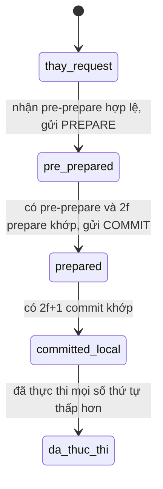
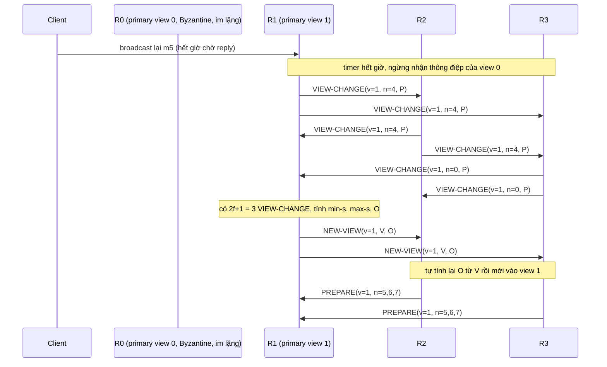

# P15 · Chương 10 — BFT hiện đại: PBFT view change, Tendermint, HotStuff

[Chương 18 của P12](../12-he-thong-du-lieu/18-thuat-toan-dong-thuan.md) mới giới thiệu PBFT ở mức một mục (mục 7.4): bốn replica, một primary, ba pha và một sơ đồ. Chương này đi tiếp vào phần mà người vận hành một hệ BFT sớm muộn cũng gặp. Khi primary im lặng hoặc nói dối thì hệ làm gì (view change)? Vì sao một request đã commit không bao giờ bị mất qua view change? Và vì sao các thiết kế đời sau, Tendermint và HotStuff, viết lại đúng chỗ đó (nhận xét của người soạn)?

Để mọi mục có chỗ bám, cả chương dùng một ví dụ giả định tên là `settle`: sổ cái thanh toán bù trừ liên ngân hàng chạy trên 4 validator `R0`…`R3`, mỗi validator do một ngân hàng vận hành. Ngân hàng gửi vào sổ cái những lệnh như `transfer(acct:7 → acct:9, 120)`. Vì bốn ngân hàng không hoàn toàn tin nhau, ta không giả định mọi validator chỉ hỏng kiểu dừng: một validator có thể bị xâm nhập, hoặc chạy lệch phần mềm, rồi ký hai thông điệp mâu thuẫn cho hai bên. Với n = 4 và f = 1, `settle` phải chịu được một validator như thế (nhận xét của người soạn: đây là ví dụ giả định, không phải code trong repo).

## Bạn sẽ hiểu được gì

1. **Q1.** Trong PBFT, một request đi qua ba pha pre-prepare, prepare, commit như thế nào? Hai vị từ `prepared` và `committed-local` nghĩa chính xác là gì, và vì sao thiếu pha commit thì view change có thể làm mất một request đã được thực thi? → mục 1
2. **Q2.** Log của PBFT không phình mãi nhờ checkpoint ổn định và hai ngưỡng low/high water mark ra sao, và vì sao primary Byzantine không "đốt" hết dải số thứ tự được? → mục 2
3. **Q3.** Khi primary im lặng hoặc gian lận, view change chạy từng bước thế nào: `VIEW-CHANGE` chứa gì, primary mới tính tập `O` từ 2f+1 thông điệp ra sao, backup kiểm tra `NEW-VIEW` thế nào? → mục 3
4. **Q4.** Vì sao request đã commit ở một view chắc chắn sống sót qua mọi view change sau đó (chứng minh từng bước), và vì sao kẻ xấu không kéo hệ chạy view change mãi được? → mục 4
5. **Q5.** Tendermint khác PBFT thế nào: vòng, ba bước propose/prevote/precommit, luật khóa `lockedValue` và `validValue`, vì sao an toàn và timeout đóng vai gì? → mục 5
6. **Q6.** HotStuff: quorum certificate (QC) với chữ ký ngưỡng, ba pha, vì sao đổi leader chỉ tốn O(n) và vì sao an toàn? → mục 6
7. **Q7.** Responsiveness là gì, vì sao bản HotStuff hai pha mất nó, và chained HotStuff pipeline ba pha thành một chuỗi các view ra sao? → mục 7
8. **Q8.** Một quyết định tốn bao nhiêu message ở PBFT (O(n²)), ở view change của PBFT (O(n³)), ở Tendermint và HotStuff; ba họ so với nhau thế nào? → mục 8

## Kiến thức cần trước

- [P12 · Chương 18, mục 1 và mục 7.4](../12-he-thong-du-lieu/18-thuat-toan-dong-thuan.md): vì sao quorum 2f+1 cho lỗi dừng và 3f+1 cho lỗi Byzantine, và bản giới thiệu PBFT (view, primary, ba pha, định nghĩa `prepared`). Chương này không giảng lại chúng mà đi sâu hơn.
- [P12 · Chương 09, mục 6](../12-he-thong-du-lieu/09-consistency-va-consensus.md) và [P12 · Chương 08, mục 4](../12-he-thong-du-lieu/08-su-co-he-phan-tan.md): phát biểu của FLP và các mô hình hệ thống (đồng bộ, bất đồng bộ, đồng bộ một phần).
- [P15 · Chương 01](01-flp-va-cac-chan-duoi.md): chứng minh các chặn dưới, trong đó có n ≥ 3f+1. Chương này chỉ dùng kết quả đó.
- [P14 · Chương 01](../14-toan-va-ly-thuyet/01-logic-va-chung-minh.md): quy nạp và bất biến, vì các chứng minh ở mục 4, 5, 6 đều là quy nạp.

---

## 1. PBFT ở trạng thái bình thường: ba pha, `prepared` và `committed-local` (Q1)

> **Trả lời ngắn.** Primary gán một số thứ tự cho request rồi gửi pre-prepare; các backup xác nhận lẫn nhau bằng prepare, sau đó bằng commit, và replica chỉ thực thi khi đã thấy đủ 2f+1 commit khớp. Hai pha đầu bảo đảm các replica đúng không bao giờ gán hai request khác nhau cho cùng một số thứ tự trong cùng một view, kể cả khi primary nói dối; pha commit bảo đảm điều đó vẫn đúng sau khi đổi view[^o-three]. Mọi con số 2f+1 ở đây dựa vào việc hai quorum 2f+1 trong 3f+1 replica luôn chung nhau ít nhất một replica đúng[^t-inter].

**Giải thích.**

*Với `settle`.* Một ngân hàng gửi `m5 = transfer(acct:7 → acct:9, 120)`. Cả bốn validator phải thực thi `m5` ở cùng một vị trí trong sổ cái, nếu không số dư của chúng sẽ lệch nhau. PBFT giải bài toán này bằng nhân bản máy trạng thái: các replica tất định và khởi động từ cùng một trạng thái, nên chỉ cần chúng đồng ý về thứ tự thực thi là trạng thái giống nhau[^o-smr]. Phần còn lại của mục này là cơ chế để đồng ý về thứ tự đó khi một validator có thể nói dối.

### 1.1 Mô hình và nhắc lại 3f+1

Phần này chỉ nhắc lại. Chứng minh đầy đủ nằm ở [P12 · Chương 18, mục 1](../12-he-thong-du-lieu/18-thuat-toan-dong-thuan.md) (và mục 7.4 cho PBFT cơ bản) cùng [chương 01 của phase này](01-flp-va-cac-chan-duoi.md). Mạng là bất đồng bộ, nên nó có thể làm mất, trễ, nhân đôi hoặc đảo thứ tự thông điệp[^o-async]. Validator hỏng theo kiểu Byzantine thì có thể làm bất cứ điều gì[^o-byz]. Primary không thể chờ cả n replica, vì f replica im lặng có thể chỉ là đã hỏng; nhưng trong n − f replica trả lời lại có thể có f replica hỏng, nên phản hồi của replica đúng phải nhiều hơn phản hồi của replica hỏng[^o-outnumber]. Viết thành bất đẳng thức, n − f − f > f, tức n > 3f (phép tính của người soạn); 3f+1 là số replica tối thiểu để một hệ bất đồng bộ vừa an toàn vừa sống[^o-optimal]. Với `settle`, n = 4 và f = 1: quorum có 2f+1 = 3 validator, hai quorum như vậy chung nhau ít nhất 2·3 − 4 = 2 validator, và trong hai validator đó có ít nhất một validator đúng. Tính chất này (intersection) là thứ mọi chứng minh bên dưới dựa vào[^t-inter]. Tính chất đi kèm là lúc nào cũng có một quorum không chứa validator hỏng nào, nên giao thức không phải chờ một validator hỏng[^t-avail].

### 1.2 Một request đi qua ba pha

Các replica đi qua một dãy *view* đánh số liên tiếp; trong mỗi view có một primary và các replica còn lại là backup[^o-views]. Primary của view v là replica v mod n, và đổi view khi có vẻ primary đã hỏng[^o-primary]. Với `settle`, view 0 có primary là `R0`. Bảng dưới theo một request qua bốn validator; "chờ gì" là điều kiện để replica sang bước kế tiếp.

| Bước | Ai gửi | Gửi cho | Replica chờ gì để sang bước sau |
|---|---|---|---|
| `REQUEST` | ngân hàng (client) | primary `R0` | không có; client gửi cho replica nó tin là primary hiện tại[^o-client-primary] |
| `PRE-PREPARE(v, n, d)` | primary, kèm request `m5` | mọi backup | backup chấp nhận nếu chữ ký đúng, đúng view, chưa chấp nhận digest khác cho cùng (v, n), và n nằm trong hai ngưỡng water mark[^o-accept-pp] |
| `PREPARE(v, n, d, i)` | mỗi backup đã chấp nhận pre-prepare | mọi replica khác[^o-prepare-send] | pre-prepare cùng 2f = 2 prepare khớp từ các backup khác nhau: replica thành `prepared` |
| `COMMIT(v, n, d, i)` | mỗi replica `prepared` | mọi replica khác[^o-commit-send] | 2f+1 = 3 commit khớp (kể cả của mình): replica thành `committed-local` |
| `REPLY` | mỗi replica đã thực thi | client | client chờ f+1 = 2 reply giống nhau; vì ít nhất một trong số đó là replica đúng nên kết quả đúng[^t-client-f1] |

Một thông điệp "khớp" khi cùng view, cùng số thứ tự và cùng digest[^o-prepared-match]. Request thật nằm trong pre-prepare; prepare và commit chỉ mang digest `d` của nó nên nhỏ gọn. Nếu client không nhận được reply đủ nhanh, nó gửi request cho mọi replica, và một primary không chuyển request đi sẽ bị đủ nhiều replica nghi ngờ để kích hoạt view change[^o-suspect].



(Sơ đồ minh họa của người soạn cho một replica, theo mô tả của bài báo.)

### 1.3 Ba vị từ

Bài báo định nghĩa ba vị từ, và cả chương dùng chúng. `prepared(m, v, n, i)` đúng khi replica `i` có trong log: request `m`, một pre-prepare của `m` ở view `v` với số `n`, và 2f prepare từ các backup khác nhau khớp với pre-prepare đó[^o-prepared-match]. Bản luận án gọi tập thông điệp này là *prepared certificate* (chứng chỉ prepared), một dạng *quorum certificate*: tập thông điệp, mỗi thông điệp từ một replica của một quorum, chứng minh rằng thông tin đã được các replica đó ghi lại[^t-cert]. `committed(m, v, n)` đúng khi `prepared` đúng ở mọi replica trong một tập nào đó gồm f+1 replica đúng[^o-committed-def]. `committed-local(m, v, n, i)` đúng khi `prepared` đúng ở `i` và `i` đã nhận 2f+1 commit khớp, có thể kể cả commit của chính nó[^o-committed-local]. Hai vị từ cuối nối với nhau: nếu `committed-local` đúng ở một replica đúng thì `committed` đúng[^o-committed-inv].

Replica thực thi request khi `committed-local` đúng và mọi request có số thấp hơn đã được thực thi[^o-exec]. Thông điệp có thể đến lộn xộn, nên một replica có thể commit lệch thứ tự, nhưng nó giữ thông điệp trong log cho tới khi thực thi được[^o-ooo].

### 1.4 Bổ đề 1: trong một view không có hai `prepared` khác nhau

Đây là phần "totally order trong một view" của pha 1 và pha 2. Phát biểu chính xác (theo bài báo và luận án; phần chứng minh chi tiết dưới đây do người soạn viết lại):

**Bổ đề 1.** Nếu replica đúng `i` có `prepared(m, v, n, i)` và replica đúng `j` có `prepared(m', v, n, j)` thì digest của `m` bằng digest của `m'` (nên `m = m'` nếu hàm băm chống va chạm).

*Chứng minh.* Bài báo chỉ ghi ý chính[^o-inv-proof]; các bước dưới là bản đầy đủ.

1. Mỗi chứng chỉ prepared gồm một pre-prepare của primary và 2f prepare của 2f backup khác nhau, vậy có 2f+1 replica khác nhau đã ký thông điệp mang bộ ba (v, n, digest) tương ứng.
2. Gọi `A` và `B` là hai tập 2f+1 replica đó, một tập cho `m` và một tập cho `m'`. Trong n = 3f+1 replica, `|A ∩ B| ≥ |A| + |B| − n = 2(2f+1) − (3f+1) = f+1`.
3. Có tối đa f replica hỏng, mà `|A ∩ B| ≥ f+1`, nên trong `A ∩ B` có ít nhất một replica đúng `k`[^t-lemma1-proof].
4. `k` đã ký thông điệp cho (v, n, d) lẫn (v, n, d'). Replica đúng chỉ gửi prepare sau khi chấp nhận một pre-prepare, và không chấp nhận pre-prepare thứ hai với digest khác cho cùng (v, n)[^o-accept-pp]; nếu `k` là primary thì nó chỉ gửi một pre-prepare cho mỗi (v, n). Vậy `d = d'`. ∎

Kết luận trùng với khẳng định của luận án: không thể có hai chứng chỉ prepared cho cùng view và số thứ tự nhưng khác request[^t-lemma1].

*Thử trên `settle`.* Giả sử `R0` là primary Byzantine, gửi pre-prepare `d` cho `R1`, và pre-prepare `d'` cho `R2` và `R3`. Ba backup đúng là `R1`, `R2`, `R3`. Để `d` thành `prepared` ở đâu đó cần 2 backup ký prepare cho `d`, để `d'` cần thêm 2 backup khác ký cho `d'`; 2 + 2 = 4 lớn hơn 3 backup hiện có, nên không thể cả hai cùng `prepared`. Ở ví dụ này `R2` và `R3` thành `prepared` với `d'`, còn `R1` thì không (nó chỉ có prepare của chính mình cho `d`). Đó là Bổ đề 1 ở n = 4.

Kiểm bằng cách đếm cho vài giá trị f, người soạn viết một chương trình Rust nhỏ (mã ở cuối mục 4) để duyệt mọi cặp quorum và mọi tập replica hỏng. Chương trình chỉ kiểm phần đếm, không kiểm giao thức. Kết quả một lần chạy (`rustc 1.95.0`, macOS; đây là quan sát, không phải bảo đảm của bài báo):

```text
== 1. Giao quorum (n, f, q): so (cap quorum, tap hong) ma giao nam tron trong tap hong ==
f=1 n=4 q=3: cases=64 bad=0
f=1 n=3 q=2: cases=27 bad=6
f=2 n=7 q=5: cases=9261 bad=0
f=2 n=6 q=4: cases=3375 bad=90
f=3 n=10 q=7: cases=1728000 bad=0
f=3 n=9 q=6: cases=592704 bad=1680
```

Với n = 3f+1 và quorum 2f+1 không có trường hợp nào phần chung nằm trọn trong tập hỏng (`bad=0`). Với n = 3f và quorum n − f = 2f thì có (`bad > 0`): phần chung có thể chỉ gồm replica hỏng, và đó là lý do 3f replica không đủ.

### 1.5 Vì sao cần pha commit: một vết chạy hỏng nếu thiếu nó

Bổ đề 1 chỉ nói về *một* view. Qua view change thì chưa đủ: các replica có thể thu được chứng chỉ prepared ở các view khác nhau, cho cùng một số thứ tự nhưng khác request[^t-notenough]. Primary mới có thể không có chứng chỉ ấy[^t-newprimary]. Và không có cách nào để nó chắc chắn chọn đúng[^t-noway]. Pha commit giải quyết việc đó, nên ta dựng một vết chạy trên `settle` để thấy cái gì hỏng nếu bỏ nó (người soạn dựng, theo ý của luận án).

Giả sử một biến thể bỏ pha commit và cho replica thực thi ngay khi `prepared`. Trong view 0, primary `R0` hỏng gửi pre-prepare `(0, 5, d5)` chỉ cho `R2` và `R3`. `R2` và `R3` nhận prepare của nhau nên `R2` thành `prepared`; prepare của `R2` tới `R3` bị trễ, nên `R3` mới chỉ nhận pre-prepare. `R1` không biết gì về số 5. `R2` thực thi `m5` và ghi nhận số dư mới. Sau đó `R0` im lặng, view change sang view 1 với primary `R1`. `R1` nhận VIEW-CHANGE từ `R0` (hỏng, không báo gì), từ chính nó và từ `R3`; chứng chỉ duy nhất của `R2` vắng mặt. Với tập này không có chứng chỉ nào cho số 5, nên view 1 có thể gán số 5 cho một request khác, và `R2` đã thực thi `m5` ở đó: các validator lệch nhau. Primary mới không thể chờ thêm `R2`, vì nó chỉ được chờ 2f+1 = 3 trong 4 validator (lý do ở mục 1.1).

Pha commit chặn kịch bản này bằng một ràng buộc về số đếm. Replica chỉ thực thi khi có 2f+1 commit khớp, và một replica đúng chỉ gửi commit khi đã `prepared`[^o-commit-send]. Trong 2f+1 người gửi commit có tối đa f người hỏng, nên ít nhất f+1 replica đúng đã `prepared`. Đó chính là định nghĩa của `committed`, và vì thế `committed-local` kéo theo `committed`[^o-committed-inv].

**Bổ đề 2.** Nếu `committed-local(m, v, n, i)` đúng ở một replica đúng `i` thì ít nhất f+1 replica đúng đã `prepared(m, v, n)`.

*Chứng minh.* (1) `i` có 2f+1 commit khớp từ các replica khác nhau[^o-committed-local]. (2) Tối đa f trong số đó hỏng, nên ít nhất (2f+1) − f = f+1 commit do replica đúng gửi. (3) Replica đúng chỉ multicast commit khi `prepared` đã đúng ở nó[^o-commit-send]. (4) Vậy f+1 replica đúng đó đều đã `prepared`. ∎

Hệ quả cho view change (mục 3 và 4): bất kỳ tập 2f+1 replica nào primary mới chọn cũng chứa ít nhất một replica trong f+1 replica đúng ấy, vì (f+1) + (2f+1) > 3f+1. Đó là cách luận án nói rằng sau khi request đã commit thì nó đã được prepared bởi một quorum, và primary mới đọc chứng chỉ prepared từ một quorum rồi chọn gán số theo view mới nhất[^t-commit-quorum].

<details><summary>Đi sâu: chữ ký và MAC, replica phải độc lập, gom lô, thực thi tentative</summary>

- *Chữ ký và MAC.* Để dễ trình bày, bài báo mô tả giao thức với chữ ký số cho mọi thông điệp. Bản cài đặt thực chỉ dùng chữ ký cho `VIEW-CHANGE` và `NEW-VIEW` vì hai loại này hiếm; mọi thông điệp khác dùng MAC[^o-sig-vc]. Mỗi thông điệp mang một *authenticator*, một vector MAC có một ô cho mỗi replica khác ngoài người gửi[^o-authenticator]. Cái giá là MAC không chứng minh được tính xác thực của thông điệp cho bên thứ ba[^t-mac-limit], nên bản MAC phải đổi cách làm view change (mục 3, phần Đi sâu).
- *Replica phải hỏng độc lập.* Bài báo giả định các node hỏng độc lập, và nêu rằng để giả định đó đứng vững trước tấn công thì mỗi node nên chạy cài đặt khác nhau của dịch vụ và hệ điều hành, có mật khẩu root và quản trị viên riêng[^o-indep]. Với `settle`, bốn ngân hàng cùng mua một phần mềm validator thì một lỗ hổng chung hạ cả bốn cùng lúc, và ngưỡng f = 1 mất ý nghĩa (nhận xét của người soạn; xem thêm [P12 · Chương 08, phần Đi sâu về Byzantine và bug](../12-he-thong-du-lieu/08-su-co-he-phan-tan.md)).
- *Gom lô.* Primary có thể giữ request trong bộ đệm khi đã có quá nhiều giao thức đang chạy, rồi multicast cả nhóm cùng lúc để giảm lưu lượng và CPU lúc tải nặng[^o-batch]. Một số vòng ba pha khi đó phục vụ nhiều request, và chi phí O(n²) ở mục 8 chia đều cho cả lô (nhận xét của người soạn).
- *Thực thi tentative.* Một tối ưu của bài báo cho replica thực thi ngay khi `prepared`, miễn là mọi request có số thấp hơn đã biết là đã commit[^o-tentative]. Client khi đó chờ 2f+1 reply tentative giống nhau, và nếu có đủ thì request chắc chắn sẽ commit[^o-tentative-client]. Cái giá khớp với vết chạy ở mục 1.5: request thực thi tentative có thể bị hủy nếu view change thay nó bằng request rỗng[^o-tentative-abort], nên replica phải có khả năng quay trạng thái về checkpoint.

</details>

**Quay lại Q1:** request đi qua pre-prepare, prepare, commit; `prepared` (pre-prepare cùng 2f prepare khớp) cho thứ tự duy nhất trong một view, còn `committed-local` (thêm 2f+1 commit) kéo theo ít nhất f+1 replica đúng đã `prepared`, và chính con số f+1 đó là thứ giữ cho request không bị mất khi đổi view; thiếu pha commit thì `R2` ở vết chạy trên thực thi một request mà view sau có thể gán lại.

---

## 2. Checkpoint và water mark: log không phình mãi (Q2)

> **Trả lời ngắn.** Replica không thể xóa log ngay sau khi thực thi, vì chứng chỉ prepared trong log có thể còn cần cho view change về sau[^t-gc]. Vì vậy cứ sau một số request cố định, replica chụp checkpoint của trạng thái và multicast `CHECKPOINT` kèm digest; khi gom đủ thông điệp khớp từ các replica khác nhau thì checkpoint thành *ổn định* (stable) và log trước nó được xóa[^o-ckpt-discard]. Số thứ tự thấp nhất mà replica còn nhận (low water mark) bằng checkpoint ổn định cuối cùng, còn số cao nhất (high water mark) cách nó một khoảng cố định, nên primary Byzantine không chọn số thứ tự thật lớn để hết sạch dải số được[^o-hl].

**Giải thích.**

*Với `settle`.* Mỗi giao dịch để lại trong log của một validator một pre-prepare, vài prepare và vài commit. Sau một triệu giao dịch, giữ hết thì đĩa đầy; vứt bừa thì mất chứng cứ cần cho view change (nhận xét của người soạn). Câu hỏi của mục này là lúc nào vứt được an toàn.

### 2.1 Vì sao không vứt ngay, và checkpoint là gì

Replica chỉ được bỏ thông điệp của các request đã thực thi sau khi có bằng chứng rằng trạng thái của nó đúng[^t-gc-proof]. Tạo bằng chứng sau mỗi thao tác thì quá đắt, nên bài báo làm định kỳ: khi thực thi request có số chia hết cho một hằng số nào đó (ví dụ 100)[^o-gc-periodic]. Trạng thái sinh ra từ các request ấy gọi là checkpoint, và checkpoint có kèm bằng chứng gọi là checkpoint ổn định[^o-stable-def].

Khi tạo checkpoint, replica multicast một thông điệp `CHECKPOINT` mang số thứ tự của request cuối cùng đã được phản ánh vào trạng thái và digest của trạng thái[^o-ckpt-msg]. Mỗi replica gom thông điệp `CHECKPOINT` cho đến khi có một tập 2f+1 thông điệp cùng số thứ tự, cùng digest, ký bởi các replica khác nhau; tập đó là bằng chứng cho checkpoint[^o-ckpt-proof]. Lúc ấy checkpoint thành ổn định, và replica xóa mọi pre-prepare, prepare, commit có số không lớn hơn nó, cùng các checkpoint cũ[^o-ckpt-discard].

### 2.2 Hai ngưỡng water mark

Checkpoint ổn định còn đẩy cửa sổ số thứ tự đi tới. Low water mark `h` bằng số thứ tự của checkpoint ổn định cuối cùng, còn high water mark là `H = h + L`; `L` đủ lớn để replica không phải dừng chờ checkpoint thành ổn định, chẳng hạn khi chu kỳ là 100 thì `L` có thể là 200[^o-hwm-size]. Replica chỉ nhận pre-prepare, prepare, commit có số thứ tự nằm trong dải đó[^o-watermarks]. (Dải là `h < n ≤ H` vì checkpoint `h` đã gồm các request có số không lớn hơn `h`; đầu mút do người soạn suy ra.)

Bảng dưới dùng số tượng trưng của người soạn: chu kỳ checkpoint K = 4 và `L` = 8 (bài báo dùng 100 và 200 làm ví dụ). Hàng đầu là lúc `settle` mới khởi động.

| Thời điểm | Checkpoint ổn định cuối (`h`) | Dải số thứ tự được nhận (`h < n ≤ H`) |
|---|---|---|
| mới khởi động | 0 | 1 … 8 |
| sau khi ba validator gom đủ `CHECKPOINT` cho số 4 | 4 | 5 … 12 |
| sau khi gom đủ cho số 8 | 8 | 9 … 16 |

Dải này chặn một kiểu tấn công rẻ: primary Byzantine gửi pre-prepare với số 1 000 000 để "đốt" không gian số thứ tự. Backup đúng từ chối vì số đó nằm ngoài dải[^o-hl]. Ngược lại, nếu không checkpoint nào thành ổn định (chẳng hạn f+1 validator chậm quá lâu), dải không dịch chuyển và các replica dừng khi chạm `H`; vì thế `L` phải đủ lớn so với chu kỳ[^o-hwm-size].

### 2.3 Replica tụt lại và vai trò trong view change

Replica lỡ mất thông điệp mà mọi replica đúng đã xóa thì không thể chạy lại log; nó lấy trạng thái từ một trong các replica đã chứng nhận checkpoint đó[^o-state-fetch]. Con số f+1 replica đúng trong 2f+1 chữ ký bảo đảm nó luôn lấy được (suy luận của người soạn từ định nghĩa quorum ở mục 1.1).

Checkpoint ổn định cũng nằm trong `VIEW-CHANGE` ở mục 3: replica báo số thứ tự `n` của checkpoint ổn định cuối cùng cùng bằng chứng của nó, và primary mới lấy `min-s` là checkpoint cao nhất trong số đó. Mọi thứ có số không lớn hơn `min-s` được coi là đã xong.

<details><summary>Đi sâu: bao nhiêu thông điệp CHECKPOINT là đủ, và chi phí lưu nhiều bản trạng thái</summary>

- *f+1 hay 2f+1.* Bài báo OSDI đòi 2f+1 thông điệp `CHECKPOINT` khớp[^o-ckpt-proof]. Bản luận án của biến thể dùng chữ ký (BFT-PK) nói chứng chỉ ổn định chỉ là một chứng chỉ yếu (*weak certificate*) f+1 thông điệp, đủ chứng minh rằng ít nhất một replica đúng có checkpoint đó[^t-weak-ckpt]. Hai văn bản không trùng con số. Chương này lấy 2f+1 theo bài báo OSDI; người soạn không tìm thấy nguồn giải thích sự khác nhau và không dùng nó trong lập luận nào.
- *Nhiều bản trạng thái.* Mỗi replica giữ nhiều bản trạng thái logic: checkpoint ổn định cuối, vài checkpoint chưa ổn định, và trạng thái hiện tại[^o-copies]. Với `settle`, nếu sổ cái là một trạng thái lớn thì chi phí này đáng kể, và bài báo có nhắc kỹ thuật copy-on-write để giảm nó (nhận xét của người soạn: bài báo nói đến kỹ thuật, không cho số đo ở đây).
- *Cửa sổ và độ trễ.* `L` bằng chu kỳ nhân một hằng số nhỏ (luận án nêu ví dụ 2) để ít khi replica phải đứng chờ checkpoint thành ổn định[^t-logsize].

</details>

**Quay lại Q2:** replica chụp checkpoint định kỳ, gom 2f+1 `CHECKPOINT` khớp để checkpoint thành ổn định rồi mới xóa log, và dải số thứ tự được nhận `(h, H]` trượt theo checkpoint nên primary Byzantine không đốt hết dải số được.

---

## 3. View change từng bước: `VIEW-CHANGE`, `NEW-VIEW` và tập `O` (Q3)

> **Trả lời ngắn.** Backup có request chưa thực thi sẽ bật timer; hết giờ thì nó bỏ view hiện tại và multicast `VIEW-CHANGE` chứa checkpoint ổn định cuối cùng cùng chứng chỉ prepared của mọi request nó đã prepare ở số cao hơn checkpoint đó[^o-vc-content]. Primary của view mới gom 2f+1 thông điệp như vậy, tính tập `O` gồm đúng một pre-prepare cho mỗi số thứ tự từ `min-s` đến `max-s` (lấy digest từ chứng chỉ có view cao nhất, và dùng request rỗng nếu không có chứng chỉ nào), rồi gửi `NEW-VIEW`[^o-nv-mins]. Mỗi backup tự tính lại `O` từ các `VIEW-CHANGE` đi kèm để kiểm tra primary mới không gian lận[^o-nv-verify].

**Giải thích.**

*Với `settle`.* Giả sử `R0` đang là primary của view 0 và bỗng im lặng hoặc bắt đầu nói dối. Ba validator còn lại cần một primary mới mà vẫn giữ nguyên lời hứa: giao dịch nào đã được một validator thực thi thì không bị gán lại cho giao dịch khác. Ở Raft, người thắng cử tự động có mọi entry đã commit vì cử tri chỉ bỏ phiếu cho ứng viên có log đủ mới. PBFT không thể tin lời tự khai của validator, nên primary mới phải *tự đọc* bằng chứng ký từ một quorum rồi tính ra thứ tự (nhận xét của người soạn).

### 3.1 Khi nào đổi view

View change do timeout kích hoạt, để backup không phải chờ vô hạn một request chưa thực thi[^o-vc-timers]. Backup bật timer khi nhận một request hợp lệ mà timer chưa chạy, tắt timer khi không còn chờ request đó, và bật lại nếu nó đang chờ request khác[^o-vc-timer-start]. Client cũng góp phần: không thấy reply thì nó broadcast request cho mọi replica[^o-client-retransmit].

### 3.2 Thông điệp `VIEW-CHANGE`

Khi timer của backup `i` hết hạn ở view `v`, nó ngừng nhận mọi thông điệp trừ `CHECKPOINT`, `VIEW-CHANGE` và `NEW-VIEW`[^o-vc-stop], rồi multicast `⟨VIEW-CHANGE, v+1, n, C, P, i⟩` cho mọi replica. Các trường là: `n` là số thứ tự của checkpoint ổn định cuối cùng `i` biết, `C` là bằng chứng 2f+1 thông điệp `CHECKPOINT` cho nó (mục 2), và `P` là tập mà mỗi phần tử `P_m` ứng với một request `m` đã `prepared` ở `i` với số cao hơn `n`[^o-vc-content]. Mỗi `P_m` gồm một pre-prepare hợp lệ (không kèm request của client) và 2f prepare hợp lệ ký bởi các backup khác nhau, cùng view, số thứ tự và digest[^o-vc-pm]. Nói cách khác, `P_m` chính là chứng chỉ prepared của mục 1.3, và nó phải kiểm tra được bởi người thứ ba, nên các thông điệp trong đó phải là chữ ký chứ không phải MAC.

### 3.3 Primary mới tính `O` và gửi `NEW-VIEW`

Primary của view v+1 là replica (v+1) mod n[^o-primary]. Khi nó nhận được 2f `VIEW-CHANGE` hợp lệ cho view v+1 từ các replica khác, cộng thông điệp của chính nó, nó gửi `⟨NEW-VIEW, v+1, V, O⟩`[^o-nv-collect]. Ở đây `V` là tập các `VIEW-CHANGE` hợp lệ đã nhận, và `O` là tập pre-prepare không kèm request[^o-nv-V]. Luận án gọi `V` là *new-view certificate* và nói nó chắc chắn chứa chứng chỉ prepared của mọi request đã commit ở các view trước, cùng chứng chỉ của một số request mới chỉ prepared[^t-vc-newview-cert].

Cách tính `O` có hai bước[^o-nv-mins]:

1. `min-s` là số thứ tự của checkpoint ổn định cao nhất xuất hiện trong `V`, và `max-s` là số thứ tự cao nhất xuất hiện trong một chứng chỉ prepared của `V`.
2. Với mỗi số thứ tự `n` giữa `min-s` và `max-s`, có hai trường hợp[^o-nv-two]. Trường hợp (1): trong `V` có ít nhất một chứng chỉ cho `n`. Khi đó primary tạo `⟨PRE-PREPARE, v+1, n, d⟩` với `d` là digest của request trong chứng chỉ có view cao nhất[^o-nv-case1]. Trường hợp (2): không có chứng chỉ nào cho `n`. Khi đó primary tạo `⟨PRE-PREPARE, v+1, n, d_null⟩` với `d_null` là digest của một request rỗng; request rỗng đi qua giao thức như mọi request khác nhưng việc thực thi nó là no-op[^o-nv-case2].

(Đầu mút dưới là `n > min-s` vì checkpoint `min-s` đã phản ánh các request có số không lớn hơn nó; bài báo chỉ viết "giữa `min-s` và `max-s`", nên đầu mút do người soạn suy ra.)

### 3.4 Backup kiểm tra và vào view mới

Backup chỉ chấp nhận `NEW-VIEW` nếu nó ký đúng, các `VIEW-CHANGE` trong `V` hợp lệ cho view v+1, và `O` đúng; nó kiểm tra `O` bằng cách chạy lại phép tính tương tự của primary[^o-nv-verify]. Phép kiểm tra này chặn primary mới gán số thứ tự xung đột với các request đã commit ở view trước[^t-checks]. Sau khi chấp nhận, backup ghi thông tin mới vào log, multicast một prepare cho mỗi thông điệp trong `O`, rồi vào view v+1[^o-nv-enter]. Từ đây giao thức chạy như mục 1: các replica làm lại ba pha cho các số từ `min-s` đến `max-s`, nhưng không thực thi lại request của client nhờ bản ghi reply cuối cùng của mỗi client[^o-redo]. Request và checkpoint không nằm trong `NEW-VIEW`, nên replica thiếu thì hỏi replica khác[^o-nv-missing].

### 3.5 Vết chạy trên `settle`

Dựng (người soạn) với n = 4, f = 1, chu kỳ checkpoint K = 4. Trong view 0, `R0` (primary) là Byzantine. Trạng thái ngay trước view change:

- Số 1 đến 4 đã thực thi ở mọi validator. `R1` và `R2` đã gom đủ `CHECKPOINT` nên có checkpoint ổn định ở số 4; `R3` chưa gom đủ nên checkpoint ổn định của nó vẫn là 0 và log còn đủ các số 1 đến 4.
- Số 5 (`m5`, digest `d5`): `R0` gửi pre-prepare cho cả ba backup, và `R1`, `R2`, `R3` đều đã `prepared`. `R0` chỉ gửi `COMMIT` của nó cho `R1`, các commit khác còn trễ. Nên `m5` mới `committed-local` ở `R1`; `R1` thực thi `m5` và trả lời client, còn client mới có một reply trong hai reply cần có.
- Số 6 (`m6`, digest `d6`): `R0` chỉ gửi pre-prepare cho `R3`. `R3` có pre-prepare và prepare của chính nó, `R1` và `R2` chỉ có prepare của `R3` mà không có pre-prepare. Không replica nào `prepared`.
- Số 7 (`m7`, digest `d7`): `R0` gửi pre-prepare cho `R2` và `R3`. Cả hai gửi prepare cho nhau nên cùng `prepared`; `R1` không có pre-prepare nên không.

Client của `m5` không đủ reply nên broadcast lại, `R2` và `R3` có request chưa thực thi nên timer hết hạn. Cả ba multicast `VIEW-CHANGE` cho view 1; `R0` im lặng. Primary của view 1 là `R1` (vì 1 mod 4 = 1), và nó có ba thông điệp, kể cả của chính nó:

| Người gửi | `n` (checkpoint ổn định) | `P` (chứng chỉ prepared, dạng `(số, view, digest)`) |
|---|---|---|
| `R1` | 4 | (5, 0, d5) |
| `R2` | 4 | (5, 0, d5), (7, 0, d7) |
| `R3` | 0 | (1, 0, d1), (2, 0, d2), (3, 0, d3), (4, 0, d4), (5, 0, d5), (7, 0, d7) |

Tính `O`. `min-s` là checkpoint ổn định cao nhất trong `V`, tức 4 (của `R1` và `R2`; các chứng chỉ cho số 1 đến 4 trong thông điệp của `R3` bị bỏ qua). `max-s` là số cao nhất trong một chứng chỉ, tức 7. Với n = 5: cả ba thông điệp có chứng chỉ, đều ở view 0 và đều cho `d5`. Với n = 6: không thông điệp nào có chứng chỉ. Với n = 7: `R2` và `R3` có chứng chỉ cho `d7`. Vậy `O` gồm `(1, 5, d5)`, `(1, 6, null)`, `(1, 7, d7)`, theo dạng `(view, số, digest)`.

Người soạn viết hàm `compute_o` cho đúng hai bước ở mục 3.3 (mã ở phần Đi sâu cuối mục 4) và đưa vào đúng ba thông điệp trong bảng. Quan sát một lần chạy (`rustc 1.95.0`, macOS):

```text
V tu ["R1", "R2", "R3"]: min-s=4 max-s=7
  PRE-PREPARE(v=1, n=5, d=d5)
  PRE-PREPARE(v=1, n=6, d=null)
  PRE-PREPARE(v=1, n=7, d=d7)
```

Kết quả khớp phép tính tay: số 5 giữ nguyên `m5` (đúng điều `R1` đã thực thi), số 6 thành request rỗng, số 7 giữ `m7`. Backup `R2`, `R3` tính lại `O` từ `V` ra cùng kết quả nên chấp nhận `NEW-VIEW`, multicast prepare cho ba số trên và chạy lại ba pha. `R2` và `R3` thực thi `m5` ở số 5; `R1` không thực thi lại. Số 6 là no-op. Ngân hàng gửi `m6` hết giờ chờ và gửi lại, rồi `m6` nhận một số mới trong view 1; điều này an toàn vì không replica nào từng `prepared` `m6`, nên `m6` chưa thể `committed` ở đâu cả (suy luận của người soạn từ định nghĩa `committed`).



(Sơ đồ của người soạn minh họa vết chạy trên; `R0` im lặng nên không có mũi tên nào đi ra từ nó.)

### 3.6 Nếu primary mới cũng gian lận

Giả sử `R1` cũng Byzantine và gửi `O` gán số 5 cho một request khác. Backup tính lại `O` từ `V` đi kèm, thấy không khớp, và không vào view 1[^o-nv-verify]. Khi đó timer của nó hết hạn mà chưa có `NEW-VIEW` hợp lệ, nên nó bắt đầu view change sang view tiếp theo, và `R2` trở thành primary[^o-live-wait]. Đây chính là cơ chế bảo vệ của mục 4: bằng chứng nằm trong `V`, và ai cũng tự kiểm tra lại được.

<details><summary>Đi sâu: bản dùng MAC (P và Q sets, view-change-ack), luật "view cao nhất thắng", chữ ký trong view change</summary>

- *Vì sao bản MAC khác.* Chữ ký cho người nhận khả năng chứng minh với bên thứ ba rằng thông điệp là thật; MAC thì không, vì bên thứ ba không biết khóa[^t-mac-limit]. Bản chữ ký của PBFT dựa vào việc replica trao đổi chứng chỉ trong view change, và việc đó chỉ chạy nếu các thông điệp trong chứng chỉ có chữ ký[^t-mac-vc]. Luận án giữ nguyên cấu trúc trao đổi ở trường hợp bình thường và checkpoint, đổi lại bằng những thay đổi lớn và tinh vi trong view change[^t-macs-changes].
- *view-change-ack.* Trong bản MAC, backup gửi cho primary mới một xác nhận cho mỗi `VIEW-CHANGE` nhận từ replica khác; các xác nhận này dùng để chứng minh tính xác thực của `VIEW-CHANGE` trong new-view certificate[^t-ack]. Nếu backup tính lại quyết định của primary mà không khớp, luận án nói các replica chuyển ngay sang view v+2[^t-moveon].
- *Chữ ký trong bản chạy thật.* Bài báo nói chữ ký chỉ còn dùng cho `VIEW-CHANGE` và `NEW-VIEW`, những thông điệp hiếm[^o-sig-vc].
- *Request rỗng.* Ở bản MAC, với số không có request đã commit, primary có thể pre-prepare một request đang dở nhưng chưa commit, hoặc chọn request rỗng, một request đi qua giao thức như thường nhưng thực thi là no-op[^t-null-mac]. Request rỗng cũng đi qua đủ ba pha, nên một lỗ hổng trong dải số thứ tự không làm hệ đứng lại (nhận xét của người soạn).
- *Luật view cao nhất.* Hàm `compute_o` chọn chứng chỉ có view cao nhất cho mỗi số. Trường hợp cần luật này: một replica `prepared` `(5, 0, dA)`, còn view 0 đổi sang view 1 trong đó số 5 được gán lại và một replica khác `prepared` `(5, 1, dB)`; nếu view 2 nhận cả hai, nó phải chọn `dB`. Mục 4 phần Đi sâu có kết quả chạy của đúng tình huống này.

</details>

**Quay lại Q3:** view change là một giao thức đọc-rồi-tính: mỗi replica gửi kèm bằng chứng ký về những gì nó đã prepared, primary mới lấy 2f+1 bằng chứng, tính `O` theo luật "view cao nhất, hoặc request rỗng", và mọi backup tự tính lại `O` để không phải tin primary.

---

## 4. Vì sao request đã commit sống sót qua view change, và vì sao view change không kẹt mãi (Q4)

> **Trả lời ngắn.** Request đã commit ở view v có ít nhất f+1 replica đúng đã `prepared` nó. Mọi tập 2f+1 `VIEW-CHANGE` mà primary mới gom đều chứa ít nhất một replica đúng trong nhóm đó, vì (f+1) + (2f+1) > 3f+1, và thông điệp của replica ấy mang chứng chỉ prepared không giả được, nên `O` gán lại đúng request đó cho đúng số thứ tự trong view mới[^o-safety-propagate]. Chứng minh đi bằng quy nạp theo view để phủ mọi view sau. Về tính sống, bài báo dùng ba kỹ thuật (chờ đủ 2f+1 `VIEW-CHANGE` trước khi bật timer và tăng gấp đôi timeout, nhảy sang view nhỏ nhất trong f+1 thông điệp, và primary xoay vòng) để view change không bị kẻ xấu kéo mãi[^o-live-end].

**Giải thích.**

*Với `settle`.* Nếu `R1` đã thực thi `m5` rồi view change làm `m5` biến mất hoặc bị gán lại cho giao dịch khác, ngân hàng gửi `m5` thấy sổ cái ghi một đằng còn ba validator kia ghi một nẻo (nhận xét của người soạn). Mục này chứng minh điều đó không xảy ra, rồi nói vì sao hệ vẫn tiến triển được.

### 4.1 Phát biểu

Giả thiết: n = 3f+1, tối đa f replica hỏng, chữ ký không giả được, hàm băm chống va chạm, và replica đúng làm đúng giao thức. "Tồn tại chứng chỉ prepared cho `(u, n, d)`" nghĩa là tồn tại 2f+1 chữ ký khác nhau trên pre-prepare hoặc prepare khớp bộ ba đó (mục 1.3). Bài báo dùng chữ ký, nên chứng chỉ kiểm tra được bởi bất kỳ ai[^t-propagate]. Một `VIEW-CHANGE` cho view u chỉ hợp lệ nếu mọi chứng chỉ trong nó thuộc view nhỏ hơn u; luận án nêu điều kiện này tường minh cho bản MAC[^t-viewbound], còn bản chữ ký ngầm hiểu điều kiện đó (nhận xét của người soạn).

**Định lý 1 (người soạn phát biểu từ phác thảo của bài báo).** Giả sử `(v, n, d)` đã `committed`: có tập `A` gồm ít nhất f+1 replica đúng đã `prepared` request có digest `d` ở view `v` với số `n`. Khi đó với mọi view `u > v`:

- **(a)** với mọi tập `V` gồm 2f+1 `VIEW-CHANGE` hợp lệ cho view `u` từ các replica khác nhau, nếu `min-s(V) < n` thì phép tính `O` từ `V` gán `d` cho số `n`;
- **(b)** không tồn tại chứng chỉ prepared nào cho `(u, n, d')` với `d' ≠ d`.

Bài báo chỉ phác thảo ý này cho view `v+1`: replica đúng trong giao của hai tập sẽ đưa chứng chỉ vào `VIEW-CHANGE`, và view mới làm lại ba pha cho số đó[^o-safety-redo]. Luận án cũng nêu định lý tương đương cho bản MAC và chứng minh bằng quy nạp theo số view giữa `v` và `u`[^t-induct]. Bản đầy đủ dưới đây (đủ mọi view, đủ cả bước (b)) do người soạn viết.

### 4.2 Chứng minh (chứng minh của người soạn, theo phác thảo của bài báo)

*Chứng minh.* Quy nạp mạnh theo `u`. Cơ sở: (b) đúng cho `u = v` theo Bổ đề 1 (mục 1.4), vì đã có chứng chỉ cho `(v, n, d)`. Bước quy nạp: lấy `u > v` và giả sử (b) đúng cho mọi view `w` với `v ≤ w < u`. Ta chứng minh (a) cho `u`, rồi dùng (a) để chứng minh (b) cho `u`.

**Chứng minh (a) cho `u`.** Cho `V` gồm 2f+1 `VIEW-CHANGE` hợp lệ với `min-s(V) < n`.

1. Gọi `S` là tập 2f+1 người gửi của `V`. Vì `|A| ≥ f+1`, ta có `|A ∩ S| ≥ |A| + |S| − n ≥ (f+1) + (2f+1) − (3f+1) = 1`. Lấy `j ∈ A ∩ S`; `j` đúng vì `A` chỉ gồm replica đúng. Đây là phép đếm giao nhau; người soạn viết lại nó cho đủ bước.
2. `j` đã `prepared` `(v, n, d)`. Checkpoint ổn định `h_j` của `j` lúc gửi `VIEW-CHANGE` không vượt `min-s(V)` (vì `min-s` là cao nhất trong `V`), nên `h_j < n`. Replica chỉ xóa log đến checkpoint ổn định của nó[^o-ckpt-discard], và checkpoint ổn định không bao giờ lùi, nên chứng chỉ của `(v, n, d)` vẫn nằm trong log của `j`. Mà `P` của `j` chứa chứng chỉ cho mọi request đã `prepared` ở `j` với số cao hơn checkpoint ổn định của nó[^o-vc-content]. Vậy `V` có một chứng chỉ cho số `n` ở view `v`.
3. Suy ra trường hợp (1) ở mục 3.3 xảy ra cho `n`, và `max-s ≥ n`. Gọi `(v*, n, d*)` là chứng chỉ cho `n` có view cao nhất trong `V`. Vì chứng chỉ của `j` ở view `v`, ta có `v* ≥ v`. Vì `VIEW-CHANGE` cho view `u` chỉ mang chứng chỉ thuộc view nhỏ hơn `u`, ta có `v* < u`.
4. Theo giả thiết quy nạp, (b) đúng cho view `v*` (vì `v ≤ v* < u`): mọi chứng chỉ cho `(v*, n, ·)` mang digest `d`. Chứng chỉ `(v*, n, d*)` trong `V` hợp lệ, nên `d* = d`. Theo quy tắc ở mục 3.3 primary chọn digest của chứng chỉ có view cao nhất, tức `d`. ∎ (a)

**Chứng minh (b) cho `u`.** Giả sử tồn tại chứng chỉ prepared cho `(u, n, d')`.

5. Chứng chỉ có ít nhất 2f+1 chữ ký khác nhau, tối đa f trong số đó hỏng, nên có ít nhất một replica đúng `k` đã ký một pre-prepare hoặc prepare cho `(u, n, d')`.
6. Replica đúng không chấp nhận pre-prepare của view `u` khi chưa nhận `NEW-VIEW` của view đó, vì chỉ lúc ấy nó mới vào view[^o-safety-newview]. Vậy `k` đã chấp nhận một `NEW-VIEW` cho `u` (hoặc `k` là primary của `u` và tự lập nó), với tập `V_k` hợp lệ và `O_k` tính đúng từ `V_k`: backup kiểm tra điều đó trước khi chấp nhận[^o-nv-verify].
7. Khi vào view `u`, `k` đặt checkpoint ổn định của nó không thấp hơn `min-s(V_k)` và ghi mọi thông điệp của `O_k` vào log[^o-nv-enter]. Mà `k` ký thông điệp cho số `n`, nên `n` nằm trong dải water mark của `k`, tức `n > h_k ≥ min-s(V_k)`. (Nếu `min-s(V_k) ≥ n` thì `k` đã bỏ số `n` khỏi dải và sẽ không ký gì cho nó[^o-safety-ckpt]; trường hợp đó không xảy ra.)
8. Vì `n > min-s(V_k)`, phần (a) vừa chứng minh cho `u` nói `O_k` chứa `PRE-PREPARE(u, n, d)`. Replica đúng không chấp nhận pre-prepare thứ hai khác digest cho cùng `(u, n)`[^o-accept-pp], và primary đúng chỉ gán mỗi số một lần trong một view. Vậy mọi thông điệp `k` ký cho `(u, n)` đều mang `d`, tức `d' = d`. ∎ (b)

Hai phần (a) và (b) cho `u` hoàn tất bước quy nạp, nên định lý đúng với mọi `u > v`. ∎

**Hệ quả 1 (an toàn).** Nếu hai replica đúng commit-local cùng số thứ tự `n`, ở view bất kỳ, thì request của chúng có cùng digest. *Chứng minh.* Giả sử replica `i` commit-local `(v1, n, d)` và replica `j` commit-local `(v2, n, d')` với `v1 ≤ v2`. Theo Bổ đề 2 (mục 1.5), `(v1, n, d)` đã `committed`. Nếu `v1 = v2` thì `d = d'` theo Bổ đề 1. Nếu `v1 < v2` thì `j` có chứng chỉ prepared cho `(v2, n, d')` (vì commit-local kéo theo `prepared`), và Định lý 1(b) cho `d' = d`. ∎ Bài báo viết đúng ý này: view change bảo đảm các replica đúng cũng thống nhất số thứ tự của những request commit-local ở các view khác nhau[^o-safety-diffview].

Trường hợp `min-s(V) ≥ n`, tức số `n` đã nằm trong một checkpoint ổn định, nằm ngoài phần (a): không replica nào trong view mới nhận thông điệp có số thấp hơn mốc đó[^o-safety-ckpt], và trạng thái của checkpoint đã phản ánh việc thực thi `n`. Phần chứng minh về tính đúng của trạng thái checkpoint bài báo chỉ phác thảo và dành chi tiết cho một báo cáo kỹ thuật riêng[^o-proof-sketch]; chương này không chứng minh lại.

### 4.3 Vì sao đúng 2f+1 `VIEW-CHANGE`

Bước 1 của chứng minh là chỗ cần 2f+1: `(f+1) + (2f+1) − (3f+1) = 1`. Nếu primary mới chỉ đợi 2f thông điệp thì phép tính thành `(f+1) + 2f − (3f+1) = 0`, và tập `V` có thể bỏ sót hoàn toàn nhóm `A`. Trên `settle` (n = 4, f = 1), giả sử một lịch chạy khác mục 3.5 trong đó chỉ `R1` và `R2` đã `prepared` `m5` còn `R3` thì chưa. Nếu primary mới dùng `V = {R0, R3}`, trong đó `R0` hỏng và báo "không có gì", thì `V` không chứa chứng chỉ nào cho số 5, `O` gán request rỗng cho số 5, trong khi `R1` đã thực thi `m5` ở đó.

Người soạn kiểm bằng cách vét cạn phần đếm: với mọi replica hỏng `z`, mọi tập `A` gồm ít nhất f+1 replica đúng, mọi tập `V` cỡ `q`, và mọi lựa chọn "báo hoặc im lặng" của replica hỏng, hỏi `O` có luôn giữ `d` không. Đây chỉ là bước đếm của chứng minh (hai tập giao nhau), không kiểm giao thức. Quan sát một lần chạy (`rustc 1.95.0`, macOS):

```text
== 3. Vet can: O co giu d khong? q = so VIEW-CHANGE ma primary moi dung ==
f=1 n=4 q=3: cases=128 bad=0
f=1 n=4 q=2: cases=192 bad=12
  vi du dau tien: hong=R0, A(prepared d)={R1,R2}, V={R0,R3}, replica hong bao d: false
f=2 n=7 q=5: cases=12348 bad=0
f=2 n=7 q=4: cases=20580 bad=140
  vi du dau tien: hong=R0, A(prepared d)={R1,R2,R3}, V={R0,R4,R5,R6}, replica hong bao d: false
```

Với `q = 2f+1` không có phản ví dụ (`bad=0`); với `q = 2f` có, và ví dụ đầu tiên chính là phản ví dụ vừa dựng bằng tay ở `settle`.

### 4.4 Tính sống: bài báo làm view change tiến triển thế nào

An toàn không cần đồng bộ, nhưng tính sống thì cần; nếu không thì thuật toán đã giải được consensus bất đồng bộ, điều FLP cấm[^o-nosync] (xem [chương 01](01-flp-va-cac-chan-duoi.md)). Giả định thời gian của bài báo khá yếu: độ trễ không được lớn nhanh hơn timeout mãi mãi, và điều đó nhiều khả năng đúng ở mọi hệ thật miễn là lỗi mạng cuối cùng được sửa[^o-weaksync]. Với giả định đó, ba kỹ thuật sau bảo đảm tính sống[^o-live-end].

1. *Đừng đổi view quá sớm, và cho mỗi lần đổi view thời gian dài gấp đôi.* Replica đã multicast `VIEW-CHANGE` cho view v+1 chờ đủ 2f+1 `VIEW-CHANGE` cho view đó rồi mới bật timer[^o-live-first]. Nếu timer hết hạn trước khi có `NEW-VIEW` hợp lệ hoặc trước khi thực thi một request mới trong view mới, nó chuyển sang view v+2 và lần này chờ lâu gấp đôi[^o-live-wait]. Cụ thể bài báo viết rằng ở lần sau nó chờ 2T trước khi sang view v+3[^o-live-double]. Mục tiêu là để khoảng thời gian có ít nhất 2f+1 replica đúng cùng ở một view tăng theo hàm mũ cho đến khi một thao tác được thực thi[^o-live-expo].
2. *Đừng đổi view quá muộn.* Nếu replica nhận được `VIEW-CHANGE` hợp lệ cho các view lớn hơn view hiện tại từ f+1 replica khác, nó gửi `VIEW-CHANGE` cho view nhỏ nhất trong tập đó dù timer chưa hết[^o-live-f1]. Vì trong f+1 replica có ít nhất một replica đúng, kẻ hỏng một mình không thể bịa ra tập này (suy luận của người soạn).
3. *Replica hỏng không tự ép được đổi view.* Muốn đổi view phải có đủ f+1 replica gửi `VIEW-CHANGE`, nên replica hỏng chỉ có thể gây đổi view khi nó là primary, bằng cách im lặng hoặc gửi thông điệp xấu[^o-live-third]. Nhưng primary của view v là replica v mod n, nên một primary hỏng không thể giữ vai quá f view liên tiếp[^o-live-primary].

Ba kỹ thuật này bảo đảm tính sống trừ khi độ trễ thông điệp lớn nhanh hơn chu kỳ timeout mãi mãi, điều bài báo cho là khó xảy ra trong hệ thật[^o-live-end].

<details><summary>Đi sâu: luật "view cao nhất thắng", định lý của luận án cho bản MAC, và mã nguồn chương trình kiểm</summary>

- *Luật view cao nhất.* Hàm `compute_o` chọn chứng chỉ có view cao nhất cho mỗi số. Trường hợp cần luật ấy: một replica `prepared` `(5, 0, dA)` ở view 0; sau đó số 5 được gán lại ở view 1 và một replica khác `prepared` `(5, 1, dB)`; nếu view 2 nhận cả hai chứng chỉ thì phải chọn `dB`. Quan sát một lần chạy trên đúng dữ liệu đó, với số 1 đến 4 không có chứng chỉ nên thành request rỗng (`rustc 1.95.0`, macOS):

  ```text
  min-s=0 max-s=5 O=[(1, "null"), (2, "null"), (3, "null"), (4, "null"), (5, "dB")]
  ```

  Ở đây `dA` chỉ là `prepared`, chưa `committed`, nên bỏ nó là hợp lệ (suy luận của người soạn từ định nghĩa `committed`).
- *Định lý của luận án cho bản MAC.* Luận án phát biểu: nếu một request commit ở view v với số n tại một replica đúng thì thủ tục quyết định sẽ không chọn request khác cho n ở bất kỳ view nào sau v. Hệ quả được nêu là không request khác nào có thể pre-prepare ở replica đúng cho cùng số n ở các view muộn hơn v[^t-thm321]. Vì thế các replica đúng thống nhất thứ tự toàn phần vì không bao giờ commit hai request khác nhau cho cùng một số[^t-thm321-total]. Phần chứng minh của luận án dùng quy nạp theo số view, cùng ý như mục 4.2.
- *Mã nguồn đầy đủ của chương trình kiểm.* Chương trình dùng cho các kết quả ở mục 1.4, 3.5, 4.3, 8 và phần Đi sâu này. Nó do người soạn viết và chạy bằng `rustc 1.95.0` trên macOS; không có trong repo.

  ```rust
  // Minh hoa cho chuong "BFT hien dai": quorum, tinh O trong NEW-VIEW, vet can so VIEW-CHANGE, dem message.

  fn subsets_of_size(n: usize, k: usize) -> Vec<u32> {
      (0u32..(1 << n)).filter(|m| m.count_ones() as usize == k).collect()
  }

  // Hai quorum co q replica trong n replica; f replica hong. Dem so (cap quorum, tap hong) ma phan chung
  // cua hai quorum nam tron trong tap hong (khong con replica dung nao chung).
  fn quorum_check(n: usize, f: usize, q: usize) -> (usize, usize) {
      let quorums = subsets_of_size(n, q);
      let faulty_sets = subsets_of_size(n, f);
      let (mut cases, mut bad) = (0usize, 0usize);
      for &a in &quorums {
          for &b in &quorums {
              let inter = a & b;
              for &z in &faulty_sets {
                  cases += 1;
                  if inter & !z == 0 {
                      bad += 1;
                  }
              }
          }
      }
      (cases, bad)
  }

  #[derive(Clone, Copy)]
  struct Cert {
      seq: u64,
      view: u64,
      digest: &'static str,
  }

  struct ViewChange {
      from: usize,
      h: u64, // so thu tu cua checkpoint on dinh moi nhat
      p: Vec<Cert>,
  }

  // Tinh O theo OSDI'99 sec. 4.4: min-s = checkpoint on dinh cao nhat trong V,
  // max-s = so thu tu cao nhat trong mot chung chi prepared trong V.
  // Voi moi n trong (min-s, max-s]: lay digest cua chung chi co view cao nhat, neu khong co thi null.
  fn compute_o(vcs: &[ViewChange]) -> (u64, u64, Vec<(u64, &'static str)>) {
      let min_s = vcs.iter().map(|v| v.h).max().unwrap();
      let max_s = vcs
          .iter()
          .flat_map(|v| v.p.iter().map(|c| c.seq))
          .max()
          .unwrap_or(min_s);
      let mut o = Vec::new();
      for n in (min_s + 1)..=max_s {
          let best = vcs
              .iter()
              .flat_map(|v| v.p.iter())
              .filter(|c| c.seq == n)
              .max_by_key(|c| c.view);
          o.push((n, best.map(|c| c.digest).unwrap_or("null")));
      }
      (min_s, max_s, o)
  }

  // Vet can phan dem cua chung minh an toan: d da "committed" o view 0 nen tap A cac replica dung da prepared d
  // co |A| >= f+1. Primary moi chon V gom q VIEW-CHANGE. Replica hong z chi co the bao d hoac im lang
  // (khong the bao digest khac vi khong ton tai chung chi prepared hop le cho digest khac).
  // O[s] = d khi va chi khi mot thanh vien cua V bao d.
  fn viewchange_check(f: usize, q: usize) -> (usize, usize, Option<String>) {
      let n = 3 * f + 1;
      let (mut cases, mut bad) = (0usize, 0usize);
      let mut example = None;
      for z in 0..n {
          let correct: u32 = ((1u32 << n) - 1) & !(1u32 << z);
          for a in 0u32..(1 << n) {
              if a & !correct != 0 || (a.count_ones() as usize) < f + 1 {
                  continue;
              }
              for v in subsets_of_size(n, q) {
                  for faulty_reports_d in [false, true] {
                      cases += 1;
                      let mut reports_d = v & a != 0;
                      if v & (1 << z) != 0 && faulty_reports_d {
                          reports_d = true;
                      }
                      if !reports_d {
                          bad += 1;
                          if example.is_none() {
                              let names = |m: u32| -> String {
                                  (0..n).filter(|i| m & (1 << i) != 0).map(|i| format!("R{}", i)).collect::<Vec<_>>().join(",")
                              };
                              example = Some(format!(
                                  "hong=R{}, A(prepared d)={{{}}}, V={{{}}}, replica hong bao d: {}",
                                  z, names(a), names(v), faulty_reports_d
                              ));
                          }
                      }
                  }
              }
          }
      }
      (cases, bad, example)
  }

  fn main() {
      println!("== 1. Giao quorum (n, f, q): so (cap quorum, tap hong) ma giao nam tron trong tap hong ==");
      for f in 1..=3usize {
          let (c, b) = quorum_check(3 * f + 1, f, 2 * f + 1);
          println!("f={} n={} q={}: cases={} bad={}", f, 3 * f + 1, 2 * f + 1, c, b);
          let (c, b) = quorum_check(3 * f, f, 2 * f);
          println!("f={} n={} q={}: cases={} bad={}", f, 3 * f, 2 * f, c, b);
      }

      println!("\n== 2. Tinh O trong NEW-VIEW (vet chay muc 3) ==");
      let vcs = vec![
          ViewChange { from: 1, h: 4, p: vec![Cert { seq: 5, view: 0, digest: "d5" }] },
          ViewChange {
              from: 2,
              h: 4,
              p: vec![Cert { seq: 5, view: 0, digest: "d5" }, Cert { seq: 7, view: 0, digest: "d7" }],
          },
          ViewChange {
              from: 3,
              h: 0,
              p: vec![
                  Cert { seq: 1, view: 0, digest: "d1" },
                  Cert { seq: 2, view: 0, digest: "d2" },
                  Cert { seq: 3, view: 0, digest: "d3" },
                  Cert { seq: 4, view: 0, digest: "d4" },
                  Cert { seq: 5, view: 0, digest: "d5" },
                  Cert { seq: 7, view: 0, digest: "d7" },
              ],
          },
      ];
      let senders: Vec<String> = vcs.iter().map(|v| format!("R{}", v.from)).collect();
      let (lo, hi, o) = compute_o(&vcs);
      println!("V tu {:?}: min-s={} max-s={}", senders, lo, hi);
      for (n, d) in &o {
          println!("  PRE-PREPARE(v=1, n={}, d={})", n, d);
      }

      println!("\n== 2b. Quy tac 'view cao nhat thang' ==");
      let vcs2 = vec![
          ViewChange { from: 1, h: 0, p: vec![Cert { seq: 5, view: 0, digest: "dA" }] },
          ViewChange { from: 2, h: 0, p: vec![Cert { seq: 5, view: 1, digest: "dB" }] },
          ViewChange { from: 3, h: 0, p: vec![] },
      ];
      let (lo, hi, o) = compute_o(&vcs2);
      println!("min-s={} max-s={} O={:?}", lo, hi, o);

      println!("\n== 3. Vet can: O co giu d khong? q = so VIEW-CHANGE ma primary moi dung ==");
      for f in 1..=2usize {
          for q in [2 * f + 1, 2 * f] {
              let (cases, bad, ex) = viewchange_check(f, q);
              println!("f={} n={} q={}: cases={} bad={}", f, 3 * f + 1, q, cases, bad);
              if let Some(e) = ex {
                  println!("  vi du dau tien: {}", e);
              }
          }
      }

      println!("\n== 4. Dem message cho mot quyet dinh (khong tinh client) ==");
      println!(
          "{:>4} | {:>10} | {:>10} | {:>12} | {:>12} | {:>8}",
          "n", "PBFT", "Tendermint", "HS basic(8)", "HS basic(7)", "HS chain"
      );
      for n in [4u64, 7, 10, 31, 100] {
          // PBFT: pre-prepare (n-1), prepare (n-1 backup, moi backup gui n-1), commit (n replica, moi replica gui n-1)
          let pbft = (n - 1) + (n - 1) * (n - 1) + n * (n - 1);
          // Tendermint, gui diem-diem: proposal (n-1), prevote (n validator x n-1), precommit (n validator x n-1)
          let tm = (n - 1) + n * (n - 1) + n * (n - 1);
          println!(
              "{:>4} | {:>10} | {:>10} | {:>12} | {:>12} | {:>8}",
              n, pbft, tm, 8 * (n - 1), 7 * (n - 1), 2 * (n - 1)
          );
          assert_eq!(pbft, 2 * n * (n - 1));
          assert_eq!(tm, (n - 1) * (2 * n + 1));
      }
  }
  ```

</details>

**Quay lại Q4:** `committed` nghĩa là f+1 replica đúng đã `prepared`; mọi tập 2f+1 `VIEW-CHANGE` chứa một trong số họ, chứng chỉ của họ không giả được, và quy tắc "view cao nhất" cùng phép tự kiểm tra của backup đẩy đúng request đó sang view mới ở đúng số cũ, bằng quy nạp theo view; còn tính sống đến từ timeout tăng gấp đôi, luật f+1 và primary xoay vòng.

---

## 5. Tendermint: vòng, khóa và timeout (Q5)

> **Trả lời ngắn.** Tendermint chia mỗi block (một "height") thành các vòng (round), mỗi vòng có một proposer biết trước và đi qua ba bước propose, prevote, precommit; mẫu liên lạc giống ca bình thường của PBFT[^m-pattern]. Khác PBFT, sang vòng mới là việc bình thường chứ không phải một chế độ phục hồi riêng, nên chỉ có một chế độ chạy[^m-single]. An toàn nhờ luật khóa: replica chỉ precommit một giá trị sau khi thấy 2f+1 prevote cho nó, và từ lúc khóa nó không prevote giá trị khác trừ khi có bằng chứng mới hơn[^m-lock-def]. Vì quyết định cần 2f+1 precommit nên khi có quyết định thì ít nhất f+1 replica đúng đã khóa giá trị đó[^m-possible].

**Giải thích.**

*Với `settle`.* Bốn validator cần chốt block thứ 100 của sổ cái. Nếu validator được chọn đề xuất ở vòng 0 chết hoặc gian lận, bốn validator vẫn phải chuyển sang proposer kế tiếp mà không có một giao thức "phục hồi" riêng (nhận xét của người soạn). Đó là điều Tendermint tối ưu: nó viết lại phần chuyển leader thành chính ca bình thường.

### 5.1 Khung chạy

Tendermint chạy lần lượt các instance consensus, mỗi instance chốt một block; mỗi instance là một *height* gồm một hoặc nhiều vòng[^s-rounds]. Hàm `proposer(h, round)` cho biết proposer của mỗi vòng, và mọi process đều biết hàm này[^m-proposer]. Có ba thông điệp: `PROPOSAL` mang cả giá trị (block), còn `PREVOTE` và `PRECOMMIT` chỉ mang mã định danh `id(v)` của giá trị, thường là hash[^m-msgs]. Process quyết định `v` khi nhận `PROPOSAL` cho `v` và 2f+1 `PRECOMMIT` cho `id(v)` trong cùng một vòng `r` bất kỳ[^m-decide]. Thuật toán giả định tổng quyền biểu quyết của các process hỏng nhỏ hơn một phần ba tổng quyền biểu quyết[^m-n3f]; chương này coi mỗi validator có một phiếu, n = 3f+1. Mọi thông điệp đều ký, nên không ai mạo danh được[^m-sig].

Mô hình mạng là đồng bộ một phần, cộng thêm một tính chất gossip: nếu một process đúng nhận một thông điệp thì mọi process đúng sẽ nhận nó trong vòng Δ[^m-gossip-model]. Nhờ vậy bằng chứng nằm ở một validator sớm muộn đến mọi validator, và thuật toán không cần gửi thêm gì ngoài ca bình thường để giữ tính sống[^m-mechanism].

### 5.2 Hai cặp biến: khóa và giá trị hợp lệ

Mỗi process giữ hai cặp biến mà mọi luật dưới đây dựa vào. Cặp thứ nhất là `lockedValue` và `lockedRound`: giá trị gần nhất mà process đã gửi `PRECOMMIT` (khác nil) và vòng đó[^m-locked-def]. Process "khóa" giá trị `v` ở vòng `r` bằng cách đặt hai biến này trước khi gửi `PRECOMMIT` cho `id(v)`[^m-lock-def]. Cặp thứ hai là `validValue` và `validRound`: giá trị gần nhất đã có thể trở thành quyết định, tức giá trị mà process thấy `PROPOSAL` cùng 2f+1 `PREVOTE` ở một vòng[^m-possible2]. `validRound` là vòng gần nhất mà `validValue` được cập nhật[^m-validvalue]. Hai cặp khác nhau ở chỗ `lockedValue` chỉ thay đổi khi process thật sự precommit, còn `validValue` cập nhật mỗi khi thấy bằng chứng 2f+1 prevote, kể cả khi process đã hết bước prevote[^m-lock-update].

Trong các vòng sau, proposer đúng chỉ đề xuất giá trị mới nếu `validValue` là nil, còn không thì đề xuất lại `validValue` và gửi kèm `validRound`[^m-propose-valid]. Bản đặc tả triển khai gọi tập 2f+1 prevote cho một block ở một vòng là *proof-of-lock-change* (PoLC)[^s-polc]. Đề xuất ở vòng R mang thêm PoLC-round nhỏ hơn R nếu proposer biết một PoLC[^s-proposal-polc]. Cả hai là cùng một ý: `validRound` của bài báo là PoLC-round của đặc tả.

### 5.3 Ba luật cốt lõi

*Luật prevote.* Process đúng chỉ prevote một giá trị trong ba trường hợp, ngoài ra prevote nil:

1. Đề xuất mới (không kèm `validRound`, tức `vr = −1`): prevote `id(v)` nếu `v` hợp lệ và process chưa khóa gì, hoặc đã khóa chính `v`[^m-accept].
2. Đề xuất lại một giá trị cũ kèm `vr ≥ 0` và 2f+1 prevote ở vòng `vr`: prevote `id(v)` nếu `v` hợp lệ và `lockedRound ≤ vr`, hoặc `lockedValue = v`[^m-line29]. Nói cách khác, một process đã khóa vẫn được "đổi ý" khi proposer đưa ra bằng chứng 2f+1 prevote mới ít nhất bằng tuổi khóa của nó.
3. Hết `timeoutPropose` mà chưa prevote: prevote nil[^m-timeout-propose].

Đặc tả triển khai nói cùng điều đó dưới dạng bước. Khi vào Prevote, nếu validator còn khóa một block thì prevote block đó[^s-prevote-locked]. Nếu nó đã khóa từ `LastLockRound` mà nay có PoLC cho thứ khác ở vòng nằm giữa `LastLockRound` và vòng hiện tại thì nó được mở khóa[^s-prevote].

*Luật precommit và khóa.* Process nhận `PROPOSAL` cho `v` cùng 2f+1 `PREVOTE` cho `id(v)` thì precommit `id(v)`; không thì precommit nil[^m-precommit-rule]. Nhờ vậy mỗi process precommit tối đa một giá trị (hoặc nil) trong một vòng[^m-single-value]. Đặc tả triển khai: nếu có PoLC ở `(H, R)` cho block `B` thì validator khóa lại `B`, precommit `B` và đặt `LastLockRound = R`[^s-precommit].

*Luật chuyển vòng.* Process nhận 2f+1 `PRECOMMIT` bất kỳ trong vòng hiện tại thì bắt đầu `timeoutPrecommit`; hết giờ mà chưa quyết định thì sang vòng kế tiếp[^m-timeout-precommit]. Process còn nhảy tới vòng cao hơn ngay khi thấy f+1 thông điệp của vòng đó[^m-line55]. Khi quyết định, process sang height kế tiếp; tính chất gossip bảo đảm các process đúng khác cũng nhận được bằng chứng và quyết định theo[^m-decide-gossip].

### 5.4 Vết chạy trên `settle`

Dựng (người soạn, từ Algorithm 1 chứ không phải vết trong bài báo): height 100, n = 4, f = 1, 2f+1 = 3. Proposer của vòng r là `R(r mod 4)`; đó là giả định của người soạn. `R0` là Byzantine. Trước GST mạng trễ tùy ý, nên tính chất gossip chưa đảm bảo.

Vòng 0: `R0` gửi `PROPOSAL(100, 0, B, −1)` cho mọi validator, `B` là block hợp lệ. `R1` và `R2` nhận kịp và prevote `B`. `R3` nhận muộn: `timeoutPropose` hết trước nên `R3` prevote nil. Từ đây có ba kịch bản, khác nhau ở chỗ `R0` gửi prevote và precommit của nó cho ai, và ở proposer của vòng 1.

| Kịch bản | Vòng 0 | Vòng 1 | Kết quả |
|---|---|---|---|
| **1.** Một validator đúng khóa lẻ | `R0` gửi prevote `B` chỉ cho `R1`. `R1` thấy 3 prevote `B` (`R0`, `R1`, `R2`) nên khóa `B` ở vòng 0, precommit `B`, đặt `validValue = B`. `R2` và `R3` chỉ thấy 2 prevote `B` cùng 1 nil (3 prevote bất kỳ) nên hết `timeoutPrevote` thì precommit nil. Không ai có 3 precommit `B`; vòng 0 kết thúc. | Proposer là `R1`: nó đề xuất lại `B` với `validRound = 0`. Bằng chứng 3 prevote `B` ở vòng 0 tới `R2`, `R3`; vì chưa khóa (`lockedRound = −1 ≤ 0`) họ prevote `B`, `R1` cũng prevote `B`. Ba validator đúng cùng khóa `B` ở vòng 1 và precommit. | Quyết định `B` ở vòng 1 |
| **2.** Giống kịch bản 1 | như kịch bản 1 | Proposer là `R3`: nó chưa thấy 3 prevote `B` nên `validValue = nil` và đề xuất block mới `B'`. `R1` đã khóa `B` ở vòng 0, nên prevote nil (khóa chưa bị bằng chứng nào mở). `R2`, `R3` prevote `B'`, `R0` prevote `B'` cho hai người đó; họ thấy 3 prevote `B'`, khóa `B'` ở vòng 1 và precommit; `R0` cũng precommit `B'`. | Quyết định `B'` ở vòng 1. An toàn vì `B` chưa từng có 3 precommit (chỉ `R0` và `R1`) |
| **3.** Hai validator đúng khóa | `R0` gửi prevote `B` cho `R1` và `R2`. Cả hai thấy 3 prevote `B`, khóa `B`, precommit `B`. `R3` precommit nil. `R0` gửi precommit `B` chỉ cho `R1`; `R1` có 3 precommit `B` (`R0`, `R1`, `R2`) nên **quyết định `B`** và sang height 101. `R2` mới có 2 precommit `B` cùng 1 nil. | Proposer là `R3`: `validValue = nil` nên đề xuất `B'`. `R2` đã khóa `B` nên prevote nil. Chỉ `R3` và `R0` prevote `B'`: 2 phiếu, ít hơn 3. Không validator đúng nào khóa `B'`, không có precommit `B'` từ họ. | Khi `PROPOSAL B` cùng 3 precommit vòng 0 lan tới `R2`, `R3` qua gossip, hai validator này quyết định `B`: không có hai quyết định khác nhau |

Kịch bản 2 cho thấy một khóa lẻ loi của một validator đúng không chặn được quyết định khác. Kịch bản 3 cho thấy khi hai validator đúng (f+1) cùng khóa `B`, mọi giá trị khác chỉ còn tối đa 2f = 2 prevote ở các vòng sau, nên không bao giờ đủ 3. Đó là nội dung Bổ đề 2 dưới đây.

### 5.5 Chứng minh an toàn

Bài báo chứng minh an toàn bằng ba bổ đề; phần dưới là bản người soạn trình bày lại với từng bước có lý do. Mọi số đếm ở đây đều là số validator, mỗi validator một phiếu.

**Bổ đề 1.** Hai tập process cỡ 2f+1 bất kỳ có ít nhất một process đúng chung[^m-lemma1]. *Chứng minh.* Với n = 3f+1 ta có 2(2f+1) = n + f + 1, nên giao của hai tập có ít nhất f+1 phiếu, mà tối đa f phiếu hỏng, nên có ít nhất một process đúng[^m-lemma1-proof]. ∎

**Bổ đề 2.** Nếu f+1 process đúng khóa `v` ở vòng `r0` thì ở mọi vòng `r > r0` họ chỉ gửi `PREVOTE` cho `id(v)` hoặc nil[^m-lemma2].

*Chứng minh.* Gọi `C` là tập f+1 process đúng đó. Quy nạp theo `r`[^m-lemma2-proof]; lấy ra nhận xét chung trước. Một `PREVOTE` cho `id(v')` với `v' ≠ v` của một process trong `C` chỉ có thể xuất phát từ đúng hai chỗ: luật 1 (đề xuất mới), cần `lockedRound = −1` hoặc `lockedValue = v'`; hoặc luật 2 (đề xuất lại), cần `lockedRound ≤ vr` cùng 2f+1 prevote cho `id(v')` ở vòng `vr`.

1. *Cơ sở và nhận xét.* Sau khi khóa `v` ở `r0`, mỗi process trong `C` có `lockedRound ≥ r0` và `lockedValue = v` (khóa chỉ đổi khi có 2f+1 prevote cho một giá trị ở một vòng sau). Luật 1 không cho họ prevote `v' ≠ v`, vì `lockedRound ≠ −1` và `lockedValue ≠ v'`.
2. *Không có 2f+1 prevote cho `v'` ở vòng `r0`.* Process nào trong `C` khóa `v` ở `r0` đã thấy 2f+1 prevote cho `id(v)` ở vòng đó. Nếu cũng có 2f+1 prevote cho `id(v')` ở cùng vòng thì theo Bổ đề 1 hai tập giao nhau ở một process đúng đã prevote hai lần trong một vòng, điều giao thức không cho.
3. *Bước quy nạp.* Giả sử đến hết vòng `r1` (với `r0 ≤ r1`) các process trong `C` chỉ prevote `id(v)` hoặc nil ở các vòng sau `r0`. Khi đó ở mỗi vòng `r` với `r0 ≤ r ≤ r1`, chỉ có ngoài `C` mới prevote `v'` được, tức tối đa n − (f+1) = 2f process, ít hơn 2f+1; vậy không có 2f+1 prevote cho `id(v')` ở các vòng đó.
4. Giả sử tồn tại `q ∈ C` prevote `id(v')` với `v' ≠ v` ở vòng `r1 + 1`. Theo nhận xét đầu và bước 1, `q` chỉ có thể làm vậy bằng luật 2: `q` thấy 2f+1 prevote cho `id(v')` ở một vòng `vr` với `lockedRound ≤ vr < r1 + 1`, mà `lockedRound ≥ r0`, nên `r0 ≤ vr ≤ r1`. Mâu thuẫn với bước 2 và bước 3. Vậy các process trong `C` chỉ prevote `id(v)` hoặc nil ở vòng `r1 + 1`. ∎

**Bổ đề 3 (Agreement).** Hai process đúng không quyết định hai giá trị khác nhau trong cùng một height[^m-lemma3-stmt].

*Chứng minh.* Gọi `r0` là vòng đầu tiên của height đó mà một process đúng `p` quyết định `v`[^m-lemma3]. Ta chứng minh nếu process đúng `q` quyết định `v'` ở vòng `r ≥ r0` thì `v' = v`.

1. Nếu `r = r0`: `p` nhận 2f+1 precommit cho `id(v)` ở `r0` và `q` nhận 2f+1 precommit cho `id(v')`. Theo Bổ đề 1 hai tập giao nhau ở một process đúng, mà process đúng gửi tối đa một `PRECOMMIT` mỗi vòng[^m-lemma3-sameround]. Vậy `id(v) = id(v')` và `v = v'`.
2. Nếu `r > r0`, giả sử ngược lại `v' ≠ v`. Vì `p` quyết định `v` ở `r0` nên ít nhất f+1 process đúng đã khóa `v` ở `r0` và gửi các precommit ấy[^m-lemma3-later]; gọi tập này là `C`.
3. `q` nhận 2f+1 precommit cho `id(v')` ở vòng `r`. Tối đa f process hỏng, nên một process đúng `c` đã gửi một precommit đó. `c` chỉ precommit `id(v')` sau khi khóa `v'` ở vòng `r`, tức đã thấy 2f+1 prevote cho `id(v')` ở vòng `r > r0`.
4. Tập 2f+1 process đã prevote `id(v')` ở vòng `r` giao với `C` (f+1 process, vì (2f+1) + (f+1) > 3f+1), nên một process trong `C` đã prevote `id(v')` ở vòng `r > r0`[^m-lemma3-end]. Điều đó trái Bổ đề 2: process trong `C` chỉ prevote `id(v)` hoặc nil ở mọi vòng sau `r0`. Mâu thuẫn, nên `v' = v`. ∎

Đặc tả triển khai (bản ghim) phác ý này gọn hơn nhiều: nếu validator commit block `B` ở vòng R thì ít nhất 1/3 số validator đúng vẫn bị khóa, và họ chỉ mở khóa khi thấy PoLC ở vòng sau, điều không xảy ra vì quá một phần ba đã khóa và đúng nên còn tối đa hai phần ba để bỏ phiếu cho thứ khác `B`[^s-safety].

### 5.6 Timeout và tính sống

Có ba timeout: `timeoutPropose`, `timeoutPrevote`, `timeoutPrecommit`. Chúng ngăn thuật toán chặn chờ mãi, buộc process liên tục chuyển vòng, và bảo đảm rằng sau GST liên lạc giữa process đúng đủ nhanh để quyết định[^m-timeouts-purpose]. Vai trò cuối đạt được bằng cách tăng timeout theo số vòng[^m-timeouts-grow].

Cơ chế `validValue` giải quyết phần còn lại. Nếu một process đúng khóa `v` ở vòng `r` sau GST và `timeoutPrecommit(r) > 2Δ`, thì mọi process đúng đặt `validValue = v` và `validRound = r` trước khi bắt đầu vòng `r+1`[^m-lemma6]. Khi đó proposer đúng ở vòng sau đề xuất đúng `v`, thứ mà mọi process đúng chấp nhận được (suy luận của người soạn từ luật prevote). Với điều kiện đó và proposer đúng, mọi process đúng quyết định trong vòng đó, sau tối đa `4Δ` cộng `timeoutPrecommit` của vòng trước[^m-lemma5]. Chuỗi vòng mà không ai khóa hay cập nhật `validValue` luôn hữu hạn, vì luôn có một process đúng đã khóa gần nhất (hoặc không ai khóa), và `validValue` của nó chấp nhận được với mọi process khác[^m-latest-lock].

Hai ghi chú cho người vận hành. Thứ nhất, các điều kiện kiểu `timeoutPrecommit(r) > 2Δ` là điều kiện của *chứng minh*, nên timeout đặt quá nhỏ làm mất tính sống chứ không làm mất tính an toàn (suy luận của người soạn từ việc an toàn của Bổ đề 1–3 không dùng timeout). Thứ hai, chính những timeout này là lý do Tendermint không có tính responsive ở mục 7: tốc độ của vòng sau phụ thuộc `timeoutPrecommit` của vòng trước, một tham số đặt theo Δ chứ không theo độ trễ thật.

<details><summary>Đi sâu: lời văn khác với pseudo-code ở dòng 29, bản đặc tả ghim và khoảng chờ giữa hai height</summary>

- *Lời văn và pseudo-code khác nhau.* Ở phần mô tả bằng lời, bài báo viết điều kiện chấp nhận đề xuất lại là `vr` lớn hơn hẳn `lockedRound`, hoặc `lockedValue = v`[^m-prose-strict]. Còn pseudo-code dòng 29 viết `lockedRound ≤ vr`[^m-line29]. Hai vế chỉ khác nhau ở trường hợp `vr = lockedRound` với giá trị khác `lockedValue`; trường hợp đó không xảy ra, vì khi đó phải có 2f+1 prevote cho giá trị khác ở đúng vòng đã khóa, trái Bổ đề 1 (suy luận của người soạn). Chương này theo pseudo-code.
- *Bản đặc tả ghim.* Mọi trích dẫn từ đặc tả Tendermint trong chương này lấy ở commit `f3216e6` (ngày 2021-05-25) của repo đặc tả; đây là phiên bản ghim lúc soạn, không phải bản mới nhất của dự án và có thể khác các bản sau. Đặc tả tự nêu hai phác chứng minh ngắn: một cho an toàn (đã dẫn ở mục 5.5) và một cho tính sống, theo đó nếu f+1 hay hơn validator đúng bị khóa ở hai block khác nhau từ các vòng khác nhau thì PoLC-round của proposer sẽ khiến các node khóa ở vòng trước mở khóa[^s-liveness].
- *Khoảng chờ giữa hai height.* Bước NewHeight của đặc tả đặt `StartTime = CommitTime + timeoutCommit` và chờ tới `StartTime` để nhận các commit đến muộn rồi mới vào `Propose(H, 0)`[^s-timeoutcommit]. Đó là một khoảng chờ cố định giữa hai block, không có trong pseudo-code của bài báo. Nó cùng loại với khoảng chờ mà bài báo HotStuff gọi là trì hoãn Δ bắt buộc trước mỗi đề xuất của leader ở mục 7.
- *Quyền biểu quyết.* Bài báo tính phiếu theo quyền biểu quyết (voting power) chứ không theo đầu validator, và "2f+1" nghĩa là tổng quyền biểu quyết đạt ngưỡng đó[^m-n3f]. Với `settle`, mỗi ngân hàng một phiếu nên không khác gì đếm đầu.

</details>

**Quay lại Q5:** Tendermint chạy ba bước propose, prevote, precommit trong mỗi vòng và sang vòng mới như bình thường; an toàn đến từ việc quyết định cần 2f+1 precommit, nên có f+1 validator đúng bị khóa, và họ chỉ prevote lại giá trị đó hoặc nil cho tới khi thấy bằng chứng mới hơn; `validValue` và timeout tăng dần lo phần tính sống.

---

## 6. HotStuff: QC, ba pha và đổi leader tuyến tính (Q6)

> **Trả lời ngắn.** HotStuff chạy theo các view, mỗi view có một leader; leader gom phiếu của n − f replica thành một quorum certificate (QC), qua ba pha prepare, pre-commit, commit rồi gửi decide[^h-three-phases]. Nhờ chữ ký ngưỡng, 2f+1 phiếu nén thành một chữ ký duy nhất[^h-qc]. Vì vậy mỗi pha chỉ có O(n) authenticator và việc thay leader cũng chỉ O(n)[^h-complexity-phase]. An toàn đến từ luật khóa: replica khóa ở pha commit, và chỉ bỏ phiếu cho đề xuất mở rộng nút đã khóa hoặc mang QC mới hơn khóa[^h-safenode].

**Giải thích.**

*Với `settle`.* PBFT ở mục 3 bắt primary mới nhận 2f+1 báo cáo, mỗi báo cáo kèm chứng chỉ gồm nhiều chữ ký, rồi gửi lại tất cả cho mọi validator. Với 4 validator việc đó rẻ; với vài trăm validator (một sổ cái liên ngân hàng mở rộng, chẳng hạn) thì không (nhận xét của người soạn). HotStuff giữ nguyên nhu cầu "leader mới phải biết cái cao nhất mà quorum đã chấp nhận", nhưng đóng gói báo cáo đó vào một QC nhỏ.

### 6.1 Vấn đề HotStuff giải: view change tốn kém ở PBFT

Bài báo HotStuff mô tả PBFT và các thuật toán xây trên nó là kiểu hai pha: một leader ổn định chốt quyết định chỉ trong hai vòng trao đổi thông điệp[^h-pbft-2phase]. Pha đầu bảo đảm đề xuất là duy nhất nhờ một QC gồm n − f phiếu, pha hai bảo đảm leader kế tiếp thuyết phục được replica bỏ phiếu cho một đề xuất an toàn[^h-pbft-qc]. Chỗ khó là view change: leader mới phải chuyển tiếp thông tin từ n − f replica, mỗi replica báo QC cao nhất nó biết[^h-vc-relay]. Chỉ đếm authenticator, một đề xuất mới có kích thước O(n³) ở PBFT, và các biến thể dùng chữ ký ngưỡng vẫn O(n²)[^h-pbft-auth]. HotStuff xoay quanh lõi ba pha cho phép leader mới đơn giản lấy QC cao nhất nó biết[^h-three-core].

### 6.2 QC và chữ ký ngưỡng

Một QC là tập n − f phiếu của replica cho cùng một đề xuất, gắn với một nút và một số view[^h-qc]. Phiếu là *chữ ký từng phần* (partial signature). Trong lược đồ chữ ký ngưỡng (k, n), mọi replica dùng chung một khóa công khai và mỗi replica giữ một khóa riêng khác nhau[^h-threshold]. Bài báo chọn k = 2f+1[^h-k2f1]. Leader dùng `tcombine` để gom 2f+1 chữ ký từng phần thành một chữ ký duy nhất, nên QC chỉ là một authenticator thay vì 2f+1 chữ ký.

Thước đo của bài báo là *độ phức tạp authenticator*, với authenticator là một chữ ký từng phần hoặc một chữ ký[^h-auth-def]. Thước đo này khác số thông điệp: n thông điệp mỗi cái mang một authenticator tính bằng một thông điệp mang n authenticator[^h-auth-note]. Ta nhớ điều đó khi so sánh ở mục 8.

### 6.3 Các pha trên `settle`

Với `settle`: n = 4, n − f = 3 = k, và để cụ thể, leader của view 1 là `R1` (giả định của người soạn). Mỗi view đi qua các bước sau; thông điệp từ replica tới chính nó là cục bộ và không tính.

| Bước | Ai gửi | Cho ai | Nội dung | Số thông điệp |
|---|---|---|---|---|
| 1. new-view | `R0`, `R2`, `R3` | `R1` | `prepareQC` cao nhất mình biết (view đầu tiên thì không có) | 3 |
| 2. prepare | `R1` | `R0`, `R2`, `R3` | nút mới `b1` mở rộng nhánh của `highQC`, kèm `highQC` | 3 |
| | `R0`, `R2`, `R3` | `R1` | phiếu prepare (chữ ký từng phần) nếu `safeNode` đúng | 3 |
| 3. pre-commit | `R1` | cả ba | `prepareQC` do `R1` gom từ 3 phiếu | 3 |
| | cả ba | `R1` | phiếu pre-commit | 3 |
| 4. commit | `R1` | cả ba | `precommitQC`; replica nhận được thì **khóa** | 3 |
| | cả ba | `R1` | phiếu commit | 3 |
| 5. decide | `R1` | cả ba | `commitQC`; replica thực thi `b1` | 3 |

Tổng cộng 8 × 3 = 24 thông điệp (người soạn đếm; mục 8 đối chiếu bằng chương trình). Từng bước như sau.

- *new-view.* Leader mới bắt đầu bằng việc thu new-view từ n − f replica; mỗi cái mang `prepareQC` cao nhất replica đó nhận được[^h-newview]. Leader chọn `prepareQC` có view cao nhất làm `highQC`, vì `highQC` cao nhất trong số n − f replica nên không view nào cao hơn từng đạt quyết định commit, và nhánh của `highQC.node` là an toàn[^h-highqc]. Leader đang đương nhiệm có thể bỏ bước này vì tự biết `prepareQC` cao nhất của mình[^h-incumbent].
- *prepare, pre-commit.* Ở prepare, leader tạo nút mới mở rộng `highQC.node` rồi broadcast; replica chỉ bỏ phiếu nếu `safeNode` đúng (mục 6.4). Ở pre-commit, khi nhận n − f phiếu prepare leader gom thành `prepareQC` và broadcast nó; replica ghi lại và bỏ phiếu[^h-newview2].
- *commit.* Khi nhận n − f phiếu pre-commit, leader gom `precommitQC` rồi broadcast. Đến đây replica **khóa**, tức đặt `lockedQC := precommitQC`, và đó là điều then chốt giữ an toàn cho đề xuất nếu nó trở thành quyết định[^h-lock].
- *decide.* Khi nhận n − f phiếu commit, leader gom `commitQC` và gửi decide; replica coi đề xuất là quyết định, thực thi các lệnh trên nhánh đó rồi sang view kế tiếp[^h-decide].

Nếu một pha bị gián đoạn vì timeout, replica sang view kế tiếp[^h-nextview]; thông điệp new-view nó gửi cho leader mới mang `prepareQC` cao nhất của nó, như ở bước 1.

### 6.4 Điều kiện bỏ phiếu `safeNode`

`safeNode` là thành phần cốt lõi. Nó có hai vế và đúng nếu một trong hai đúng. Vế *an toàn*: nhánh của nút đề xuất mở rộng từ nút đang bị khóa `lockedQC.node`. Vế *sống*: `justify` của đề xuất có view cao hơn `lockedQC` hiện tại[^h-safenode]. Vế an toàn giữ lời hứa với khóa; vế sống cho phép một replica thoát khỏi khóa cũ khi leader chứng minh được có QC mới hơn.

### 6.5 Chứng minh an toàn

Bài báo chứng minh an toàn bằng hai kết quả; dưới đây là bản người soạn trình bày lại. Một QC hợp lệ nếu chữ ký ngưỡng của nó xác minh được.

**Bổ đề 1.** Nếu hai QC hợp lệ cùng loại có nút mâu thuẫn (không nút nào mở rộng nút kia) thì chúng không cùng số view[^h-lemma1-stmt].

*Chứng minh.* Giả sử cùng view `v`. Một QC hợp lệ chỉ lập được từ n − f = 2f+1 phiếu, nên hai QC dùng hai tập 2f+1 phiếu, giao nhau ít nhất f+1 phiếu, trong đó có một replica đúng đã bỏ phiếu hai lần cùng một pha của view `v` cho hai nút mâu thuẫn. Giả mã chỉ cho bỏ phiếu một lần cho mỗi pha trong mỗi view, nên điều này không thể[^h-lemma1]. ∎

**Định lý 2.** Nếu `w` và `b` là hai nút mâu thuẫn thì chúng không thể cùng được commit, mỗi nút bởi một replica đúng[^h-thm2].

*Chứng minh.* Bằng phản chứng.

1. Gọi `qc1` là `commitQC` cho `w` ở view `v1` và `qc2` là `commitQC` cho `b` ở view `v2`. Theo Bổ đề 1, `v1 ≠ v2`; giả sử `v1 < v2`.
2. Gọi `vs` là view thấp nhất cao hơn `v1` có một `prepareQC` hợp lệ `qcs` mà nút của nó mâu thuẫn với `w`. Tập này khác rỗng vì `prepareQC` của `b` ở view `v2` thuộc về nó (một `commitQC` chỉ lập được sau `prepareQC` của cùng nút, cùng view). Đây là điểm chuyển đầu tiên sang nhánh khác.
3. `qc1` có n − f phiếu commit và `qcs` có n − f phiếu prepare; hai tập đó giao nhau ở ít nhất f+1 phiếu nên có một replica đúng đã gửi cả hai loại phiếu. Gọi `r` là replica đúng đầu tiên (theo thời gian) trong số đó đã đóng góp phiếu cho `qcs`[^h-thm2-first].
4. Trong view `v1`, `r` đã đặt `lockedQC` thành một `precommitQC` cho `w` ở pha commit (dòng 25), vì nó chỉ gửi phiếu commit cho `qc1` sau khi nhận `precommitQC` đó. Do `vs` nhỏ nhất, khóa của `r` chưa bị đổi sang nhánh mâu thuẫn với `w` trước khi `qcs` được lập: muốn đổi khóa, `r` phải nhận một `precommitQC` ở view sau, mà trước đó nó phải thấy `prepareQC` tương ứng (dòng 17 đứng trước dòng 25), và `prepareQC` ấy có view trong `(v1, vs)`, nên nếu nó mâu thuẫn với `w` thì trái tính nhỏ nhất của `vs`[^h-thm2-lock]. (Người soạn bổ sung: nếu nó không mâu thuẫn với `w` thì khóa mới nằm trên một nhánh mở rộng `w`, và nhánh đó cũng mâu thuẫn với nút của `qcs`.)
5. Xét lần gọi `safeNode` của `r` ở pha prepare của view `vs` với đề xuất mang nút của `qcs`. Nút đó mâu thuẫn với `lockedQC.node`, nên vế an toàn sai. Vế sống đòi `justify.viewNumber > v1`; nếu `justify` là một `prepareQC` mâu thuẫn với `w` thì nó có view trong `(v1, vs)` và trái tính nhỏ nhất của `vs`. (Người soạn bổ sung chi tiết: nếu `justify.node` không mâu thuẫn với `w`, nó mở rộng `w` vì nó được lập ở view lớn hơn `v1`, nên nút đề xuất, vốn mở rộng `justify.node`, cũng không mâu thuẫn với `w`, trái giả thiết rằng nút của `qcs` mâu thuẫn với `w`.) Vậy vế sống sai.
6. Cả hai vế sai nên `safeNode` trả về false, và `r` không thể bỏ phiếu prepare cho nhánh mâu thuẫn ở view `vs`[^h-thm2-end]. Nhưng `r` đã đóng góp phiếu cho `qcs`. Mâu thuẫn. ∎

### 6.6 Vì sao chỉ O(n)

Trong mỗi pha, chỉ leader broadcast cho mọi replica, còn replica chỉ gửi đúng một phản hồi cho người gửi, một chữ ký từng phần[^h-complexity-phase]. QC trong thông điệp của leader là một chữ ký ngưỡng duy nhất chứ không phải n − f chữ ký. Cho nên mỗi pha nhận tổng cộng O(n) authenticator, và vì số pha là hằng số nên mỗi view tốn O(n)[^h-complexity-end]. Điều đó đúng kể cả khi leader được thay: khác với PBFT, bước gom `highQC` của new-view cũng chỉ O(n), vì mỗi replica chỉ gửi một QC, không gửi cả bộ chứng chỉ.

<details><summary>Đi sâu: Pacemaker tách riêng tính sống, và timeout theo kiểu back-off</summary>

- *Safety không phụ thuộc liveness.* Bài báo tách tính sống ra một thành phần gọi là Pacemaker. Dù một Pacemaker tồi gọi `onPropose` tùy ý, chọn parent và QC tùy tiện, hay bị trễ lịch bất kỳ, an toàn vẫn được bảo đảm; an toàn của thuật toán lõi tách hoàn toàn khỏi tính sống của mọi cách cài Pacemaker[^h-decoupled]. Pacemaker là cơ chế bảo đảm tiến triển sau GST[^h-pacemaker-def].
- *Timeout.* Một lời giải đủ cho `nextView` là back-off theo hàm mũ: đặt timer mỗi khi vào view, hết giờ mà chưa quyết định thì nhân đôi khoảng và sang view mới, nên khoảng chờ của mọi replica đúng cuối cùng chồng lên nhau ít nhất `Tf`, khoảng thời gian một leader đúng cần để chốt quyết định[^h-backoff].
- *Lưu ý về con số thực đo.* Bài báo có đo số authenticator thừa trong view change của một hệ nền tảng và của HotStuff[^h-eval]. Đó là số đo trong thử nghiệm của họ, chương này không dùng làm bảo đảm.

</details>

**Quay lại Q6:** HotStuff gom phiếu thành QC bằng chữ ký ngưỡng, nên mỗi pha chỉ O(n) authenticator; replica khóa ở pha commit và bỏ phiếu theo `safeNode` (nhánh mở rộng khóa, hoặc QC mới hơn khóa), và chứng minh an toàn dựa vào điểm chuyển view đầu tiên `vs` mà tại đó `safeNode` chặn replica đã khóa.

---

## 7. Responsiveness, bản hai pha và chained HotStuff (Q7)

> **Trả lời ngắn.** Responsiveness nghĩa là một leader đúng, sau khi mạng ổn định, chốt quyết định với tốc độ của độ trễ thật chứ không phải của một cận trên Δ đã biết trước[^h-resp-def]. Bản HotStuff hai pha mất tính chất đó: có thể có một replica đúng giữ QC cao nhất mà leader mới không biết, và để thoát ra leader phải chờ tối đa độ trễ mạng, đó là lý do Tendermint và Casper đặt một khoảng chờ cố định[^h-tm-wait]. Pha thứ ba cho phép leader chỉ chờ n − f thông điệp đầu tiên mà vẫn bảo đảm tiến triển[^h-contrib-resp]. Chained HotStuff còn gộp ba pha vào một chuỗi các view, để mỗi view chỉ có một đề xuất và phiếu đi tới leader kế tiếp[^h-chained-idea].

**Giải thích.**

*Với `settle`.* Giả sử bốn ngân hàng nối nhau qua mạng riêng có độ trễ thật chừng vài mili giây, nhưng người vận hành đặt Δ = 1 giây cho an toàn. Một giao thức responsive chốt giao dịch sau cỡ vài mili giây khi leader đúng; một giao thức không responsive có thể phải chờ một phần của Δ ở mỗi lần đổi leader (nhận xét của người soạn, số liệu giả định). Mục này nói vì sao có cái giá đó và HotStuff tránh nó thế nào.

### 7.1 Định nghĩa

Theo bài báo HotStuff, responsiveness đòi leader không có lỗi, một khi được chỉ định, chốt được đồng thuận trong thời gian chỉ phụ thuộc độ trễ thật của thông điệp, không phụ thuộc bất kỳ cận trên nào đã biết của độ trễ[^h-resp-def]. Dạng hợp với mô hình đồng bộ một phần là *optimistic responsiveness*: chỉ đòi tính chất đó trong hoàn cảnh thuận lợi, ở đây là sau GST[^h-resp-opt]. Phát biểu cụ thể: sau GST, leader đúng chỉ phải chờ n − f phản hồi đầu tiên để chắc chắn tạo được đề xuất tiến triển, kể cả khi leader vừa được thay[^h-contrib-resp].

Bài báo khẳng định tính chất này bị loại trừ ở các thiết kế như Tendermint và Casper[^h-tm-nonresp]. Tendermint và Casper đặt một khoảng chờ Δ bắt buộc trước mỗi đề xuất của leader, còn PBFT chọn đường khác là "bằng chứng" của leader có kích thước bậc hai[^h-tm-delay]. Hai cách này cùng chung một động cơ, và động cơ đó là vấn đề ở mục kế tiếp.

### 7.2 Vì sao bản hai pha có thể không bao giờ quyết định

Bản hai pha bỏ pha pre-commit: replica khóa ngay khi bỏ phiếu cho một `prepareQC`[^h-2phase]. Đây là kịch bản của bài báo, người soạn gán tên replica cho `settle` (n = 4, f = 1, `R0` hỏng). Ở view `v`, leader đề xuất `b` và pha prepare xong; chỉ `R3` nhận được `prepareQC` (gọi là `qc`) nên `R3` bị khóa vào `qc`, còn mạng làm ba replica kia chuyển sang view `v+1` mà không nhận `qc`.

Từ đây bài báo mô tả một vòng lặp vô hạn[^h-livelock-start]. Ở view `v+1`, `qc` chỉ nằm ở `R3`. Leader mới `l` (giả sử `R2`) thu new-view từ 2f+1 = 3 replica *không có* `R3`, tức `R0`, `R1`, `R2`. `prepareQC` cao nhất trong ba cái đó là `qc'` ở view `v − 1` với nút `b'` mâu thuẫn với `b`. `l` đề xuất `b''` mở rộng `b'`; 2f = 2 replica đúng còn lại bỏ phiếu cho nó, nhưng `R3` từ chối vì nó bị khóa vào `qc`, `b''` mâu thuẫn với `b` và `qc'` thấp hơn `qc`[^h-livelock-reject]. Hai replica kia hết giờ và chuyển view; ngay lúc ấy một replica hỏng (`R0`) trả lời đề xuất của `l`, `l` gom được một `prepareQC` cho `b''` và đúng một replica đúng bỏ phiếu cho nó rồi bị khóa vào nó. Bài báo lặp lại cảnh này mãi: mỗi view lại có đúng một replica đúng giữ QC cao nhất mà leader mới không biết. Điều khó là *có thể có một replica đúng giữ QC cao nhất mà leader không biết về nó*, và có thể dựng kịch bản mà điều đó chặn tiến triển mãi mãi[^h-tm-nonresp].

Lối thoát của Tendermint và Casper là chờ: để đảm bảo tiến triển, leader mới phải lấy One-Chain cao nhất bằng cách chờ độ trễ mạng tối đa; nếu chỉ chờ n − f thông điệp đầu thì không có bảo đảm tiến triển[^h-tm-wait]. Chính ở đó bài báo giải thích vì sao cần một trì hoãn đồng bộ trong Casper và Tendermint, và từ bỏ responsiveness[^h-livelock-why]. Lối thoát của PBFT là đẩy QC cao nhất của cả quorum vào "bằng chứng" của leader[^h-pbft-unlock]. Cái giá là liên lạc bậc hai mỗi lần đổi leader[^h-pbft-cost].

### 7.3 Pha thứ ba sửa việc này thế nào

Trong HotStuff ba pha, replica chỉ bị khóa ở pha commit, tức khi nhận `precommitQC`. Điều này làm cho "một replica đúng đang khóa" kéo theo một đảm bảo về phân phối thông tin.

**Bổ đề 3 của bài báo.** Nếu một replica đúng bị khóa vào một `precommitQC` thì ít nhất f+1 replica đúng đã bỏ phiếu cho một `prepareQC` khớp với khóa đó[^h-lemma3].

*Chứng minh (người soạn trình bày lại, có bổ sung).* `precommitQC` gồm n − f = 2f+1 phiếu pre-commit. Tối đa f phiếu từ replica hỏng, nên ít nhất f+1 phiếu từ replica đúng. Replica đúng chỉ gửi phiếu pre-commit sau khi nhận `prepareQC` tương ứng (dòng 16 đến 18 của Algorithm 2), và gửi `prepareQC` đó trong new-view của nó; đó là phần bổ sung của người soạn từ giả mã. ∎

Hệ quả cho leader mới (Định lý 4 của bài báo). Tập n − f new-view mà leader thu và nhóm f+1 replica đúng ở trên giao nhau: (n − f) + (f+1) = 3f+2 > n. Vậy leader chắc chắn học được một `prepareQC` khớp với khóa cao nhất và dùng nó làm `highQC`[^h-thm4]. Với `highQC` cao ít nhất bằng khóa đó, mọi replica đúng bỏ phiếu cho đề xuất: nếu `highQC` cùng view với khóa thì nút đề xuất mở rộng nút bị khóa (vế an toàn của `safeNode`), còn nếu `highQC` cao hơn thì vế sống đúng, kể cả khi nút đề xuất mâu thuẫn với khóa cũ (suy luận của người soạn từ `safeNode`). Bài báo kết luận giao thức *optimistically responsive* vì không có bước chờ Δ tường minh, và phép tuyển trong `safeNode` đủ để ghi đè một khóa cũ với sự hỗ trợ của ba pha[^h-optresp-why]. Nói cách khác, pha thứ ba bảo đảm thông tin "có replica bị khóa" đã lan tới ít nhất f+1 replica đúng, nên leader không cần chờ Δ để chắc rằng đã nghe được nó[^h-no-wait].

### 7.4 Chained HotStuff: ba pha thành một chuỗi

Cả ba pha của Basic HotStuff đều chỉ gom phiếu nên rất giống nhau; Chained HotStuff đổi view ở mỗi pha prepare để mỗi đề xuất có view riêng, nhờ đó giảm số loại thông điệp và cho phép pipeline các quyết định[^h-chained-idea]. Cụ thể, các phiếu của một view được leader gom thành `genericQC` rồi chuyển cho leader view kế tiếp; leader kế tiếp không chạy pha pre-commit riêng mà mở ngay pha prepare cho đề xuất của nó, và pha prepare của view `v+1` đồng thời là pha pre-commit của view `v`[^h-chained-pipeline]. Vậy chỉ còn hai loại thông điệp, new-view và generic[^h-chained-msgs].

Bài báo viết rõ: các view `v1`, `v2`, `v3` của Chained HotStuff đóng vai prepare, pre-commit, commit của Basic HotStuff cho lệnh `cmd1` đề xuất ở `v1`, và lệnh đó được commit khi hết `v4`[^h-chained-views]. Bảng dưới mô phỏng điều đó trên `settle` (người soạn dựng; leader quay vòng theo view mod 4 và mọi leader trong đoạn này đều đúng, giả định chỉ để vẽ pipeline):

| View | Leader | Đề xuất | QC mà đề xuất mang (`justify`) | Việc view này làm cho các lệnh trước |
|---|---|---|---|---|
| 1 | `R1` | `b1` (chứa `cmd1`) | QC của nút gốc | prepare của `cmd1` |
| 2 | `R2` | `b2` | QC của `b1` | pre-commit của `cmd1`; prepare của `cmd2` |
| 3 | `R3` | `b3` | QC của `b2` | commit của `cmd1` (replica **khóa** vào `b1`); pre-commit của `cmd2`; prepare của `cmd3` |
| 4 | `R0` | `b4` | QC của `b3` | decide của `cmd1`: replica nhận `b4` thấy chuỗi `b4 → b3 → b2 → b1` và thực thi `b1` |

Các khái niệm One-Chain, Two-Chain, Three-Chain làm việc đó chính xác. Một nút `b*` mang QC chỉ tới đúng nút cha của nó (`b*.justify.node = b*.parent`) thì tạo One-Chain; nếu nút `b''` mà QC đó chỉ tới cũng tạo One-Chain thì `b*` tạo Two-Chain, và nếu `b''` tạo Two-Chain thì `b*` tạo Three-Chain[^h-chains]. Ba luật tương ứng với ba pha của Basic HotStuff. One-Chain nghĩa là pha prepare của `b''` đã thành công[^h-chained-one]. Two-Chain nghĩa là pha pre-commit của `b'` thành công nên replica cập nhật `lockedQC := b''.justify`[^h-chained-lock]. Three-Chain nghĩa là pha commit của `b` thành công và `b` thành quyết định[^h-chained-commit]. Trên bảng: khi `R2` nhận `b3`, nó thấy hai bước liền nhau `b3 → b2 → b1` và khóa vào `b1`; khi nhận `b4`, nó thấy ba bước `b4 → b3 → b2 → b1` và thực thi `b1`.

Mỗi view chỉ có hai việc: leader broadcast đề xuất, và replica gửi phiếu cho leader của view kế tiếp, nên mỗi quyết định ở trạng thái ổn định tốn khoảng 2(n − 1) thông điệp (người soạn đếm; mục 8). Nếu một view không tạo được QC thì chuỗi có một lỗ hổng, và các nút giả (dummy node) lấp chỗ để số view bằng độ cao nút[^h-dummy]. Khi đó mắt xích bị đứt giống như leader của Basic HotStuff không hoàn thành một trong ba pha[^h-gaps]. Cái giá của chuỗi là độ trễ: một lệnh cần ba view sau view của nó mới commit. Bài báo nói thêm một pha mỗi view là cái giá nhỏ về độ trễ để đổi lấy giao thức thay leader đơn giản hơn nhiều[^h-extra-phase].

### 7.5 Ba họ luật commit

Bài báo xếp các luật commit lên cùng một khung chuỗi. Luật của DLS là One-Chain, chỉ leader của nút đó commit được; luật của PBFT, Tendermint và Casper gần như giống nhau và đều là Two-Chain; HotStuff dùng Three-Chain[^h-commit-rules]. Hai-chain khác nhau ở cơ chế sống: PBFT dùng bằng chứng bậc hai, Tendermint và Casper dùng trì hoãn Δ[^h-tm-delay]. Ba-chain là cách HotStuff không cần cả hai.

<details><summary>Đi sâu: biến thể hai pha của HotStuff, và lưu ý về các nhận định "không responsive"</summary>

- *Biến thể hai pha.* Algorithm 6 của bài báo chỉ thay thủ tục `update`: cần một Two-Chain để commit và một One-Chain xác định khóa[^h-two-phase-variant]. Bài báo nói biến thể này mất optimistic responsiveness và giống Tendermint/Casper, được cái lợi là ít pha hơn, còn tính sống có thể xử lý bằng cách đặt vào Pacemaker một khoảng chờ dựa trên độ trễ mạng tối đa[^h-two-phase-pacemaker].
- *Phạm vi của nhận định.* Câu "Tendermint không responsive" là kết luận của bài báo HotStuff về thiết kế của Tendermint và Casper, dựa trên việc leader mới phải chờ độ trễ tối đa mới đảm bảo lấy được QC cao nhất. Bài báo Tendermint tự nó không dùng chữ này. Hai điều khớp nhau ở chỗ chứng minh tính sống của Tendermint đòi `timeoutPrecommit > 2Δ` (mục 5.6), tức tốc độ qua vòng đổi phụ thuộc một timeout đặt theo Δ. Người soạn không tìm thấy phân tích độc lập nào ở nguồn đã dẫn để khẳng định thêm.
- *Chứng minh của Chained HotStuff.* Bài báo nói an toàn của bản chained chứng minh tương tự bản cơ bản (Định lý 5 ở phụ lục A của họ); chương này không chép lại chứng minh đó.

</details>

**Quay lại Q7:** responsiveness là chốt theo độ trễ thật chứ không theo Δ; bản hai pha phải chờ Δ vì có thể có replica đúng giữ QC cao nhất mà leader không biết, còn pha thứ ba bảo đảm f+1 replica đúng đã giữ nó nên leader chỉ chờ n − f thông điệp, và chained HotStuff chạy ba pha đó như một đường ống ba view.

---

## 8. Chi phí và so sánh: O(n²), O(n³), O(n) và responsiveness (Q8)

> **Trả lời ngắn.** Ở PBFT, mỗi request tốn O(n²) thông điệp vì các pha prepare và commit là all-to-all, và view change tốn O(n³) authenticator vì primary mới gửi cho mọi replica 2f+1 báo cáo, mỗi báo cáo mang chứng chỉ O(n) chữ ký[^h-pbft-complex]. Tendermint giữ mẫu O(n²) của PBFT nhưng không có giao thức view change riêng[^m-single]. HotStuff dùng chữ ký ngưỡng để mọi pha, kể cả đổi leader, chỉ O(n) authenticator[^h-contrib-linear]; đổi lại nó thêm một pha so với PBFT và có thêm chi phí độ trễ.

**Giải thích.**

*Với `settle`.* Với n = 4 chẳng giao thức nào ở đây "đắt"; câu hỏi đáng hỏi là khi `settle` mở rộng lên hàng chục hay hàng trăm validator, cái nào còn chạy được, và điều gì thay đổi khi một leader hỏng (nhận xét của người soạn).

### 8.1 Đếm thông điệp cho một quyết định

Dưới đây người soạn đếm số thông điệp giữa các validator cho một quyết định ở trạng thái bình thường, không tính thông điệp của client. Thông điệp từ một replica tới chính nó là cục bộ nên không đếm.

- *PBFT.* Pre-prepare đi từ primary tới n − 1 backup. Prepare: mỗi trong n − 1 backup gửi cho n − 1 replica khác, tức (n − 1)². Commit: mỗi trong n replica gửi cho n − 1 replica khác, tức n(n − 1). Tổng là (n − 1) + (n − 1)² + n(n − 1) = 2n(n − 1).
- *Tendermint (gửi điểm-điểm).* Proposal tới n − 1 validator, prevote: n validator × (n − 1), precommit: n × (n − 1). Tổng (n − 1)(2n + 1). Đây là cách đếm điểm-điểm; bản Tendermint thật gửi qua mạng gossip, nên số thông điệp thật phụ thuộc topology và không bằng con số này (nhận xét của người soạn).
- *HotStuff cơ bản.* Mỗi bước trong tám bước ở bảng mục 6.3 tốn n − 1 thông điệp: 8(n − 1) nếu mỗi quyết định bắt đầu bằng new-view, hoặc 7(n − 1) nếu leader đương nhiệm bỏ bước new-view[^h-incumbent].
- *Chained HotStuff.* Mỗi view: 1 broadcast (n − 1) và các phiếu gửi tới leader kế tiếp (n − 1), nên 2(n − 1) mỗi quyết định ở trạng thái ổn định.

Chương trình ở mục 4 tính các số này. Quan sát một lần chạy (`rustc 1.95.0`, macOS):

```text
== 4. Dem message cho mot quyet dinh (khong tinh client) ==
   n |       PBFT | Tendermint |  HS basic(8) |  HS basic(7) | HS chain
   4 |         24 |         27 |           24 |           21 |        6
   7 |         84 |         90 |           48 |           42 |       12
  10 |        180 |        189 |           72 |           63 |       18
  31 |       1860 |       1890 |          240 |          210 |       60
 100 |      19800 |      19899 |          792 |          693 |      198
```

Bảng cho thấy hai điều. Thứ nhất, ở n = 4 PBFT và HotStuff cơ bản (có new-view) cùng 24 thông điệp: lợi thế của HotStuff không nằm ở n nhỏ. Thứ hai, từ n = 31 trở đi sự khác nhau thành bậc độ lớn: PBFT 1 860 so với 240, còn ở n = 100 là 19 800 so với 792, và chained HotStuff chỉ 198. Cần nhớ rằng bài báo HotStuff dùng thước đo authenticator chứ không phải số thông điệp, và hai thước đo này khác nhau[^h-auth-note]; số đếm thông điệp ở đây chỉ để cho thấy bậc tăng.

### 8.2 Chi phí view change của PBFT

Ở PBFT, `NEW-VIEW` chứa 2f+1 `VIEW-CHANGE`, mỗi cái mang chứng chỉ prepared gồm 2f+1 chữ ký, nên một `NEW-VIEW` mang O(n²) chữ ký; nó được gửi cho n − 1 backup, nên cả lần đổi view tốn O(n³) chữ ký (suy luận của người soạn, khớp với số liệu của bài báo HotStuff). Bài báo ấy nêu con số O(n³) authenticator cho PBFT[^h-pbft-auth]. Lời giải thích của họ: bằng chứng của leader chứa tập thông điệp thu từ n − f replica, mỗi thông điệp báo One-Chain cao nhất của replica đó, mỗi One-Chain chứa một QC, nên tổng chi phí liên lạc là O(n³)[^h-pbft-proof]. Nếu cứ O(n) lần đổi view liên tiếp mới có một quyết định thì tổng số authenticator là O(n⁴) với PBFT[^h-cascade].

Thực tế còn nặng hơn một chút vì `VIEW-CHANGE` của PBFT mang chứng chỉ cho mọi số thứ tự đang dở trong cửa sổ water mark (mục 3.2), chứ không phải cho một đề xuất; chi phí còn nhân với số số thứ tự đang dở (suy luận của người soạn). Đó cũng là lý do bài báo PBFT chỉ dùng chữ ký, vốn đắt, cho `VIEW-CHANGE` và `NEW-VIEW` hiếm gặp[^o-sig-vc].

Với HotStuff, sau GST một leader đúng chỉ gửi O(n) authenticator để chốt một quyết định, kể cả khi leader vừa được thay; tổng chi phí để đạt đồng thuận sau GST là O(n²) trong trường hợp xấu nhất khi các leader hỏng liên tiếp[^h-contrib-linear].

### 8.3 Bảng so sánh

Bảng gom các tiêu chí của đề bài. Mọi ô có chú thích là điều nguồn nói; ô "người soạn" là phép đếm hay suy luận của người soạn.

| Tiêu chí | PBFT | Tendermint | HotStuff cơ bản | Chained HotStuff |
|---|---|---|---|---|
| Số bước ca bình thường (leader đúng, sau GST) | ba pha pre-prepare, prepare, commit; leader ổn định chốt trong hai vòng trao đổi[^h-pbft-2phase] | ba bước giao tiếp, như PBFT[^m-three] | ba pha prepare, pre-commit, commit rồi decide[^h-three-phases] | mỗi view một pha; lệnh commit sau 3 view tiếp theo[^h-chained-views] |
| Message/quyết định, n = 4 và n = 100 (người soạn đếm, mục 8.1) | 24 và 19 800 | 27 và 19 899 (điểm-điểm) | 24 và 792 (có new-view) | 6 và 198 |
| Độ phức tạp ca bình thường | O(n²)[^h-pbft-complex] | O(n²) nếu gửi điểm-điểm (người soạn) | O(n) authenticator mỗi view[^h-complexity-end] | O(n) mỗi view (người soạn: mỗi view cùng mẫu với Basic) |
| Đổi leader / view change | O(n³) authenticator[^h-pbft-auth] | không có giao thức riêng, đổi vòng là mẫu bình thường[^m-single] | O(n) authenticator[^h-contrib-linear] | O(n), bước new-view chỉ khi view thất bại (người soạn) |
| Responsiveness | có (bài báo xếp PBFT vào nhóm "most practical BFT SMR solutions" có tính chất này[^h-hallmark]) | không (theo bài báo HotStuff[^h-tm-nonresp]) | có, optimistic[^h-contrib-resp] | có, optimistic (cùng lõi) |
| Luật commit | Two-Chain, bằng chứng leader bậc hai[^h-commit-rules] | Two-Chain, trì hoãn Δ[^h-tm-delay] | Three-Chain, không trì hoãn[^h-commit-rules] | Three-Chain |
| Xác thực | MAC (authenticator) ca bình thường, chữ ký cho view change[^o-sig-vc] | chữ ký số cho mọi thông điệp[^m-sig] | chữ ký ngưỡng, một QC là một chữ ký[^h-threshold] | chữ ký ngưỡng |
| Khóa | chứng chỉ prepared trong `VIEW-CHANGE` | `lockedValue`, `validValue` | `lockedQC` ở pha commit[^h-lock] | `lockedQC` khi thấy Two-Chain[^h-chained-lock] |

### 8.4 Chọn gì cho `settle`

Phần này là nhận xét của người soạn, không phải điều nguồn khẳng định.

- *Bốn validator trong một mạng riêng, độ trễ ổn định.* Số thông điệp của ba họ gần như bằng nhau (24, 27, 24), nên đừng chọn chỉ vì độ phức tạp tiệm cận. Cái đáng so là số vòng trao đổi và tính đơn giản của phần đổi leader: PBFT cần chứng minh view change dài như mục 4, Tendermint và HotStuff có phần đổi leader gọn hơn.
- *Số validator tăng lên hàng chục hoặc hàng trăm.* All-to-all bậc hai trở nên đắt (bảng ở mục 8.1), và HotStuff với chữ ký ngưỡng là lựa chọn tự nhiên; đổi lại phải vận hành chữ ký ngưỡng (khóa chia sẻ, sinh khóa phân tán), điều chương này không bàn.
- *Độ trễ thật nhỏ hơn nhiều so với Δ cấu hình.* Một giao thức responsive (PBFT, HotStuff) chốt theo độ trễ thật; giao thức đặt trì hoãn theo Δ (Tendermint và Casper theo bài báo HotStuff) chịu khoảng chờ đó mỗi lần đổi vòng hoặc mỗi block.
- *Validator có chung một phần mềm.* Ngưỡng f = 1 mất ý nghĩa nếu cả bốn ngân hàng dùng cùng một cài đặt có cùng lỗ hổng; xem phần Đi sâu của mục 1.

<details><summary>Đi sâu: vì sao viết lại view change, các biến thể PBFT, và những lỗi đã biết</summary>

- *View change của PBFT khó viết đúng.* Bài báo HotStuff nhận xét view change theo lối hai pha "far from simple", dễ có lỗi, và tốn liên lạc đáng kể ngay cả ở cỡ hệ vừa phải[^h-bug-prone]. Một ví dụ: Zyzzyva đưa vào một đường đi tuyến tính lạc quan cho PBFT, nhưng sau đó người ta chỉ ra một vi phạm an toàn trong nó và đưa ra các bản sửa[^h-zyzzyva]. Bài học cho người vận hành `settle` (nhận xét của người soạn): đừng tự "tối ưu" view change; dùng bản đã được chứng minh và kiểm thử.
- *SBFT.* Theo bài báo HotStuff, SBFT giảm view change xuống O(n²) và có quyết định một round-trip lạc quan, nhờ gom phiếu qua một collector và chữ ký ngưỡng[^h-sbft].
- *Số đo của chính các bài báo.* Bài báo HotStuff và luận án PBFT đều có thực nghiệm về thông lượng và độ trễ trên phần cứng và mạng cụ thể; chương này không dùng các số đó làm bảo đảm.

</details>

**Quay lại Q8:** PBFT tốn khoảng 2n(n − 1) thông điệp cho một quyết định và O(n³) authenticator cho một lần đổi view; Tendermint cùng bậc O(n²) mà không có giao thức đổi view riêng, nhưng không responsive theo bài báo HotStuff; HotStuff giảm cả hai về O(n) bằng chữ ký ngưỡng, giữ responsiveness, đổi lại thêm một pha; ở `settle` n = 4 sự khác biệt về số thông điệp chưa đáng kể, còn ở n = 100 nó là hai bậc độ lớn.

---

## Tóm tắt

- PBFT chạy ba pha: pre-prepare, prepare, commit. `prepared` (pre-prepare cùng 2f prepare khớp) cho thứ tự duy nhất trong một view; `committed-local` (thêm 2f+1 commit) kéo theo ít nhất f+1 replica đúng đã `prepared`.
- Hai quorum 2f+1 trong 3f+1 replica giao nhau ít nhất f+1 replica, nên chứa ít nhất một replica đúng; mọi chứng minh của chương dựa vào số đếm này.
- Thực thi trước khi có đủ commit có thể làm mất request qua view change; pha commit chặn điều đó.
- Checkpoint ổn định (2f+1 `CHECKPOINT` khớp) cho phép xóa log; hai water mark `h` và `H = h + L` chặn primary Byzantine đốt dải số thứ tự.
- View change: backup gửi `VIEW-CHANGE` kèm chứng chỉ prepared; primary mới gom 2f+1 thông điệp, tính `O` (view cao nhất, hoặc request rỗng) từ `min-s` đến `max-s`; mọi backup tự tính lại `O`.
- Request đã commit sống sót qua view change vì mọi 2f+1 `VIEW-CHANGE` giao với f+1 replica đúng đã `prepared` nó; chứng minh quy nạp theo view. Tính sống đến từ timeout tăng gấp đôi, luật f+1 và primary xoay vòng, và cần giả định đồng bộ yếu.
- Tendermint: mỗi vòng propose, prevote, precommit; khóa `lockedValue` ở bước precommit, `validValue` để proposer đề xuất lại; an toàn nhờ f+1 validator đúng bị khóa khi có quyết định (Bổ đề 2 và 3); timeout tăng theo vòng cho tính sống.
- HotStuff: QC là một chữ ký ngưỡng cho n − f phiếu, ba pha prepare, pre-commit, commit, luật `safeNode`; mỗi view O(n) authenticator, đổi leader cũng O(n).
- Responsiveness: bản hai pha có thể livelock vì có replica đúng giữ QC cao nhất mà leader không biết, nên phải chờ Δ; pha thứ ba bảo đảm f+1 replica đúng giữ thông tin đó; chained HotStuff chạy ba pha như một chuỗi view, commit khi thấy Three-Chain.
- So sánh: PBFT O(n²) mỗi quyết định và O(n³) mỗi view change; Tendermint O(n²), không view change riêng, không responsive; HotStuff O(n) cả hai, có responsiveness, thêm một pha.

## Câu hỏi tự kiểm tra

1. Với n = 4, f = 1, một replica cần những thông điệp nào để `prepared`, và cần gì thêm để `committed-local`? Vì sao pre-prepare cộng 2f prepare chứ không phải f+1 prepare?
2. Chứng minh (n = 4, primary Byzantine) rằng hai replica đúng không thể `prepared` hai digest khác nhau cho cùng `(v, n)`.
3. Kể một vết chạy trên `settle` trong đó việc thực thi ngay khi `prepared` làm mất một request qua view change, và nói pha commit chặn nó bằng điều gì.
4. Chu kỳ checkpoint K = 4 và `L` = 8; một replica có checkpoint ổn định ở số 4. Nó có nhận pre-prepare số 4, 5, 12, 13 không?
5. Cho ba `VIEW-CHANGE` cho view 2: `R1`: `n = 8`, `P = {(9, 0, x), (11, 1, y)}`; `R2`: `n = 8`, `P = {(9, 1, z), (10, 0, w)}`; `R3`: `n = 4`, `P = {(5, 0, a), (9, 0, x)}`. Tính `min-s`, `max-s` và `O`.
6. Vì sao primary mới phải gom đúng 2f+1 `VIEW-CHANGE` mà không phải 2f? Dựng phản ví dụ ở n = 4.
7. Tóm tắt các bước của chứng minh rằng một request đã commit ở view `v` được giữ ở view `u > v`. Quy nạp dùng ở đâu?
8. Tendermint: một validator đã khóa `B` ở vòng 2 (`lockedRound = 2`). Ở vòng 4, proposer đề xuất `B'` kèm `validRound = 3` và 2f+1 prevote cho `B'` ở vòng 3. Validator prevote gì? Còn nếu `validRound = 1`?
9. Tendermint: vì sao khi một validator đúng quyết định `B` ở vòng `r`, không validator đúng nào quyết định giá trị khác ở vòng sau?
10. HotStuff: một QC nén bao nhiêu phiếu và thành gì? Vì sao nhờ vậy mỗi pha chỉ O(n) authenticator?
11. HotStuff bản hai pha có thể không bao giờ quyết định như thế nào, và pha thứ ba chặn kịch bản đó bằng cách nào?
12. Chained HotStuff: trong chuỗi `b1 ← b2 ← b3 ← b4`, replica khóa vào nút nào khi nhận `b3`, và thực thi nút nào khi nhận `b4`? Vì sao một lệnh cần ba view sau view của nó?

<details><summary>Đáp án</summary>

1. Replica cần pre-prepare của primary cộng 2f = 2 prepare khớp từ các backup khác nhau (khớp là cùng view, số thứ tự, digest) để `prepared`[^o-prepared-match]; thêm 2f+1 = 3 commit khớp từ các replica khác nhau (có thể kể cả của mình) để `committed-local`[^o-committed-local]. Pre-prepare là chữ ký của primary và 2f prepare là chữ ký của 2f backup, nên tổng cộng 2f+1 chữ ký, đủ để hai tập như vậy giao nhau ở một replica đúng (mục 1.4); f+1 prepare chỉ cho tổng f+2 chữ ký, không đủ giao như thế (suy luận của người soạn).
2. Ba backup đúng là `R1`, `R2`, `R3`. Để `d` thành `prepared` cần 2 backup ký prepare cho `d`; để `d'` thành `prepared` cần 2 backup khác ký cho `d'`. Replica đúng chỉ chấp nhận một digest cho mỗi `(v, n)`[^o-accept-pp], nên 4 chữ ký từ 4 backup khác nhau là không thể khi chỉ có 3 backup. Đó là Bổ đề 1; nguồn nêu chính lập luận này bằng giao quorum[^o-inv-proof].
3. Xem mục 1.5: `R2` `prepared` và thực thi `m5` trong khi `R0` im lặng; `R1` là primary view 1 nhận `VIEW-CHANGE` của chính nó, của `R3` và của `R0` đều không có chứng chỉ cho số 5, nên view 1 có thể gán số 5 cho request khác. Pha commit buộc 2f+1 người gửi commit, tức ít nhất f+1 replica đúng đã `prepared`, nên mọi tập 2f+1 `VIEW-CHANGE` chứa một người trong nhóm đó[^t-commit-quorum].
4. Dải là `4 < n ≤ 12`: số 4 bị loại (đã nằm trong checkpoint), số 5 và 12 nhận được, số 13 bị loại vì vượt `H` (suy ra từ `h = 4`, `H = h + L = 12`; xem [^o-watermarks]).
5. `min-s = 8` (checkpoint cao nhất trong ba thông điệp) và `max-s = 11`. Số 9: chứng chỉ `(9, 0, x)` ở `R1` và `R3`, `(9, 1, z)` ở `R2`; view cao nhất là 1 nên `O` gán `z`. Số 10: chỉ `R2` có `(10, 0, w)` nên `w`. Số 11: `R1` có `(11, 1, y)` nên `y`. Chứng chỉ `(5, 0, a)` của `R3` bị bỏ vì 5 nhỏ hơn `min-s`. Vậy `O = {(2, 9, z), (2, 10, w), (2, 11, y)}`, theo dạng `(view, số, digest)`; không có request rỗng[^o-nv-case1].
6. Bước 1 của chứng minh ở mục 4.2: `|A ∩ S| ≥ (f+1) + |S| − (3f+1)`, bằng 1 nếu `|S| = 2f+1` và 0 nếu `|S| = 2f`. Ở n = 4 với `A = {R1, R2}` và `V = {R0, R3}` (`R0` hỏng báo không có gì), `V` không chứa chứng chỉ nào cho số `n`, nên `O` gán request rỗng; chương trình kiểm in đúng ví dụ này với `q = 2`.
7. Tám bước ở mục 4.2: (1) tập người gửi `S` giao `A` ở một replica đúng `j`; (2) chứng chỉ của `j` còn trong `P` vì log chỉ xóa đến checkpoint ổn định; (3) lấy chứng chỉ có view cao nhất `(v*, n, d*)` trong `V`; (4) quy nạp cho view `v*` cho `d* = d`, nên `O` gán `d`; rồi (5)–(8) dùng (a) cho `u` và việc replica đúng chỉ chấp nhận một digest cho mỗi `(u, n)` để suy ra không có chứng chỉ prepared khác ở `u`. Quy nạp dùng ở bước 4: giả thiết (b) cho các view `w` với `v ≤ w < u`[^t-induct].
8. Với `validRound = 3`: `lockedRound = 2 ≤ 3` nên validator prevote `id(B')` nếu `B'` hợp lệ, vì có bằng chứng 2f+1 prevote mới hơn khóa của nó[^m-line29]. Với `validRound = 1`: `lockedRound = 2` lớn hơn 1 và `lockedValue ≠ B'` nên validator prevote nil.
9. Quyết định `B` ở vòng `r` cần 2f+1 precommit nên f+1 validator đúng đã khóa `B` ở `r`[^m-possible]. Theo Bổ đề 2 họ chỉ prevote `id(B)` hoặc nil ở mọi vòng sau, nên một giá trị khác chỉ còn tối đa 2f prevote, không đủ 2f+1 để khóa và precommit; vậy không ai đủ 2f+1 precommit cho giá trị khác[^m-lemma3-end].
10. Một QC nén n − f = 2f+1 chữ ký từng phần thành một chữ ký ngưỡng duy nhất[^h-qc]. Vì QC trong thông điệp của leader chỉ là một authenticator và mỗi replica gửi lại đúng một chữ ký từng phần, mỗi pha chỉ O(n) authenticator[^h-complexity-phase].
11. Replica khóa ngay khi bỏ phiếu cho `prepareQC`, nên một replica đúng có thể giữ QC cao nhất mà leader mới không biết; leader chỉ chờ n − f thông điệp nên đề xuất xung đột và replica đó từ chối, lặp lại mãi[^h-livelock-start]. Với ba pha, khóa chỉ đặt ở pha commit và kéo theo f+1 replica đúng giữ `prepareQC` khớp, nên mọi tập n − f new-view chứa một cái và leader biết `highQC` phù hợp mà không chờ Δ[^h-lemma3].
12. Khi nhận `b3` replica thấy `b3 → b2 → b1`: một Two-Chain, nên cập nhật `lockedQC` thành QC của `b1`. Khi nhận `b4` nó thấy `b4 → b3 → b2 → b1`: Three-Chain, nên thực thi `b1`[^h-chained-commit]. Lệnh trong `b1` cần view 1 (prepare), view 2 (pre-commit), view 3 (commit), rồi view 4 (decide)[^h-chained-views].

</details>

## Đọc thêm

- [P12 · Chương 18, mục 7.4](../12-he-thong-du-lieu/18-thuat-toan-dong-thuan.md): bản giới thiệu PBFT mà chương này đi sâu thêm, gồm sơ đồ bốn replica.
- [P15 · Chương 01](01-flp-va-cac-chan-duoi.md): vì sao 3f+1 là cận dưới và vì sao tính sống cần đồng bộ một phần.
- [P15 · Chương 02](02-ho-broadcast.md): họ broadcast, trong đó có broadcast tin cậy chịu lỗi Byzantine, để thấy cùng một ý "giao quorum" ở dạng khác.
- [P13 · Chương 08](../13-tla-plus/08-dac-ta-giao-thuc-phan-tan.md): đặc tả giao thức phân tán bằng TLA+, nơi có thể kiểm các bất biến của chương này bằng model checker.
- Castro và Liskov, *Practical Byzantine Fault Tolerance* (OSDI 1999), mục 4.3–4.5: <https://css.csail.mit.edu/6.824/2014/papers/castro-practicalbft.pdf>. Checkpoint, view change và phác thảo chứng minh. Lưu ý về nguồn: bản PDF khi trích ra mất ký hiệu `f` trong công thức, nên các trích dẫn có số như "2 1" ở chú thích nghĩa là 2f+1.
- Castro, *Practical Byzantine Fault Tolerance* (luận án MIT, 2001), chương 2 (BFT-PK, chữ ký) và chương 3 (BFT, MAC): <https://www.microsoft.com/en-us/research/wp-content/uploads/2017/01/thesis-mcastro.pdf>. Bản đầy đủ của view change và chứng minh của bản MAC.
- Buchman, Kwon và Milosevic, *The latest gossip on BFT consensus*: <https://arxiv.org/pdf/1807.04938>. Thuật toán Tendermint (Algorithm 1) và các bổ đề an toàn, tính sống.
- Đặc tả Tendermint ghim ở commit `f3216e6`: <https://raw.githubusercontent.com/tendermint/spec/f3216e6953d125cc8184722f79397fc95bda4677/spec/consensus/consensus.md>. Bản mô tả bước chạy và các phác chứng minh, đọc cạnh bài báo.
- Yin, Malkhi, Reiter, Golan Gueta và Abraham, *HotStuff: BFT Consensus in the Lens of Blockchain*: <https://arxiv.org/pdf/1803.05069>. Basic và Chained HotStuff, mục 4.4 (an toàn, sống, livelock hai pha) và mục 7 (đặt PBFT, Tendermint, Casper vào cùng một khung).

---

[^o-three]: Castro & Liskov, Practical Byzantine Fault Tolerance (OSDI 1999), §4.2 — <https://css.csail.mit.edu/6.824/2014/papers/castro-practicalbft.pdf> — "The pre-prepare and prepare phases are used to totally order requests sent in the same view even when the primary, which proposes the ordering of requests, is faulty. The prepare and commit phases are used to ensure that requests that commit are totally ordered across views."
[^o-smr]: Castro & Liskov, PBFT (OSDI 1999), §4 — <https://css.csail.mit.edu/6.824/2014/papers/castro-practicalbft.pdf> — "they must be deterministic (i.e., the execution of an operation in a given state and with a given set of arguments must always produce the same result) and they must start in the same state"
[^o-async]: Castro & Liskov, PBFT (OSDI 1999), §2 — <https://css.csail.mit.edu/6.824/2014/papers/castro-practicalbft.pdf> — "We assume an asynchronous distributed system where nodes are connected by a network. The network may fail to deliver messages, delay them, duplicate them, or deliver them out of order."
[^o-byz]: Castro & Liskov, PBFT (OSDI 1999), §2 — <https://css.csail.mit.edu/6.824/2014/papers/castro-practicalbft.pdf> — "We use a Byzantine failure model, i.e., faulty nodes may behave arbitrarily, subject only to the restriction mentioned below."
[^o-outnumber]: Castro & Liskov, PBFT (OSDI 1999), §2 — <https://css.csail.mit.edu/6.824/2014/papers/castro-practicalbft.pdf> — "Even so, there must still be enough responses that those from non-faulty replicas outnumber those from faulty ones"
[^o-optimal]: Castro & Liskov, PBFT (OSDI 1999), §2 — <https://css.csail.mit.edu/6.824/2014/papers/castro-practicalbft.pdf> — "is the minimum number of replicas that allow an asynchronous system to provide the safety and liveness properties"
[^o-views]: Castro & Liskov, PBFT (OSDI 1999), §4 — <https://css.csail.mit.edu/6.824/2014/papers/castro-practicalbft.pdf> — "The replicas move through a succession of configurations called views. In a view one replica is the primary and the others are backups. Views are numbered consecutively."
[^o-primary]: Castro & Liskov, PBFT (OSDI 1999), §4 — <https://css.csail.mit.edu/6.824/2014/papers/castro-practicalbft.pdf> — "The primary of a view is replica such that mod , where is the view number. View changes are carried out when it appears that the primary has failed."
[^o-accept-pp]: Castro & Liskov, PBFT (OSDI 1999), §4.2 — <https://css.csail.mit.edu/6.824/2014/papers/castro-practicalbft.pdf> — "A backup accepts a pre-prepare message provided: the signatures in the request and the pre-prepare message are correct and is the digest for ; it is in view ; it has not accepted a pre-prepare message for view and sequence number containing a different digest; the sequence number in the pre-prepare message is between a low water mark, , and a high water mark,"
[^o-prepare-send]: Castro & Liskov, PBFT (OSDI 1999), §4.2 — <https://css.csail.mit.edu/6.824/2014/papers/castro-practicalbft.pdf> — "it enters the prepare phase by multicasting a PREPARE message to all other replicas and adds both messages to its log"
[^o-commit-send]: Castro & Liskov, PBFT (OSDI 1999), §4.2 — <https://css.csail.mit.edu/6.824/2014/papers/castro-practicalbft.pdf> — "multicasts a COMMIT to the other replicas when prepared becomes true. This starts the commit phase."
[^o-prepared-match]: Castro & Liskov, PBFT (OSDI 1999), §4.2 — <https://css.csail.mit.edu/6.824/2014/papers/castro-practicalbft.pdf> — "The replicas verify whether the prepares match the pre-prepare by checking that they have the same view, sequence number, and digest."
[^o-suspect]: Castro & Liskov, PBFT (OSDI 1999), §4.1 — <https://css.csail.mit.edu/6.824/2014/papers/castro-practicalbft.pdf> — "If the primary does not multicast the request to the group, it will eventually be suspected to be faulty by enough replicas to cause a view change."
[^o-committed-def]: Castro & Liskov, PBFT (OSDI 1999), §4.2 — <https://css.csail.mit.edu/6.824/2014/papers/castro-practicalbft.pdf> — "committed is true if and only if prepared is true for all in some set of 1 non-faulty replicas"
[^o-committed-local]: Castro & Liskov, PBFT (OSDI 1999), §4.2 — <https://css.csail.mit.edu/6.824/2014/papers/castro-practicalbft.pdf> — "has accepted 2 1 commits (possibly including its own) from different replicas that match the pre-prepare for"
[^o-committed-inv]: Castro & Liskov, PBFT (OSDI 1999), §4.2 — <https://css.csail.mit.edu/6.824/2014/papers/castro-practicalbft.pdf> — "The commit phase ensures the following invariant: if committed-local is true for some non-faulty then committed is true."
[^o-exec]: Castro & Liskov, PBFT (OSDI 1999), §4.2 — <https://css.csail.mit.edu/6.824/2014/papers/castro-practicalbft.pdf> — "reflects the sequential execution of all requests with lower sequence numbers. This ensures that all nonfaulty replicas execute requests in the same order as required to provide the safety property."
[^o-ooo]: Castro & Liskov, PBFT (OSDI 1999), §4.2 — <https://css.csail.mit.edu/6.824/2014/papers/castro-practicalbft.pdf> — "We do not rely on ordered message delivery, and therefore it is possible for a replica to commit requests out of order."
[^o-inv-proof]: Castro & Liskov, PBFT (OSDI 1999), §4.2 — <https://css.csail.mit.edu/6.824/2014/papers/castro-practicalbft.pdf> — "i.e., two prepares with the same view and sequence number and a different digest. But this is not possible because the replica is not faulty."
[^o-sig-vc]: Castro & Liskov, PBFT (OSDI 1999), §5.2 — <https://css.csail.mit.edu/6.824/2014/papers/castro-practicalbft.pdf> — "we actually use digital signatures only for viewchange and new-view messages, which are sent rarely, and authenticate all other messages using message authentication codes (MACs)."
[^o-authenticator]: Castro & Liskov, PBFT (OSDI 1999), §5.1 — <https://css.csail.mit.edu/6.824/2014/papers/castro-practicalbft.pdf> — "An authenticator has an entry for every replica other than the sender; each entry is the MAC computed with the key shared by the sender and the replica corresponding to the entry."
[^o-indep]: Castro & Liskov, PBFT (OSDI 1999), §2 — <https://css.csail.mit.edu/6.824/2014/papers/castro-practicalbft.pdf> — "each node should run different implementations of the service code and operating system and should have a different root password and a different administrator"
[^o-batch]: Castro & Liskov, PBFT (OSDI 1999), §4.2 — <https://css.csail.mit.edu/6.824/2014/papers/castro-practicalbft.pdf> — "Buffered requests are multicast later as a group to cut down on message traffic and CPU overheads under heavy load"
[^o-tentative]: Castro & Liskov, PBFT (OSDI 1999), §5.1 — <https://css.csail.mit.edu/6.824/2014/papers/castro-practicalbft.pdf> — "Replicas execute a request tentatively as soon as the prepared predicate holds for the request, their state reflects the execution of all requests with lower sequence number, and these requests are all known to have committed."
[^o-tentative-client]: Castro & Liskov, PBFT (OSDI 1999), §5.1 — <https://css.csail.mit.edu/6.824/2014/papers/castro-practicalbft.pdf> — "If it receives this many, the request is guaranteed to commit eventually."
[^o-tentative-abort]: Castro & Liskov, PBFT (OSDI 1999), §5.1 — <https://css.csail.mit.edu/6.824/2014/papers/castro-practicalbft.pdf> — "A request that has executed tentatively may abort if there is a view change and it is replaced by a null request."
[^o-ckpt-discard]: Castro & Liskov, PBFT (OSDI 1999), §4.3 — <https://css.csail.mit.edu/6.824/2014/papers/castro-practicalbft.pdf> — "A checkpoint with a proof becomes stable and the replica discards all pre-prepare, prepare, and commit messages with sequence number less than or equal to from its log; it also discards all earlier checkpoints and checkpoint messages."
[^o-hl]: Castro & Liskov, PBFT (OSDI 1999), §4.2 — <https://css.csail.mit.edu/6.824/2014/papers/castro-practicalbft.pdf> — "The last condition prevents a faulty primary from exhausting the space of sequence numbers by selecting a very large one."
[^o-gc-periodic]: Castro & Liskov, PBFT (OSDI 1999), §4.3 — <https://css.csail.mit.edu/6.824/2014/papers/castro-practicalbft.pdf> — "Generating these proofs after executing every operation would be expensive. Instead, they are generated periodically, when a request with a sequence number divisible by some constant (e.g., 100) is executed."
[^o-stable-def]: Castro & Liskov, PBFT (OSDI 1999), §4.3 — <https://css.csail.mit.edu/6.824/2014/papers/castro-practicalbft.pdf> — "We will refer to the states produced by the execution of these requests as checkpoints and we will say that a checkpoint with a proof is a stable checkpoint."
[^o-ckpt-msg]: Castro & Liskov, PBFT (OSDI 1999), §4.3 — <https://css.csail.mit.edu/6.824/2014/papers/castro-practicalbft.pdf> — "When a replica produces a checkpoint, it multicasts a message CHECKPOINT to the other replicas, where is the sequence number of the last request whose execution is reflected in the state and is the digest of the state."
[^o-ckpt-proof]: Castro & Liskov, PBFT (OSDI 1999), §4.3 — <https://css.csail.mit.edu/6.824/2014/papers/castro-practicalbft.pdf> — "until it has 2 1 of them for sequence number with the same digest signed by different replicas (including possibly its own such message). These 2 1 messages are the proof of correctness for the checkpoint."
[^o-hwm-size]: Castro & Liskov, PBFT (OSDI 1999), §4.3 — <https://css.csail.mit.edu/6.824/2014/papers/castro-practicalbft.pdf> — "is big enough so that replicas do not stall waiting for a checkpoint to become stable. For example, if checkpoints are taken every 100 requests, might be 200."
[^o-watermarks]: Castro & Liskov, PBFT (OSDI 1999), §4.3 — <https://css.csail.mit.edu/6.824/2014/papers/castro-practicalbft.pdf> — "The checkpoint protocol is used to advance the low and high water marks (which limit what messages will be accepted). The low-water mark is equal to the sequence number of the last stable checkpoint."
[^o-state-fetch]: Castro & Liskov, PBFT (OSDI 1999), §4.4 — <https://css.csail.mit.edu/6.824/2014/papers/castro-practicalbft.pdf> — "replica can obtain a missing checkpoint state from one of the replicas whose checkpoint messages certified its correctness in"
[^o-copies]: Castro & Liskov, PBFT (OSDI 1999), §4.3 — <https://css.csail.mit.edu/6.824/2014/papers/castro-practicalbft.pdf> — "A replica maintains several logical copies of the service state: the last stable checkpoint, zero or more checkpoints that are not stable, and a current state."
[^o-vc-content]: Castro & Liskov, PBFT (OSDI 1999), §4.4 — <https://css.csail.mit.edu/6.824/2014/papers/castro-practicalbft.pdf> — "Here is the sequence number of the last stable checkpoint known to , is a set of 2 1 valid checkpoint messages proving the correctness of , and is a set containing a set for each request that prepared at with a sequence number higher than ."
[^o-vc-pm]: Castro & Liskov, PBFT (OSDI 1999), §4.4 — <https://css.csail.mit.edu/6.824/2014/papers/castro-practicalbft.pdf> — "Each set contains a valid pre-prepare message (without the corresponding client message) and 2 matching, valid prepare messages signed by different backups with the same view, sequence number, and the digest of"
[^o-vc-timers]: Castro & Liskov, PBFT (OSDI 1999), §4.4 — <https://css.csail.mit.edu/6.824/2014/papers/castro-practicalbft.pdf> — "View changes are triggered by timeouts that prevent backups from waiting indefinitely for requests to execute."
[^o-vc-timer-start]: Castro & Liskov, PBFT (OSDI 1999), §4.4 — <https://css.csail.mit.edu/6.824/2014/papers/castro-practicalbft.pdf> — "A backup starts a timer when it receives a request and the timer is not already running. It stops the timer when it is no longer waiting to execute the request, but restarts it if at that point it is waiting to execute some other request."
[^o-client-retransmit]: Castro & Liskov, PBFT (OSDI 1999), §4.1 — <https://css.csail.mit.edu/6.824/2014/papers/castro-practicalbft.pdf> — "If the client does not receive replies soon enough, it broadcasts the request to all replicas."
[^o-vc-stop]: Castro & Liskov, PBFT (OSDI 1999), §4.4 — <https://css.csail.mit.edu/6.824/2014/papers/castro-practicalbft.pdf> — "It stops accepting messages (other than checkpoint, view-change, and new-view messages)"
[^o-nv-collect]: Castro & Liskov, PBFT (OSDI 1999), §4.4 — <https://css.csail.mit.edu/6.824/2014/papers/castro-practicalbft.pdf> — "When the primary of view 1 receives 2 valid view-change messages for view 1 from other replicas, it multicasts a NEW-VIEW"
[^o-nv-V]: Castro & Liskov, PBFT (OSDI 1999), §4.4 — <https://css.csail.mit.edu/6.824/2014/papers/castro-practicalbft.pdf> — "is a set containing the valid viewchange messages received by the primary plus the viewchange message for 1 the primary sent (or would have sent), and is a set of pre-prepare messages (without the piggybacked request)."
[^o-nv-mins]: Castro & Liskov, PBFT (OSDI 1999), §4.4 — <https://css.csail.mit.edu/6.824/2014/papers/castro-practicalbft.pdf> — "The primary determines the sequence number min-s of the latest stable checkpoint in and the highest sequence number max-s in a prepare message in ."
[^o-nv-two]: Castro & Liskov, PBFT (OSDI 1999), §4.4 — <https://css.csail.mit.edu/6.824/2014/papers/castro-practicalbft.pdf> — "There are two cases: (1) there is at least one set in the component of some view-change message in with sequence number , or (2) there is no such set."
[^o-nv-case1]: Castro & Liskov, PBFT (OSDI 1999), §4.4 — <https://css.csail.mit.edu/6.824/2014/papers/castro-practicalbft.pdf> — "is the request digest in the pre-prepare message for sequence number with the highest view number"
[^o-nv-case2]: Castro & Liskov, PBFT (OSDI 1999), §4.4 — <https://css.csail.mit.edu/6.824/2014/papers/castro-practicalbft.pdf> — "is the digest of a special null request; a null request goes through the protocol like other requests, but its execution is a no-op."
[^o-nv-verify]: Castro & Liskov, PBFT (OSDI 1999), §4.4 — <https://css.csail.mit.edu/6.824/2014/papers/castro-practicalbft.pdf> — "it verifies the correctness of by performing a computation similar to the one used by the primary to create ."
[^o-nv-enter]: Castro & Liskov, PBFT (OSDI 1999), §4.4 — <https://css.csail.mit.edu/6.824/2014/papers/castro-practicalbft.pdf> — "Then it adds the new information to its log as described for the primary, multicasts a prepare for each message in to all the other replicas, adds these prepares to its log, and enters view"
[^o-redo]: Castro & Liskov, PBFT (OSDI 1999), §4.4 — <https://css.csail.mit.edu/6.824/2014/papers/castro-practicalbft.pdf> — "Replicas redo the protocol for messages between min-s and max-s but they avoid re-executing client requests (by using their stored information about the last reply sent to each client)."
[^o-nv-missing]: Castro & Liskov, PBFT (OSDI 1999), §4.4 — <https://css.csail.mit.edu/6.824/2014/papers/castro-practicalbft.pdf> — "A replica may be missing some request message or a stable checkpoint (since these are not sent in newview messages.) It can obtain missing information from another replica."
[^o-live-wait]: Castro & Liskov, PBFT (OSDI 1999), §4.5.2 — <https://css.csail.mit.edu/6.824/2014/papers/castro-practicalbft.pdf> — "If the timer expires before it receives a valid new-view message for 1 or before it executes a request in the new view that it had not executed previously"
[^o-safety-propagate]: Castro & Liskov, PBFT (OSDI 1999), §4.5.1 — <https://css.csail.mit.edu/6.824/2014/papers/castro-practicalbft.pdf> — "view-change message will ensure that the fact that prepared in a previous view is propagated to subsequent views, unless the new-view message contains a view-change message with a stable checkpoint with a sequence number higher than"
[^o-safety-redo]: Castro & Liskov, PBFT (OSDI 1999), §4.5.1 — <https://css.csail.mit.edu/6.824/2014/papers/castro-practicalbft.pdf> — "In the first case, the algorithm redoes the three phases of the atomic multicast protocol for with the same sequence number and the new view number. This is important because it prevents any different request that was assigned the sequence number in a previous view from ever committing."
[^o-safety-newview]: Castro & Liskov, PBFT (OSDI 1999), §4.5.1 — <https://css.csail.mit.edu/6.824/2014/papers/castro-practicalbft.pdf> — "Non-faulty replicas will not accept a pre-prepare for view without having received a new-view message for (since only at that point do they enter the view)."
[^o-safety-ckpt]: Castro & Liskov, PBFT (OSDI 1999), §4.5.1 — <https://css.csail.mit.edu/6.824/2014/papers/castro-practicalbft.pdf> — "In the second case no replica in the new view will accept any message with sequence number lower than"
[^o-safety-diffview]: Castro & Liskov, PBFT (OSDI 1999), §4.5.1 — <https://css.csail.mit.edu/6.824/2014/papers/castro-practicalbft.pdf> — "The view-change protocol ensures that non-faulty replicas also agree on the sequence number of requests that commit locally in different views at different replicas."
[^o-proof-sketch]: Castro & Liskov, PBFT (OSDI 1999), §4.5 — <https://css.csail.mit.edu/6.824/2014/papers/castro-practicalbft.pdf> — "This section sketches the proof that the algorithm provides safety and liveness; details can be found in"
[^o-nosync]: Castro & Liskov, PBFT (OSDI 1999), §1 — <https://css.csail.mit.edu/6.824/2014/papers/castro-practicalbft.pdf> — "The algorithm does not rely on synchrony to provide safety. Therefore, it must rely on synchrony to provide liveness; otherwise it could be used to implement consensus in an asynchronous system, which is not possible"
[^o-weaksync]: Castro & Liskov, PBFT (OSDI 1999), §2 — <https://css.csail.mit.edu/6.824/2014/papers/castro-practicalbft.pdf> — "This is a rather weak synchrony assumption that is likely to be true in any real system provided network faults are eventually repaired"
[^o-live-double]: Castro & Liskov, PBFT (OSDI 1999), §4.5.2 — <https://css.csail.mit.edu/6.824/2014/papers/castro-practicalbft.pdf> — "it starts the view change for view 2 but this time it will wait 2 before starting a view change for view 3."
[^o-live-expo]: Castro & Liskov, PBFT (OSDI 1999), §4.5.2 — <https://css.csail.mit.edu/6.824/2014/papers/castro-practicalbft.pdf> — "and to ensure that this period of time increases exponentially until some requested operation executes."
[^o-live-f1]: Castro & Liskov, PBFT (OSDI 1999), §4.5.2 — <https://css.csail.mit.edu/6.824/2014/papers/castro-practicalbft.pdf> — "it sends a view-change message for the smallest view in the set, even if its timer has not expired; this prevents it from starting the next view change too late."
[^o-live-third]: Castro & Liskov, PBFT (OSDI 1999), §4.5.2 — <https://css.csail.mit.edu/6.824/2014/papers/castro-practicalbft.pdf> — "Third, faulty replicas are unable to impede progress by forcing frequent view changes."
[^o-live-primary]: Castro & Liskov, PBFT (OSDI 1999), §4.5.2 — <https://css.csail.mit.edu/6.824/2014/papers/castro-practicalbft.pdf> — "but it can cause a view change when it is the primary (by not sending messages or sending bad messages). However, because the primary of view is the replica such that mod , the primary cannot be faulty for more than consecutive views."
[^o-live-end]: Castro & Liskov, PBFT (OSDI 1999), §4.5.2 — <https://css.csail.mit.edu/6.824/2014/papers/castro-practicalbft.pdf> — "These three techniques guarantee liveness unless message delays grow faster than the timeout period indefinitely, which is unlikely in a real system."
[^t-inter]: Castro, Practical Byzantine Fault Tolerance (MIT thesis, 2001), §2.3.1 — <https://www.microsoft.com/en-us/research/wp-content/uploads/2017/01/thesis-mcastro.pdf> — "Intersection property: any two quorums have at least one correct replica in common."
[^t-avail]: Castro, Practical Byzantine Fault Tolerance (MIT thesis, 2001), §2.3.1 — <https://www.microsoft.com/en-us/research/wp-content/uploads/2017/01/thesis-mcastro.pdf> — "Availability property: there is always a quorum available with no faulty replicas."
[^t-cert]: Castro, Practical Byzantine Fault Tolerance (MIT thesis, 2001), §2.3.1 — <https://www.microsoft.com/en-us/research/wp-content/uploads/2017/01/thesis-mcastro.pdf> — "The information is written to quorums and replicas collect quorum certificates, which are sets with one message from each element in a quorum saying that it stored the information."
[^t-client-f1]: Castro, Practical Byzantine Fault Tolerance (MIT thesis, 2001), §2.3 — <https://www.microsoft.com/en-us/research/wp-content/uploads/2017/01/thesis-mcastro.pdf> — "Since at least one of these replicas is not faulty, this is the correct result of the operation."
[^t-lemma1]: Castro, Practical Byzantine Fault Tolerance (MIT thesis, 2001), §2.3.3 — <https://www.microsoft.com/en-us/research/wp-content/uploads/2017/01/thesis-mcastro.pdf> — "The protocol guarantees that it is not possible to obtain prepared certificates for the same view and sequence number and different requests."
[^t-lemma1-proof]: Castro, Practical Byzantine Fault Tolerance (MIT thesis, 2001), §2.3.3 — <https://www.microsoft.com/en-us/research/wp-content/uploads/2017/01/thesis-mcastro.pdf> — "Then, the quorums for these certificates would have at least one non-faulty replica in common."
[^t-notenough]: Castro, Practical Byzantine Fault Tolerance (MIT thesis, 2001), §2.3.3 — <https://www.microsoft.com/en-us/research/wp-content/uploads/2017/01/thesis-mcastro.pdf> — "This is not sufficient to ensure a total order for requests across view changes however. Replicas may collect prepared certificates in different views with the same sequence number and different requests."
[^t-newprimary]: Castro, Practical Byzantine Fault Tolerance (MIT thesis, 2001), §2.3.3 — <https://www.microsoft.com/en-us/research/wp-content/uploads/2017/01/thesis-mcastro.pdf> — "The new primary may not have the prepared certificate."
[^t-noway]: Castro, Practical Byzantine Fault Tolerance (MIT thesis, 2001), §2.3.3 — <https://www.microsoft.com/en-us/research/wp-content/uploads/2017/01/thesis-mcastro.pdf> — "Unfortunately, there is no way to ensure it will choose the correct one."
[^t-commit-quorum]: Castro, Practical Byzantine Fault Tolerance (MIT thesis, 2001), §2.3.3 — <https://www.microsoft.com/en-us/research/wp-content/uploads/2017/01/thesis-mcastro.pdf> — "After the request is committed, the protocol guarantees that the request has been prepared by a quorum. New primaries ensure information about committed requests is propagated to new views as follows: they read prepared certificates from a quorum and select the sequence number assignments in the certificates for the latest views."
[^t-gc]: Castro, Practical Byzantine Fault Tolerance (MIT thesis, 2001), §2.3.4 — <https://www.microsoft.com/en-us/research/wp-content/uploads/2017/01/thesis-mcastro.pdf> — "But a replica cannot simply discard messages when it executes the corresponding requests because it could discard a prepared certificate that will later be necessary to ensure safety."
[^t-gc-proof]: Castro, Practical Byzantine Fault Tolerance (MIT thesis, 2001), §2.3.4 — <https://www.microsoft.com/en-us/research/wp-content/uploads/2017/01/thesis-mcastro.pdf> — "Instead, the replica must first obtain a proof that its state is correct."
[^t-weak-ckpt]: Castro, Practical Byzantine Fault Tolerance (MIT thesis, 2001), §2.3.4 — <https://www.microsoft.com/en-us/research/wp-content/uploads/2017/01/thesis-mcastro.pdf> — "This certificate is the proof of correctness for the checkpoint: it proves that at least one correct replica obtained a checkpoint with sequence number"
[^t-logsize]: Castro, Practical Byzantine Fault Tolerance (MIT thesis, 2001), §2.3.4 — <https://www.microsoft.com/en-us/research/wp-content/uploads/2017/01/thesis-mcastro.pdf> — "The log size is the maximum number of consecutive sequence numbers for which the replica will log information."
[^t-vc-newview-cert]: Castro, Practical Byzantine Fault Tolerance (MIT thesis, 2001), §2.3.5 — <https://www.microsoft.com/en-us/research/wp-content/uploads/2017/01/thesis-mcastro.pdf> — "It is guaranteed to contain messages with prepared certificates for all requests that committed in previous views and also for some requests that only prepared."
[^t-checks]: Castro, Practical Byzantine Fault Tolerance (MIT thesis, 2001), §2.3.5 — <https://www.microsoft.com/en-us/research/wp-content/uploads/2017/01/thesis-mcastro.pdf> — "These checks prevent backups from accepting sequence number assignments that conflict with requests that committed in previous views."
[^t-mac-limit]: Castro, Practical Byzantine Fault Tolerance (MIT thesis, 2001), §3.1 — <https://www.microsoft.com/en-us/research/wp-content/uploads/2017/01/thesis-mcastro.pdf> — "MACs are not as powerful as signatures: the receiver may be unable to convince a third party that the message is authentic."
[^t-mac-vc]: Castro, Practical Byzantine Fault Tolerance (MIT thesis, 2001), §3.1 — <https://www.microsoft.com/en-us/research/wp-content/uploads/2017/01/thesis-mcastro.pdf> — "Its correctness relies on the exchange during view changes of certificates collected by the replicas. This works only if the messages in these sets are signed."
[^t-macs-changes]: Castro, Practical Byzantine Fault Tolerance (MIT thesis, 2001), §3.2 — <https://www.microsoft.com/en-us/research/wp-content/uploads/2017/01/thesis-mcastro.pdf> — "We were able to retain the same communication structure during normal case operation and garbage collection at the expense of significant and subtle changes to the view change protocol."
[^t-ack]: Castro, Practical Byzantine Fault Tolerance (MIT thesis, 2001), §3.2.4 — <https://www.microsoft.com/en-us/research/wp-content/uploads/2017/01/thesis-mcastro.pdf> — "These acknowledgments are used to prove the authenticity of the view-change messages in the new-view certificate."
[^t-moveon]: Castro, Practical Byzantine Fault Tolerance (MIT thesis, 2001), §3.2.4 — <https://www.microsoft.com/en-us/research/wp-content/uploads/2017/01/thesis-mcastro.pdf> — "If they do not, the replicas move immediately to view"
[^t-null-mac]: Castro, Practical Byzantine Fault Tolerance (MIT thesis, 2001), §3.2.4 — <https://www.microsoft.com/en-us/research/wp-content/uploads/2017/01/thesis-mcastro.pdf> — "For other numbers, the primary may pre-prepare a request that was in progress but had not yet committed, or it might select a special null request that goes through the protocol as a regular request but whose execution is a no-op."
[^t-propagate]: Castro, Practical Byzantine Fault Tolerance (MIT thesis, 2001), §3.1 — <https://www.microsoft.com/en-us/research/wp-content/uploads/2017/01/thesis-mcastro.pdf> — "Since only the sender knows the signing key and the verification key is public, the receiver can also convince a third party that the message is authentic."
[^t-viewbound]: Castro, Practical Byzantine Fault Tolerance (MIT thesis, 2001), §3.2.4 — <https://www.microsoft.com/en-us/research/wp-content/uploads/2017/01/thesis-mcastro.pdf> — "Replicas only accept these view-change messages if all the information in their c and h components is for view numbers less than or equal to"
[^t-induct]: Castro, Practical Byzantine Fault Tolerance (MIT thesis, 2001), §3.2.4 — <https://www.microsoft.com/en-us/research/wp-content/uploads/2017/01/thesis-mcastro.pdf> — "The proof is by induction on the number of views between"
[^t-thm321]: Castro, Practical Byzantine Fault Tolerance (MIT thesis, 2001), §3.2.4 — <https://www.microsoft.com/en-us/research/wp-content/uploads/2017/01/thesis-mcastro.pdf> — "no distinct request can pre-prepare at any correct replica with the same sequence number for views later than"
[^t-thm321-total]: Castro, Practical Byzantine Fault Tolerance (MIT thesis, 2001), §3.2.4 — <https://www.microsoft.com/en-us/research/wp-content/uploads/2017/01/thesis-mcastro.pdf> — "Therefore, correct replicas agree on a total order for requests because they never commit distinct requests with the same sequence number."
[^m-pattern]: Buchman, Kwon & Milosevic, The latest gossip on BFT consensus (arXiv 1807.04938v3), §I — <https://arxiv.org/pdf/1807.04938> — "The communication pattern of each round is very similar to the ”normal” case of PBFT."
[^m-single]: Buchman, Kwon & Milosevic, The latest gossip on BFT consensus (arXiv 1807.04938v3), §I — <https://arxiv.org/pdf/1807.04938> — "Therefore, there is only a single mode of execution in Tendermint, i.e., there is no separation between the normal and the recovery mode, which is the case in other PBFT-like protocols"
[^m-three]: Buchman, Kwon & Milosevic, The latest gossip on BFT consensus (arXiv 1807.04938v3), §I — <https://arxiv.org/pdf/1807.04938> — "Therefore, in preferable conditions (correct proposer, timely and reliable communication between correct processes), Tendermint decides in three communication steps (the same as PBFT)."
[^m-lock-def]: Buchman, Kwon & Milosevic, The latest gossip on BFT consensus (arXiv 1807.04938v3), §III — <https://arxiv.org/pdf/1807.04938> — "We also say that a correct process locks a value v in a round r by setting lockedV alue = v and lockedRound = r before sending PRECOMMIT message for id(v)."
[^m-locked-def]: Buchman, Kwon & Milosevic, The latest gossip on BFT consensus (arXiv 1807.04938v3), §III — <https://arxiv.org/pdf/1807.04938> — "The lockedV alue stores the most recent value (with respect to a round number) for which a PRECOMMIT message has been sent. The lockedRound is the last round in which the process sent a PRECOMMIT message that is not nil."
[^m-possible]: Buchman, Kwon & Milosevic, The latest gossip on BFT consensus (arXiv 1807.04938v3), §III — <https://arxiv.org/pdf/1807.04938> — "As a correct process can decide a value v only if 2f + 1 PRECOMMIT messages for id(v) are received, this implies that a possible decision value is a value that is locked by at least f + 1 voting power equivalent of correct processes."
[^m-possible2]: Buchman, Kwon & Milosevic, The latest gossip on BFT consensus (arXiv 1807.04938v3), §III — <https://arxiv.org/pdf/1807.04938> — "any value v for which PROPOSAL and 2f + 1 of the corresponding PREVOTE messages are received in some round r is a possible decision value"
[^m-validvalue]: Buchman, Kwon & Milosevic, The latest gossip on BFT consensus (arXiv 1807.04938v3), §III — <https://arxiv.org/pdf/1807.04938> — "The role of the validV alue variable is to store the most recent possible decision value; the validRound is the last round in which validV alue is updated."
[^m-lock-update]: Buchman, Kwon & Milosevic, The latest gossip on BFT consensus (arXiv 1807.04938v3), §III.A — <https://arxiv.org/pdf/1807.04938> — "The validV alue and validRound are updated to v and r by a correct process in a round r when the process receives valid PROPOSAL message for the value v and the corresponding 2f + 1 PREVOTE messages for id(v) in the round r (see the rule at line 36)."
[^m-propose-valid]: Buchman, Kwon & Milosevic, The latest gossip on BFT consensus (arXiv 1807.04938v3), §III — <https://arxiv.org/pdf/1807.04938> — "In the following rounds, a correct proposer will suggest a new value only if validV alue = nil; otherwise validV alue is proposed (see lines 15-18)."
[^m-proposer]: Buchman, Kwon & Milosevic, The latest gossip on BFT consensus (arXiv 1807.04938v3), §III — <https://arxiv.org/pdf/1807.04938> — "The mapping of rounds to proposers is known to all processes and is given as a function proposer(h, round), returning the proposer for the round round in the consensus instance h."
[^m-msgs]: Buchman, Kwon & Milosevic, The latest gossip on BFT consensus (arXiv 1807.04938v3), §III — <https://arxiv.org/pdf/1807.04938> — "The PROPOSAL message is the only one carrying the value; PREVOTE and PRECOMMIT messages carry the value id."
[^m-decide]: Buchman, Kwon & Milosevic, The latest gossip on BFT consensus (arXiv 1807.04938v3), §III — <https://arxiv.org/pdf/1807.04938> — "A correct process decides on a value v in Tendermint upon receiving the PROPOSAL for v and 2f + 1 voting-power equivalent PRECOMMIT messages for id(v) in some round r."
[^m-n3f]: Buchman, Kwon & Milosevic, The latest gossip on BFT consensus (arXiv 1807.04938v3), §III — <https://arxiv.org/pdf/1807.04938> — "it requires that the total voting power of faulty processes is smaller than one third of the total voting power"
[^m-sig]: Buchman, Kwon & Milosevic, The latest gossip on BFT consensus (arXiv 1807.04938v3), §II — <https://arxiv.org/pdf/1807.04938> — "Spoofing/impersonation attacks are assumed to be impossible at all times due to the use of public-key cryptography, i.e., we assume that all protocol messages contains a digital signature."
[^m-gossip-model]: Buchman, Kwon & Milosevic, The latest gossip on BFT consensus (arXiv 1807.04938v3), §II — <https://arxiv.org/pdf/1807.04938> — "Gossip communication: If a correct process p sends some message m at time t, all correct processes will receive m before max{t, GST } + ∆."
[^m-mechanism]: Buchman, Kwon & Milosevic, The latest gossip on BFT consensus (arXiv 1807.04938v3), §III.A — <https://arxiv.org/pdf/1807.04938> — "Note that this mechanism, contrary to the common termination mechanism illustrated in the Figure 1, does not require exchanging any additional information in addition to messages already sent as part of what is normally being called ”normal” case."
[^m-accept]: Buchman, Kwon & Milosevic, The latest gossip on BFT consensus (arXiv 1807.04938v3), §III — <https://arxiv.org/pdf/1807.04938> — "A correct process p accepts the proposal for a value v (send PREVOTE for id(v)) if an external valid function returns true for the value v, and if p hasn’t locked any value (lockedRound = −1) or p has locked the value v (lockedV alue = v); see the line 23."
[^m-line29]: Buchman, Kwon & Milosevic, The latest gossip on BFT consensus (arXiv 1807.04938v3), Algorithm 1, line 29 — <https://arxiv.org/pdf/1807.04938> — "if valid(v) ∧ (lockedRoundp ≤ vr ∨ lockedV aluep = v) then"
[^m-prose-strict]: Buchman, Kwon & Milosevic, The latest gossip on BFT consensus (arXiv 1807.04938v3), §III — <https://arxiv.org/pdf/1807.04938> — "vr > lockedRoundp , or if lockedV alue = v (see line 29)"
[^m-precommit-rule]: Buchman, Kwon & Milosevic, The latest gossip on BFT consensus (arXiv 1807.04938v3), §III — <https://arxiv.org/pdf/1807.04938> — "If a correct process receives PROPOSAL message for some value v and 2f + 1 PREVOTE messages for id(v), then it sends PRECOMMIT message with id(v). Otherwise, it sends PRECOMMIT nil."
[^m-single-value]: Buchman, Kwon & Milosevic, The latest gossip on BFT consensus (arXiv 1807.04938v3), §III — <https://arxiv.org/pdf/1807.04938> — "This ensures that correct processes can PRECOMMIT only a single value (or nil) in a round."
[^m-timeout-precommit]: Buchman, Kwon & Milosevic, The latest gossip on BFT consensus (arXiv 1807.04938v3), §III — <https://arxiv.org/pdf/1807.04938> — "To prevent the algorithm from blocking and waiting forever for this condition to be true, the Algorithm 1 relies on timeoutP recommit. It is triggered after a process receives any set of 2f + 1 PRECOMMIT messages for the current round."
[^m-decide-gossip]: Buchman, Kwon & Milosevic, The latest gossip on BFT consensus (arXiv 1807.04938v3), §III — <https://arxiv.org/pdf/1807.04938> — "The Gossip communication property ensures that PROPOSAL and 2f + 1 PREVOTE messages that led p to decide are eventually received by all correct processes, so they will also decide."
[^m-lemma1]: Buchman, Kwon & Milosevic, The latest gossip on BFT consensus (arXiv 1807.04938v3), §IV, Lemma 1 — <https://arxiv.org/pdf/1807.04938> — "any two sets of processes with voting power at least equal to 2f + 1 have at least one correct process in common"
[^m-lemma1-proof]: Buchman, Kwon & Milosevic, The latest gossip on BFT consensus (arXiv 1807.04938v3), §IV — <https://arxiv.org/pdf/1807.04938> — "This means that the intersection of two sets with the voting power equal to 2f + 1 contains at least f + 1 voting power in common, i.e., at least one correct process (as the total voting power of faulty processes is f )."
[^m-lemma2]: Buchman, Kwon & Milosevic, The latest gossip on BFT consensus (arXiv 1807.04938v3), §IV, Lemma 2 — <https://arxiv.org/pdf/1807.04938> — "If f + 1 correct processes lock value v in round r0 (lockedV alue = v and lockedRound = r0 ), then in all rounds r > r0 , they send PREVOTE for id(v) or nil."
[^m-lemma2-proof]: Buchman, Kwon & Milosevic, The latest gossip on BFT consensus (arXiv 1807.04938v3), §IV, Lemma 2 — <https://arxiv.org/pdf/1807.04938> — "We prove the result by induction on r."
[^m-lemma3-stmt]: Buchman, Kwon & Milosevic, The latest gossip on BFT consensus (arXiv 1807.04938v3), §IV, Lemma 3 — <https://arxiv.org/pdf/1807.04938> — "Lemma 3. Algorithm 1 satisfies Agreement."
[^m-lemma3]: Buchman, Kwon & Milosevic, The latest gossip on BFT consensus (arXiv 1807.04938v3), §IV, Lemma 3 — <https://arxiv.org/pdf/1807.04938> — "Let round r0 be the first round of height h such that some correct process p decides v."
[^m-lemma3-sameround]: Buchman, Kwon & Milosevic, The latest gossip on BFT consensus (arXiv 1807.04938v3), §IV, Lemma 3 — <https://arxiv.org/pdf/1807.04938> — "As a correct process sends a single PRECOMMIT message in a round, then v = v ′ ."
[^m-lemma3-later]: Buchman, Kwon & Milosevic, The latest gossip on BFT consensus (arXiv 1807.04938v3), §IV, Lemma 3 — <https://arxiv.org/pdf/1807.04938> — "at least f + 1 voting-power equivalent correct processes have locked value v in round r0 and have sent those messages"
[^m-lemma3-end]: Buchman, Kwon & Milosevic, The latest gossip on BFT consensus (arXiv 1807.04938v3), §IV, Lemma 3 — <https://arxiv.org/pdf/1807.04938> — "By Lemma 1, a process from the set C has sent PREVOTE message for id(v ′ ) in round r. A contradiction with (i) and Lemma 2."
[^m-timeouts-purpose]: Buchman, Kwon & Milosevic, The latest gossip on BFT consensus (arXiv 1807.04938v3), §III — <https://arxiv.org/pdf/1807.04938> — "The timeouts prevent the algorithm from blocking and waiting forever for some condition to be true, ensure that processes continuously transition between rounds, and guarantee that eventually (after GST) communication between correct processes is timely and reliable so they can decide."
[^m-timeouts-grow]: Buchman, Kwon & Milosevic, The latest gossip on BFT consensus (arXiv 1807.04938v3), §III — <https://arxiv.org/pdf/1807.04938> — "The last role is achieved by increasing the timeouts with every new round r"
[^m-lemma6]: Buchman, Kwon & Milosevic, The latest gossip on BFT consensus (arXiv 1807.04938v3), §IV, Lemma 6 — <https://arxiv.org/pdf/1807.04938> — "If a correct process p locks a value v at time t0 > GST in some round r (lockedV alue = v and lockedRound = r) and timeoutP recommit(r) > 2∆, then all correct processes set validV alue to v and validRound to r before starting round r + 1."
[^m-lemma5]: Buchman, Kwon & Milosevic, The latest gossip on BFT consensus (arXiv 1807.04938v3), §IV, Lemma 5 — <https://arxiv.org/pdf/1807.04938> — "then all correct processes decide in round r before t + 4∆ + timeoutP recommit(r − 1)."
[^m-latest-lock]: Buchman, Kwon & Milosevic, The latest gossip on BFT consensus (arXiv 1807.04938v3), §III.A — <https://arxiv.org/pdf/1807.04938> — "This is true as c is the process that has locked a value in the most recent round among all correct processes (or no correct process locked any value)."
[^s-rounds]: Tendermint spec (commit f3216e6), consensus.md, State Machine Overview — <https://raw.githubusercontent.com/tendermint/spec/f3216e6953d125cc8184722f79397fc95bda4677/spec/consensus/consensus.md> — "There may be more than one round required to commit a block at a given height."
[^s-polc]: Tendermint spec (commit f3216e6), consensus.md, Terms — <https://raw.githubusercontent.com/tendermint/spec/f3216e6953d125cc8184722f79397fc95bda4677/spec/consensus/consensus.md> — "A set of +2/3 of prevotes for a particular block or nil at (H,R) is called a proof-of-lock-change or PoLC for short."
[^s-proposal-polc]: Tendermint spec (commit f3216e6), consensus.md, Proposals — <https://raw.githubusercontent.com/tendermint/spec/f3216e6953d125cc8184722f79397fc95bda4677/spec/consensus/consensus.md> — "A proposal at (H,R) is composed of a block and an optional latest PoLC-Round < R which is included iff the proposer knows of one."
[^s-prevote-locked]: Tendermint spec (commit f3216e6), consensus.md, Prevote Step — <https://raw.githubusercontent.com/tendermint/spec/f3216e6953d125cc8184722f79397fc95bda4677/spec/consensus/consensus.md> — "If the validator is still locked on a block, it prevotes that."
[^s-prevote]: Tendermint spec (commit f3216e6), consensus.md, Prevote Step — <https://raw.githubusercontent.com/tendermint/spec/f3216e6953d125cc8184722f79397fc95bda4677/spec/consensus/consensus.md> — "First, if the validator is locked on a block since LastLockRound but now has a PoLC for something else at round PoLC-Round where LastLockRound < PoLC-Round < R, then it unlocks."
[^s-precommit]: Tendermint spec (commit f3216e6), consensus.md, Precommit Step — <https://raw.githubusercontent.com/tendermint/spec/f3216e6953d125cc8184722f79397fc95bda4677/spec/consensus/consensus.md> — "If the validator has a PoLC at (H,R) for a particular block B, it (re)locks (or changes lock to) and precommits B and sets LastLockRound = R."
[^s-safety]: Tendermint spec (commit f3216e6), consensus.md, Proof of Safety — <https://raw.githubusercontent.com/tendermint/spec/f3216e6953d125cc8184722f79397fc95bda4677/spec/consensus/consensus.md> — "These locked validators will remain locked until they see a PoLC at R' > R, but this won't happen because 1/3+ are locked and honest, so at most -2/3 are available to vote for anything other than B."
[^s-liveness]: Tendermint spec (commit f3216e6), consensus.md, Proof of Liveness — <https://raw.githubusercontent.com/tendermint/spec/f3216e6953d125cc8184722f79397fc95bda4677/spec/consensus/consensus.md> — "If 1/3+ honest validators are locked on two different blocks from different rounds, a proposers' PoLC-Round will eventually cause nodes locked from the earlier round to unlock."
[^s-timeoutcommit]: Tendermint spec (commit f3216e6), consensus.md, NewHeight Step — <https://raw.githubusercontent.com/tendermint/spec/f3216e6953d125cc8184722f79397fc95bda4677/spec/consensus/consensus.md> — "Set StartTime = CommitTime+timeoutCommit Wait until StartTime to receive straggler commits."
[^h-three-phases]: Yin et al., HotStuff (arXiv 1803.05069v6), §4 — <https://arxiv.org/pdf/1803.05069> — "To become committed, the leader of a particular view proposing the branch must collect votes from a quorum of (n − f ) replicas in three phases, prepare, pre-commit, and commit."
[^h-qc]: Yin et al., HotStuff (arXiv 1803.05069v6), §4 — <https://arxiv.org/pdf/1803.05069> — "A key ingredient in the protocol is a collection of (n − f ) votes over a leader proposal, referred to as a quorum certificate (or “QC” in short). The QC is associated with a particular node and a view number. The tcombine utility employs a threshold signature scheme to generate a representation of (n − f ) signed votes as a single authenticator."
[^h-complexity-phase]: Yin et al., HotStuff (arXiv 1803.05069v6), §4.4 — <https://arxiv.org/pdf/1803.05069> — "In each phase of HotStuff, only the leader broadcasts to all replicas while the replicas respond to the sender once with a partial signature to certify the vote."
[^h-complexity-end]: Yin et al., HotStuff (arXiv 1803.05069v6), §4.4 — <https://arxiv.org/pdf/1803.05069> — "Therefore, in each phase, there are O(n) authenticators received in total. As there is a constant number of phases, the overall complexity per view is O(n)."
[^h-safenode]: Yin et al., HotStuff (arXiv 1803.05069v6), §4.1 — <https://arxiv.org/pdf/1803.05069> — "The safety rule to accept a proposal is the branch of m.node extends from the currently locked node locked QC .node. On the other hand, the liveness rule is the replica will accept m if m.justify has a higher view than the current locked QC . The predicate is true as long as either one of two rules holds."
[^h-pbft-2phase]: Yin et al., HotStuff (arXiv 1803.05069v6), §1 — <https://arxiv.org/pdf/1803.05069> — "numerous BFT solutions were built around its core two-phase paradigm. The practical aspect is that a stable leader can drive a consensus decision in just two rounds of message exchanges."
[^h-pbft-qc]: Yin et al., HotStuff (arXiv 1803.05069v6), §1 — <https://arxiv.org/pdf/1803.05069> — "The first phase guarantees proposal uniqueness through the formation of a quorum certificate (QC) consisting of (n − f ) votes. The second phase guarantees that the next leader can convince replicas to vote for a safe proposal."
[^h-vc-relay]: Yin et al., HotStuff (arXiv 1803.05069v6), §1 — <https://arxiv.org/pdf/1803.05069> — "It requires the new leader to relay information from (n − f ) replicas, each reporting its own highest known QC."
[^h-pbft-auth]: Yin et al., HotStuff (arXiv 1803.05069v6), §1 — <https://arxiv.org/pdf/1803.05069> — "conveying a new proposal has a communication footprint of O(n3 ) authenticators in PBFT, and variants that combine multiple authenticators into one via threshold digital signatures (e.g., [18, 30]) still send O(n2 ) authenticators."
[^h-three-core]: Yin et al., HotStuff (arXiv 1803.05069v6), §1 — <https://arxiv.org/pdf/1803.05069> — "HotStuff revolves around a three-phase core, allowing a new leader to simply pick the highest QC it knows of."
[^h-threshold]: Yin et al., HotStuff (arXiv 1803.05069v6), §3 — <https://arxiv.org/pdf/1803.05069> — "In a (k, n)-threshold signature scheme, there is a single public key held by all replicas, and each of the n replicas holds a distinct private key."
[^h-k2f1]: Yin et al., HotStuff (arXiv 1803.05069v6), §3 — <https://arxiv.org/pdf/1803.05069> — "Throughout this paper, we use a threshold of k = 2f + 1."
[^h-auth-def]: Yin et al., HotStuff (arXiv 1803.05069v6), §3 — <https://arxiv.org/pdf/1803.05069> — "Here, an authenticator is either a partial signature or a signature."
[^h-auth-note]: Yin et al., HotStuff (arXiv 1803.05069v6), §3 — <https://arxiv.org/pdf/1803.05069> — "For example, n messages carrying one authenticator count the same as one message carrying n authenticators."
[^h-newview]: Yin et al., HotStuff (arXiv 1803.05069v6), §4.1 — <https://arxiv.org/pdf/1803.05069> — "The protocol for a new leader starts by collecting new-view messages from (n − f ) replicas. The new-view message is sent by a replica as it transitions into viewNumber (including the first view) and carries the highest prepareQC that the replica received (⊥ if none), as described below."
[^h-incumbent]: Yin et al., HotStuff (arXiv 1803.05069v6), §4.1 — <https://arxiv.org/pdf/1803.05069> — "Collecting new-view messages to select a safe branch may be omitted by an incumbent leader, who may simply select its own highest prepareQC as highQC."
[^h-highqc]: Yin et al., HotStuff (arXiv 1803.05069v6), §4.1 — <https://arxiv.org/pdf/1803.05069> — "The leader selects the prepareQC with the highest view, denoted highQC , among the new-view messages. Because highQC is the highest among (n − f ) replicas, no higher view could have reached a commit decision. The branch led by highQC .node is therefore safe."
[^h-newview2]: Yin et al., HotStuff (arXiv 1803.05069v6), §4.1 — <https://arxiv.org/pdf/1803.05069> — "When the leader receives (n − f ) prepare votes for the current proposal curProposal , it combines them into a prepareQC . The leader broadcasts prepareQC in pre-commit messages. A replica responds to the leader with pre-commit vote having a signed digest of the proposal."
[^h-lock]: Yin et al., HotStuff (arXiv 1803.05069v6), §4.1 — <https://arxiv.org/pdf/1803.05069> — "Importantly, a replica becomes locked on the precommitQC at this point by setting its locked QC to precommitQC (Line 25 of Algorithm 2). This is crucial to guard the safety of the proposal in case it becomes a consensus decision."
[^h-decide]: Yin et al., HotStuff (arXiv 1803.05069v6), §4.1 — <https://arxiv.org/pdf/1803.05069> — "Once the leader has assembled a commitQC , it sends it in a decide message to all other replicas. Upon receiving a decide message, a replica considers the proposal embodied in the commitQC a committed decision, and executes the commands in the committed branch. The replica increments viewNumber and starts the next view."
[^h-nextview]: Yin et al., HotStuff (arXiv 1803.05069v6), §4.1 — <https://arxiv.org/pdf/1803.05069> — "If nextView(viewNumber ) interrupts waiting, the replica also increments viewNumber and starts the next view."
[^h-lemma1-stmt]: Yin et al., HotStuff (arXiv 1803.05069v6), §4.4, Lemma 1 — <https://arxiv.org/pdf/1803.05069> — "For any valid qc 1 , qc 2 in which qc 1 .type = qc 2 .type and qc 1 .node conflicts with qc 2 .node, we have"
[^h-lemma1]: Yin et al., HotStuff (arXiv 1803.05069v6), §4.4 — <https://arxiv.org/pdf/1803.05069> — "Because a valid QC can be formed only with n − f = 2f + 1 votes (i.e., partial signatures) for it, there must be a correct replica who voted twice in the same phase of v. This is impossible because the pseudocode allows voting only once for each phase in each view."
[^h-thm2]: Yin et al., HotStuff (arXiv 1803.05069v6), §4.4, Theorem 2 — <https://arxiv.org/pdf/1803.05069> — "Theorem 2. If w and b are conflicting nodes, then they cannot be both committed, each by a correct replica."
[^h-thm2-first]: Yin et al., HotStuff (arXiv 1803.05069v6), §4.4 — <https://arxiv.org/pdf/1803.05069> — "such an r must exist since otherwise, one of qc 1 .sig and qc s .sig could not have been created."
[^h-thm2-lock]: Yin et al., HotStuff (arXiv 1803.05069v6), §4.4 — <https://arxiv.org/pdf/1803.05069> — "During view v1 , replica r updates its lock locked QC to a precommitQC on w at Line 25 of Algorithm 2. Due to the minimality of vs , the lock that replica r has on the branch led by w is not changed before qc s is formed."
[^h-thm2-end]: Yin et al., HotStuff (arXiv 1803.05069v6), §4.4 — <https://arxiv.org/pdf/1803.05069> — "Thus, safeNode must return false and r cannot cast a prepare vote on the conflicting branch in view vs , a contradiction."
[^h-decoupled]: Yin et al., HotStuff (arXiv 1803.05069v6), §6 — <https://arxiv.org/pdf/1803.05069> — "It is worth noting that even if a bad Pacemaker invokes onPropose arbitrarily, or selects a parent and a QC capriciously, and against any scheduling delays, safety is always guaranteed. Therefore, safety guaranteed by Algorithm 4 alone is entirely decoupled from liveness by any potential instantiation of Algorithm 5."
[^h-pacemaker-def]: Yin et al., HotStuff (arXiv 1803.05069v6), §6 — <https://arxiv.org/pdf/1803.05069> — "A Pacemaker is a mechanism that guarantees progress after GST."
[^h-backoff]: Yin et al., HotStuff (arXiv 1803.05069v6), §4.4 — <https://arxiv.org/pdf/1803.05069> — "A possible solution for nextView is to utilize an exponential back-off mechanism that maintains a timeout interval. Then a timer is set upon entering each view. When the timer goes off without making any decision, the replica doubles the interval and calls nextView to advance the view."
[^h-eval]: Yin et al., HotStuff (arXiv 1803.05069v6), §8 — <https://arxiv.org/pdf/1803.05069> — "The two figures show that BFT-SMaRt uses cubic numbers of MACs and quadratic numbers of signatures."
[^h-resp-def]: Yin et al., HotStuff (arXiv 1803.05069v6), §1 — <https://arxiv.org/pdf/1803.05069> — "Informally, responsiveness requires that a non-faulty leader, once designated, can drive the protocol to consensus in time depending only on the actual message delays, independent of any known upper bound on message transmission delays"
[^h-resp-opt]: Yin et al., HotStuff (arXiv 1803.05069v6), §1 — <https://arxiv.org/pdf/1803.05069> — "optimistic responsiveness, which requires responsiveness only in beneficial (and hopefully common) circumstances"
[^h-contrib-resp]: Yin et al., HotStuff (arXiv 1803.05069v6), §1 — <https://arxiv.org/pdf/1803.05069> — "Optimistic Responsiveness: After GST, any correct leader, once designated, needs to wait just for the first n − f responses to guarantee that it can create a proposal that will make progress. This includes the case where a leader is replaced."
[^h-tm-nonresp]: Yin et al., HotStuff (arXiv 1803.05069v6), §1 — <https://arxiv.org/pdf/1803.05069> — "Optimistic or not, responsiveness is precluded with designs such as Tendermint/Casper. The crux of the difficulty is that there may exist an honest replica that has the highest QC, but the leader does not know about it."
[^h-tm-delay]: Yin et al., HotStuff (arXiv 1803.05069v6), §7 — <https://arxiv.org/pdf/1803.05069> — "They differ in the mechanisms they introduce for liveness, PBFT has leader “proofs” of quadratic size (no Linearity), Tendermint and Casper introduce a mandatory ∆ delay before each leader proposal (no Optimistic Responsiveness)."
[^h-tm-wait]: Yin et al., HotStuff (arXiv 1803.05069v6), §7.3 — <https://arxiv.org/pdf/1803.05069> — "However, because correct replicas may not vote for a leader’s node, to guarantee progress a new leader must obtain the highest One-Chain by waiting the maximal network delay. Otherwise, if leaders only wait for the first n − f messages to start a new height, there is no progress guarantee."
[^h-2phase]: Yin et al., HotStuff (arXiv 1803.05069v6), §4.4 — <https://arxiv.org/pdf/1803.05069> — "In the two-phase HotStuff variant, we omit the pre-commit phase and proceed directly to commit. A replica becomes locked when it votes on a prepareQC."
[^h-livelock-start]: Yin et al., HotStuff (arXiv 1803.05069v6), §4.4 — <https://arxiv.org/pdf/1803.05069> — "We now repeat ad infinitum the following single-view transcript. We start view v + 1 with only rv holding the highest prepareQC (i.e. qc) in the system. The new leader l collects new-view messages from 2f + 1 replicas excluding rv ."
[^h-livelock-reject]: Yin et al., HotStuff (arXiv 1803.05069v6), §4.4 — <https://arxiv.org/pdf/1803.05069> — "l then proposes b00 which extends b0 , to which 2f honest replicas respond with a vote, but rv rejects it because it is locked on qc, b00 conflicts with b and qc 0 is lower than qc."
[^h-livelock-why]: Yin et al., HotStuff (arXiv 1803.05069v6), §4.4 — <https://arxiv.org/pdf/1803.05069> — "This explains the necessity for introducing a synchronous delay in Casper and Tendermint, and hence for abandoning (Optimistic) Responsiveness."
[^h-pbft-unlock]: Yin et al., HotStuff (arXiv 1803.05069v6), §7.2 — <https://arxiv.org/pdf/1803.05069> — "To get “unstuck”, the PBFT unlocks all replicas by carrying a proof consisting of the highest One-Chain’s by 2f + 1 replicas."
[^h-pbft-cost]: Yin et al., HotStuff (arXiv 1803.05069v6), §7.2 — <https://arxiv.org/pdf/1803.05069> — "In both variants, a correct replica unlocks even it has a higher One-Chain than the leader’s proof. Thus, a correct leader can force its proposal to be accepted during period of synchrony, and liveness is guaranteed. The cost is quadratic communication per leader replacement."
[^h-lemma3]: Yin et al., HotStuff (arXiv 1803.05069v6), §4.4, Lemma 3 — <https://arxiv.org/pdf/1803.05069> — "Lemma 3. If a correct replica is locked such that locked QC = precommitQC , then at least f + 1 correct replicas voted for some prepareQC matching locked QC ."
[^h-thm4]: Yin et al., HotStuff (arXiv 1803.05069v6), §4.4, Theorem 4 — <https://arxiv.org/pdf/1803.05069> — "Thus, the leader must learn a matching prepareQC ∗ in at least one of these new-view messages and use it as highQC in its prepare message."
[^h-optresp-why]: Yin et al., HotStuff (arXiv 1803.05069v6), §4.4 — <https://arxiv.org/pdf/1803.05069> — "The protocol is Optimistically Responsive because there is no explicit “wait-for-∆” step, and the logical disjunction in safeNode is used to override a stale lock with the help of the three-phase paradigm."
[^h-no-wait]: Yin et al., HotStuff (arXiv 1803.05069v6), §7.3 — <https://arxiv.org/pdf/1803.05069> — "However, crucially, due to the extra QC step, HotStuff does not require the leader to wait the maximal network delay."
[^h-chained-idea]: Yin et al., HotStuff (arXiv 1803.05069v6), §5 — <https://arxiv.org/pdf/1803.05069> — "The idea is to change the view on every prepare phase, so each proposal has its own view. This reduces the number of message types and allows for pipelining of decisions."
[^h-chained-pipeline]: Yin et al., HotStuff (arXiv 1803.05069v6), §5 — <https://arxiv.org/pdf/1803.05069> — "This prepare phase for view v + 1 simultaneously serves as the pre-commit phase for view v. The prepare phase for view v + 2 simultaneously serves as the pre-commit phase for view v + 1 and as the commit phase for view v."
[^h-chained-msgs]: Yin et al., HotStuff (arXiv 1803.05069v6), §5 — <https://arxiv.org/pdf/1803.05069> — "Hence, there are only two types of messages in Chained HotStuff, a new-view message and generic-phase generic message."
[^h-chained-views]: Yin et al., HotStuff (arXiv 1803.05069v6), §5 — <https://arxiv.org/pdf/1803.05069> — "Views v1 , v2 , v3 of Chained HotStuff serve as the prepare, pre-commit, and commit Basic HotStuff phases for cmd1 proposed in v1 . This command becomes committed by the end of v4 ."
[^h-chains]: Yin et al., HotStuff (arXiv 1803.05069v6), §5 — <https://arxiv.org/pdf/1803.05069> — "When a node b∗ carries a QC that refers to a direct parent, i.e., b∗ .justify.node = b∗ .parent, we say that it forms a One-Chain. Denote by b00 = b∗ .justify.node. Node b∗ forms a Two-Chain, if in addition to forming a One-Chain, b00 .justify.node = b00 .parent. It forms a Three-Chain, if b00 forms a Two-Chain."
[^h-chained-one]: Yin et al., HotStuff (arXiv 1803.05069v6), §5 — <https://arxiv.org/pdf/1803.05069> — "If b∗ forms a One-Chain, the prepare phase of b00 has succeeded."
[^h-chained-lock]: Yin et al., HotStuff (arXiv 1803.05069v6), §5 — <https://arxiv.org/pdf/1803.05069> — "If b∗ forms a Two-Chain, then the pre-commit phase of b0 has succeeded. The replica should therefore update locked QC ← b00 .justify."
[^h-chained-commit]: Yin et al., HotStuff (arXiv 1803.05069v6), §5 — <https://arxiv.org/pdf/1803.05069> — "Finally, if b∗ forms a Three-Chain, the commit phase of b has succeeded, and b becomes a committed decision."
[^h-dummy]: Yin et al., HotStuff (arXiv 1803.05069v6), §5 — <https://arxiv.org/pdf/1803.05069> — "To simplify the tree structure, createLeaf extends genericQC .node with blank nodes up to the height (the number of parent links on a node’s branch) of the proposing view, so view-numbers are equated with node heights."
[^h-gaps]: Yin et al., HotStuff (arXiv 1803.05069v6), §5 — <https://arxiv.org/pdf/1803.05069> — "These situations are similar to a leader of Basic HotStuff failing to complete any one of three phases, and getting interrupted to the next view by nextView."
[^h-extra-phase]: Yin et al., HotStuff (arXiv 1803.05069v6), §1 — <https://arxiv.org/pdf/1803.05069> — "HotStuff achieves these properties by adding another phase to each view, a small price to latency in return for considerably simplifying the leader replacement protocol."
[^h-commit-rules]: Yin et al., HotStuff (arXiv 1803.05069v6), §7 — <https://arxiv.org/pdf/1803.05069> — "In a nutshell, the commit rule in DLS [25] is One-Chain, allowing a node to be committed only by its own leader. The commit rules in PBFT [20], Tendermint [15, 16] and Casper [17] are almost identical, and consist of Two-Chains."
[^h-two-phase-variant]: Yin et al., HotStuff (arXiv 1803.05069v6), §6, Algorithm 6 — <https://arxiv.org/pdf/1803.05069> — "Only the update procedure is affected, a Two-Chain is required for reaching a commit decision, and a One-Chain determines the lock."
[^h-two-phase-pacemaker]: Yin et al., HotStuff (arXiv 1803.05069v6), §6, Algorithm 6 — <https://arxiv.org/pdf/1803.05069> — "As discussed above (Section 4.4), this two-phase variant loses Optimistic Responsiveness, and is similar to Tendermint/Casper. The benefit is fewer phases, while liveness may be addressed by incorporating in Pacemaker a wait based on maximum network delay."
[^h-hallmark]: Yin et al., HotStuff (arXiv 1803.05069v6), §1 — <https://arxiv.org/pdf/1803.05069> — "In doing so, they forego a hallmark of most practical BFT SMR solutions (including those listed above), namely optimistic responsiveness"
[^h-contrib-linear]: Yin et al., HotStuff (arXiv 1803.05069v6), §1 — <https://arxiv.org/pdf/1803.05069> — "After GST, any correct leader, once designated, sends only O(n) authenticators to drive a consensus decision. This includes the case where a leader is replaced. Consequently, communication costs to reach consensus after GST is O(n2 ) authenticators in the worst case of cascading leader failures."
[^h-pbft-complex]: Yin et al., HotStuff (arXiv 1803.05069v6), §2 — <https://arxiv.org/pdf/1803.05069> — "named PBFT, whose stable leader requires O(n2 ) communication and two round-trips per decision, and the leader replacement protocol incurs O(n3 ) communication."
[^h-pbft-proof]: Yin et al., HotStuff (arXiv 1803.05069v6), §7.2 — <https://arxiv.org/pdf/1803.05069> — "a leader proof contains a set of messages collected from n − f replicas reporting the highest One-Chain each member voted for. Each One-Chain contains a QC, hence the total communication cost is O(n3 )."
[^h-cascade]: Yin et al., HotStuff (arXiv 1803.05069v6), §1 — <https://arxiv.org/pdf/1803.05069> — "The total number of authenticators transmitted if O(n) view-changes occur before a single consensus decision is reached is O(n4 ) in PBFT, and even with threshold signatures is O(n3 )."
[^h-bug-prone]: Yin et al., HotStuff (arXiv 1803.05069v6), §1 — <https://arxiv.org/pdf/1803.05069> — "Unfortunately, view-change based on the two-phase paradigm is far from simple [38], is bug-prone [4], and incurs a significant communication penalty for even moderate system sizes."
[^h-zyzzyva]: Yin et al., HotStuff (arXiv 1803.05069v6), §2 — <https://arxiv.org/pdf/1803.05069> — "Abraham et al. [4] later exposed a safety violation in Zyzzyva, and presented fixes [5, 30]."
[^h-sbft]: Yin et al., HotStuff (arXiv 1803.05069v6), §2 — <https://arxiv.org/pdf/1803.05069> — "SBFT [30] introduces an O(n2 ) communication view-change protocol that supports a stable leader protocol with optimistically linear, one round-trip decisions. It reduces the communication complexity by harnessing two methods: a collectorbased communication paradigm by Reiter [45], and signature combining via threshold cryptography on protocol votes by Cachin et al. [18]."
[^o-client-primary]: Castro & Liskov, PBFT (OSDI 1999), §4.1 — <https://css.csail.mit.edu/6.824/2014/papers/castro-practicalbft.pdf> — "A client sends a request to what it believes is the current primary using a point-to-point message."
[^o-live-first]: Castro & Liskov, PBFT (OSDI 1999), §4.5.2 — <https://css.csail.mit.edu/6.824/2014/papers/castro-practicalbft.pdf> — "First, to avoid starting a view change too soon, a replica that multicasts a view-change message for view 1 waits for 2 1 view-change messages for view 1 and then starts its timer to expire after some time ."
[^m-timeout-propose]: Buchman, Kwon & Milosevic, The latest gossip on BFT consensus (arXiv 1807.04938v3), §III — <https://arxiv.org/pdf/1807.04938> — "A correct process will send PREVOTE message with nil value also in case timeoutP ropose expired"
[^m-line55]: Buchman, Kwon & Milosevic, The latest gossip on BFT consensus (arXiv 1807.04938v3), Algorithm 1, line 55 — <https://arxiv.org/pdf/1807.04938> — "upon f + 1 h∗, hp , round, ∗, ∗i with round > roundp do"
